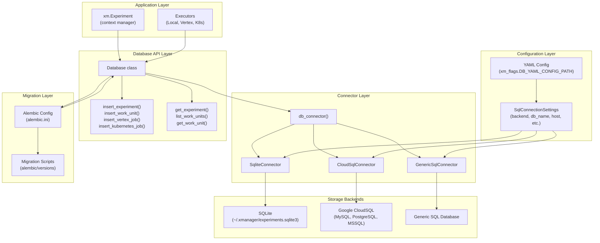
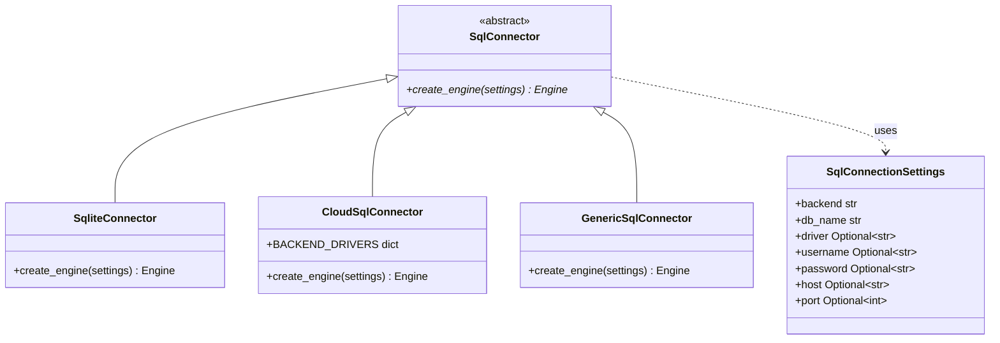
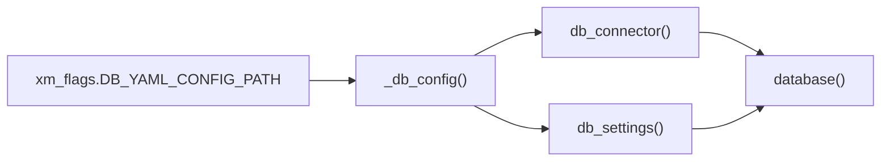
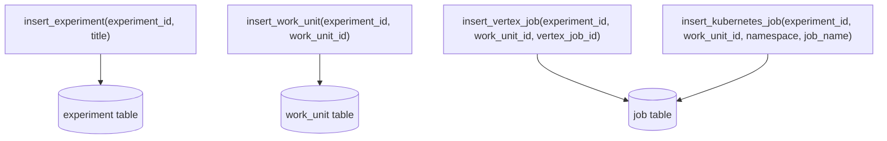
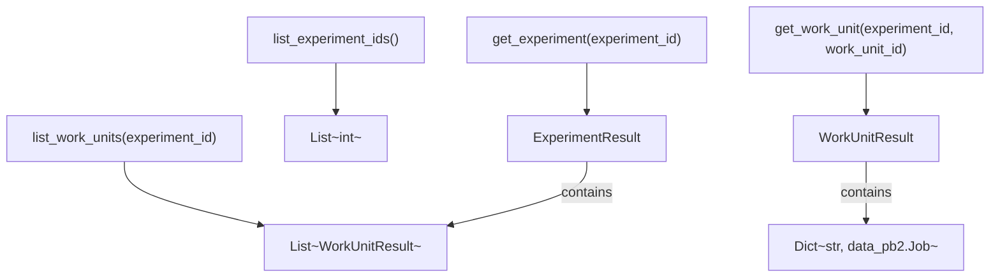
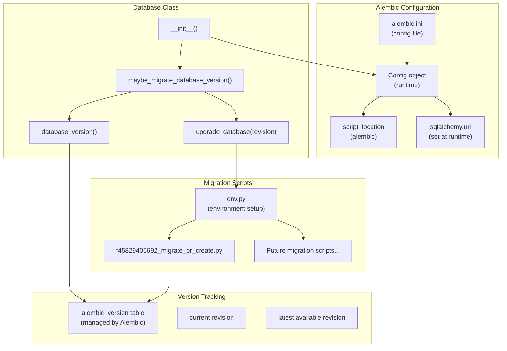
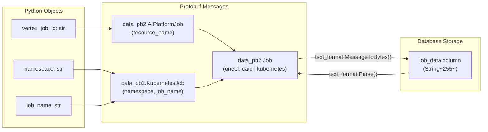

<!-- source: DeepWiki mcp.deepwiki.com · repo google-deepmind/xmanager · page 6.2 Database Storage · fetched 2026-10-26 -->

# Database Storage

<details>
<summary>Relevant source files</summary>

The following files were used as context for generating this wiki page:

- [xmanager/xm_local/storage/alembic.ini](xmanager/xm_local/storage/alembic.ini)
- [xmanager/xm_local/storage/alembic/README.md](xmanager/xm_local/storage/alembic/README.md)
- [xmanager/xm_local/storage/alembic/env.py](xmanager/xm_local/storage/alembic/env.py)
- [xmanager/xm_local/storage/alembic/script.py.mako](xmanager/xm_local/storage/alembic/script.py.mako)
- [xmanager/xm_local/storage/alembic/versions/f45829405692_migrate_or_create.py](xmanager/xm_local/storage/alembic/versions/f45829405692_migrate_or_create.py)
- [xmanager/xm_local/storage/database.py](xmanager/xm_local/storage/database.py)

</details>


## Purpose and Scope

This document describes XManager's metadata storage system, which persists experiment information to SQL databases. The database stores a three-tier hierarchy of experiment metadata: experiments, work units, and jobs. This system supports multiple SQL backends including SQLite (for local development), Google CloudSQL (for production), and generic SQL databases.

For information about experiment lifecycle and work unit management, see [Experiments and Work Units](#3.1). For database configuration flags, see [Configuration Flags](#6.1).

---

## Architecture Overview

The database storage system consists of three layers: **connectors** that establish database connections, a **Database class** that provides CRUD operations, and **Alembic** for schema version management.



**Sources:** [xmanager/xm_local/storage/database.py:162-413]()

---

## Database Schema

XManager uses a three-tier relational schema to represent the experiment hierarchy. Each table uses compound primary keys to establish relationships.

### Schema Diagram

```mermaid
erDiagram
    experiment ||--o{ work_unit : "has many"
    work_unit ||--o{ job : "has many"
    
    experiment {
        BigInteger experiment_id PK
        String experiment_title
    }
    
    work_unit {
        BigInteger experiment_id PK_FK
        Integer work_unit_id PK
    }
    
    job {
        BigInteger experiment_id PK_FK
        Integer work_unit_id PK_FK
        String job_name PK
        String job_data
    }
```

### Table Definitions

| Table | Primary Key | Description |
|-------|------------|-------------|
| `experiment` | `experiment_id` | Top-level container for a single experiment run |
| `work_unit` | `(experiment_id, work_unit_id)` | Represents a single work unit or auxiliary unit within an experiment |
| `job` | `(experiment_id, work_unit_id, job_name)` | Individual job within a work unit, stores backend-specific job metadata |

The `job_data` column stores serialized Protocol Buffer messages ([data_pb2.Job]()) containing backend-specific identifiers such as Vertex AI resource names or Kubernetes job names.

**Sources:** [xmanager/xm_local/storage/alembic/versions/f45829405692_migrate_or_create.py:119-159](), [xmanager/xm_local/storage/database.py:235-294]()

---

## SQL Connectors

XManager provides three connector implementations for different database backends, all implementing the `SqlConnector` abstract base class.



### SqliteConnector

The default connector for local development. Creates a SQLite database file at the specified path (default: `~/.xmanager/experiments.sqlite3`). Automatically creates parent directories if they don't exist.

**Key behavior:**
- Validates that `backend` is `'sqlite'` or unset
- Creates directory structure automatically
- No authentication required
- Thread-safe for single-process access

**Sources:** [xmanager/xm_local/storage/database.py:104-122]()

### CloudSqlConnector

Connects to Google CloudSQL instances using the Cloud SQL Connector library. Supports MySQL, PostgreSQL, and MSSQL backends.

**Supported backends and drivers:**

| Backend | Required Driver |
|---------|----------------|
| `mysql` | `pymysql` |
| `postgresql` | `pg8000` |
| `mssql` | `pytds` |

**Key behavior:**
- Uses Cloud SQL Connector with IPTypes (PRIVATE or PUBLIC based on `PRIVATE_IP` environment variable)
- Validates backend/driver compatibility
- Requires `host` (instance connection name), `username`, `password`, and `db_name` in settings

**Sources:** [xmanager/xm_local/storage/database.py:124-160]()

### GenericSqlConnector

Fallback connector for generic SQL databases. Constructs a SQLAlchemy URL from connection settings and creates an engine.

**Key behavior:**
- Supports any SQLAlchemy-compatible database
- Constructs URL from: `{backend}+{driver}://{username}:{password}@{host}:{port}/{db_name}`
- No special authentication handling

**Sources:** [xmanager/xm_local/storage/database.py:83-102]()

---

## Configuration

Database configuration is specified through either default SQLite settings or a YAML configuration file.

### Default Configuration

By default, XManager uses SQLite with the database file at `~/.xmanager/experiments.sqlite3`:

```python
# Default settings returned by sqlite_settings()
SqlConnectionSettings(
    backend='sqlite',
    db_name=os.path.expanduser('~/.xmanager/experiments.sqlite3')
)
```

**Sources:** [xmanager/xm_local/storage/database.py:346-351]()

### YAML Configuration

For production deployments, specify a custom database via the `--xm_db_yaml_config_path` flag pointing to a YAML file:

**Example CloudSQL configuration:**
```yaml
sql_connector: cloudsql
sql_connection_settings:
  backend: mysql
  host: project:region:instance
  username: xmanager_user
  password: secret_password
  db_name: xmanager_metadata
```

**Example generic SQL configuration:**
```yaml
sql_connector: generic
sql_connection_settings:
  backend: postgresql
  driver: psycopg2
  host: db.example.com
  port: 5432
  username: xmanager_user
  password: secret_password
  db_name: xmanager_metadata
```

**Required YAML fields:**
- `sql_connector`: One of `['sqlite', 'generic', 'cloudsql']`
- `sql_connection_settings`: Dictionary matching `SqlConnectionSettings` fields

**Sources:** [xmanager/xm_local/storage/database.py:357-407]()

### Configuration Resolution

The database configuration is resolved through cached functions:



All three functions (`db_connector()`, `db_settings()`, `database()`) are decorated with `@functools.lru_cache()`, ensuring singleton behavior within a process.

**Sources:** [xmanager/xm_local/storage/database.py:371-413]()

---

## Database Operations

The `Database` class provides operations for inserting and querying experiment metadata.

### Insert Operations



**Insert Methods:**

| Method | Parameters | Stored Data |
|--------|-----------|-------------|
| `insert_experiment()` | `experiment_id`, `experiment_title` | Creates experiment record |
| `insert_work_unit()` | `experiment_id`, `work_unit_id` | Associates work unit with experiment |
| `insert_vertex_job()` | `experiment_id`, `work_unit_id`, `vertex_job_id` | Stores Vertex AI job reference in protobuf |
| `insert_kubernetes_job()` | `experiment_id`, `work_unit_id`, `namespace`, `job_name` | Stores Kubernetes job reference in protobuf |

**Data serialization:** Job metadata is serialized as Protocol Buffer messages ([data_pb2.Job]()) before storage. Vertex jobs use `data_pb2.AIPlatformJob`, Kubernetes jobs use `data_pb2.KubernetesJob`.

**Sources:** [xmanager/xm_local/storage/database.py:235-294]()

### Query Operations



**Query Methods:**

| Method | Returns | Description |
|--------|---------|-------------|
| `list_experiment_ids()` | `List[int]` | All experiment IDs in database |
| `get_experiment(id)` | `ExperimentResult` | Experiment with title and all work units |
| `list_work_units(experiment_id)` | `List[WorkUnitResult]` | All work units for an experiment |
| `get_work_unit(exp_id, wu_id)` | `WorkUnitResult` | Single work unit with job dictionary |

**Result classes:**

```python
@attr.s(auto_attribs=True)
class WorkUnitResult:
  work_unit_id: int
  jobs: Dict[str, data_pb2.Job]  # job_name -> Job protobuf

@attr.s(auto_attribs=True)
class ExperimentResult:
  experiment_id: int
  experiment_title: str
  work_units: List[WorkUnitResult]
```

**Sources:** [xmanager/xm_local/storage/database.py:37-52](), [xmanager/xm_local/storage/database.py:296-344]()

---

## Schema Migrations with Alembic

XManager uses [Alembic](https://alembic.sqlalchemy.org) for database schema version management and migrations.

### Migration Architecture



**Sources:** [xmanager/xm_local/storage/database.py:165-234]()

### Automatic Migration on Startup

The `Database` constructor automatically checks and upgrades the database version:

1. **Version check:** Compares current database version (`database_version()`) against latest available version (`latest_version_available()`)
2. **Legacy detection:** Checks for legacy SQLite databases using `VersionHistory` table
3. **Upgrade flag requirement:** If database is outdated, requires `--xm_upgrade_db` flag to proceed
4. **Automatic upgrade:** Runs `upgrade_database()` to apply all pending migrations

**Safety mechanism:** Migration failures raise a `RuntimeError` warning about potential data loss, advising users to restore from backup.

**Sources:** [xmanager/xm_local/storage/database.py:215-234]()

### Migration Script Structure

The initial migration script [f45829405692_migrate_or_create.py:1-178]() handles two scenarios:

1. **Legacy SQLite migration:**
   - Drops `VersionHistory` table
   - Renames columns (e.g., `Id` → `experiment_id`, `Title` → `experiment_title`)
   - Changes column types (e.g., `Integer` → `BigInteger`)
   - Renames tables to lowercase (e.g., `Experiment` → `experiment`)

2. **New database creation:**
   - Creates `experiment` table
   - Creates `work_unit` table
   - Creates `job` table
   - Sets appropriate primary keys and constraints

**Sources:** [xmanager/xm_local/storage/alembic/versions/f45829405692_migrate_or_create.py:41-169]()

### Creating New Migrations

To create a new migration script:

```bash
cd xmanager/xm_local/storage
alembic revision -m "Description of changes"
```

This generates a new script in `alembic/versions/` with `upgrade()` and `downgrade()` functions to populate. See [xmanager/xm_local/storage/alembic/README.md:1-111]() for detailed instructions.

**Important notes:**
- User-created migrations are not officially supported
- Always backup database before upgrading
- Test migrations thoroughly before production use
- Consider using `batch_alter_table` for SQLite compatibility

**Sources:** [xmanager/xm_local/storage/alembic/README.md:1-111]()

---

## Data Serialization

Job metadata is stored as serialized Protocol Buffer messages to maintain backend-specific information in a structured format.

### Protobuf Storage Format



### Serialization Methods

**Vertex AI jobs:**
```python
def insert_vertex_job(self, experiment_id: int, work_unit_id: int, 
                      vertex_job_id: str) -> None:
    job = data_pb2.Job(caip=data_pb2.AIPlatformJob(resource_name=vertex_job_id))
    data = text_format.MessageToBytes(job)
    # Insert data into job table
```

**Kubernetes jobs:**
```python
def insert_kubernetes_job(self, experiment_id: int, work_unit_id: int,
                          namespace: str, job_name: str) -> None:
    job = data_pb2.Job(
        kubernetes=data_pb2.KubernetesJob(namespace=namespace, job_name=job_name)
    )
    data = text_format.MessageToString(job)
    # Insert data into job table
```

**Deserialization during query:**
```python
def get_work_unit(self, experiment_id: int, work_unit_id: int) -> WorkUnitResult:
    # Query returns rows with job_name and job_data
    jobs = {}
    for r in rows:
        job = data_pb2.Job()
        jobs[r['job_name']] = text_format.Parse(r['job_data'], job)
    return WorkUnitResult(work_unit_id, jobs)
```

This protobuf-based approach allows XManager to store backend-specific metadata without schema changes when adding new executor types.

**Sources:** [xmanager/xm_local/storage/database.py:255-343](), [xmanager/generated/data_pb2.py]()

---

