# Page: Overview

# Overview

<details>
<summary>Relevant source files</summary>

The following files were used as context for generating this wiki page:

- [README.md](README.md)
- [setup.py](setup.py)
- [xmanager/xm/__init__.py](xmanager/xm/__init__.py)
- [xmanager/xm/core.py](xmanager/xm/core.py)
- [xmanager/xm/core_test.py](xmanager/xm/core_test.py)
- [xmanager/xm/metadata_context.py](xmanager/xm/metadata_context.py)
- [xmanager/xm_local/experiment.py](xmanager/xm_local/experiment.py)
- [xmanager/xm_mock/__init__.py](xmanager/xm_mock/__init__.py)

</details>


## Purpose and Scope

This document provides a comprehensive architectural overview of XManager, a framework for managing machine learning experiments. It covers the system's design philosophy, core components, execution flow, and how these elements work together to provide a unified API for launching and tracking ML experiments across multiple backends (local, Vertex AI, Kubernetes).

For installation and setup instructions, see [Installation](#2.1). For detailed explanations of individual concepts, refer to [Core Concepts](#3). For backend-specific execution details, see [Execution Backends](#5).

**Sources:** [README.md:1-11](), [setup.py:22-26]()

---

## What is XManager?

XManager is a Python framework designed to simplify the management of machine learning experiments. It provides:

- **Unified API**: A single API (`xmanager.xm`) for defining experiments regardless of where they run
- **Multiple Backends**: Support for local execution, Google Cloud Vertex AI, and Kubernetes
- **Experiment Tracking**: Database-backed metadata storage for experiments and work units
- **Flexible Packaging**: Automatic building and packaging of executables (Bazel, Docker, Python containers)
- **Hyperparameter Sweeps**: First-class support for launching multiple trials with different configurations

The framework separates **what to run** (executable specifications) from **where to run it** (executors), enabling experiment portability across environments.

**Sources:** [README.md:5-18](), [xmanager/xm/core.py:14-23](), [setup.py:25]()

---

## System Architecture

XManager is organized into six major architectural layers, each with distinct responsibilities:

### High-Level Component Diagram

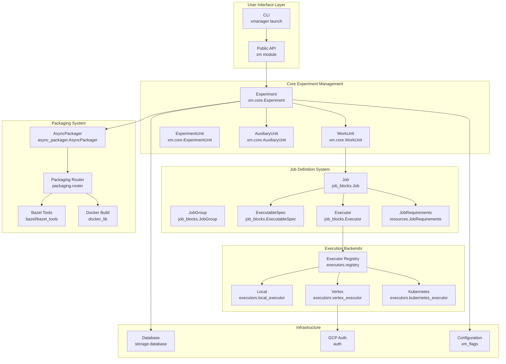

**Sources:** [xmanager/xm/core.py:1-56](), [xmanager/xm_local/experiment.py:1-34](), [xmanager/xm/__init__.py:1-84]()

---

## Core Components

### 1. User Interface Layer

The user interface provides two entry points:

| Component | Description | Code Reference |
|-----------|-------------|----------------|
| **CLI** | Command-line tool for launching experiments via `xmanager launch` | [setup.py:54-57]() |
| **Public API** | Python API exposed through the `xm` module | [xmanager/xm/__init__.py:14-84]() |

Users typically import two modules in their launch scripts:
```python
from xmanager import xm          # Core primitives
from xmanager import xm_local    # Implementation (local backend)
```

**Sources:** [README.md:128-134](), [xmanager/xm/__init__.py:1-17]()

---

### 2. Core Experiment Management

This layer manages experiment lifecycle and orchestrates asynchronous operations.

#### Key Classes

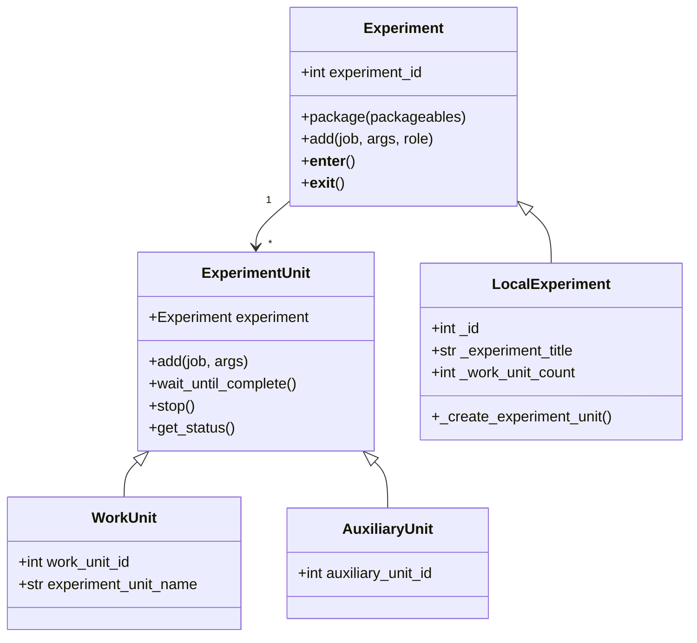

**`Experiment`** ([xmanager/xm/core.py:721-1127]())
- Central context for managing an experiment
- Implements context manager protocol (`__enter__`, `__exit__`)
- Manages background event loop for asynchronous operations
- Coordinates packaging and work unit creation

**`ExperimentUnit`** ([xmanager/xm/core.py:337-587]())
- Abstract base for collections of semantically related jobs
- Handles job launching and lifecycle management
- Provides `add()` method to add jobs to the unit

**`WorkUnit`** ([xmanager/xm/core.py:642-659]())
- Experiment units that perform actual computation (trials)
- Status affects overall experiment status
- Has a unique `work_unit_id` within the experiment

**`AuxiliaryUnit`** ([xmanager/xm/core.py:677-684]())
- Experiment units for supporting services (e.g., TensorBoard)
- Status does not affect experiment completion
- Supports delayed termination after experiment completes

**`LocalExperiment`** ([xmanager/xm_local/experiment.py:248-385]())
- Concrete implementation for local backend
- Uses timestamp-based IDs
- Coordinates with database for persistence

**Sources:** [xmanager/xm/core.py:721-867](), [xmanager/xm_local/experiment.py:248-393]()

---

### 3. Job Definition System

This layer provides abstractions for describing computations to run.

#### Core Abstractions

```mermaid
graph LR
    Job["Job<br/>executable + executor + args"]
    JobGroup["JobGroup<br/>named collection of Jobs"]
    ExecutableSpec["ExecutableSpec<br/>BazelBinary, PythonContainer, etc."]
    Executable["Executable<br/>packaged artifact"]
    Executor["Executor<br/>Local, Vertex, Kubernetes"]
    ExecutorSpec["ExecutorSpec<br/>packaging requirements"]
    
    Job --> Executable
    Job --> Executor
    JobGroup --> Job
    ExecutableSpec -->|package()| Executable
    Executor --> ExecutorSpec
```

| Component | Purpose | Code References |
|-----------|---------|-----------------|
| **Job** | Single unit of computation with executable, executor, and arguments | [xmanager/xm/job_blocks.py]() |
| **JobGroup** | Gang-scheduled collection of jobs (e.g., distributed training) | [xmanager/xm/job_blocks.py]() |
| **ExecutableSpec** | Platform-independent description of what to run | [xmanager/xm/executables.py]() |
| **Executable** | Packaged artifact ready for execution | [xmanager/xm/job_blocks.py]() |
| **Executor** | Describes where and how to run jobs | [xmanager/xm/job_blocks.py]() |
| **JobRequirements** | Resource specifications (CPUs, GPUs, TPUs) | [xmanager/xm/resources.py]() |

**Sources:** [README.md:269-365](), [xmanager/xm/__init__.py:48-62]()

---

### 4. Packaging System

The packaging system transforms executable specifications into concrete artifacts.

#### Packaging Flow

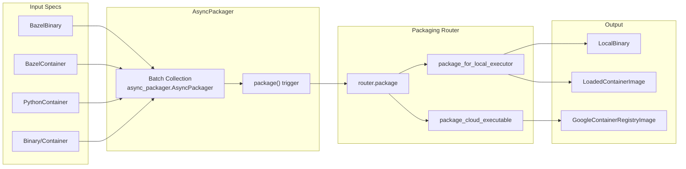

**`AsyncPackager`** ([xmanager/xm/async_packager.py]())
- Batches packaging requests for parallel builds
- Implements `add()` for async queueing and `package()` for execution
- Used by `Experiment.package()` and `Experiment.package_async()`

**Packaging Router** ([xmanager/xm_local/packaging/router.py]())
- Dispatches to local or cloud packaging based on executor type
- Handles Bazel builds, Docker image creation, and artifact uploads

**Sources:** [xmanager/xm/core.py:880-931](), [xmanager/xm_local/experiment.py:255]()

---

### 5. Execution Backends

Executors provide pluggable backends for running jobs.

#### Executor Registry Pattern

```mermaid
graph TB
    subgraph "Abstract Layer"
        ExecutorBase["Executor<br/>base class"]
        ExecutorSpec["ExecutorSpec"]
    end
    
    subgraph "Implementations"
        Local["Local<br/>xm_local.Local"]
        Vertex["Vertex<br/>xm_local.Vertex"]
        K8s["Kubernetes<br/>xm_local.Kubernetes"]
    end
    
    subgraph "Registry"
        RegMap["registry._EXECUTORS<br/>Type -> launch function"]
    end
    
    subgraph "Execution Methods"
        LocalLaunch["local_executor.launch"]
        VertexLaunch["vertex_executor.launch"]
        K8sLaunch["kubernetes_executor.launch"]
    end
    
    ExecutorBase <|-- Local
    ExecutorBase <|-- Vertex
    ExecutorBase <|-- K8s
    
    Local -.registered.-> RegMap
    Vertex -.registered.-> RegMap
    K8s -.registered.-> RegMap
    
    RegMap --> LocalLaunch
    RegMap --> VertexLaunch
    RegMap --> K8sLaunch
```

| Executor | Environment | Supported Executables | Code Reference |
|----------|-------------|----------------------|----------------|
| **Local** | Local machine (Docker/binary) | Binary, Container, BazelBinary, BazelContainer | [xmanager/xm_local/executors/local_executor.py]() |
| **Vertex** | Google Cloud Vertex AI | Container, BazelContainer, PythonContainer | [xmanager/xm_local/executors/vertex_executor.py]() |
| **Kubernetes** | Kubernetes cluster | Container, BazelContainer, PythonContainer | [xmanager/xm_local/executors/kubernetes_executor.py]() |

**Dynamic Dispatch**: The registry pattern ([xmanager/xm_local/registry.py]()) enables `experiment.add()` to automatically route to the correct executor's `launch()` method based on the job's executor type.

**Sources:** [README.md:288-304](), [xmanager/xm_local/experiment.py:36-93]()

---

### 6. Infrastructure

Cross-cutting services used throughout the system.

| Component | Purpose | Key Modules |
|-----------|---------|-------------|
| **Configuration** | Command-line flags for build, execution, database, and GCP settings | `xmanager/xm_local/xm_flags.py` |
| **Database** | SQLite/CloudSQL storage for experiment metadata | `xmanager/xm_local/storage/database.py` |
| **Authentication** | GCP service account management and API enablement | `xmanager/xm_local/auth.py` |
| **Utilities** | Shell argument handling, async wrappers, path resolution | `xmanager/xm/utils.py` |

**Schema Hierarchy**:
```
Experiment
  ├─ experiment_id (PK)
  ├─ title
  └─ WorkUnit[]
       ├─ work_unit_id (PK)
       ├─ experiment_id (FK)
       └─ Job[]
            ├─ job_name (PK)
            ├─ executor_type
            └─ execution_handle_data
```

**Sources:** [xmanager/xm_local/experiment.py:290-293](), [xmanager/xm_local/experiment.py:390-392]()

---

## Experiment Lifecycle

The typical flow from launch script to execution:

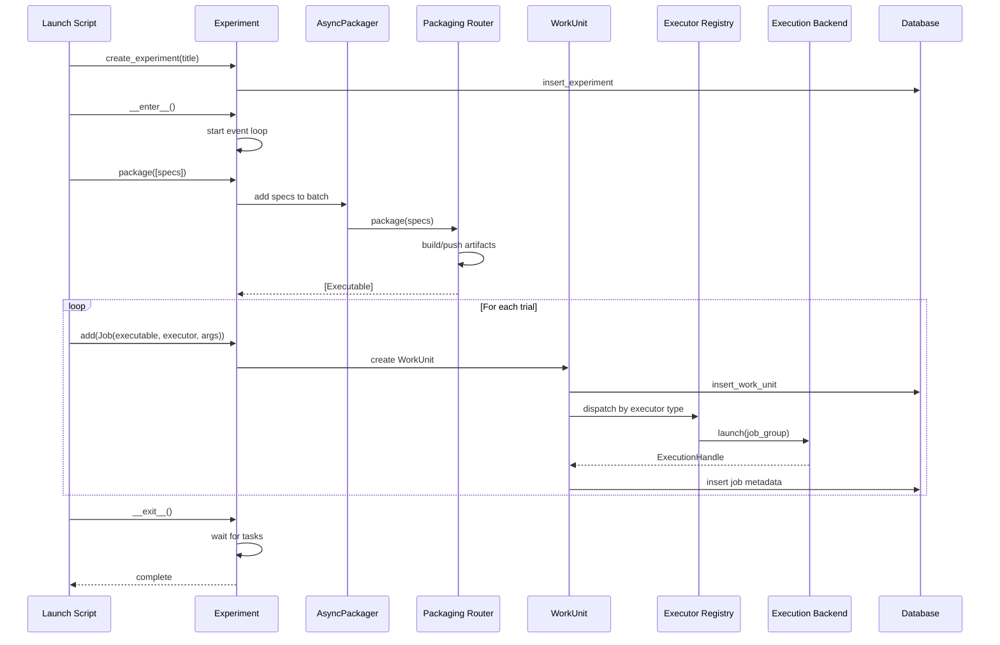

**Step-by-step**:

1. **Creation** ([xmanager/xm_local/experiment.py:387-393]()): `create_experiment()` creates a `LocalExperiment` and saves metadata to the database

2. **Context Entry** ([xmanager/xm/core.py:763-786]()): `__enter__()` starts an event loop thread for asynchronous operations

3. **Packaging** ([xmanager/xm/core.py:880-898]()): `Experiment.package()` batches and builds all executable specs in parallel

4. **Work Unit Addition** ([xmanager/xm/core.py:988-1076]()): Each `experiment.add()` call creates a work unit, launches jobs, and stores metadata

5. **Context Exit** ([xmanager/xm/core.py:822-827]()): `__exit__()` waits for all tasks and validates roles

**Sources:** [xmanager/xm/core.py:721-867](), [xmanager/xm_local/experiment.py:248-393]()

---

## Key Design Patterns

### Context Manager Pattern
Experiments use Python's context manager protocol to ensure proper resource lifecycle:
- Entry creates event loop and sets context variables ([xmanager/xm/core.py:763-786]())
- Exit waits for tasks and cleans up ([xmanager/xm/core.py:822-827]())

### Async Task Orchestration
Background operations run asynchronously using `asyncio`:
- Event loop runs in dedicated thread ([xmanager/xm/core.py:771-775]())
- Tasks created via `_create_task()` ([xmanager/xm/core.py:1117-1127]())
- Context variables propagate to worker threads ([xmanager/xm/core.py:97-125]())

### Registry Pattern
Executors register their launch functions dynamically:
- Registry maps executor types to launch functions ([xmanager/xm_local/registry.py]())
- Enables adding new backends without modifying core code ([xmanager/xm_local/experiment.py:82-90]())

### Two-Stage Packaging
Separation of specification from execution:
- **Stage 1**: Define platform-independent executable specs
- **Stage 2**: Package specs differently for local vs. cloud executors

**Sources:** [xmanager/xm/core.py:721-867](), [xmanager/xm_local/experiment.py:76-92]()

---

## Configuration and Dependencies

### System Requirements

From [setup.py:31-52]():

| Category | Dependencies |
|----------|--------------|
| **Build Tools** | Bazel (optional), Docker (optional) |
| **Cloud** | google-cloud-aiplatform, google-cloud-storage, kubernetes |
| **Database** | sqlalchemy, alembic, cloud-sql-python-connector |
| **Core** | asyncio (stdlib), attrs, absl-py |

### Python Version
Requires Python 3.10+ ([setup.py:31]())

### Entry Point
The `xmanager` CLI command is registered as a console script ([setup.py:54-57]()).

**Sources:** [setup.py:22-63](), [README.md:44-118]()

---

## API Usage Example

Basic experiment structure mapping to code entities:

```python
from xmanager import xm          # xmanager/xm/__init__.py
from xmanager import xm_local    # xmanager/xm_local/__init__.py

# Creates LocalExperiment and saves to database
# xmanager/xm_local/experiment.py:387-393
with xm_local.create_experiment(experiment_title='my_experiment') as experiment:
    
    # Packages executable specs in parallel
    # xmanager/xm/core.py:880-898
    [executable] = experiment.package([
        xm.Packageable(
            executable_spec=xm.PythonContainer(...),  # xmanager/xm/executables.py
            executor_spec=xm_local.Vertex.Spec(),      # xmanager/xm_local/executors/vertex_executor.py
        )
    ])
    
    # Creates WorkUnit, dispatches to Vertex executor
    # xmanager/xm/core.py:988-1076
    experiment.add(xm.Job(
        executable=executable,
        executor=xm_local.Vertex(requirements=xm.JobRequirements(T4=1)),
        args={'learning_rate': 0.001},
    ))
```

**Sources:** [README.md:123-181](), [xmanager/xm/core.py:988-1076]()

---

## Next Steps

- **Installation and Setup**: See [Installation](#2.1) for prerequisites and configuration
- **First Experiment**: Follow [Your First Experiment](#2.2) for a hands-on walkthrough
- **Core Concepts**: Read [Core Concepts](#3) for detailed explanations of experiments, jobs, and resources
- **Packaging**: Learn about [Packaging System](#4) for building and deploying executables
- **Execution**: Explore [Execution Backends](#5) for running jobs on different platforms

**Sources:** [README.md:120-265]()

---

# Page: Getting Started

# Getting Started

<details>
<summary>Relevant source files</summary>

The following files were used as context for generating this wiki page:

- [README.md](README.md)
- [setup.py](setup.py)
- [xmanager/xm/core.py](xmanager/xm/core.py)
- [xmanager/xm/core_test.py](xmanager/xm/core_test.py)
- [xmanager/xm_flags.py](xmanager/xm_flags.py)
- [xmanager/xm_local/experiment.py](xmanager/xm_local/experiment.py)
- [xmanager/xm_local/multiplexer.py](xmanager/xm_local/multiplexer.py)
- [xmanager/xm_mock/__init__.py](xmanager/xm_mock/__init__.py)

</details>


This page provides an overview of how to begin using XManager for managing machine learning experiments. It covers the prerequisites, basic workflow, and key API entry points you'll need to launch your first experiments. For detailed installation instructions, see [Installation](#2.1). For a hands-on walkthrough of creating your first experiment, see [Your First Experiment](#2.2).

## Purpose and Scope

XManager is a framework for packaging, launching, and tracking machine learning experiments. This guide introduces the fundamental concepts and workflow needed to start running experiments. It assumes you have basic familiarity with Python and containerization concepts (Docker), and optionally Bazel for building executables.

## XManager Workflow Overview

The XManager workflow consists of four main phases that transform a Python launch script into running jobs:

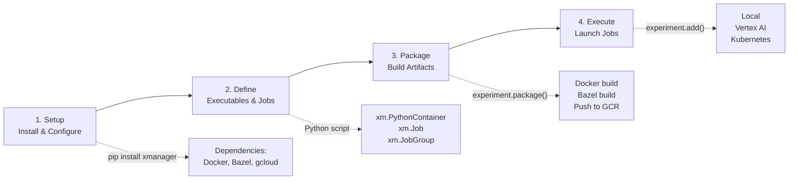

**Diagram: High-Level XManager Workflow**

Sources: [README.md:120-181](), [xmanager/xm/core.py:721-744]()

## Prerequisites Summary

Before using XManager, you need:

| Component | Required For | Installation Reference |
|-----------|--------------|----------------------|
| Python 3.10+ | Core XManager functionality | [setup.py:31]() |
| pip packages | XManager dependencies | [setup.py:32-52]() |
| Docker | Running containerized executables | [README.md:48-57]() |
| Bazel | Building Bazel targets | [README.md:59-65]() |
| GCP Project | Running on Vertex AI/GKE | [README.md:67-118]() |

For complete setup instructions including environment configuration, see [Installation](#2.1).

Sources: [README.md:24-118](), [setup.py:31-52]()

## Key Modules and Their Roles

XManager provides two primary module entry points that work together:

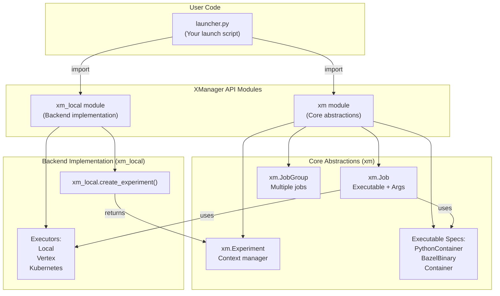

**Diagram: XManager Module Structure**

| Module | Purpose | Key Classes/Functions |
|--------|---------|----------------------|
| `xmanager.xm` | Core abstractions and interfaces | `Experiment`, `Job`, `JobGroup`, `PythonContainer`, `BazelBinary` |
| `xmanager.xm_local` | Local backend implementation | `create_experiment()`, `Local`, `Vertex`, `Kubernetes` |

Sources: [xmanager/xm/core.py:14-23](), [xmanager/xm_local/experiment.py:387-393](), [README.md:128-133]()

## Experiment Context Pattern

XManager experiments use Python context managers to ensure proper lifecycle management:

```mermaid
sequenceDiagram
    participant User as "User Script"
    participant API as "xm_local.create_experiment()"
    participant Exp as "Experiment Context"
    participant DB as "Database Storage"
    participant Loop as "Event Loop"
    
    User->>API: create_experiment(title)
    API->>DB: Insert experiment metadata
    API->>Exp: Create LocalExperiment
    Exp-->>User: Return experiment
    
    User->>Exp: __enter__()
    Exp->>Loop: Start asyncio event loop
    Exp->>DB: Save experiment ID
    
    Note over User,Exp: User defines and adds jobs
    
    User->>Exp: __exit__()
    Exp->>Loop: Wait for tasks to complete
    Exp->>Loop: Stop event loop
    Exp-->>User: Exit complete
```

**Diagram: Experiment Lifecycle with Context Manager**

The context manager pattern provides:
- **Automatic resource cleanup**: Event loops and background tasks are properly terminated
- **Error handling**: Exceptions during job creation are caught and logged
- **Synchronization**: Waits for local jobs to complete before exiting

Sources: [xmanager/xm/core.py:763-827](), [xmanager/xm_local/experiment.py:331-341]()

## Basic Launch Script Structure

A minimal XManager launch script follows this pattern:

```python
from xmanager import xm
from xmanager import xm_local

# 1. Create experiment context
with xm_local.create_experiment(experiment_title='my_experiment') as experiment:
    
    # 2. Package executable
    [executable] = experiment.package([
        xm.Packageable(
            executable_spec=xm.PythonContainer(...),
            executor_spec=xm_local.Vertex.Spec(),
        )
    ])
    
    # 3. Add jobs
    experiment.add(xm.Job(
        executable=executable,
        executor=xm_local.Vertex(...),
        args={'learning_rate': 0.1},
    ))
```

This structure maps directly to the code entities:

| Script Element | Code Entity | Purpose |
|----------------|-------------|---------|
| `xm_local.create_experiment()` | [xmanager/xm_local/experiment.py:387-393]() | Creates experiment and database entry |
| `experiment.package()` | [xmanager/xm/core.py:881-898]() | Builds/prepares executables for target backend |
| `experiment.add()` | [xmanager/xm/core.py:988-1076]() | Creates work units and launches jobs |
| `xm.Job` | [xmanager/xm/job_blocks.py]() | Combines executable, executor, and arguments |
| `xm.PythonContainer` | [xmanager/xm/job_blocks.py]() | Executable spec for Python code |

Sources: [README.md:122-181](), [xmanager/xm/core.py:721-744]()

## Execution Backend Selection

XManager supports multiple execution backends, selected by the executor type:

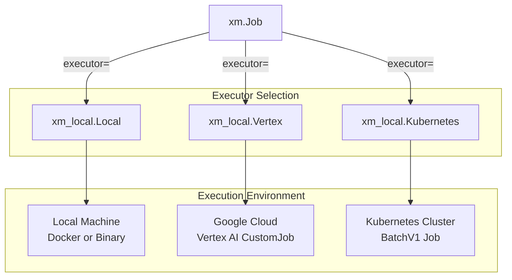

**Diagram: Backend Selection via Executor**

| Executor | Execution Location | Requirements | Use Case |
|----------|-------------------|--------------|----------|
| `xm_local.Local` | Local machine | Docker or binary | Development, debugging |
| `xm_local.Vertex` | Google Cloud Vertex AI | GCP project, container | Production training |
| `xm_local.Kubernetes` | Kubernetes cluster | K8s access, container | Distributed workloads |

Sources: [README.md:287-305](), [xmanager/xm_local/experiment.py:36-41]()

## Configuration System

XManager behavior is controlled through command-line flags defined in `xm_flags.py`:

| Flag Category | Key Flags | Purpose |
|---------------|-----------|---------|
| **Cloud Build** | `--xm_build_image_locally`<br/>`--xm_use_docker_command` | Control Docker image building strategy |
| **Database** | `--xm_db_yaml_config_path`<br/>`--xm_upgrade_db` | Configure metadata storage backend |
| **Local Execution** | `--xm_use_multiplexer`<br/>`--xm_open_multiplexer_window` | Control local job execution environment |
| **GCP** | `--xm_gcp_service_account_name`<br/>`--xm_k8s_service_account_name` | Configure cloud authentication |

Flags are passed when launching experiments:

```bash
xmanager launch launcher.py -- --xm_build_image_locally=true
```

Sources: [xmanager/xm_flags.py:24-197](), [README.md:252-263]()

## Packaging vs Execution Separation

XManager separates packaging (building artifacts) from execution (running jobs):

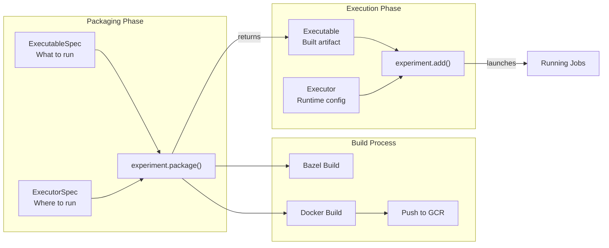

**Diagram: Packaging and Execution Phases**

This separation allows:
- **Parallel building**: Multiple executables built concurrently via `experiment.package([...])`
- **Reuse**: Same packaged executable launched multiple times with different arguments
- **Backend flexibility**: Package once, execute on different backends

Sources: [xmanager/xm/core.py:881-931](), [xmanager/xm_local/packaging/router.py]()

## Database Storage

XManager stores experiment metadata in a database for tracking and retrieval:

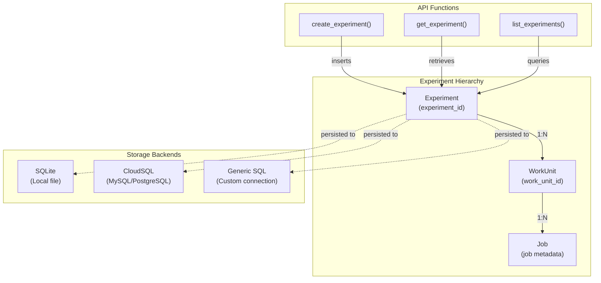

**Diagram: Experiment Metadata Storage**

Storage is configured via `--xm_db_yaml_config_path`. Default is SQLite for local development.

Sources: [xmanager/xm_local/experiment.py:387-449](), [xmanager/xm_flags.py:117-150]()

## Event Loop and Asynchronous Execution

XManager uses asyncio for concurrent job management:

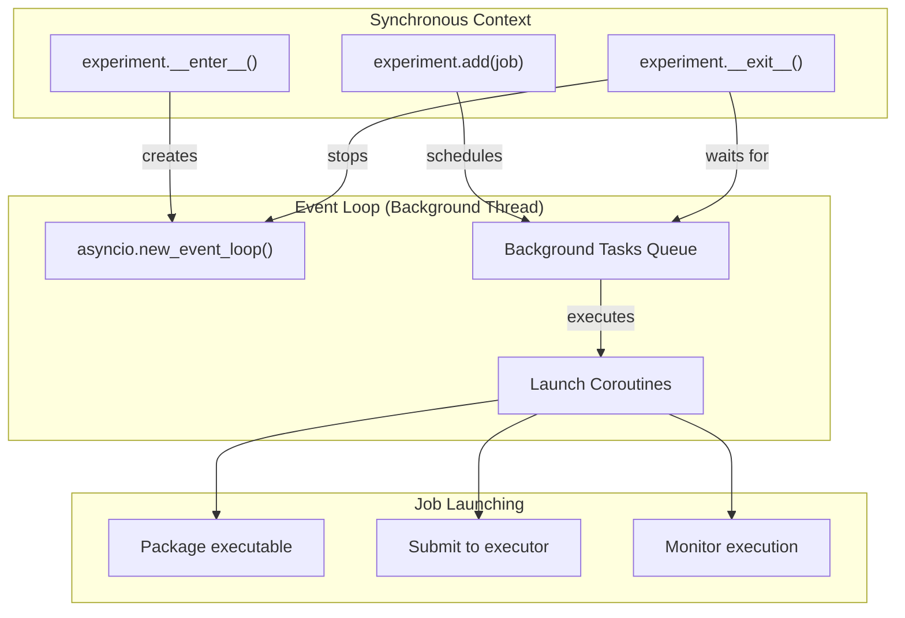

**Diagram: Asynchronous Task Management**

The event loop enables:
- **Non-blocking job submission**: `experiment.add()` returns immediately
- **Concurrent packaging**: Multiple Docker/Bazel builds run in parallel
- **Background monitoring**: Local jobs monitored without blocking

Sources: [xmanager/xm/core.py:763-827](), [xmanager/xm_local/experiment.py:100-125]()

## Job Arguments and Environment Variables

Jobs accept two types of configuration:

| Configuration Type | Format | Usage |
|-------------------|--------|-------|
| **Command-line arguments** | `dict` or `list` | Hyperparameters, flags |
| **Environment variables** | `dict` | System configuration, debugging |

```python
experiment.add(xm.Job(
    executable=executable,
    executor=executor,
    # Dictionary form: --key=value
    args={'batch_size': 64, 'learning_rate': 0.001},
    # Or list form: positional arguments
    # args=['arg1', 'arg2'],
    env_vars={'CUDA_VISIBLE_DEVICES': '0,1'},
))
```

Arguments are managed by `SequentialArgs` and merged when specified at multiple levels.

Sources: [xmanager/xm/core.py:60-95](), [README.md:313-335]()

## Multiplexer for Local Jobs

When running locally, XManager can use tmux to manage multiple jobs in terminal windows:

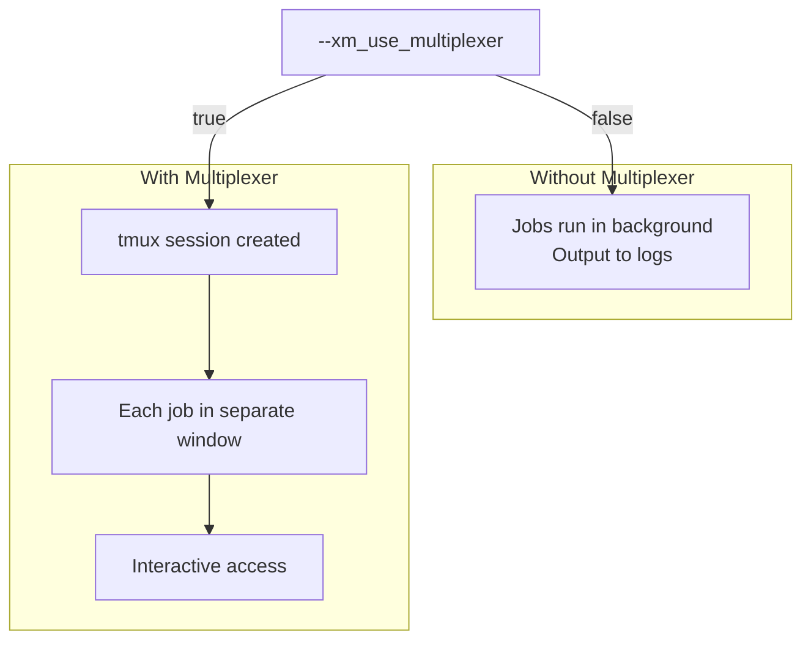

**Diagram: Multiplexer Execution Mode**

Enable with:
```bash
xmanager launch launcher.py -- --xm_use_multiplexer
```

The multiplexer allows interactive monitoring and debugging of local jobs.

Sources: [xmanager/xm_local/multiplexer.py:34-136](), [xmanager/xm_flags.py:158-177]()

## Next Steps

Now that you understand the basic structure of XManager:

1. **Install XManager and dependencies**: Follow [Installation](#2.1) for detailed setup instructions
2. **Create your first experiment**: Follow [Your First Experiment](#2.2) for a hands-on tutorial
3. **Learn about executable types**: See [Executable Specifications](#3.3) for details on `PythonContainer`, `BazelBinary`, etc.
4. **Explore execution backends**: See [Execution Backends](#5) for guidance on Local, Vertex AI, and Kubernetes executors

For advanced usage including distributed training and hyperparameter sweeps, see [Advanced Topics](#7).

Sources: [README.md:120-250]()

---

# Page: Installation

# Installation

<details>
<summary>Relevant source files</summary>

The following files were used as context for generating this wiki page:

- [README.md](README.md)
- [setup.py](setup.py)
- [xmanager/xm_flags.py](xmanager/xm_flags.py)
- [xmanager/xm_local/multiplexer.py](xmanager/xm_local/multiplexer.py)

</details>


This document covers the installation process for XManager, including system requirements, core dependencies, and optional components needed for different execution backends. For information about running your first experiment after installation, see [Your First Experiment](#2.2). For detailed configuration options, see [Configuration Flags](#6.1).

---

## Overview

XManager can be installed via pip and requires Python 3.10 or later. The base installation provides core experiment management capabilities with local execution support. Additional components (Docker, Bazel, GCP tools) enable specific executable types and execution backends.

**Installation Options by Capability:**

| Capability | Required Components | Executable Types | Executors |
|-----------|---------------------|------------------|-----------|
| Local binary execution | Base install only | `xm.Binary` | `xm_local.Local` |
| Local container execution | Base install + Docker | `xm.Container`, `xm.PythonContainer` | `xm_local.Local` |
| Bazel builds | Base install + Bazel | `xm.BazelBinary`, `xm.BazelContainer` | All |
| Vertex AI execution | Base install + Docker + GCP | Container types | `xm_local.Vertex` |
| Kubernetes execution | Base install + Docker + GCP | Container types | `xm_local.Kubernetes` |

Sources: [README.md:24-119](), [setup.py:22-63]()

---

## Quick Installation

### Via pip (Recommended)

Install the latest stable release from PyPI:

```bash
pip install xmanager
```

Or install directly from the GitHub repository:

```bash
pip install git+https://github.com/deepmind/xmanager.git
```

### Automated Setup (Debian-based systems)

For Debian-based systems, a setup script installs XManager and all dependencies:

```bash
git clone https://github.com/deepmind/xmanager.git
cd xmanager/setup_scripts
chmod +x setup_all.sh
. ./setup_all.sh
```

Sources: [README.md:24-42]()

---

## System Requirements

### Python Version

XManager requires **Python 3.10 or later**. This is enforced in the package metadata:

```
python_requires='>=3.10'
```

The codebase uses modern Python features including pattern matching, type annotations, and async/await constructs.

### Operating Systems

XManager is primarily tested on:
- **Linux** (recommended for all backends)
- **macOS** (local execution only)
- **Windows** (limited support via WSL recommended)

Sources: [setup.py:31](), [README.md:46]()

---

## Core Dependencies

The following packages are automatically installed with XManager:

```mermaid
graph TB
    subgraph "Core Framework"
        XM["xmanager package"]
        ABSL["absl-py<br/>(flags, logging)"]
        ATTRS["attrs<br/>(data classes)"]
        ASYNC["async_generator<br/>(async utilities)"]
    end
    
    subgraph "Execution Infrastructure"
        DOCKER["docker<br/>(container operations)"]
        K8S["kubernetes<br/>(K8s API client)"]
        VERTEX["google-cloud-aiplatform<br/>(Vertex AI API)"]
    end
    
    subgraph "Data Storage"
        SQL["sqlalchemy==1.2.19<br/>(ORM)"]
        ALEMBIC["alembic==1.4.3<br/>(migrations)"]
        CLOUDSQL["cloud-sql-python-connector<br/>(CloudSQL driver)"]
    end
    
    subgraph "GCP Integration"
        GAUTH["google-auth<br/>(authentication)"]
        GAPI["google-api-python-client<br/>(API client)"]
        GCORE["google-api-core<br/>(core utilities)"]
        GCS["google-cloud-storage<br/>(GCS access)"]
    end
    
    subgraph "Utilities"
        ETILS["etils[epath]<br/>(path handling)"]
        YAML["pyyaml<br/>(config parsing)"]
        TERM["termcolor<br/>(output formatting)"]
        HUMAN["humanize<br/>(readable output)"]
    end
    
    XM --> ABSL
    XM --> ATTRS
    XM --> ASYNC
    XM --> DOCKER
    XM --> K8S
    XM --> VERTEX
    XM --> SQL
    XM --> ALEMBIC
    XM --> CLOUDSQL
    XM --> GAUTH
    XM --> GAPI
    XM --> GCORE
    XM --> GCS
    XM --> ETILS
    XM --> YAML
    XM --> TERM
    XM --> HUMAN
```

**Installation Path:**

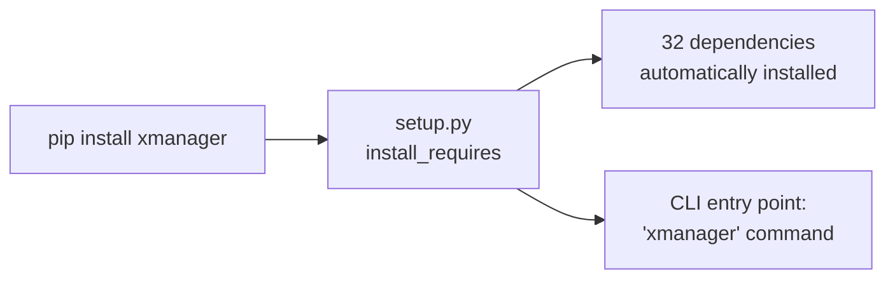

The complete dependency list is defined in [setup.py:32-52](). Key dependencies:

- **SQLAlchemy 1.2.19** and **Alembic 1.4.3**: Fixed versions for database schema management
- **Docker Python SDK**: Container operations for all container-based executables
- **Kubernetes Python client**: K8s Job creation and management
- **Google Cloud libraries**: Vertex AI, Cloud Storage, authentication
- **Path utilities** (`etils`): Cross-platform path handling

Sources: [setup.py:32-52]()

---

## Optional Dependencies

### Docker (For Container Execution)

Docker is required for any executable that uses containers, including `xm.PythonContainer`, `xm.Container`, `xm.Dockerfile`, and `xm.BazelContainer`.

**Installation:**

1. Follow the [Docker installation guide](https://docs.docker.com/engine/install/#supported-platforms) for your platform.

2. **Linux users**: Enable sudoless Docker by following [post-installation steps](https://docs.docker.com/engine/install/linux-postinstall):

   ```bash
   sudo groupadd docker
   sudo usermod -aG docker $USER
   newgrp docker
   ```

**Verification:**

```bash
docker run hello-world
```

**XManager Integration:**

The Docker SDK is used in multiple ways depending on configuration flags:

| Flag | Purpose | Default |
|------|---------|---------|
| `--xm_build_image_locally` | Build images locally vs Cloud Build | `True` |
| `--xm_use_docker_command` | Use `docker` CLI vs Python SDK | `True` |
| `--xm_show_docker_command_progress` | Show build output | `False` |
| `--xm_subprocess_docker_impl` | Use subprocess for container launch | `False` |

Sources: [README.md:48-57](), [xm_flags.py:26-50](), [xm_flags.py:181-185]()

---

### Bazel (For Bazel-Based Executables)

Bazel is required for `xm.BazelBinary` and `xm.BazelContainer` executable types.

**Installation:**

Follow the [Bazel installation guide](https://docs.bazel.build/versions/master/install.html) for your platform.

**Configuration:**

XManager invokes Bazel using the command specified by the `--xm_bazel_command` flag:

```bash
xmanager launch launcher.py -- --xm_bazel_command=bazelisk
```

**Verification:**

```bash
bazel version
```

**XManager Integration:**

The Bazel service is invoked during the packaging phase:

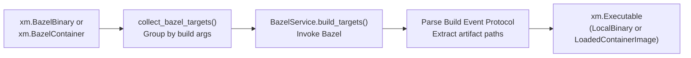

Sources: [README.md:59-65](), [xm_flags.py:152-156]()

---

### GCP Setup (For Cloud Execution)

GCP configuration is required for `xm_local.Vertex` and `xm_local.Kubernetes` executors.

**1. Create GCP Project**

Create a project at [Google Cloud Console](https://console.cloud.google.com).

```bash
export GCP_PROJECT=<your-project-id>
```

**2. Install and Configure gcloud CLI**

```bash
# Install gcloud (see https://cloud.google.com/sdk/docs/install)

# Authenticate
gcloud auth login
gcloud auth application-default login
gcloud config set project $GCP_PROJECT

# Configure Docker authentication
gcloud auth configure-docker
```

**3. Enable Required APIs**

```bash
# IAM API (service account management)
gcloud services enable iam.googleapis.com

# Vertex AI (for xm_local.Vertex)
gcloud services enable aiplatform.googleapis.com

# Container Registry (for image storage)
gcloud services enable containerregistry.googleapis.com
```

These can also be enabled via the Cloud Console:
- [Enable IAM](https://console.cloud.google.com/apis/library/iam.googleapis.com)
- [Enable Vertex AI](https://console.cloud.google.com/apis/library/aiplatform.googleapis.com)
- [Enable Container Registry](https://console.cloud.google.com/apis/library/containerregistry.googleapis.com)

**4. Create Cloud Storage Bucket**

```bash
export GOOGLE_CLOUD_BUCKET_NAME=<unique-bucket-name>

# Create bucket in us-central1
gsutil mb -l us-central1 gs://$GOOGLE_CLOUD_BUCKET_NAME
```

Add to environment variables:

```bash
# Add to ~/.bashrc or ~/.zshrc
export GOOGLE_CLOUD_BUCKET_NAME=<unique-bucket-name>
```

**5. Service Account Configuration**

XManager automatically creates and configures a service account if needed. The default name is `xmanager`, configurable via:

```bash
xmanager launch launcher.py -- --xm_gcp_service_account_name=my-service-account
```

**GCP Authentication Flow:**

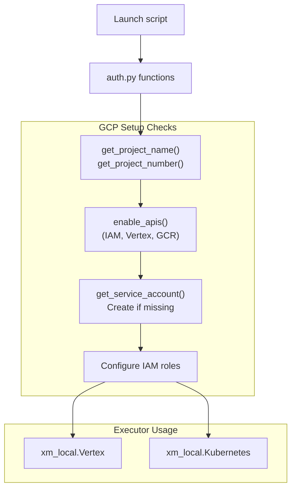

Sources: [README.md:67-119](), [xm_flags.py:94-113]()

---

## Platform-Specific Notes

### tmux (Optional, for Local Multiplexer)

The local executor can optionally use tmux to run jobs in persistent terminal sessions.

**Installation:**

```bash
# Debian/Ubuntu
sudo apt-get install tmux

# macOS
brew install tmux

# Verify
tmux -V
```

**Usage:**

```bash
xmanager launch launcher.py -- --xm_use_multiplexer
```

When enabled, XManager creates a tmux session (named `xm_0`, `xm_1`, etc.) with one window per job:

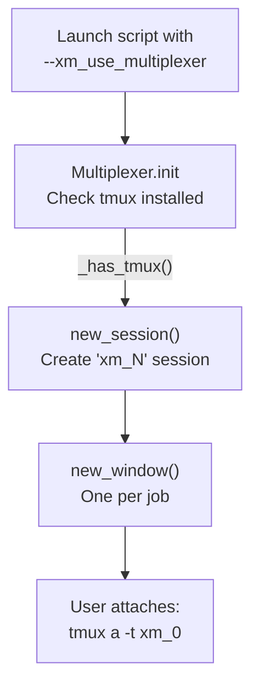

**Auto-switch to window:**

```bash
xmanager launch launcher.py -- --xm_open_multiplexer_window=2
```

This automatically switches to window 2 in the new tmux session.

Sources: [xm_flags.py:158-176](), [xmanager/xm_local/multiplexer.py:12-136]()

---

## Verification

### Command-Line Entry Point

After installation, the `xmanager` CLI command should be available:

```bash
xmanager --help
```

This command is registered via the console script entry point in [setup.py:53-57]():

```python
entry_points={
    'console_scripts': [
        'xmanager = xmanager.cli.cli:entrypoint',
    ],
}
```

### Import Test

Verify core modules can be imported:

```python
# Test core API
from xmanager import xm

# Test local backend
from xmanager import xm_local

# Test configuration
from xmanager import xm_flags

print("XManager successfully installed")
```

### Database Initialization

XManager automatically initializes a SQLite database on first use. The default location is determined by the database configuration (see [Database Storage](#6.2)).

**Check database configuration:**

```bash
xmanager launch --help | grep xm_db
```

Relevant flags:
- `--xm_db_yaml_config_path`: Path to database configuration file
- `--xm_upgrade_db`: Automatically upgrade database schema

Sources: [xm_flags.py:117-150]()

---

## Installation Summary

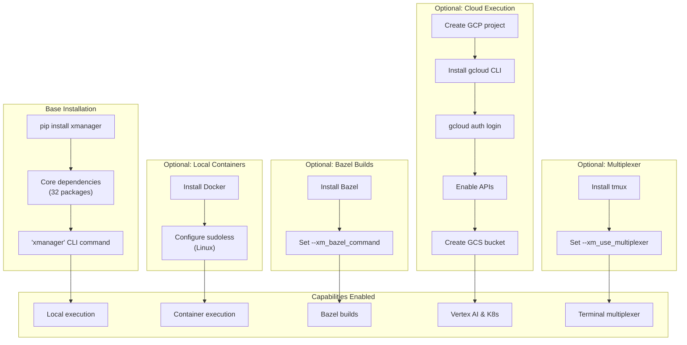

**Next Steps:**

After installation, proceed to [Your First Experiment](#2.2) to create and run a simple XManager experiment. For detailed configuration options, see [Configuration Flags](#6.1).

Sources: [README.md:24-119](), [setup.py:22-63](), [xm_flags.py:1-197]()

---

# Page: Your First Experiment

# Your First Experiment

<details>
<summary>Relevant source files</summary>

The following files were used as context for generating this wiki page:

- [README.md](README.md)
- [setup.py](setup.py)
- [xmanager/xm/core.py](xmanager/xm/core.py)
- [xmanager/xm/core_test.py](xmanager/xm/core_test.py)
- [xmanager/xm_local/execution.py](xmanager/xm_local/execution.py)
- [xmanager/xm_local/execution_test.py](xmanager/xm_local/execution_test.py)
- [xmanager/xm_local/executors.py](xmanager/xm_local/executors.py)
- [xmanager/xm_local/experiment.py](xmanager/xm_local/experiment.py)
- [xmanager/xm_mock/__init__.py](xmanager/xm_mock/__init__.py)

</details>


## Purpose and Scope

This guide walks you through creating and running your first XManager experiment locally. You will learn the basic workflow for defining executables, packaging them, and launching jobs on your local machine.

For installation instructions, see [Installation](#2.1). For detailed information about core concepts like experiments, work units, and jobs, see [Core Concepts](#3). For information about different executable types and execution backends, see [Executable Specifications](#3.3) and [Execution Backends](#5).

---

## Prerequisites

Before starting this tutorial, ensure you have:

- XManager installed (see [Installation](#2.1))
- Docker installed and running (for container-based executables)
- A simple program to run (we'll use a basic Python script in this example)

---

## The Basic Workflow

XManager experiments follow a consistent five-step pattern:

```mermaid
graph TD
    Step1["1. Create Experiment<br/>xm_local.create_experiment()"]
    Step2["2. Define Executable Spec<br/>xm.Binary, xm.PythonContainer, etc."]
    Step3["3. Package Executable<br/>experiment.package()"]
    Step4["4. Add Jobs<br/>experiment.add(xm.Job())"]
    Step5["5. Context Exit<br/>Wait for completion"]
    
    Step1 --> Step2
    Step2 --> Step3
    Step3 --> Step4
    Step4 --> Step5
    
    Step4 -.->|"Multiple jobs<br/>with different args"| Step4
```

**Sources:** [README.md:120-246](), [xmanager/xm/core.py:721-744]()

---

## Step-by-Step Tutorial

### Step 1: Create an Experiment

The first step is to create an experiment using `xm_local.create_experiment()`. This function returns an `Experiment` context manager that tracks all jobs you launch.

```python
from xmanager import xm
from xmanager import xm_local

with xm_local.create_experiment(experiment_title='my_first_experiment') as experiment:
    # Your experiment code goes here
    pass
```

**What happens:**
- A unique experiment ID is generated (timestamp-based for local experiments)
- Experiment metadata is saved to the local database
- A background event loop is created to handle asynchronous operations

The `with` statement ensures proper cleanup when the experiment finishes.

**Sources:** [xmanager/xm_local/experiment.py:387-393](), [xmanager/xm/core.py:763-786]()

---

### Step 2: Define an Executable Specification

Next, define what you want to run. XManager supports several executable types. For this tutorial, we'll use `xm.PythonContainer`, which packages a Python directory into a Docker container.

Create a simple Python script to run:

**File: `train.py`**
```python
import argparse

parser = argparse.ArgumentParser()
parser.add_argument('--learning_rate', type=float, required=True)
parser.add_argument('--batch_size', type=int, required=True)
args = parser.parse_args()

print(f"Training with lr={args.learning_rate}, batch_size={args.batch_size}")
# Your training code would go here
```

Define the executable specification:

```python
spec = xm.PythonContainer(
    path='/path/to/your/project',  # Directory containing train.py
    entrypoint=xm.ModuleName('train'),  # The Python module to run
)
```

**Executable Specification Types:**

| Type | Description | When to Use |
|------|-------------|-------------|
| `xm.Binary` | Pre-built binary | You have a compiled executable |
| `xm.PythonContainer` | Python directory → Docker | Python projects without Docker expertise |
| `xm.Container` | Pre-built Docker image | You already have a Docker image |
| `xm.BazelBinary` | Bazel target → binary | Using Bazel build system |
| `xm.BazelContainer` | Bazel target → Docker | Using Bazel with containers |

**Sources:** [README.md:269-286](), [xmanager/xm/job_blocks.py]()

---

### Step 3: Package the Executable

Packaging transforms your executable specification into a concrete artifact that can be executed. The `experiment.package()` method handles building, Docker image creation, and artifact preparation.

```python
[executable] = experiment.package([
    xm.Packageable(
        executable_spec=spec,
        executor_spec=xm_local.Local.Spec(),
    ),
])
```

**What happens during packaging:**

```mermaid
sequenceDiagram
    participant User as "experiment.package()"
    participant Router as "packaging_router"
    participant Docker as "Docker Build"
    participant Result as "Executable"
    
    User->>Router: Packageable(spec, executor_spec)
    Router->>Router: Determine local vs cloud
    Router->>Docker: Build Python container image
    Docker->>Docker: Create Dockerfile
    Docker->>Docker: docker build
    Docker->>Router: Image loaded in daemon
    Router->>Result: LoadedContainerImage
    Result-->>User: Return executable
```

The packaging process:
1. Determines the packaging strategy based on executor type (local vs cloud)
2. For `PythonContainer` + `Local.Spec()`: builds a Docker image locally
3. Loads the image into the local Docker daemon
4. Returns a `LoadedContainerImage` executable

**Sources:** [xmanager/xm/core.py:881-898](), [xmanager/xm_local/packaging/router.py]()

---

### Step 4: Add Jobs to the Experiment

Now create and add jobs to your experiment. Each job combines an executable with an executor and hyperparameters.

```python
# Single job
experiment.add(xm.Job(
    executable=executable,
    executor=xm_local.Local(),
    args={
        'learning_rate': 0.01,
        'batch_size': 64,
    },
))

# Multiple jobs for hyperparameter sweep
for learning_rate in [0.01, 0.001, 0.0001]:
    for batch_size in [32, 64, 128]:
        experiment.add(xm.Job(
            executable=executable,
            executor=xm_local.Local(),
            args={
                'learning_rate': learning_rate,
                'batch_size': batch_size,
            },
        ))
```

**Job Components:**

```mermaid
classDiagram
    class Job {
        +Executable executable
        +Executor executor
        +SequentialArgs args
        +Dict[str, str] env_vars
        +str name
    }
    
    class Executable {
        +str name
        +SequentialArgs args
        +Dict[str, str] env_vars
    }
    
    class Executor {
        +JobRequirements requirements
    }
    
    class Local {
        +JobRequirements requirements
        +DockerOptions docker_options
        +bool experimental_stream_output
    }
    
    Job --> Executable
    Job --> Executor
    Executor <|-- Local
```

**Arguments:**
- **Dictionary form**: `{'key': value}` → `--key=value` command-line flags
- **List form**: `['--flag', 'value']` → passed as-is
- **Environment variables**: `env_vars={'KEY': 'value'}` → exported before execution

**Sources:** [xmanager/xm/core.py:988-1076](), [xmanager/xm/job_blocks.py](), [README.md:313-353]()

---

### Step 5: Run and Monitor

When you exit the `with` block, XManager waits for all local jobs to complete:

```python
with xm_local.create_experiment(experiment_title='my_experiment') as experiment:
    # ... package and add jobs ...
    pass  # Exiting context waits for local jobs
```

**What happens on context exit:**

```mermaid
sequenceDiagram
    participant User as "with statement exit"
    participant Exp as "Experiment.__exit__"
    participant Tasks as "Background Tasks"
    participant Jobs as "Local Jobs"
    
    User->>Exp: Exit context
    Exp->>Tasks: Wait for all .add() calls
    Tasks->>Tasks: Launch all jobs
    Exp->>Jobs: wait_for_local_jobs()
    Jobs->>Jobs: Monitor job completion
    Note over Jobs: Blocks until all local<br/>jobs finish
    Jobs-->>Exp: All complete
    Exp-->>User: Control returns
```

For local jobs, XManager displays:
```
Waiting for local jobs to complete. Press Ctrl+C to terminate them and exit
```

Jobs run as Docker containers or processes, and you can view their output in real-time if `experimental_stream_output=True` (the default).

**Sources:** [xmanager/xm_local/experiment.py:331-341](), [xmanager/xm/core.py:822-827]()

---

## Complete Example

Here's a complete working example:

**File: `launcher.py`**
```python
"""My first XManager experiment."""

from xmanager import xm
from xmanager import xm_local


def main():
    with xm_local.create_experiment(experiment_title='my_first_experiment') as experiment:
        # Define the executable
        spec = xm.PythonContainer(
            path='/path/to/your/project',
            entrypoint=xm.ModuleName('train'),
        )
        
        # Package the executable for local execution
        [executable] = experiment.package([
            xm.Packageable(
                executable_spec=spec,
                executor_spec=xm_local.Local.Spec(),
            ),
        ])
        
        # Run a hyperparameter sweep
        for learning_rate in [0.01, 0.001]:
            for batch_size in [32, 64]:
                experiment.add(xm.Job(
                    executable=executable,
                    executor=xm_local.Local(),
                    args={
                        'learning_rate': learning_rate,
                        'batch_size': batch_size,
                    },
                ))


if __name__ == '__main__':
    main()
```

**Run the launcher:**
```bash
xmanager launch launcher.py
```

This will:
1. Build a Docker image containing your Python code
2. Launch 4 containers (2 learning rates × 2 batch sizes)
3. Wait for all containers to complete
4. Store experiment metadata in the local database

**Sources:** [README.md:122-183]()

---

## What Happens Behind the Scenes

Understanding the execution flow helps you debug issues and use advanced features:

```mermaid
graph TB
    subgraph "User Code"
        Launch["launcher.py<br/>xm_local.create_experiment()"]
    end
    
    subgraph "Experiment Management"
        ExpClass["LocalExperiment<br/>__enter__()"]
        DB["database.database()<br/>.insert_experiment()"]
        EventLoop["asyncio.new_event_loop()"]
    end
    
    subgraph "Packaging"
        PkgRouter["packaging_router.package()"]
        Docker["Docker build"]
        LoadedImg["LoadedContainerImage"]
    end
    
    subgraph "Execution"
        AddJob["experiment.add()"]
        CreateUnit["LocalWorkUnit"]
        Launch2["execution.launch()"]
        Container["Docker container"]
    end
    
    subgraph "Monitoring"
        Handles["ContainerHandle"]
        Wait["wait_until_complete()"]
    end
    
    Launch --> ExpClass
    ExpClass --> DB
    ExpClass --> EventLoop
    
    ExpClass --> PkgRouter
    PkgRouter --> Docker
    Docker --> LoadedImg
    
    LoadedImg --> AddJob
    AddJob --> CreateUnit
    CreateUnit --> Launch2
    Launch2 --> Container
    
    Container --> Handles
    Handles --> Wait
```

**Key Code Entities:**

| Component | Code Entity | File | Purpose |
|-----------|-------------|------|---------|
| Experiment Creation | `create_experiment()` | [xmanager/xm_local/experiment.py:387-393]() | Creates `LocalExperiment` and saves to DB |
| Experiment Class | `LocalExperiment` | [xmanager/xm_local/experiment.py:248-385]() | Manages experiment lifecycle |
| Database | `database.database()` | [xmanager/xm_local/storage/database.py]() | SQLite storage for metadata |
| Packaging | `packaging_router.package()` | [xmanager/xm_local/packaging/router.py]() | Routes packaging by executor type |
| Work Unit | `LocalWorkUnit` | [xmanager/xm_local/experiment.py:167-218]() | Container for jobs in local execution |
| Execution | `execution.launch()` | [xmanager/xm_local/execution.py:198-212]() | Launches jobs on local executor |
| Container Handle | `ContainerHandle` | [xmanager/xm_local/handles.py]() | Monitors running Docker container |

**Sources:** [xmanager/xm_local/experiment.py:387-393](), [xmanager/xm_local/experiment.py:248-385](), [xmanager/xm_local/execution.py:198-212]()

---

## Data Flow: From Python Script to Running Container

```mermaid
flowchart LR
    subgraph Input
        Script["train.py<br/>(Python code)"]
        Launcher["launcher.py<br/>(XManager script)"]
    end
    
    subgraph Packaging["Packaging Phase"]
        Spec["PythonContainer<br/>(ExecutableSpec)"]
        Build["docker build"]
        Image["Docker Image<br/>(LoadedContainerImage)"]
    end
    
    subgraph Execution["Execution Phase"]
        Job["xm.Job"]
        WU["LocalWorkUnit<br/>(work_unit_id)"]
        Launch["execution.launch()"]
        Run["docker run"]
    end
    
    subgraph Runtime
        Container["Container<br/>(running process)"]
        Output["stdout/stderr"]
    end
    
    Script --> Spec
    Launcher --> Spec
    Spec --> Build
    Build --> Image
    
    Image --> Job
    Job --> WU
    WU --> Launch
    Launch --> Run
    Run --> Container
    Container --> Output
```

**Sources:** [xmanager/xm_local/execution.py:38-104](), [xmanager/xm_local/experiment.py:190-210]()

---

## Common Patterns

### Using Pre-built Binaries

If you have a compiled binary instead of Python code:

```python
spec = xm.Binary(
    path='/path/to/binary',
)

[executable] = experiment.package([
    xm.Packageable(
        executable_spec=spec,
        executor_spec=xm_local.Local.Spec(),
    ),
])

experiment.add(xm.Job(
    executable=executable,
    executor=xm_local.Local(),
    args=['--flag1', '--flag2=value'],
))
```

**Sources:** [README.md:150-157]()

---

### Passing Environment Variables

```python
experiment.add(xm.Job(
    executable=executable,
    executor=xm_local.Local(),
    args={'batch_size': 64},
    env_vars={
        'CUDA_VISIBLE_DEVICES': '0',
        'PYTHONUNBUFFERED': '1',
    },
))
```

Environment variables are exported before the job runs.

**Sources:** [xmanager/xm/core.py:72-94]()

---

### Accessing Logs

By default, job output is streamed to your terminal when `experimental_stream_output=True`:

```python
executor = xm_local.Local(
    experimental_stream_output=True,  # Default
)
```

To disable streaming:

```python
executor = xm_local.Local(
    experimental_stream_output=False,
)
```

**Sources:** [xmanager/xm_local/executors.py:60-76](), [xmanager/xm_local/execution.py:103-104]()

---

## Retrieving Experiment Information

After running an experiment, you can retrieve it from the database:

```python
from xmanager import xm_local

# List all experiments
experiments = xm_local.list_experiments()
for exp in experiments:
    print(f"Experiment ID: {exp.experiment_id}")

# Get a specific experiment
experiment = xm_local.get_experiment(experiment_id=123456789)
print(f"Work unit count: {experiment.work_unit_count}")
```

**Sources:** [xmanager/xm_local/experiment.py:445-448](), [xmanager/xm_local/experiment.py:396-442]()

---

## Next Steps

Now that you've run your first experiment, explore:

- **[Experiments and Work Units](#3.1)**: Understanding the experiment lifecycle and work unit roles
- **[Executable Specifications](#3.3)**: Other types of executables (BazelBinary, Container, etc.)
- **[Vertex AI Executor](#5.2)**: Running experiments on Google Cloud Platform
- **[Job Generators and Hyperparameter Sweeps](#7.2)**: Advanced patterns for dynamic job creation

For more examples, see the `examples/` directory in the XManager repository.

---

# Page: Core Concepts

# Core Concepts

<details>
<summary>Relevant source files</summary>

The following files were used as context for generating this wiki page:

- [xmanager/xm/__init__.py](xmanager/xm/__init__.py)
- [xmanager/xm/core.py](xmanager/xm/core.py)
- [xmanager/xm/core_test.py](xmanager/xm/core_test.py)
- [xmanager/xm/metadata_context.py](xmanager/xm/metadata_context.py)
- [xmanager/xm_local/experiment.py](xmanager/xm_local/experiment.py)
- [xmanager/xm_mock/__init__.py](xmanager/xm_mock/__init__.py)

</details>


This page introduces the fundamental abstractions that form the building blocks of XManager: **Experiments**, **Experiment Units** (Work Units and Auxiliary Units), **Jobs**, **Executables**, and **Resources**. These concepts define how computations are structured, configured, and executed across different backends.

For detailed information about specific topics, see:
- Experiment lifecycle and work unit management: [Experiments and Work Units](#3.1)
- Job organization and constraints: [Jobs and Job Groups](#3.2)
- Executable types and specifications: [Executable Specifications](#3.3)
- Resource allocation and requirements: [Resource Requirements](#3.4)
- Argument passing and environment configuration: [Arguments and Environment Variables](#3.5)

---

## System Overview

XManager organizes computations using a hierarchical structure where experiments contain experiment units, which in turn contain jobs that execute specific computables (executables) with defined resources.

**Diagram: Core Abstractions Hierarchy**

```mermaid
graph TB
    Experiment["xm.Experiment<br/>(core.py:721)"]
    WorkUnit["xm.WorkUnit<br/>(core.py:642)"]
    AuxiliaryUnit["xm.AuxiliaryUnit<br/>(core.py:677)"]
    Job["xm.Job<br/>(job_blocks.Job)"]
    JobGroup["xm.JobGroup<br/>(job_blocks.JobGroup)"]
    Executable["xm.Executable<br/>(job_blocks.Executable)"]
    ExecutableSpec["xm.ExecutableSpec<br/>(job_blocks.ExecutableSpec)"]
    Executor["xm.Executor<br/>(job_blocks.Executor)"]
    Requirements["xm.JobRequirements<br/>(resources.JobRequirements)"]
    
    Experiment -->|"contains (via .add())"| WorkUnit
    Experiment -->|"contains (via .add())"| AuxiliaryUnit
    WorkUnit -->|"runs (via .add())"| Job
    WorkUnit -->|"runs (via .add())"| JobGroup
    AuxiliaryUnit -->|"runs (via .add())"| Job
    AuxiliaryUnit -->|"runs (via .add())"| JobGroup
    
    Job -->|"executes"| Executable
    Job -->|"uses"| Executor
    Job -->|"requires"| Requirements
    JobGroup -->|"groups"| Job
    
    ExecutableSpec -.->|"packaged into"| Executable
    
    style Experiment fill:#f9f9f9
    style WorkUnit fill:#f9f9f9
    style AuxiliaryUnit fill:#f9f9f9
```

**Sources:** [xmanager/xm/core.py:721-744](), [xmanager/xm/core.py:337-587](), [xmanager/xm/core.py:642-659](), [xmanager/xm/core.py:677-683]()

---

## Experiments

An `Experiment` is the top-level organizational unit that represents a research experiment. Experiments contain experiment units and provide a context for managing their lifecycle.

**Key characteristics:**
- Created via implementation-specific factory functions (e.g., `xm_local.create_experiment()`)
- Used as a context manager (`with experiment:` or `async with experiment:`)
- Has a unique `experiment_id` assigned by the backend
- Manages asynchronous task execution through an internal event loop
- Provides packaging methods: `package()` and `package_async()`

**Code entities:**
| Entity | Location | Purpose |
|--------|----------|---------|
| `xm.Experiment` | [xmanager/xm/core.py:721-1128]() | Abstract base class defining the experiment interface |
| `LocalExperiment` | [xmanager/xm_local/experiment.py:248-385]() | Concrete implementation for local execution |
| `create_experiment()` | [xmanager/xm_local/experiment.py:387-393]() | Factory function for local experiments |

**Sources:** [xmanager/xm/core.py:721-744](), [xmanager/xm_local/experiment.py:248-262]()

---

## Experiment Units

Experiment units are collections of semantically related jobs. There are two types of experiment units, distinguished by their role:

### Work Units

Work units represent the primary computational work of an experiment, typically implementing trials in a hyperparameter search. Their status determines the experiment's status.

**Key characteristics:**
- Have a unique `work_unit_id` within the experiment
- Status tracked by the system (active, completed, failed)
- Added to experiments with `WorkUnitRole` (the default role)
- Retrievable via `experiment.work_units[work_unit_id]`

**Code entities:**
| Entity | Location | Purpose |
|--------|----------|---------|
| `xm.WorkUnit` | [xmanager/xm/core.py:642-659]() | Work unit abstraction |
| `xm.WorkUnitRole` | [xmanager/xm/core.py:590-597]() | Role marker for work units |
| `LocalWorkUnit` | [xmanager/xm_local/experiment.py:167-218]() | Local implementation |

### Auxiliary Units

Auxiliary units contain supporting jobs that are not part of the main experimental trials (e.g., TensorBoard servers, monitoring processes). Their status does not affect the experiment's overall status.

**Key characteristics:**
- Have an `auxiliary_unit_id` within the experiment
- Added to experiments with `AuxiliaryUnitRole`
- Include a `termination_delay_secs` parameter to keep services running after experiment completion
- Can be created using `AuxiliaryUnitJob` wrapper

**Code entities:**
| Entity | Location | Purpose |
|--------|----------|---------|
| `xm.AuxiliaryUnit` | [xmanager/xm/core.py:677-683]() | Auxiliary unit abstraction |
| `xm.AuxiliaryUnitRole` | [xmanager/xm/core.py:662-674]() | Role marker with termination delay |
| `xm.AuxiliaryUnitJob` | [xmanager/xm/core.py:686-718]() | Wrapper for auxiliary job definitions |
| `LocalAuxiliaryUnit` | [xmanager/xm_local/experiment.py:221-245]() | Local implementation |

**Diagram: Experiment Unit Types**

```mermaid
graph LR
    ExperimentUnit["xm.ExperimentUnit<br/>(core.py:337)"]
    
    WorkUnit["xm.WorkUnit<br/>(core.py:642)"]
    AuxUnit["xm.AuxiliaryUnit<br/>(core.py:677)"]
    
    WorkUnitRole["xm.WorkUnitRole<br/>(core.py:590)"]
    AuxRole["xm.AuxiliaryUnitRole<br/>(core.py:662)"]
    
    ExperimentUnit -.->|"specialized as"| WorkUnit
    ExperimentUnit -.->|"specialized as"| AuxUnit
    
    WorkUnit -->|"created with"| WorkUnitRole
    AuxUnit -->|"created with"| AuxRole
    
    WorkUnitRole -->|"has"| Importance["importance: Importance"]
    AuxRole -->|"has"| Importance
    AuxRole -->|"has"| Delay["termination_delay_secs: int"]
```

**Sources:** [xmanager/xm/core.py:337-587](), [xmanager/xm/core.py:590-597](), [xmanager/xm/core.py:642-659](), [xmanager/xm/core.py:662-683]()

---

## Jobs and Job Groups

Jobs are the basic unit of execution, representing a single process or container to be run.

### Job

A `Job` combines three essential components:
1. **Executable**: What to run (binary, container, etc.)
2. **Executor**: Where and how to run it (local, Vertex AI, Kubernetes)
3. **Configuration**: Arguments, environment variables, and resource requirements

**Key attributes:**
| Attribute | Type | Purpose |
|-----------|------|---------|
| `executable` | `Executable` | The packaged artifact to execute |
| `executor` | `Executor` | Backend-specific execution configuration |
| `args` | `SequentialArgs` | Command-line arguments |
| `env_vars` | `Dict[str, str]` | Environment variables |
| `name` | `str` | Job identifier within a group |

**Code reference:** `job_blocks.Job` class (imported in [xmanager/xm/__init__.py:54]())

### JobGroup

A `JobGroup` is a named collection of jobs that should be launched together, often for distributed training or multi-process workflows. Jobs within a group can reference each other by name for addressing and coordination.

**Key characteristics:**
- Created via `xm.JobGroup(name1=job1, name2=job2, ...)`
- Supports gang scheduling constraints
- Jobs can discover each other's addresses via `CLUSTER_SPEC` environment variable

**Code reference:** `job_blocks.JobGroup` class (imported in [xmanager/xm/__init__.py:57]())

**Diagram: Job Structure**

```mermaid
graph TB
    Job["job_blocks.Job"]
    JobGroup["job_blocks.JobGroup"]
    
    Executable["executable: Executable"]
    Executor["executor: Executor"]
    Args["args: SequentialArgs"]
    EnvVars["env_vars: Dict[str, str]"]
    Requirements["requirements: JobRequirements"]
    Name["name: str"]
    
    Job --> Executable
    Job --> Executor
    Job --> Args
    Job --> EnvVars
    Job --> Requirements
    Job --> Name
    
    JobGroup -->|"jobs: Dict[str, Job]"| Job
    
    ExecutableSpec["ExecutableSpec<br/>(BazelBinary, Container, etc.)"]
    ExecutableSpec -.->|"package()"| Executable
```

**Sources:** Referenced via imports in [xmanager/xm/__init__.py:54-57]()

For detailed information on job organization, constraints, and gang scheduling, see [Jobs and Job Groups](#3.2).

---

## Executables and Executable Specifications

XManager distinguishes between **executable specifications** (what you want to run) and **executables** (the packaged, ready-to-run artifact).

### Executable Specifications

Executable specifications describe how to build or obtain an executable. Common types include:

| Type | Purpose | Example |
|------|---------|---------|
| `BazelBinary` | Bazel-built binary | `xm.bazel_binary('//path/to:target')` |
| `BazelContainer` | Bazel-built container image | `xm.bazel_container('//path/to:image')` |
| `PythonContainer` | Python environment in container | `xm.python_container(...)` |
| `Container` | Pre-built container image | `xm.container('gcr.io/project/image')` |
| `Binary` | Pre-built binary | `xm.binary('/path/to/executable')` |
| `Dockerfile` | Build from Dockerfile | `xm.dockerfile_container(...)` |

**Code reference:** Various classes imported in [xmanager/xm/__init__.py:39-47]()

### Executables

Executables are the result of packaging executable specifications. The packaging process:
1. Collects all executable specs used in jobs
2. Builds/prepares them in parallel via `experiment.package()`
3. Returns `Executable` instances that can be used in `Job` definitions

**Key distinction:** Executable specs are *definitions*, while executables are *artifacts*.

**Code reference:** `job_blocks.Executable` class (imported in [xmanager/xm/__init__.py:49]())

**Sources:** [xmanager/xm/__init__.py:39-47](), [xmanager/xm/__init__.py:49-50]()

For comprehensive coverage of all executable types and their configuration options, see [Executable Specifications](#3.3).

---

## Resource Requirements

Jobs specify resource requirements through the `JobRequirements` class, which defines:

- **Compute resources**: CPU count, memory, disk space
- **Accelerators**: GPU type and count, TPU topology
- **Service tier**: Best-effort vs. guaranteed resource allocation
- **Architecture**: x86_64, ARM, etc.

**Key resource types:**

| Resource | Specified via | Examples |
|----------|---------------|----------|
| CPUs | `cpu` parameter | `4` (cores) |
| Memory | `ram` parameter | `16 * xm.GiB` |
| Accelerators | `T4=2`, `V100=4` | GPU types and counts |
| TPUs | `V2_8`, `V3_32` | TPU topology |

**Basic example:**
```python
requirements = xm.JobRequirements(
    cpu=8,
    ram=16 * xm.GiB,
    T4=1  # 1 T4 GPU
)
```

**Code entities:**
| Entity | Location | Purpose |
|--------|----------|---------|
| `xm.JobRequirements` | resources module | Resource specification class |
| `xm.ResourceType` | resources module | Enumeration of resource types |
| `xm.GpuType` | resources module | GPU type enumeration (T4, V100, A100, etc.) |
| `xm.TpuType` | resources module | TPU type enumeration |
| `xm.ServiceTier` | resources module | Best-effort vs. guaranteed resources |

**Sources:** Referenced via imports in [xmanager/xm/__init__.py:71-81]()

For detailed information on resource types, topologies, and service tiers, see [Resource Requirements](#3.4).

---

## Lifecycle and Context Management

XManager uses Python context managers to handle experiment lifecycle, ensuring proper setup and cleanup of resources.

### Experiment Context

Experiments must be used as context managers:

```python
# Synchronous usage
with xm_local.create_experiment(title="My Experiment") as experiment:
    experiment.add(job)

# Asynchronous usage (from coroutine context)
async with xm_local.create_experiment(title="My Experiment") as experiment:
    await experiment.add(job)
```

**Context manager responsibilities:**
- **`__enter__` / `__aenter__`**: Create event loop, initialize background task queue
- **`__exit__` / `__aexit__`**: Wait for all tasks to complete, validate experiment structure

**Sources:** [xmanager/xm/core.py:763-827](), [xmanager/xm/core.py:829-866]()

### Adding Units and Jobs

The `add()` method is the primary way to add work to an experiment:

**Diagram: Adding Jobs to Experiments**

```mermaid
sequenceDiagram
    participant User as "User Code"
    participant Exp as "Experiment<br/>(core.py:988)"
    participant Unit as "ExperimentUnit<br/>(core.py:378)"
    participant Task as "Background Task"
    
    User->>Exp: "add(job, args, role)"
    Exp->>Exp: "_create_experiment_unit()"
    Exp->>Task: "launch() coroutine"
    Note over Task: "Async execution"
    Task->>Unit: "unit.add(job, args)"
    Unit->>Unit: "_launch_job_group()"
    Task-->>User: "asyncio.Future[ExperimentUnit]"
    
    Note over User,Task: "User can await the future<br/>or let context manager handle it"
```

**Key patterns:**

1. **Direct job addition**:
   ```python
   experiment.add(xm.Job(...))  # Creates WorkUnit with default role
   ```

2. **With arguments**:
   ```python
   experiment.add(job, args={'learning_rate': 0.01})
   ```

3. **With custom role**:
   ```python
   experiment.add(job, role=xm.AuxiliaryUnitRole(termination_delay_secs=300))
   ```

4. **Job generators** (for dynamic job creation):
   ```python
   async def create_jobs(work_unit: xm.WorkUnit):
       for i in range(10):
           work_unit.add(xm.Job(...))
   
   experiment.add(create_jobs)
   ```

**Sources:** [xmanager/xm/core.py:933-1076](), [xmanager/xm/core.py:378-475]()

### Context Variables

XManager maintains context variables to track the current experiment and experiment unit:

| Context Variable | Type | Set When | Purpose |
|------------------|------|----------|---------|
| `_current_experiment` | `ContextVar[Experiment]` | Inside experiment context | Access current experiment from anywhere |
| `_current_experiment_unit` | `ContextVar[ExperimentUnit]` | Inside job generator | Access current unit from job generator |

**Code reference:** [xmanager/xm/core.py:50-55]()

These context variables enable libraries and utilities to access experiment information without explicit parameter passing.

**Sources:** [xmanager/xm/core.py:50-55](), [xmanager/xm/core.py:97-109]()

---

## Relationship Summary

**Diagram: Complete Core Concepts Relationships**

```mermaid
graph TB
    subgraph "User Defines"
        Spec["ExecutableSpec<br/>(BazelBinary, Container, etc.)"]
        ExecutorSpec["ExecutorSpec<br/>(Local.Spec, Vertex.Spec, etc.)"]
        Reqs["JobRequirements<br/>(CPU, RAM, GPUs)"]
        Args["args & env_vars"]
    end
    
    subgraph "System Creates"
        Exec["Executable<br/>(packaged artifact)"]
        ExecInstance["Executor<br/>(from spec)"]
    end
    
    subgraph "User Composes"
        Job["Job"]
        JobGroup["JobGroup"]
    end
    
    subgraph "System Manages"
        Exp["Experiment"]
        WorkUnit["WorkUnit"]
        AuxUnit["AuxiliaryUnit"]
    end
    
    Spec -.->|"package()"| Exec
    ExecutorSpec -.->|"instantiate"| ExecInstance
    
    Exec --> Job
    ExecInstance --> Job
    Reqs --> Job
    Args --> Job
    
    Job --> JobGroup
    
    Job --> WorkUnit
    JobGroup --> WorkUnit
    Job --> AuxUnit
    JobGroup --> AuxUnit
    
    WorkUnit --> Exp
    AuxUnit --> Exp
    
    style Spec fill:#f9f9f9
    style ExecutorSpec fill:#f9f9f9
    style Reqs fill:#f9f9f9
    style Args fill:#f9f9f9
```

**Key relationships:**
1. Users define **specifications** (executable specs, executor specs, requirements)
2. The system **packages** specs into concrete artifacts (executables, executors)
3. Users **compose** jobs from executables, executors, and configurations
4. Users **add** jobs to experiments, which creates experiment units
5. The system **manages** experiment unit lifecycle and execution

**Sources:** [xmanager/xm/core.py:721-1128](), [xmanager/xm/core.py:337-683](), references to job_blocks module in [xmanager/xm/__init__.py:48-62]()

---

## Summary

The core concepts of XManager provide a composable framework for defining and running ML experiments:

- **Experiments** organize related computation and manage lifecycle
- **Experiment Units** (work units and auxiliary units) group semantically related jobs
- **Jobs** specify what to run (executable), where to run it (executor), and what resources are needed
- **Executables** are packaged artifacts ready for execution
- **Resources** define computational requirements for jobs

This design separates concerns (what to run vs. where to run vs. what resources) and enables the same job definitions to target multiple backends (local, Vertex AI, Kubernetes).

For implementation details of each concept, see the child pages under Core Concepts.

---

# Page: Experiments and Work Units

# Experiments and Work Units

<details>
<summary>Relevant source files</summary>

The following files were used as context for generating this wiki page:

- [xmanager/xm/__init__.py](xmanager/xm/__init__.py)
- [xmanager/xm/core.py](xmanager/xm/core.py)
- [xmanager/xm/core_test.py](xmanager/xm/core_test.py)
- [xmanager/xm/metadata_context.py](xmanager/xm/metadata_context.py)
- [xmanager/xm_local/experiment.py](xmanager/xm_local/experiment.py)
- [xmanager/xm_mock/__init__.py](xmanager/xm_mock/__init__.py)

</details>


**Purpose**: This page provides a comprehensive reference for XManager's experiment and work unit abstractions. It covers the `Experiment` class lifecycle, the `ExperimentUnit` hierarchy (including `WorkUnit` and `AuxiliaryUnit` subclasses), role-based unit types, context management, and status monitoring.

For information about jobs and job groups that execute within experiment units, see [Jobs and Job Groups](#3.2). For details on executor-specific implementations, see [Execution Backends](#5).

---

## Experiment Class

The `Experiment` class is the top-level abstraction for managing a collection of related computational jobs. An experiment typically represents a single research investigation, such as a hyperparameter sweep or model training run.

### Core Properties and Methods

| Property/Method | Purpose |
|----------------|---------|
| `experiment_id` | Unique identifier assigned to the experiment |
| `add(job, args, role, identity)` | Adds a job/job group to the experiment, creating a new experiment unit |
| `package(packageables)` | Packages executable specifications into executables (builds/containers) |
| `package_async(packageable)` | Queues an executable spec for batched packaging |

**Sources**: [xmanager/xm/core.py:721-744]()

### Context Manager Lifecycle

Experiments must be used as context managers to ensure proper resource management and task synchronization. The lifecycle follows this pattern:

```mermaid
stateDiagram-v2
    [*] --> Created: create_experiment()
    Created --> Active: __enter__() or __aenter__()
    Active --> Active: add() calls
    Active --> Finalizing: __exit__() or __aexit__()
    Finalizing --> Finalizing: Wait for tasks
    Finalizing --> Completed: [*]
    Finalizing --> Failed: Exception raised
    Failed --> [*]
    Completed --> [*]
```

**Diagram: Experiment Lifecycle State Machine**

The experiment context performs these key operations:

1. **Entry** (`__enter__` / `__aenter__`):
   - Creates an event loop for asynchronous operations
   - Sets the current experiment context variable
   - Initializes the task queue

2. **Active Phase**:
   - Jobs are added via `add()` calls
   - Tasks are queued asynchronously
   - Packaging operations are batched

3. **Exit** (`__exit__` / `__aexit__`):
   - Waits for all pending tasks to complete
   - Validates that at least one work unit was added
   - Stops the event loop
   - Raises any exceptions that occurred during task execution

**Sources**: [xmanager/xm/core.py:763-867]()

### Synchronous vs Asynchronous Usage

XManager supports both synchronous (`with`) and asynchronous (`async with`) context management:

**Synchronous** (creates a background event loop thread):
```python
with xm_local.create_experiment(title='my_exp') as experiment:
    experiment.add(xm.Job(...))
```

**Asynchronous** (uses the current event loop):
```python
async with xm_local.create_experiment(title='my_exp') as experiment:
    experiment.add(xm.Job(...))
```

The synchronous mode creates a dedicated event loop thread to handle asynchronous operations, while the asynchronous mode reuses the existing event loop. Attempting to use `with` inside a coroutine raises a `RuntimeError`.

**Sources**: [xmanager/xm/core.py:763-831](), [xmanager/xm/core_test.py:223-231]()

---

## ExperimentUnit Hierarchy

An `ExperimentUnit` represents a collection of semantically associated jobs. It serves as the base class for both `WorkUnit` and `AuxiliaryUnit`.

```mermaid
classDiagram
    class ExperimentUnit {
        <<abstract>>
        +experiment: Experiment
        +experiment_id: int
        +identity: str
        +experiment_unit_name: str
        +add(job, args, identity)
        +wait_until_complete()
        +stop(mark_as_failed, mark_as_completed, message)
        +get_status()
        +get_full_job_name(job_name)
        +launched_jobs: List[LaunchedJob]
        -_launch_job_group()
        -_wait_until_complete()
    }
    
    class WorkUnit {
        +work_unit_id: int
    }
    
    class AuxiliaryUnit {
        +auxiliary_unit_id: int
    }
    
    class LocalExperimentUnit {
        -_local_execution_handles
        -_non_local_execution_handles
        -_submit_jobs_for_execution()
        -_ingest_execution_handles()
    }
    
    class LocalWorkUnit {
        -_work_unit_id_predictor
        -_save_handles_to_storage()
    }
    
    class LocalAuxiliaryUnit {
    }
    
    ExperimentUnit <|-- WorkUnit
    ExperimentUnit <|-- AuxiliaryUnit
    ExperimentUnit <|-- LocalExperimentUnit
    LocalExperimentUnit <|-- LocalWorkUnit
    LocalExperimentUnit <|-- LocalAuxiliaryUnit
    WorkUnit <|-- LocalWorkUnit
    AuxiliaryUnit <|-- LocalAuxiliaryUnit
```

**Diagram: ExperimentUnit Class Hierarchy**

**Sources**: [xmanager/xm/core.py:337-684](), [xmanager/xm_local/experiment.py:56-246]()

### Key ExperimentUnit Methods

#### add(job, args, identity)

Adds a `Job`, `JobGroup`, or `JobGenerator` to the experiment unit. This is the primary method for populating units with computational work.

**Parameters**:
- `job`: A `Job`, `JobGroup`, or async function (job generator)
- `args`: Optional dictionary of arguments to merge with job arguments
- `identity`: Optional unique identifier for idempotent job addition

**Behavior**:
- For `Job`: Wraps it in a single-job `JobGroup` and launches
- For `JobGroup`: Launches all jobs in the group
- For job generators: Executes the async function with the work unit as context

**Sources**: [xmanager/xm/core.py:378-476]()

#### wait_until_complete()

Returns an awaitable that resolves when the unit reaches a terminal state (completed, failed, or stopped). For `WorkUnit`, returns a `WorkUnitCompletedAwaitable` that provides access to the work unit instance.

**Usage pattern**:
```python
async with experiment:
    work_unit = await experiment.add(job)
    # Do other work...
    await work_unit.wait_until_complete()
```

**Sources**: [xmanager/xm/core.py:486-658]()

#### stop(mark_as_failed, mark_as_completed, message)

Initiates termination of all jobs in the unit. This method is synchronous and returns immediately; use `wait_until_complete()` afterward to ensure termination has completed.

**Sources**: [xmanager/xm/core.py:525-546]()

---

## WorkUnit vs AuxiliaryUnit

XManager distinguishes between two types of experiment units based on their role in the experiment structure.

### WorkUnit

Work units contain the primary computational jobs of an experiment. They are typically used for:
- Hyperparameter sweep trials
- Training runs
- Evaluation jobs
- Any job whose success/failure affects the experiment's overall status

**Key characteristics**:
- Has a `work_unit_id` property
- Status contributes to experiment status
- Typically represents a single hyperparameter configuration
- Returned by `experiment.add()` when using `WorkUnitRole` (default)

**Sources**: [xmanager/xm/core.py:642-659]()

### AuxiliaryUnit

Auxiliary units contain supporting jobs that do not represent primary experimental work. Common use cases:
- TensorBoard servers
- Monitoring dashboards
- Data preprocessing pipelines (when separate from main training)

**Key characteristics**:
- Has an `auxiliary_unit_id` property
- Status does not affect experiment status
- Can have a `termination_delay_secs` to keep running after experiment completion
- Created using `AuxiliaryUnitRole` or `AuxiliaryUnitJob` wrapper

**Sources**: [xmanager/xm/core.py:677-684](), [xmanager/xm/core.py:686-719]()

### Comparison Table

| Feature | WorkUnit | AuxiliaryUnit |
|---------|----------|---------------|
| **ID Property** | `work_unit_id` | `auxiliary_unit_id` |
| **Status Impact** | Affects experiment status | Does not affect experiment status |
| **Typical Usage** | Training trials, evaluations | TensorBoard, monitoring |
| **Termination** | Stops when job completes | Can persist after experiment via `termination_delay_secs` |
| **Creation** | `experiment.add(job, role=WorkUnitRole())` | `experiment.add(job, role=AuxiliaryUnitRole(...))` |

**Sources**: [xmanager/xm/core.py:589-684]()

---

## Experiment Unit Roles

Roles define the purpose and behavior of experiment units. They are specified when adding jobs to an experiment and determine the type of unit created.

```mermaid
classDiagram
    class ExperimentUnitRole {
        <<abstract>>
        +importance: Importance
    }
    
    class WorkUnitRole {
    }
    
    class AuxiliaryUnitRole {
        +termination_delay_secs: int
    }
    
    class Importance {
        <<enumeration>>
        HIGH
        NORMAL
        LOW
    }
    
    ExperimentUnitRole <|-- WorkUnitRole
    ExperimentUnitRole <|-- AuxiliaryUnitRole
    ExperimentUnitRole --> Importance
```

**Diagram: Experiment Unit Role Class Hierarchy**

**Sources**: [xmanager/xm/core.py:303-334](), [xmanager/xm/core.py:589-674]()

### WorkUnitRole

The default role for experiment units. Contains only the inherited `importance` attribute.

**Usage**:
```python
experiment.add(job)  # Uses WorkUnitRole() by default
experiment.add(job, role=xm.WorkUnitRole(importance=xm.Importance.HIGH))
```

**Sources**: [xmanager/xm/core.py:589-596]()

### AuxiliaryUnitRole

Role for auxiliary units that provide supporting services.

**Attributes**:
- `importance`: Scheduling priority (inherited from `ExperimentUnitRole`)
- `termination_delay_secs`: How long to keep the unit running after the experiment completes

**Usage**:
```python
experiment.add(
    tensorboard_job,
    role=xm.AuxiliaryUnitRole(
        importance=xm.Importance.LOW,
        termination_delay_secs=3600  # Keep running for 1 hour after experiment
    )
)
```

**Sources**: [xmanager/xm/core.py:661-674]()

### Importance Enum

Controls scheduling priority within a team's resource allocation (does not affect inter-team allocation).

| Value | Purpose |
|-------|---------|
| `HIGH` | High-impact experiments; scheduler prioritizes even at cost of throughput |
| `NORMAL` | Default priority |
| `LOW` | Maximize throughput; schedule after higher-importance work |

**Note**: Not all executors respect importance (e.g., `xm_local` ignores it).

**Sources**: [xmanager/xm/core.py:303-323]()

### AuxiliaryUnitJob Wrapper

A convenience class for bundling jobs with `AuxiliaryUnitRole`:

```python
tensorboard_job = xm.AuxiliaryUnitJob(
    xm.Job(...),
    importance=xm.Importance.LOW,
    termination_delay_secs=600
)
experiment.add(tensorboard_job)  # Automatically creates AuxiliaryUnit
```

This wrapper conforms to the `JobGeneratorType` interface and automatically sets the role when added to an experiment.

**Sources**: [xmanager/xm/core.py:686-719]()

---

## Lifecycle and Context Management

XManager uses context variables and asynchronous task management to coordinate experiment execution.

### Context Variables

Two context variables track the current execution context:

| Context Variable | Type | Purpose |
|-----------------|------|---------|
| `_current_experiment` | `Experiment` | Set when inside an experiment context |
| `_current_experiment_unit` | `ExperimentUnit` | Set when inside a job generator |

These are automatically managed by the experiment and experiment unit lifecycle methods. They enable functions to access the current experiment or unit without explicit parameter passing.

**Sources**: [xmanager/xm/core.py:48-55]()

### Task Management Flow

```mermaid
sequenceDiagram
    participant User as "User Code"
    participant Exp as "Experiment"
    participant Loop as "Event Loop"
    participant Queue as "Task Queue"
    participant Unit as "ExperimentUnit"
    
    User->>Exp: experiment.add(job)
    Exp->>Unit: _create_experiment_unit()
    Exp->>Loop: _create_task(launch())
    Loop->>Queue: Enqueue task
    Queue-->>Exp: Future
    Exp-->>User: Future[ExperimentUnit]
    
    loop Background execution
        Loop->>Unit: launch jobs
        Unit->>Unit: add(job)
        Unit->>Unit: _launch_job_group()
    end
    
    User->>Exp: __exit__()
    Exp->>Queue: _wait_for_tasks()
    loop Until queue empty
        Queue->>Queue: task.result()
    end
    Exp->>Loop: stop()
    Exp-->>User: Return or raise
```

**Diagram: Task Management and Asynchronous Execution Flow**

The experiment maintains a queue of background tasks that launch work units. When `add()` is called:

1. A new experiment unit is created (or retrieved if identity-based)
2. A launch coroutine is wrapped in a task and enqueued
3. The task executes asynchronously in the event loop
4. On experiment exit, all tasks are awaited before cleanup

This design allows multiple work units to be created and launched concurrently.

**Sources**: [xmanager/xm/core.py:745-757](), [xmanager/xm/core.py:798-821](), [xmanager/xm/core.py:1031-1076]()

### Thread Pool Context Propagation

When using thread pools, context variables must be explicitly propagated. XManager provides `new_thread_pool_executor()` which creates a thread pool that copies the current context to worker threads:

```python
with xm_local.create_experiment('exp') as experiment:
    executor = xm.new_thread_pool_executor()
    # Worker threads can access _current_experiment
```

**Sources**: [xmanager/xm/core.py:112-125]()

---

## Status and Monitoring

### ExperimentUnitStatus Interface

The `ExperimentUnitStatus` class provides a uniform interface for querying unit state:

```mermaid
stateDiagram-v2
    [*] --> Active: Launch
    Active --> Active: Running/Queued
    Active --> Completed: Success
    Active --> Failed: Error
    Active --> Stopped: User stop
    Completed --> [*]
    Failed --> [*]
    Stopped --> [*]
    
    note right of Active
        is_active = True
        is_completed = False
        is_failed = False
    end note
    
    note right of Completed
        is_active = False
        is_completed = True
        is_failed = False
    end note
    
    note right of Failed
        is_active = False
        is_completed = False
        is_failed = True
    end note
    
    note right of Stopped
        is_active = False
        is_completed = False
        is_failed = False
    end note
```

**Diagram: Experiment Unit Status States**

**Properties**:
- `is_active`: Unit is running or queued (not terminal)
- `is_completed`: Unit completed successfully (terminal)
- `is_failed`: Unit failed due to error (terminal)
- `message`: Human-readable status context

**Sources**: [xmanager/xm/core.py:139-184]()

### Wait Patterns

#### Single Work Unit

```python
async with experiment:
    work_unit = await experiment.add(job)
    await work_unit.wait_until_complete()  # Blocks until terminal state
```

#### Multiple Work Units with asyncio.wait

```python
async with experiment:
    work_units = [await experiment.add(job, args={'lr': lr}) for lr in [0.1, 0.01, 0.001]]
    
    pending = {wu.wait_until_complete() for wu in work_units}
    while pending:
        done, pending = await asyncio.wait(pending, return_when=asyncio.FIRST_COMPLETED)
        for completed in done:
            work_unit = completed.result()  # Access the WorkUnit
            print(f'Work unit {work_unit.work_unit_id} completed')
```

The `WorkUnitCompletedAwaitable` provides access to the `WorkUnit` instance via its `.work_unit` property, enabling patterns that need to identify which unit completed.

**Sources**: [xmanager/xm/core.py:599-640]()

### Exception Handling

XManager defines specific exception types for unit failures:

| Exception | When Raised | Base Class |
|-----------|-------------|------------|
| `ExperimentUnitError` | Generic unit failure | `RuntimeError` |
| `ExperimentUnitFailedError` | Job within unit failed | `ExperimentUnitError` |
| `ExperimentUnitNotCompletedError` | Unit stopped but not completed or failed | `ExperimentUnitError` |
| `ReloadError` | XReload reload check failed | `ExperimentUnitError` |

All exceptions include an optional `work_unit` attribute for accessing the failing unit.

**Usage**:
```python
try:
    await work_unit.wait_until_complete()
except xm.ExperimentUnitFailedError as e:
    print(f'Work unit {e.work_unit.work_unit_id} failed: {e}')
```

**Sources**: [xmanager/xm/core.py:187-218]()

---

## Identity and Idempotency

The `identity` parameter enables idempotent experiment unit creation, allowing experiments to recover from preemptions or restarts.

### Identity-Based Creation

When an `identity` is provided to `experiment.add()`:
- If no unit with that identity exists: A new unit is created
- If a unit with that identity exists: The existing unit is returned without modification
- Job generators still execute to allow recovery logic

**Usage**:
```python
for trial_id in range(100):
    experiment.add(
        job,
        args={'learning_rate': trial_id * 0.001},
        identity=f'trial_{trial_id}'  # Idempotent
    )
```

If the experiment crashes and is restarted, only trials that haven't been created will be added.

**Sources**: [xmanager/xm/core.py:1008-1012]()

### Implementation Details

The identity mechanism is implemented via two experiment methods:

1. **`_should_reload_experiment_unit(role)`**: Returns whether to attempt reload based on role
2. **`_get_experiment_unit(experiment_id, identity, role, args)`**: Retrieves existing unit by identity

Implementations (like `xm_local`) may not support identity-based creation, in which case they log a warning and create new units regardless.

**Sources**: [xmanager/xm/core.py:1078-1098](), [xmanager/xm_local/experiment.py:377-384]()

### Job Generator Reloading

Job generators are re-executed even when reloading an existing unit. This allows them to:
- Check if previous jobs completed
- Add new jobs if needed
- Update job configurations

This behavior is critical for fault-tolerant experiment designs that can resume after preemption.

**Sources**: [xmanager/xm/core.py:1011-1012](), [xmanager/xm/core.py:1059-1069]()

---

## LocalExperiment Implementation

The `xm_local` implementation provides concrete implementations of the abstract experiment classes.

### Class Structure

```mermaid
graph TB
    subgraph "Abstract Layer"
        Experiment["xm.Experiment"]
        ExperimentUnit["xm.ExperimentUnit"]
        WorkUnit["xm.WorkUnit"]
        AuxiliaryUnit["xm.AuxiliaryUnit"]
    end
    
    subgraph "Local Implementation"
        LocalExperiment["LocalExperiment"]
        LocalExperimentUnit["LocalExperimentUnit"]
        LocalWorkUnit["LocalWorkUnit"]
        LocalAuxiliaryUnit["LocalAuxiliaryUnit"]
    end
    
    subgraph "Infrastructure"
        Database["database.database()"]
        IDPredictor["id_predictor.Predictor"]
        ExecutionHandles["execution_handles"]
    end
    
    Experiment -.implements.-> LocalExperiment
    ExperimentUnit -.implements.-> LocalExperimentUnit
    WorkUnit -.implements.-> LocalWorkUnit
    AuxiliaryUnit -.implements.-> LocalAuxiliaryUnit
    
    LocalWorkUnit --|extends| LocalExperimentUnit
    LocalAuxiliaryUnit --|extends| LocalExperimentUnit
    
    LocalExperiment --> Database
    LocalExperiment --> IDPredictor
    LocalWorkUnit --> Database
    LocalExperimentUnit --> ExecutionHandles
```

**Diagram: LocalExperiment Implementation Structure**

**Sources**: [xmanager/xm_local/experiment.py:56-393]()

### LocalExperiment Key Features

**Properties**:
- `_id`: Experiment ID (timestamp-based for local execution)
- `_experiment_title`: Human-readable title
- `_experiment_units`: List of created units
- `_work_unit_id_predictor`: Generates sequential work unit IDs

**Lifecycle differences**:
- On `__exit__`, waits for local jobs to complete (with Ctrl+C prompt)
- Does not support identity-based unit creation (logs warning)
- Stores experiment and work unit metadata to local database

**Sources**: [xmanager/xm_local/experiment.py:248-393]()

### LocalWorkUnit Execution Flow

```mermaid
sequenceDiagram
    participant Exp as "LocalExperiment"
    participant WU as "LocalWorkUnit"
    participant IDPred as "IDPredictor"
    participant Exec as "Executor"
    participant DB as "Database"
    participant Handle as "ExecutionHandle"
    
    Exp->>WU: Create LocalWorkUnit
    WU->>IDPred: reserve_id()
    IDPred-->>WU: work_unit_id
    
    WU->>WU: _launch_job_group()
    WU->>IDPred: submit_id() context
    WU->>Exec: _submit_jobs_for_execution()
    Exec-->>WU: _LaunchResult with handles
    
    WU->>WU: _ingest_execution_handles()
    WU->>DB: save_to_storage()
    WU->>Handle: monitor() for local jobs
    
    WU->>Handle: wait()
    Handle-->>WU: Complete or Error
```

**Diagram: LocalWorkUnit Execution Flow**

The local work unit implementation:
1. Reserves a work unit ID from the predictor
2. Submits jobs to executors (which return execution handles)
3. Separates local and non-local handles for different monitoring strategies
4. Saves non-local handles to the database
5. Monitors local handles via background tasks

**Sources**: [xmanager/xm_local/experiment.py:167-219]()

---

## Key Takeaways

1. **Experiments** are context managers that orchestrate asynchronous work unit creation and lifecycle management
2. **ExperimentUnits** come in two flavors: **WorkUnits** (contribute to experiment status) and **AuxiliaryUnits** (supporting services)
3. **Roles** (`WorkUnitRole`, `AuxiliaryUnitRole`) determine unit behavior and termination semantics
4. **Context variables** enable implicit access to current experiment and unit state
5. **Identity** parameters provide idempotency for fault-tolerant experiment designs
6. **Status monitoring** uses async/await patterns with `wait_until_complete()` for coordinating unit completion
7. **Task management** happens asynchronously in a background event loop, with synchronization on context exit

**Sources**: [xmanager/xm/core.py:14-1171](), [xmanager/xm_local/experiment.py:1-449]()

---

# Page: Jobs and Job Groups

# Jobs and Job Groups

<details>
<summary>Relevant source files</summary>

The following files were used as context for generating this wiki page:

- [xmanager/xm/job_blocks.py](xmanager/xm/job_blocks.py)
- [xmanager/xm/job_blocks_test.py](xmanager/xm/job_blocks_test.py)
- [xmanager/xm/job_operators.py](xmanager/xm/job_operators.py)
- [xmanager/xm/job_operators_test.py](xmanager/xm/job_operators_test.py)

</details>


This page explains the `Job` and `JobGroup` abstractions in XManager, which define units of computation and how they are organized for execution. For information about packaging executables before creating jobs, see [Executable Specifications](#3.3). For details on how jobs are executed on different backends, see [Execution Backends](#5).

## Purpose and Scope

`Job` represents a single unit of computation to be executed on a specific runtime environment. `JobGroup` organizes multiple jobs under shared scheduling constraints, enabling concepts like gang scheduling and collocation. This page covers:

- The structure and attributes of `Job` and `JobGroup`
- How to organize jobs hierarchically
- Constraint-based scheduling requirements
- Job naming conventions
- Advanced job types (`JobConfig` and job generators)
- Utility functions for job manipulation

---

## Job Structure

A `Job` describes a single unit of computation by specifying what to run, where to run it, and how to run it.

```mermaid
graph TB
    Job["Job"]
    Job --> executable["executable: Executable<br/>(from experiment.package)"]
    Job --> executor["executor: Executor<br/>(Local, Vertex, Kubernetes)"]
    Job --> name["name: Optional[str]<br/>(unique within work unit)"]
    Job --> args["args: SequentialArgs<br/>(command line arguments)"]
    Job --> env_vars["env_vars: Dict[str, Any]<br/>(environment variables)"]
    
    executable --> package["Produced by<br/>Experiment.package()"]
    executor --> backend["Backend-specific<br/>execution environment"]
    args --> cmdline["Converted to<br/>command-line flags"]
```

**Sources:** [xmanager/xm/job_blocks.py:398-423]()

### Job Attributes

| Attribute | Type | Description |
|-----------|------|-------------|
| `executable` | `Executable` | The packaged executable to run. Produced by `Experiment.package()`. See [Executable Specifications](#3.3) and [Packaging System](#4). |
| `executor` | `Executor` | The runtime environment. One of `xm_local.Local`, `xm_local.Vertex`, or `xm_local.Kubernetes`. See [Execution Backends](#5). |
| `name` | `Optional[str]` | Unique identifier within the work unit. Auto-generated from executable name if not provided. |
| `args` | `SequentialArgs` | Command-line arguments passed to the executable. Supports dict, list, or `SequentialArgs` format. See [Arguments and Environment Variables](#3.5). |
| `env_vars` | `Dict[str, Any]` | Environment variables set in the execution environment. Keys must match `[a-zA-Z_][a-zA-Z0-9_]*`. |

**Sources:** [xmanager/xm/job_blocks.py:398-423]()

### Creating Jobs

```python
# Basic job with keyword arguments
job = xm.Job(
    executable=packaged_executable,
    executor=xm_local.Local(),
    args={'batch_size': 32, 'learning_rate': 0.001}
)

# Job with mixed positional and keyword arguments
job = xm.Job(
    executable=packaged_executable,
    executor=xm_local.Vertex(),
    args=xm.merge_args(['--config', 'config.json'], {'seed': 42}),
    env_vars={'CUDA_VISIBLE_DEVICES': '0,1'}
)
```

**Sources:** [xmanager/xm/job_blocks.py:398-423]()

---

## JobGroup Structure

`JobGroup` organizes multiple jobs (or nested `JobGroup`s) that should be scheduled together under shared constraints. This enables gang scheduling: jobs within a group are scheduled or descheduled simultaneously.

```mermaid
graph TB
    JobGroup["JobGroup"]
    JobGroup --> jobs["jobs: Dict[str, JobType]<br/>(named jobs/groups)"]
    JobGroup --> constraints["constraints: List[Constraint]<br/>(scheduling requirements)"]
    
    jobs --> Job1["Job"]
    jobs --> Job2["Job"]
    jobs --> NestedGroup["JobGroup<br/>(nested)"]
    
    NestedGroup --> Job3["Job"]
    NestedGroup --> Job4["Job"]
    
    constraints --> c1["Constraint<br/>(e.g., SameMachine)"]
    constraints --> c2["Constraint<br/>(e.g., SameRegion)"]
```

**Sources:** [xmanager/xm/job_blocks.py:425-486]()

### JobGroup Attributes

| Attribute | Type | Description |
|-----------|------|-------------|
| `jobs` | `Dict[str, JobType]` | Named mapping of jobs. Values can be `Job`, `JobGroup`, `JobGeneratorType`, or `JobConfig`. Names must be unique within the group. |
| `constraints` | `List[Constraint]` | Scheduling constraints that apply to all jobs in the group. See [Constraints](#constraints) below. |

**Sources:** [xmanager/xm/job_blocks.py:425-486]()

### Creating Job Groups

```python
# Simple job group with named jobs
job_group = xm.JobGroup(
    learner=xm.Job(learner_executable, executor),
    actor=xm.Job(actor_executable, executor),
)

# Job group with constraints
job_group = xm.JobGroup(
    preprocessor=xm.Job(preprocess_executable, executor),
    trainer=xm.Job(train_executable, executor),
    constraints=[xm_impl.SameMachine()],
)

# Nested job groups
job_group = xm.JobGroup(
    evaluator=xm.Job(eval_executable, executor),
    training_pipeline=xm.JobGroup(
        learner=xm.Job(learner_executable, executor),
        actor=xm.Job(actor_executable, executor),
        constraints=[xm_impl.SameMachine()],
    ),
)
```

**Sources:** [xmanager/xm/job_blocks.py:425-486]()

---

## Job Organization Patterns

XManager supports three organization patterns for jobs:

```mermaid
graph LR
    subgraph "Pattern 1: Flat Jobs"
        E1[Experiment] --> J1[Job 1]
        E1 --> J2[Job 2]
        E1 --> J3[Job 3]
    end
    
    subgraph "Pattern 2: Job Group"
        E2[Experiment] --> JG[JobGroup]
        JG --> J4[Job A]
        JG --> J5[Job B]
        JG --> J6[Job C]
    end
    
    subgraph "Pattern 3: Nested Groups"
        E3[Experiment] --> JGParent[JobGroup]
        JGParent --> J7[Job X]
        JGParent --> JGChild[JobGroup<br/>with constraints]
        JGChild --> J8[Job Y]
        JGChild --> J9[Job Z]
    end
```

**Sources:** [xmanager/xm/job_blocks.py:425-486]()

### Pattern 1: Independent Jobs

Use when jobs have no interdependencies and can be scheduled independently:

```python
with xm_local.create_experiment(experiment_title='independent_jobs') as experiment:
    [executable] = experiment.package([xm.Packageable(...)])
    
    for seed in [1, 2, 3]:
        experiment.add(xm.Job(
            executable=executable,
            executor=xm_local.Vertex(),
            args={'seed': seed}
        ))
```

**Sources:** [xmanager/xm/job_blocks.py:398-423]()

### Pattern 2: Gang Scheduling

Use when multiple jobs should start and stop together:

```python
job_group = xm.JobGroup(
    learner=xm.Job(learner_executable, executor),
    actor=xm.Job(actor_executable, executor, args={'num_actors': 10}),
)
experiment.add(job_group)
```

**Sources:** [xmanager/xm/job_blocks.py:425-486]()

### Pattern 3: Hierarchical Constraints

Use when different constraint levels are needed:

```python
# Outer group: all jobs in same region
# Inner group: specific jobs on same machine
job_group = xm.JobGroup(
    monitor=xm.Job(monitor_executable, executor),
    colocated_workers=xm.JobGroup(
        coordinator=xm.Job(coordinator_executable, executor),
        worker=xm.Job(worker_executable, executor),
        constraints=[xm_impl.SameMachine()],
    ),
    constraints=[xm_impl.SameRegion()],
)
```

**Sources:** [xmanager/xm/job_blocks.py:425-486]()

---

## Constraints

`Constraint` is an abstract base class that describes scheduling requirements for job groups. Constraints apply to all jobs within a `JobGroup`, including jobs in nested groups.

```mermaid
graph TB
    Constraint["Constraint<br/>(abstract base class)"]
    
    Constraint -.implements.-> SameMachine["SameMachine<br/>(executor-specific)"]
    Constraint -.implements.-> SameSubnetwork["SameSubnetwork<br/>(executor-specific)"]
    Constraint -.implements.-> SameFabric["SameNetworkFabric<br/>(executor-specific)"]
    Constraint -.implements.-> SameLocation["SameGeographicLocation<br/>(executor-specific)"]
    
    JobGroup["JobGroup"] --> |"constraints"| ConstraintList["List[Constraint]"]
    ConstraintList --> SameMachine
```

**Sources:** [xmanager/xm/job_blocks.py:378-388]()

### Common Constraint Types

Concrete constraint implementations are provided by executor-specific modules:

| Constraint Example | Description | Use Case |
|-------------------|-------------|----------|
| `SameMachine()` | Jobs run on the same physical or virtual machine | Shared memory access, low-latency IPC |
| `SameSubnetwork()` | Jobs run in the same VPC subnetwork | Network-intensive communication |
| `SameNetworkFabric()` | Jobs run on the same network fabric | Distributed training with high bandwidth |
| `SameGeographicLocation()` | Jobs run in the same region/zone | Data locality, latency requirements |

**Note:** Actual constraint implementations are executor-specific and may not be available for all backends.

**Sources:** [xmanager/xm/job_blocks.py:378-388]()

### Constraint Application

Constraints are aggregated into "constraint cliques" that track which jobs they apply to:

```mermaid
graph TB
    subgraph "JobGroup with constraints"
        JG["JobGroup<br/>[constraint_a]"]
        JG --> J1["Job 1"]
        JG --> NestedJG["JobGroup<br/>[constraint_b]"]
        NestedJG --> J2["Job 2"]
        NestedJG --> J3["Job 3"]
    end
    
    subgraph "Constraint Cliques"
        Clique1["ConstraintClique<br/>constraint: constraint_a<br/>jobs: [Job 1, Job 2, Job 3]<br/>size: 2"]
        Clique2["ConstraintClique<br/>constraint: constraint_b<br/>jobs: [Job 2, Job 3]<br/>size: 2"]
    end
    
    JG -.aggregates to.-> Clique1
    NestedJG -.aggregates to.-> Clique2
```

**Sources:** [xmanager/xm/job_operators.py:103-158]()

The `aggregate_constraint_cliques()` function in `job_operators` processes job groups and creates `ConstraintClique` objects:

| ConstraintClique Field | Description |
|------------------------|-------------|
| `constraint` | The constraint that applies |
| `jobs` | All jobs (including nested) that the constraint applies to |
| `group_name` | Auto-generated unique identifier for the group |
| `size` | Number of direct children (jobs + nested groups) |
| `parent_group_name` | Name of parent group, if nested |

**Sources:** [xmanager/xm/job_operators.py:82-158]()

---

## Job Naming

Jobs are identified by their `name` attribute within a work unit. Names must be unique.

```mermaid
graph LR
    subgraph "Job Name Resolution"
        Job["Job<br/>name=None"]
        
        Job --> Check{Has name?}
        Check -->|No| AutoName["Auto-generate from<br/>executable.name"]
        Check -->|Yes| UseName["Use provided name"]
        
        AutoName --> Final["Final name:<br/>executable_name"]
        UseName --> Final2["Final name:<br/>provided_name"]
    end
    
    subgraph "Nested JobGroup Names"
        JG[JobGroup] --> J1["Job<br/>name=None"]
        J1 --> Generated["Generated name:<br/>parent_key_child_key"]
    end
```

**Sources:** [xmanager/xm/job_operators.py:42-57]()

### Name Generation

The `populate_job_names()` function assigns default names to jobs:

- **Top-level jobs without names**: Use `executable.name`
- **Jobs in `JobGroup` without names**: Concatenate group keys with underscores (e.g., `parent_child_jobname`)

Example:

```python
job_group = xm.JobGroup(
    preprocessing=xm.JobGroup(
        load=xm.Job(loader_executable, executor),  # name becomes "preprocessing_load"
        clean=xm.Job(cleaner_executable, executor), # name becomes "preprocessing_clean"
    ),
    training=xm.Job(trainer_executable, executor),  # name becomes "training"
)
```

**Sources:** [xmanager/xm/job_operators.py:42-57]()

---

## JobType Variants

XManager supports multiple job types beyond basic `Job` and `JobGroup`:

```mermaid
graph TB
    JobType["JobType<br/>(Union type)"]
    
    JobType --> Job["Job<br/>(standard job)"]
    JobType --> JobGroup["JobGroup<br/>(nested structure)"]
    JobType --> JobGenerator["JobGeneratorType<br/>(async function)"]
    JobType --> JobConfig["JobConfig<br/>(platform-specific)"]
    
    Job --> Attributes1["executable<br/>executor<br/>args<br/>env_vars"]
    JobGroup --> Attributes2["jobs: Dict[str, JobType]<br/>constraints: List[Constraint]"]
    JobGenerator --> Signature["Callable[..., Optional[Awaitable]]"]
    JobConfig --> Platform["Platform-native<br/>configuration"]
```

**Sources:** [xmanager/xm/job_blocks.py:394-496]()

### JobGeneratorType

Job generators are async functions that dynamically create jobs during experiment execution. This enables hyperparameter sweeps, conditional job creation, and other dynamic patterns.

```python
async def generate_sweep_jobs():
    for learning_rate in [0.001, 0.01, 0.1]:
        await experiment.add(xm.Job(
            executable=executable,
            executor=executor,
            args={'learning_rate': learning_rate}
        ))

# Add generator to experiment
experiment.add(generate_sweep_jobs)
```

**Sources:** [xmanager/xm/job_blocks.py:391-394](), [xmanager/xm/job_blocks.py:502-504]()

### JobConfig

`JobConfig` is an abstract base class for platform-specific job configurations. Use when the platform-agnostic `Job`/`JobGroup` interfaces cannot express required functionality.

Concrete implementations are provided by specific XManager backends for their native configuration languages (e.g., Kubernetes YAML, Vertex AI CustomJob JSON).

**Sources:** [xmanager/xm/job_blocks.py:488-496]()

---

## Job Manipulation Utilities

XManager provides utility functions in `job_operators` for working with job structures:

```mermaid
graph TB
    JobGroup["JobGroup<br/>(nested structure)"]
    
    JobGroup --> flatten["flatten_jobs()"]
    flatten --> FlatList["List[Job]<br/>(all jobs flattened)"]
    
    JobGroup --> filter["collect_jobs_by_filter()"]
    filter --> FilteredList["List[Job]<br/>(matching predicate)"]
    
    JobGroup --> aggregate["aggregate_constraint_cliques()"]
    aggregate --> Cliques["List[ConstraintClique]<br/>(constraint groups)"]
    
    JobGroup --> getjobs["get_jobs()"]
    getjobs --> JobMap["Dict[str, JobType]<br/>(name -> job mapping)"]
    
    Job["Job"] --> copy["shallow_copy_job_type()"]
    copy --> JobCopy["Job<br/>(shallow copy)"]
    
    Job --> populate["populate_job_names()"]
    populate --> Named["Job<br/>(with auto-generated name)"]
```

**Sources:** [xmanager/xm/job_operators.py:25-195]()

### Utility Function Reference

| Function | Signature | Description |
|----------|-----------|-------------|
| `flatten_jobs()` | `(JobGroup) -> List[Job]` | Returns all jobs in a group, recursively traversing nested groups |
| `collect_jobs_by_filter()` | `(JobGroup, predicate) -> List[Job]` | Returns jobs matching a predicate function |
| `aggregate_constraint_cliques()` | `(JobGroup) -> List[ConstraintClique]` | Forms constraint cliques with associated jobs |
| `get_jobs()` | `(JobGroup) -> Dict[str, JobType]` | Maps job names to job objects, validating uniqueness |
| `shallow_copy_job_type()` | `(JobType) -> JobType` | Creates a shallow copy of a job or job group |
| `populate_job_names()` | `(JobType) -> None` | Assigns default names to unnamed jobs (mutates in-place) |

**Sources:** [xmanager/xm/job_operators.py:25-195]()

### Example: Filtering Jobs by Executor

```python
# Collect all jobs using Vertex AI executor
vertex_jobs = collect_jobs_by_filter(
    job_group,
    predicate=lambda job: isinstance(job.executor, xm_local.Vertex)
)
```

**Sources:** [xmanager/xm/job_operators.py:59-78]()

---

## Argument Application Pattern

The `get_args_for_all_jobs()` function creates nested argument structures for job groups:

```mermaid
graph TB
    Input["get_args_for_all_jobs(job_group, args)"]
    
    Input --> JG["JobGroup<br/>(nested structure)"]
    
    JG --> Recurse["Recursively build<br/>nested dict structure"]
    
    Recurse --> Output["Dict[str, Any]<br/>(mirrors job structure)"]
    
    Output --> Example["{'learner': {'args': {...}},<br/> 'actor': {'args': {...}}}"]
```

**Sources:** [xmanager/xm/job_blocks.py:506-527]()

This utility is useful when all jobs in a work unit accept the same arguments (e.g., log directory):

```python
job_group = xm.JobGroup(
    worker1=xm.Job(...),
    worker2=xm.Job(...),
)

# Apply same arguments to all jobs
args_structure = get_args_for_all_jobs(job_group, {'logdir': '/logs/experiment1'})
# Returns: {'worker1': {'args': {'logdir': ...}}, 'worker2': {'args': {'logdir': ...}}}
```

**Sources:** [xmanager/xm/job_blocks.py:506-527](), [xmanager/xm/job_blocks_test.py:150-173]()

---

## Summary

| Concept | Class/Function | Purpose |
|---------|----------------|---------|
| **Unit of computation** | `Job` | Specifies executable, executor, arguments, and environment |
| **Job organization** | `JobGroup` | Groups jobs with shared constraints and gang scheduling |
| **Scheduling requirements** | `Constraint` | Abstract requirements for job placement (same machine, region, etc.) |
| **Platform-specific jobs** | `JobConfig` | Jobs defined by native platform configuration |
| **Dynamic job creation** | `JobGeneratorType` | Async functions that generate jobs at runtime |
| **Job tree traversal** | `flatten_jobs()`, `collect_jobs_by_filter()` | Extract jobs from nested structures |
| **Constraint processing** | `aggregate_constraint_cliques()` | Group jobs by their constraints |
| **Name management** | `populate_job_names()`, `get_jobs()` | Assign and validate job names |

**Sources:** [xmanager/xm/job_blocks.py:1-527](), [xmanager/xm/job_operators.py:1-195]()

---

# Page: Executable Specifications

# Executable Specifications

<details>
<summary>Relevant source files</summary>

The following files were used as context for generating this wiki page:

- [xmanager/xm/executables.py](xmanager/xm/executables.py)
- [xmanager/xm/job_blocks.py](xmanager/xm/job_blocks.py)
- [xmanager/xm/job_blocks_test.py](xmanager/xm/job_blocks_test.py)
- [xmanager/xm/utils.py](xmanager/xm/utils.py)
- [xmanager/xm/utils_test.py](xmanager/xm/utils_test.py)

</details>


## Purpose and Scope

This document describes the `ExecutableSpec` types available in XManager, which define **what code or computation to run** in an experiment. An `ExecutableSpec` is a platform-agnostic specification that must be transformed into an `Executable` via the packaging system before it can be used in a `Job`.

For information about **where** to run executables, see [Execution Backends](#5). For the packaging process that transforms specs into executables, see [Packaging System](#4).

## Overview

The `ExecutableSpec` abstract base class provides a common interface for describing executable artifacts. All specifications must implement a `name` property that returns a string identifier derived from the specification's attributes.

```mermaid
graph TB
    ExecutableSpec["ExecutableSpec<br/>(Abstract Base Class)"]
    
    subgraph "Pre-built Artifacts"
        Binary["Binary<br/>Prebuilt executable"]
        Container["Container<br/>Prebuilt Docker image"]
    end
    
    subgraph "Bazel Targets"
        BazelBinary["BazelBinary<br/>Bazel-built executable"]
        BazelContainer["BazelContainer<br/>Bazel-built .tar image"]
    end
    
    subgraph "Docker Building"
        Dockerfile["Dockerfile<br/>Custom Dockerfile"]
        PythonContainer["PythonContainer<br/>Python project directory"]
    end
    
    ExecutableSpec --> Binary
    ExecutableSpec --> Container
    ExecutableSpec --> BazelBinary
    ExecutableSpec --> BazelContainer
    ExecutableSpec --> Dockerfile
    ExecutableSpec --> PythonContainer
```

**Sources:** [xmanager/xm/job_blocks.py:274-296](), [xmanager/xm/executables.py:1-228]()

## ExecutableSpec Base Class

The `ExecutableSpec` abstract class is defined in [xmanager/xm/job_blocks.py:274-296]() and requires implementations to provide a `name` property. Executable specifications are platform-agnostic and must not contain backend-specific logic.

```mermaid
classDiagram
    class ExecutableSpec {
        <<abstract>>
        +name: str
    }
    
    class Packageable {
        +executable_spec: ExecutableSpec
        +executor_spec: ExecutorSpec
        +args: SequentialArgs
        +env_vars: Dict[str, Any]
    }
    
    class Executable {
        <<abstract>>
        +name: str
    }
    
    ExecutableSpec --> Executable : "packaged into"
    Packageable --> ExecutableSpec : "contains"
```

**Sources:** [xmanager/xm/job_blocks.py:274-313](), [xmanager/xm/job_blocks.py:364-376]()

## Pre-built Executables

### Binary

The `Binary` class represents a prebuilt executable program that already exists on the filesystem. This is used when you have a compiled binary that doesn't need to be built by XManager.

| Attribute | Type | Description |
|-----------|------|-------------|
| `path` | `str` | Path to the prebuilt binary |
| `dependencies` | `List[BinaryDependency]` | Data dependencies to package with the binary |

The `name` property is derived by calling `name_from_path(self.path)`, which extracts the basename and replaces non-word characters with underscores.

```python
# Example usage
executable_spec = xm.Binary(
    path='/usr/local/bin/my_program',
    dependencies=[]
)
```

**Sources:** [xmanager/xm/executables.py:163-181](), [xmanager/xm/executables.py:26-28]()

### Container

The `Container` class represents a prebuilt Docker image that is already tagged locally or available in a remote repository.

| Attribute | Type | Description |
|-----------|------|-------------|
| `image_path` | `str` | Path to the prebuilt container image (e.g., `gcr.io/project/image:tag`) |

```python
# Example usage
executable_spec = xm.Container(
    image_path='gcr.io/my-project/my-image:latest'
)
```

**Sources:** [xmanager/xm/executables.py:146-161]()

## Bazel-based Executables

### BazelBinary

The `BazelBinary` class specifies a Bazel target that produces a self-contained executable. For Python targets using [Subpar](https://github.com/google/subpar), this builds a `.par` file.

| Attribute | Type | Description |
|-----------|------|-------------|
| `label` | `str` | The Bazel target to build (e.g., `//path/to:target`) |
| `dependencies` | `List[BinaryDependency]` | Data dependencies to package with the binary |
| `bazel_args` | `List[str]` | Additional Bazel command-line arguments |

```python
# Example usage
executable_spec = xm.BazelBinary(
    label='//my_project:train',
    bazel_args=['--config=cuda']
)
```

**Sources:** [xmanager/xm/executables.py:203-228]()

### BazelContainer

The `BazelContainer` class specifies a Bazel target that produces a Docker image in `.tar` format. When using [rules_docker](https://github.com/bazelbuild/rules_docker), append `.tar` to the label to specify a self-contained image.

| Attribute | Type | Description |
|-----------|------|-------------|
| `label` | `str` | The Bazel target to build (e.g., `//path/to:image.tar`) |
| `bazel_args` | `List[str]` | Additional Bazel command-line arguments |

```python
# Example usage
executable_spec = xm.BazelContainer(
    label='//my_project:image.tar',
    bazel_args=['--platforms=//platforms:linux_x86_64']
)
```

**Sources:** [xmanager/xm/executables.py:183-201]()

## Docker-building Executables

### Dockerfile

The `Dockerfile` class describes a Dockerfile for generating a Docker image. This is a lower-level feature that provides direct control over the Docker build process.

| Attribute | Type | Description |
|-----------|------|-------------|
| `path` | `str` | Build context directory (default: `'.'`) |
| `dockerfile` | `str` | Path to the Dockerfile (default: `{path}/Dockerfile`) |

Both paths are resolved relative to the launcher script using `utils.resolve_path_relative_to_launcher()` [xmanager/xm/utils.py:141-169](). The `dockerfile` attribute is set in `__attrs_post_init__` if not provided [xmanager/xm/executables.py:69-72]().

```python
# Example usage
executable_spec = xm.Dockerfile(
    path='./docker_context',
    dockerfile='./docker_context/custom.Dockerfile'
)
```

**Sources:** [xmanager/xm/executables.py:43-77]()

### PythonContainer

The `PythonContainer` class describes a directory containing Python code that will be packaged into a Docker container with an optimized Python runtime.

| Attribute | Type | Description |
|-----------|------|-------------|
| `entrypoint` | `Union[ModuleName, CommandList]` | Python module or shell commands to run |
| `path` | `str` | Path to the Python project (default: `'.'`) |
| `base_image` | `Optional[str]` | Base Docker image for the `FROM` instruction |
| `docker_instructions` | `Optional[List[str]]` | Custom Docker instructions |
| `use_deep_module` | `bool` | Whether code uses deep module structure |

#### Entrypoint Types

The `entrypoint` attribute accepts two types:

- **`ModuleName`**: A named tuple containing a `module_name` string [xmanager/xm/executables.py:31-34]()
- **`CommandList`**: A named tuple containing a list of shell commands [xmanager/xm/executables.py:37-40]()

```python
# Using ModuleName
executable_spec = xm.PythonContainer(
    path='./my_project',
    entrypoint=xm.ModuleName('train')
)

# Using CommandList
executable_spec = xm.PythonContainer(
    path='./my_project',
    entrypoint=xm.CommandList(['python', '-m', 'train', '--mode=distributed'])
)
```

#### Custom Docker Instructions

When using `docker_instructions`, you are responsible for copying the project directory. The instructions should include `COPY` and `WORKDIR` directives appropriate for your project structure.

For shallow module structure:
```python
docker_instructions=[
    'COPY my_project/ my_project',
    'WORKDIR my_project',
]
```

For deep module structure (`use_deep_module=True`):
```python
docker_instructions=[
    'RUN mkdir /workdir',
    'WORKDIR /workdir',
    'COPY my_project/ /workdir/my_project',
]
```

**Sources:** [xmanager/xm/executables.py:79-134]()

## Name Derivation

All `ExecutableSpec` implementations provide a `name` property that is automatically derived from their primary path or label attribute. The `name_from_path()` helper function [xmanager/xm/executables.py:26-28]() extracts the basename and sanitizes it by replacing non-word characters with underscores.

```mermaid
graph LR
    subgraph "Name Derivation Examples"
        A["path: '/usr/bin/train'"] --> A1["name: 'train'"]
        B["label: '//my/pkg:model'"] --> B1["name: 'model'"]
        C["image_path: 'gcr.io/proj/img:v1'"] --> C1["name: 'img_v1'"]
    end
```

This automatic naming is used to assign default names to `Job` instances when no explicit name is provided [xmanager/xm/job_blocks.py:403-407]().

**Sources:** [xmanager/xm/executables.py:26-28](), [xmanager/xm/job_blocks.py:299-312]()

## Binary Dependencies

The `Binary` and `BazelBinary` classes support a `dependencies` attribute for including additional resources with the executable. The `BinaryDependency` abstract base class [xmanager/xm/executables.py:136-143]() allows backend-specific implementations to define custom dependency types.

Dependencies must be:
- Comparable (support equality checks)
- Hashable (can be used in sets/dicts)
- Immutable (cannot be modified after creation)

**Sources:** [xmanager/xm/executables.py:136-143](), [xmanager/xm/executables.py:169-176](), [xmanager/xm/executables.py:219-222]()

## Packaging Flow

`ExecutableSpec` instances must be transformed into `Executable` instances before they can be used in a `Job`. This transformation happens via the `Experiment.package()` method.

```mermaid
sequenceDiagram
    participant User as "User Script"
    participant Spec as "ExecutableSpec"
    participant Exp as "Experiment"
    participant Pkg as "Packaging System"
    participant Exe as "Executable"
    
    User->>Spec: "Create spec<br/>(Binary, PythonContainer, etc.)"
    User->>Exp: "experiment.package([spec])"
    Exp->>Pkg: "Route by executor type"
    
    alt Local Executor
        Pkg->>Pkg: "Build/load locally"
    else Cloud Executor
        Pkg->>Pkg: "Build and push to GCR"
    end
    
    Pkg->>Exe: "Create Executable instance"
    Exe-->>User: "Return List[Executable]"
    User->>User: "Create Job(executable, ...)"
```

The packaging process is executor-dependent: local executors load images into the local Docker daemon, while cloud executors push images to Google Container Registry. For details, see [Local and Cloud Packaging](#4.3).

**Sources:** [xmanager/xm/job_blocks.py:274-313](), [xmanager/xm/job_blocks.py:364-376]()

## Usage in Packageable

`ExecutableSpec` instances are typically wrapped in a `Packageable` object [xmanager/xm/job_blocks.py:364-376]() along with:
- `executor_spec`: Where to run the executable
- `args`: Static command-line arguments
- `env_vars`: Static environment variables

```python
packageable = xm.Packageable(
    executable_spec=xm.PythonContainer(
        path='./training',
        entrypoint=xm.ModuleName('train')
    ),
    executor_spec=xm_local.Vertex.Spec(),
    args={'learning_rate': 0.001},
    env_vars={'CUDA_VISIBLE_DEVICES': '0'}
)
```

The `Packageable` is then passed to `experiment.package()` to produce an `Executable` that can be used in `Job` definitions.

**Sources:** [xmanager/xm/job_blocks.py:364-376]()

## Summary Table

| ExecutableSpec Type | Use Case | Key Attributes | Packaging Requirement |
|---------------------|----------|----------------|----------------------|
| `Binary` | Pre-built executable | `path`, `dependencies` | None (already built) |
| `Container` | Pre-built Docker image | `image_path` | May need to push to GCR for cloud |
| `BazelBinary` | Bazel executable target | `label`, `bazel_args` | Bazel build |
| `BazelContainer` | Bazel container target | `label`, `bazel_args` | Bazel build + Docker load/push |
| `Dockerfile` | Custom Dockerfile | `path`, `dockerfile` | Docker build + load/push |
| `PythonContainer` | Python project directory | `entrypoint`, `path`, `base_image` | Docker build + load/push |

**Sources:** [xmanager/xm/executables.py:1-228]()

---

# Page: Resource Requirements

# Resource Requirements

<details>
<summary>Relevant source files</summary>

The following files were used as context for generating this wiki page:

- [xmanager/xm/resources.py](xmanager/xm/resources.py)
- [xmanager/xm/resources_test.py](xmanager/xm/resources_test.py)

</details>


This page documents XManager's resource specification system, which defines what computational resources are needed to execute jobs. Resource requirements determine where and how jobs are scheduled across execution backends.

For information about how resources relate to job definitions, see [Jobs and Job Groups](#3.2). For information about how executors interpret and map resource requirements to backend-specific configurations, see [Execution Backends](#5).

**Sources:** [xmanager/xm/resources.py:14-17]()

---

## Overview

XManager uses a declarative resource model where users specify requirements independently of the execution backend. The system consists of:

1. **Resource types** - Enumerated categories of countable resources (CPU, memory, accelerators)
2. **JobRequirements** - High-level API for specifying what a job needs
3. **Topologies** - Accelerator interconnection patterns
4. **Service tiers** - Availability and priority guarantees
5. **Architectures** - CPU architecture constraints

The primary user-facing class is `JobRequirements`, which aggregates all resource specifications for a job.

```mermaid
graph TB
    subgraph "User API"
        JR["xm.JobRequirements"]
    end
    
    subgraph "Resource Specifications"
        RT["ResourceType enum<br/>CPU, MEMORY, GPU, TPU"]
        Top["Topology<br/>Accelerator layout"]
        ST["ServiceTier enum<br/>PROD, BATCH, FREEBIE"]
        Arch["Architecture enum<br/>HASWELL, ARM"]
    end
    
    subgraph "Internal Representation"
        RD["ResourceDict<br/>ResourceType → float"]
    end
    
    JR --> RT
    JR --> Top
    JR --> ST
    JR --> Arch
    JR --> RD
    
    RD --> RT
```

**Sources:** [xmanager/xm/resources.py:1-540]()

---

## ResourceType Enum

The `ResourceType` enum defines all countable resource types supported by XManager. Resources are organized into categories.

### Resource Categories

| Category | Resource Types | Description |
|----------|----------------|-------------|
| **Compute** | `CPU` | Virtual CPUs (vCPUs) |
| **Memory** | `MEMORY`, `RAM` | Memory in bytes (aliases) |
| **Storage** | `EPHEMERAL_STORAGE`, `DISK` | Disk space in bytes (aliases) |
| **GPUs** | `LOCAL_GPU`, `P4`, `T4`, `L4_24TH`, `P100`, `V100`, `A100`, `A100_80GIB`, `H100`, `H200`, `B200` | GPU accelerators |
| **TPUs** | `TPU_V2`, `TPU_V3` | TPU accelerators |

```mermaid
graph LR
    subgraph "ResourceType Enum"
        CPU["CPU = 100002"]
        MEMORY["MEMORY = 39<br/>RAM = 39"]
        DISK["EPHEMERAL_STORAGE = 100003<br/>DISK = 100003"]
        
        subgraph "GPUs"
            LOCAL_GPU["LOCAL_GPU = 100006"]
            P4["P4 = 21"]
            T4["T4 = 22"]
            V100["V100 = 17"]
            A100["A100 = 46"]
            H100["H100 = 70"]
        end
        
        subgraph "TPUs"
            TPU_V2["TPU_V2 = 3"]
            TPU_V3["TPU_V3 = 16"]
        end
    end
    
    subgraph "Enum Subsets"
        GpuType["GpuType<br/>P4, T4, V100, A100, etc."]
        TpuType["TpuType<br/>TPU_V2, TPU_V3"]
        AccelType["AcceleratorType<br/>All GPUs + TPUs"]
    end
    
    LOCAL_GPU --> GpuType
    P4 --> GpuType
    T4 --> GpuType
    V100 --> GpuType
    A100 --> GpuType
    H100 --> GpuType
    
    TPU_V2 --> TpuType
    TPU_V3 --> TpuType
    
    GpuType --> AccelType
    TpuType --> AccelType
    LOCAL_GPU --> AccelType
```

**Sources:** [xmanager/xm/resources.py:51-90](), [xmanager/xm/resources.py:182-216]()

### Case-Insensitive Lookup

`ResourceType` supports case-insensitive string lookup via the `_CaseInsensitiveResourceTypeMeta` metaclass:

```python
# All equivalent:
ResourceType['cpu']    # lowercase
ResourceType['CPU']    # uppercase
ResourceType['Cpu']    # mixed case
```

**Sources:** [xmanager/xm/resources.py:30-41](), [xmanager/xm/resources_test.py:26-31]()

### Enum Subsets

Three specialized enum subsets provide type-safe filtering:

- **`TpuType`** - Contains only TPU resources (`TPU_V2`, `TPU_V3`)
- **`GpuType`** - Contains only GPU resources (excludes `LOCAL_GPU`)
- **`AcceleratorType`** - Contains all accelerators (GPUs + TPUs + `LOCAL_GPU`)

These subsets support iteration, membership testing, and construction:

```python
# Check if a resource is a GPU
if resource in GpuType:
    # Handle GPU-specific logic
    
# Iterate over all GPU types
for gpu in GpuType:
    print(gpu)
```

**Sources:** [xmanager/xm/resources.py:126-216](), [xmanager/xm/resources_test.py:185-205]()

---

## JobRequirements Class

`JobRequirements` is the primary API for specifying resource needs. It aggregates resource amounts, topology, location, service tier, and replica count.

### Class Structure

```mermaid
classDiagram
    class JobRequirements {
        +ResourceDict task_requirements
        +Optional~ResourceType~ accelerator
        +Optional~Architecture~ architecture
        +Optional~Topology~ topology
        +Optional~str~ location
        +ServiceTier service_tier
        +int replicas
        +__init__(resources, architecture, location, replicas, service_tier, **kw_resources)
        +__repr__() str
        +__eq__(other) bool
    }
    
    class ResourceDict {
        +__setitem__(key, value)
        +__getitem__(key) float
        +__add__(rhs) ResourceDict
        +__mul__(rhs) ResourceDict
        +__str__() str
    }
    
    class Topology {
        +str name
        +List~int~ dimensions
        +int chip_count
        +__init__(name)
    }
    
    class ServiceTier {
        <<enumeration>>
        PROD
        BATCH
        FREEBIE
    }
    
    class Architecture {
        <<enumeration>>
        HASWELL
        ARM
    }
    
    JobRequirements --> ResourceDict
    JobRequirements --> Topology
    JobRequirements --> ServiceTier
    JobRequirements --> Architecture
```

**Sources:** [xmanager/xm/resources.py:369-540]()

### Constructor Parameters

The `JobRequirements` constructor accepts resources via dictionary or keyword arguments:

| Parameter | Type | Description |
|-----------|------|-------------|
| `resources` | `Mapping[Union[ResourceType, str], ResourceQuantity]` | Resource amounts as dictionary |
| `architecture` | `Optional[Architecture]` | CPU architecture constraint |
| `location` | `Optional[str]` | Execution location (cluster/cell name) |
| `replicas` | `Optional[int]` | Number of identical tasks (default: 1) |
| `service_tier` | `Optional[ServiceTier]` | Availability guarantee (default: PROD) |
| `**kw_resources` | `ResourceQuantity` | Resource amounts as kwargs |

**ResourceQuantity** can be:
- `int` or `float` - Numeric amount
- `str` - Topology string (for accelerators) or numeric string
- `Topology` - Topology object

**Sources:** [xmanager/xm/resources.py:413-448]()

### Usage Examples

**CPU-only job:**
```python
requirements = xm.JobRequirements(cpu=4, memory=8 * xm.GiB)
```

**GPU job:**
```python
requirements = xm.JobRequirements(v100=8, cpu=32, memory=64 * xm.GiB)
```

**TPU job with topology:**
```python
requirements = xm.JobRequirements(tpu_v3='4x4')
```

**Multi-replica job:**
```python
requirements = xm.JobRequirements(
    v100=4,
    replicas=2,
    service_tier=xm.ServiceTier.BATCH
)
```

**Using resource dictionary:**
```python
requirements = xm.JobRequirements(
    {xm.ResourceType.CPU: 8, xm.ResourceType.MEMORY: 16 * xm.GiB},
    v100=2
)
```

**Sources:** [xmanager/xm/resources_test.py:92-156]()

### Validation Rules

The constructor enforces several constraints:

1. **Single accelerator type** - Only one accelerator (GPU or TPU) can be specified per job
2. **No duplicate resources** - Each resource can only be specified once (raises `ValueError`)
3. **Topology restrictions** - Topologies can only be specified for accelerator resources
4. **Multi-host GPU replicas** - For 2D GPU topologies like `'4x2'`, replicas must match the second dimension or be `None`

```mermaid
graph TD
    Start["JobRequirements.__init__()"]
    ParseRes["Parse resources and kw_resources"]
    CheckAccel{"Multiple<br/>accelerators?"}
    CheckTopo{"Topology for<br/>non-accelerator?"}
    CheckDup{"Duplicate<br/>resource?"}
    CheckReplicas{"2D GPU topology<br/>and replicas<br/>mismatch?"}
    SetDefaults["Set defaults:<br/>replicas=1, service_tier=PROD"]
    ValidateArch["_validate_architecture_and_accelerator()"]
    Success["Success"]
    Error["Raise ValueError"]
    
    Start --> ParseRes
    ParseRes --> CheckAccel
    CheckAccel -->|Yes| Error
    CheckAccel -->|No| CheckTopo
    CheckTopo -->|Yes| Error
    CheckTopo -->|No| CheckDup
    CheckDup -->|Yes| Error
    CheckDup -->|No| CheckReplicas
    CheckReplicas -->|Yes| Error
    CheckReplicas -->|No| SetDefaults
    SetDefaults --> ValidateArch
    ValidateArch --> Success
```

**Sources:** [xmanager/xm/resources.py:456-498]()

### Attributes

After construction, `JobRequirements` provides the following attributes:

- **`task_requirements`** (`ResourceDict`) - Resources needed per task (maps `ResourceType` to amount)
- **`accelerator`** (`Optional[ResourceType]`) - The accelerator type, or `None` for CPU-only jobs
- **`topology`** (`Optional[Topology]`) - Accelerator topology, or `None`
- **`location`** (`Optional[str]`) - Execution location constraint
- **`service_tier`** (`ServiceTier`) - Availability guarantee
- **`replicas`** (`int`) - Number of identical tasks

**Sources:** [xmanager/xm/resources.py:373-385]()

---

## Topology

The `Topology` class describes accelerator interconnection patterns. Topologies are specified as strings in the format `'NxM..._suffix'` where N, M are dimensions and optional suffix specifies interconnect type.

### Topology Format

Valid topology patterns:

| Pattern | Meaning | Example |
|---------|---------|---------|
| `'N'` | Single dimension | `'4'` = 4 accelerators on one host |
| `'NxM'` | 2D grid | `'4x4'` = 16 accelerators in 4x4 layout |
| `'NxMxP'` | 3D grid | `'2x3x5'` = 30 accelerators |
| `'NxM_twisted'` | With interconnect | `'4x4_twisted'` = 16 accelerators with twisted torus |
| `'NxM_untwisted'` | With interconnect | `'4x4_untwisted'` = 16 accelerators without twist |

```mermaid
graph TB
    TopoString["Topology string<br/>'4x4'"]
    Parse["Topology.__init__(name)"]
    Validate["Regex validation<br/>[\\d]+x?)+_(un)?twisted)?"]
    Split["Split by '_'"]
    Dimensions["Parse dimensions<br/>list of ints"]
    ChipCount["Calculate chip_count<br/>product of dimensions"]
    
    TopoString --> Parse
    Parse --> Validate
    Validate -->|Invalid| Error["Raise InvalidTpuTopologyError"]
    Validate -->|Valid| Split
    Split --> Dimensions
    Dimensions --> ChipCount
```

**Sources:** [xmanager/xm/resources.py:292-335]()

### Topology Properties

The `Topology` class provides:

- **`name`** (`str`) - Original topology string
- **`dimensions`** (`List[int]`) - List of dimension sizes
- **`chip_count`** (`int`) - Total number of chips (product of dimensions)

```python
topology = xm.Topology('4x4')
assert topology.name == '4x4'
assert topology.dimensions == [4, 4]
assert topology.chip_count == 16
```

**Sources:** [xmanager/xm/resources.py:306-323](), [xmanager/xm/resources_test.py:68-72]()

### Usage in JobRequirements

Topologies can be specified in three ways:

1. **String in resource value:**
   ```python
   xm.JobRequirements(tpu_v3='4x4')
   ```

2. **Topology object:**
   ```python
   xm.JobRequirements(tpu_v3=xm.Topology('4x4'))
   ```

3. **Parsed automatically from numeric string:**
   ```python
   xm.JobRequirements(v100='4')  # Creates Topology('4')
   ```

**Sources:** [xmanager/xm/resources.py:340-366]()

---

## ServiceTier

`ServiceTier` defines job availability and priority guarantees. Different tiers offer availability/cost tradeoffs.

### Service Tier Levels

```mermaid
graph LR
    PROD["PROD = 200<br/>Highly available<br/>Fast scheduling<br/>Highest cost"]
    BATCH["BATCH = 100<br/>Guaranteed throughput<br/>May wait hours<br/>Can be preempted<br/>Medium cost"]
    FREEBIE["FREEBIE = 25<br/>No guarantees<br/>Often works<br/>Lowest cost"]
    
    PROD -->|Lower priority| BATCH
    BATCH -->|Lower priority| FREEBIE
```

| Tier | Value | Availability | Cost | Use Case |
|------|-------|--------------|------|----------|
| `PROD` | 200 | High - fast scheduling, stable | Highest | Production workloads, multi-job work units |
| `BATCH` | 100 | Medium - guaranteed average throughput | Medium | Training jobs that can tolerate delays |
| `FREEBIE` | 25 | Low - no guarantees | Lowest | Experimental/development work |

**Sources:** [xmanager/xm/resources.py:105-124]()

### Case-Insensitive Lookup

Like `ResourceType`, `ServiceTier` supports case-insensitive lookup:

```python
ServiceTier['prod']    # lowercase
ServiceTier['PROD']    # uppercase
ServiceTier['Prod']    # mixed case
```

**Sources:** [xmanager/xm/resources.py:91-103]()

### Default Behavior

If no service tier is specified, `JobRequirements` defaults to `ServiceTier.PROD`:

```python
requirements = xm.JobRequirements(cpu=4)
assert requirements.service_tier == xm.ServiceTier.PROD
```

**Sources:** [xmanager/xm/resources.py:450]()

---

## Architecture

The `Architecture` enum specifies CPU architecture constraints for jobs.

### Available Architectures

| Architecture | Description |
|--------------|-------------|
| `HASWELL` | x86-64 Haswell or later |
| `ARM` | ARM architecture |

```python
requirements = xm.JobRequirements(
    cpu=8,
    architecture=xm.Architecture.ARM
)
```

**Sources:** [xmanager/xm/resources.py:44-48]()

### Architecture Validation

The constructor validates that the specified architecture is compatible with any accelerators. Some accelerators have architecture requirements.

**Sources:** [xmanager/xm/resources.py:396-411]()

---

## ResourceDict (Internal)

`ResourceDict` is an internal class that maps `ResourceType` to numeric amounts. While users typically interact with `JobRequirements`, understanding `ResourceDict` helps when working with executors or advanced use cases.

### ResourceDict Operations

```mermaid
graph TB
    subgraph "ResourceDict Operations"
        Get["__getitem__<br/>dict[ResourceType.CPU] → 4.0"]
        Set["__setitem__<br/>dict[ResourceType.CPU] = 4.0"]
        Add["__add__<br/>dict1 + dict2"]
        Mul["__mul__<br/>dict * 2.0"]
        Str["__str__<br/>'CPU: 4.0, V100: 8'"]
    end
    
    RD["ResourceDict instance"]
    RD --> Get
    RD --> Set
    RD --> Add
    RD --> Mul
    RD --> Str
```

**Sources:** [xmanager/xm/resources.py:219-286]()

### Arithmetic Operations

`ResourceDict` supports addition and scalar multiplication:

```python
# Addition
dict1 = ResourceDict()
dict1[ResourceType.CPU] = 4
dict2 = ResourceDict()
dict2[ResourceType.CPU] = 2
dict2[ResourceType.V100] = 8

total = dict1 + dict2
# total[ResourceType.CPU] == 6
# total[ResourceType.V100] == 8

# Scalar multiplication
scaled = dict1 * 2.5
# scaled[ResourceType.CPU] == 10.0
```

These operations are useful for computing aggregate resource needs across multiple jobs:

```python
requirements = xm.JobRequirements(cpu=1, tpu_v2='2x2')
# Total resources needed for all replicas
total_resources = requirements.replicas * requirements.task_requirements
```

**Sources:** [xmanager/xm/resources.py:269-285](), [xmanager/xm/resources_test.py:54-64]()

### String Representation

`ResourceDict` formats as a comma-separated list for human readability:

```python
resource_dict = ResourceDict()
resource_dict[ResourceType.V100] = 8
resource_dict[ResourceType.CPU] = 4.2
resource_dict[ResourceType.MEMORY] = 16.5 * xm.GiB

str(resource_dict)
# "CPU: 4.2, MEMORY: 17716740096.0, V100: 8"
```

**Sources:** [xmanager/xm/resources.py:258-267](), [xmanager/xm/resources_test.py:33-41]()

---

## Integration with Execution Backends

`JobRequirements` are backend-agnostic. Each executor translates requirements to backend-specific configurations:

```mermaid
graph TB
    JR["xm.JobRequirements<br/>cpu=8, v100=4"]
    
    subgraph "Backend Translation"
        Local["Local Executor"]
        Vertex["Vertex AI Executor"]
        K8s["Kubernetes Executor"]
    end
    
    subgraph "Backend Configurations"
        Docker["Docker:<br/>--gpus 4<br/>--cpus 8"]
        VertexMachine["Vertex CustomJob:<br/>n1-standard-8<br/>NVIDIA_TESLA_V100 x4"]
        K8sResources["K8s Resources:<br/>limits.cpu=8<br/>limits.nvidia.com/gpu=4"]
    end
    
    JR --> Local
    JR --> Vertex
    JR --> K8s
    
    Local --> Docker
    Vertex --> VertexMachine
    K8s --> K8sResources
```

For details on how each executor interprets requirements:
- Local execution: [Local Executor](#5.1)
- Vertex AI: [Vertex AI Executor](#5.2)
- Kubernetes: [Kubernetes Executor](#5.3)

**Sources:** [xmanager/xm/resources.py:369-385]()

---

## Complete Example

This example demonstrates specifying comprehensive resource requirements for various job types:

```python
import xmanager as xm

# CPU-only job with specific memory
cpu_job = xm.JobRequirements(
    cpu=8 * xm.vCPU,
    memory=32 * xm.GiB,
    service_tier=xm.ServiceTier.BATCH
)

# Single-host GPU job
gpu_job = xm.JobRequirements(
    v100=8,
    cpu=96,
    memory=512 * xm.GiB,
    location='us-central1'
)

# Multi-host GPU training
distributed_gpu = xm.JobRequirements(
    a100='8x4',  # 8 GPUs per host, 4 hosts
    cpu=96,
    memory=512 * xm.GiB,
    # replicas=4 automatically set from topology
)

# TPU pod training
tpu_job = xm.JobRequirements(
    tpu_v3='4x4',
    service_tier=xm.ServiceTier.PROD
)

# Development job on preemptible resources
dev_job = xm.JobRequirements(
    cpu=4,
    memory=8 * xm.GiB,
    service_tier=xm.ServiceTier.FREEBIE
)
```

**Sources:** [xmanager/xm/resources.py:413-540](), [xmanager/xm/resources_test.py:90-183]()

---

# Page: Arguments and Environment Variables

# Arguments and Environment Variables

<details>
<summary>Relevant source files</summary>

The following files were used as context for generating this wiki page:

- [xmanager/xm/executables.py](xmanager/xm/executables.py)
- [xmanager/xm/job_blocks.py](xmanager/xm/job_blocks.py)
- [xmanager/xm/job_blocks_test.py](xmanager/xm/job_blocks_test.py)
- [xmanager/xm/utils.py](xmanager/xm/utils.py)
- [xmanager/xm/utils_test.py](xmanager/xm/utils_test.py)

</details>


This page documents how XManager handles command-line arguments and environment variables for jobs. It covers the `SequentialArgs` class, argument merging semantics, shell-safe argument handling, and environment variable validation.

For information about how arguments are passed during job execution on different backends, see [Execution Backends](#5). For details on job configuration more broadly, see [Jobs and Job Groups](#3.2).

## Overview

XManager provides a flexible argument management system that supports:
- Multiple input formats (dictionaries, lists, and `SequentialArgs` objects)
- Keyword argument overriding semantics
- Shell-safe escaping and special argument types
- Environment variable validation
- Transformation operations on argument sets

The core abstraction is `SequentialArgs`, which represents a sequence of positional and keyword arguments that can be serialized to Unix command-line format.

Sources: [xmanager/xm/job_blocks.py:42-262]()

## SequentialArgs Class

### Construction and Input Formats

`SequentialArgs` can be constructed from multiple input formats through the `from_collection()` static method or the convenience function `merge_args()`.

```mermaid
graph TB
    subgraph "Input Types"
        Dict["Dict[str, Any]<br/>{'foo': 'bar', 'n': 16}"]
        List["List[Any]<br/>['--foo', 'bar', '--', 'file.txt']"]
        Existing["SequentialArgs<br/>(existing instance)"]
        None["None<br/>(empty args)"]
    end
    
    subgraph "Construction"
        FromCollection["SequentialArgs.from_collection()"]
        MergeArgs["merge_args(*operands)"]
    end
    
    subgraph "SequentialArgs Internal Structure"
        Items["_items: List[_RegularItem | _KeywordItem]"]
        KwValues["_kwvalues: Dict[str, Any]"]
    end
    
    Dict --> FromCollection
    List --> FromCollection
    Existing --> FromCollection
    None --> FromCollection
    
    Dict --> MergeArgs
    List --> MergeArgs
    Existing --> MergeArgs
    
    FromCollection --> Items
    FromCollection --> KwValues
    MergeArgs --> Items
    MergeArgs --> KwValues
    
    Items --> RegularItem["_RegularItem(value)"]
    Items --> KeywordItem["_KeywordItem(name)"]
```

**Dictionary Input**: Keys become keyword argument names, values are stored separately. Order is preserved.

```python
# {'foo': 'space bar', 'with_magic': True}
# becomes: --foo='space bar' --with_magic
```

**List Input**: Each element becomes a positional argument.

```python
# ['--foo', 'space bar']
# becomes: --foo 'space bar'
```

**Mixed Input via merge_args**: Combines multiple sources in order.

```python
# xm.merge_args({'foo': 'bar'}, ['--'], {'n': 16})
# becomes: --foo=bar -- --n=16
```

Sources: [xmanager/xm/job_blocks.py:42-134](), [xmanager/xm/job_blocks.py:264-271]()

### Merging Semantics

`SequentialArgs` provides override semantics for keyword arguments: when a keyword argument appears multiple times during merging, the latest value wins. Positional arguments are always appended.

```mermaid
graph LR
    subgraph "Initial Args"
        A1["{'foo': '1', 'bar': '42'}"]
    end
    
    subgraph "Merge Operation"
        Merge["merge_args()"]
    end
    
    subgraph "Override Args"
        A2["{'foo': '2'}"]
    end
    
    subgraph "Result"
        R["--foo=2 --bar=42"]
    end
    
    A1 --> Merge
    A2 --> Merge
    Merge --> R
    
    Note1["'foo' overridden<br/>'bar' preserved"]
    Merge --> Note1
```

This enables a pattern of specifying defaults and overriding them:

```python
# Default args
default_args = {'learning_rate': 0.001, 'batch_size': 32}

# Override for specific experiment
experiment_args = xm.merge_args(default_args, {'learning_rate': 0.01})
# Result: --learning_rate=0.01 --batch_size=32
```

The internal `_merge_from()` method handles the merging logic by iterating through items and updating keyword values when encountered.

Sources: [xmanager/xm/job_blocks.py:57-69](), [xmanager/xm/job_blocks.py:101-110](), [xmanager/xm/job_blocks_test.py:59-76]()

### Internal Structure

`SequentialArgs` maintains two internal data structures:

| Field | Type | Purpose |
|-------|------|---------|
| `_items` | `List[_RegularItem \| _KeywordItem]` | Preserves argument order |
| `_kwvalues` | `Dict[str, Any]` | Stores keyword argument values |

- `_RegularItem`: Wraps a positional argument value
- `_KeywordItem`: Stores only the keyword name (value looked up in `_kwvalues`)

This dual structure allows preserving insertion order while enabling efficient keyword argument updates.

Sources: [xmanager/xm/job_blocks.py:72-99]()

## Serialization

### to_list(): Command-Line Format

The `to_list()` method converts `SequentialArgs` to a list of strings suitable for subprocess execution.

```mermaid
graph TB
    subgraph "SequentialArgs Structure"
        Items["_items sequence"]
        KwValues["_kwvalues dict"]
    end
    
    subgraph "Serialization Logic"
        Iterate["Iterate _items"]
        
        subgraph "Item Type Matching"
            RegularCase["_RegularItem?"]
            KeywordCase["_KeywordItem?"]
        end
        
        subgraph "Value Processing"
            BoolCheck["Boolean?"]
            NoneCheck["None?"]
            ListCheck["List/Tuple?"]
            Default["Default"]
        end
    end
    
    subgraph "Output Formats"
        Escaped["escaper(value)"]
        BoolFlag["--flag or --noflag"]
        Skip["Skip (None)"]
        Repeated["Repeat flag for each value"]
        KwJoined["kwargs_joiner(key, value)"]
    end
    
    Items --> Iterate
    Iterate --> RegularCase
    Iterate --> KeywordCase
    
    RegularCase --> Escaped
    
    KeywordCase --> BoolCheck
    KeywordCase --> NoneCheck
    KeywordCase --> ListCheck
    KeywordCase --> Default
    
    BoolCheck --> BoolFlag
    NoneCheck --> Skip
    ListCheck --> Repeated
    Default --> KwJoined
    
    KwValues --> KeywordCase
```

**Boolean Values**: Converted to `--flag` or `--noflag` format:
```python
{'yes': True, 'no': False}
# becomes: ['--yes', '--nono']
```

**None Values**: Skipped with a warning, allowing binaries to use defaults:
```python
{'skip_me': None, 'pass_me': 'None'}
# becomes: ['--pass_me=None']
# Note: string "None" is passed, actual None is skipped
```

**List/Tuple Values**: Non-nested sequences are expanded to repeated flags (absl-style):
```python
{'c': [3, '4']}
# becomes: ['--c=3', '--c=4']

{'a': [[1, 2, 3]]}  # nested
# becomes: ['--a=[[1, 2, 3]]']  # quoted as single value
```

**Custom Escapers**: The `escaper` parameter defaults to `utils.ARG_ESCAPER` but can be customized:
```python
args.to_list(escaper=str)  # No shell quoting
args.to_list(escaper=repr)  # Python repr() quoting
```

Sources: [xmanager/xm/job_blocks.py:185-225](), [xmanager/xm/job_blocks_test.py:28-100]()

### to_dict(): Dictionary Format

The `to_dict()` method exports arguments as a dictionary:

```python
args = xm.merge_args(['--knob'], {1: False})
args.to_dict()
# Returns: {'--knob': True, '1': False}

args.to_dict(kwargs_only=True)
# Returns: {'1': False}  # Excludes positional args
```

When `kwargs_only=False` (default), positional arguments are included with their string representation as keys and `True` as values.

Sources: [xmanager/xm/job_blocks.py:227-252]()

## Shell Safety and Special Arguments

### ShellSafeArg

`ShellSafeArg` marks arguments that should not be shell-escaped, allowing shell substitutions like environment variable expansion.

```mermaid
graph LR
    subgraph "Regular Argument"
        R1["value: '$HOME/dir'"]
        R2["ARG_ESCAPER()"]
        R3["Escaped: '\$HOME/dir'"]
    end
    
    subgraph "ShellSafeArg"
        S1["ShellSafeArg('$HOME/dir')"]
        S2["ARG_ESCAPER()"]
        S3["Unescaped: $HOME/dir"]
    end
    
    R1 --> R2 --> R3
    S1 --> S2 --> S3
    
    Note1["Shell interprets $HOME"]
    S3 --> Note1
```

**Usage Example**:
```python
from xmanager.xm import utils

args = xm.merge_args({
    'output_dir': utils.ShellSafeArg('$HOME/experiments'),
    'config_file': '/path/to/config.json'  # Will be escaped
})
```

**Important**: `ShellSafeArg` raises `RuntimeError` if used in f-strings to prevent accidental stripping of shell-safety semantics.

Sources: [xmanager/xm/utils.py:44-59](), [xmanager/xm/utils_test.py:46-49]()

### ARG_ESCAPER Function

The default argument escaper handles multiple value types:

| Input Type | Handling | Example |
|------------|----------|---------|
| `ShellSafeArg` | Return `.arg` unescaped | `$HOME/dir` → `$HOME/dir` |
| `enum.Enum` | Quote the `.name` attribute | `ResourceType.GPU` → `'GPU'` |
| Other | Quote using `shlex.quote()` | `"Jonny Droptable"` → `"'Jonny Droptable'"` |

The `shlex.quote()` function ensures shell metacharacters are properly escaped.

Sources: [xmanager/xm/utils.py:62-69](), [xmanager/xm/utils_test.py:41-44]()

## Environment Variables

### Validation Rules

Environment variable names are validated using the regex pattern `[a-zA-Z_][a-zA-Z0-9_]*`:

```python
def _validate_env_vars(
    self: Any, attribute: Any, env_vars: Dict[str, Any]
) -> None:
  for key in env_vars.keys():
    if not re.fullmatch('[a-zA-Z_][a-zA-Z0-9_]*', key):
      raise ValueError(
          'Environment variables names must conform to '
          f'[a-zA-Z_][a-zA-Z0-9_]*. Got {key!r}.'
      )
```

Valid names:
- Must start with letter or underscore
- Can contain letters, digits, underscores

Invalid examples:
- `"2fast"` (starts with digit)
- `"my-var"` (contains hyphen)
- `"hello world"` (contains space)

Sources: [xmanager/xm/job_blocks.py:351-361]()

### Usage in Job System

Environment variables are specified as dictionaries in `Packageable` and `Job` classes:

```mermaid
graph TB
    subgraph "Packageable"
        PE["executable_spec: ExecutableSpec"]
        PX["executor_spec: ExecutorSpec"]
        PA["args: SequentialArgs"]
        PE_["env_vars: Dict[str, Any]"]
    end
    
    subgraph "Job"
        JE["executable: Executable"]
        JX["executor: Executor"]
        JA["args: SequentialArgs"]
        JE_["env_vars: Dict[str, Any]"]
    end
    
    subgraph "Validation"
        V["_validate_env_vars()"]
        VR["Regex check:<br/>[a-zA-Z_][a-zA-Z0-9_]*"]
    end
    
    PE_ --> V
    JE_ --> V
    V --> VR
    
    PA -.converter.-> FromCollection["SequentialArgs.from_collection()"]
    JA -.converter.-> FromCollection
    
    PE_ -.converter.-> Dict["dict()"]
    JE_ -.converter.-> Dict
```

**Example**:
```python
job = xm.Job(
    executable=my_executable,
    executor=executor,
    args={'batch_size': 32},
    env_vars={
        'CUDA_VISIBLE_DEVICES': '0,1',
        'TF_CPP_MIN_LOG_LEVEL': '2',
        'MY_CUSTOM_VAR': 'value'
    }
)
```

Both `args` and `env_vars` use `attr.ib()` converters to automatically transform input:
- `args`: Converted via `SequentialArgs.from_collection()`
- `env_vars`: Converted via `dict()` and validated via `_validate_env_vars`

Sources: [xmanager/xm/job_blocks.py:364-375](), [xmanager/xm/job_blocks.py:397-422]()

## Advanced Operations

### rewrite_args()

The `rewrite_args()` method applies a transformation function to all string arguments:

```python
def rewrite_args(self, rewrite: Callable[[str], str]) -> 'SequentialArgs':
    """Applies the rewrite function to all args and returns the result."""
```

```mermaid
graph LR
    subgraph "Input Args"
        I1["--path=/tmp/data"]
        I2["--model=bert"]
        I3["--count=100"]
    end
    
    subgraph "Rewrite Function"
        RF["lambda s: s.replace('/tmp', '/scratch')"]
    end
    
    subgraph "Output Args"
        O1["--path=/scratch/data"]
        O2["--model=bert"]
        O3["--count=100"]
    end
    
    I1 --> RF --> O1
    I2 --> RF --> O2
    I3 --> RF --> O3
```

The method:
- Iterates through all `_items`
- Applies `rewrite()` only to string values
- Non-string values are preserved unchanged
- Returns a new `SequentialArgs` instance (immutable)

**Use Case**: Path substitution for different execution environments.

Sources: [xmanager/xm/job_blocks.py:136-157]()

### remove_args()

The `remove_args()` method removes specific arguments by name:

```python
args = xm.merge_args(
    {'fiddle': {'batch_size': 32}},
    [1],
    {'a': 'z', 'b': 'y'}
)
args = args.remove_args('fiddle')
# Result: ['1', '--a=z', '--b=y']
```

The method:
- Removes `_KeywordItem` matching the name
- Removes `_RegularItem` with matching string value
- Returns a new `SequentialArgs` instance

Sources: [xmanager/xm/job_blocks.py:159-183](), [xmanager/xm/job_blocks_test.py:126-138]()

## Integration with Job Definitions

### Argument Flow

```mermaid
graph TB
    subgraph "User Code"
        U1["Define base args:<br/>{'learning_rate': 0.001}"]
        U2["Create Packageable:<br/>args + env_vars"]
        U3["experiment.package()"]
        U4["Create Job:<br/>override args"]
        U5["experiment.add()"]
    end
    
    subgraph "Packageable"
        P1["executable_spec"]
        P2["executor_spec"]
        P3["args: SequentialArgs"]
        P4["env_vars: Dict"]
    end
    
    subgraph "Executable"
        E1["packaged executable"]
    end
    
    subgraph "Job"
        J1["executable"]
        J2["executor"]
        J3["args: SequentialArgs"]
        J4["env_vars: Dict"]
    end
    
    subgraph "Execution"
        X1["to_list()"]
        X2["Command-line args"]
        X3["Environment variables"]
    end
    
    U1 --> U2
    U2 --> P3
    U2 --> P4
    P1 --> U3
    P2 --> U3
    P3 -.inherit.-> J3
    U3 --> E1
    E1 --> U4
    U4 --> J1
    U4 --> J3
    U4 --> J4
    J1 --> U5
    J3 --> U5
    J4 --> U5
    
    U5 --> X1
    J3 --> X1
    X1 --> X2
    J4 --> X3
```

**Typical Pattern**:

1. Define `Packageable` with common args/env_vars for packaging
2. Call `experiment.package()` to build executable
3. Create `Job` instances with executable and specific args
4. Merge args from `Packageable` and `Job` when needed
5. Serialize to command-line format during execution

Sources: [xmanager/xm/job_blocks.py:364-422]()

### get_args_for_all_jobs()

Utility function to apply the same arguments to all jobs in a `JobGroup`:

```python
def get_args_for_all_jobs(job: JobType, args: Dict[str, Any]) -> Dict[str, Any]:
```

This recursively generates a nested dictionary structure matching the `JobGroup` hierarchy:

```python
group = xm.JobGroup(
    learner=xm.Job(learner_exe, executor),
    actor=xm.JobGroup(
        worker1=xm.Job(actor_exe, executor),
        worker2=xm.Job(actor_exe, executor),
    )
)

args = get_args_for_all_jobs(group, {'logdir': '/tmp/logs'})
# Returns:
# {
#     'learner': {'args': {'logdir': '/tmp/logs'}},
#     'actor': {
#         'worker1': {'args': {'logdir': '/tmp/logs'}},
#         'worker2': {'args': {'logdir': '/tmp/logs'}},
#     }
# }
```

The result can be passed to `work_unit.add()` to apply args to all jobs.

Sources: [xmanager/xm/job_blocks.py:506-526](), [xmanager/xm/job_blocks_test.py:150-173]()

## Summary Table

| Feature | Class/Function | Key Capabilities |
|---------|----------------|------------------|
| Argument container | `SequentialArgs` | Order preservation, keyword overriding, immutability |
| Construction | `from_collection()` | Dict, list, None, existing SequentialArgs |
| Merging | `merge_args()` | Left-to-right with keyword override |
| Serialization | `to_list()` | Command-line format with escaping |
| Serialization | `to_dict()` | Dictionary format |
| Shell safety | `ShellSafeArg` | Bypass escaping for shell substitutions |
| Escaping | `ARG_ESCAPER` | Handles strings, enums, ShellSafeArg |
| Validation | `_validate_env_vars` | Regex `[a-zA-Z_][a-zA-Z0-9_]*` |
| Transformation | `rewrite_args()` | Apply function to string args |
| Filtering | `remove_args()` | Remove by name |
| Bulk operations | `get_args_for_all_jobs()` | Apply args to JobGroup recursively |

Sources: [xmanager/xm/job_blocks.py:1-527](), [xmanager/xm/utils.py:40-74]()

---

# Page: Packaging System

# Packaging System

<details>
<summary>Relevant source files</summary>

The following files were used as context for generating this wiki page:

- [xmanager/xm_local/executables.py](xmanager/xm_local/executables.py)
- [xmanager/xm_local/packaging/bazel_tools.py](xmanager/xm_local/packaging/bazel_tools.py)
- [xmanager/xm_local/packaging/bazel_tools_test.py](xmanager/xm_local/packaging/bazel_tools_test.py)
- [xmanager/xm_local/packaging/cloud.py](xmanager/xm_local/packaging/cloud.py)
- [xmanager/xm_local/packaging/local.py](xmanager/xm_local/packaging/local.py)
- [xmanager/xm_local/packaging/router.py](xmanager/xm_local/packaging/router.py)

</details>


## Purpose and Scope

The Packaging System is responsible for transforming abstract executable specifications ([`xm.ExecutableSpec`](#3.3)) into concrete, ready-to-run executables that can be launched on different execution backends. This system bridges the gap between what users define (Bazel targets, Dockerfiles, Python containers) and what executors need to actually run jobs (local binaries, loaded Docker images, or images in Google Container Registry).

The packaging system handles:
- Building Bazel targets and extracting their outputs
- Creating and managing Docker images
- Routing executables to appropriate packaging strategies based on target executor
- Producing backend-specific executable instances

For information about execution backends that consume these packaged executables, see [Execution Backends](#5). For details on defining executable specifications, see [Executable Specifications](#3.3).

---

## Architecture Overview

The packaging system follows a **two-stage translation pattern**: first, it collects and builds all Bazel targets in batches; second, it routes each packageable to an appropriate packaging strategy based on its target executor type.

### Packaging System Components

```mermaid
graph TB
    subgraph "Input"
        Packageables["Packageables<br/>(ExecutableSpec + ExecutorSpec)"]
    end
    
    subgraph "Stage 1: Build Collection"
        CollectTargets["collect_bazel_targets()"]
        BazelService["LocalBazelService"]
        BuildTargets["build_targets()"]
        BEP["Build Event Protocol<br/>Parser"]
        
        CollectTargets --> BazelService
        BazelService --> BuildTargets
        BuildTargets --> BEP
    end
    
    subgraph "Stage 2: Packaging Router"
        Router["_packaging_router()"]
        LocalPackaging["package_for_local_executor()"]
        CloudPackaging["package_cloud_executable()"]
        
        Router --> LocalPackaging
        Router --> CloudPackaging
    end
    
    subgraph "Output"
        LocalBinary["LocalBinary"]
        LoadedImage["LoadedContainerImage"]
        GCRImage["GoogleContainerRegistryImage"]
    end
    
    Packageables --> CollectTargets
    Packageables --> Router
    BEP --> Router
    
    LocalPackaging --> LocalBinary
    LocalPackaging --> LoadedImage
    CloudPackaging --> GCRImage
    
    Router -->|"LocalSpec"| LocalPackaging
    Router -->|"VertexSpec<br/>KubernetesSpec"| CloudPackaging
```

**Sources:** [xmanager/xm_local/packaging/router.py:1-84](), [xmanager/xm_local/packaging/bazel_tools.py:260-272]()

---

## Packaging Router

The packaging router is the entry point for the packaging system. It orchestrates the two-stage process and dispatches packageables to the appropriate packaging strategy.

### Router Implementation

The main entry point is the `package()` function in [xmanager/xm_local/packaging/router.py:59-83]():

| Function | Purpose | Returns |
|----------|---------|---------|
| `package(packageables)` | Main orchestration function | `list[xm.Executable]` |
| `_packaging_router(built_targets, packageable)` | Dispatches to local or cloud packaging | `xm.Executable` |
| `collect_bazel_targets(packageables)` | Extracts Bazel targets from packageables | `list[BazelTarget]` |

### Routing Logic

```mermaid
graph TB
    Packageable["Packageable"]
    CheckExecutor{"executor_spec type?"}
    
    LocalSpec["executors.LocalSpec"]
    VertexSpec["executors.VertexSpec"]
    KubernetesSpec["executors.KubernetesSpec"]
    
    LocalPkg["local_packaging.package_for_local_executor()"]
    CloudPkg["cloud_packaging.package_cloud_executable()"]
    
    Packageable --> CheckExecutor
    CheckExecutor -->|"Local"| LocalSpec
    CheckExecutor -->|"Vertex"| VertexSpec
    CheckExecutor -->|"Kubernetes"| KubernetesSpec
    
    LocalSpec --> LocalPkg
    VertexSpec --> CloudPkg
    KubernetesSpec --> CloudPkg
```

The router groups Bazel targets by their build arguments to enable batch building ([xmanager/xm_local/packaging/router.py:67-78]()):

```python
args_to_targets: _ArgsToTargets = collections.defaultdict(list)
for target in bazel_targets:
    args_to_targets[target.bazel_args].append(target)
```

This batching optimization reduces the number of Bazel invocations by building all targets with identical build arguments in a single command.

**Sources:** [xmanager/xm_local/packaging/router.py:27-84]()

---

## Bazel Integration

The Bazel integration system builds Bazel targets and extracts their output paths using the Build Event Protocol (BEP).

### LocalBazelService

The `LocalBazelService` class ([xmanager/xm_local/packaging/bazel_tools.py:190-224]()) implements the `BazelService` interface for local builds:

| Method | Purpose | Returns |
|--------|---------|---------|
| `fetch_kinds(labels)` | Queries Bazel for target rule types | `list[str]` |
| `build_targets(labels, bazel_args)` | Builds targets and returns outputs | `BuildResult[list[list[str]]]` |

### Build Process

```mermaid
sequenceDiagram
    participant Router as "Packaging Router"
    participant BazelService as "LocalBazelService"
    participant Bazel as "Bazel CLI"
    participant BEP as "Build Event Protocol"
    
    Router->>BazelService: build_targets(labels, args)
    BazelService->>Bazel: bazel build --build_event_binary_file
    Bazel->>BEP: Write build events
    BEP->>BazelService: Parse events
    BazelService->>BazelService: _get_important_outputs()
    BazelService->>BazelService: _get_workspace_directory()
    BazelService->>Router: BuildResult with output paths
```

### Build Event Protocol Parsing

The system writes build events to a temporary file and parses them to extract artifact paths ([xmanager/xm_local/packaging/bazel_tools.py:111-152]()):

```python
subprocess.run([
    xm_flags.BAZEL_COMMAND.value,
    'build',
    f'--build_event_binary_file={bep_path}',
    '--memory_profile=/dev/null',
    *labels,
    *bazel_args,
], check=True, cwd=_root_absolute_path())
```

The BEP parser extracts:
- **Important outputs**: Artifacts marked as important for each target ([xmanager/xm_local/packaging/bazel_tools.py:32-42]())
- **Normalized labels**: Expanded target labels after pattern resolution ([xmanager/xm_local/packaging/bazel_tools.py:45-56]())
- **Workspace directory**: Root directory for resolving relative paths ([xmanager/xm_local/packaging/bazel_tools.py:59-63]())

### Target Collection

The `collect_bazel_targets()` function ([xmanager/xm_local/packaging/bazel_tools.py:260-272]()) extracts Bazel targets from executable specs:

- `xm.BazelBinary` → Creates `BazelTarget` with label and args
- `xm.BazelContainer` → Creates `BazelTarget` with label and args
- Other specs → Returns empty list

**Sources:** [xmanager/xm_local/packaging/bazel_tools.py:1-275]()

---

## Local Packaging

Local packaging prepares executables for execution on the local machine. It loads Docker images into the local Docker daemon and validates binary paths.

### Supported ExecutableSpec Types

```mermaid
graph LR
    subgraph "ExecutableSpec Types"
        BazelBinary["BazelBinary"]
        BazelContainer["BazelContainer"]
        Binary["Binary"]
        Container["Container"]
        Dockerfile["Dockerfile"]
        PythonContainer["PythonContainer"]
    end
    
    subgraph "Packaging Functions"
        PkgBazelBinary["_package_bazel_binary()"]
        PkgBazelContainer["_package_bazel_container()"]
        PkgBinary["_package_binary()"]
        PkgContainer["_package_container()"]
        PkgDockerfile["_package_dockerfile()"]
        PkgPythonContainer["_package_python_container()"]
    end
    
    subgraph "Output Executables"
        LocalBinaryOut["LocalBinary"]
        LoadedImage["LoadedContainerImage"]
    end
    
    BazelBinary --> PkgBazelBinary
    BazelContainer --> PkgBazelContainer
    Binary --> PkgBinary
    Container --> PkgContainer
    Dockerfile --> PkgDockerfile
    PythonContainer --> PkgPythonContainer
    
    PkgBazelBinary --> LocalBinaryOut
    PkgBazelContainer --> LoadedImage
    PkgBinary --> LocalBinaryOut
    PkgContainer --> LoadedImage
    PkgDockerfile --> LoadedImage
    PkgPythonContainer --> LoadedImage
```

### Packaging Strategies by Type

| ExecutableSpec | Packaging Strategy | Output Type |
|----------------|-------------------|-------------|
| `BazelBinary` | Extract path from Bazel outputs | `LocalBinary` |
| `BazelContainer` | Load image tar from Bazel outputs | `LoadedContainerImage` |
| `Binary` | Validate path exists locally | `LocalBinary` |
| `Container` | Load from local tar or pull from registry | `LoadedContainerImage` |
| `Dockerfile` | Build with `docker build` | `LoadedContainerImage` |
| `PythonContainer` | Build optimized Python image | `LoadedContainerImage` |

### Key Implementation Details

**BazelBinary Packaging** ([xmanager/xm_local/packaging/local.py:125-143]()):
- Retrieves built artifact path from `bazel_outputs` dictionary
- Creates `LocalBinary` with command path and args

**Container Packaging** ([xmanager/xm_local/packaging/local.py:28-51]()):
- Checks if image path exists as local file: loads with `docker load`
- Otherwise checks if it's a registry label: pulls with `docker pull`
- Returns `LoadedContainerImage` with image ID

**Dockerfile Packaging** ([xmanager/xm_local/packaging/local.py:70-84]()):
- Builds image using `docker_lib.build_docker_image()`
- Returns `LoadedContainerImage` with generated image ID

**PythonContainer Packaging** ([xmanager/xm_local/packaging/local.py:87-100]()):
- Uses `build_image.build()` to create optimized Python runtime
- Image name derived from path basename
- Returns `LoadedContainerImage`

**Sources:** [xmanager/xm_local/packaging/local.py:1-173]()

---

## Cloud Packaging

Cloud packaging prepares executables for cloud execution backends (Vertex AI, Kubernetes). It pushes Docker images to Google Container Registry (GCR) to make them accessible to cloud services.

### Cloud Packaging Architecture

```mermaid
graph TB
    subgraph "Input"
        ExecutableSpec["ExecutableSpec"]
        PackageableInfo["Packageable<br/>(with ExecutorSpec)"]
    end
    
    subgraph "Packaging Strategies"
        PkgContainer["_package_container()"]
        PkgDockerfile["_package_dockerfile()"]
        PkgPythonContainer["_package_python_container()"]
        PkgBazelContainer["_package_bazel_container()"]
    end
    
    subgraph "Image Operations"
        CheckGCRPrefix{"Already in<br/>project GCR?"}
        PullImage["Pull from source"]
        BuildLocal["Build locally"]
        TagImage["Tag with push_image_tag"]
        PushGCR["Push to GCR"]
        CloudBuild["Optional: Cloud Build"]
    end
    
    subgraph "Output"
        GCRImage["GoogleContainerRegistryImage"]
    end
    
    ExecutableSpec --> PkgContainer
    ExecutableSpec --> PkgDockerfile
    ExecutableSpec --> PkgPythonContainer
    ExecutableSpec --> PkgBazelContainer
    PackageableInfo --> PkgContainer
    
    PkgContainer --> CheckGCRPrefix
    CheckGCRPrefix -->|"Yes"| GCRImage
    CheckGCRPrefix -->|"No"| PullImage
    PullImage --> TagImage
    
    PkgDockerfile --> BuildLocal
    PkgBazelContainer --> BuildLocal
    BuildLocal --> TagImage
    
    PkgPythonContainer --> CloudBuild
    CloudBuild --> GCRImage
    
    TagImage --> PushGCR
    PushGCR --> GCRImage
```

### Push Image Tag Resolution

Cloud packaging determines the target GCR image path using the following priority ([xmanager/xm_local/packaging/cloud.py:28-38]()):

1. **Explicit tag from ExecutorSpec**: If `push_image_tag` is set in `CaipSpec` or `KubernetesSpec`, use it
2. **Source already in project GCR**: If source image path starts with `gcr.io/{project}`, reuse it
3. **Auto-generated tag**: Create new tag in project GCR: `gcr.io/{project}/{repository}:{tag}`

### Container Packaging for Cloud

The `_package_container()` function ([xmanager/xm_local/packaging/cloud.py:41-103]()) handles pre-built container images:

**Optimization**: If the source image already points to the project's GCR and Docker isn't installed, skip pulling/pushing ([xmanager/xm_local/packaging/cloud.py:69-78]()):

```python
gcr_project_prefix = 'gcr.io/' + auth.get_project_name()
if (container.image_path.startswith(gcr_project_prefix)
    or not docker_lib.is_docker_installed()):
    return local_executables.GoogleContainerRegistryImage(...)
```

**Otherwise**, pull from source, tag, and push to GCR ([xmanager/xm_local/packaging/cloud.py:80-103]()):
- Pull image from source registry
- Tag with `push_image_tag`
- Push to project GCR
- This ensures cloud service agents have read permissions

### Dockerfile Packaging for Cloud

The `_package_dockerfile()` function ([xmanager/xm_local/packaging/cloud.py:106-132]()) builds Dockerfiles and pushes them:

- Uses `build_image.build_by_dockerfile()` with optional local Docker
- If Docker is installed: pulls base images and pushes result
- If Docker not installed: uses Cloud Build service
- Returns `GoogleContainerRegistryImage` with GCR path

### PythonContainer Packaging for Cloud

The `_package_python_container()` function ([xmanager/xm_local/packaging/cloud.py:135-155]()) creates optimized Python runtime images:

- Uses specialized `build_image.build()` for Python containers
- Supports optional local Docker (falls back to Cloud Build)
- Automatically pushes to GCR if Docker is available
- Returns `GoogleContainerRegistryImage`

### BazelContainer Packaging for Cloud

The `_package_bazel_container()` function ([xmanager/xm_local/packaging/cloud.py:158-186]()) handles Bazel-built container images:

- Retrieves tar file path from `bazel_outputs` dictionary
- Loads image into local Docker daemon
- Tags with `push_image_tag`
- Pushes to GCR
- Returns `GoogleContainerRegistryImage`

**Sources:** [xmanager/xm_local/packaging/cloud.py:1-224]()

---

## Output Executable Types

The packaging system produces three types of executables, defined in [xmanager/xm_local/executables.py:1-47]():

### LoadedContainerImage

```python
@attr.s(auto_attribs=True)
class LoadedContainerImage(xm.Executable):
    image_id: str
    args: xm.SequentialArgs
    env_vars: Dict[str, str]
```

Represents a container image loaded into the local Docker daemon. Used by the local executor to run containers.

**Usage**: Output from local packaging of any container-based executable.

### LocalBinary

```python
@attr.s(auto_attribs=True)
class LocalBinary(xm.Executable):
    command: str
    args: xm.SequentialArgs
    env_vars: Dict[str, str]
```

Represents a binary located on the local filesystem. Used by the local executor to run native processes.

**Usage**: Output from local packaging of `BazelBinary` or `Binary` specs.

### GoogleContainerRegistryImage

```python
@attr.s(auto_attribs=True)
class GoogleContainerRegistryImage(xm.Executable):
    image_path: str
    args: xm.SequentialArgs
    env_vars: Dict[str, str]
```

Represents a container image in Google Container Registry (GCR). Used by cloud executors (Vertex AI, Kubernetes) to access images.

**Usage**: Output from cloud packaging of all container-based executables.

**Sources:** [xmanager/xm_local/executables.py:1-47]()

---

## Packaging Flow: End-to-End

The complete packaging flow from experiment definition to ready-to-run executables:

```mermaid
sequenceDiagram
    participant User as "User Experiment"
    participant Experiment as "experiment.package()"
    participant Router as "router.package()"
    participant Bazel as "LocalBazelService"
    participant LocalPkg as "Local Packaging"
    participant CloudPkg as "Cloud Packaging"
    participant Docker as "Docker / GCR"
    
    User->>Experiment: package([Packageable, ...])
    Experiment->>Router: package(packageables)
    
    Router->>Router: collect_bazel_targets()
    
    alt Has Bazel targets
        Router->>Bazel: build_targets(labels, args)
        Bazel->>Bazel: Run bazel build
        Bazel->>Bazel: Parse Build Event Protocol
        Bazel->>Router: TargetOutputs dict
    end
    
    loop For each packageable
        Router->>Router: _packaging_router()
        
        alt LocalSpec
            Router->>LocalPkg: package_for_local_executor()
            LocalPkg->>Docker: Load or pull images
            LocalPkg->>Docker: Build Dockerfiles
            LocalPkg->>Router: LocalBinary or LoadedContainerImage
        else VertexSpec or KubernetesSpec
            Router->>CloudPkg: package_cloud_executable()
            CloudPkg->>Docker: Pull, build, tag images
            CloudPkg->>Docker: Push to GCR
            CloudPkg->>Router: GoogleContainerRegistryImage
        end
    end
    
    Router->>Experiment: list[Executable]
    Experiment->>User: Packaged executables
```

### Typical Execution Patterns

| ExecutableSpec | Executor | Packaging Steps | Output |
|----------------|----------|-----------------|--------|
| `BazelBinary` | Local | Build with Bazel → Extract path | `LocalBinary` |
| `BazelContainer` | Local | Build with Bazel → Load into Docker | `LoadedContainerImage` |
| `BazelContainer` | Vertex | Build with Bazel → Load → Tag → Push to GCR | `GoogleContainerRegistryImage` |
| `PythonContainer` | Local | Build Python image → Load | `LoadedContainerImage` |
| `PythonContainer` | Vertex | Build Python image → Push to GCR | `GoogleContainerRegistryImage` |
| `Dockerfile` | Local | `docker build` → Local image | `LoadedContainerImage` |
| `Dockerfile` | Kubernetes | Build → Tag → Push to GCR | `GoogleContainerRegistryImage` |

**Sources:** [xmanager/xm_local/packaging/router.py:59-83](), [xmanager/xm_local/packaging/local.py:146-173](), [xmanager/xm_local/packaging/cloud.py:189-223]()

---

## Configuration and Optimization

### Bazel Build Optimization

The packaging system optimizes Bazel builds by:

1. **Batching by build args** ([xmanager/xm_local/packaging/router.py:67-78]()): Groups targets with identical `bazel_args` to minimize build invocations
2. **Build Event Protocol**: Uses BEP instead of parsing stdout for reliable output extraction
3. **Workspace caching**: Leverages Bazel's incremental build capabilities

### Docker Configuration

Docker operations respect the following flags (see [Configuration Flags](#6.1) for details):

- `BAZEL_COMMAND`: Bazel executable path
- Cloud build settings control whether to use local Docker or Cloud Build

### Label Validation

The Bazel integration validates labels using regex patterns ([xmanager/xm_local/packaging/bazel_tools.py:156-177]()):

- Absolute labels required: `//package:target`
- No expansions allowed: `...`, `*`, `:all`
- Supports dots in target names (e.g., `image.tar`)

**Sources:** [xmanager/xm_local/packaging/router.py:67-78](), [xmanager/xm_local/packaging/bazel_tools.py:156-177]()

---

# Page: Bazel Integration

# Bazel Integration

<details>
<summary>Relevant source files</summary>

The following files were used as context for generating this wiki page:

- [xmanager/bazel/client.py](xmanager/bazel/client.py)
- [xmanager/xm_local/packaging/bazel_tools.py](xmanager/xm_local/packaging/bazel_tools.py)
- [xmanager/xm_local/packaging/bazel_tools_test.py](xmanager/xm_local/packaging/bazel_tools_test.py)
- [xmanager/xm_local/packaging/router.py](xmanager/xm_local/packaging/router.py)

</details>


## Purpose and Scope

This page documents XManager's Bazel integration system, which handles building Bazel targets and extracting their outputs. When users specify `xm.BazelBinary` or `xm.BazelContainer` executable specifications, the Bazel integration system builds these targets and provides their output paths to the packaging layer.

This page covers:
- The `BazelService` interface and its local implementation
- Build Event Protocol (BEP) parsing for output extraction
- Bazel label validation and normalization
- Target collection and batched building
- Integration with the packaging router

For information about how built targets are packaged for different executors, see [Local and Cloud Packaging](#4.3). For details on executable specifications themselves, see [Executable Specifications](#3.3).

---

## System Architecture

The Bazel integration system provides an abstraction layer between XManager's job definitions and the Bazel build system. It transforms `BazelBinary` and `BazelContainer` specifications into concrete filesystem paths by invoking Bazel builds and parsing their outputs.

```mermaid
graph TB
    subgraph "Executable Specifications"
        BazelBinary["xm.BazelBinary"]
        BazelContainer["xm.BazelContainer"]
    end
    
    subgraph "Target Collection"
        CollectTargets["collect_bazel_targets()"]
        BazelTarget["BazelTarget<br/>(label + bazel_args)"]
    end
    
    subgraph "Batching and Deduplication"
        GroupByArgs["Group by bazel_args"]
        ArgsToTargets["dict[tuple[str], list[BazelTarget]]"]
    end
    
    subgraph "BazelService Interface"
        BazelService["BazelService (abstract)"]
        BuildTargets["build_targets(labels, tail_args)"]
        LocalImpl["LocalBazelService"]
    end
    
    subgraph "Build Execution"
        InvokeBazel["subprocess.run(['bazel', 'build'])"]
        BEPFile["Build Event Protocol file<br/>(binary proto stream)"]
    end
    
    subgraph "Output Parsing"
        ReadBEP["_read_build_events()"]
        ParseEvents["Parse length-delimited protos"]
        ExtractOutputs["_get_important_outputs()"]
        NormalizeLabels["_get_normalized_labels()"]
    end
    
    subgraph "Results"
        BuildResult["BuildResult[list[list[str]]]"]
        TargetOutputs["TargetOutputs<br/>dict[BazelTarget, list[str]]"]
    end
    
    BazelBinary --> CollectTargets
    BazelContainer --> CollectTargets
    CollectTargets --> BazelTarget
    BazelTarget --> GroupByArgs
    GroupByArgs --> ArgsToTargets
    
    ArgsToTargets --> BazelService
    BazelService --> BuildTargets
    BuildTargets --> LocalImpl
    
    LocalImpl --> InvokeBazel
    InvokeBazel --> BEPFile
    BEPFile --> ReadBEP
    ReadBEP --> ParseEvents
    ParseEvents --> ExtractOutputs
    ParseEvents --> NormalizeLabels
    
    ExtractOutputs --> BuildResult
    BuildResult --> TargetOutputs
```

**Sources**: [xmanager/bazel/client.py:1-69](), [xmanager/xm_local/packaging/bazel_tools.py:1-275](), [xmanager/xm_local/packaging/router.py:59-83]()

---

## Core Abstractions

### BazelService Interface

The `BazelService` abstract class defines the contract for Bazel operations. It provides a single method for building targets and returning their outputs.

| Class | Location | Purpose |
|-------|----------|---------|
| `BazelService` | [xmanager/bazel/client.py:37-55]() | Abstract interface for Bazel build operations |
| `LocalBazelService` | [xmanager/xm_local/packaging/bazel_tools.py:190-225]() | Local implementation using subprocess calls |

The `build_targets()` method signature:
```python
def build_targets(
    labels: Sequence[str],
    tail_args: Sequence[str]
) -> BuildResult[list[list[str]]]
```

This method builds the specified targets and returns a `BuildResult` where `resources[i]` contains the list of important output paths for `labels[i]`.

**Sources**: [xmanager/bazel/client.py:37-55]()

### BazelTarget

The `BazelTarget` dataclass represents a single Bazel target to be built, combining the label with its build arguments.

```mermaid
classDiagram
    class BazelTarget {
        +str label
        +tuple[str, ...] bazel_args
    }
    
    class BazelBinary {
        +str label
        +list[str] bazel_args
    }
    
    class BazelContainer {
        +str label
        +list[str] bazel_args
    }
    
    BazelBinary --> BazelTarget : collected as
    BazelContainer --> BazelTarget : collected as
```

The `bazel_args` tuple is immutable and serves as a dictionary key for batching targets with identical build arguments. The converter function `_to_tuple()` ensures immutability at construction time.

**Sources**: [xmanager/bazel/client.py:58-69]()

### BuildResult

The `BuildResult` generic class wraps build outputs with optional build metadata:

| Field | Type | Description |
|-------|------|-------------|
| `resources` | `T` | The build outputs (typically `list[list[str]]` for paths) |
| `build_id` | `Optional[str]` | Unique identifier for the build invocation (e.g., Sponge ID) |

The generic parameter `T` allows different implementations to return different resource types. `LocalBazelService` returns `BuildResult[list[list[str]]]` where each inner list contains the important output paths for one target.

**Sources**: [xmanager/bazel/client.py:24-34]()

---

## Build Process Flow

The build process follows a multi-stage pipeline from target collection through BEP parsing to output extraction.

```mermaid
sequenceDiagram
    participant Router as "Packaging Router"
    participant Collector as "collect_bazel_targets()"
    participant Batcher as "Batching Logic"
    participant Service as "LocalBazelService"
    participant Bazel as "Bazel subprocess"
    participant BEP as "BEP Parser"
    
    Router->>Collector: packageables
    Collector->>Collector: Extract BazelBinary/BazelContainer
    Collector-->>Router: list[BazelTarget]
    
    Router->>Batcher: Group by bazel_args
    Batcher-->>Router: dict[args, targets]
    
    loop For each arg group
        Router->>Service: build_targets(labels, args)
        Service->>Bazel: subprocess.run(['bazel', 'build', ...])
        
        Note over Bazel: Writes BEP file with<br/>--build_event_binary_file
        
        Bazel-->>Service: Exit code 0
        Service->>BEP: _read_build_events(bep_path)
        BEP->>BEP: Parse length-delimited protos
        BEP-->>Service: list[BuildEvent]
        
        Service->>Service: _get_normalized_labels()
        Service->>Service: _get_important_outputs()
        Service->>Service: Resolve workspace paths
        Service-->>Router: BuildResult[list[list[str]]]
    end
    
    Router->>Router: Build TargetOutputs dict
    Router-->>Router: Ready for packaging
```

**Sources**: [xmanager/xm_local/packaging/router.py:59-83](), [xmanager/xm_local/packaging/bazel_tools.py:111-153]()

### Target Collection

The `collect_bazel_targets()` function extracts `BazelTarget` instances from executable specifications:

```python
def collect_bazel_targets(
    packageables: Sequence[xm.Packageable],
) -> list[client.BazelTarget]
```

It uses pattern matching to identify `BazelBinary` and `BazelContainer` specs, converting each to a `BazelTarget` with normalized bazel_args. Other executable types (e.g., `Container`, `PythonContainer`) return empty lists.

**Sources**: [xmanager/xm_local/packaging/bazel_tools.py:238-272]()

### Build Batching

The packaging router batches targets by their `bazel_args` to minimize Bazel invocations. This optimization is critical for experiments with many jobs sharing the same build configuration:

```python
args_to_targets: _ArgsToTargets = collections.defaultdict(list)
for target in bazel_targets:
    args_to_targets[target.bazel_args].append(target)

for args, targets in args_to_targets.items():
    outputs = bazel_service.build_targets(
        labels=tuple(target.label for target in targets),
        bazel_args=args,
    )
```

Each unique set of bazel_args results in one `bazel build` invocation, regardless of how many targets share those args.

**Sources**: [xmanager/xm_local/packaging/router.py:67-78]()

### Bazel Invocation

The `_build_multiple_targets()` function constructs and executes the Bazel command:

```python
subprocess.run(
    [
        xm_flags.BAZEL_COMMAND.value,
        'build',
        f'--build_event_binary_file={bep_path}',
        '--memory_profile=/dev/null',
        *labels,
        *bazel_args,
    ],
    check=True,
    cwd=_root_absolute_path(),
)
```

Key aspects:
- Uses `xm_flags.BAZEL_COMMAND.value` for configurable bazel binary path
- Writes BEP to temporary file via `--build_event_binary_file`
- Forces GC with `--memory_profile=/dev/null` to publish memory stats to BEP
- Executes in workspace root determined by `BUILD_WORKSPACE_DIRECTORY` or `bazel info workspace`

**Sources**: [xmanager/xm_local/packaging/bazel_tools.py:95-139]()

---

## Build Event Protocol Parsing

The Build Event Protocol (BEP) is Bazel's structured output format for build information. XManager uses BEP to extract output paths and normalized labels.

### BEP File Format

BEP files contain length-delimited `BuildEvent` protocol buffer messages. The format follows Java's `AbstractParser.parseDelimitedFrom` pattern:

```
[varint32 size][serialized message][varint32 size][serialized message]...
```

The `_read_build_events()` function implements this parsing logic:

```python
def _read_build_events(path: str) -> list[bes_pb2.BuildEvent]:
    with open(path, 'rb') as bep_file:
        buffer = bep_file.read()
        events = []
        position = 0
        while position < len(buffer):
            size, start = _DecodeVarint32(buffer, position)
            event = bes_pb2.BuildEvent()
            event.ParseFromString(buffer[start : start + size])
            events.append(event)
            position = start + size
        return events
```

**Sources**: [xmanager/xm_local/packaging/bazel_tools.py:66-92]()

### Important Output Extraction

The system extracts "important outputs" from `TargetCompleted` events in the BEP stream:

```mermaid
graph TB
    subgraph "BEP Events Stream"
        Started["Started<br/>(workspace_directory)"]
        Pattern["Pattern Expanded<br/>(label normalization)"]
        TargetCompleted["TargetCompleted<br/>(important_output list)"]
    end
    
    subgraph "Processing Functions"
        GetWorkspace["_get_workspace_directory()"]
        GetNormalized["_get_normalized_labels()"]
        GetOutputs["_get_important_outputs()"]
    end
    
    subgraph "Output Construction"
        PathJoin["Join workspace + path_prefix + name"]
        ResultsList["list[list[str]]<br/>(one list per label)"]
    end
    
    Started --> GetWorkspace
    Pattern --> GetNormalized
    TargetCompleted --> GetOutputs
    
    GetWorkspace --> PathJoin
    GetOutputs --> PathJoin
    PathJoin --> ResultsList
```

The `_get_important_outputs()` function builds a mapping from labels to their output files:

```python
def _get_important_outputs(
    events: Sequence[bes_pb2.BuildEvent], 
    labels: Sequence[str]
) -> list[list[bes_pb2.File]]:
    label_to_output: dict[str, list[bes_pb2.File]] = {}
    for event in events:
        if event.id.HasField('target_completed'):
            label_to_output[event.id.target_completed.label] = list(
                event.completed.important_output
            )
    return [label_to_output[label] for label in labels]
```

Output paths are constructed by joining the workspace directory with each file's `path_prefix` and `name` fields.

**Sources**: [xmanager/xm_local/packaging/bazel_tools.py:32-152]()

### Label Normalization

Bazel can transform labels during evaluation (e.g., expanding patterns or resolving defaults). The BEP stream includes `Pattern` events that map original labels to their canonical forms:

```python
def _get_normalized_labels(
    events: Sequence[bes_pb2.BuildEvent],
    labels: Sequence[str]
) -> list[str]:
    label_to_expansion: dict[str, str] = {}
    for event in events:
        if event.id.HasField('pattern'):
            for index, pattern in enumerate(event.id.pattern.pattern):
                label_to_expansion[pattern] = event.children[
                    index
                ].target_configured.label
    return [label_to_expansion[label] for label in labels]
```

This ensures the system uses canonical labels when looking up outputs, even if users provided shorthand forms.

**Sources**: [xmanager/xm_local/packaging/bazel_tools.py:45-56]()

---

## Label Validation and Parsing

XManager validates and normalizes Bazel labels before building them. This ensures consistent handling and prevents invalid labels from reaching Bazel.

### Label Syntax

Valid labels must be absolute (start with `//`) and cannot contain expansions like `...` or `*`:

| Pattern | Valid | Example |
|---------|-------|---------|
| Full label | ✓ | `//project/directory:target` |
| Short form | ✓ | `//project/package` (target = package name) |
| Root target | ✓ | `//:target` |
| With dots | ✓ | `//project:binary.tar` (extension in target name) |
| Relative | ✗ | `a/b:c` |
| Expansion | ✗ | `//project/...` |
| Wildcard | ✗ | `//project:*` |
| `:all` | ✗ | `//project:all` |

**Sources**: [xmanager/xm_local/packaging/bazel_tools.py:155-183](), [xmanager/xm_local/packaging/bazel_tools_test.py:1-78]()

### Label Lexer

The `_lex_label()` function parses labels into package path and target name components:

```python
_NAME_RE = r'(?:[^.*:/]|\.(?!\.\.))+'
_LABEL_LEXER = re.compile(
    f'^//(?P<packages>{_NAME_RE}(/{_NAME_RE})*)?(?P<target>:{_NAME_RE})?$'
)

def _lex_label(label: str) -> _LexedLabel:
    match = _LABEL_LEXER.match(label)
    if match is None:
        raise ValueError(f'{label} is not an absolute Bazel label')
    # ... validation and parsing logic
```

The regex ensures:
- Label starts with `//`
- Package path contains valid name segments (no `.`, `*`, `:`, `/` mid-segment)
- Target name (if present) starts with `:`
- Dots are allowed only when not forming `..` or `...`

**Sources**: [xmanager/xm_local/packaging/bazel_tools.py:155-177]()

### Label Assembly

After lexing, labels can be reassembled into canonical form:

```python
def _assemble_label(parts: _LexedLabel) -> str:
    init, last = parts
    return f"//{'/'.join(init)}:{last}"
```

This ensures all labels use the explicit `//package:target` syntax, even if originally specified as shorthand `//package`.

**Sources**: [xmanager/xm_local/packaging/bazel_tools.py:180-182]()

---

## Kind Querying

The `LocalBazelService.fetch_kinds()` method determines the rule type (kind) of Bazel targets without building them:

```python
def fetch_kinds(self, labels: Sequence[str]) -> list[str]:
    stdout = subprocess.run(
        [
            xm_flags.BAZEL_COMMAND.value,
            'query',
            f"'{' union '.join(labels)}'",
            '--output',
            'label_kind',
        ],
        check=True,
        stdout=subprocess.PIPE,
        cwd=_root_absolute_path(),
    ).stdout.decode('utf-8')
    # Parse output lines like "py_binary rule //package:target"
```

This is used to validate that specified targets match expected rule types (e.g., verifying a `BazelContainer` points to a container image target).

**Sources**: [xmanager/xm_local/packaging/bazel_tools.py:193-215]()

---

## Integration with Packaging Router

The Bazel integration system is invoked by the packaging router during the packaging phase:

```mermaid
graph LR
    subgraph "Input"
        Packageables["list[xm.Packageable]"]
    end
    
    subgraph "Collection Phase"
        CollectTargets["collect_bazel_targets()"]
        BazelTargets["list[BazelTarget]"]
    end
    
    subgraph "Build Phase"
        BatchByArgs["Group by bazel_args"]
        LocalBazelService["local_bazel_service()"]
        BuildTargets["build_targets()"]
    end
    
    subgraph "Output Phase"
        BuiltTargets["TargetOutputs<br/>dict[BazelTarget, list[str]]"]
        PackagingRouter["_packaging_router()"]
    end
    
    subgraph "Per-Executor Packaging"
        LocalPackaging["package_for_local_executor()"]
        CloudPackaging["package_cloud_executable()"]
    end
    
    Packageables --> CollectTargets
    CollectTargets --> BazelTargets
    BazelTargets --> BatchByArgs
    BatchByArgs --> LocalBazelService
    LocalBazelService --> BuildTargets
    BuildTargets --> BuiltTargets
    
    BuiltTargets --> PackagingRouter
    Packageables --> PackagingRouter
    
    PackagingRouter --> LocalPackaging
    PackagingRouter --> CloudPackaging
```

The `package()` function in the router orchestrates this flow:

1. **Collection**: Extract all `BazelTarget` instances from packageables
2. **Batching**: Group targets by their `bazel_args` tuples
3. **Building**: Invoke `build_targets()` for each arg group
4. **Aggregation**: Combine results into `TargetOutputs` dictionary
5. **Routing**: Pass built targets to executor-specific packaging functions

The `TargetOutputs` dictionary maps each `BazelTarget` to its list of output paths, which the packaging functions use to locate binaries or container images.

**Sources**: [xmanager/xm_local/packaging/router.py:59-83](), [xmanager/xm_local/packaging/bazel_tools.py:260-275]()

---

## Configuration

Bazel integration behavior is controlled by configuration flags:

| Flag | Purpose | Default |
|------|---------|---------|
| `xm_flags.BAZEL_COMMAND` | Path to bazel binary | `"bazel"` |

The `_root_absolute_path()` function determines the workspace root by checking:
1. `BUILD_WORKSPACE_DIRECTORY` environment variable (set by `bazel run`)
2. `bazel info workspace` command output (for CLI launches)

This ensures builds execute in the correct workspace context regardless of how the launcher script is invoked.

**Sources**: [xmanager/xm_local/packaging/bazel_tools.py:95-108]()

---

## Summary

XManager's Bazel integration provides a structured interface for building Bazel targets and extracting their outputs. The key components are:

- **`BazelService`**: Abstract interface with `LocalBazelService` implementation
- **Build batching**: Groups targets by `bazel_args` to minimize Bazel invocations  
- **BEP parsing**: Extracts output paths from Build Event Protocol stream
- **Label validation**: Ensures labels are well-formed before building
- **Packaging integration**: Provides built artifacts to executor-specific packagers

This design decouples Bazel operations from packaging logic, enabling consistent target handling across local and cloud execution environments.

---

# Page: Docker Image Building

# Docker Image Building

<details>
<summary>Relevant source files</summary>

The following files were used as context for generating this wiki page:

- [xmanager/cloud/build_image.py](xmanager/cloud/build_image.py)
- [xmanager/cloud/docker_lib.py](xmanager/cloud/docker_lib.py)
- [xmanager/docker/docker_adapter.py](xmanager/docker/docker_adapter.py)
- [xmanager/xm/executables.py](xmanager/xm/executables.py)
- [xmanager/xm/utils.py](xmanager/xm/utils.py)
- [xmanager/xm/utils_test.py](xmanager/xm/utils_test.py)

</details>


This page documents XManager's Docker image building system, which transforms executable specifications into runnable container images. The system supports multiple build strategies including local Docker builds, Cloud Build, and pre-built image loading.

For information about how these images are used during execution, see [Local Executor](#5.1), [Vertex AI Executor](#5.2), and [Kubernetes Executor](#5.3). For details on image packaging for different backends, see [Local and Cloud Packaging](#4.3).

---

## Build Strategies

XManager provides two primary strategies for building Docker images: **local building** and **Cloud Build**. The choice between these strategies is controlled by configuration flags and runtime detection of Docker availability.

```mermaid
graph TB
    Start["Executable Spec"]
    CheckFlag{"xm_flags.BUILD_IMAGE_LOCALLY?"}
    CheckDocker{"is_docker_installed()?"}
    LocalBuild["Local Docker Build"]
    CloudBuildPath["Google Cloud Build"]
    CheckDockerfile{"Dockerfile in path?"}
    PrepareContext["Prepare build context"]
    
    Start --> CheckFlag
    CheckFlag -->|true| CheckDocker
    CheckFlag -->|false| CloudBuildPath
    CheckDocker -->|true| LocalBuild
    CheckDocker -->|false| CloudBuildPath
    
    LocalBuild --> CheckDockerfile
    CheckDockerfile -->|yes| PrepareContext
    CheckDockerfile -->|no| PrepareContext
    
    PrepareContext --> BuildImage["build_docker_image()"]
    
    CloudBuildPath --> UploadContext["Upload to GCS bucket"]
    UploadContext --> CloudAPI["Cloud Build API"]
    CloudAPI --> PullOptional["Optional: pull_image()"]
    
    BuildImage --> ImageOutput["Local image ID"]
    PullOptional --> ImageOutput
    
    style LocalBuild fill:#f9f9f9
    style CloudBuildPath fill:#f9f9f9
```

**Build Strategy Selection**: [xmanager/cloud/build_image.py:137-164]()

The system attempts local building first if `BUILD_IMAGE_LOCALLY` is enabled and Docker is installed. If Docker is unavailable, it automatically falls back to Cloud Build with a warning message.

| Strategy | Requirements | Use Case | Output Location |
|----------|--------------|----------|----------------|
| **Local Docker** | Docker Engine 20.10+ | Development, fast iteration | Local Docker daemon |
| **Cloud Build** | GCP project, GCS bucket | No local Docker, CI/CD pipelines | Google Container Registry |

**Sources**: [xmanager/cloud/build_image.py:137-164](), [xmanager/cloud/docker_lib.py:73-92]()

---

## PythonContainer Image Building

The `PythonContainer` executable specification is transformed into a Docker image through a multi-stage process that generates a Dockerfile, creates an entrypoint script, and builds the image.

```mermaid
graph LR
    subgraph "Input"
        PyExec["PythonContainer<br/>path, entrypoint,<br/>base_image"]
        Args["SequentialArgs"]
        EnvVars["Environment Variables"]
    end
    
    subgraph "Generation"
        CreateDF["_create_dockerfile()"]
        CreateEP["_create_entrypoint()"]
        CreateInst["_create_instructions()"]
        PrepDir["prepare_directory()"]
    end
    
    subgraph "Build"
        TempDir["Temporary Directory"]
        BuildFunc["build_by_dockerfile()"]
    end
    
    subgraph "Output"
        ImageName["Image Name<br/>gcr.io/project/name:tag"]
    end
    
    PyExec --> CreateDF
    Args --> CreateDF
    EnvVars --> CreateDF
    PyExec --> CreateInst
    PyExec --> CreateEP
    
    CreateInst --> CreateDF
    CreateEP --> PrepDir
    CreateDF --> PrepDir
    PyExec --> PrepDir
    
    PrepDir --> TempDir
    TempDir --> BuildFunc
    BuildFunc --> ImageName
```

**PythonContainer Build Process**: [xmanager/cloud/build_image.py:65-112]()

### Dockerfile Generation

The Dockerfile is generated from a template that includes:

1. **Base Image Selection**: Uses `PythonContainer.base_image` or defaults to `gcr.io/deeplearning-platform-release/base-cu110` [xmanager/cloud/build_image.py:33-34]()
2. **User Creation**: Creates a user with UID 1000 for non-root execution [xmanager/cloud/build_image.py:37]()
3. **Custom Instructions**: Either user-provided `docker_instructions` or generated default steps [xmanager/cloud/build_image.py:184-196]()
4. **Entrypoint Configuration**: Copies and configures the entrypoint script [xmanager/cloud/build_image.py:41-44]()

**Dockerfile Template**: [xmanager/cloud/build_image.py:34-45]()

### Default Build Steps

When custom `docker_instructions` are not provided, the system generates default steps that follow Docker best practices:

```python
# From default_steps() function
[
  'ENV LANG=C.UTF-8',
  'RUN apt-get update && apt-get install -y git netcat',
  'RUN python -m pip install --upgrade pip',
  'COPY {directory}/requirements.txt {project_dir}/requirements.txt',
  'RUN python -m pip install -r {directory}/requirements.txt',
  'COPY {directory}/ {project_dir}',
  'RUN chown -R 1000:root {project_dir} && chmod -R 775 {project_dir}',
]
```

**Key Features**:
- Late copying of project directory for optimal Docker layer caching
- Separate requirements.txt installation step
- Proper ownership and permissions for multi-user environments
- Support for `use_deep_module` flag to configure working directory structure [xmanager/cloud/build_image.py:204-215]()

**Default Steps Implementation**: [xmanager/cloud/build_image.py:199-245]()

### Entrypoint Script Generation

The entrypoint script handles runtime configuration and command execution:

```bash
#!/bin/bash

# TPU detection and configuration
if [[ ! -z "$KUBE_GOOGLE_CLOUD_TPU_ENDPOINTS" ]]; then
  TPU_IP_AND_PORT="${KUBE_GOOGLE_CLOUD_TPU_ENDPOINTS:7}"
  TPU_ADDRESS="$(cut -d':' -f1 <<< "$TPU_IP_AND_PORT")"
  export TPU_ADDRESS
  # Wait for TPU readiness
  while ! nc -z $TPU_ADDRESS 8470 ; do sleep 5 ; done
  export XRT_TPU_CONFIG="tpu_worker;0;$TPU_IP_AND_PORT"
fi

{cmds}  # User commands inserted here
```

The entrypoint supports two modes:
- **ModuleName**: Executes `python -m {module_name}` [xmanager/cloud/build_image.py:269-270]()
- **CommandList**: Executes user-specified shell commands [xmanager/cloud/build_image.py:271-273]()

Arguments are automatically appended using `"$@"` syntax [xmanager/cloud/build_image.py:279-281]().

**Entrypoint Template**: [xmanager/cloud/build_image.py:47-62](), **Command Generation**: [xmanager/cloud/build_image.py:267-283]()

**Sources**: [xmanager/cloud/build_image.py:65-112](), [xmanager/cloud/build_image.py:184-245](), [xmanager/cloud/build_image.py:248-283]()

---

## Dockerfile Executable Building

The `Dockerfile` executable specification enables building from an existing Dockerfile without generating one. This is used for both explicit `Dockerfile` specs and pre-built `Container` specs that need to be loaded or pushed.

```mermaid
graph TB
    subgraph "Input Types"
        DF["Dockerfile spec<br/>path, dockerfile"]
        Container["Container spec<br/>image_path"]
    end
    
    subgraph "Path Resolution"
        CheckPath{"Dockerfile in<br/>build path?"}
        CreateTemp["Create temp directory"]
        CopyFiles["Copy path contents +<br/>Dockerfile"]
    end
    
    subgraph "Build Execution"
        BuildLocal{"BUILD_IMAGE_LOCALLY?"}
        DockerBuild["docker_lib.build_docker_image()"]
        CloudBuild["cloud_build.Client.build_docker_image()"]
    end
    
    DF --> CheckPath
    CheckPath -->|yes| BuildLocal
    CheckPath -->|no| CreateTemp
    CreateTemp --> CopyFiles
    CopyFiles --> BuildLocal
    
    BuildLocal -->|true| DockerBuild
    BuildLocal -->|false| CloudBuild
    
    Container -.loaded via.-> LoadImage["docker_adapter.load_image()"]
    
    DockerBuild --> ImageTag["Image Name"]
    CloudBuild --> ImageTag
```

**Dockerfile Building**: [xmanager/cloud/build_image.py:115-164]()

The `build_by_dockerfile()` function handles path normalization to ensure the Dockerfile is properly positioned relative to the build context. If the Dockerfile is not a direct child of the build path, it creates a temporary directory combining both [xmanager/cloud/build_image.py:150-156]().

**Sources**: [xmanager/cloud/build_image.py:115-164]()

---

## Docker Library Utilities

The `docker_lib` module provides low-level Docker operations used by the build system.

```mermaid
graph LR
    subgraph "docker_lib Functions"
        CreateTag["create_tag()<br/>timestamp-based"]
        PrepareDir["prepare_directory()<br/>stage files"]
        IsInstalled["is_docker_installed()<br/>check daemon"]
        BuildImage["build_docker_image()<br/>local build"]
        PushImage["push_docker_image()<br/>push to registry"]
    end
    
    subgraph "Build Methods"
        DockerCmd["_build_image_with_docker_command()<br/>subprocess: docker buildx"]
        PythonClient["_build_image_with_python_client()<br/>docker.DockerClient"]
    end
    
    subgraph "Configuration"
        UseCmd["xm_flags.USE_DOCKER_COMMAND"]
        ShowProgress["xm_flags.SHOW_DOCKER_COMMAND_PROGRESS"]
    end
    
    BuildImage --> UseCmd
    UseCmd -->|true| DockerCmd
    UseCmd -->|false| PythonClient
    ShowProgress --> DockerCmd
    
    DockerCmd --> BuildXCmd["docker buildx build<br/>--progress plain<br/>--no-cache"]
    PythonClient --> ClientBuild["client.images.build()"]
```

### Directory Preparation

The `prepare_directory()` function stages all necessary files for the Docker build:

1. Copies source directory to `{destination}/{project_name}/`
2. Places `Dockerfile` at `{destination}/Dockerfile`
3. Places `entrypoint.sh` at `{destination}/entrypoint.sh`
4. Validates total size and warns if exceeding 200MB [xmanager/cloud/docker_lib.py:52-63]()

**Size Validation**: Large images negatively impact build times, so the system provides feedback to users about excessive payload sizes.

**Directory Staging**: [xmanager/cloud/docker_lib.py:34-70]()

### Local Build Methods

XManager supports two methods for local Docker builds:

#### Docker Command Method (Default)

Invokes `docker buildx build` as a subprocess with BuildKit enabled:

```python
command = [
    'docker', 'buildx', 'build',
    '-t', f'{repository}:{tag}',
    '-t', f'{repository}:latest',
    '-f', dockerfile,
    path,
]
```

**Requirements**: Docker Engine 20.10+ for BuildKit support [xmanager/cloud/docker_lib.py:147-151]()

**Advantages**:
- Better build progress reporting
- Native BuildKit features
- Consistent with command-line usage

**Docker Command Build**: [xmanager/cloud/docker_lib.py:139-176]()

#### Python Client Method

Uses the Docker Python SDK directly via `client.images.build()`. This method is simpler but provides less control over build options [xmanager/cloud/docker_lib.py:179-199]().

**Sources**: [xmanager/cloud/docker_lib.py:34-70](), [xmanager/cloud/docker_lib.py:95-199]()

---

## Image Management Operations

### Image Naming and Tagging

Images are automatically named and tagged using the following scheme:

```python
# From _get_image_name()
image_name = os.path.basename(py_executable.path)
project_name = auth.get_project_name()
tag = docker_lib.create_tag()  # Format: YYYYMMDD-HHMMSS-microseconds
return f'gcr.io/{project_name}/{image_name}:{tag}'
```

**Timestamp Tags**: [xmanager/cloud/docker_lib.py:30-31]() - Ensures unique, chronologically sortable image versions.

**Image Naming**: [xmanager/cloud/build_image.py:171-175]()

### Pushing Images

The `push()` function pushes built images to Google Container Registry:

```python
def push(image: str) -> str:
  return docker_lib.push_docker_image(image)
```

The push operation:
1. Pushes the specific tag (e.g., `gcr.io/project/image:20231215-143022-123456`)
2. Also pushes the `:latest` tag to the same image [xmanager/cloud/docker_lib.py:134]()
3. Validates the push response for digest confirmation [xmanager/cloud/docker_lib.py:127-132]()

**Push Implementation**: [xmanager/cloud/docker_lib.py:121-136](), [xmanager/cloud/build_image.py:167-168]()

### Loading and Pulling Images

The `DockerAdapter` class provides methods for loading pre-built images:

| Method | Purpose | Input | Output |
|--------|---------|-------|--------|
| `load_image(path)` | Load `.tar` image from disk | File path | Image ID |
| `pull_image(image_tag)` | Pull from registry | Image tag | Image ID |
| `is_registry_label(label)` | Check if label exists in registry | Image label | Boolean |

**Load Image**: [xmanager/docker/docker_adapter.py:73-78]() - Loads a single image from a tar file and validates that exactly one image is present.

**Pull Image**: [xmanager/docker/docker_adapter.py:67-71]() - Automatically appends `:latest` tag if no tag is specified to avoid pulling all tags.

**Sources**: [xmanager/docker/docker_adapter.py:67-78](), [xmanager/cloud/docker_lib.py:121-136]()

---

## Late Binding Wrapper

When `xm_flags.WRAP_LATE_BINDINGS` is enabled, the build system wraps the entrypoint to support dynamic parameter resolution at runtime. This is primarily used for distributed training where job addresses are only known after job launch.

```mermaid
graph TB
    Check{"WRAP_LATE_BINDINGS?"}
    WrapFunc["_wrap_late_bindings()"]
    
    subgraph "Modified Build Context"
        CopyProject["Copy project to wrapped_directory"]
        AddScripts["Add:<br/>- wrapped_entrypoint.sh<br/>- vertex_utils.py<br/>- vizier_worker.py"]
        ModifyDF["Modify Dockerfile:<br/>ENTRYPOINT ./wrapped_entrypoint.sh"]
    end
    
    Check -->|true| WrapFunc
    WrapFunc --> CopyProject
    CopyProject --> AddScripts
    AddScripts --> ModifyDF
    
    ModifyDF --> BuildWrapped["Build with wrapped context"]
    Check -->|false| BuildNormal["Build with original context"]
```

**Wrapper Mechanism**:
1. Copies the Python project to a new directory [xmanager/cloud/build_image.py:323-324]()
2. Injects wrapper utilities from `xmanager/cloud/data/wrapped_entrypoint.sh` [xmanager/cloud/build_image.py:328-339]()
3. Modifies the Dockerfile to use `wrapped_entrypoint.sh` instead of `entrypoint.sh` [xmanager/cloud/build_image.py:347-354]()

**Late Binding Wrapper**: [xmanager/cloud/build_image.py:305-354]()

**Sources**: [xmanager/cloud/build_image.py:96-112](), [xmanager/cloud/build_image.py:305-354]()

---

## Configuration Flags

Docker image building behavior is controlled by several configuration flags:

| Flag | Type | Purpose | Default |
|------|------|---------|---------|
| `BUILD_IMAGE_LOCALLY` | Boolean | Enable local Docker builds | Platform-dependent |
| `USE_DOCKER_COMMAND` | Boolean | Use `docker buildx` vs Python client | `True` |
| `SHOW_DOCKER_COMMAND_PROGRESS` | Boolean | Show build progress with `--progress plain` | `False` |
| `WRAP_LATE_BINDINGS` | Boolean | Enable runtime parameter resolution | Platform-dependent |

**Progress Display**: When enabled, the `--progress plain` and `--no-cache` flags are added to the Docker command to show detailed build output [xmanager/cloud/docker_lib.py:170-172]().

For comprehensive flag documentation, see [Configuration Flags](#6.1).

**Sources**: [xmanager/cloud/build_image.py:137-145](), [xmanager/cloud/docker_lib.py:99-114](), [xmanager/cloud/docker_lib.py:170-172]()

---

## Integration with Cloud Build

When local Docker is unavailable or explicitly disabled, XManager delegates to Google Cloud Build:

```mermaid
sequenceDiagram
    participant Builder as build_by_dockerfile()
    participant Client as cloud_build.Client
    participant GCS as Google Cloud Storage
    participant CB as Cloud Build API
    participant GCR as Container Registry
    
    Builder->>Client: build_docker_image(image_name, path)
    Client->>GCS: Upload build context as .tar.gz
    Client->>CB: Submit build configuration
    CB->>CB: Execute docker build
    CB->>GCR: Push built image
    
    alt pull_image=True
        Builder->>Client: pull_image(image_name)
        Client->>GCR: Pull to local daemon
    end
    
    Builder-->>Builder: Return image_name
```

**Cloud Build Process**:
1. Upload the build context to a GCS bucket as a compressed archive
2. Submit a build configuration to Cloud Build API
3. Cloud Build executes the Dockerfile
4. Resulting image is pushed to GCR
5. Optionally pull the image back to local Docker daemon [xmanager/cloud/build_image.py:158-163]()

**Cloud Build Client**: [xmanager/cloud/build_image.py:158-164]()

For more details on cloud packaging and GCR integration, see [Local and Cloud Packaging](#4.3).

**Sources**: [xmanager/cloud/build_image.py:158-164]()

---

# Page: Local and Cloud Packaging

# Local and Cloud Packaging

<details>
<summary>Relevant source files</summary>

The following files were used as context for generating this wiki page:

- [xmanager/cloud/build_image.py](xmanager/cloud/build_image.py)
- [xmanager/cloud/docker_lib.py](xmanager/cloud/docker_lib.py)
- [xmanager/docker/docker_adapter.py](xmanager/docker/docker_adapter.py)
- [xmanager/xm_local/executables.py](xmanager/xm_local/executables.py)
- [xmanager/xm_local/packaging/cloud.py](xmanager/xm_local/packaging/cloud.py)
- [xmanager/xm_local/packaging/local.py](xmanager/xm_local/packaging/local.py)

</details>


## Purpose and Scope

This document explains how XManager transforms `ExecutableSpec` instances (platform-agnostic job definitions) into `Executable` instances (concrete artifacts ready for execution) through a two-path packaging system. Local packaging prepares artifacts for the local Docker daemon and filesystem, while cloud packaging pushes container images to Google Container Registry (GCR) for use by cloud execution backends.

For information about the Bazel build system that produces artifacts consumed by packaging, see [Bazel Integration](#4.1). For Docker image building details, see [Docker Image Building](#4.2). For how executors consume packaged executables, see [Execution Backends](#5).

## Packaging Architecture

XManager uses a **routing strategy** that selects between local and cloud packaging based on the target executor. The packaging system acts as a bridge between user-defined specifications and backend-specific executable formats.

### Packaging Router Decision Flow

```mermaid
graph TB
    Packageable["xm.Packageable<br/>(spec + executor + args + env)"]
    Router{{"Packaging Router<br/>based on executor type"}}
    
    LocalPackaging["package_for_local_executor()<br/>xm_local/packaging/local.py"]
    CloudPackaging["package_cloud_executable()<br/>xm_local/packaging/cloud.py"]
    
    LocalOut["Local Executables:<br/>LoadedContainerImage<br/>LocalBinary"]
    CloudOut["Cloud Executables:<br/>GoogleContainerRegistryImage"]
    
    Packageable --> Router
    Router -->|"Local executor"| LocalPackaging
    Router -->|"Vertex/K8s/Caip"| CloudPackaging
    
    LocalPackaging --> LocalOut
    CloudPackaging --> CloudOut
    
    LocalOut -->|"Used by"| LocalExec["Local Executor"]
    CloudOut -->|"Used by"| CloudExec["Vertex AI / Kubernetes"]
```

**Sources:** [xmanager/xm_local/packaging/local.py:146-173](), [xmanager/xm_local/packaging/cloud.py:189-223]()

The router examines the `executor_spec` field of a `Packageable` to determine which packaging path to use. Local executors require artifacts available on the local machine, while cloud executors require artifacts in remote registries accessible by cloud services.

## Local Packaging Strategy

Local packaging transforms executable specifications into forms consumable by the local execution environment. The primary operations are:
- **Loading** container images into the local Docker daemon
- **Validating** that binaries exist on the local filesystem
- **Building** Docker images from Dockerfiles or PythonContainers

### Local Packaging Paths by Executable Type

```mermaid
graph LR
    subgraph "Input Specs"
        BazelBin["BazelBinary<br/>(label)"]
        BazelCont["BazelContainer<br/>(label)"]
        Binary["Binary<br/>(path)"]
        Container["Container<br/>(image_path)"]
        Dockerfile["Dockerfile<br/>(path, dockerfile)"]
        PyCont["PythonContainer<br/>(path)"]
    end
    
    subgraph "Packaging Functions"
        PkgBazelBin["_package_bazel_binary()"]
        PkgBazelCont["_package_bazel_container()"]
        PkgBinary["_package_binary()"]
        PkgContainer["_package_container()"]
        PkgDockerfile["_package_dockerfile()"]
        PkgPython["_package_python_container()"]
    end
    
    subgraph "Operations"
        LoadTar["docker_adapter.load_image()<br/>(from .tar)"]
        PullImage["docker_adapter.pull_image()<br/>(from registry)"]
        BuildDocker["docker_lib.build_docker_image()"]
        BuildPython["build_image.build()"]
        ValidatePath["os.path.exists()"]
    end
    
    subgraph "Output Executables"
        LoadedImg1["LoadedContainerImage"]
        LoadedImg2["LoadedContainerImage"]
        LoadedImg3["LoadedContainerImage"]
        LoadedImg4["LoadedContainerImage"]
        LocalBin1["LocalBinary"]
        LocalBin2["LocalBinary"]
    end
    
    BazelBin --> PkgBazelBin
    BazelCont --> PkgBazelCont
    Binary --> PkgBinary
    Container --> PkgContainer
    Dockerfile --> PkgDockerfile
    PyCont --> PkgPython
    
    PkgBazelBin --> ValidatePath --> LocalBin1
    PkgBinary --> ValidatePath --> LocalBin2
    
    PkgBazelCont --> LoadTar --> LoadedImg1
    PkgContainer --> LoadTar --> LoadedImg2
    PkgContainer --> PullImage --> LoadedImg2
    PkgDockerfile --> BuildDocker --> LoadedImg3
    PkgPython --> BuildPython --> LoadedImg4
```

**Sources:** [xmanager/xm_local/packaging/local.py:28-173]()

### Local Packaging Implementation Details

| Executable Spec | Function | Operation | Output Type |
|-----------------|----------|-----------|-------------|
| `BazelBinary` | `_package_bazel_binary()` | Validates path from Bazel build outputs | `LocalBinary` |
| `BazelContainer` | `_package_bazel_container()` | Loads `.tar` file into Docker daemon | `LoadedContainerImage` |
| `Binary` | `_package_binary()` | Validates path exists | `LocalBinary` |
| `Container` | `_package_container()` | Loads from path or pulls from registry | `LoadedContainerImage` |
| `Dockerfile` | `_package_dockerfile()` | Builds image using `docker build` | `LoadedContainerImage` |
| `PythonContainer` | `_package_python_container()` | Builds specialized Python runtime image | `LoadedContainerImage` |

**Sources:** [xmanager/xm_local/packaging/local.py:28-173]()

#### Container Image Loading Logic

The `_package_container()` function implements a fallback strategy:

```mermaid
graph TD
    Start["Container.image_path"]
    CheckLocal{"os.path.exists(path)?"}
    Load["docker_adapter.load_image(path)"]
    CheckRegistry{"is_registry_label(path)?"}
    Pull["docker_adapter.pull_image(path)"]
    Success["Return LoadedContainerImage"]
    Error["Raise ValueError"]
    
    Start --> CheckLocal
    CheckLocal -->|"Yes"| Load
    CheckLocal -->|"No"| CheckRegistry
    Load --> Success
    CheckRegistry -->|"Yes"| Pull
    CheckRegistry -->|"No"| Error
    Pull --> Success
```

**Sources:** [xmanager/xm_local/packaging/local.py:28-52](), [xmanager/docker/docker_adapter.py:67-79]()

## Cloud Packaging Strategy

Cloud packaging ensures all container images are available in Google Container Registry (GCR) so that cloud execution backends (Vertex AI, Kubernetes) can access them. Binary executables are **not supported** for cloud execution.

### Cloud Packaging Paths by Executable Type

```mermaid
graph LR
    subgraph "Input Specs"
        Container["Container<br/>(image_path)"]
        Dockerfile["Dockerfile<br/>(path, dockerfile)"]
        PyCont["PythonContainer<br/>(path)"]
        BazelCont["BazelContainer<br/>(label)"]
    end
    
    subgraph "Packaging Functions"
        PkgContainer["_package_container()"]
        PkgDockerfile["_package_dockerfile()"]
        PkgPython["_package_python_container()"]
        PkgBazelCont["_package_bazel_container()"]
    end
    
    subgraph "Operations"
        Pull["docker_adapter.pull_image()"]
        Tag["image.tag(push_image_tag)"]
        Push["client.images.push()"]
        Load["docker_adapter.load_image()"]
        BuildDocker["build_image.build_by_dockerfile()"]
        BuildPython["build_image.build()"]
    end
    
    subgraph "Output"
        GCR1["GoogleContainerRegistryImage<br/>(gcr.io/project/...)"]
        GCR2["GoogleContainerRegistryImage"]
        GCR3["GoogleContainerRegistryImage"]
        GCR4["GoogleContainerRegistryImage"]
    end
    
    Container --> PkgContainer
    Dockerfile --> PkgDockerfile
    PyCont --> PkgPython
    BazelCont --> PkgBazelCont
    
    PkgContainer --> Pull --> Tag --> Push --> GCR1
    PkgDockerfile --> BuildDocker --> Push --> GCR2
    PkgPython --> BuildPython --> Push --> GCR3
    PkgBazelCont --> Load --> Tag --> Push --> GCR4
```

**Sources:** [xmanager/xm_local/packaging/cloud.py:41-223]()

### Cloud Packaging Implementation Details

| Executable Spec | Function | Operation | Output Type |
|-----------------|----------|-----------|-------------|
| `Container` | `_package_container()` | Pull → Tag → Push to GCR | `GoogleContainerRegistryImage` |
| `Dockerfile` | `_package_dockerfile()` | Build (local or Cloud Build) → Push | `GoogleContainerRegistryImage` |
| `PythonContainer` | `_package_python_container()` | Build Python image → Push | `GoogleContainerRegistryImage` |
| `BazelContainer` | `_package_bazel_container()` | Load `.tar` → Tag → Push | `GoogleContainerRegistryImage` |

**Sources:** [xmanager/xm_local/packaging/cloud.py:41-223]()

### Container Re-tagging and Push Logic

The cloud packaging system implements intelligent image management to handle permission scenarios:

```mermaid
graph TD
    Start["Container.image_path"]
    CheckGCR{"Starts with<br/>gcr.io/project?"}
    SkipPush["Return as-is<br/>(already in GCR)"]
    CheckDocker{"Docker installed?"}
    AlsoSkip["Return as-is<br/>(cannot push)"]
    
    Pull["Pull image"]
    GetTag["Determine push_image_tag"]
    CheckTag{"push_image_tag<br/>provided?"}
    UseProjGCR["Use gcr.io/project/repo:tag"]
    UseProvided["Use provided tag"]
    
    Tag["Tag image"]
    Push["Push to GCR"]
    Return["Return GoogleContainerRegistryImage"]
    
    Start --> CheckGCR
    CheckGCR -->|"Yes"| SkipPush
    CheckGCR -->|"No"| CheckDocker
    CheckDocker -->|"No"| AlsoSkip
    CheckDocker -->|"Yes"| Pull
    
    Pull --> GetTag
    GetTag --> CheckTag
    CheckTag -->|"No, image already in GCR"| UseProjGCR
    CheckTag -->|"No, new image"| UseProjGCR
    CheckTag -->|"Yes"| UseProvided
    
    UseProjGCR --> Tag
    UseProvided --> Tag
    Tag --> Push
    Push --> Return
```

**Sources:** [xmanager/xm_local/packaging/cloud.py:41-103]()

The `_package_container()` function avoids unnecessary image transfers when the source image is already in the project's GCR. This optimization prevents permission errors where the user can read an image but the cloud service agent cannot.

## Executable Output Types

Packaging functions produce three concrete executable types defined in [xmanager/xm_local/executables.py]():

### LoadedContainerImage

```python
@attr.s(auto_attribs=True)
class LoadedContainerImage(xm.Executable):
  image_id: str  # Docker daemon image ID
  args: xm.SequentialArgs
  env_vars: Dict[str, str]
```

Used for **local execution only**. Contains a Docker image ID referencing an image in the local Docker daemon. The Local executor uses this ID to run containers via `docker_adapter.run_container()`.

**Sources:** [xmanager/xm_local/executables.py:22-29]()

### LocalBinary

```python
@attr.s(auto_attribs=True)
class LocalBinary(xm.Executable):
  command: str  # Filesystem path
  args: xm.SequentialArgs
  env_vars: Dict[str, str]
```

Used for **local execution only**. Contains a filesystem path to an executable binary. The Local executor runs this directly as a subprocess.

**Sources:** [xmanager/xm_local/executables.py:31-38]()

### GoogleContainerRegistryImage

```python
@attr.s(auto_attribs=True)
class GoogleContainerRegistryImage(xm.Executable):
  image_path: str  # gcr.io/project/image:tag
  args: xm.SequentialArgs
  env_vars: Dict[str, str]
```

Used for **cloud execution** (Vertex AI, Kubernetes). Contains a GCR image path that cloud services can pull. The image path format is `gcr.io/{project}/{repository}:{tag}`.

**Sources:** [xmanager/xm_local/executables.py:40-47]()

## Complete Packaging Workflow

The packaging workflow integrates Bazel building, image building, and executor-specific transformations:

```mermaid
sequenceDiagram
    participant User as "User Experiment"
    participant Exp as "experiment.package()"
    participant Collector as "collect_bazel_targets()"
    participant Bazel as "BazelService"
    participant Router as "Packaging Router"
    participant LocalPkg as "package_for_local_executor()"
    participant CloudPkg as "package_cloud_executable()"
    participant Docker as "Docker / Cloud Build"
    
    User->>Exp: "package([packageables])"
    Exp->>Collector: "Extract Bazel targets"
    Collector->>Bazel: "build_targets()"
    Bazel-->>Collector: "TargetOutputs mapping"
    
    loop "For each packageable"
        Exp->>Router: "Route by executor type"
        
        alt "Local Executor"
            Router->>LocalPkg: "package_for_local_executor()"
            
            alt "Container spec"
                LocalPkg->>Docker: "load_image() or pull_image()"
                Docker-->>LocalPkg: "image_id"
                LocalPkg-->>Router: "LoadedContainerImage"
            else "Binary spec"
                LocalPkg->>LocalPkg: "Validate path exists"
                LocalPkg-->>Router: "LocalBinary"
            end
            
        else "Cloud Executor"
            Router->>CloudPkg: "package_cloud_executable()"
            
            alt "Not already in GCR"
                CloudPkg->>Docker: "Pull/Build → Tag → Push"
                Docker-->>CloudPkg: "Pushed image path"
            end
            
            CloudPkg-->>Router: "GoogleContainerRegistryImage"
        end
        
        Router-->>Exp: "Executable instance"
    end
    
    Exp-->>User: "List[Executable]"
```

**Sources:** [xmanager/xm_local/packaging/local.py:146-173](), [xmanager/xm_local/packaging/cloud.py:189-223]()

## PythonContainer Build Process

`PythonContainer` specs receive special handling through a dedicated build pipeline that creates optimized Python runtime images:

```mermaid
graph TB
    PySpec["PythonContainer<br/>(path, entrypoint, base_image)"]
    
    subgraph "build_image.build()"
        CreateDockerfile["_create_dockerfile()<br/>Generate from template"]
        CreateEntrypoint["_create_entrypoint()<br/>Bash script with TPU setup"]
        PrepareDir["docker_lib.prepare_directory()<br/>Stage files"]
        
        LocalCheck{"BUILD_IMAGE_LOCALLY<br/>flag?"}
        LocalBuild["docker_lib.build_docker_image()<br/>Local Docker build"]
        CloudBuild["cloud_build.Client.build_docker_image()<br/>Google Cloud Build"]
    end
    
    subgraph "Local Packaging"
        LocalReturn["Return LoadedContainerImage<br/>(image_id in local daemon)"]
    end
    
    subgraph "Cloud Packaging"
        Push["build_image.push()<br/>Push to GCR"]
        CloudReturn["Return GoogleContainerRegistryImage<br/>(gcr.io path)"]
    end
    
    PySpec --> CreateDockerfile
    PySpec --> CreateEntrypoint
    CreateDockerfile --> PrepareDir
    CreateEntrypoint --> PrepareDir
    
    PrepareDir --> LocalCheck
    LocalCheck -->|"Yes + Docker available"| LocalBuild
    LocalCheck -->|"No or Docker unavailable"| CloudBuild
    
    LocalBuild -->|"Local executor"| LocalReturn
    LocalBuild -->|"Cloud executor"| Push
    CloudBuild -->|"Cloud executor"| Push
    Push --> CloudReturn
```

**Sources:** [xmanager/cloud/build_image.py:65-165](), [xmanager/xm_local/packaging/local.py:87-101](), [xmanager/xm_local/packaging/cloud.py:135-156]()

The generated Dockerfile includes:
- Base image setup (default: `gcr.io/deeplearning-platform-release/base-cu110`)
- User creation (UID 1000)
- Dependency installation (`requirements.txt`)
- Project file copying
- Entrypoint script with TPU detection logic

**Sources:** [xmanager/cloud/build_image.py:34-62](), [xmanager/cloud/build_image.py:199-245]()

## Configuration and Build Modes

Several flags control packaging behavior:

### Key Packaging Flags

| Flag | Purpose | Default | Impact |
|------|---------|---------|--------|
| `BUILD_IMAGE_LOCALLY` | Build Docker images locally vs. Cloud Build | `True` | If `False`, uses Google Cloud Build service |
| `USE_DOCKER_COMMAND` | Use `docker buildx` vs. Python client | `True` | Subprocess-based build for better compatibility |
| `SHOW_DOCKER_COMMAND_PROGRESS` | Show detailed build progress | `False` | Adds `--progress plain --no-cache` flags |
| `SUBPROCESS_DOCKER` | Run containers via subprocess vs. client | `False` | Affects `docker_adapter.run_container()` |
| `WRAP_LATE_BINDINGS` | Inject late-binding wrapper scripts | Implementation-specific | Enables runtime variable substitution |

**Sources:** [xmanager/cloud/build_image.py:96-112](), [xmanager/cloud/build_image.py:137-148](), [xmanager/cloud/docker_lib.py:95-119]()

### Build Image Decision Tree

```mermaid
graph TD
    Start["Build PythonContainer or Dockerfile"]
    CheckLocal{"BUILD_IMAGE_LOCALLY?"}
    CheckDocker{"Docker installed?"}
    UseBuildX{"USE_DOCKER_COMMAND?"}
    
    SubprocessBuild["docker buildx build<br/>(subprocess)"]
    PythonBuild["docker.images.build()<br/>(Python client)"]
    CloudBuild["cloud_build.Client<br/>(Google Cloud Build)"]
    
    Start --> CheckLocal
    CheckLocal -->|"Yes"| CheckDocker
    CheckLocal -->|"No"| CloudBuild
    
    CheckDocker -->|"Yes"| UseBuildX
    CheckDocker -->|"No"| CloudBuild
    
    UseBuildX -->|"Yes"| SubprocessBuild
    UseBuildX -->|"No"| PythonBuild
```

**Sources:** [xmanager/cloud/build_image.py:137-164](), [xmanager/cloud/docker_lib.py:73-93](), [xmanager/cloud/docker_lib.py:95-200]()

## Push Image Tag Customization

Cloud executors support custom image tags via the `push_image_tag` parameter:

```mermaid
graph LR
    ExecutorSpec["Executor.Spec"]
    GetTag["_get_push_image_tag()"]
    
    CaipSpec["CaipSpec.push_image_tag"]
    K8sSpec["KubernetesSpec.push_image_tag"]
    
    Provided{"Tag provided?"}
    UseProvided["Use custom tag"]
    AutoGen["Auto-generate:<br/>gcr.io/project/name:timestamp"]
    
    ExecutorSpec --> GetTag
    GetTag --> CaipSpec
    GetTag --> K8sSpec
    
    CaipSpec --> Provided
    K8sSpec --> Provided
    
    Provided -->|"Yes"| UseProvided
    Provided -->|"No"| AutoGen
```

**Sources:** [xmanager/xm_local/packaging/cloud.py:28-38]()

When `push_image_tag` is provided, the packaging system uses that exact GCR path. Otherwise, it generates a tag using the format `gcr.io/{project}/{image_name}:{timestamp}` where the timestamp is created via `docker_lib.create_tag()`.

**Sources:** [xmanager/cloud/docker_lib.py:30-31](), [xmanager/cloud/build_image.py:171-176]()

## Error Handling and Validation

### Container Packaging Errors

The packaging system validates several conditions and provides clear error messages:

| Condition | Error | Resolution |
|-----------|-------|------------|
| Container path not found locally or remotely | `ValueError: {path} is found neither locally nor remotely` | Verify image path or build image first |
| Binary path does not exist | `ValueError: {path} does not exist on this machine` | Build binary or correct path |
| Unsupported executable spec for local | `TypeError: Unsupported executable specification for local packaging` | Use Container or Binary specs |
| Unsupported executable spec for cloud | `TypeError: Unsupported executable specification for Cloud packaging` | Use Container-based specs only |

**Sources:** [xmanager/xm_local/packaging/local.py:49-51](), [xmanager/xm_local/packaging/local.py:60-61](), [xmanager/xm_local/packaging/local.py:169-172](), [xmanager/xm_local/packaging/cloud.py:220-223]()

### Docker Push Validation

The `docker_lib.push_docker_image()` function validates successful pushes by checking the response:

```python
if not isinstance(push, str) or '"Digest":' not in push:
  raise RuntimeError(
    'Expected docker push to return a string with `status: Pushed` and a '
    'Digest. This is probably a temporary issue...'
  )
```

**Sources:** [xmanager/cloud/docker_lib.py:121-136]()

## Summary

The XManager packaging system provides a clean abstraction for preparing executables across different execution environments:

- **Local packaging** loads artifacts into the local Docker daemon and validates filesystem paths
- **Cloud packaging** pushes all container images to GCR for cloud service access
- **Three output types** (`LoadedContainerImage`, `LocalBinary`, `GoogleContainerRegistryImage`) represent backend-specific executable formats
- **Intelligent routing** selects packaging strategy based on target executor
- **Special handling** for `PythonContainer` creates optimized runtime images with dependency management
- **Configuration flags** control build location (local vs. Cloud Build) and build method (subprocess vs. client)

The packaging layer is invoked automatically by `experiment.package()` and produces executables consumed by the executor registry for job launching.

---

# Page: Execution Backends

# Execution Backends

<details>
<summary>Relevant source files</summary>

The following files were used as context for generating this wiki page:

- [xmanager/cloud/vertex.py](xmanager/cloud/vertex.py)
- [xmanager/cloud/vertex_test.py](xmanager/cloud/vertex_test.py)
- [xmanager/xm_local/__init__.py](xmanager/xm_local/__init__.py)
- [xmanager/xm_local/execution.py](xmanager/xm_local/execution.py)
- [xmanager/xm_local/execution_test.py](xmanager/xm_local/execution_test.py)
- [xmanager/xm_local/executors.py](xmanager/xm_local/executors.py)
- [xmanager/xm_local/executors_test.py](xmanager/xm_local/executors_test.py)
- [xmanager/xm_local/handles.py](xmanager/xm_local/handles.py)
- [xmanager/xm_local/registry.py](xmanager/xm_local/registry.py)

</details>


This document provides an overview of XManager's execution backend architecture. Execution backends are responsible for launching jobs on different platforms (local machine, Vertex AI, Kubernetes) and managing their lifecycle. This page covers the executor abstraction, the registry pattern used for dynamic dispatch, and high-level characteristics of each backend.

For detailed information about specific backends, see:
- **Local execution**: [Local Executor](#5.1)
- **Google Cloud Vertex AI execution**: [Vertex AI Executor](#5.2)
- **Kubernetes execution**: [Kubernetes Executor](#5.3)

For information about how executables are packaged differently for each backend, see [Packaging System](#4).

## Executor Architecture

XManager uses an **executor abstraction** to decouple job definitions from their execution environment. Each `xm.Job` specifies an `xm.Executor` that determines where and how the job runs. The system supports three executor implementations:

| Executor Class | Module | Target Platform | Container Support | Binary Support |
|---------------|--------|-----------------|-------------------|----------------|
| `xm_local.Local` | `xmanager.xm_local.executors` | Current machine | Yes | Yes |
| `xm_local.Vertex` | `xmanager.xm_local.executors` | Google Cloud Vertex AI | Yes | No |
| `xm_local.Kubernetes` | `xmanager.xm_local.executors` | Kubernetes cluster | Yes | No |

### Executor Class Hierarchy

```mermaid
classDiagram
    class Executor {
        <<abstract>>
        +requirements: JobRequirements
        +launch(experiment_unit, job_group)* Sequence~ExecutionHandle~
    }
    
    class ExecutorSpec {
        <<abstract>>
    }
    
    class Local {
        +requirements: JobRequirements
        +docker_options: DockerOptions
        +experimental_stream_output: bool
        +Spec: LocalSpec
        +launch() Sequence~ExecutionHandle~
    }
    
    class Vertex {
        +requirements: JobRequirements
        +tensorboard: TensorboardCapability
        +Spec: VertexSpec
        +launch() Sequence~ExecutionHandle~
    }
    
    class Kubernetes {
        +requirements: JobRequirements
        +cloud_provider: str
        +tpu_capability: TpuCapability
        +Spec: KubernetesSpec
        +launch() Sequence~ExecutionHandle~
    }
    
    class LocalSpec {
    }
    
    class VertexSpec {
        +push_image_tag: str
    }
    
    class KubernetesSpec {
        +push_image_tag: str
    }
    
    Executor <|-- Local
    Executor <|-- Vertex
    Executor <|-- Kubernetes
    
    ExecutorSpec <|-- LocalSpec
    ExecutorSpec <|-- VertexSpec
    ExecutorSpec <|-- KubernetesSpec
    
    Local --> LocalSpec : Spec
    Vertex --> VertexSpec : Spec
    Kubernetes --> KubernetesSpec : Spec
```

**Sources:** [xmanager/xm_local/executors.py:31-91](), [xmanager/xm_local/executors.py:114-144](), [xmanager/xm_local/executors.py:152-182]()

Each executor class has an associated `Spec` class that contains backend-specific configuration (e.g., image push tags for cloud backends). The `requirements` attribute specifies resource needs via `xm.JobRequirements`.

## Registry Pattern

XManager uses a **registry pattern** to enable dynamic dispatch of execution logic without coupling the core system to specific backend implementations. When an executor is instantiated, it automatically registers its launch method with the registry.

### Registry-Based Dispatch Flow

```mermaid
sequenceDiagram
    participant User as "User Script"
    participant Executor as "xm.Executor Instance"
    participant Registry as "registry._REGISTRY"
    participant Module as "Backend Module"
    participant Launch as "Backend launch()"
    
    User->>Executor: local_executors.Vertex()
    Note over Executor: __attrs_post_init__()
    Executor->>Module: importlib.import_module('xmanager.cloud.vertex')
    Module->>Module: vertex.register()
    Module->>Registry: registry.register(Vertex, launch=_async_launch)
    Registry-->>Registry: _REGISTRY[Vertex] = ExecutorInfo(...)
    
    Note over User: Later, during experiment execution
    User->>Executor: Executor.launch(experiment_unit, job_group)
    Executor->>Registry: registry.get_launch_method(cls)
    Registry-->>Executor: _async_launch function
    Executor->>Launch: await _async_launch(experiment_unit, job_group)
    Launch-->>Executor: Sequence[ExecutionHandle]
```

**Sources:** [xmanager/xm_local/executors.py:79-81](), [xmanager/xm_local/executors.py:132-134](), [xmanager/xm_local/executors.py:171-173](), [xmanager/xm_local/registry.py:29-39]()

The registry stores an `_ExecutorInfo` object for each executor type, containing:
- `launch`: A callable that launches jobs and returns execution handles
- `create_handle`: An optional callable to reconstruct handles from database data

This pattern provides several benefits:
1. **Lazy loading**: Backend-specific dependencies (e.g., Kubernetes client libraries) are only imported when that executor is used
2. **Extensibility**: New backends can be added without modifying core XManager code
3. **Testability**: Mock executors can be registered for testing

### Registry Implementation

The registry is implemented in [xmanager/xm_local/registry.py:1-56]() with the following key components:

```mermaid
classDiagram
    class _ExecutorInfo~Handle~ {
        +launch: Callable~Awaitable~Sequence~Handle~~~
        +create_handle: Callable~Handle~
    }
    
    class _REGISTRY {
        <<dict>>
        Type~Executor~ : _ExecutorInfo
    }
    
    class RegistryFunctions {
        +register(executor_type, launch, create_handle)
        +is_registered(executor_type) bool
        +get_launch_method(executor_type) Callable
        +get_create_handle_method(executor_type) Callable
    }
    
    _REGISTRY o-- _ExecutorInfo
    RegistryFunctions ..> _REGISTRY : uses
```

**Sources:** [xmanager/xm_local/registry.py:18-28](), [xmanager/xm_local/registry.py:29-56]()

## Execution Workflow

The execution workflow follows a consistent pattern across all backends, with backend-specific logic encapsulated in registered launch functions.

### Job Launch Flow

```mermaid
graph TB
    JobGroup["xm.JobGroup<br/>(contains multiple xm.Job)"]
    FilterJobs["job_operators.collect_jobs_by_filter()<br/>(filter by executor type)"]
    LaunchMethod["registry.get_launch_method()"]
    BackendLaunch["Backend-specific launch()"]
    
    subgraph "Local Execution"
        LocalRouter["_local_execution_router()"]
        LaunchContainer["_launch_loaded_container_image()"]
        LaunchBinary["_launch_local_binary()"]
        ContainerHandle["ContainerHandle"]
        BinaryHandle["BinaryHandle"]
    end
    
    subgraph "Vertex Execution"
        VertexClient["vertex.Client.launch()"]
        VertexAPI["CustomJob API"]
        VertexHandle["VertexHandle"]
    end
    
    subgraph "Kubernetes Execution"
        K8sClient["kubernetes.Client.launch()"]
        K8sAPI["Kubernetes BatchV1Api"]
        K8sHandle["KubernetesHandle"]
    end
    
    JobGroup-->FilterJobs
    FilterJobs-->LaunchMethod
    LaunchMethod-->BackendLaunch
    
    BackendLaunch-->LocalRouter
    BackendLaunch-->VertexClient
    BackendLaunch-->K8sClient
    
    LocalRouter-->LaunchContainer
    LocalRouter-->LaunchBinary
    
    LaunchContainer-->ContainerHandle
    LaunchBinary-->BinaryHandle
    
    VertexClient-->VertexAPI
    VertexAPI-->VertexHandle
    
    K8sClient-->K8sAPI
    K8sAPI-->K8sHandle
```

**Sources:** [xmanager/xm_local/execution.py:198-212](), [xmanager/xm_local/execution.py:152-169](), [xmanager/cloud/vertex.py:356-371]()

### Execution Handle Interface

All backends return `ExecutionHandle` objects that provide a uniform interface for managing launched jobs:

```mermaid
classDiagram
    class ExecutionHandle {
        <<abstract>>
        +wait()* None
        +get_status()* LocalWorkUnitStatus
        +save_to_storage(experiment_id, work_unit_id)
        +stop()
    }
    
    class LocalExecutionHandle {
        <<abstract>>
        +monitor()* None
        +terminate()* None
    }
    
    class ContainerHandle {
        +name: str
        +model: Container
        +stream_output: bool
        +wait() None
        +terminate() None
        +monitor() None
    }
    
    class BinaryHandle {
        +name: str
        +process: Process
        +stream_output: bool
        +wait() None
        +terminate() None
        +monitor() None
    }
    
    class VertexHandle {
        +job_name: str
        +wait() None
        +stop() None
        +get_status() LocalWorkUnitStatus
        +save_to_storage()
    }
    
    class KubernetesHandle {
        +job_name: str
        +namespace: str
        +wait() None
        +stop() None
        +get_status() LocalWorkUnitStatus
    }
    
    ExecutionHandle <|-- LocalExecutionHandle
    ExecutionHandle <|-- VertexHandle
    ExecutionHandle <|-- KubernetesHandle
    
    LocalExecutionHandle <|-- ContainerHandle
    LocalExecutionHandle <|-- BinaryHandle
```

**Sources:** [xmanager/xm_local/handles.py:21-40](), [xmanager/xm_local/handles.py:42-52](), [xmanager/xm_local/handles.py:54-104](), [xmanager/xm_local/handles.py:106-138](), [xmanager/cloud/vertex.py:332-352]()

## Backend Characteristics

### Resource Support Matrix

Different backends support different resource types. The table below summarizes key capabilities:

| Feature | Local | Vertex AI | Kubernetes |
|---------|-------|-----------|------------|
| CPU/RAM specification | Ignored (uses host) | Yes (machine type selection) | Yes (resource requests) |
| NVIDIA GPUs | Yes (via Docker runtime) | Yes (all types) | Yes (via device plugins) |
| TPUs | No | Yes (v2, v3) | Yes (with TPU capability) |
| Distributed training | Limited | Yes (multi-worker pools) | Yes (via job replicas) |
| Interactive execution | Yes (via `docker_options.interactive`) | No | No |
| Binary (non-container) execution | Yes | No | No |
| Custom volumes | Yes (`docker_options.volumes`) | No | Yes (via PersistentVolumeClaims) |

**Sources:** [xmanager/xm_local/executors.py:59-76](), [xmanager/xm_local/executors.py:123-128](), [xmanager/xm_local/executors.py:162-167]()

### Packaging Differences

Executors require different packaging strategies:

**Local Executor:**
- Container executables: Loaded into local Docker daemon via `LoadedContainerImage`
- Binary executables: Validated as `LocalBinary` with filesystem path
- No image pushing required

**Cloud Executors (Vertex AI, Kubernetes):**
- Container executables: Pushed to Google Container Registry (GCR) as `GoogleContainerRegistryImage`
- Binary executables: Not supported
- Image tags specified via `VertexSpec.push_image_tag` or `KubernetesSpec.push_image_tag`

The packaging router in [xmanager/xm_local/packaging.py]() determines which strategy to use based on executor type. For details, see [Local and Cloud Packaging](#4.3).

**Sources:** [xmanager/xm_local/executors.py:115-121](), [xmanager/xm_local/executors.py:153-159]()

## Backend Registration

Each backend module registers itself when imported. This happens in the executor's `__attrs_post_init__` method:

### Local Backend Registration

```python
# xmanager/xm_local/executors.py:79-81
def __attrs_post_init__(self):
    local_execution = importlib.import_module('xmanager.xm_local.execution')
    local_execution.register()
```

The registration call in `xmanager.xm_local.execution`:
```python
# xmanager/xm_local/execution.py:215-222
def register():
    registry.register(
        executors.Local,
        launch=lambda local_experiment_unit, job_group: launch(
            local_experiment_unit.get_full_job_name, job_group
        ),
    )
```

**Sources:** [xmanager/xm_local/executors.py:79-81](), [xmanager/xm_local/execution.py:215-222]()

### Vertex AI Backend Registration

```python
# xmanager/xm_local/executors.py:132-134
def __attrs_post_init__(self):
    vertex_execution = importlib.import_module('xmanager.cloud.vertex')
    vertex_execution.register()
```

The registration call in `xmanager.cloud.vertex`:
```python
# xmanager/cloud/vertex.py:410-416
def register():
    registry.register(
        local_executors.Vertex,
        launch=_async_launch,
        create_handle=lambda *args, data: VertexHandle(data.caip.resource_name),
    )
```

**Sources:** [xmanager/xm_local/executors.py:132-134](), [xmanager/cloud/vertex.py:410-416]()

### Kubernetes Backend Registration

```python
# xmanager/xm_local/executors.py:171-173
def __attrs_post_init__(self):
    k8s_execution = importlib.import_module('xmanager.cloud.kubernetes')
    k8s_execution.register()
```

**Sources:** [xmanager/xm_local/executors.py:171-173]()

## Executor Selection in User Code

Users specify executors when creating jobs. The executor determines both where the job runs and which packaging strategy is used:

```python
# Local execution example
local_executor = xm_local.Local(
    requirements=xm.JobRequirements(local_gpu=2),
    docker_options=xm_local.DockerOptions(ports={8080: 8080}),
)

# Vertex AI execution example
vertex_executor = xm_local.Vertex(
    requirements=xm.JobRequirements(cpu=8, ram=32 * xm.GiB, v100=2),
    tensorboard=xm_local.TensorboardCapability(name='my-tensorboard'),
)

# Kubernetes execution example
k8s_executor = xm_local.Kubernetes(
    requirements=xm.JobRequirements(cpu=4, ram=16 * xm.GiB),
    tpu_capability=xm_local.TpuCapability(tpu_runtime_version='2.8.0'),
)

# Jobs use the specified executor
job = xm.Job(
    executable=executable,
    executor=vertex_executor,
    args={'learning_rate': 0.001},
)
```

The executor type is checked during packaging to determine whether to use local or cloud packaging strategies. The same executable specification can target different backends by changing only the executor.

**Sources:** [xmanager/xm_local/executors.py:31-91](), [xmanager/xm_local/executors.py:114-144](), [xmanager/xm_local/executors.py:152-182]()

## Integration with Experiment Context

The experiment context orchestrates executor dispatch through the registry. When jobs are added to an experiment:

```mermaid
sequenceDiagram
    participant User as "User Code"
    participant Exp as "Experiment"
    participant Unit as "ExperimentUnit"
    participant Registry as "registry"
    participant Backend as "Backend launch()"
    participant Handle as "ExecutionHandle"
    
    User->>Exp: experiment.add(xm.Job(...))
    Exp->>Unit: create ExperimentUnit
    Unit->>Unit: Package executables
    
    Note over Unit: Determine executor type from job_group
    
    Unit->>Registry: executor_cls.launch(unit, job_group)
    Registry->>Registry: get_launch_method(executor_cls)
    Registry->>Backend: await launch_method(unit, job_group)
    Backend->>Backend: Filter jobs by executor type
    Backend->>Backend: Launch filtered jobs
    Backend-->>Handle: Create handle for each job
    Handle-->>Unit: Return handles
    Unit->>Handle: save_to_storage(experiment_id, work_unit_id)
    Unit->>Handle: monitor() (async)
```

**Sources:** [xmanager/xm_local/execution.py:198-212](), [xmanager/cloud/vertex.py:356-371]()

This architecture allows XManager to support multiple execution backends with minimal coupling, making it straightforward to add new backends or modify existing ones without affecting the core framework.

---

# Page: Local Executor

# Local Executor

<details>
<summary>Relevant source files</summary>

The following files were used as context for generating this wiki page:

- [xmanager/xm_flags.py](xmanager/xm_flags.py)
- [xmanager/xm_local/execution.py](xmanager/xm_local/execution.py)
- [xmanager/xm_local/execution_test.py](xmanager/xm_local/execution_test.py)
- [xmanager/xm_local/executors.py](xmanager/xm_local/executors.py)
- [xmanager/xm_local/multiplexer.py](xmanager/xm_local/multiplexer.py)

</details>


## Purpose and Scope

This document describes the Local Executor, which executes XManager jobs on the current machine using Docker containers or native binaries. The Local Executor is one of three execution backends available in XManager, alongside Vertex AI ([5.2](#5.2)) and Kubernetes ([5.3](#5.3)). For information about the executor architecture and registry pattern, see [Execution Backends](#5).

---

## Overview

The Local Executor runs jobs directly on the user's machine, supporting two execution modes:
- **Container-based execution**: Runs Docker containers using the local Docker daemon
- **Binary-based execution**: Runs native executables as subprocess or tmux sessions

The Local Executor is defined by the `Local` class in [xmanager/xm_local/executors.py:60-91]() and its execution logic is implemented in [xmanager/xm_local/execution.py]().

| Feature | Support |
|---------|---------|
| Executable Types | `LoadedContainerImage`, `LocalBinary` |
| GPU Support | NVIDIA GPUs only (via Docker runtime) |
| Resource Management | Local GPU allocation; other resources ignored |
| Process Management | Direct subprocess or tmux multiplexer |
| Networking | Docker bridge network (`xmanager`) |
| Credential Mounting | Automatic GCP credentials mounting |

**Sources:** [xmanager/xm_local/executors.py:60-91](), [xmanager/xm_local/execution.py:1-223]()

---

## Executor Configuration

### Local Class

The `Local` executor is configured using the `Local` class with the following attributes:

```python
@attr.s(auto_attribs=True)
class Local(xm.Executor):
  requirements: xm.JobRequirements = attr.Factory(xm.JobRequirements)
  docker_options: Optional[DockerOptions] = None
  experimental_stream_output: bool = True
```

| Attribute | Type | Description |
|-----------|------|-------------|
| `requirements` | `xm.JobRequirements` | Resource requirements; only `local_gpu` is currently supported |
| `docker_options` | `Optional[DockerOptions]` | Container-specific options (ports, volumes, interactive mode) |
| `experimental_stream_output` | `bool` | Whether to stream stdout/stderr to terminal (default: `True`) |

### DockerOptions

Docker-specific configuration is provided through the `DockerOptions` class:

```python
@attr.s(auto_attribs=True)
class DockerOptions:
  ports: Optional[docker_adapter.Ports] = None
  volumes: Optional[Dict[str, str]] = None
  mount_gcs_path: bool = True
  interactive: bool = False
```

| Attribute | Type | Description |
|-----------|------|-------------|
| `ports` | `Optional[dict[int, int]]` | Port mappings from container to host |
| `volumes` | `Optional[dict[str, str]]` | Volume mounts from host path to container path |
| `mount_gcs_path` | `bool` | Whether to mount `~/gcs` to `/gcs` if present (default: `True`) |
| `interactive` | `bool` | Whether to run with interactive shell (default: `False`) |

**Sources:** [xmanager/xm_local/executors.py:31-76]()

---

## Architecture

### Component Interaction

```mermaid
graph TB
    Job["xm.Job<br/>(executable + executor + args)"]
    LocalExec["Local Executor<br/>executors.Local"]
    Router["_local_execution_router()"]
    
    subgraph "Executable Types"
        LoadedImage["LoadedContainerImage"]
        LocalBin["LocalBinary"]
    end
    
    subgraph "Launch Functions"
        LaunchContainer["_launch_loaded_container_image()"]
        LaunchBinary["_launch_local_binary()"]
    end
    
    subgraph "Execution Environments"
        DockerAdapter["docker_adapter.instance()"]
        DockerDaemon["Docker Daemon"]
        Subprocess["asyncio.subprocess"]
        Multiplexer["multiplexer.instance()"]
    end
    
    subgraph "Execution Handles"
        ContainerHandle["ContainerHandle"]
        BinaryHandle["BinaryHandle"]
    end
    
    Job --> LocalExec
    LocalExec --> Router
    
    Router --> LoadedImage
    Router --> LocalBin
    
    LoadedImage --> LaunchContainer
    LocalBin --> LaunchBinary
    
    LaunchContainer --> DockerAdapter
    DockerAdapter --> DockerDaemon
    LaunchContainer --> ContainerHandle
    
    LaunchBinary --> Subprocess
    LaunchBinary --> Multiplexer
    LaunchBinary --> BinaryHandle
    
    ContainerHandle --> Lifecycle["_local_jobs list<br/>+ atexit cleanup"]
    BinaryHandle --> Lifecycle
```

The Local Executor uses a router pattern that dispatches to specialized launch functions based on executable type. All launched jobs are tracked in a global list for automatic cleanup on exit.

**Sources:** [xmanager/xm_local/execution.py:152-169](), [xmanager/xm_local/execution.py:174-192]()

---

## Execution Flow

### Launch Sequence

```mermaid
sequenceDiagram
    participant Exp as "Experiment"
    participant Registry as "Executor Registry"
    participant Launch as "launch()"
    participant Router as "_local_execution_router()"
    participant LaunchFn as "Launch Function"
    participant Handle as "ExecutionHandle"
    participant Jobs as "_local_jobs list"
    
    Exp->>Registry: add(Job with Local executor)
    Registry->>Launch: launch(get_full_job_name, job_group)
    Launch->>Launch: collect_jobs_by_filter(_local_job_predicate)
    
    loop For each local job
        Launch->>Router: route(job, executable)
        
        alt LoadedContainerImage
            Router->>LaunchFn: _launch_loaded_container_image()
            LaunchFn->>LaunchFn: docker_adapter.run_container()
            LaunchFn-->>Router: ContainerHandle
        else LocalBinary
            Router->>LaunchFn: _launch_local_binary()
            alt Multiplexer enabled
                LaunchFn->>LaunchFn: multiplexer.add()
            else Direct subprocess
                LaunchFn->>LaunchFn: asyncio.create_subprocess_shell()
            end
            LaunchFn-->>Router: BinaryHandle
        end
        
        Router-->>Launch: ExecutionHandle
        Launch->>Jobs: Append handle
    end
    
    Launch-->>Registry: List[ExecutionHandle]
    
    Note over Jobs: On program exit: atexit calls _terminate_local_jobs()
```

The `launch()` function is the entry point registered with the executor registry. It filters jobs with the `Local` executor, routes them to appropriate launch functions, and tracks all handles for cleanup.

**Sources:** [xmanager/xm_local/execution.py:198-212](), [xmanager/xm_local/execution.py:215-222]()

---

## Container Execution

### Launch Process

Container execution is handled by `_launch_loaded_container_image()` at [xmanager/xm_local/execution.py:38-104](). The function performs the following steps:

1. **Network Setup**: Creates a Docker bridge network named `xmanager` if it doesn't exist [xmanager/xm_local/execution.py:49-50]()
2. **GPU Detection**: Verifies NVIDIA GPU availability using `nvidia-smi` if GPUs are requested [xmanager/xm_local/execution.py:52-62]()
3. **Argument Merging**: Combines executable args with job args [xmanager/xm_local/execution.py:64]()
4. **Environment Setup**: Merges executable and job environment variables [xmanager/xm_local/execution.py:65]()
5. **Volume Mounting**: Sets up volumes including automatic GCP credentials [xmanager/xm_local/execution.py:68-87]()
6. **Container Launch**: Starts the container with all configuration [xmanager/xm_local/execution.py:89-99]()

### Automatic Volume Mounts

The Local Executor automatically mounts certain directories:

| Host Path | Container Path | Condition |
|-----------|----------------|-----------|
| `~/.config/gcloud` | `/root/.config/gcloud` | Always mounted |
| `~/gcs` | `/gcs` | Mounted if directory exists and `mount_gcs_path=True` |

**Sources:** [xmanager/xm_local/execution.py:38-104]()

### Container Configuration Mapping

```mermaid
graph LR
    subgraph "Input Sources"
        Executable["LoadedContainerImage<br/>args, env_vars, image_id"]
        Job["xm.Job<br/>args, env_vars, name"]
        Executor["Local executor<br/>requirements, docker_options"]
    end
    
    subgraph "Configuration Processing"
        ArgMerge["xm.merge_args()"]
        EnvMerge["dict merge"]
        VolumeBuild["Volume dict assembly"]
        GPUExtract["Extract LOCAL_GPU count"]
    end
    
    subgraph "Docker Run Parameters"
        Name["container name"]
        ImageID["image_id"]
        Network["network='xmanager'"]
        Args["command args list"]
        EnvVars["environment dict"]
        Ports["ports mapping"]
        Volumes["volumes mapping"]
        GPUCount["gpu_count, runtime='nvidia'"]
        Interactive["interactive flag"]
    end
    
    Executable --> ArgMerge
    Job --> ArgMerge
    ArgMerge --> Args
    
    Executable --> EnvMerge
    Job --> EnvMerge
    EnvMerge --> EnvVars
    
    Executor --> VolumeBuild
    VolumeBuild --> Volumes
    
    Executor --> GPUExtract
    GPUExtract --> GPUCount
    
    Job --> Name
    Executable --> ImageID
    Executor --> Ports
    Executor --> Interactive
```

**Sources:** [xmanager/xm_local/execution.py:64-99]()

---

## Binary Execution

### Launch Process

Binary execution is handled by `_launch_local_binary()` at [xmanager/xm_local/execution.py:107-149](). This function:

1. **Argument Processing**: Merges and escapes arguments [xmanager/xm_local/execution.py:116]()
2. **Environment Setup**: Combines OS, executable, and job environment variables [xmanager/xm_local/execution.py:117-124]()
3. **Python Unbuffering**: Automatically sets `PYTHONUNBUFFERED=1` for immediate log output [xmanager/xm_local/execution.py:123]()
4. **Process Launch**: Uses either tmux multiplexer or direct subprocess [xmanager/xm_local/execution.py:126-144]()

### Execution Modes

The binary executor supports two execution modes controlled by `xm_flags.should_use_multiplexer()`:

| Mode | Implementation | Use Case |
|------|----------------|----------|
| **Multiplexer** | tmux sessions | Interactive debugging, persistent sessions |
| **Direct Subprocess** | `asyncio.create_subprocess_shell()` | Automated runs, CI/CD |

**Sources:** [xmanager/xm_local/execution.py:107-149](), [xmanager/xm_flags.py:172-176]()

---

## GPU Support

### Configuration and Detection

GPU support is limited to NVIDIA GPUs and configured through `JobRequirements`:

```python
executor = Local(
    requirements=xm.JobRequirements(local_gpu=2)
)
```

The GPU count is extracted from requirements at [xmanager/xm_local/execution.py:52-54]():
```python
gpu_count = int(
    executor.requirements.task_requirements.get(xm.ResourceType.LOCAL_GPU, 0)
)
```

### GPU Availability Check

Before launching a container with GPU requirements, the executor verifies NVIDIA GPU availability by running `nvidia-smi` [xmanager/xm_local/execution.py:56-62]():

```python
if gpu_count > 0:
  try:
    subprocess.check_output('nvidia-smi')
  except Exception as exception:
    raise RuntimeError(
        'No NVIDIA devices detected. Only NVIDIA GPUs are currently supported'
    ) from exception
```

If `nvidia-smi` is not available or fails, execution is aborted with a `RuntimeError`.

**Sources:** [xmanager/xm_local/execution.py:52-62]()

---

## Multiplexer Support

### Overview

The multiplexer feature runs local binaries in persistent tmux terminal sessions, allowing users to:
- Attach to running jobs for debugging
- View job output in separate windows
- Keep jobs running after the launcher script exits

### Configuration Flags

Multiplexer behavior is controlled by flags in [xmanager/xm_flags.py:158-176]():

| Flag | Type | Description |
|------|------|-------------|
| `--xm_use_multiplexer` | `bool` | Explicitly enable/disable multiplexer |
| `--xm_open_multiplexer_window` | `int` | Window index to switch to after session creation |

The function `should_use_multiplexer()` determines if the multiplexer should be used [xmanager/xm_flags.py:172-176]():
- Returns `True` if `--xm_use_multiplexer=True`
- Returns `True` if `--xm_open_multiplexer_window` is set
- Otherwise returns `False`

### Multiplexer Class

The `Multiplexer` class in [xmanager/xm_local/multiplexer.py:34-136]() manages tmux sessions:

```mermaid
graph TB
    Multiplexer["Multiplexer instance<br/>(singleton via functools.cache)"]
    
    NewSession["_new_session()"]
    AddWindow["add()"]
    
    subgraph "tmux Session Structure"
        Session["Session: xm_0, xm_1, etc."]
        Window1["Window 1: job_name_1"]
        Window2["Window 2: job_name_2"]
        WindowN["Window N: job_name_N"]
    end
    
    Multiplexer -->|First job| NewSession
    NewSession --> Session
    Session --> Window1
    
    Multiplexer -->|Subsequent jobs| AddWindow
    AddWindow --> Window2
    AddWindow --> WindowN
    
    Window1 -.contains.-> Command1["executable + args + env"]
    Window2 -.contains.-> Command2["executable + args + env"]
    WindowN -.contains.-> CommandN["executable + args + env"]
```

### Session Creation and Management

The multiplexer creates a unique session name (`xm_0`, `xm_1`, etc.) and prints instructions for attaching [xmanager/xm_local/multiplexer.py:84-91]():

```python
print(
    f'Created new tmux session called "{self._session_name}". If you are'
    ' already in a tmux session, use `Ctrl+B W` as a convenient way to'
    ' switch to the new session. Otherwise run \n\n  tmux a -t'
    f' "{self._session_name}"\n\n...'
)
```

Each job is added to a new window with a command that:
1. Runs the executable with arguments and environment
2. Echoes the command on completion for easy copy-paste
3. Drops into a shell for debugging [xmanager/xm_local/multiplexer.py:27-31]()

**Sources:** [xmanager/xm_local/multiplexer.py:1-137](), [xmanager/xm_flags.py:158-176]()

---

## Lifecycle Management

### Job Tracking and Cleanup

All launched jobs are tracked in a global list `_local_jobs` [xmanager/xm_local/execution.py:174]():

```python
_local_jobs: List[handles.LocalExecutionHandle] = []
_local_jobs_lock = threading.Lock()
```

When jobs are launched, handles are appended to this list [xmanager/xm_local/execution.py:210-211]():

```python
with _local_jobs_lock:
  _local_jobs.extend(execution_handles)
```

### Automatic Termination on Exit

The `_terminate_local_jobs()` function is registered with `atexit` [xmanager/xm_local/execution.py:178-191]():

```python
@atexit.register
def _terminate_local_jobs():
  """Terminates local jobs that were launched during the current session."""
  with _local_jobs_lock:
    if _local_jobs:
      print(
          f'Terminating {len(_local_jobs)} local job(s)'
          ' that may still be running...'
      )
    for local_job in _local_jobs:
      try:
        local_job.terminate()
      except Exception:
        logging.warning('Unable to terminate %s', repr(local_job))
```

This ensures that:
- Jobs are automatically cleaned up when the launcher script exits
- Containers are stopped and removed
- Processes are terminated
- The user is notified of cleanup actions

### Execution Handle Types

The Local Executor returns two types of handles:

| Handle Type | Executable Type | Methods |
|-------------|-----------------|---------|
| `ContainerHandle` | `LoadedContainerImage` | `wait()`, `get_status()`, `terminate()` |
| `BinaryHandle` | `LocalBinary` | `wait()`, `get_status()`, `terminate()` |

Both handle types implement the `LocalExecutionHandle` interface and are tracked for cleanup.

**Sources:** [xmanager/xm_local/execution.py:174-192](), [xmanager/xm_local/execution.py:100-104](), [xmanager/xm_local/execution.py:145-149]()

---

## Executor Registration

The Local Executor registers itself with the executor registry at [xmanager/xm_local/execution.py:215-222]():

```python
def register():
  """Registers local execution logic."""
  registry.register(
      executors.Local,
      launch=lambda local_experiment_unit, job_group: launch(
          local_experiment_unit.get_full_job_name, job_group
      ),
  )
```

This registration is automatically triggered when a `Local` executor is instantiated via `__attrs_post_init__()` [xmanager/xm_local/executors.py:79-81]():

```python
def __attrs_post_init__(self):
  local_execution = importlib.import_module('xmanager.xm_local.execution')
  local_execution.register()
```

The registry maps the `Local` executor class to its `launch()` function, enabling dynamic dispatch when jobs are added to experiments.

**Sources:** [xmanager/xm_local/execution.py:215-222](), [xmanager/xm_local/executors.py:79-81]()

---

## Limitations

The Local Executor has the following limitations:

| Limitation | Details |
|------------|---------|
| **GPU Support** | Only NVIDIA GPUs supported; requires `nvidia-smi` |
| **Resource Requirements** | Only `LOCAL_GPU` is honored; CPU, memory, TPU ignored |
| **Binary Multiplexer** | Multiplexer only works with `LocalBinary`, not containers |
| **Network Isolation** | All containers share single bridge network (`xmanager`) |
| **Platform Support** | Docker-based execution requires Docker daemon |
| **Handle Retention** | All handles kept in memory until program exit |

**Sources:** [xmanager/xm_local/execution.py:52-62](), [xmanager/xm_local/execution.py:126-144](), [xmanager/xm_local/execution.py:174]()

---

# Page: Vertex AI Executor

# Vertex AI Executor

<details>
<summary>Relevant source files</summary>

The following files were used as context for generating this wiki page:

- [xmanager/cloud/vertex.py](xmanager/cloud/vertex.py)
- [xmanager/cloud/vertex_test.py](xmanager/cloud/vertex_test.py)
- [xmanager/xm/resources.py](xmanager/xm/resources.py)
- [xmanager/xm/resources_test.py](xmanager/xm/resources_test.py)
- [xmanager/xm_local/__init__.py](xmanager/xm_local/__init__.py)
- [xmanager/xm_local/executors_test.py](xmanager/xm_local/executors_test.py)
- [xmanager/xm_local/handles.py](xmanager/xm_local/handles.py)
- [xmanager/xm_local/registry.py](xmanager/xm_local/registry.py)

</details>


## Purpose and Scope

The Vertex AI Executor provides integration with Google Cloud's Vertex AI platform for running containerized ML training jobs. This executor translates XManager job specifications into Vertex AI CustomJob API calls, handling resource mapping, machine type selection, and job lifecycle management.

For local execution, see [Local Executor](#5.1). For Kubernetes execution, see [Kubernetes Executor](#5.3). For general executor concepts, see [Execution Backends](#5).

---

## Architecture Overview

The Vertex AI executor follows a client-based architecture that translates XManager job specifications into Vertex AI CustomJob API requests.

```mermaid
graph TB
    subgraph "XManager Layer"
        Job["xm.Job"]
        VertexExec["xm_local.Vertex<br/>(Executor)"]
        Requirements["xm.JobRequirements"]
        Executable["GoogleContainerRegistryImage"]
    end
    
    subgraph "Vertex Module"
        Client["vertex.Client"]
        LaunchFunc["vertex.launch()"]
        GetMachineSpec["get_machine_spec()"]
        CpuRamMap["cpu_ram_to_machine_type()"]
        VertexHandle["VertexHandle"]
    end
    
    subgraph "Google Cloud API"
        AIPlatform["aiplatform.CustomJob"]
        CustomJobAPI["CustomJob API"]
        WorkerPool["WorkerPoolSpec"]
        MachineSpec["MachineSpec"]
        ContainerSpec["ContainerSpec"]
    end
    
    subgraph "Registry & Dispatch"
        Registry["registry.register()"]
        AsyncLaunch["_async_launch()"]
    end
    
    Job --> VertexExec
    Job --> Executable
    VertexExec --> Requirements
    
    Registry --> AsyncLaunch
    AsyncLaunch --> LaunchFunc
    
    LaunchFunc --> Client
    Client --> GetMachineSpec
    GetMachineSpec --> CpuRamMap
    
    Client --> AIPlatform
    AIPlatform --> CustomJobAPI
    
    CustomJobAPI --> WorkerPool
    WorkerPool --> MachineSpec
    WorkerPool --> ContainerSpec
    
    LaunchFunc --> VertexHandle
```

**Sources:** [xmanager/cloud/vertex.py:1-417](), [xmanager/xm_local/registry.py:1-56]()

---

## Core Components

### Client Class

The `Client` class manages all interactions with the Vertex AI API. It is initialized with a GCP project and location (region).

| Method | Purpose |
|--------|---------|
| `launch()` | Creates and submits CustomJob with worker pools |
| `wait_for_job()` | Blocks until job completion |
| `cancel()` | Cancels a running job |
| `get_state()` | Retrieves current job state |
| `get_or_create_tensorboard()` | Manages Tensorboard instances |
| `get_tensorboard_settings()` | Validates Tensorboard configuration across jobs |

**Sources:** [xmanager/cloud/vertex.py:111-279]()

### VertexHandle Class

The `VertexHandle` provides an interface for operating on launched Vertex AI jobs.

```mermaid
graph LR
    subgraph "ExecutionHandle Interface"
        Wait["wait()"]
        Stop["stop()"]
        GetStatus["get_status()"]
        SaveToStorage["save_to_storage()"]
    end
    
    subgraph "VertexHandle Implementation"
        JobName["job_name: str"]
        WaitImpl["wait() → Client.wait_for_job()"]
        StopImpl["stop() → Client.cancel()"]
        StatusImpl["get_status() → Client.get_state()"]
        SaveImpl["save_to_storage() → DB"]
    end
    
    Wait --> WaitImpl
    Stop --> StopImpl
    GetStatus --> StatusImpl
    SaveToStorage --> SaveImpl
    
    WaitImpl --> JobName
    StopImpl --> JobName
    StatusImpl --> JobName
```

**Sources:** [xmanager/cloud/vertex.py:332-353](), [xmanager/xm_local/handles.py:21-40]()

---

## Job Launch Process

The following sequence diagram illustrates how a job is launched on Vertex AI:

```mermaid
sequenceDiagram
    participant User as "experiment.add(Job)"
    participant Registry as "registry"
    participant Launch as "vertex.launch()"
    participant Client as "vertex.Client"
    participant MachineSpec as "get_machine_spec()"
    participant API as "aiplatform.CustomJob"
    participant VertexAPI as "Vertex AI API"
    
    User->>Registry: Dispatch by executor type
    Registry->>Launch: _async_launch()
    Launch->>Launch: Filter jobs by Vertex predicate
    
    alt No Vertex jobs
        Launch-->>User: Return empty list
    end
    
    Launch->>Client: client.launch(name, jobs)
    
    loop For each job
        Client->>MachineSpec: get_machine_spec(job)
        MachineSpec->>MachineSpec: Map accelerator type
        MachineSpec->>MachineSpec: Select machine type
        MachineSpec-->>Client: Return MachineSpec dict
        
        Client->>Client: Create WorkerPoolSpec
        Note over Client: Merge executable.args + job.args<br/>Merge executable.env_vars + job.env_vars
    end
    
    Client->>Client: Validate worker pool count <= 4
    Client->>Client: Get Tensorboard settings
    Client->>API: CustomJob(worker_pool_specs)
    API->>VertexAPI: Submit CustomJob
    VertexAPI-->>API: Return resource_name
    API-->>Client: Return job_name
    Client-->>Launch: Return job_name
    Launch->>Launch: Create VertexHandle
    Launch-->>User: Return [VertexHandle]
```

**Sources:** [xmanager/cloud/vertex.py:129-198](), [xmanager/cloud/vertex.py:356-372](), [xmanager/cloud/vertex.py:410-416]()

---

## Resource Mapping

The Vertex executor translates XManager resource requirements into Vertex AI machine specifications.

### Accelerator Type Mapping

```mermaid
graph LR
    subgraph "XManager Resources"
        P4["ResourceType.P4"]
        T4["ResourceType.T4"]
        P100["ResourceType.P100"]
        V100["ResourceType.V100"]
        A100["ResourceType.A100"]
        A100_80["ResourceType.A100_80GIB"]
        TPU_V2["ResourceType.TPU_V2"]
        TPU_V3["ResourceType.TPU_V3"]
    end
    
    subgraph "Vertex AI Accelerators"
        NV_P4["NVIDIA_TESLA_P4"]
        NV_T4["NVIDIA_TESLA_T4"]
        NV_P100["NVIDIA_TESLA_P100"]
        NV_V100["NVIDIA_TESLA_V100"]
        NV_A100["NVIDIA_TESLA_A100"]
        TPU2["TPU_V2"]
        TPU3["TPU_V3"]
    end
    
    P4 --> NV_P4
    T4 --> NV_T4
    P100 --> NV_P100
    V100 --> NV_V100
    A100 --> NV_A100
    A100_80 --> NV_A100
    TPU_V2 --> TPU2
    TPU_V3 --> TPU3
```

**Sources:** [xmanager/cloud/vertex.py:293-329](), [xmanager/cloud/vertex.py:68-71]()

### Machine Type Selection Logic

The `get_machine_spec()` function applies the following logic:

```mermaid
flowchart TD
    Start["get_machine_spec(job)"]
    ExtractReqs["Extract requirements.task_requirements"]
    CheckAccel{"Accelerator<br/>present?"}
    
    CheckGPU{"GPU Type?"}
    CheckTPU{"TPU Type?"}
    CheckA100{"Is A100?"}
    
    A100Map["Use _A100_GPUS_TO_MACHINE_TYPE<br/>mapping table"]
    TPUMachine["machine_type = 'cloud-tpu'"]
    CPUMachine["Call cpu_ram_to_machine_type()"]
    
    AddAccelType["Add accelerator_type"]
    AddAccelCount["Add accelerator_count"]
    
    Return["Return machine_spec dict"]
    
    Start --> ExtractReqs
    ExtractReqs --> CheckAccel
    
    CheckAccel -->|Yes| CheckGPU
    CheckAccel -->|No| CPUMachine
    
    CheckGPU -->|Yes| CheckA100
    CheckGPU -->|No| CheckTPU
    
    CheckA100 -->|Yes| A100Map
    CheckA100 -->|No| AddAccelType
    
    CheckTPU -->|Yes| TPUMachine
    
    A100Map --> AddAccelType
    TPUMachine --> AddAccelType
    AddAccelType --> AddAccelCount
    AddAccelCount --> Return
    
    CPUMachine --> Return
```

**Sources:** [xmanager/cloud/vertex.py:293-329]()

---

## CPU and RAM to Machine Type

The `cpu_ram_to_machine_type()` function selects the optimal N1 machine type based on CPU and RAM requirements.

### Available Machine Types

The executor supports three N1 machine families:

| Family | CPU Range | RAM per CPU | Use Case |
|--------|-----------|-------------|----------|
| `n1-standard-*` | 4-96 | ~3.75 GiB | Balanced workloads |
| `n1-highmem-*` | 2-96 | ~6.5 GiB | Memory-intensive |
| `n1-highcpu-*` | 16-96 | ~0.9 GiB | CPU-intensive |

### Selection Algorithm

```python
# Pseudocode from vertex.py:374-397
def cpu_ram_to_machine_type(cpu, ram):
    if cpu + ram == 0:
        return 'n1-standard-4'  # Default
    
    optimal_machine = None
    optimal_excess = infinity
    
    for machine_type, (machine_cpu, machine_ram) in MACHINE_TYPE_TO_CPU_RAM:
        if machine_cpu >= cpu and machine_ram >= ram:
            excess = machine_cpu + machine_ram - cpu - ram
            if excess < optimal_excess:
                optimal_machine = machine_type
                optimal_excess = excess
    
    if optimal_machine:
        return optimal_machine
    raise ValueError("Requirements too high")
```

**Sources:** [xmanager/cloud/vertex.py:374-397](), [xmanager/cloud/vertex.py:41-59]()

---

## A100 Machine Type Mapping

A100 GPUs use dedicated A2 machine types with fixed GPU counts:

| GPU Count | Machine Type |
|-----------|--------------|
| 1 | `a2-highgpu-1g` |
| 2 | `a2-highgpu-2g` |
| 4 | `a2-highgpu-4g` |
| 8 | `a2-highgpu-8g` |
| 16 | `a2-megagpu-16g` |

The executor selects the smallest machine type that accommodates the requested GPU count.

**Sources:** [xmanager/cloud/vertex.py:60-66](), [xmanager/cloud/vertex.py:308-318]()

---

## Worker Pools and Replicas

Vertex AI CustomJobs support up to 4 worker pools, where each pool can have multiple replicas.

### Worker Pool Structure

```mermaid
graph TB
    subgraph "CustomJob"
        subgraph "WorkerPool 0"
            WP0_Replica1["Replica 1<br/>container + args + env"]
            WP0_Replica2["Replica 2"]
            WP0_ReplicaN["Replica N"]
        end
        
        subgraph "WorkerPool 1"
            WP1_Replica1["Replica 1"]
        end
        
        subgraph "WorkerPool 2"
            WP2_Replica1["Replica 1"]
        end
        
        subgraph "WorkerPool 3"
            WP3_Replica1["Replica 1"]
        end
    end
    
    Note1["Each pool = 1 xm.Job"]
    Note2["replica_count = JobRequirements.replicas"]
    Note3["Max 4 worker pools per CustomJob"]
```

### Constraints

1. **Worker Pool Limit:** Maximum 4 worker pools per CustomJob ([xmanager/cloud/vertex.py:170-174]())
2. **First Job Replicas:** The first job in a JobGroup cannot have `replicas > 1` ([xmanager/cloud/vertex.py:148-152]())
3. **Same Machine Spec:** All replicas in a pool share the same machine specification

**Sources:** [xmanager/cloud/vertex.py:129-175]()

---

## Tensorboard Integration

The Vertex executor supports integration with Vertex AI Tensorboard for experiment tracking.

### Tensorboard Configuration

```mermaid
graph TB
    subgraph "Configuration"
        TBCap["TensorboardCapability"]
        TBName["tensorboard.name"]
        TBDir["tensorboard.base_output_directory"]
    end
    
    subgraph "Validation"
        AllJobs["All jobs in JobGroup"]
        CheckConsistency["Check all jobs have same<br/>tensorboard settings"]
    end
    
    subgraph "CustomJob Parameters"
        TBParam["tensorboard parameter"]
        OutputDir["base_output_dir parameter"]
    end
    
    TBCap --> TBName
    TBCap --> TBDir
    
    AllJobs --> CheckConsistency
    CheckConsistency --> TBParam
    CheckConsistency --> OutputDir
    
    TBName --> TBParam
    TBDir --> OutputDir
```

### Validation Rules

The `get_tensorboard_settings()` method enforces:

1. All jobs in a JobGroup must have identical Tensorboard settings
2. If any job has Tensorboard enabled, the first job must also have it enabled
3. All jobs must share the same `tensorboard.name` and `base_output_directory`
4. Output directories are converted to GCS URIs (prefixed with `gs://`)

**Sources:** [xmanager/cloud/vertex.py:200-235]()

---

## Service Account Handling

The executor uses GCP service accounts for authentication, with special handling for TPU workloads.

```mermaid
flowchart TD
    Start["Launch jobs"]
    GetSA["Get service account<br/>from auth.get_service_account()"]
    CheckJobs{"Any job uses<br/>TPU?"}
    SetNone["service_account = None"]
    KeepSA["Use service account"]
    Submit["Submit CustomJob"]
    
    Start --> GetSA
    GetSA --> CheckJobs
    CheckJobs -->|Yes| SetNone
    CheckJobs -->|No| KeepSA
    SetNone --> Submit
    KeepSA --> Submit
```

**Note:** Vertex AI cannot use TPUs with service accounts due to platform limitations.

**Sources:** [xmanager/cloud/vertex.py:184-196]()

---

## Job State Mapping

The executor maps Vertex AI job states to XManager work unit statuses:

| Vertex AI State | XManager Status |
|----------------|-----------------|
| `JOB_STATE_SUCCEEDED` | `COMPLETED` |
| `JOB_STATE_CANCELLED` | `CANCELLED` |
| `JOB_STATE_FAILED` | `FAILED` |
| `JOB_STATE_QUEUED` | `RUNNING` |
| `JOB_STATE_PENDING` | `RUNNING` |
| `JOB_STATE_RUNNING` | `RUNNING` |
| `JOB_STATE_CANCELLING` | `RUNNING` |
| `JOB_STATE_PAUSED` | `RUNNING` |

The `VertexHandle.get_status()` method retrieves the current state and performs this mapping.

**Sources:** [xmanager/cloud/vertex.py:73-98](), [xmanager/cloud/vertex.py:344-347]()

---

## Registration and Dispatch

The Vertex executor registers itself with the executor registry for dynamic dispatch.

```mermaid
graph LR
    subgraph "Registration"
        RegisterCall["vertex.register()"]
        RegistryRegister["registry.register()"]
        ExecutorType["local_executors.Vertex"]
        LaunchFunc["_async_launch"]
        CreateHandle["lambda: VertexHandle(...)"]
    end
    
    subgraph "Dispatch"
        JobAdd["experiment.add(Job)"]
        RegistryLookup["registry.get_launch_method()"]
        ExecuteLaunch["Execute launch function"]
    end
    
    RegisterCall --> RegistryRegister
    RegistryRegister --> ExecutorType
    RegistryRegister --> LaunchFunc
    RegistryRegister --> CreateHandle
    
    JobAdd --> RegistryLookup
    RegistryLookup --> ExecuteLaunch
```

**Sources:** [xmanager/cloud/vertex.py:410-416](), [xmanager/xm_local/registry.py:32-39]()

---

## Default Client Management

The module maintains a singleton default client for convenience:

```python
# From vertex.py:104, 281-290
_default_client = None

def set_default_client(client: Client) -> None:
    global _default_client
    _default_client = client

def get_default_client():
    global _default_client
    if _default_client is None:
        _default_client = Client()
    return _default_client
```

All handle operations and launch functions use this default client unless explicitly overridden.

**Sources:** [xmanager/cloud/vertex.py:104](), [xmanager/cloud/vertex.py:281-290]()

---

## Limitations and Constraints

### Executable Requirements

- **Container-only:** Jobs must use `GoogleContainerRegistryImage` executables ([xmanager/cloud/vertex.py:135-143]())
- Binary executables are not supported

### Worker Pool Constraints

- **Maximum 4 pools:** JobGroups cannot contain more than 4 jobs ([xmanager/cloud/vertex.py:170-174]())
- **First job replicas:** The first job cannot have `replicas > 1` ([xmanager/cloud/vertex.py:148-152]())

### Resource Constraints

- **Machine type limits:** CPU/RAM requirements must fit within available N1 machine types
- **A100 limits:** A100 GPU count must be 1, 2, 4, 8, or 16
- **TPU service accounts:** TPU jobs cannot use service accounts ([xmanager/cloud/vertex.py:184-191]())

### Tensorboard Constraints

- All jobs in a JobGroup must share identical Tensorboard settings
- Output directories must be GCS paths

**Sources:** [xmanager/cloud/vertex.py:107-416]()

---

## Usage Example

```python
import xmanager as xm
import xmanager.xm_local as xm_local

# Define executable
executable_spec = xm.PythonContainer(
    path='.',
    entrypoint=xm.CommandList(['python', 'train.py']),
)

# Define Vertex executor with requirements
vertex_executor = xm_local.Vertex(
    requirements=xm.JobRequirements(
        v100=4,
        cpu=16,
        ram=64 * xm.GiB,
    )
)

# Create and launch experiment
with xm_local.create_experiment(title='my_experiment') as experiment:
    # Package for cloud execution
    [executable] = experiment.package([
        xm.Packageable(
            executable_spec=executable_spec,
            executor_spec=vertex_executor.Spec(),
        )
    ])
    
    # Add job
    experiment.add(xm.Job(
        executable=executable,
        executor=vertex_executor,
        args={'learning_rate': 0.001},
    ))
```

**Sources:** Based on patterns from [xmanager/cloud/vertex_test.py:38-100]()

---

# Page: Kubernetes Executor

# Kubernetes Executor

<details>
<summary>Relevant source files</summary>

The following files were used as context for generating this wiki page:

- [xmanager/cloud/kubernetes.py](xmanager/cloud/kubernetes.py)
- [xmanager/cloud/kubernetes_test.py](xmanager/cloud/kubernetes_test.py)
- [xmanager/xm/resources.py](xmanager/xm/resources.py)
- [xmanager/xm/resources_test.py](xmanager/xm/resources_test.py)

</details>


## Purpose and Scope

This page documents the Kubernetes execution backend for XManager, which enables launching jobs on Kubernetes clusters. The Kubernetes Executor translates XManager job specifications into Kubernetes `V1Job` objects, manages resource requirements mapping, and provides support for both GPU and TPU workloads on Google Kubernetes Engine (GKE).

For information about other execution backends, see [Local Executor](#5.1) and [Vertex AI Executor](#5.2). For general executor architecture and the registry pattern, see [Execution Backends](#5).

**Sources:** [xmanager/cloud/kubernetes.py:1-291]()

## Architecture Overview

The Kubernetes Executor integrates into XManager's execution backend layer through the executor registry pattern. Jobs are launched by translating XManager abstractions (`xm.Job`, `xm.JobRequirements`) into Kubernetes-native API objects (`V1Job`, `V1Pod`, `V1Container`).

```mermaid
graph TB
    subgraph "XManager Layer"
        Job["xm.Job"]
        JobReq["xm.JobRequirements"]
        Executor["xm_local.Kubernetes<br/>(executor spec)"]
        Executable["GoogleContainerRegistryImage"]
    end
    
    subgraph "Kubernetes Module"
        Client["kubernetes.Client"]
        Launch["launch()"]
        ReqsTranslate["requirements_from_executor()"]
        NodeSel["node_selector_from_executor()"]
        Annotations["annotations_from_executor()"]
    end
    
    subgraph "Kubernetes API"
        BatchAPI["BatchV1Api"]
        CoreAPI["CoreV1Api"]
        V1Job["V1Job"]
        V1Pod["V1Pod"]
        V1Container["V1Container"]
    end
    
    subgraph "Registry"
        Registry["executor registry"]
        AsyncLaunch["_async_launch()"]
    end
    
    Job --> Launch
    JobReq --> ReqsTranslate
    Executor --> NodeSel
    Executor --> Annotations
    Executable --> V1Container
    
    Launch --> Client
    Client --> BatchAPI
    Client --> CoreAPI
    
    ReqsTranslate --> V1Container
    NodeSel --> V1Pod
    Annotations --> V1Pod
    
    BatchAPI --> V1Job
    V1Job --> V1Pod
    V1Pod --> V1Container
    
    Registry --> AsyncLaunch
    AsyncLaunch --> Launch
    
    HandleCreate["KubernetesHandle"]
    Client --> HandleCreate
```

**Diagram: Kubernetes Executor Architecture**

The executor operates in three phases:
1. **Registration**: The executor type registers launch and handle creation functions with the registry
2. **Translation**: Job specifications are converted to Kubernetes API objects
3. **Execution**: Jobs are submitted to the Kubernetes cluster via the Kubernetes Python client

**Sources:** [xmanager/cloud/kubernetes.py:34-43](), [xmanager/cloud/kubernetes.py:71-206](), [xmanager/cloud/kubernetes.py:284-290]()

## Client Class and Configuration

The `Client` class provides the primary interface for interacting with Kubernetes. It is implemented as a global singleton that defers initialization until an actual launch occurs.

### Client Initialization

```mermaid
graph LR
    ClientCall["client()"]
    LoadConfig["_load_k8s_config()"]
    InCluster{"Running in<br/>cluster?"}
    LoadInCluster["load_incluster_config()"]
    LoadKube["load_kube_config()"]
    ApiClient["k8s_client.ApiClient"]
    
    ClientCall --> LoadConfig
    LoadConfig --> InCluster
    InCluster -->|Yes| LoadInCluster
    InCluster -->|No| LoadKube
    LoadInCluster --> ApiClient
    LoadKube --> ApiClient
```

**Diagram: Client Configuration Loading**

The client automatically detects whether it is running inside a Kubernetes cluster or externally:
- **Inside cluster**: Uses `load_incluster_config()` to read service account credentials
- **Outside cluster**: Uses `load_kube_config()` to read from `~/.kube/config`

**Sources:** [xmanager/cloud/kubernetes.py:34-39](), [xmanager/cloud/kubernetes.py:62-79]()

## Job Launch Process

The job launch process translates XManager jobs into Kubernetes batch jobs and submits them to the cluster.

### Launch Flow

```mermaid
sequenceDiagram
    participant Registry as Executor Registry
    participant Launch as launch()
    participant Client as kubernetes.Client
    participant BatchAPI as BatchV1Api
    participant CoreAPI as CoreV1Api
    participant K8s as Kubernetes Cluster
    
    Registry->>Launch: _async_launch(job_group)
    Launch->>Launch: Filter jobs by _kubernetes_job_predicate
    Launch->>Client: client().launch(jobs)
    
    loop For each job
        Client->>Client: Convert to V1Container
        Client->>Client: Build V1Job spec
        Client->>Client: requirements_from_executor()
        Client->>Client: node_selector_from_executor()
        Client->>Client: annotations_from_executor()
    end
    
    Client->>CoreAPI: create_namespaced_service()
    
    loop For each V1Job
        Client->>BatchAPI: create_namespaced_job()
        BatchAPI->>K8s: Submit job
    end
    
    Client-->>Launch: List[V1Job]
    Launch-->>Registry: List[KubernetesHandle]
```

**Diagram: Job Launch Sequence**

**Sources:** [xmanager/cloud/kubernetes.py:81-138](), [xmanager/cloud/kubernetes.py:191-205]()

### V1Job Construction

Each `xm.Job` is translated into a `V1Job` with the following structure:

| XManager Component | Kubernetes Equivalent | Translation Function |
|-------------------|----------------------|---------------------|
| `job.name` | `V1ObjectMeta.name` | `convert_to_valid_label()` |
| `job.executable.image_path` | `V1Container.image` | Direct mapping |
| `job.args` + `executable.args` | `V1Container.args` | `xm.merge_args()` |
| `job.env_vars` + `executable.env_vars` | `V1Container.env` | Dictionary merge |
| `executor.requirements` | `V1Container.resources` | `requirements_from_executor()` |
| TPU configuration | `V1ObjectMeta.annotations` | `annotations_from_executor()` |
| GPU accelerator type | `V1PodSpec.node_selector` | `node_selector_from_executor()` |

**Sources:** [xmanager/cloud/kubernetes.py:86-132]()

### Label Validation

Kubernetes requires RFC 1123 compliant labels. The `convert_to_valid_label()` function transforms job names by replacing underscores with hyphens:

```python
# Example: "my_job_name" -> "my-job-name"
```

**Sources:** [xmanager/cloud/kubernetes.py:45-59]()

### Service Creation

A headless Kubernetes service is created with selector `service: experiments` to enable pod-to-pod communication for distributed training workloads. The service is created once and reused across all jobs.

**Sources:** [xmanager/cloud/kubernetes.py:140-155]()

## Resource Requirements Translation

XManager resource requirements (`JobRequirements`) are translated into Kubernetes `V1ResourceRequirements`. The translation handles CPU, memory, GPU, and TPU resources.

### Requirements Mapping

```mermaid
graph TB
    subgraph "XManager Resources"
        TaskReqs["JobRequirements.task_requirements"]
        CPU["ResourceType.CPU"]
        Memory["ResourceType.MEMORY"]
        GPU["GpuType (V100, T4, etc.)"]
        TPU["TpuType (TPU_V2, TPU_V3)"]
    end
    
    subgraph "Translation Function"
        ReqsFunc["requirements_from_executor()"]
    end
    
    subgraph "Kubernetes Resources"
        Limits["V1ResourceRequirements.limits"]
        K8sCPU["cpu: '1'"]
        K8sMem["memory: '1073741824'"]
        K8sGPU["nvidia.com/gpu: '4'"]
        K8sTPU["(annotations only)"]
    end
    
    TaskReqs --> ReqsFunc
    CPU --> ReqsFunc
    Memory --> ReqsFunc
    GPU --> ReqsFunc
    TPU --> ReqsFunc
    
    ReqsFunc --> Limits
    ReqsFunc --> K8sCPU
    ReqsFunc --> K8sMem
    ReqsFunc --> K8sGPU
    ReqsFunc --> K8sTPU
```

**Diagram: Resource Requirements Translation**

### Translation Rules

The `requirements_from_executor()` function [xmanager/cloud/kubernetes.py:208-226]() implements the following translation rules:

| Resource Type | Kubernetes Resource | Format |
|--------------|-------------------|---------|
| `ResourceType.CPU` | `cpu` | Formatted as `f'{value:.15g}'` (supports fractional vCPUs) |
| `ResourceType.MEMORY` | `memory` | Formatted as `f'{value:.15g}'` (in bytes) |
| `ResourceType.EPHEMERAL_STORAGE` | `ephemeral-storage` | Formatted as `f'{value:.15g}'` (in bytes) |
| Any `GpuType` | `nvidia.com/gpu` | Formatted as `f'{value:g}'` (count) |
| Any `TpuType` | _(not in limits)_ | Handled via annotations and node selector |

**Example Translation:**
```python
# XManager
JobRequirements(cpu=1, memory=2*xm.GiB, v100=4)

# Kubernetes limits
{
    'cpu': '1',
    'memory': '2147483648',
    'nvidia.com/gpu': '4'
}
```

**Sources:** [xmanager/cloud/kubernetes.py:208-226](), [xmanager/cloud/kubernetes_test.py:147-170]()

## TPU Support on GKE

TPU workloads on Google Kubernetes Engine require special configuration through pod annotations and the underlying GKE TPU infrastructure.

### TPU Configuration

```mermaid
graph TB
    subgraph "XManager Configuration"
        JobReqs["JobRequirements(tpu_v2=8)"]
        Executor["Kubernetes executor"]
        CloudProvider["cloud_provider=<br/>GKE_CLOUD_PROVIDER"]
        TpuCap["tpu_capability"]
    end
    
    subgraph "Translation"
        AnnotFunc["annotations_from_executor()"]
        RuntimeVer["tpu_runtime_version"]
    end
    
    subgraph "Kubernetes Pod"
        Annotations["metadata.annotations"]
        TfVersion["tf-version.cloud-tpus.google.com"]
    end
    
    JobReqs --> AnnotFunc
    Executor --> AnnotFunc
    CloudProvider --> AnnotFunc
    TpuCap --> RuntimeVer
    RuntimeVer --> AnnotFunc
    
    AnnotFunc --> Annotations
    Annotations --> TfVersion
```

**Diagram: TPU Configuration Flow**

### TPU Annotations

The `annotations_from_executor()` function [xmanager/cloud/kubernetes.py:229-244]() adds TPU-specific annotations when:
1. The executor's `cloud_provider` is `GOOGLE_KUBERNETES_ENGINE_CLOUD_PROVIDER`
2. The requirements specify a TPU accelerator type

The annotation `tf-version.cloud-tpus.google.com` specifies the TensorFlow runtime version:
- Default: `"nightly"`
- Custom: Set via `executor.tpu_capability.tpu_runtime_version`

**Sources:** [xmanager/cloud/kubernetes.py:229-244](), [xmanager/cloud/kubernetes_test.py:172-177]()

### GPU Node Selection

For GPU workloads on GKE, the `node_selector_from_executor()` function [xmanager/cloud/kubernetes.py:247-264]() adds a node selector to target nodes with the appropriate GPU type:

```python
# Example: V100 GPUs
{
    'cloud.google.com/gke-accelerator': 'nvidia-tesla-v100'
}
```

The node selector is only added when:
1. The executor's `cloud_provider` is `GOOGLE_KUBERNETES_ENGINE_CLOUD_PROVIDER`
2. The requirements specify a GPU type

**Sources:** [xmanager/cloud/kubernetes.py:247-264](), [xmanager/cloud/kubernetes_test.py:183-196]()

## Configuration Flags

The Kubernetes executor supports configuration through XManager flags:

| Flag | Purpose | Default |
|------|---------|---------|
| `xm_k8s_service_account_name` | Service account name for pods | `"default"` |

The service account is specified in the pod spec [xmanager/cloud/kubernetes.py:122]() and must have appropriate RBAC permissions to access required cluster resources.

**Sources:** [xmanager/cloud/kubernetes.py:122](), [xmanager/cloud/kubernetes_test.py:28-43]()

## Execution Handle

The `KubernetesHandle` class provides an interface for monitoring and managing launched Kubernetes jobs.

### KubernetesHandle Structure

```mermaid
classDiagram
    class ExecutionHandle {
        <<interface>>
        +wait()
        +get_status()
        +save_to_storage()
    }
    
    class KubernetesHandle {
        +jobs: List[V1Job]
        +wait()
        +get_status()
        +save_to_storage()
    }
    
    class V1Job {
        +metadata: V1ObjectMeta
        +status: V1JobStatus
    }
    
    ExecutionHandle <|-- KubernetesHandle
    KubernetesHandle --> V1Job : contains
```

**Diagram: KubernetesHandle Class Hierarchy**

### Handle Operations

The `KubernetesHandle` [xmanager/cloud/kubernetes.py:169-188]() provides three core operations:

#### wait()
Asynchronously waits for all jobs to complete by polling the Kubernetes API:
- Polls job status every 5 seconds
- Completes when `completion_time` is set on the job status
- Uses `asyncio.gather()` to wait for multiple jobs in parallel

#### get_status()
Currently not implemented (raises `NotImplementedError`)

#### save_to_storage()
Persists job metadata to the XManager database:
- Extracts namespace (defaults to `"default"`) and job name
- Calls `database.insert_kubernetes_job()` to store metadata

**Sources:** [xmanager/cloud/kubernetes.py:169-188](), [xmanager/cloud/kubernetes.py:157-166]()

## Executor Registration

The Kubernetes executor registers itself with the XManager executor registry through the `register()` function.

### Registration Pattern

```mermaid
graph LR
    Register["kubernetes.register()"]
    Registry["executor registry"]
    LaunchFunc["_async_launch"]
    HandleFunc["_create_handle"]
    ExecutorType["local_executors.Kubernetes"]
    
    Register --> Registry
    Registry --> ExecutorType
    Registry --> LaunchFunc
    Registry --> HandleFunc
```

**Diagram: Executor Registration**

The registration maps the `local_executors.Kubernetes` executor type to:
- **Launch function**: `_async_launch()` [xmanager/cloud/kubernetes.py:267-270]() - Wraps synchronous `launch()` for async execution
- **Handle creation function**: `_create_handle()` [xmanager/cloud/kubernetes.py:273-281]() - Reconstructs handles from database metadata

**Sources:** [xmanager/cloud/kubernetes.py:284-290](), [xmanager/cloud/kubernetes.py:267-281]()

## Constraints and Limitations

### Executable Type Restriction

The Kubernetes executor only accepts `GoogleContainerRegistryImage` executables [xmanager/cloud/kubernetes.py:92-100](). Other executable types will raise a `ValueError`:

```python
if not isinstance(executable, local_executables.GoogleContainerRegistryImage):
    raise ValueError('Executable must be of type GoogleContainerRegistryImage')
```

This constraint ensures that container images are available in a registry accessible from the Kubernetes cluster.

### Namespace

All jobs are created in the `default` namespace [xmanager/cloud/kubernetes.py:137](). Custom namespace support is not currently implemented.

### Restart Policy

Jobs use a restart policy of `Never` [xmanager/cloud/kubernetes.py:125]() with a backoff limit of 0 [xmanager/cloud/kubernetes.py:130](), meaning failed jobs are not automatically retried.

**Sources:** [xmanager/cloud/kubernetes.py:92-100](), [xmanager/cloud/kubernetes.py:125](), [xmanager/cloud/kubernetes.py:130](), [xmanager/cloud/kubernetes.py:137]()

## Usage Example

A typical workflow for launching jobs on Kubernetes:

```python
# Define executable (must be a container image in GCR)
executable = xm.PythonContainer(
    path='.',
    base_image='python:3.9',
)

# Define Kubernetes executor with resource requirements
executor = xm_local.Kubernetes(
    requirements=xm.JobRequirements(
        cpu=2,
        memory=4*xm.GiB,
        v100=1,  # Request 1 V100 GPU
    )
)

# Create and launch job
with xm_local.create_experiment(experiment_title='k8s_example') as experiment:
    [executable] = experiment.package([
        xm.Packageable(
            executable_spec=executable,
            executor_spec=executor,
        ),
    ])
    
    experiment.add(xm.Job(
        executable=executable,
        executor=executor,
        args={'learning_rate': 0.001},
    ))
```

**Sources:** Based on patterns in [xmanager/cloud/kubernetes_test.py:53-121]()

---

# Page: Infrastructure and Configuration

# Infrastructure and Configuration

<details>
<summary>Relevant source files</summary>

The following files were used as context for generating this wiki page:

- [xmanager/xm_flags.py](xmanager/xm_flags.py)
- [xmanager/xm_local/multiplexer.py](xmanager/xm_local/multiplexer.py)
- [xmanager/xm_local/storage/alembic.ini](xmanager/xm_local/storage/alembic.ini)
- [xmanager/xm_local/storage/alembic/README.md](xmanager/xm_local/storage/alembic/README.md)
- [xmanager/xm_local/storage/alembic/env.py](xmanager/xm_local/storage/alembic/env.py)
- [xmanager/xm_local/storage/alembic/script.py.mako](xmanager/xm_local/storage/alembic/script.py.mako)
- [xmanager/xm_local/storage/alembic/versions/f45829405692_migrate_or_create.py](xmanager/xm_local/storage/alembic/versions/f45829405692_migrate_or_create.py)
- [xmanager/xm_local/storage/database.py](xmanager/xm_local/storage/database.py)

</details>


## Purpose and Scope

This document describes XManager's infrastructure layer, which provides cross-cutting services that support experiment execution, packaging, and monitoring. The infrastructure layer consists of:

- **Configuration System**: Command-line flags that control system behavior across different backends and build strategies
- **Storage System**: Database connectors and schema for persisting experiment metadata
- **Authentication**: GCP service account management and API enablement (see [GCP Authentication](#6.3))
- **Utilities**: Helper systems for process management, path resolution, and distributed training (see [Utilities and Helpers](#6.4))

For information about how executors use these infrastructure components, see [Execution Backends](#5). For packaging integration, see [Packaging System](#4).

---

## Infrastructure Architecture Overview

The infrastructure layer is organized into four main subsystems that provide foundational services to the rest of XManager:

```mermaid
graph TB
    subgraph "Configuration Layer"
        xm_flags["xm_flags.py"]
        CloudFlags["Cloud Build Flags<br/>BUILD_IMAGE_LOCALLY<br/>USE_CLOUD_BUILD_CACHE<br/>CLOUD_BUILD_TIMEOUT_SECONDS"]
        ExecFlags["Execution Flags<br/>USE_MULTIPLEXER<br/>SUBPROCESS_DOCKER"]
        DBFlags["Database Flags<br/>DB_YAML_CONFIG_PATH<br/>UPGRADE_DB"]
        GCPFlags["GCP Flags<br/>GCP_SERVICE_ACCOUNT_NAME<br/>K8S_SERVICE_ACCOUNT_NAME"]
        
        xm_flags --> CloudFlags
        xm_flags --> ExecFlags
        xm_flags --> DBFlags
        xm_flags --> GCPFlags
    end
    
    subgraph "Storage Layer"
        Database["Database"]
        SqlConnector["SqlConnector<br/>abstract base"]
        SqliteConnector["SqliteConnector"]
        CloudSqlConnector["CloudSqlConnector"]
        GenericSqlConnector["GenericSqlConnector"]
        AlembicMigration["Alembic Migrations<br/>upgrade_database()"]
        
        Database --> SqlConnector
        SqlConnector --> SqliteConnector
        SqlConnector --> CloudSqlConnector
        SqlConnector --> GenericSqlConnector
        Database --> AlembicMigration
    end
    
    subgraph "Utility Layer"
        Multiplexer["Multiplexer<br/>tmux session manager"]
        PathUtils["Path Resolution<br/>resolve_path_relative_to_launcher"]
        AsyncWrappers["Async Wrappers<br/>run_in_background()"]
    end
    
    subgraph "Consumers"
        Packaging["Packaging System<br/>cloud_build.py<br/>docker_adapter.py"]
        Executors["Executors<br/>Local, Vertex, Kubernetes"]
        Experiment["Experiment Context<br/>insert_experiment()"]
    end
    
    CloudFlags --> Packaging
    ExecFlags --> Executors
    DBFlags --> Database
    GCPFlags --> Executors
    
    Database --> Experiment
    Multiplexer --> Executors
    PathUtils --> Packaging
    AsyncWrappers --> Executors
    
    style xm_flags fill:#f9f9f9
    style Database fill:#f9f9f9
    style Multiplexer fill:#f9f9f9
```

**Infrastructure Flow**: Configuration flags control behavior at multiple layers. The `xm_flags` module provides global settings accessed by packaging logic (cloud build timeouts, Docker preferences), executor implementations (multiplexer usage, subprocess options), and database operations (connection settings, migration control). The storage layer uses a connector pattern to abstract different SQL backends, with Alembic managing schema migrations. Utility systems provide process management and path resolution services consumed by multiple subsystems.

**Sources**: [xmanager/xm_flags.py:1-197](), [xmanager/xm_local/storage/database.py:1-413](), [xmanager/xm_local/multiplexer.py:1-137]()

---

## Configuration System

XManager uses the `xm_flags.py` module to centralize all configuration flags. Flags are defined using the `absl.flags` library and are organized by functional area:

### Flag Categories

| Category | Purpose | Key Flags |
|----------|---------|-----------|
| **Cloud Build** | Control Docker image building strategy | `BUILD_IMAGE_LOCALLY`, `USE_CLOUD_BUILD_CACHE`, `CLOUD_BUILD_TIMEOUT_SECONDS` |
| **Docker** | Docker execution preferences | `USE_DOCKER_COMMAND`, `SHOW_DOCKER_COMMAND_PROGRESS`, `SUBPROCESS_DOCKER` |
| **Database** | Storage backend configuration | `DB_YAML_CONFIG_PATH`, `UPGRADE_DB` |
| **Execution** | Local execution options | `USE_MULTIPLEXER`, `OPEN_MULTIPLEXER_WINDOW`, `BAZEL_COMMAND` |
| **GCP** | Cloud service configuration | `GCP_SERVICE_ACCOUNT_NAME`, `K8S_SERVICE_ACCOUNT_NAME` |
| **Advanced** | Specialized features | `WRAP_LATE_BINDINGS`, `USE_KANIKO`, `GCS_PATH` |

### Configuration Flow Diagram

```mermaid
graph LR
    CLI["CLI Arguments<br/>--xm_build_image_locally<br/>--xm_use_multiplexer"]
    FLAGS["absl.flags<br/>DEFINE_boolean/string/integer"]
    xm_flags_module["xm_flags.py<br/>BUILD_IMAGE_LOCALLY.value<br/>USE_MULTIPLEXER.value"]
    
    Consumers1["cloud_build.py<br/>check BUILD_IMAGE_LOCALLY"]
    Consumers2["local_executor.py<br/>check should_use_multiplexer()"]
    Consumers3["database.py<br/>check UPGRADE_DB.value"]
    
    CLI --> FLAGS
    FLAGS --> xm_flags_module
    xm_flags_module --> Consumers1
    xm_flags_module --> Consumers2
    xm_flags_module --> Consumers3
```

**Flag Access Pattern**: Flags are accessed throughout the codebase using the `.value` attribute (e.g., `xm_flags.BUILD_IMAGE_LOCALLY.value`). Some flags have helper functions that implement derived logic, such as `should_use_multiplexer()` [xmanager/xm_flags.py:172-176]() which combines multiple flag values.

**Default Behavior**: Most flags have sensible defaults optimized for local development:
- `BUILD_IMAGE_LOCALLY=True`: Uses local Docker for faster iteration
- `USE_MULTIPLEXER=None`: Auto-detects based on other flags
- `DB_YAML_CONFIG_PATH=None`: Defaults to SQLite at `~/.xmanager/experiments.sqlite3`

For comprehensive flag documentation, see [Configuration Flags](#6.1).

**Sources**: [xmanager/xm_flags.py:24-197]()

---

## Storage System

The storage system persists experiment metadata using SQL databases. It implements a three-layer architecture:

### Storage Architecture

```mermaid
graph TB
    Database_class["Database<br/>database.py"]
    SqlConnector_base["SqlConnector (ABC)<br/>create_engine()"]
    
    SqliteConnector_impl["SqliteConnector<br/>~/.xmanager/experiments.sqlite3"]
    CloudSqlConnector_impl["CloudSqlConnector<br/>google.cloud.sql.connector"]
    GenericSqlConnector_impl["GenericSqlConnector<br/>sqlalchemy URL"]
    
    SqlConnectionSettings["SqlConnectionSettings<br/>backend, db_name, host, etc."]
    Engine["sqlalchemy.engine.Engine"]
    
    AlembicConfig["Alembic Config<br/>alembic.ini"]
    Migrations["Migration Scripts<br/>alembic/versions/"]
    
    Operations["Database Operations"]
    insert_experiment["insert_experiment()"]
    insert_work_unit["insert_work_unit()"]
    get_experiment["get_experiment()"]
    list_work_units["list_work_units()"]
    
    Database_class --> SqlConnector_base
    SqlConnector_base --> SqliteConnector_impl
    SqlConnector_base --> CloudSqlConnector_impl
    SqlConnector_base --> GenericSqlConnector_impl
    
    SqlConnectionSettings --> SqliteConnector_impl
    SqlConnectionSettings --> CloudSqlConnector_impl
    SqlConnectionSettings --> GenericSqlConnector_impl
    
    SqliteConnector_impl --> Engine
    CloudSqlConnector_impl --> Engine
    GenericSqlConnector_impl --> Engine
    
    Database_class --> AlembicConfig
    AlembicConfig --> Migrations
    
    Database_class --> Operations
    Operations --> insert_experiment
    Operations --> insert_work_unit
    Operations --> get_experiment
    Operations --> list_work_units
```

### Connector Pattern

The `SqlConnector` abstract base class [xmanager/xm_local/storage/database.py:71-77]() defines the interface for creating SQLAlchemy engines. Three implementations are provided:

1. **SqliteConnector** [xmanager/xm_local/storage/database.py:104-122](): 
   - Default connector for local development
   - Creates database file if it doesn't exist
   - Path: `~/.xmanager/experiments.sqlite3` (default)

2. **CloudSqlConnector** [xmanager/xm_local/storage/database.py:124-160]():
   - Connects to Google Cloud SQL instances
   - Uses `google.cloud.sql.connector.Connector`
   - Supports MySQL, PostgreSQL, MSSQL backends
   - Configurable for private/public IP

3. **GenericSqlConnector** [xmanager/xm_local/storage/database.py:83-101]():
   - Generic SQLAlchemy URL-based connector
   - Supports any SQLAlchemy-compatible backend

### Database Schema

The database stores a three-level hierarchy:

```mermaid
erDiagram
    EXPERIMENT {
        bigint experiment_id PK
        string experiment_title
    }
    WORK_UNIT {
        bigint experiment_id PK,FK
        int work_unit_id PK
    }
    JOB {
        bigint experiment_id PK,FK
        int work_unit_id PK,FK
        string job_name PK
        string job_data
    }
    
    EXPERIMENT ||--o{ WORK_UNIT : contains
    WORK_UNIT ||--o{ JOB : contains
```

The `job_data` field stores serialized protobuf data (`data_pb2.Job`) containing backend-specific information like Vertex AI job IDs or Kubernetes namespaces.

### Migration System

The `Database` class integrates Alembic for schema migrations [xmanager/xm_local/storage/database.py:187-233]():

- **Automatic Version Check**: On initialization, checks if database version matches latest
- **Safe Migration**: Requires `--xm_upgrade_db` flag to prevent accidental upgrades
- **Legacy Support**: Migrates old SQLite databases with `VersionHistory` table

The initial migration [xmanager/xm_local/storage/alembic/versions/f45829405692_migrate_or_create.py:1-178]() handles two scenarios:
1. Migrating legacy SQLite databases (renames tables, updates column types)
2. Creating fresh database tables for new installations

For detailed database configuration, see [Database Storage](#6.2).

**Sources**: [xmanager/xm_local/storage/database.py:1-413](), [xmanager/xm_local/storage/alembic/versions/f45829405692_migrate_or_create.py:1-178](), [xmanager/xm_local/storage/alembic.ini:1-85]()

---

## Configuration-to-Database Flow

The following diagram shows how configuration flags control database connector selection and initialization:

```mermaid
graph TB
    Flag_DBConfig["xm_flags.DB_YAML_CONFIG_PATH"]
    
    db_config_func["_db_config()<br/>Parse YAML config"]
    db_connector_func["db_connector()<br/>Returns connector class"]
    db_settings_func["db_settings()<br/>Returns SqlConnectionSettings"]
    database_func["database()<br/>Returns Database instance"]
    
    YAMLFile["YAML Config File<br/>sql_connector: sqlite|cloudsql|generic<br/>sql_connection_settings: {...}"]
    DefaultSettings["Default Settings<br/>sqlite_settings()<br/>~/.xmanager/experiments.sqlite3"]
    
    ConnectorClass["Connector Class<br/>SqliteConnector|CloudSqlConnector|GenericSqlConnector"]
    SettingsObj["SqlConnectionSettings<br/>backend, db_name, host, port, etc."]
    
    DatabaseInstance["Database Instance<br/>engine, alembic_cfg<br/>maybe_migrate_database_version()"]
    
    Flag_DBConfig -->|If set| YAMLFile
    Flag_DBConfig -->|If None| DefaultSettings
    
    YAMLFile --> db_config_func
    DefaultSettings --> db_config_func
    
    db_config_func --> db_connector_func
    db_config_func --> db_settings_func
    
    db_connector_func --> ConnectorClass
    db_settings_func --> SettingsObj
    
    ConnectorClass --> database_func
    SettingsObj --> database_func
    
    database_func --> DatabaseInstance
```

All three functions (`_db_config()`, `db_connector()`, `db_settings()`) use `@functools.lru_cache()` decorators [xmanager/xm_local/storage/database.py:371-412]() to ensure singleton behavior—the database configuration is only parsed once per process.

**Sources**: [xmanager/xm_local/storage/database.py:371-413](), [xmanager/xm_flags.py:117-138]()

---

## Multiplexer System

The `Multiplexer` class [xmanager/xm_local/multiplexer.py:34-136]() manages local job execution in persistent tmux terminal sessions. This is particularly useful for:
- Interactive development and debugging
- Monitoring multiple jobs simultaneously
- Preserving job output after XManager exits

### Multiplexer Architecture

```mermaid
graph TB
    ExperimentContext["Experiment Context<br/>Local executor"]
    shouldUseMux["should_use_multiplexer()<br/>Check flags"]
    MuxInstance["Multiplexer.instance()<br/>Singleton"]
    
    NewSession["_new_session()<br/>tmux new-session -d -s xm_0"]
    AddWindow["add()<br/>tmux new-window"]
    ExecutableCommand["_get_executable_command()<br/>Build launch command"]
    
    TmuxSession["tmux Session<br/>xm_0, xm_1, etc."]
    Windows["Windows<br/>Named by job name"]
    
    ExperimentContext --> shouldUseMux
    shouldUseMux -->|True| MuxInstance
    MuxInstance --> NewSession
    NewSession --> TmuxSession
    
    MuxInstance --> AddWindow
    AddWindow --> ExecutableCommand
    ExecutableCommand --> Windows
    Windows --> TmuxSession
```

### Multiplexer Usage

When `should_use_multiplexer()` returns `True` (either via `--xm_use_multiplexer` or `--xm_open_multiplexer_window`), the local executor uses the multiplexer to launch jobs:

1. **Session Creation**: First job creates a new tmux session with unique name (`xm_0`, `xm_1`, etc.)
2. **Window Management**: Each subsequent job creates a new window in the session
3. **Auto-Attach**: If `--xm_open_multiplexer_window=N` is set, switches to window N automatically
4. **Persistent Output**: Job output remains accessible via `tmux attach -t xm_N`

The executable command [xmanager/xm_local/multiplexer.py:17-31]() is constructed to:
- Set environment variables
- Execute the binary/container
- Echo the command for easy copy-paste
- Drop into a shell after completion

**Sources**: [xmanager/xm_local/multiplexer.py:1-137](), [xmanager/xm_flags.py:158-176]()

---

## Integration with Execution and Packaging

The infrastructure layer is consumed by higher-level systems through well-defined interfaces:

### Infrastructure Integration Points

```mermaid
graph TB
    subgraph "Packaging System"
        CloudBuild["cloud_build.py"]
        DockerAdapter["docker_adapter.py"]
    end
    
    subgraph "Execution Backends"
        LocalExec["local_executor.py"]
        VertexExec["vertex_executor.py"]
        K8sExec["kubernetes_executor.py"]
    end
    
    subgraph "Core Experiment"
        ExperimentContext["Experiment.__enter__()"]
        AddJob["Experiment.add()"]
    end
    
    subgraph "Infrastructure Flags"
        BuildFlags["BUILD_IMAGE_LOCALLY<br/>USE_CLOUD_BUILD_CACHE"]
        ExecFlags["USE_MULTIPLEXER<br/>SUBPROCESS_DOCKER"]
        GCPFlags["GCP_SERVICE_ACCOUNT_NAME"]
    end
    
    subgraph "Infrastructure Services"
        DB["Database<br/>insert_experiment()<br/>insert_work_unit()"]
        Mux["Multiplexer<br/>add()"]
        Auth["auth.py<br/>get_service_account()"]
    end
    
    BuildFlags --> CloudBuild
    BuildFlags --> DockerAdapter
    
    ExecFlags --> LocalExec
    
    GCPFlags --> VertexExec
    GCPFlags --> K8sExec
    
    ExperimentContext --> DB
    AddJob --> DB
    
    LocalExec --> Mux
    
    VertexExec --> Auth
    K8sExec --> Auth
```

### Usage Patterns

**Packaging Layer**: 
- Checks `BUILD_IMAGE_LOCALLY.value` to decide between local Docker or Cloud Build
- Uses `CLOUD_BUILD_TIMEOUT_SECONDS.value` for build time limits
- Respects `USE_CLOUD_BUILD_CACHE.value` for caching strategy

**Local Executor**:
- Calls `should_use_multiplexer()` to determine if tmux should be used
- If true, obtains `Multiplexer.instance()` and calls `add()` for each job
- Otherwise, uses direct subprocess execution

**Cloud Executors**:
- Access `GCP_SERVICE_ACCOUNT_NAME.value` for service account configuration
- Use `K8S_SERVICE_ACCOUNT_NAME.value` for Kubernetes pod specifications

**Experiment Context**:
- Calls `database().insert_experiment()` on context entry
- Calls `database().insert_work_unit()` when jobs are added
- Backend-specific methods (`insert_vertex_job()`, `insert_kubernetes_job()`) store execution handles

**Sources**: [xmanager/xm_flags.py:1-197](), [xmanager/xm_local/storage/database.py:235-294](), [xmanager/xm_local/multiplexer.py:96-130]()

---

## YAML Configuration Format

For advanced database configurations, XManager supports YAML configuration files specified via `--xm_db_yaml_config_path`. The YAML file must contain two top-level keys:

### Configuration Structure

```yaml
sql_connector: "sqlite" | "generic" | "cloudsql"

sql_connection_settings:
  backend: "mysql" | "postgresql" | "sqlite" | "mssql"
  db_name: "database_name"
  driver: "pymysql" | "pg8000" | "pytds"  # optional
  username: "user"                         # optional
  password: "pass"                         # optional
  host: "hostname_or_instance_connection"  # optional
  port: 3306                               # optional
```

### Example Configurations

**SQLite (explicit)**:
```yaml
sql_connector: sqlite
sql_connection_settings:
  backend: sqlite
  db_name: /path/to/experiments.db
```

**Cloud SQL (MySQL)**:
```yaml
sql_connector: cloudsql
sql_connection_settings:
  backend: mysql
  db_name: xmanager_db
  username: xmanager_user
  password: secret
  host: project:region:instance-name
```

**Generic PostgreSQL**:
```yaml
sql_connector: generic
sql_connection_settings:
  backend: postgresql
  driver: pg8000
  db_name: experiments
  username: xmanager
  password: secret
  host: postgres.example.com
  port: 5432
```

The configuration is parsed by `_db_config()` [xmanager/xm_local/storage/database.py:371-383]() and validated by `_validate_db_config()` [xmanager/xm_local/storage/database.py:357-368]().

**Sources**: [xmanager/xm_local/storage/database.py:357-407](), [xmanager/xm_flags.py:117-138]()

---

## Related Documentation

For more detailed information about specific infrastructure components:

- **[Configuration Flags](#6.1)**: Comprehensive reference for all flags in `xm_flags.py`
- **[Database Storage](#6.2)**: Detailed database operations, schema, and migration procedures
- **[GCP Authentication](#6.3)**: Service account setup and GCP API configuration
- **[Utilities and Helpers](#6.4)**: Path resolution, async wrappers, and CLUSTER_SPEC management

For information about how infrastructure is used by other systems:

- **[Execution Backends](#5)**: How executors consume configuration and storage
- **[Packaging System](#4)**: How packaging uses build flags and Docker configuration
- **[Core Concepts](#3)**: How experiments interact with the database layer

---

# Page: Configuration Flags

# Configuration Flags

<details>
<summary>Relevant source files</summary>

The following files were used as context for generating this wiki page:

- [xmanager/xm_flags.py](xmanager/xm_flags.py)
- [xmanager/xm_local/multiplexer.py](xmanager/xm_local/multiplexer.py)

</details>


This document provides a comprehensive reference for all configuration flags in XManager, defined in [xmanager/xm_flags.py](). These flags control XManager's behavior across different subsystems including cloud build strategies, local execution, database connections, GCP authentication, and Docker operations.

For information about database storage implementation, see [Database Storage](#6.2). For GCP authentication setup, see [GCP Authentication](#6.3). For executor-specific configuration, see [Local Executor](#5.1), [Vertex AI Executor](#5.2), and [Kubernetes Executor](#5.3).

## Flag Organization

XManager flags are organized into five functional categories, each controlling a distinct subsystem:

**Flag Categories and Their Subsystems**

```mermaid
graph TB
    subgraph "Configuration Flags (xm_flags.py)"
        CloudFlags["Cloud Build Flags<br/>BUILD_IMAGE_LOCALLY<br/>USE_DOCKER_COMMAND<br/>CLOUD_BUILD_TIMEOUT_SECONDS<br/>USE_CLOUD_BUILD_CACHE<br/>USE_KANIKO"]
        
        LocalFlags["Local Execution Flags<br/>USE_MULTIPLEXER<br/>OPEN_MULTIPLEXER_WINDOW<br/>BAZEL_COMMAND"]
        
        DBFlags["Database Flags<br/>DB_YAML_CONFIG_PATH<br/>UPGRADE_DB"]
        
        GCPFlags["GCP/K8s Flags<br/>GCP_SERVICE_ACCOUNT_NAME<br/>K8S_SERVICE_ACCOUNT_NAME<br/>WRAP_LATE_BINDINGS"]
        
        DockerFlags["Docker Flags<br/>SUBPROCESS_DOCKER<br/>SHOW_DOCKER_COMMAND_PROGRESS"]
        
        StorageFlags["Storage Flags<br/>GCS_PATH"]
    end
    
    subgraph "Affected Subsystems"
        PackagingSystem["Packaging System<br/>build_image.py<br/>packaging.py"]
        
        LocalExec["Local Executor<br/>executors/local.py<br/>multiplexer.py"]
        
        DBSystem["Database System<br/>database.py<br/>metadata.py"]
        
        CloudExec["Cloud Executors<br/>vertex.py<br/>kubernetes.py"]
        
        DockerAdapter["Docker Adapter<br/>container_impl.py"]
    end
    
    CloudFlags --> PackagingSystem
    CloudFlags --> DockerAdapter
    
    LocalFlags --> LocalExec
    LocalFlags --> PackagingSystem
    
    DBFlags --> DBSystem
    
    GCPFlags --> CloudExec
    GCPFlags --> PackagingSystem
    
    DockerFlags --> DockerAdapter
    DockerFlags --> LocalExec
    
    StorageFlags --> CloudExec
```

**Sources:** [xmanager/xm_flags.py:1-197]()

## Cloud Build Configuration

These flags control Docker image building strategies, determining whether images are built locally or in Google Cloud Build, and how caching is configured.

| Flag Name | Type | Default | Description |
|-----------|------|---------|-------------|
| `xm_build_image_locally` | boolean | `True` | Use local Docker instead of remote Google Cloud Build. Usually faster but requires Docker installation. |
| `xm_use_docker_command` | boolean | `True` | Call `docker build` in subprocess rather than using Python docker client library. Provides better interactive output. |
| `xm_show_docker_command_progress` | boolean | `False` | Show container output during `docker build` operations. |
| `xm_cloud_build_timeout_seconds` | integer | `1200` | Maximum build time for Cloud Build operations, in seconds. |
| `xm_use_cloud_build_cache` | boolean | `False` | Enable Cloud Build cache. Requires an image with `:latest` tag to exist. |
| `xm_use_kaniko` | boolean | `False` | Use kaniko backend for Cloud Build with automatic caching enabled. |
| `xm_kaniko_cache_ttl` | string | `"336h"` | Cache TTL for kaniko builds (default: 14 days). |

**Build Strategy Decision Flow**

```mermaid
graph TD
    Start["packaging.package_cloud_executable()"]
    CheckLocal{"BUILD_IMAGE_LOCALLY<br/>flag set?"}
    
    LocalBuild["Local Docker Build"]
    CheckDockerCmd{"USE_DOCKER_COMMAND<br/>flag set?"}
    
    SubprocessBuild["subprocess.run(['docker', 'build'])"]
    PythonClientBuild["docker.APIClient().build()"]
    
    CloudBuild["Google Cloud Build"]
    CheckKaniko{"USE_KANIKO<br/>flag set?"}
    
    KanikoBuild["cloudbuild_kaniko.yaml<br/>with caching<br/>TTL: KANIKO_CACHE_TTL"]
    
    StandardBuild["cloudbuild.yaml<br/>with optional cache<br/>controlled by USE_CLOUD_BUILD_CACHE"]
    
    Start --> CheckLocal
    CheckLocal -->|True| LocalBuild
    CheckLocal -->|False| CloudBuild
    
    LocalBuild --> CheckDockerCmd
    CheckDockerCmd -->|True| SubprocessBuild
    CheckDockerCmd -->|False| PythonClientBuild
    
    CloudBuild --> CheckKaniko
    CheckKaniko -->|True| KanikoBuild
    CheckKaniko -->|False| StandardBuild
```

**Sources:** [xmanager/xm_flags.py:26-92]()

### Usage Examples

Build locally with subprocess (default behavior):
```bash
python launcher.py -- --xm_build_image_locally=true --xm_use_docker_command=true
```

Use Google Cloud Build with kaniko caching:
```bash
python launcher.py -- --xm_build_image_locally=false --xm_use_kaniko=true --xm_kaniko_cache_ttl="168h"
```

Show detailed Docker build output:
```bash
python launcher.py -- --xm_show_docker_command_progress=true
```

**Sources:** [xmanager/xm_flags.py:26-92]()

## Local Execution Configuration

These flags control how jobs are executed locally, including multiplexer (tmux) integration and Bazel command configuration.

| Flag Name | Type | Default | Description |
|-----------|------|---------|-------------|
| `xm_use_multiplexer` | boolean | `None` | Run local jobs in tmux terminal multiplexer. If `None`, automatically enabled when `xm_open_multiplexer_window` is set. |
| `xm_open_multiplexer_window` | integer | `None` | Window index (starting from 1) to switch to in new tmux session. Setting this implicitly enables multiplexer. |
| `xm_bazel_command` | string | `"bazel"` | Command to invoke Bazel. Useful for custom Bazel installations or wrappers. |

**Multiplexer Flag Logic**

```mermaid
graph TD
    ShouldUse["should_use_multiplexer()"]
    CheckExplicit{"USE_MULTIPLEXER.value<br/>is not None?"}
    ReturnExplicit["return USE_MULTIPLEXER.value"]
    
    CheckWindow{"OPEN_MULTIPLEXER_WINDOW.value<br/>is not None?"}
    ReturnTrue["return True"]
    ReturnFalse["return False"]
    
    ShouldUse --> CheckExplicit
    CheckExplicit -->|True| ReturnExplicit
    CheckExplicit -->|False| CheckWindow
    CheckWindow -->|True| ReturnTrue
    CheckWindow -->|False| ReturnFalse
    
    Usage["Local executor checks<br/>should_use_multiplexer()"]
    CreateMux["multiplexer.instance()"]
    MuxAdd["Multiplexer.add()<br/>creates tmux windows"]
    
    Usage --> CreateMux
    CreateMux --> MuxAdd
```

**Sources:** [xmanager/xm_flags.py:158-177](), [xmanager/xm_local/multiplexer.py:172-176]()

### Multiplexer Behavior

The `should_use_multiplexer()` helper function [xmanager/xm_flags.py:172-176]() implements the following logic:
1. If `xm_use_multiplexer` is explicitly set, return its value
2. Otherwise, return `True` if `xm_open_multiplexer_window` is set
3. Otherwise, return `False`

When the multiplexer is enabled, the `Multiplexer` class [xmanager/xm_local/multiplexer.py:34-136]() creates a tmux session named `xm_0`, `xm_1`, etc., and each job runs in a separate tmux window named after the job.

**Usage Examples**

Enable multiplexer explicitly:
```bash
python launcher.py -- --xm_use_multiplexer=true
```

Enable multiplexer and switch to window 2:
```bash
python launcher.py -- --xm_open_multiplexer_window=2
```

Use custom Bazel command:
```bash
python launcher.py -- --xm_bazel_command="/usr/local/bin/bazelisk"
```

**Sources:** [xmanager/xm_flags.py:152-177](), [xmanager/xm_local/multiplexer.py:1-137]()

## Database Configuration

These flags control database connectivity and schema migration behavior.

| Flag Name | Type | Default | Description |
|-----------|------|---------|-------------|
| `xm_db_yaml_config_path` | string | `None` | Path to YAML configuration file containing database connection details. |
| `xm_upgrade_db` | boolean | `False` | Enable automatic database schema upgrades using Alembic migrations. |

### Database YAML Configuration Format

The `xm_db_yaml_config_path` file must contain two main sections [xmanager/xm_flags.py:117-138]():

**Required Structure:**
```yaml
sql_connector: <sqlite | generic | cloudsql>

sql_connection_settings:
  backend: <mysql | postgresql>
  db_name: <database_name>
  driver: <pymysql | pg8000>
  username: <user>
  password: <password>
  host: <hostname or CloudSQL instance connection name>
  port: <port_number>
```

**Configuration Fields Mapping**

```mermaid
graph LR
    subgraph "YAML Config File"
        Connector["sql_connector"]
        Settings["sql_connection_settings"]
        
        Backend["backend"]
        DBName["db_name"]
        Driver["driver"]
        Username["username"]
        Password["password"]
        Host["host"]
        Port["port"]
    end
    
    subgraph "database.py Components"
        SqlConnector["SqlConnector enum<br/>(SQLITE, GENERIC, CLOUDSQL)"]
        SqlConnectionSettings["SqlConnectionSettings dataclass"]
        ConnectionURL["SQLAlchemy<br/>connection URL"]
    end
    
    subgraph "Database Connectors"
        SQLiteConn["SQLiteConnector"]
        GenericConn["GenericConnector"]
        CloudSQLConn["CloudSQLConnector"]
    end
    
    Connector --> SqlConnector
    Settings --> SqlConnectionSettings
    
    SqlConnectionSettings --> ConnectionURL
    
    SqlConnector -->|SQLITE| SQLiteConn
    SqlConnector -->|GENERIC| GenericConn
    SqlConnector -->|CLOUDSQL| CloudSQLConn
    
    ConnectionURL --> SQLiteConn
    ConnectionURL --> GenericConn
    ConnectionURL --> CloudSQLConn
```

**Sources:** [xmanager/xm_flags.py:117-150]()

### Schema Migration Control

The `xm_upgrade_db` flag controls whether Alembic migrations are automatically applied. When set to `True`, XManager invokes Alembic to upgrade the database schema to the latest version.

**Warning:** The flag documentation [xmanager/xm_flags.py:143-149]() recommends taking database backups before enabling automatic upgrades, as migrations can fail or partially complete, especially with non-transactional DDL operations.

**Usage Examples**

Configure SQLite database:
```bash
python launcher.py -- --xm_db_yaml_config_path="/path/to/sqlite_config.yaml"
```

Configure CloudSQL with automatic migration:
```bash
python launcher.py -- --xm_db_yaml_config_path="/path/to/cloudsql_config.yaml" --xm_upgrade_db=true
```

**Sources:** [xmanager/xm_flags.py:117-150]()

## GCP and Kubernetes Configuration

These flags configure authentication and service accounts for cloud execution backends.

| Flag Name | Type | Default | Description |
|-----------|------|---------|-------------|
| `xm_gcp_service_account_name` | string | `"xmanager"` | User-managed GCP service account name (part before `@` in full email). Full format: `{name}@{project-id}.iam.gserviceaccount.com` |
| `xm_k8s_service_account_name` | string | `"default"` | Kubernetes service account name used in pod specifications. |
| `xm_wrap_late_bindings` | boolean | `False` | Feature flag to wrap/unwrap late bindings for network addresses. Only works with PythonContainer. Requires `./entrypoint.sh` as ENTRYPOINT. |

**Service Account Usage Flow**

```mermaid
graph TD
    subgraph "Configuration"
        GCPFlag["GCP_SERVICE_ACCOUNT_NAME<br/>default: 'xmanager'"]
        K8sFlag["K8S_SERVICE_ACCOUNT_NAME<br/>default: 'default'"]
    end
    
    subgraph "auth.py Functions"
        GetSA["get_service_account()"]
        EnableAPIs["enable_apis()"]
        GetProject["get_project_name()"]
    end
    
    subgraph "Executor Usage"
        VertexExec["Vertex executor"]
        K8sExec["Kubernetes executor"]
        
        VertexJob["CustomJob spec<br/>service_account field"]
        K8sPod["V1Job spec<br/>serviceAccountName field"]
    end
    
    GCPFlag --> GetSA
    GetSA --> EnableAPIs
    GetProject --> GetSA
    
    GetSA --> VertexExec
    VertexExec --> VertexJob
    
    K8sFlag --> K8sExec
    K8sExec --> K8sPod
```

**Sources:** [xmanager/xm_flags.py:94-113]()

### Late Bindings Feature

The `xm_wrap_late_bindings` flag [xmanager/xm_flags.py:51-60]() enables special handling for late bindings in distributed training scenarios. This feature:
- Wraps network addresses for cross-worker communication
- Only supports `PythonContainer` executables with default or simple instructions
- Requires the container's ENTRYPOINT to be `./entrypoint.sh`

**Usage Examples**

Configure custom GCP service account:
```bash
python launcher.py -- --xm_gcp_service_account_name="my-custom-sa"
```

Configure Kubernetes service account:
```bash
python launcher.py -- --xm_k8s_service_account_name="xmanager-jobs"
```

Enable late bindings for distributed training:
```bash
python launcher.py -- --xm_wrap_late_bindings=true
```

**Sources:** [xmanager/xm_flags.py:51-60](), [xmanager/xm_flags.py:94-113]()

## Docker Execution Configuration

These flags control how Docker operations are executed at the subprocess level.

| Flag Name | Type | Default | Description |
|-----------|------|---------|-------------|
| `xm_subprocess_docker_impl` | boolean | `False` | Launch Docker using `subprocess` command instead of Python Docker client library. |

**Docker Implementation Choice**

```mermaid
graph TD
    ContainerRun["run_container() in container_impl.py"]
    
    CheckFlag{"SUBPROCESS_DOCKER<br/>flag set?"}
    
    SubprocessImpl["subprocess.run(['docker', 'run', ...])"]
    PythonClientImpl["docker.from_env().containers.run()"]
    
    ContainerRun --> CheckFlag
    CheckFlag -->|True| SubprocessImpl
    CheckFlag -->|False| PythonClientImpl
```

This flag affects the Docker adapter layer used by the local executor. When enabled, Docker commands are invoked directly via subprocess rather than through the Python Docker SDK, which can be useful for debugging or compatibility with certain Docker configurations.

**Usage Examples**

Use subprocess Docker implementation:
```bash
python launcher.py -- --xm_subprocess_docker_impl=true
```

**Sources:** [xmanager/xm_flags.py:181-185]()

## Storage Configuration

These flags configure external storage locations for experiment outputs.

| Flag Name | Type | Default | Description |
|-----------|------|---------|-------------|
| `xm_gcs_path` | string | `None` | GCS directory to store outputs, in `gs://bucket/directory` format. |

This flag is used by contrib modules and cloud executors to specify a Google Cloud Storage location for experiment artifacts, logs, and outputs.

**Usage Examples**

Configure GCS output path:
```bash
python launcher.py -- --xm_gcs_path="gs://my-bucket/experiments/outputs"
```

**Sources:** [xmanager/xm_flags.py:189-196]()

## Flag Definition Pattern

All XManager flags follow a consistent definition pattern using the `absl.flags` library [xmanager/xm_flags.py:22]():

**Flag Definition Structure**

```mermaid
graph LR
    subgraph "Flag Definition Components"
        DefineFunc["flags.DEFINE_*"]
        FlagName["flag name<br/>(command-line arg)"]
        DefaultVal["default value"]
        HelpText["help text<br/>(documentation)"]
    end
    
    subgraph "Flag Types"
        Boolean["DEFINE_boolean"]
        Integer["DEFINE_integer"]
        String["DEFINE_string"]
    end
    
    subgraph "Flag Object"
        FlagObj["Flag object<br/>(module-level constant)"]
        ValueAccess[".value property<br/>(runtime access)"]
    end
    
    DefineFunc --> Boolean
    DefineFunc --> Integer
    DefineFunc --> String
    
    Boolean --> FlagObj
    Integer --> FlagObj
    String --> FlagObj
    
    FlagObj --> ValueAccess
    
    FlagName --> FlagObj
    DefaultVal --> FlagObj
    HelpText --> FlagObj
```

Each flag is defined as a module-level constant (uppercase naming convention) and accessed via its `.value` property at runtime.

**Example Pattern:**
```python
FLAG_NAME = flags.DEFINE_type(
    'xm_flag_name',  # Command-line argument
    default_value,   # Default value
    'Help text'      # Documentation
)

# Runtime access:
if FLAG_NAME.value:
    # Use the flag value
```

**Sources:** [xmanager/xm_flags.py:26-196]()

## Summary Table

| Category | Flags | Primary Use Case |
|----------|-------|------------------|
| **Cloud Build** | 8 flags | Control Docker image building strategy (local vs Cloud Build, caching) |
| **Local Execution** | 3 flags | Configure tmux multiplexer and Bazel command |
| **Database** | 2 flags | Configure database connection and schema migrations |
| **GCP/K8s** | 3 flags | Set service account names and distributed training features |
| **Docker** | 1 flag | Control Docker subprocess implementation |
| **Storage** | 1 flag | Configure GCS output location |

All flags use the `xm_` prefix to namespace them within the absl flags system and are defined in [xmanager/xm_flags.py](). They can be set via command-line arguments when launching experiments.

**Sources:** [xmanager/xm_flags.py:1-197]()

---

# Page: Database Storage

# Database Storage

<details>
<summary>Relevant source files</summary>

The following files were used as context for generating this wiki page:

- [xmanager/xm_local/storage/alembic.ini](xmanager/xm_local/storage/alembic.ini)
- [xmanager/xm_local/storage/alembic/README.md](xmanager/xm_local/storage/alembic/README.md)
- [xmanager/xm_local/storage/alembic/env.py](xmanager/xm_local/storage/alembic/env.py)
- [xmanager/xm_local/storage/alembic/script.py.mako](xmanager/xm_local/storage/alembic/script.py.mako)
- [xmanager/xm_local/storage/alembic/versions/f45829405692_migrate_or_create.py](xmanager/xm_local/storage/alembic/versions/f45829405692_migrate_or_create.py)
- [xmanager/xm_local/storage/database.py](xmanager/xm_local/storage/database.py)

</details>


## Purpose and Scope

This document describes XManager's metadata storage system, which persists experiment information to SQL databases. The database stores a three-tier hierarchy of experiment metadata: experiments, work units, and jobs. This system supports multiple SQL backends including SQLite (for local development), Google CloudSQL (for production), and generic SQL databases.

For information about experiment lifecycle and work unit management, see [Experiments and Work Units](#3.1). For database configuration flags, see [Configuration Flags](#6.1).

---

## Architecture Overview

The database storage system consists of three layers: **connectors** that establish database connections, a **Database class** that provides CRUD operations, and **Alembic** for schema version management.

```mermaid
graph TB
    subgraph "Application Layer"
        Experiment["xm.Experiment<br/>(context manager)"]
        Executors["Executors<br/>(Local, Vertex, K8s)"]
    end
    
    subgraph "Database API Layer"
        DatabaseClass["Database class"]
        InsertOps["insert_experiment()<br/>insert_work_unit()<br/>insert_vertex_job()<br/>insert_kubernetes_job()"]
        QueryOps["get_experiment()<br/>list_work_units()<br/>get_work_unit()"]
        
        DatabaseClass --> InsertOps
        DatabaseClass --> QueryOps
    end
    
    subgraph "Connector Layer"
        ConnectorFactory["db_connector()"]
        SqliteConn["SqliteConnector"]
        CloudSqlConn["CloudSqlConnector"]
        GenericConn["GenericSqlConnector"]
        
        ConnectorFactory --> SqliteConn
        ConnectorFactory --> CloudSqlConn
        ConnectorFactory --> GenericConn
    end
    
    subgraph "Configuration Layer"
        YamlConfig["YAML Config<br/>(xm_flags.DB_YAML_CONFIG_PATH)"]
        Settings["SqlConnectionSettings<br/>(backend, db_name, host, etc.)"]
        
        YamlConfig --> Settings
    end
    
    subgraph "Migration Layer"
        AlembicCfg["Alembic Config<br/>(alembic.ini)"]
        Migrations["Migration Scripts<br/>(alembic/versions)"]
        
        AlembicCfg --> Migrations
    end
    
    subgraph "Storage Backends"
        SqliteDB["SQLite<br/>(~/.xmanager/experiments.sqlite3)"]
        CloudSqlDB["Google CloudSQL<br/>(MySQL, PostgreSQL, MSSQL)"]
        GenericDB["Generic SQL Database"]
    end
    
    Experiment --> DatabaseClass
    Executors --> DatabaseClass
    
    DatabaseClass --> ConnectorFactory
    DatabaseClass --> AlembicCfg
    
    Settings --> SqliteConn
    Settings --> CloudSqlConn
    Settings --> GenericConn
    
    SqliteConn --> SqliteDB
    CloudSqlConn --> CloudSqlDB
    GenericConn --> GenericDB
    
    AlembicCfg --> DatabaseClass
```

**Sources:** [xmanager/xm_local/storage/database.py:162-413]()

---

## Database Schema

XManager uses a three-tier relational schema to represent the experiment hierarchy. Each table uses compound primary keys to establish relationships.

### Schema Diagram

```mermaid
erDiagram
    experiment ||--o{ work_unit : "has many"
    work_unit ||--o{ job : "has many"
    
    experiment {
        BigInteger experiment_id PK
        String experiment_title
    }
    
    work_unit {
        BigInteger experiment_id PK_FK
        Integer work_unit_id PK
    }
    
    job {
        BigInteger experiment_id PK_FK
        Integer work_unit_id PK_FK
        String job_name PK
        String job_data
    }
```

### Table Definitions

| Table | Primary Key | Description |
|-------|------------|-------------|
| `experiment` | `experiment_id` | Top-level container for a single experiment run |
| `work_unit` | `(experiment_id, work_unit_id)` | Represents a single work unit or auxiliary unit within an experiment |
| `job` | `(experiment_id, work_unit_id, job_name)` | Individual job within a work unit, stores backend-specific job metadata |

The `job_data` column stores serialized Protocol Buffer messages ([data_pb2.Job]()) containing backend-specific identifiers such as Vertex AI resource names or Kubernetes job names.

**Sources:** [xmanager/xm_local/storage/alembic/versions/f45829405692_migrate_or_create.py:119-159](), [xmanager/xm_local/storage/database.py:235-294]()

---

## SQL Connectors

XManager provides three connector implementations for different database backends, all implementing the `SqlConnector` abstract base class.

```mermaid
classDiagram
    class SqlConnector {
        <<abstract>>
        +create_engine(settings)* Engine
    }
    
    class SqliteConnector {
        +create_engine(settings) Engine
    }
    
    class CloudSqlConnector {
        +BACKEND_DRIVERS dict
        +create_engine(settings) Engine
    }
    
    class GenericSqlConnector {
        +create_engine(settings) Engine
    }
    
    class SqlConnectionSettings {
        +backend str
        +db_name str
        +driver Optional~str~
        +username Optional~str~
        +password Optional~str~
        +host Optional~str~
        +port Optional~int~
    }
    
    SqlConnector <|-- SqliteConnector
    SqlConnector <|-- CloudSqlConnector
    SqlConnector <|-- GenericSqlConnector
    
    SqlConnector ..> SqlConnectionSettings : uses
```

### SqliteConnector

The default connector for local development. Creates a SQLite database file at the specified path (default: `~/.xmanager/experiments.sqlite3`). Automatically creates parent directories if they don't exist.

**Key behavior:**
- Validates that `backend` is `'sqlite'` or unset
- Creates directory structure automatically
- No authentication required
- Thread-safe for single-process access

**Sources:** [xmanager/xm_local/storage/database.py:104-122]()

### CloudSqlConnector

Connects to Google CloudSQL instances using the Cloud SQL Connector library. Supports MySQL, PostgreSQL, and MSSQL backends.

**Supported backends and drivers:**

| Backend | Required Driver |
|---------|----------------|
| `mysql` | `pymysql` |
| `postgresql` | `pg8000` |
| `mssql` | `pytds` |

**Key behavior:**
- Uses Cloud SQL Connector with IPTypes (PRIVATE or PUBLIC based on `PRIVATE_IP` environment variable)
- Validates backend/driver compatibility
- Requires `host` (instance connection name), `username`, `password`, and `db_name` in settings

**Sources:** [xmanager/xm_local/storage/database.py:124-160]()

### GenericSqlConnector

Fallback connector for generic SQL databases. Constructs a SQLAlchemy URL from connection settings and creates an engine.

**Key behavior:**
- Supports any SQLAlchemy-compatible database
- Constructs URL from: `{backend}+{driver}://{username}:{password}@{host}:{port}/{db_name}`
- No special authentication handling

**Sources:** [xmanager/xm_local/storage/database.py:83-102]()

---

## Configuration

Database configuration is specified through either default SQLite settings or a YAML configuration file.

### Default Configuration

By default, XManager uses SQLite with the database file at `~/.xmanager/experiments.sqlite3`:

```python
# Default settings returned by sqlite_settings()
SqlConnectionSettings(
    backend='sqlite',
    db_name=os.path.expanduser('~/.xmanager/experiments.sqlite3')
)
```

**Sources:** [xmanager/xm_local/storage/database.py:346-351]()

### YAML Configuration

For production deployments, specify a custom database via the `--xm_db_yaml_config_path` flag pointing to a YAML file:

**Example CloudSQL configuration:**
```yaml
sql_connector: cloudsql
sql_connection_settings:
  backend: mysql
  host: project:region:instance
  username: xmanager_user
  password: secret_password
  db_name: xmanager_metadata
```

**Example generic SQL configuration:**
```yaml
sql_connector: generic
sql_connection_settings:
  backend: postgresql
  driver: psycopg2
  host: db.example.com
  port: 5432
  username: xmanager_user
  password: secret_password
  db_name: xmanager_metadata
```

**Required YAML fields:**
- `sql_connector`: One of `['sqlite', 'generic', 'cloudsql']`
- `sql_connection_settings`: Dictionary matching `SqlConnectionSettings` fields

**Sources:** [xmanager/xm_local/storage/database.py:357-407]()

### Configuration Resolution

The database configuration is resolved through cached functions:

```mermaid
graph LR
    Flag["xm_flags.DB_YAML_CONFIG_PATH"]
    ConfigFunc["_db_config()"]
    ConnectorFunc["db_connector()"]
    SettingsFunc["db_settings()"]
    DatabaseFunc["database()"]
    
    Flag --> ConfigFunc
    ConfigFunc --> ConnectorFunc
    ConfigFunc --> SettingsFunc
    ConnectorFunc --> DatabaseFunc
    SettingsFunc --> DatabaseFunc
```

All three functions (`db_connector()`, `db_settings()`, `database()`) are decorated with `@functools.lru_cache()`, ensuring singleton behavior within a process.

**Sources:** [xmanager/xm_local/storage/database.py:371-413]()

---

## Database Operations

The `Database` class provides operations for inserting and querying experiment metadata.

### Insert Operations

```mermaid
graph TB
    InsertExperiment["insert_experiment(experiment_id, title)"]
    InsertWorkUnit["insert_work_unit(experiment_id, work_unit_id)"]
    InsertVertexJob["insert_vertex_job(experiment_id, work_unit_id, vertex_job_id)"]
    InsertK8sJob["insert_kubernetes_job(experiment_id, work_unit_id, namespace, job_name)"]
    
    ExperimentTable[("experiment table")]
    WorkUnitTable[("work_unit table")]
    JobTable[("job table")]
    
    InsertExperiment --> ExperimentTable
    InsertWorkUnit --> WorkUnitTable
    InsertVertexJob --> JobTable
    InsertK8sJob --> JobTable
```

**Insert Methods:**

| Method | Parameters | Stored Data |
|--------|-----------|-------------|
| `insert_experiment()` | `experiment_id`, `experiment_title` | Creates experiment record |
| `insert_work_unit()` | `experiment_id`, `work_unit_id` | Associates work unit with experiment |
| `insert_vertex_job()` | `experiment_id`, `work_unit_id`, `vertex_job_id` | Stores Vertex AI job reference in protobuf |
| `insert_kubernetes_job()` | `experiment_id`, `work_unit_id`, `namespace`, `job_name` | Stores Kubernetes job reference in protobuf |

**Data serialization:** Job metadata is serialized as Protocol Buffer messages ([data_pb2.Job]()) before storage. Vertex jobs use `data_pb2.AIPlatformJob`, Kubernetes jobs use `data_pb2.KubernetesJob`.

**Sources:** [xmanager/xm_local/storage/database.py:235-294]()

### Query Operations

```mermaid
graph TB
    ListExperiments["list_experiment_ids()"]
    GetExperiment["get_experiment(experiment_id)"]
    ListWorkUnits["list_work_units(experiment_id)"]
    GetWorkUnit["get_work_unit(experiment_id, work_unit_id)"]
    
    ListExperiments --> ExperimentIds["List~int~"]
    GetExperiment --> ExperimentResult
    ListWorkUnits --> WorkUnitResults["List~WorkUnitResult~"]
    GetWorkUnit --> WorkUnitResult
    
    ExperimentResult --> |"contains"| WorkUnitResults
    WorkUnitResult --> |"contains"| Jobs["Dict~str, data_pb2.Job~"]
```

**Query Methods:**

| Method | Returns | Description |
|--------|---------|-------------|
| `list_experiment_ids()` | `List[int]` | All experiment IDs in database |
| `get_experiment(id)` | `ExperimentResult` | Experiment with title and all work units |
| `list_work_units(experiment_id)` | `List[WorkUnitResult]` | All work units for an experiment |
| `get_work_unit(exp_id, wu_id)` | `WorkUnitResult` | Single work unit with job dictionary |

**Result classes:**

```python
@attr.s(auto_attribs=True)
class WorkUnitResult:
  work_unit_id: int
  jobs: Dict[str, data_pb2.Job]  # job_name -> Job protobuf

@attr.s(auto_attribs=True)
class ExperimentResult:
  experiment_id: int
  experiment_title: str
  work_units: List[WorkUnitResult]
```

**Sources:** [xmanager/xm_local/storage/database.py:37-52](), [xmanager/xm_local/storage/database.py:296-344]()

---

## Schema Migrations with Alembic

XManager uses [Alembic](https://alembic.sqlalchemy.org) for database schema version management and migrations.

### Migration Architecture

```mermaid
graph TB
    subgraph "Alembic Configuration"
        AlembicIni["alembic.ini<br/>(config file)"]
        AlembicCfg["Config object<br/>(runtime)"]
        ScriptLocation["script_location<br/>(alembic)"]
        SqlUrl["sqlalchemy.url<br/>(set at runtime)"]
    end
    
    subgraph "Migration Scripts"
        Env["env.py<br/>(environment setup)"]
        MigrationScript["f45829405692_migrate_or_create.py"]
        FutureScripts["Future migration scripts..."]
    end
    
    subgraph "Database Class"
        Constructor["__init__()"]
        MaybeMigrate["maybe_migrate_database_version()"]
        UpgradeDb["upgrade_database(revision)"]
        GetVersion["database_version()"]
    end
    
    subgraph "Version Tracking"
        AlembicVersionTable["alembic_version table<br/>(managed by Alembic)"]
        CurrentRevision["current revision"]
        LatestRevision["latest available revision"]
    end
    
    AlembicIni --> AlembicCfg
    AlembicCfg --> ScriptLocation
    AlembicCfg --> SqlUrl
    
    Constructor --> AlembicCfg
    Constructor --> MaybeMigrate
    
    MaybeMigrate --> GetVersion
    GetVersion --> AlembicVersionTable
    MaybeMigrate --> UpgradeDb
    
    UpgradeDb --> Env
    Env --> MigrationScript
    Env --> FutureScripts
    
    MigrationScript --> AlembicVersionTable
```

**Sources:** [xmanager/xm_local/storage/database.py:165-234]()

### Automatic Migration on Startup

The `Database` constructor automatically checks and upgrades the database version:

1. **Version check:** Compares current database version (`database_version()`) against latest available version (`latest_version_available()`)
2. **Legacy detection:** Checks for legacy SQLite databases using `VersionHistory` table
3. **Upgrade flag requirement:** If database is outdated, requires `--xm_upgrade_db` flag to proceed
4. **Automatic upgrade:** Runs `upgrade_database()` to apply all pending migrations

**Safety mechanism:** Migration failures raise a `RuntimeError` warning about potential data loss, advising users to restore from backup.

**Sources:** [xmanager/xm_local/storage/database.py:215-234]()

### Migration Script Structure

The initial migration script [f45829405692_migrate_or_create.py:1-178]() handles two scenarios:

1. **Legacy SQLite migration:**
   - Drops `VersionHistory` table
   - Renames columns (e.g., `Id` → `experiment_id`, `Title` → `experiment_title`)
   - Changes column types (e.g., `Integer` → `BigInteger`)
   - Renames tables to lowercase (e.g., `Experiment` → `experiment`)

2. **New database creation:**
   - Creates `experiment` table
   - Creates `work_unit` table
   - Creates `job` table
   - Sets appropriate primary keys and constraints

**Sources:** [xmanager/xm_local/storage/alembic/versions/f45829405692_migrate_or_create.py:41-169]()

### Creating New Migrations

To create a new migration script:

```bash
cd xmanager/xm_local/storage
alembic revision -m "Description of changes"
```

This generates a new script in `alembic/versions/` with `upgrade()` and `downgrade()` functions to populate. See [xmanager/xm_local/storage/alembic/README.md:1-111]() for detailed instructions.

**Important notes:**
- User-created migrations are not officially supported
- Always backup database before upgrading
- Test migrations thoroughly before production use
- Consider using `batch_alter_table` for SQLite compatibility

**Sources:** [xmanager/xm_local/storage/alembic/README.md:1-111]()

---

## Data Serialization

Job metadata is stored as serialized Protocol Buffer messages to maintain backend-specific information in a structured format.

### Protobuf Storage Format

```mermaid
graph LR
    subgraph "Python Objects"
        VertexJobId["vertex_job_id: str"]
        K8sNamespace["namespace: str"]
        K8sJobName["job_name: str"]
    end
    
    subgraph "Protobuf Messages"
        AIPlatformJob["data_pb2.AIPlatformJob<br/>(resource_name)"]
        KubernetesJob["data_pb2.KubernetesJob<br/>(namespace, job_name)"]
        Job["data_pb2.Job<br/>(oneof: caip | kubernetes)"]
    end
    
    subgraph "Database Storage"
        JobData["job_data column<br/>(String~255~)"]
    end
    
    VertexJobId --> AIPlatformJob
    K8sNamespace --> KubernetesJob
    K8sJobName --> KubernetesJob
    
    AIPlatformJob --> Job
    KubernetesJob --> Job
    
    Job --> |"text_format.MessageToBytes()"| JobData
    JobData --> |"text_format.Parse()"| Job
```

### Serialization Methods

**Vertex AI jobs:**
```python
def insert_vertex_job(self, experiment_id: int, work_unit_id: int, 
                      vertex_job_id: str) -> None:
    job = data_pb2.Job(caip=data_pb2.AIPlatformJob(resource_name=vertex_job_id))
    data = text_format.MessageToBytes(job)
    # Insert data into job table
```

**Kubernetes jobs:**
```python
def insert_kubernetes_job(self, experiment_id: int, work_unit_id: int,
                          namespace: str, job_name: str) -> None:
    job = data_pb2.Job(
        kubernetes=data_pb2.KubernetesJob(namespace=namespace, job_name=job_name)
    )
    data = text_format.MessageToString(job)
    # Insert data into job table
```

**Deserialization during query:**
```python
def get_work_unit(self, experiment_id: int, work_unit_id: int) -> WorkUnitResult:
    # Query returns rows with job_name and job_data
    jobs = {}
    for r in rows:
        job = data_pb2.Job()
        jobs[r['job_name']] = text_format.Parse(r['job_data'], job)
    return WorkUnitResult(work_unit_id, jobs)
```

This protobuf-based approach allows XManager to store backend-specific metadata without schema changes when adding new executor types.

**Sources:** [xmanager/xm_local/storage/database.py:255-343](), [xmanager/generated/data_pb2.py]()

---

# Page: GCP Authentication

# GCP Authentication

<details>
<summary>Relevant source files</summary>

The following files were used as context for generating this wiki page:

- [xmanager/cloud/auth.py](xmanager/cloud/auth.py)
- [xmanager/cloud/auth_test.py](xmanager/cloud/auth_test.py)
- [xmanager/cloud/utils.py](xmanager/cloud/utils.py)
- [xmanager/cloud/utils_test.py](xmanager/cloud/utils_test.py)
- [xmanager/cloud/vertex.py](xmanager/cloud/vertex.py)
- [xmanager/cloud/vertex_test.py](xmanager/cloud/vertex_test.py)
- [xmanager/xm_local/__init__.py](xmanager/xm_local/__init__.py)
- [xmanager/xm_local/executors_test.py](xmanager/xm_local/executors_test.py)
- [xmanager/xm_local/handles.py](xmanager/xm_local/handles.py)
- [xmanager/xm_local/registry.py](xmanager/xm_local/registry.py)

</details>


## Purpose and Scope

This page documents the GCP (Google Cloud Platform) authentication system in XManager. This system manages credentials, service accounts, and API access required for cloud-based executors such as Vertex AI and Kubernetes.

For information about executor-specific configurations, see [Vertex AI Executor](#5.2) and [Kubernetes Executor](#5.3). For general configuration flags, see [Configuration Flags](#6.1).

---

## Overview

XManager's GCP authentication system handles three primary responsibilities:

1. **Project identification** - Determining which GCP project to use
2. **Credential management** - Obtaining and caching authentication credentials
3. **Service account management** - Creating and configuring service accounts with appropriate permissions

The authentication logic is centralized in [xmanager/cloud/auth.py:1-180]() and is automatically invoked when cloud executors are used.

**Authentication Flow**

```mermaid
graph TB
    subgraph "User Environment"
        UserScript["User Experiment Script"]
        EnvVars["Environment Variables<br/>GOOGLE_CLOUD_BUCKET_NAME"]
        GCloudCLI["gcloud CLI Config"]
    end
    
    subgraph "XManager Auth Module"
        GetCreds["auth.get_creds()"]
        GetProject["auth.get_project_name()"]
        GetSA["auth.get_service_account()"]
        EnableAPIs["auth.enable_apis()"]
        GetBucket["auth.get_bucket()"]
    end
    
    subgraph "GCP Services"
        IAMService["IAM Service<br/>Service Account Creation"]
        ResourceMgr["Resource Manager<br/>Project Metadata"]
        ServiceUsage["Service Usage API<br/>API Enablement"]
    end
    
    subgraph "Executors"
        VertexExec["Vertex Executor"]
        K8sExec["Kubernetes Executor"]
    end
    
    UserScript --> GetProject
    UserScript --> GetCreds
    UserScript --> GetSA
    
    GCloudCLI --> GetCreds
    GCloudCLI --> GetProject
    
    GetProject --> ResourceMgr
    GetSA --> IAMService
    EnableAPIs --> ServiceUsage
    EnvVars --> GetBucket
    
    GetSA --> VertexExec
    GetSA --> K8sExec
    GetCreds --> VertexExec
    GetCreds --> K8sExec
```

Sources: [xmanager/cloud/auth.py:1-180](), [xmanager/cloud/vertex.py:1-417]()

---

## Project Identification

XManager uses two forms of project identification: **Project ID** (string name) and **Project Number** (numeric identifier).

### get_project_name()

Returns the GCP Project ID (string identifier like `my-project-123`). This function uses the Google Auth library's default credential mechanism, which searches in the following order:

1. Environment variable `GOOGLE_APPLICATION_CREDENTIALS`
2. gcloud CLI application-default credentials
3. Compute Engine/App Engine default credentials

**Implementation:**

[xmanager/cloud/auth.py:29-32]()

**Usage in code:**
```python
project_name = auth.get_project_name()
# Returns: "my-project-123"
```

### get_project_number()

Returns the GCP Project Number (numeric identifier like `123456789012`). This is required for certain API operations, particularly service enablement.

**Implementation:**

[xmanager/cloud/auth.py:35-39]()

Sources: [xmanager/cloud/auth.py:29-39]()

---

## Credential Management

### get_creds()

Retrieves authenticated credentials for use with GCP APIs. The credentials are scoped for cloud platform access and cached by the Google Auth library.

**Implementation:**

[xmanager/cloud/auth.py:42-45]()

**Default Scopes:**

The function uses cloud platform scope by default:

[xmanager/cloud/auth.py:26-26]()

This scope provides broad access to GCP resources. Custom scopes can be provided as an argument if narrower permissions are required.

**Usage Pattern:**

The credentials are used internally by the `googleapiclient.discovery.build()` calls throughout the authentication module and in executor implementations.

Sources: [xmanager/cloud/auth.py:42-45](), [xmanager/cloud/vertex.py:114-128]()

---

## Service Account Management

XManager creates and manages a dedicated service account for running jobs on cloud executors. This provides better security and permission management than using default compute service accounts.

### Service Account Architecture

```mermaid
graph TB
    subgraph "Service Account Lifecycle"
        GetSA["auth.get_service_account()"]
        CheckExists["_maybe_create_service_account()"]
        CheckPerms["_maybe_grant_service_account_permissions()"]
        ReturnSA["Return Service Account Email"]
    end
    
    subgraph "GCP IAM"
        ListSA["List Service Accounts<br/>IAM API"]
        CreateSA["Create Service Account<br/>IAM API"]
        GetPolicy["Get IAM Policy<br/>Resource Manager"]
        SetPolicy["Set IAM Policy<br/>Resource Manager"]
    end
    
    subgraph "Required Roles"
        AIRole["roles/aiplatform.user<br/>Vertex AI access"]
        StorageRole["roles/storage.admin<br/>GCS access"]
    end
    
    GetSA --> CheckExists
    CheckExists --> ListSA
    CheckExists -->|"Not found"| CreateSA
    
    CheckExists --> CheckPerms
    CheckPerms --> GetPolicy
    CheckPerms -->|"Missing roles"| SetPolicy
    
    SetPolicy --> AIRole
    SetPolicy --> StorageRole
    
    CheckPerms --> ReturnSA
```

Sources: [xmanager/cloud/auth.py:72-166]()

### get_service_account()

Main entry point for service account management. Returns the service account email address, creating the account and granting permissions if necessary.

**Implementation:**

[xmanager/cloud/auth.py:72-103]()

**Service Account Naming:**

The service account name is configurable via the `--xm_gcp_service_account_name` flag (defaults to `xmanager`). The full email format is:
```
{service_account_name}@{project_id}.iam.gserviceaccount.com
```

**Error Handling:**

The function tolerates `403 Forbidden` errors, which occur when:
- The user lacks IAM Admin permissions
- The Cloud Resource Manager API is not enabled

This allows usage in environments where a project administrator has pre-configured the service account.

Sources: [xmanager/cloud/auth.py:72-103](), [xmanager/xm_flags.py]()

### _maybe_create_service_account()

Creates a new service account if it doesn't already exist. The function lists all service accounts in the project and checks for a matching email address.

**Implementation:**

[xmanager/cloud/auth.py:106-132]()

**Service Account Configuration:**

When creating a service account, the following properties are set:
- **accountId**: Name portion of the email (e.g., `xmanager`)
- **displayName**: Human-readable name (same as accountId)
- **description**: Fixed string `"XManager service account"`

Sources: [xmanager/cloud/auth.py:106-132](), [xmanager/cloud/auth_test.py:88-146]()

### _maybe_grant_service_account_permissions()

Ensures the service account has the necessary IAM roles. The function retrieves the current IAM policy, adds missing role bindings, and updates the policy if changes are needed.

**Implementation:**

[xmanager/cloud/auth.py:135-151]()

**Required IAM Roles:**

| Role | Purpose | Justification |
|------|---------|---------------|
| `roles/aiplatform.user` | Create and manage Vertex AI jobs | Required for Vertex executor to submit CustomJobs |
| `roles/storage.admin` | Read/write to Google Cloud Storage | Required for accessing training data, writing checkpoints, and storing outputs |

**Permission Addition Logic:**

[xmanager/cloud/auth.py:154-166]()

The `_add_member_to_iam_policy()` helper function modifies the IAM policy dictionary in-place, either appending the service account to an existing role binding or creating a new binding.

Sources: [xmanager/cloud/auth.py:135-166](), [xmanager/cloud/auth_test.py:207-286]()

---

## API Enablement

### enable_apis()

Enables required GCP APIs for XManager functionality. This function is decorated with `@functools.lru_cache()`, so it only executes once per Python session.

**Implementation:**

[xmanager/cloud/auth.py:48-69]()

**Enabled APIs:**

| API Service ID | Purpose |
|----------------|---------|
| `aiplatform.googleapis.com` | Vertex AI training and prediction |
| `cloudbuild.googleapis.com` | Cloud Build for container image building |
| `cloudresourcemanager.googleapis.com` | Project metadata and IAM management |
| `compute.googleapis.com` | Compute Engine VM management |
| `container.googleapis.com` | Google Kubernetes Engine (GKE) |
| `containerregistry.googleapis.com` | Google Container Registry (GCR) |
| `iam.googleapis.com` | Service account management |
| `logging.googleapis.com` | Cloud Logging for job logs |
| `storage-api.googleapis.com` | Google Cloud Storage operations |
| `tpu.googleapis.com` | Cloud TPU resource management |

**Batch Enablement:**

The function uses the Service Usage API's `batchEnable` method to enable all APIs in a single operation, which is more efficient than enabling them individually.

Sources: [xmanager/cloud/auth.py:48-69]()

---

## Storage Bucket Configuration

### get_bucket()

Retrieves the Google Cloud Storage bucket name for storing experiment artifacts, logs, and intermediate outputs.

**Implementation:**

[xmanager/cloud/auth.py:169-179]()

**Configuration:**

The bucket name **must** be set via the `GOOGLE_CLOUD_BUCKET_NAME` environment variable before running experiments:

```bash
export GOOGLE_CLOUD_BUCKET_NAME=my-experiment-bucket
```

**Bucket Creation:**

If the bucket doesn't exist, create it using `gsutil`:

```bash
gsutil mb -l us-central1 gs://$GOOGLE_CLOUD_BUCKET_NAME
```

The region should match the region where your executors run to minimize data transfer costs and latency.

**Error Handling:**

If the environment variable is not set, the function raises a `ValueError` with detailed instructions for setting up the bucket.

Sources: [xmanager/cloud/auth.py:169-179](), [xmanager/cloud/vertex_test.py:39-39]()

---

## Integration with Executors

### Vertex AI Executor Integration

The Vertex AI executor uses authentication components to launch and manage CustomJobs.

**Service Account Usage:**

```mermaid
graph LR
    VertexLaunch["vertex.Client.launch()"]
    GetSA["auth.get_service_account()"]
    GetBucket["auth.get_bucket()"]
    CustomJob["aiplatform.CustomJob.submit()"]
    
    VertexLaunch --> GetSA
    VertexLaunch --> GetBucket
    GetSA --> CustomJob
    GetBucket -->|"staging_bucket"| CustomJob
    
    Note["Note: Service account is<br/>omitted for TPU jobs"]
    GetSA -.->|"if TPU"| Note
```

**Implementation Reference:**

[xmanager/cloud/vertex.py:186-196]()

**TPU Exception:**

Vertex AI has a limitation where TPU jobs cannot use custom service accounts. When TPU resources are detected, `service_account` is set to `None`:

[xmanager/cloud/vertex.py:184-191]()

**Project and Location:**

The Vertex client initializes with the project name from `auth.get_project_name()`:

[xmanager/cloud/vertex.py:114-127]()

Sources: [xmanager/cloud/vertex.py:114-198]()

### Kubernetes Executor Integration

While Kubernetes executor details are covered in [Kubernetes Executor](#5.3), it similarly relies on GCP authentication for:

- Container image pushing to Google Container Registry (GCR)
- GKE cluster authentication
- Service account credentials for workload identity

The authentication module's credentials and project identification are used throughout the Kubernetes client initialization.

Sources: [xmanager/xm_local/__init__.py:118-136]()

---

## Authentication Module Access

The authentication module is exposed through the `xm_local` package:

[xmanager/xm_local/__init__.py:26-30]()

**Import Pattern:**

```python
from xmanager import xm_local

# Access authentication functions
project = xm_local.auth.get_project_name()
bucket = xm_local.auth.get_bucket()
```

This allows users to access authentication utilities if needed for custom integrations or debugging.

Sources: [xmanager/xm_local/__init__.py:1-137]()

---

## Authentication Testing

### Test Coverage

The authentication module has comprehensive test coverage for various scenarios:

**Service Account Test Scenarios:**

| Test Case | File Reference | Description |
|-----------|----------------|-------------|
| Existing account with permissions | [xmanager/cloud/auth_test.py:38-85]() | No-op when properly configured |
| New account creation | [xmanager/cloud/auth_test.py:88-146]() | Creates account and grants roles |
| Existing account without permissions | [xmanager/cloud/auth_test.py:149-204]() | Only adds missing permissions |
| Existing account with partial permissions | [xmanager/cloud/auth_test.py:207-286]() | Adds only missing roles |

**Custom Service Account Name:**

Tests verify that the `--xm_gcp_service_account_name` flag correctly changes the service account name:

[xmanager/cloud/auth_test.py:15-27]()

Sources: [xmanager/cloud/auth_test.py:1-290]()

---

## Common Authentication Patterns

### Pattern 1: Executor Initialization

When cloud executors are created, authentication happens automatically:

```python
with xm_local.create_experiment(experiment_title='my_exp') as experiment:
    # Authentication occurs during executor usage
    executor = xm_local.Vertex()
    
    # Service account is obtained and configured here
    experiment.add(xm.Job(executable=..., executor=executor))
```

### Pattern 2: Manual Service Account Access

For advanced use cases requiring direct service account access:

```python
from xmanager import xm_local

# Get service account email
service_account = xm_local.auth.get_service_account()
print(f"Using service account: {service_account}")

# Use in custom GCP API calls
# ...
```

### Pattern 3: Multi-Project Setup

For environments with multiple GCP projects, ensure the correct project is selected via gcloud:

```bash
gcloud config set project my-experiment-project
gcloud auth application-default login
```

Then XManager will automatically use that project:

```python
# Will use project from gcloud config
project = xm_local.auth.get_project_name()
```

Sources: [xmanager/cloud/auth.py:29-45](), [xmanager/cloud/vertex.py:114-128]()

---

## Troubleshooting

### Permission Errors

**Symptom:** `403 Forbidden` errors when calling `get_service_account()`

**Solutions:**
1. Ensure you have `roles/iam.serviceAccountAdmin` role in the project
2. Enable Cloud Resource Manager API: `gcloud services enable cloudresourcemanager.googleapis.com`
3. Have a project administrator pre-create the service account with required permissions

### Missing Bucket Error

**Symptom:** `ValueError: $GOOGLE_CLOUD_BUCKET_NAME is undefined`

**Solution:**
```bash
export GOOGLE_CLOUD_BUCKET_NAME=my-bucket-name
gsutil mb -l us-central1 gs://$GOOGLE_CLOUD_BUCKET_NAME
```

### Authentication Not Found

**Symptom:** `google.auth.exceptions.DefaultCredentialsError`

**Solutions:**
1. Run `gcloud auth application-default login`
2. Or set `GOOGLE_APPLICATION_CREDENTIALS` to a service account key file
3. Ensure you're running in a GCP environment (Compute Engine, Cloud Shell, etc.)

Sources: [xmanager/cloud/auth.py:29-179]()

---

# Page: Utilities and Helpers

# Utilities and Helpers

<details>
<summary>Relevant source files</summary>

The following files were used as context for generating this wiki page:

- [xmanager/xm/executables.py](xmanager/xm/executables.py)
- [xmanager/xm/utils.py](xmanager/xm/utils.py)
- [xmanager/xm/utils_test.py](xmanager/xm/utils_test.py)
- [xmanager/xm_flags.py](xmanager/xm_flags.py)
- [xmanager/xm_local/multiplexer.py](xmanager/xm_local/multiplexer.py)

</details>


This page documents utility functions and helper classes that provide cross-cutting functionality throughout XManager. These utilities support path resolution, asynchronous execution, shell argument handling, and terminal multiplexing for local job management.

For comprehensive configuration flag documentation, see [Configuration Flags](#6.1). For database and storage utilities, see [Database Storage](#6.2). For GCP-specific utilities, see [GCP Authentication](#6.3).

## Overview

XManager's utility layer provides several categories of helper functionality:

| Category | Module | Primary Use Case |
|----------|--------|------------------|
| Path Resolution | `xmanager.xm.utils` | Resolve paths relative to launcher script |
| Async Wrappers | `xmanager.xm.utils` | Bridge async and sync APIs |
| Shell Arguments | `xmanager.xm.utils` | Safe shell argument escaping and handling |
| Name Generation | `xmanager.xm.executables` | Generate safe names from filesystem paths |
| Terminal Multiplexer | `xmanager.xm_local.multiplexer` | Manage local jobs in tmux sessions |

Sources: [xmanager/xm/utils.py:1-170](), [xmanager/xm/executables.py:1-228](), [xmanager/xm_local/multiplexer.py:1-137]()

## Path Resolution

### Launch Script Path Detection

XManager needs to resolve file paths relative to the launcher script, enabling users to reference project directories using relative paths like `'.'` or `'../data'`.

```mermaid
graph TB
    UserPath["User Provides Path<br/>'./my_project'"]
    FindScript["find_launch_script_path()"]
    ResolvePath["resolve_path_relative_to_launcher()"]
    AbsPath["Absolute Path<br/>'/home/user/workspace/my_project'"]
    
    UserPath --> ResolvePath
    ResolvePath --> FindScript
    FindScript -->|"Check FLAGS.xm_launch_script"| FlagPath["Flag Value"]
    FindScript -->|"Check sys.argv[0]"| SysArgv["sys.argv[0]"]
    FindScript -->|"Check __main__.__file__"| MainFile["Main Module File"]
    
    FlagPath --> AbsPath
    SysArgv --> AbsPath
    MainFile --> AbsPath
    ResolvePath --> AbsPath
    
    style FindScript fill:#f9f9f9
    style ResolvePath fill:#f9f9f9
```

**Figure: Path Resolution Strategy**

The `find_launch_script_path()` function uses multiple detection strategies:

1. **Explicit flag**: `--xm_launch_script` flag takes precedence
2. **sys.argv[0]**: Command-line invocation path
3. **__main__.__file__**: For subpar-built binaries

Sources: [xmanager/xm/utils.py:119-139]()

### Usage in ExecutableSpecs

Path resolution is automatically applied in `ExecutableSpec` converters:

```mermaid
graph LR
    PythonContainer["PythonContainer<br/>path='./cifar10'"]
    Dockerfile["Dockerfile<br/>path='.'<br/>dockerfile='Dockerfile'"]
    
    Converter["attr.ib(converter=<br/>resolve_path_relative_to_launcher)"]
    
    AbsPath1["Absolute Path<br/>'/workspace/cifar10'"]
    AbsPath2["Absolute Path<br/>'/workspace'<br/>'/workspace/Dockerfile'"]
    
    PythonContainer --> Converter
    Dockerfile --> Converter
    Converter --> AbsPath1
    Converter --> AbsPath2
    
    style Converter fill:#f9f9f9
```

**Figure: Automatic Path Resolution in ExecutableSpecs**

The converter is used in:
- `PythonContainer.path` [xmanager/xm/executables.py:124-126]()
- `Dockerfile.path` [xmanager/xm/executables.py:58-60]()
- `Dockerfile.dockerfile` [xmanager/xm/executables.py:61-67]()

Sources: [xmanager/xm/executables.py:43-77](), [xmanager/xm/executables.py:79-134](), [xmanager/xm/utils.py:141-170]()

### Implementation Details

The `resolve_path_relative_to_launcher()` function:
- Returns absolute paths unchanged
- Resolves relative paths from the launcher script's directory
- Raises `RuntimeError` if the launch script cannot be located
- Uses `os.path.realpath()` to resolve symlinks

Sources: [xmanager/xm/utils.py:141-170]()

## Asynchronous Execution Wrapper

XManager's internal architecture uses asynchronous APIs for concurrent job launching and monitoring. The `run_in_asyncio_loop` decorator bridges async and sync code.

```mermaid
graph TB
    subgraph "Synchronous Context"
        SyncFunc["Synchronous Function"]
        Decorator["@run_in_asyncio_loop"]
    end
    
    subgraph "Asynchronous Implementation"
        AsyncFunc["async def function():<br/>await async_operation()"]
    end
    
    subgraph "Execution"
        EventLoop["asyncio.new_event_loop()"]
        RunUntilComplete["loop.run_until_complete()"]
    end
    
    Decorator --> AsyncFunc
    SyncFunc --> EventLoop
    EventLoop --> RunUntilComplete
    RunUntilComplete --> AsyncFunc
    AsyncFunc --> Result["Return Value"]
    
    style Decorator fill:#f9f9f9
    style EventLoop fill:#f9f9f9
```

**Figure: Async to Sync Bridge Pattern**

### Primary Use Cases

The decorator is designed for two specific scenarios:

1. **Testing async functions**: Enable unittest methods to test async code
2. **Main program entry point**: Run entire programs in an event loop

Sources: [xmanager/xm/utils.py:77-117]()

### Example Usage Pattern

The decorator wraps async functions to make them callable from synchronous contexts:

```python
@run_in_asyncio_loop
async def test_my_async_function(self):
    result = await async_operation()
    self.assertEqual(result, expected)
```

The wrapper creates a new event loop and runs the coroutine to completion, returning the final value.

Sources: [xmanager/xm/utils.py:86-101](), [xmanager/xm/utils_test.py:32-39]()

## Shell Argument Handling

XManager provides utilities for safely escaping command-line arguments while supporting special cases like environment variable expansion.

```mermaid
graph TB
    subgraph "Argument Types"
        RegularArg["Regular Argument<br/>'my value'"]
        EnumArg["Enum Argument<br/>ResourceType.VESPEN"]
        ShellSafeArg["ShellSafeArg<br/>'$HOME/data'"]
    end
    
    subgraph "ARG_ESCAPER Function"
        Escaper["ARG_ESCAPER(value)"]
        MatchType["Match value type"]
        
        Escaper --> MatchType
    end
    
    subgraph "Escaping Strategies"
        ShellSafe["Return arg unchanged<br/>'$HOME/data'"]
        EnumEscape["Quote enum name<br/>'VESPEN'"]
        RegularEscape["Quote string value<br/>\"'my value'\""]
    end
    
    RegularArg --> Escaper
    EnumArg --> Escaper
    ShellSafeArg --> Escaper
    
    MatchType -->|"ShellSafeArg()"| ShellSafe
    MatchType -->|"enum.Enum()"| EnumEscape
    MatchType -->|"default"| RegularEscape
    
    style Escaper fill:#f9f9f9
```

**Figure: Argument Escaping Strategy**

### Special Argument Classes

**`SpecialArg` Base Class**

An abstract base class for arguments requiring special serialization handling.

Sources: [xmanager/xm/utils.py:40-42]()

**`ShellSafeArg` Class**

Wraps arguments that should not be escaped, enabling shell substitutions:

| Property | Behavior |
|----------|----------|
| Constructor | `ShellSafeArg(arg: str)` |
| Serialization | Returns `arg` unchanged via `ARG_ESCAPER` |
| String Conversion | Raises `RuntimeError` to prevent accidental use in f-strings |

The class prevents shell expansion from being stripped by preventing string conversion that would lose the semantic meaning.

Sources: [xmanager/xm/utils.py:44-60]()

### ARG_ESCAPER Function

The `ARG_ESCAPER` function implements type-based escaping:

```python
def ARG_ESCAPER(value: Any) -> str:
  match value:
    case ShellSafeArg():
      return value.arg  # No escaping
    case enum.Enum():
      return shlex.quote(str(value.name))  # Quote enum name
    case _:
      return shlex.quote(str(value))  # Quote everything else
```

This pattern-matching approach ensures type-safe argument handling with appropriate escaping for each category.

Sources: [xmanager/xm/utils.py:62-70]()

### Keyword Argument Joiner

The `trivial_kwargs_joiner` provides simple key-value concatenation:

```python
def trivial_kwargs_joiner(key: str, value: str) -> str:
    return f'{key}={value}'
```

This is used by argument formatting systems to build command-line flags like `--learning_rate=0.001`.

Sources: [xmanager/xm/utils.py:72-75]()

## Terminal Multiplexer

The `Multiplexer` class manages local job execution in persistent tmux sessions, enabling users to monitor and interact with multiple jobs in separate terminal windows.

```mermaid
graph TB
    subgraph "Multiplexer Lifecycle"
        Create["Multiplexer()"]
        FirstJob["add(executable, args, env)"]
        CreateSession["_new_session()"]
        SubsequentJobs["add() for more jobs"]
        CreateWindows["tmux new-window"]
    end
    
    subgraph "tmux Session Structure"
        Session["tmux session 'xm_0'"]
        Window1["Window 0: job_name_1"]
        Window2["Window 1: job_name_2"]
        Window3["Window 2: job_name_3"]
        
        Session --> Window1
        Session --> Window2
        Session --> Window3
    end
    
    Create --> FirstJob
    FirstJob --> CreateSession
    CreateSession --> Session
    SubsequentJobs --> CreateWindows
    CreateWindows --> Window2
    CreateWindows --> Window3
    
    style CreateSession fill:#f9f9f9
    style Session fill:#f9f9f9
```

**Figure: Multiplexer Session Management**

### Session Creation Strategy

The multiplexer delays session creation until the first job is added, automatically creating the first window. Subsequent jobs create additional windows in the same session.

Sources: [xmanager/xm_local/multiplexer.py:34-137]()

### Session Naming

Session names follow the pattern `xm_{N}` where N starts at 0 and increments if a duplicate session exists:

```mermaid
graph LR
    Try0["Attempt 'xm_0'"]
    Check0["Session exists?"]
    Try1["Attempt 'xm_1'"]
    Check1["Session exists?"]
    Success["Use session name"]
    
    Try0 --> Check0
    Check0 -->|"Yes"| Try1
    Check0 -->|"No"| Success
    Try1 --> Check1
    Check1 -->|"Yes"| TryN["Increment N"]
    Check1 -->|"No"| Success
    TryN --> Check1
    
    style Success fill:#f9f9f9
```

**Figure: Session Name Collision Resolution**

Sources: [xmanager/xm_local/multiplexer.py:43-95]()

### Command Construction

The `_get_executable_command()` function builds a shell command that:
1. Sets environment variables
2. Executes the binary with arguments
3. Echoes completion message and command
4. Drops into an interactive shell

```python
def _get_executable_command(
    executable_path: str, args: list[str], env_vars: dict[str, str]
) -> str:
    env_as_list = [f'{k}={v}' for k, v in env_vars.items()]
    launch_command = subprocess.list2cmdline(
        [*env_as_list, executable_path, *args]
    )
    command = (
        f'{launch_command}; '
        f'echo; echo Job completed.; echo {launch_command}; exec $SHELL'
    )
    return command
```

This ensures the tmux window remains open after job completion for inspection.

Sources: [xmanager/xm_local/multiplexer.py:17-32]()

### Multiplexer API

| Method | Parameters | Returns | Description |
|--------|-----------|---------|-------------|
| `__init__()` | None | None | Validates tmux installation, initializes state |
| `add()` | `executable_path`, `args`, `env_vars`, `full_job_name` | `asyncio.subprocess.Process` | Adds job in new window |
| `instance()` | None | `Multiplexer` | Returns cached singleton instance |

The `add()` method is async and returns a process handle for the tmux command (not the inner executable).

Sources: [xmanager/xm_local/multiplexer.py:34-137]()

### Integration with Configuration Flags

The multiplexer behavior is controlled by flags:

```mermaid
graph TB
    UseMultiplexer["--xm_use_multiplexer"]
    OpenWindow["--xm_open_multiplexer_window"]
    Helper["should_use_multiplexer()"]
    
    SwitchClient["tmux switch-client"]
    TargetWindow["Target window:<br/>xm_0:N"]
    
    UseMultiplexer --> Helper
    OpenWindow --> Helper
    Helper -->|"True"| EnableMultiplexer["Enable multiplexer"]
    
    OpenWindow --> SwitchClient
    SwitchClient --> TargetWindow
    
    style Helper fill:#f9f9f9
```

**Figure: Multiplexer Configuration**

The `should_use_multiplexer()` helper returns `True` if either flag is set:
- `--xm_use_multiplexer` explicitly enables it
- `--xm_open_multiplexer_window` implicitly signals intent to use it

When `--xm_open_multiplexer_window=N` is set, the multiplexer automatically switches to window N (1-indexed) once it's created.

Sources: [xmanager/xm_flags.py:158-177](), [xmanager/xm_local/multiplexer.py:125-129]()

### tmux Installation Check

The multiplexer validates tmux availability on initialization:

```python
def _has_tmux() -> bool:
    """Checks whether tmux is installed."""
    return shutil.which('tmux') is not None
```

If tmux is not found, the `Multiplexer` constructor raises a `ValueError`.

Sources: [xmanager/xm_local/multiplexer.py:12-14](), [xmanager/xm_local/multiplexer.py:37-39]()

## Executable Name Generation

The `name_from_path()` utility generates safe executable names from filesystem paths by sanitizing non-word characters.

```mermaid
graph LR
    InputPath["Input Path<br/>'//my/path/to/binary.par'<br/>'gcr.io/project/image:tag'"]
    Basename["os.path.basename()"]
    Sanitize["re.sub('\\W', '_', ...)"]
    OutputName["Safe Name<br/>'binary.par'<br/>'image_tag'"]
    
    InputPath --> Basename
    Basename --> Sanitize
    Sanitize --> OutputName
    
    style Sanitize fill:#f9f9f9
```

**Figure: Name Generation Process**

The function:
1. Extracts the basename (rightmost path component)
2. Replaces non-word characters (`\W`) with underscores
3. Strips trailing path separators before extraction

This is used by all `ExecutableSpec` types to implement their `name` property:

| ExecutableSpec | Path Source |
|----------------|-------------|
| `Dockerfile` | `self.path` |
| `PythonContainer` | `self.path` |
| `Container` | `self.image_path` |
| `Binary` | `self.path` |
| `BazelContainer` | `self.label` |
| `BazelBinary` | `self.label` |

Sources: [xmanager/xm/executables.py:26-29](), [xmanager/xm/executables.py:75-76](), [xmanager/xm/executables.py:131-133](), [xmanager/xm/executables.py:158-160](), [xmanager/xm/executables.py:178-180](), [xmanager/xm/executables.py:198-200](), [xmanager/xm/executables.py:225-227]()

## Utility Module Structure

```mermaid
graph TB
    subgraph "xmanager.xm.utils"
        PathResolution["Path Resolution<br/>- find_launch_script_path()<br/>- resolve_path_relative_to_launcher()"]
        AsyncWrapper["Async Wrapper<br/>- run_in_asyncio_loop()"]
        ShellArgs["Shell Arguments<br/>- SpecialArg<br/>- ShellSafeArg<br/>- ARG_ESCAPER<br/>- trivial_kwargs_joiner()"]
    end
    
    subgraph "xmanager.xm.executables"
        NameGen["Name Generation<br/>- name_from_path()"]
    end
    
    subgraph "xmanager.xm_local.multiplexer"
        MultiplexerClass["Multiplexer<br/>- add()<br/>- _new_session()<br/>- _get_executable_command()"]
        MultiplexerFunc["Functions<br/>- instance()<br/>- _has_tmux()"]
    end
    
    subgraph "Consumers"
        Packaging["Packaging System"]
        LocalExecutor["Local Executor"]
        JobBlocks["Job Blocks"]
        Tests["Test Framework"]
    end
    
    PathResolution --> Packaging
    NameGen --> Packaging
    ShellArgs --> JobBlocks
    AsyncWrapper --> Tests
    MultiplexerClass --> LocalExecutor
    MultiplexerFunc --> LocalExecutor
    
    style PathResolution fill:#f9f9f9
    style AsyncWrapper fill:#f9f9f9
    style ShellArgs fill:#f9f9f9
    style NameGen fill:#f9f9f9
    style MultiplexerClass fill:#f9f9f9
```

**Figure: Utility Module Organization and Dependencies**

Sources: [xmanager/xm/utils.py:1-170](), [xmanager/xm/executables.py:26-29](), [xmanager/xm_local/multiplexer.py:1-137]()

## Related Utilities

Some utility functionality is distributed across other infrastructure modules:

- **Configuration Flags**: The `xm_flags` module provides configuration helpers like `should_use_multiplexer()` - see [Configuration Flags](#6.1)
- **Database Utilities**: SQL connection management and schema migrations - see [Database Storage](#6.2)
- **GCP Utilities**: Service account management and API enablement - see [GCP Authentication](#6.3)
- **Build System Utilities**: Bazel query and build utilities - see [Bazel Integration](#4.1)

Sources: [xmanager/xm_flags.py:1-197]()

---

# Page: Advanced Topics

# Advanced Topics

<details>
<summary>Relevant source files</summary>

The following files were used as context for generating this wiki page:

- [xmanager/xm/core.py](xmanager/xm/core.py)
- [xmanager/xm/core_test.py](xmanager/xm/core_test.py)
- [xmanager/xm_local/execution.py](xmanager/xm_local/execution.py)
- [xmanager/xm_local/execution_test.py](xmanager/xm_local/execution_test.py)
- [xmanager/xm_local/executors.py](xmanager/xm_local/executors.py)
- [xmanager/xm_local/experiment.py](xmanager/xm_local/experiment.py)
- [xmanager/xm_mock/__init__.py](xmanager/xm_mock/__init__.py)

</details>


This page covers advanced XManager features and extension mechanisms for sophisticated experiment management scenarios. These topics go beyond basic experiment creation and job launching, including distributed training coordination, dynamic job generation, testing strategies, and framework customization.

For basic experiment setup, see [Getting Started](#2). For standard job and executable configuration, see [Core Concepts](#3).

## Overview

XManager provides several advanced capabilities:

1. **Distributed Training** ([7.1](#7.1)): Multi-worker coordination, `CLUSTER_SPEC` management, and workerpool addressing for distributed ML workloads
2. **Job Generators and Hyperparameter Sweeps** ([7.2](#7.2)): Asynchronous job creation patterns and dynamic experiment construction
3. **Testing and Mocking** ([7.3](#7.3)): Testing utilities including `MockExperiment` for unit testing XManager-based code
4. **Extending XManager** ([7.4](#7.4)): Custom executor implementation, packaging strategies, and registry integration

## Asynchronous Execution Architecture

XManager's execution model is built on asynchronous operations using Python's `asyncio` framework, allowing concurrent job creation and efficient resource utilization.

### Async Context Management

```mermaid
graph TB
    subgraph "Sync Context"
        SyncEnter["__enter__()"]
        EventLoop["Create asyncio.EventLoop"]
        EventThread["Start event_loop thread"]
        AsyncEnter["Call __aenter__()"]
        
        SyncEnter --> EventLoop
        EventLoop --> EventThread
        EventThread --> AsyncEnter
    end
    
    subgraph "Async Context"
        AsyncEnterMethod["__aenter__()"]
        GetLoop["Get existing event loop"]
        QueueInit["Initialize _running_tasks queue"]
        
        AsyncEnterMethod --> GetLoop
        GetLoop --> QueueInit
    end
    
    subgraph "Task Management"
        AddJob["experiment.add(job)"]
        CreateTask["_create_task(coroutine)"]
        TaskQueue["_running_tasks.Queue"]
        EventLoopRun["asyncio.run_coroutine_threadsafe"]
        
        AddJob --> CreateTask
        CreateTask --> TaskQueue
        CreateTask --> EventLoopRun
    end
    
    subgraph "Exit Handling"
        SyncExit["__exit__()"]
        WaitTasks["_wait_for_tasks()"]
        StopLoop["Stop event loop"]
        JoinThread["Join event_loop_thread"]
        
        SyncExit --> WaitTasks
        WaitTasks --> StopLoop
        StopLoop --> JoinThread
    end
    
    AsyncEnter --> AsyncEnterMethod
    QueueInit --> AddJob
    EventLoopRun --> WaitTasks
```

**Dual Context Manager Pattern**

XManager experiments support both synchronous (`with`) and asynchronous (`async with`) context management:

- **Synchronous context** ([xmanager/xm/core.py:763-786]()): Creates a new event loop in a dedicated thread, allowing async operations from sync code
- **Asynchronous context** ([xmanager/xm/core.py:829-833]()): Reuses the existing event loop when called from async contexts

Sources: [xmanager/xm/core.py:721-867]()

### ContextVars for Experiment Tracking

```mermaid
graph LR
    subgraph "ContextVar Storage"
        CurrentExp["_current_experiment<br/>ContextVar"]
        CurrentUnit["_current_experiment_unit<br/>ContextVar"]
    end
    
    subgraph "Experiment Context"
        EnterExp["experiment.__enter__()"]
        SetExpToken["_current_experiment.set(self)"]
        ExitExp["experiment.__exit__()"]
        ResetToken["_current_experiment.reset(token)"]
        
        EnterExp --> SetExpToken
        ExitExp --> ResetToken
    end
    
    subgraph "Work Unit Context"
        AddJob["experiment_unit.add(job)"]
        SetUnitToken["_current_experiment_unit.set(self)"]
        LaunchJob["_launch_job_group()"]
        
        AddJob --> SetUnitToken
        SetUnitToken --> LaunchJob
    end
    
    subgraph "Context Propagation"
        ThreadPool["new_thread_pool_executor()"]
        CopyContext["contextvars.copy_context()"]
        SetContext["_set_context(context)"]
        
        ThreadPool --> CopyContext
        CopyContext --> SetContext
    end
    
    SetExpToken -.stores in.-> CurrentExp
    SetUnitToken -.stores in.-> CurrentUnit
    SetContext -.restores.-> CurrentExp
    SetContext -.restores.-> CurrentUnit
```

**Context Variables Pattern**

XManager uses Python's `contextvars` module to track the current experiment and experiment unit across asynchronous boundaries:

- `_current_experiment` ([xmanager/xm/core.py:50-52]()): Tracks the active experiment instance
- `_current_experiment_unit` ([xmanager/xm/core.py:53-55]()): Tracks the active work unit inside job generators

These context variables enable:
- Thread-safe experiment tracking across concurrent operations
- Automatic context propagation to worker threads ([xmanager/xm/core.py:112-126]())
- Nested experiment support in test scenarios

Sources: [xmanager/xm/core.py:48-110](), [xmanager/xm/core.py:423-458](), [xmanager/xm/core_test.py:333-420]()

## Experiment Unit Roles and Identity

XManager distinguishes between different types of experiment units and supports idempotent creation through identity tracking.

### ExperimentUnit Role Hierarchy

```mermaid
classDiagram
    class ExperimentUnitRole {
        <<abstract>>
        +importance: Importance
    }
    
    class WorkUnitRole {
        Determines experiment status
    }
    
    class AuxiliaryUnitRole {
        +termination_delay_secs: int
        Does not affect experiment status
    }
    
    class ExperimentUnit {
        <<abstract>>
        +experiment: Experiment
        +identity: str
        +add(job, args, identity)
        +stop(mark_as_failed, mark_as_completed)
        +wait_until_complete()
        #_launch_job_group()
        #_wait_until_complete()
    }
    
    class WorkUnit {
        +work_unit_id: int
        +wait_until_complete() WorkUnitCompletedAwaitable
    }
    
    class AuxiliaryUnit {
        +auxiliary_unit_id: int
    }
    
    ExperimentUnitRole <|-- WorkUnitRole
    ExperimentUnitRole <|-- AuxiliaryUnitRole
    ExperimentUnit <|-- WorkUnit
    ExperimentUnit <|-- AuxiliaryUnit
    
    WorkUnit --> WorkUnitRole : has
    AuxiliaryUnit --> AuxiliaryUnitRole : has
```

**Role-Based Experiment Units**

- **WorkUnitRole** ([xmanager/xm/core.py:589-597]()): Standard computational units whose status determines overall experiment success/failure
- **AuxiliaryUnitRole** ([xmanager/xm/core.py:661-675]()): Supporting units (e.g., Tensorboard) that don't affect experiment status and can have delayed termination

Sources: [xmanager/xm/core.py:325-687]()

### Identity-Based Idempotent Creation

```mermaid
sequenceDiagram
    participant User as User Code
    participant Exp as Experiment
    participant Check as _should_reload_experiment_unit()
    participant Get as _get_experiment_unit()
    participant Create as _create_experiment_unit()
    participant DB as Database
    
    User->>Exp: add(job, identity="trial_1")
    Exp->>Check: Check if reload supported
    
    alt Reload Supported (Cloud backends)
        Check-->>Exp: True
        Exp->>Get: Get existing unit by identity
        Get->>DB: Query by (experiment_id, identity)
        
        alt Unit Exists
            DB-->>Get: Return existing unit
            Get-->>Exp: Existing ExperimentUnit
            Note over Exp: Rerun job generator<br/>to recover after preemption
        else Unit Not Found
            DB-->>Get: NotFoundError
            Get->>Create: Create new unit
            Create->>DB: Insert with identity
        end
    else No Reload (Local backend)
        Check-->>Exp: False
        Exp->>Create: Always create new unit
        Note over Create: Identity logged but ignored
    end
    
    Exp->>User: Return ExperimentUnit future
```

**Identity Parameter**

The `identity` parameter in `experiment.add(job, identity="...")` ([xmanager/xm/core.py:1008-1009]()) enables idempotent experiment unit creation:

- Cloud backends use identity to fetch existing units from storage ([xmanager/xm/core.py:1079-1098]())
- Local backend ignores identity and always creates new units ([xmanager/xm_local/experiment.py:377-384]())
- Job generators still execute on reload to allow recovery after preemption ([xmanager/xm/core.py:1010-1012]())

Sources: [xmanager/xm/core.py:988-1076](), [xmanager/xm_local/experiment.py:199-203](), [xmanager/xm_local/experiment.py:377-384]()

## Advanced Packaging Patterns

### Async Packaging Batch Processing

```mermaid
sequenceDiagram
    participant User as User Script
    participant Exp as Experiment
    participant AsyncPkg as AsyncPackager
    participant Batch as Batch Queue
    participant Router as packaging_router.package()
    
    Note over User,Router: Phase 1: Enqueue Packageables
    
    User->>Exp: package_async(bazel_binary_1)
    Exp->>AsyncPkg: add(packageable)
    AsyncPkg->>Batch: Enqueue packageable_1
    AsyncPkg-->>User: Future[Executable_1]
    
    User->>Exp: package_async(bazel_binary_2)
    Exp->>AsyncPkg: add(packageable)
    AsyncPkg->>Batch: Enqueue packageable_2
    AsyncPkg-->>User: Future[Executable_2]
    
    Note over User,Router: Phase 2: Trigger Batch Build
    
    User->>Exp: package()
    Exp->>AsyncPkg: package([])
    AsyncPkg->>Batch: Collect all enqueued
    Batch-->>AsyncPkg: [packageable_1, packageable_2]
    AsyncPkg->>Router: package([packageable_1, packageable_2])
    
    Note over Router: Parallel build optimization:<br/>Bazel builds both targets<br/>in single invocation
    
    Router-->>AsyncPkg: [executable_1, executable_2]
    AsyncPkg->>AsyncPkg: Set futures
    AsyncPkg-->>User: [executable_1, executable_2]
    
    Note over User: Await futures in job creation
    User->>User: await executable_1
    User->>User: await executable_2
```

**AsyncPackager Pattern**

The `AsyncPackager` class ([xmanager/xm/async_packager.py]()) enables efficient batch packaging:

1. **Enqueue phase**: `Experiment.package_async(packageable)` ([xmanager/xm/core.py:900-931]()) queues items without building
2. **Trigger phase**: `Experiment.package()` ([xmanager/xm/core.py:880-898]()) processes the entire batch
3. **Optimization**: Multiple Bazel targets are built in a single invocation, improving build times

Sources: [xmanager/xm/core.py:880-931](), [xmanager/xm/async_packager.py]()

## Task Lifecycle and Error Handling

### Task Management Flow

```mermaid
graph TB
    subgraph "Task Creation"
        AddCall["experiment.add(job)"]
        CreateTask["_create_task(coroutine)"]
        TaskQueue["_running_tasks.put(future)"]
        
        AddCall --> CreateTask
        CreateTask --> TaskQueue
    end
    
    subgraph "Task Execution"
        EventLoop["Event loop executes"]
        LaunchCoro["launch() coroutine"]
        CreateUnit["Create ExperimentUnit"]
        UnitAdd["experiment_unit.add(job)"]
        LaunchJob["_launch_job_group()"]
        
        EventLoop --> LaunchCoro
        LaunchCoro --> CreateUnit
        CreateUnit --> UnitAdd
        UnitAdd --> LaunchJob
    end
    
    subgraph "Error Handling"
        Exception["Exception raised"]
        StopUnit["experiment_unit.stop()"]
        MarkFailed["mark_as_failed=True"]
        LogError["Log error with traceback"]
        Reraise["Reraise exception"]
        
        Exception --> LogError
        LogError --> StopUnit
        StopUnit --> MarkFailed
        MarkFailed --> Reraise
    end
    
    subgraph "Exit Handling"
        ExitContext["__exit__()"]
        WaitTasks["_wait_for_tasks()"]
        GetResult["future.result()"]
        CheckError["Check for exceptions"]
        RaiseFirst["Raise first exception"]
        
        ExitContext --> WaitTasks
        WaitTasks --> GetResult
        GetResult --> CheckError
        CheckError --> RaiseFirst
    end
    
    TaskQueue --> EventLoop
    LaunchJob -.success.-> WaitTasks
    Reraise -.failure.-> GetResult
```

**Exception Handling Strategy**

XManager implements comprehensive error handling for asynchronous task execution:

- **Failed work unit creation** ([xmanager/xm/core.py:1031-1051]()): Automatically stops the experiment unit and marks it as failed
- **Multiple exceptions** ([xmanager/xm/core.py:799-820]()): Logs all exceptions but only re-raises the first one
- **Cancelled tasks** ([xmanager/xm/core.py:805-807]()): Logged and ignored, allowing graceful shutdown

Sources: [xmanager/xm/core.py:798-866](), [xmanager/xm/core.py:1031-1076](), [xmanager/xm/core_test.py:278-330]()

## Executor Registry Pattern

### Registry Architecture

```mermaid
graph TB
    subgraph "Executor Registration"
        LocalExec["Local executor"]
        VertexExec["Vertex executor"]
        K8sExec["Kubernetes executor"]
        
        LocalInit["Local.__attrs_post_init__()"]
        VertexInit["Vertex.__attrs_post_init__()"]
        K8sInit["Kubernetes.__attrs_post_init__()"]
        
        LocalExec --> LocalInit
        VertexExec --> VertexInit
        K8sExec --> K8sInit
    end
    
    subgraph "Registry Module"
        RegisterFunc["registry.register()"]
        LaunchMap["_LAUNCH_METHODS dict"]
        HandleMap["_CREATE_HANDLE_METHODS dict"]
        
        RegisterFunc --> LaunchMap
        RegisterFunc --> HandleMap
    end
    
    subgraph "Executor Launch"
        ExecutorLaunch["Executor.launch()"]
        GetLaunch["registry.get_launch_method()"]
        InvokeLaunch["launch_fn(unit, job_group)"]
        
        ExecutorLaunch --> GetLaunch
        GetLaunch --> InvokeLaunch
    end
    
    LocalInit --> RegisterFunc
    VertexInit --> RegisterFunc
    K8sInit --> RegisterFunc
    
    LaunchMap -.lookup.-> GetLaunch
    
    style RegisterFunc fill:#f9f9f9
    style LaunchMap fill:#f9f9f9
    style HandleMap fill:#f9f9f9
```

**Dynamic Executor Registration**

Each executor type registers itself on initialization ([xmanager/xm_local/executors.py:79-81](), [xmanager/xm_local/executors.py:132-134](), [xmanager/xm_local/executors.py:171-173]()):

1. `__attrs_post_init__()` imports the execution module
2. Execution module calls `registry.register()` with launch function
3. `Executor.launch()` performs dynamic dispatch via registry lookup

This pattern enables:
- Adding new executors without modifying core code
- Lazy loading of executor-specific dependencies
- Consistent launch interface across executor types

Sources: [xmanager/xm_local/executors.py:59-183](), [xmanager/xm_local/registry.py](), [xmanager/xm_local/execution.py:215-222]()

## WorkUnit Completion Tracking

### WorkUnitCompletedAwaitable Pattern

```mermaid
classDiagram
    class Coroutine {
        <<interface>>
        +__await__()
        +send(value)
        +throw(typ, val, tb)
        +close()
    }
    
    class WorkUnitCompletedAwaitable {
        +work_unit: WorkUnit
        -_awaitable: Callable
        -_wait_coro: Coroutine
        +__init__(work_unit, awaitable)
        +__await__() Generator
        +send(value)
        +throw(typ, val, tb)
        +close()
        -_wait() WorkUnit
    }
    
    class WorkUnit {
        +work_unit_id: int
        +wait_until_complete() WorkUnitCompletedAwaitable
    }
    
    Coroutine <|.. WorkUnitCompletedAwaitable
    WorkUnit --> WorkUnitCompletedAwaitable : returns
```

**Custom Awaitable Design**

`WorkUnitCompletedAwaitable` ([xmanager/xm/core.py:599-640]()) implements a custom awaitable that:

1. **Stores work unit reference**: Allows accessing `work_unit` before awaiting completion
2. **Supports asyncio patterns**: Works with `asyncio.wait()`, `asyncio.as_completed()`
3. **Returns WorkUnit on completion**: Enables patterns like `completed_unit = await work_unit.wait_until_complete()`

Example usage pattern:
```python
completion_events = [wu.wait_until_complete() for wu in work_units]
while completion_events:
    completed, pending = await asyncio.wait(
        completion_events, return_when=asyncio.FIRST_COMPLETED
    )
    for event in completed:
        wid = event.work_unit.work_unit_id  # Access before await
        try:
            await event  # Get the WorkUnit back
            print(f'Work unit {wid} completed successfully.')
        except xm.ExperimentUnitError as e:
            print(f'Work unit {wid} failed: {e}.')
    completion_events = pending
```

Sources: [xmanager/xm/core.py:599-659](), [xmanager/xm/core_test.py:249-269]()

## Local Execution Handle Management

### Handle Lifecycle and Cleanup

```mermaid
graph TB
    subgraph "Handle Creation"
        LaunchRouter["_local_execution_router()"]
        ContainerHandle["ContainerHandle"]
        BinaryHandle["BinaryHandle"]
        
        LaunchRouter --> ContainerHandle
        LaunchRouter --> BinaryHandle
    end
    
    subgraph "Global Tracking"
        LocalJobsList["_local_jobs: List[Handle]"]
        LocalJobsLock["_local_jobs_lock: threading.Lock"]
        
        ContainerHandle --> LocalJobsList
        BinaryHandle --> LocalJobsList
    end
    
    subgraph "Monitoring"
        MonitorTask["handle.monitor()"]
        WaitTask["handle.wait()"]
        StatusCheck["handle.get_status()"]
        
        MonitorTask --> StatusCheck
        WaitTask --> StatusCheck
    end
    
    subgraph "Cleanup at Exit"
        AtExit["@atexit.register"]
        Terminate["_terminate_local_jobs()"]
        IterateHandles["for handle in _local_jobs"]
        CallTerminate["handle.terminate()"]
        
        AtExit --> Terminate
        Terminate --> IterateHandles
        IterateHandles --> CallTerminate
    end
    
    LocalJobsList --> Terminate
    
    style LocalJobsList fill:#f9f9f9
    style AtExit fill:#f9f9f9
```

**Automatic Cleanup Strategy**

Local execution handles are tracked globally for cleanup ([xmanager/xm_local/execution.py:174-192]()):

- **Global list**: `_local_jobs` stores all local execution handles with thread-safe access
- **atexit registration**: `_terminate_local_jobs()` ensures cleanup on process exit
- **Best-effort termination**: Handles exceptions during termination to clean up as many jobs as possible

This prevents orphaned processes when experiments are interrupted or scripts exit unexpectedly.

Sources: [xmanager/xm_local/execution.py:152-212](), [xmanager/xm_local/handles.py]()

## Summary

Advanced XManager features enable sophisticated experiment workflows:

- **Async architecture** supports concurrent job creation and efficient resource utilization
- **ContextVars** provide thread-safe experiment tracking across async boundaries
- **Role-based units** distinguish between computational (WorkUnit) and auxiliary (AuxiliaryUnit) units
- **Identity parameter** enables idempotent creation and preemption recovery on cloud backends
- **AsyncPackager** optimizes batch packaging for faster builds
- **Registry pattern** allows dynamic executor registration and extension
- **Custom awaitables** enable flexible completion tracking patterns

For detailed information on specific advanced topics, see the sub-pages:
- Distributed Training ([7.1](#7.1))
- Job Generators and Hyperparameter Sweeps ([7.2](#7.2))
- Testing and Mocking ([7.3](#7.3))
- Extending XManager ([7.4](#7.4))

---

# Page: Distributed Training

# Distributed Training

<details>
<summary>Relevant source files</summary>

The following files were used as context for generating this wiki page:

- [xmanager/cloud/auth.py](xmanager/cloud/auth.py)
- [xmanager/cloud/auth_test.py](xmanager/cloud/auth_test.py)
- [xmanager/cloud/utils.py](xmanager/cloud/utils.py)
- [xmanager/cloud/utils_test.py](xmanager/cloud/utils_test.py)
- [xmanager/cloud/vertex.py](xmanager/cloud/vertex.py)
- [xmanager/cloud/vertex_test.py](xmanager/cloud/vertex_test.py)
- [xmanager/xm_local/__init__.py](xmanager/xm_local/__init__.py)
- [xmanager/xm_local/executors_test.py](xmanager/xm_local/executors_test.py)
- [xmanager/xm_local/handles.py](xmanager/xm_local/handles.py)
- [xmanager/xm_local/registry.py](xmanager/xm_local/registry.py)

</details>


## Purpose and Scope

This document describes XManager's support for distributed training across multiple machines or accelerators. It covers:

- The `CLUSTER_SPEC` environment variable that coordinates distributed workers
- Multi-worker job groups and worker pool architecture
- Late bindings for inter-worker communication
- Utility functions for distributed training coordination
- Replica-based scaling

For general information about executors and job execution, see [Execution Backends](#5). For details about job and resource configuration, see [Jobs and Job Groups](#3.2) and [Resource Requirements](#3.4).

---

## CLUSTER_SPEC Environment Variable

The `CLUSTER_SPEC` environment variable is the primary mechanism for coordinating distributed training jobs. It is automatically set by cloud execution backends (Vertex AI, Kubernetes) and contains a JSON structure describing the cluster topology and the current worker's position within it.

### Structure

The `CLUSTER_SPEC` contains three main sections:

| Field | Type | Description |
|-------|------|-------------|
| `cluster` | Dict[str, List[str]] | Maps worker pool names to lists of addresses (host:port) |
| `task` | Dict | Contains `type` (worker pool name) and `index` (position in that pool) |
| `environment` | str | Execution environment, typically "cloud" |

**Example CLUSTER_SPEC:**
```json
{
  "cluster": {
    "workerpool0": ["cmle-training-workerpool0-ab-0:2222"],
    "workerpool1": ["cmle-training-workerpool1-ab-0:2222", "cmle-training-workerpool1-ab-1:2222"],
    "workerpool2": ["cmle-training-workerpool2-ab-0:2222"]
  },
  "environment": "cloud",
  "task": {
    "type": "workerpool1",
    "index": 1,
    "trial": ""
  }
}
```

In this example, the current worker is the second replica (`index: 1`) in `workerpool1`.

Sources: [xmanager/cloud/utils.py:14-165](), [xmanager/cloud/utils_test.py:22-36]()

---

## Multi-Worker Job Groups

XManager maps `JobGroup` instances to distributed training clusters. Each `Job` in the `JobGroup` becomes a separate worker pool with its own machine specification and executable.

### Worker Pool Creation

```mermaid
graph TB
    JobGroup["xm.JobGroup"]
    Job0["Job 0<br/>(Master/Coordinator)"]
    Job1["Job 1<br/>(Worker)"]
    Job2["Job 2<br/>(Worker)"]
    
    VertexLaunch["vertex.Client.launch()"]
    
    Pool0["WorkerPoolSpec 0<br/>workerpool0<br/>replicas=1"]
    Pool1["WorkerPoolSpec 1<br/>workerpool1<br/>replicas=2"]
    Pool2["WorkerPoolSpec 2<br/>workerpool2<br/>replicas=1"]
    
    CustomJob["aiplatform.CustomJob<br/>worker_pool_specs"]
    
    JobGroup --> Job0
    JobGroup --> Job1
    JobGroup --> Job2
    
    Job0 --> VertexLaunch
    Job1 --> VertexLaunch
    Job2 --> VertexLaunch
    
    VertexLaunch --> Pool0
    VertexLaunch --> Pool1
    VertexLaunch --> Pool2
    
    Pool0 --> CustomJob
    Pool1 --> CustomJob
    Pool2 --> CustomJob
```

**Key Constraints:**

1. **Maximum 4 Worker Pools**: Vertex AI supports at most 4 worker pools per CustomJob. If your `JobGroup` contains more than 4 jobs, the launch will fail.

2. **First Job Replica Constraint**: The first job in the `JobGroup` (index 0, which becomes `workerpool0`) cannot have `requirements.replicas > 1`. This is enforced by Vertex AI's architecture where the first worker pool is typically the master/coordinator.

3. **Homogeneous Replicas**: All replicas within a worker pool share the same machine specification and container image. They differ only in their task index.

**Implementation Details:**

[xmanager/cloud/vertex.py:129-174]()

The Vertex AI launcher iterates through jobs, creating a `WorkerPoolSpec` for each:
- Machine spec is determined by `get_machine_spec(job)` 
- Replica count comes from `job.executor.requirements.replicas`
- First job is validated to have `replicas == 1` (implicit, default is 1)

Sources: [xmanager/cloud/vertex.py:107-174](), [xmanager/cloud/vertex_test.py:38-100]()

---

## Late Bindings and Workerpool Addressing

In distributed training, workers often need to know the addresses of other workers (e.g., for all-reduce communication, parameter servers). However, these addresses are not known at job definition time—they're only assigned when the cluster is provisioned. XManager solves this with **late bindings**.

### Late Binding Mechanism

```mermaid
graph LR
    subgraph "Job Definition Time"
        A["get_workerpool_address('workerpool0')<br/>returns '%objectname(workerpool0)%'"]
        B["Job args contain<br/>'--master=%objectname(workerpool0)%'"]
    end
    
    subgraph "Runtime (Inside Container)"
        C["CLUSTER_SPEC set by backend"]
        D["map_workerpool_address_args(args)"]
        E["Resolves to actual address<br/>'--master=worker0-host:2222'"]
    end
    
    A --> B
    B --> C
    C --> D
    D --> E
```

### API Functions

**Creating Late Bindings:**

`get_workerpool_address(workerpool: str) -> str` [xmanager/cloud/utils.py:77-79]()

Returns a placeholder string that will be resolved at runtime:
```python
master_arg = '--master=' + utils.get_workerpool_address('workerpool0')
# Result: '--master=%objectname(workerpool0)%'
```

**Resolving Late Bindings:**

`map_workerpool_address_args(args: List[str]) -> List[str]` [xmanager/cloud/utils.py:82-103]()

Called inside the container to resolve placeholders using `CLUSTER_SPEC`:
```python
# Inside container, CLUSTER_SPEC is set
resolved_args = utils.map_workerpool_address_args(sys.argv)
# '--master=%objectname(workerpool0)%' becomes 
# '--master=cmle-training-workerpool0-ab-0:2222'
```

The function uses regex pattern `\%objectname\((.*)\)\%` to find and replace late-bound addresses.

### Environment Variable Late Bindings

Late bindings also work for environment variables:

`create_workerpool_address_env_vars_script(path: str) -> None` [xmanager/cloud/utils.py:115-136]()

This generates a bash script that exports environment variables with resolved addresses:
```bash
#!/bin/bash

export MY_WORKER=cmle-training-workerpool0-ab-0:2222
export PARAMETER_SERVER=cmle-training-workerpool1-ab-0:2222
```

This is useful when the training framework expects configuration via environment variables rather than command-line arguments.

Sources: [xmanager/cloud/utils.py:77-136](), [xmanager/cloud/utils_test.py:67-87]()

---

## Distributed Training Coordination Utilities

XManager provides helper functions to extract coordination information from `CLUSTER_SPEC`.

### Master Address and Port

```mermaid
graph TB
    ClusterSpec["CLUSTER_SPEC env var"]
    Parse["json.loads(CLUSTER_SPEC)"]
    Extract["cluster['workerpool0'][0]"]
    Split["split(':')"]
    Return["return (address, port)"]
    
    ClusterSpec --> Parse
    Parse --> Extract
    Extract --> Split
    Split --> Return
    
    Default["No CLUSTER_SPEC?<br/>return ('127.0.0.1', '29500')"]
    ClusterSpec -.-> Default
```

**Function:** `get_master_address_port() -> Tuple[str, str]` [xmanager/cloud/utils.py:26-42]()

Returns the address and port of the master worker (first worker in `workerpool0`):

```python
from xmanager.cloud import utils

address, port = utils.get_master_address_port()
# address = 'cmle-training-workerpool0-ab-0'
# port = '2222'
```

**Default Behavior:** Returns `('127.0.0.1', '29500')` if `CLUSTER_SPEC` is not set, allowing code to work in both distributed and single-machine environments.

### World Size and Rank

**Function:** `get_world_size_rank() -> Tuple[int, int]` [xmanager/cloud/utils.py:45-59]()

Returns the total number of workers across all pools and the current worker's global rank:

```python
world_size, rank = utils.get_world_size_rank()
# world_size = 5 (total workers across all pools)
# rank = 2 (this worker's global index)
```

**Calculation Logic:**
1. Iterate through all worker pools in `cluster`
2. Sum the lengths to get `world_size`
3. Calculate `rank` by adding pool lengths until reaching the current pool, then adding the task index

**Default Behavior:** Returns `(1, 0)` if `CLUSTER_SPEC` is not set.

### Usage in Training Code

```python
from xmanager.cloud import utils
import torch.distributed as dist

def init_distributed():
    """Initialize PyTorch distributed training."""
    master_addr, master_port = utils.get_master_address_port()
    world_size, rank = utils.get_world_size_rank()
    
    dist.init_process_group(
        backend='nccl',
        init_method=f'tcp://{master_addr}:{master_port}',
        world_size=world_size,
        rank=rank
    )
```

Sources: [xmanager/cloud/utils.py:26-59](), [xmanager/cloud/utils_test.py:45-65]()

---

## Creating CLUSTER_SPEC for Workers

While `CLUSTER_SPEC` is typically set by the execution backend, XManager provides a utility to manually construct cluster specifications for testing or custom executors.

**Function:** `create_cluster_specs(workers: Sequence[str]) -> List[str]` [xmanager/cloud/utils.py:62-74]()

Takes a list of worker addresses and generates a `CLUSTER_SPEC` JSON string for each worker:

```python
workers = [
    'worker0.example.com:8000',
    'worker1.example.com:8000',
    'worker2.example.com:8000'
]

specs = utils.create_cluster_specs(workers)
# specs[0] contains CLUSTER_SPEC for worker 0
# specs[1] contains CLUSTER_SPEC for worker 1
# etc.
```

Each generated spec places each worker in its own pool (`workerpool0`, `workerpool1`, etc.) and sets the appropriate task type and index.

Sources: [xmanager/cloud/utils.py:62-74]()

---

## Replicas and Data Parallelism

Replicas provide a way to scale a single job definition to multiple workers with identical configurations.

### Specifying Replicas

Replicas are specified via `JobRequirements`:

```python
import xmanager as xm
from xmanager import xm_local

job = xm.Job(
    executable=my_container,
    executor=xm_local.Vertex(
        requirements=xm.JobRequirements(
            cpu=4,
            ram=16 * xm.GiB,
            v100=1,
            replicas=4  # Create 4 identical workers
        )
    ),
    args={'--learning_rate': 0.001}
)
```

### Replica Behavior

```mermaid
graph TB
    Job["xm.Job<br/>replicas=4"]
    
    Pool["WorkerPoolSpec<br/>replica_count=4"]
    
    Worker0["Worker Instance 0<br/>task.index=0"]
    Worker1["Worker Instance 1<br/>task.index=1"]
    Worker2["Worker Instance 2<br/>task.index=2"]
    Worker3["Worker Instance 3<br/>task.index=3"]
    
    Job --> Pool
    Pool --> Worker0
    Pool --> Worker1
    Pool --> Worker2
    Pool --> Worker3
    
    AllSame["All replicas have:<br/>- Same container image<br/>- Same machine spec<br/>- Same arguments<br/>- Different task.index"]
    
    Worker0 -.-> AllSame
    Worker1 -.-> AllSame
    Worker2 -.-> AllSame
    Worker3 -.-> AllSame
```

All replicas within a worker pool:
- Share the same container image and machine specification
- Receive the same command-line arguments
- Differ only in their `task.index` within `CLUSTER_SPEC`

This is ideal for data-parallel training where each worker processes a different batch of data but runs the same code.

### Limitations

1. **First Job Constraint**: The first job in a `JobGroup` cannot have `replicas > 1` when using the Vertex AI executor. This is enforced at [xmanager/cloud/vertex.py:148-152]().

2. **Homogeneous Resources**: All replicas must have identical resource requirements. To create workers with different configurations (e.g., parameter servers with different specs than workers), use multiple `Job` instances in the `JobGroup`.

Sources: [xmanager/cloud/vertex.py:148-162](), [xmanager/xm_local/executors_test.py:1-21]()

---

## Complete Example: Multi-Worker Training Setup

```mermaid
graph TB
    subgraph "Launcher Script"
        DefineJobs["Define Jobs:<br/>- Master (workerpool0)<br/>- Workers (workerpool1)"]
        LateBind["Use late bindings:<br/>--master=%objectname(workerpool0)%"]
        AddToGroup["Add to JobGroup"]
        Launch["experiment.add(job_group)"]
    end
    
    subgraph "Vertex AI Backend"
        CreateCustomJob["Create CustomJob<br/>with WorkerPoolSpecs"]
        ProvisionWorkers["Provision workers<br/>with addresses"]
        SetClusterSpec["Set CLUSTER_SPEC<br/>on each worker"]
    end
    
    subgraph "Training Container Runtime"
        ResolveArgs["map_workerpool_address_args()"]
        GetCoordination["get_master_address_port()<br/>get_world_size_rank()"]
        InitFramework["Initialize dist framework"]
        Train["Run training loop"]
    end
    
    DefineJobs --> LateBind
    LateBind --> AddToGroup
    AddToGroup --> Launch
    
    Launch --> CreateCustomJob
    CreateCustomJob --> ProvisionWorkers
    ProvisionWorkers --> SetClusterSpec
    
    SetClusterSpec --> ResolveArgs
    ResolveArgs --> GetCoordination
    GetCoordination --> InitFramework
    InitFramework --> Train
```

**Launcher Code:**

```python
import xmanager as xm
from xmanager import xm_local
from xmanager.cloud import utils

with xm_local.create_experiment(experiment_title='distributed_training') as experiment:
    # Package the training code
    [train_container] = experiment.package([
        xm.PythonContainer(
            path='.',
            base_image='gcr.io/deeplearning-platform-release/pytorch-gpu',
            entrypoint=xm.CommandList(['python', 'train.py'])
        )
    ])
    
    # Master job (workerpool0)
    master = xm.Job(
        executable=train_container,
        executor=xm_local.Vertex(
            requirements=xm.JobRequirements(cpu=8, ram=32*xm.GiB, v100=1)
        ),
        args={
            '--role': 'master',
            '--master': utils.get_workerpool_address('workerpool0')
        }
    )
    
    # Worker jobs (workerpool1) with 3 replicas
    workers = xm.Job(
        executable=train_container,
        executor=xm_local.Vertex(
            requirements=xm.JobRequirements(
                cpu=8, 
                ram=32*xm.GiB, 
                v100=1,
                replicas=3  # Create 3 worker replicas
            )
        ),
        args={
            '--role': 'worker',
            '--master': utils.get_workerpool_address('workerpool0')
        }
    )
    
    # Create job group and launch
    job_group = xm.JobGroup(master=master, workers=workers)
    experiment.add(job_group)
```

**Training Code (train.py):**

```python
import sys
from xmanager.cloud import utils
import torch.distributed as dist

def main():
    # Resolve late-bound arguments
    args = utils.map_workerpool_address_args(sys.argv)
    
    # Get coordination info
    master_addr, master_port = utils.get_master_address_port()
    world_size, rank = utils.get_world_size_rank()
    
    # Initialize distributed training
    dist.init_process_group(
        backend='nccl',
        init_method=f'tcp://{master_addr}:{master_port}',
        world_size=world_size,
        rank=rank
    )
    
    # Training loop...
    print(f"Worker {rank}/{world_size} initialized")
```

Sources: [xmanager/cloud/vertex.py:129-198](), [xmanager/cloud/utils.py:26-103]()

---

## Summary

XManager's distributed training support centers on:

1. **CLUSTER_SPEC**: Automatically set environment variable containing cluster topology
2. **Multi-Worker JobGroups**: Each Job becomes a worker pool; up to 4 pools supported
3. **Late Bindings**: Placeholder addresses resolved at runtime for inter-worker communication
4. **Coordination Utilities**: Helper functions to extract master address, world size, and rank
5. **Replicas**: Scale individual jobs to multiple identical workers via `requirements.replicas`

The system is designed to work transparently across local development (single worker) and cloud production (multi-worker), with utilities defaulting to single-worker behavior when `CLUSTER_SPEC` is absent.

Sources: [xmanager/cloud/utils.py:1-165](), [xmanager/cloud/vertex.py:107-198]()

---

# Page: Job Generators and Hyperparameter Sweeps

# Job Generators and Hyperparameter Sweeps

<details>
<summary>Relevant source files</summary>

The following files were used as context for generating this wiki page:

- [xmanager/xm/core.py](xmanager/xm/core.py)
- [xmanager/xm/core_test.py](xmanager/xm/core_test.py)
- [xmanager/xm/job_operators.py](xmanager/xm/job_operators.py)
- [xmanager/xm/job_operators_test.py](xmanager/xm/job_operators_test.py)
- [xmanager/xm_local/experiment.py](xmanager/xm_local/experiment.py)
- [xmanager/xm_mock/__init__.py](xmanager/xm_mock/__init__.py)

</details>


This page documents two related mechanisms for creating multiple experiment trials: **hyperparameter sweeps** (launching multiple work units with different parameters) and **job generators** (dynamically creating jobs within a work unit using async functions). For information about the core job and work unit abstractions, see [Jobs and Job Groups](#3.2). For details on argument handling, see [Arguments and Environment Variables](#3.5).

---

## Overview

XManager supports two primary patterns for running experiments with varying configurations:

1. **Hyperparameter Sweeps**: Creating multiple work units by calling `experiment.add()` repeatedly with different `args` parameters
2. **Job Generators**: Async functions that dynamically add jobs to a work unit, enabling complex job creation logic and conditional execution

Both patterns are essential for machine learning experimentation, where you often need to evaluate multiple hyperparameter configurations or create jobs based on runtime conditions.

---

## Hyperparameter Sweeps

### Basic Sweep Pattern

The simplest way to perform a hyperparameter sweep is to call `experiment.add()` multiple times with different argument values. Each call creates a separate work unit.

**Pattern:**

```python
with xm_local.create_experiment(experiment_title='Sweep') as experiment:
    executable = experiment.package(xm.PythonContainer(...))
    
    for learning_rate in [0.001, 0.01, 0.1]:
        experiment.add(
            xm.Job(executable, executor),
            args={'args': {'learning_rate': learning_rate}}
        )
```

This creates three work units, each with a different `learning_rate` argument.

**Sources:** [xmanager/xm/core.py:988-1076](), [xmanager/xm/core_test.py:185-194]()

### Multi-Dimensional Sweeps

For sweeps over multiple parameters, use nested loops or `itertools.product`:

```python
import itertools

with xm_local.create_experiment(experiment_title='Grid Search') as experiment:
    executable = experiment.package(xm.PythonContainer(...))
    
    learning_rates = [0.001, 0.01, 0.1]
    batch_sizes = [32, 64, 128]
    
    for lr, bs in itertools.product(learning_rates, batch_sizes):
        experiment.add(
            xm.Job(executable, executor),
            args={'args': {'learning_rate': lr, 'batch_size': bs}}
        )
```

This creates 9 work units (3 × 3 combinations).

### Argument Merging

Arguments passed to `experiment.add()` are merged with the job's existing arguments. The merge behavior depends on the job structure:

| Job Type | Supported Args | Behavior |
|----------|---------------|----------|
| `xm.Job` | `args`, `env_vars` | Recursively merge `args` dict, update `env_vars` dict |
| `xm.JobGroup` | Keys matching job names | Apply args to specific jobs in the group |
| Job Generator | Any kwargs | Passed directly to the generator function |

**Sources:** [xmanager/xm/core.py:72-94](), [xmanager/xm/core_test.py:150-183]()

### Work Unit Arguments View

XManager automatically constructs a view of work unit arguments for display in UIs. If you explicitly pass `args` to `experiment.add()`, that value is used. Otherwise, arguments are deduced from the job structure:

```mermaid
graph TD
    Add["experiment.add(job, args)"]
    CheckArgs{"args provided?"}
    UseArgs["Use provided args"]
    DeduceArgs["Deduce from job structure"]
    
    Add --> CheckArgs
    CheckArgs -->|Yes| UseArgs
    CheckArgs -->|No| DeduceArgs
    
    DeduceArgs --> JobType{"Job type?"}
    JobType -->|"Job"| ExtractJobArgs["Extract job.args, job.env_vars"]
    JobType -->|"JobGroup"| RecurseGroup["Recursively extract from jobs"]
    JobType -->|"JobGenerator"| EmptyDict["Return {}"]
    
    style Add fill:#f9f9f9
    style UseArgs fill:#e8f5e9
    style DeduceArgs fill:#fff3e0
```

**Sources:** [xmanager/xm/core.py:224-273]()

---

## Job Generators

### What Are Job Generators?

A **job generator** is an async function that dynamically creates jobs within a work unit. Unlike regular jobs, job generators receive the `WorkUnit` object as a parameter and can programmatically add jobs based on runtime logic.

**Key Characteristics:**

- Must be an `async def` function
- First parameter is `xm.WorkUnit` (or `xm.ExperimentUnit`)
- Can accept additional keyword arguments via the `args` parameter
- Can add multiple jobs to the same work unit
- Runs asynchronously within the experiment's event loop

**Sources:** [xmanager/xm/core.py:439-454]()

### Job Generator Signature

```python
async def job_generator(
    work_unit: xm.WorkUnit,
    **kwargs  # Additional parameters passed via args
) -> None:
    # Add jobs dynamically
    work_unit.add(job1)
    work_unit.add(job2)
```

**Validation:** XManager validates that job generators are async functions using `inspect.iscoroutinefunction()`. Non-async functions raise a `ValueError`.

**Sources:** [xmanager/xm/core.py:442-448](), [xmanager/xm/core_test.py:111-118]()

### Basic Usage Example

```python
async def train_and_eval(work_unit: xm.WorkUnit, use_eval: bool):
    """Conditionally create training and evaluation jobs."""
    
    # Always create training job
    work_unit.add(xm.Job(
        train_executable,
        executor,
        args={'dataset': 'imagenet'},
        name='trainer'
    ))
    
    # Conditionally create eval job
    if use_eval:
        work_unit.add(xm.Job(
            eval_executable,
            executor,
            args={'checkpoint': 'latest'},
            name='evaluator'
        ))

with xm_local.create_experiment(experiment_title='Training') as experiment:
    experiment.add(train_and_eval, args={'use_eval': True})
```

This creates a single work unit with two jobs (trainer and evaluator).

**Sources:** [xmanager/xm/core_test.py:89-104]()

### Job Generators vs. Regular Sweeps

```mermaid
graph TB
    subgraph "Regular Sweep Pattern"
        ExpAdd1["experiment.add(job, args={'lr': 0.01})"]
        ExpAdd2["experiment.add(job, args={'lr': 0.1})"]
        ExpAdd3["experiment.add(job, args={'lr': 1.0})"]
        
        WU1["Work Unit 1<br/>(1 job)"]
        WU2["Work Unit 2<br/>(1 job)"]
        WU3["Work Unit 3<br/>(1 job)"]
        
        ExpAdd1 --> WU1
        ExpAdd2 --> WU2
        ExpAdd3 --> WU3
    end
    
    subgraph "Job Generator Pattern"
        ExpAddGen["experiment.add(job_generator, args={...})"]
        
        WUGen["Work Unit 1<br/>(multiple jobs)"]
        GenLogic["Job Generator Function"]
        Job1["Job 1"]
        Job2["Job 2"]
        Job3["Job 3"]
        
        ExpAddGen --> WUGen
        WUGen --> GenLogic
        GenLogic --> Job1
        GenLogic --> Job2
        GenLogic --> Job3
    end
    
    style ExpAdd1 fill:#f9f9f9
    style ExpAdd2 fill:#f9f9f9
    style ExpAdd3 fill:#f9f9f9
    style ExpAddGen fill:#e3f2fd
    style GenLogic fill:#fff3e0
```

**When to Use Each:**

| Pattern | Use When |
|---------|----------|
| **Regular Sweep** | Each trial is independent; want separate work units for monitoring |
| **Job Generator** | Jobs within a trial are related; need conditional job creation; want to group jobs in one work unit |

**Sources:** [xmanager/xm/core.py:439-475]()

---

## Async Execution Model

### Task Creation and Context

When you call `experiment.add(job_generator, ...)`, XManager:

1. Creates an `ExperimentUnit` instance
2. Sets context variables `_current_experiment` and `_current_experiment_unit`
3. Calls the job generator coroutine
4. Wraps the coroutine in an asyncio task
5. Adds the task to the experiment's running tasks queue

```mermaid
sequenceDiagram
    participant User as "User Code"
    participant Exp as "Experiment"
    participant EU as "ExperimentUnit"
    participant Gen as "Job Generator"
    participant EventLoop as "Event Loop"
    
    User->>Exp: "experiment.add(job_generator, args=...)"
    Exp->>Exp: "_create_experiment_unit()"
    Exp->>EU: "Create ExperimentUnit"
    
    EU->>EU: "_current_experiment.set(self.experiment)"
    EU->>EU: "_current_experiment_unit.set(self)"
    
    EU->>Gen: "job_generator(work_unit, **args)"
    Note over Gen: "Generator runs async"
    
    Gen->>EU: "work_unit.add(job1)"
    Gen->>EU: "work_unit.add(job2)"
    
    EU->>EventLoop: "_create_task(job_awaitable)"
    EventLoop-->>Exp: "Task added to queue"
    
    Note over User,Exp: "experiment.__exit__() waits for all tasks"
```

**Sources:** [xmanager/xm/core.py:439-475](), [xmanager/xm/core.py:771-786]()

### Context Variables

XManager uses `contextvars` to track the current experiment and work unit:

- `_current_experiment`: The `Experiment` instance
- `_current_experiment_unit`: The `ExperimentUnit` (work unit or auxiliary unit)

These are set when launching job generators and can be accessed within the generator:

```python
async def my_generator(work_unit: xm.WorkUnit):
    from xmanager.xm import core
    
    # Access context variables
    assert core._current_experiment.get() == work_unit.experiment
    assert core._current_experiment_unit.get() == work_unit
```

**Sources:** [xmanager/xm/core.py:48-55](), [xmanager/xm/core.py:424-426](), [xmanager/xm/core_test.py:333-400]()

### Thread Pool Execution

When using the synchronous `with` statement, job generators run in a separate thread. The `new_thread_pool_executor()` function ensures context variables are copied to worker threads:

```python
executor = xm.new_thread_pool_executor()
```

This executor uses `contextvars.copy_context()` to propagate context to background threads.

**Sources:** [xmanager/xm/core.py:112-125](), [xmanager/xm/core_test.py:401-407]()

---

## Error Handling

### Job Generator Failures

When a job generator raises an exception:

1. The exception is caught in `Experiment.add()`
2. The work unit is stopped with `mark_as_failed=True`
3. A status message is set: `"Work unit creation failed. {traceback}"`
4. The exception is re-raised

```mermaid
graph TD
    Start["Job Generator Execution"]
    Success["Generator Completes"]
    Exception["Exception Raised"]
    
    Catch["Catch in experiment.add()"]
    StopWU["work_unit.stop(mark_as_failed=True)"]
    SetMessage["Set failure message with traceback"]
    Reraise["Re-raise exception"]
    
    Start --> CheckError{"Error?"}
    CheckError -->|No| Success
    CheckError -->|Yes| Exception
    
    Exception --> Catch
    Catch --> StopWU
    StopWU --> SetMessage
    SetMessage --> Reraise
    
    style Exception fill:#ffebee
    style StopWU fill:#fff3e0
    style Reraise fill:#ffebee
```

**Sources:** [xmanager/xm/core.py:1032-1051]()

### Error Propagation

Errors in job generators propagate as follows:

1. **Job Generator Exception** → `ExperimentUnitError`
2. **Work Unit Wait** → Re-raised as `ExperimentUnitFailedError` if job failed
3. **Experiment Exit** → First exception is raised; others are logged

```python
# Example error handling
with xm_local.create_experiment('Test') as experiment:
    try:
        experiment.add(failing_job_generator)
    except xm.ExperimentUnitError as e:
        print(f"Work unit failed: {e}")
        print(f"Work unit ID: {e.work_unit.work_unit_id}")
```

**Sources:** [xmanager/xm/core.py:186-209](), [xmanager/xm/core.py:798-820](), [xmanager/xm/core_test.py:105-109]()

### Exception Types

| Exception | When Raised | Attributes |
|-----------|-------------|------------|
| `ExperimentUnitError` | Generic work unit error | `work_unit` (optional) |
| `ExperimentUnitFailedError` | Job in work unit failed | Inherits `work_unit` |
| `ExperimentUnitNotCompletedError` | Work unit stopped but not completed/failed | Inherits `work_unit` |

**Sources:** [xmanager/xm/core.py:187-210]()

---

## Advanced Patterns

### Conditional Job Creation

Job generators enable conditional logic based on runtime parameters:

```python
async def adaptive_training(
    work_unit: xm.WorkUnit,
    use_distributed: bool,
    num_replicas: int
):
    if use_distributed:
        # Create distributed training job group
        jobs = {}
        for i in range(num_replicas):
            jobs[f'replica_{i}'] = xm.Job(
                executable,
                executor,
                args={'replica_id': i}
            )
        work_unit.add(xm.JobGroup(**jobs))
    else:
        # Single training job
        work_unit.add(xm.Job(executable, executor))
```

**Sources:** [xmanager/xm/core_test.py:89-104]()

### Combining Sweeps and Job Generators

You can combine both patterns for complex experiments:

```python
async def train_with_eval(work_unit: xm.WorkUnit, learning_rate: float):
    """Generator that creates train + eval jobs."""
    work_unit.add(xm.Job(
        train_exec,
        executor,
        args={'lr': learning_rate},
        name='trainer'
    ))
    work_unit.add(xm.Job(
        eval_exec,
        executor,
        name='evaluator'
    ))

with xm_local.create_experiment('Sweep') as experiment:
    # Create multiple work units, each with train+eval jobs
    for lr in [0.001, 0.01, 0.1]:
        experiment.add(train_with_eval, args={'learning_rate': lr})
```

This creates 3 work units, each containing 2 jobs.

### Using Async Packaging with Job Generators

Job generators can leverage async packaging to defer builds until needed:

```python
async def multi_stage_pipeline(work_unit: xm.WorkUnit, stage: str):
    """Conditionally build and run different pipeline stages."""
    
    if stage == 'preprocessing':
        exec_future = experiment.package_async(xm.PythonContainer(...))
        experiment.package()  # Trigger build
        executable = await exec_future
        work_unit.add(xm.Job(executable, executor))
    
    elif stage == 'training':
        # Different executable for training
        exec_future = experiment.package_async(xm.PythonContainer(...))
        experiment.package()
        executable = await exec_future
        work_unit.add(xm.Job(executable, executor))
```

This pattern is useful when different work units need different executables, and you want to avoid building all executables upfront.

**Sources:** [xmanager/xm/core.py:900-931]()

### Auxiliary Unit Job Generators

Job generators can also be used with auxiliary units:

```python
async def tensorboard_launcher(aux_unit: xm.ExperimentUnit):
    """Dynamically configure Tensorboard based on experiment setup."""
    logdir = get_experiment_logdir()
    aux_unit.add(xm.Job(
        tensorboard_exec,
        executor,
        args={'logdir': logdir}
    ))

experiment.add(
    xm.AuxiliaryUnitJob(
        tensorboard_launcher,
        termination_delay_secs=600
    )
)
```

**Sources:** [xmanager/xm/core.py:686-719](), [xmanager/xm/core_test.py:130-148]()

### Work Unit Identity and Idempotence

Job generators support the `identity` parameter for idempotent work unit creation (though not all backends support this):

```python
experiment.add(
    job_generator,
    args={'seed': 42},
    identity='unique_trial_id'
)
```

If a work unit with the given identity already exists, the job generator still runs to allow recovery after preemption, but no duplicate work unit is created.

**Sources:** [xmanager/xm/core.py:1008-1012]()

---

## Summary

| Feature | Hyperparameter Sweeps | Job Generators |
|---------|---------------------|----------------|
| **Invocation** | `experiment.add(job, args={...})` in loop | `experiment.add(job_generator, args={...})` |
| **Work Units Created** | One per `add()` call | One per `add()` call |
| **Jobs per Work Unit** | Typically one | Can be multiple |
| **Execution** | Synchronous | Asynchronous |
| **Use Case** | Independent trials | Related jobs; conditional logic |
| **Complexity** | Simple | More flexible |

**Best Practices:**

1. Use **regular sweeps** for independent hyperparameter trials
2. Use **job generators** when jobs within a trial need to be grouped or created conditionally
3. Always make job generators `async def` functions
4. Handle exceptions in job generators gracefully
5. Leverage context variables for accessing experiment/work unit state
6. Combine both patterns for complex multi-stage experiments

**Sources:** [xmanager/xm/core.py:337-659](), [xmanager/xm/core.py:721-1076](), [xmanager/xm/core_test.py:58-331]()

---

# Page: Testing and Mocking

# Testing and Mocking

<details>
<summary>Relevant source files</summary>

The following files were used as context for generating this wiki page:

- [xmanager/xm/core.py](xmanager/xm/core.py)
- [xmanager/xm/core_test.py](xmanager/xm/core_test.py)
- [xmanager/xm/job_blocks.py](xmanager/xm/job_blocks.py)
- [xmanager/xm/job_blocks_test.py](xmanager/xm/job_blocks_test.py)
- [xmanager/xm_local/experiment.py](xmanager/xm_local/experiment.py)
- [xmanager/xm_mock/__init__.py](xmanager/xm_mock/__init__.py)

</details>


## Purpose and Scope

This page documents XManager's testing utilities and mocking infrastructure. The `xm_mock` module provides lightweight mock implementations of core XManager abstractions that enable unit testing of experiment logic without executing actual jobs. These utilities allow developers to verify experiment structure, job configuration, and argument handling in tests.

For information about the core experiment abstractions being mocked, see [Experiments and Work Units](#3.1). For details on the production implementations, see [Execution Backends](#5).

---

## Overview of Testing Utilities

XManager provides a complete set of mock implementations in the `xm_mock` module that mirror the production API but perform no actual execution. These mocks store invocations in memory, allowing tests to inspect what jobs were added, what arguments were passed, and how the experiment was structured.

```mermaid
graph TB
    subgraph "Production API (xm)"
        Experiment["xm.Experiment"]
        WorkUnit["xm.WorkUnit"]
        Executable["xm.Executable"]
        Executor["xm.Executor"]
        MetadataContext["xm.MetadataContext"]
    end
    
    subgraph "Mock API (xm_mock)"
        MockExperiment["MockExperiment"]
        MockExperimentUnit["MockExperimentUnit"]
        MockExecutable["MockExecutable"]
        MockExecutor["MockExecutor"]
        MockMetadataContext["MockMetadataContext"]
    end
    
    subgraph "Test Code"
        TestCase["Unit Test"]
        Assertions["Assertions on<br/>launched_jobs"]
    end
    
    MockExperiment -.implements.-> Experiment
    MockExperimentUnit -.implements.-> WorkUnit
    MockExecutable -.implements.-> Executable
    MockExecutor -.implements.-> Executor
    MockMetadataContext -.implements.-> MetadataContext
    
    TestCase --> MockExperiment
    MockExperiment --> Assertions
    
    style MockExperiment fill:#f0f0f0
    style MockExperimentUnit fill:#f0f0f0
    style MockExecutable fill:#f0f0f0
    style MockExecutor fill:#f0f0f0
    style MockMetadataContext fill:#f0f0f0
```

**Key Characteristics:**
- **API-Compatible**: Mock classes implement the same interfaces as production classes
- **In-Memory Storage**: All state is stored in memory, no database or external systems
- **Immediate Completion**: Jobs complete instantly without actual execution
- **Inspection-Friendly**: Exposes `launched_jobs` and other attributes for assertions

**Sources:** [xmanager/xm_mock/__init__.py:1-226]()

---

## Mock Components

### MockExperiment

`MockExperiment` is the primary mock implementation of `xm.Experiment`. It provides a lightweight experiment context that tracks all jobs added but does not execute them.

```mermaid
classDiagram
    class MockExperiment {
        +List~JobType~ launched_jobs
        +List~Mapping~ launched_jobs_args
        +Mapping~int,MockExperimentUnit~ work_units
        +List~MockExperimentUnit~ auxiliary_units
        +int experiment_id
        +MockMetadataContext context
        +_create_experiment_unit()
        +add(job, args, role, identity)
        +package(packageables)
    }
    
    class Experiment {
        <<abstract>>
        +experiment_id
        +add(job, args, role, identity)
        +package(packageables)
    }
    
    MockExperiment --|> Experiment
```

**Key Attributes:**

| Attribute | Type | Description |
|-----------|------|-------------|
| `launched_jobs` | `List[JobType]` | All jobs that were added to the experiment |
| `launched_jobs_args` | `List[Optional[Mapping]]` | Arguments passed when adding each job |
| `work_units` | `Mapping[int, MockExperimentUnit]` | Work units created via `add()` |
| `auxiliary_units` | `List[MockExperimentUnit]` | Auxiliary units created |
| `experiment_id` | `int` | Always returns `1` for mocks |

**Usage Example:**

```python
from xmanager import xm_mock
from xmanager.xm import job_blocks

def test_experiment():
    experiment = xm_mock.MockExperiment()
    with experiment:
        job = job_blocks.Job(
            xm_mock.MockExecutable(), 
            xm_mock.MockExecutor(),
            args={'learning_rate': 0.01}
        )
        experiment.add(job)
    
    # Verify job was added
    assert len(experiment.launched_jobs) == 1
    assert experiment.launched_jobs[0].args.to_dict()['learning_rate'] == 0.01
```

**Sources:** [xmanager/xm_mock/__init__.py:120-205](), [xmanager/xm/core_test.py:58-68]()

---

### MockExperimentUnit

`MockExperimentUnit` implements `xm.WorkUnit` and represents a mock work unit within an experiment. Unlike production work units, it completes immediately and stores launched jobs for inspection.

**Key Behaviors:**
- **Immediate Completion**: `_wait_until_complete()` returns immediately
- **Job Collection**: Appends jobs to the parent experiment's `launched_jobs` list
- **No Actual Execution**: Jobs are recorded but never executed

```mermaid
sequenceDiagram
    participant Test as "Test Code"
    participant Exp as "MockExperiment"
    participant Unit as "MockExperimentUnit"
    participant Jobs as "launched_jobs"
    
    Test->>Exp: add(job)
    Exp->>Unit: create MockExperimentUnit
    Exp->>Unit: add(job)
    Unit->>Unit: _launch_job_group()
    Unit->>Jobs: append job to list
    Unit-->>Test: future resolves immediately
    Test->>Jobs: assert on launched_jobs
```

**Sources:** [xmanager/xm_mock/__init__.py:79-118](), [xmanager/xm/core_test.py:249-259]()

---

### MockExecutable and MockExecutor

These lightweight mocks represent the executable and executor abstractions without requiring actual binaries or runtime environments.

```mermaid
graph LR
    MockExecutable["MockExecutable"]
    MockExecutor["MockExecutor"]
    Job["xm.Job"]
    
    Job -->|executable| MockExecutable
    Job -->|executor| MockExecutor
    
    MockExecutable -->|auto-incremented<br/>name| Name["'0', '1', '2'..."]
```

**MockExecutable:**
- Implements `job_blocks.Executable`
- Auto-increments a `counter` class variable to generate unique names
- No actual executable artifact

**MockExecutor:**
- Implements `job_blocks.Executor`
- Provides a stub `Spec` attribute
- No actual execution backend

**Usage:**

```python
# Create mock components
executable = xm_mock.MockExecutable()  # name='0'
executor = xm_mock.MockExecutor()

# Use in Job definition
job = job_blocks.Job(executable, executor, args={'batch_size': 32})
```

**Sources:** [xmanager/xm_mock/__init__.py:207-221]()

---

### MockMetadataContext

`MockMetadataContext` and `MockContextAnnotations` provide in-memory implementations of experiment metadata, allowing tests to verify metadata operations without database dependencies.

```mermaid
graph TB
    subgraph "MockMetadataContext"
        Context["MockMetadataContext<br/>creator='unknown'"]
        Annotations["MockContextAnnotations"]
    end
    
    subgraph "In-Memory Storage"
        Title["_title: str"]
        Tags["_tags: Set[str]"]
        Notes["_notes: str"]
    end
    
    Context --> Annotations
    Annotations --> Title
    Annotations --> Tags
    Annotations --> Notes
```

**MockContextAnnotations Methods:**

| Method | Description |
|--------|-------------|
| `set_title(title)` | Sets experiment title in memory |
| `add_tags(*tags)` | Adds tags to in-memory set |
| `remove_tags(*tags)` | Removes tags from set |
| `set_notes(notes)` | Sets notes in memory |

**Sources:** [xmanager/xm_mock/__init__.py:38-77]()

---

## Writing Tests with XManager

### Basic Test Structure

The standard pattern for testing XManager experiments uses the mock experiment as a context manager:

```python
from xmanager import xm_mock
from xmanager.xm import job_blocks

def test_my_experiment():
    # Create mock experiment
    experiment = xm_mock.MockExperiment()
    
    # Use as context manager
    with experiment:
        # Add jobs
        job = job_blocks.Job(
            xm_mock.MockExecutable(),
            xm_mock.MockExecutor(),
            args={'param': 'value'}
        )
        experiment.add(job)
    
    # Assert on results
    assert len(experiment.launched_jobs) == 1
    assert experiment.work_unit_count == 1
```

**Sources:** [xmanager/xm/core_test.py:60-68]()

---

### Testing Job Launches

#### Single Job Launch

```python
def test_single_job_launch():
    experiment = xm_mock.MockExperiment()
    with experiment:
        job = job_blocks.Job(
            xm_mock.MockExecutable(), 
            xm_mock.MockExecutor(),
            args={},
            name='my_job'
        )
        experiment.add(job)
    
    assert experiment.launched_jobs == [job]
```

**Sources:** [xmanager/xm/core_test.py:60-68]()

#### Job Group Launch

When testing `JobGroup`, all jobs within the group are flattened and added to `launched_jobs`:

```python
def test_job_group_launch():
    experiment = xm_mock.MockExperiment()
    with experiment:
        foo_job = job_blocks.Job(
            xm_mock.MockExecutable(),
            xm_mock.MockExecutor(),
            args={'foo': 1},
            name='foo'
        )
        bar_job = job_blocks.Job(
            xm_mock.MockExecutable(),
            xm_mock.MockExecutor(),
            args={'bar': 2},
            name='bar'
        )
        experiment.add(job_blocks.JobGroup(foo=foo_job, bar=bar_job))
    
    # Both jobs are in launched_jobs
    assert experiment.launched_jobs == [foo_job, bar_job]
```

**Sources:** [xmanager/xm/core_test.py:70-87]()

---

### Testing Job Generators

Job generators are async functions that dynamically create jobs. The mock experiment executes these generators and collects the resulting jobs:

```python
def test_job_generator():
    experiment = xm_mock.MockExperiment()
    with experiment:
        job = job_blocks.Job(
            xm_mock.MockExecutable(),
            xm_mock.MockExecutor(),
            args={},
            name='generated_job'
        )
        
        # Define async job generator
        async def job_generator(work_unit: xm.WorkUnit, use_magic: bool):
            assert use_magic == True
            work_unit.add(job)
        
        # Add generator with arguments
        experiment.add(job_generator, args={'use_magic': True})
    
    # Verify generator was executed
    assert experiment.launched_jobs == [job]
    assert experiment.launched_jobs_args == [{'use_magic': True}]
```

**Generator Requirements:**
- Must be an `async def` function
- First parameter must be `work_unit: xm.WorkUnit`
- Additional parameters come from `args` dict

**Sources:** [xmanager/xm/core_test.py:89-104]()

---

### Testing Arguments and Overrides

The mock experiment correctly handles argument merging, allowing tests to verify that default arguments are properly overridden:

```python
def test_argument_override():
    experiment = xm_mock.MockExperiment()
    with experiment:
        experiment.add(
            job_blocks.JobGroup(
                foo=job_blocks.Job(
                    xm_mock.MockExecutable(),
                    xm_mock.MockExecutor(),
                    args={'x': 1, 'y': 2},
                    env_vars={'EDITOR': 'vi'},
                ),
                bar=job_blocks.Job(
                    xm_mock.MockExecutable(),
                    xm_mock.MockExecutor(),
                    args=['--bar=1'],
                ),
            ),
            args={
                'foo': {'args': {'x': 3, 'z': 4}, 'env_vars': {'TURBO': 'ON'}},
                'bar': {'args': ['--spacebar']},
            },
        )
    
    # Verify argument merging
    foo_job = experiment.launched_jobs[0]
    assert foo_job.args.to_dict(kwargs_only=True) == {'x': 3, 'y': 2, 'z': 4}
    assert foo_job.env_vars == {'TURBO': 'ON', 'EDITOR': 'vi'}
    
    bar_job = experiment.launched_jobs[1]
    assert '--bar=1' in bar_job.args.to_list()
    assert '--spacebar' in bar_job.args.to_list()
```

**Sources:** [xmanager/xm/core_test.py:150-183]()

---

### Async Testing

XManager supports both synchronous and asynchronous testing patterns. For async tests, use the `async with` syntax:

```python
import asyncio
from xmanager.xm import utils

@utils.run_in_asyncio_loop
async def test_async_experiment():
    experiment = xm_mock.MockExperiment()
    async with experiment:
        experiment.add(
            job_blocks.Job(
                xm_mock.MockExecutable(),
                xm_mock.MockExecutor(),
                args={}
            )
        )
        
        # Can await work unit completion
        work_unit = experiment.work_units[1]
        await work_unit.wait_until_complete()
    
    assert len(experiment.launched_jobs) == 1
```

**Async Features Tested:**

```mermaid
graph TB
    AsyncTest["Async Test Function"]
    AsyncWith["async with experiment"]
    JobGen["async job generator"]
    WaitComplete["await work_unit.wait_until_complete()"]
    
    AsyncTest --> AsyncWith
    AsyncWith --> JobGen
    AsyncWith --> WaitComplete
    
    JobGen -.executes in.-> EventLoop["Experiment's Event Loop"]
    WaitComplete -.awaits on.-> EventLoop
```

**Sources:** [xmanager/xm/core_test.py:249-259](), [xmanager/xm/core_test.py:210-221]()

---

## Common Testing Patterns

### Testing Error Handling

Mock experiments propagate exceptions from job generators, allowing tests to verify error handling:

```python
class TestError(RuntimeError):
    pass

async def failing_job_generator(work_unit: xm.WorkUnit):
    raise TestError

def test_job_generator_raises():
    experiment = xm_mock.MockExperiment()
    with self.assertRaises(TestError):
        with experiment:
            experiment.add(failing_job_generator)
```

**Sources:** [xmanager/xm/core_test.py:27-33](), [xmanager/xm/core_test.py:105-109]()

---

### Testing Auxiliary Units

Auxiliary units (e.g., Tensorboard) can be tested using `AuxiliaryUnitJob`:

```python
def test_auxiliary_unit():
    experiment = xm_mock.MockExperiment()
    with experiment:
        job = job_blocks.Job(
            xm_mock.MockExecutable(),
            xm_mock.MockExecutor(),
            args={},
            name='tensorboard'
        )
        experiment.add(
            xm.AuxiliaryUnitJob(job, termination_delay_secs=600)
        )
    
    assert len(experiment.auxiliary_units) == 1
    assert len(experiment.work_units) == 0
```

**Sources:** [xmanager/xm/core_test.py:120-128]()

---

### Testing Context Variables

XManager uses context variables to track the current experiment and work unit. These can be tested to verify correct context propagation:

```python
from xmanager.xm import core

def test_context_variables():
    with xm_mock.MockExperiment() as experiment:
        # Experiment is set in context
        assert core._current_experiment.get() == experiment
        
        async def job_generator(work_unit: core.WorkUnit):
            # Work unit is set in context
            assert core._current_experiment_unit.get() == work_unit
            assert core._current_experiment.get() == work_unit.experiment
        
        experiment.add(job_generator)
    
    # Context is cleared after exit
    assert core._current_experiment.get(None) is None
    assert core._current_experiment_unit.get(None) is None
```

**Context Variable Lifecycle:**

```mermaid
sequenceDiagram
    participant Test as "Test Code"
    participant Exp as "MockExperiment"
    participant CtxExp as "_current_experiment"
    participant CtxUnit as "_current_experiment_unit"
    participant Gen as "Job Generator"
    
    Test->>Exp: __enter__()
    Exp->>CtxExp: set(experiment)
    
    Test->>Exp: add(job_generator)
    Exp->>CtxUnit: set(work_unit)
    Exp->>Gen: call generator
    Gen->>CtxExp: get() → experiment
    Gen->>CtxUnit: get() → work_unit
    
    Test->>Exp: __exit__()
    Exp->>CtxExp: reset()
    Exp->>CtxUnit: reset()
```

**Sources:** [xmanager/xm/core_test.py:333-381]()

---

### Testing Hyperparameter Sweeps

Test multiple work units with different arguments to verify sweep logic:

```python
def test_hyperparameter_sweep():
    experiment = xm_mock.MockExperiment()
    with experiment:
        job = job_blocks.Job(
            xm_mock.MockExecutable(),
            xm_mock.MockExecutor()
        )
        
        # Launch sweep
        for learning_rate in [0.001, 0.01, 0.1]:
            experiment.add(job, args={'args': {'learning_rate': learning_rate}})
    
    # Verify each work unit has different args
    assert len(experiment.work_units) == 3
    assert experiment.launched_jobs[0].args.to_dict()['learning_rate'] == 0.001
    assert experiment.launched_jobs[1].args.to_dict()['learning_rate'] == 0.01
    assert experiment.launched_jobs[2].args.to_dict()['learning_rate'] == 0.1
```

**Sources:** [xmanager/xm/core_test.py:185-194]()

---

## Mock Component API Reference

### MockExperiment

| Method/Property | Type | Description |
|----------------|------|-------------|
| `__init__()` | | Creates new mock experiment with empty state |
| `add(job, args, role, identity)` | `Future[ExperimentUnit]` | Adds job/job group/generator to experiment |
| `package(packageables)` | `List[Executable]` | Returns mock executables |
| `launched_jobs` | `List[JobType]` | All jobs added to experiment |
| `launched_jobs_args` | `List[Optional[Mapping]]` | Arguments for each launched job |
| `work_units` | `Mapping[int, MockExperimentUnit]` | Created work units keyed by ID |
| `auxiliary_units` | `List[MockExperimentUnit]` | Created auxiliary units |
| `experiment_id` | `int` | Always `1` |
| `context` | `MockMetadataContext` | In-memory metadata context |

**Sources:** [xmanager/xm_mock/__init__.py:120-205]()

---

### MockExperimentUnit

| Method/Property | Type | Description |
|----------------|------|-------------|
| `work_unit_id` | `int` | Auto-incremented work unit ID |
| `experiment_unit_name` | `str` | Format: `"{experiment_id}_{work_unit_id}"` |
| `add(job, args, identity)` | `Awaitable[None]` | Adds job to launched_jobs list |
| `wait_until_complete()` | `Awaitable[WorkUnit]` | Returns immediately |

**Sources:** [xmanager/xm_mock/__init__.py:79-118]()

---

### MockExecutable

| Method/Property | Type | Description |
|----------------|------|-------------|
| `__init__()` | | Auto-increments counter and assigns name |
| `name` | `str` | Auto-generated name from counter |
| `counter` | `int` (class var) | Shared counter for unique names |

**Sources:** [xmanager/xm_mock/__init__.py:207-214]()

---

### MockExecutor

| Attribute | Type | Description |
|-----------|------|-------------|
| `Spec` | `Type[ExecutorSpec]` | Returns `job_blocks.ExecutorSpec` |

**Sources:** [xmanager/xm_mock/__init__.py:217-220]()

---

### MockContextAnnotations

| Method | Description |
|--------|-------------|
| `set_title(title: str)` | Sets experiment title |
| `add_tags(*tags: str)` | Adds tags to set |
| `remove_tags(*tags: str)` | Removes tags from set |
| `set_notes(notes: str)` | Sets experiment notes |
| `title` | Returns current title |
| `tags` | Returns set of tags |
| `notes` | Returns current notes |

**Sources:** [xmanager/xm_mock/__init__.py:38-70]()

---

# Page: Extending XManager

# Extending XManager

<details>
<summary>Relevant source files</summary>

The following files were used as context for generating this wiki page:

- [xmanager/cloud/vertex.py](xmanager/cloud/vertex.py)
- [xmanager/cloud/vertex_test.py](xmanager/cloud/vertex_test.py)
- [xmanager/xm_local/__init__.py](xmanager/xm_local/__init__.py)
- [xmanager/xm_local/execution.py](xmanager/xm_local/execution.py)
- [xmanager/xm_local/execution_test.py](xmanager/xm_local/execution_test.py)
- [xmanager/xm_local/executors.py](xmanager/xm_local/executors.py)
- [xmanager/xm_local/executors_test.py](xmanager/xm_local/executors_test.py)
- [xmanager/xm_local/handles.py](xmanager/xm_local/handles.py)
- [xmanager/xm_local/registry.py](xmanager/xm_local/registry.py)

</details>


This guide explains how to extend XManager by implementing custom executors and execution backends. It covers the registry pattern, executor interfaces, execution handles, and the complete workflow for adding new execution environments to XManager.

For information about using existing executors, see [Execution Backends](#5). For details on specific executor implementations, see [Local Executor](#5.1), [Vertex AI Executor](#5.2), and [Kubernetes Executor](#5.3).

---

## Extension Architecture Overview

XManager's extension system is built around a **registry pattern** that enables dynamic dispatch of execution logic based on executor type. This design allows new execution backends to be added without modifying core XManager code.

```mermaid
graph TB
    subgraph "User Code Layer"
        CustomExec["Custom Executor Class<br/>extends xm.Executor"]
        ExecutorSpec["Custom ExecutorSpec<br/>extends xm.ExecutorSpec"]
    end
    
    subgraph "Registration Layer"
        PostInit["__attrs_post_init__<br/>imports execution module"]
        RegisterFunc["register() function<br/>in execution module"]
        Registry["registry.register()<br/>xm_local/registry.py"]
    end
    
    subgraph "Execution Layer"
        LaunchFunc["launch() function<br/>filters and launches jobs"]
        HandleFactory["create_handle()<br/>optional factory"]
        CustomHandle["Custom Handle<br/>extends ExecutionHandle"]
    end
    
    subgraph "Core Infrastructure"
        RegistryDict["_REGISTRY dict<br/>Type[Executor] -> _ExecutorInfo"]
        LaunchMethod["get_launch_method()<br/>retrieves registered function"]
    end
    
    CustomExec --> PostInit
    PostInit --> RegisterFunc
    RegisterFunc --> Registry
    
    Registry --> RegistryDict
    RegistryDict --> LaunchMethod
    
    LaunchMethod --> LaunchFunc
    LaunchFunc --> CustomHandle
    
    RegisterFunc -.registers.-> LaunchFunc
    RegisterFunc -.registers.-> HandleFactory
    
    style CustomExec fill:#e1f5ff
    style Registry fill:#fff4e1
    style LaunchFunc fill:#e1ffe1
```

**Key Extension Points:**

| Extension Point | Purpose | Required |
|----------------|---------|----------|
| Executor Class | Defines executor specification and triggers registration | Yes |
| ExecutorSpec Class | Defines executor-specific configuration | Yes |
| Launch Function | Implements job launching logic | Yes |
| Execution Handle | Provides interface to running jobs | Yes |
| Handle Factory | Recreates handles from stored data | No |

**Sources:** [xmanager/xm_local/executors.py:1-183](), [xmanager/xm_local/registry.py:1-56](), [xmanager/xm_local/execution.py:1-223]()

---

## The Registry Pattern

XManager uses a registry to map executor types to their execution logic. This pattern enables lazy loading of execution backends and avoids heavy dependencies for unused executors.

### Registry Data Structure

The registry maintains a dictionary mapping executor types to execution metadata:

```mermaid
graph LR
    subgraph "Registry Storage"
        Dict["_REGISTRY: dict<br/>Type[Executor] -> _ExecutorInfo"]
    end
    
    subgraph "_ExecutorInfo Contents"
        Launch["launch: Callable<br/>async launch method"]
        CreateHandle["create_handle: Callable<br/>optional handle factory"]
    end
    
    Dict --> Launch
    Dict --> CreateHandle
    
    subgraph "Example Entries"
        LocalEntry["Local -> _ExecutorInfo<br/>launch=execution.launch"]
        VertexEntry["Vertex -> _ExecutorInfo<br/>launch=vertex._async_launch<br/>create_handle=lambda"]
        K8sEntry["Kubernetes -> _ExecutorInfo<br/>launch=kubernetes.launch"]
    end
```

**Sources:** [xmanager/xm_local/registry.py:18-56]()

### Registry API

The registry provides four core functions:

| Function | Purpose | Usage |
|----------|---------|-------|
| `register(executor_type, launch, create_handle)` | Registers execution logic for an executor type | Called by execution modules |
| `is_registered(executor_type)` | Checks if an executor type is registered | Used for validation |
| `get_launch_method(executor_type)` | Retrieves the launch method | Called by executor's `launch()` method |
| `get_create_handle_method(executor_type)` | Retrieves the handle factory | Used for experiment restoration |

**Sources:** [xmanager/xm_local/registry.py:32-56]()

---

## Creating Custom Executors

A custom executor consists of two classes: an `ExecutorSpec` for configuration and an `Executor` for runtime behavior.

### Executor Structure

```mermaid
graph TB
    subgraph "Required Classes"
        Spec["CustomExecutorSpec<br/>extends xm.ExecutorSpec"]
        Exec["CustomExecutor<br/>extends xm.Executor"]
    end
    
    subgraph "Required Attributes"
        Reqs["requirements: JobRequirements<br/>resource requirements"]
        Config["custom_config: Any<br/>executor-specific settings"]
    end
    
    subgraph "Required Methods"
        PostInit["__attrs_post_init__()<br/>imports and registers module"]
        LaunchMethod["async launch(cls, unit, group)<br/>calls registered launch function"]
    end
    
    subgraph "Class Attribute"
        SpecAttr["Spec = CustomExecutorSpec<br/>links spec to executor"]
    end
    
    Exec --> Spec
    Exec --> Reqs
    Exec --> Config
    Exec --> PostInit
    Exec --> LaunchMethod
    Exec --> SpecAttr
```

**Sources:** [xmanager/xm_local/executors.py:59-183]()

### Implementation Pattern

Custom executors follow this pattern:

**Step 1: Define ExecutorSpec**

The spec class holds configuration that can be serialized and passed to packaging logic:

```python
@attr.s(auto_attribs=True)
class CustomExecutorSpec(xm.ExecutorSpec):
  """Configuration for the custom executor."""
  
  # Executor-specific configuration
  custom_setting: Optional[str] = None
  push_image_tag: Optional[str] = None
```

**Step 2: Define Executor**

The executor class holds runtime requirements and triggers registration:

```python
@attr.s(auto_attribs=True)
class CustomExecutor(xm.Executor):
  """Custom executor for a specific backend."""
  
  requirements: xm.JobRequirements = attr.Factory(xm.JobRequirements)
  custom_capability: Optional[CustomCapability] = None
  
  Spec = CustomExecutorSpec  # Link spec class
  
  def __attrs_post_init__(self):
    # Import and register execution module
    custom_execution = importlib.import_module('mypackage.custom_execution')
    custom_execution.register()
  
  @override
  @classmethod
  async def launch(
      cls, local_experiment_unit: Any, job_group: xm.JobGroup
  ) -> Sequence[handles.ExecutionHandle]:
    # Delegate to registered launch method
    return await registry.get_launch_method(cls)(
        local_experiment_unit, job_group
    )
```

**Sources:** [xmanager/xm_local/executors.py:31-91](), [xmanager/xm_local/executors.py:123-144](), [xmanager/xm_local/executors.py:162-183]()

### Registration Lifecycle

```mermaid
sequenceDiagram
    participant User as "User Code"
    participant Exec as "CustomExecutor"
    participant Init as "__attrs_post_init__"
    participant Module as "custom_execution"
    participant Reg as "registry.register()"
    participant Dict as "_REGISTRY"
    
    User->>Exec: Create CustomExecutor instance
    Exec->>Init: Call __attrs_post_init__
    Init->>Module: importlib.import_module
    Module->>Module: Define launch() function
    Module->>Reg: Call register(CustomExecutor, launch)
    Reg->>Dict: Store in _REGISTRY[CustomExecutor]
    Dict-->>User: Executor ready to use
```

**Sources:** [xmanager/xm_local/executors.py:79-81](), [xmanager/xm_local/executors.py:132-134](), [xmanager/xm_local/executors.py:171-173]()

---

## Implementing Execution Logic

The execution module contains the launch function and job-specific logic for your backend.

### Launch Function Signature

The launch function must accept an experiment unit and job group, and return execution handles:

```python
async def launch(
    local_experiment_unit: Any, 
    job_group: xm.JobGroup
) -> list[CustomHandle]:
  """Launch jobs on the custom backend."""
  # Implementation
```

**Sources:** [xmanager/xm_local/execution.py:198-212](), [xmanager/cloud/vertex.py:400-407]()

### Implementation Workflow

```mermaid
graph TB
    Start["launch() called"]
    
    Filter["Filter jobs by executor type<br/>job_operators.collect_jobs_by_filter()"]
    
    Check{"Any jobs<br/>to launch?"}
    
    Validate["Validate job configuration<br/>check executables, requirements"]
    
    Transform["Transform jobs for backend<br/>convert resources, build specs"]
    
    API["Call backend API<br/>submit jobs"]
    
    Create["Create execution handles<br/>one per work unit"]
    
    Return["Return list of handles"]
    
    Start --> Filter
    Filter --> Check
    Check -->|No| Return
    Check -->|Yes| Validate
    Validate --> Transform
    Transform --> API
    API --> Create
    Create --> Return
```

**Sources:** [xmanager/xm_local/execution.py:198-212](), [xmanager/cloud/vertex.py:356-372]()

### Job Filtering

Use a predicate function to filter jobs belonging to your executor:

```python
def _custom_job_predicate(job: xm.Job) -> bool:
  return isinstance(job.executor, CustomExecutor)

async def launch(
    local_experiment_unit: Any, 
    job_group: xm.JobGroup
) -> list[CustomHandle]:
  # Filter jobs for this executor
  jobs = xm.job_operators.collect_jobs_by_filter(
      job_group, _custom_job_predicate
  )
  
  if not jobs:
    return []
  
  # Launch filtered jobs
  # ...
```

**Sources:** [xmanager/xm_local/execution.py:194-205](), [xmanager/cloud/vertex.py:107-109](), [xmanager/cloud/vertex.py:356-365]()

### Executable Type Handling

Different executor types support different executable types. Use pattern matching or type checking:

```python
async def _launch_router(
    get_full_job_name: Callable[[str], str],
    job: xm.Job,
    executable: xm.Executable,
) -> CustomHandle:
  match executable:
    case GoogleContainerRegistryImage() as image:
      return await _launch_container(job, image)
    case LocalBinary() as binary:
      raise TypeError(f'CustomExecutor does not support binaries')
    case _:
      raise TypeError(f'Unsupported executable: {executable!r}')
```

**Sources:** [xmanager/xm_local/execution.py:152-169]()

### Resource Translation

Translate XManager resource requirements to backend-specific formats:

```python
def get_machine_spec(job: xm.Job) -> Dict[str, Any]:
  """Translate JobRequirements to backend machine spec."""
  requirements = job.executor.requirements
  spec = {}
  
  # Handle accelerators
  for resource, value in requirements.task_requirements.items():
    if resource in xm.GpuType:
      spec['gpu_type'] = str(resource).upper()
      spec['gpu_count'] = int(value)
    elif resource in xm.TpuType:
      spec['tpu_type'] = str(resource).upper()
      spec['tpu_count'] = int(value)
  
  # Handle CPU/RAM
  spec['cpu'] = requirements.task_requirements.get(xm.ResourceType.CPU, 0)
  spec['ram'] = requirements.task_requirements.get(xm.ResourceType.RAM, 0)
  
  return spec
```

**Sources:** [xmanager/cloud/vertex.py:293-329]()

---

## Creating Execution Handles

Execution handles provide a uniform interface for monitoring and controlling running jobs.

### Handle Interface

```mermaid
classDiagram
    class ExecutionHandle {
        <<abstract>>
        +wait() async
        +get_status() LocalWorkUnitStatus
        +save_to_storage(exp_id, wu_id)
        +stop()
    }
    
    class LocalExecutionHandle {
        <<abstract>>
        +monitor() async
        +terminate()
    }
    
    class CustomHandle {
        +job_id: str
        +backend_handle: Any
        +wait() async
        +get_status() LocalWorkUnitStatus
        +stop()
        +save_to_storage(exp_id, wu_id)
    }
    
    ExecutionHandle <|-- LocalExecutionHandle
    ExecutionHandle <|-- CustomHandle
    LocalExecutionHandle <|-- ContainerHandle
    LocalExecutionHandle <|-- BinaryHandle
```

**Sources:** [xmanager/xm_local/handles.py:21-40](), [xmanager/xm_local/handles.py:42-52]()

### Required Methods

| Method | Purpose | Return Type |
|--------|---------|-------------|
| `async wait()` | Block until job completes | `None` |
| `get_status()` | Get current job status | `LocalWorkUnitStatus` |
| `stop()` | Cancel or terminate job | `None` |
| `save_to_storage(exp_id, wu_id)` | Persist handle to database | `None` |

**Sources:** [xmanager/xm_local/handles.py:21-40]()

### Implementation Example

```python
@attr.s(auto_attribs=True)
class CustomHandle(handles.ExecutionHandle):
  """Handle for custom backend jobs."""
  
  job_id: str
  backend_client: Any  # Backend-specific client
  
  async def wait(self) -> None:
    """Wait for job completion."""
    await self.backend_client.wait_for_job(self.job_id)
  
  def stop(self) -> None:
    """Cancel the job."""
    self.backend_client.cancel_job(self.job_id)
  
  def get_status(self) -> status.LocalWorkUnitStatus:
    """Get job status."""
    backend_status = self.backend_client.get_state(self.job_id)
    xm_status = self._translate_status(backend_status)
    return status.LocalWorkUnitStatus(status=xm_status)
  
  def save_to_storage(self, experiment_id: int, work_unit_id: int) -> None:
    """Save handle to database."""
    database.database().insert_custom_job(
        experiment_id, work_unit_id, self.job_id
    )
  
  def _translate_status(self, backend_status):
    """Translate backend status to XManager status."""
    # Map backend states to LocalWorkUnitStatusEnum values
    pass
```

**Sources:** [xmanager/cloud/vertex.py:332-353](), [xmanager/xm_local/handles.py:54-104](), [xmanager/xm_local/handles.py:106-138]()

### Status Translation

Map backend-specific status values to XManager status enums:

```python
_STATE_TO_STATUS = {
    BackendState.SUCCEEDED: status.LocalWorkUnitStatusEnum.COMPLETED,
    BackendState.CANCELLED: status.LocalWorkUnitStatusEnum.CANCELLED,
    BackendState.RUNNING: status.LocalWorkUnitStatusEnum.RUNNING,
    BackendState.FAILED: status.LocalWorkUnitStatusEnum.FAILED,
}
```

**Sources:** [xmanager/cloud/vertex.py:73-98]()

---

## Registration Process

The complete registration flow connects all extension components.

### Registration Function

Create a `register()` function in your execution module:

```python
def register():
  """Register custom executor with XManager."""
  registry.register(
      CustomExecutor,
      launch=_async_launch,
      create_handle=lambda *args, data: CustomHandle(data.custom.job_id),
  )

async def _async_launch(
    local_experiment_unit: Any, 
    job_group: xm.JobGroup
) -> list[CustomHandle]:
  """Adapter for launch function."""
  return launch(
      local_experiment_unit._experiment_title,
      local_experiment_unit.experiment_unit_name,
      job_group,
  )
```

**Sources:** [xmanager/xm_local/execution.py:215-223](), [xmanager/cloud/vertex.py:410-416]()

### Registration Call Chain

```mermaid
sequenceDiagram
    participant User as "User Code"
    participant Job as "xm.Job"
    participant Exec as "CustomExecutor()"
    participant Post as "__attrs_post_init__"
    participant Mod as "custom_execution"
    participant Reg as "registry.register()"
    participant Add as "experiment.add()"
    participant Launch as "executor.launch()"
    participant Get as "registry.get_launch_method()"
    participant Func as "Registered launch()"
    
    User->>Job: Create Job with CustomExecutor
    Job->>Exec: Instantiate CustomExecutor
    Exec->>Post: Call __attrs_post_init__
    Post->>Mod: import_module('custom_execution')
    Mod->>Reg: register(CustomExecutor, launch)
    Reg-->>Post: Registration complete
    
    User->>Add: experiment.add(job)
    Add->>Launch: CustomExecutor.launch(unit, group)
    Launch->>Get: get_launch_method(CustomExecutor)
    Get-->>Launch: Return launch function
    Launch->>Func: Call registered launch()
    Func-->>User: Return execution handles
```

**Sources:** [xmanager/xm_local/executors.py:79-90](), [xmanager/xm_local/registry.py:32-40](), [xmanager/xm_local/registry.py:46-49]()

---

## Testing Custom Executors

XManager provides testing utilities and patterns for validating custom executors.

### Test Structure

```python
import unittest
from unittest import mock
from xmanager import xm
from xmanager.xm_local import executables
from mypackage import custom_execution
from mypackage import custom_executors

class CustomExecutorTest(unittest.IsolatedAsyncioTestCase):
  """Tests for custom executor."""
  
  @mock.patch('mypackage.custom_execution.backend_client')
  async def test_launch(self, mock_client):
    """Test job launch on custom backend."""
    # Setup mocks
    mock_client.submit_job.return_value = 'job-123'
    
    # Create job with custom executor
    job = xm.Job(
        name='test-job',
        executable=executables.GoogleContainerRegistryImage(
            name='test-image',
            image_path='gcr.io/project/image',
        ),
        executor=custom_executors.CustomExecutor(
            requirements=xm.JobRequirements(cpu=4, ram=16*xm.GiB)
        ),
    )
    
    # Launch
    handles = await custom_execution.launch(
        experiment_title='test-exp',
        work_unit_name='test-wu',
        job_group=xm.JobGroup(test_job=job),
    )
    
    # Verify
    self.assertLen(handles, 1)
    self.assertEqual(handles[0].job_id, 'job-123')
    mock_client.submit_job.assert_called_once()
```

**Sources:** [xmanager/cloud/vertex_test.py:34-100](), [xmanager/xm_local/execution_test.py:58-124]()

### Testing Patterns

| Pattern | Purpose | Example |
|---------|---------|---------|
| Mock backend client | Avoid real API calls | `@mock.patch.object(backend_client)` |
| Parameterized tests | Test multiple configurations | `@parameterized.product(gpu_count=[0,1,4])` |
| IsolatedAsyncioTestCase | Test async functions | `class Test(unittest.IsolatedAsyncioTestCase)` |
| Mock job creation | Test execution logic in isolation | Create `xm.Job` with mock executables |

**Sources:** [xmanager/cloud/vertex_test.py:34-100](), [xmanager/xm_local/execution_test.py:35-56](), [xmanager/xm_local/execution_test.py:58-124]()

### Testing Resource Translation

Test that JobRequirements are correctly translated to backend specs:

```python
def test_get_machine_spec_gpu(self):
  """Test GPU resource translation."""
  job = xm.Job(
      executable=executables.GoogleContainerRegistryImage('name', 'path'),
      executor=custom_executors.CustomExecutor(
          requirements=xm.JobRequirements(v100=2)
      ),
  )
  
  spec = custom_execution.get_machine_spec(job)
  
  self.assertEqual(spec['gpu_type'], 'V100')
  self.assertEqual(spec['gpu_count'], 2)
```

**Sources:** [xmanager/cloud/vertex_test.py:122-138](), [xmanager/cloud/vertex_test.py:102-120]()

---

## Complete Example: Custom Cloud Executor

This example shows a complete custom executor implementation for a hypothetical cloud service.

### Step 1: Define Executor Classes

```python
# mypackage/executors.py
import importlib
import attr
from typing_extensions import override
from xmanager import xm
from xmanager.xm_local import handles
from xmanager.xm_local import registry

@attr.s(auto_attribs=True)
class MyCloudSpec(xm.ExecutorSpec):
  """Spec for MyCloud executor."""
  region: str = 'us-east-1'
  push_image_tag: Optional[str] = None

@attr.s(auto_attribs=True)
class MyCloud(xm.Executor):
  """Executor for MyCloud service."""
  
  requirements: xm.JobRequirements = attr.Factory(xm.JobRequirements)
  region: str = 'us-east-1'
  
  Spec = MyCloudSpec
  
  def __attrs_post_init__(self):
    mycloud_execution = importlib.import_module('mypackage.execution')
    mycloud_execution.register()
  
  @override
  @classmethod
  async def launch(
      cls, local_experiment_unit: Any, job_group: xm.JobGroup
  ) -> Sequence[handles.ExecutionHandle]:
    return await registry.get_launch_method(cls)(
        local_experiment_unit, job_group
    )
```

**Sources:** [xmanager/xm_local/executors.py:123-144]()

### Step 2: Implement Execution Logic

```python
# mypackage/execution.py
from typing import Any, Sequence
from xmanager import xm
from xmanager.xm import job_operators
from xmanager.xm import utils
from xmanager.xm_local import handles
from xmanager.xm_local import registry
from mypackage import executors
from mypackage import mycloud_client

def _mycloud_job_predicate(job: xm.Job) -> bool:
  return isinstance(job.executor, executors.MyCloud)

async def launch(
    experiment_title: str,
    work_unit_name: str,
    job_group: xm.JobGroup,
) -> list['MyCloudHandle']:
  """Launch jobs on MyCloud."""
  jobs = job_operators.collect_jobs_by_filter(
      job_group, _mycloud_job_predicate
  )
  
  if not jobs:
    return []
  
  # Get client
  client = mycloud_client.get_client()
  
  # Build job specs
  job_specs = []
  for job in jobs:
    executable = job.executable
    args = xm.merge_args(executable.args, job.args).to_list(utils.ARG_ESCAPER)
    env_vars = {**executable.env_vars, **job.env_vars}
    
    spec = {
        'image': executable.image_path,
        'command': args,
        'env': env_vars,
        'resources': _translate_requirements(job.executor.requirements),
        'region': job.executor.region,
    }
    job_specs.append(spec)
  
  # Submit to backend
  job_id = client.submit_job_group(
      name=f'{experiment_title}_{work_unit_name}',
      specs=job_specs,
  )
  
  return [MyCloudHandle(job_id=job_id, client=client)]

def _translate_requirements(requirements: xm.JobRequirements) -> dict:
  """Translate JobRequirements to MyCloud format."""
  resources = {}
  
  for resource, value in requirements.task_requirements.items():
    if resource == xm.ResourceType.CPU:
      resources['cpu_count'] = int(value)
    elif resource == xm.ResourceType.RAM:
      resources['memory_gb'] = int(value / xm.GiB)
    elif resource in xm.GpuType:
      resources['gpu_type'] = str(resource).upper()
      resources['gpu_count'] = int(value)
  
  return resources

async def _async_launch(
    local_experiment_unit: Any, job_group: xm.JobGroup
) -> list['MyCloudHandle']:
  return launch(
      local_experiment_unit._experiment_title,
      local_experiment_unit.experiment_unit_name,
      job_group,
  )

def register():
  """Register MyCloud executor."""
  registry.register(
      executors.MyCloud,
      launch=_async_launch,
  )
```

**Sources:** [xmanager/cloud/vertex.py:356-417](), [xmanager/xm_local/execution.py:194-223]()

### Step 3: Implement Execution Handle

```python
# mypackage/execution.py (continued)
import attr
from xmanager.xm_local import handles
from xmanager.xm_local import status

@attr.s(auto_attribs=True)
class MyCloudHandle(handles.ExecutionHandle):
  """Handle for MyCloud jobs."""
  
  job_id: str
  client: Any
  
  async def wait(self) -> None:
    """Wait for job completion."""
    await self.client.wait_for_job(self.job_id)
  
  def stop(self) -> None:
    """Cancel the job."""
    self.client.cancel_job(self.job_id)
  
  def get_status(self) -> status.LocalWorkUnitStatus:
    """Get job status."""
    state = self.client.get_job_state(self.job_id)
    xm_status = _STATE_MAPPING.get(
        state, 
        status.LocalWorkUnitStatusEnum.RUNNING
    )
    return status.LocalWorkUnitStatus(status=xm_status)
  
  def save_to_storage(self, experiment_id: int, work_unit_id: int) -> None:
    """Save handle to database."""
    # Optional: implement if you want persistence
    pass

_STATE_MAPPING = {
    'COMPLETED': status.LocalWorkUnitStatusEnum.COMPLETED,
    'FAILED': status.LocalWorkUnitStatusEnum.FAILED,
    'CANCELLED': status.LocalWorkUnitStatusEnum.CANCELLED,
    'RUNNING': status.LocalWorkUnitStatusEnum.RUNNING,
}
```

**Sources:** [xmanager/cloud/vertex.py:332-353](), [xmanager/xm_local/handles.py:54-104]()

### Step 4: Usage

```python
# user_script.py
from xmanager import xm
from xmanager import xm_local
from mypackage import executors

async with xm_local.create_experiment(experiment_title='my_experiment') as experiment:
  # Package executable
  [executable] = experiment.package([
      xm.PythonContainer(
          path='//my_project:training',
          base_image='python:3.9',
      )
  ])
  
  # Create job with custom executor
  job = xm.Job(
      executable=executable,
      executor=executors.MyCloud(
          requirements=xm.JobRequirements(cpu=8, ram=32*xm.GiB, v100=2),
          region='us-west-2',
      ),
      args={'learning_rate': 0.001},
  )
  
  # Launch
  experiment.add(xm.JobGroup(training=job))
```

**Sources:** [xmanager/xm_local/executors.py:123-144](), [xmanager/cloud/vertex.py:356-372]()

---

## Summary

Extending XManager requires:

1. **Executor Class**: Define `ExecutorSpec` and `Executor` classes with `__attrs_post_init__` registration
2. **Execution Module**: Implement `launch()` function with job filtering and backend API calls
3. **Execution Handle**: Create handle class implementing `wait()`, `get_status()`, and `stop()`
4. **Registration**: Call `registry.register()` to link executor type to launch function
5. **Testing**: Write unit tests with mocked backend clients

The registry pattern ensures clean separation between XManager core and backend-specific code, enabling extensibility without modifying core logic.

**Sources:** [xmanager/xm_local/registry.py:1-56](), [xmanager/xm_local/executors.py:1-183](), [xmanager/xm_local/execution.py:1-223](), [xmanager/cloud/vertex.py:1-417]()

---

# Page: API Reference

# API Reference

<details>
<summary>Relevant source files</summary>

The following files were used as context for generating this wiki page:

- [xmanager/xm/__init__.py](xmanager/xm/__init__.py)
- [xmanager/xm/core.py](xmanager/xm/core.py)
- [xmanager/xm/core_test.py](xmanager/xm/core_test.py)
- [xmanager/xm/metadata_context.py](xmanager/xm/metadata_context.py)
- [xmanager/xm_local/experiment.py](xmanager/xm_local/experiment.py)
- [xmanager/xm_mock/__init__.py](xmanager/xm_mock/__init__.py)

</details>


This page provides a comprehensive overview of XManager's public API organization and structure. It documents the core modules, their relationships, and common usage patterns. For detailed API documentation of specific modules and their members, see the child pages listed in each section below.

**Related Pages:**
- For a conceptual introduction to experiments, jobs, and executables, see [Core Concepts](#3)
- For hands-on examples using the API, see [Your First Experiment](#2.2)
- For testing utilities, see [Testing and Mocking](#7.3)

---

## API Structure

XManager's API follows a two-layer architecture: an abstract specification layer (`xm`) and concrete implementation layers (`xm_local`, `xm_mock`). This separation allows the same experiment code to run on different backends.

### Module Organization

```mermaid
graph TB
    subgraph "Public API Layer"
        xm["xm<br/>(Abstract API)"]
        xm_local["xm_local<br/>(Local Implementation)"]
        xm_mock["xm_mock<br/>(Test Implementation)"]
    end
    
    subgraph "xm Module Components"
        core["core.py<br/>Experiment, WorkUnit, ExperimentUnit"]
        job_blocks["job_blocks.py<br/>Job, JobGroup, Executable, Executor"]
        executables["executables.py<br/>BazelBinary, Container, PythonContainer"]
        resources["resources.py<br/>JobRequirements, ResourceType"]
        packagables["packagables.py<br/>bazel_binary(), python_container()"]
        job_operators["job_operators.py<br/>Job manipulation utilities"]
    end
    
    subgraph "xm_local Module Components"
        experiment_local["experiment.py<br/>LocalExperiment, create_experiment()"]
        executors["executors.py<br/>Local, Vertex, Kubernetes"]
        packaging["packaging/<br/>Bazel & Docker integration"]
        storage["storage/<br/>Database persistence"]
    end
    
    xm --> core
    xm --> job_blocks
    xm --> executables
    xm --> resources
    xm --> packagables
    xm --> job_operators
    
    xm_local --> experiment_local
    xm_local --> executors
    xm_local --> packaging
    xm_local --> storage
    
    experiment_local -.implements.-> core
    executors -.implements.-> job_blocks
    
    style xm fill:#e1f5ff
    style xm_local fill:#ffe1e1
    style xm_mock fill:#e1ffe1
```

**Sources:** [xmanager/xm/__init__.py:1-84](), [xmanager/xm/core.py:1-47](), [xmanager/xm_local/experiment.py:1-449]()

---

## Core API Components

The following diagram maps XManager's conceptual model to concrete code entities, showing the primary classes users interact with:

```mermaid
graph LR
    subgraph "Experiment Management"
        Experiment["xm.Experiment<br/>[core.py:721-1128]"]
        WorkUnit["xm.WorkUnit<br/>[core.py:642-659]"]
        AuxiliaryUnit["xm.AuxiliaryUnit<br/>[core.py:677-684]"]
        ExperimentUnitRole["xm.ExperimentUnitRole<br/>[core.py:326-334]"]
    end
    
    subgraph "Job Definition"
        Job["xm.Job<br/>[job_blocks.py]"]
        JobGroup["xm.JobGroup<br/>[job_blocks.py]"]
        JobConfig["xm.JobConfig<br/>[job_blocks.py]"]
        SequentialArgs["xm.SequentialArgs<br/>[job_blocks.py]"]
    end
    
    subgraph "Executables"
        Executable["xm.Executable<br/>[job_blocks.py]"]
        BazelBinary["xm.BazelBinary<br/>[executables.py]"]
        PythonContainer["xm.PythonContainer<br/>[executables.py]"]
        Container["xm.Container<br/>[executables.py]"]
    end
    
    subgraph "Executors"
        Executor["xm.Executor<br/>[job_blocks.py]"]
        Local["xm_local.Local<br/>[executors.py]"]
        Vertex["xm_local.Vertex<br/>[executors.py]"]
        Kubernetes["xm_local.Kubernetes<br/>[executors.py]"]
    end
    
    subgraph "Resources"
        JobRequirements["xm.JobRequirements<br/>[resources.py]"]
        ResourceType["xm.ResourceType<br/>[resources.py]"]
        Topology["xm.Topology<br/>[resources.py]"]
    end
    
    Experiment -->|"add()"| WorkUnit
    Experiment -->|"add()"| AuxiliaryUnit
    WorkUnit -->|"add()"| Job
    WorkUnit -->|"add()"| JobGroup
    
    Job --> Executable
    Job --> Executor
    Job --> JobRequirements
    Job --> SequentialArgs
    
    Executable -.subclass.-> BazelBinary
    Executable -.subclass.-> PythonContainer
    Executable -.subclass.-> Container
    
    Executor -.subclass.-> Local
    Executor -.subclass.-> Vertex
    Executor -.subclass.-> Kubernetes
    
    JobRequirements --> ResourceType
    JobRequirements --> Topology
    
    style Experiment fill:#e1f5ff
    style Job fill:#fff4e1
    style Executable fill:#e1ffe1
```

**Sources:** [xmanager/xm/core.py:721-1128](), [xmanager/xm/job_blocks.py](), [xmanager/xm/executables.py](), [xmanager/xm_local/executors.py]()

---

## API Usage Pattern

XManager experiments follow a context manager pattern with asynchronous task execution. The following diagram illustrates the typical API call flow:

```mermaid
sequenceDiagram
    participant User as "User Code"
    participant xm_local as "xm_local.create_experiment()"
    participant Experiment as "xm.Experiment"
    participant WorkUnit as "xm.WorkUnit"
    participant Executor as "xm.Executor subclass"
    
    User->>xm_local: create_experiment(title)
    xm_local->>Experiment: LocalExperiment.__init__()
    xm_local-->>User: experiment instance
    
    User->>Experiment: __enter__()
    Note over Experiment: Start event loop<br/>Initialize async context
    Experiment-->>User: self
    
    User->>Experiment: add(Job(...))
    Experiment->>WorkUnit: _create_experiment_unit()
    Experiment->>WorkUnit: add(job)
    WorkUnit->>Executor: launch(job_group)
    Note over Executor: Backend-specific<br/>job submission
    Executor-->>WorkUnit: ExecutionHandle
    WorkUnit-->>Experiment: asyncio.Future
    Experiment-->>User: asyncio.Future[WorkUnit]
    
    User->>Experiment: __exit__()
    Note over Experiment: Wait for all tasks<br/>Validate experiment
    Experiment-->>User: None
```

**Sources:** [xmanager/xm/core.py:763-827](), [xmanager/xm_local/experiment.py:387-393]()

---

## Module Overview

XManager's API is organized into several modules, each with distinct responsibilities:

| Module | Purpose | Key Exports | Reference Page |
|--------|---------|-------------|----------------|
| `xm` | Abstract API specification | `Experiment`, `Job`, `JobGroup`, `WorkUnit`, `Executable`, `Executor`, `JobRequirements` | [xm Module](#8.1) |
| `xm_local` | Local implementation | `create_experiment()`, `Local`, `Vertex`, `Kubernetes` executors | [xm_local Module](#8.2) |
| `xm.job_blocks` | Job construction primitives | `Job`, `JobGroup`, `SequentialArgs`, `merge_args()` | [Job Blocks and Operators](#8.3) |
| `xm.resources` | Resource specifications | `JobRequirements`, `ResourceType`, `Topology`, `ServiceTier` | [Resources and Requirements](#8.4) |
| `xm.executables` | Executable types | `BazelBinary`, `Container`, `PythonContainer`, `Dockerfile` | [Executable Specifications](#3.3) |
| `xm.packagables` | Executable factory functions | `bazel_binary()`, `python_container()`, `container()` | [Executable Specifications](#3.3) |
| `xm_mock` | Testing utilities | `MockExperiment`, `MockExecutor`, `MockExecutable` | [Testing and Mocking](#7.3) |

**Sources:** [xmanager/xm/__init__.py:1-84](), [xmanager/xm_local/__init__.py](), [xmanager/xm_mock/__init__.py:1-226]()

---

## Typical Import Pattern

Users typically structure their imports as follows:

```python
# Abstract API - used to define jobs and experiments
from xmanager import xm

# Implementation - provides create_experiment() and executor specs
from xmanager import xm_local
```

All abstract types (e.g., `xm.Job`, `xm.Executable`, `xm.JobRequirements`) are imported from `xm`, while implementation-specific functions and executor types come from `xm_local`.

**Sources:** [xmanager/xm/core.py:17-23]()

---

## Core API Classes

### Experiment Lifecycle

The `Experiment` class is the entry point for all XManager operations. It manages the lifecycle of work units and provides packaging capabilities:

| Method/Property | Description | Return Type |
|-----------------|-------------|-------------|
| `__enter__()` / `__exit__()` | Context manager support for synchronous usage | `Self` |
| `__aenter__()` / `__aexit__()` | Async context manager support | `Self` |
| `add(job, args=None, role=WorkUnitRole(), identity='')` | Add a job/job group to create an experiment unit | `asyncio.Future[ExperimentUnit]` |
| `package(packageables)` | Package executable specs synchronously | `Sequence[Executable]` |
| `package_async(packageable)` | Queue executable spec for async packaging | `Awaitable[Executable]` |
| `experiment_id` | Unique experiment identifier | `int` |

**Sources:** [xmanager/xm/core.py:721-1128]()

### Experiment Units

Experiment units represent collections of jobs running together. They come in two flavors:

**WorkUnit** (`xm.WorkUnit`) - Primary computation units whose status determines experiment success:
- Properties: `work_unit_id`, `experiment_id`, `experiment_unit_name`
- Methods: `add(job, args)`, `stop()`, `get_status()`, `wait_until_complete()`
- Role: `xm.WorkUnitRole(importance=Importance.NORMAL)`

**AuxiliaryUnit** (`xm.AuxiliaryUnit`) - Support units (e.g., TensorBoard) not counted toward experiment completion:
- Properties: `auxiliary_unit_id`, `experiment_id`, `experiment_unit_name`
- Methods: `add(job, args)`, `stop()`, `get_status()`, `wait_until_complete()`
- Role: `xm.AuxiliaryUnitRole(importance=Importance.NORMAL, termination_delay_secs=...)`

**Sources:** [xmanager/xm/core.py:642-684](), [xmanager/xm/core.py:589-675]()

---

## Context Variables

XManager uses Python context variables to track the current experiment and experiment unit during execution. This enables utilities and job generators to access contextual information:

```mermaid
graph TB
    subgraph "Context Variables"
        _current_experiment["_current_experiment<br/>contextvars.ContextVar"]
        _current_experiment_unit["_current_experiment_unit<br/>contextvars.ContextVar"]
    end
    
    subgraph "Set During"
        ExperimentEnter["Experiment.__enter__()"]
        UnitAdd["ExperimentUnit.add()"]
        JobGenerator["Job Generator execution"]
    end
    
    subgraph "Accessed By"
        get_xid["get_xid_from_context()"]
        CustomCode["User code in generators"]
        Utilities["Internal utilities"]
    end
    
    ExperimentEnter -->|"sets"| _current_experiment
    UnitAdd -->|"sets"| _current_experiment_unit
    JobGenerator -->|"sets both"| _current_experiment
    JobGenerator -->|"sets both"| _current_experiment_unit
    
    _current_experiment -->|"read by"| get_xid
    _current_experiment_unit -->|"read by"| CustomCode
    _current_experiment -->|"read by"| Utilities
```

**Context Variables:**
- `_current_experiment`: Set when entering an `Experiment` context, provides access to the active experiment
- `_current_experiment_unit`: Set during job generator execution, provides access to the current work/auxiliary unit

**Utility Functions:**
- `get_xid_from_context()`: Returns the current experiment ID from context or global variable
- `get_contextvar_value_by_name(name)`: Retrieve any context variable by name
- `new_thread_pool_executor()`: Create a thread pool that preserves context variables

**Sources:** [xmanager/xm/core.py:48-110](), [xmanager/xm/core.py:112-126]()

---

## Asynchronous Execution Model

XManager supports both synchronous and asynchronous usage patterns. The experiment context automatically manages an event loop for background task execution:

### Synchronous Usage
```python
with xm_local.create_experiment(title="My Experiment") as experiment:
    # Synchronous add() returns Future but doesn't block
    future = experiment.add(xm.Job(...))
    # Context exit waits for all tasks to complete
```

### Asynchronous Usage
```python
async with xm_local.create_experiment(title="My Experiment") as experiment:
    # Async add() can be awaited
    work_unit = await experiment.add(xm.Job(...))
    # Can await work unit completion
    await work_unit.wait_until_complete()
```

**Key Implementation Details:**
- Synchronous context: Spawns a dedicated event loop thread ([core.py:770-786]())
- Asynchronous context: Reuses the current event loop ([core.py:829-833]())
- Task creation: `_create_task()` method queues tasks for execution ([core.py:1118-1128]())
- Task completion: Context exit waits for all tasks via `_wait_for_tasks()` or `_await_for_tasks()` ([core.py:798-861]())

**Sources:** [xmanager/xm/core.py:763-867]()

---

## Error Handling

XManager defines several exception types for error handling:

| Exception | Base Class | Description | Attributes |
|-----------|------------|-------------|------------|
| `ExperimentUnitError` | `RuntimeError` | Generic experiment unit error | `work_unit: Optional[WorkUnit]` |
| `ExperimentUnitFailedError` | `ExperimentUnitError` | Job failed during execution | Inherits `work_unit` |
| `ExperimentUnitNotCompletedError` | `ExperimentUnitError` | Unit stopped before completion | Inherits `work_unit` |
| `NotFoundError` | `KeyError` | Experiment/unit not found | None |
| `ReloadError` | `ExperimentUnitError` | XReload check failed | Inherits `work_unit` |
| `DebugInterrupt` | `BaseException` | Debug interrupt requested | None |

**Status Checking:**

The `ExperimentUnitStatus` abstract class provides status properties:
- `is_active`: Unit is running or queued (not terminal)
- `is_completed`: Unit completed successfully (terminal)
- `is_failed`: Unit failed (terminal)
- `message`: Human-readable status message

**Sources:** [xmanager/xm/core.py:139-222]()

---

## Job Generators

Job generators are async functions that dynamically create jobs within an experiment unit. They receive the unit as their first parameter:

```python
async def my_generator(work_unit: xm.WorkUnit, **kwargs):
    # Access context
    experiment = work_unit.experiment
    
    # Add jobs dynamically
    for i in range(10):
        work_unit.add(xm.Job(...), args={'index': i})

# Use with experiment
experiment.add(my_generator, args={'some_param': 'value'})
```

**Key Features:**
- Must be async functions (`async def`)
- Receive `ExperimentUnit` as first parameter
- Keyword arguments passed via `args` parameter
- Context variables are automatically set ([core.py:424-453]())
- Exceptions in generators mark the unit as failed

**Sources:** [xmanager/xm/core.py:439-453](), [xmanager/xm/job_blocks.py:is_job_generator]()

---

## Packaging System Integration

The `Experiment` class provides methods for packaging executable specifications:

### Synchronous Packaging
```python
executables = experiment.package([
    xm.bazel_binary(...),
    xm.python_container(...),
])
```

### Asynchronous Packaging
```python
# Queue for packaging
train_exe_future = experiment.package_async(xm.bazel_binary(...))
eval_exe_future = experiment.package_async(xm.python_container(...))

# Trigger build
experiment.package()

# Use packaged executables
train_exe = await train_exe_future
eval_exe = await eval_exe_future
```

**Implementation:**
- Uses `AsyncPackager` for batching requests ([core.py:751]())
- Backend-specific packaging via `_async_packager` class variable
- Local backend: [xm_local/experiment.py:255]()
- Mock backend: [xm_mock/__init__.py:125-127]()

**Sources:** [xmanager/xm/core.py:880-931](), [xmanager/xm/async_packager.py]()

---

## Factory Functions vs Classes

XManager provides both factory functions (in `xm.packagables`) and classes (in `xm.executables`) for creating executables:

**Factory Functions** (Recommended):
```python
# From xm.packagables
executable_spec = xm.bazel_binary(
    label='//my/package:binary',
    args={'flag': 'value'},
)
```

**Direct Class Construction** (Advanced):
```python
# From xm.executables
executable_spec = xm.BazelBinary(
    label='//my/package:binary',
    args=xm.SequentialArgs.from_collection({'flag': 'value'}),
)
```

Factory functions provide convenience by handling argument conversion and sensible defaults.

**Sources:** [xmanager/xm/packagables.py](), [xmanager/xm/executables.py]()

---

## Thread Safety

XManager's API is designed for use from the main thread or from within async contexts. When using threads:

1. Use `xm.new_thread_pool_executor()` to create thread pools that preserve context variables
2. Each experiment context manages its own event loop
3. Database operations are thread-safe via connection pooling

**Sources:** [xmanager/xm/core.py:112-126]()

---

## Next Steps

For detailed API documentation of specific components:
- [xm Module](#8.1) - Complete reference for `xm` module classes and functions
- [xm_local Module](#8.2) - Local backend implementation including `create_experiment()` and executors
- [Job Blocks and Operators](#8.3) - Job construction and manipulation utilities
- [Resources and Requirements](#8.4) - Resource specification and management

For conceptual information:
- [Core Concepts](#3) - Understanding experiments, work units, and jobs
- [Execution Backends](#5) - How different executor types work
- [Packaging System](#4) - How executables are packaged for execution

---

# Page: xm Module

# xm Module

<details>
<summary>Relevant source files</summary>

The following files were used as context for generating this wiki page:

- [xmanager/xm/__init__.py](xmanager/xm/__init__.py)
- [xmanager/xm/core.py](xmanager/xm/core.py)
- [xmanager/xm/core_test.py](xmanager/xm/core_test.py)
- [xmanager/xm/metadata_context.py](xmanager/xm/metadata_context.py)
- [xmanager/xm_local/experiment.py](xmanager/xm_local/experiment.py)
- [xmanager/xm_mock/__init__.py](xmanager/xm_mock/__init__.py)

</details>


## Purpose and Scope

The `xm` module provides the core public API for XManager. It defines the abstract interfaces and data structures that users interact with to define, package, and launch experiments across different execution backends. This page documents the fundamental classes, enums, and patterns exported by `xm`.

For implementation-specific details about creating experiments with the local backend, see [xm_local Module](#8.2). For detailed information about job construction patterns, see [Job Blocks and Operators](#8.3). For resource specifications, see [Resources and Requirements](#8.4).

**Sources:** [xmanager/xm/__init__.py:1-84](), [xmanager/xm/core.py:14-23]()

---

## Module Structure

The `xm` module aggregates functionality from multiple submodules and re-exports a unified public API:

| Submodule | Purpose | Key Exports |
|-----------|---------|-------------|
| `xm.core` | Core abstractions for experiments and units | `Experiment`, `WorkUnit`, `AuxiliaryUnit`, roles, status classes |
| `xm.job_blocks` | Job composition primitives | `Job`, `JobGroup`, `JobConfig`, `SequentialArgs`, `Executable`, `Executor` |
| `xm.executables` | Executable specification types | `BazelBinary`, `BazelContainer`, `Container`, `PythonContainer`, `Dockerfile` |
| `xm.resources` | Resource and topology specifications | `JobRequirements`, `ResourceType`, `Topology`, `ServiceTier` |
| `xm.packagables` | Factory functions for creating executables | `bazel_binary()`, `python_container()`, `dockerfile_container()` |
| `xm.metadata_context` | Metadata management | `MetadataContext`, `ContextAnnotations` |
| `xm.job_operators` | Job manipulation utilities | Helper functions for traversing and modifying job structures |

**Sources:** [xmanager/xm/__init__.py:14-84]()

---

## Core Experiment Management

### Experiment Class Hierarchy

```mermaid
classDiagram
    class Experiment {
        <<abstract>>
        +int experiment_id
        +package(packageables)
        +package_async(packageable)
        +add(job, args, role, identity)
        +__enter__()
        +__exit__()
        +__aenter__()
        +__aexit__()
        #_create_experiment_unit()
        #_get_experiment_unit()
        #_should_reload_experiment_unit()
    }
    
    class ExperimentUnit {
        <<abstract>>
        +Experiment experiment
        +int experiment_id
        +str identity
        +add(job, args, identity)
        +wait_until_complete()
        +stop(mark_as_failed, mark_as_completed, message)
        +get_status()
        +str experiment_unit_name
        +List~LaunchedJob~ launched_jobs
        +MetadataContext context
        #_launch_job_group()
        #_wait_until_complete()
    }
    
    class WorkUnit {
        <<abstract>>
        +int work_unit_id
        +WorkUnitCompletedAwaitable wait_until_complete()
    }
    
    class AuxiliaryUnit {
        <<abstract>>
        +int auxiliary_unit_id
    }
    
    class ExperimentUnitRole {
        <<abstract>>
        +Importance importance
    }
    
    class WorkUnitRole {
    }
    
    class AuxiliaryUnitRole {
        +int termination_delay_secs
    }
    
    Experiment "1" --> "*" ExperimentUnit : creates
    ExperimentUnit <|-- WorkUnit
    ExperimentUnit <|-- AuxiliaryUnit
    ExperimentUnit --> ExperimentUnitRole : has
    ExperimentUnitRole <|-- WorkUnitRole
    ExperimentUnitRole <|-- AuxiliaryUnitRole
```

**Sources:** [xmanager/xm/core.py:721-1220](), [xmanager/xm/core.py:337-587](), [xmanager/xm/core.py:589-684]()

---

### Experiment Context Management

The `Experiment` class is designed to be used as a context manager, which manages an event loop for asynchronous operations and ensures proper cleanup:

```python
# Synchronous context (creates internal event loop)
with xm_local.create_experiment(title="my_experiment") as experiment:
    experiment.add(xm.Job(...))

# Asynchronous context (reuses existing event loop)
async with xm_local.create_experiment(title="my_experiment") as experiment:
    await experiment.add(xm.Job(...))
```

#### Context Management Lifecycle

```mermaid
sequenceDiagram
    participant User
    participant Experiment
    participant EventLoop
    participant TaskQueue
    participant ExperimentUnit
    
    User->>Experiment: __enter__() or __aenter__()
    Experiment->>EventLoop: create/get event loop
    Experiment->>TaskQueue: initialize _running_tasks queue
    Experiment->>User: return self
    
    Note over User,ExperimentUnit: User adds jobs
    
    User->>Experiment: add(job, args, role)
    Experiment->>ExperimentUnit: _create_experiment_unit()
    Experiment->>TaskQueue: enqueue launch task
    Experiment->>User: return Future[ExperimentUnit]
    
    Note over Experiment,TaskQueue: Tasks execute asynchronously
    
    User->>Experiment: __exit__() or __aexit__()
    Experiment->>TaskQueue: _wait_for_tasks() / _await_for_tasks()
    TaskQueue->>Experiment: all tasks complete or error
    Experiment->>EventLoop: stop event loop (sync only)
    Experiment->>User: exit (raise if error)
```

**Context Variables**: The experiment sets context variables `_current_experiment` and `_current_experiment_unit` that can be accessed within job generators to retrieve the current experiment or work unit context.

**Sources:** [xmanager/xm/core.py:763-827](), [xmanager/xm/core.py:829-866](), [xmanager/xm/core.py:48-55]()

---

### ExperimentUnit Types

**ExperimentUnit** is the abstract base class for all units of work within an experiment. Units come in two concrete types:

#### WorkUnit
Work units contain jobs that are the primary computational work of the experiment (e.g., training trials in a hyperparameter sweep). Work unit status contributes to the overall experiment status.

```python
# WorkUnit is created with WorkUnitRole (the default)
work_unit = experiment.add(
    xm.Job(...),
    role=xm.WorkUnitRole(importance=xm.Importance.HIGH)
)
```

**Key Properties:**
- Has a unique `work_unit_id` within the experiment
- Returns `WorkUnitCompletedAwaitable` from `wait_until_complete()` for special awaiting patterns
- Failed work units cause experiment failure

**Sources:** [xmanager/xm/core.py:642-659](), [xmanager/xm/core.py:590-597]()

#### AuxiliaryUnit
Auxiliary units contain supporting jobs (e.g., TensorBoard, monitoring services) that are not part of the core experiment logic. Their status does not affect experiment success/failure.

```python
# AuxiliaryUnit is created with AuxiliaryUnitRole
aux_unit = experiment.add(
    xm.Job(...),
    role=xm.AuxiliaryUnitRole(
        importance=xm.Importance.LOW,
        termination_delay_secs=600  # Keep running 10 min after experiment ends
    )
)
```

**Key Properties:**
- Has a unique `auxiliary_unit_id` within the experiment
- Can continue running after experiment completes (controlled by `termination_delay_secs`)
- Failure does not cause experiment failure

**Sources:** [xmanager/xm/core.py:661-684](), [xmanager/xm/core.py:686-719]()

---

### Adding Jobs to Experiments

The `Experiment.add()` method is the primary interface for adding computational work. It creates an `ExperimentUnit`, adds the specified job to it, and returns a `Future[ExperimentUnit]`:

```python
def add(
    self,
    job: JobType,
    args: Optional[Mapping[str, Any]] = None,
    *,
    role: ExperimentUnitRole = WorkUnitRole(),
    identity: str = ''
) -> asyncio.Future[ExperimentUnit]
```

#### Parameters

| Parameter | Type | Description |
|-----------|------|-------------|
| `job` | `Job \| JobGroup \| JobGenerator \| AuxiliaryUnitJob` | The work to execute |
| `args` | `Optional[Mapping[str, Any]]` | Arguments to pass/merge with job args |
| `role` | `ExperimentUnitRole` | Role determining unit type and behavior |
| `identity` | `str` | Unique identifier for idempotent creation (backend-dependent) |

#### Job Types

```mermaid
graph TD
    JobType["JobType<br/>(Union Type)"]
    
    Job["Job<br/>Single executable + executor"]
    JobGroup["JobGroup<br/>Named collection of Jobs"]
    JobGenerator["JobGenerator<br/>async def(WorkUnit)"]
    AuxiliaryUnitJob["AuxiliaryUnitJob<br/>Job + AuxiliaryUnitRole"]
    
    JobType --> Job
    JobType --> JobGroup
    JobType --> JobGenerator
    JobType --> AuxiliaryUnitJob
    
    Job --> Executable["Executable<br/>What to run"]
    Job --> Executor["Executor<br/>Where to run"]
    Job --> Args["SequentialArgs<br/>CLI arguments"]
    Job --> EnvVars["Dict[str, str]<br/>Environment variables"]
    
    JobGroup --> Job1["job1: Job"]
    JobGroup --> Job2["job2: Job"]
    JobGroup --> JobN["...: Job"]
```

**Sources:** [xmanager/xm/core.py:988-1076](), [xmanager/xm/core.py:224-273]()

---

### Argument Merging

When `args` is provided to `add()`, it is recursively merged with the job's existing arguments:

```python
# For a Job
experiment.add(
    xm.Job(..., args={'x': 1, 'y': 2}, env_vars={'FOO': 'bar'}),
    args={'args': {'x': 3, 'z': 4}, 'env_vars': {'BAZ': 'qux'}}
)
# Resulting args: {'x': 3, 'y': 2, 'z': 4}
# Resulting env_vars: {'FOO': 'bar', 'BAZ': 'qux'}

# For a JobGroup
experiment.add(
    xm.JobGroup(
        trainer=xm.Job(..., args={'lr': 0.001}),
        eval=xm.Job(..., args={'batch_size': 32})
    ),
    args={
        'trainer': {'args': {'lr': 0.01}},
        'eval': {'args': {'batch_size': 64}}
    }
)
```

**Sources:** [xmanager/xm/core.py:72-94](), [xmanager/xm/core.py:224-273]()

---

## Job Generators

Job generators are async functions that dynamically create jobs within a work unit. They receive the `ExperimentUnit` as the first parameter and can add jobs incrementally:

```python
async def job_generator(work_unit: xm.WorkUnit, learning_rate: float):
    """Generate jobs dynamically based on previous results."""
    # Can add multiple jobs
    work_unit.add(xm.Job(..., args={'lr': learning_rate}))
    
    # Can use await for async operations
    result = await some_async_operation()
    
    # Can add more jobs based on results
    if result.needs_more_training:
        work_unit.add(xm.Job(...))

# Add generator to experiment
experiment.add(job_generator, args={'learning_rate': 0.001})
```

#### Job Generator Requirements

1. Must be an `async def` function or callable with async `__call__`
2. First parameter must accept an `ExperimentUnit` (typically `WorkUnit`)
3. Additional parameters come from `args` dict passed to `add()`
4. Must use `work_unit.add()` to actually launch jobs

**Context Variables**: Within job generators, `xm._current_experiment_unit` and `xm._current_experiment` context variables are automatically set.

**Sources:** [xmanager/xm/core.py:439-454](), [xmanager/xm/core.py:378-475]()

---

## Packaging System

The `Experiment` class provides two methods for packaging executable specifications into concrete executables:

### Experiment.package()

Synchronously packages executables and triggers any pending async packaging requests:

```python
@classmethod
def package(
    cls,
    packageables: Sequence[Packageable] = ()
) -> Sequence[Executable]
```

**Usage:**
```python
# Package multiple executables in parallel
executables = experiment.package([
    xm.bazel_binary(...),
    xm.python_container(...),
    xm.dockerfile_container(...)
])
```

**Sources:** [xmanager/xm/core.py:880-898]()

### Experiment.package_async()

Queues an executable spec for batched packaging. Useful when all specs aren't known upfront:

```python
@classmethod
def package_async(
    cls,
    packageable: Packageable
) -> Awaitable[Executable]
```

**Usage:**
```python
# Conditionally queue executables
if train:
    train_exec = experiment.package_async(xm.bazel_binary(...))
if eval:
    eval_exec = experiment.package_async(xm.bazel_binary(...))

# Trigger batch packaging
experiment.package()

# Use awaited results
jobs = {}
if train:
    jobs['train'] = xm.Job(await train_exec, ...)
if eval:
    jobs['eval'] = xm.Job(await eval_exec, ...)
```

**Sources:** [xmanager/xm/core.py:900-931]()

---

## Status and Error Handling

### ExperimentUnitStatus

An abstract interface for querying the status of an experiment unit:

```python
class ExperimentUnitStatus(abc.ABC):
    @property
    def is_active(self) -> bool:
        """Unit is running or queued (not in terminal state)."""
    
    @property
    def is_completed(self) -> bool:
        """Unit completed successfully (terminal state)."""
    
    @property
    def is_failed(self) -> bool:
        """Unit failed (terminal state)."""
    
    @property
    def message(self) -> str:
        """Human-readable status message."""
```

**Sources:** [xmanager/xm/core.py:139-184]()

### Error Hierarchy

```mermaid
classDiagram
    class RuntimeError {
    }
    
    class KeyError {
    }
    
    class BaseException {
    }
    
    class ExperimentUnitError {
        +Optional~WorkUnit~ work_unit
        +__init__(message, work_unit)
    }
    
    class ExperimentUnitFailedError {
        "A job running in an experiment unit has failed"
    }
    
    class ExperimentUnitNotCompletedError {
        "Unit is neither running nor completed (e.g., stopped by user)"
    }
    
    class NotFoundError {
        "Experiment/Work Unit/etc. not found"
    }
    
    class ReloadError {
        "XReload reload check failed"
    }
    
    class DebugInterrupt {
        "Debug interrupt requested"
    }
    
    RuntimeError <|-- ExperimentUnitError
    ExperimentUnitError <|-- ExperimentUnitFailedError
    ExperimentUnitError <|-- ExperimentUnitNotCompletedError
    ExperimentUnitError <|-- ReloadError
    KeyError <|-- NotFoundError
    BaseException <|-- DebugInterrupt
```

**Sources:** [xmanager/xm/core.py:187-222]()

---

## Roles and Importance

### ExperimentUnitRole

The role determines the type of experiment unit and its lifecycle behavior:

```python
@attr.s(auto_attribs=True, kw_only=True)
class ExperimentUnitRole(abc.ABC):
    importance: Importance = Importance.NORMAL
```

#### WorkUnitRole

Default role for primary computational work:

```python
experiment.add(
    xm.Job(...),
    role=xm.WorkUnitRole(importance=xm.Importance.HIGH)
)
```

#### AuxiliaryUnitRole

Role for supporting services:

```python
experiment.add(
    xm.Job(...),
    role=xm.AuxiliaryUnitRole(
        importance=xm.Importance.LOW,
        termination_delay_secs=600
    )
)
```

**Sources:** [xmanager/xm/core.py:325-334](), [xmanager/xm/core.py:589-597](), [xmanager/xm/core.py:661-674]()

### Importance Enum

```python
class Importance(enum.Enum):
    HIGH = 'high'     # High-impact experiments, prefer scheduling
    NORMAL = 'normal' # Default importance
    LOW = 'low'       # Prefer other experiments, maximize throughput
```

**Importance vs ServiceTier**: 
- `Importance` controls scheduling preference within a team's resources
- `ServiceTier` (see [Resources and Requirements](#8.4)) controls resource allocation between teams

**Note**: Not all backends respect importance (e.g., `xm_local` ignores it).

**Sources:** [xmanager/xm/core.py:303-323]()

---

## LaunchedJob

A read-only view of a job that has been added to an experiment unit:

```python
@attr.s(auto_attribs=True, kw_only=True)
class LaunchedJob:
    name: str
    address: Optional[str] = None
    logs: Optional[str] = None
```

**Properties:**
- `name`: Job name (same as `Job.name`)
- `address`: Network address where the job is accessible
- `logs`: URL to view job logs

**Relationship to Jobs:**
- One `Job` may correspond to multiple `LaunchedJob` instances if added multiple times
- One `JobGroup` produces multiple `LaunchedJob` instances (one per member)
- Job generators produce as many `LaunchedJob` instances as jobs they add

**Sources:** [xmanager/xm/core.py:276-301]()

---

## Context Variables and Threading

XManager uses Python's `contextvars` to maintain context across async boundaries:

### Current Context Variables

```python
# Access current experiment (set within experiment context)
_current_experiment: contextvars.ContextVar[Experiment]

# Access current experiment unit (set within job generators)
_current_experiment_unit: contextvars.ContextVar[ExperimentUnit]
```

### Thread Pool Integration

XManager provides a utility for creating thread pools that preserve context:

```python
def new_thread_pool_executor(
    executor_class: Type[ThreadPoolExecutor] = futures.ThreadPoolExecutor,
    *args,
    **kwargs
) -> futures.ThreadPoolExecutor:
    """Returns ThreadPoolExecutor with context copied to worker threads."""
```

**Usage:**
```python
with experiment:
    executor = xm.new_thread_pool_executor(max_workers=4)
    # Worker threads can access _current_experiment context
```

**Sources:** [xmanager/xm/core.py:48-55](), [xmanager/xm/core.py:112-125](), [xmanager/xm/core.py:97-109]()

---

## AuxiliaryUnitJob

A helper class that bundles a job with an `AuxiliaryUnitRole`, allowing libraries to define self-contained auxiliary units:

```python
class AuxiliaryUnitJob(abc.ABC):
    role: AuxiliaryUnitRole
    
    def __init__(
        self,
        job: JobType,
        *,
        importance: Importance = Importance.NORMAL,
        termination_delay_secs: int
    )
```

**Usage:**
```python
# Define a reusable auxiliary unit
tensorboard = xm.AuxiliaryUnitJob(
    xm.Job(xm.Container(...), xm_local.Vertex(...)),
    importance=xm.Importance.LOW,
    termination_delay_secs=600
)

# Add to experiment (automatically creates auxiliary unit)
experiment.add(tensorboard)
```

**Supports Job Generators**: Can wrap an async job generator function:

```python
async def make_tensorboard(aux_unit: xm.ExperimentUnit):
    aux_unit.add(xm.Job(...))

tensorboard = xm.AuxiliaryUnitJob(
    make_tensorboard,
    termination_delay_secs=600
)
```

**Sources:** [xmanager/xm/core.py:686-719]()

---

## Work Unit Awaiting Patterns

### WorkUnitCompletedAwaitable

`WorkUnit.wait_until_complete()` returns a special awaitable that provides access to the work unit itself:

```python
completion_events = [wu.wait_until_complete() for wu in work_units]

while completion_events:
    completed, pending = await asyncio.wait(
        completion_events,
        return_when=asyncio.FIRST_COMPLETED
    )
    
    for event in completed:
        wid = event.work_unit.work_unit_id
        try:
            await event  # Raises if unit failed
            print(f'Work unit {wid} completed successfully.')
        except xm.ExperimentUnitError as e:
            print(f'Work unit {wid} failed: {e}.')
    
    completion_events = pending
```

**Sources:** [xmanager/xm/core.py:599-659]()

---

## Metadata Context

The `MetadataContext` provides access to experiment and unit metadata:

```python
@attr.s(auto_attribs=True)
class MetadataContext:
    creator: str                      # Username of creator
    annotations: ContextAnnotations   # User-modifiable annotations
```

### ContextAnnotations

```python
class ContextAnnotations:
    @property
    def title(self) -> str:
        """Get experiment/unit title."""
    
    def set_title(self, title: str) -> None:
        """Set experiment/unit title."""
```

**Access via:**
- `Experiment.context`: Not part of abstract API, implementation-dependent
- `ExperimentUnit.context`: Returns context for the unit

**Note**: The `ContextAnnotations` base class provides intentionally blank implementations, allowing backends to support only the metadata they choose.

**Sources:** [xmanager/xm/metadata_context.py:24-59](), [xmanager/xm/core.py:572-577]()

---

## Complete API Surface Map

```mermaid
graph TB
    subgraph "xm Module Public API"
        Experiment["Experiment<br/>add(), package()"]
        WorkUnit["WorkUnit<br/>work_unit_id"]
        AuxiliaryUnit["AuxiliaryUnit<br/>auxiliary_unit_id"]
        ExperimentUnit["ExperimentUnit<br/>add(), stop(), get_status()"]
        
        WorkUnitRole["WorkUnitRole"]
        AuxiliaryUnitRole["AuxiliaryUnitRole<br/>termination_delay_secs"]
        Importance["Importance<br/>HIGH, NORMAL, LOW"]
        
        Job["Job<br/>executable, executor, args, env_vars"]
        JobGroup["JobGroup<br/>**kwargs of Jobs"]
        JobConfig["JobConfig"]
        SequentialArgs["SequentialArgs"]
        
        Executable["Executable"]
        BazelBinary["BazelBinary"]
        BazelContainer["BazelContainer"]
        Container["Container"]
        PythonContainer["PythonContainer"]
        Dockerfile["Dockerfile"]
        Binary["Binary"]
        
        Executor["Executor"]
        ExecutorSpec["ExecutorSpec"]
        
        JobRequirements["JobRequirements<br/>cpu, ram, devices"]
        ResourceType["ResourceType<br/>CPU, RAM, etc"]
        Topology["Topology<br/>TPU topologies"]
        ServiceTier["ServiceTier<br/>PROD, BATCH, etc"]
        
        ExperimentUnitStatus["ExperimentUnitStatus<br/>is_active, is_completed, is_failed"]
        ExperimentUnitError["ExperimentUnitError"]
        ExperimentUnitFailedError["ExperimentUnitFailedError"]
        NotFoundError["NotFoundError"]
        
        MetadataContext["MetadataContext<br/>creator, annotations"]
        LaunchedJob["LaunchedJob<br/>name, address, logs"]
    end
    
    Experiment --> ExperimentUnit
    ExperimentUnit --> WorkUnit
    ExperimentUnit --> AuxiliaryUnit
    ExperimentUnit --> WorkUnitRole
    ExperimentUnit --> AuxiliaryUnitRole
    WorkUnitRole --> Importance
    AuxiliaryUnitRole --> Importance
    
    Experiment --> Job
    Experiment --> JobGroup
    Job --> Executable
    Job --> Executor
    Job --> SequentialArgs
    Job --> JobRequirements
    
    Executable --> BazelBinary
    Executable --> BazelContainer
    Executable --> Container
    Executable --> PythonContainer
    Executable --> Dockerfile
    Executable --> Binary
    
    Executor --> ExecutorSpec
    
    JobRequirements --> ResourceType
    JobRequirements --> Topology
    JobRequirements --> ServiceTier
    
    ExperimentUnit --> ExperimentUnitStatus
    ExperimentUnit --> LaunchedJob
    ExperimentUnit --> MetadataContext
    
    ExperimentUnitError --> ExperimentUnitFailedError
```

**Sources:** [xmanager/xm/__init__.py:1-84]()

---

## Implementation Notes

### Backend Implementations

The `xm` module defines abstract interfaces. Concrete implementations are provided by:
- **xm_local**: Local execution using Docker, Vertex AI, or Kubernetes (see [xm_local Module](#8.2))
- **xm_mock**: Testing mock implementation (see [xmanager/xm_mock/__init__.py:1-226]())

### Abstract Methods

Key abstract methods that backends must implement:

| Class | Abstract Methods |
|-------|-----------------|
| `Experiment` | `experiment_id`, `_create_experiment_unit()`, `_get_experiment_unit()`, `_should_reload_experiment_unit()` |
| `ExperimentUnit` | `experiment_unit_name`, `_launch_job_group()`, `_wait_until_complete()`, `stop()`, `get_status()`, `launched_jobs` |
| `WorkUnit` | `work_unit_id` |
| `AuxiliaryUnit` | `auxiliary_unit_id` |
| `ExperimentUnitStatus` | `is_active`, `is_completed`, `is_failed`, `message` |

**Sources:** [xmanager/xm/core.py:721-1220](), [xmanager/xm/core.py:337-587]()

---

## Usage Examples

### Basic Experiment
```python
from xmanager import xm
from xmanager import xm_local

with xm_local.create_experiment(title="mnist") as experiment:
    executable = xm.python_container(
        path="//my_project:train",
        base_image="python:3.9"
    )
    
    experiment.add(xm.Job(
        executable=executable,
        executor=xm_local.Vertex(),
        args={'learning_rate': 0.001}
    ))
```

### Hyperparameter Sweep
```python
with xm_local.create_experiment(title="sweep") as experiment:
    executables = experiment.package([
        xm.python_container(path="//project:train"),
    ])
    
    for lr in [0.001, 0.01, 0.1]:
        experiment.add(
            xm.Job(executables[0], xm_local.Vertex()),
            args={'args': {'learning_rate': lr}}
        )
```

### Job Generator
```python
async def adaptive_training(work_unit: xm.WorkUnit, initial_lr: float):
    """Train with adaptive learning rate."""
    # First phase
    work_unit.add(xm.Job(..., args={'lr': initial_lr}))
    
    # Could check results and add more jobs
    result = await check_training_metrics()
    if result.accuracy < 0.9:
        work_unit.add(xm.Job(..., args={'lr': initial_lr / 10}))

with xm_local.create_experiment(title="adaptive") as experiment:
    experiment.add(adaptive_training, args={'initial_lr': 0.001})
```

### Auxiliary Unit (TensorBoard)
```python
with xm_local.create_experiment(title="training") as experiment:
    # Add main training work units
    for config in configs:
        experiment.add(xm.Job(...), args=config)
    
    # Add TensorBoard as auxiliary unit
    experiment.add(
        xm.AuxiliaryUnitJob(
            xm.Job(tensorboard_container, xm_local.Vertex()),
            importance=xm.Importance.LOW,
            termination_delay_secs=600  # Keep running 10 min after training
        )
    )
```

**Sources:** [xmanager/xm/core_test.py:60-314]()

---

# Page: xm_local Module

# xm_local Module

<details>
<summary>Relevant source files</summary>

The following files were used as context for generating this wiki page:

- [xmanager/xm/core.py](xmanager/xm/core.py)
- [xmanager/xm/core_test.py](xmanager/xm/core_test.py)
- [xmanager/xm_local/execution.py](xmanager/xm_local/execution.py)
- [xmanager/xm_local/execution_test.py](xmanager/xm_local/execution_test.py)
- [xmanager/xm_local/executors.py](xmanager/xm_local/executors.py)
- [xmanager/xm_local/experiment.py](xmanager/xm_local/experiment.py)
- [xmanager/xm_mock/__init__.py](xmanager/xm_mock/__init__.py)

</details>


## Purpose and Scope

The `xm_local` module provides the concrete implementation layer for XManager experiments. It contains factory functions for creating experiments, executor implementations for different backends (local, Vertex AI, Kubernetes), and the execution logic that launches and monitors jobs. This module bridges the abstract API defined in the `xm` module ([see 8.1](#8.1)) with actual execution on various platforms.

For information about the abstract core API concepts, see [Core Concepts](#3). For details on the packaging system that prepares executables for these executors, see [Packaging System](#4). For in-depth documentation on individual executors, see [Execution Backends](#5).

---

## Module Overview

The `xm_local` module serves as the primary implementation of XManager's experiment management system. Despite its name, it supports multiple execution backends including local Docker containers, local binaries, Google Cloud Vertex AI, and Kubernetes clusters. The module provides:

- **Experiment factories**: `create_experiment()`, `get_experiment()`, `list_experiments()`
- **Executor implementations**: `Local`, `Vertex`, `Kubernetes` classes
- **Execution orchestration**: Job launching, monitoring, and status management
- **Registry system**: Dynamic dispatch to backend-specific execution logic

Sources: [xmanager/xm_local/experiment.py:1-449](), [xmanager/xm_local/executors.py:1-183](), [xmanager/xm_local/execution.py:1-223]()

---

## Architecture Diagram

```mermaid
graph TB
    subgraph "User Script"
        UserCode["User launcher.py"]
    end
    
    subgraph "xm_local Module Entry Points"
        CreateExp["create_experiment()<br/>experiment.py:387-393"]
        GetExp["get_experiment()<br/>experiment.py:396-442"]
        ListExp["list_experiments()<br/>experiment.py:445-448"]
    end
    
    subgraph "Core Classes"
        LocalExp["LocalExperiment<br/>experiment.py:248-385"]
        LocalWU["LocalWorkUnit<br/>experiment.py:167-218"]
        LocalAux["LocalAuxiliaryUnit<br/>experiment.py:221-245"]
    end
    
    subgraph "Executor Implementations"
        LocalExec["Local<br/>executors.py:60-91"]
        VertexExec["Vertex<br/>executors.py:124-143"]
        K8sExec["Kubernetes<br/>executors.py:162-182"]
    end
    
    subgraph "Execution Layer"
        Registry["registry module<br/>Dynamic dispatch"]
        Launch["launch()<br/>execution.py:198-212"]
        LaunchContainer["_launch_loaded_container_image()<br/>execution.py:38-104"]
        LaunchBinary["_launch_local_binary()<br/>execution.py:107-149"]
    end
    
    subgraph "Storage"
        Database["database.database()<br/>SQLite/CloudSQL"]
    end
    
    UserCode --> CreateExp
    CreateExp --> LocalExp
    CreateExp --> Database
    
    LocalExp --> LocalWU
    LocalExp --> LocalAux
    
    UserCode --> LocalExec
    UserCode --> VertexExec
    UserCode --> K8sExec
    
    LocalWU --> Registry
    LocalAux --> Registry
    
    Registry --> Launch
    Launch --> LaunchContainer
    Launch --> LaunchBinary
    
    LocalExp --> Database
    GetExp --> Database
    ListExp --> Database
    
    style CreateExp fill:#e1f5ff
    style LocalExp fill:#ffe1e1
    style LocalExec fill:#c8e6c9
    style Registry fill:#fff4e1
```

Sources: [xmanager/xm_local/experiment.py:1-449](), [xmanager/xm_local/executors.py:1-183](), [xmanager/xm_local/execution.py:1-223]()

---

## Experiment Management

### Creating Experiments

The primary entry point is `create_experiment()`, which returns a `LocalExperiment` instance:

[xmanager/xm_local/experiment.py:387-393]()

```python
def create_experiment(experiment_title: str) -> xm.Experiment
```

This function:
1. Creates a `LocalExperiment` instance with a unique ID (millisecond timestamp)
2. Inserts experiment metadata into the database
3. Returns the experiment context manager

**Usage Pattern:**
```python
from xmanager import xm_local

with xm_local.create_experiment('my_experiment') as experiment:
    experiment.add(job)
```

Sources: [xmanager/xm_local/experiment.py:387-393]()

### LocalExperiment Class

`LocalExperiment` is the concrete implementation of `xm.Experiment` for local and cloud execution:

| Property | Type | Description |
|----------|------|-------------|
| `experiment_id` | `int` | Unique experiment identifier (timestamp-based) |
| `work_unit_count` | `int` | Number of work units created |
| `_async_packager` | `AsyncPackager` | Batches packaging requests |
| `_work_unit_id_predictor` | `Predictor` | Generates sequential work unit IDs |

**Key Methods:**

- `_create_experiment_unit(args, role, identity)`: Creates `LocalWorkUnit` or `LocalAuxiliaryUnit` instances
- `__exit__()`: Waits for all `.add()` calls to complete, then waits for local jobs
- `_wait_for_local_jobs(is_exit_abrupt)`: Monitors local job completion

Sources: [xmanager/xm_local/experiment.py:248-385]()

### Retrieving Experiments

```python
def get_experiment(experiment_id: int) -> xm.Experiment
def list_experiments() -> Sequence[xm.Experiment]
```

These functions reconstruct experiment objects from database storage, including work units and their execution handles (for Vertex and Kubernetes jobs).

**Limitations:** Local execution handles are not persisted and cannot be reconstructed after the experiment context exits [xmanager/xm_local/experiment.py:416-423]().

Sources: [xmanager/xm_local/experiment.py:396-442](), [xmanager/xm_local/experiment.py:445-448]()

---

## Experiment Units

### LocalWorkUnit

Represents a work unit that tracks job execution:

[xmanager/xm_local/experiment.py:167-218]()

**Key Properties:**
- `work_unit_id`: Sequential integer ID starting from 1
- `experiment_unit_name`: String format `"{experiment_id}_{work_unit_id}"`

**Lifecycle:**
1. Created via `LocalExperiment._create_experiment_unit()`
2. Job group validation via `_validate_job_group()` [xmanager/xm_local/experiment.py:36-40]()
3. Jobs submitted to executors via `_submit_jobs_for_execution()` [xmanager/xm_local/experiment.py:76-92]()
4. Execution handles stored in database [xmanager/xm_local/experiment.py:183-188]()
5. Local jobs monitored asynchronously [xmanager/xm_local/experiment.py:100-105]()

Sources: [xmanager/xm_local/experiment.py:167-218]()

### LocalAuxiliaryUnit

Represents auxiliary units (e.g., Tensorboard) that don't affect experiment status:

[xmanager/xm_local/experiment.py:221-245]()

**Differences from LocalWorkUnit:**
- No work unit ID or database persistence
- `experiment_unit_name` is `"{experiment_id}_auxiliary"`
- No identity support (raises `ValueError` if provided)

Sources: [xmanager/xm_local/experiment.py:221-245]()

---

## Executors

### Executor Class Hierarchy

```mermaid
graph TB
    XMExecutor["xm.Executor<br/>(abstract base)"]
    
    Local["Local<br/>executors.py:60-91"]
    Vertex["Vertex<br/>executors.py:124-143"]
    K8s["Kubernetes<br/>executors.py:162-182"]
    
    LocalSpec["LocalSpec<br/>executors.py:32-34"]
    VertexSpec["VertexSpec<br/>executors.py:115-121"]
    K8sSpec["KubernetesSpec<br/>executors.py:153-159"]
    
    DockerOpts["DockerOptions<br/>executors.py:37-56"]
    TensorboardCap["TensorboardCapability<br/>executors.py:103-112"]
    TpuCap["TpuCapability<br/>executors.py:94-100"]
    
    XMExecutor --> Local
    XMExecutor --> Vertex
    XMExecutor --> K8s
    
    Local -.Spec.-> LocalSpec
    Vertex -.Spec.-> VertexSpec
    K8s -.Spec.-> K8sSpec
    
    Local -.uses.-> DockerOpts
    Vertex -.optional.-> TensorboardCap
    K8s -.optional.-> TpuCap
    
    style Local fill:#c8e6c9
    style Vertex fill:#bbdefb
    style K8s fill:#f8bbd0
```

Sources: [xmanager/xm_local/executors.py:1-183]()

### Local Executor

Executes jobs on the current machine using Docker containers or native binaries:

[xmanager/xm_local/executors.py:60-91]()

**Attributes:**

| Attribute | Type | Description |
|-----------|------|-------------|
| `requirements` | `xm.JobRequirements` | Resource requirements (only `local_gpu` supported) |
| `docker_options` | `DockerOptions` | Container configuration options |
| `experimental_stream_output` | `bool` | Whether to stream stdout/stderr to terminal |

**DockerOptions:**
- `ports`: Port mapping from container to host
- `volumes`: Volume mounting from host to container
- `mount_gcs_path`: Auto-mount `~/gcs` to `/gcs` if available
- `interactive`: Launch with interactive shell

**GPU Support:**
- Validates NVIDIA driver via `nvidia-smi` [xmanager/xm_local/execution.py:56-62]()
- Uses `--runtime nvidia` and `--gpus` flags
- Only NVIDIA GPUs currently supported

Sources: [xmanager/xm_local/executors.py:60-91](), [xmanager/xm_local/execution.py:38-104]()

### Vertex Executor

Executes jobs on Google Cloud Vertex AI:

[xmanager/xm_local/executors.py:124-143]()

**Attributes:**
- `requirements`: Full `JobRequirements` with CPU, memory, GPU, TPU support
- `tensorboard`: Optional `TensorboardCapability` for experiment tracking

**TensorboardCapability:**
[xmanager/xm_local/executors.py:103-112]()
- `name`: Tensorboard instance name
- `base_output_directory`: GCS path for logs (defaults to default bucket root)

Logs are written to `{base_output_directory}/logs/`.

Sources: [xmanager/xm_local/executors.py:124-143](), [xmanager/xm_local/executors.py:103-112]()

### Kubernetes Executor

Executes jobs on Kubernetes clusters:

[xmanager/xm_local/executors.py:162-182]()

**Attributes:**
- `requirements`: Full `JobRequirements` including TPU support
- `cloud_provider`: Defaults to `'GOOGLE_KUBERNETES_ENGINE'`
- `tpu_capability`: Optional `TpuCapability` for TPU version specification

**TpuCapability:**
[xmanager/xm_local/executors.py:94-100]()
- `tpu_runtime_version`: TPU software version (see [GCP TPU versions](https://cloud.google.com/tpu/docs/version-switching))

Sources: [xmanager/xm_local/executors.py:162-182](), [xmanager/xm_local/executors.py:94-100]()

---

## Execution System

### Execution Flow

```mermaid
sequenceDiagram
    participant WU as LocalWorkUnit
    participant Validate as _validate_job_group
    participant Submit as _submit_jobs_for_execution
    participant Registry as Executor Registry
    participant LocalLaunch as execution.launch
    participant VertexLaunch as vertex.launch
    participant Handle as ExecutionHandle
    participant DB as Database
    
    WU->>Validate: Validate job group
    Validate->>Registry: Check executor registration
    
    WU->>Submit: Submit job group
    Submit->>Submit: Group by executor type
    
    loop For each executor type
        Submit->>Registry: Get launch method
        alt Local Executor
            Registry->>LocalLaunch: launch(unit, job_group)
            LocalLaunch->>LocalLaunch: Filter local jobs
            LocalLaunch->>LocalLaunch: Route to container/binary
            LocalLaunch-->>Handle: LocalExecutionHandle
        else Vertex/K8s Executor
            Registry->>VertexLaunch: launch(unit, job_group)
            VertexLaunch->>VertexLaunch: Create cloud job
            VertexLaunch-->>Handle: ExecutionHandle
        end
        Submit-->>WU: Handles by executor type
    end
    
    WU->>DB: Save non-local handles
    WU->>WU: Monitor local handles
```

Sources: [xmanager/xm_local/experiment.py:76-105](), [xmanager/xm_local/execution.py:198-212]()

### Registry Pattern

Each executor class registers its launch logic on first instantiation via `__attrs_post_init__()`:

[xmanager/xm_local/executors.py:79-81]()
```python
def __attrs_post_init__(self):
    local_execution = importlib.import_module('xmanager.xm_local.execution')
    local_execution.register()
```

The `register()` function associates the executor class with its launch implementation:

[xmanager/xm_local/execution.py:215-222]()

The registry enables dynamic dispatch without hardcoding executor types in the core experiment logic.

Sources: [xmanager/xm_local/executors.py:79-81](), [xmanager/xm_local/executors.py:132-134](), [xmanager/xm_local/executors.py:171-173](), [xmanager/xm_local/execution.py:215-222]()

### Local Job Launching

The `launch()` function in `execution.py` handles local job execution:

[xmanager/xm_local/execution.py:198-212]()

**Execution Router:**

[xmanager/xm_local/execution.py:152-169]()

Routes to either:

1. **Container Launch** [xmanager/xm_local/execution.py:38-104]():
   - Creates bridge network `"xmanager"` if needed
   - Mounts GCP credentials from `~/.config/gcloud`
   - Optionally mounts `~/gcs` directory
   - Configures GPU access if requested
   - Returns `ContainerHandle`

2. **Binary Launch** [xmanager/xm_local/execution.py:107-149]():
   - Merges executable and job arguments
   - Sets `PYTHONUNBUFFERED=1` for immediate logging
   - Optionally uses tmux multiplexer for job management
   - Returns `BinaryHandle`

**Job Termination:**

All local jobs are tracked in a global list and terminated on program exit via `atexit.register()` [xmanager/xm_local/execution.py:178-191]().

Sources: [xmanager/xm_local/execution.py:38-212]()

---

## Usage Patterns

### Basic Local Experiment

```python
from xmanager import xm
from xmanager import xm_local

# Create experiment
with xm_local.create_experiment('my_experiment') as experiment:
    # Package executable
    [executable] = experiment.package([
        xm.PythonContainer(
            path='.',
            entrypoint=xm.CommandList(['python', 'train.py'])
        )
    ])
    
    # Create job with local executor
    job = xm.Job(
        executable=executable,
        executor=xm_local.Local(
            requirements=xm.JobRequirements(local_gpu=1)
        ),
        args={'learning_rate': 0.01}
    )
    
    # Add to experiment
    experiment.add(job)
```

Sources: [xmanager/xm_local/experiment.py:387-393](), [xmanager/xm_local/executors.py:60-91]()

### Multi-Backend Execution

```python
with xm_local.create_experiment('multi_backend') as experiment:
    [executable] = experiment.package([...])
    
    # Local development job
    local_job = xm.Job(
        executable=executable,
        executor=xm_local.Local(),
        args={'mode': 'debug'}
    )
    
    # Vertex AI training job
    vertex_job = xm.Job(
        executable=executable,
        executor=xm_local.Vertex(
            requirements=xm.JobRequirements(
                service_tier=xm.ServiceTier.PROD,
                accelerator=xm.AcceleratorType.V100,
                accelerator_count=4
            )
        ),
        args={'mode': 'train'}
    )
    
    experiment.add(local_job)
    experiment.add(vertex_job)
```

Sources: [xmanager/xm_local/executors.py:124-143]()

### Accessing Previous Experiments

```python
# Get specific experiment
experiment = xm_local.get_experiment(experiment_id=12345)
print(f"Title: {experiment._experiment_title}")
print(f"Work units: {experiment.work_unit_count}")

# List all experiments
experiments = xm_local.list_experiments()
for exp in experiments:
    print(f"Experiment {exp.experiment_id}")
```

Sources: [xmanager/xm_local/experiment.py:396-448]()

---

## Key Differences from Abstract API

| Aspect | Abstract `xm` API | `xm_local` Implementation |
|--------|-------------------|---------------------------|
| Experiment creation | Abstract factory pattern | `create_experiment(title)` returns `LocalExperiment` |
| Work unit identity | Supports idempotent creation | Not supported, logs warning [xmanager/xm_local/experiment.py:199-203]() |
| Persistence | Platform-dependent | SQLite/CloudSQL database |
| Local job handles | Abstract `ExecutionHandle` | Not persisted, monitoring in-memory only |
| Executor dispatch | Abstract `launch()` method | Registry-based dynamic dispatch |

Sources: [xmanager/xm_local/experiment.py:1-449](), [xmanager/xm/core.py:1-1300]()

---

## Code Entity Reference

### Module Structure

```
xmanager/xm_local/
├── __init__.py              # Module exports
├── experiment.py            # LocalExperiment, LocalWorkUnit
├── executors.py             # Local, Vertex, Kubernetes
├── execution.py             # launch(), local execution logic
├── handles.py               # ExecutionHandle implementations
├── registry.py              # Executor registration system
├── status.py                # Status tracking
└── packaging/
    └── router.py            # Packaging dispatch logic
```

### Primary Classes and Functions

| Symbol | Location | Purpose |
|--------|----------|---------|
| `create_experiment()` | [experiment.py:387]() | Factory function for experiments |
| `get_experiment()` | [experiment.py:396]() | Retrieve experiment from database |
| `list_experiments()` | [experiment.py:445]() | List all experiments |
| `LocalExperiment` | [experiment.py:248]() | Concrete experiment implementation |
| `LocalWorkUnit` | [experiment.py:167]() | Work unit implementation |
| `LocalAuxiliaryUnit` | [experiment.py:221]() | Auxiliary unit implementation |
| `Local` | [executors.py:60]() | Local machine executor |
| `Vertex` | [executors.py:124]() | Vertex AI executor |
| `Kubernetes` | [executors.py:162]() | Kubernetes executor |
| `launch()` | [execution.py:198]() | Local job launcher |
| `_launch_loaded_container_image()` | [execution.py:38]() | Container execution |
| `_launch_local_binary()` | [execution.py:107]() | Binary execution |

Sources: [xmanager/xm_local/experiment.py:1-449](), [xmanager/xm_local/executors.py:1-183](), [xmanager/xm_local/execution.py:1-223]()

---

# Page: Job Blocks and Operators

# Job Blocks and Operators

<details>
<summary>Relevant source files</summary>

The following files were used as context for generating this wiki page:

- [xmanager/xm/job_blocks.py](xmanager/xm/job_blocks.py)
- [xmanager/xm/job_blocks_test.py](xmanager/xm/job_blocks_test.py)
- [xmanager/xm/job_operators.py](xmanager/xm/job_operators.py)
- [xmanager/xm/job_operators_test.py](xmanager/xm/job_operators_test.py)

</details>


This page provides API reference documentation for job construction and manipulation in XManager. It covers the core classes for defining computational units (`Job`, `JobGroup`, `JobConfig`), argument handling (`SequentialArgs`, `merge_args`), and utility functions for working with job structures (`job_operators` module).

For conceptual explanations of jobs and job groups, see [Jobs and Job Groups](#3.2). For executable specifications that jobs run, see [Executable Specifications](#3.3). For resource requirements that jobs consume, see [Resources and Requirements](#8.4).

---

## Core Job Types

### Job

The `Job` class represents a single unit of computation to be executed. It combines an executable (what to run), an executor (where to run it), and runtime parameters (arguments and environment variables).

**Class Definition:** [xmanager/xm/job_blocks.py:397-422]()

```mermaid
graph TB
    Job["Job"]
    
    Job --> executable["executable: Executable<br/>(from experiment.package)"]
    Job --> executor["executor: Executor<br/>(e.g. xm_local.Local)"]
    Job --> name["name: Optional[str]<br/>(defaults to executable name)"]
    Job --> args["args: SequentialArgs<br/>(command line arguments)"]
    Job --> env_vars["env_vars: Dict[str, Any]<br/>(environment variables)"]
    
    executable -.example.-> exe_example["GoogleContainerRegistryImage,<br/>LocalBinary"]
    executor -.example.-> exec_example["Local(), Vertex(), Kubernetes()"]
    args -.example.-> args_example["{'batch_size': 16}<br/>['--flag', 'value']"]
```

**Attributes:**

| Attribute | Type | Description |
|-----------|------|-------------|
| `executable` | `Executable` | What to run - result from `experiment.package()` |
| `executor` | `Executor` | Where to run - instance of executor class |
| `name` | `Optional[str]` | Job name, must be unique within context. Defaults to executable name if not provided |
| `args` | `SequentialArgs` | Command line arguments (dict, list, or SequentialArgs) |
| `env_vars` | `Dict[str, Any]` | Environment variables to set |

**Argument Conversion:**

The `args` parameter is automatically converted to `SequentialArgs` via [xmanager/xm/job_blocks.py:417-419](). You can pass:
- Dict: `{'batch_size': 16}` → `--batch_size=16`
- List: `['--flag', 'value']` → `--flag value`
- SequentialArgs: Pre-constructed argument sequence

**Environment Variable Validation:**

Environment variable names must match `[a-zA-Z_][a-zA-Z0-9_]*` pattern [xmanager/xm/job_blocks.py:351-361]().

**Sources:** [xmanager/xm/job_blocks.py:397-422]()

---

### JobGroup

The `JobGroup` class represents a set of jobs that run under shared constraints and gang scheduling semantics. Jobs within a group are scheduled/descheduled simultaneously.

**Class Definition:** [xmanager/xm/job_blocks.py:425-486]()

```mermaid
graph TB
    JobGroup["JobGroup"]
    
    JobGroup --> jobs["jobs: Dict[str, JobType]<br/>(named jobs/subgroups)"]
    JobGroup --> constraints["constraints: List[Constraint]<br/>(scheduling requirements)"]
    
    jobs --> Job1["Job (learner)"]
    jobs --> Job2["Job (actor)"]
    jobs --> NestedGroup["JobGroup (nested)"]
    
    constraints --> constraint_example["SameMachine(),<br/>SameSubnetwork()"]
    
    NestedGroup --> Job3["Job (preprocessor)"]
    NestedGroup --> Job4["Job (evaluator)"]
```

**Attributes:**

| Attribute | Type | Description |
|-----------|------|-------------|
| `jobs` | `Dict[str, JobType]` | Named mapping of jobs/subgroups. Set via `**kwargs` in constructor |
| `constraints` | `List[Constraint]` | Scheduling constraints (e.g., same machine) |

**Constructor:** [xmanager/xm/job_blocks.py:472-485]()

```python
JobGroup(
    *,
    constraints: Optional[Sequence[Constraint]] = None,
    **jobs: JobType
) -> None
```

**Usage Patterns:**

1. **Simple Group:**
```python
JobGroup(
    learner=Job(learner_exe, executor),
    actor=Job(actor_exe, executor)
)
```

2. **With Constraints:**
```python
JobGroup(
    learner=Job(tpu_learner_exe, executor),
    preprocessor=Job(preprocessor_exe, executor),
    constraints=[xm_impl.SameMachine()]
)
```

3. **Nested Groups:**
```python
JobGroup(
    eval=Job(eval_exe, executor),
    colocated=JobGroup(
        learner=Job(learner_exe, executor),
        actor=Job(actor_exe, executor),
        constraints=[xm_impl.SameMachine()]
    )
)
```

**Sources:** [xmanager/xm/job_blocks.py:425-486]()

---

### JobConfig

Abstract base class for platform-specific job configurations. Used when jobs cannot be defined through the platform-agnostic `Job`/`JobGroup` interfaces.

**Class Definition:** [xmanager/xm/job_blocks.py:488-496]()

Concrete implementations are provided by specific XManager backends for their native configuration languages.

**Sources:** [xmanager/xm/job_blocks.py:488-496]()

---

## SequentialArgs and Argument Handling

### SequentialArgs

`SequentialArgs` provides a flexible representation of command line arguments, supporting both positional and keyword arguments with merging semantics.

**Class Definition:** [xmanager/xm/job_blocks.py:41-262]()

```mermaid
graph LR
    subgraph "Input Formats"
        Dict["Dict<br/>{'foo': 'bar'}"]
        List["List<br/>['--flag', 'value']"]
        SeqArgs["SequentialArgs"]
    end
    
    subgraph "SequentialArgs Internal"
        Items["_items: list<br/>(_RegularItem | _KeywordItem)"]
        KwValues["_kwvalues: dict<br/>(keyword values)"]
    end
    
    subgraph "Output Formats"
        ToList["to_list()<br/>['--foo=bar', 'value']"]
        ToDict["to_dict()<br/>{'foo': 'bar', 'value': True}"]
    end
    
    Dict --> Items
    List --> Items
    SeqArgs --> Items
    Items --> ToList
    Items --> ToDict
    Items --> KwValues
    KwValues --> ToList
    KwValues --> ToDict
```

**Key Features:**

1. **Multiple Input Formats** [xmanager/xm/job_blocks.py:49-56]():
   - Dicts: `{'foo': 'space bar', 'with_magic': True}` → `--foo='space bar' --with_magic`
   - Lists: `['--foo', 'space bar']` → `--foo 'space bar'`
   - Mixed via `merge_args()`

2. **Merging Semantics** [xmanager/xm/job_blocks.py:57-62]():
   - Keyword arguments are overridden (not appended)
   - Allows default values with later overrides
   - Example: `merge_args({'foo': '1', 'bar': '42'}, {'foo': '2'})` → `--foo=2 --bar=42`

3. **Immutability:**
   - Create modified copies via `merge_args()` or methods
   - No in-place modification

**Methods:**

| Method | Description |
|--------|-------------|
| `from_collection(collection)` | Static constructor from dict/list/SequentialArgs [xmanager/xm/job_blocks.py:113-134]() |
| `rewrite_args(rewrite)` | Apply function to all string arguments [xmanager/xm/job_blocks.py:136-157]() |
| `remove_args(removed_args)` | Remove arguments by name [xmanager/xm/job_blocks.py:159-183]() |
| `to_list(escaper, kwargs_joiner)` | Export as command-line list [xmanager/xm/job_blocks.py:185-225]() |
| `to_dict(kwargs_only)` | Export as dictionary [xmanager/xm/job_blocks.py:227-252]() |

**Special Value Handling:**

- **Boolean:** `{'flag': True}` → `--flag`, `{'flag': False}` → `--noflag` [xmanager/xm/job_blocks.py:201-202]()
- **None:** Excluded from output with warning [xmanager/xm/job_blocks.py:196-200]()
- **List/Tuple:** Repeated flags for flat sequences [xmanager/xm/job_blocks.py:203-211]()
- **Nested Structures:** Quoted as single value [xmanager/xm/job_blocks.py:36-38]()

**Sources:** [xmanager/xm/job_blocks.py:41-262](), [xmanager/xm/job_blocks_test.py:26-149]()

---

### merge_args

Function to merge multiple argument collections into a single `SequentialArgs` instance.

**Function Signature:** [xmanager/xm/job_blocks.py:264-271]()

```python
def merge_args(*operands: UserArgs) -> SequentialArgs
```

**Type Alias:** `UserArgs = Union[Mapping, Sequence, SequentialArgs]` [xmanager/xm/job_blocks.py:25]()

**Example Usage:**

```python
args = merge_args(
    {'foo': 'bar'},      # Keyword args
    ['--'],              # Positional separator
    {'n': 16}            # More keyword args
)
# Result: --foo=bar -- --n=16
```

**Merging Behavior:**
- Left-to-right processing
- Keyword arguments override previous values
- Positional arguments always append
- Order preserved within each operand

**Sources:** [xmanager/xm/job_blocks.py:264-271](), [xmanager/xm/job_blocks_test.py:59-76]()

---

### get_args_for_all_jobs

Helper function to generate arguments for all jobs in a `JobGroup` with the same values.

**Function Signature:** [xmanager/xm/job_blocks.py:506-526]()

```python
def get_args_for_all_jobs(job: JobType, args: Dict[str, Any]) -> Dict[str, Any]
```

**Purpose:** Useful when all jobs within a work unit accept the same arguments (e.g., shared `logdir`).

**Example:**

```python
group = JobGroup(
    learner=Job(...),
    actor=JobGroup(
        actor1=Job(...),
        actor2=Job(...)
    )
)

args = get_args_for_all_jobs(group, {'logdir': '/path/to/logs'})
# Returns:
# {
#   'learner': {'args': {'logdir': '/path/to/logs'}},
#   'actor': {
#     'actor1': {'args': {'logdir': '/path/to/logs'}},
#     'actor2': {'args': {'logdir': '/path/to/logs'}}
#   }
# }
```

**Sources:** [xmanager/xm/job_blocks.py:506-526](), [xmanager/xm/job_blocks_test.py:150-173]()

---

## Job Operators

Utility functions in `xmanager/xm/job_operators.py` for manipulating and analyzing job structures.

```mermaid
graph TB
    subgraph "Job Operators Module"
        shallow_copy["shallow_copy_job_type()"]
        populate_names["populate_job_names()"]
        collect_filter["collect_jobs_by_filter()"]
        flatten["flatten_jobs()"]
        aggregate["aggregate_constraint_cliques()"]
        get_jobs_fn["get_jobs()"]
    end
    
    subgraph "Operations"
        shallow_copy --> Copy["Create shallow copy<br/>of job structure"]
        populate_names --> Names["Assign default names<br/>to unnamed jobs"]
        collect_filter --> Filter["Collect jobs matching<br/>predicate"]
        flatten --> Flatten["Flatten nested JobGroups<br/>to list"]
        aggregate --> Cliques["Group jobs by<br/>constraints"]
        get_jobs_fn --> Map["Map job names<br/>to JobType"]
    end
```

---

### shallow_copy_job_type

Creates a shallow copy of a job structure (Job, JobGroup, or JobGeneratorType).

**Function Signature:** [xmanager/xm/job_operators.py:25-39]()

```python
def shallow_copy_job_type(job_type: JobTypeVar) -> JobTypeVar
```

**Behavior:**
- Job generators: Returns same reference
- JobGroup: Copies group and recursively copies nested jobs dict
- Job/JobConfig: Creates shallow copy

**Sources:** [xmanager/xm/job_operators.py:25-39]()

---

### populate_job_names

Assigns default names to jobs that don't have explicit names.

**Function Signature:** [xmanager/xm/job_operators.py:42-56]()

```python
def populate_job_names(job_type: JobTypeVar) -> None
```

**Naming Strategy:**
- Top-level jobs: Use executable name
- Nested jobs: Use underscore-joined path (e.g., `parent_child_job`)
- Operates in-place (mutates job structure)

**Sources:** [xmanager/xm/job_operators.py:42-56]()

---

### collect_jobs_by_filter

Flattens a job group and filters results by predicate.

**Function Signature:** [xmanager/xm/job_operators.py:59-78]()

```python
def collect_jobs_by_filter(
    job_group: JobGroup,
    predicate: Callable[[Job], bool]
) -> List[Job]
```

**Example:**

```python
gpu_jobs = collect_jobs_by_filter(
    job_group,
    predicate=lambda job: job.requirements.gpu > 0
)
```

**Sources:** [xmanager/xm/job_operators.py:59-78](), [xmanager/xm/job_operators_test.py:37-50]()

---

### flatten_jobs

Returns all jobs in a job group as a flat list.

**Function Signature:** [xmanager/xm/job_operators.py:160-161]()

```python
def flatten_jobs(job_group: JobGroup) -> List[Job]
```

**Implementation:** Wrapper around `collect_jobs_by_filter` with always-true predicate.

**Sources:** [xmanager/xm/job_operators.py:160-161](), [xmanager/xm/job_operators_test.py:52-63]()

---

### aggregate_constraint_cliques

Forms constraint cliques by collecting all jobs each constraint applies to.

**Function Signature:** [xmanager/xm/job_operators.py:103-157]()

```python
def aggregate_constraint_cliques(job_group: JobGroup) -> List[ConstraintClique]
```

```mermaid
graph TB
    subgraph "Input: JobGroup with Constraints"
        Root["JobGroup<br/>constraints=[A]"]
        Root --> Job1["Job (outer_1)"]
        Root --> Nested["JobGroup<br/>constraints=[B, C]"]
        Nested --> Job2["Job (inner_1)"]
        Nested --> Job3["Job (inner_2)"]
    end
    
    subgraph "Output: ConstraintClique List"
        Clique1["ConstraintClique(A)<br/>jobs=[outer_1, inner_1, inner_2]<br/>group_name=jobgroup_0_...<br/>size=2"]
        Clique2["ConstraintClique(B)<br/>jobs=[inner_1, inner_2]<br/>group_name=jobgroup_1_...<br/>size=2<br/>parent_group_name=jobgroup_0_..."]
        Clique3["ConstraintClique(C)<br/>jobs=[inner_1, inner_2]<br/>group_name=jobgroup_1_...<br/>size=2<br/>parent_group_name=jobgroup_0_..."]
    end
    
    Root -.produces.-> Clique1
    Nested -.produces.-> Clique2
    Nested -.produces.-> Clique3
```

**ConstraintClique Attributes:** [xmanager/xm/job_operators.py:81-100]()

| Attribute | Type | Description |
|-----------|------|-------------|
| `constraint` | `Constraint` | The constraint being tracked |
| `jobs` | `List[Job]` | All jobs (including nested) the constraint applies to |
| `group_name` | `str \| None` | Generated unique name for the job group |
| `size` | `int \| None` | Number of direct jobs/JobGroups in the group |
| `parent_group_name` | `str \| None` | Parent group name if nested |

**Sources:** [xmanager/xm/job_operators.py:81-157](), [xmanager/xm/job_operators_test.py:66-110]()

---

### get_jobs

Maps jobs to their job names in a flat dictionary.

**Function Signature:** [xmanager/xm/job_operators.py:170-194]()

```python
def get_jobs(job_group: JobGroup) -> dict[str, JobType]
```

**Behavior:**
- Recursively processes nested JobGroups
- Uses `job.name` for Job instances
- Uses key for other JobTypes
- Raises `ValueError` if duplicate names found [xmanager/xm/job_operators.py:164-167]()

**Example:**

```python
group = JobGroup(
    learner=Job(name='my_learner', ...),
    actors=JobGroup(
        actor1=Job(name='actor_1', ...),
        actor2=Job(name='actor_2', ...)
    )
)

jobs = get_jobs(group)
# Returns: {'my_learner': Job(...), 'actor_1': Job(...), 'actor_2': Job(...)}
```

**Sources:** [xmanager/xm/job_operators.py:170-194]()

---

## Supporting Types

### Packageable

Describes what to build and its static parameters before packaging.

**Class Definition:** [xmanager/xm/job_blocks.py:364-376]()

| Attribute | Type | Description |
|-----------|------|-------------|
| `executable_spec` | `ExecutableSpec` | What to build (e.g., BazelBinary) |
| `executor_spec` | `ExecutorSpec` | Where to run (e.g., Local.Spec()) |
| `args` | `SequentialArgs` | Static arguments |
| `env_vars` | `Dict[str, Any]` | Static environment variables |

**Usage:** Input to `experiment.package()` to produce `Executable` instances.

**Sources:** [xmanager/xm/job_blocks.py:364-376]()

---

### Constraint

Abstract base class for job group scheduling constraints.

**Class Definition:** [xmanager/xm/job_blocks.py:378-387]()

**Examples of constraints:**
- Same virtual machine
- Same virtual private Cloud subnetwork
- Same network fabric
- Same geographic location

Concrete implementations are backend-specific (e.g., `xm_impl.SameMachine()`).

**Sources:** [xmanager/xm/job_blocks.py:378-387]()

---

### ExecutableSpec and Executable

Abstract base classes for executable definitions.

**ExecutableSpec:** [xmanager/xm/job_blocks.py:274-295]()
- Platform-agnostic specification of what to run
- Created via functions in `xm/packagables.py` (e.g., `xm.binary`, `xm.python_container`)
- Must be turned into `Executable` via `experiment.package()`

**Executable:** [xmanager/xm/job_blocks.py:298-312]()
- Final packaged location of executable spec
- Backend-specific (e.g., `LocalBinary`, `GoogleContainerRegistryImage`)
- Has `name` attribute used for default job naming

**Sources:** [xmanager/xm/job_blocks.py:274-312]()

---

### Executor and ExecutorSpec

Abstract base classes for execution environments.

**ExecutorSpec:** [xmanager/xm/job_blocks.py:314-318]()
- Describes runtime environment location
- Returned by `Executor.Spec()` class method

**Executor:** [xmanager/xm/job_blocks.py:321-348]()
- Describes runtime environment of a Job
- Concrete implementations: `xm_local.Local`, `xm_local.Vertex`, `xm_local.Kubernetes`
- Provides `launch()` class method for job execution

**Sources:** [xmanager/xm/job_blocks.py:314-348]()

---

## Type Definitions and Helpers

### JobType Union

Type alias for all job-like types:

```python
JobType = Union[Job, JobGroup, JobGeneratorType, JobConfig]
```

[xmanager/xm/job_blocks.py:394]()

**JobGeneratorType:** Async functions returning None, used for dynamic job creation [xmanager/xm/job_blocks.py:393]().

---

### is_job_generator

Checks if a JobType is a job generator (callable).

**Function Signature:** [xmanager/xm/job_blocks.py:502-503]()

```python
def is_job_generator(job: JobType) -> bool
```

**Sources:** [xmanager/xm/job_blocks.py:502-503]()

---

## Summary Table: Key Classes and Functions

| Symbol | Type | Module | Purpose |
|--------|------|--------|---------|
| `Job` | Class | `job_blocks` | Single computational unit |
| `JobGroup` | Class | `job_blocks` | Set of jobs with constraints |
| `JobConfig` | Class | `job_blocks` | Platform-specific job config |
| `SequentialArgs` | Class | `job_blocks` | Command line argument representation |
| `merge_args` | Function | `job_blocks` | Merge argument collections |
| `get_args_for_all_jobs` | Function | `job_blocks` | Generate args for all jobs in group |
| `shallow_copy_job_type` | Function | `job_operators` | Copy job structure |
| `populate_job_names` | Function | `job_operators` | Assign default names |
| `collect_jobs_by_filter` | Function | `job_operators` | Filter and collect jobs |
| `flatten_jobs` | Function | `job_operators` | Flatten job group to list |
| `aggregate_constraint_cliques` | Function | `job_operators` | Group jobs by constraints |
| `get_jobs` | Function | `job_operators` | Map job names to JobType |
| `Packageable` | Class | `job_blocks` | Pre-packaging specification |
| `Constraint` | Class | `job_blocks` | Scheduling constraint |
| `ExecutableSpec` | Class | `job_blocks` | Executable specification |
| `Executable` | Class | `job_blocks` | Packaged executable |
| `ExecutorSpec` | Class | `job_blocks` | Executor specification |
| `Executor` | Class | `job_blocks` | Runtime environment |

---

**Sources:** [xmanager/xm/job_blocks.py:1-527](), [xmanager/xm/job_operators.py:1-195](), [xmanager/xm/job_blocks_test.py:1-178](), [xmanager/xm/job_operators_test.py:1-115]()

---

# Page: Resources and Requirements

# Resources and Requirements

<details>
<summary>Relevant source files</summary>

The following files were used as context for generating this wiki page:

- [xmanager/xm/resources.py](xmanager/xm/resources.py)
- [xmanager/xm/resources_test.py](xmanager/xm/resources_test.py)

</details>


This page provides comprehensive API documentation for specifying resource requirements in XManager jobs. The primary interface is the `JobRequirements` class, which allows you to specify CPU, memory, GPU, TPU, and other resource needs, along with topology constraints, service tiers, and replica counts.

For information about how executors translate resource requirements into backend-specific configurations, see [Execution Backends](#5). For job construction using these requirements, see [Jobs and Job Groups](#3.2).

---

## Overview

The resources system provides three main abstractions:

1. **`ResourceType`** - An enum representing countable resource types (CPU cores, memory bytes, specific GPU/TPU models)
2. **`JobRequirements`** - The primary API for specifying what resources a job needs
3. **`Topology`** - Describes accelerator interconnection patterns (e.g., `4x4` TPU pod slices)
4. **`ServiceTier`** - Controls availability guarantees and pricing tradeoffs

**Sources:** [xmanager/xm/resources.py:1-540]()

---

## Resource Type System

### ResourceType Enum

The `ResourceType` enum defines all supported countable resources. Each resource type has a unique integer value and supports case-insensitive lookup.

```mermaid
graph TB
    subgraph "ResourceType Enum"
        CPU["ResourceType.CPU<br/>(vCPUs)"]
        MEMORY["ResourceType.MEMORY<br/>(bytes)"]
        DISK["ResourceType.EPHEMERAL_STORAGE<br/>(bytes)"]
        
        subgraph "GPU Types"
            P4["ResourceType.P4"]
            T4["ResourceType.T4"]
            L4["ResourceType.L4_24TH"]
            P100["ResourceType.P100"]
            V100["ResourceType.V100"]
            A100["ResourceType.A100"]
            A100_80["ResourceType.A100_80GIB"]
            H100["ResourceType.H100"]
            H200["ResourceType.H200"]
            B200["ResourceType.B200"]
            LOCAL["ResourceType.LOCAL_GPU"]
        end
        
        subgraph "TPU Types"
            TPU_V2["ResourceType.TPU_V2"]
            TPU_V3["ResourceType.TPU_V3"]
        end
    end
    
    subgraph "Resource Subsets"
        GpuType["GpuType<br/>(excludes LOCAL_GPU)"]
        TpuType["TpuType<br/>(V2, V3)"]
        AcceleratorType["AcceleratorType<br/>(all GPUs + TPUs)"]
    end
    
    P4 --> GpuType
    T4 --> GpuType
    V100 --> GpuType
    A100 --> GpuType
    
    TPU_V2 --> TpuType
    TPU_V3 --> TpuType
    
    GpuType --> AcceleratorType
    TpuType --> AcceleratorType
    LOCAL --> AcceleratorType
```

**Sources:** [xmanager/xm/resources.py:51-90](), [xmanager/xm/resources.py:182-216]()

### Available Resource Types

| Category | ResourceType | Enum Value | Description |
|----------|--------------|------------|-------------|
| **Compute** | `CPU` | 100002 | Virtual CPU cores |
| **Memory** | `MEMORY` / `RAM` | 39 | Memory in bytes |
| **Storage** | `EPHEMERAL_STORAGE` / `DISK` | 100003 | Ephemeral disk in bytes |
| **NVIDIA GPUs** | `LOCAL_GPU` | 100006 | Generic local GPU |
| | `P4` | 21 | NVIDIA P4 |
| | `T4` | 22 | NVIDIA T4 |
| | `L4_24TH` | 68 | NVIDIA L4 (1/24th slice) |
| | `P100` | 14 | NVIDIA P100 |
| | `V100` | 17 | NVIDIA V100 |
| | `A100` | 46 | NVIDIA A100 (40GB) |
| | `A100_80GIB` | 66 | NVIDIA A100 (80GB) |
| | `H100` | 70 | NVIDIA H100 |
| | `H200` | 86 | NVIDIA H200 |
| | `B200` | 87 | NVIDIA B200 |
| **TPUs** | `TPU_V2` | 3 | TPU v2 |
| | `TPU_V3` | 16 | TPU v3 |

**Sources:** [xmanager/xm/resources.py:59-84]()

### Case-Insensitive Lookup

ResourceType supports case-insensitive string lookup via a custom metaclass:

```python
# All of these are equivalent:
ResourceType['cpu']    # lowercase
ResourceType['Cpu']    # mixed case
ResourceType['CPU']    # uppercase
# All return ResourceType.CPU
```

**Sources:** [xmanager/xm/resources.py:30-42](), [xmanager/xm/resources_test.py:26-31]()

### Resource Subsets

Three convenience subsets are provided for type checking and iteration:

```mermaid
classDiagram
    class ResourceType {
        <<enumeration>>
    }
    
    class TpuType {
        TPU_V2
        TPU_V3
        __iter__()
        contains()
    }
    
    class GpuType {
        P4, T4, L4_24TH
        P100, V100
        A100, A100_80GIB
        H100, H200, B200
        __iter__()
        contains()
    }
    
    class AcceleratorType {
        LOCAL_GPU
        + all TpuType
        + all GpuType
        __iter__()
        contains()
    }
    
    ResourceType <|-- TpuType : subset
    ResourceType <|-- GpuType : subset
    ResourceType <|-- AcceleratorType : superset
```

These subsets support membership testing and iteration:

```python
# Check if a resource is a GPU
if resource in GpuType:
    print("This is a GPU")

# Iterate over all TPU types
for tpu in TpuType:
    print(tpu)
```

**Sources:** [xmanager/xm/resources.py:126-216](), [xmanager/xm/resources_test.py:185-205]()

---

## ServiceTier Enum

The `ServiceTier` enum controls job availability guarantees and pricing tradeoffs on cloud platforms.

### Service Tier Levels

| ServiceTier | Value | Description | Use Case |
|-------------|-------|-------------|----------|
| `PROD` | 200 | **High availability** - Fast scheduling, no preemption | Production workloads, multi-job work units |
| `BATCH` | 100 | **Guaranteed throughput** - May wait hours for scheduling, can be preempted | Training jobs, batch processing |
| `FREEBIE` | 25 | **Cheapest** - No guarantees | Experimental runs, non-critical workloads |

```mermaid
graph LR
    PROD["ServiceTier.PROD<br/>Fast + Reliable<br/>Highest Cost"]
    BATCH["ServiceTier.BATCH<br/>Delayed + Preemptible<br/>Medium Cost"]
    FREEBIE["ServiceTier.FREEBIE<br/>No Guarantees<br/>Lowest Cost"]
    
    PROD -->|"Fallback"| BATCH
    BATCH -->|"Fallback"| FREEBIE
```

ServiceTier also supports case-insensitive lookup like ResourceType:

```python
ServiceTier['prod']   # Returns ServiceTier.PROD
ServiceTier['BATCH']  # Returns ServiceTier.BATCH
```

**Sources:** [xmanager/xm/resources.py:105-124](), [xmanager/xm/resources.py:91-103]()

---

## Topology Class

The `Topology` class describes accelerator interconnection patterns, primarily for TPU pods but also applicable to multi-host GPU configurations.

### Topology Format

Topologies follow the pattern `NxMxP..._suffix`:
- **Dimensions**: Numbers separated by `x` indicate accelerator count per dimension
- **Suffix** (optional): `_twisted` or `_untwisted` for specific interconnect types

```mermaid
graph TB
    subgraph "Topology Examples"
        T1["'1'<br/>Single device"]
        T4["'4'<br/>4 chips, 1 host"]
        T4x4["'4x4'<br/>16 chips in 2D grid"]
        T2x3x5["'2x3x5'<br/>30 chips in 3D grid"]
        T4x4_twisted["'4x4_twisted'<br/>16 chips with twisted torus"]
    end
    
    T1 -->|"chip_count = 1"| ChipCount1["1 chip"]
    T4 -->|"chip_count = 4"| ChipCount4["4 chips"]
    T4x4 -->|"chip_count = 16"| ChipCount16["16 chips"]
    T2x3x5 -->|"chip_count = 30"| ChipCount30["30 chips"]
```

### Topology API

| Property | Type | Description |
|----------|------|-------------|
| `name` | `str` | Full topology string (e.g., `'4x4'`) |
| `dimensions` | `List[int]` | List of dimension sizes (e.g., `[4, 4]`) |
| `chip_count` | `int` | Total number of chips (product of dimensions) |

**Constructor:**
```python
topology = Topology('4x4')
# topology.chip_count == 16
# topology.dimensions == [4, 4]
# topology.name == '4x4'
```

**Sources:** [xmanager/xm/resources.py:292-335](), [xmanager/xm/resources_test.py:66-88]()

---

## JobRequirements Class

The `JobRequirements` class is the primary API for specifying job resource needs. It combines resource quantities, accelerator topology, location preferences, and service tier settings.

### Constructor Signature

```python
JobRequirements(
    resources: Mapping[Union[ResourceType, str], ResourceQuantity] = {},
    *,
    architecture: Optional[Architecture] = None,
    location: Optional[str] = None,
    replicas: Optional[int] = None,
    service_tier: Optional[ServiceTier] = None,
    **kw_resources: ResourceQuantity
)
```

**Type aliases:**
```python
ResourceQuantity = Union[int, float, str, Topology]
```

**Sources:** [xmanager/xm/resources.py:369-499]()

### Constructor Parameters

| Parameter | Type | Description |
|-----------|------|-------------|
| `resources` | `Mapping[ResourceType \| str, ResourceQuantity]` | Dictionary of resource amounts |
| `architecture` | `Architecture` | CPU architecture (e.g., `Architecture.ARM`) |
| `location` | `str` | Target location (cluster name, cell, etc.) |
| `replicas` | `int` | Number of identical tasks (default: 1) |
| `service_tier` | `ServiceTier` | Availability tier (default: `ServiceTier.PROD`) |
| `**kw_resources` | `ResourceQuantity` | Resources as keyword arguments |

### Properties

| Property | Type | Description |
|----------|------|-------------|
| `task_requirements` | `ResourceDict` | Resources needed per task (a mapping from ResourceType to amount) |
| `accelerator` | `Optional[ResourceType]` | The accelerator type, if any |
| `topology` | `Optional[Topology]` | Accelerator topology, if applicable |
| `architecture` | `Optional[Architecture]` | CPU architecture requirement |
| `location` | `Optional[str]` | Target execution location |
| `service_tier` | `ServiceTier` | Service tier for scheduling |
| `replicas` | `int` | Number of parallel tasks |

**Sources:** [xmanager/xm/resources.py:369-540]()

### Usage Examples

#### CPU-only Job

```python
# Specify CPU and memory
requirements = xm.JobRequirements(
    cpu=4.0,                    # 4 vCPUs
    memory=16 * xm.GiB          # 16 GiB RAM
)
```

**Sources:** [xmanager/xm/resources_test.py:92-103]()

#### Single-Host GPU Job

```python
# 8x V100 GPUs on one host
requirements = xm.JobRequirements(
    v100=8,
    cpu=32,
    memory=128 * xm.GiB
)
```

**Sources:** [xmanager/xm/resources_test.py:104-111]()

#### TPU Pod Slice Job

```python
# TPU v3 pod with 4x4 topology
requirements = xm.JobRequirements(
    tpu_v3='4x4',               # Automatically sets chip_count to 16
    cpu=96,
    memory=384 * xm.GiB
)
# requirements.accelerator == ResourceType.TPU_V3
# requirements.topology.chip_count == 16
```

**Sources:** [xmanager/xm/resources_test.py:117-130]()

#### Multi-Host GPU Job

```python
# 4 hosts, 2 GPUs per host (total 8 V100s)
requirements = xm.JobRequirements(
    v100='4x2'                  # 4 hosts × 2 GPUs
)
# Automatically sets replicas=4
```

The topology format `NxM` for GPUs means N hosts with M GPUs each. XManager automatically derives `replicas=N`.

**Sources:** [xmanager/xm/resources.py:482-493](), [xmanager/xm/resources_test.py:131-134]()

#### Custom Service Tier and Location

```python
# Low-priority job in specific datacenter
requirements = xm.JobRequirements(
    cpu=8,
    memory=32 * xm.GiB,
    location='us-central1',
    service_tier=xm.ServiceTier.BATCH,
    replicas=10
)
```

**Sources:** [xmanager/xm/resources_test.py:136-151]()

#### Using Resources Dictionary

```python
# Alternative syntax using resources dict
requirements = xm.JobRequirements(
    resources={
        xm.ResourceType.CPU: 4,
        xm.ResourceType.V100: 2
    }
)
```

**Sources:** [xmanager/xm/resources_test.py:104-111]()

### Validation Rules

```mermaid
graph TB
    Input["JobRequirements constructor"]
    
    Input --> CheckDupe["Validate no duplicate resources<br/>(dict + kwargs)"]
    CheckDupe -->|"Duplicate"| Error1["ValueError:<br/>Resource specified twice"]
    
    CheckDupe -->|"OK"| CheckAccel["Count accelerators"]
    CheckAccel -->|"Multiple accelerators"| Error2["ValueError:<br/>Multiple accelerators not allowed"]
    
    CheckAccel -->|"One or zero"| CheckTopo["Check topology"]
    CheckTopo -->|"Topology on non-accelerator"| Error3["ValueError:<br/>Topology only for accelerators"]
    
    CheckTopo -->|"OK"| CheckMultiHost["Multi-host GPU topology?"]
    CheckMultiHost -->|"Yes (NxM)"| ValidateReplicas["Validate replicas == M"]
    ValidateReplicas -->|"Mismatch"| Error4["ValueError:<br/>Replicas must match topology"]
    
    ValidateReplicas -->|"OK or None"| Success["JobRequirements created"]
    CheckMultiHost -->|"No"| Success
```

**Validation constraints:**
1. Each resource can only be specified once (not in both `resources` dict and keyword args)
2. At most one accelerator type can be specified per job
3. Topology can only be specified for accelerator resources
4. For multi-host GPU topologies (`NxM`), replicas must be `None` or equal to `M`

**Sources:** [xmanager/xm/resources.py:456-498]()

---

## ResourceDict Class

`ResourceDict` is an internal class that acts as a mapping from `ResourceType` to resource amounts. Users typically interact with it via `JobRequirements.task_requirements`.

### ResourceDict Operations

```mermaid
classDiagram
    class ResourceDict {
        +__getitem__(ResourceType) float
        +__setitem__(ResourceType, float)
        +__delitem__(ResourceType)
        +__iter__() Iterator
        +__add__(ResourceDict) ResourceDict
        +__mul__(float) ResourceDict
        +__str__() str
    }
    
    class MutableMapping {
        <<interface>>
    }
    
    MutableMapping <|-- ResourceDict
```

**Supported operations:**
- **Addition**: Sum two ResourceDicts element-wise
- **Scalar multiplication**: Scale all resources by a constant
- **Dictionary operations**: Get, set, delete, iterate

```python
# Example: Calculate total resources for a work unit
requirements = xm.JobRequirements(cpu=1, tpu_v2='2x2')
total_resources = requirements.replicas * requirements.task_requirements
# total_resources[ResourceType.CPU] == requirements.replicas
# total_resources[ResourceType.TPU_V2] == 4 * requirements.replicas
```

**Sources:** [xmanager/xm/resources.py:219-286](), [xmanager/xm/resources_test.py:54-64]()

---

## Architecture Enum

The `Architecture` enum specifies CPU architecture requirements, primarily used for ARM-based workloads.

| Architecture | Value | Description |
|--------------|-------|-------------|
| `HASWELL` | 1 | x86-64 Haswell or newer |
| `ARM` | 2 | ARM64 architecture |

```python
requirements = xm.JobRequirements(
    cpu=4,
    architecture=xm.Architecture.ARM
)
```

**Sources:** [xmanager/xm/resources.py:44-49]()

---

## Resource Quantity Parsing

The `_parse_resource_quantity` function handles flexible resource specification formats:

```mermaid
graph TB
    Input["ResourceQuantity value"]
    
    Input -->|"str with 'x'"| ParseTopo["Parse as Topology<br/>(e.g., '4x4')"]
    ParseTopo --> ReturnTopo["Return (chip_count, Topology)"]
    
    Input -->|"str without 'x'"| ParseFloat["Parse as float<br/>(e.g., '1.5')"]
    ParseFloat --> ReturnFloat["Return (float, None)"]
    
    Input -->|"Topology object"| DirectTopo["Extract chip_count"]
    DirectTopo --> ReturnTopo
    
    Input -->|"int or float"| DirectNum["Convert to float"]
    DirectNum --> ReturnFloat
    
    Input -->|"Invalid"| Error["ValueError"]
```

**Accepted formats:**
- `int` or `float`: Direct numeric value (e.g., `4`, `1.5`)
- `str` with `x`: Topology string (e.g., `'4x4'` → 16 chips + Topology object)
- `str` without `x`: Numeric string (e.g., `'8'` → 8.0)
- `Topology` object: Direct topology (chip count extracted)

**Sources:** [xmanager/xm/resources.py:340-367]()

---

## Resource Requirements Flow

```mermaid
graph TB
    UserCode["User Script<br/>launcher.py"]
    
    UserCode -->|"Create"| JR["xm.JobRequirements(<br/>  v100='4x2',<br/>  cpu=32<br/>)"]
    
    JR --> Parse["_parse_resource_quantity()<br/>Convert values to<br/>(float, Optional[Topology])"]
    
    Parse --> Validate["Validation:<br/>- One accelerator max<br/>- Topology only for accelerators<br/>- Replicas match topology"]
    
    Validate --> TaskReq["task_requirements:<br/>ResourceDict<br/>{V100: 8, CPU: 32}"]
    
    Validate --> AccelData["accelerator: ResourceType.V100<br/>topology: Topology('4x2')<br/>replicas: 4"]
    
    TaskReq --> Job["xm.Job(<br/>  executable=...,<br/>  executor=...,<br/>  requirements=requirements<br/>)"]
    
    AccelData --> Job
    
    Job --> Executor["Executor (Local/Vertex/K8s)"]
    
    Executor --> Translate["Translate to backend-specific<br/>resource specifications"]
    
    subgraph "Backend Translation"
        Translate --> VertexMachine["Vertex AI:<br/>machine_type='n1-standard-32'<br/>accelerator_type='NVIDIA_TESLA_V100'<br/>accelerator_count=2"]
        
        Translate --> K8sResources["Kubernetes:<br/>resources.limits.cpu='32'<br/>resources.limits.nvidia.com/gpu='2'"]
        
        Translate --> LocalDocker["Local:<br/>docker run --gpus=2<br/>--cpus=32"]
    end
```

**Sources:** [xmanager/xm/resources.py:413-499]()

---

## Summary

The resources API provides a declarative, platform-agnostic way to specify job requirements:

- **`ResourceType`**: Enum of all countable resources (CPU, memory, specific GPU/TPU models)
- **`JobRequirements`**: Main API combining resource amounts, topology, location, service tier
- **`Topology`**: Describes accelerator interconnect patterns (e.g., TPU pod slices)
- **`ServiceTier`**: Controls availability/cost tradeoffs (PROD, BATCH, FREEBIE)
- **`ResourceDict`**: Internal mapping from ResourceType to amounts, supports arithmetic

Executors translate these abstract requirements into backend-specific configurations (machine types, accelerator configs, Kubernetes resource limits).

**Sources:** [xmanager/xm/resources.py:1-540]()