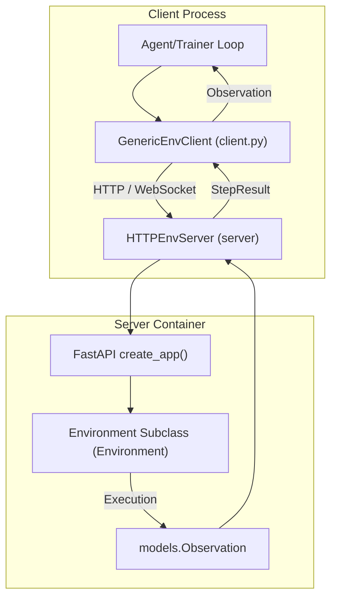
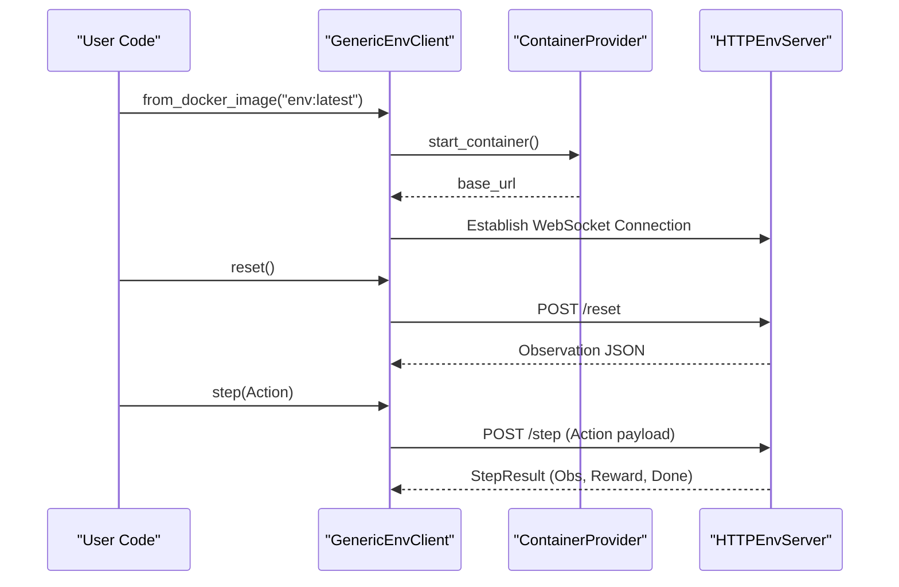

<!-- source: DeepWiki mcp.deepwiki.com · repo huggingface/OpenEnv · page 1.2 Architecture and Design Principles · fetched 2026-10-26 -->

# Architecture and Design Principles

Relevant source files

The following files were used as context for generating this wiki page:

- [.claude/agents/alignment-reviewer.md](.claude/agents/alignment-reviewer.md)
- [.claude/agents/build-validator.md](.claude/agents/build-validator.md)
- [.claude/agents/env-validator.md](.claude/agents/env-validator.md)
- [.claude/agents/openenv-architect.md](.claude/agents/openenv-architect.md)
- [.claude/docs/INVARIANTS.md](.claude/docs/INVARIANTS.md)
- [.claude/docs/PATTERNS.md](.claude/docs/PATTERNS.md)
- [.claude/docs/PRINCIPLES.md](.claude/docs/PRINCIPLES.md)
- [.claude/hooks/check-debug.sh](.claude/hooks/check-debug.sh)
- [docs/source/_redirects.yml](docs/source/_redirects.yml)
- [docs/source/guides/training.md](docs/source/guides/training.md)
- [envs/harbor_env/harness.py](envs/harbor_env/harness.py)
- [rfcs/000-project-phases.md](rfcs/000-project-phases.md)
- [rfcs/001-abstractions.md](rfcs/001-abstractions.md)
- [rfcs/002-env-spec.md](rfcs/002-env-spec.md)
- [rfcs/003-mcp-support.md](rfcs/003-mcp-support.md)
- [rfcs/004-rubrics.md](rfcs/004-rubrics.md)
- [rfcs/005-agentic-harnesses.md](rfcs/005-agentic-harnesses.md)
- [rfcs/006-agentic-rl-harness-interception.md](rfcs/006-agentic-rl-harness-interception.md)
- [rfcs/008-environment-auto-validation.md](rfcs/008-environment-auto-validation.md)
- [rfcs/README.md](rfcs/README.md)
- [src/openenv/core/harness/README.md](src/openenv/core/harness/README.md)
- [src/openenv/validation/runtime/artifacts.py](src/openenv/validation/runtime/artifacts.py)
- [tests/envs/test_harbor_session_factory.py](tests/envs/test_harbor_session_factory.py)
- [tests/envs/test_training_trace.py](tests/envs/test_training_trace.py)
- [tests/fixtures/validation/runtime/served_probe/app.py](tests/fixtures/validation/runtime/served_probe/app.py)
- [tests/test_validation/test_runtime_artifacts.py](tests/test_validation/test_runtime_artifacts.py)

## Purpose and Scope

This page details the architectural foundations of OpenEnv, focusing on its container-first philosophy, client-server topology, the 3-component environment pattern (`models.py`, `client.py`, `server/`), and the formal RFC-driven design process covering RFCs 000 through 011 (including MCP integration, rubrics, agentic harnesses, auto-validation, and catalog discovery).

Sources: [rfcs/README.md:1-109](), [rfcs/000-project-phases.md:1-35]()

---

## Core Philosophy: Environments as Microservices

OpenEnv operates on the principle that reinforcement learning environments should be structured as isolated microservices [rfcs/002-env-spec.md:16-18](). Traditional RL environments execute within the training process, causing isolation failures, dependency collisions, and safety vulnerabilities when running untrusted model actions.

### Key Benefits
- **Isolation**: Runtime faults or crashes in the environment process do not impact the orchestrator or training loop [rfcs/002-env-spec.md:31-35]().
- **Security**: Sandboxed execution containers encapsulate untrusted code paths (such as Python `CodeAct` execution) [rfcs/002-env-spec.md:21-26]().
- **Portability**: Uniform container packaging enables reproducible execution across local laptops, CI pipelines, and distributed cloud clusters [rfcs/002-env-spec.md:29-33]().
- **Language Agnostic**: Standardized HTTP and WebSocket transports permit client applications written in any language [rfcs/002-env-spec.md:16-18]().

Sources: [rfcs/002-env-spec.md:16-35]()

---

## The 3-Component Environment Pattern

Every OpenEnv environment adheres to a strict 3-component architecture that decouples data contracts, server-side simulation logic, and client-side communication abstractions [rfcs/002-env-spec.md:66-108]().

### 1. Models (`models.py`)
Defines strongly-typed data contracts using Python dataclasses for `Action`, `Observation`, and `State` [rfcs/002-env-spec.md:92-100]().
- **Action**: Strongly typed payload defining permissible agent interactions.
- **Observation**: Schema returned by the environment following a step execution.
- **State**: Privileged internal variables utilized for logging, diagnostics, or reward calculation.

### 2. Server (`server/`)
Implements simulation logic by subclassing the core `Environment` abstract base class [rfcs/002-env-spec.md:68-84](). The server mounts routes via `HTTPEnvServer` using FastAPI application factories (`create_app`) [rfcs/003-mcp-support.md:81-85]().

### 3. Client (`client.py`)
Provides a Pythonic interface subclassing `EnvClient` or `GenericEnvClient`, managing serialization, transport, and deserialization over WebSockets or HTTP [rfcs/002-env-spec.md:94-108]().

### Diagram: Component Interaction and Code Entities
This diagram maps conceptual components to concrete code entities within the OpenEnv codebase.

Sources: [rfcs/002-env-spec.md:39-60](), [rfcs/002-env-spec.md:68-108]()

---

## Client-Server Topology and Lifecycle

OpenEnv uses a structured WebSocket and HTTP communication lifecycle to support stateful sessions and real-time step execution [rfcs/002-env-spec.md:16-18]().

### Core Lifecycle Methods
The client interface exposes Gymnasium-compatible orchestration primitives [rfcs/002-env-spec.md:96-108]():
1. **`reset()`**: Initializes or resets the environment session, returning initial observation data [rfcs/002-env-spec.md:97-98]().
2. **`step(action)`**: Submits an `Action` payload and returns a `StepResult` container encapsulating observation, reward, termination flags, and truncation metadata [rfcs/002-env-spec.md:100-101]().
3. **`state()`**: Queries the privileged internal state vector [rfcs/002-env-spec.md:102-104]().

### Diagram: End-to-End Client-Server Sequence

Sources: [rfcs/002-env-spec.md:123-145](), [rfcs/003-mcp-support.md:81-95]()

---

## RFC-Driven Design Process and RFCs 000–011

OpenEnv development is governed by an RFC process to track significant architectural additions, protocol extensions, and breaking changes [rfcs/README.md:1-7]().

### Summary of RFCs 000–011

| RFC ID | Title | Core Contribution |
| :--- | :--- | :--- |
| **000** | [Project Phases](./000-project-phases.md) | Design principles, versioning strategy, and multi-phase roadmap [rfcs/README.md:83-83](). |
| **001** | [Abstractions](./001-abstractions.md) | Basic core abstractions (`Environment`, `Agent`, `State`) [rfcs/README.md:84-84](). |
| **002** | [Env Spec](./002-env-spec.md) | Framework spec for isolated container execution environments [rfcs/README.md:85-85](). |
| **003** | [MCP Support](./003-mcp-support.md) | Model Context Protocol integration for traditional tool discovery and execution [rfcs/README.md:88-88](). |
| **004** | [Rubrics](./004-rubrics.md) | Composable, `nn.Module`-inspired reward computation system [rfcs/README.md:91-91](). |
| **005** | [Agentic Harnesses](./005-agentic-harnesses.md) | External agentic harness integration (Claude Code, OpenClaw) [rfcs/README.md:94-94](). |
| **006** | [Harness Interception](./006-agentic-rl-harness-interception.md) | Token capture contract for training black-box agent harnesses via capture proxies [rfcs/README.md:95-95](). |
| **008** | [Auto-Validation](./008-environment-auto-validation.md) | Local validation runner (`openenv validate`) levels 1-3 and hub contract schemas [rfcs/README.md:99-100](). |
| **010** | [World Modeling](./010-echo-env-token-world-model.md) | Trajectory token-role masks and optimizer world-loss seams (ECHO) [rfcs/README.md:102-103](). |
| **011** | [Catalog Discovery](./011-ard-catalog-discovery.md) | Versioned environment metadata, ARD interchange format, and catalog contracts [rfcs/README.md:104-106](). |
| **012** | [Harbor Capture Providers](./012-harbor-capture-providers.md) | Evaluation and training separation, provider fidelity, and live-session ownership [rfcs/README.md:96-96](). |

Sources: [rfcs/README.md:80-106]()

### Key Architectural Subsystems Derived from RFCs
- **MCP Support (RFC 003)**: Dual API exposing both Gym-style `step()` semantics and JSON-RPC 2.0 endpoints (`/mcp`) for standard tool calling [rfcs/003-mcp-support.md:73-95]().
- **Rubric System (RFC 004)**: Composable reward pipelines (`WeightedSum`, `Gate`, `Sequential`, `LLMJudge`) implementing `forward(action, observation) -> float` with PyTorch-like attribute registration [rfcs/004-rubrics.md:35-150]().
- **Agentic Harnesses (RFC 005 & 006)**: Wrapping patterns allowing complex ReAct agent loops to run inside containers while maintaining conversational turn semantics and recording canonical token IDs (`prompt_token_ids`, `completion_token_ids`) for policy training [rfcs/005-agentic-harnesses.md:55-73](), [rfcs/006-agentic-rl-harness-interception.md:9-12]().
- **Auto-Validation (RFC 008)**: Static and runtime validation suites (`openenv validate`) verifying build reproducibility, determinism, and reward integrity across levels 1–3 [rfcs/008-environment-auto-validation.md:83-110]().
- **Catalog Discovery (RFC 011)**: Structured manifest parsing (`openenv.yaml`) and ARD metadata interchange powering Hugging Face Hub discovery [rfcs/README.md:104-106]().

Sources: [rfcs/003-mcp-support.md:73-95](), [rfcs/004-rubrics.md:35-150](), [rfcs/005-agentic-harnesses.md:55-73](), [rfcs/006-agentic-rl-harness-interception.md:9-12](), [rfcs/008-environment-auto-validation.md:83-110]()

---

## Key Invariants and Constraints

OpenEnv enforces strict architectural constraints to guarantee security, stability, and protocol correctness:
- **Agents Cannot Reset**: Environment simulation controls such as `reset()` are exposed exclusively to the training orchestrator or evaluation harness, never to the agent under evaluation [rfcs/002-env-spec.md:62-63]().
- **Container Isolation**: Production-ready environments must execute successfully within isolated container runtimes managed via pluggable `ContainerProvider` abstractions [rfcs/002-env-spec.md:123-145]().
- **Strongly-Typed Contracts**: All action, observation, and state schemas must be implemented as serializable Python dataclasses to support automatic schema generation and validation [rfcs/002-env-spec.md:29-35]().

Sources: [rfcs/002-env-spec.md:29-35](), [rfcs/002-env-spec.md:62-63](), [rfcs/002-env-spec.md:123-145]()

---

