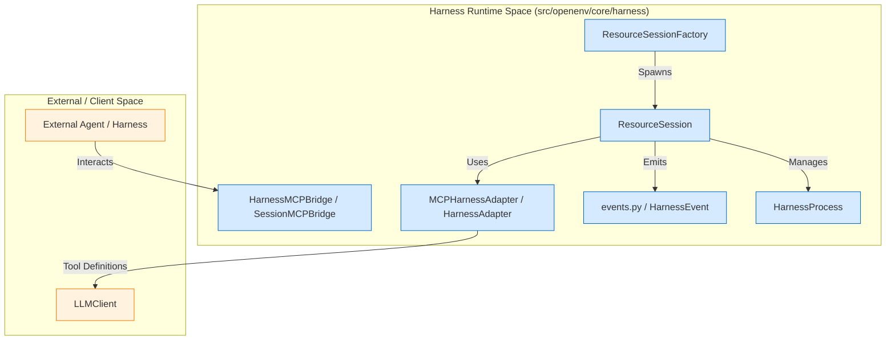
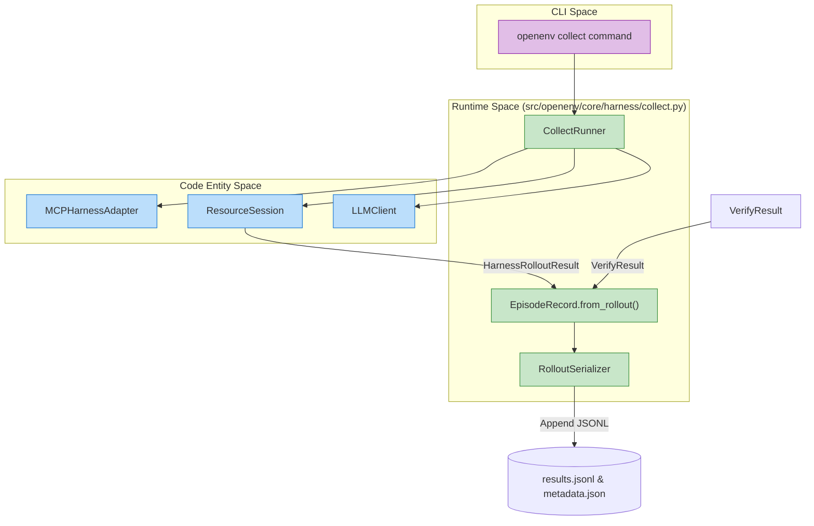

<!-- source: DeepWiki mcp.deepwiki.com · repo huggingface/OpenEnv · page 2.7 Agentic Harness and Data Collection · fetched 2026-10-26 -->

# Agentic Harness and Data Collection

<details>
<summary>Relevant source files</summary>

The following files were used as context for generating this wiki page:

- [docs/source/_redirects.yml](docs/source/_redirects.yml)
- [docs/source/guides/training.md](docs/source/guides/training.md)
- [envs/harbor_env/harness.py](envs/harbor_env/harness.py)
- [rfcs/005-agentic-harnesses.md](rfcs/005-agentic-harnesses.md)
- [rfcs/006-agentic-rl-harness-interception.md](rfcs/006-agentic-rl-harness-interception.md)
- [rfcs/README.md](rfcs/README.md)
- [src/openenv/core/harness/README.md](src/openenv/core/harness/README.md)
- [src/openenv/core/harness/__init__.py](src/openenv/core/harness/__init__.py)
- [src/openenv/core/harness/bridge.py](src/openenv/core/harness/bridge.py)
- [src/openenv/core/harness/capture/__init__.py](src/openenv/core/harness/capture/__init__.py)
- [src/openenv/core/harness/capture/contract.py](src/openenv/core/harness/capture/contract.py)
- [src/openenv/core/harness/capture/validate.py](src/openenv/core/harness/capture/validate.py)
- [src/openenv/core/harness/collect.py](src/openenv/core/harness/collect.py)
- [src/openenv/core/harness/environment.py](src/openenv/core/harness/environment.py)
- [src/openenv/core/harness/events.py](src/openenv/core/harness/events.py)
- [src/openenv/core/harness/process.py](src/openenv/core/harness/process.py)
- [src/openenv/core/harness/rollout.py](src/openenv/core/harness/rollout.py)
- [src/openenv/core/harness/training.py](src/openenv/core/harness/training.py)
- [src/openenv/harbor/contract.py](src/openenv/harbor/contract.py)
- [tests/core/scripted_harness.py](tests/core/scripted_harness.py)
- [tests/core/test_agentic_harness_bridge.py](tests/core/test_agentic_harness_bridge.py)
- [tests/core/test_agentic_harness_e2e.py](tests/core/test_agentic_harness_e2e.py)
- [tests/core/test_agentic_harness_environment.py](tests/core/test_agentic_harness_environment.py)
- [tests/core/test_harness_collect.py](tests/core/test_harness_collect.py)
- [tests/core/test_harness_rollout_backcompat.py](tests/core/test_harness_rollout_backcompat.py)
- [tests/envs/test_harbor_session_factory.py](tests/envs/test_harbor_session_factory.py)
- [tests/envs/test_training_trace.py](tests/envs/test_training_trace.py)

</details>


This page covers the OpenEnv agentic harness runtime (`ResourceSession`, `MCPHarnessAdapter`, and the bridge, events, and process modules), the synthetic dataset generation pipeline in `collect.py` (`CollectRunner`, `RolloutSerializer`, `EpisodeRecord`), and the `openenv collect` CLI command used for orchestrating rollouts.

Sources: [src/openenv/core/harness/__init__.py:1-18](), [src/openenv/core/harness/collect.py:3-14]()

---

## Harness Runtime and Primitives

The harness runtime (`openenv.core.harness`) provides a session-based architecture for driving rollouts against OpenEnv environments using an LLM and MCP-style tool loops, or via turn-based agentic harnesses (RFC 005) [src/openenv/core/harness/__init__.py:3-16]().

### Core Abstractions

*   **`ResourceSession`**: An abstract base class representing a single environment run or session [src/openenv/core/harness/__init__.py:51]().
*   **`ResourceSessionFactory`**: Creates `ResourceSession` instances for executing individual episodes [src/openenv/core/harness/__init__.py:52]().
*   **`MCPHarnessAdapter`**: Adapts environment observations into Model Context Protocol (MCP) tool definitions and converts agent tool calls into environment actions [src/openenv/core/harness/__init__.py:46]().
*   **`CLIHarnessAdapter` / `HarnessAdapter`**: Base and CLI-specific adapters for managing standard I/O interaction loops [src/openenv/core/harness/__init__.py:41-42]().
*   **Bridge, Events, and Process Modules**:
    *   `bridge.py` (`build_bridge_server`, `HarnessMCPBridge`, `SessionMCPBridge`): Bridges external MCP clients with internal environment endpoints [src/openenv/core/harness/__init__.py:27,54,80,106]().
    *   `events.py` (`HarnessEvent`, `HarnessEventType`, `HarnessClientMessage`): Manages streaming event messages and logging during harness execution [src/openenv/core/harness/__init__.py:30-35]().
    *   `process.py` (`HarnessProcess`): Controls external agent processes spawned within environment containers [src/openenv/core/harness/__init__.py:37]().

### Diagram: Harness Runtime Architecture


Sources: [src/openenv/core/harness/__init__.py:20-61](), [src/openenv/core/harness/README.md:1-17]()

---

## Data Collection Pipeline (`collect.py`)

The synthetic dataset generation pipeline (`src/openenv/core/harness/collect.py`) automates rollout execution and serializes trajectories into formats consumable by Supervised Fine-Tuning (SFT) trainers (such as TRL's `SFTTrainer`) or Hugging Face datasets [src/openenv/core/harness/collect.py:3-14]().

### Key Classes

*   **`EpisodeRecord`**: A serializable dataclass encapsulating one complete rollout episode, its chat messages, rewards, completion status, metrics, and tool traces [src/openenv/core/harness/collect.py:64-106]().
*   **`RolloutSerializer`**: An append-only JSONL writer with metadata sidecar support (`results.jsonl` and `metadata.json`) designed for handling resumable data collection [src/openenv/core/harness/collect.py:112-143]().
*   **`CollectRunner`**: Orchestrates repeated rollouts across multiple episodes, supports automatic resumption via disk inspection, and handles per-record filtering through `should_keep` [src/openenv/core/harness/README.md:9-16]().

### Data Flow: Collection to Dataset


Sources: [src/openenv/core/harness/collect.py:64-143](), [src/openenv/core/harness/README.md:14-16]()

---

## The `openenv collect` CLI Command

The `openenv collect` command provides a unified command-line interface for running data collection campaigns [src/openenv/core/harness/README.md:14-41]().

### Usage Examples

```bash
# Smoke test using a scripted teacher (no API key or Docker required)
openenv collect openspiel:tic_tac_toe \
    --base-url https://<user>-<space>.hf.space \
    --output-dir /tmp/ttt-scripted \
    -n 10 --provider scripted

# Real LLM teacher with automatic Hugging Face Hub upload
OPENAI_API_KEY=... openenv collect openspiel:tic_tac_toe \
    --base-url https://<user>-<space>.hf.space \
    --output-dir /tmp/ttt-sft-v1 \
    -n 200 --provider openai --model gpt-5-mini \
    --push-to-hub <user>/ttt-sft-v1

# Self-hosted inference teacher (vLLM/TGI/Ollama) via OpenAI-compatible endpoints
openenv collect openspiel:tic_tac_toe \
    --base-url https://<user>-<space>.hf.space \
    --output-dir /tmp/ttt-sft-local \
    -n 200 --llm-endpoint http://localhost:8000 --model Qwen/Qwen3-1.7B
```

### Output Schema (`results.jsonl`)

Each line in `results.jsonl` contains a structured JSON object representing an episode record:

| Field | Type | Description |
| :--- | :--- | :--- |
| `episode_id` | `string` | Stable identifier used for resume tracking (`<prefix>-<index>`) [src/openenv/core/harness/README.md:83]() |
| `messages` | `list` | Full chat transcript (`user`/`assistant`/`tool`), compatible with TRL `SFTTrainer` [src/openenv/core/harness/README.md:84]() |
| `reward` | `float` | Environment reward resolved via `_resolve_env_reward` [src/openenv/core/harness/README.md:85]() |
| `done` | `bool` | Episode termination flag [src/openenv/core/harness/README.md:86]() |
| `tool_trace` | `list` | Structured tool execution records with arguments and results [src/openenv/core/harness/README.md:87]() |
| `metrics` | `struct` | Harness-level metrics (e.g., turn count, tool call count) [src/openenv/core/harness/README.md:88]() |
| `verify_metrics` | `struct` | Session verification metrics [src/openenv/core/harness/README.md:89]() |
| `artifacts` | `struct` | Verification artifacts and final state payloads [src/openenv/core/harness/README.md:90]() |
| `task` | `any` | Optional task specifications passed via `CollectRunner` [src/openenv/core/harness/README.md:91]() |
| `extra` | `struct` | Additional caller-provided metadata annotations [src/openenv/core/harness/README.md:92]() |

Sources: [src/openenv/core/harness/README.md:14-97]()

---

## Training Traces and Loop-Owning Sessions

For advanced reinforcement learning workflows (such as integration with TRL and Harbor environments), loop-owning sessions implement `TrainableSession.fetch_training_trace()` to return a `TrainingTrace` containing canonical token IDs, per-token logprobs, and loss masks [envs/harbor_env/harness.py:7-28]().

```python
from openenv.core.harness import TrainingTrace, TrainingTurn

trace = TrainingTrace(turns=[TrainingTurn(
    node_id="call-0",
    prompt_token_ids=[10, 11],
    completion_token_ids=[20, 21, 22],
    per_token_logps=[-0.2, -0.4, -0.1],
    loss_mask=[0, 0, 1, 0, 1],
)])
restored = TrainingTrace.model_validate_json(trace.model_dump_json())
```

Sources: [src/openenv/core/harness/README.md:116-133](), [envs/harbor_env/harness.py:7-49]()

---

