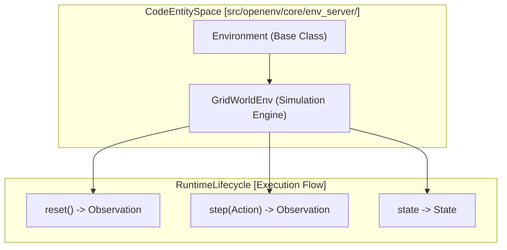
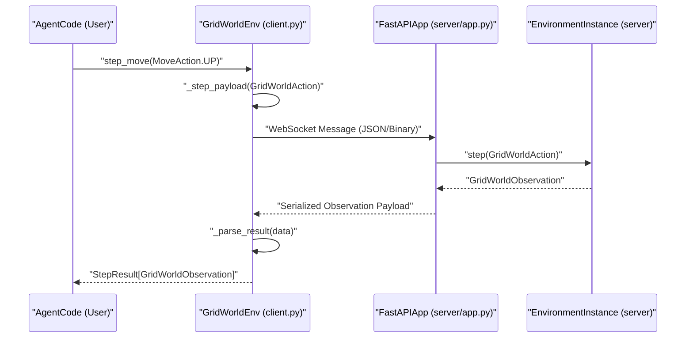
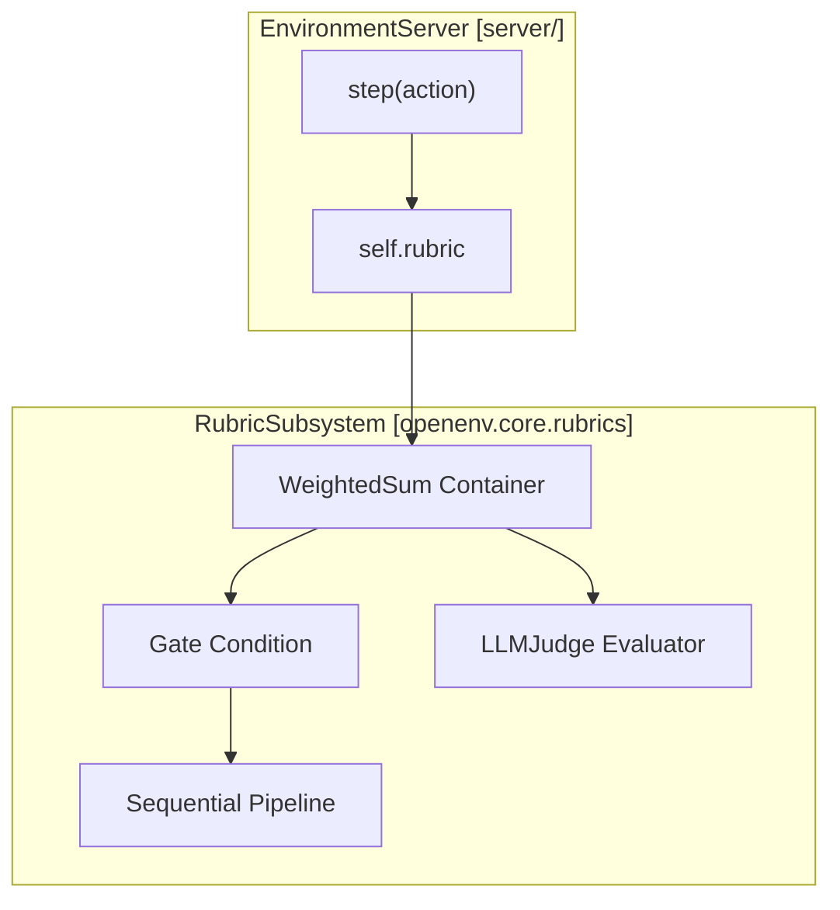

<!-- source: DeepWiki mcp.deepwiki.com · repo huggingface/OpenEnv · page 7.1 Building a New Environment · fetched 2026-10-26 -->

# Building of a New Environment

<details>
<summary>Relevant source files</summary>

The following files were used as context for generating this wiki page:

- [.claude/skills/generate-openenv-env/assets/openenv_env_template/pyproject.toml](.claude/skills/generate-openenv-env/assets/openenv_env_template/pyproject.toml)
- [.claude/skills/generate-openenv-env/assets/openenv_env_template/server/requirements.txt](.claude/skills/generate-openenv-env/assets/openenv_env_template/server/requirements.txt)
- [envs/browsergym_env/pyproject.toml](envs/browsergym_env/pyproject.toml)
- [envs/coding_env/pyproject.toml](envs/coding_env/pyproject.toml)
- [envs/echo_env/pyproject.toml](envs/echo_env/pyproject.toml)
- [envs/grid_world_env/__init__.py](envs/grid_world_env/__init__.py)
- [envs/grid_world_env/client.py](envs/grid_world_env/client.py)
- [envs/grid_world_env/models.py](envs/grid_world_env/models.py)
- [envs/grid_world_env/pyproject.toml](envs/grid_world_env/pyproject.toml)
- [envs/grid_world_env/server/Dockerfile](envs/grid_world_env/server/Dockerfile)
- [envs/grid_world_env/server/__init__.py](envs/grid_world_env/server/__init__.py)
- [envs/grid_world_env/server/requirements.txt](envs/grid_world_env/server/requirements.txt)
- [envs/openapp_env/pyproject.toml](envs/openapp_env/pyproject.toml)
- [envs/openapp_env/server/Dockerfile](envs/openapp_env/server/Dockerfile)
- [envs/openspiel_env/pyproject.toml](envs/openspiel_env/pyproject.toml)
- [envs/snake_env/pyproject.toml](envs/snake_env/pyproject.toml)
- [envs/websearch_env/pyproject.toml](envs/websearch_env/pyproject.toml)
- [src/openenv/cli/templates/openenv_env/pyproject.toml](src/openenv/cli/templates/openenv_env/pyproject.toml)
- [src/openenv/cli/templates/openenv_env/server/requirements.txt](src/openenv/cli/templates/openenv_env/server/requirements.txt)

</details>


This page provides a comprehensive technical walkthrough for creating, implementing, and deploying a new environment within the OpenEnv framework. OpenEnv utilizes a container-first, client-server topology where environment simulation logic runs inside a sandboxed FastAPI server or Docker container, and is accessed via a typed WebSocket client (`EnvClient`).

Sources: `[envs/grid_world_env/client.py:23-29]`, `[src/openenv/cli/templates/openenv_env/pyproject.toml:7-25]()`

## 1. Scaffolding with the CLI

The OpenEnv command-line interface provides automated project scaffolding via templates `[src/openenv/cli/templates/openenv_env/pyproject.toml:7-10]()`. Running `openenv init` generates a structured environment package containing configuration files, model definitions, client wrappers, and server entry points.

```bash
# Initialize a new environment directory structure
openenv init my_env
```

The generated layout conforms to the 3-component environment pattern:
*   `models.py`: Pydantic definitions for domain-specific `Action` and `Observation` types.
*   `client.py`: Client-side subclass of `EnvClient` implementing request serialization and response parsing.
*   `server/`: Backend service modules, including simulation logic and FastAPI routing via `app.py`.
*   `pyproject.toml`: Package configuration defining `openenv` dependencies and build metadata.

Sources: `[src/openenv/cli/templates/openenv_env/pyproject.toml:1-41]()`, `[envs/grid_world_env/pyproject.toml:1-35]()`

## 2. Defining Domain Models

Environment communication protocols are strictly typed using Pydantic models in `models.py` `[envs/grid_world_env/models.py:1-41]()`.

*   **Action Model**: Subclasses `openenv.core.env_server.types.Action` `[envs/grid_world_env/models.py:29]()`. It encapsulates instructions or commands sent by the agent.
*   **Observation Model**: Subclasses `openenv.core.env_server.types.Observation` `[envs/grid_world_env/models.py:34]()`. It must include mandatory reward and termination fields (`reward: float`, `done: bool`) `[envs/grid_world_env/models.py:38-41]()`.

### Reference: GridWorld Models
In the `grid_world_env` reference implementation, movement actions and observations are modeled explicitly:

```python
class MoveAction(str, Enum):
    UP = "UP"
    DOWN = "DOWN"
    LEFT = "LEFT"
    RIGHT = "RIGHT"

class GridWorldAction(Action):
    action: MoveAction = Field(..., description="The direction to move the agent.")

class GridWorldObservation(Observation):
    x: int = Field(..., description="Current X position")
    y: int = Field(..., description="Current Y position")
    reward: float = Field(0.0, description="Reward received")
    done: bool = Field(False, description="Whether episode ended")
```

Sources: `[envs/grid_world_env/models.py:22-41]()`

## 3. Implementing Environment Logic

The simulation engine resides within the server module (e.g., `server/grid_world_environment.py`). You must subclass the core `Environment` interface and implement key lifecycle methods.

| Member / Property | Role & Responsibility |
| :--- | :--- |
| `reset()` | Re-initializes simulation state, increments episode counters, and returns the initial observation. |
| `step(action)` | Evaluates `Action`, updates internal positions/state, calculates rewards, and yields an `Observation`. |
| `state` | Property exposing the current runtime `State` (including `episode_id` and `step_count`). |

### Code-to-System Architecture Mapping

The following diagram bridges the abstract lifecycle states to their concrete code entities within the OpenEnv server subsystem.



Sources: `[envs/grid_world_env/client.py:23-62]()`, `[envs/grid_world_env/models.py:22-41]()`

## 4. Setting Up the FastAPI Server

The `server/app.py` script serves as the runtime entry point for containerized deployment. It uses `create_app` from `openenv.core.env_server` to wrap the environment class into a high-performance FastAPI application supporting both REST and WebSocket endpoints.

**Factory Pattern Requirement**
To support concurrent multi-session execution (where each WebSocket client establishes an isolated session), you must supply the environment **class** or a callable factory function to `create_app`, rather than a pre-instantiated singleton.

### Data Flow: Client-Server Interaction

The sequence below details the end-to-end communication lifecycle from an agent invocation down to server-side processing and back.



Sources: `[envs/grid_world_env/client.py:31-62]()`, `[envs/grid_world_env/server/Dockerfile:25-30]()`

## 5. Implementing the Client

The client-side interface is defined in `client.py` by subclassing `EnvClient` [envs/grid_world_env/client.py:23()]. This grants automatic integration with Docker containers, remote Hub URIs, and persistent WebSocket connections.

You must implement three abstract parsing/serialization routines:
1.  `_step_payload(action)`: Converts the Pydantic action model into a wire-compatible dictionary [envs/grid_world_env/client.py:44-47]().
2.  `_parse_result(data)`: Deserializes incoming server messages into a typed `StepResult` wrapping the observation [envs/grid_world_env/client.py:49-58]().
3.  `_parse_state(data)`: Parses raw metadata dictionaries into an environment `State` object [envs/grid_world_env/client.py:60-62]().

Sources: `[envs/grid_world_env/client.py:23-62]()`

## 6. Reward Design with Rubrics

OpenEnv supports decoupled reward computation using the `Rubric` system (`openenv.core.rubrics`). Instead of embedding complex grading logic directly inside `step()`, you can compose modular evaluation components.

**Rubric Composition Topology**


Common composition containers include `WeightedSum` for multi-objective scoring and `Sequential` for early-exit evaluation pipelines.

Sources: `[envs/grid_world_env/models.py:34-41]()`, `[envs/grid_world_env/client.py:31-41]()`

## 7. Validation and Deployment

Once your environment components (`models.py`, `client.py`, and `server/`) are implemented, use the CLI toolchain to build and verify the package:

1.  **Validation**: Run `openenv validate` to perform static structural checks and configuration parsing against `openenv.yaml`.
2.  **Container Building**: Run `openenv build` to generate the local Docker container image using the environment's `Dockerfile` `[envs/grid_world_env/server/Dockerfile:1-30]()`.
3.  **Deployment**: Run `openenv push` to stage and publish the environment as a Hugging Face Space. This command automatically injects required Gradio and Docker SDK frontmatter into the deployment manifest `[envs/grid_world_env/server/Dockerfile:25-30]()`.

Sources: `[envs/grid_world_env/server/Dockerfile:1-30]()`, `[envs/grid_world_env/pyproject.toml:1-35]()`

---

