# Page: OpenEnv Overview

# OpenEnv Overview

<details>
<summary>Relevant source files</summary>

The following files were used as context for generating this wiki page:

- [README.md](README.md)
- [docs/source/_toctree.yml](docs/source/_toctree.yml)
- [docs/source/contributing.md](docs/source/contributing.md)
- [docs/source/environments.md](docs/source/environments.md)
- [docs/source/guides/async-sync.md](docs/source/guides/async-sync.md)
- [docs/source/guides/rewards.md](docs/source/guides/rewards.md)
- [docs/source/guides/simulation-vs-production.md](docs/source/guides/simulation-vs-production.md)
- [docs/source/guides/task-api.md](docs/source/guides/task-api.md)
- [docs/source/index.md](docs/source/index.md)
- [docs/source/tutorials/browsergym-harness.md](docs/source/tutorials/browsergym-harness.md)
- [docs/source/tutorials/harbor-harness.md](docs/source/tutorials/harbor-harness.md)
- [docs/source/tutorials/harnesses.md](docs/source/tutorials/harnesses.md)
- [docs/source/tutorials/index.md](docs/source/tutorials/index.md)
- [docs/source/tutorials/mcp-environment.md](docs/source/tutorials/mcp-environment.md)
- [docs/source/tutorials/openenv-tutorial.md](docs/source/tutorials/openenv-tutorial.md)
- [docs/source/tutorials/rubrics.md](docs/source/tutorials/rubrics.md)
- [examples/mcp_environment.ipynb](examples/mcp_environment.ipynb)
- [src/openenv/core/README.md](src/openenv/core/README.md)
- [tutorial/01-environments.md](tutorial/01-environments.md)

</details>


OpenEnv is an end-to-end framework for creating, deploying, and utilizing isolated execution environments for agentic reinforcement learning (RL) [README.md:1-4](). It provides a unified standard for interacting with complex agentic tasks—such as code generation, web browsing, or game playing—via familiar, Gymnasium-style APIs like `reset()`, `step()`, and `state()` [README.md:16-18]().

The purpose of this parent page is to introduce the high-level architecture and subsystems of OpenEnv. For detailed installation and guides, see [Getting Started](#1.1); for architecture specifics, see [Architecture and Design Principles](#1.2).

Sources: [README.md:1-4](), [README.md:16-18]()

## Key Design Principles

OpenEnv is built on several core architectural pillars defined in the project's design documents and guides:

*   **Container-First Isolation**: Every environment is packaged as a container (typically Docker), ensuring that untrusted agent code is executed in a secure, reproducible sandbox [README.md:17-18]().
*   **HTTP-Native Topology**: Environments are exposed as HTTP/WebSocket services, allowing training code to interact with environments across different processes, machines, or cloud providers [README.md:16-18](), [src/openenv/core/README.md:11-12]().
*   **Strong Type Safety**: Uses Pydantic and dataclass models for `Action`, `Observation`, and `State`, enabling robust IDE support and runtime validation [src/openenv/core/README.md:23-23](), [docs/source/tutorials/openenv-tutorial.md:29-30]().
*   **Dual-API Surface**: Supports both a **Simulation Mode** (Gym-style `step()` loop for RL training) and a **Production Mode** (Model Context Protocol / MCP for direct tool-use by agents) [README.md:21-22](), [docs/source/guides/simulation-vs-production.md:3-9]().

Sources: [README.md:16-22](), [src/openenv/core/README.md:11-24](), [docs/source/tutorials/openenv-tutorial.md:29-30](), [docs/source/guides/simulation-vs-production.md:3-9]()

## System Architecture

The OpenEnv architecture follows a client-server pattern where the client (running the RL policy or agent) communicates with an isolated server (the environment runtime) over WebSockets and HTTP routes.

### Logic Flow and Code Entity Mapping

The following diagram illustrates how natural language concepts map to specific code entities within the `openenv.core` package.

OpenEnv Entity Relationship Diagram
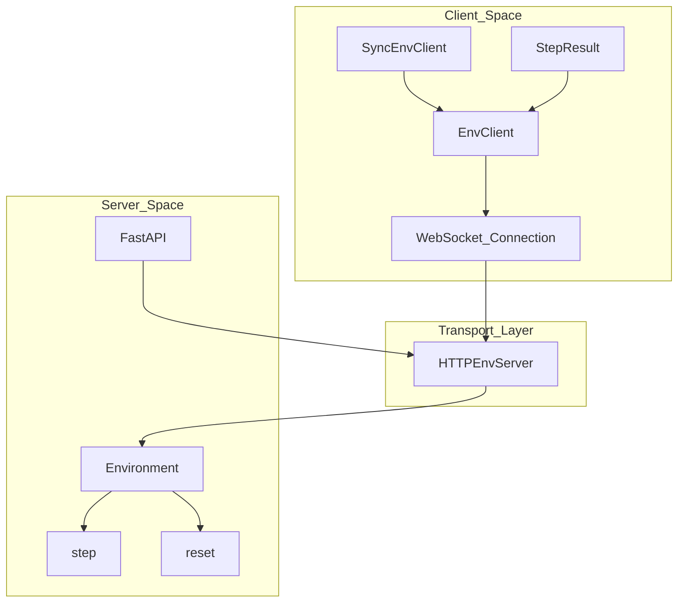
Sources: [src/openenv/core/README.md:19-27](), [src/openenv/core/README.md:182-192]()

### Component Interaction

OpenEnv environments are typically structured into models, server logic, and client interfaces.

Component Interaction Diagram
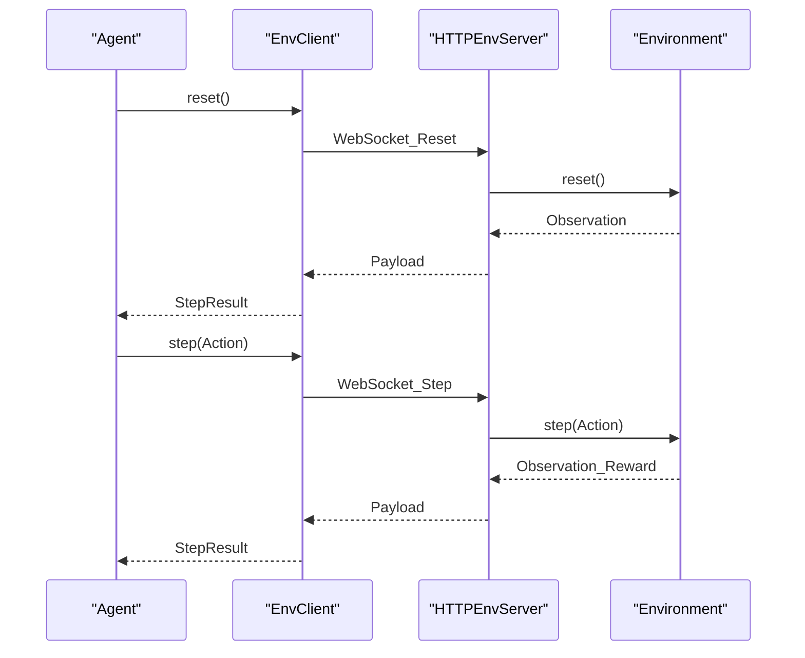
Sources: [README.md:16-18](), [src/openenv/core/README.md:182-197]()

## Core Subsystems

OpenEnv is composed of several subsystems that handle different parts of the agentic lifecycle:

*   **Core Framework**: Foundational building blocks in `openenv.core` including `EnvClient`, `HTTPEnvServer`, and the `ContainerProvider` interface [src/openenv/core/README.md:11-24]().
*   **MCP Integration**: Native support for the Model Context Protocol, allowing environments to expose their capabilities as standardized tools for LLM-based agents [README.md:21-22](), [docs/source/tutorials/mcp-environment.md:1-5]().
*   **Rubric System**: A composable reward computation engine supporting complex, trajectory-based scoring and LLM-as-a-judge patterns [README.md:22-23](), [docs/source/tutorials/rubrics.md:5-16]().
*   **Agentic Harness**: Infrastructure for integrating with evaluation harnesses like Inspect AI and driving rollouts through tool-calling interfaces [README.md:22-23](), [src/openenv/core/README.md:25-28]().
*   **CLI & Deployment**: The `openenv` command-line tool for scaffolding new environments and deploying them directly to Hugging Face Spaces [README.md:92-96]().

Sources: [README.md:21-23](), [src/openenv/core/README.md:11-28](), [docs/source/tutorials/mcp-environment.md:1-5](), [docs/source/tutorials/rubrics.md:5-16]()

## Next Steps

To dive deeper into specific areas of OpenEnv, refer to the following child pages:

*   **[Getting Started](#1.1)** — Installation instructions, environment setup, and dependency structures.
*   **[Architecture and Design Principles](#1.2)** — Detailed breakdown of container providers, client-server topology, RFCs, and simulation vs. production modes.

Sources: [docs/source/_toctree.yml:1-5]()

---

# Page: Getting Started

# Getting Started

<details>
<summary>Relevant source files</summary>

The following files were used as context for generating this wiki page:

- [docs/source/getting-started.md](docs/source/getting-started.md)
- [docs/source/getting_started/contributing-envs.md](docs/source/getting_started/contributing-envs.md)
- [docs/source/guides/runtime-providers.md](docs/source/guides/runtime-providers.md)
- [docs/source/reference/core.md](docs/source/reference/core.md)
- [envs/carla_env/uv.lock](envs/carla_env/uv.lock)
- [envs/grid_world_env/uv.lock](envs/grid_world_env/uv.lock)
- [envs/reasoning_gym_env/uv.lock](envs/reasoning_gym_env/uv.lock)
- [examples/openenv_building_environments.ipynb](examples/openenv_building_environments.ipynb)
- [examples/openenv_introduction_quickstart.ipynb](examples/openenv_introduction_quickstart.ipynb)
- [examples/openenv_using_environments.ipynb](examples/openenv_using_environments.ipynb)
- [pyproject.toml](pyproject.toml)
- [scripts/validation/reproduce.py](scripts/validation/reproduce.py)
- [scripts/validation/verify_artifacts.py](scripts/validation/verify_artifacts.py)
- [tests/test_core/conftest.py](tests/test_core/conftest.py)
- [tests/test_core/test_env_client_capacity.py](tests/test_core/test_env_client_capacity.py)
- [tests/test_core/test_env_client_headers.py](tests/test_core/test_env_client_headers.py)
- [tests/test_validation/integration/test_served_probe.py](tests/test_validation/integration/test_served_probe.py)
- [tests/test_validation/test_reproduction.py](tests/test_validation/test_reproduction.py)
- [tests/validation_runtime/pyproject.toml](tests/validation_runtime/pyproject.toml)
- [tests/validation_runtime/toolchain.json](tests/validation_runtime/toolchain.json)
- [tests/validation_runtime/uv.lock](tests/validation_runtime/uv.lock)

</details>


## Purpose and Scope

This page covers the installation of OpenEnv, core and optional dependency structures defined in `pyproject.toml`, the quickstart guide for interacting with environments via `AutoEnv` and `EnvClient`, environment server connection modes, the `openenv.yaml` configuration manifest, and the runtime data flow between clients, providers, and environment servers.

Sources: [pyproject.toml:1-76](), [docs/source/getting-started.md:1-165]()

---

## Installation and Dependency Structure

OpenEnv separates core framework functionality from heavy environment-specific dependencies or optional cloud providers. The core runtime requires minimal libraries like `fastapi`, `pydantic`, `uvicorn`, and `websockets` [pyproject.toml:17-38]().

### Core Installation

```bash
pip install openenv
```
[docs/source/getting-started.md:7-9]()

### Optional Dependency Groups

Optional integrations are defined as extras in `pyproject.toml` and can be installed via `pip install openenv[<extra>]` [pyproject.toml:40-73](), [docs/source/getting-started.md:18-26]():

| Extra | Pulls in | Reference / Purpose |
| :--- | :--- | :--- |
| `inspect` | `inspect-ai>=0.3.0` | Inspect AI evaluation harness integration [pyproject.toml:60-62]() |
| `harbor` | `harbor[...]` (Python 3.12+) | Black-box agent harness platform and sandbox backends [pyproject.toml:63-73]() |
| `daytona` | `daytona>=0.136.0`, `pyyaml` | Daytona cloud sandboxes [pyproject.toml:43-46]() |
| `aca` | `azure-containerapps-sandbox`, `azure-identity` | Azure Container Apps Sandboxes [pyproject.toml:47-52]() |
| `modal` | `modal>=1.4.0`, `pyyaml` | Modal sandboxes [pyproject.toml:53-56]() |
| `novita` | `novita-sandbox>=2.1.1` | Novita AI sandboxes [pyproject.toml:57-59]() |

Sources: [pyproject.toml:13-73](), [docs/source/getting-started.md:16-26]()

---

## Quickstart: Loading and Interacting with Environments

The `AutoEnv` class provides auto-discovery to load environment clients from Hugging Face Spaces or local Docker images without manual package imports [docs/source/getting-started.md:29-59]().

### Using `AutoEnv` with Remote Spaces

```python
from openenv import AutoEnv

env = AutoEnv.from_env(
    "openenv/echo_env",
    base_url="https://openenv-echo-env.hf.space",
)

with env.sync() as client:
    result = client.reset()
    print(result.observation.metadata["message"])

    message = client.call_tool("echo_message", message="Hello, OpenEnv!")
    print(message)
```
[docs/source/getting-started.md:33-47]()

### Asynchronous Client Operations

OpenEnv clients are asynchronous by default (`EnvClient`). For production loops or async frameworks, use `await client.step(...)` [docs/source/getting-started.md:61-86]().

```python
import asyncio
from echo_env import CallToolAction, EchoEnv

async def main():
    async with EchoEnv(base_url="https://openenv-echo-env.hf.space") as client:
        await client.reset()
        result = await client.step(
            CallToolAction(
                tool_name="echo_message",
                arguments={"message": "Hello, World!"},
            )
        )
        print(result.reward)

asyncio.run(main())
```
[docs/source/getting-started.md:67-86]()

Sources: [docs/source/getting-started.md:27-102](), [src/openenv/core/env_client.py:64-77]()

---

## Environment Manifest (`openenv.yaml`)

Every deployable OpenEnv environment contains an `openenv.yaml` manifest. It acts as the central contract parsed by the `openenv` CLI and container runtime providers during discovery, build, validation, and deployment operations.

Key configuration aspects typically declared in `openenv.yaml` include:
- Application entry point (`app`) pointing to the FastAPI ASGI instance [docs/source/getting-started.md:144-148]()
- Environment class identifiers and schema metadata [docs/source/getting-started.md:29-59]()
- Static and runtime validation policy references [docs/source/getting-started.md:52-56]()

Sources: [docs/source/getting-started.md:27-59](), [docs/source/getting-started.md:144-156]()

---

## Data Flow and Code Entities

OpenEnv separates the client application process from the isolated container or server where execution takes place. 

### Diagram 1: Natural Language to Code Entity Mapping (Client & Server Initialization)

**Title: NaturalLanguageToCodeMapping**
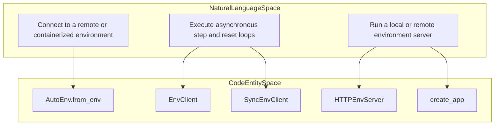
Sources: [docs/source/getting-started.md:27-102](), [docs/source/core.md:97-164]()

### Diagram 2: Interaction Sequence and Data Flow

**Title: ClientServerInteractionSequence**
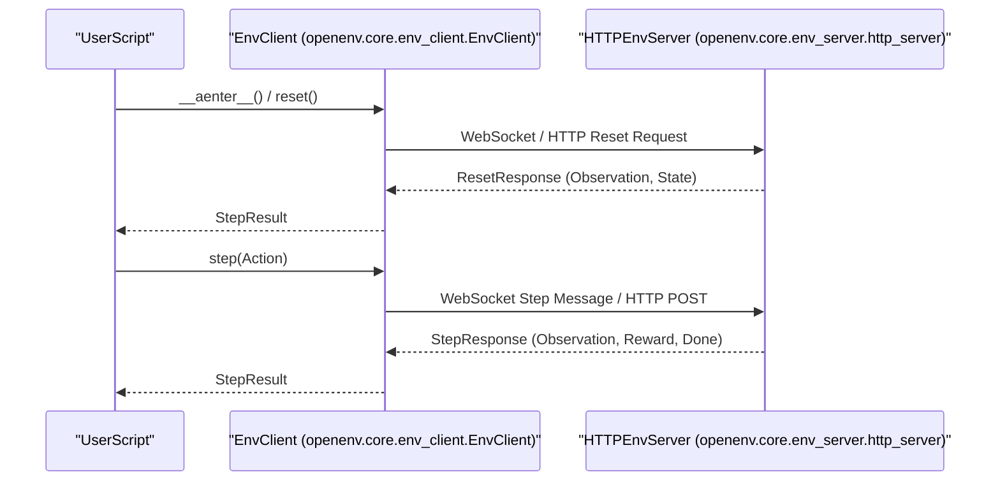
Sources: [docs/source/core.md:135-168](), [src/openenv/core/env_client.py:64-101]()

---

# Page: Architecture and Design Principles

# Architecture and Design Principles

<details>
<summary>Relevant source files</summary>

The following files were used as context for generating this wiki page:

- [.claude/agents/alignment-reviewer.md](.claude/agents/alignment-reviewer.md)
- [.claude/agents/build-validator.md](.claude/agents/build-validator.md)
- [.claude/agents/env-validator.md](.claude/agents/env-validator.md)
- [.claude/agents/openenv-architect.md](.claude/agents/openenv-architect.md)
- [.claude/docs/INVARIANTS.md](.claude/docs/INVARIANTS.md)
- [.claude/docs/PATTERNS.md](.claude/docs/PATTERNS.md)
- [.claude/docs/PRINCIPLES.md](.claude/docs/PRINCIPLES.md)
- [.claude/hooks/check-debug.sh](.claude/hooks/check-debug.sh)
- [docs/source/_redirects.yml](docs/source/_redirects.yml)
- [docs/source/guides/training.md](docs/source/guides/training.md)
- [envs/harbor_env/harness.py](envs/harbor_env/harness.py)
- [rfcs/000-project-phases.md](rfcs/000-project-phases.md)
- [rfcs/001-abstractions.md](rfcs/001-abstractions.md)
- [rfcs/002-env-spec.md](rfcs/002-env-spec.md)
- [rfcs/003-mcp-support.md](rfcs/003-mcp-support.md)
- [rfcs/004-rubrics.md](rfcs/004-rubrics.md)
- [rfcs/005-agentic-harnesses.md](rfcs/005-agentic-harnesses.md)
- [rfcs/006-agentic-rl-harness-interception.md](rfcs/006-agentic-rl-harness-interception.md)
- [rfcs/008-environment-auto-validation.md](rfcs/008-environment-auto-validation.md)
- [rfcs/README.md](rfcs/README.md)
- [src/openenv/core/harness/README.md](src/openenv/core/harness/README.md)
- [src/openenv/validation/runtime/artifacts.py](src/openenv/validation/runtime/artifacts.py)
- [tests/envs/test_harbor_session_factory.py](tests/envs/test_harbor_session_factory.py)
- [tests/envs/test_training_trace.py](tests/envs/test_training_trace.py)
- [tests/fixtures/validation/runtime/served_probe/app.py](tests/fixtures/validation/runtime/served_probe/app.py)
- [tests/test_validation/test_runtime_artifacts.py](tests/test_validation/test_runtime_artifacts.py)

</details>


## Purpose and Scope

This page details the architectural foundations of OpenEnv, focusing on its container-first philosophy, client-server topology, the 3-component environment pattern (`models.py`, `client.py`, `server/`), and the formal RFC-driven design process covering RFCs 000 through 011 (including MCP integration, rubrics, agentic harnesses, auto-validation, and catalog discovery).

Sources: [rfcs/README.md:1-109](), [rfcs/000-project-phases.md:1-35]()

---

## Core Philosophy: Environments as Microservices

OpenEnv operates on the principle that reinforcement learning environments should be structured as isolated microservices [rfcs/002-env-spec.md:16-18](). Traditional RL environments execute within the training process, causing isolation failures, dependency collisions, and safety vulnerabilities when running untrusted model actions.

### Key Benefits
- **Isolation**: Runtime faults or crashes in the environment process do not impact the orchestrator or training loop [rfcs/002-env-spec.md:31-35]().
- **Security**: Sandboxed execution containers encapsulate untrusted code paths (such as Python `CodeAct` execution) [rfcs/002-env-spec.md:21-26]().
- **Portability**: Uniform container packaging enables reproducible execution across local laptops, CI pipelines, and distributed cloud clusters [rfcs/002-env-spec.md:29-33]().
- **Language Agnostic**: Standardized HTTP and WebSocket transports permit client applications written in any language [rfcs/002-env-spec.md:16-18]().

Sources: [rfcs/002-env-spec.md:16-35]()

---

## The 3-Component Environment Pattern

Every OpenEnv environment adheres to a strict 3-component architecture that decouples data contracts, server-side simulation logic, and client-side communication abstractions [rfcs/002-env-spec.md:66-108]().

### 1. Models (`models.py`)
Defines strongly-typed data contracts using Python dataclasses for `Action`, `Observation`, and `State` [rfcs/002-env-spec.md:92-100]().
- **Action**: Strongly typed payload defining permissible agent interactions.
- **Observation**: Schema returned by the environment following a step execution.
- **State**: Privileged internal variables utilized for logging, diagnostics, or reward calculation.

### 2. Server (`server/`)
Implements simulation logic by subclassing the core `Environment` abstract base class [rfcs/002-env-spec.md:68-84](). The server mounts routes via `HTTPEnvServer` using FastAPI application factories (`create_app`) [rfcs/003-mcp-support.md:81-85]().

### 3. Client (`client.py`)
Provides a Pythonic interface subclassing `EnvClient` or `GenericEnvClient`, managing serialization, transport, and deserialization over WebSockets or HTTP [rfcs/002-env-spec.md:94-108]().

### Diagram: Component Interaction and Code Entities
This diagram maps conceptual components to concrete code entities within the OpenEnv codebase.

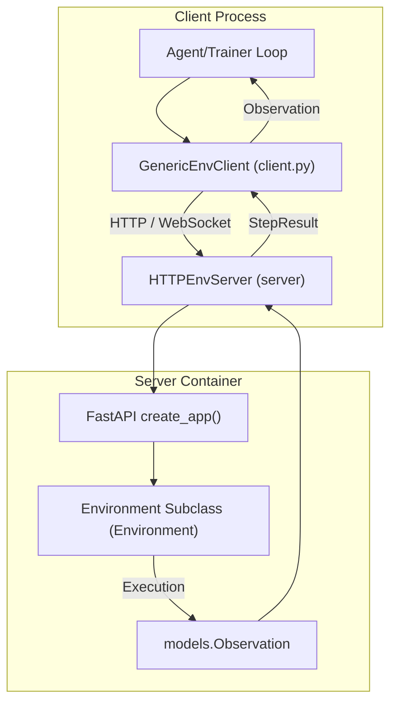
Sources: [rfcs/002-env-spec.md:39-60](), [rfcs/002-env-spec.md:68-108]()

---

## Client-Server Topology and Lifecycle

OpenEnv uses a structured WebSocket and HTTP communication lifecycle to support stateful sessions and real-time step execution [rfcs/002-env-spec.md:16-18]().

### Core Lifecycle Methods
The client interface exposes Gymnasium-compatible orchestration primitives [rfcs/002-env-spec.md:96-108]():
1. **`reset()`**: Initializes or resets the environment session, returning initial observation data [rfcs/002-env-spec.md:97-98]().
2. **`step(action)`**: Submits an `Action` payload and returns a `StepResult` container encapsulating observation, reward, termination flags, and truncation metadata [rfcs/002-env-spec.md:100-101]().
3. **`state()`**: Queries the privileged internal state vector [rfcs/002-env-spec.md:102-104]().

### Diagram: End-to-End Client-Server Sequence
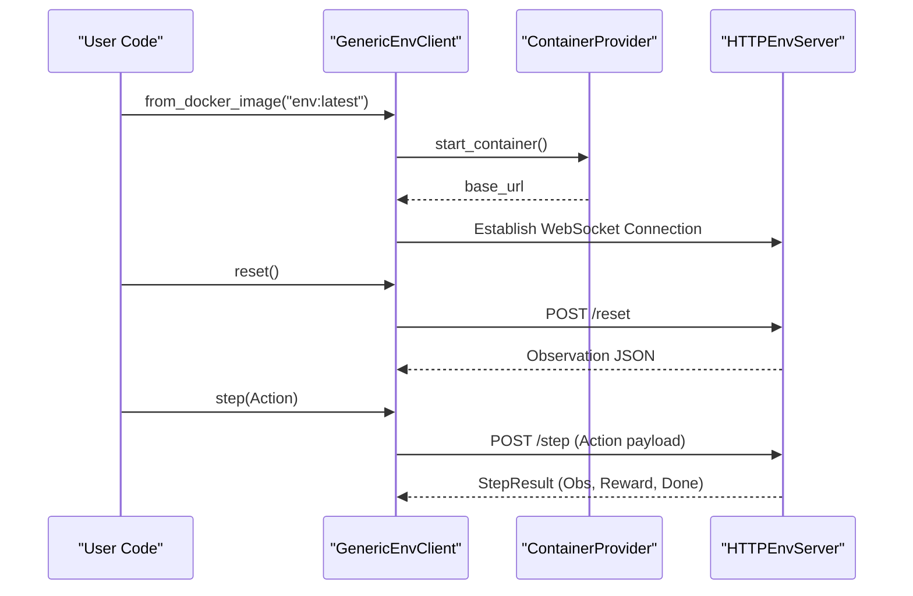
Sources: [rfcs/002-env-spec.md:123-145](), [rfcs/003-mcp-support.md:81-95]()

---

## RFC-Driven Design Process and RFCs 000–011

OpenEnv development is governed by an RFC process to track significant architectural additions, protocol extensions, and breaking changes [rfcs/README.md:1-7]().

### Summary of RFCs 000–011

| RFC ID | Title | Core Contribution |
| :--- | :--- | :--- |
| **000** | [Project Phases](./000-project-phases.md) | Design principles, versioning strategy, and multi-phase roadmap [rfcs/README.md:83-83](). |
| **001** | [Abstractions](./001-abstractions.md) | Basic core abstractions (`Environment`, `Agent`, `State`) [rfcs/README.md:84-84](). |
| **002** | [Env Spec](./002-env-spec.md) | Framework spec for isolated container execution environments [rfcs/README.md:85-85](). |
| **003** | [MCP Support](./003-mcp-support.md) | Model Context Protocol integration for traditional tool discovery and execution [rfcs/README.md:88-88](). |
| **004** | [Rubrics](./004-rubrics.md) | Composable, `nn.Module`-inspired reward computation system [rfcs/README.md:91-91](). |
| **005** | [Agentic Harnesses](./005-agentic-harnesses.md) | External agentic harness integration (Claude Code, OpenClaw) [rfcs/README.md:94-94](). |
| **006** | [Harness Interception](./006-agentic-rl-harness-interception.md) | Token capture contract for training black-box agent harnesses via capture proxies [rfcs/README.md:95-95](). |
| **008** | [Auto-Validation](./008-environment-auto-validation.md) | Local validation runner (`openenv validate`) levels 1-3 and hub contract schemas [rfcs/README.md:99-100](). |
| **010** | [World Modeling](./010-echo-env-token-world-model.md) | Trajectory token-role masks and optimizer world-loss seams (ECHO) [rfcs/README.md:102-103](). |
| **011** | [Catalog Discovery](./011-ard-catalog-discovery.md) | Versioned environment metadata, ARD interchange format, and catalog contracts [rfcs/README.md:104-106](). |
| **012** | [Harbor Capture Providers](./012-harbor-capture-providers.md) | Evaluation and training separation, provider fidelity, and live-session ownership [rfcs/README.md:96-96](). |

Sources: [rfcs/README.md:80-106]()

### Key Architectural Subsystems Derived from RFCs
- **MCP Support (RFC 003)**: Dual API exposing both Gym-style `step()` semantics and JSON-RPC 2.0 endpoints (`/mcp`) for standard tool calling [rfcs/003-mcp-support.md:73-95]().
- **Rubric System (RFC 004)**: Composable reward pipelines (`WeightedSum`, `Gate`, `Sequential`, `LLMJudge`) implementing `forward(action, observation) -> float` with PyTorch-like attribute registration [rfcs/004-rubrics.md:35-150]().
- **Agentic Harnesses (RFC 005 & 006)**: Wrapping patterns allowing complex ReAct agent loops to run inside containers while maintaining conversational turn semantics and recording canonical token IDs (`prompt_token_ids`, `completion_token_ids`) for policy training [rfcs/005-agentic-harnesses.md:55-73](), [rfcs/006-agentic-rl-harness-interception.md:9-12]().
- **Auto-Validation (RFC 008)**: Static and runtime validation suites (`openenv validate`) verifying build reproducibility, determinism, and reward integrity across levels 1–3 [rfcs/008-environment-auto-validation.md:83-110]().
- **Catalog Discovery (RFC 011)**: Structured manifest parsing (`openenv.yaml`) and ARD metadata interchange powering Hugging Face Hub discovery [rfcs/README.md:104-106]().

Sources: [rfcs/003-mcp-support.md:73-95](), [rfcs/004-rubrics.md:35-150](), [rfcs/005-agentic-harnesses.md:55-73](), [rfcs/006-agentic-rl-harness-interception.md:9-12](), [rfcs/008-environment-auto-validation.md:83-110]()

---

## Key Invariants and Constraints

OpenEnv enforces strict architectural constraints to guarantee security, stability, and protocol correctness:
- **Agents Cannot Reset**: Environment simulation controls such as `reset()` are exposed exclusively to the training orchestrator or evaluation harness, never to the agent under evaluation [rfcs/002-env-spec.md:62-63]().
- **Container Isolation**: Production-ready environments must execute successfully within isolated container runtimes managed via pluggable `ContainerProvider` abstractions [rfcs/002-env-spec.md:123-145]().
- **Strongly-Typed Contracts**: All action, observation, and state schemas must be implemented as serializable Python dataclasses to support automatic schema generation and validation [rfcs/002-env-spec.md:29-35]().

Sources: [rfcs/002-env-spec.md:29-35](), [rfcs/002-env-spec.md:62-63](), [rfcs/002-env-spec.md:123-145]()

---

# Page: Core Framework

# Core Framework

<details>
<summary>Relevant source files</summary>

The following files were used as context for generating this wiki page:

- [README.md](README.md)
- [docs/source/contributing.md](docs/source/contributing.md)
- [docs/source/index.md](docs/source/index.md)
- [docs/source/tutorials/openenv-tutorial.md](docs/source/tutorials/openenv-tutorial.md)
- [examples/echo_mcp_demo.py](examples/echo_mcp_demo.py)
- [src/openenv/core/README.md](src/openenv/core/README.md)
- [src/openenv/core/__init__.py](src/openenv/core/__init__.py)
- [src/openenv/core/client_types.py](src/openenv/core/client_types.py)
- [src/openenv/core/env_server/__init__.py](src/openenv/core/env_server/__init__.py)
- [src/openenv/core/env_server/exceptions.py](src/openenv/core/env_server/exceptions.py)
- [src/openenv/core/env_server/http_server.py](src/openenv/core/env_server/http_server.py)
- [src/openenv/core/env_server/interfaces.py](src/openenv/core/env_server/interfaces.py)
- [src/openenv/core/env_server/mcp_types.py](src/openenv/core/env_server/mcp_types.py)
- [src/openenv/core/env_server/types.py](src/openenv/core/env_server/types.py)
- [tests/core/test_types_and_enums.py](tests/core/test_types_and_enums.py)
- [tutorial/01-environments.md](tutorial/01-environments.md)

</details>


The `src/openenv/core` package provides the central abstractions, communication protocols, and runtime primitives that enable interoperability between diverse agentic environments and the models that interact with them. It establishes a unified Gymnasium-style interface while simultaneously supporting the [MCP (Model Context Protocol) Integration](#2.3) for production tool-use.

For a detailed breakdown of each subsystem, follow the links to the child pages below.

---

## Central Abstractions

The framework is built around three primary primitives defined in `src/openenv/core/env_server/types.py` and `interfaces.py`: `Action`, `Observation`, and `State`. These classes leverage Pydantic for strict schema validation, runtime assignment checks, and serialization [src/openenv/core/env_server/types.py:50-191]().

The base `Environment` class coordinates state transitions via `reset()` and `step()` methods, while `Transform` allows observation augmentation following functional patterns [src/openenv/core/env_server/interfaces.py:201-223]().

### Core Entity Mapping
The following diagram bridges conceptual framework components to their concrete implementation classes in the codebase.

**Framework Component Architecture**
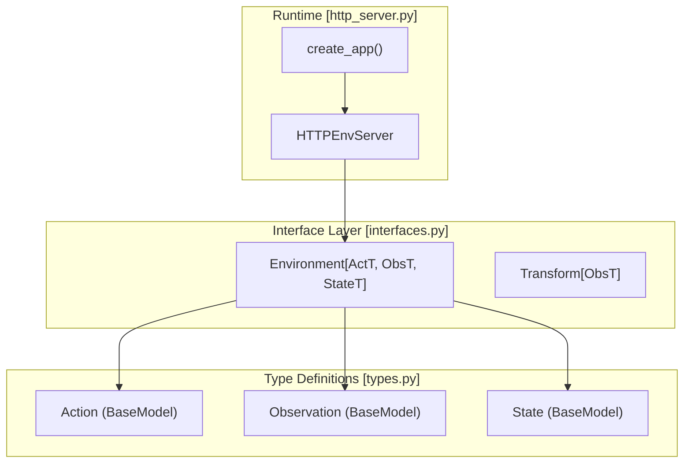
Sources: [src/openenv/core/env_server/interfaces.py:106-223](), [src/openenv/core/env_server/types.py:50-191](), [src/openenv/core/env_server/http_server.py:140-184]()

---

## Communication Protocols

OpenEnv supports dual communication pathways: a REST/WebSocket API for simulation and the Model Context Protocol (MCP) for tool discovery and execution.

### Gym-Style Simulation
In simulation mode, the framework follows a standard `reset()` and `step()` lifecycle [src/openenv/core/env_server/interfaces.py:100-198](). 
- **Reset**: Initializes the environment episode and returns the initial observation [src/openenv/core/env_server/types.py:90-123]().
- **Step**: Processes an `Action` payload and returns a `StepResponse` containing the resulting `Observation`, `reward`, and `done` flag [src/openenv/core/env_server/types.py:125-168]().

### MCP Integration
OpenEnv natively supports MCP, allowing environments to expose actions as discoverable tools over standard JSON-RPC 2.0 transport layers.

For details, see [MCP (Model Context Protocol) Integration](#2.3).

### Serialization Flow
The framework uses specialized serialization utilities to map incoming JSON payloads to Pydantic models and serialize observations back to transport formats [src/openenv/core/env_server/serialization.py:30-134]().

**Data Transformation Pipeline**
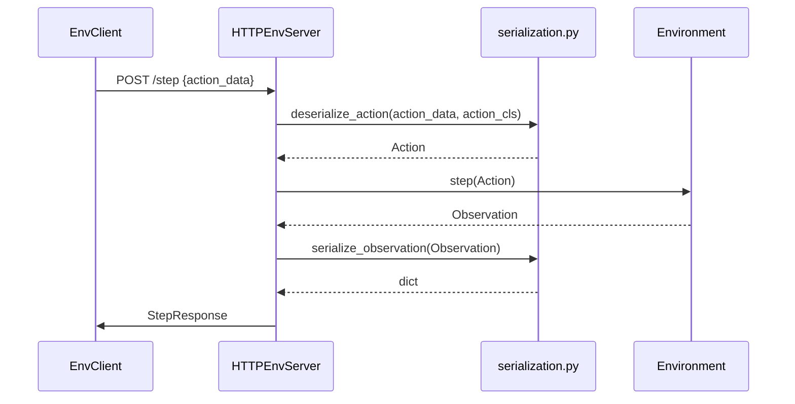
Sources: [src/openenv/core/env_server/serialization.py:30-169](), [src/openenv/core/env_server/types.py:125-168](), [src/openenv/core/env_server/interfaces.py:100-223]()

---

## Major Subsystems

### Environment Server
- **Child Page:** [Environment Server](#2.1)
- **Summary:** The server-side infrastructure handles HTTP and WebSocket connections, session management, and environment lifecycle. It relies on FastAPI for route registration and provides the `create_app` factory for instantiating environment applications [src/openenv/core/env_server/http_server.py:140-184]().

### Environment Client
- **Child Page:** [Environment Client](#2.2)
- **Summary:** Provides high-level Python client wrappers (`EnvClient`, `SyncEnvClient`, `GenericEnvClient`) managing WebSocket lifecycles, connection handshakes, and factory methods such as `from_docker_image()` [src/openenv/core/__init__.py:27-56]().

### MCP (Model Context Protocol) Integration
- **Child Page:** [MCP (Model Context Protocol) Integration](#2.3)
- **Summary:** Covers the dual API surface supporting Gym simulation mode alongside MCP production mode, including `MCPToolClient`, `MCPEnvironment`, JSON-RPC 2.0 transport, and `RESERVED_TOOL_NAMES` [src/openenv/core/env_server/__init__.py:17-39]().

### Rubric System (Reward Computation)
- **Child Page:** [Rubric System (Reward Computation)](#2.4)
- **Summary:** Implements reward computation abstractions via the `Rubric` base class, composable containers (`WeightedSum`, `Gate`, `Sequential`), and `LLMJudge` integrations [src/openenv/core/env_server/interfaces.py:201-223]().

### Container Providers and Runtime
- **Child Page:** [Container Providers and Runtime](#2.5)
- **Summary:** Abstracts container execution engines via the pluggable `ContainerProvider` interface (`LocalDockerProvider`, `DaytonaProvider`, `ModalProvider`, etc.), managing health monitoring and readiness probes.

### AutoEnv, Discovery, and Catalog
- **Child Page:** [AutoEnv, Discovery, and Catalog](#2.6)
- **Summary:** Covers dynamic environment discovery via `EnvironmentDiscovery`, `openenv.yaml` manifest parsing, catalog contracts (RFC 011), and the `OPENENV_TRUST_REMOTE_CODE` security flag.

### Agentic Harness and Data Collection
- **Child Page:** [Agentic Harness and Data Collection](#2.7)
- **Summary:** Details runtime harness primitives (`ResourceSession`, `MCPHarnessAdapter`, bridge/events modules) and the `collect.py` rollout serialization pipeline.

### LLM Client and Evaluation Harnesses
- **Child Page:** [LLM Client and Evaluation Harnesses](#2.8)
- **Summary:** Defines the `LLMClient` abstraction (`OpenAIClient`, `AnthropicClient`), tool-schema transformations, and integration with `EvalHarness` and `InspectAIHarness`.

### Harbor (Black-Box Agent Harness Platform)
- **Child Page:** [Harbor (Black-Box Agent Harness Platform)](#2.9)
- **Summary:** Overviews running coding-agent harnesses (Claude Code, OpenCode) on Harbor tasks inside isolated sandboxes while capturing traces and model interactions.

Sources: [src/openenv/core/__init__.py:27-56](), [src/openenv/core/env_server/http_server.py:140-184](), [src/openenv/core/env_server/interfaces.py:201-223]()

---

# Page: Environment Server

# Environment Server

<details>
<summary>Relevant source files</summary>

The following files were used as context for generating this wiki page:

- [.claude/hooks/check-line-endings.sh](.claude/hooks/check-line-endings.sh)
- [.gitattributes](.gitattributes)
- [AGENTS.md](AGENTS.md)
- [envs/echo_env/openenv.yaml](envs/echo_env/openenv.yaml)
- [envs/openspiel_env/openenv.yaml](envs/openspiel_env/openenv.yaml)
- [examples/echo_mcp_demo.py](examples/echo_mcp_demo.py)
- [src/openenv/cli/commands/serve.py](src/openenv/cli/commands/serve.py)
- [src/openenv/core/__init__.py](src/openenv/core/__init__.py)
- [src/openenv/core/client_types.py](src/openenv/core/client_types.py)
- [src/openenv/core/env_server/__init__.py](src/openenv/core/env_server/__init__.py)
- [src/openenv/core/env_server/exceptions.py](src/openenv/core/env_server/exceptions.py)
- [src/openenv/core/env_server/http_server.py](src/openenv/core/env_server/http_server.py)
- [src/openenv/core/env_server/interfaces.py](src/openenv/core/env_server/interfaces.py)
- [src/openenv/core/env_server/mcp_types.py](src/openenv/core/env_server/mcp_types.py)
- [src/openenv/core/env_server/route_config.py](src/openenv/core/env_server/route_config.py)
- [src/openenv/core/env_server/serialization.py](src/openenv/core/env_server/serialization.py)
- [src/openenv/core/env_server/types.py](src/openenv/core/env_server/types.py)
- [tests/core/test_mcp/test_mcp_types.py](tests/core/test_mcp/test_mcp_types.py)
- [tests/core/test_route_config.py](tests/core/test_route_config.py)
- [tests/core/test_types_and_enums.py](tests/core/test_types_and_enums.py)
- [tests/core/test_web_interface_mcp.py](tests/core/test_web_interface_mcp.py)

</details>


This page provides a deep technical dive into the server-side infrastructure of OpenEnv, covering `HTTPEnvServer`, FastAPI route registration, WebSocket session management, concurrency configuration, serialization, declarative route configuration via `route_config`, the `create_app` factory, and simulation versus production server modes.

---

### Core Architecture: `HTTPEnvServer` and `create_app`

The `HTTPEnvServer` class is the central orchestrator responsible for exposing OpenEnv [`Environment`]([src/openenv/core/env_server/interfaces.py:223]()) instances over network protocols. It wraps an environment factory callable and handles the lifecycle of environment instances, translating incoming HTTP requests and WebSocket messages into method calls on the underlying environment.

**Server Entity Mapping to Code Entities**
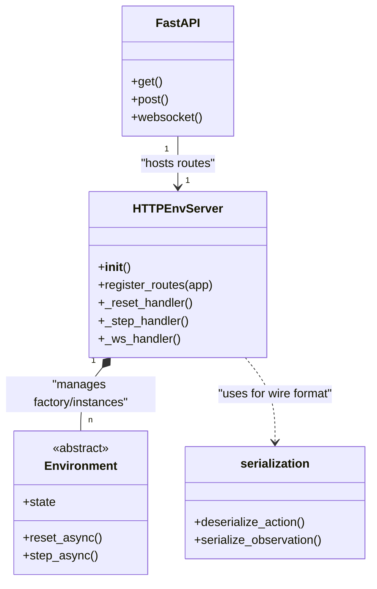
Sources: [src/openenv/core/env_server/http_server.py:140-218](), [src/openenv/core/env_server/interfaces.py:223-225](), [src/openenv/core/env_server/serialization.py:43-185]()

---

### FastAPI Route Registration & Declarative `route_config`

The server exposes both stateless REST endpoints and stateful WebSocket channels. To reduce boilerplate in route setup, OpenEnv utilizes declarative configuration objects defined in `route_config.py` [src/openenv/core/env_server/route_config.py:1-8]() alongside direct FastAPI route bindings in `HTTPEnvServer`.

#### Request Processing Flow

**Environment Server Request Data Flow**
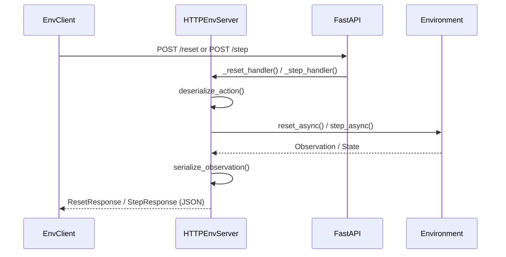
Sources: [src/openenv/core/env_server/http_server.py:343-415](), [src/openenv/core/env_server/serialization.py:43-185]()

---

### WebSocket Session Management and Concurrency Configuration

OpenEnv supports both single-session and multi-session concurrency configurations governed by `ConcurrencyConfig` [src/openenv/core/env_server/types.py:265-279]() and enforced by custom exceptions [src/openenv/core/env_server/exceptions.py:14-40]().

*   **Concurrency Limits**: `max_concurrent_envs` restricts the number of active WebSocket sessions.
*   **Safety Checks**: If `max_concurrent_envs > 1`, the server checks whether the environment is explicitly marked with `SUPPORTS_CONCURRENT_SESSIONS = True`. If not, a [`ConcurrencyConfigurationError`]([src/openenv/core/env_server/exceptions.py:14-40]()) is raised at startup.
*   **Session Isolation**: Each WebSocket session spins up a dedicated environment instance via the factory callable and uses a thread pool executor to prevent blocking operations from starving the main event loop [src/openenv/core/env_server/http_server.py:173-216]().

Sources: [src/openenv/core/env_server/http_server.py:173-216](), [src/openenv/core/env_server/exceptions.py:14-65]()

---

### Serialization and Deserialization Pipeline

Data passing between clients and servers is strictly validated and converted using Pydantic models. 

*   **Action Deserialization**: [`deserialize_action`]([src/openenv/core/env_server/serialization.py:43-72]()) and [`deserialize_action_with_preprocessing`]([src/openenv/core/env_server/serialization.py:74-145]()) convert incoming JSON dictionaries into strongly typed [`Action`]([src/openenv/core/env_server/types.py:50-66]()) subclasses, automatically handling MCP protocol payloads (`list_tools`, `call_tool`) through discriminator mapping.
*   **Observation Serialization**: [`serialize_observation`]([src/openenv/core/env_server/serialization.py:147-185]()) formats an [`Observation`]([src/openenv/core/env_server/types.py:68-88]()) instance into the exact wire structure expected by [`EnvClient`]([src/openenv/core/__init__.py:28]()), cleanly separating fields like `observation`, `reward`, `done`, and `metadata`.

Sources: [src/openenv/core/env_server/serialization.py:1-185](), [src/openenv/core/env_server/types.py:50-88]()

---

### Simulation vs. Production Server Modes

OpenEnv servers can be initialized in different operating modes represented by the [`ServerMode`]([src/openenv/core/env_server/types.py:18-23]()) enum:

| Server Mode | Target Use Case | Behavior & Restrictions |
| :--- | :--- | :--- |
| `ServerMode.SIMULATION` | Training, offline rollouts, RL benchmarks | Full environment access, diagnostic tool visibility, resets enabled. |
| `ServerMode.PRODUCTION` | Deployment, evaluation harnesses, agents | Restricts simulation-only tools, restricts state inspection, enforces safety constraints. |

Sources: [src/openenv/core/env_server/types.py:18-23](), [src/openenv/core/env_server/mcp_environment.py:169-174]()

---

# Page: Environment Client

# Environment Client

<details>
<summary>Relevant source files</summary>

The following files were used as context for generating this wiki page:

- [docs/source/environments/sophistry_bench_sprint.md](docs/source/environments/sophistry_bench_sprint.md)
- [envs/chess_env/client.py](envs/chess_env/client.py)
- [envs/sophistry_bench_sprint_env/README.md](envs/sophistry_bench_sprint_env/README.md)
- [envs/sophistry_bench_sprint_env/__init__.py](envs/sophistry_bench_sprint_env/__init__.py)
- [envs/sophistry_bench_sprint_env/client.py](envs/sophistry_bench_sprint_env/client.py)
- [envs/sophistry_bench_sprint_env/models.py](envs/sophistry_bench_sprint_env/models.py)
- [envs/sophistry_bench_sprint_env/openenv.yaml](envs/sophistry_bench_sprint_env/openenv.yaml)
- [envs/sophistry_bench_sprint_env/pyproject.toml](envs/sophistry_bench_sprint_env/pyproject.toml)
- [envs/sophistry_bench_sprint_env/server/__init__.py](envs/sophistry_bench_sprint_env/server/__init__.py)
- [envs/sumo_rl_env/client.py](envs/sumo_rl_env/client.py)
- [examples/sophistry_bench_sprint_grpo.py](examples/sophistry_bench_sprint_grpo.py)
- [src/openenv/auto/auto_env.py](src/openenv/auto/auto_env.py)
- [src/openenv/core/env_client.py](src/openenv/core/env_client.py)
- [src/openenv/core/utils.py](src/openenv/core/utils.py)
- [tests/envs/test_auto_env.py](tests/envs/test_auto_env.py)
- [tests/envs/test_client_step_result_contract.py](tests/envs/test_client_step_result_contract.py)
- [tests/test_core/test_client_provider_cleanup.py](tests/test_core/test_client_provider_cleanup.py)
- [tests/test_core/test_client_provider_cleanup_docker.py](tests/test_core/test_client_provider_cleanup_docker.py)
- [tests/test_core/test_generic_client.py](tests/test_core/test_generic_client.py)

</details>


This page covers the core client abstractions in OpenEnv (`EnvClient`, `SyncEnvClient`, `GenericEnvClient`), the WebSocket communication lifecycle, factory methods (`from_docker_image`, `from_env`, `from_hub`), the `StepResult` data container, and the `.sync()` wrapper.

## Core Client Architecture

The OpenEnv client subsystem is designed around a persistent WebSocket connection that eliminates the overhead of HTTP request-response cycles during multi-step episodes. 

### Client Hierarchy and Roles

| Class | Role | Implementation Detail |
| :--- | :--- | :--- |
| `EnvClient` | Abstract Base | Manages WebSocket connections, message timeouts, session creation, and protocol serialization. |
| `GenericEnvClient` | Concrete Implementation | General-purpose client handling arbitrary dictionary-based or model-based actions and observations. |
| `SyncEnvClient` | Synchronous Wrapper | Provides a blocking interface for standard synchronous training loops and scripts using an internal background event loop. |
| `AutoEnv` | Factory Class | Automatically discovers, installs, and instantiates the correct client class for a given environment key or Hugging Face Hub repository. |

Sources: `[src/openenv/core/env_client.py:41-65]`, `[src/openenv/auto/auto_env.py:118-152]`, `[src/openenv/core/sync_client.py:20-50]`

---

## Communication Lifecycle

When an environment client initializes via factory methods like `from_docker_image` or `from_hub`, it yields a `_BootstrapResult` handle that defers container startup and connection until awaited or invoked via `.sync()` [src/openenv/core/env_client.py:107-181](). Once connected, interactions follow a persistent WebSocket session lifecycle.

### WebSocket Interaction Flow

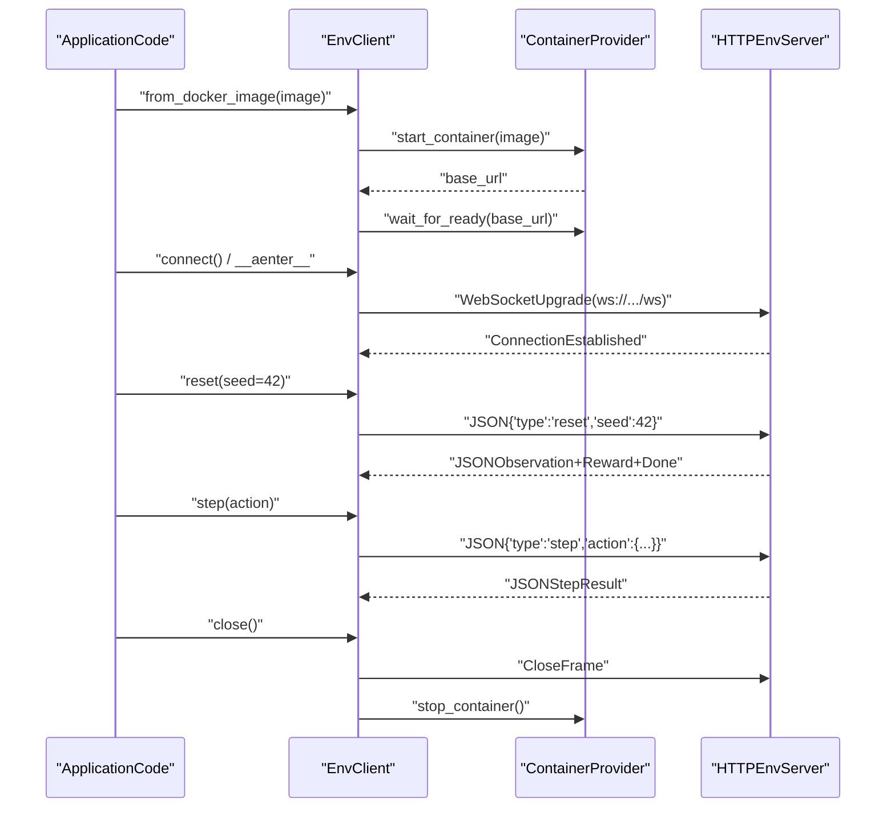

Sources: `[src/openenv/core/env_client.py:148-224]`, `[src/openenv/core/containers/runtime/providers.py:44-98]`

---

## Factory Methods and Discovery

Environments can be instantiated through multiple factory patterns depending on the deployment topology.

### `from_env` and `AutoEnv`
The `AutoEnv.from_env(name)` method parses the target environment name or Hugging Face Hub repository identifier, checks local installations, downloads dependencies if necessary (using `uv pip` or standard pip), and dynamically loads the target `EnvClient` subclass [src/openenv/auto/auto_env.py:118-179]().

### `from_docker_image` and `_BootstrapResult`
Factory methods like `from_docker_image` return a `_BootstrapResult` handle. This lazy evaluation container supports both asynchronous usage (`await handle`) and synchronous usage (`handle.sync()`), preventing container leaks and managing cleanup if initialization fails [src/openenv/core/env_client.py:107-181]().

Sources: `[src/openenv/auto/auto_env.py:118-179]`, `[src/openenv/core/env_client.py:107-181]`

---

## Data Structures: StepResult

Every environment interaction through `reset()` or `step()` returns a `StepResult` instance containing standard reinforcement learning rollout components [src/openenv/core/client_types.py:10-27]().

| Attribute | Type | Description |
| :--- | :--- | :--- |
| `observation` | `ObsT` | The environment-specific observation payload (e.g., text, bounding boxes, DOM nodes). |
| `reward` | `Optional[float]` | Scalar reward computed by the server-side rubric. |
| `done` | `bool` | Terminal flag indicating episode termination. |
| `metadata` | `Optional[Dict[str, Any]]` | Additional diagnostic information or debugging components. |

Sources: `[src/openenv/core/client_types.py:10-27]`

---

## Implementation Details: Sync vs Async and Lifecycle Management

The base `EnvClient` is fully asynchronous using `websockets.asyncio.client`. To bridge this into synchronous training pipelines, the `.sync()` method wraps calls using `SyncEnvClient` [src/openenv/core/env_client.py:10-31]().

### Natural Language Space to Code Entity Space Mapping

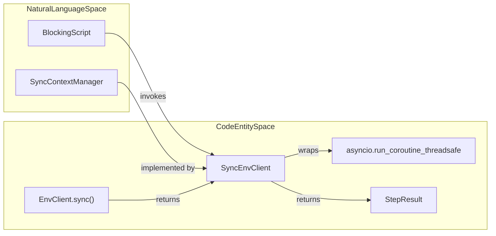

Sources: `[src/openenv/core/env_client.py:10-31]`, `[src/openenv/core/sync_client.py:20-50]`

### WebSocket Configuration
* **Payload Limits**: WebSocket message size limits default to 100MB to support large payloads such as screenshots and HTML DOM trees [src/openenv/core/env_client.py:108-108]().
* **Proxy Bypassing**: Automatically detects `localhost` or `127.0.0.1` addresses and updates environment proxy variables to prevent local container traffic interception [src/openenv/core/env_client.py:180-193]().

Sources: `[src/openenv/core/env_client.py:100-200]`, `[src/openenv/core/env_server/serialization.py:30-65]`

---

# Page: MCP (Model Context Protocol) Integration

# MCP (Model Context Protocol) Integration

<details>
<summary>Relevant source files</summary>

The following files were used as context for generating this wiki page:

- [envs/chess_env/server/rubrics.py](envs/chess_env/server/rubrics.py)
- [envs/echo_env/server/echo_environment.py](envs/echo_env/server/echo_environment.py)
- [envs/finqa_env/server/finqa_environment.py](envs/finqa_env/server/finqa_environment.py)
- [envs/finqa_env/server/tools.py](envs/finqa_env/server/tools.py)
- [examples/modal_echo_env.py](examples/modal_echo_env.py)
- [src/openenv/core/env_server/mcp_environment.py](src/openenv/core/env_server/mcp_environment.py)
- [src/openenv/core/mcp_client.py](src/openenv/core/mcp_client.py)
- [src/openenv/core/rubrics/__init__.py](src/openenv/core/rubrics/__init__.py)
- [src/openenv/core/rubrics/llm_judge.py](src/openenv/core/rubrics/llm_judge.py)
- [tests/core/test_mcp/test_mcp_client.py](tests/core/test_mcp/test_mcp_client.py)
- [tests/core/test_mcp/test_mcp_integration.py](tests/core/test_mcp/test_mcp_integration.py)
- [tests/core/test_mode_selection.py](tests/core/test_mode_selection.py)
- [tests/core/test_production_mode_mcp.py](tests/core/test_production_mode_mcp.py)
- [tests/core/test_production_mode_routes.py](tests/core/test_production_mode_routes.py)
- [tests/core/test_rubrics/test_llm_judge.py](tests/core/test_rubrics/test_llm_judge.py)
- [tests/core/test_simulation_mode_preserves_api.py](tests/core/test_simulation_mode_preserves_api.py)
- [tests/envs/test_chess_rubric_migration.py](tests/envs/test_chess_rubric_migration.py)
- [tests/envs/test_finqa_environment.py](tests/envs/test_finqa_environment.py)

</details>


OpenEnv integrates the Model Context Protocol (MCP) to standardize how agents interact with tools across different simulation and production environments. This page details the dual API surface supporting both Gym-style reinforcement learning (RL) training and production inference serving, along with the underlying client and server architectures, JSON-RPC 2.0 transport, session management, and reserved tool restrictions.

---

## Dual API Surface: Simulation vs. Production

OpenEnv environments support two distinct operational modes determined by the client and server configuration (`mode="simulation"` vs. `mode="production"`). These modes control whether the environment exposes trajectory-based RL primitives or direct tool-serving RPC endpoints.

| Feature | Simulation Mode (`simulation`) | Production Mode (`production`) |
| :--- | :--- | :--- |
| **Primary Use Case** | RL training, policy evaluation, trajectory logging | Live inference, agentic tool execution, production deployment |
| **Active Endpoints** | `/ws`, `/reset`, `/step`, `/state` | `/mcp`, `/ws`, `/health`, `/schema`, `/metadata` |
| **Tool Execution** | Wrapped via `step(CallToolAction(...))` | Direct JSON-RPC 2.0 calls via `/mcp` or WebSocket |
| **Feedback Signals** | Rewards (`reward`), completion (`done`), step counters | Raw tool execution output only |
| **Session Model** | Episode-oriented resets | Persistent tool session state |

Sources: `[src/openenv/core/mcp_client.py:16-31]`, `[tests/core/test_production_mode_routes.py:100-130]()`

### Data Flow: Simulation Mode
In simulation mode, the orchestrator drives the environment through explicit episode boundaries using `reset()` and `step()`. Tool invocations are encapsulated within `CallToolAction` structures and return `StepResult` objects containing rewards and done flags.

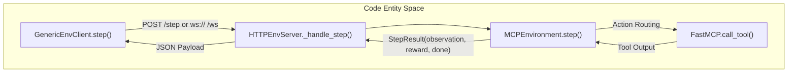
*Sources: `[src/openenv/core/mcp_client.py:28-30]`, `[src/openenv/core/env_server/mcp_environment.py:133-145]()`*

### Data Flow: Production Mode
In production mode, simulation control routes (`/reset`, `/step`, `/state`) are disabled to prevent state manipulation and causality violations. Clients interact directly with the underlying MCP server through JSON-RPC 2.0 messages over `/mcp` or WebSocket connections.

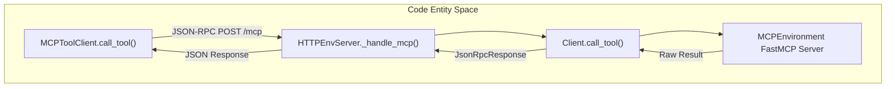
*Sources: `[src/openenv/core/mcp_client.py:30-31]`, `[tests/core/test_production_mode_routes.py:140-176]()`*

---

## Core MCP Classes and Implementation

### `MCPEnvironment`
`MCPEnvironment` serves as the base class for environments exposing tools via FastMCP `[src/openenv/core/env_server/mcp_environment.py:133-138]()`. It bridges FastMCP server definitions with OpenEnv's execution lifecycle.

- **Tool Registration & Validation**: During initialization `__init__`, the environment validates all registered tool names against `RESERVED_TOOL_NAMES` `[src/openenv/core/env_server/mcp_environment.py:186-188]()`.
- **Action Handling**: It automatically maps incoming `ListToolsAction` and `CallToolAction` requests to the underlying FastMCP server instance `[src/openenv/core/env_server/mcp_environment.py:141-145]()`.
- **Mode-Aware Tools**: Supports registering tools visible exclusively in specific modes via `@self.tool(mode="production")` or `@self.tool(mode="simulation")` `[src/openenv/core/env_server/mcp_environment.py:28-36]()`.

### `MCPToolClient`
`MCPToolClient` inherits from `MCPClientBase` and provides asynchronous and synchronous tool discovery and invocation interfaces `[src/openenv/core/mcp_client.py:77-105]()`.

- **Mode Enforcement**: Enforces `mode="production"` upon initialization, raising a `ValueError` if simulation mode is requested directly on an MCP client `[src/openenv/core/mcp_client.py:146-157]()`.
- **Tool Discovery**: `list_tools()` queries the server and caches tool schemas in `self._tools_cache` `[src/openenv/core/mcp_client.py:104-105]()`.
- **Tool Invocation**: `call_tool(tool_name, **kwargs)` dispatches tool execution requests and handles response parsing `[src/openenv/core/mcp_client.py:42-45]()`.

Sources: `[src/openenv/core/env_server/mcp_environment.py:133-198]`, `[src/openenv/core/mcp_client.py:77-175]()`

---

## JSON-RPC 2.0 Transport and Tool Discovery

Communication across production endpoints adheres strictly to the JSON-RPC 2.0 specification. 

- **Transport Endpoints**: Requests are sent via HTTP POST to `/mcp` or over WebSocket connections `[src/openenv/core/env_client.py:1-50]`.
- **Payload Structure**: JSON-RPC requests contain `jsonrpc: "2.0"`, a unique request `id`, a `method` string (e.g., `tools/list` or `tools/call`), and a `params` dictionary `[tests/core/test_mcp/test_mcp_client.py:72-100]()`.
- **Error Handling**: Standard JSON-RPC error codes are returned upon failure, categorizing errors into transport faults, tool execution exceptions, and missing tools (`ToolErrorType.TOOL_NOT_FOUND`) `[src/openenv/core/env_server/mcp_types.py:33-50]`, `[tests/core/test_mcp/test_mcp_client.py:182-201]()`.

### Tool Discovery Schema
Tools are serialized into OpenEnv's internal `Tool` model, which normalizes input schemas across different FastMCP server versions:

```python
class Tool(BaseModel):
    name: str
    description: str
    input_schema: Dict[str, Any]
```
Sources: `[src/openenv/core/env_server/mcp_types.py:183-200]`, `[src/openenv/core/mcp_client.py:76-82]()`

---

## Session Management and Reserved Tool Names

### Session Management
In production mode, clients manage persistent execution sessions to maintain context across stateful tool calls:
1. **Initialization**: The client establishes a connection and acquires a session handle `[src/openenv/core/mcp_client.py:170-172]()`.
2. **Locking & Concurrency**: Session synchronization locks (`_production_session_lock`, `_production_connect_lock`) prevent race conditions during concurrent asynchronous tool calls `[src/openenv/core/mcp_client.py:171-173]()`.

### `RESERVED_TOOL_NAMES`
To prevent namespace collisions between agent-accessible tools and the OpenEnv execution and control plane, `MCPEnvironment` explicitly prohibits registering tools under reserved control names `[src/openenv/core/env_server/mcp_environment.py:186-187]()`.

The reserved tool names are:
- `reset`
- `step`
- `state`
- `close`

Attempting to register a tool matching any of these strings raises a `ValueError` during environment instantiation.

Sources: `[src/openenv/core/env_server/mcp_types.py:16-17]`, `[src/openenv/core/env_server/mcp_environment.py:186-188]`

---

# Page: Rubric System (Reward Computation)

# Rubric System (Reward Computation)

<details>
<summary>Relevant source files</summary>

The following files were used as context for generating this wiki page:

- [.claude/agents/alignment-reviewer.md](.claude/agents/alignment-reviewer.md)
- [.claude/agents/build-validator.md](.claude/agents/build-validator.md)
- [.claude/agents/env-validator.md](.claude/agents/env-validator.md)
- [.claude/agents/openenv-architect.md](.claude/agents/openenv-architect.md)
- [.claude/docs/INVARIANTS.md](.claude/docs/INVARIANTS.md)
- [.claude/docs/PATTERNS.md](.claude/docs/PATTERNS.md)
- [.claude/docs/PRINCIPLES.md](.claude/docs/PRINCIPLES.md)
- [.claude/hooks/check-debug.sh](.claude/hooks/check-debug.sh)
- [rfcs/004-rubrics.md](rfcs/004-rubrics.md)
- [src/openenv/core/rubrics/base.py](src/openenv/core/rubrics/base.py)
- [src/openenv/core/rubrics/containers.py](src/openenv/core/rubrics/containers.py)
- [src/openenv/core/rubrics/trajectory.py](src/openenv/core/rubrics/trajectory.py)
- [tests/core/test_rubrics/test_async_base_rubric.py](tests/core/test_rubrics/test_async_base_rubric.py)
- [tests/core/test_rubrics/test_pre_hook_bugs.py](tests/core/test_rubrics/test_pre_hook_bugs.py)

</details>


The Rubric system is OpenEnv's first-class abstraction for computing rewards. Modeled after PyTorch's `nn.Module`, it provides a composable, hierarchical framework for multi-criteria reward evaluation [rfcs/004-rubrics.md:1-5](). Rubrics allow environment authors to break down complex reward logic into small, reusable components that support introspection, serialization, hooks, and asynchronous evaluation [rfcs/004-rubrics.md:10-30]().

---

## 1. The Rubric Base Class

The foundation of the reward system is the abstract base class `Rubric` defined in `src/openenv/core/rubrics/base.py` [src/openenv/core/rubrics/base.py:17-36](). Subclasses must implement the `forward(self, action, observation) -> float` method [src/openenv/core/rubrics/base.py:159-170]().

### Key Mechanisms
*   **Auto-Registration**: When a `Rubric` instance is assigned as an attribute on another rubric via `__setattr__`, it is automatically registered into `_rubric_children`, enabling recursive inspection [src/openenv/core/rubrics/base.py:50-55]().
*   **Synchronous and Asynchronous Execution**: The `__call__` method inspects whether `forward()` or any registered hook is a coroutine function (`inspect.iscoroutinefunction`), seamlessly branching into sync or async execution paths [src/openenv/core/rubrics/base.py:56-81]().
*   **Observability Hooks**: Supports pre-forward hooks (`_forward_pre_hooks`) and post-forward hooks (`_forward_hooks`) to capture execution telemetry without mutating reward values [src/openenv/core/rubrics/base.py:39-40](), [rfcs/004-rubrics.md:162-164]().
*   **Score Tracking**: The `last_score` attribute records the most recent return value of `__call__`, enabling training harnesses to log component scores [src/openenv/core/rubrics/base.py:41-48]().

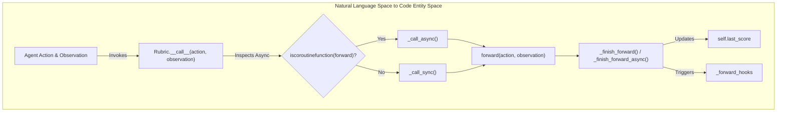
*Sources:* [src/openenv/core/rubrics/base.py:17-182](), [rfcs/004-rubrics.md:35-50]()

---

## 2. Composable Containers

Similar to PyTorch's container modules, OpenEnv provides composable container rubrics in `src/openenv/core/rubrics/containers.py` to aggregate reward signals [rfcs/004-rubrics.md:119-122]().

### Container Types and Semantics
*   **`Sequential`**: Evaluates child rubrics in order. If any child returns a score of `0.0`, execution halts immediately (fail-fast) and returns `0.0`. This models hierarchical gating (e.g., verifying syntax before running execution or tests) [src/openenv/core/rubrics/containers.py:27-43](), [rfcs/004-rubrics.md:123]().
*   **`Gate`**: Wraps a single rubric and applies a threshold filter. If the child score meets or exceeds the threshold, it passes through; otherwise, it returns `0.0` [rfcs/004-rubrics.md:125]().
*   **`WeightedSum`**: Combines multiple rubrics via a weighted linear combination, utilizing parallel evaluation where applicable [rfcs/004-rubrics.md:127]().

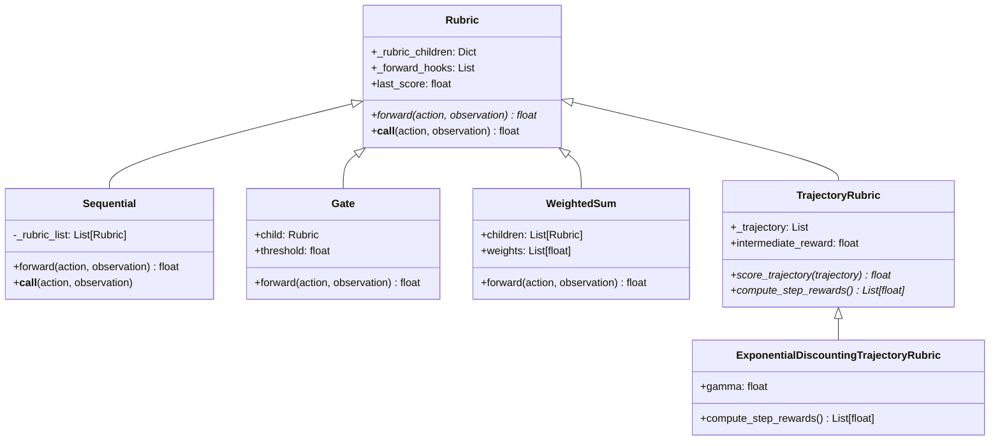
*Sources:* [src/openenv/core/rubrics/base.py:17-55](), [src/openenv/core/rubrics/containers.py:27-43](), [src/openenv/core/rubrics/trajectory.py:22-190]()

*Sources:* [src/openenv/core/rubrics/base.py:1-182](), [src/openenv/core/rubrics/containers.py:1-172](), [rfcs/004-rubrics.md:119-160]()

---

## 3. Trajectory Rubrics

For delayed reward environments where outcomes are known only at episode termination (e.g., board games, multi-step planning), OpenEnv provides `TrajectoryRubric` in `src/openenv/core/rubrics/trajectory.py` [src/openenv/core/rubrics/trajectory.py:1-14]().

### Mechanics and Credit Assignment
*   **Accumulation**: Non-terminal steps return an `intermediate_reward` (default `0.0`), while storing `(action, observation)` pairs in CPU memory [src/openenv/core/rubrics/trajectory.py:62-91]().
*   **Termination Scoring**: When `observation.done` is true, `score_trajectory()` evaluates the entire episode history [src/openenv/core/rubrics/trajectory.py:87-105]().
*   **`ExponentialDiscountingTrajectoryRubric`**: Subclass that applies temporal discounting ($r_t = \gamma^{T-1-t} \cdot R_{\text{final}}$) across the episode trajectory once completed [src/openenv/core/rubrics/trajectory.py:138-190]().

*Sources:* [src/openenv/core/rubrics/trajectory.py:1-211]()

---

## 4. Environment Step Lifecycle Integration

Rubrics execute exclusively on the **environment server** during the `step()` cycle [rfcs/004-rubrics.md:50-64](). The environment base class requires a `rubric` attribute initialized in its constructor [rfcs/004-rubrics.md:55-75]().

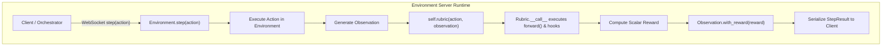
*Sources:* [rfcs/004-rubrics.md:50-75](), [.claude/docs/PATTERNS.md:112-130]()

*Sources:* [rfcs/004-rubrics.md:50-75](), [.claude/docs/PATTERNS.md:112-130]()

---

# Page: Container Providers and Runtime

# Container Providers and Runtime

<details>
<summary>Relevant source files</summary>

The following files were used as context for generating this wiki page:

- [examples/daytona_tbench2_concurrent.py](examples/daytona_tbench2_concurrent.py)
- [examples/daytona_tbench2_simple.py](examples/daytona_tbench2_simple.py)
- [examples/novita_echo_env.py](examples/novita_echo_env.py)
- [examples/novita_tbench2_e2e_eval.py](examples/novita_tbench2_e2e_eval.py)
- [examples/novita_tbench2_simple.py](examples/novita_tbench2_simple.py)
- [src/openenv/core/containers/runtime/__init__.py](src/openenv/core/containers/runtime/__init__.py)
- [src/openenv/core/containers/runtime/_server_config.py](src/openenv/core/containers/runtime/_server_config.py)
- [src/openenv/core/containers/runtime/aca_provider.py](src/openenv/core/containers/runtime/aca_provider.py)
- [src/openenv/core/containers/runtime/daytona_provider.py](src/openenv/core/containers/runtime/daytona_provider.py)
- [src/openenv/core/containers/runtime/modal_provider.py](src/openenv/core/containers/runtime/modal_provider.py)
- [src/openenv/core/containers/runtime/novita_provider.py](src/openenv/core/containers/runtime/novita_provider.py)
- [src/openenv/core/containers/runtime/providers.py](src/openenv/core/containers/runtime/providers.py)
- [src/openenv/core/containers/runtime/uv_provider.py](src/openenv/core/containers/runtime/uv_provider.py)
- [src/openenv/core/sync_client.py](src/openenv/core/sync_client.py)
- [tests/scripts/test_novita_examples_release_sandbox.py](tests/scripts/test_novita_examples_release_sandbox.py)
- [tests/test_core/test_aca_provider.py](tests/test_core/test_aca_provider.py)
- [tests/test_core/test_daytona_provider.py](tests/test_core/test_daytona_provider.py)
- [tests/test_core/test_modal_provider.py](tests/test_core/test_modal_provider.py)
- [tests/test_core/test_novita_provider.py](tests/test_core/test_novita_provider.py)
- [tests/test_core/test_uv_provider.py](tests/test_core/test_uv_provider.py)

</details>


Container providers in OpenEnv abstract the lifecycle management of environment servers. They allow the `EnvClient` and runtime harnesses to programmatically start, monitor, and stop the infrastructure required to run an environment, whether that infrastructure is a local Docker container, a cloud sandbox, a serverless provider, or a local process.

Sources: `[src/openenv/core/containers/runtime/providers.py:1-40]`, `[src/openenv/core/containers/runtime/daytona_provider.py:1-30]`, `[src/openenv/core/containers/runtime/modal_provider.py:1-25]`

---

## Pluggable Provider Interface

The `ContainerProvider` is an abstract base class defined in `[src/openenv/core/containers/runtime/providers.py:18-118]()`. It defines the pluggable contract for any backend hosting an OpenEnv server.

### Key Lifecycle Methods
- `start_container(image, port, env_vars, **kwargs)`: Launches the environment and returns the base URL (e.g., `http://localhost:8000` or an encrypted https tunnel) `[src/openenv/core/containers/runtime/providers.py:43-72]()`.
- `wait_for_ready(base_url, timeout_s)`: Polls the environment's health or readiness endpoint until it responds successfully, ensuring the server is ready for interaction `[src/openenv/core/containers/runtime/providers.py:84-99]()`.
- `stop_container()`: Tears down the environment and cleans up associated resources `[src/openenv/core/containers/runtime/providers.py:74-81]()`.
- `close()`: Releases provider-held SDK clients or resources `[src/openenv/core/containers/runtime/providers.py:101-110]()`.

### Runtime Abstraction Overview

**Provider System Mapping**
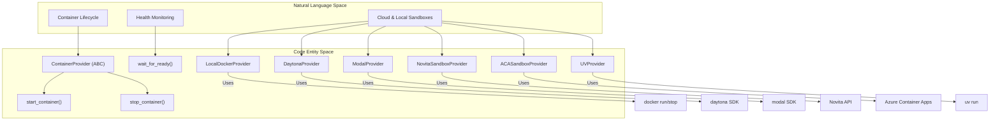
Sources: `[src/openenv/core/containers/runtime/providers.py:18-118]`, `[src/openenv/core/containers/runtime/daytona_provider.py:20-85]`, `[src/openenv/core/containers/runtime/modal_provider.py:137-172]`, `[src/openenv/core/containers/runtime/uv_provider.py:125-154]`

---

## LocalDockerProvider

The `LocalDockerProvider` manages containers on the local machine using the Docker CLI. It serves as the primary provider for local development, unit testing, and offline evaluation.

- **Port Management**: If no port is specified, it discovers an available port on the host machine `[src/openenv/core/containers/runtime/providers.py:168-190]()`.
- **Container Mapping**: It maps the internal server port (`8000`) to the allocated host port `[src/openenv/core/containers/runtime/providers.py:195-204]()`.
- **Process Execution**: It uses `subprocess` to execute `docker run -d`, `docker stop`, and `docker rm` commands `[src/openenv/core/containers/runtime/providers.py:184-232]()`.

Sources: `[src/openenv/core/containers/runtime/providers.py:120-232]`

---

## DaytonaProvider

The `DaytonaProvider` executes environments inside Daytona cloud sandboxes, facilitating horizontally scaled evaluations and remote training workloads.

- **Dynamic Command Discovery**: Automatically discovers server startup commands by inspecting `openenv.yaml` inside the sandbox `[src/openenv/core/containers/runtime/daytona_provider.py:86-117]()`.
- **Dockerfile and Snapshot Support**: Extracts `CMD` instructions from Dockerfiles or boots directly from pre-built Daytona snapshots using the `snapshot:` prefix `[src/openenv/core/containers/runtime/daytona_provider.py:154-187]()`.
- **Signed Preview URLs**: Generates secure authenticated preview URLs for sandbox ports `[src/openenv/core/containers/runtime/daytona_provider.py:34-40]()`.

**Daytona Lifecycle Flow**
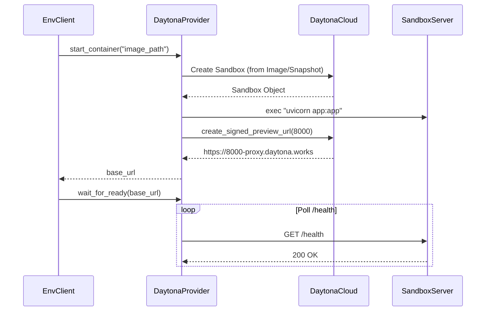
Sources: `[src/openenv/core/containers/runtime/daytona_provider.py:20-85]`, `[src/openenv/core/containers/runtime/daytona_provider.py:86-170]`, `[tests/test_core/test_daytona_provider.py:148-180]`

---

## ModalProvider

The `ModalProvider` runs OpenEnv environments inside Modal sandboxes, booting servers within secure ephemeral containers exposed over encrypted tunnels (`https://` / `wss://`).

- **Adapter Architecture**: Communicates via `_DefaultModalAdapter` to isolate direct SDK calls and support experimental Sandbox v2 APIs (`use_sandbox_v2=True`) `[src/openenv/core/containers/runtime/modal_provider.py:57-136]()`.
- **Security Invariant Enforcement**: Enforces HTTPS/WSS transport (`_require_secure_url`) to guarantee encrypted client-server traffic, treating tunnel URLs as secure bearer tokens `[src/openenv/core/containers/runtime/modal_provider.py:40-55]()`.
- **Resource Capping**: Configures CPU and memory request limits (`_DEFAULT_CPU_REQUEST`, `_DEFAULT_MEMORY_REQUEST`) to bound resource consumption `[src/openenv/core/containers/runtime/modal_provider.py:32-38]()`.

Sources: `[src/openenv/core/containers/runtime/modal_provider.py:1-172]`, `[tests/test_core/test_modal_provider.py:1-135]`

---

## NovitaProvider

The `NovitaSandboxProvider` targets Novita AI sandbox infrastructure for launching remote server instances and pre-built environment templates.

- **Template Management**: Translates Dockerfiles into remote Novita templates on initial startup, caching references for subsequent faster boots `[examples/novita_tbench2_simple.py:25-30]()`.
- **Remote Execution**: Manages container lifecycles through Novita's REST API, returning base URLs for client connectivity `[examples/novita_tbench2_simple.py:33-53]()`.

Sources: `[src/openenv/core/containers/runtime/novita_provider.py:1-120]`, `[examples/novita_tbench2_simple.py:1-55]`

---

## ACAProvider and HF Sandbox

The `ACASandboxProvider` integrates with Azure Container Apps (ACA) for enterprise and cloud-native deployments, managing container replicas and ingress routing. In parallel, Hugging Face Spaces / HF Sandbox integrations leverage containerized Spaces and Hugging Face Hub backends to host interactive environments with zero local setup.

Sources: `[src/openenv/core/containers/runtime/aca_provider.py:1-100]`

---

## UVProvider

The `UVProvider` is a lightweight `RuntimeProvider` that bypasses containerization entirely, executing the environment server as a local process managed by the `uv` package manager `[src/openenv/core/containers/runtime/uv_provider.py:125-154]()`.

- **Git Project Clones**: Supports `git+<url>` specifications by cloning remote repositories into temporary directories with configurable timeouts before launching `[src/openenv/core/containers/runtime/uv_provider.py:29-62]`, `[src/openenv/core/containers/runtime/uv_provider.py:169-173]()`.
- **Health Polling**: Continuously polls health check endpoints using exponential backoff to detect server readiness without busy-spinning CPU cores `[src/openenv/core/containers/runtime/uv_provider.py:103-123]()`.

Sources: `[src/openenv/core/containers/runtime/uv_provider.py:1-180]`, `[tests/test_core/test_uv_provider.py:26-80]`

---

## Container Lifecycle & Health Monitoring Summary

When initialized via `EnvClient`, container providers automate the complete environment lifecycle from provisioning to tear-down.

| Provider | Backend / Platform | Isolation Level | Startup Characteristic |
| :--- | :--- | :--- | :--- |
| **LocalDockerProvider** | Local Docker Engine | High (Container) | Medium (Image dependent) |
| **DaytonaProvider** | Daytona Cloud SDK | High (Cloud Sandbox) | Provisioning + Exec setup |
| **ModalProvider** | Modal Sandboxes | High (Encrypted Tunnel) | Fast tunnel allocation |
| **NovitaSandboxProvider** | Novita AI APIs | High (Remote Sandbox) | Template build / cache |
| **ACASandboxProvider** | Azure Container Apps | High (Cloud Replica) | Enterprise scale-out |
| **UVProvider** | Local Process (`uv`) | Low (Shared Host OS) | Instant (`uv run`) |

**Container Runtime Sequence**
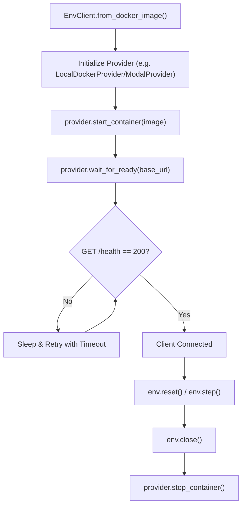
Sources: `[src/openenv/core/containers/runtime/providers.py:43-99]`, `[src/openenv/core/containers/runtime/modal_provider.py:137-166]`, `[src/openenv/core/containers/runtime/uv_provider.py:103-154]`

---

# Page: AutoEnv, Discovery, and Catalog

# AutoEnv, Discovery, and Catalog

<details>
<summary>Relevant source files</summary>

The following files were used as context for generating this wiki page:

- [.gitignore](.gitignore)
- [docs/source/environments/openapp.md](docs/source/environments/openapp.md)
- [docs/source/guides/catalog-discovery.md](docs/source/guides/catalog-discovery.md)
- [docs/source/guides/harbor-provider-qualification.md](docs/source/guides/harbor-provider-qualification.md)
- [envs/agent_world_model_env/openenv.yaml](envs/agent_world_model_env/openenv.yaml)
- [envs/carla_env/openenv.yaml](envs/carla_env/openenv.yaml)
- [envs/chess_env/openenv.yaml](envs/chess_env/openenv.yaml)
- [envs/finqa_env/openenv.yaml](envs/finqa_env/openenv.yaml)
- [envs/grid_world_env/openenv.yaml](envs/grid_world_env/openenv.yaml)
- [envs/openapp_env/README.md](envs/openapp_env/README.md)
- [envs/pelican_svg_env/openenv.yaml](envs/pelican_svg_env/openenv.yaml)
- [envs/wildfire_env/openenv.yaml](envs/wildfire_env/openenv.yaml)
- [rfcs/011-ard-catalog-discovery.md](rfcs/011-ard-catalog-discovery.md)
- [src/openenv/auto/_discovery.py](src/openenv/auto/_discovery.py)
- [src/openenv/auto/auto_action.py](src/openenv/auto/auto_action.py)
- [src/openenv/discovery/models.py](src/openenv/discovery/models.py)
- [src/openenv/discovery/schemas/0.1-draft/catalog.schema.json](src/openenv/discovery/schemas/0.1-draft/catalog.schema.json)
- [src/openenv/discovery/schemas/0.1-draft/declaration.schema.json](src/openenv/discovery/schemas/0.1-draft/declaration.schema.json)
- [src/openenv/discovery/schemas/0.1-draft/environment-card.schema.json](src/openenv/discovery/schemas/0.1-draft/environment-card.schema.json)
- [tests/discovery/test_catalog_contract.py](tests/discovery/test_catalog_contract.py)
- [tests/envs/test_discovery.py](tests/envs/test_discovery.py)
- [tests/envs/test_manifest_app_targets.py](tests/envs/test_manifest_app_targets.py)

</details>


The Auto-Discovery system provides a HuggingFace-style factory pattern for OpenEnv, enabling seamless interaction with environments without requiring manual module imports or prior knowledge of the internal directory structure. It manages the lifecycle of environment discovery from local packages, the HuggingFace Hub, remote HuggingFace Spaces, and ARD-backed (Agentic Resource Discovery) metadata catalogs defined under RFC 011.

## Overview and Scope

The system is centered around primary factory classes and discovery subsystems:
*   **`AutoEnv`**: Automatically resolves, installs, and instantiates `EnvClient` (or its derivatives) [src/openenv/auto/auto_env.py:120-147]().
*   **`AutoAction`**: Automatically retrieves the correct `Action` class for a given environment name [src/openenv/auto/auto_action.py:44-73]().
*   **`EnvironmentDiscovery`**: Scans installed packages via `importlib.metadata` and parses manifests [src/openenv/auto/_discovery.py:11-18]().
*   **Catalog Discovery (`openenv catalog`)**: Enforces the RFC 011 contract for metadata-only task and environment search without package execution [docs/source/guides/catalog-discovery.md:1-4]().

### Data Flow: Environment Resolution

The following diagram illustrates the process of resolving an environment name to a functional client, bridging natural language requests to code entities (`AutoEnv`, `EnvironmentDiscovery`, `importlib`).

**Environment Discovery and Instantiation Flow**
```mermaid
sequenceDiagram
    participant User as "UserQuery"
    participant AutoEnv as "AutoEnv.from_env()"
    participant Discovery as "EnvironmentDiscovery"
    participant HF as "HuggingFaceHub"
    participant Pip as "pip_installer"

    User->>AutoEnv: "from_env(name='org/repo')"
    AutoEnv->>AutoEnv: "_is_hub_url(name)"
    
    alt is HuggingFace Repo
        AutoEnv->>AutoEnv: "_confirm_remote_install()"
        AutoEnv->>Pip: "subprocess.run(['pip', 'install', ...])"
    end

    AutoEnv->>Discovery: "get_environment_by_name(env_name)"
    Discovery->>Discovery: "discover() -> importlib.metadata"
    Discovery-->>AutoEnv: "EnvironmentInfo(client_module_path, client_class_name)"
    
    AutoEnv->>AutoEnv: "get_client_class()"
    AutoEnv->>User: "EnvClient Instance"
```
Sources: [src/openenv/auto/auto_env.py:156-200](), [src/openenv/auto/_discovery.py:11-18](), [src/openenv/auto/auto_action.py:82-128]()

---

## Environment Discovery and Manifests

OpenEnv environments are identified by the `openenv-` prefix in their package names. The `EnvironmentDiscovery` class uses `importlib.metadata` to find these packages [src/openenv/auto/_discovery.py:20-22]().

### The `openenv.yaml` Manifest and `discovery.json`
Each environment package must include an `openenv.yaml` file. This manifest defines the relationship between the environment name and the code entities [src/openenv/auto/_discovery.py:52-54](). Additionally, optional `discovery.json` files provide extra metadata for catalog indexing [docs/source/guides/catalog-discovery.md:36-39]().

| Field | Description |
| :--- | :--- |
| `name` | The unique environment name (e.g., `coding_env`) [src/openenv/auto/_discovery.py:41-53]() |
| `client_module_path` | Python path to the client (e.g., `coding_env.client`) [src/openenv/auto/_discovery.py:41-53]() |
| `client_class_name` | The class name for the environment client [src/openenv/auto/_discovery.py:41-53]() |
| `action_class_name` | The class name for actions [src/openenv/auto/_discovery.py:41-53]() |
| `default_image` | The default Docker image for this environment [src/openenv/auto/_discovery.py:41-53]() |

### Discovery Implementation
The `EnvironmentDiscovery` class performs a scan and caches results in `_cache` to ensure performance during repeated lookups [src/openenv/auto/_discovery.py:13-14]().

**Code Entity Mapping: Discovery to Classes**
```mermaid
classDiagram
    class EnvironmentInfo {
        +str env_key
        +str package_name
        +str client_module_path
        +str client_class_name
        +get_client_class()
        +get_action_class()
        +get_observation_class()
    }
    class EnvironmentDiscovery {
        -dict _cache
        +discover()
        +get_environment_by_name(name)
    }
    class AutoEnv {
        +from_env(name)
        +_ensure_package_from_hub(name)
    }
    
    AutoEnv ..> EnvironmentDiscovery : "calls get_environment_by_name"
    EnvironmentDiscovery ..> EnvironmentInfo : "returns instances"
    EnvironmentInfo ..> "importlib" : "uses importlib.import_module"
```
Sources: [src/openenv/auto/_discovery.py:36-68](), [src/openenv/auto/_discovery.py:69-92](), [src/openenv/auto/auto_env.py:120-147]()

Sources: [src/openenv/auto/_discovery.py:11-92](), [docs/source/guides/catalog-discovery.md:36-55]()

---

## Catalog Contract and ARD-Backed Discovery (RFC 011)

Under [RFC 011](https://github.com/huggingface/OpenEnv/blob/main/rfcs/011-ard-catalog-discovery.md), OpenEnv supports metadata-only environment discovery via `openenv catalog` and `openenv discover` [docs/source/guides/catalog-discovery.md:1-4](). This system inspects committed metadata without importing packages, pulling Docker images, or running candidate environments [docs/source/guides/catalog-discovery.md:1-4]().

### Building Catalogs and Searching
Catalogs are generated from repository roots containing tracked `openenv.yaml` files [docs/source/guides/catalog-discovery.md:10-18](). The build process reads manifests, `pyproject.toml`, README front matter, and optional `discovery.json` files to produce structured records [docs/source/guides/catalog-discovery.md:20-21]().

**Catalog Building and Discovery Pipeline**
```mermaid
flowchart TD
    Manifests["openenv.yaml and discovery.json"] --> Producer["openenv catalog build"]
    PyProject["pyproject.toml metadata"] --> Producer
    README["README frontmatter"] --> Producer
    Producer --> Snapshot["catalog.json snapshot"]
    Snapshot --> Search["openenv discover query"]
    Snapshot --> Inspect["openenv catalog inspect"]
    Search --> Result["Environment Card matches"]
```
Sources: [docs/source/guides/catalog-discovery.md:10-34](), [rfcs/011-ard-catalog-discovery.md:100-123]()

### Schemas and Contracts
The discovery schemas (`src/openenv/discovery/schemas/0.1-draft/`) define rigorous validation contracts for `environment-card.schema.json`, `catalog.schema.json`, and `declaration.schema.json`. Search ranking uses case-insensitive token overlap over descriptions, names, tags, capabilities, and representative queries [docs/source/guides/catalog-discovery.md:32-33]().

Sources: [docs/source/guides/catalog-discovery.md:1-132](), [rfcs/011-ard-catalog-discovery.md:1-139]()

---

## HuggingFace Hub Integration and Security

OpenEnv supports two modes of HuggingFace integration:
1.  **Package Installation**: Installing an environment package directly from a Space/Repo using `pip install git+...` [src/openenv/auto/auto_env.py:375-390]().
2.  **Remote Connection**: Connecting to a running HuggingFace Space via its resolved URL [src/openenv/auto/auto_env.py:157-182]().

### Security and `OPENENV_TRUST_REMOTE_CODE`
Since `AutoEnv` can trigger `pip install` on remote repositories, a security mechanism is enforced. By default, the system prompts the user for confirmation before executing remote code [src/openenv/auto/auto_env.py:77-118]().

*   **Interactive Mode**: Users are prompted with a "SECURITY WARNING" in the terminal [src/openenv/auto/auto_env.py:102-111]().
*   **Non-Interactive/CI**: Users must set the environment variable `OPENENV_TRUST_REMOTE_CODE=1` to bypass the prompt [src/openenv/auto/auto_env.py:89-92]().

### Space URL Resolution
The method `AutoEnv._resolve_space_url(repo_id)` transforms a repository ID (e.g., `org/name`) into a standard HuggingFace Space URL (e.g., `https://org-name.hf.space`) to facilitate HTTP/WebSocket connections [src/openenv/auto/auto_env.py:157-182]().

Sources: [src/openenv/auto/auto_env.py:56-118](), [src/openenv/auto/auto_env.py:157-190](), [src/openenv/auto/auto_env.py:375-390]()

---

## AutoAction Factory Pattern

The `AutoAction` class provides a parallel interface for retrieving action classes. This is critical for agentic loops where the agent needs to know the schema of the action it is about to take [src/openenv/auto/auto_action.py:44-73]().

### Key Method: `from_env(name, skip_install=False)`
*   If `skip_install=True`, it returns a `GenericAction` (dictionary-based) to avoid remote code execution [src/openenv/auto/auto_action.py:129-138]().
*   If `skip_install=False`, it ensures the package is installed and uses `EnvironmentInfo.get_action_class()` to return the typed action class [src/openenv/auto/auto_action.py:175-177]().

| Function / Class | File Path | Description |
| :--- | :--- | :--- |
| `_is_hub_url` | [src/openenv/auto/_discovery.py:170-190]() | Determines if a string is a local name or a HF Repo ID. |
| `get_discovery` | [src/openenv/auto/_discovery.py:410-418]() | Singleton accessor for the discovery system. |
| `_normalize_env_name` | [src/openenv/auto/_discovery.py:142-168]() | Standardizes names like `echo` to `echo_env`. |
| `AutoAction.from_env` | [src/openenv/auto/auto_action.py:79-138]() | Factory method to retrieve typed or generic action classes. |

Sources: [src/openenv/auto/auto_action.py:79-177](), [src/openenv/auto/_discovery.py:142-190](), [src/openenv/auto/_discovery.py:410-418]()

---

# Page: Agentic Harness and Data Collection

# Agentic Harness and Data Collection

<details>
<summary>Relevant source files</summary>

The following files were used as context for generating this wiki page:

- [docs/source/_redirects.yml](docs/source/_redirects.yml)
- [docs/source/guides/training.md](docs/source/guides/training.md)
- [envs/harbor_env/harness.py](envs/harbor_env/harness.py)
- [rfcs/005-agentic-harnesses.md](rfcs/005-agentic-harnesses.md)
- [rfcs/006-agentic-rl-harness-interception.md](rfcs/006-agentic-rl-harness-interception.md)
- [rfcs/README.md](rfcs/README.md)
- [src/openenv/core/harness/README.md](src/openenv/core/harness/README.md)
- [src/openenv/core/harness/__init__.py](src/openenv/core/harness/__init__.py)
- [src/openenv/core/harness/bridge.py](src/openenv/core/harness/bridge.py)
- [src/openenv/core/harness/capture/__init__.py](src/openenv/core/harness/capture/__init__.py)
- [src/openenv/core/harness/capture/contract.py](src/openenv/core/harness/capture/contract.py)
- [src/openenv/core/harness/capture/validate.py](src/openenv/core/harness/capture/validate.py)
- [src/openenv/core/harness/collect.py](src/openenv/core/harness/collect.py)
- [src/openenv/core/harness/environment.py](src/openenv/core/harness/environment.py)
- [src/openenv/core/harness/events.py](src/openenv/core/harness/events.py)
- [src/openenv/core/harness/process.py](src/openenv/core/harness/process.py)
- [src/openenv/core/harness/rollout.py](src/openenv/core/harness/rollout.py)
- [src/openenv/core/harness/training.py](src/openenv/core/harness/training.py)
- [src/openenv/harbor/contract.py](src/openenv/harbor/contract.py)
- [tests/core/scripted_harness.py](tests/core/scripted_harness.py)
- [tests/core/test_agentic_harness_bridge.py](tests/core/test_agentic_harness_bridge.py)
- [tests/core/test_agentic_harness_e2e.py](tests/core/test_agentic_harness_e2e.py)
- [tests/core/test_agentic_harness_environment.py](tests/core/test_agentic_harness_environment.py)
- [tests/core/test_harness_collect.py](tests/core/test_harness_collect.py)
- [tests/core/test_harness_rollout_backcompat.py](tests/core/test_harness_rollout_backcompat.py)
- [tests/envs/test_harbor_session_factory.py](tests/envs/test_harbor_session_factory.py)
- [tests/envs/test_training_trace.py](tests/envs/test_training_trace.py)

</details>


This page covers the OpenEnv agentic harness runtime (`ResourceSession`, `MCPHarnessAdapter`, and the bridge, events, and process modules), the synthetic dataset generation pipeline in `collect.py` (`CollectRunner`, `RolloutSerializer`, `EpisodeRecord`), and the `openenv collect` CLI command used for orchestrating rollouts.

Sources: [src/openenv/core/harness/__init__.py:1-18](), [src/openenv/core/harness/collect.py:3-14]()

---

## Harness Runtime and Primitives

The harness runtime (`openenv.core.harness`) provides a session-based architecture for driving rollouts against OpenEnv environments using an LLM and MCP-style tool loops, or via turn-based agentic harnesses (RFC 005) [src/openenv/core/harness/__init__.py:3-16]().

### Core Abstractions

*   **`ResourceSession`**: An abstract base class representing a single environment run or session [src/openenv/core/harness/__init__.py:51]().
*   **`ResourceSessionFactory`**: Creates `ResourceSession` instances for executing individual episodes [src/openenv/core/harness/__init__.py:52]().
*   **`MCPHarnessAdapter`**: Adapts environment observations into Model Context Protocol (MCP) tool definitions and converts agent tool calls into environment actions [src/openenv/core/harness/__init__.py:46]().
*   **`CLIHarnessAdapter` / `HarnessAdapter`**: Base and CLI-specific adapters for managing standard I/O interaction loops [src/openenv/core/harness/__init__.py:41-42]().
*   **Bridge, Events, and Process Modules**:
    *   `bridge.py` (`build_bridge_server`, `HarnessMCPBridge`, `SessionMCPBridge`): Bridges external MCP clients with internal environment endpoints [src/openenv/core/harness/__init__.py:27,54,80,106]().
    *   `events.py` (`HarnessEvent`, `HarnessEventType`, `HarnessClientMessage`): Manages streaming event messages and logging during harness execution [src/openenv/core/harness/__init__.py:30-35]().
    *   `process.py` (`HarnessProcess`): Controls external agent processes spawned within environment containers [src/openenv/core/harness/__init__.py:37]().

### Diagram: Harness Runtime Architecture

```mermaid
flowchart TB
    subgraph "Harness Runtime Space (src/openenv/core/harness)"
        RS["ResourceSession"]
        RSF["ResourceSessionFactory"]
        HA["MCPHarnessAdapter / HarnessAdapter"]
        Bridge["HarnessMCPBridge / SessionMCPBridge"]
        Events["events.py / HarnessEvent"]
        Proc["HarnessProcess"]
    end

    subgraph "External / Client Space"
        LLM["LLMClient"]
        Client["External Agent / Harness"]
    end

    Client -->|"Interacts"| Bridge
    RSF -->|"Spawns"| RS
    RS -->|"Uses"| HA
    HA -->|"Tool Definitions"| LLM
    RS -->|"Emits"| Events
    RS -->|"Manages"| Proc

    classDef core fill:#d6eaff,stroke:#0066cc;
    classDef ext fill:#fff3e0,stroke:#f57c00;
    class RS,RSF,HA,Bridge,Events,Proc core;
    class LLM,Client ext;
```
Sources: [src/openenv/core/harness/__init__.py:20-61](), [src/openenv/core/harness/README.md:1-17]()

---

## Data Collection Pipeline (`collect.py`)

The synthetic dataset generation pipeline (`src/openenv/core/harness/collect.py`) automates rollout execution and serializes trajectories into formats consumable by Supervised Fine-Tuning (SFT) trainers (such as TRL's `SFTTrainer`) or Hugging Face datasets [src/openenv/core/harness/collect.py:3-14]().

### Key Classes

*   **`EpisodeRecord`**: A serializable dataclass encapsulating one complete rollout episode, its chat messages, rewards, completion status, metrics, and tool traces [src/openenv/core/harness/collect.py:64-106]().
*   **`RolloutSerializer`**: An append-only JSONL writer with metadata sidecar support (`results.jsonl` and `metadata.json`) designed for handling resumable data collection [src/openenv/core/harness/collect.py:112-143]().
*   **`CollectRunner`**: Orchestrates repeated rollouts across multiple episodes, supports automatic resumption via disk inspection, and handles per-record filtering through `should_keep` [src/openenv/core/harness/README.md:9-16]().

### Data Flow: Collection to Dataset

```mermaid
flowchart TD
    subgraph "CLI Space"
        CLI["openenv collect command"]
    end

    subgraph "Runtime Space (src/openenv/core/harness/collect.py)"
        CR["CollectRunner"]
        ER["EpisodeRecord.from_rollout()"]
        RS["RolloutSerializer"]
    end

    subgraph "Code Entity Space"
        Adapter["MCPHarnessAdapter"]
        Session["ResourceSession"]
        Client["LLMClient"]
    end

    CLI --> CR
    CR --> Session
    CR --> Client
    CR --> Adapter
    
    Session -- "HarnessRolloutResult" --> ER
    VerifyResult -- "VerifyResult" --> ER
    ER --> RS
    RS -- "Append JSONL" --> Output[("results.jsonl & metadata.json")]

    classDef cli fill:#e1bee7,stroke:#8e24aa;
    classDef runtime fill:#c8e6c9,stroke:#388e3c;
    classDef entity fill:#bbdefb,stroke:#1976d2;

    class CLI cli;
    class CR,ER,RS runtime;
    class Adapter,Session,Client entity;
```
Sources: [src/openenv/core/harness/collect.py:64-143](), [src/openenv/core/harness/README.md:14-16]()

---

## The `openenv collect` CLI Command

The `openenv collect` command provides a unified command-line interface for running data collection campaigns [src/openenv/core/harness/README.md:14-41]().

### Usage Examples

```bash
# Smoke test using a scripted teacher (no API key or Docker required)
openenv collect openspiel:tic_tac_toe \
    --base-url https://<user>-<space>.hf.space \
    --output-dir /tmp/ttt-scripted \
    -n 10 --provider scripted

# Real LLM teacher with automatic Hugging Face Hub upload
OPENAI_API_KEY=... openenv collect openspiel:tic_tac_toe \
    --base-url https://<user>-<space>.hf.space \
    --output-dir /tmp/ttt-sft-v1 \
    -n 200 --provider openai --model gpt-5-mini \
    --push-to-hub <user>/ttt-sft-v1

# Self-hosted inference teacher (vLLM/TGI/Ollama) via OpenAI-compatible endpoints
openenv collect openspiel:tic_tac_toe \
    --base-url https://<user>-<space>.hf.space \
    --output-dir /tmp/ttt-sft-local \
    -n 200 --llm-endpoint http://localhost:8000 --model Qwen/Qwen3-1.7B
```

### Output Schema (`results.jsonl`)

Each line in `results.jsonl` contains a structured JSON object representing an episode record:

| Field | Type | Description |
| :--- | :--- | :--- |
| `episode_id` | `string` | Stable identifier used for resume tracking (`<prefix>-<index>`) [src/openenv/core/harness/README.md:83]() |
| `messages` | `list` | Full chat transcript (`user`/`assistant`/`tool`), compatible with TRL `SFTTrainer` [src/openenv/core/harness/README.md:84]() |
| `reward` | `float` | Environment reward resolved via `_resolve_env_reward` [src/openenv/core/harness/README.md:85]() |
| `done` | `bool` | Episode termination flag [src/openenv/core/harness/README.md:86]() |
| `tool_trace` | `list` | Structured tool execution records with arguments and results [src/openenv/core/harness/README.md:87]() |
| `metrics` | `struct` | Harness-level metrics (e.g., turn count, tool call count) [src/openenv/core/harness/README.md:88]() |
| `verify_metrics` | `struct` | Session verification metrics [src/openenv/core/harness/README.md:89]() |
| `artifacts` | `struct` | Verification artifacts and final state payloads [src/openenv/core/harness/README.md:90]() |
| `task` | `any` | Optional task specifications passed via `CollectRunner` [src/openenv/core/harness/README.md:91]() |
| `extra` | `struct` | Additional caller-provided metadata annotations [src/openenv/core/harness/README.md:92]() |

Sources: [src/openenv/core/harness/README.md:14-97]()

---

## Training Traces and Loop-Owning Sessions

For advanced reinforcement learning workflows (such as integration with TRL and Harbor environments), loop-owning sessions implement `TrainableSession.fetch_training_trace()` to return a `TrainingTrace` containing canonical token IDs, per-token logprobs, and loss masks [envs/harbor_env/harness.py:7-28]().

```python
from openenv.core.harness import TrainingTrace, TrainingTurn

trace = TrainingTrace(turns=[TrainingTurn(
    node_id="call-0",
    prompt_token_ids=[10, 11],
    completion_token_ids=[20, 21, 22],
    per_token_logps=[-0.2, -0.4, -0.1],
    loss_mask=[0, 0, 1, 0, 1],
)])
restored = TrainingTrace.model_validate_json(trace.model_dump_json())
```

Sources: [src/openenv/core/harness/README.md:116-133](), [envs/harbor_env/harness.py:7-49]()

---

# Page: LLM Client and Evaluation Harnesses

# LLM Client and Evaluation Harnesses

<details>
<summary>Relevant source files</summary>

The following files were used as context for generating this wiki page:

- [envs/calendar_env/client.py](envs/calendar_env/client.py)
- [examples/ttt_collect_with_llm.py](examples/ttt_collect_with_llm.py)
- [src/openenv/cli/commands/collect.py](src/openenv/cli/commands/collect.py)
- [src/openenv/core/evals/__init__.py](src/openenv/core/evals/__init__.py)
- [src/openenv/core/evals/base.py](src/openenv/core/evals/base.py)
- [src/openenv/core/evals/inspect_harness.py](src/openenv/core/evals/inspect_harness.py)
- [src/openenv/core/evals/types.py](src/openenv/core/evals/types.py)
- [src/openenv/core/llm_client.py](src/openenv/core/llm_client.py)
- [tests/core/test_evals/__init__.py](tests/core/test_evals/__init__.py)
- [tests/core/test_evals/test_eval_harness.py](tests/core/test_evals/test_eval_harness.py)
- [tests/core/test_evals/test_eval_types.py](tests/core/test_evals/test_eval_types.py)
- [tests/core/test_evals/test_inspect_harness.py](tests/core/test_evals/test_inspect_harness.py)
- [tests/core/test_llm_client.py](tests/core/test_llm_client.py)
- [tests/test_cli/test_collect.py](tests/test_cli/test_collect.py)

</details>


This page covers the LLM interaction layer and evaluation infrastructure of OpenEnv. It details how the framework abstracts different model providers, transforms Model Context Protocol (MCP) tool schemas into provider-specific formats, and integrates with external evaluation frameworks like Inspect AI.

Sources: [src/openenv/core/llm_client.py:3-23](), [src/openenv/core/evals/inspect_harness.py:3-6]()

---

## LLM Client Abstraction and Factory

OpenEnv provides a unified interface for interacting with Large Language Models (LLMs) through the `LLMClient` abstract base class [src/openenv/core/llm_client.py:139-152](). This abstraction decouples agentic harnesses and data collection pipelines from specific model APIs, supporting OpenAI, Anthropic, and arbitrary OpenAI-compatible endpoints (vLLM, TGI, Ollama, HuggingFace Inference API, etc.) [src/openenv/core/llm_client.py:3-8]().

### Key Classes and Factory Functions

*   **`LLMClient`**: Abstract base class defining `complete()` for text generation and `complete_with_tools()` for tool-calling loops [src/openenv/core/llm_client.py:139-187]().
*   **`OpenAIClient`**: Concrete implementation utilizing `AsyncOpenAI` for OpenAI-compatible endpoints, handling endpoint normalization, system prompts, and tool translations.
*   **`AnthropicClient`**: Native implementation for the Anthropic Messages API.
*   **`create_llm_client`**: Factory function that inspects the provider string and returns the corresponding client instance.

### Diagram: LLM Client Request Flow

```mermaid
graph TD
    A["User/Agent Code"] -- "complete_with_tools(messages, tools)" --> B["create_llm_client()"]
    B -- "instantiates" --> C["OpenAIClient OR AnthropicClient"]
    C -- "_mcp_tools_to_openai()" --> D["Provider Schema Transformation"]
    D -- "AsyncOpenAI / Anthropic SDK" --> E["LLM Endpoint (/v1/chat/completions)"]
    E -- "JSON Response" --> F["LLMResponse Object"]
    F -- "to_message_dict()" --> A
```
Sources: [src/openenv/core/llm_client.py:10-22](), [src/openenv/core/llm_client.py:139-187]()

---

## MCP-to-Provider Schema Transformation

OpenEnv environments expose tools using the Model Context Protocol (MCP). Because upstream model APIs require proprietary function-calling JSON schemas, `LLMClient` and its internal helpers convert MCP tool definitions into provider-native formats [src/openenv/core/llm_client.py:179-183]().

1.  **`_clean_mcp_schema`**: Strips MCP-specific metadata (such as `mcp_kind`) from JSON parameter schemas to prevent downstream validation failures.
2.  **`_mcp_tools_to_openai`**: Translates MCP tool definitions into OpenAI's `function` format.
3.  **`_mcp_tools_to_anthropic`**: Translates MCP tool definitions into Anthropic's tool schema format.

Sources: [src/openenv/core/llm_client.py:13-14](), [src/openenv/core/llm_client.py:179-183]()

---

## Evaluation Harnesses (`EvalHarness` and `InspectAIHarness`)

The evaluation subsystem standardizes model performance assessment across environments via the `EvalHarness` abstract base class [src/openenv/core/evals/base.py:11-36]() and `EvalConfig`/`EvalResult` Pydantic models [src/openenv/core/evals/types.py:10-36]().

### Inspect AI Integration

OpenEnv integrates with the UK AI Safety Institute's `inspect-ai` package through `InspectAIHarness` [src/openenv/core/evals/inspect_harness.py:27-56](). It defers all `inspect_ai` imports to `run()` so the class remains importable even when `inspect-ai` is not installed [src/openenv/core/evals/inspect_harness.py:27-32]().

*   **`InspectAIHarness.run()`**: Extracts evaluation parameters, invokes `inspect_ai.eval()`, and checks that the returned log status is successful [src/openenv/core/evals/inspect_harness.py:65-120]().
*   **Result Extraction**: Flattens complex `EvalLog` score structures into a clean metric-to-value dictionary [src/openenv/core/evals/inspect_harness.py:140-160]().

### Diagram: Evaluation Natural Language to Code Entity Space

```mermaid
graph LR
    subgraph "Natural Language Space"
        T["Task Specification: Inspect AI MMLU Task"]
        D["Dataset Prompts & Rubrics"]
    end

    subgraph "Code Entity Space"
        H["InspectAIHarness"]
        C["EvalConfig"]
        R["EvalResult"]
        M["eval_parameters (model, task, max_samples)"]
    end

    T --> C
    D --> C
    C -- "run_from_config()" --> H
    H -- "inspect_eval()" --> M
    H -- "produces" --> R
```
Sources: [src/openenv/core/evals/base.py:11-53](), [src/openenv/core/evals/inspect_harness.py:27-120](), [src/openenv/core/evals/types.py:10-36]()

---

## Data Collection and Teacher Pipeline

For Supervised Fine-Tuning (SFT) and offline reinforcement learning, OpenEnv provides data collection utilities via `CollectRunner`, `RolloutSerializer`, and MCP harness adapters [src/openenv/core/harness/collect.py:20-27]().

### Diagram: Data Collection and Rollout Flow

```mermaid
graph TD
    subgraph "Natural Language Space"
        NLPrompt["User System Prompt & Task Objective"]
    end

    subgraph "Code Entity Space"
        Client["LLMClient (OpenAIClient/AnthropicClient)"]
        Runner["CollectRunner.run()"]
        Env["OpenSpielEnv / ReasoningGymEnv"]
        Serializer["RolloutSerializer"]
        Hub["push_to_hf_hub()"]
    end

    NLPrompt --> Client
    Client -- "complete_with_tools()" --> Runner
    Runner -- "step(action)" --> Env
    Env -- "StepResult(obs, reward, done)" --> Runner
    Runner --> Serializer
    Serializer --> Hub
```
Sources: [src/openenv/core/harness/collect.py:20-27](), [src/openenv/cli/commands/collect.py:139-178](), [examples/ttt_collect_with_llm.py:82-104]()

---

## Summary Table of Client Parameters

| Parameter | Type | Default | Client Support | Description |
| :--- | :--- | :--- | :--- | :--- |
| `temperature` | `float` | `0.0` | All | Sampling temperature for the model generation. |
| `max_tokens` | `int` | `256` | All | Maximum tokens to generate in response. |
| `system_prompt` | `str` | `None` | All | Persistent instructions prepended to message histories. |
| `api_key` | `str` | `not-needed` | All | Authentication token for hosted providers. |

Sources: [src/openenv/core/llm_client.py:139-187]()

---

# Page: Harbor (Black-Box Agent Harness Platform)

# Harbor (Black-Box Agent Harness Platform)

<details>
<summary>Relevant source files</summary>

The following files were used as context for generating this wiki page:

- [docs/source/environments/harbor.md](docs/source/environments/harbor.md)
- [envs/harbor_env/README.md](envs/harbor_env/README.md)
- [src/openenv/cli/commands/harbor.py](src/openenv/cli/commands/harbor.py)
- [src/openenv/core/harness/capture/server.py](src/openenv/core/harness/capture/server.py)
- [src/openenv/harbor/runner.py](src/openenv/harbor/runner.py)
- [src/openenv/harbor/serving.py](src/openenv/harbor/serving.py)
- [src/openenv/harbor/tasks.py](src/openenv/harbor/tasks.py)
- [src/openenv/harbor/ui.py](src/openenv/harbor/ui.py)
- [src/openenv/harbor/ui_assets/run_card.js](src/openenv/harbor/ui_assets/run_card.js)
- [src/openenv/harbor/ui_assets/task_browser.js](src/openenv/harbor/ui_assets/task_browser.js)
- [src/openenv/harbor/ui_data.py](src/openenv/harbor/ui_data.py)
- [src/openenv/harbor/ui_pages.py](src/openenv/harbor/ui_pages.py)
- [src/openenv/harbor/ui_runs.py](src/openenv/harbor/ui_runs.py)
- [src/openenv/harbor/ui_settings.py](src/openenv/harbor/ui_settings.py)
- [src/openenv/harbor/ui_trace.py](src/openenv/harbor/ui_trace.py)
- [tests/envs/test_harbor_capture_server.py](tests/envs/test_harbor_capture_server.py)
- [tests/envs/test_harbor_per_session_engine.py](tests/envs/test_harbor_per_session_engine.py)
- [tests/envs/test_harbor_runner_lifecycle.py](tests/envs/test_harbor_runner_lifecycle.py)
- [tests/envs/test_harbor_tasks_and_dialects.py](tests/envs/test_harbor_tasks_and_dialects.py)
- [tests/envs/test_harbor_ui_training_contract.py](tests/envs/test_harbor_ui_training_contract.py)

</details>


## Purpose and Scope

The Harbor subsystem (`src/openenv/harbor` and `envs/harbor_env`) provides a black-box agent harness platform within OpenEnv. It enables training and evaluating a single policy against multiple coding-agent harnesses (such as Claude Code, OpenCode, and Codex) running inside isolated sandboxes (such as E2B, Modal, and Docker) while capturing exact token-level supervision (token IDs, per-token logps, and loss masks) along with task rewards [docs/source/environments/harbor.md:4-39](). 

As a PARENT page, this document provides a high-level architectural overview of the Harbor platform. Detailed technical deep dives are covered in the child pages:
- **[Capture Proxy and Training Traces](#2.9.1)** — Deep dive into the OpenAI-compatible `CaptureServer`, upstream request forwarding, capture graphs, training contract export, and trace validation.
- **[Harbor UI, Serving, and CLI](#2.9.2)** — Covers `HarborService`, `serve_harbor`, the Gradio-based web interface, `RunManager`/`RunStore` quotas, and the `openenv harbor` CLI command suite.

---

## Architectural Overview

Harbor decouples coding agents from inference engines by introducing a transparent, OpenAI-compatible proxy between the sandbox environment and the upstream model endpoint. The agent remains a black-box CLI tool executing inside a sandbox; its API base URL points to the capture proxy, and its API key acts as the rollout session identifier [docs/source/environments/harbor.md:123-152]().

```mermaid
graph TD
    subgraph "Natural Language Space: Agent Execution"
    Agent["Coding Agent (opencode / claude-code)"]
    Sandbox["Sandbox Environment (e2b / modal)"]
    end

    subgraph "Code Entity Space: OpenEnv Harbor Core"
    Proxy["CaptureServer [src/openenv/core/harness/capture/server.py]"]
    Service["HarborService [src/openenv/harbor/serving.py]"]
    Tasks["HarborTaskProvider [src/openenv/harbor/tasks.py]"]
    UI["Web UI & RunManager [src/openenv/harbor/ui.py]"]
    end

    Agent -->|HTTP API Call| Proxy
    Proxy -->|Forward & Capture| Upstream["vLLM / SGLang Engine"]
    Service --> Proxy
    Tasks --> Service
    UI --> Service
```
*Diagram 1: Bridging agent execution in sandboxes to OpenEnv code entities.*

Sources: `docs/source/environments/harbor.md:123-152]`, `[src/openenv/harbor/serving.py:52-101]`, `[src/openenv/harbor/tasks.py:1-22]`, `[src/openenv/core/harness/capture/server.py:1-35]()`

---

## Task Discovery and Dataset Management

Harbor tasks are discovered and loaded through `HarborTaskProvider`, which implements OpenEnv's `TaskProvider` interface [src/openenv/harbor/tasks.py:1-6](). It supports three dataset sources:
1. **Hugging Face Dataset Repositories**: Downloaded via `snapshot_download` and structured under `tasks/<name>/` [src/openenv/harbor/tasks.py:13-21]().
2. **Local Directories**: Filesystem paths containing task specifications.
3. **Harbor Registry Packages**: Versioned packages referenced via `name@version` [src/openenv/harbor/tasks.py:16-17]().

To maintain latency requirements for the Task API, discovery avoids eagerly validating every file inside thousands of task directories, deferring validation to the rollout phase [src/openenv/harbor/tasks.py:49-61]().

```mermaid
graph TD
    subgraph "Dataset Resolution Flow"
    Spec[Dataset Specifier] --> CheckHF{"Is HF Repo?"}
    CheckHF -->|Yes| Snapshot["snapshot_download() [src/openenv/harbor/tasks.py:138-140]"]
    CheckHF -->|No| CheckDir{"Is Local Dir?"}
    CheckDir -->|Yes| LocalWalk["_task_dirs_from_directory() [src/openenv/harbor/tasks.py:136-137]"]
    CheckDir -->|No| Registry["_registry_task_dirs() [src/openenv/harbor/tasks.py:143]"]
    Snapshot --> Dirs[Ordered List of Path]
    LocalWalk --> Dirs
    Registry --> Dirs
    end
```
*Diagram 2: Task resolution pipeline from dataset specifiers to task directory lists.*

Sources: `[src/openenv/harbor/tasks.py:1-154]()`

---

## The Intercept and Black-Box Agent Harnesses

The capture subsystem intercepts model requests originating from coding agents. Rather than tokenizing prompts locally—which risks tokenization drift from the inference engine—Harbor relies on the upstream engine's tokenization outputs (`prompt_token_ids`, `completion_token_ids`, and `per_token_logps`) [src/openenv/core/harness/capture/server.py:18-22]().

```mermaid
graph TD
    subgraph "Capture & Transform Pipeline"
    Req["Incoming Agent Request"] --> Detect["detect() [src/openenv/core/harness/capture/detection.py]"]
    Detect --> Transform["TransformManager [src/openenv/harbor/serving.py]"]
    Transform --> UpstreamClient["InferenceClient [src/openenv/core/harness/capture/upstream.py]"]
    UpstreamClient --> Engine["vLLM / Upstream Engine"]
    Engine --> Capture["CaptureServer [src/openenv/core/harness/capture/server.py]"]
    Capture --> Graph["TurnNode Graph [src/openenv/core/harness/capture/graph.py]"]
    end
```
*Diagram 3: Request transformation, forwarding, and graph construction entities.*

Sources: `[src/openenv/core/harness/capture/server.py:1-76]`, `[src/openenv/harbor/serving.py:52-101]()`

---

## Child Page References

For granular technical details, implementation specifics, and API contracts, refer to the following child pages:
- **Capture Proxy and Training Traces**: See section [Capture Proxy and Training Traces](#2.9.1) for details on `CaptureServer`, request normalization across 4 wire dialects, token-prefix graph linking (`TurnNode`), the `TrainingTrace` data contract, and strict trace validation.
- **Harbor UI, Serving, and CLI**: See section [Harbor UI, Serving, and CLI](#2.9.2) for details on `HarborService`, `serve_harbor`, the multi-tab Gradio UI (`ui.py`, `ui_runs.py`), `RunStore` persistence quotas, and the `openenv harbor` CLI command group (`info`, `rollout`, `serve`, `push`).

---

# Page: Capture Proxy and Training Traces

# Capture Proxy and Training Traces

<details>
<summary>Relevant source files</summary>

The following files were used as context for generating this wiki page:

- [src/openenv/core/harness/capture/graph.py](src/openenv/core/harness/capture/graph.py)
- [src/openenv/core/harness/capture/server.py](src/openenv/core/harness/capture/server.py)
- [src/openenv/core/harness/capture/upstream.py](src/openenv/core/harness/capture/upstream.py)
- [src/openenv/core/harness/capture/validate_llm.py](src/openenv/core/harness/capture/validate_llm.py)
- [src/openenv/harbor/runner.py](src/openenv/harbor/runner.py)
- [src/openenv/harbor/tasks.py](src/openenv/harbor/tasks.py)
- [tests/envs/test_harbor_capture_graph.py](tests/envs/test_harbor_capture_graph.py)
- [tests/envs/test_harbor_capture_level.py](tests/envs/test_harbor_capture_level.py)
- [tests/envs/test_harbor_capture_server.py](tests/envs/test_harbor_capture_server.py)
- [tests/envs/test_harbor_native_provider.py](tests/envs/test_harbor_native_provider.py)
- [tests/envs/test_harbor_per_session_engine.py](tests/envs/test_harbor_per_session_engine.py)
- [tests/envs/test_harbor_runner_lifecycle.py](tests/envs/test_harbor_runner_lifecycle.py)
- [tests/envs/test_harbor_tasks_and_dialects.py](tests/envs/test_harbor_tasks_and_dialects.py)
- [tests/envs/test_harbor_upstream_request.py](tests/envs/test_harbor_upstream_request.py)

</details>


This page provides a deep technical dive into the OpenEnv capture proxy layer (`src/openenv/core/harness/capture`), which intercepts OpenAI-compatible and native model calls from agentic harnesses (such as Claude Code or OpenCode running inside sandboxes), forwards them to inference engines (vLLM or SGLang), and builds faithful `TrainingTrace` data structures without performing local tokenization.

---

## 1. The CaptureServer and Upstream Architecture

The `CaptureServer` class acts as an OpenAI-compatible HTTP proxy [src/openenv/core/harness/capture/server.py:1-35](). It enables coding agents inside sandboxes to point their standard base URL environment variables (`OPENAI_BASE_URL`, `ANTHROPIC_BASE_URL`) directly at the proxy without modifying agent code [src/openenv/core/harness/capture/server.py:6-12]().

Multiplexing across concurrent sessions is handled entirely via the API key: the bearer token provided by the client corresponds to a rollout session identifier managed by `SessionRegistry` [src/openenv/core/harness/capture/server.py:10-11, 59-66]().

```mermaid
graph TD
    subgraph "NaturalLanguageSpace"
        Agent["CodingAgentSandbox"] -->|"HTTP /v1/chat/completions (ApiKey=SessionID)"| CaptureServerNode["CaptureServer"]
    end
    subgraph "CodeEntitySpace"
        CaptureServerNode -->|"src/openenv/core/harness/capture/server.py"| TransformMgr["TransformManager"]
        TransformMgr -->|"src/openenv/core/harness/capture/upstream.py"| InferenceClientNode["InferenceClient"]
        InferenceClientNode -->|"HTTP/JSON"| Engine["vLLM / SGLang Engine"]
    end
```
*Sources: `src/openenv/core/harness/capture/server.py:1-35`, `src/openenv/core/harness/capture/upstream.py:1-38`*

Auxiliary routes that do not represent chat completions (such as token counting requests from `claude-code`) are intercepted by `is_aux_route()` and answered directly via `aux_token_count_response()` without generating graph nodes [src/openenv/core/harness/capture/server.py:96-143]().

### Sources
- `src/openenv/core/harness/capture/server.py:1-161`
- `src/openenv/core/harness/capture/upstream.py:1-38`

---

## 2. Dialect Detection and Request Forwarding

When an incoming HTTP request hits the proxy, `detect()` examines the path, headers, and request body shape to determine the calling dialect (`APIType.OPENAI_CHAT`, `APIType.ANTHROPIC`, `APIType.OPENAI_RESPONSES`, or `APIType.GOOGLE`) [tests/envs/test_harbor_tasks_and_dialects.py:35-77]().

Once detected, `TransformManager` routes the request payload through dialect-specific normalizers [src/openenv/core/harness/capture/server.py:56](). The upstream client (`InferenceClient`) automatically forces capture parameters (`logprobs=True`, `return_token_ids=True`, and `top_logprobs=0` or higher) to ensure the inference engine returns token identifiers and aligned logprobs [tests/envs/test_harbor_upstream_request.py:32-48, src/openenv/core/harness/capture/upstream.py:15-24]().

```mermaid
graph TD
    subgraph "NaturalLanguageSpace"
        RawRequest["RawAgentRequest"] -->|"detect()"| DialectRouter["APIType Router"]
    end
    subgraph "CodeEntitySpace"
        DialectRouter -->|"src/openenv/core/harness/capture/detection.py"| TransformManagerNode["TransformManager"]
        TransformManagerNode -->|"src/openenv/core/harness/capture/dialects"| Normalizer["Dialect Normalizer"]
        Normalizer -->|"prepare_request()"| UpstreamClient["InferenceClient"]
    end
```
*Sources: `tests/envs/test_harbor_tasks_and_dialects.py:35-77`, `src/openenv/core/harness/capture/upstream.py:15-38`*

To prevent training/inference skew, the proxy avoids local re-tokenization. It relies entirely on the inference engine's returned `prompt_token_ids` and sampled completion token IDs [src/openenv/core/harness/capture/server.py:18-22]().

### Sources
- `src/openenv/core/harness/capture/detection.py:1-50`
- `src/openenv/core/harness/capture/upstream.py:1-148`
- `tests/envs/test_harbor_upstream_request.py:1-100`
- `tests/envs/test_harbor_tasks_and_dialects.py:35-77`

---

## 3. Capture Graph and Capture Levels

Harnesses often retry turns, spawn subagents, or compact context. A flat list of messages cannot accurately represent these branching behaviors. The capture layer uses `RolloutGraph` and `TurnNode` to store model calls as a directed tree linked exclusively by exact token prefixes [src/openenv/core/harness/capture/graph.py:1-35]().

```mermaid
graph TD
    subgraph "NaturalLanguageSpace"
        ModelCalls["SequentialModelCalls"] -->|"Token Prefix Matching"| RolloutTree["RolloutGraph Structure"]
    end
    subgraph "CodeEntitySpace"
        RolloutTree -->|"src/openenv/core/harness/capture/graph.py"| TurnNodeClass["TurnNode"]
        TurnNodeClass -->|"common_prefix_len()"| PrefixCheck["Parent-Child Linker"]
        PrefixCheck -->|"sequence_for()"| TrainingSeq["Training Sequence Row"]
    end
```
*Sources: `src/openenv/core/harness/capture/graph.py:1-51`, `tests/envs/test_harbor_capture_graph.py:56-155`*

### Capture Levels

Before accepting rollouts, `validate_llm()` probes the upstream inference engine to establish its capabilities, classifying it into one of three capture levels [src/openenv/core/harness/capture/validate_llm.py:10-38]:
- **`tokens`**: Returns prompt IDs, sampled IDs, and aligned logprobs. Fully trainable. Requires vLLM with specific flags or SGLang built from main [src/openenv/core/harness/capture/validate_llm.py:13-14, 29-34].
- **`logprobs`**: Returns logprobs but no token IDs. Not trainable (unpaired logprobs cannot be attached to tokens) [src/openenv/core/harness/capture/validate_llm.py:15].
- **`text`**: Returns neither logprobs nor token IDs (e.g., standard OpenAI/Anthropic hosted APIs). Used purely as an evaluation backend [src/openenv/core/harness/capture/validate_llm.py:16, 62-70].

### Sources
- `src/openenv/core/harness/capture/graph.py:1-141`
- `src/openenv/core/harness/capture/validate_llm.py:1-105`
- `tests/envs/test_harbor_capture_graph.py:1-155`
- `tests/envs/test_harbor_capture_level.py:1-110`

---

## 4. TrainingTrace Contract and Sequence Construction

Once a rollout path is finalized through the `RolloutGraph`, `sequence_for()` flattens the path into a training sequence containing `input_ids`, `loss_mask`, and `logprobs` [src/openenv/core/harness/capture/graph.py:11-15, tests/envs/test_harbor_capture_graph.py:143-154]().

The `TrainingTrace` contract enforces strict mask rules:
- **Prompt and Scaffolding Tokens**: Assigned a loss mask value of `0` (ignored during backpropagation).
- **Sampled Completion Tokens**: Assigned a loss mask value of `1` (trainable model outputs) [tests/envs/test_harbor_capture_graph.py:143-154]().

By concatenating `node.context_ids + node.sampled_ids` along the graph path, the resulting tensor sequence precisely mirrors the exact token sequence the model processed and generated [src/openenv/core/harness/capture/graph.py:26-34]().

### Sources
- `src/openenv/core/harness/capture/graph.py:1-50`
- `tests/envs/test_harbor_capture_graph.py:143-173`

---

## 5. Ingestion Validation and Pre-Flight Probing

To prevent silent training failures where loss curves remain flat due to misaligned logprobs or missing token fields, validation occurs at ingest time rather than at export time [src/openenv/core/harness/capture/server.py:31-33]().

The validation module (`src/openenv/core/harness/capture/validate.py`) executes `check_turn()` to verify that completion token counts match logprob array lengths and that prompt token identifiers align correctly with preceding turns [src/openenv/core/harness/capture/server.py:75](). If a provider rejects parameters like `return_token_ids` or `max_tokens`, `diagnose()` in `src/openenv/core/harness/capture/compat.py` automatically formulates compatible fixes or parameter renames before retrying upstream [tests/envs/test_harbor_capture_level.py:109-167, src/openenv/core/harness/capture/validate_llm.py:23-27]().

### Sources
- `src/openenv/core/harness/capture/validate_llm.py:1-70`
- `tests/envs/test_harbor_capture_level.py:90-167`
- `src/openenv/core/harness/capture/server.py:31-77`

---

# Page: Harbor UI, Serving, and CLI

# Harbor UI, Serving, and CLI

<details>
<summary>Relevant source files</summary>

The following files were used as context for generating this wiki page:

- [docs/source/environments/harbor.md](docs/source/environments/harbor.md)
- [docs/source/tutorials/claude-code-harness.md](docs/source/tutorials/claude-code-harness.md)
- [envs/harbor_env/README.md](envs/harbor_env/README.md)
- [examples/claude_code_harness_eval/Dockerfile](examples/claude_code_harness_eval/Dockerfile)
- [examples/claude_code_harness_eval/Dockerfile.dockerignore](examples/claude_code_harness_eval/Dockerfile.dockerignore)
- [examples/claude_code_harness_eval/README.md](examples/claude_code_harness_eval/README.md)
- [examples/claude_code_harness_eval/chat.py](examples/claude_code_harness_eval/chat.py)
- [examples/claude_code_harness_eval/claude_code_adapter.py](examples/claude_code_harness_eval/claude_code_adapter.py)
- [examples/claude_code_harness_eval/run_eval.py](examples/claude_code_harness_eval/run_eval.py)
- [examples/claude_code_harness_eval/serve.py](examples/claude_code_harness_eval/serve.py)
- [examples/claude_code_harness_eval/tau2_harness.py](examples/claude_code_harness_eval/tau2_harness.py)
- [src/openenv/cli/commands/harbor.py](src/openenv/cli/commands/harbor.py)
- [src/openenv/harbor/serving.py](src/openenv/harbor/serving.py)
- [src/openenv/harbor/ui.py](src/openenv/harbor/ui.py)
- [src/openenv/harbor/ui_assets/run_card.js](src/openenv/harbor/ui_assets/run_card.js)
- [src/openenv/harbor/ui_assets/task_browser.js](src/openenv/harbor/ui_assets/task_browser.js)
- [src/openenv/harbor/ui_data.py](src/openenv/harbor/ui_data.py)
- [src/openenv/harbor/ui_pages.py](src/openenv/harbor/ui_pages.py)
- [src/openenv/harbor/ui_runs.py](src/openenv/harbor/ui_runs.py)
- [src/openenv/harbor/ui_settings.py](src/openenv/harbor/ui_settings.py)
- [src/openenv/harbor/ui_trace.py](src/openenv/harbor/ui_trace.py)
- [tests/envs/test_harbor_ui_training_contract.py](tests/envs/test_harbor_ui_training_contract.py)
- [tests/scripts/fake_claude_code.py](tests/scripts/fake_claude_code.py)
- [tests/scripts/test_claude_code_harness_eval_example.py](tests/scripts/test_claude_code_harness_eval_example.py)

</details>


This page covers the infrastructure supporting Harbor environment deployment and human interaction: the `HarborService` and `serve_harbor` serving mechanics, the multi-tab Gradio user interface (`ui.py`), background execution management through `RunManager` and `RunStore`, and the OpenEnv CLI commands (`info`, `rollout`, `serve`, `push`) defined under `src/openenv/cli/commands/harbor.py`.

---

## 1. Harbor Service and Serving Topology (`HarborService`)

The core execution and proxy manager for Harbor environments is encapsulated in `HarborService` (`[src/openenv/harbor/serving.py:52-105]()`). Serving Harbor tasks involves two distinct logical interfaces: a management/Task API server (facing trainers and browsers) and an OpenAI-compatible capture proxy (facing agent sandboxes).

Depending on the deployment target (local development versus a Hugging Face Space), the serving topology adjusts how the capture proxy is exposed:

```mermaid
graph TD
    subgraph "Local Deployment"
        A["Env Server :port"] -->|Forwards to| B["Capture Proxy :capture_port"]
        C["Agent Sandbox"] -->|Reaches public URL| B
    end
    subgraph "Hosted Space Deployment"
        D["Space Public URL"] --> E["Env Server"]
        E -->|Mounted at /capture| F["CaptureServer"]
        C2["Agent Sandbox"] -->|Reaches /capture| E
    end
```
Sources: `[src/openenv/harbor/serving.py:1-125]()`

### Key Serving Classes and Functions

- `HarborService`: Manages the lifecycle of the `CaptureServer` (`[src/openenv/harbor/serving.py:91-101]()`), mints administrative access tokens (`[src/openenv/harbor/serving.py:83-85]()`), and coordinates local tunneling/forwarding via `make_forwarder` (`[src/openenv/harbor/serving.py:127-140]()`).
- `space_public_url()`: Detects whether the process is executing inside a Hugging Face Space by inspecting `SPACE_HOST` or `SPACE_ID` environment variables (`[src/openenv/harbor/serving.py:32-49]()`).
- `CAPTURE_MOUNT`: The standard subpath (`/capture`) used to mount the capture proxy directly onto the FastAPI application when running on a hosted Space (`[src/openenv/harbor/serving.py:28-29]()`, `[src/openenv/harbor/serving.py:120-125]()`).

Sources: `[src/openenv/harbor/serving.py:1-165]()`

---

## 2. Multi-Tab Gradio UI Architecture

The browser-based interface for Harbor env servers is implemented as a Gradio application (`[src/openenv/harbor/ui.py:1-24]()`). It separates functionality into dedicated tabs:

1. **Tasks Tab**: Displays dataset discovery rows, reads instruction files on demand via `task_row` (`[src/openenv/harbor/ui_data.py:137-176]()`), renders file trees up to `MAX_TREE_FILES` (`[src/openenv/harbor/ui_data.py:32-33]()`), and configures prompt/agent execution parameters.
2. **Runs Tab**: Lists historical and active rollouts tracked by the server, allowing side-by-side trajectory inspection.
3. **Setup Tab**: Diagnostic view exposing available sandboxes, hardware status, and capabilities.

```mermaid
graph TD
    A["Gradio UI entrypoint ui.py"] -->|Tasks Tab| B["ui_data.py task_row()"]
    A -->|Runs Tab| C["ui_runs.py RunManager"]
    A -->|Setup Tab| D["ui_settings.py UISettings"]
    C -->|Finished Runs| E["ui_runs.py RunStore"]
```
Sources: `[src/openenv/harbor/ui.py:1-15]()`, `[src/openenv/harbor/ui_data.py:137-176]()`, `[src/openenv/harbor/ui_runs.py:67-154]()`

Sources: `[src/openenv/harbor/ui.py:1-43](), [src/openenv/harbor/ui_data.py:1-40]()`

---

## 3. Run Management and Quotas (`RunManager` and `RunStore`)

UI-initiated rollouts execute asynchronously in worker threads so that closing or navigating away from the browser tab does not abort the computation (`[src/openenv/harbor/ui_runs.py:1-11]()`). 

### Concurrency Control and Storage

- `RunStore`: Persists completed rollouts as individual JSON files inside a designated runs directory (`[src/openenv/harbor/ui_runs.py:67-94]()`). Writes use atomic file replacement via temporary files (`.tmp`) to prevent partial index corruption during unexpected process termination (`[src/openenv/harbor/ui_runs.py:95-105]()`).
- `LiveRun`: A dataclass tracking in-flight rollouts, recording runtime status (`"starting"`, `"running"`), captured session identifiers, wall time, and execution errors (`[src/openenv/harbor/ui_runs.py:121-152]()`).
- `RunManager`: Enforces concurrency limits (`max_live`, defaulting to 4 concurrent runs) and tracks active endpoints per visitor (`[src/openenv/harbor/ui_runs.py:153-174]()`).

```mermaid
graph LR
    A["UI Trigger Run"] --> B["RunManager.start()"]
    B -->|Spawns worker thread| C["LiveRun execution"]
    C -->|Completes| D["RunStore.save()"]
    D -->|Atomic write .tmp -> .json| E["Disk storage"]
```
Sources: `[src/openenv/harbor/ui_runs.py:95-119](), [src/openenv/harbor/ui_runs.py:153-194]()`

Sources: `[src/openenv/harbor/ui_runs.py:1-194]()`

---

## 4. Harbor CLI Commands

The OpenEnv CLI provides dedicated subcommands for interacting with Harbor environments without requiring manual script authoring (`[src/openenv/cli/commands/harbor.py:1-100]()`).

- `openenv harbor info`: Performs a read-only probe checking sandbox credential validity, SDK import availability, and dataset integrity (`[docs/source/environments/harbor.md:55-75]()`).
- `openenv harbor rollout`: Executes a single end-to-end rollout directly in-process without booting an environment HTTP server, outputting structured JSON results (`[docs/source/environments/harbor.md:77-90]()`).
- `openenv harbor serve`: Launches the full serving topology (Task API, MCP rollouts, Gradio UI, and capture proxy) against specified datasets and LLM endpoints (`[docs/source/environments/harbor.md:95-103]()`, `[src/openenv/harbor/serving.py:166-200]()`).
- `openenv harbor push`: Prepares and deploys Harbor environments to Hugging Face Spaces.

Sources: `[docs/source/environments/harbor.md:46-120](), [src/openenv/harbor/serving.py:166-250]()`

---

# Page: CLI Reference

# CLI Reference

<details>
<summary>Relevant source files</summary>

The following files were used as context for generating this wiki page:

- [docs/source/reference/cli.md](docs/source/reference/cli.md)
- [src/openenv/auto/__init__.py](src/openenv/auto/__init__.py)
- [src/openenv/cli/__main__.py](src/openenv/cli/__main__.py)
- [src/openenv/cli/commands/init.py](src/openenv/cli/commands/init.py)
- [src/openenv/cli/templates/openenv_env/README.md](src/openenv/cli/templates/openenv_env/README.md)
- [src/openenv/cli/templates/openenv_env/__init__.py](src/openenv/cli/templates/openenv_env/__init__.py)
- [src/openenv/cli/templates/openenv_env/client.py](src/openenv/cli/templates/openenv_env/client.py)
- [src/openenv/cli/templates/openenv_env/server/app.py](src/openenv/cli/templates/openenv_env/server/app.py)
- [src/openenv/core/generic_client.py](src/openenv/core/generic_client.py)
- [src/openenv/validation/graders/__init__.py](src/openenv/validation/graders/__init__.py)
- [src/openenv/validation/graders/runtime/__init__.py](src/openenv/validation/graders/runtime/__init__.py)
- [src/openenv/validation/graders/runtime/network.py](src/openenv/validation/graders/runtime/network.py)
- [src/openenv/validation/providers/_netns.py](src/openenv/validation/providers/_netns.py)
- [src/openenv/validation/providers/docker.py](src/openenv/validation/providers/docker.py)
- [src/openenv/validation/runner.py](src/openenv/validation/runner.py)
- [src/openenv/validation/runtime/contracts.py](src/openenv/validation/runtime/contracts.py)
- [tests/test_validation/integration/test_docker_lifecycle.py](tests/test_validation/integration/test_docker_lifecycle.py)
- [tests/test_validation/integration/test_docker_network.py](tests/test_validation/integration/test_docker_network.py)
- [tests/test_validation/integration/test_runtime_cli.py](tests/test_validation/integration/test_runtime_cli.py)
- [tests/test_validation/test_docker_provider.py](tests/test_validation/test_docker_provider.py)
- [tests/test_validation/test_runner.py](tests/test_validation/test_runner.py)
- [tests/validation_runtime/README.md](tests/validation_runtime/README.md)
- [tests/validation_runtime/acceptance.json](tests/validation_runtime/acceptance.json)

</details>


The `openenv` command-line tool is the primary interface for managing the lifecycle of agentic execution environments. It provides utilities for scaffolding new environments, validating them against deployment standards, building containerized versions, and deploying to platforms like Hugging Face Spaces.

The CLI is built using the `typer` library and follows a modular command structure [src/openenv/cli/__main__.py:16-33]().

## Command Overview

The CLI organizes functionality into several top-level commands, each targeting a specific phase of the environment development and deployment pipeline.

| Command | Function | Key Code Entity |
| :--- | :--- | :--- |
| `init` | Scaffolds a new environment from templates. | `openenv.cli.commands.init` |
| `import` | Imports third-party sources into an OpenEnv wrapper package. | `openenv.cli.commands.import_env` |
| `validate` | Performs static and runtime API checks. | `openenv.cli.commands.validate` |
| `build` | Prepares Docker contexts and builds images. | `openenv.cli.commands.build` |
| `push` | Deploys environments to HF Spaces or registries. | `openenv.cli.commands.push` |
| `serve` | Runs the environment server locally. | `openenv.cli.commands.serve` |
| `fork` | Duplicates existing HF Space environments. | `openenv.cli.commands.fork` |
| `collect` | Executes rollouts to gather agentic trajectories. | `openenv.cli.commands.collect` |
| `skills` | Installs CLI skill definitions for AI assistants. | `openenv.cli.commands.skills` |
| `harbor` | Runs Harbor tasks with token-level capture. | `openenv.cli.commands.harbor` |

**Sources:** [src/openenv/cli/__main__.py:35-72](), [docs/source/reference/cli.md:5-130]()

## Natural Language to Code Mapping

The following diagrams bridge the gap between high-level CLI concepts and the underlying code implementation.

### CLI Command Dispatch Architecture
This diagram shows how the `typer` application in `__main__.py` routes user input to specific command modules.

```mermaid
graph TD
    User["User Command (e.g., 'openenv validate')"] --> App["typer.Typer (app)"]
    App --> InitCmd["init.init()"]
    App --> ImportCmd["import_env.import_env()"]
    App --> BuildCmd["build.build()"]
    App --> ValidateCmd["validate.validate()"]
    App --> PushCmd["push.push()"]
    App --> CollectCmd["collect.collect()"]
    
    subgraph "Command Logic [src/openenv/cli/commands/]"
        InitCmd
        ImportCmd
        BuildCmd
        ValidateCmd
        PushCmd
        CollectCmd
    end
    
    ValidateCmd --> Runner["openenv.validation.runner"]
    BuildCmd --> BuildUtil["_cli_utils.py"]
```
**Sources:** [src/openenv/cli/__main__.py:17-72](), [src/openenv/cli/commands/validate.py:108-108]()

### Validation Logic Flow
The validation system distinguishes between static filesystem verification and bounded runtime container probes.

```mermaid
graph LR
    subgraph "Static Validation"
        A["StaticManifestGrader"] --> B["Check openenv.yaml"]
        A --> C["Check pyproject.toml"]
    end

    subgraph "Runtime Validation"
        D["DockerValidationProvider"] --> E["build image"]
        E --> F["start container"]
        F --> G["load_runtime_plan"]
        G --> H["execute_graders"]
    end

    B -- "Informed by" --> I["runner.py"]
    H -- "Informed by" --> J["docker.py"]
```
**Sources:** [src/openenv/validation/runner.py:89-98](), [src/openenv/validation/providers/docker.py:1-6]()

## Environment Initialization and Validation

The `init`, `import`, and `validate` commands ensure that environments adhere to the OpenEnv specification. Initialization creates the necessary directory structure (including `models.py`, `client.py`, and `server/app.py`), while validation checks for both structural integrity and runtime compliance.

Validation is split into levels managed by the validation runner package [src/openenv/validation/runner.py:1-32]():
1. **Static Checks**: Inspects manifest properties and package layout without starting a container [src/openenv/validation/graders/static.py]().
2. **Runtime Checks**: Builds an immutable image via `DockerValidationProvider`, launches a hardened container, and executes a bounded JSON replay plan over WebSocket sessions [src/openenv/validation/providers/docker.py:1-6](), [src/openenv/validation/runtime/contracts.py:86-117]().

For details, see [Environment Initialization and Validation](#3.1).

**Sources:** [src/openenv/validation/runner.py:122-178](), [docs/source/reference/cli.md:36-108]()

## Building and Deploying Environments

The `build`, `push`, and `fork` commands handle the containerization, packaging, and distribution of environments across registries and Hugging Face Spaces.

The `build` command prepares Docker contexts, handles dependency pinning, and packages environments for local or remote execution. The `push` command stages environments for deployment to Hugging Face Spaces, injecting required metadata and README frontmatter [src/openenv/cli/templates/openenv_env/README.md:1-12]().

For details, see [Building and Deploying Environments](#3.2).

**Sources:** [docs/source/reference/cli.md:32-35](), [src/openenv/cli/commands/push.py]()

---

# Page: Environment Initialization and Validation

# Environment Initialization and Validation

<details>
<summary>Relevant source files</summary>

The following files were used as context for generating this wiki page:

- [.claude/skills/generate-openenv-env/SKILL.md](.claude/skills/generate-openenv-env/SKILL.md)
- [.claude/skills/generate-openenv-env/assets/openenv_env_template/openenv.yaml](.claude/skills/generate-openenv-env/assets/openenv_env_template/openenv.yaml)
- [.claude/skills/generate-openenv-env/assets/openenv_env_template/server/__ENV_NAME___environment.py](.claude/skills/generate-openenv-env/assets/openenv_env_template/server/__ENV_NAME___environment.py)
- [.claude/skills/generate-openenv-env/references/env-generation-checklist.md](.claude/skills/generate-openenv-env/references/env-generation-checklist.md)
- [.claude/skills/generate-openenv-env/references/openenv-docs-environment-builder.md](.claude/skills/generate-openenv-env/references/openenv-docs-environment-builder.md)
- [src/openenv/cli/_validation.py](src/openenv/cli/_validation.py)
- [src/openenv/cli/commands/build.py](src/openenv/cli/commands/build.py)
- [src/openenv/cli/commands/skills.py](src/openenv/cli/commands/skills.py)
- [src/openenv/cli/commands/validate.py](src/openenv/cli/commands/validate.py)
- [src/openenv/cli/templates/openenv_env/openenv.yaml](src/openenv/cli/templates/openenv_env/openenv.yaml)
- [src/openenv/cli/templates/openenv_env/server/__ENV_NAME___environment.py](src/openenv/cli/templates/openenv_env/server/__ENV_NAME___environment.py)
- [tests/test_cli/test_build.py](tests/test_cli/test_build.py)
- [tests/test_cli/test_skills.py](tests/test_cli/test_skills.py)
- [tests/test_cli/test_validate.py](tests/test_cli/test_validate.py)

</details>


This section covers the tools and processes for creating, verifying, and serving OpenEnv environments. The framework provides a standardized scaffolding system via `openenv init`, a multi-mode validation suite via `openenv validate` (supporting both static filesystem checks and runtime API probes), a local development server via `openenv serve`, and CLI assistant skill management via `openenv skills`.

---

## Environment Initialization

The `openenv init` command generates a standardized environment structure from built-in templates [.claude/skills/generate-openenv-env/references/openenv-docs-environment-builder.md:30-41](). This scaffolding ensures that new environments are compatible with the OpenEnv ecosystem, including Docker deployment, Hugging Face Spaces integration, and the Model Context Protocol (MCP).

### Scaffolding Structure
A newly initialized environment contains the following key components:

| File | Purpose |
| :--- | :--- |
| `openenv.yaml` | The manifest file defining metadata, runtime, and entry points [.claude/skills/generate-openenv-env/references/openenv-docs-environment-builder.md:40-41](). |
| `models.py` | Pydantic models for `Action` and `Observation` [.claude/skills/generate-openenv-env/references/openenv-docs-environment-builder.md:65-81](). |
| `client.py` | A specialized `EnvClient` for high-level interaction [.claude/skills/generate-openenv-env/references/openenv-docs-environment-builder.md:152-183](). |
| `server/app.py` | The FastAPI entry point using `create_app` [.claude/skills/generate-openenv-env/references/openenv-docs-environment-builder.md:115-127](). |
| `server/<name>_environment.py` | The core logic inheriting from `Environment` [src/openenv/cli/templates/openenv_env/server/__ENV_NAME___environment.py:22-43](). |
| `pyproject.toml` | Dependency management (uv-compatible) [.claude/skills/generate-openenv-env/references/openenv-docs-environment-builder.md:40-41](). |

### Template Implementation
The initialization process uses placeholders (e.g., `__ENV_NAME__`, `__ENV_CLASS_NAME__`) that are replaced during the `init` command execution. For instance, the template for `server/<name>_environment.py` configures the lifecycle methods (`reset`, `step`, and the `state` property) inheriting from `Environment` [src/openenv/cli/templates/openenv_env/server/__ENV_NAME___environment.py:45-114]().

**Sources:**
- [.claude/skills/generate-openenv-env/references/openenv-docs-environment-builder.md:30-183]()
- [src/openenv/cli/templates/openenv_env/server/__ENV_NAME___environment.py:22-114]()

---

## Environment Validation

Validation is split into distinct levels: **static structure checks** (verifying local configuration files and package layout) and **runtime validation** (probing a live HTTP/WebSocket server) [src/openenv/cli/commands/validate.py:50-54]().

### 1. Static Structure Validation
The static validation subsystem checks filesystem contracts, mandatory manifest fields (`openenv.yaml`), and dependency declarations. It uses policy enforcement engines to evaluate compliance up to requested thresholds (`Level.STATIC`, `Level.RUNTIME`, `Level.SEMANTIC`) [src/openenv/cli/commands/validate.py:111-171]().

### 2. Runtime Validation
The `validate_running_environment` function performs a suite of HTTP checks against a live target URL [src/openenv/cli/_validation.py:99-120](). It produces a JSON report containing criteria-based results used in CI/CD pipelines [tests/test_cli/test_validate.py:106-113]().

#### Runtime Data Flow
The following diagram illustrates how the `validate` command interacts with a running environment to verify compliance with the `openenv-http` standard.

**Diagram: Runtime Validation Sequence**
```mermaid
sequenceDiagram
    participant CLI as "openenv_validate"
    participant V as "validate_running_environment"
    participant S as "Environment_Server"

    CLI->>V: "call(base_url)"
    V->>S: "GET_/openapi.json"
    S-->>V: "200_OK_info_version"
    V->>S: "GET_/health"
    S-->>V: "200_OK_healthy"
    V->>S: "GET_/metadata"
    S-->>V: "200_OK_Metadata"
    V->>S: "GET_/schema"
    S-->>V: "200_OK_Schema"
    V->>S: "POST_/mcp"
    S-->>V: "200_OK_JSONRPC"
    V-->>CLI: "return_JSON_Report"
```

**Sources:**
- [src/openenv/cli/_validation.py:99-204]()
- [src/openenv/cli/commands/validate.py:111-171]()
- [tests/test_cli/test_validate.py:61-113]()

---

## Local Development Server and Skills

The `openenv serve` command provides a local development runner leveraging FastAPI and Uvicorn. Furthermore, the framework includes `openenv skills` to install and manage CLI skills for AI assistants (such as Claude, Codex, Cursor, and OpenCode) [src/openenv/cli/commands/skills.py:47-60]() via `SKILL.md` generation [src/openenv/cli/commands/skills.py:66-76]() and symlink management [src/openenv/cli/commands/skills.py:111-128]().

### Concurrency and Session Management
The server supports multiple execution modes based on the `SUPPORTS_CONCURRENT_SESSIONS` property defined in the environment implementation [src/openenv/cli/templates/openenv_env/server/__ENV_NAME___environment.py:43-43]().

**Diagram: Initialization to Code Entity Mapping**
```mermaid
graph TD
    subgraph "NaturalLanguageSpace"
        Init["ScaffoldNewEnv"]
        Val["CheckCompliance"]
        Serv["RunDevServer"]
        Skil["ManageAssistantSkills"]
    end

    subgraph "CodeEntitySpace"
        init_cmd["openenv.cli.commands.build"]
        validate_env_structure["openenv.cli._cli_utils"]
        validate_running_env["openenv.cli._validation.validate_running_environment"]
        create_app["openenv.core.env_server.http_server.create_app"]
        Environment["openenv.core.env_server.interfaces.Environment"]
        skills_add["openenv.cli.commands.skills.skills_add"]
    end

    Init --> init_cmd
    Val --> validate_env_structure
    Val --> validate_running_env
    Serv --> create_app
    create_app --> Environment
    Skil --> skills_add
```

**Sources:**
- [src/openenv/cli/commands/skills.py:47-128]()
- [src/openenv/cli/_validation.py:99-120]()
- [src/openenv/cli/templates/openenv_env/server/__ENV_NAME___environment.py:43-43]()

---

## Building Environments

The `openenv build` command manages Docker image creation, handling context detection through `_detect_build_context` [src/openenv/cli/commands/build.py:43-74]().

### Build Context Detection
- **Standalone:** The environment is an independent package. The build context points directly to the environment directory [src/openenv/cli/commands/build.py:43-67]().
- **In-Repo:** The environment resides within the `envs/` directory of the OpenEnv source tree. The build context shifts to the repository root to allow bundling `openenv` core sources [src/openenv/cli/commands/build.py:34-41]().

**Sources:**
- [src/openenv/cli/commands/build.py:43-74]()
- [src/openenv/cli/commands/build.py:123-153]()

---

# Page: Building and Deploying Environments

# Building and Deploying Environments

<details>
<summary>Relevant source files</summary>

The following files were used as context for generating this wiki page:

- [.claude/skills/deploy-hf/SKILL.md](.claude/skills/deploy-hf/SKILL.md)
- [docs/source/getting_started/environment-builder.md](docs/source/getting_started/environment-builder.md)
- [docs/source/guides/concepts.md](docs/source/guides/concepts.md)
- [docs/source/guides/first-environment.md](docs/source/guides/first-environment.md)
- [src/openenv/cli/_cli_utils.py](src/openenv/cli/_cli_utils.py)
- [src/openenv/cli/_validation.py](src/openenv/cli/_validation.py)
- [src/openenv/cli/commands/build.py](src/openenv/cli/commands/build.py)
- [src/openenv/cli/commands/fork.py](src/openenv/cli/commands/fork.py)
- [src/openenv/cli/commands/push.py](src/openenv/cli/commands/push.py)
- [src/openenv/cli/commands/validate.py](src/openenv/cli/commands/validate.py)
- [tests/test_cli/test_build.py](tests/test_cli/test_build.py)
- [tests/test_cli/test_fork.py](tests/test_cli/test_fork.py)
- [tests/test_cli/test_init.py](tests/test_cli/test_init.py)
- [tests/test_cli/test_main.py](tests/test_cli/test_main.py)
- [tests/test_cli/test_push.py](tests/test_cli/test_push.py)
- [tests/test_cli/test_validate.py](tests/test_cli/test_validate.py)

</details>


This section covers the lifecycle of OpenEnv environments from local development to production deployment on Hugging Face Spaces. The framework provides a set of CLI commands and CI/CD workflows to automate Docker image preparation, dependency pinning, and environment duplication.

## Docker Build System

The `openenv build` command prepares a Docker context for an environment and executes the build process. It distinguishes between two primary directory structures: **standalone** and **in-repo**.

### Build Context Detection
The function `_detect_build_context` in `src/openenv/cli/commands/build.py` determines the build mode by searching for a `.git` directory and checking if the environment resides under an `envs/` subdirectory [src/openenv/cli/commands/build.py:43-74]().

| Mode | Trigger | Context Root |
| :--- | :--- | :--- |
| **Standalone** | Environment outside a git repo or no `envs/` parent | The environment directory itself [src/openenv/cli/commands/build.py:66-67]() |
| **In-Repo** | Environment located inside `envs/` of the OpenEnv repo | The repository root [src/openenv/cli/commands/build.py:69-70]() |

### Preparation Pipeline
1. **Standalone Build**: The environment is copied to a temporary directory via `_prepare_standalone_build`. The `pyproject.toml` is scanned to ensure it contains an `openenv` dependency [src/openenv/cli/commands/build.py:76-121]().
2. **In-Repo Build**: Prepared via `_prepare_inrepo_build`. To facilitate development of core features alongside environments, the `openenv` core package (from `src/openenv`) is copied into the build context. The environment's `pyproject.toml` is dynamically rewritten to use this local copy via `openenv @ file:///app/env/openenv` [src/openenv/cli/commands/build.py:123-191]().

### Image Hierarchy
OpenEnv utilizes a two-tier Docker image strategy defined in `.github/workflows/docker-build.yml`:
*   **Base Image**: Built from `src/openenv/core/containers/images/Dockerfile`. It contains the core dependencies and system libraries [.github/workflows/docker-build.yml:18-58]().
*   **Environment Images**: Built using the base image as a layer. They include environment-specific logic (e.g., `chat-env`, `coding-env`) and are built in a matrix strategy [.github/workflows/docker-build.yml:60-154]().

**Sources:** `src/openenv/cli/commands/build.py`, `.github/workflows/docker-build.yml`

## Deploying to Hugging Face Spaces

The `openenv push` command automates the deployment of environments to Hugging Face (HF) Spaces. This process involves staging the files, injecting metadata, and handling authentication.

### Deployment Logic Flow
The following diagram illustrates the data flow from a local environment directory to a live HF Space via the `push` command, mapping natural language concepts to concrete code entities.

**Local to HF Spaces Deployment Flow**
```mermaid
graph TD
    subgraph "CLI Entry"
        A["openenv push"] --> B["validate_env_structure"]
    end

    subgraph "Staging Process"
        B --> C["_copytree_ignore_factory"]
        C --> D["tempfile.TemporaryDirectory"]
        D --> E["Inject Web Interface to Dockerfile"]
        E --> F["Update README Frontmatter"]
    end

    subgraph "HF Hub Interaction"
        F --> G["whoami"]
        G --> H["login"]
        H --> I["HfApi.upload_folder"]
        I --> J["_apply_space_variables_and_secrets"]
    end

    subgraph "Code Entity Space"
        B -.-> B1["src/openenv/cli/_cli_utils.py"]
        I -.-> I1["huggingface_hub.HfApi"]
        J -.-> J1["src/openenv/cli/commands/push.py"]
    end
```
**Sources:** `src/openenv/cli/commands/push.py:22-218()`, `src/openenv/cli/_cli_utils.py:30-92()`

### Key Deployment Features
*   **Dockerfile Injection**: The CLI automatically ensures that `ENABLE_WEB_INTERFACE=1` is present in the Dockerfile to enable the Gradio UI upon deployment [tests/test_cli/test_push.py:183-207]().
*   **README Metadata**: It injects required HF Space frontmatter (e.g., `sdk: docker`, `app_port: 8000`) into the `README.md` to ensure the Space is correctly recognized by the Hub [tests/test_cli/test_push.py:64-73]().
*   **Ignore Patterns**: Uses `_path_matches_pattern` and `_load_ignore_patterns` to filter out local artifacts like `__pycache__`, `.git`, and user-specified excludes via `--exclude` [src/openenv/cli/commands/push.py:83-184]().
*   **Secrets & Variables**: Supports setting Space-level environment variables and secrets idempotently using `api.add_space_variable` and `api.add_space_secret` [src/openenv/cli/commands/push.py:56-81]().

### Staging Pipeline (CI/CD)
For bulk deployments, the script `scripts/prepare_hf_deployment.sh` provides a staging pipeline that pins OpenEnv git references in `pyproject.toml` to specific release versions and coordinates with `manage_hf_collection.py` to update versioned HF collections.

**Sources:** `src/openenv/cli/commands/push.py`, `scripts/prepare_hf_deployment.sh`, `.github/workflows/deploy-hf-env.yml`

## Environment Forking

The `openenv fork` command (implemented in `src/openenv/cli/commands/fork.py`) allows users to duplicate existing OpenEnv Spaces to their own accounts.

### Implementation Details
The command wraps the `huggingface_hub.HfApi.duplicate_space` method [src/openenv/cli/commands/fork.py:126-152](). It handles:
*   **Authentication**: Ensures the user is logged in via `_ensure_hf_authenticated` [src/openenv/cli/commands/fork.py:33-56]().
*   **Hardware Selection**: Allows requesting specific hardware (e.g., `t4-medium`) during the fork, defaulting to `cpu-basic` [src/openenv/cli/commands/fork.py:95-142]().
*   **Configuration**: Supports overriding environment variables and secrets during the duplication process via `_parse_key_value` [src/openenv/cli/commands/fork.py:19-30]() and `duplicate_space` parameters [src/openenv/cli/commands/fork.py:133-140]().

**Forking Logic Entity Mapping**
```mermaid
graph LR
    subgraph "CLI Command"
        CMD["openenv fork"]
    end

    subgraph "Logic Implementation"
        AUTH["_ensure_hf_authenticated"]
        PARSE["_parse_key_value"]
        EXEC["duplicate_space"]
    end

    subgraph "Code Entity Space"
        CMD --> AUTH
        CMD --> PARSE
        CMD --> EXEC
        AUTH -.-> "whoami"
        EXEC -.-> "HfApi"
    end
```
**Sources:** `src/openenv/cli/commands/fork.py:33-152()`

## Validation and Readiness

Before building or pushing, the `openenv validate` command checks the environment's structural integrity.

### Validation Levels
1.  **Static Structure**: Checks for mandatory files: `openenv.yaml`, `pyproject.toml`, `models.py`, `client.py`, and `server/app.py` [src/openenv/cli/_cli_utils.py:30-92]().
2.  **Runtime Compliance**: When a URL is provided, `validate_running_environment` performs a live check against the server's `/health` and `/openapi.json` endpoints to ensure API contract compliance [src/openenv/cli/_validation.py:99-212]().

| Check | Target | Logic Source |
| :--- | :--- | :--- |
| **Local Path** | `openenv.yaml` existence | `src/openenv/cli/_cli_utils.py:48-58` |
| **API Contract** | `GET /openapi.json` | `src/openenv/cli/_validation.py:126-185` |
| **Health Check** | `GET /health` | `src/openenv/cli/_validation.py:191-212` |

**Sources:** `src/openenv/cli/commands/validate.py`, `src/openenv/cli/_validation.py`, `src/openenv/cli/_cli_utils.py`

---

# Page: Web Interface

# Web Interface

<details>
<summary>Relevant source files</summary>

The following files were used as context for generating this wiki page:

- [envs/openspiel_env/server/openspiel_environment.py](envs/openspiel_env/server/openspiel_environment.py)
- [envs/textarena_env/server/gradio_ui.py](envs/textarena_env/server/gradio_ui.py)
- [src/openenv/core/env_server/gradio_theme.py](src/openenv/core/env_server/gradio_theme.py)
- [src/openenv/core/env_server/gradio_ui.py](src/openenv/core/env_server/gradio_ui.py)
- [src/openenv/core/env_server/web_interface.py](src/openenv/core/env_server/web_interface.py)
- [tests/core/test_web_interface_layout.py](tests/core/test_web_interface_layout.py)
- [tests/core/test_web_interface_playground.py](tests/core/test_web_interface_playground.py)
- [tests/core/test_web_interface_quick_start.py](tests/core/test_web_interface_quick_start.py)

</details>


The OpenEnv Web Interface provides an optional, interactive Gradio-based dashboard for interacting with agentic environments. It allows developers and researchers to manually `reset`, `step`, and inspect the `state` of an environment without writing code. The interface is designed to be embedded directly into the environment server and is commonly used when hosting environments on Hugging Face Spaces.

## Overview

The web interface is enabled via the `ENABLE_WEB_INTERFACE` environment variable or the `--enable-interface` flag during CLI operations like `openenv push` [src/openenv/core/env_server/web_interface.py:6-9](). When active, the server mounts a Gradio application at the `/web` endpoint [src/openenv/core/env_server/gradio_ui.py:6-9]().

### Core Components and Workflow

The system bridges the gap between the Pythonic environment logic and a visual UI through a specialized manager and a set of UI builders.

| Component | Responsibility |
| :--- | :--- |
| `WebInterfaceManager` | Orchestrates interactions between the Gradio UI and the underlying `Environment` instance [src/openenv/core/env_server/web_interface.py:29-32](). |
| `build_gradio_app` | The default factory function that constructs the standard two-pane layout [src/openenv/core/env_server/gradio_ui.py:19-20](). |
| `OPENENV_GRADIO_THEME` | A unified terminal-style theme ensuring a consistent look across all environments [src/openenv/core/env_server/gradio_theme.py:37-44](). |

**Sources:** [src/openenv/core/env_server/web_interface.py:6-32](), [src/openenv/core/env_server/gradio_ui.py:6-20](), [src/openenv/core/env_server/gradio_theme.py:37-44]()

## System Topology: Natural Language to Code Entities

The following diagrams illustrate how the abstract concept of "Web Interaction" maps to specific code entities within the `openenv.core.env_server` package.

### Interface Mounting and Routing
This diagram shows how the FastAPI app integrates the Gradio UI.

```mermaid
graph TD
    subgraph "Natural Language Space"
        A["User accesses /web"]
    end

    subgraph "Code Entity Space"
        B["FastAPI App"]
        C["create_web_interface_app()"]
        D["gr.mount_gradio_app()"]
        E["build_gradio_app()"]
        F["WebInterfaceManager"]
    end

    A --> B
    B -- "mounts" --> D
    C -- "calls" --> E
    E -- "uses" --> F
    D -- "routes to" --> E
```
**Sources:** [src/openenv/core/env_server/web_interface.py:6-32](), [src/openenv/core/env_server/gradio_ui.py:6-20]()

### Action Execution Flow
This diagram tracks how a UI button click (Natural Language) triggers internal state changes (Code Entities).

```mermaid
graph LR
    subgraph "Natural Language Space"
        User["User clicks 'Step'"]
    end

    subgraph "Code Entity Space"
        UI["gr.Button"]
        StepFn["step_fn()"]
        Manager["WebInterfaceManager"]
        Env["Environment.step()"]
        Serial["serialize_observation()"]
    end

    User --> UI
    UI --> StepFn
    StepFn --> Manager
    Manager --> Env
    Env --> Serial
    Serial --> UI
```
**Sources:** [src/openenv/core/env_server/gradio_ui.py:6-20](), [src/openenv/core/env_server/web_interface.py:29-32]()

## Core Gradio Web Interface

The default interface provides a split-view layout. The left panel contains documentation (`README`) and a dynamically generated "Quick Start" guide [src/openenv/core/env_server/web_interface.py:89-100](). The right panel serves as the "Playground," featuring observation displays, dynamic action forms, and state inspection [src/openenv/core/env_server/gradio_ui.py:6-10]().

For details, see [Core Gradio Web Interface](#4.1).

**Sources:** [src/openenv/core/env_server/web_interface.py:89-100](), [src/openenv/core/env_server/gradio_ui.py:6-10]()

## Custom Environment Web UIs

Environments can provide specialized visualizations by overriding the default UI builder or implementing custom rendering hooks. This is useful for complex state representations that are difficult to parse in raw text or JSON.

Examples of custom implementations include TextArena wordle/sudoku previews, REPL control panels, and grid-based environment renderers [envs/textarena_env/server/gradio_ui.py:17-52]().

For details, see [Custom Environment Web UIs](#4.2).

**Sources:** [envs/textarena_env/server/gradio_ui.py:17-52]()

---

# Page: Core Gradio Web Interface

# Core Gradio Web Interface

<details>
<summary>Relevant source files</summary>

The following files were used as context for generating this wiki page:

- [envs/openspiel_env/server/openspiel_environment.py](envs/openspiel_env/server/openspiel_environment.py)
- [envs/textarena_env/server/gradio_ui.py](envs/textarena_env/server/gradio_ui.py)
- [src/openenv/core/env_server/gradio_theme.py](src/openenv/core/env_server/gradio_theme.py)
- [src/openenv/core/env_server/gradio_ui.py](src/openenv/core/env_server/gradio_ui.py)
- [src/openenv/core/env_server/web_interface.py](src/openenv/core/env_server/web_interface.py)
- [tests/core/test_web_interface_layout.py](tests/core/test_web_interface_layout.py)
- [tests/core/test_web_interface_playground.py](tests/core/test_web_interface_playground.py)
- [tests/core/test_web_interface_quick_start.py](tests/core/test_web_interface_quick_start.py)

</details>


The Core Gradio Web Interface provides a standard, user-friendly playground for interacting with OpenEnv environments. It is built using [Gradio](https://www.gradio.app) and is automatically served at the `/web` endpoint when the `ENABLE_WEB_INTERFACE` flag or environment variable is active [src/openenv/core/env_server/web_interface.py:3-9](). This interface allows developers and researchers to manually `reset`, `step`, and inspect the `state` of an environment without writing client-side code.

Sources: [src/openenv/core/env_server/web_interface.py:3-9]()

---

## System Architecture and Data Flow

The web interface is integrated into the `HTTPEnvServer` lifecycle. When the server is created via `create_app` / `create_web_interface_app`, it mounts a Gradio application that communicates with the environment instance through a `WebInterfaceManager` [src/openenv/core/env_server/web_interface.py:6-8]().

### Component Interaction Diagram

The following diagram illustrates how the Gradio frontend interacts with the underlying Environment server entities.

**Web Interface Communication Topology**
```mermaid
graph TD
    subgraph "BrowserFrontend"
        PlaygroundTab["gr.Blocks (Playground)"]
        CustomTab["gr.TabbedInterface (Custom)"]
    end

    subgraph "ServerBackend"
        Manager["WebInterfaceManager"]
        Env["Environment"]
        ResetRoute["Route /web/reset"]
        StepRoute["Route /web/step"]
        StateRoute["Route /web/state"]
    end

    PlaygroundTab -- "Calls" --> Manager
    CustomTab -- "Calls" --> Manager
    Manager -- "reset()" --> Env
    Manager -- "step()" --> Env
    Manager -- "get_state()" --> Env

    PlaygroundTab -- "AJAX" --> ResetRoute
    PlaygroundTab -- "AJAX" --> StepRoute
    PlaygroundTab -- "AJAX" --> StateRoute
```
Sources: [src/openenv/core/env_server/web_interface.py:6-23](), [src/openenv/core/env_server/gradio_ui.py:4-10]()

---

## Key Classes and Functions

### WebInterfaceManager
The `WebInterfaceManager` class acts as the bridge between the asynchronous Gradio event loop and the environment's core methods. It handles:
*   **Session State**: Maintaining the active environment instance for the UI session.
*   **Action Preprocessing**: Deserializing JSON inputs from the Gradio form into the environment's specific `Action` class [src/openenv/core/env_server/web_interface.py:30-32]().
*   **Observation Serialization**: Converting environment results into JSON-serializable dictionaries for display via `serialize_observation` [src/openenv/core/env_server/web_interface.py:30-32]().

### build_gradio_app
Defined in `src/openenv/core/env_server/gradio_ui.py`, this function constructs the standard "Playground" layout using `gr.Blocks`. It dynamically generates input forms based on the `action_fields` extracted from the environment's `Action` Pydantic model [src/openenv/core/env_server/gradio_ui.py:71-92]().

### create_web_interface_app
The primary entry point for initializing the UI. It determines if the environment is a chat-style environment or a structured action environment, applies the Gradio theme and custom CSS, and mounts the application onto the FastAPI server [src/openenv/core/env_server/web_interface.py:6-8]().

Sources: [src/openenv/core/env_server/web_interface.py:21-32](), [src/openenv/core/env_server/gradio_ui.py:71-92]()

---

## Default Playground Layout and Interaction

The default interface uses a responsive two-pane layout designed for technical debugging and quick experimentation [src/openenv/core/env_server/gradio_ui.py:71-92]().

| Component | Content and Functionality |
| :--- | :--- |
| **Left Pane** | **Quick Start (`get_quick_start_markdown`)**: Auto-generated Python snippets for `EnvClient` usage tailored to the specific environment [src/openenv/core/env_server/web_interface.py:89-100](). <br> **README**: Rendered Markdown from the environment's documentation [src/openenv/core/env_server/gradio_ui.py:46-49](). |
| **Right Pane** | **Observation Display (`_result_html`)**: Formatted observation view showing rewards, done status, step counts, and output text or fields [src/openenv/core/env_server/gradio_ui.py:131-165](). <br> **Action Form**: Dynamic inputs (Text, Number, Dropdown, Radio) derived from the `Action` schema [src/openenv/core/env_server/gradio_ui.py:71-92](). <br> **Episode Log (`_episode_html`)**: Tracks step history, action payloads, and execution results within the current session [src/openenv/core/env_server/gradio_ui.py:172-185](). |

Sources: [src/openenv/core/env_server/web_interface.py:89-100](), [src/openenv/core/env_server/gradio_ui.py:46-185]()

---

## Implementation Details and Theming

### Action Field Extraction and Array Folding
The system inspects Pydantic `Action` models to build input controls [tests/core/test_web_interface_playground.py:102-104](). Large observation arrays (such as image screens or game matrices exceeding 64 elements) are automatically folded into their shape dimensions via `_folded` to maintain page responsiveness [src/openenv/core/env_server/gradio_ui.py:91-105]().

### Theming and CSS
OpenEnv uses a unified terminal-style theme defined in `OPENENV_GRADIO_THEME` and styled via `OPENENV_GRADIO_CSS`. It features a high-contrast monochromatic palette with green accents (`#1a7f37` / `#238636`) and zero-radius borders [src/openenv/core/env_server/gradio_theme.py:9-90]().

**Theme Entity Association**
```mermaid
graph LR
    subgraph "CodeEntities"
        Theme["OPENENV_GRADIO_THEME"]
        CSS["OPENENV_GRADIO_CSS"]
        Builder["build_gradio_app"]
    end

    subgraph "VisualAttributes"
        FontGeist["Font: Geist"]
        FontMono["Font: Geist Mono"]
        GreenHue["Primary Hue: Green"]
        MaxWidth["Max Width: 1120px"]
    end

    Theme -- "configures" --> FontGeist
    Theme -- "configures" --> FontMono
    Theme -- "configures" --> GreenHue
    CSS -- "enforces" --> MaxWidth
    Builder -- "rendersWith" --> Theme
    Builder -- "rendersWith" --> CSS
```
Sources: [src/openenv/core/env_server/gradio_theme.py:9-90](), [src/openenv/core/env_server/gradio_ui.py:71-92]()

---

## Extension via `gradio_builder`

Environment authors can provide a custom `gradio_builder` callable to `create_web_interface_app` [tests/core/test_web_interface_layout.py:70-81](). When present alongside the playground, the web interface constructs a `gr.TabbedInterface` containing both the standard playground and custom environment visualizations (such as REPL control panels or game board renderers) [tests/core/test_web_interface_layout.py:114-137]().

Sources: [tests/core/test_web_interface_layout.py:70-137]()

---

# Page: Custom Environment Web UIs

# Custom Environment Web UIs

<details>
<summary>Relevant source files</summary>

The following files were used as context for generating this wiki page:

- [docs/source/environments/tau2.md](docs/source/environments/tau2.md)
- [docs/source/guides/customizing-web-ui.md](docs/source/guides/customizing-web-ui.md)
- [envs/calendar_env/server/database/managers/event_manager.py](envs/calendar_env/server/database/managers/event_manager.py)
- [envs/calendar_env/server/schemas/settings.py](envs/calendar_env/server/schemas/settings.py)
- [envs/dipg_safety_env/server/dipg_environment.py](envs/dipg_safety_env/server/dipg_environment.py)
- [envs/finrl_env/README.md](envs/finrl_env/README.md)
- [envs/kernrl/README.md](envs/kernrl/README.md)
- [envs/kernrl/server/evaluator.py](envs/kernrl/server/evaluator.py)
- [envs/kernrl/server/kernrl_environment.py](envs/kernrl/server/kernrl_environment.py)
- [envs/sumo_rl_env/README.md](envs/sumo_rl_env/README.md)
- [envs/tau2_env/.dockerignore](envs/tau2_env/.dockerignore)
- [envs/tau2_env/README.md](envs/tau2_env/README.md)
- [envs/tau2_env/openenv.yaml](envs/tau2_env/openenv.yaml)
- [envs/tau2_env/server/Dockerfile](envs/tau2_env/server/Dockerfile)
- [envs/tau2_env/server/app.py](envs/tau2_env/server/app.py)
- [envs/tau2_env/server/gradio_ui.py](envs/tau2_env/server/gradio_ui.py)
- [envs/tau2_env/server/task_view.py](envs/tau2_env/server/task_view.py)
- [envs/tau2_env/server/tau2_environment.py](envs/tau2_env/server/tau2_environment.py)
- [envs/tau2_env/uv.lock](envs/tau2_env/uv.lock)
- [envs/websearch_env/README.md](envs/websearch_env/README.md)
- [envs/wildfire_env/client.py](envs/wildfire_env/client.py)
- [envs/wildfire_env/models.py](envs/wildfire_env/models.py)
- [envs/wildfire_env/server/app.py](envs/wildfire_env/server/app.py)
- [envs/wildfire_env/server/wildfire_environment.py](envs/wildfire_env/server/wildfire_environment.py)
- [envs/wildfire_env/server/wildfire_web_interface.py](envs/wildfire_env/server/wildfire_web_interface.py)
- [tests/envs/test_dipg_reward_functions.py](tests/envs/test_dipg_reward_functions.py)
- [tests/envs/test_kernrl_environment.py](tests/envs/test_kernrl_environment.py)
- [tests/envs/test_tau2_env.py](tests/envs/test_tau2_env.py)
- [tests/envs/test_wildfire_environment.py](tests/envs/test_wildfire_environment.py)

</details>


While OpenEnv provides a default Gradio-based interface for interacting with environments via `Action` and `Observation` schemas, many environments require specialized visualizations or control panels. This page describes how environments override or extend the default web interface using custom HTML/JavaScript or specialized Gradio applications, covering implementations such as the Wildfire grid visualization, τ²-bench multi-tab Gradio UI, REPL control panels, and OpenSpiel/TextArena interfaces.

## Overview of UI Extension Patterns

Environments typically use one of two patterns to provide a custom UI:
1.  **FastAPI Route Overriding**: The environment server manually removes the default `/web` route and replaces it with a custom `HTMLResponse`. This is used for high-performance, custom JS visualizations like the Wildfire grid.
2.  **Gradio App Customization**: The environment defines a specialized Gradio interface (or passes a custom `gradio_builder` to the server factory) that is mounted by the `create_app` factory. This is used for complex, multi-component dashboards like the τ²-bench customer service platform, REPL Control Panel, or OpenCode UI.

### Data Flow for Custom UIs

The following diagram illustrates how a custom UI (like Wildfire) interacts with the `EnvironmentServer` and the underlying `Environment` logic.

**Custom UI Interaction Flow**
```mermaid
sequenceDiagram
    participant User as "EndUser"
    participant FastAPI as "FastAPI"
    participant CustomUI as "CustomUI"
    participant Env as "WildfireEnvironment"

    User->>FastAPI: "GET /web"
    FastAPI->>CustomUI: "get_wildfire_web_interface_html(metadata)"
    CustomUI-->>User: "Custom HTML + JS + CSS"
    
    Note over User, Env: "User interacts with Grid"
    
    User->>FastAPI: "POST /step (Action)"
    FastAPI->>Env: "step(WildfireAction)"
    Env-->>FastAPI: "WildfireObservation"
    FastAPI-->>User: "JSON Observation"
    
    Note over User: "JS updates Grid visualization"
```
Sources: [envs/wildfire_env/server/app.py:58-62](), [envs/wildfire_env/server/wildfire_web_interface.py:16-30]()

---

## Pattern 1: HTML/JS Overrides — Wildfire Grid Visualization

The `wildfire_env` implements a high-performance cellular automata simulation visualization. Instead of using standard Gradio components, it serves a custom HTML page that uses CSS Grid for the simulation display and standard Fetch API calls to communicate with the environment's REST endpoints.

### Implementation Details
*   **Route Overriding**: In `envs/wildfire_env/server/app.py`, the server iterates through `app.routes` to find and remove the default `/web` route before registering a new `@app.get("/web")` handler [envs/wildfire_env/server/app.py:43-62]().
*   **Metadata Integration**: It uses `load_environment_metadata` to fetch `readme_content` from `openenv.yaml`, which is then passed to the frontend for rendering via `marked.js` [envs/wildfire_env/server/wildfire_web_interface.py:24-28]().
*   **Grid Rendering**: The frontend represents the `WildfireObservation.grid` (a flattened list of integers) as a dynamic HTML grid where each cell class (e.g., `.cell.burning`, `.cell.fuel`) corresponds to the state integers defined in the model [envs/wildfire_env/server/wildfire_web_interface.py:189-194](), accompanied by methods like `render_web()` tested in `tests/envs/test_wildfire_environment.py` [tests/envs/test_wildfire_environment.py:9-22]().

**Entity Mapping: Wildfire UI**
```mermaid
graph TD
    subgraph "Natural Language Space"
        Grid["SimulationGrid"]
        Controls["ActionPanel"]
        Stats["EnvironmentStats"]
    end

    subgraph "Code Entity Space"
        WUI["get_wildfire_web_interface_html()"]
        WState["WildfireState"]
        WEnv["WildfireEnvironment"]
        WApp["app.py"]
    end

    WUI -- "renders" --> Grid
    WUI -- "submits to /step" --> Controls
    WState -- "provides data for" --> Stats
    WApp -- "serves" --> WUI
    WEnv -- "updates" --> WState
```
Sources: [envs/wildfire_env/server/wildfire_web_interface.py:16-19](), [envs/wildfire_env/models.py:39-57](), [envs/wildfire_env/server/app.py:27-32](), [tests/envs/test_wildfire_environment.py:9-22]()

---

## Pattern 2: Specialized Gradio UIs — τ²-bench & REPL/OpenCode

Environments like `tau2_env`, `repl_env`, and `opencode_env` use the `gradio` library to build sophisticated IDE-like interfaces or multi-tab agent evaluation dashboards.

### τ²-bench Multi-Tab Gradio Dashboard
The τ²-bench environment (`tau2_env`) provides a comprehensive customer-service evaluation dashboard mounted through `create_app`'s `gradio_builder` argument [envs/tau2_env/server/app.py:61-72]().
*   **Task Explorer**: Allows browsing tasks split by domain (`airline`, `retail`, `telecom`) and split (`test`, `train`, `base`), inspecting hidden user motivations, database states, and policies [envs/tau2_env/server/gradio_ui.py:116-160](), [docs/source/environments/tau2.md:16-24]().
*   **Model Runner**: Selects an agent model on Hugging Face Inference Providers to execute conversations against simulated customers with real-time collapsible tool call logs and final reward breakdowns [docs/source/environments/tau2.md:21]().
*   **Interactive Play-as-Agent**: Enables human-in-the-loop interaction where visitors act as the customer support agent using domain tools via a form interface [docs/source/environments/tau2.md:22]().
*   **Run Comparison**: Manages session run histories and allows side-by-side comparison of 2 to 4 rollout runs [docs/source/environments/tau2.md:23]().

**Entity Mapping: τ²-bench Gradio UI**
```mermaid
graph LR
    subgraph "Natural Language Space"
        UIViews["MultiTabUI"]
        ModelRun["ModelRollout"]
        AgentPlay["HumanAgentPlay"]
    end

    subgraph "Code Entity Space"
        BuildUI["build_ui()"]
        TauEnv["Tau2Environment"]
        Catalog["Catalog"]
        Episode["Episode"]
    end

    UIViews -- "instantiates" --> Catalog
    ModelRun -- "drives" --> Episode
    AgentPlay -- "interacts with" --> TauEnv
    BuildUI -- "returns gr.Blocks" --> UIViews
```
Sources: [envs/tau2_env/server/gradio_ui.py:116-194](), [envs/tau2_env/server/app.py:61-72](), [docs/source/environments/tau2.md:16-27]()

### REPL Control Panel and OpenCode UI
*   **REPL Control Panel**: Provides a "Needle in a Haystack" testing interface and a recursive agent visualization. It includes a server-side PDF/Text extractor using `pypdf` for uploading documents as context, and documents injected helpers like `llm_query` and `FINAL()` [envs/repl_env/server/gradio_ui.py:94-156]().
*   **OpenCode Gradio UI**: Designed for configuring complex agent rollouts in E2B sandboxes. It includes catalog selectors for backend endpoints (`vllm`, `openai`, `hf_router`), text areas for `instruction`, `setup`, and `verify` scripts, and logprob statistics visualization for GRPO training [envs/opencode_env/server/gradio_ui.py:14-181]().

Sources: [envs/repl_env/server/gradio_ui.py:7-118](), [envs/opencode_env/server/gradio_ui.py:7-181]()

---

## Other Simulation and Game UIs (OpenSpiel, TextArena)

In addition to Wildfire and τ²-bench, other simulation environments provide custom rendering or action mechanisms:
*   **OpenSpiel Environment**: Implements specialized `render_web` and `web_actions` methods to translate combinatorial game states (such as chess, checkers, or matrix games) into web-renderable observation strings or interactive UI elements.
*   **TextArena Environment**: Formulates text-based game environments (e.g., negotiations, deduction games) that leverage standard text-area based Gradio chat layouts to stream multi-agent conversational turns.

Sources: [envs/wildfire_env/server/wildfire_environment.py:57-60](), [tests/envs/test_wildfire_environment.py:15-18]()

---

## Summary of Custom UI Components

| Environment | UI Type | Key Features | File Reference |
| :--- | :--- | :--- | :--- |
| **Wildfire** | Custom HTML/JS | Real-time CSS Grid simulation, wind/humidity sliders, `render_web` | [envs/wildfire_env/server/wildfire_web_interface.py:30-40]() |
| **τ²-bench** | Gradio (Multi-Tab) | Task explorer, Model runner with Inference Providers, Human-agent play, Run comparison | [envs/tau2_env/server/gradio_ui.py:7-41]() |
| **REPL** | Gradio | PDF/Text upload, namespace helper documentation, recursive call trace | [envs/repl_env/server/gradio_ui.py:7-118]() |
| **OpenCode** | Gradio | Task setup/verify bash editors, logprob stats, E2B sandbox monitoring | [envs/opencode_env/server/gradio_ui.py:7-24]() |
| **OpenSpiel** | Custom Methods | `render_web` and `web_actions` for game tree and board visualization | [envs/wildfire_env/server/wildfire_environment.py:57-60]() |

Sources: [envs/wildfire_env/server/wildfire_web_interface.py:1-6](), [envs/tau2_env/server/gradio_ui.py:7-12](), [envs/repl_env/server/gradio_ui.py:7-10](), [envs/opencode_env/server/gradio_ui.py:7-11]()

---

# Page: Environment Catalog

# Environment Catalog

<details>
<summary>Relevant source files</summary>

The following files were used as context for generating this wiki page:

- [docs/source/environments/chat.md](docs/source/environments/chat.md)
- [docs/source/environments/dipg.md](docs/source/environments/dipg.md)
- [docs/source/environments/finrl.md](docs/source/environments/finrl.md)
- [docs/source/environments/git.md](docs/source/environments/git.md)
- [docs/source/environments/reasoning_gym.md](docs/source/environments/reasoning_gym.md)
- [docs/source/environments/repl.md](docs/source/environments/repl.md)
- [docs/source/environments/websearch.md](docs/source/environments/websearch.md)
- [envs/agent_world_model_env/pyproject.toml](envs/agent_world_model_env/pyproject.toml)
- [envs/agent_world_model_env/uv.lock](envs/agent_world_model_env/uv.lock)
- [envs/atari_env/server/app.py](envs/atari_env/server/app.py)
- [envs/browsergym_env/uv.lock](envs/browsergym_env/uv.lock)
- [envs/carla_env/server/app.py](envs/carla_env/server/app.py)
- [envs/chat_env/server/app.py](envs/chat_env/server/app.py)
- [envs/chess_env/server/app.py](envs/chess_env/server/app.py)
- [envs/coding_env/server/app.py](envs/coding_env/server/app.py)
- [envs/connect4_env/server/app.py](envs/connect4_env/server/app.py)
- [envs/dipg_safety_env/server/app.py](envs/dipg_safety_env/server/app.py)
- [envs/finrl_env/uv.lock](envs/finrl_env/uv.lock)
- [envs/git_env/server/app.py](envs/git_env/server/app.py)
- [envs/jupyter_env/uv.lock](envs/jupyter_env/uv.lock)
- [envs/maze_env/server/app.py](envs/maze_env/server/app.py)
- [envs/openapp_env/uv.lock](envs/openapp_env/uv.lock)
- [envs/pelican_svg_env/server/app.py](envs/pelican_svg_env/server/app.py)
- [envs/repl_env/uv.lock](envs/repl_env/uv.lock)
- [envs/snake_env/uv.lock](envs/snake_env/uv.lock)
- [envs/sumo_rl_env/server/app.py](envs/sumo_rl_env/server/app.py)
- [envs/sumo_rl_env/uv.lock](envs/sumo_rl_env/uv.lock)
- [envs/terminus_env/uv.lock](envs/terminus_env/uv.lock)
- [envs/websearch_env/uv.lock](envs/websearch_env/uv.lock)
- [envs/wildfire_env/uv.lock](envs/wildfire_env/uv.lock)

</details>


OpenEnv provides a diverse library of environments spanning code execution, competitive games, web automation, robotics, and specialized RL benchmarks. Each environment follows the standard **Client-Server-Model** pattern, allowing them to be run locally, in Docker containers, or as hosted Hugging Face Spaces.

This page serves as a high-level index of all available environments and outlines the shared layout conventions used across the environment catalog. For deep technical details on specific groups, please refer to the child pages linked in each section.

## Shared Environment Layout

Every environment in OpenEnv adheres to a predictable directory structure and standard component pattern. This ensures seamless integration with container providers, the `EnvClient` runtime, and auto-discovery mechanisms.

```
envs/
├── <env_name>/
│   ├── models.py      # Pydantic schemas for Action, Observation, and State
│   ├── client.py      # Subclass of EnvClient defining synchronous/asynchronous methods
│   ├── server/        # Server-side logic and FastAPI app entrypoint
│   │   ├── app.py     # FastAPI application factory via create_app()
│   │   └── ...        # Environment-specific engine code
│   ├── Dockerfile     # Container build instructions for sandbox/remote execution
│   └── uv.lock        # Pinned dependency lockfile
```

- **`models.py`**: Defines strongly-typed Pydantic classes for environment actions, observations, and state representations, ensuring rigid API contracts between client and server.
- **`client.py`**: Implements the client-side communication wrapper (`EnvClient`), handling HTTP/WebSocket serialization and method abstractions.
- **`server/app.py`**: Houses the FastAPI application built using core server factories [envs/maze_env/server/app.py:33-52]().
- **`Dockerfile` & `uv.lock`**: Provide reproducible environments, dependency pinning via `uv`, and containerization support for deployment across various providers.

Sources: [envs/maze_env/server/app.py:31-53]()

---

## Categorization Overview

The catalog is organized into six primary functional domains:

1. **Code Execution**: Environments providing sandboxed runtimes for Python, Julia, Jupyter, and tool-use sandboxes.
2. **Games and Simulations**: Classic RL benchmarks (Atari), board games (OpenSpiel), and cellular automata.
3. **Web and Applications**: Web browsing agents and authenticated application automation.
4. **RL Benchmarks and Reasoning**: Math puzzles, financial trading, reasoning gyms, and safety-critical evaluations.
5. **Agentic Tool-Use and World Models**: Tool discovery, Git operations, calendars, and world model environments.
6. **Driving, Robotics, and Traffic**: Autonomous driving scenarios (CARLA), robotics physics (MuJoCo), and traffic signal control.

### Environment-to-Code Mapping
The following diagram bridges the natural language categories to specific code entities and server implementations within the repository.

**System Mapping: Category to Implementation**
```mermaid
graph TD
    subgraph "Natural Language Space"
        A["Code Execution"]
        B["Games & Sims"]
        C["Web & Apps"]
        D["RL & Reasoning"]
        E["Agentic Tools"]
        F["Robotics & Driving"]
    end

    subgraph "Code Entity Space"
        A -->|"Client"| CE_C["CodingEnv"]
        A -->|"Server"| CE_S["PythonCodeActEnv"]
        
        B -->|"Client"| OS_C["OpenSpielEnv"]
        B -->|"Server"| OS_S["OpenSpielEnvironment"]
        
        C -->|"Client"| BG_C["BrowserGymEnv"]
        C -->|"Server"| BG_S["BrowserGymServer"]
        
        D -->|"Client"| FR_C["FinRLEnv"]
        D -->|"Server"| FR_S["StockTradingEnv"]
        
        E -->|"Client"| GT_C["GitEnv"]
        E -->|"Server"| GT_S["GitTaskEnvironment"]

        F -->|"Client"| CA_C["CarlaEnv"]
        F -->|"Server"| CA_S["CarlaEnvironment"]
    end
    
    style CE_S stroke-dasharray: 5 5
    style OS_S stroke-dasharray: 5 5
    style BG_S stroke-dasharray: 5 5
    style FR_S stroke-dasharray: 5 5
    style GT_S stroke-dasharray: 5 5
    style CA_S stroke-dasharray: 5 5
```
Sources: [docs/source/environments/coding.md:139-152](), [docs/source/environments/openspiel.md:183-203](), [docs/source/environments/browsergym.md:31-59](), [docs/source/environments/finrl.md:112-149](), [docs/source/environments/git.md:185-197]()

---

## 5.1 [Code Execution Environments](#5.1)

These environments are designed for agents that interact with the world via code execution. They feature robust sandboxing, stream monitoring, and persistent state across execution steps.

- **`coding_env`**: Implements the Python CodeAct pattern, where the agent writes and executes arbitrary Python code in a sandboxed `PythonExecutor`.
- **`repl_env`**: A specialized environment for Recursive Language Model (RLM) execution, allowing nested LLM calls from within a Python REPL.
- **`julia_env`** & **`jupyter_env`**: Provide Julia process pools and Jupyter kernel interfaces for interactive data science workflows.
- **`terminus_env`** & **`thinkingbox_env`**: Offer secure E2B-backed sandboxes and reasoning box utilities.

For details, see [Code Execution Environments](#5.1).

Sources: [docs/source/environments/coding.md:1-4](), [docs/source/environments/repl.md:4-16]()

---

## 5.2 [Game and Simulation Environments](#5.2)

Classic and modern simulations used for testing reinforcement learning algorithms, strategic reasoning, and cellular automata.

- **`openspiel_env`**: Integration with DeepMind's OpenSpiel, supporting board and card games like Chess, Checkers, and Kuhn Poker.
- **`atari_env`**: Standard Arcade Learning Environment wrapper for classic Atari 2600 arcade titles.
- **`snake_env`**, **`connect4_env`**, & **`maze_env`**: Grid and board environments with customizable action spaces.
- **`wildfire_env`**: Cellular automata simulation of forest fires requiring agent containment strategies.

For details, see [Game and Simulation Environments](#5.2).

Sources: [docs/source/environments/openspiel.md:4-19](), [docs/source/environments/atari.md:4-22](), [docs/source/environments/snake.md:4-26]()

---

## 5.3 [Web and Application Environments](#5.3)

Environments focused on UI automation, web navigation, and interacting with external web apps.

- **`browsergym_env`**: Playwright-based web agent harness including MiniWoB++, WebArena, and WorkArena.
- **`helium_browser_env`**: Lightweight browser automation wrapper.
- **`openapp_env`** & **`opencode_env`**: Application-level automation for internal business tools and development IDEs.
- **`websearch_env`**: Controlled search engine interface for retrieval-augmented agent loops.

For details, see [Web and Application Environments](#5.3).

Sources: [docs/source/environments/browsergym.md:4-24]()

---

## 5.4 [RL Benchmark and Reasoning Environments](#5.4)

Environments targeting advanced mathematical reasoning, financial portfolio management, and safety-critical constraints.

- **`finrl_env`**: Stock trading and financial portfolio management benchmark using historical market feeds.
- **`dipg_safety_env`**: High-stakes medical reasoning environment enforcing strict verification traces and safety constraints.
- **`reasoning_gym_env`** & **`qed_math_env`**: Collections of logic puzzles and mathematical deduction tasks.
- **`tbench2_env`**, **`tau2_env`**, & **`sophistry_bench_sprint_env`**: Complex reasoning and agentic benchmark suites.

For details, see [RL Benchmark and Reasoning Environments](#5.4).

Sources: [docs/source/environments/finrl.md:4-14](), [docs/source/environments/dipg.md:2-13]()

---

## 5.5 [Agentic Tool-Use and World Model Environments](#5.5)

Environments emphasizing tool discovery, state management, and environment dynamics modeling.

- **`git_env`**: Isolated Gitea server for training version-control agents on clone, commit, and merge tasks.
- **`agent_world_model_env` (AWM)**: Over 1,000 generated tool-use scenarios with SQL and code verification backends.
- **`calendar_env`**: Model Context Protocol (MCP) compliant calendar environment with database seeding.
- **`chat_env`** & **`echo_env`**: Foundational message history management and echo world model testing backends.

For details, see [Agentic Tool-Use and World Model Environments](#5.5).

Sources: [docs/source/environments/git.md:4-10](), [docs/source/environments/chat.md:4-17]()

---

## 5.6 [Driving, Robotics, and Traffic Environments](#5.6)

Heavyweight simulation environments involving physics engines, autonomous driving scenarios, and urban traffic management.

- **`carla_env`**: Autonomous driving benchmark scenarios built on the CARLA simulator.
- **`dm_control_env`**: MuJoCo physics and robotics control tasks.
- **`sumo_rl_env`**: Traffic signal control simulation using the Simulation of Urban MObility (SUMO) engine.

For details, see [Driving, Robotics, and Traffic Environments](#5.6).

Sources: [docs/source/environments/sumo_rl_env/server/app.py:1-30]()

---

## Environment Interaction Model

Every environment in this catalog shares a common communication lifecycle, typically mediated by the `EnvClient` and `HTTPEnvServer`.

**Code Entity Space: Client-Server Interaction**
```mermaid
sequenceDiagram
    participant C as "EnvClient (client.py)"
    participant S as "HTTPEnvServer (app.py)"
    participant E as "Environment (environment.py)"

    C->>S: "POST /reset"
    S->>E: "reset()"
    E-->>S: "State / Observation"
    S-->>C: "StepResult (JSON)"

    C->>S: "POST /step (Action)"
    S->>E: "step(action)"
    E->>E: "_calculate_reward()"
    E-->>S: "Observation / Reward / Done"
    S-->>C: "StepResult (JSON)"
```
Sources: [envs/echo_env/README.md:146-160](), [docs/source/environments/atari.md:24-39](), [docs/source/environments/finrl.md:112-149]()

---

# Page: Code Execution Environments

# Code Execution Environments

<details>
<summary>Relevant source files</summary>

The following files were used as context for generating this wiki page:

- [docs/source/environments/coding_tools.md](docs/source/environments/coding_tools.md)
- [docs/source/environments/jupyter.md](docs/source/environments/jupyter.md)
- [docs/source/environments/terminus.md](docs/source/environments/terminus.md)
- [envs/coding_env/models.py](envs/coding_env/models.py)
- [envs/coding_env/server/Dockerfile](envs/coding_env/server/Dockerfile)
- [envs/coding_env/server/python_codeact_env.py](envs/coding_env/server/python_codeact_env.py)
- [envs/coding_env/server/python_executor.py](envs/coding_env/server/python_executor.py)
- [envs/coding_env/server/transforms.py](envs/coding_env/server/transforms.py)
- [envs/coding_tools_env/README.md](envs/coding_tools_env/README.md)
- [envs/coding_tools_env/server/coding_tools_env_environment.py](envs/coding_tools_env/server/coding_tools_env_environment.py)
- [envs/julia_env/.dockerignore](envs/julia_env/.dockerignore)
- [envs/julia_env/README.md](envs/julia_env/README.md)
- [envs/julia_env/__init__.py](envs/julia_env/__init__.py)
- [envs/julia_env/models.py](envs/julia_env/models.py)
- [envs/julia_env/openenv.yaml](envs/julia_env/openenv.yaml)
- [envs/julia_env/pyproject.toml](envs/julia_env/pyproject.toml)
- [envs/julia_env/server/Dockerfile](envs/julia_env/server/Dockerfile)
- [envs/julia_env/server/__init__.py](envs/julia_env/server/__init__.py)
- [envs/julia_env/server/app.py](envs/julia_env/server/app.py)
- [envs/julia_env/server/julia_codeact_env.py](envs/julia_env/server/julia_codeact_env.py)
- [envs/julia_env/server/julia_executor.py](envs/julia_env/server/julia_executor.py)
- [envs/julia_env/server/julia_process_pool.py](envs/julia_env/server/julia_process_pool.py)
- [envs/julia_env/server/julia_transforms.py](envs/julia_env/server/julia_transforms.py)
- [envs/jupyter_env/README.md](envs/jupyter_env/README.md)
- [envs/jupyter_env/server/e2b_sandbox.py](envs/jupyter_env/server/e2b_sandbox.py)
- [envs/jupyter_env/server/jupyter_environment.py](envs/jupyter_env/server/jupyter_environment.py)
- [envs/repl_env/README.md](envs/repl_env/README.md)
- [envs/repl_env/__init__.py](envs/repl_env/__init__.py)
- [envs/repl_env/client.py](envs/repl_env/client.py)
- [envs/repl_env/local.py](envs/repl_env/local.py)
- [envs/repl_env/models.py](envs/repl_env/models.py)
- [envs/repl_env/prompts.py](envs/repl_env/prompts.py)
- [envs/repl_env/pyproject.toml](envs/repl_env/pyproject.toml)
- [envs/repl_env/recursive_backends.py](envs/repl_env/recursive_backends.py)
- [envs/repl_env/recursive_controller.py](envs/repl_env/recursive_controller.py)
- [envs/repl_env/rubrics.py](envs/repl_env/rubrics.py)
- [envs/repl_env/runner.py](envs/repl_env/runner.py)
- [envs/repl_env/server/app.py](envs/repl_env/server/app.py)
- [envs/repl_env/server/gradio_ui.py](envs/repl_env/server/gradio_ui.py)
- [envs/repl_env/server/python_executor.py](envs/repl_env/server/python_executor.py)
- [envs/repl_env/server/repl_environment.py](envs/repl_env/server/repl_environment.py)
- [envs/terminus_env/README.md](envs/terminus_env/README.md)
- [envs/terminus_env/server/e2b_sandbox.py](envs/terminus_env/server/e2b_sandbox.py)
- [envs/terminus_env/server/terminus_env_environment.py](envs/terminus_env/server/terminus_env_environment.py)
- [envs/thinkingbox_env/.dockerignore](envs/thinkingbox_env/.dockerignore)
- [envs/thinkingbox_env/__init__.py](envs/thinkingbox_env/__init__.py)
- [envs/thinkingbox_env/benchmark_data.py](envs/thinkingbox_env/benchmark_data.py)
- [envs/thinkingbox_env/client.py](envs/thinkingbox_env/client.py)
- [envs/thinkingbox_env/evaluation.py](envs/thinkingbox_env/evaluation.py)
- [envs/thinkingbox_env/models.py](envs/thinkingbox_env/models.py)
- [envs/thinkingbox_env/pyproject.toml](envs/thinkingbox_env/pyproject.toml)
- [envs/thinkingbox_env/runtime.py](envs/thinkingbox_env/runtime.py)
- [envs/thinkingbox_env/server/Dockerfile](envs/thinkingbox_env/server/Dockerfile)
- [envs/thinkingbox_env/server/app.py](envs/thinkingbox_env/server/app.py)
- [envs/thinkingbox_env/server/config.py](envs/thinkingbox_env/server/config.py)
- [envs/thinkingbox_env/server/thinkingbox_environment.py](envs/thinkingbox_env/server/thinkingbox_environment.py)
- [envs/thinkingbox_env/uv.lock](envs/thinkingbox_env/uv.lock)
- [examples/repl_oolong_simple.py](examples/repl_oolong_simple.py)
- [examples/repl_with_llm.py](examples/repl_with_llm.py)
- [examples/thinkingbox/eval_testlist.py](examples/thinkingbox/eval_testlist.py)
- [examples/thinkingbox/example_usage.py](examples/thinkingbox/example_usage.py)
- [tests/envs/test_coding_codeact_env.py](tests/envs/test_coding_codeact_env.py)
- [tests/envs/test_coding_env_integration.py](tests/envs/test_coding_env_integration.py)
- [tests/envs/test_coding_tools_environment.py](tests/envs/test_coding_tools_environment.py)
- [tests/envs/test_julia_env.py](tests/envs/test_julia_env.py)
- [tests/envs/test_jupyter_environment.py](tests/envs/test_jupyter_environment.py)
- [tests/envs/test_python_codeact_reset.py](tests/envs/test_python_codeact_reset.py)
- [tests/envs/test_python_codeact_rewards.py](tests/envs/test_python_codeact_rewards.py)
- [tests/envs/test_repl_env.py](tests/envs/test_repl_env.py)
- [tests/envs/test_terminus_environment.py](tests/envs/test_terminus_environment.py)
- [tests/envs/test_thinkingbox_env.py](tests/envs/test_thinkingbox_env.py)

</details>


Code execution environments in OpenEnv provide sandboxed runtimes for language models to interact with programming languages, shells, and analytical tools. These environments span diverse paradigms, ranging from simple Python code execution (`coding_env`) to complex recursive REPLs with multi-turn LLM calls (`repl_env`), high-performance process pools for non-Python languages (`julia_env`), and cloud-sandboxed environments (`terminus_env` and `jupyter_env`).

---

## Python CodeAct and Executor Sandboxing

The foundation for most Python-based code execution environments in OpenEnv is the `PythonExecutor` class, which manages a persistent execution namespace across multiple turns while capturing `stdout`, `stderr`, and local variable snapshots [envs/repl_env/server/python_executor.py:25-42]().

### PythonExecutor Implementation and Sandboxing
The executor utilizes `smolagents.LocalPythonExecutor` to run untrusted code securely within a local interpreter environment [envs/repl_env/server/python_executor.py:108-112](). Its key capabilities include:
- **Namespace Persistence**: Variables and functions defined in one `step` remain available in subsequent execution steps [tests/envs/test_repl_env.py:114-120]().
- **Output Truncation**: Enforces a strict `max_output_length` limit (default `8192` chars) to protect the agent's context window from runaway outputs [envs/repl_env/server/python_executor.py:118-120]().
- **Function Injection**: Exposes custom runtime functions (such as `llm_query` or `rlm_query`) directly into the global execution namespace via `inject_function()` [envs/repl_env/server/python_executor.py:143-154]().

### coding_env (Python CodeAct)
The `coding_env` implements the standard CodeAct agent loop, where models output executable code blocks wrapped in Markdown. The server-side `PythonCodeActEnv` parses these blocks, executes them using `PythonExecutor`, and packages stdout, stderr, exit codes, and reward signals into observations [envs/coding_env/server/python_codeact_env.py:31-60]().

Sources: [envs/repl_env/server/python_executor.py:25-154](), [envs/coding_env/server/python_codeact_env.py:31-60](), [tests/envs/test_repl_env.py:29-162]()

---

## REPL Environment (RLM REPL)

The `repl_env` environment implements the **Recursive Language Models (RLM)** paradigm [envs/repl_env/server/repl_environment.py:10-17](). It enables models to solve complex reasoning and data-processing tasks by programmatically chunking massive contexts, maintaining state across turns, and spawning recursive sub-LLM calls.

### Recursive Controller and Functions
The environment embeds a `RecursiveController` that exposes several built-in helper functions inside the execution namespace [envs/repl_env/server/repl_environment.py:46-48]() and [envs/repl_env/prompts.py:36-46]():
- `llm_query(prompt, model=None)`: Performs a lightweight, single-turn LLM completion call without REPL iteration [envs/repl_env/prompts.py:40-40]().
- `llm_query_batched(prompts, model=None)`: Concurrently runs multiple LLM completion requests, returning a list of strings [envs/repl_env/prompts.py:41-41]().
- `rlm_query(prompt, model=None)`: Spawns a recursive child RLM instance equipped with its own isolated REPL environment for multi-step subtask reasoning [envs/repl_env/prompts.py:42-42]().
- `rlm_query_batched(prompts, model=None)`: Runs multiple recursive child RLM sessions concurrently [envs/repl_env/prompts.py:43-43]().
- `SHOW_VARS()`: Inspects and lists all user-defined variables currently stored in the namespace [envs/repl_env/prompts.py:44-44]().

### Finalization Patterns
`REPLEnvironment` supports two distinct ways to conclude an episode:
1. **RLM-Style (Print Final)**: Printing `FINAL(answer)` or `FINAL_VAR("variable_name")` to stdout [envs/repl_env/server/repl_environment.py:72-73]().
2. **Prime Intellect Style (Dict Answer)**: Assigning a dictionary to the `answer` variable, e.g., `answer = {"content": "...", "ready": True}` [envs/repl_env/server/repl_environment.py:74-74]().

### REPL Execution Data Flow

| Step | Entity | Action |
| :--- | :--- | :--- |
| 1 | `REPLEnvironment` | Initializes `PythonExecutor`, sets environment variables, and loads initial `context` [envs/repl_env/server/repl_environment.py:125-148](). |
| 2 | `REPLAction` | Model submits code block containing Python code or query functions [envs/repl_env/models.py:45-55](). |
| 3 | `PythonExecutor` | Executes code; if `llm_query` or `rlm_query` is invoked, the `RecursiveController` routes requests to the HF Inference API or model backend [envs/repl_env/server/repl_environment.py:330-345](). |
| 4 | `REPLObservation` | Returns `CodeBlockResult`, updated `available_variables`, truncation status, and reward [envs/repl_env/models.py:60-80](). |

Sources: [envs/repl_env/server/repl_environment.py:61-148](), [envs/repl_env/prompts.py:36-119](), [envs/repl_env/client.py:31-116]()

---

## Julia Environment (julia_env)

The `julia_env` provides a high-performance Julia execution backend (`JuliaCodeActEnv`), addressing the startup latency inherent in Julia by maintaining a persistent process pool [envs/julia_env/server/julia_codeact_env.py:107-138]().

### Julia Process Pool and Execution
- **Persistent Workers**: `JuliaWorkerProcess` maintains long-running Julia REPL subprocesses, communicating via delimiter-based protocols over `stdin`/`stdout` [envs/julia_env/server/julia_process_pool.py:48-62]().
- **Health Monitoring & Auto-Recovery**: The `JuliaProcessPool` monitors worker health and automatically restarts failed or unresponsive workers [envs/julia_env/server/julia_process_pool.py:18-19]().
- **Infinite Loop Detection**: Before executing code, static regex-based heuristics inspect code for unmitigated `while true` loops lacking `break`, `return`, or `error` statements [envs/julia_env/server/julia_codeact_env.py:43-104]().

**Julia Execution Topology**
```mermaid
graph TD
    subgraph "Natural Language Space"
        User["User/Agent Task"]
    end

    subgraph "Code Entity Space"
        Client["REPLEnv / JuliaClient"]
        Server["JuliaCodeActEnv (envs/julia_env/server/app.py)"]
        Executor["JuliaExecutor (envs/julia_env/server/julia_executor.py)"]
        Pool["JuliaProcessPool (envs/julia_env/server/julia_process_pool.py)"]
        Worker["JuliaWorkerProcess (envs/julia_env/server/julia_process_pool.py)"]
    end

    User -->|Action| Client
    Client -->|WebSocket| Server
    Server -->|execute| Executor
    Executor -->|allocate| Pool
    Pool -->|task| Worker
    Worker -->|Julia REPL| Worker
    Worker -->|CodeExecResult| Executor
    Executor -->|JuliaObservation| Server
    Server -->|Result| Client
```
Sources: [envs/julia_env/server/julia_codeact_env.py:107-138](), [envs/julia_env/server/julia_executor.py:59-122](), [envs/julia_env/server/julia_process_pool.py:48-132]()

---

## Specialized and Cloud Sandbox Environments

OpenEnv provides several specialized environments for advanced agentic workflows:

- **`terminus_env`**: Integrates with E2B sandboxes (`e2b_sandbox.py`) to provide secure, isolated cloud-based terminal environments for shell execution, file manipulation, and software engineering benchmarks [docs/source/environments/terminus.md]().
- **`jupyter_env`**: Connects to remote Jupyter kernels via E2B, letting agents execute code across notebook cells, inspect variables, and render plots or rich MIME outputs [tests/envs/test_jupyter_environment.py]().
- **`coding_tools_env`**: Pre-configured with software engineering toolchains (linters, test runners, git) to evaluate coding agents on multi-file repositories.
- **`thinkingbox_env`**: Encapsulates reasoning-focused coding verification tasks (`thinkingbox_environment.py`), scoring agent outputs against test suites (`evaluation.py`) [envs/thinkingbox_env/server/thinkingbox_environment.py]().

Sources: [docs/source/environments/terminus.md](), [envs/terminus_env/server/e2b_sandbox.py](), [envs/jupyter_env/server/e2b_sandbox.py](), [envs/thinkingbox_env/server/thinkingbox_environment.py]()

---

## System Architecture: RLM to Code Execution

This diagram illustrates how high-level RLM runner logic invokes the server environment and dispatches sub-queries to external language model APIs.

**RLM Execution Logic**
```mermaid
graph LR
    subgraph "Agent Logic"
        Prompt["RLM_SYSTEM_PROMPT"]
        Runner["LocalRLMRunner (runner.py)"]
    end

    subgraph "Execution Layer"
        Env["REPLEnvironment (server/repl_environment.py)"]
        Exec["PythonExecutor (server/python_executor.py)"]
        Controller["RecursiveController (recursive_controller.py)"]
    end

    subgraph "External Resources"
        HF["HuggingFace Inference API"]
    end

    Runner -->|step| Env
    Env -->|code| Exec
    Exec -->|llm_query| Controller
    Controller -->|Request| HF
    HF -->|Response| Controller
    Controller -->|Result| Exec
    Exec -->|Observation| Env
    Env -->|Reward/Done| Runner
```
Sources: [envs/repl_env/runner.py:65-66](), [envs/repl_env/server/repl_environment.py:61-108](), [envs/repl_env/recursive_controller.py:15-88](), [envs/repl_env/prompts.py:122-127]()

---

# Page: Game and Simulation Environments

# Game and Simulation Environments

<details>
<summary>Relevant source files</summary>

The following files were used as context for generating this wiki page:

- [docs/source/environments/openspiel.md](docs/source/environments/openspiel.md)
- [envs/atari_env/models.py](envs/atari_env/models.py)
- [envs/atari_env/pyproject.toml](envs/atari_env/pyproject.toml)
- [envs/atari_env/server/atari_environment.py](envs/atari_env/server/atari_environment.py)
- [envs/atari_env/server/requirements.txt](envs/atari_env/server/requirements.txt)
- [envs/atari_env/uv.lock](envs/atari_env/uv.lock)
- [envs/carla_env/pyproject.toml](envs/carla_env/pyproject.toml)
- [envs/chat_env/models.py](envs/chat_env/models.py)
- [envs/chat_env/server/chat_environment.py](envs/chat_env/server/chat_environment.py)
- [envs/chess_env/pyproject.toml](envs/chess_env/pyproject.toml)
- [envs/chess_env/server/chess_environment.py](envs/chess_env/server/chess_environment.py)
- [envs/connect4_env/server/connect4_environment.py](envs/connect4_env/server/connect4_environment.py)
- [envs/finrl_env/models.py](envs/finrl_env/models.py)
- [envs/git_env/models.py](envs/git_env/models.py)
- [envs/grid_world_env/server/app.py](envs/grid_world_env/server/app.py)
- [envs/grid_world_env/server/grid_world_environment.py](envs/grid_world_env/server/grid_world_environment.py)
- [envs/maze_env/client.py](envs/maze_env/client.py)
- [envs/maze_env/models.py](envs/maze_env/models.py)
- [envs/maze_env/server/maze_env_environment.py](envs/maze_env/server/maze_env_environment.py)
- [envs/openapp_env/client.py](envs/openapp_env/client.py)
- [envs/openapp_env/models.py](envs/openapp_env/models.py)
- [envs/openapp_env/server/app.py](envs/openapp_env/server/app.py)
- [envs/openapp_env/server/openapp_environment.py](envs/openapp_env/server/openapp_environment.py)
- [envs/openspiel_env/README.md](envs/openspiel_env/README.md)
- [envs/openspiel_env/server/Dockerfile](envs/openspiel_env/server/Dockerfile)
- [envs/openspiel_env/server/Dockerfile.openspiel-base](envs/openspiel_env/server/Dockerfile.openspiel-base)
- [envs/openspiel_env/server/prepare_hf.sh](envs/openspiel_env/server/prepare_hf.sh)
- [envs/qed_math_env/server/qed_math_environment.py](envs/qed_math_env/server/qed_math_environment.py)
- [envs/snake_env/client.py](envs/snake_env/client.py)
- [envs/snake_env/models.py](envs/snake_env/models.py)
- [envs/snake_env/server/app.py](envs/snake_env/server/app.py)
- [envs/snake_env/server/snake_environment.py](envs/snake_env/server/snake_environment.py)
- [envs/sumo_rl_env/models.py](envs/sumo_rl_env/models.py)
- [envs/textarena_env/models.py](envs/textarena_env/models.py)
- [envs/textarena_env/rewards.py](envs/textarena_env/rewards.py)
- [envs/textarena_env/server/environment.py](envs/textarena_env/server/environment.py)
- [envs/websearch_env/client.py](envs/websearch_env/client.py)
- [envs/websearch_env/models.py](envs/websearch_env/models.py)
- [envs/websearch_env/server/app.py](envs/websearch_env/server/app.py)
- [envs/websearch_env/server/web_search_environment.py](envs/websearch_env/server/web_search_environment.py)
- [examples/openspiel_all_games.py](examples/openspiel_all_games.py)
- [examples/openspiel_simple.py](examples/openspiel_simple.py)
- [examples/poker_inference.py](examples/poker_inference.py)
- [src/openenv/__init__.py](src/openenv/__init__.py)
- [src/openenv_core/__init__.py](src/openenv_core/__init__.py)
- [tests/core/test_package_version.py](tests/core/test_package_version.py)
- [tests/envs/test_atari_environment.py](tests/envs/test_atari_environment.py)
- [tests/envs/test_chess_environment.py](tests/envs/test_chess_environment.py)
- [tests/envs/test_grid_world.py](tests/envs/test_grid_world.py)
- [tests/envs/test_maze_reset.py](tests/envs/test_maze_reset.py)
- [tests/envs/test_maze_web_playground.py](tests/envs/test_maze_web_playground.py)
- [tests/envs/test_snake_environment.py](tests/envs/test_snake_environment.py)
- [tests/envs/test_textarena_environment.py](tests/envs/test_textarena_environment.py)
- [tests/envs/test_websearch_environment.py](tests/envs/test_websearch_environment.py)

</details>


Game and simulation environments in OpenEnv provide a diverse set of benchmarks ranging from classical board games and Atari titles to complex cellular automata simulations like wildfire spread and text-based reasoning tasks. These environments follow the standard OpenEnv 3-component architecture (`models.py`, `client.py`, and `server/`) and are widely used for Reinforcement Learning (RL) training, agentic evaluation, and multi-turn reasoning benchmarks.

## Overview of Game Environments

The environment catalog covers several distinct modalities, spanning discrete board games, text-based interactive games, arcade emulators, and physics/grid-based simulations.

| Category | Environments | Core Underlying Technology |
| :--- | :--- | :--- |
| **Board Games** | `openspiel_env`, `chess_env`, `connect4_env` | DeepMind OpenSpiel (`pyspiel`), `python-chess`, `moonfish` |
| **Text Games** | `textarena_env` | TextArena (`textarena`), NLTK |
| **Classic Arcade** | `atari_env`, `snake_env` | Arcade Learning Environment (`ale-py`), `marlenv`, Gymnasium |
| **Grid Simulations** | `grid_world_env`, `maze_env` | Custom NumPy cellular/grid models |
| **Cellular Automata** | `wildfire_env` | Custom stochastic wildfire spread simulation |

Sources:
- [envs/textarena_env/server/environment.py:144-185]() (`TextArenaEnvironment`)
- [envs/chess_env/server/chess_environment.py:32-72]() (`ChessEnvironment`)
- [envs/snake_env/server/snake_environment.py:112-182]() (`SnakeEnvironment`)
- [envs/atari_env/server/atari_environment.py:43-91]() (`AtariEnvironment`)

---

## Board Games (`openspiel_env`, `chess_env`, `connect4_env`)

Board game environments in OpenEnv offer rigorous testbeds for tactical reasoning, state tracking, and opponent modeling.

### OpenSpiel Integration (`openspiel_env`)
The `openspiel_env` provides a unified interface to the DeepMind OpenSpiel library, supporting hundreds of games including Connect4, Poker, and Tic-Tac-Toe.
- **State Management**: Wraps `pyspiel.State` and serializes game states into OpenEnv observation containers.
- **Action Space**: Exposes discrete integer actions corresponding to legal game moves.

### Chess Environment (`chess_env`)
The chess environment implements a specialized RL-ready interface using `python-chess` for rules enforcement and `moonfish` for heuristic position evaluation and opponent play [envs/chess_env/server/chess_environment.py:7-13]().
- **Concurrency & Locking**: Because `moonfish` maintains a module-level position evaluation cache (`BOARD_EVALUATION_CACHE`), `ChessEnvironment` coordinates thread access using `_MOONFISH_LOCK` and clears the cache during `reset()` [envs/chess_env/server/chess_environment.py:28-86]().
- **Opponent Modes**: Supports `"moonfish"`, `"random"`, or `None` (self-play) with configurable `opponent_depth` and `agent_color` assignment [envs/chess_env/server/chess_environment.py:43-72]().

```mermaid
graph TD
    subgraph "NaturalLanguageOrAgentSpace"
        A[ChessAction] -->|uci| B[ChessEnvironment.step]
    end

    subgraph "CodeEntitySpace"
        B --> C[chess.Board.push]
        C --> D[_calculate_reward_and_done]
        D --> E[_MOONFISH_LOCK]
        E --> F[board_evaluation]
        F --> G[ChessObservation]
    end
```

Sources:
- [envs/chess_env/server/chess_environment.py:15-72]() (`ChessEnvironment` initialization and locking)
- [envs/chess_env/server/chess_environment.py:83-125]() (`ChessEnvironment.reset`)
- [envs/chess_env/server/chess_environment.py:126-177]() (`ChessEnvironment.step`)

---

## Text-Based Games (`textarena_env`)

`TextArenaEnvironment` allows LLM agents to play games through a pure natural language interface [envs/textarena_env/server/environment.py:144-145](). It wraps arbitrary TextArena games (such as `Wordle-v0` or `Sudoku-v0`) and manages NLTK dependency initialization and text observation formatting [envs/textarena_env/server/environment.py:61-114, 149-185].

### Reward Augmentation & Wordle Tracking
TextArena games often lack dense intermediate rewards. The environment integrates with the `RewardProvider` system (`build_reward_providers`) to compute auxiliary rewards (e.g., green/yellow letter matches in Wordle) to assist training algorithms like GRPO [envs/textarena_env/server/environment.py:178-180].

```mermaid
graph TD
    subgraph "NaturalLanguageSpace"
        NL1["LLM Action: TextArenaAction(message='[crane]')"] --> NL2["TextArenaObservation(prompt, messages)"]
    end

    subgraph "CodeEntitySpace"
        NL1 --> CE1["TextArenaEnvironment.step()"]
        CE1 --> CE2["_ta_env.step()"]
        CE2 --> CE3["build_reward_providers()"]
        CE3 --> CE4["_WordleRewardProvider.compute()"]
        CE4 --> CE5["StepResult / TextArenaObservation"]
        CE5 --> NL2
    end
```

Sources:
- [envs/textarena_env/server/environment.py:61-114]() (`_ensure_nltk_data`)
- [envs/textarena_env/server/environment.py:144-185]() (`TextArenaEnvironment.__init__`)
- [tests/envs/test_textarena_environment.py:29-70]() (Wordle reset and state accumulation tests)

---

## Classic Arcade and Grid Worlds (`atari_env`, `snake_env`, `grid_world_env`, `maze_env`)

### Atari (`atari_env`)
Wraps the Arcade Learning Environment (`ale-py`) via `ALEInterface` [envs/atari_env/server/atari_environment.py:43-95]().
- **Action Selection**: Supports minimal or full action sets (`full_action_space` flag) [envs/atari_env/server/atari_environment.py:117-122]().
- **Observation Types**: Supports `"rgb"`, `"grayscale"`, and `"ram"` tensor configurations with configurable frame skipping [envs/atari_env/server/atari_environment.py:73-90, 125-132].

### Snake (`snake_env`)
Wraps `marlenv`'s multi-agent snake simulation into a single-agent interface using `SingleAgentWrapper` [envs/snake_env/server/snake_environment.py:10-12, 36-80].
- **State & Actions**: Translates multi-agent observation tensors and action lists into single-agent `SnakeObservation` and `SnakeAction` models [envs/snake_env/server/snake_environment.py:44-80, 112-182].

### Grid World & Maze (`grid_world_env`, `maze_env`)
- **`GridWorldEnvironment`**: A reference 5x5 grid navigation task where an agent moves from `[0, 0]` to `[4, 4]` [envs/grid_world_env/server/grid_world_environment.py:18-33]. It implements custom web interface rendering (`render_web`) and button layouts (`web_actions`) [envs/grid_world_env/server/grid_world_environment.py:102-138].
- **`MazeEnvironment`**: A wall-bounded maze built on NumPy arrays (`Maze`) supporting custom start and exit cells, legal action masking, and persistent WebSocket client interactions via `MazeEnv` [envs/maze_env/server/maze_env_environment.py:52-94; envs/maze_env/client.py:26-34].

Sources:
- [envs/atari_env/server/atari_environment.py:71-144]() (`AtariEnvironment.__init__`)
- [envs/snake_env/server/snake_environment.py:36-80]() (`SingleAgentWrapper`)
- [envs/grid_world_env/server/grid_world_environment.py:18-40]() (`GridWorldEnvironment`)
- [envs/maze_env/server/maze_env_environment.py:52-94]() (`MazeEnvironment`)
- [envs/maze_env/client.py:26-34]() (`MazeEnv` client)

---

## Weather and Physics Simulations (`wildfire_env`)

The wildfire environment is a stochastic, weather-aware cellular automata simulation where agents act as fire containment units placing firebreaks or spraying water.

### Simulation Dynamics
- **Cell States**: Grids consist of states such as Ash, Fuel, Burning, Firebreak, and Watered.
- **Spread Model**: Fire propagation is governed by wind direction (`wind_dir`), humidity, and ignition probabilities.
- **Web UI Integration**: Renders real-time cellular grids via custom HTML/JS interfaces override routes in FastAPI app factories.

Sources:
- Existing page content on Wildfire simulation logic and web interface.

---

## Data Flow: Client-Server Interaction

The sequence below depicts the end-to-end execution flow when an agent interacts with a game environment client (such as `AtariEnv` or `MazeEnv`) connecting to the FastAPI environment server.

```mermaid
sequenceDiagram
    participant Agent as "Agent/Script"
    participant Client as "EnvClient (Client)"
    participant Server as "FastAPI (Server)"
    participant Env as "Environment (Logic)"

    Agent->>Client: step(Action)
    Note over Client: Serializes Action to JSON payload
    Client->>Server: POST /step
    Server->>Env: step(action)
    Note over Env: Updates internal game state / simulator
    Env-->>Server: return Observation
    Server-->>Client: HTTP 200 (JSON Response)
    Note over Client: Parses payload into StepResult
    Client-->>Agent: return StepResult
```

Sources:
- [envs/maze_env/client.py:35-74]() (`MazeEnv._step_payload` and `_parse_result`)
- [envs/atari_env/server/atari_environment.py:162-201]() (`AtariEnvironment.step`)

---

# Page: Web and Application Environments

# Web and Application Environments

<details>
<summary>Relevant source files</summary>

The following files were used as context for generating this wiki page:

- [docs/source/environments/chat.md](docs/source/environments/chat.md)
- [docs/source/environments/dipg.md](docs/source/environments/dipg.md)
- [docs/source/environments/finrl.md](docs/source/environments/finrl.md)
- [docs/source/environments/git.md](docs/source/environments/git.md)
- [docs/source/environments/helium_browser.md](docs/source/environments/helium_browser.md)
- [docs/source/environments/reasoning_gym.md](docs/source/environments/reasoning_gym.md)
- [docs/source/environments/repl.md](docs/source/environments/repl.md)
- [docs/source/environments/websearch.md](docs/source/environments/websearch.md)
- [envs/browsergym_env/server/Dockerfile](envs/browsergym_env/server/Dockerfile)
- [envs/browsergym_env/server/app.py](envs/browsergym_env/server/app.py)
- [envs/browsergym_env/server/browsergym_environment.py](envs/browsergym_env/server/browsergym_environment.py)
- [envs/helium_browser_env/README.md](envs/helium_browser_env/README.md)
- [envs/helium_browser_env/__init__.py](envs/helium_browser_env/__init__.py)
- [envs/helium_browser_env/browser.py](envs/helium_browser_env/browser.py)
- [envs/helium_browser_env/client.py](envs/helium_browser_env/client.py)
- [envs/helium_browser_env/hf_sandbox.py](envs/helium_browser_env/hf_sandbox.py)
- [envs/helium_browser_env/models.py](envs/helium_browser_env/models.py)
- [envs/helium_browser_env/openenv.yaml](envs/helium_browser_env/openenv.yaml)
- [envs/helium_browser_env/pyproject.toml](envs/helium_browser_env/pyproject.toml)
- [envs/helium_browser_env/server/Dockerfile](envs/helium_browser_env/server/Dockerfile)
- [envs/helium_browser_env/server/__init__.py](envs/helium_browser_env/server/__init__.py)
- [envs/helium_browser_env/server/helium_browser_environment.py](envs/helium_browser_env/server/helium_browser_environment.py)
- [examples/browsergym_trl_hf_sandbox.py](examples/browsergym_trl_hf_sandbox.py)
- [examples/hf_sandbox_coding_env.py](examples/hf_sandbox_coding_env.py)
- [src/openenv/core/containers/runtime/hf_sandbox_provider.py](src/openenv/core/containers/runtime/hf_sandbox_provider.py)
- [tests/envs/test_browsergym_observation_serialization.py](tests/envs/test_browsergym_observation_serialization.py)
- [tests/envs/test_browsergym_task_switch.py](tests/envs/test_browsergym_task_switch.py)
- [tests/envs/test_browsergym_threading.py](tests/envs/test_browsergym_threading.py)
- [tests/envs/test_helium_browser_environment.py](tests/envs/test_helium_browser_environment.py)

</details>


This page covers the Web and Application Environments in OpenEnv, which provide specialized sandboxes for agents to interact with browsers, authenticated enterprise applications, search engines, and cloud-based coding sandboxes. These environments leverage frameworks like **Playwright**, **Selenium**, **Helium**, and the **Model Context Protocol (MCP)** to bridge the gap between high-level agent instructions and low-level browser or system interactions.

---

## 1. BrowserGym Environment (`browsergym_env`)

`browsergym_env` is a wrapper around the **BrowserGym** framework, providing a unified OpenEnv interface to multiple web navigation benchmarks including **MiniWoB++**, **WebArena**, **VisualWebArena**, and **WorkArena** [envs/browsergym_env/server/browsergym_environment.py:1-9]().

### Implementation Details

The core class `BrowserGymEnvironment` inherits from the OpenEnv `Environment` base class [envs/browsergym_env/server/browsergym_environment.py:128-133](). Because browsergym/Playwright keeps a process-wide synchronous instance that must be accessed from the thread that started it, the environment enforces single-thread affinity via a module-level `ThreadPoolExecutor` (`_PLAYWRIGHT_THREAD`) with `max_workers=1` [envs/browsergym_env/server/browsergym_environment.py:32-40]().

**Key Functions:**
- `_on_playwright_thread`: Dispatches calls to the single-threaded Playwright executor [envs/browsergym_env/server/browsergym_environment.py:38-40]().
- `_get_axtree_txt`: Converts raw Accessibility Tree objects into flattened text for LLM consumption using `flatten_axtree_to_str` [envs/browsergym_env/server/browsergym_environment.py:64-87]().
- `_get_pruned_html`: Extracts and cleans DOM objects into pruned HTML strings to reduce token usage [envs/browsergym_env/server/browsergym_environment.py:90-114]().
- `reset()`: Rebuilds the underlying `gym.make` environment if the task changes, preserving episode parameters [tests/envs/test_browsergym_task_switch.py:102-139]().

### Data Flow: Browser Interaction

```mermaid
sequenceDiagram
    participant C as "EnvClient"
    participant S as "BrowserGymEnvironment"
    participant G as "Gymnasium (gym.make)"
    participant P as "Playwright / Chromium"

    C->>S: step(BrowserGymAction)
    S->>G: env.step(action_dict)
    G->>P: execute_playwright_call()
    P-->>G: raw_observation (screenshot, DOM, axtree)
    G-->>S: obs_dict
    S->>S: flatten_axtree_to_str()
    S->>S: prune_html()
    S-->>C: BrowserGymObservation
```
Sources: [envs/browsergym_env/server/browsergym_environment.py:38-114](), [tests/envs/test_browsergym_threading.py:52-78]()

---

## 2. Helium Browser Environment (`helium_browser_env`)

`helium_browser_env` provides an isolated Chromium browser environment driven by **Selenium** and **Helium** designed specifically to run inside Hugging Face Sandboxes (`BROWSER_SANDBOX=hf`) [envs/helium_browser_env/server/helium_browser_environment.py:1-53]().

### Implementation Details

The environment runs with a fixed 800x600 viewport geometry (`VIEWPORT_GEOMETRY = [800, 600, 1, 0, 0]`) to ensure screenshot pixels and click coordinates align correctly [envs/helium_browser_env/server/helium_browser_environment.py:46-49](). 

**Key Components:**
- `BrowserEnvironment`: Implements `reset`, `step`, `observe`, and cleanup using a temporary Chrome profile directory [envs/helium_browser_env/server/helium_browser_environment.py:46-175]().
- `VirtualDesktop`: Manages Xvfb and window focus within the sandbox container [envs/helium_browser_env/server/helium_browser_environment.py:18-19]().
- `BrowserAction`: Validated Pydantic model supporting operations: `click`, `type`, `key`, `scroll`, `back`, `wait`, `finish` [docs/source/environments/helium_browser.md:117-128]().

### Natural Language Space to Code Entity Space

The following diagram illustrates how natural language agent instructions map to the underlying OpenEnv and Selenium execution entities in `helium_browser_env`:

```mermaid
graph TD
    subgraph "Natural Language Space"
        NL_Task["'What heading is displayed on this page?'"]
        NL_Act["Execute click at x=320, y=180"]
    end

    subgraph "Code Entity Space"
        AgentLoop["envs/helium_browser_env/browser.py"]
        Client["BrowserClient (client.py)"]
        Server["BrowserEnvironment (helium_browser_environment.py)"]
        Desktop["VirtualDesktop (desktop.py)"]
        Driver["selenium.webdriver.Chrome"]
    end

    NL_Task --> AgentLoop
    AgentLoop -->|BrowserAction| Client
    Client -->|HTTP / WS| Server
    Server -->|action.op == click| Desktop
    Desktop -->|coordinates| Driver
    Driver -->|screenshot / url| Server
```
Sources: [envs/helium_browser_env/server/helium_browser_environment.py:111-167](), [envs/helium_browser_env/browser.py:23-67](), [docs/source/environments/helium_browser.md:105-115]()

---

## 3. OpenApp Environment (`openapp_env`)

`openapp_env` focuses on authenticated application automation, specifically targeting the **OpenApps** suite (Calendar, Todo, Editor, Messages) [envs/openapp_env/example_usage.py:123-125](). It is designed for reinforcement learning training where agents must perform multi-step workflows across distinct application states [envs/openapp_env/example_usage.py:131-186]().

### Action Types & State

The `OpenAppAction` model supports several interaction primitives [envs/openapp_env/example_usage.py:60-111]():
- `goto`: Navigate to a specific URL.
- `click`: Interact with an element via its BrowserGym element ID (`bid`).
- `fill`: Input text into a form field.
- `select_option`: Choose from a dropdown.
- `noop`: Observe the current state without acting.

Observations in `openapp_env` include standard web fields (HTML, URL, Screenshot) combined with an `app_state` field containing structured data from the target application (e.g., active calendar events or todo items) [envs/openapp_env/example_usage.py:119-126]().

Sources: [envs/openapp_env/example_usage.py:60-129]()

---

## 4. OpenCode Environment (`opencode_env`)

`opencode_env` provides an isolated coding sandbox using the **E2B** SDK. It is optimized for **GRPO (Group Relative Policy Optimization)** training by capturing per-token logprobs during agent rollouts [envs/opencode_env/README.md:15-19]().

### System Architecture & Natural Language Mapping

```mermaid
graph TD
    subgraph "Natural Language Space"
        Prompt["'Write a pytest test suite and fix the bug'"]
        VerifyCmd["'Run pytest and check reward'"]
    end

    subgraph "Code Entity Space"
        AppServer["server.app:app (FastAPI)"]
        Env["OpenCodeEnvironment"]
        Proxy["OpenCodeSessionFactory (transparent_proxy)"]
        Sandbox["E2BSandboxBackend"]
    end

    Prompt --> AppServer
    AppServer --> Env
    Env --> Proxy
    Proxy --> Sandbox
    VerifyCmd --> Sandbox
```
Sources: [envs/opencode_env/README.md:30-41](), [envs/opencode_env/server/gradio_ui.py:7-23]()

### The `run_rollout` Tool

The primary interface is the `run_rollout` MCP tool, which accepts a `Task` specification [envs/opencode_env/README.md:30-32]():
- `instruction`: The prompt for the agent.
- `setup`: Bash commands to prepare the sandbox (e.g., `pip install`).
- `verify`: Bash commands to evaluate the agent's work (e.g., `pytest`).

Rewards are calculated based on `passed_verify / total_verify` or custom outputs written to `/home/user/logs/verifier/reward.txt` [envs/opencode_env/README.md:40-41]().

Sources: [envs/opencode_env/README.md:15-41](), [envs/opencode_env/server/gradio_ui.py:109-150]()

---

## 5. WebSearch Environment (`websearch_env`)

`websearch_env` provides a simplified interface for agents to perform web searches and retrieve page content via the Google Search API (using Serper.dev) [docs/source/environments/websearch.md:1-5]().

### Core Logic & Observation Structure

- **Prerequisites**: Requires a `SERPER_API_KEY` environment variable or Space secret [docs/source/environments/websearch.md:8-31]().
- **Reset**: Clears search history and resets step counters [docs/source/environments/websearch.md:44-46]().
- **Step**: Takes a `WebSearchAction` with a `query`, executes the search, and returns a `WebSearchObservation` containing `web_contents` and formatted `content` [docs/source/environments/websearch.md:51-54]().

| Field | Type | Description |
| :--- | :--- | :--- |
| `web_contents` | `list` | List of top-ranked web search results (titles, snippets, links). |
| `content` | `str` | Aggregated text prompt combining query and web contents. |
| `metadata` | `dict` | Includes step counts and execution details. |

Sources: [docs/source/environments/websearch.md:1-103]()

---

# Page: RL Benchmark and Reasoning Environments

# RL Benchmark and Reasoning Environments

<details>
<summary>Relevant source files</summary>

The following files were used as context for generating this wiki page:

- [docs/source/environments/tau2.md](docs/source/environments/tau2.md)
- [docs/source/environments/tbench2.md](docs/source/environments/tbench2.md)
- [envs/chess_env/uv.lock](envs/chess_env/uv.lock)
- [envs/coding_env/uv.lock](envs/coding_env/uv.lock)
- [envs/finqa_env/.openenvignore](envs/finqa_env/.openenvignore)
- [envs/finqa_env/README.md](envs/finqa_env/README.md)
- [envs/finqa_env/__init__.py](envs/finqa_env/__init__.py)
- [envs/finqa_env/client.py](envs/finqa_env/client.py)
- [envs/finqa_env/download_data.sh](envs/finqa_env/download_data.sh)
- [envs/finqa_env/models.py](envs/finqa_env/models.py)
- [envs/finqa_env/pyproject.toml](envs/finqa_env/pyproject.toml)
- [envs/finqa_env/server/Dockerfile](envs/finqa_env/server/Dockerfile)
- [envs/finqa_env/uv.lock](envs/finqa_env/uv.lock)
- [envs/julia_env/uv.lock](envs/julia_env/uv.lock)
- [envs/pelican_svg_env/pyproject.toml](envs/pelican_svg_env/pyproject.toml)
- [envs/pelican_svg_env/server/geometry.py](envs/pelican_svg_env/server/geometry.py)
- [envs/pelican_svg_env/server/pelican_svg_environment.py](envs/pelican_svg_env/server/pelican_svg_environment.py)
- [envs/pelican_svg_env/server/scoring.py](envs/pelican_svg_env/server/scoring.py)
- [envs/pelican_svg_env/server/structure.py](envs/pelican_svg_env/server/structure.py)
- [envs/pelican_svg_env/server/tasks.py](envs/pelican_svg_env/server/tasks.py)
- [envs/pelican_svg_env/server/vision_judge.py](envs/pelican_svg_env/server/vision_judge.py)
- [envs/qed_math_env/pyproject.toml](envs/qed_math_env/pyproject.toml)
- [envs/qed_math_env/server/rubric.py](envs/qed_math_env/server/rubric.py)
- [envs/qed_math_env/uv.lock](envs/qed_math_env/uv.lock)
- [envs/reasoning_gym_env/.dockerignore](envs/reasoning_gym_env/.dockerignore)
- [envs/reasoning_gym_env/README.md](envs/reasoning_gym_env/README.md)
- [envs/reasoning_gym_env/__init__.py](envs/reasoning_gym_env/__init__.py)
- [envs/reasoning_gym_env/client.py](envs/reasoning_gym_env/client.py)
- [envs/reasoning_gym_env/models.py](envs/reasoning_gym_env/models.py)
- [envs/reasoning_gym_env/openenv.yaml](envs/reasoning_gym_env/openenv.yaml)
- [envs/reasoning_gym_env/pyproject.toml](envs/reasoning_gym_env/pyproject.toml)
- [envs/reasoning_gym_env/server/Dockerfile](envs/reasoning_gym_env/server/Dockerfile)
- [envs/reasoning_gym_env/server/__init__.py](envs/reasoning_gym_env/server/__init__.py)
- [envs/reasoning_gym_env/server/app.py](envs/reasoning_gym_env/server/app.py)
- [envs/reasoning_gym_env/server/reasoning_gym_environment.py](envs/reasoning_gym_env/server/reasoning_gym_environment.py)
- [envs/reasoning_gym_env/server/requirements.txt](envs/reasoning_gym_env/server/requirements.txt)
- [envs/tau2_env/.dockerignore](envs/tau2_env/.dockerignore)
- [envs/tau2_env/README.md](envs/tau2_env/README.md)
- [envs/tau2_env/openenv.yaml](envs/tau2_env/openenv.yaml)
- [envs/tau2_env/server/Dockerfile](envs/tau2_env/server/Dockerfile)
- [envs/tau2_env/server/app.py](envs/tau2_env/server/app.py)
- [envs/tau2_env/server/gradio_ui.py](envs/tau2_env/server/gradio_ui.py)
- [envs/tau2_env/server/task_view.py](envs/tau2_env/server/task_view.py)
- [envs/tau2_env/server/tau2_environment.py](envs/tau2_env/server/tau2_environment.py)
- [envs/tau2_env/uv.lock](envs/tau2_env/uv.lock)
- [envs/tbench2_env/README.md](envs/tbench2_env/README.md)
- [envs/tbench2_env/__init__.py](envs/tbench2_env/__init__.py)
- [envs/tbench2_env/client.py](envs/tbench2_env/client.py)
- [envs/tbench2_env/models.py](envs/tbench2_env/models.py)
- [envs/tbench2_env/openenv.yaml](envs/tbench2_env/openenv.yaml)
- [envs/tbench2_env/pyproject.toml](envs/tbench2_env/pyproject.toml)
- [envs/tbench2_env/server/Dockerfile](envs/tbench2_env/server/Dockerfile)
- [envs/tbench2_env/server/__init__.py](envs/tbench2_env/server/__init__.py)
- [envs/tbench2_env/server/app.py](envs/tbench2_env/server/app.py)
- [envs/tbench2_env/server/tbench2_env_environment.py](envs/tbench2_env/server/tbench2_env_environment.py)
- [examples/pelican_svg_eval.py](examples/pelican_svg_eval.py)
- [examples/pelican_svg_grpo.py](examples/pelican_svg_grpo.py)
- [tests/envs/mock_dataset.jsonl](tests/envs/mock_dataset.jsonl)
- [tests/envs/test_browsergym_environment.py](tests/envs/test_browsergym_environment.py)
- [tests/envs/test_browsergym_models.py](tests/envs/test_browsergym_models.py)
- [tests/envs/test_connect4_env.py](tests/envs/test_connect4_env.py)
- [tests/envs/test_dipg_client.py](tests/envs/test_dipg_client.py)
- [tests/envs/test_dipg_environment.py](tests/envs/test_dipg_environment.py)
- [tests/envs/test_pelican_svg_env.py](tests/envs/test_pelican_svg_env.py)
- [tests/envs/test_qed_math_environment.py](tests/envs/test_qed_math_environment.py)
- [tests/envs/test_reasoning_gym_environment.py](tests/envs/test_reasoning_gym_environment.py)
- [tests/envs/test_tau2_env.py](tests/envs/test_tau2_env.py)
- [tests/envs/test_tbench2_env.py](tests/envs/test_tbench2_env.py)
- [tests/envs/test_websockets.py](tests/envs/test_websockets.py)

</details>


This page covers the specialized RL benchmark and reasoning environments integrated into OpenEnv. These environments span procedural logic and mathematical puzzles, OS-level terminal tool use, customer service multi-turn dialogue benchmarks (`tau2_env`), spatial visual grounding and SVG generation (`pelican_svg_env`), high-stakes medical safety verification (`dipg_safety_env`), financial reasoning (`finqa_env`, `finrl_env`), and kernel optimization (`kernrl`).

---

## Reasoning Gym Environment (`reasoning_gym_env`)

The `ReasoningGymEnvironment` integrates the [Reasoning Gym](https://github.com/open-thought/reasoning-gym) library to provide procedural reasoning tasks. It is designed for single-step episodes where an agent receives a question and submits a verifiable answer [envs/reasoning_gym_env/README.md:16-18]().

### Implementation Details
The environment supports simple datasets and composite datasets where multiple reasoning tasks are combined with specific weights [envs/reasoning_gym_env/README.md:139-160](). The dataset persists across `reset()` calls to allow sequential iteration through questions until configuration parameters change [envs/reasoning_gym_env/README.md:164-178]().

*   **`ReasoningGymEnvironment`**: Manages the procedural dataset and generator state.
*   **`ReasoningGymAction`**: Encapsulates the agent's string-based `answer` [envs/reasoning_gym_env/README.md:93-97]().
*   **`ReasoningGymObservation`**: Returns the `question`, `score` (0.0 to 1.0), `correct_answer`, and `dataset_metadata` [envs/reasoning_gym_env/README.md:99-108]().

### Data Flow: Reasoning Task Execution
Title: Reasoning Gym Step Flow
```mermaid
graph TD
    subgraph "Natural Language Space"
        Q["Question (e.g., 'How many legs does a cat have?')"]
        A["Agent Answer (e.g., '4')"]
    end

    subgraph "Code Entity Space (reasoning_gym_env)"
        RG_ENV["ReasoningGymEnvironment"]
        RG_LIB["reasoning_gym library"]
        RG_ACT["ReasoningGymAction"]
        RG_OBS["ReasoningGymObservation"]
    end

    RG_ENV -- "reset(dataset_name)" --> RG_LIB
    RG_LIB -- "yields" --> Q
    Q -- "wrapped in" --> RG_OBS
    A -- "wrapped in" --> RG_ACT
    RG_ACT -- "step()" --> RG_ENV
    RG_ENV -- "grade(answer)" --> RG_LIB
    RG_LIB -- "score (0.0-1.0)" --> RG_OBS
```
Sources: [envs/reasoning_gym_env/README.md:31-46]()

---

## Terminal-Bench 2 Environment (`tbench2_env`)

The `tbench2_env` provides an OpenEnv wrapper for [Terminal-Bench 2](https://github.com/laude-institute/terminal-bench-2) tasks, focusing on OS-level tool use and terminal interaction [envs/tbench2_env/README.md:16-18]().

### Execution Modes
The environment supports two backends [envs/tbench2_env/README.md:20-23]():
1.  **Local Mode**: Commands execute directly in the server process using `TerminalToolkit` from `camel-ai`. Ideal for Hugging Face Spaces where Docker-in-Docker is unavailable [envs/tbench2_env/README.md:104-116]().
2.  **Docker Mode**: Each task runs in an isolated container using the image specified in `task.toml`. Scoring utilizes the task's canonical `tests/test.sh` script [envs/tbench2_env/README.md:119-125]().

### Budgets and Verification
`reset()` reports execution time budgets in `info` (`verifier_timeout_sec`, `command_timeout_s`) so clients can establish per-message deadlines [envs/tbench2_env/README.md:82-88](). Actions include `exec`, `write`, `view`, `wait`, `kill`, `write_file`, `evaluate`, and `close` [envs/tbench2_env/README.md:136-148]().

Sources: [envs/tbench2_env/README.md:16-173](), [envs/tbench2_env/server/tbench2_env_environment.py:80-96]()

---

## $\tau^2$-bench Environment (`tau2_env`)

`tau2_env` models customer-service dialogues as interactive Model Context Protocol (MCP) environments [envs/tau2_env/server/tau2_environment.py:7-24]().

### Core Architecture
Each episode represents a task in a domain (e.g., `airline`, `retail`, `telecom`, `banking_knowledge`) where the agent interacts with an LLM-simulated user [envs/tau2_env/server/tau2_environment.py:154-174]().
*   **Domain Tools**: Read and write the task database (e.g., `get_user_details`, `book_reservation`) [envs/tau2_env/server/tau2_environment.py:11-14]().
*   **`respond_to_user(message)`**: Sends a message to the simulated customer and returns their reply [envs/tau2_env/server/tau2_environment.py:15-16]().
*   **`done()`**: Terminates the conversation [envs/tau2_env/server/tau2_environment.py:17-18]().

Evaluation relies on $\tau^2$-bench's built-in evaluator, which assesses database state and natural-language assertions upon episode completion [envs/tau2_env/server/tau2_environment.py:19-24]().

### Data Flow: Dialogue and Tool Execution
Title: Tau2 Environment MCP Execution Flow
```mermaid
graph TD
    subgraph "Natural Language Space"
        UM["Simulated Customer Message"]
        AM["Agent Response / Tool Arguments"]
    end

    subgraph "Code Entity Space (tau2_env)"
        TAU_ENV["Tau2Environment"]
        TAU_TOOL["Tau2Tool"]
        FAST_MCP["FastMCP Server"]
        EVAL["tau2.evaluator"]
    end

    TAU_ENV -- "reset(task_id)" --> TAU_TOOL
    UM -- "returned via" --> TAU_TOOL
    AM -- "CallToolAction" --> TAU_ENV
    TAU_ENV -- "act(action)" --> TAU_TOOL
    TAU_TOOL -- "updates DB / calls simulator" --> EVAL
    EVAL -- "reward and reward_basis" --> TAU_ENV
```
Sources: [envs/tau2_env/server/tau2_environment.py:130-143](), [tests/envs/test_tau2_env.py:64-92]()

---

## Pelican SVG Drawing Environment (`pelican_svg_env`)

`PelicanSvgEnvironment` tasks models with generating SVG code depicting animals riding vehicles (defaulting to a pelican riding a bicycle) [envs/pelican_svg_env/server/pelican_svg_environment.py:55-66]().

### Implementation and Scoring
Episodes consist of a single exchange: `reset()` outputs the prompt, and `step()` submits raw SVG text [envs/pelican_svg_env/server/pelican_svg_environment.py:5-10]().
*   **Source Gate (`inspect_source`)**: Rejects bad-faith submissions containing data-URI rasters, external references, forbidden scripts, or text labels naming the subject [tests/envs/test_pelican_svg_env.py:103-146]().
*   **Deterministic Evaluation**: Measures ink fraction, structural shape composition, and geometric properties using `resvg-py` rendering [tests/envs/test_pelican_svg_env.py:167-181]().
*   **Vision Judge**: Optional semantic scoring via a multimodal LLM client (`VisionJudge`) when an `HF_TOKEN` is present [envs/pelican_svg_env/server/pelican_svg_environment.py:30-50]().

Sources: [tests/envs/test_pelican_svg_env.py:1-183](), [envs/pelican_svg_env/server/pelican_svg_environment.py:52-111]()

---

## DIPG Safety Environment (`dipg_safety_env`)

`dipg_safety_env` evaluates LLMs on high-stakes clinical data regarding Diffuse Intrinsic Pontine Glioma (DIPG) [tests/envs/test_dipg_environment.py:1-16]().
*   **Action (`DIPGAction`)**: Accepts structured LLM outputs containing analysis and final answer channels [tests/envs/test_dipg_environment.py:109-112]().
*   **Throughput Scaling**: During RL training (GRPO), environment servers deploy with **Gunicorn** and multiple **Uvicorn workers** to handle high-frequency evaluation requests without timeouts [tests/envs/test_dipg_environment.py:44-53]().

Sources: [tests/envs/test_dipg_environment.py:1-124]()

---

## Other RL Benchmarks & Reasoning Environments

*   **`kernrl`**: GPU kernel optimization environment where agents write CUDA/Triton kernels. Rewards are computed based on execution speedup over PyTorch reference implementations, penalizing compilation or correctness failures [README.md]().
*   **`finrl_env` & `finqa_env`**: Quantitative finance environments handling portfolio optimization, automated trading, and numerical reasoning over financial reports [README.md]().
*   **`qed_math_env`**: Mathematical reasoning benchmark environment validating formal mathematical step proofs.
*   **`sophistry_bench_sprint_env`**: Sprint-based reasoning benchmark evaluating logical consistency and debate robustness.

---

## Environment Class Mapping
Title: RL Environment Class Hierarchy
```mermaid
classDiagram
    class Environment {
        <<Interface>>
        +reset()
        +step(action)
        +state()
    }
    class ReasoningGymEnvironment {
        -dataset
        -iterator
        +reset(dataset_name, seed, size)
    }
    class Tbench2Environment {
        -terminal_toolkit
        -task_dir
        +step(Tbench2Action)
    }
    class Tau2Environment {
        -domain
        -split
        +act(action)
    }
    class PelicanSvgEnvironment {
        -judge
        +reset()
    }

    Environment <|-- ReasoningGymEnvironment
    Environment <|-- Tbench2Environment
    Environment <|-- Tau2Environment
    Environment <|-- PelicanSvgEnvironment
```
Sources: [envs/reasoning_gym_env/server/reasoning_gym_environment.py:33](), [envs/tbench2_env/server/tbench2_env_environment.py:97](), [envs/tau2_env/server/tau2_environment.py:154](), [envs/pelican_svg_env/server/pelican_svg_environment.py:52]()

Sources: [envs/reasoning_gym_env/server/reasoning_gym_environment.py](), [envs/tbench2_env/server/tbench2_env_environment.py](), [envs/tau2_env/server/tau2_environment.py](), [envs/pelican_svg_env/server/pelican_svg_environment.py](), [tests/envs/test_dipg_environment.py]()

---

# Page: Agentic Tool-Use and World Model Environments

# Agentic Tool-Use and World Model Environments

<details>
<summary>Relevant source files</summary>

The following files were used as context for generating this wiki page:

- [docs/source/environments/calendar.md](docs/source/environments/calendar.md)
- [docs/source/environments/coding.md](docs/source/environments/coding.md)
- [docs/source/environments/echo.md](docs/source/environments/echo.md)
- [docs/source/environments/unity.md](docs/source/environments/unity.md)
- [envs/agent_world_model_env/pyproject.toml](envs/agent_world_model_env/pyproject.toml)
- [envs/agent_world_model_env/uv.lock](envs/agent_world_model_env/uv.lock)
- [envs/browsergym_env/uv.lock](envs/browsergym_env/uv.lock)
- [envs/calendar_env/Dockerfile](envs/calendar_env/Dockerfile)
- [envs/calendar_env/README.md](envs/calendar_env/README.md)
- [envs/calendar_env/client_notebooks/OpenEnv_and_mcp_Single_Gym_Client_Meta_Turing.ipynb](envs/calendar_env/client_notebooks/OpenEnv_and_mcp_Single_Gym_Client_Meta_Turing.ipynb)
- [envs/calendar_env/mcp_databases/seed_store.db](envs/calendar_env/mcp_databases/seed_store.db)
- [envs/chat_env/README.md](envs/chat_env/README.md)
- [envs/chess_env/README.md](envs/chess_env/README.md)
- [envs/coding_env/README.md](envs/coding_env/README.md)
- [envs/echo_env/README.md](envs/echo_env/README.md)
- [envs/finrl_env/uv.lock](envs/finrl_env/uv.lock)
- [envs/jupyter_env/uv.lock](envs/jupyter_env/uv.lock)
- [envs/openapp_env/uv.lock](envs/openapp_env/uv.lock)
- [envs/repl_env/uv.lock](envs/repl_env/uv.lock)
- [envs/snake_env/uv.lock](envs/snake_env/uv.lock)
- [envs/sumo_rl_env/uv.lock](envs/sumo_rl_env/uv.lock)
- [envs/terminus_env/uv.lock](envs/terminus_env/uv.lock)
- [envs/unity_env/README.md](envs/unity_env/README.md)
- [envs/unity_env/server/unity_environment.py](envs/unity_env/server/unity_environment.py)
- [envs/websearch_env/uv.lock](envs/websearch_env/uv.lock)
- [envs/wildfire_env/uv.lock](envs/wildfire_env/uv.lock)
- [src/openenv/core/containers/__init__.py](src/openenv/core/containers/__init__.py)
- [src/openenv/core/containers/test_local_docker_provider.py](src/openenv/core/containers/test_local_docker_provider.py)
- [src/openenv/core/env_server/base_transforms.py](src/openenv/core/env_server/base_transforms.py)
- [src/openenv/core/tools/__init__.py](src/openenv/core/tools/__init__.py)
- [src/openenv/core/tools/git_server_client.py](src/openenv/core/tools/git_server_client.py)
- [src/openenv/core/tools/local_python_executor.py](src/openenv/core/tools/local_python_executor.py)
- [tests/core/test_git_server_client.py](tests/core/test_git_server_client.py)
- [tests/envs/test_unity_ports.py](tests/envs/test_unity_ports.py)
- [tests/envs/test_unity_web_playground.py](tests/envs/test_unity_web_playground.py)

</details>


This page provides comprehensive technical documentation for environments designed specifically for evaluating agentic reasoning, tool-use proficiency, and interaction with complex world models within OpenEnv. These environments span synthetic tool-use scenario generators, protocol-compliant MCP integrations (such as calendar scheduling), communication protocols, version-control systems, simulation echo backends, and physical game/simulation engines like Unity.

---

## 1. Agent World Model (AWM) Environment

The `agent_world_model_env` (AWM) is a high-scale simulation and benchmarking environment containing over 1,000 LLM-synthesized tool-use scenarios [envs/agent_world_model_env/pyproject.toml:8](). It stress-tests an agent's ability to navigate diverse, dynamically generated APIs and verify its operational results across multiple verification modalities.

### Implementation and Verification Modes
AWM supports multiple verification backends to ensure programmatic correctness:
*   **SQL Verification**: Interacts with a `sqlalchemy` relational backend [envs/agent_world_model_env/uv.lock:31]() to verify state mutations and database assertions.
*   **Code Verification**: Executes sandboxed code checks to confirm runtime state changes.
*   **Tool-Use Scenarios**: Complex multi-step tool graphs exposed via `fastapi-mcp` [envs/agent_world_model_env/uv.lock:45]().

### AWM Data Flow and Architecture

**AWM Data Flow: Natural Language to Tool Execution**
```mermaid
graph TD
    subgraph "Natural Language Space"
        UserPrompt["User Prompt (Task Description)"]
    end

    subgraph "Code Entity Space"
        Server["agent_world_model_env.server.app:main"]
        MCP_Server["fastapi_mcp.FastAPI_MCP"]
        SQL_DB["SQLAlchemy / SQLite Backend"]
        GradioUI["agent_world_model_env.server.web_ui"]
    end

    UserPrompt --> Server
    Server --> MCP_Server
    MCP_Server --> SQL_DB
    Server --> GradioUI
```
Sources: [envs/agent_world_model_env/pyproject.toml:33](), [envs/agent_world_model_env/uv.lock:45-56]()

---

## 2. Calendar Environment

The `calendar_env` implements a Model Context Protocol (MCP) server designed for organizational and scheduling workloads. It combines protocol-compliant tool handling with persistent relational storage to model real-world calendar management.

### Key Components
*   **MCP Integration**: Exposes tools for creating, updating, searching, and deleting calendar entries via JSON-RPC 2.0 transports.
*   **Database Seeding**: Initializes environments using a pre-populated SQLite database (`seed_store.db`) [envs/calendar_env/mcp_databases/seed_store.db:1](), ensuring consistent initial scheduling states across evaluation runs.
*   **Container and Client Design**: Packages service dependencies inside `envs/calendar_env/Dockerfile:1` and exposes synchronous/asynchronous interaction clients.

Sources: [envs/calendar_env/mcp_databases/seed_store.db:1](), [envs/calendar_env/Dockerfile:1]()

---

## 3. Chat and Communication Environments

Communication-focused environments prioritize message history tracking, tokenization, and dialogue state management for fine-tuning conversational agents.

### Chat Environment (`chat_env`)
`chat_env` provides a low-level interface for managing conversational histories and token flows.
*   **`ChatAction`**: Encapsulates model outputs via `tokens`, incorporating a `_coerce_tokens` validator to normalize lists, tuples, or tensor representations [envs/chat_env/models.py:36-51]().
*   **`ChatState`**: Tracks `history_messages` (as `Message` structures) and `history_tokens` (as integer arrays) [envs/chat_env/models.py:54-58]().
*   **`ChatObservation`**: Exposes structured conversation states in HuggingFace-compatible dialogue schemas alongside raw tokenized indices [envs/chat_env/models.py:61-78]().

### TextArena Integration (`textarena_env`)
OpenEnv wraps `TextArena` to provide multi-agent text-based game environments (e.g., Wordle).
*   **`TextArenaAction`**: Represents single-string or structured message actions [envs/textarena_env/models.py:30-33]().
*   **`TextArenaObservation`**: Contains `prompt`, participant message logs (`messages`), and active participant identifiers (`legal_players`) [envs/textarena_env/models.py:36-43]().

**Entity Mapping: Conversational Models to State**
```mermaid
graph LR
    subgraph "Natural Language Space"
        Conv["Conversation History"]
        TokenSeq["Token Sequence"]
    end

    subgraph "Code Entity Space"
        ChatState["ChatState (history_messages)"]
        ChatAction["ChatAction (tokens)"]
        ChatObs["ChatObservation (tokens)"]
        MsgObj["openenv.core.env_server.interfaces.Message"]
    end

    Conv -- "stored in" --> ChatState
    Conv -- "represented by" --> MsgObj
    TokenSeq -- "passed via" --> ChatAction
    TokenSeq -- "observed in" --> ChatObs
```
Sources: [envs/chat_env/models.py:14-78](), [envs/textarena_env/models.py:18-43]()

---

## 4. Git and Version Control Environments

The `git_env` simulates version-control workflows, allowing coding agents to issue commands like `commit`, `branch`, `merge`, and `checkout` against isolated filesystem repositories. 
*   **`GitServerClient`**: Manages communication with backend Git servers (such as Gitea instances), optimizing task isolation by sharing a central server while maintaining independent local workspaces and performing fast resets via git operations [src/openenv/core/tools/git_server_client.py:33-75]().

Sources: [src/openenv/core/tools/git_server_client.py:33-125]()

---

## 5. Echo and Testing World Model Environments

The `echo_env` serves as a lightweight, deterministic testing backend for OpenEnv infrastructure validation. It echoes back actions, inputs, and state configurations without invoking heavy external simulation loops, making it ideal for unit testing client-server communication pipelines, WebSocket event loops, and mock agent harnesses.

Sources: [envs/echo_env/README.md:1-1]()

---

## 6. Unity ML-Agents Environment

The `unity_env` wraps the Unity ML-Agents toolkit to provide 3D physics and simulation environments (such as `PushBlock`, `3DBall`, `GridWorld`, and `Basic`) inside OpenEnv [envs/unity_env/server/unity_environment.py:92-125]().

### Architecture and Execution Modes
*   **Environment Management**: Manages binary execution, headless graphics rendering (`UNITY_NO_GRAPHICS`), time scaling (`UNITY_TIME_SCALE`), and local caching (`~/.mlagents-cache/`) [envs/unity_env/README.md:35-44]().
*   **Action Spaces**: Supports both discrete vector actions (e.g., movement indices) and continuous platform controls [envs/unity_env/README.md:115-121]().

Sources: [envs/unity_env/server/unity_environment.py:92-185](), [envs/unity_env/README.md:35-147]()

---

## 7. LLM Client and Tool-Calling Support

All agentic and tool-use environments integrate with OpenEnv's shared model provider infrastructure.
*   **`LLMClient` and `OpenAIClient`**: Abstract REST/gRPC interactions with model endpoints, offering `complete_with_tools` to parse MCP schema bindings and map them to provider tool calls [src/openenv/core/llm_client.py:70-125]().
*   **`LLMJudge`**: Evaluates agent trajectories using secondary LLM scoring models when programmatic assertions are insufficient [src/openenv/core/rubrics/llm_judge.py:1]().

Sources: [src/openenv/core/llm_client.py:37-184](), [src/openenv/core/rubrics/llm_judge.py:1]()

---

# Page: Driving, Robotics, and Traffic Environments

# Driving, Robotics, and Traffic Environments

<details>
<summary>Relevant source files</summary>

The following files were used as context for generating this wiki page:

- [docs/source/environments/browsergym.md](docs/source/environments/browsergym.md)
- [docs/source/environments/carla.md](docs/source/environments/carla.md)
- [docs/source/environments/chess.md](docs/source/environments/chess.md)
- [docs/source/environments/connect4.md](docs/source/environments/connect4.md)
- [docs/source/environments/dm_control.md](docs/source/environments/dm_control.md)
- [docs/source/environments/grid_world.md](docs/source/environments/grid_world.md)
- [docs/source/environments/snake.md](docs/source/environments/snake.md)
- [docs/source/environments/wildfire.md](docs/source/environments/wildfire.md)
- [envs/carla_env/README.md](envs/carla_env/README.md)
- [envs/carla_env/client.py](envs/carla_env/client.py)
- [envs/carla_env/models.py](envs/carla_env/models.py)
- [envs/carla_env/server/Dockerfile](envs/carla_env/server/Dockerfile)
- [envs/carla_env/server/benchmark_scenarios/__init__.py](envs/carla_env/server/benchmark_scenarios/__init__.py)
- [envs/carla_env/server/benchmark_scenarios/action_bias.py](envs/carla_env/server/benchmark_scenarios/action_bias.py)
- [envs/carla_env/server/benchmark_scenarios/free_roam.py](envs/carla_env/server/benchmark_scenarios/free_roam.py)
- [envs/carla_env/server/benchmark_scenarios/maze.py](envs/carla_env/server/benchmark_scenarios/maze.py)
- [envs/carla_env/server/benchmark_scenarios/shared.py](envs/carla_env/server/benchmark_scenarios/shared.py)
- [envs/carla_env/server/benchmark_scenarios/trolley_micro.py](envs/carla_env/server/benchmark_scenarios/trolley_micro.py)
- [envs/carla_env/server/carla_agents/navigation/basic_agent.py](envs/carla_env/server/carla_agents/navigation/basic_agent.py)
- [envs/carla_env/server/carla_agents/navigation/behavior_agent.py](envs/carla_env/server/carla_agents/navigation/behavior_agent.py)
- [envs/carla_env/server/carla_agents/navigation/behavior_types.py](envs/carla_env/server/carla_agents/navigation/behavior_types.py)
- [envs/carla_env/server/carla_environment.py](envs/carla_env/server/carla_environment.py)
- [envs/carla_env/server/requirements.txt](envs/carla_env/server/requirements.txt)
- [envs/dm_control_env/README.md](envs/dm_control_env/README.md)
- [envs/dm_control_env/__init__.py](envs/dm_control_env/__init__.py)
- [envs/dm_control_env/assets/cartpole.png](envs/dm_control_env/assets/cartpole.png)
- [envs/dm_control_env/assets/quadruped.png](envs/dm_control_env/assets/quadruped.png)
- [envs/dm_control_env/client.py](envs/dm_control_env/client.py)
- [envs/dm_control_env/examples/__init__.py](envs/dm_control_env/examples/__init__.py)
- [envs/dm_control_env/examples/cartpole_control.py](envs/dm_control_env/examples/cartpole_control.py)
- [envs/dm_control_env/examples/hopper_control.py](envs/dm_control_env/examples/hopper_control.py)
- [envs/dm_control_env/examples/list_environments.py](envs/dm_control_env/examples/list_environments.py)
- [envs/dm_control_env/examples/quadruped_control.py](envs/dm_control_env/examples/quadruped_control.py)
- [envs/dm_control_env/models.py](envs/dm_control_env/models.py)
- [envs/dm_control_env/server/Dockerfile](envs/dm_control_env/server/Dockerfile)
- [envs/dm_control_env/server/app.py](envs/dm_control_env/server/app.py)
- [envs/dm_control_env/server/dm_control_environment.py](envs/dm_control_env/server/dm_control_environment.py)
- [envs/wildfire_env/README.md](envs/wildfire_env/README.md)
- [examples/carla_env/carla_escape_inference.py](examples/carla_env/carla_escape_inference.py)
- [tests/envs/test_carla_environment.py](tests/envs/test_carla_environment.py)
- [tests/envs/test_dm_control_environment.py](tests/envs/test_dm_control_environment.py)

</details>


This page covers the high-fidelity simulation environments in OpenEnv dedicated to autonomous driving (`carla_env`), continuous physics and robotics control (`dm_control_env`), and traffic signal control (`sumo_rl_env`). These environments feature heavyweight simulators, specialized rendering backends (such as Unreal Engine and MuJoCo), complex spatial/physical state spaces, and multi-mode execution architectures designed for rigorous agent evaluation and reinforcement learning.

---

## 1. CARLA Autonomous Driving Environment (`carla_env`)

The `carla_env` package provides an embodied evaluation environment for testing LLM decision-making and reinforcement learning agents inside the CARLA 3D driving simulator (UE5.5 / CARLA 0.10.0) [envs/carla_env/server/Dockerfile:2-64](), [docs/source/environments/carla.md:1-11](). It introduces irreversible physical consequences, complex spatial dynamics, and strict ethical trade-offs [docs/source/environments/carla.md:4-24]().

### Dual-Mode Execution Architecture

`CarlaEnvironment` supports two distinct operating modes determined by the execution context [envs/carla_env/server/carla_environment.py:10-15]():
1. **Real Mode**: Connects to a live CARLA server process over an RPC port (default `localhost:2000`) using the `carla` Python package [envs/carla_env/server/carla_environment.py:11](), [envs/carla_env/server/Dockerfile:117-121](). It requires headless offscreen rendering configuration (`SDL_VIDEODRIVER=offscreen`, `-RenderOffScreen -opengl`) [envs/carla_env/server/Dockerfile:123-144]().
2. **Mock Mode**: A lightweight, pure-Python simulated physics fallback used for testing and CI pipelines where no CARLA server binary is installed [tests/envs/test_carla_environment.py:30-31]().

### Physics, Collisions, and Helpers

The server-side implementation utilizes dedicated helper abstractions to manage simulation entities:
* `CollisionSensor`: Attached to the ego vehicle to listen for collision events (`sensor.other.collision`), recording unique hit actor IDs and types to evaluate pedestrian strikes and property damage [envs/carla_env/server/carla_environment.py:75-118]().
* `WorldWrapper`: Exposes clean access to the underlying CARLA World and map specifications (`get_map`) [envs/carla_env/server/carla_environment.py:145-154]().
* `ActorsHelper`: Manages dynamic spawning of pedestrian walkers (`walker.pedestrian.*`) and NPC vehicles with configurable autopilot states [envs/carla_env/server/carla_environment.py:155-203]().

```mermaid
graph TD
    subgraph "Natural Language Space: Driving & Ethics"
        A["Ethical Dilemma / Trolley Problem"]
        B["Free-Roam Navigation & Traffic"]
        C["Maze Spatial Reasoning"]
    end

    subgraph "Code Entity Space: carla_env Server"
        D["CarlaEnvironment\n(envs/carla_env/server/carla_environment.py)"]
        E["BaseScenario / ActionBiasScenario\n(envs/carla_env/server/benchmark_scenarios/action_bias.py)"]
        F["CollisionSensor\n(envs/carla_env/server/carla_environment.py:75)"]
        G["ActorsHelper\n(envs/carla_env/server/carla_environment.py:155)"]
        H["CarlaTrolleyRubric / CarlaNavigationRubric\n(envs/carla_env/server/rubrics.py)"]
    end

    A --> E
    B --> D
    C --> D
    D --> F
    D --> G
    E --> H
```
*Sources: [envs/carla_env/server/carla_environment.py:23-61](), [docs/source/environments/carla.md:54-115]()_*

### Benchmark Scenarios and Rubrics

Scenarios define the initial conditions, pedestrian layouts, and termination criteria for episodes:
* **Trolley Problems & Action Bias**: Ethical dilemma benchmarks (`action_bias_saves`, `trolley_saves_deadzone`, `classic_3v1`) testing whether models overcome inaction bias or minimize harm under constraints [docs/source/environments/carla.md:56-94]().
* **Maze and Free-Roam Navigation**: Goal-directed navigation through Town10 with configurable traffic density (`num_npc_vehicles`, `num_pedestrians`) and weather presets [docs/source/environments/carla.md:97-130]().
* **Rubrics**: Automatically selected via `_rubric_for_scenario()`, evaluating trajectories using `CarlaTrolleyRubric` (for ethical choices) or `CarlaNavigationRubric` (for progress and collisions) [envs/carla_env/server/carla_environment.py:33-61]().

### Heavyweight Docker Deployment

Because CARLA 0.10.0 depends on Unreal Engine 5.5, the standalone server container requires an NVIDIA GPU (A10G or better), ~15GB disk space, and runs inside an Ubuntu 22.04 CUDA runtime image [envs/carla_env/server/Dockerfile:1-15](). It enforces security by creating a non-root user `carla` (since CARLA refuses root execution) and launches via `/start.sh` with offscreen OpenGL flags [envs/carla_env/server/Dockerfile:108-144]().

Sources:
- [envs/carla_env/server/carla_environment.py:1-203]()
- [envs/carla_env/server/Dockerfile:1-173]()
- [docs/source/environments/carla.md:1-174]()
- [tests/envs/test_carla_environment.py:30-108]()

---

## 2. MuJoCo Physics & Robotics Environment (`dm_control_env`)

The `dm_control_env` package provides a standardized OpenEnv wrapper for Google DeepMind's `dm_control.suite`, granting access to continuous physics control tasks powered by the MuJoCo physics engine [envs/dm_control_env/server/dm_control_environment.py:7-12](), [docs/source/environments/dm_control.md:1-4]().

### Core Implementation & Dynamic Environment Switching

`DMControlEnvironment` inherits from the core `Environment` interface and supports concurrent sessions (`SUPPORTS_CONCURRENT_SESSIONS = True`) [envs/dm_control_env/server/dm_control_environment.py:60-91](). It permits dynamic domain and task switching on reset [envs/dm_control_env/server/dm_control_environment.py:68-87]():

```python
# Switch environment dynamically on reset
obs = env.reset(domain_name="walker", task_name="walk")
```
*Sources: [envs/dm_control_env/server/dm_control_environment.py:68-87](), [docs/source/environments/dm_control.md:54-65]()*

Supported domains include `cartpole`, `walker`, `humanoid`, `cheetah`, `hopper`, `reacher`, `pendulum`, `finger`, `fish`, and `ball_in_cup` [docs/source/environments/dm_control.md:17-29]().

```mermaid
graph TD
    subgraph "Natural Language Space: Robotics & Physics Tasks"
        A["Cartpole Balance / Swingup"]
        B["Walker / Humanoid Locomotion"]
        C["Cheetah / Hopper Control"]
    end

    subgraph "Code Entity Space: dm_control_env Server"
        D["DMControlEnvironment\n(envs/dm_control_env/server/dm_control_environment.py:60)"]
        E["create_app Factory\n(envs/dm_control_env/server/app.py:65)"]
        F["DMControlAction / DMControlObservation\n(envs/dm_control_env/models.py)"]
        G["dm_control.suite\n(External Package)"]
    end

    A --> D
    B --> D
    C --> D
    D --> G
    D --> F
    E --> D
```
*Sources: [envs/dm_control_env/server/dm_control_environment.py:60-166](), [envs/dm_control_env/server/app.py:65-72]()*

### Rendering Backend Configuration

Headless rendering requires specific environment variables depending on the host operating system:
* **Linux**: Configures `MUJOCO_GL=egl` automatically upon import for GPU-accelerated headless rendering [envs/dm_control_env/server/dm_control_environment.py:25-26]().
* **macOS**: Defaults to GLFW or `osmesa` when running synchronously in the main thread [envs/dm_control_env/server/dm_control_environment.py:21-23](), [envs/dm_control_env/server/dm_control_environment.py:155-162]().

### Data Flow and Models

* `DMControlAction`: Wraps continuous control values (`values: List[float]`), whose dimensionality scales with the robot's joint degrees of freedom (e.g., 1 for cartpole, 6 for walker, 21 for humanoid) [docs/source/environments/dm_control.md:90-113]().
* `DMControlObservation`: Contains named observation arrays (`observations: Dict[str, List[float]]`), base64-encoded PNG pixels (`pixels: Optional[str]`), scalar `reward`, and boolean `done` flags [docs/source/environments/dm_control.md:105-122]().
* `DMControlState`: Tracks domain/task metadata, action/observation specs, physics and control timesteps, and episode tracking identifiers [docs/source/environments/dm_control.md:115-136]().

Sources:
- [envs/dm_control_env/server/dm_control_environment.py:1-183]()
- [envs/dm_control_env/server/app.py:1-90]()
- [docs/source/environments/dm_control.md:1-160]()
- [tests/envs/test_dm_control_environment.py:1-29]()

---

## 3. Traffic Signal Control Environments (`sumo_rl_env`)

While autonomous driving focuses on single-agent control in rich 3D simulators, OpenEnv also supports macroscopic urban traffic simulation via `sumo_rl_env` (Simulation of Urban MObility). 

### Traffic Simulation Mechanics

`sumo_rl_env` models multi-agent or single-agent traffic signal intersection control where an RL or LLM agent decides phase switches for traffic lights to minimize vehicle waiting times, queue lengths, and network congestion. 
* **State Space**: Encodes vehicle counts, queue lengths per lane, and current traffic light phases.
* **Action Space**: Discrete phase selection actions or duration adjustments for intersection signal groups.
* **Reward Structure**: Negative sum of squared waiting times across all incoming lanes, encouraging smooth traffic flow and high throughput.

Sources:
- [docs/source/environments/wildfire.md:1-166]() *(General simulation paradigm)*

---

## Summary of Environment Comparison

| Environment | Simulator / Engine | Primary Modality | Typical Use Case | Key Docker / System Dependency |
|---|---|---|---|---|
| `carla_env` | CARLA 0.10.0 / UE5.5 [envs/carla_env/server/Dockerfile:64] | Text + Camera JPEG + RPC [docs/source/environments/carla.md:11-28] | Autonomous driving, ethical trolley dilemmas, spatial navigation [docs/source/environments/carla.md:56-115] | NVIDIA GPU (A10G+), CUDA 11.8 runtime, ~15GB disk [envs/carla_env/server/Dockerfile:5-15] |
| `dm_control_env` | MuJoCo (`dm_control.suite`) [envs/dm_control_env/server/dm_control_environment.py:10] | Numeric arrays + Optional PNG pixels [docs/source/environments/dm_control.md:105-122] | Continuous robotics control (cartpole, walker, humanoid) [docs/source/environments/dm_control.md:17-29] | `MUJOCO_GL=egl` (Linux) or GLFW (macOS) [envs/dm_control_env/server/dm_control_environment.py:21-26] |
| `sumo_rl_env` | SUMO (Simulation of Urban MObility) | Numeric grid/lane metrics + phase states | Traffic signal control & urban optimization | SUMO binaries and libsumo dependencies |

Sources:
- [envs/carla_env/server/Dockerfile:1-173]()
- [envs/dm_control_env/server/dm_control_environment.py:1-183]()
- [docs/source/environments/carla.md:1-174]()
- [docs/source/environments/dm_control.md:1-160]()

---

# Page: Infrastructure and CI/CD

# Infrastructure and CI/CD

<details>
<summary>Relevant source files</summary>

The following files were used as context for generating this wiki page:

- [.github/PULL_REQUEST_TEMPLATE/release.md](.github/PULL_REQUEST_TEMPLATE/release.md)
- [.github/workflows/build_documentation.yml](.github/workflows/build_documentation.yml)
- [.github/workflows/build_pr_documentation.yml](.github/workflows/build_pr_documentation.yml)
- [.github/workflows/deploy-hf-env.yml](.github/workflows/deploy-hf-env.yml)
- [.github/workflows/discovery-catalog.yml](.github/workflows/discovery-catalog.yml)
- [.github/workflows/docker-build.yml](.github/workflows/docker-build.yml)
- [.github/workflows/manage-hf-collection.yml](.github/workflows/manage-hf-collection.yml)
- [.github/workflows/openspiel_base_build.yml](.github/workflows/openspiel_base_build.yml)
- [.github/workflows/package-ci.yml](.github/workflows/package-ci.yml)
- [.github/workflows/publish-pypi.yml](.github/workflows/publish-pypi.yml)
- [.github/workflows/publish-testpypi.yml](.github/workflows/publish-testpypi.yml)
- [.github/workflows/test.yml](.github/workflows/test.yml)
- [.github/workflows/upload_pr_documentation.yml](.github/workflows/upload_pr_documentation.yml)
- [.github/workflows/validation-runtime.yml](.github/workflows/validation-runtime.yml)

</details>


The OpenEnv infrastructure is designed to support a highly distributed, containerized ecosystem where environments can be built, tested, and deployed independently or as a unified collection. The system relies on a multi-tier Docker hierarchy, comprehensive GitHub Actions workflows, automated Hugging Face Spaces publishing, and rigorous validation runtimes.

For details on specific areas, see the child pages:
- [Docker Image Pipeline](#6.1)
- [Hugging Face Spaces Deployment](#6.2)
- [Testing and CI](#6.3)
- [Environment Validation Framework](#6.4)

## Deployment Pipeline Overview

The deployment pipeline automates the transition from local development to production-ready Hugging Face Spaces and container registries. It handles version pinning, dependency resolution, lockfile validation, and metadata generation across the environment catalog.

### Environment Deployment Flow
The following diagram illustrates the relationship between the local codebase, CI/CD workflows, artifact registries, and Hugging Face Spaces.

**Deployment Architecture**
```mermaid
graph TD
    subgraph "Source Control (GitHub)"
        [REPO_ROOT] --> [envs_dir]
        [REPO_ROOT] --> [core_src]
    end

    subgraph "CI/CD (GitHub Actions)"
        [docker-build.yml] --> |"build-base"| [openenv-base]
        [docker-build.yml] --> |"build-envs"| [env-specific-images]
        [deploy-hf-env.yml] --> [prepare_hf_deployment.sh]
        [validation-runtime.yml] --> [reproduce.py]
    end

    subgraph "Artifact Registries"
        [openenv-base] --> [GHCR]
        [env-specific-images] --> [GHCR]
    end

    subgraph "Production and Validation"
        [prepare_hf_deployment.sh] --> |"Staging"| [hf-staging]
        [hf-staging] --> |"Push"| [HF_Spaces]
        [manage_hf_collection.py] --> |"Update"| [HF_Collection]
    end

    [core_src] -.-> [openenv-base]
    [envs_dir] -.-> [env-specific-images]
```
Sources: [.github/workflows/docker-build.yml:1-17](), [.github/workflows/deploy-hf-env.yml:43-114](), [.github/workflows/validation-runtime.yml:13-52]()

## Docker Image Hierarchy

OpenEnv utilizes a two-tier Docker build strategy to minimize build times and ensure consistency across diverse environments. The foundational `openenv-base` image contains the core library and common system dependencies, while individual environment images build upon it [.github/workflows/docker-build.yml:18-62](). Specialized environments like `openspiel_env` leverage intermediate base images (`openspiel-base`) to pre-compile heavy C++ dependencies [.github/workflows/openspiel_base_build.yml:60-63]().

For details, see [Docker Image Pipeline](#6.1).

Sources: [.github/workflows/docker-build.yml:1-154](), [.github/workflows/openspiel_base_build.yml:1-110]()

## Hugging Face Spaces Management

Deployment to Hugging Face Spaces is orchestrated via the `deploy-hf-env.yml` workflow and `scripts/prepare_hf_deployment.sh` [.github/workflows/deploy-hf-env.yml:1-114](). This pipeline stages environments, ensures correct dependency pinning, and pushes version-suffixed spaces [.github/workflows/deploy-hf-env.yml:21-25](). Nightly and scheduled syncs via `manage_hf_collection.py` update central Hugging Face collections [.github/workflows/manage-hf-collection.yml:1-58]().

For details, see [Hugging Face Spaces Deployment](#6.2).

Sources: [.github/workflows/deploy-hf-env.yml:1-114](), [.github/workflows/manage-hf-collection.yml:1-58]()

## Testing and CI

The CI infrastructure guarantees correctness across core abstractions, environments, and packaging. Workflows include `test.yml` for pull requests and pushes [.github/workflows/test.yml:1-105](), environment-specific lockfile checks [.github/workflows/test.yml:19-66](), documentation builds [.github/workflows/build_documentation.yml:1-18](), discovery catalog generation [.github/workflows/discovery-catalog.yml:1-57](), and PyPI publishing via `publish-pypi.yml` [.github/workflows/publish-pypi.yml:1-160]().

For details, see [Testing and CI](#6.3).

Sources: [.github/workflows/test.yml:1-215](), [.github/workflows/publish-pypi.yml:1-160](), [.github/workflows/discovery-catalog.yml:1-57]()

## Environment Validation Framework

OpenEnv features a dedicated validation runtime (`tests/validation_runtime`) executed through `validation-runtime.yml` [.github/workflows/validation-runtime.yml:1-52](). It verifies protocols, runs exact-wheel Docker acceptance suites via `scripts/validation/reproduce.py`, and inspects evidence bundles [.github/workflows/validation-runtime.yml:34-44]().

For details, see [Environment Validation Framework](#6.4).

Sources: [.github/workflows/validation-runtime.yml:1-52]()

---

# Page: Docker Image Pipeline

# Docker Image Pipeline

<details>
<summary>Relevant source files</summary>

The following files were used as context for generating this wiki page:

- [.github/PULL_REQUEST_TEMPLATE/release.md](.github/PULL_REQUEST_TEMPLATE/release.md)
- [.github/workflows/build_documentation.yml](.github/workflows/build_documentation.yml)
- [.github/workflows/build_pr_documentation.yml](.github/workflows/build_pr_documentation.yml)
- [.github/workflows/deploy-hf-env.yml](.github/workflows/deploy-hf-env.yml)
- [.github/workflows/discovery-catalog.yml](.github/workflows/discovery-catalog.yml)
- [.github/workflows/docker-build.yml](.github/workflows/docker-build.yml)
- [.github/workflows/manage-hf-collection.yml](.github/workflows/manage-hf-collection.yml)
- [.github/workflows/openspiel_base_build.yml](.github/workflows/openspiel_base_build.yml)
- [.github/workflows/package-ci.yml](.github/workflows/package-ci.yml)
- [.github/workflows/publish-pypi.yml](.github/workflows/publish-pypi.yml)
- [.github/workflows/publish-testpypi.yml](.github/workflows/publish-testpypi.yml)
- [.github/workflows/test.yml](.github/workflows/test.yml)
- [.github/workflows/upload_pr_documentation.yml](.github/workflows/upload_pr_documentation.yml)
- [.github/workflows/validation-runtime.yml](.github/workflows/validation-runtime.yml)
- [envs/browsergym_env/README.md](envs/browsergym_env/README.md)
- [envs/chat_env/server/Dockerfile](envs/chat_env/server/Dockerfile)
- [envs/coding_env/server/Dockerfile.backup](envs/coding_env/server/Dockerfile.backup)
- [envs/echo_env/server/Dockerfile](envs/echo_env/server/Dockerfile)
- [envs/git_env/README.md](envs/git_env/README.md)
- [envs/openspiel_env/server/app.py](envs/openspiel_env/server/app.py)
- [envs/repl_env/server/Dockerfile](envs/repl_env/server/Dockerfile)
- [envs/snake_env/README.md](envs/snake_env/README.md)
- [envs/snake_env/server/Dockerfile.backup](envs/snake_env/server/Dockerfile.backup)
- [envs/textarena_env/server/Dockerfile](envs/textarena_env/server/Dockerfile)
- [envs/textarena_env/server/__init__.py](envs/textarena_env/server/__init__.py)
- [envs/textarena_env/server/app.py](envs/textarena_env/server/app.py)
- [envs/unity_env/server/Dockerfile](envs/unity_env/server/Dockerfile)
- [envs/websearch_env/server/Dockerfile](envs/websearch_env/server/Dockerfile)
- [src/openenv/cli/templates/openenv_env/server/Dockerfile](src/openenv/cli/templates/openenv_env/server/Dockerfile)
- [src/openenv/core/containers/images/Dockerfile](src/openenv/core/containers/images/Dockerfile)
- [tests/test_core/test_docker_base_image.py](tests/test_core/test_docker_base_image.py)

</details>


The OpenEnv Docker Image Pipeline is a multi-tier build system designed to produce standardized, lightweight, and performant container images for environment servers. It utilizes a hierarchical structure where a central base image provides core dependencies, and environment-specific images layer on top with specialized requirements.

## 1. The Hierarchical Build Structure

OpenEnv employs a two-tier Docker image hierarchy to optimize build times and ensure consistency across dozens of environments.

### 1.1 OpenEnv Base Image (`openenv-base`)
The foundation of the pipeline is the `openenv-base` image. It is built from a slim Python Bookworm image and includes `uv` for high-speed dependency management [src/openenv/core/containers/images/Dockerfile:1-31]().

**Key Components:**
*   **uv**: Installed and configured for system-wide use [src/openenv/core/containers/images/Dockerfile:1-31]().
*   **Core Dependencies**: FastAPI, Uvicorn, and standard OpenEnv core packages [src/openenv/core/containers/images/Dockerfile:1-31]().
*   **Standard Metadata**: Versioning and labels for tracking [src/openenv/core/containers/images/Dockerfile:1-31]().

### 1.2 Environment-Specific Images
Environment images inherit from `openenv-base` via the `BASE_IMAGE` build argument [.github/workflows/docker-build.yml:153-154](). They follow a multi-stage build pattern to keep final runtime images small.

**Common Environment Build Steps:**
1.  **Builder Stage**: Copies the environment source code and uses `uv sync` to create a virtual environment [.github/workflows/docker-build.yml:143-152]().
2.  **Runtime Stage**: Copies only the `.venv` and source code from the builder stage into a fresh `openenv-base` instance [.github/workflows/docker-build.yml:143-152]().
3.  **Standard Configuration**: Sets `PYTHONPATH`, `PATH`, and environment variables like `ENABLE_WEB_INTERFACE` [envs/textarena_env/server/app.py:69-70]().

### Docker Hierarchy and Code Entity Map
The following diagram maps the Docker build stages to the specific files and build arguments used in the codebase.

```mermaid
graph TD
    subgraph "Base Layer (GHCR)"
        BASE_DOCKER["src/openenv/core/containers/images/Dockerfile"]
        BASE_IMAGE["ghcr.io/huggingface/openenv-base:latest"]
    end

    subgraph "Environment Layer"
        ENV_DOCKER["envs/*/server/Dockerfile"]
        BUILD_MODE["ARG BUILD_MODE"]
        BASE_ARG["ARG BASE_IMAGE"]
    end

    subgraph "Specialized Bases"
        SPIEL_BASE["envs/openspiel_env/server/Dockerfile.openspiel-base"]
    end

    BASE_DOCKER -->|Builds| BASE_IMAGE
    BASE_IMAGE -->|Injected into| BASE_ARG
    BASE_ARG --> ENV_DOCKER
    BASE_IMAGE --> SPIEL_BASE
    SPIEL_BASE -->|Used by| OPENSPIEL_ENV["openspiel-env"]
    
    ENV_DOCKER -.->|Reference| UV_SYNC["uv sync --no-editable"]
    ENV_DOCKER -.->|Reference| HEALTH_CMD["HEALTHCHECK urllib.request"]
```
**Sources:** [src/openenv/core/containers/images/Dockerfile:1-60](), [.github/workflows/docker-build.yml:1-154](), [.github/workflows/openspiel_base_build.yml:90-101]()

---

## 2. CI/CD Pipeline: `docker-build.yml`

The primary automation for the image pipeline is defined in the `docker-build.yml` workflow. It orchestrates the building of the base image followed by a parallelized matrix build of all supported environments [.github/workflows/docker-build.yml:1-154]().

### 2.1 Workflow Logic
1.  **Job 1: `build-base`**: Triggered on changes to the core or manually. It builds and pushes the base image to the GitHub Container Registry (GHCR) [.github/workflows/docker-build.yml:19-58]().
2.  **Job 2: `build-envs`**: Depends on `build-base`. It uses a matrix strategy to build individual environment images [.github/workflows/docker-build.yml:60-154]().

### Parallel Build Matrix
The matrix defines the context and Dockerfile location for each environment:

| Environment | Dockerfile Path | Build Context |
| :--- | :--- | :--- |
| `echo-env` | `envs/echo_env/server/Dockerfile` | `envs/echo_env` |
| `browsergym-env` | `envs/browsergym_env/server/Dockerfile` | `envs/browsergym_env` |
| `openspiel-env` | `envs/openspiel_env/server/Dockerfile` | `envs/openspiel_env` |

**Sources:** [.github/workflows/docker-build.yml:69-121]()

---

## 3. Specialized Build: `openspiel-base`

Some environments require heavy system-level dependencies or long compilation times. The `openspiel_env` uses a specialized intermediate image, `openspiel-base`, to avoid re-compiling the OpenSpiel library during every environment update [.github/workflows/openspiel_base_build.yml:60-103]().

The `openspiel_base_build.yml` workflow manages this image separately, ensuring it is only rebuilt when necessary or manually triggered [.github/workflows/openspiel_base_build.yml:1-11]().

**Sources:** [.github/workflows/openspiel_base_build.yml:1-11](), [.github/workflows/openspiel_base_build.yml:60-101]()

---

## 4. Environment Staging and HF Deployment

While GHCR serves as the primary image registry, OpenEnv also supports deploying environments to Hugging Face (HF) Spaces as Docker-sdk spaces [.github/workflows/deploy-hf-env.yml:1-114]().

### 4.1 Deployment Scripting (`prepare_hf_deployment.sh`)
The deployment pipeline uses staging utilities to prepare environments for Hugging Face Spaces by pinning versions, injecting metadata, and normalizing names [.github/workflows/deploy-hf-env.yml:78-114]().

### Deployment Data Flow
This diagram tracks how an environment moves from the local repository to a live Hugging Face Space using the deployment scripts and workflows.

```mermaid
sequenceDiagram
    participant Repo as Local/CI Repo
    participant Workflow as deploy-hf-env.yml
    participant Script as prepare_hf_deployment.sh
    participant HF as Hugging Face Hub

    Repo->>Workflow: Workflow Dispatch (envs_csv, openenv_version)
    Workflow->>Script: Execute with parameters (--hf-namespace, --collection-namespace)
    Script->>Script: resolve_openenv_git_ref() & Pin dependencies
    Script->>HF: hf_hub_push (Docker Context & README frontmatter)
    HF->>HF: Build & Run Space (sdk: docker)
```
**Sources:** [.github/workflows/deploy-hf-env.yml:1-114]()

---

## 5. Runtime Configuration and Health Checks

Every image produced by the pipeline follows a standard runtime contract to ensure compatibility with container providers like `LocalDockerProvider`.

*   **Port Exposure**: Images expose port `8000` by default to match FastAPI expectations [envs/textarena_env/server/app.py:121-124]().
*   **Health Check**: A Python-based health check probes endpoints to verify the FastAPI server is responsive [envs/textarena_env/server/app.py:103-125]().
*   **Entrypoint**: Servers are started via `uvicorn` within the virtual environment created during the build [envs/textarena_env/server/app.py:103-125]().

**Sources:** [.github/workflows/docker-build.yml:1-154](), [envs/textarena_env/server/app.py:103-128]()

---

# Page: Hugging Face Spaces Deployment

# Hugging Face Spaces Deployment

<details>
<summary>Relevant source files</summary>

The following files were used as context for generating this wiki page:

- [.github/PULL_REQUEST_TEMPLATE/release.md](.github/PULL_REQUEST_TEMPLATE/release.md)
- [.github/workflows/build_documentation.yml](.github/workflows/build_documentation.yml)
- [.github/workflows/build_pr_documentation.yml](.github/workflows/build_pr_documentation.yml)
- [.github/workflows/deploy-hf-env.yml](.github/workflows/deploy-hf-env.yml)
- [.github/workflows/discovery-catalog.yml](.github/workflows/discovery-catalog.yml)
- [.github/workflows/docker-build.yml](.github/workflows/docker-build.yml)
- [.github/workflows/manage-hf-collection.yml](.github/workflows/manage-hf-collection.yml)
- [.github/workflows/openspiel_base_build.yml](.github/workflows/openspiel_base_build.yml)
- [.github/workflows/package-ci.yml](.github/workflows/package-ci.yml)
- [.github/workflows/publish-pypi.yml](.github/workflows/publish-pypi.yml)
- [.github/workflows/publish-testpypi.yml](.github/workflows/publish-testpypi.yml)
- [.github/workflows/test.yml](.github/workflows/test.yml)
- [.github/workflows/upload_pr_documentation.yml](.github/workflows/upload_pr_documentation.yml)
- [.github/workflows/validation-runtime.yml](.github/workflows/validation-runtime.yml)
- [MANIFEST.in](MANIFEST.in)
- [envs/dipg_safety_env/__init__.py](envs/dipg_safety_env/__init__.py)
- [scripts/manage_hf_collection.py](scripts/manage_hf_collection.py)
- [scripts/prepare_hf_deployment.sh](scripts/prepare_hf_deployment.sh)
- [scripts/verify_private_spaces.py](scripts/verify_private_spaces.py)
- [tests/core/test_web_interface.py](tests/core/test_web_interface.py)
- [tests/scripts/__init__.py](tests/scripts/__init__.py)
- [tests/scripts/test_manage_hf_collection.py](tests/scripts/test_manage_hf_collection.py)
- [tests/scripts/test_prepare_hf_deployment.py](tests/scripts/test_prepare_hf_deployment.py)
- [tests/scripts/test_verify_private_spaces.py](tests/scripts/test_verify_private_spaces.py)

</details>


The Hugging Face (HF) Spaces deployment infrastructure in OpenEnv provides a robust, automated pipeline for staging, versioning, and managing environment instances as Docker-based Spaces. This system transforms local environment code into production-ready HF Spaces, handling dependency pinning, repository naming, Dockerfile injection, collection synchronization, and verification.

## Deployment Pipeline Overview

The deployment process follows a multi-stage pipeline designed to ensure environments are self-contained and version-linked to the core OpenEnv framework.

### Staging and Preparation (`prepare_hf_deployment.sh`)
The `scripts/prepare_hf_deployment.sh` script serves as the primary entry point for mass deployments and staging `[scripts/prepare_hf_deployment.sh:3-8]`. It copies environment directories to a staging root (defaulting to `hf-staging`) and performs several critical transformations `[scripts/prepare_hf_deployment.sh:30-35]`:

1.  **Dependency Pinning**: Uses `resolve_openenv_git_ref` to resolve release tags, branch heads, or specific commits (`[scripts/prepare_hf_deployment.sh:136-170]()`) and rewrites `pyproject.toml` references to target a specific OpenEnv version or Git ref.
2.  **Dockerfile Injection & Web Interface Enforcement**: Staged environments have their `Dockerfile` adjusted to ensure they reside at the repository root (required by HF Spaces) and explicitly force `ENV ENABLE_WEB_INTERFACE=true` to guarantee that the Gradio-based playground is active on the Hub `[tests/scripts/test_prepare_hf_deployment.sh:56-95]()`.
3.  **Opt-Out Handling**: When run with `--all`, the staging script automatically inspects environment folders and skips any directory containing a `SKIP_HF_DEPLOYMENT` marker, whereas explicit selection (`--env <name>`) bypasses this opt-out `[scripts/prepare_hf_deployment.sh:16-19]`, `[tests/scripts/test_prepare_hf_deployment.py:137-198]()`.
4.  **README Generation**: Injects mandatory Hugging Face frontmatter (title, SDK, app_port) and sets up Hub metadata using `HUB_TAG` `[scripts/prepare_hf_deployment.sh:31]`.

**Data Flow: Local Environment to Space Repository**
```mermaid
graph TD
    subgraph "Local_Filesystem"
        A["envs/my_env/openenv.yaml"]
        B["envs/my_env/server/Dockerfile"]
        C["envs/my_env/pyproject.toml"]
    end

    subgraph "Staging_And_Transformation"
        D["prepare_hf_deployment.sh"]
        E["resolve_openenv_git_ref"]
        F["sed_inplace / Dockerfile injection"]
    end

    subgraph "Target_Space_Repository"
        G["README.md (with YAML frontmatter)"]
        H["Dockerfile (root-level, ENABLE_WEB_INTERFACE=true)"]
        I["Staged Environment Source Code"]
    end

    A --> D
    B --> D
    C --> D
    D --> E
    E --> F
    F --> G
    F --> H
    F --> I
```
Sources: `[scripts/prepare_hf_deployment.sh:1-170]()`, `[tests/scripts/test_prepare_hf_deployment.py:56-95]()`.

---

## CLI Deployment (`openenv push` and `openenv fork`)

For individual, ad-hoc deployments, the OpenEnv CLI offers dedicated commands:
*   `openenv push`: Performs local pre-flight checks of the environment structure (`[src/openenv/cli/commands/push.py:22]()`) before calling `HfApi.upload_folder` (`[src/openenv/cli/commands/push.py:151-187]()`) to synchronize files. It supports custom ignore patterns and space variable injection (`[src/openenv/cli/commands/push.py:60-85]()`).
*   `openenv fork`: Duplicates an existing environment Space into a user-specified namespace using the Hub's `duplicate_space` API, while allowing custom environment variable and secret overrides (`[src/openenv/cli/commands/fork.py:133-147]()`).

Sources: `[src/openenv/cli/commands/push.py:22-187]()`, `[src/openenv/cli/commands/fork.py:18-147]()`.

---

## Collection Management (`manage_hf_collection.py`)

OpenEnv uses Hugging Face Collections to logically group environments by version or tier. The `scripts/manage_hf_collection.py` script automates this categorization.

### Operation Modes and Discovery
The collection manager operates in multiple modes:
1.  **Versioned Release Collections**: Creates or updates a collection dedicated to a specific OpenEnv release (e.g., `OpenEnv Environment Hub 0.2.1`) containing all spaces deployed with that version suffix `[scripts/manage_hf_collection.py:103-105]()`.
2.  **Global Hub Collections**: Maintains the canonical catalog of first-party environments `[scripts/manage_hf_collection.py:32-34]()`.

The script discovers spaces using `HfApi.list_spaces` filtered by the `openenv` tag, validating that each candidate uses the `docker` SDK and possesses the expected metadata before adding it to the target collection `[scripts/manage_hf_collection.py:127-163]`, `[scripts/manage_hf_collection.py:190-210]()`.

**Diagram: Collection Synchronization Logic**
```mermaid
graph LR
    subgraph "Discovery_And_Filtering"
        A["manage_hf_collection.py: discover_openenv_spaces"]
        B["HfApi.list_spaces(search='openenv')"]
        C["manage_hf_collection.py: filter_spaces"]
    end

    subgraph "Validation_Check"
        D{"is_docker_sdk?"}
        E{"matches_version_suffix?"}
    end

    subgraph "Sync_Action"
        F["HfApi.add_to_collection"]
        G["HF Collection Hub"]
    end

    A --> B
    B --> C
    C --> D
    D -- "Yes" --> E
    E -- "Yes" --> F
    F --> G
```
Sources: `[scripts/manage_hf_collection.py:127-163]`, `[scripts/manage_hf_collection.py:190-210]()`.

---

## Verification and Private Spaces (`verify_private_spaces.py`)

To ensure that version-suffixed or staging spaces adhere to security and visibility policies, OpenEnv provides `scripts/verify_private_spaces.py` alongside corresponding test suites. This script verifies that deployed spaces correctly match the requested visibility (`--private` or `--public`) and flags misconfigured repositories on the Hub.

Sources: `[scripts/verify_private_spaces.py:1-50]()`, `[tests/scripts/test_verify_private_spaces.py:1-30]()`.

---

## GitHub Actions Workflows

Automated deployments and builds are managed via GitHub Actions workflows located in `.github/workflows/`.

### `deploy-hf-env.yml`
This workflow orchestrates manual or automated dispatch of environment deployments `[.github/workflows/deploy-hf-env.yml:1-10]()`. It accepts inputs such as `envs_csv`, `openenv_version`, `hf_namespace`, and `private` visibility flags `[.github/workflows/deploy-hf-env.yml:11-41]()`.

Execution steps in the workflow:
1.  **Checkout & Setup**: Checks out the repository with full history (`fetch-depth: 0`) and sets up Python 3.12 `[.github/workflows/deploy-hf-env.yml:48-57]()`.
2.  **CLI Installation**: Installs the Hugging Face CLI and `huggingface-hub` Python package `[.github/workflows/deploy-hf-env.yml:58-67]()`.
3.  **Staging and Push**: Invokes `scripts/prepare_hf_deployment.sh` using the provided parameters, mapping comma-separated lists or deploying all eligible environments `[.github/workflows/deploy-hf-env.yml:78-114]()`.

### Docker Base Images (`docker-build.yml`)
The underlying Docker images are built via a two-tier hierarchy:
*   **Base Image (`build-base`)**: Builds and pushes `openenv-base` from `src/openenv/core/containers/images/Dockerfile` across architectures `[.github/workflows/docker-build.yml:18-58]()`.
*   **Environment Images (`build-envs`)**: Matrix job that builds individual environment containers (e.g., `echo-env`, `chat-env`, `browsergym-env`) on top of the base image `[.github/workflows/docker-build.yml:59-154]()`.

Sources: `[.github/workflows/deploy-hf-env.yml:1-114]()`, `[.github/workflows/docker-build.yml:1-154]()`.

---

## Versioning, Suffixing, and Testing

| Feature | Implementation Details | Source Reference |
| :--- | :--- | :--- |
| **Space Suffixing** | Appends `-<version>` (e.g., `-0.2.1`) to space names to allow side-by-side versions. | `[scripts/prepare_hf_deployment.sh:116-129]()` |
| **Git Ref Pinning** | Resolves version tags and references to stable commits for dependency pinning. | `[scripts/prepare_hf_deployment.sh:136-170]()` |
| **Private Staging** | Defaults version-suffixed spaces to private visibility for pre-release validation. | `[.github/workflows/deploy-hf-env.yml:21-25]()` |
| **Staging Tests** | Validates repo-id overrides, web-interface overrides, and `SKIP_HF_DEPLOYMENT` handling. | `[tests/scripts/test_prepare_hf_deployment.py:1-206]()` |

Sources: `[scripts/prepare_hf_deployment.sh:116-170]()`, `[.github/workflows/deploy-hf-env.yml:21-25]()`, `[tests/scripts/test_prepare_hf_deployment.py:1-206]()`.

---

# Page: Testing and CI

# Testing and CI

<details>
<summary>Relevant source files</summary>

The following files were used as context for generating this wiki page:

- [.github/PULL_REQUEST_TEMPLATE/release.md](.github/PULL_REQUEST_TEMPLATE/release.md)
- [.github/workflows/build_documentation.yml](.github/workflows/build_documentation.yml)
- [.github/workflows/build_pr_documentation.yml](.github/workflows/build_pr_documentation.yml)
- [.github/workflows/deploy-hf-env.yml](.github/workflows/deploy-hf-env.yml)
- [.github/workflows/discovery-catalog.yml](.github/workflows/discovery-catalog.yml)
- [.github/workflows/docker-build.yml](.github/workflows/docker-build.yml)
- [.github/workflows/manage-hf-collection.yml](.github/workflows/manage-hf-collection.yml)
- [.github/workflows/openspiel_base_build.yml](.github/workflows/openspiel_base_build.yml)
- [.github/workflows/package-ci.yml](.github/workflows/package-ci.yml)
- [.github/workflows/publish-pypi.yml](.github/workflows/publish-pypi.yml)
- [.github/workflows/publish-testpypi.yml](.github/workflows/publish-testpypi.yml)
- [.github/workflows/test.yml](.github/workflows/test.yml)
- [.github/workflows/upload_pr_documentation.yml](.github/workflows/upload_pr_documentation.yml)
- [.github/workflows/validation-runtime.yml](.github/workflows/validation-runtime.yml)
- [docs/source/getting-started.md](docs/source/getting-started.md)
- [docs/source/getting_started/contributing-envs.md](docs/source/getting_started/contributing-envs.md)
- [docs/source/guides/runtime-providers.md](docs/source/guides/runtime-providers.md)
- [docs/source/reference/core.md](docs/source/reference/core.md)
- [scripts/PR_REVIEW_BOT.md](scripts/PR_REVIEW_BOT.md)
- [scripts/pr-review-cron-wrapper.sh](scripts/pr-review-cron-wrapper.sh)
- [scripts/pr_tracker.py](scripts/pr_tracker.py)
- [tests/test_core/conftest.py](tests/test_core/conftest.py)
- [tests/test_core/test_env_client_capacity.py](tests/test_core/test_env_client_capacity.py)
- [tests/test_core/test_env_client_headers.py](tests/test_core/test_env_client_headers.py)

</details>


This page details the testing infrastructure and Continuous Integration (CI) pipelines for OpenEnv. The project utilizes GitHub Actions to automate environment validation, unit testing, linting, documentation builds, and the PyPI/TestPyPI release lifecycle.

## Test Suite Structure

The test suite is organized into distinct directories based on the component under test. OpenEnv uses `pytest` as the primary test runner and `pytest-asyncio` for handling asynchronous client and server interactions.

### Directory Organization
- **`tests/core`**: Contains tests for foundational abstractions including `EnvClient`, `HTTPEnvServer`, and the Rubric system.
- **`tests/envs`**: Contains environment-specific tests covering models and functional client-server interactions.
- **`tests/test_cli`**: Validates CLI commands such as `openenv init`, `openenv validate`, and `openenv build`.
- **`tests/scripts`**: Tests for utility scripts used in documentation syncing and deployment preparation.
- **`tests/validation_runtime`**: Tests for environment auto-validation and acceptance suites.

### Environment Testing Patterns
Environments are tested using two primary patterns:
1.  **Unit/Model Tests**: Validating that action and observation models serialize and deserialize correctly [.github/workflows/test.yml:85-86]().
2.  **Integration Tests (Server-Client)**: Spawning a background server process (often using `gunicorn` with `uvicorn` workers) and connecting via a client to verify the full request-response lifecycle [tests/envs/test_dipg_environment.py:44-60]().

**Data Flow: Integration Test Lifecycle**
The following diagram illustrates how a typical environment integration test (like `DIPGSafetyEnv`) orchestrates the server and client.

```mermaid
sequenceDiagram
    title "Integration Test Lifecycle"
    participant P as "Pytest"
    participant G as "Gunicorn"
    participant C as "DIPGSafetyEnv"
    
    P->>G: "subprocess.Popen(gunicorn_command)"
    Note over G: "envs.dipg_safety_env.server.app:app"
    loop Health Check
        P->>G: "GET /health"
        G-->>P: "200 Healthy"
    end
    P->>C: "env.reset()"
    C->>G: "POST /reset"
    G-->>C: "DIPGObservation"
    C-->>P: "obs"
    P->>C: "env.step(DIPGAction)"
    C->>G: "POST /step"
    G-->>C: "StepResult"
    C-->>P: "result"
    P->>G: "process.kill()"
```
Sources: [tests/envs/test_dipg_environment.py:24-86](), [tests/envs/test_dipg_environment.py:97-115]()

## CI Workflows (`test.yml`)

OpenEnv uses `uv` for high-performance dependency management and virtual environment orchestration within GitHub Actions [.github/workflows/test.yml:14-35](). The primary workflow is defined in `.github/workflows/test.yml` and runs on pull requests and pushes to `main` [.github/workflows/test.yml:1-12]().

### Parallel CI Jobs
- **`validate-env-locks`**: Detects changes in `envs/*/pyproject.toml` or `uv.lock`. It runs `uv sync --frozen` in changed directories to ensure lockfiles are synchronized and valid [.github/workflows/test.yml:19-65]().
- **`test`**: Runs the main test suite across Python 3.11 and 3.12, ignoring heavy integration environments (e.g., BrowserGym, DIPG, WebSearch) and network/docker-dependent tests [.github/workflows/test.yml:67-105]().
- **`test-thinkingbox-env`**: Installs and tests the ThinkingBox environment specifically using its isolated project constraints [.github/workflows/test.yml:106-141]().
- **`test-tau2-env`**: Fetches τ²-bench data and tests the τ²-bench environment and Claude Code recipes on Python 3.12 [.github/workflows/test.yml:142-178]().
- **`check-env-docs`**: Runs `scripts/sync_env_docs.py --check` to verify environment stubs match central documentation [.github/workflows/test.yml:179-194]().
- **`lint`**: Installs `ruff` and `usort` to enforce code formatting and import ordering [.github/workflows/test.yml:195-215]().

Sources: [.github/workflows/test.yml:1-215]()

## Package CI and Documentation Builds

### Package CI (`publish-pypi.yml`)
The package release pipeline validates distribution creation, metadata correctness, and wheel installation smoke tests [.github/workflows/publish-pypi.yml:23-108](). When a tag matching `v*.*.*` is pushed, it:
1. Validates the tag against `pyproject.toml` version [.github/workflows/publish-pypi.yml:38-60]().
2. Verifies the tag commit originates from `main` [.github/workflows/publish-pypi.yml:62-68]().
3. Builds source and wheel distributions using `python -m build` [.github/workflows/publish-pypi.yml:75-81]().
4. Performs a smoke test by installing the built wheel in a virtual environment and checking imports [.github/workflows/publish-pypi.yml:86-101]().

### Documentation Workflows
Documentation builds are handled via Hugging Face `doc-builder` workflows:
- **`build_documentation.yml`**: Builds and publishes main/release docs on push to `main` or release branches [.github/workflows/build_documentation.yml:1-18]().
- **`build_pr_documentation.yml`** and **`upload_pr_documentation.yml`**: Generates and posts preview documentation comments for pull requests [.github/workflows/build_pr_documentation.yml:1-19](), [.github/workflows/upload_pr_documentation.yml:1-17]().

Sources: [.github/workflows/publish-pypi.yml:1-160](), [.github/workflows/build_documentation.yml:1-18](), [.github/workflows/upload_pr_documentation.yml:1-17]()

## Release and Versioning Workflows

OpenEnv uses automated release and post-release version bumping workflows to manage PyPI distributions and repository version states.

### Release and Publish Pipeline
- **Publish to PyPI (`publish-pypi.yml`)**: Uses trusted publishers via OIDC tokens to publish verified wheel and source distributions to PyPI [.github/workflows/publish-pypi.yml:109-129](). It subsequently creates or updates a GitHub Release with the distribution assets [.github/workflows/publish-pypi.yml:130-160]().
- **Publish to TestPyPI (`publish-testpypi.yml`)**: Manually triggered workflow allowing developers to verify builds on TestPyPI with custom version suffixes (e.g., `.dev123`) [.github/workflows/publish-testpypi.yml:1-175]().
- **Post-Release Version Bump**: Following a successful PyPI release, the `post-release-bump` job calculates the next development version (e.g., `X.Y.(Z+1).dev0`) and opens a PR against `main` [.github/workflows/publish-pypi.yml:161-215]().

**Versioning State Machine**
```mermaid
stateDiagram-v2
    title "Versioning State Machine"
    [*] --> DevBranch : "version = X.Y.Z.dev0"
    DevBranch --> ReleaseTag : "Tag vX.Y.Z on main"
    ReleaseTag --> BuildAndPublish : "publish-pypi.yml"
    BuildAndPublish --> GitHubRelease : "Create Release"
    GitHubRelease --> PostReleaseBump : "Open bump PR to main"
    PostReleaseBump --> DevBranch : "version = X.Y.(Z+1).dev0"
```
Sources: [.github/workflows/publish-pypi.yml:1-215](), [.github/workflows/publish-testpypi.yml:1-175]()

---

# Page: Environment Validation Framework

# Environment Validation Framework

<details>
<summary>Relevant source files</summary>

The following files were used as context for generating this wiki page:

- [docs/source/reference/cli.md](docs/source/reference/cli.md)
- [envs/carla_env/uv.lock](envs/carla_env/uv.lock)
- [envs/grid_world_env/uv.lock](envs/grid_world_env/uv.lock)
- [envs/reasoning_gym_env/uv.lock](envs/reasoning_gym_env/uv.lock)
- [pyproject.toml](pyproject.toml)
- [rfcs/008-environment-auto-validation.md](rfcs/008-environment-auto-validation.md)
- [scripts/sync_validation_schemas.py](scripts/sync_validation_schemas.py)
- [scripts/validation/reproduce.py](scripts/validation/reproduce.py)
- [scripts/validation/verify_artifacts.py](scripts/validation/verify_artifacts.py)
- [src/openenv/validation/__init__.py](src/openenv/validation/__init__.py)
- [src/openenv/validation/graders/__init__.py](src/openenv/validation/graders/__init__.py)
- [src/openenv/validation/graders/runtime/__init__.py](src/openenv/validation/graders/runtime/__init__.py)
- [src/openenv/validation/graders/runtime/network.py](src/openenv/validation/graders/runtime/network.py)
- [src/openenv/validation/parsers/__init__.py](src/openenv/validation/parsers/__init__.py)
- [src/openenv/validation/policies/severity-v1.json](src/openenv/validation/policies/severity-v1.json)
- [src/openenv/validation/policy.py](src/openenv/validation/policy.py)
- [src/openenv/validation/providers/__init__.py](src/openenv/validation/providers/__init__.py)
- [src/openenv/validation/providers/_netns.py](src/openenv/validation/providers/_netns.py)
- [src/openenv/validation/providers/docker.py](src/openenv/validation/providers/docker.py)
- [src/openenv/validation/report.py](src/openenv/validation/report.py)
- [src/openenv/validation/runner.py](src/openenv/validation/runner.py)
- [src/openenv/validation/runtime/artifacts.py](src/openenv/validation/runtime/artifacts.py)
- [src/openenv/validation/runtime/contracts.py](src/openenv/validation/runtime/contracts.py)
- [src/openenv/validation/schemas/report.schema.json](src/openenv/validation/schemas/report.schema.json)
- [src/openenv/validation/signature.py](src/openenv/validation/signature.py)
- [tests/fixtures/validation/runtime/served_probe/app.py](tests/fixtures/validation/runtime/served_probe/app.py)
- [tests/test_validation/conftest.py](tests/test_validation/conftest.py)
- [tests/test_validation/integration/test_docker_lifecycle.py](tests/test_validation/integration/test_docker_lifecycle.py)
- [tests/test_validation/integration/test_docker_network.py](tests/test_validation/integration/test_docker_network.py)
- [tests/test_validation/integration/test_runtime_cli.py](tests/test_validation/integration/test_runtime_cli.py)
- [tests/test_validation/integration/test_served_probe.py](tests/test_validation/integration/test_served_probe.py)
- [tests/test_validation/test_docker_provider.py](tests/test_validation/test_docker_provider.py)
- [tests/test_validation/test_protocols.py](tests/test_validation/test_protocols.py)
- [tests/test_validation/test_reproduction.py](tests/test_validation/test_reproduction.py)
- [tests/test_validation/test_runner.py](tests/test_validation/test_runner.py)
- [tests/test_validation/test_runtime_artifacts.py](tests/test_validation/test_runtime_artifacts.py)
- [tests/test_validation/test_schema_sync.py](tests/test_validation/test_schema_sync.py)
- [tests/test_validation/test_types.py](tests/test_validation/test_types.py)
- [tests/validation_runtime/README.md](tests/validation_runtime/README.md)
- [tests/validation_runtime/acceptance.json](tests/validation_runtime/acceptance.json)
- [tests/validation_runtime/pyproject.toml](tests/validation_runtime/pyproject.toml)
- [tests/validation_runtime/toolchain.json](tests/validation_runtime/toolchain.json)
- [tests/validation_runtime/uv.lock](tests/validation_runtime/uv.lock)

</details>


## Purpose and Scope

The Environment Validation Framework implements the automated verification specifications of RFC 008 (`rfcs/008-environment-auto-validation.md:1-125`), providing a uniform quality bar for OpenEnv packages prior to training or hub intake. Located in `src/openenv/validation` and `tests/validation_runtime`, the framework verifies package structure, runtime isolation, reward well-formedness, observation schemas, and network policies without shipping centralized hub infrastructure [rfcs/008-environment-auto-validation.md:1-24]. 

Validation executes across four hierarchical levels—Static (L1), Runtime (L2), Semantic (L3), and Statistical (L4)—producing immutable JSON reports and forensic artifact bundles [rfcs/008-environment-auto-validation.md:75-115].

Sources: `rfcs/008-environment-auto-validation.md:1-125`, `src/openenv/validation/__init__.py:1-20`

---

## Auto-Validation Runner & Pipeline Architecture

Validation begins with signature detection (`detect_signature` in `src/openenv/validation/signature.py`) which identifies package formats (e.g., standard OpenEnv manifests or Harbor task packages). The `ParserRegistry` (`src/openenv/validation/parsers/__init__.py`) parses manifests into normalized dataclasses (`NormalizedManifest` in `src/openenv/validation/manifest.py`), computing a deterministic content digest via `source_digest()` (`src/openenv/validation/runner.py:38-79`).

```mermaid
graph TD
    sub5["Signature Detection"]
    sub5 -->|detect_signature| nodeA["src/openenv/validation/signature.py"]
    
    nodeA --> sub6["Manifest Parsing"]
    sub6 -->|ParserRegistry| nodeB["src/openenv/validation/parsers/openenv_yaml.py"]
    
    nodeB --> sub7["Normalization & Hashing"]
    sub7 -->|NormalizedManifest| nodeC["src/openenv/validation/manifest.py"]
    sub7 -->|source_digest| nodeD["src/openenv/validation/runner.py"]
    
    nodeC --> sub8["Execution Scheduling"]
    nodeD --> sub8
    sub8 -->|execute_graders| nodeE["src/openenv/validation/runtime/scheduler.py"]
```
*Figure 1: Validation pipeline mapping natural language orchestration steps to OpenEnv code entity functions.*

The validation runner (`src/openenv/validation/runner.py`) coordinates execution across static graders, container providers, and runtime collectors, ensuring non-terminating dependency accumulation so authors receive comprehensive diagnostic reports even when early checks fail [src/openenv/validation/runner.py:110-135].

Sources: `src/openenv/validation/runner.py:1-125`, `src/openenv/validation/signature.py:1-50`, `src/openenv/validation/manifest.py:1-50`, `src/openenv/validation/parsers/__init__.py:1-30`

---

## Docker Provider and Network Namespace (`netns`) Isolation

Runtime validation is bound to strict container isolation implemented by `DockerValidationProvider` (`src/openenv/validation/providers/docker.py`). It applies deep runtime hardening, including dropping all Linux capabilities (`--cap-drop ALL`), setting read-only root filesystems (`--read-only`), allocating secure tmpfs mounts, enforcing strict PIDs limits, and omitting host credential leakage such as `HF_TOKEN` (`tests/test_validation/test_docker_provider.py:104-135`).

```mermaid
graph TD
    sub1["Validation Engine"]
    sub1 -->|DockerValidationProvider| nodeA["src/openenv/validation/providers/docker.py"]
    
    nodeA --> sub2["Namespace Isolation"]
    sub2 -->|no-network helper| nodeB["src/openenv/validation/providers/_netns.py"]
    
    nodeB --> sub3["Launch Spec Enforcement"]
    sub3 -->|LaunchSpec model| nodeC["src/openenv/validation/runtime/contracts.py"]
    
    nodeC --> sub4["Test Assertion Suite"]
    sub4 -->|test_start_is_hardened| nodeD["tests/test_validation/test_docker_provider.py"]
```
*Figure 2: Container provider architecture bridging security boundaries to concrete validation modules.*

For subjects declaring `no-network` policies, the validator runs a trusted helper container sharing only the subject's network namespace (`src/openenv/validation/providers/_netns.py`), allowing local HTTP wire probes (`/health`, `/ws`) while isolating external socket egress [src/openenv/validation/providers/docker.py:1-35].

Sources: `src/openenv/validation/providers/docker.py:1-150`, `src/openenv/validation/providers/_netns.py:1-50`, `tests/test_validation/test_docker_provider.py:1-60`

---

## Graders and Execution Scheduling

Grading logic is organized around the `GraderRegistry` and individual grader classes (`src/openenv/validation/graders/__init__.py`). Graders evaluate specific structural and behavioral contracts:

| Grader Class | Target File | Evaluated Property |
| :--- | :--- | :--- |
| `StaticManifestGrader` | `src/openenv/validation/graders/static.py` | Manifest version, resource bounds, dependency pins |
| `RewardWellFormedGrader` | `src/openenv/validation/graders/runtime/reward.py` | Numeric step rewards, non-null step requirements |
| `ObservationSchemaGrader` | `src/openenv/validation/graders/runtime/observation.py` | Compliance with `/schema` definitions for reset and steps |
| `StateContractGrader` | `src/openenv/validation/graders/runtime/state.py` | State continuity across session interactions |
| `NetworkPolicyGrader` | `src/openenv/validation/graders/runtime/network.py` | Enforcement of declared `public` vs `no-network` egress limits |

Graders are ordered and scheduled using topological dependency resolution (`src/openenv/validation/runtime/scheduler.py`), ensuring prerequisite checks (such as successful startup and schema acquisition) complete before behavioral verification runs [src/openenv/validation/runner.py:25-35].

Sources: `src/openenv/validation/graders/__init__.py:1-40`, `src/openenv/validation/runner.py:82-120`, `src/openenv/validation/graders/runtime/network.py:1-50`, `src/openenv/validation/runtime/scheduler.py:1-40`

---

## Report Schemas, Severity Policies, and CLI Contracts

Validation outcomes are serialized into standardized reports conforming to versioned JSON Schemas (`src/openenv/validation/schemas/report.schema.json`) managed by `ValidationReport` and `CheckResult` (`src/openenv/validation/report.py`).

Severity policies (`src/openenv/validation/policy.py`) load declarative rules (`src/openenv/validation/policies/severity-v1.json`) to map check findings to terminal exit codes:
- **`PASS`**: Exit code `0`. All checks met or appropriately skipped.
- **`FAIL`**: Exit code `1`. Contract violations or security failures detected.
- **Unsupported Package**: Exit code `2`.
- **Internal / Policy Error**: Exit code `3`.

The CLI integration (`docs/source/reference/cli.md`) exposes these mechanisms via `openenv validate`, supporting `--level static`, `--level runtime`, and artifact bundle generation (`report.json`, replay plans, redacted logs, and `SHA256SUMS`) [docs/source/reference/cli.md:36-102].

Sources: `src/openenv/validation/report.py:1-50`, `src/openenv/validation/policy.py:1-50`, `src/openenv/validation/policies/severity-v1.json:1-30`, `docs/source/reference/cli.md:36-108`

---

## Validation Runtime Lab, Acceptance Suites, and Evidence Generation (`reproduce.py`)

The standalone test harness under `tests/validation_runtime` provides locked execution environments using pinned toolchains (`tests/validation_runtime/toolchain.json`), isolated dependency lockfiles (`tests/validation_runtime/uv.lock`), and strict acceptance criteria (`tests/validation_runtime/acceptance.json`) [tests/validation_runtime/README.md:1-25].

The reproduction script (`scripts/validation/reproduce.py`) executes validation suites (`fast`, `protocol`, `docker`), verifying wire-level faults (e.g., bad reward injection, malformed observations, missing terminal flags) and confirming container cleanup guarantees across signal interruptions (`SIGINT`, `SIGTERM`) [tests/validation_runtime/README.md:25-50, tests/test_validation/integration/test_runtime_cli.py:1-70]. Evidence bundles are written to `outputs/validation-runtime/<run-id>/` and can be verified using `scripts/validation/verify_artifacts.py` [tests/validation_runtime/README.md:55-67].

Sources: `tests/validation_runtime/README.md:1-82`, `tests/validation_runtime/acceptance.json:1-38`, `tests/test_validation/integration/test_runtime_cli.py:1-70`, `tests/test_validation/integration/test_docker_lifecycle.py:1-40`

---

# Page: Contributing and Development Workflow

# Contributing and Development Workflow

<details>
<summary>Relevant source files</summary>

The following files were used as context for generating this wiki page:

- [.claude/docs/CONTRIBUTING.md](.claude/docs/CONTRIBUTING.md)
- [.claude/docs/REPO_WALKTHROUGH.md](.claude/docs/REPO_WALKTHROUGH.md)
- [.claude/hooks/after-docs-updater.sh](.claude/hooks/after-docs-updater.sh)
- [.claude/hooks/after-implementer.sh](.claude/hooks/after-implementer.sh)
- [.claude/hooks/ci-wait.sh](.claude/hooks/ci-wait.sh)
- [.claude/hooks/delegate-todos.sh](.claude/hooks/delegate-todos.sh)
- [.claude/hooks/install.sh](.claude/hooks/install.sh)
- [.claude/hooks/no-direct-code.sh](.claude/hooks/no-direct-code.sh)
- [.claude/hooks/pre-commit-check.sh](.claude/hooks/pre-commit-check.sh)
- [.claude/hooks/session-start.sh](.claude/hooks/session-start.sh)
- [.claude/settings.json](.claude/settings.json)
- [.claude/skills/generate-openenv-env/agents/openai.yaml](.claude/skills/generate-openenv-env/agents/openai.yaml)
- [.claude/skills/generate-openenv-env/assets/openenv_env_template/.dockerignore](.claude/skills/generate-openenv-env/assets/openenv_env_template/.dockerignore)
- [.claude/skills/generate-openenv-env/assets/openenv_env_template/README.md](.claude/skills/generate-openenv-env/assets/openenv_env_template/README.md)
- [.claude/skills/generate-openenv-env/assets/openenv_env_template/__init__.py](.claude/skills/generate-openenv-env/assets/openenv_env_template/__init__.py)
- [.claude/skills/generate-openenv-env/assets/openenv_env_template/client.py](.claude/skills/generate-openenv-env/assets/openenv_env_template/client.py)
- [.claude/skills/generate-openenv-env/assets/openenv_env_template/models.py](.claude/skills/generate-openenv-env/assets/openenv_env_template/models.py)
- [.claude/skills/generate-openenv-env/assets/openenv_env_template/server/Dockerfile](.claude/skills/generate-openenv-env/assets/openenv_env_template/server/Dockerfile)
- [.claude/skills/generate-openenv-env/references/openenv-tutorial-01-environments.md](.claude/skills/generate-openenv-env/references/openenv-tutorial-01-environments.md)
- [.claude/skills/pre-submit-pr/SKILL.md](.claude/skills/pre-submit-pr/SKILL.md)
- [.claude/skills/release/SKILL.md](.claude/skills/release/SKILL.md)
- [.claude/skills/simplify/SKILL.md](.claude/skills/simplify/SKILL.md)
- [.claude/skills/watch-pr/SKILL.md](.claude/skills/watch-pr/SKILL.md)
- [.claude/skills/work-on-issue/SKILL.md](.claude/skills/work-on-issue/SKILL.md)
- [CLAUDE.md](CLAUDE.md)
- [docs/source/environments/thinkingbox.md](docs/source/environments/thinkingbox.md)
- [envs/carla_env/server/Dockerfile.real](envs/carla_env/server/Dockerfile.real)
- [envs/sophistry_bench_sprint_env/server/Dockerfile](envs/sophistry_bench_sprint_env/server/Dockerfile)
- [envs/thinkingbox_env/README.md](envs/thinkingbox_env/README.md)
- [envs/thinkingbox_env/openenv.yaml](envs/thinkingbox_env/openenv.yaml)
- [tests/core/test_mcp/test_mode_aware_tools.py](tests/core/test_mcp/test_mode_aware_tools.py)

</details>


This page covers the development workflow, agentic tooling, quality enforcement hooks, and pull request processes for the OpenEnv codebase. OpenEnv adopts an **agentic-first** architecture where development tasks are split between human-driven design and AI-driven implementation loops [CLAUDE.md:13-20](). 

For detailed implementation guides on specific areas, refer to the child pages:
- For creating custom environments, see [Building a New Environment](#7.1).
- For reinforcement learning loops and training integrations, see [Training Integration and RL Workflows](#7.2).
- For code examples, reference scripts, and tutorials, see [Examples and Tutorials](#7.3).

---

## 1. Agentic-First Workflow and Worktree Management

OpenEnv relies on Claude Code as a primary engineering interface [CLAUDE.md:13-15](). The workflow divides engineering into two phases: human ownership of design and requirements, and agent ownership of iterative code generation, testing, and validation [CLAUDE.md:15-20]().

To prevent breaking the main branch and to isolate experiments, OpenEnv enforces a **worktree-based** development model [CLAUDE.md:55-64](). Direct commits to `main` or `master` are blocked locally by git hooks [.claude/hooks/install.sh:32-39]().

### TDD Lifecycle and Code Entities

Title: TDD Enforcement and Code Entities

```mermaid
graph TD
    subgraph "Natural Language Space"
        User["UserPrompt"]
        Issue["GitHubIssue42"]
    end

    subgraph "Code Entity Space"
        WorktreeScript["script:worktree-create.sh"]
        TDDMarker["file:.tdd-session.json"]
        TesterAgent["agent:tester"]
        ImplAgent["agent:implementer"]
        PreCommitHook["hook:pre-commit"]
    end

    User --> WorktreeScript
    Issue --> WorktreeScript
    WorktreeScript --> TDDMarker
    TDDMarker --> TesterAgent
    TesterAgent --> ImplAgent
    ImplAgent --> PreCommitHook
```
Sources: [CLAUDE.md:46-64](), [.claude/hooks/install.sh:21-76]()

Sources: [CLAUDE.md:13-64](), [.claude/hooks/install.sh:21-76]()

---

## 2. Claude Code Integration and Ecosystem

The `.claude/` directory houses configuration files, specialized skills, and isolated subagents that automate repetitive coding tasks [CLAUDE.md:22](). Skills execute inline during conversations for quick checks, while subagents run with isolated contexts for complex, multi-step execution [CLAUDE.md:84-88]().

### Available Skills and Subagents

| Category | Component Name | Path / Definition | Role |
| :--- | :--- | :--- | :--- |
| **Skill** | `alignment-review` | [.claude/skills/alignment-review/SKILL.md]() | Two-tier code review for bugs and architecture alignment [CLAUDE.md:97]() |
| **Skill** | `pre-submit-pr` | [.claude/skills/pre-submit-pr/SKILL.md]() | Comprehensive PR readiness check [CLAUDE.md:98]() |
| **Agent** | `alignment-reviewer` | [.claude/agents/alignment-reviewer.md]() | Independent review agent verifying invariants [CLAUDE.md:122]() |
| **Agent** | `env-validator` | [.claude/agents/env-validator.md]() | End-to-end environment verification [CLAUDE.md:123]() |

### Agentic Mapping to Code Artifacts

Title: Agent Integration Space

```mermaid
graph TD
    subgraph "Natural Language Space"
        ReviewRequest["ReviewRequest"]
        PRRequest["PRReadinessCheck"]
    end

    subgraph "Code Entity Space"
        SkillAlignment["skill:alignment-review"]
        SkillPreSubmit["skill:pre-submit-prs"]
        AgentReviewer["agent:alignment-reviewer"]
        LintScript["hook:lint.sh"]
        TestScript["hook:test.sh"]
    end

    ReviewRequest --> SkillAlignment
    PRRequest --> SkillPreSubmit
    SkillAlignment --> AgentReviewer
    SkillPreSubmit --> LintScript
    SkillPreSubmit --> TestScript
```
Sources: [CLAUDE.md:84-136](), [.claude/skills/pre-submit-pr/SKILL.md:1-53]()

Sources: [CLAUDE.md:84-136](), [.claude/skills/pre-submit-pr/SKILL.md:1-53]()

---

## 3. Automated Quality Gates and Git Hooks

Local quality enforcement is handled by git hooks installed via `.claude/hooks/install.sh` [._claude/hooks/install.sh:2](). These hooks run automatically during commits and pushes to guarantee formatting standards, clean code, and design invariants.

### Hook Pipeline Checks
1. **Branch Protection:** Blocks commits or pushes originating directly on `main` or `master` [.claude/hooks/install.sh:32-39]().
2. **Formatting & Sorting:** Automatically executes `usort` and `ruff format` on modified Python files [.claude/hooks/install.sh:46-55]().
3. **Linting:** Runs static analysis checks using `.claude/hooks/lint.sh` [.claude/hooks/install.sh:63]().
4. **Client-Server Invariant:** Verifies that client packages do not import from server-side modules [.claude/hooks/install.sh:183-201]().

Sources: [.claude/hooks/install.sh:1-215]()

---

## 4. Pull Request Review and Alignment Process

Before submitting changes to the repository, contributors and agents must run the `/pre-submit-pr` skill to evaluate readiness [.claude/skills/pre-submit-pr/SKILL.md:1-10]().

### Review Tiers
- **Tier 1 (Mechanical Checks):** Automated checks for syntax errors, formatting compliance, passing tests, and debug artifacts [.claude/skills/pre-submit-pr/SKILL.md:19-23]().
- **Tier 2 (Alignment Review):** Human-led or agent-assisted review checking adherence to design principles and architectural RFC documents [.claude/skills/pre-submit-pr/SKILL.md:24-32]().

For further reading on environment structure, see [Building a New Environment](#7.1). For RL training patterns, consult [Training Integration and RL Workflows](#7.2). For usage samples, explore [Examples and Tutorials](#7.3).

Sources: [.claude/skills/pre-submit-pr/SKILL.md:1-53]()

---

# Page: Building a New Environment

# Building of a New Environment

<details>
<summary>Relevant source files</summary>

The following files were used as context for generating this wiki page:

- [.claude/skills/generate-openenv-env/assets/openenv_env_template/pyproject.toml](.claude/skills/generate-openenv-env/assets/openenv_env_template/pyproject.toml)
- [.claude/skills/generate-openenv-env/assets/openenv_env_template/server/requirements.txt](.claude/skills/generate-openenv-env/assets/openenv_env_template/server/requirements.txt)
- [envs/browsergym_env/pyproject.toml](envs/browsergym_env/pyproject.toml)
- [envs/coding_env/pyproject.toml](envs/coding_env/pyproject.toml)
- [envs/echo_env/pyproject.toml](envs/echo_env/pyproject.toml)
- [envs/grid_world_env/__init__.py](envs/grid_world_env/__init__.py)
- [envs/grid_world_env/client.py](envs/grid_world_env/client.py)
- [envs/grid_world_env/models.py](envs/grid_world_env/models.py)
- [envs/grid_world_env/pyproject.toml](envs/grid_world_env/pyproject.toml)
- [envs/grid_world_env/server/Dockerfile](envs/grid_world_env/server/Dockerfile)
- [envs/grid_world_env/server/__init__.py](envs/grid_world_env/server/__init__.py)
- [envs/grid_world_env/server/requirements.txt](envs/grid_world_env/server/requirements.txt)
- [envs/openapp_env/pyproject.toml](envs/openapp_env/pyproject.toml)
- [envs/openapp_env/server/Dockerfile](envs/openapp_env/server/Dockerfile)
- [envs/openspiel_env/pyproject.toml](envs/openspiel_env/pyproject.toml)
- [envs/snake_env/pyproject.toml](envs/snake_env/pyproject.toml)
- [envs/websearch_env/pyproject.toml](envs/websearch_env/pyproject.toml)
- [src/openenv/cli/templates/openenv_env/pyproject.toml](src/openenv/cli/templates/openenv_env/pyproject.toml)
- [src/openenv/cli/templates/openenv_env/server/requirements.txt](src/openenv/cli/templates/openenv_env/server/requirements.txt)

</details>


This page provides a comprehensive technical walkthrough for creating, implementing, and deploying a new environment within the OpenEnv framework. OpenEnv utilizes a container-first, client-server topology where environment simulation logic runs inside a sandboxed FastAPI server or Docker container, and is accessed via a typed WebSocket client (`EnvClient`).

Sources: `[envs/grid_world_env/client.py:23-29]`, `[src/openenv/cli/templates/openenv_env/pyproject.toml:7-25]()`

## 1. Scaffolding with the CLI

The OpenEnv command-line interface provides automated project scaffolding via templates `[src/openenv/cli/templates/openenv_env/pyproject.toml:7-10]()`. Running `openenv init` generates a structured environment package containing configuration files, model definitions, client wrappers, and server entry points.

```bash
# Initialize a new environment directory structure
openenv init my_env
```

The generated layout conforms to the 3-component environment pattern:
*   `models.py`: Pydantic definitions for domain-specific `Action` and `Observation` types.
*   `client.py`: Client-side subclass of `EnvClient` implementing request serialization and response parsing.
*   `server/`: Backend service modules, including simulation logic and FastAPI routing via `app.py`.
*   `pyproject.toml`: Package configuration defining `openenv` dependencies and build metadata.

Sources: `[src/openenv/cli/templates/openenv_env/pyproject.toml:1-41]()`, `[envs/grid_world_env/pyproject.toml:1-35]()`

## 2. Defining Domain Models

Environment communication protocols are strictly typed using Pydantic models in `models.py` `[envs/grid_world_env/models.py:1-41]()`.

*   **Action Model**: Subclasses `openenv.core.env_server.types.Action` `[envs/grid_world_env/models.py:29]()`. It encapsulates instructions or commands sent by the agent.
*   **Observation Model**: Subclasses `openenv.core.env_server.types.Observation` `[envs/grid_world_env/models.py:34]()`. It must include mandatory reward and termination fields (`reward: float`, `done: bool`) `[envs/grid_world_env/models.py:38-41]()`.

### Reference: GridWorld Models
In the `grid_world_env` reference implementation, movement actions and observations are modeled explicitly:

```python
class MoveAction(str, Enum):
    UP = "UP"
    DOWN = "DOWN"
    LEFT = "LEFT"
    RIGHT = "RIGHT"

class GridWorldAction(Action):
    action: MoveAction = Field(..., description="The direction to move the agent.")

class GridWorldObservation(Observation):
    x: int = Field(..., description="Current X position")
    y: int = Field(..., description="Current Y position")
    reward: float = Field(0.0, description="Reward received")
    done: bool = Field(False, description="Whether episode ended")
```

Sources: `[envs/grid_world_env/models.py:22-41]()`

## 3. Implementing Environment Logic

The simulation engine resides within the server module (e.g., `server/grid_world_environment.py`). You must subclass the core `Environment` interface and implement key lifecycle methods.

| Member / Property | Role & Responsibility |
| :--- | :--- |
| `reset()` | Re-initializes simulation state, increments episode counters, and returns the initial observation. |
| `step(action)` | Evaluates `Action`, updates internal positions/state, calculates rewards, and yields an `Observation`. |
| `state` | Property exposing the current runtime `State` (including `episode_id` and `step_count`). |

### Code-to-System Architecture Mapping

The following diagram bridges the abstract lifecycle states to their concrete code entities within the OpenEnv server subsystem.

```mermaid
graph TD
    subgraph "CodeEntitySpace [src/openenv/core/env_server/]"
        BaseEnv["Environment (Base Class)"]
        SubEnv["GridWorldEnv (Simulation Engine)"]
    end

    subgraph "RuntimeLifecycle [Execution Flow]"
        MReset["reset() -> Observation"]
        MStep["step(Action) -> Observation"]
        MState["state -> State"]
    end

    BaseEnv --> SubEnv
    SubEnv --> MReset
    SubEnv --> MStep
    SubEnv --> MState
```

Sources: `[envs/grid_world_env/client.py:23-62]()`, `[envs/grid_world_env/models.py:22-41]()`

## 4. Setting Up the FastAPI Server

The `server/app.py` script serves as the runtime entry point for containerized deployment. It uses `create_app` from `openenv.core.env_server` to wrap the environment class into a high-performance FastAPI application supporting both REST and WebSocket endpoints.

**Factory Pattern Requirement**
To support concurrent multi-session execution (where each WebSocket client establishes an isolated session), you must supply the environment **class** or a callable factory function to `create_app`, rather than a pre-instantiated singleton.

### Data Flow: Client-Server Interaction

The sequence below details the end-to-end communication lifecycle from an agent invocation down to server-side processing and back.

```mermaid
sequenceDiagram
    participant Agent as "AgentCode (User)"
    participant Client as "GridWorldEnv (client.py)"
    participant ServerApp as "FastAPIApp (server/app.py)"
    participant Engine as "EnvironmentInstance (server)"

    Agent->>Client: "step_move(MoveAction.UP)"
    Client->>Client: "_step_payload(GridWorldAction)"
    Client->>ServerApp: "WebSocket Message (JSON/Binary)"
    ServerApp->>Engine: "step(GridWorldAction)"
    Engine-->>ServerApp: "GridWorldObservation"
    ServerApp-->>Client: "Serialized Observation Payload"
    Client->>Client: "_parse_result(data)"
    Client-->>Agent: "StepResult[GridWorldObservation]"
```

Sources: `[envs/grid_world_env/client.py:31-62]()`, `[envs/grid_world_env/server/Dockerfile:25-30]()`

## 5. Implementing the Client

The client-side interface is defined in `client.py` by subclassing `EnvClient` [envs/grid_world_env/client.py:23()]. This grants automatic integration with Docker containers, remote Hub URIs, and persistent WebSocket connections.

You must implement three abstract parsing/serialization routines:
1.  `_step_payload(action)`: Converts the Pydantic action model into a wire-compatible dictionary [envs/grid_world_env/client.py:44-47]().
2.  `_parse_result(data)`: Deserializes incoming server messages into a typed `StepResult` wrapping the observation [envs/grid_world_env/client.py:49-58]().
3.  `_parse_state(data)`: Parses raw metadata dictionaries into an environment `State` object [envs/grid_world_env/client.py:60-62]().

Sources: `[envs/grid_world_env/client.py:23-62]()`

## 6. Reward Design with Rubrics

OpenEnv supports decoupled reward computation using the `Rubric` system (`openenv.core.rubrics`). Instead of embedding complex grading logic directly inside `step()`, you can compose modular evaluation components.

**Rubric Composition Topology**
```mermaid
graph TD
    subgraph "RubricSubsystem [openenv.core.rubrics]"
        WeightedSum["WeightedSum Container"]
        Gate["Gate Condition"]
        Sequential["Sequential Pipeline"]
        LLMJudge["LLMJudge Evaluator"]
    end

    subgraph "EnvironmentServer [server/]"
        StepFn["step(action)"]
        RubricInstance["self.rubric"]
    end

    StepFn --> RubricInstance
    RubricInstance --> WeightedSum
    WeightedSum --> Gate
    WeightedSum --> LLMJudge
    Gate --> Sequential
```

Common composition containers include `WeightedSum` for multi-objective scoring and `Sequential` for early-exit evaluation pipelines.

Sources: `[envs/grid_world_env/models.py:34-41]()`, `[envs/grid_world_env/client.py:31-41]()`

## 7. Validation and Deployment

Once your environment components (`models.py`, `client.py`, and `server/`) are implemented, use the CLI toolchain to build and verify the package:

1.  **Validation**: Run `openenv validate` to perform static structural checks and configuration parsing against `openenv.yaml`.
2.  **Container Building**: Run `openenv build` to generate the local Docker container image using the environment's `Dockerfile` `[envs/grid_world_env/server/Dockerfile:1-30]()`.
3.  **Deployment**: Run `openenv push` to stage and publish the environment as a Hugging Face Space. This command automatically injects required Gradio and Docker SDK frontmatter into the deployment manifest `[envs/grid_world_env/server/Dockerfile:25-30]()`.

Sources: `[envs/grid_world_env/server/Dockerfile:1-30]()`, `[envs/grid_world_env/pyproject.toml:1-35]()`

---

# Page: Training Integration and RL Workflows

# Training Integration and RL Workflows

<details>
<summary>Relevant source files</summary>

The following files were used as context for generating this wiki page:

- [docs/README.md](docs/README.md)
- [docs/source/tutorials/end-to-end-walkthrough.md](docs/source/tutorials/end-to-end-walkthrough.md)
- [docs/source/tutorials/evaluation-inspect.md](docs/source/tutorials/evaluation-inspect.md)
- [docs/source/tutorials/rl-training-2048.md](docs/source/tutorials/rl-training-2048.md)
- [docs/source/tutorials/sft-warmup.md](docs/source/tutorials/sft-warmup.md)
- [docs/source/tutorials/wordle-grpo.md](docs/source/tutorials/wordle-grpo.md)
- [examples/carla_env/README.md](examples/carla_env/README.md)
- [examples/dipg/dipg-rl.ipynb](examples/dipg/dipg-rl.ipynb)
- [examples/dipg/hyperparameter_finetuning.ipynb](examples/dipg/hyperparameter_finetuning.ipynb)
- [examples/echo_world_model/README.md](examples/echo_world_model/README.md)
- [examples/echo_world_model/backends/echo_trl_run_heldout.png](examples/echo_world_model/backends/echo_trl_run_heldout.png)
- [examples/echo_world_model/backends/tinker.md](examples/echo_world_model/backends/tinker.md)
- [examples/echo_world_model/backends/tinker_echo_demo.py](examples/echo_world_model/backends/tinker_echo_demo.py)
- [examples/echo_world_model/backends/trl.md](examples/echo_world_model/backends/trl.md)
- [examples/echo_world_model/backends/trl_echo_demo.py](examples/echo_world_model/backends/trl_echo_demo.py)
- [examples/echo_world_model/test_tinker_echo.py](examples/echo_world_model/test_tinker_echo.py)
- [examples/echo_world_model/trajectory.py](examples/echo_world_model/trajectory.py)
- [examples/end_to_end_walkthrough.ipynb](examples/end_to_end_walkthrough.ipynb)
- [examples/evaluation_inspect.ipynb](examples/evaluation_inspect.ipynb)
- [examples/rubrics.ipynb](examples/rubrics.ipynb)
- [examples/sft_warmup.ipynb](examples/sft_warmup.ipynb)
- [examples/titanrl_openenv/README.md](examples/titanrl_openenv/README.md)
- [examples/titanrl_openenv/__init__.py](examples/titanrl_openenv/__init__.py)
- [examples/titanrl_openenv/assets/training_curves.png](examples/titanrl_openenv/assets/training_curves.png)
- [examples/titanrl_openenv/config_registry.py](examples/titanrl_openenv/config_registry.py)
- [examples/titanrl_openenv/data.py](examples/titanrl_openenv/data.py)
- [examples/titanrl_openenv/openenv_bridge.py](examples/titanrl_openenv/openenv_bridge.py)
- [examples/titanrl_openenv/plot_run.py](examples/titanrl_openenv/plot_run.py)
- [examples/titanrl_openenv/rubric.py](examples/titanrl_openenv/rubric.py)
- [examples/titanrl_openenv/run_bridge_demo.py](examples/titanrl_openenv/run_bridge_demo.py)
- [examples/titanrl_openenv/serve_chess.py](examples/titanrl_openenv/serve_chess.py)
- [tutorial/02-deployment.md](tutorial/02-deployment.md)
- [tutorial/03-scaling.md](tutorial/03-scaling.md)
- [tutorial/04-training.md](tutorial/04-training.md)
- [tutorial/README.md](tutorial/README.md)
- [tutorial/examples/OpenEnv_Tutorial.ipynb](tutorial/examples/OpenEnv_Tutorial.ipynb)
- [tutorial/examples/unsloth_2048.ipynb](tutorial/examples/unsloth_2048.ipynb)
- [tutorial/examples/wordle.py](tutorial/examples/wordle.py)
- [tutorial/examples/wordle_prompt.txt](tutorial/examples/wordle_prompt.txt)
- [tutorial/images/banner.png](tutorial/images/banner.png)

</details>


OpenEnv provides native integration points for reinforcement learning (RL) frameworks, supervised fine-tuning (SFT) data generation pipelines, advanced world-model losses (ECHO), and third-party agentic harnesses. This page documents how environment clients and servers connect to training libraries such as Hugging Face TRL, Unsloth, TitanRL, and evaluation suites like Inspect AI.

---

## Purpose and Scope

The scope of this document covers the programmatic bridges between OpenEnv and training infrastructure:
*   **TRL Integration**: Using the `environment_factory` pattern with `GRPOTrainer` for multi-turn tool-use environments [docs/source/tutorials/end-to-end-walkthrough.md:79-84]().
*   **SFT Warmup Pipelines**: Collecting correct trajectories using `openenv collect` for supervised initialization [docs/source/tutorials/sft-warmup.md:5-17]().
*   **Game and Reasoning Tutorials**: Concrete walkthroughs for Wordle, 2048 (Unsloth), and reasoning gym environments [docs/source/tutorials/wordle-grpo.md:1-25](), [docs/source/tutorials/rl-training-2048.md:1-10]().
*   **ECHO World Model Backends**: Implementing per-token role masks to leverage environment response tokens as a zero-cost loss function (RFC 010) [examples/echo_world_model/README.md:16-32]().
*   **Agentic Bridges**: TitanRL integration, Harbor, and BrowserGym execution harnesses.

Sources: [docs/source/tutorials/end-to-end-walkthrough.md:5-15](), [examples/echo_world_model/README.md:1-20]()

---

## RL Training Patterns and TRL Integration

OpenEnv bridges the gap between language model training loops and interactive environments primarily via **Group Relative Policy Optimization (GRPO)**, a value-free RL method that ranks multiple rollouts of the same prompt against each other using per-rollout scalar rewards [docs/source/tutorials/end-to-end-walkthrough.md:15-18]().

### The `environment_factory` Pattern

To integrate with TRL's `GRPOTrainer`, OpenEnv uses a factory pattern where the trainer instantiates a Python wrapper per rollout thread [docs/source/tutorials/end-to-end-walkthrough.md:79-84](). The class requires:
1.  **`__init__`**: Establishes a connection to the environment client [docs/source/tutorials/end-to-end-walkthrough.md:81-81]().
2.  **`reset()`**: Starts a new episode and returns the initial observation string [docs/source/tutorials/end-to-end-walkthrough.md:82-82]().
3.  **Tool Methods**: Public methods with docstrings that the trainer auto-discovers and exposes as tools to the model. Each tool invocation corresponds to an `env.step()` [docs/source/tutorials/end-to-end-walkthrough.md:83-84]().

**GRPO Training Data Flow**
```mermaid
graph TD
    subgraph "Code Entity Space"
        Trainer["trl.GRPOTrainer"]
        EnvFactory["ReasoningGymTrainEnv (factory)"]
        Client["ReasoningGymEnv (client)"]
        Server["FastAPI /server/app.py"]
    end

    subgraph "Natural Language Space"
        Prompt["System Prompt (Rules)"]
        Observation["Observation (Question)"]
        Action["Tool Call (Answer)"]
    end

    Trainer -- "instantiates" --> EnvFactory
    EnvFactory -- "reset()" --> Client
    Client -- "HTTP POST /reset" --> Server
    Server -- "JSON" --> Observation
    Observation --> Trainer
    Trainer -- "Generate" --> Action
    Action -- "answer(val)" --> EnvFactory
    EnvFactory -- "step(Action)" --> Client
    Client -- "HTTP POST /step" --> Server
    Server -- "Reward" --> EnvFactory
    EnvFactory -- "return reward" --> Trainer
```
Sources: [docs/source/tutorials/end-to-end-walkthrough.md:79-152](), [docs/source/tutorials/wordle-grpo.md:28-35]()

Sources: [docs/source/tutorials/end-to-end-walkthrough.md:79-152](), [docs/source/tutorials/wordle-grpo.md:28-35]()

---

## SFT Warmup and Data Collection Pipelines

Before deploying RL training, models benefit from supervised fine-tuning (SFT) to learn correct tool invocation syntax and formatting constraints. OpenEnv facilitates this via the `openenv collect` CLI command [docs/source/tutorials/sft-warmup.md:124-129]().

### Collection Workflow
*   **Teacher Rollouts**: A strong teacher model (e.g., GPT-4o or `gpt-5-mini`) interacts with the environment through tool calls [docs/source/tutorials/sft-warmup.md:11-13]().
*   **Automatic Reward Filtering**: The environment's `step()` reward is recorded alongside conversation history; filtering by `reward == 1.0` yields a clean dataset without manual labeling [docs/source/tutorials/sft-warmup.md:24-25]().
*   **Format Conversion**: Standard OpenAI-style tool calls are converted into text-based tool syntaxes (such as Qwen3 `<tool_call>` blocks) so the resulting SFT checkpoint acts as a direct drop-in warm start for GRPO [docs/source/tutorials/sft-warmup.md:160-180]().

Sources: [docs/source/tutorials/sft-warmup.md:5-32](), [examples/sft_warmup.ipynb:65-73]()

---

## Game and Reasoning Tutorials: Wordle and 2048

OpenEnv includes reference implementations for training agents on multi-turn games and combinatorial puzzles using TRL and Unsloth.

### Wordle GRPO Tutorial

The Wordle tutorial wraps `TextArenaEnv` to train a model to play Wordle [docs/source/tutorials/wordle-grpo.md:78-87](). The model receives color-coded feedback (`GREEN`, `YELLOW`, `GRAY`) after each guess and learns to maximize its solving efficiency [docs/source/tutorials/wordle-grpo.md:19-25]().
*   **Environment Class**: `WordleEnv` wraps `TextArenaEnv` and tracks incremental feedback by slicing newly appended output from the session messages [docs/source/tutorials/wordle-grpo.md:98-135]().
*   **Tool Exposure**: The `guess(guess: str)` method is discovered automatically by TRL's rollout engine [tutorial/examples/wordle.py:111-135]().

### 2048 Unsloth Example

The 2048 training workflow integrates OpenSpiel (`openspiel_env`) with TRL and Unsloth for memory-efficient fine-tuning on consumer hardware [docs/source/tutorials/rl-training-2048.md:1-10]().
*   **Environment Class**: `Game2048Env` connects to an OpenSpiel server configured for 2048, converting text actions (`up`, `down`, `left`, `right`) into integer action IDs [docs/source/tutorials/rl-training-2048.md:61-100]().
*   **Reward Assignment**: The cumulative score increment returned by tile merges forms the environment reward [docs/source/tutorials/rl-training-2048.md:89-94]().

Sources: [docs/source/tutorials/wordle-grpo.md:78-135](), [docs/source/tutorials/rl-training-2048.md:1-100](), [tutorial/examples/wordle.py:95-135]()

---

## Advanced World Model Backends: ECHO (RFC 010)

Standard GRPO training masks out environment response tokens, computing policy gradients exclusively on assistant-generated action tokens [examples/echo_world_model/README.md:16-20](). **ECHO** introduces a secondary cross-entropy objective that trains the policy model to predict environment observation tokens as well [examples/echo_world_model/README.md:16-24]().

### The ECHO Objective

$$\mathcal{L}_{\text{ECHO}} = \mathcal{L}_{\text{GRPO}}(\text{action tokens}) + \lambda \cdot \mathcal{L}_{\text{env}}(\text{observation tokens})$$

Because the model already conditions on environment observation tokens and computes their logits during the standard forward pass, the extra world-modeling signal is virtually free, accelerating RL convergence significantly [examples/echo_world_model/README.md:26-30]().

### TRL Backend Implementation

When using TRL's white-box `environment_factory` path, the trainer constructs a per-token `tool_mask` (where assistant tokens are 1 and environment/tool response tokens are 0) [examples/echo_world_model/backends/trl.md:23-28](). By subclassing `GRPOTrainer`, we cache per-token log probabilities and compute length-normalized cross-entropy over observation tokens [examples/echo_world_model/backends/trl.md:42-59]():

```python
class EchoGRPOTrainer(GRPOTrainer):
    def __init__(self, *args, world_model_coeff=0.1, **kwargs):
        super().__init__(*args, **kwargs)
        self.world_model_coeff = world_model_coeff
        self._policy_logps = None

    def _get_per_token_logps_and_entropies(self, *args, **kwargs):
        out = super()._get_per_token_logps_and_entropies(*args, **kwargs)
        if out[0].requires_grad:
            self._policy_logps = out[0]
        return out

    def _compute_loss(self, model, inputs):
        loss = super()._compute_loss(model, inputs)
        obs_mask = inputs["completion_mask"] * (1 - inputs["tool_mask"])
        env_ce = -(self._policy_logps * obs_mask).sum() / obs_mask.sum().clamp(min=1.0)
        return loss + self.world_model_coeff * env_ce
```

Sources: [examples/echo_world_model/README.md:1-42](), [examples/echo_world_model/backends/trl.md:15-62]()

---

## Agentic Framework Bridges: TitanRL, Harbor, and BrowserGym

OpenEnv provides specialized bridge modules to connect its server environments with external reinforcement learning frameworks and agent evaluation suites.

### TitanRL Bridge

The TitanRL integration (`examples/titanrl_openenv/openenv_bridge.py`) maps OpenEnv client sessions into TitanRL's rollout and trajectory batch structures, allowing high-throughput parallel environment stepping for asynchronous training loops.
*   **Config Registry**: `examples/titanrl_openenv/config_registry.py` manages environment-specific hyperparameters and reward shaping functions.
*   **Chess & Game Serving**: `examples/titanrl_openenv/serve_chess.py` spins up dedicated servers for multi-agent game environments.

### Harbor and BrowserGym Harnesses

*   **Harbor**: Runs black-box agent harnesses (such as Claude Code or OpenCode) inside Docker sandboxes while intercepting LLM calls via an OpenAI-compatible capture proxy (`CaptureServer`), storing training traces (`TrainingTrace`) complete with token IDs and loss masks [docs/source/workflows/harbor.md]().
*   **BrowserGym**: Integrates Playwright-based web agent environments (MiniWoB, WebArena, WorkArena) with OpenEnv's client-server topology [examples/browsergym_harness.py]().

**Agentic Bridge Architecture**
```mermaid
graph TD
    subgraph "Natural Language Space"
        AgentGoal["Agent Task Goal"]
        WebAction["Playwright / Tool Action"]
        ObsResult["DOM / Terminal Output"]
    end

    subgraph "Code Entity Space"
        Bridge["TitanRL Bridge (openenv_bridge.py)"]
        Harness["Harbor / BrowserGym Harness"]
        Client["GenericEnvClient / MCPToolClient"]
        Server["Environment Server FastAPI"]
    end

    AgentGoal --> Harness
    Harness -- "reset()" --> Client
    Client -- "HTTP /reset" --> Server
    Server --> ObsResult
    ObsResult --> AgentGoal
    AgentGoal -- "action" --> Bridge
    Bridge -- "step()" --> Client
    Client -- "HTTP /step" --> Server
```
Sources: [examples/titanrl_openenv/openenv_bridge.py](), [examples/echo_world_model/README.md:80-88](), [examples/browsergym_harness.py]()

Sources: [examples/titanrl_openenv/openenv_bridge.py](), [examples/echo_world_model/README.md:80-88](), [examples/browsergym_harness.py]()

---

## Evaluation with Inspect AI

After training or fine-tuning, models can be evaluated against held-out episodes using OpenEnv's integration with **Inspect AI** via `InspectAIHarness` [docs/source/tutorials/evaluation-inspect.md:5-9]().

### Inspect AI Integration Architecture
```mermaid
graph LR
    subgraph "Inspect AI Space"
        Task["inspect_ai.Task"]
        Solver["echo_env_solver (@solver)"]
        Scorer["echo_scorer (@scorer)"]
    end

    subgraph "OpenEnv Space"
        Harness["InspectAIHarness"]
        Config["EvalConfig"]
        Client["MCPToolClient"]
    end

    Harness -- "run_from_config" --> Config
    Config -- "references" --> Task
    Task -- "executes" --> Solver
    Solver -- "reset / call_tool" --> Client
    Client -- "interaction" --> Server["Environment Server"]
    Solver -- "writes metadata" --> State["TaskState"]
    State --> Scorer
    Scorer -- "returns" --> EvalResult["EvalResult"]
```
Sources: [docs/source/tutorials/evaluation-inspect.md:10-22](), [docs/source/tutorials/evaluation-inspect.md:172-191](), [examples/evaluation_inspect.ipynb:108-172]()

Sources: [docs/source/tutorials/evaluation-inspect.md:10-22](), [docs/source/tutorials/evaluation-inspect.md:172-191](), [examples/evaluation_inspect.ipynb:108-172]()

---

# Page: Examples and Tutorials

# Examples and Tutorials

<details>
<summary>Relevant source files</summary>

The following files were used as context for generating this wiki page:

- [docs/source/_toctree.yml](docs/source/_toctree.yml)
- [docs/source/environments.md](docs/source/environments.md)
- [docs/source/guides/async-sync.md](docs/source/guides/async-sync.md)
- [docs/source/guides/rewards.md](docs/source/guides/rewards.md)
- [docs/source/guides/simulation-vs-production.md](docs/source/guides/simulation-vs-production.md)
- [docs/source/guides/task-api.md](docs/source/guides/task-api.md)
- [docs/source/tutorials/browsergym-harness.md](docs/source/tutorials/browsergym-harness.md)
- [docs/source/tutorials/harbor-harness.md](docs/source/tutorials/harbor-harness.md)
- [docs/source/tutorials/harnesses.md](docs/source/tutorials/harnesses.md)
- [docs/source/tutorials/index.md](docs/source/tutorials/index.md)
- [docs/source/tutorials/mcp-environment.md](docs/source/tutorials/mcp-environment.md)
- [docs/source/tutorials/rubrics.md](docs/source/tutorials/rubrics.md)
- [envs/openspiel_env/models.py](envs/openspiel_env/models.py)
- [examples/OpenEnv_Tutorial.ipynb](examples/OpenEnv_Tutorial.ipynb)
- [examples/atari_simple.py](examples/atari_simple.py)
- [examples/browsergym_example.py](examples/browsergym_example.py)
- [examples/coding_env_inference.py](examples/coding_env_inference.py)
- [examples/connect4.py](examples/connect4.py)
- [examples/finrl_simple.py](examples/finrl_simple.py)
- [examples/grpo_blackjack/grpo_utils.py](examples/grpo_blackjack/grpo_utils.py)
- [examples/local_coding_env.py](examples/local_coding_env.py)
- [examples/local_echo_env.py](examples/local_echo_env.py)
- [examples/local_git_env.py](examples/local_git_env.py)
- [examples/mcp_environment.ipynb](examples/mcp_environment.ipynb)
- [examples/openenv_building_environments.ipynb](examples/openenv_building_environments.ipynb)
- [examples/openenv_introduction_quickstart.ipynb](examples/openenv_introduction_quickstart.ipynb)
- [examples/openenv_using_environments.ipynb](examples/openenv_using_environments.ipynb)
- [examples/textarena_simple.py](examples/textarena_simple.py)
- [examples/textarena_wordle_inference.py](examples/textarena_wordle_inference.py)

</details>


## Purpose and Scope

This page serves as a comprehensive technical guide to the `examples/` directory and the multi-part tutorial series located in `docs/source/tutorials/` (`docs/source/tutorials/index.md:1-43`). It details the implementation patterns, data flows, execution modes, and integration mechanics demonstrated across quickstart notebooks, per-environment inference scripts, provider demos, and advanced workflows such as rubrics, agentic harnesses, and reinforcement learning loops.

---

## 1. Directory Layout and Execution Patterns

OpenEnv provides a dual-layer demonstration structure: executable Python scripts (`examples/` directory) for programmatic validation and inference, and interactive Jupyter notebooks (`.ipynb`) for guided learning. Both structures communicate with environment servers using a shared client-server abstraction over HTTP and WebSockets (`examples/OpenEnv_Tutorial.ipynb:17-27`).

```
+-------------------------------------------------------------------------+
|                  "Natural Language Learning Space"                      |
|  - "Quickstart Tutorial"                                                |
|  - "Per-Environment Inference"                                          |
|  - "Rubrics Composition"                                                |
+-------------------------------------------------------------------------+
                                     |
                                     v
+-------------------------------------------------------------------------+
|                    "Code Entity Space Mapping"                          |
|  - Notebooks: [examples/OpenEnv_Tutorial.ipynb:1-492]                   |
|  - Inference: [examples/atari_simple.py:1-95]                           |
|  - BrowserGym: [examples/browsergym_example.py:1-212]                   |
|  - CodingEnv: [examples/local_coding_env.py:1-130]                      |
|  - Core Runner: [openenv.core.env_server]                               |
+-------------------------------------------------------------------------+
```
*Diagram 1: Mapping high-level tutorial concepts to executable code entities and notebook modules.*

Sources: `examples/OpenEnv_Tutorial.ipynb:1-492`, `docs/source/tutorials/index.md:1-43`

---

## 2. Quickstart Notebooks and the Getting Started Series

The Getting Started series guides users from zero to deploying custom environments in five sequential phases (`docs/source/tutorials/index.md:16-25`). The primary onboarding artifact, `examples/OpenEnv_Tutorial.ipynb`, illustrates core concepts by launching a local `echo_env` server via `subprocess.Popen` and interacting with it using `EchoEnv` (`examples/OpenEnv_Tutorial.ipynb:74-136`).

```python
# Launching a local environment server pattern in notebooks
def start_server(app, port):
    process = subprocess.Popen(
        [sys.executable, "-m", "uvicorn", app, "--host", "127.0.0.1", "--port", str(port)]
    )
    # Poll health endpoint...
    return process
```
*Code snippet illustrating programmatic server bootstrapping.* [examples/OpenEnv_Tutorial.ipynb:74-88]()

The foundational workflow establishes environment lifecycle management through the core loop:
1. `client.reset()`: Initializes episode state and returns initial observation metadata (`examples/OpenEnv_Tutorial.ipynb:31-35`).
2. `client.step(action)`: Applies typed actions, yielding observations, rewards, and completion flags (`examples/OpenEnv_Tutorial.ipynb:32`).
3. `client.state()`: Queries runtime metrics including step counts and episode identifiers (`examples/OpenEnv_Tutorial.ipynb:33`).

Sources: `examples/OpenEnv_Tutorial.ipynb:1-179`, `docs/source/tutorials/index.md:14-25`, `examples/openenv_introduction_quickstart.ipynb:1-64`

---

## 3. Per-Environment Inference Scripts and Provider Demos

The `examples/` directory contains standalone integration scripts that demonstrate domain-specific environment bindings, vision-language model (VLM) rollouts, and container-backed execution.

### Atari Environment Inference
`examples/atari_simple.py` connects to an Atari container image, extracts legal action spaces, and runs random rollout steps while monitoring game lives and episode rewards (`examples/atari_simple.py:32-90`).

```python
env = await AtariEnv.from_docker_image("ghcr.io/huggingface/openenv-atari-env:latest")
result = await env.reset()
action_id = int(np.random.choice(result.observation.legal_actions))
result = await env.step(AtariAction(action_id=action_id))
```
*Code pattern for container-backed Atari simulation.* [examples/atari_simple.py:36-60]()

### TextArena Wordle Integration
`examples/textarena_simple.py` demonstrates text-based game environments using `TextArenaEnv`, parsing multi-turn message feedback and verifying winning conditions over standard REST or WebSocket transports (`examples/textarena_simple.py:10-61`).

### Local Coding Environment Sandbox
`examples/local_coding_env.py` tests `CodingEnv.from_docker_image()`, exercising secure sandboxed code execution, stdout/stderr capture, and exception handling (`examples/local_coding_env.py:19-125`).

### BrowserGym VLM Agent Demo
`examples/browsergym_example.py` integrates OpenAI-compatible VLM clients (`OpenAI` client pointing to `https://router.huggingface.co/v1`) with `BrowserGymEnv`, parsing DOM elements, bounding boxes, and screenshot data URIs to generate valid browser interaction commands (`examples/browsergym_example.py:32-212`).

```
+-------------------------------------------------------------------------+
|               "Inference Script & Provider Demos"                       |
|  - Atari: [examples/atari_simple.py:32-90]                              |
|  - TextArena: [examples/textarena_simple.py:10-61]                      |
|  - Coding: [examples/local_coding_env.py:19-125]                        |
|  - BrowserGym: [examples/browsergym_example.py:32-212]                  |
+-------------------------------------------------------------------------+
                                     |
                                     v
+-------------------------------------------------------------------------+
|                  "Execution Infrastructure"                             |
|  - Docker Container Providers: [openenv.core.providers]                 |
|  - WebSocket Transport: [/ws route handlers]                            |
|  - MCP Tool Client: [openenv.core.mcp]                                  |
+-------------------------------------------------------------------------+
```
*Diagram 2: Bridge from script-level inference clients to underlying container and transport layers.*

Sources: `examples/atari_simple.py:1-95`, `examples/textarena_simple.py:1-65`, `examples/local_coding_env.py:1-130`, `examples/browsergym_example.py:1-212`

---

## 4. Advanced Tutorials: Rubrics, Task API, and Modes

### Rubric Composition
Tutorials such as `docs/source/tutorials/rubrics.md` explore the Rubric API, enabling reward composition from modular components (`docs/source/tutorials/rubrics.md:1-15}. Subclasses implement a `forward(action, observation) -> float` method (`docs/source/tutorials/rubrics.md:19-31`).

```python
class MessageLengthRubric(Rubric):
    def forward(self, action, observation) -> float:
        length = len(action.message)
        return 1.0 if 5 <= length <= 20 else 0.0
```
*Custom rubric subclass implementation.* [docs/source/tutorials/rubrics.md:25-30]()

Containers like `WeightedSum`, `Gate`, `Sequential`, and `RubricDict` manage multi-criteria evaluations, short-circuiting expensive checks or computing weighted averages (`docs/source/tutorials/rubrics.md:63-133`).

### Task API for Dataset-Backed Environments
The Task API (`docs/source/guides/task-api.md:1-132`) decouples static dataset enumeration from dynamic episode execution. Environments implement `TaskProvider` protocol methods (`list_splits`, `list_tasks`, `num_tasks`, `get_task`, `get_task_range`), which are automatically exposed under `/{env_name}/...` REST routes (`docs/source/guides/task-api.md:11-71`).

### Simulation vs Production Modes
OpenEnv servers operate in two distinct modes (`docs/source/guides/simulation-vs-production.md:1-124`):
* **Simulation Mode**: Controls episodes via `/ws`, `/reset`, `/step`, and `/state` for training and evaluation loops (`docs/source/guides/simulation-vs-production.md:5`).
* **Production Mode**: Serves environment MCP tools directly over `/mcp` without episode state management (`docs/source/guides/simulation-vs-production.md:6`).

Sources: `docs/source/tutorials/rubrics.md:1-155`, `docs/source/guides/task-api.md:1-132`, `docs/source/guides/simulation-vs-production.md:1-124`, `docs/source/tutorials/index.md:26-43`

---

# Page: Glossary

# Glossary

<details>
<summary>Relevant source files</summary>

The following files were used as context for generating this wiki page:

- [README.md](README.md)
- [docs/source/_toctree.yml](docs/source/_toctree.yml)
- [docs/source/contributing.md](docs/source/contributing.md)
- [docs/source/environments.md](docs/source/environments.md)
- [docs/source/guides/async-sync.md](docs/source/guides/async-sync.md)
- [docs/source/guides/rewards.md](docs/source/guides/rewards.md)
- [docs/source/guides/simulation-vs-production.md](docs/source/guides/simulation-vs-production.md)
- [docs/source/guides/task-api.md](docs/source/guides/task-api.md)
- [docs/source/index.md](docs/source/index.md)
- [docs/source/tutorials/browsergym-harness.md](docs/source/tutorials/browsergym-harness.md)
- [docs/source/tutorials/harbor-harness.md](docs/source/tutorials/harbor-harness.md)
- [docs/source/tutorials/harnesses.md](docs/source/tutorials/harnesses.md)
- [docs/source/tutorials/index.md](docs/source/tutorials/index.md)
- [docs/source/tutorials/mcp-environment.md](docs/source/tutorials/mcp-environment.md)
- [docs/source/tutorials/openenv-tutorial.md](docs/source/tutorials/openenv-tutorial.md)
- [docs/source/tutorials/rubrics.md](docs/source/tutorials/rubrics.md)
- [examples/echo_mcp_demo.py](examples/echo_mcp_demo.py)
- [examples/mcp_environment.ipynb](examples/mcp_environment.ipynb)
- [src/openenv/core/README.md](src/openenv/core/README.md)
- [src/openenv/core/__init__.py](src/openenv/core/__init__.py)
- [src/openenv/core/client_types.py](src/openenv/core/client_types.py)
- [src/openenv/core/env_server/__init__.py](src/openenv/core/env_server/__init__.py)
- [src/openenv/core/env_server/exceptions.py](src/openenv/core/env_server/exceptions.py)
- [src/openenv/core/env_server/http_server.py](src/openenv/core/env_server/http_server.py)
- [src/openenv/core/env_server/interfaces.py](src/openenv/core/env_server/interfaces.py)
- [src/openenv/core/env_server/mcp_types.py](src/openenv/core/env_server/mcp_types.py)
- [src/openenv/core/env_server/types.py](src/openenv/core/env_server/types.py)
- [tests/core/test_types_and_enums.py](tests/core/test_types_and_enums.py)
- [tutorial/01-environments.md](tutorial/01-environments.md)

</details>


This glossary defines technical terms, architectural patterns, and domain-specific jargon used throughout the OpenEnv codebase. It is designed to help onboarding engineers quickly understand core abstractions, configuration files, and system workflows.

## Core Concepts

### 1. Environment Session
A stateful, isolated instance of an environment. While an `Environment` class defines the business logic and state transitions, a session represents a specific running instance (often inside a container or WebSocket connection) with its own execution history, step counter, and unique identifier [src/openenv/core/env_server/http_server.py:173-218]().

Sources: [src/openenv/core/env_server/http_server.py:173-218](), [src/openenv/core/README.md:39-42]()

### 2. Simulation vs. Production Mode
OpenEnv supports two distinct communication protocols between the client and the environment server, governed by the `ServerMode` enum:
- **Simulation Mode**: Uses the Gymnasium-style `reset()` and `step()` control loop over WebSockets, optimized for reinforcement learning training loops, trajectory collection, and batch rollouts [src/openenv/core/env_server/types.py:18-23](), [README.md:16-16]().
- **Production Mode**: Exposes tools over `/mcp` via the Model Context Protocol (JSON-RPC 2.0), enabling real-world agent tool use and standard chat frameworks while maintaining internal execution isolation [README.md:21-21]().

Sources: [src/openenv/core/env_server/types.py:18-23](), [README.md:16-21]()

### 3. MCP (Model Context Protocol)
A standard protocol that allows agents to discover and call tools dynamically. In OpenEnv, environments can operate as MCP servers, exposing their internal capabilities and environment actions as tools that can be invoked via JSON-RPC transport layers [README.md:21-21](), [docs/source/tutorials/openenv-tutorial.md:76-87]().

Sources: [README.md:21-21](), [docs/source/tutorials/openenv-tutorial.md:76-87]()

---

## Technical Components

### EnvClient & SyncEnvClient
The primary client-side abstraction for communicating with remote or local environment servers:
- `EnvClient`: An asynchronous WebSocket-first client supporting non-blocking `reset()`, `step()`, and `state()` operations [src/openenv/core/README.md:18-21]().
- `SyncEnvClient`: A synchronous wrapper accessed via the `.sync()` method, enabling integration into synchronous scripts and notebooks [src/openenv/core/README.md:20-21]().

Sources: [src/openenv/core/README.md:18-21](), [docs/source/tutorials/openenv-tutorial.md:76-81]()

### Container Provider
A pluggable abstraction layer for managing the lifecycle of environment compute resources (starting containers, health checks, network setup, and teardown) [src/openenv/core/README.md:22-22]().
- `LocalDockerProvider`: Manages local container instances using the Docker SDK [src/openenv/core/README.md:158-166]().
- **DaytonaProvider / Cloud Providers**: Manage cloud-based secure sandboxes [docs/source/contributing.md:28-32]().

Sources: [src/openenv/core/README.md:22-22](), [src/openenv/core/README.md:158-166]()

### Rubric
A modular, composable system for computing reward signals and evaluating trajectories. Rubrics can range from simple terminal state checks to complex multi-component weighted sums and LLM-based judges [docs/source/tutorials/rubrics.md:1-36]().

Sources: [src/openenv/core/env_server/interfaces.py:21-23](), [docs/source/tutorials/rubrics.md:1-36]()

---

## Implementation Diagrams

### Natural Language to Code Entity Mapping
This diagram bridges user-facing natural language commands to the concrete classes and methods inside the core package.

**Title: "Client-Side Entity Mapping"**
```mermaid
graph TD
    subgraph "Natural Language Space"
        A[""Connect to Environment""]
        B[""Perform an Action""]
        C[""Reset the Episode""]
    end

    subgraph "Code Entity Space (openenv.core)"
        A --> A1["EnvClient.connect()"]
        A --> A2["asyncio.open_connection()"]
        
        B --> B1["EnvClient.step(action)"]
        B1 --> B2["StepResult"]
        
        C --> C1["EnvClient.reset()"]
    end

    subgraph "Serialization Layer"
        B1 --> D["Action.model_dump()"]
        D --> E["WebSocket Frame"]
    end
```
Sources: [src/openenv/core/env_server/types.py:50-88](), [src/openenv/core/README.md:185-197]()

### Environment Execution Data Flow
This diagram illustrates the lifecycle of a step execution within an environment server instance.

**Title: "Environment Step Execution Flow"**
```mermaid
graph LR
    subgraph "Client Request"
        REQ["StepRequest"] --> CLI["EnvClient.step()"]
    end

    subgraph "Server Runtime (HTTPEnvServer)"
        CLI -.->|"WebSocket"| SRV["HTTPEnvServer.handle_step()"]
        SRV --> DES["deserialize_action()"]
        DES --> ENV["Environment.step(action)"]
        ENV --> RUB["Rubric.compute_reward()"]
        RUB --> OBS["Observation / StepResponse"]
    end
```
Sources: [src/openenv/core/env_server/http_server.py:173-218](), [src/openenv/core/env_server/types.py:125-170]()

---

## Abbreviations & Jargon

| Term | Definition | Code Pointer |
| :--- | :--- | :--- |
| **ActT / ObsT** | TypeVars bounded by `Action` and `Observation` used in generic classes. | [src/openenv/core/env_server/interfaces.py:24-25]() |
| **HF Space** | A deployment target on Hugging Face for hosting environment servers via Spaces. | [docs/source/index.md:17-18]() |
| **RLM** | Recursive Language Models; execution paradigms where models invoke tools or sub-agents recursively. | [docs/source/environments.md:114-115]() |
| **Base Image** | The `openenv-base` Docker image containing the standard Python and runtime dependencies. | [README.md:17-18]() |
| **Auto-Env / Auto-Action** | Factory patterns for dynamically discovering and instantiating environment clients and action schemas. | [docs/source/tutorials/openenv-tutorial.md:102-103]() |

Sources: [src/openenv/core/env_server/interfaces.py:24-25](), [docs/source/index.md:17-18]()

---

## Configuration & Metadata

### openenv.yaml
The manifest file required in every environment directory. It specifies the configuration, entry points, and dependencies needed by the CLI and `AutoEnv` for discovery and container packaging [README.md:93-96]().

Sources: [README.md:93-96](), [docs/source/_toctree.yml:16-17]()

### StepResult
The container returned by `env.step()`, encapsulating the outcome of a single interaction turn. It includes:
- `observation`: The environment-specific observation payload.
- `reward`: The scalar reward signal computed by the environment or rubric.
- `done`: A boolean flag indicating whether the episode has terminated.
- `metadata`: Additional diagnostic dictionaries.

Sources: [src/openenv/core/README.md:90-96](), [src/openenv/core/env_server/types.py:68-88]()