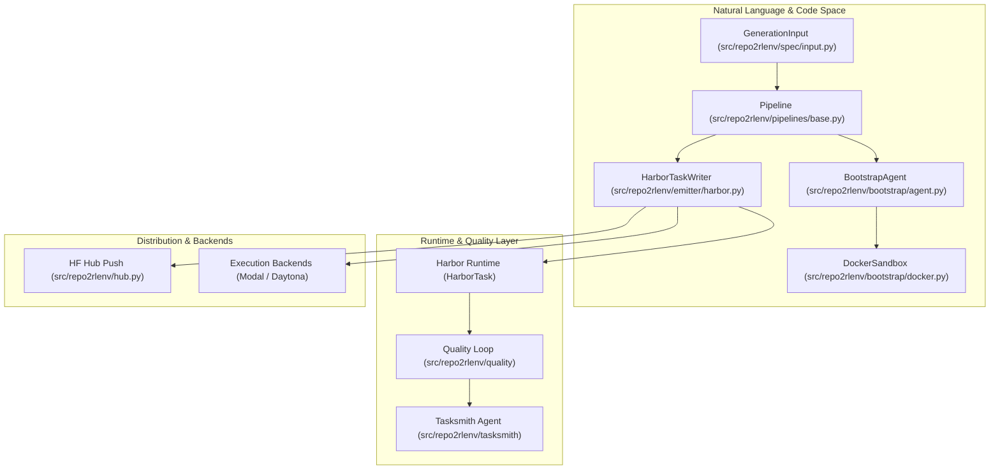
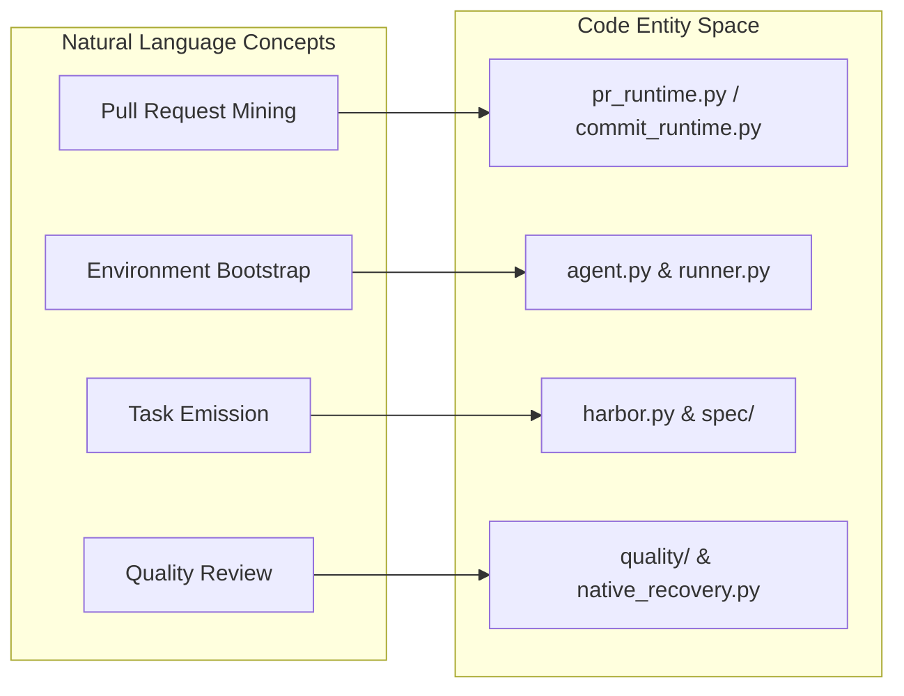

<!-- source: DeepWiki mcp.deepwiki.com · repo huggingface/Repo2RLEnv · page 1 Overview · fetched 2026-10-26 -->

# Overview

Relevant source files

The following files were used as context for generating this wiki page:

- [CLAUDE.md](CLAUDE.md)
- [README.md](README.md)
- [docs/index.md](docs/index.md)
- [docs/pipelines/README.md](docs/pipelines/README.md)
- [docs/rfcs/0003-commit-runtime.md](docs/rfcs/0003-commit-runtime.md)

Repo2RLEnv is a synthesis engine designed to transform any GitHub repository into a verifiable Reinforcement Learning (RL) environment [README.md:2-28](). It bridges the gap between raw source code and structured datasets suitable for training and evaluating coding agents. By mining pull requests, commits, and issues, Repo2RLEnv generates tasks with concrete objectives and programmatic reward models, ensuring that agent performance is measured objectively without human intervention [README.md:2-28]().

The system emits datasets in the [Harbor](https://github.com/harbor-framework/harbor) task format, allowing generated environments to be consumed immediately by over 25 agent harnesses across various runtime backends [README.md:24-28](), [CLAUDE.md:21-27]().

## Core Subsystems & Architecture

Repo2RLEnv is organized into layered synthesis and runtime execution subsystems. The system delegates runtime execution to Harbor while owning the generation, spec standardisation, and distribution bridges [CLAUDE.md:30-37]().

### Subsystem Architecture Diagram

Sources: [CLAUDE.md:30-37](), [src/repo2rlenv/spec/input.py:1-50](), [src/repo2rlenv/pipelines/base.py:1-40]()

### Natural Language Space to Code Entity Space Bridge

Sources: [CLAUDE.md:64-90](), [src/repo2rlenv/pipelines/pr_runtime.py:1-30](), [src/repo2rlenv/bootstrap/agent.py:1-30]()

## Major Subsystems Overview

- **Pipelines & Owned Recipes**: Native pipelines (`pr_diff`, `pr_runtime`, `commit_runtime`, etc.) and 14 research-inspired recipes (`swe_smith`, `swe_gen`, `swe_flow`, `r2e`, etc.) convert source repositories into verifiable tasks [README.md:88-137](), [CLAUDE.md:64-90]().
- **Tasksmith**: An adaptive LangGraph workflow using Pi or OpenCode coding runtimes to investigate merged PRs, build environments, and design verifiers [README.md:104-116](), [CLAUDE.md:78-84]().
- **Quality Loop**: Evidence-bound review, private probes, and bounded repair cycles implemented via commands like `repo2rlenv quality run` [docs/pipelines/README.md:22-24](), [CLAUDE.md:70-70]().
- **Execution Backends & Distribution**: Support for Docker, Modal, Daytona, and pushing bundles to Hugging Face Hub or OCI registries [README.md:72-74](), [CLAUDE.md:24-37]().

## Child Pages

For detailed information on specific topics, refer to the following child pages:
- [Getting Started](#1.1) — Installation via `uv`, extras, external tools, first dataset generation, and HF Hub publishing.
- [System Architecture](#1.2) — Layered architecture, the Pipeline protocol, task lifecycle, and contamination defenses.
- [Example Configurations](#1.3) — Tour of the `examples/` directory and owned recipe YAML configurations.

### Sources:
- [README.md:1-137]()
- [CLAUDE.md:1-125]()
- [docs/pipelines/README.md:1-50]()

---

