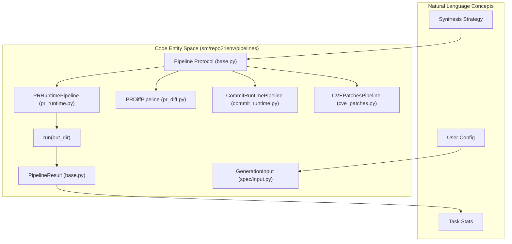
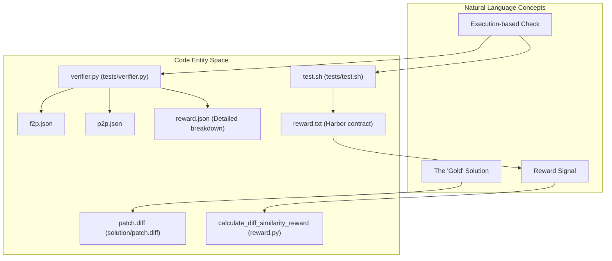

<!-- source: DeepWiki mcp.deepwiki.com · repo huggingface/Repo2RLEnv · page 13 Glossary · fetched 2026-10-26 -->

# Glossary

Relevant source files

The following files were used as context for generating this wiki page:

- [CLAUDE.md](CLAUDE.md)
- [README.md](README.md)
- [docs/pipelines/README.md](docs/pipelines/README.md)
- [docs/reference/AGENTS.md](docs/reference/AGENTS.md)
- [docs/reference/RELATED_WORK.md](docs/reference/RELATED_WORK.md)

This page defines the core terminology, domain concepts, and architectural components of the **Repo2RLEnv** codebase. It serves as a technical reference for engineers to map high-level synthesis concepts to specific code implementations.

## Core Concepts

### Synthesis Pipeline
A **Pipeline** is the primary unit of work in Repo2RLEnv. It is a class that implements a specific strategy for turning a raw repository into a set of verifiable RL tasks. Every pipeline must conform to the `Pipeline` protocol [src/repo2rlenv/pipelines/base.py:71-74]().

| Term | Definition | Code Pointer |
|:---|:---|:---|
| **Pipeline Protocol** | The structural interface (`run`, `name`, `requires_bootstrap`) all pipelines must implement. | [src/repo2rlenv/pipelines/base.py:71-74]() |
| **PipelineResult** | A dataclass containing the outcome of a pipeline run, including counters for candidates, emitted tasks, and skip reasons. | [src/repo2rlenv/pipelines/base.py:55-68]() |
| **GenerationInput** | The standardized Pydantic model containing user configuration (repo, LLM, sandbox settings) passed to a pipeline. | [src/repo2rlenv/spec/input.py:22-31]() |
| **Options Model** | Pydantic models defining pipeline-specific kwargs (e.g., `PRRuntimeOptions`, `PRDiffOptions`). | [src/repo2rlenv/spec/options.py:1-172]() |

**Natural Language Space to Code Entity Space: Pipeline Execution**

Sources: [src/repo2rlenv/pipelines/base.py:38-74](), [src/repo2rlenv/pipelines/pr_runtime.py:1-60](), [docs/pipelines/README.md:1-22]()

---

### Harbor Specification
Repo2RLEnv emits data in the **Harbor** format. This ensures compatibility with the [Harbor framework](https://github.com/harbor-framework/harbor) ecosystem.

| Term | Definition | Code Pointer |
|:---|:---|:---|
| **HarborTask** | A dataclass representing the internal state of a task before it is serialized to disk. | [src/repo2rlenv/emitter/harbor.py:46-65]() |
| **task.toml** | The primary metadata file for a Harbor task, containing the task name, description, and the `[metadata.repo2env]` extension. | [src/repo2rlenv/emitter/harbor.py:80-135]() |
| **instruction.md** | The problem statement presented to the RL agent, often stripped of info-leaks. | [src/repo2rlenv/emitter/harbor.py:138](), [src/repo2rlenv/pipelines/pr_diff.py:143-160]() |
| **patch.diff** | The "gold" solution (oracle) that correctly resolves the task. | [src/repo2rlenv/emitter/harbor.py:141-143]() |

Sources: [src/repo2rlenv/emitter/harbor.py:1-169](), [docs/reference/SPEC.md:73-90]()

---

### Reward and Verification
Verification is the process of scoring an agent's attempt. Repo2RLEnv uses two primary verification strategies depending on the pipeline type.

| Term | Definition | Code Pointer |
|:---|:---|:---|
| **F2P (Fail-to-Pass)** | Tests that failed before the fix but pass after the fix. These prove the bug is resolved. | [src/repo2rlenv/pipelines/pr_runtime.py:7-9](), [src/repo2rlenv/spec/options.py:21-23]() |
| **P2P (Pass-to-Pass)** | Tests that passed before the fix and must continue to pass (regression testing). | [src/repo2rlenv/spec/options.py:22-23]() |
| **Diff Similarity** | A multi-component reward (format, size, file targeting, region overlap, similarity, LLM judge) used by `pr_diff`. | [docs/pipelines/pr_diff.md:44-62](), [src/repo2rlenv/pipelines/pr_diff.py:12-13]() |
| **PoC Synthesis** | An agentic process in `cve_patches` to write a failing test for a vulnerability when none exists. | [docs/pipelines/cve_patches.md:71-79]() |

**Natural Language Space to Code Entity Space: Verification Flow**

Sources: [src/repo2rlenv/emitter/harbor.py:141-169](), [docs/pipelines/pr_diff.md:44-62](), [src/repo2rlenv/pipelines/pr_runtime.py:1-37]()

---

### Environment Bootstrap
The **Bootstrap** phase creates a reproducible Docker environment for a repository. This is required for all execution-gated pipelines.

| Term | Definition | Code Pointer |
|:---|:---|:---|
| **Bootstrap Agent** | A ReAct-style LLM agent in `agent.py` that explores the repo to determine build and test commands. | [src/repo2rlenv/pipelines/pr_runtime.py:13-15]() |
| **requires_bootstrap** | A class attribute on a Pipeline indicating if it needs a pre-built Docker image to run. | [src/repo2rlenv/pipelines/pr_runtime.py:15]() |
| **BootstrapResult** | The output of the bootstrap phase, containing the image digest and language hints. | [src/repo2rlenv/bootstrap/spec.py]() |

Sources: [src/repo2rlenv/pipelines/pr_runtime.py:1-37](), [docs/pipelines/README.md:34-35]()

---

### Distribution and Registry
Repo2RLEnv handles the publishing of datasets to the Hugging Face Hub and associated Docker images to OCI registries.

| Term | Definition | Code Pointer |
|:---|:---|:---|
| **registry.json** | A Harbor-compatible manifest that maps task names to their git URLs and commit SHAs. | [docs/reference/SPEC.md:158-171]() |
| **registry.json (v0.2.0)** | Extension table `[metadata.repo2env.reproducibility]` for OCI image references. | [docs/reference/SPEC.md:134-146]() |
| **gh CLI** | The tool used for GitHub authentication and API calls (GraphQL/REST). | [src/repo2rlenv/github.py:1-10]() |

Sources: [docs/reference/SPEC.md:1-171](), [src/repo2rlenv/github.py:1-25]()

---

## Abbreviations and Domain Terms

| Abbreviation | Full Term | Context |
|:---|:---|:---|
| **PR** | Pull Request | Used in `pr_diff` and `pr_runtime` pipelines to source candidates. |
| **SHA** | Secure Hash Algorithm | Refers to Git commit hashes or content hashes of tasks [src/repo2rlenv/emitter/harbor.py:67-72](). |
| **LOC** | Lines of Code | Used in reward calibration and metadata filtering [src/repo2rlenv/spec/options.py:79](). |
| **CVE** | Common Vulnerabilities and Exposures | Security identifiers used by the `cve_patches` pipeline [docs/pipelines/cve_patches.md:3-5](). |
| **OSV** | Open Source Vulnerabilities | The vulnerability database queried for security tasks [docs/pipelines/cve_patches.md:42-54](). |
| **OCI** | Open Container Initiative | The standard for Docker images distributed via registries like GHCR. |
| **Tasksmith** | An agentic system that converts merged PRs into Harbor tasks. It uses LangGraph to orchestrate `pi` or `opencode` runtimes. | [README.md:104-114](), [CLAUDE.md:106-107]() |
| **Owned Recipe** | An experimental generation method implemented directly within the Repo2RLEnv repository, adapting published research. These do not install upstream packages. | [README.md:118-122](), [CLAUDE.md:94-98]() |
| **ReproMode** | (Not explicitly defined in provided files, but implied by reproducibility features). Refers to the mode of reproduction for a task, often related to whether a sandbox is used or if it's text-only. | (Implied by `_diff` vs `_runtime` pipelines) |
| **Probe Levels L1-L4** | A protocol for checking OCI registry authentication and capabilities. | (Not explicitly defined in provided files, but mentioned in the TOC) |
| **BudgetLedger** | A system for tracking and managing spending for remote execution (e.g., Modal, Daytona). | (Not explicitly defined in provided files, but mentioned in the TOC) |
| **Egress Guard** | Mechanisms to prevent information leakage from the task environment, such as stripping sensitive data or restricting network access. | [CLAUDE.md:48-54]() |
| **Harbor** | An open-source framework for creating, sharing, and running RL environments for code agents. Repo2RLEnv outputs tasks in the Harbor format. | [README.md:24-26](), [CLAUDE.md:24-25]() |
| **HarborTask** | The data structure representing a task in the Harbor format, including instruction, environment, solution, and verifier. | [README.md:36]() |
| **pi / opencode** | Node.js authoring runtimes used by Tasksmith for investigating changes and designing tasks. | [README.md:79](), [CLAUDE.md:350]() |

Sources: [src/repo2rlenv/emitter/harbor.py:67-113](), [docs/pipelines/cve_patches.md:1-140](), [src/repo2rlenv/spec/options.py:75-80](), [README.md:104-122](), [CLAUDE.md:48-54](), [CLAUDE.md:24-25](), [CLAUDE.md:94-98]()