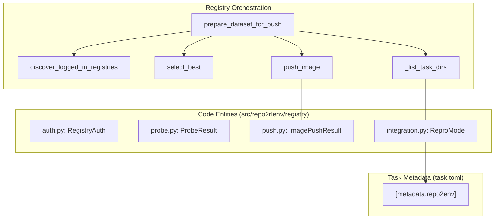
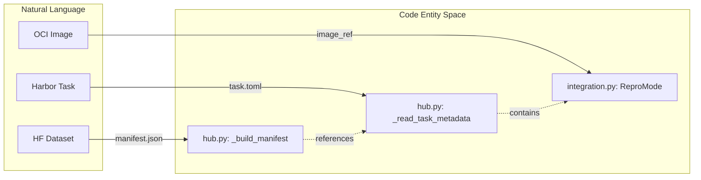

<!-- source: DeepWiki mcp.deepwiki.com · repo huggingface/Repo2RLEnv · page 6 Registry and Distribution · fetched 2026-10-26 -->

# Registry and Distribution

Relevant source files

The following files were used as context for generating this wiki page:

- [docs/reference/REGISTRY_AUTH.md](docs/reference/REGISTRY_AUTH.md)
- [src/repo2rlenv/hub.py](src/repo2rlenv/hub.py)
- [src/repo2rlenv/registry/__init__.py](src/repo2rlenv/registry/__init__.py)
- [src/repo2rlenv/registry/auth.py](src/repo2rlenv/registry/auth.py)
- [src/repo2rlenv/registry/integration.py](src/repo2rlenv/registry/integration.py)
- [tests/registry/test_integration.py](tests/registry/test_integration.py)
- [tests/test_hub_metadata_read.py](tests/test_hub_metadata_read.py)

The **Registry and Distribution** system ensures that sandbox-required datasets (e.g., `pr_runtime`, `commit_runtime`) are fully reproducible when shared. While Hugging Face Hub stores the task metadata and code patches, the underlying Docker environments created during the [Bootstrap System](#4) must also be accessible to consumers [src/repo2rlenv/hub.py:1-7]().

This system manages the lifecycle of OCI container images, from discovering local credentials to pushing images to a remote registry and rewriting task metadata to ensure a seamless `harbor run` experience for end-users [src/repo2rlenv/registry/integration.py:1-13]().

Sources: [src/repo2rlenv/hub.py:1-7](), [src/repo2rlenv/registry/integration.py:1-13]()

---

### Distribution Workflow

When a user executes `repo2rlenv push`, the system performs a multi-stage integration to reconcile local artifacts with remote storage [src/repo2rlenv/registry/integration.py:1-13]().

1. **Discovery**: Scans `~/.docker/config.json` to find potential registries [src/repo2rlenv/registry/auth.py:123-134]().
2. **Verification**: Uses a 4-level probing protocol (L1–L4) to verify reachability and write permissions [docs/reference/REGISTRY_AUTH.md:160-169]().
3. **Push & Tag**: Uploads the bootstrap image and retrieves the immutable content digest (`@sha256:...`) [src/repo2rlenv/registry/integration.py:43-60]().
4. **Rewrite**: Updates the local `task.toml` and `environment/Dockerfile` in-place to point to the new remote reference [src/repo2rlenv/registry/integration.py:1-13]().
5. **HF Upload**: Commits the updated task files to the Hugging Face Hub, including a generated `manifest.json` [src/repo2rlenv/hub.py:68-114](), [tests/test_hub_metadata_read.py:78-102]().

Sources: [src/repo2rlenv/registry/auth.py:123-134](), [src/repo2rlenv/registry/integration.py:1-60](), [docs/reference/REGISTRY_AUTH.md:160-169](), [src/repo2rlenv/hub.py:68-114]()

---

### Registry Integration Architecture

The following diagram maps the high-level distribution concepts to the specific code entities responsible for orchestrating them, bridging natural language system concepts to code symbols.

**Registry Distribution Logic**

Sources: [src/repo2rlenv/registry/integration.py:40-60](), [src/repo2rlenv/registry/auth.py:51-59]()

---

### Reproducibility Modes

Repo2RLEnv supports three modes for distributing environments, tracked in the `[metadata.repo2env]` table [src/repo2rlenv/registry/integration.py:40-60]().

| Mode | Description | Trigger |
| :--- | :--- | :--- |
| `registry` | Image is hosted on an OCI registry (GHCR, ECR, etc.). | Successful `docker push` during `repo2rlenv push` [docs/reference/REGISTRY_AUTH.md:3-6](). |
| `inline_dockerfile` | The full bootstrap recipe is baked into the task. | Registry push fails or no registry is verified [docs/reference/REGISTRY_AUTH.md:12-16](). |
| `local_only` | Image exists only on the creator's machine. | Default state after `generate` but before `push` [src/repo2rlenv/registry/integration.py:40-41](). |

Sources: [src/repo2rlenv/registry/integration.py:40-41](), [docs/reference/REGISTRY_AUTH.md:3-16]()

---

### The Harbor Registry Format and Hub Metadata

To remain compatible with the Harbor Framework, Repo2RLEnv generates a `manifest.json` and a legacy `registry.json` file during the push process [src/repo2rlenv/hub.py:3-23](). This allows standard Harbor tools to discover and pull tasks directly from Hugging Face Hub git repositories.

**Registry Metadata Mapping**

Sources: [src/repo2rlenv/hub.py:3-114](), [src/repo2rlenv/registry/integration.py:40-60]()

---

### Child Pages

For detailed technical specifications, refer to the child pages:
- **[Registry Auth and Probing](#6.1)** — L1–L4 OCI probe protocol, `--check-auth`, `~/.docker/config.json` credential discovery, GHCR setup, and the inline-Dockerfile fallback mode.
- **[Cloud Registry Backends](#6.2)** — GHCR default, AWS ECR (`ecr.py`), Google Artifact Registry (`gar.py`), image naming and visibility management.
- **[Dataset Release and Hub Metadata](#6.3)** — `manifest.json`, `registry.json`, dataset README cards, visualiser Space links, and campaign release tooling (`campaigns/release.py`, `release_cli.py`, `docs/pipelines/dataset_release.md`).

Sources: [docs/reference/REGISTRY_AUTH.md:1-172](), [src/repo2rlenv/registry/probe.py:1-156]()

---

