# Page: Overview

# Overview

<details>
<summary>Relevant source files</summary>

The following files were used as context for generating this wiki page:

- [CLAUDE.md](CLAUDE.md)
- [README.md](README.md)
- [docs/index.md](docs/index.md)
- [docs/pipelines/README.md](docs/pipelines/README.md)
- [docs/rfcs/0003-commit-runtime.md](docs/rfcs/0003-commit-runtime.md)

</details>


Repo2RLEnv is a synthesis engine designed to transform any GitHub repository into a verifiable Reinforcement Learning (RL) environment [README.md:2-28](). It bridges the gap between raw source code and structured datasets suitable for training and evaluating coding agents. By mining pull requests, commits, and issues, Repo2RLEnv generates tasks with concrete objectives and programmatic reward models, ensuring that agent performance is measured objectively without human intervention [README.md:2-28]().

The system emits datasets in the [Harbor](https://github.com/harbor-framework/harbor) task format, allowing generated environments to be consumed immediately by over 25 agent harnesses across various runtime backends [README.md:24-28](), [CLAUDE.md:21-27]().

## Core Subsystems & Architecture

Repo2RLEnv is organized into layered synthesis and runtime execution subsystems. The system delegates runtime execution to Harbor while owning the generation, spec standardisation, and distribution bridges [CLAUDE.md:30-37]().

### Subsystem Architecture Diagram
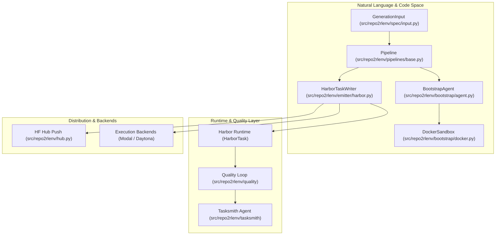
Sources: [CLAUDE.md:30-37](), [src/repo2rlenv/spec/input.py:1-50](), [src/repo2rlenv/pipelines/base.py:1-40]()

### Natural Language Space to Code Entity Space Bridge
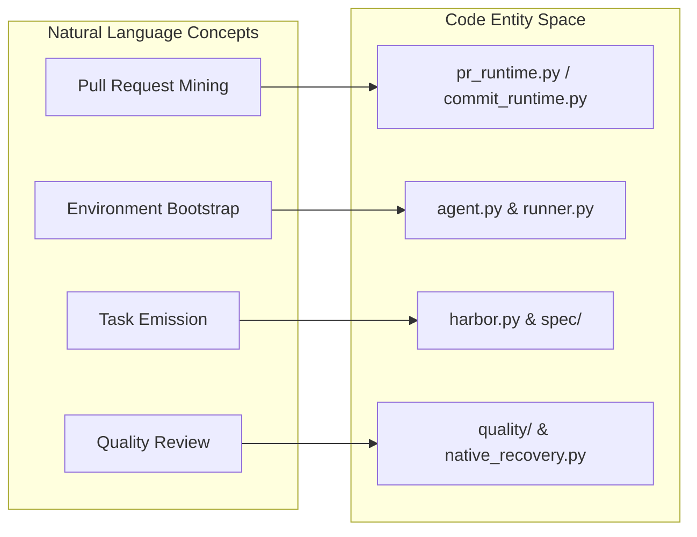
Sources: [CLAUDE.md:64-90](), [src/repo2rlenv/pipelines/pr_runtime.py:1-30](), [src/repo2rlenv/bootstrap/agent.py:1-30]()

## Major Subsystems Overview

- **Pipelines & Owned Recipes**: Native pipelines (`pr_diff`, `pr_runtime`, `commit_runtime`, etc.) and 14 research-inspired recipes (`swe_smith`, `swe_gen`, `swe_flow`, `r2e`, etc.) convert source repositories into verifiable tasks [README.md:88-137](), [CLAUDE.md:64-90]().
- **Tasksmith**: An adaptive LangGraph workflow using Pi or OpenCode coding runtimes to investigate merged PRs, build environments, and design verifiers [README.md:104-116](), [CLAUDE.md:78-84]().
- **Quality Loop**: Evidence-bound review, private probes, and bounded repair cycles implemented via commands like `repo2rlenv quality run` [docs/pipelines/README.md:22-24](), [CLAUDE.md:70-70]().
- **Execution Backends & Distribution**: Support for Docker, Modal, Daytona, and pushing bundles to Hugging Face Hub or OCI registries [README.md:72-74](), [CLAUDE.md:24-37]().

## Child Pages

For detailed information on specific topics, refer to the following child pages:
- [Getting Started](#1.1) — Installation via `uv`, extras, external tools, first dataset generation, and HF Hub publishing.
- [System Architecture](#1.2) — Layered architecture, the Pipeline protocol, task lifecycle, and contamination defenses.
- [Example Configurations](#1.3) — Tour of the `examples/` directory and owned recipe YAML configurations.

### Sources:
- [README.md:1-137]()
- [CLAUDE.md:1-125]()
- [docs/pipelines/README.md:1-50]()

---

# Page: Getting Started

# Getting Started

<details>
<summary>Relevant source files</summary>

The following files were used as context for generating this wiki page:

- [.env.example](.env.example)
- [docs/pipelines/tasksmith.md](docs/pipelines/tasksmith.md)
- [docs/quickstart.md](docs/quickstart.md)
- [docs/release_notes/HISTORY.md](docs/release_notes/HISTORY.md)
- [pyproject.toml](pyproject.toml)
- [src/repo2rlenv/bootstrap/presets.py](src/repo2rlenv/bootstrap/presets.py)
- [uv.lock](uv.lock)

</details>


Repo2RLEnv is a technical framework designed to transform any GitHub repository into a Reinforcement Learning (RL) environment for training and evaluating coding agents. It automates task extraction from repository history (PRs, commits) and emits standardized task directories compatible with the **Harbor** runtime [docs/quickstart.md:1-3]().

## Prerequisites and External Tools

Before setting up `repo2rlenv`, ensure the following external tools and credentials are available in your environment:

*   **uv**: The recommended high-speed package and tool manager [docs/quickstart.md:8-9]().
*   **gh CLI**: Used for repository mining, listing Pull Requests, and authenticating both public and private repository clones [docs/quickstart.md:11-13]().
*   **Docker**: Required for sandbox-verified pipelines (such as `pr_runtime`) and container image bootstrapping [docs/quickstart.md:67-67]().
*   **LLM API Keys**: Required for the bootstrap agent and semantic pipelines. Repo2RLEnv integrates via **LiteLLM**, supporting providers such as Anthropic, OpenAI, and Hugging Face [pyproject.toml:52-52](), [docs/quickstart.md:15-16]().

Sources: [docs/quickstart.md:5-20](), [pyproject.toml:51-54]()

## Installation and Optional Dependencies

Install `repo2rlenv` globally using `uv` or via standard `pip` [docs/quickstart.md:31-33](). The package defines several optional dependency groups in `pyproject.toml` to support specialized execution backends, agentic workflows, and mutation engines [pyproject.toml:68-86]().

```bash
# Install base package
uv tool install repo2rlenv

# Or install with specific extras
uv pip install "repo2rlenv[tasksmith,modal,harbor]"
```

The available optional dependencies include:
*   `tasksmith`: Installs `langgraph` and checkpointing modules for agentic task authoring [pyproject.toml:69-72]().
*   `modal`: Pulls in `modal` and `dockerfile-parse` for cloud-based remote sandboxing [pyproject.toml:73-76]().
*   `daytona`: Installs the `daytona` SDK for alternative container management [pyproject.toml:77-79]().
*   `mutation`: Includes `libcst` and `pyflakes` for procedural AST bug injection [pyproject.toml:80-83]().
*   `harbor`: Pins the `harbor` evaluation runtime SDK [pyproject.toml:84-86]().

Sources: [pyproject.toml:68-86](), [docs/quickstart.md:30-34]()

## First Dataset Generation with `pr_diff`

The `pr_diff` pipeline offers the fastest entry point since it does not require a local Docker daemon during the generation phase. It mines merged Pull Requests and emits tasks where candidate solutions are scored via a multi-component diff-similarity reward function [docs/quickstart.md:36-38]().

### 1. Authenticate and Set Keys
```bash
gh auth login
export ANTHROPIC_API_KEY=your_key_here
```
Sources: [docs/quickstart.md:11-17]()

### 2. Execute Generation
Run the `generate` subcommand to mine the last 10 merged PRs from a target repository:

```bash
repo2rlenv generate \
  --repo pallets/click \
  --pipeline pr_diff \
  --pipeline-opt limit=10 \
  --out ./datasets/click-ds
```
Sources: [docs/quickstart.md:44-50]()

### Natural Language to Code Entity Space: `pr_diff` Pipeline
The following diagram illustrates how unstructured PR metadata and descriptions are transformed into structured code entities and Harbor task files during a `pr_diff` generation run.

**Pipeline Execution Flow**
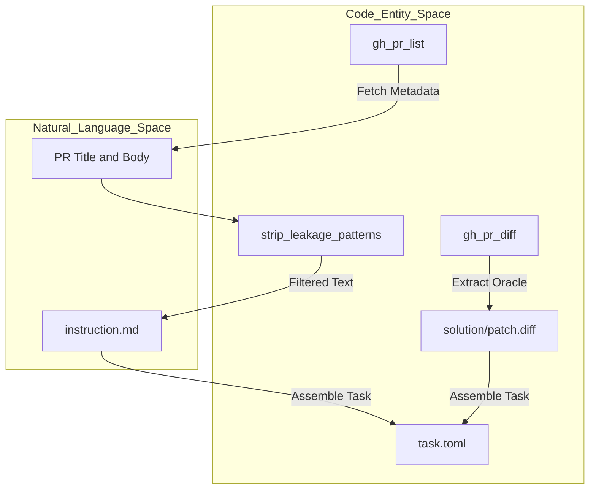
Sources: [docs/quickstart.md:52-58](), [pyproject.toml:60-61]()

## Dataset Distribution and Hugging Face Hub

Repo2RLEnv supports a robust publication workflow via `repo2rlenv push` [docs/quickstart.md:60-75](). For sandbox-verified pipelines, the push command simultaneously uploads the dataset to the Hugging Face Hub and pushes the bootstrap Docker images to an OCI registry (such as GitHub Container Registry) [docs/quickstart.md:77-78]().

### 1. Verify Registry Credentials
Before executing a push that involves container images, verify authorization status:
```bash
repo2rlenv push --check-auth
```
Sources: [docs/quickstart.md:85-85]()

### 2. Push and Pull Workflow
```bash
# Push generated dataset to Hub
repo2rlenv push ./datasets/click-ds <your-org>/click-r2e

# Pull dataset back for training or evaluation
repo2rlenv pull <your-org>/click-r2e
```
Sources: [docs/quickstart.md:70-74]()

### System Mapping: Task Emission to Harbor Execution
This diagram demonstrates the mapping between `repo2rlenv` generation components and the runtime evaluation architecture in `harbor`.

**Task Entity Mapping**
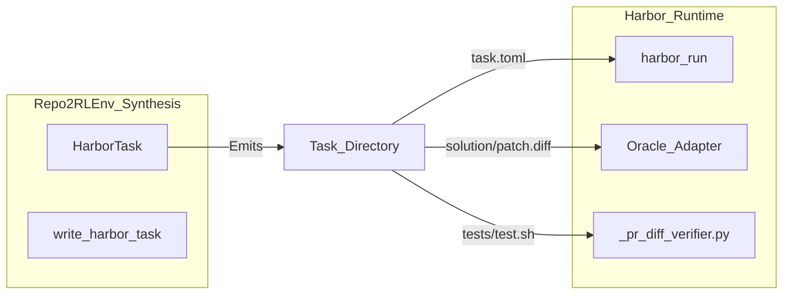
Sources: [docs/quickstart.md:115-124](), [pyproject.toml:60-61]()

Sources for this page: `pyproject.toml`, `docs/quickstart.md`, `docs/release_notes/HISTORY.md`

---

# Page: System Architecture

# System Architecture

<details>
<summary>Relevant source files</summary>

The following files were used as context for generating this wiki page:

- [CLAUDE.md](CLAUDE.md)
- [README.md](README.md)
- [docs/reference/API.md](docs/reference/API.md)
- [docs/reference/SPEC.md](docs/reference/SPEC.md)
- [src/repo2rlenv/pipelines/_env_guard.py](src/repo2rlenv/pipelines/_env_guard.py)
- [src/repo2rlenv/pipelines/base.py](src/repo2rlenv/pipelines/base.py)
- [src/repo2rlenv/validation.py](src/repo2rlenv/validation.py)
- [tests/test_pipeline_contract.py](tests/test_pipeline_contract.py)
- [tests/test_validation.py](tests/test_validation.py)

</details>


Repo2RLEnv is designed as a modular synthesis engine that transforms raw source code repositories into verifiable Reinforcement Learning (RL) environments. The architecture is split into a **Synthesis Layer** (Repo2RLEnv) which handles data mining, LLM task generation, and environment creation, and a **Runtime Layer** (Harbor) which handles execution, agent evaluation, and reward computation [README.md:28-30](), [CLAUDE.md:21-37]().

---

## Layered Architecture Overview

The system follows a "synthesis-first" approach where the complexity of environment setup and verification is shifted entirely to the generation phase. This ensures that emitted datasets are lightweight, portable, and ready to drop straight into Harbor's execution backends [CLAUDE.md:21-27]().

| Layer | Code Module | Responsibility |
|---|---|---|
| **Generation Layer** | `repo2rlenv.pipelines` | Mines repositories, runs the bootstrap agent loop, synthesizes task instructions, and builds test oracles [CLAUDE.md:32-34](). |
| **Spec & Emission Layer** | `repo2rlenv.emitter` | Standardizes task outputs into the Harbor `task.toml` format with the namespaced `[metadata.repo2env]` provenance extension [docs/reference/SPEC.md:73-77](). |
| **Consumption Runtime** | Harbor Framework (External) | Orchestrates local Docker, Modal, or Daytona sandboxes, executes agent solutions, and evaluates test verification [CLAUDE.md:21-27](). |

### Component Flow and Code Entity Mapping
This diagram bridges natural language task concepts to concrete Python modules, classes, and protocol entry points within the codebase.

Title: Component Flow from Repository to Harbor Spec
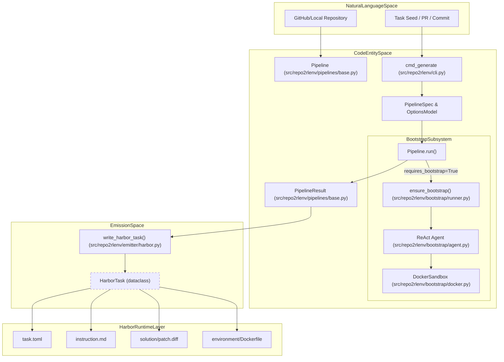
**Sources:** [src/repo2rlenv/pipelines/base.py:57-97](), [src/repo2rlenv/bootstrap/runner.py](), [src/repo2rlenv/emitter/harbor.py](), [README.md:28-43]()

---

## The Pipeline Protocol

The core architectural interface of Repo2RLEnv is the `Pipeline` protocol defined in `src/repo2rlenv/pipelines/base.py`. Every native synthesis strategy and research recipe implements this duck-typed interface to ensure uniform execution via the CLI dispatcher [src/repo2rlenv/pipelines/base.py:57-77](), [tests/test_pipeline_contract.py:10-21]().

### Protocol Attributes and Methods
- `name: ClassVar[PipelineName]`: A unique identifier mapped from the `PipelineName` enumeration [src/repo2rlenv/pipelines/base.py:79]().
- `requires_bootstrap: ClassVar[bool]`: A boolean flag indicating whether the pipeline requires a pre-built Docker environment from the bootstrap subsystem prior to execution [src/repo2rlenv/pipelines/base.py:80]().
- `supported_languages: ClassVar[frozenset[LanguageHint] | None]`: Restricts the pipeline to specific language hints (e.g., Python); `None` indicates language-agnostic operation [src/repo2rlenv/pipelines/base.py:81-84]().
- `experimental: ClassVar[bool]`: Identifies whether a pipeline is stable or experimental (triggering warnings during CLI dispatch) [src/repo2rlenv/pipelines/base.py:85-88]().
- `__init__(input: GenerationInput, options: BaseModel, bootstrap: Any = None)`: Initializes the pipeline with validated configuration input and optional bootstrap artifacts [src/repo2rlenv/pipelines/base.py:90-95]().
- `run(out_dir: Path) -> PipelineResult`: Executes task mining, verification, and emission, returning uniform counters via `PipelineResult` [src/repo2rlenv/pipelines/base.py:37-54]().

**Sources:** [src/repo2rlenv/pipelines/base.py:1-98](), [tests/test_pipeline_contract.py:10-44](), [src/repo2rlenv/pipelines/__init__.py:1-30]()

---

## Task Lifecycle: From Repo Mining to Harbor-Spec Output

The transformation of a repository into a published dataset follows a strict 4-stage pipeline lifecycle managed by the command-line interface and library API [README.md:28-43]().

### 1. Repository Mining and Filtering
Pipelines discover candidate changes (pull requests via `gh pr list`, commit histories, or code snippets) and filter out drafts, oversized diffs, or non-conforming commits [docs/reference/API.md:66-71]().

### 2. Bootstrap and Sandbox Verification
For full pipelines where `requires_bootstrap=True` (e.g., `pr_runtime`, `commit_runtime`), Repo2RLEnv invokes `ensure_bootstrap()` to build and cache a dedicated Docker container [src/repo2rlenv/pipelines/base.py:73-77](). Test oracles are verified inside the sandbox by checking "Fail-to-Pass" (F2P) and "Pass-to-Pass" (P2P) outcomes [docs/pipelines/README.md:51-55]().

### 3. Task Emission and Provenance Binding
Validated candidate tasks are structured into `HarborTask` data classes and written to disk via `write_harbor_task()` [docs/reference/API.md:117-130](). Each task directory contains standard Harbor files alongside a custom `[metadata.repo2env]` extension table in `task.toml` [docs/reference/SPEC.md:73-77]().

### Data Flow: Task Entity Mapping
This diagram maps internal Python data structures to their corresponding filesystem paths within an emitted Harbor task directory.

Title: Task Entity Data Mapping
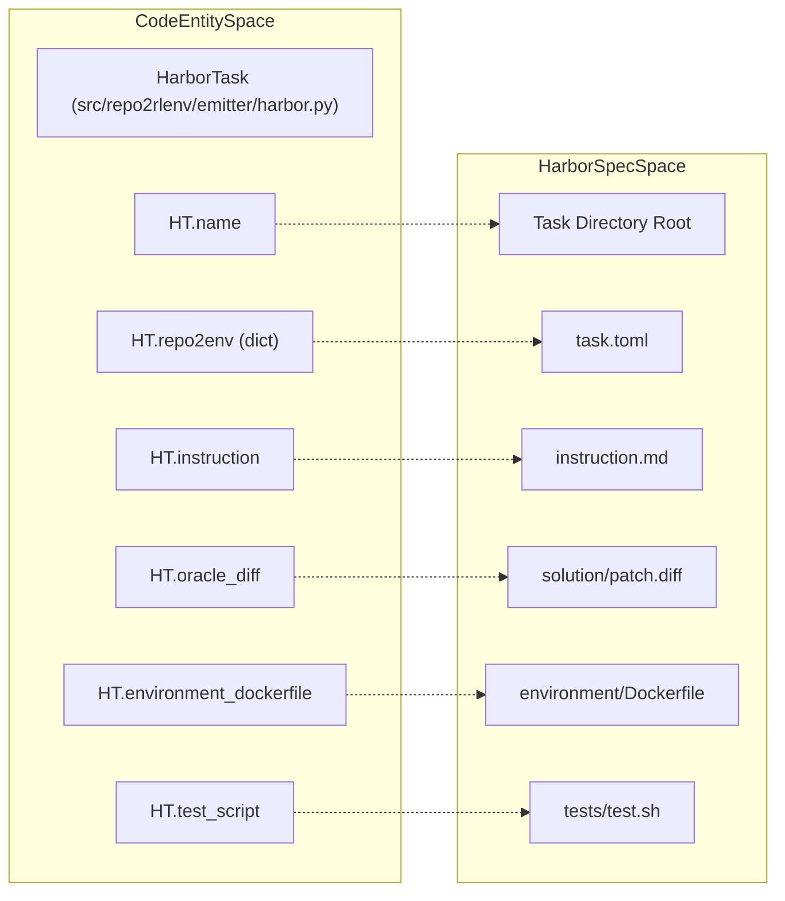
**Sources:** [src/repo2rlenv/emitter/harbor.py](), [docs/reference/SPEC.md:73-90](), [docs/reference/API.md:115-131]()

---

## Contamination Defenses

To prevent LLM agents from cheating on benchmark tasks by reading published solutions or hidden test files via network egress or git logs, Repo2RLEnv implements strict built-in contamination defenses [CLAUDE.md:38-54]().

### Git History Scrubbing
When building sandbox environments for patch tasks, `src/repo2rlenv/pipelines/_env_guard.py` applies `git_history_scrub()` inside the Dockerfile build sequence [src/repo2rlenv/pipelines/_env_guard.py:43-67](). This function:
- Checks out a detached HEAD at `base_commit` [src/repo2rlenv/pipelines/_env_guard.py:58]()
- Removes remote origins and prunes all branches and tags pointing past the base commit [src/repo2rlenv/pipelines/_env_guard.py:59-64]()
- Expires the reflog and runs `git gc --prune=now` to completely purge future commits, preventing agents from running `git diff origin/main` or reading hidden test files [src/repo2rlenv/pipelines/_env_guard.py:61-66]()

### Network Egress Restrictions
To prevent package manager downloads of fixed library versions (e.g., `pip download pkg==fixed`), `egress_guard_compose()` generates an `environment/docker-compose.yaml` overlay that blackholes known fix-serving domains (`pypi.org`, `github.com`, `raw.githubusercontent.com`) by mapping them to `0.0.0.0` [src/repo2rlenv/pipelines/_env_guard.py:31-40, 70-87](). General internet access remains open so agent runtimes can still communicate with model APIs and package installers [src/repo2rlenv/pipelines/_env_guard.py:11-15]().

**Sources:** [src/repo2rlenv/pipelines/_env_guard.py:1-87](), [CLAUDE.md:44-54]()

---

## LLM Cost Control and Caching

API spend on large language models is strictly governed across synthesis pipelines through several architectural patterns:

- **LiteLLM Abstraction Wrapper**: All LLM completions are routed through `src/repo2rlenv/llm.py`, providing unified provider resolution, API key lookup, and budget tracking [docs/reference/API.md:73-88]().
- **Bootstrap Caching**: The bootstrap subsystem uses content-addressed caching (`src/repo2rlenv/bootstrap/cache.py`) to ensure that expensive container build phases and environment analysis runs are executed exactly once per repository configuration, avoiding redundant LLM generation steps.
- **Lite vs. Full Separation**: Lite pipelines (such as `pr_diff`) bypass sandbox builds and LLM agent loops entirely, performing pure text and diff operations to minimize token overhead unless explicit multi-component generation is selected.

**Sources:** [docs/reference/API.md:73-89](), [src/repo2rlenv/llm.py](), [src/repo2rlenv/bootstrap/cache.py]()

---

# Page: Example Configurations

# Example Configurations

<details>
<summary>Relevant source files</summary>

The following files were used as context for generating this wiki page:

- [examples/owned-cli-gym.yaml](examples/owned-cli-gym.yaml)
- [examples/owned-dataarc.yaml](examples/owned-dataarc.yaml)
- [examples/owned-r2e.yaml](examples/owned-r2e.yaml)
- [examples/owned-scaler.yaml](examples/owned-scaler.yaml)
- [examples/owned-seta-evol.yaml](examples/owned-seta-evol.yaml)
- [examples/owned-seta.yaml](examples/owned-seta.yaml)
- [examples/owned-swe-smith.yaml](examples/owned-swe-smith.yaml)
- [examples/owned-terminalworld.yaml](examples/owned-terminalworld.yaml)
- [examples/owned-tmax.yaml](examples/owned-tmax.yaml)

</details>


## Purpose and Scope

The `examples/` directory provides production-ready YAML configuration files representing owned research recipes within `Repo2RLEnv`. These files serve as declarative blueprints that map high-level synthesis strategies to the underlying execution pipelines, LLM providers, sandbox environments, and target dataset outputs. Each configuration populates the `GenerationInput` schema, steering the synthesis engine to generate reinforcement learning environments and Harbor-compliant evaluation datasets.

Sources: [examples/owned-scaler.yaml:1-23](), [examples/owned-r2e.yaml:1-31]()

---

## Anatomy of an Owned Recipe Configuration

An owned recipe configuration is partitioned into top-level blocks that direct every stage of task synthesis:

1. **`source`**: Defines the origin of task raw materials (e.g., git repositories, family definition files, seed datasets, recordings).
2. **`pipeline`**: Specifies the execution `name` (the registered pipeline engine), the `recipe` identifier, and pipeline-specific `options`.
3. **`llm`**: Configures the language model provider, model tag, and invocation timeouts.
4. **`execution`**: Controls campaign paths, run identifiers, worker receipt files, wheel distribution paths, and global timeout ceilings.
5. **`output`**: Determines task emission paths, Hugging Face organization, dataset naming, and repository visibility.

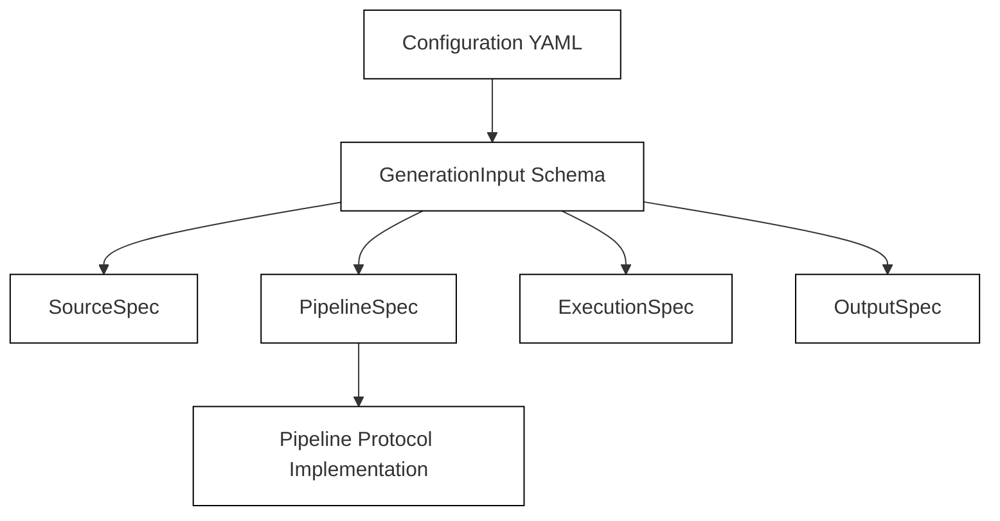
*Figure 1: Configuration Data Flow Architecture*

Sources: [examples/owned-scaler.yaml:1-23](), [examples/owned-r2e.yaml:1-31]()

---

## Tour of Owned Recipe Configurations

### 1. SCALER (`owned-scaler.yaml`)
The SCALER recipe configures reasoning-intensive synthesis workflows using family definitions to scale difficulty levels across generated tasks.
- **Source Kind**: `family` pointing to a JSON file of task families [examples/owned-scaler.yaml:1-3].
- **Pipeline**: `reasoning_synth` with recipe `scaler` [examples/owned-scaler.yaml:4-6].
- **Options**: Controls candidate ceilings, difficulty matrices, sample frequency per tier, and random seeding [examples/owned-scaler.yaml:7-12].

Sources: [examples/owned-scaler.yaml:1-23]()

### 2. R2E (`owned-r2e.yaml`)
The R2E (Repo-to-Environment) configuration drives test equivalence generation targeting python library codebases.
- **Source Kind**: `repository` pointing to `more-itertools/more-itertools` at a specific git ref [examples/owned-r2e.yaml:1-6].
- **Pipeline**: `equivalence_tests` with recipe `r2e` [examples/owned-r2e.yaml:7-9].
- **Options**: Defines `source_paths`, `test_paths`, target counts, candidate generation limits, round limits, and branch coverage thresholds [examples/owned-r2e.yaml:10-16].

Sources: [examples/owned-r2e.yaml:1-31]()

### 3. CLI-Gym (`owned-cli-gym.yaml`)
CLI-Gym targets command-line interface applications, driving environment repair loops to construct interactive CLI verification tasks.
- **Source Kind**: `repository` pointing to `pallets/click` [examples/owned-cli-gym.yaml:1-6].
- **Pipeline**: `env_repair` with recipe `cli_gym` [examples/owned-cli-gym.yaml:7-9].
- **Options**: Specifies source directories, test paths, round caps, test timeouts, and custom installation commands containing wheelhouse packaging steps [examples/owned-cli-gym.yaml:10-17].

Sources: [examples/owned-cli-gym.yaml:1-31]()

### 4. SWE-Smith (`owned-swe-smith.yaml`)
SWE-Smith orchestrates synthetic bug injection and repository mutation to generate software engineering tasks.
- **Source Kind**: `repository` pointing to public `more-itertools` [examples/owned-swe-smith.yaml:1-6].
- **Pipeline**: `repo_mutate` with recipe `swe_smith` [examples/owned-swe-smith.yaml:7-9].
- **Options**: Sets target counts and max candidate thresholds [examples/owned-swe-smith.yaml:10-14].
- **LLM**: Utilizes `openai` provider with `gpt-5-mini` [examples/owned-swe-smith.yaml:15-17].

Sources: [examples/owned-swe-smith.yaml:1-28]()

### 5. SETA and SETA-Evol (`owned-seta.yaml`, `owned-seta-evol.yaml`)
SETA configurations handle terminal synthesis from seed specifications and evolutionary task difficulty tuning.
- **Source Kind**: `seeds` (JSONL format) or `task` workspaces [examples/owned-seta.yaml:1-3, examples/owned-seta-evol.yaml:1-3].
- **Pipeline**: `terminal_synth` (`seta_seed2synth`) or `task_evolve` (`seta_evol`) [examples/owned-seta.yaml:4-6, examples/owned-seta-evol.yaml:4-6].
- **Options**: Configures repair limits, evolution strategies (`increase_difficulty`, `change_context`, `decrease_difficulty`), and candidate bounds [examples/owned-seta.yaml:7-10, examples/owned-seta-evol.yaml:7-11].

Sources: [examples/owned-seta.yaml:1-24](), [examples/owned-seta-evol.yaml:1-26]()

### 6. DataArc (`owned-dataarc.yaml`)
DataArc recipes consume seed corpuses to synthesize structured reasoning and data-oriented tasks.
- **Source Kind**: `seeds` path pointing to `workspace/dataarc-seeds` [examples/owned-dataarc.yaml:1-3].
- **Pipeline**: `terminal_synth` with recipe `dataarc` [examples/owned-dataarc.yaml:4-6].
- **Options**: Defines generation strategies (`few_shot`, `self_instruct`, `evol_instruct`), evolutionary directions, and sampling frequency [examples/owned-dataarc.yaml:7-13].

Sources: [examples/owned-dataarc.yaml:1-27]()

### 7. TMax (`owned-tmax.yaml`)
TMax focuses on terminal environment task generation driven by custom sampler configurations.
- **Source Kind**: `seeds` path pointing to a sampler JSON file [examples/owned-tmax.yaml:1-3].
- **Pipeline**: `terminal_synth` with recipe `tmax` [examples/owned-tmax.yaml:4-6].
- **Options**: Sets target task counts, candidate caps, and repair rounds [examples/owned-tmax.yaml:7-10].

Sources: [examples/owned-tmax.yaml:1-24]()

### 8. TerminalWorld (`owned-terminalworld.yaml`)
TerminalWorld reconstructs complex CLI environments from recorded terminal sessions.
- **Source Kind**: `recording` path pointing to session recordings [examples/owned-terminalworld.yaml:1-3].
- **Pipeline**: `terminal_reconstruct` with recipe `terminalworld` [examples/owned-terminalworld.yaml:4-6].
- **Options**: Sets scoring thresholds, target counts, and repair limits [examples/owned-terminalworld.yaml:7-11].

Sources: [examples/owned-terminalworld.yaml:1-25]()

---

## Natural Language Space to Code Entity Space

The following diagram maps high-level recipe configurations and pipeline names (Natural Language Space) directly to their implementing Python classes, runner modules, and protocol definitions (Code Entity Space).

```mermaid
graph TD
    subsystem1["Recipe: scaler / Pipeline: reasoning_synth"] --> class1["ReasoningSynthPipeline (pipelines/reasoning.py)"]
    subsystem2["Recipe: r2e / Pipeline: equivalence_tests"] --> class2["EquivalenceTestsPipeline (pipelines/equivalence.py)"]
    subsystem3["Recipe: cli_gym / Pipeline: env_repair"] --> class3["EnvRepairPipeline (pipelines/env_repair.py)"]
    subsystem4["Recipe: swe_smith / Pipeline: repo_mutate"] --> class4["RepoMutatePipeline (pipelines/mutation.py)"]
    subsystem5["Recipe: seta_evol / Pipeline: task_evolve"] --> class5["TaskEvolvePipeline (pipelines/task_evolve.py)"]
    subsystem6["Recipe: terminalworld / Pipeline: terminal_reconstruct"] --> class6["TerminalReconstructPipeline (pipelines/terminal_reconstruct.py)"]

    style subsystem1 fill:none,stroke:#000,stroke-width:1px
    style subsystem2 fill:none,stroke:#000,stroke-width:1px
    style subsystem3 fill:none,stroke:#000,stroke-width:1px
    style subsystem4 fill:none,stroke:#000,stroke-width:1px
    style subsystem5 fill:none,stroke:#000,stroke-width:1px
    style subsystem6 fill:none,stroke:#000,stroke-width:1px
    style class1 fill:none,stroke:#000,stroke-width:1px
    style class2 fill:none,stroke:#000,stroke-width:1px
    style class3 fill:none,stroke:#000,stroke-width:1px
    style class4 fill:none,stroke:#000,stroke-width:1px
    style class5 fill:none,stroke:#000,stroke-width:1px
    style class6 fill:none,stroke:#000,stroke-width:1px
```
*Figure 2: Natural Language Recipe Mapping to Pipeline Code Entities*

Sources: [examples/owned-scaler.yaml:1-23](), [examples/owned-r2e.yaml:1-31](), [examples/owned-cli-gym.yaml:1-31](), [examples/owned-swe-smith.yaml:1-28](), [examples/owned-seta-evol.yaml:1-26](), [examples/owned-terminalworld.yaml:1-25]()

---

## Adapting Configurations

To adapt an owned recipe configuration for custom synthesis campaigns:

1. **Modify Repository Sources**: Update `source.repo.url` and `source.repo.ref` to point to target git repositories [examples/owned-cli-gym.yaml:3-6].
2. **Tune Pipeline Options**: Adjust `target` counts, `max_candidates`, and source/test paths to align with target codebase layouts [examples/owned-r2e.yaml:9-15].
3. **Change LLM Providers**: Switch between `anthropic` and `openai` models under the `llm` block depending on capability requirements and rate limits [examples/owned-swe-smith.yaml:15-17].
4. **Configure Execution Budgets**: Adjust `timeout_sec` values across the execution block to accommodate longer-running test suites or complex sandbox compilation steps [examples/owned-scaler.yaml:13-18].

Sources: [examples/owned-scaler.yaml:13-18](), [examples/owned-cli-gym.yaml:3-17](), [examples/owned-swe-smith.yaml:15-17]()

---

# Page: CLI Reference

# CLI Reference

<details>
<summary>Relevant source files</summary>

The following files were used as context for generating this wiki page:

- [src/repo2rlenv/cli.py](src/repo2rlenv/cli.py)
- [tests/check_cli_install.py](tests/check_cli_install.py)

</details>


The `repo2rlenv` command-line interface is the primary entry point for turning software repositories into Reinforcement Learning (RL) environments. It manages the entire lifecycle from repository mining and sandbox bootstrapping to dataset distribution via the Hugging Face Hub, agentic task authoring, and quality review campaigns.

The CLI is built using `argparse` and provides a high-level terminal UI powered by the `rich` library [src/repo2rlenv/cli.py:1-24]().

## Subcommand Overview

The interface is organized into several key subcommand groups, each targeting a specific phase of the environment synthesis, distribution, and campaign management workflow.

| Subcommand Group | Purpose | Primary Action |
| :--- | :--- | :--- |
| `generate` | **Synthesis** | Executes a pipeline (e.g., `pr_diff`, `pr_runtime`) to create tasks [src/repo2rlenv/cli.py:4-4]() |
| `validate` | **Quality Control** | Performs structural, deep, and oracle checks on generated dataset directories [src/repo2rlenv/cli.py:5-5]() |
| `bootstrap` | **Environment** | Uses an LLM agent to build a working Docker sandbox for a target repository [src/repo2rlenv/cli.py:6-6]() |
| `push` / `pull` | **Distribution** | Uploads datasets to HF Hub / OCI registries and downloads them via custom URIs [src/repo2rlenv/cli.py:7-8]() |
| `pipelines` | **Catalog** | Lists and describes native synthesis pipelines and owned research recipes [tests/check_cli_install.py:47-48]() |
| `tasksmith` | **Authoring** | Runs LangGraph-driven authoring workflows to investigate PRs and design tasks [tests/check_cli_install.py:45-45]() |
| `quality` | **Review Loop** | Executes evidence-bound reviews, private probes, and repair cycles for tasks [tests/check_cli_install.py:46-46]() |
| `campaign` | **Coordination** | Initializes and manages multi-repository batch runs and controller locks [src/repo2rlenv/cli.py:3-9]() |
| `workers` | **Execution** | Starts, stops, and probes remote execution workers across backends [src/repo2rlenv/cli.py:3-9]() |

### System Flow: From Repo to Dataset

The following diagram illustrates how the CLI subcommands transition a repository from its raw state into a structured RL dataset and interact with execution and distribution subsystems.

**Command Workflow and Entity Mapping**
```mermaid
graph TD
    subgraph "Natural Language Space (Input)"
        UserConfig[""task.toml" / CLI Flags"]
        RepoURL[""github.com/owner/repo""]
    end

    subgraph "Code Entity Space (Execution)"
        CLI[""repo2rlenv.cli:main""]
        GenCmd[""cmd_generate""]
        BootCmd[""ensure_bootstrap""]
        PushCmd[""cmd_push""]
        
        Pipeline[""Pipeline" Protocol"]
        HarborTask[""HarborTask" Dataclass"]
    end

    UserConfig --> CLI
    RepoURL --> CLI
    CLI --> GenCmd
    GenCmd --> BootCmd
    GenCmd --> Pipeline
    Pipeline --> HarborTask
    HarborTask --> PushCmd
```
**Sources:** [src/repo2rlenv/cli.py:1-24](), [src/repo2rlenv/cli.py:145-175]()

---

## Core Workflow Commands

The core of `repo2rlenv` lies in its ability to synthesize data, prepare execution environments, and distribute assets.

### generate, validate, and bootstrap Commands
The `generate` command is the main orchestrator for running native pipelines and owned recipes. For pipelines requiring execution, it automatically triggers the `bootstrap` process if a cached environment is not found. The `validate` command ensures that generated outputs conform to the expected Harbor task structure through structural and deep asset checks.

For details, see [generate, validate, and bootstrap Commands](#2.1).

### push and pull Commands
These commands handle the distribution of datasets and container images. `push` supports Hugging Face Hub uploads alongside optional OCI image uploads. `pull` resolves datasets across multiple URI schemes (`hf://`, `harbor://`, `gh://`).

For details, see [push and pull Commands](#2.2).

---

## Configuration and Schema

The CLI uses a unified configuration system based on Pydantic models. Every command eventually resolves its arguments into a `GenerationInput` object [src/repo2rlenv/cli.py:175-175]().

**Configuration Component Mapping**
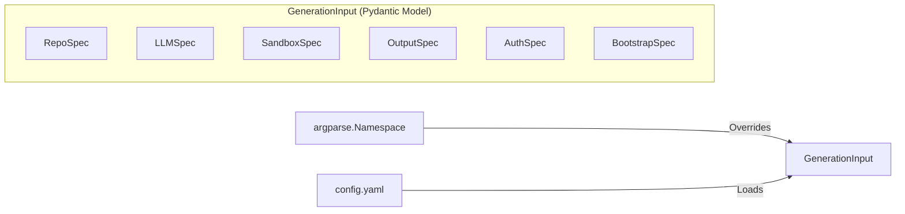
**Sources:** [src/repo2rlenv/cli.py:145-175]()

### Configuration Precedence
1. **CLI Flags**: Highest precedence (e.g., `--repo`, `--llm`) [src/repo2rlenv/cli.py:151-171]().
2. **Configuration File**: Provided via `--config` [src/repo2rlenv/cli.py:173-175]().
3. **Environment Variables**: Fallback for secrets and configuration parameters (`.env` loading supported) [src/repo2rlenv/cli.py:27-34]().

For details, see [Configuration Schema (GenerationInput)](#2.3).

---

## Global Options

The CLI supports several global flags applicable across subcommands:

* `--version`: Displays the current version [src/repo2rlenv/cli.py:21]()
* `--verbose / -v`: Increases logging verbosity and Rich traceback detail [src/repo2rlenv/cli.py:22]()
* `.env` Support: Automatically attempts to load a `.env` file in the working directory to populate provider API keys and tokens [src/repo2rlenv/cli.py:27-34]()

**Sources:** [src/repo2rlenv/cli.py:1-175](), [tests/check_cli_install.py:1-75]()

---

# Page: generate, validate, and bootstrap Commands

# generate, validate, and bootstrap Commands

<details>
<summary>Relevant source files</summary>

The following files were used as context for generating this wiki page:

- [docs/reference/API.md](docs/reference/API.md)
- [docs/reference/SPEC.md](docs/reference/SPEC.md)
- [src/repo2rlenv/cli.py](src/repo2rlenv/cli.py)
- [src/repo2rlenv/validation.py](src/repo2rlenv/validation.py)
- [tests/test_cli_llm_flags.py](tests/test_cli_llm_flags.py)
- [tests/test_validation.py](tests/test_validation.py)

</details>


This page provides a detailed technical reference for the three primary workflow commands in the `repo2rlenv` CLI: `generate` (pipeline execution), `validate` (structural, deep, and oracle checks on `task.toml`), and `bootstrap` (LLM-driven Docker environment creation). These commands facilitate the end-to-end process of transforming a GitHub repository into a Harbor-compliant reinforcement learning dataset.

Sources: [src/repo2rlenv/cli.py:1-10](), [docs/reference/SPEC.md:1-10]()

---

## 1. The `generate` Command

The `generate` command is the primary entry point for dataset synthesis. It orchestrates repository cloning, environment bootstrapping (if required), and the execution of a specific synthesis pipeline using the configuration options parsed by `load_generation_input`.

### Implementation and Data Flow
The command is implemented via `cmd_generate` in [src/repo2rlenv/cli.py:145-220](). It follows a multi-stage execution flow:

1. **Configuration Loading & Overrides**: Merges CLI arguments (such as `--repo`, `--pipeline`, `--pipeline-opt`, `--llm`, and `--out`) with an optional config file (`--config`) into a `GenerationInput` Pydantic model via `load_generation_input` [src/repo2rlenv/cli.py:146-175]().
2. **LLM Override Sanitization**: Drops obsolete configuration blocks if a new `--llm` flag conflicts with an existing config file via `_drop_config_llm_extras` [src/repo2rlenv/cli.py:89-113]().
3. **Pipeline Dispatch**: Retrieves the target pipeline from the `PIPELINES` registry [src/repo2rlenv/cli.py:147]().
4. **Pipeline Execution**: Validates options against the named pipeline's `Options` model and executes `pipeline.run(out_dir)` [src/repo2rlenv/cli.py:148]().

### Command Flags and Configuration
| Flag / Option | Description | Code Reference |
| :--- | :--- | :--- |
| `--repo` | Target repository (owner/name, URL, or local path). | [src/repo2rlenv/cli.py:152-153]() |
| `--pipeline` | Name of the synthesis pipeline (e.g., `pr_diff`, `pr_runtime`). | [src/repo2rlenv/cli.py:154-155]() |
| `--pipeline-opt` | Repeated `key=value` parameters passed to pipeline options. | [src/repo2rlenv/cli.py:37-55]() |
| `--llm` | Primary LLM spec as `provider/model` (e.g., `anthropic/claude-sonnet-4-6`). | [src/repo2rlenv/cli.py:58-73]() |
| `--llm-fallback` | Fallback LLM spec for 5xx/rate-limit/network errors. | [src/repo2rlenv/cli.py:74-76]() |
| `--llm-endpoint` | Base URL of a self-hosted OpenAI-compatible server (vLLM, Ollama). | [src/repo2rlenv/cli.py:77-78]() |
| `--llm-key-env` | Environment variable holding the custom API key for the primary LLM. | [src/repo2rlenv/cli.py:79-80]() |
| `--config` | Path to a YAML or TOML configuration file. | [src/repo2rlenv/cli.py:173]() |
| `--out` | Local output destination directory for the generated tasks. | [src/repo2rlenv/cli.py:165-171]() |

### Diagram: Generation Dispatch and Execution Bridge
The following diagram connects natural language intent to the underlying code entities in the `repo2rlenv` codebase.

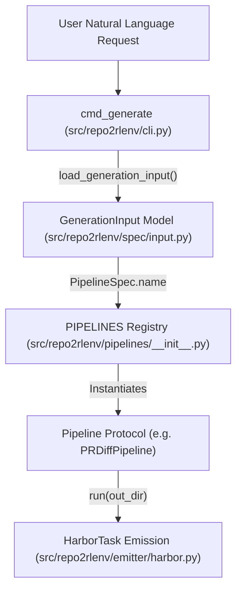
Sources: [src/repo2rlenv/cli.py:145-220](), [docs/reference/SPEC.md:5-20]()

---

## 2. The `validate` Command

The `validate` command performs structural, deep, and oracle checks on generated task directories and their associated `task.toml` configuration files.

### Implementation and Check Levels
The validation subsystem is driven by `validate_task` in [src/repo2rlenv/validation.py:84-122](). It inspects task assets against Harbor and Repo2RLEnv specifications across multiple verification layers:

1. **Structural Checks**: Recursively locates `task.toml` files, validates the root table structure, checks `[environment]` OS settings (`linux` or `windows`), and ensures mandatory files like `instruction.md` and test scripts (`tests/test.sh` or `.bat`) exist [src/repo2rlenv/validation.py:93-132]().
2. **Deep Asset Checks**: Inspects reward kinds (`test_execution` vs. `diff_similarity`), validates reproducibility modes (`reproducibility.mode`), and confirms that pipeline-specific auxiliary files (such as `f2p.json` and `p2p.json` for `pr_runtime`) are correctly formatted [src/repo2rlenv/validation.py:150-167]() and [tests/test_validation.py:72-88]().
3. **Oracle Checks (`--oracle`)**: Verifies the existence and validity of solution artifacts, allowing named recipes to solve tasks via custom scripts (e.g., `solution/solve.sh`) or standard patch files (`solution/patch.diff`) [tests/test_validation.py:127-147]().

### Diagram: Validation Flow and Finding Generation
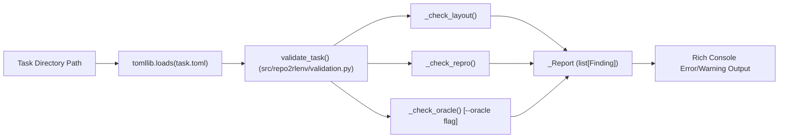
Sources: [src/repo2rlenv/validation.py:1-122](), [tests/test_validation.py:1-147]()

---

## 3. The `bootstrap` Command

The `bootstrap` command executes an LLM-driven ReAct agent loop to create, test, and commit a reproducible Docker environment for a given target repository.

### Lifecycle and Agent Mechanics
The bootstrap runner (`ensure_bootstrap`) coordinates environment creation through the following phases:

1. **Language Heuristics**: Inspects repository root files (e.g., `pyproject.toml`, `go.mod`, `Cargo.toml`) to select matching dependency files, base images, and system prompts [docs/reference/BOOTSTRAP.md:22-37]().
2. **Sandbox Allocation**: Spins up a `DockerSandbox` instance wrapping the local Docker daemon to execute build steps [docs/reference/BOOTSTRAP.md:18-18]().
3. **ReAct Loop**: The agent iteratively sends shell commands to install dependencies, run test suites, and read error logs via LiteLLM (`llm.complete`) until a successful "smoke test" exit code is achieved [src/repo2rlenv/llm.py:76-86]().
4. **Image Commitment**: Commits the resulting container state into a content-addressed local image cache (`cache.py`) [docs/reference/SPEC.md:134-140]().

### Configuration (BootstrapSpec)
`BootstrapSpec` governs agent termination criteria and environment parameters:
- `max_iterations`: Maximum LLM turn limit (default: `20`) [docs/reference/BOOTSTRAP.md:18]()
- `max_llm_spend_usd`: Budget ceiling for LiteLLM usage (default: `$5.00`) [docs/reference/SPEC.md:165-188]()
- `base_image`: Optional override for starting container images [docs/reference/SPEC.md:175]()
- `cache_dir`: Local storage path for cached bootstrap outputs (`./workspace/bootstrap`) [docs/reference/SPEC.md:181-183]()

Sources: [docs/reference/BOOTSTRAP.md:1-40](), [src/repo2rlenv/llm.py:76-86](), [docs/reference/SPEC.md:134-188]()

---

# Page: push and pull Commands

# push and pull Commands

<details>
<summary>Relevant source files</summary>

The following files were used as context for generating this wiki page:

- [docs/reference/REGISTRY_AUTH.md](docs/reference/REGISTRY_AUTH.md)
- [src/repo2rlenv/hub.py](src/repo2rlenv/hub.py)
- [src/repo2rlenv/registry/integration.py](src/repo2rlenv/registry/integration.py)
- [tests/registry/test_integration.py](tests/registry/test_integration.py)
- [tests/test_cli_push_pull.py](tests/test_cli_push_pull.py)
- [tests/test_hub_metadata_read.py](tests/test_hub_metadata_read.py)

</details>


## Purpose and Scope

The `push` and `pull` commands manage the distribution lifecycle for Repo2RLEnv datasets. While synthesis pipelines generate tasks locally, these commands facilitate publishing datasets to the Hugging Face Hub, formatting them as Harbor-compatible registries with associated `registry.json` manifests, uploading OCI bootstrap container images for environment reproducibility, and retrieving datasets via multi-backend URIs (`hf://`, `harbor://`, `gh://`).

Sources: [src/repo2rlenv/hub.py:1-26](), [src/repo2rlenv/cli.py:1010-1100]()

---

## Overview and URI Schemes

Repo2RLEnv uses a unified URI parsing function, `_parse_dataset_uri` in `src/repo2rlenv/cli.py`, to handle multiple distribution backends. This allows users to specify targets using shorthand notation or explicit URIs.

| Scheme | Example | Target Backend |
| :--- | :--- | :--- |
| `hf://` | `hf://AdithyaSK/click-r2e` | Hugging Face Hub (Default) |
| `harbor://` | `harbor://swe-bench@lite` | Harbor Registry (Pull-only) |
| `gh://` | `gh://owner/repo@main` | GitHub Repository |
| (none) | `click-r2e` | Auto-resolves to `hf://<whoami>/click-r2e` |

The URI parser decomposes strings into a `_Backend` enum, a `repo_id`, and an optional `revision` (git branch, tag, or commit SHA) [src/repo2rlenv/cli.py:1010-1015](). Bare names without an explicit owner invoke `huggingface_hub.whoami()` using credentials resolved by `resolve_hf_token` [src/repo2rlenv/cli.py:1044-1055]().

Sources: [src/repo2rlenv/cli.py:1010-1100](), [tests/test_cli_push_pull.py:23-58](), [src/repo2rlenv/auth.py:65-80]()

---

## The `push` Command and Two-Stage Commit

The `push` command uploads a local dataset directory to the Hugging Face Hub via `push_to_hub` in `src/repo2rlenv/hub.py`. To ensure the remote repository functions simultaneously as a valid HF Dataset and a Harbor task registry, it implements a strict two-stage commit process.

### Two-Stage Commit Workflow

1.  **Stage 1: Content Upload**: The local task directory structure (`tasks/`) is uploaded to the HF Hub repository via `HfApi.upload_folder` [src/repo2rlenv/hub.py:228-237]().
2.  **Stage 2: Registry and Card Generation**: Upon receiving the resulting `commit_sha`, `push_to_hub` generates a Harbor-compliant `registry.json` and a dataset card (`README.md`) pinned directly to that commit SHA [src/repo2rlenv/hub.py:241-260]().

### Key Registry Artifacts

*   **`registry.json`**: Built by `_build_registry_json`, containing a list of `DatasetSpec` rows mapping task names to the HF dataset git URL and specific `git_commit_id` hashes [src/repo2rlenv/hub.py:117-141]().
*   **Dataset Card (`README.md`)**: Generated via `_build_dataset_card`, incorporating pipeline-specific reward descriptions (e.g., test-execution F2P/P2P for `pr_runtime` versus 6-component diff similarity for `pr_diff`) [src/repo2rlenv/hub.py:144-177]().
*   **Manifest (`manifest.json`)**: Built by `_build_manifest`, capturing a summary of task composition (repo origins, reference PRs, difficulty, and F2P/P2P counts) for machine inspection without cloning full task directories [src/repo2rlenv/hub.py:68-114]().

### Metadata Auto-Discovery
`push_to_hub` automatically inspects the first available `task.toml` in the dataset directory to extract `pipeline` and `repo` values if they are omitted by standalone CLI callers [src/repo2rlenv/hub.py:218-226](), [tests/test_hub_metadata_read.py:78-102]().

Diagram: Push Data Flow and Code Entities
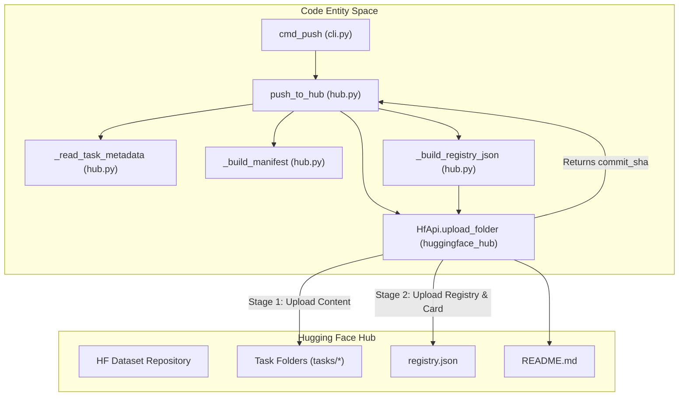
Sources: [src/repo2rlenv/hub.py:68-270](), [src/repo2rlenv/cli.py:840-900](), [tests/test_hub_metadata_read.py:45-102]()

---

## Container Registry Integration and `--check-auth`

For runtime verification pipelines (e.g., `pr_runtime`), datasets require OCI container images for environment reproduction. The distribution subsystem coordinates with OCI registries via `repo2rlenv.registry.integration` and `repo2rlenv.registry.probe`.

### The `--check-auth` Probe Protocol
Before pushing images or executing a generation campaign, users can run `repo2rlenv push --check-auth` to probe available credentials across registries. The probe runs a 4-level check sequence defined in `src/repo2rlenv/registry/probe.py`:

| Level | Probe Operation | Purpose |
| :--- | :--- | :--- |
| **L1** | `GET /v2/` | Verifies registry reachability [src/repo2rlenv/registry/probe.py:9]() |
| **L2** | Bearer-token exchange | Confirms credentials parse and are accepted [src/repo2rlenv/registry/probe.py:10]() |
| **L3** | `HEAD /v2/<ns>/r2e-bootstrap-probe/manifests/latest` | Checks read access on target namespace (404 = pass) [src/repo2rlenv/registry/probe.py:11]() |
| **L4** | `POST` blob upload + `DELETE` cancel | Verifies write access without leaving artifacts [src/repo2rlenv/registry/probe.py:12-13]() |

If no registry authentication is verified, `push` falls back to inline-Dockerfile mode (baking build recipes per task) unless `--require-registry` is specified [src/repo2rlenv/registry/integration.py:6-8](), [docs/reference/REGISTRY_AUTH.md:13-19]().

Diagram: Auth Probing and Registry Integration
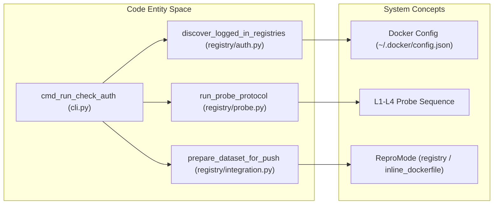
Sources: [src/repo2rlenv/cli.py:1134-1200](), [src/repo2rlenv/registry/probe.py:7-20](), [src/repo2rlenv/registry/integration.py:1-13](), [docs/reference/REGISTRY_AUTH.md:159-172]()

---

## The `pull` Command and Backend Dispatchers

The `pull` command retrieves datasets and prepares them for local evaluation or execution. It acts as a dispatcher across the supported URI backends.

*   **HF Backend**: Uses `huggingface_hub.snapshot_download` to fetch datasets into the local cache, returning a `PullResult` containing both `snapshot_path` and `local_dir` [src/repo2rlenv/hub.py:60-66](), [src/repo2rlenv/hub.py:273-306]().
*   **Harbor Backend**: Designed to query Harbor legacy registries via `harbor://` URIs [tests/test_cli_push_pull.py:35-40]().
*   **GitHub Backend**: Executes a standard git clone operation for `gh://` and direct HTTPS git URLs [tests/test_cli_push_pull.py:42-52]().

Sources: [src/repo2rlenv/hub.py:60-306](), [src/repo2rlenv/cli.py:920-960](), [tests/test_cli_push_pull.py:23-52]()

---

## CLI Reference Summary

### `push` Arguments
| Flag | Description |
| :--- | :--- |
| `local_dir` | Path to the local dataset directory. |
| `dataset` | Target destination URI (e.g., `hf://owner/dataset-name`). |
| `--private` | Sets HF dataset visibility to private. |
| `--check-auth` | Executes the L1–L4 registry probe protocol without pushing. |
| `--image-registry` | OCI container registry endpoint for bootstrap images. |
| `--require-registry` | Hard-fails if no verified OCI registry is available instead of falling back to inline Dockerfiles [docs/reference/REGISTRY_AUTH.md:18-19](). |

### `pull` Arguments
| Flag | Description |
| :--- | :--- |
| `dataset` | Source URI of the dataset to pull. |
| `--out` | Local destination directory. |
| `--task` | Optional: download only a specific task ID [src/repo2rlenv/cli.py:182-183](). |

Sources: [src/repo2rlenv/cli.py:350-450](), [src/repo2rlenv/spec/input.py:129-142](), [tests/test_cli_push_pull.py:119-121]()

---

# Page: Configuration Schema (GenerationInput)

# Configuration Schema (GenerationInput)

<details>
<summary>Relevant source files</summary>

The following files were used as context for generating this wiki page:

- [docs/reference/AUTH.md](docs/reference/AUTH.md)
- [src/repo2rlenv/pipelines/__init__.py](src/repo2rlenv/pipelines/__init__.py)
- [src/repo2rlenv/spec/__init__.py](src/repo2rlenv/spec/__init__.py)
- [src/repo2rlenv/spec/input.py](src/repo2rlenv/spec/input.py)
- [src/repo2rlenv/spec/options.py](src/repo2rlenv/spec/options.py)
- [tests/test_e2e_private.py](tests/test_e2e_private.py)
- [tests/test_sources.py](tests/test_sources.py)
- [tests/test_spec.py](tests/test_spec.py)

</details>


The purpose of this section is to document the configuration schema of Repo2RLEnv centered around `GenerationInput` and its associated sub-models (`RepoSpec`, `LLMSpec`, `SandboxSpec`, `BootstrapSpec`, `QASpec`, `OutputSpec`, `AuthSpec`), the per-pipeline `OPTIONS_REGISTRY` and `RECIPE_OPTIONS_REGISTRY` option models, configuration files (YAML/TOML), and CLI override precedence.

The `GenerationInput` model serves as the central configuration contract for Repo2RLEnv. It defines everything required to execute a synthesis pipeline, ranging from source repository details and LLM specifications to sandbox requirements and output destinations.

This schema is implemented using **Pydantic v2**, providing strict type validation, coercion (e.g., strings to `Path` objects), and clear error messaging. The CLI acts as a thin shim that populates this model from a combination of configuration files (YAML/TOML) and command-line overrides.

---

## Data Flow and Hierarchy

The `GenerationInput` class is the root container for several specialized sub-models. When `repo2rlenv generate` is called, the system merges configuration sources to instantiate this model before dispatching to a specific pipeline.

### Configuration Model Hierarchy

```mermaid
classDiagram
    class "GenerationInput" {
        "+spec_version: Literal['0.1.0']"
        "+repo: RepoSpec"
        "+pipeline: PipelineSpec"
        "+llm: LLMSpec?"
        "+output: OutputSpec"
        "+qa: QASpec"
        "+sandbox: SandboxSpec"
        "+bootstrap: BootstrapSpec"
        "+auth: AuthSpec"
    }

    class "RepoSpec" {
        "+url: str"
        "+ref: str"
        "+access: Literal['public', 'private', 'auto']"
        "+auth_token_env: str?"
        "+sparse_paths: list[str]?"
    }

    class "PipelineSpec" {
        "+name: PipelineName"
        "+options: dict[str, Any]"
    }

    class "LLMSpec" {
        "+provider: str"
        "+model: str"
        "+fallback: LLMSpec?"
        "+max_concurrent: int"
        "+endpoint: str?"
    }

    class "BootstrapSpec" {
        "+enabled: bool"
        "+max_iterations: int"
        "+max_llm_spend_usd: float?"
        "+cache_dir: Path"
        "+base_image: str?"
        "+image_registry: str?"
    }

    "GenerationInput" *-- "RepoSpec"
    "GenerationInput" *-- "PipelineSpec"
    "GenerationInput" *-- "LLMSpec"
    "GenerationInput" *-- "BootstrapSpec"
    "GenerationInput" *-- "QASpec"
    "GenerationInput" *-- "SandboxSpec"
    "GenerationInput" *-- "OutputSpec"
    "GenerationInput" *-- "AuthSpec"
```

Sources: [src/repo2rlenv/spec/input.py:1-343](), [src/repo2rlenv/spec/__init__.py:1-35]()

---

## Model Definitions

### RepoSpec
Defines the source repository. The `url` field is automatically normalized from short-form (e.g., `huggingface/trl`) to full GitHub HTTPS URLs or canonical local file URIs.
*   **Implementation:** [src/repo2rlenv/spec/input.py:55-104]()
*   **Key Behavior:** Strips `.git` suffixes and provides an `owner_name` property for GitHub API interactions [src/repo2rlenv/spec/input.py:62-104]().
*   **Source Detection:** Uses `detect_source_kind` to categorize the repository as GitHub, GitLab, or local [src/repo2rlenv/spec/input.py:83-87]() and [tests/test_sources.py:121-125]().

### PipelineSpec
Encapsulates the synthesis method and its parameters.
*   **`name`**: A member of the `PipelineName` enum (e.g., `pr_diff`, `pr_runtime`, `commit_runtime`, `code_instruct`) [src/repo2rlenv/spec/input.py:13-31]().
*   **`options`**: A dictionary of keyword arguments validated against the specific pipeline's options model (e.g., `PRDiffOptions`, `PRRuntimeOptions`, `CommitRuntimeOptions`) via `parse_options` [src/repo2rlenv/spec/options.py:30-174]().

### LLMSpec
Configures the model driving the synthesis or bootstrap agent.
*   **Provider/Model**: Resolves to a LiteLLM identifier. Supports an `endpoint` field for self-hosted providers like vLLM or Ollama [src/repo2rlenv/spec/input.py:163-179]().
*   **Fallback**: An optional secondary `LLMSpec` used if the primary provider encounters transient errors [src/repo2rlenv/spec/input.py:170-170]().

### SandboxSpec
Describes the execution environment required during generation.
*   **`provider`**: Supports execution backends for running tasks and validation harnesses.

### BootstrapSpec
Configures the LLM-driven agent loop that prepares the Docker environment for sandbox-required pipelines.
*   **`max_llm_spend_usd`**: A hard budget cap to prevent runaway costs during environment discovery.

### QASpec
Defines quality gates applied to synthesized tasks.
*   **Layers**: Includes `determinism`, `oracle_consistency`, `llm_judge`, `false_negative`, and `diff_parse` [src/repo2rlenv/spec/input.py:181-193]().
*   **Behavior**: `diff_parse` ensures the oracle diff applies cleanly.

Sources: [src/repo2rlenv/spec/input.py:55-193](), [src/repo2rlenv/spec/options.py:30-174]()

---

## Configuration Resolution and Precedence

Repo2RLEnv follows a strict precedence order for settings when parsing configuration files and command-line inputs:

1.  **CLI Overrides**: Explicit command-line flags have the highest priority.
2.  **Config File**: Values defined in a YAML or TOML configuration file passed via `--config`.
3.  **Environment Variables**: Default values or token references (e.g., `GITHUB_TOKEN`, `HF_TOKEN`).
4.  **Pydantic Defaults**: Hardcoded fallback values defined within the Pydantic models.

### Code Entity Mapping: CLI Overrides to GenerationInput

The following diagram illustrates how raw CLI inputs and configuration files are processed into the structured `GenerationInput` entity and validated against option models.

```mermaid
flowchart TD
    subgraph "Natural Language / CLI Space"
        A[""--repo 'huggingface/trl'"""]
        B[""--pipeline-opt 'limit=10'"""]
        C[""--llm 'anthropic/claude-3-5-sonnet'"""]
    end

    subgraph "Code Entity Space (repo2rlenv.spec)"
        D["cmd_generate"]
        E["_parse_pipeline_opts"]
        F["load_generation_input"]
        G["GenerationInput"]
        H["PRDiffOptions"]
        I["RepoSpec"]
    end

    A --> D
    B --> E
    C --> D
    E --> D
    D -- "overrides dict" --> F
    F -- "Pydantic validate" --> G
    G -- "repo field" --> I
    G -- "parse_options()" --> H
```

Sources: [src/repo2rlenv/spec/input.py:55-104](), [src/repo2rlenv/spec/options.py:30-174](), [tests/test_spec.py:31-57]()

---

## Pipeline Options and Recipe Options

While `GenerationInput.pipeline.options` is represented as a generic `dict[str, Any]`, it is strictly validated against a pipeline-specific options model immediately after the main configuration is loaded. This is performed using registries such as `OPTIONS_REGISTRY` and `RECIPE_OPTIONS_REGISTRY`.

### Available Option Models
*   `PRDiffOptions`: Configures text-only PR mining with diff-similarity verification [src/repo2rlenv/spec/options.py:66-96]().
*   `PRRuntimeOptions`: Configures sandbox-verified PR mining with F2P/P2P oracle test execution [src/repo2rlenv/spec/options.py:30-65]().
*   `CommitRuntimeOptions`: Configures commit-level git log walking with issue enrichment and validation [src/repo2rlenv/spec/options.py:97-142]().
*   `CodeInstructOptions`: Configures OSS-Instruct-style code generation anchored to a target repository [src/repo2rlenv/spec/options.py:143-174]().
*   Owned Recipe Options: Includes option models like `DataArcOptions`, `R2EGymOptions`, `R2EOptions`, `SWENextOptions`, and `SWESmithOptions` imported from `repo2rlenv.spec.recipe_options` [src/repo2rlenv/spec/options.py:10-23]().

All option classes inherit from `_BaseOptions`, which enforces `model_config = ConfigDict(extra="forbid")` to catch configuration typos early [src/repo2rlenv/spec/options.py:26-28]().

Sources: [src/repo2rlenv/spec/options.py:1-306](), [src/repo2rlenv/spec/recipe_options.py:1-50]()

---

# Page: Synthesis Pipelines

# Synthesis Pipelines

<details>
<summary>Relevant source files</summary>

The following files were used as context for generating this wiki page:

- [docs/pipelines/README.md](docs/pipelines/README.md)
- [src/repo2rlenv/pipelines/base.py](src/repo2rlenv/pipelines/base.py)
- [tests/test_pipeline_contract.py](tests/test_pipeline_contract.py)

</details>


Synthesis Pipelines are the core manufacturing engines of `Repo2RLEnv`. Each pipeline implements a specific strategy for transforming raw repository data (PRs, commits, issues, or AST structures) into verifiable **Harbor tasks**.

All pipelines share a common execution lifecycle: discovering candidates from a source, synthesizing task content (instructions, solutions, and environments), passing through a QA gate, and emitting a standardized Harbor task directory [docs/pipelines/README.md:9-18]().

### The Pipeline Protocol

Every pipeline implementation must conform to the `Pipeline` protocol, ensuring a uniform interface for the CLI and orchestration layers [src/repo2rlenv/pipelines/base.py:57-77]().

| Attribute / Method | Description |
|---|---|
| `name` | The unique identifier used in CLI `--pipeline` flags [src/repo2rlenv/pipelines/base.py:79](). |
| `requires_bootstrap` | Boolean indicating if the pipeline requires a pre-built Docker environment from the Bootstrap System [src/repo2rlenv/pipelines/base.py:80](). |
| `supported_languages` | A set of `LanguageHint` values. If `None`, the pipeline is language-agnostic [src/repo2rlenv/pipelines/base.py:84](). |
| `experimental` | If `True`, the CLI issues a stability warning before execution [src/repo2rlenv/pipelines/base.py:88](). |
| `run(out_dir)` | The primary execution method that returns a `PipelineResult` containing yield and skip metrics [src/repo2rlenv/pipelines/base.py:97](). |

Sources: [src/repo2rlenv/pipelines/base.py:57-97](), [tests/test_pipeline_contract.py:10-43]()

---

### Pipeline Families and Child Pages

`Repo2RLEnv` organizes native pipelines into stable and experimental families, alongside an extensive catalog of research recipes.

#### 3.1. pr_diff Pipeline
The `pr_diff` pipeline is a lightweight, language-agnostic pipeline that bypasses heavy environment bootstrapping. It mines merged pull requests, strips info-leaks from instructions, and evaluates rollouts using a 6-component diff-similarity reward function against a calibration baseline.
* For details, see [pr_diff Pipeline](#3.1).

#### 3.2. pr_runtime Pipeline
The `pr_runtime` pipeline provides sandbox-verified PR mining. It splits patches and test patches, validates fail-to-pass (F2P) and pass-to-pass (P2P) test oracles, and emits fully containerized environments with anti-tamper guards and graded rewards.
* For details, see [pr_runtime Pipeline](#3.2).

#### 3.3. commit_runtime Pipeline
The `commit_runtime` pipeline replaces PR lists with direct git log traversal. It applies structural and metadata filters, synthesizes task instructions from linked issues, and subjects candidates to rigorous F2P/P2P sandbox validation.
* For details, see [commit_runtime Pipeline](#3.3).

#### 3.4. Experimental Pipelines
Experimental pipelines explore alternative authoring mechanics such as bug mutation (`repo_mutate`), equivalence test generation, CVE patch mining via OSV (`cve_patches`), code instruction synthesis, and task evolution.
* For details, see [Experimental Pipelines](#3.4).

#### 3.5. Owned Research Recipes
The `recipes/` subsystem layers method-specific recipes onto core pipeline families. It includes implementations for SWE-smith, SWE-gen, SWE-Flow, R2E, R2E-Gym, SWE-Next, CLI-Gym, SETA, DataArc, TMax, TerminalWorld, Endless Terminals, and SCALER.
* For details, see [Owned Research Recipes](#3.5).

Sources: [docs/pipelines/README.md:25-65](), [src/repo2rlenv/pipelines/__init__.py:1-25]()

---

### Pipeline Architecture: Data Flow

The following diagram illustrates how the `Pipeline` protocol bridges the "Natural Language Space" (instructions and PR descriptions) to the "Code Entity Space" (Docker images and diffs) using internal code symbols.

**Synthesis Pipeline Data Flow**
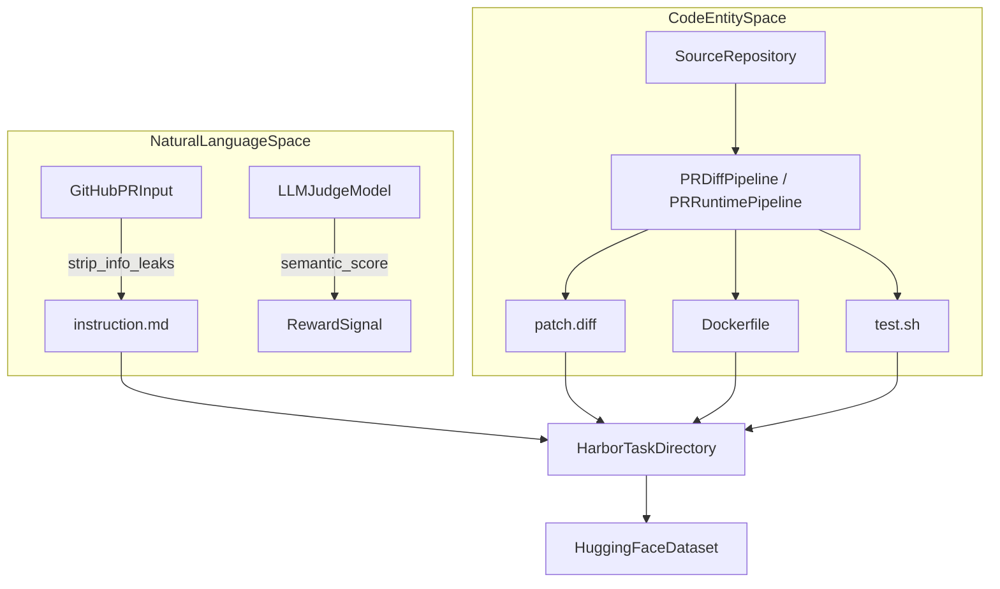
Sources: [docs/pipelines/README.md:9-18](), [src/repo2rlenv/pipelines/base.py:57-77](), [src/repo2rlenv/pipelines/__init__.py:11-18]()

---

### Choosing a Pipeline and Language Compatibility

The choice of pipeline depends on the desired verification rigor and available compute resources. Language constraints are enforced via `check_language_compatibility()` to prevent silent failures on non-Python codebases [src/repo2rlenv/pipelines/base.py:100-142]().

**Pipeline Language Constraints**
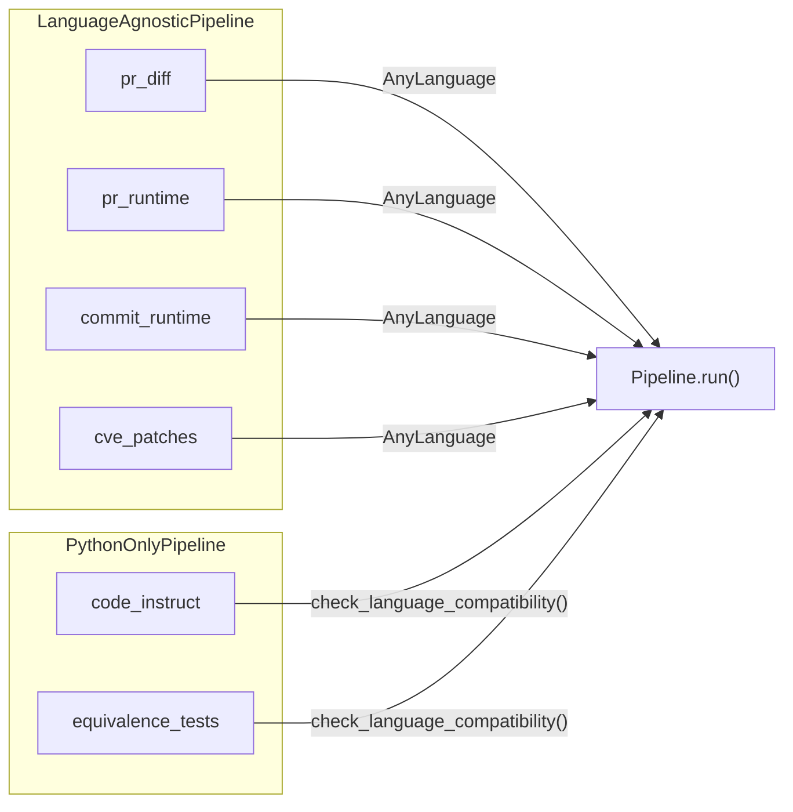
Sources: [src/repo2rlenv/pipelines/base.py:100-142](), [tests/test_pipeline_contract.py:60-91]()

---

# Page: pr_diff Pipeline

# pr_diff Pipeline

<details>
<summary>Relevant source files</summary>

The following files were used as context for generating this wiki page:

- [docs/pipelines/pr_diff.md](docs/pipelines/pr_diff.md)
- [src/repo2rlenv/pipelines/_pr_diff_verifier.py](src/repo2rlenv/pipelines/_pr_diff_verifier.py)
- [src/repo2rlenv/pipelines/cve_patches.py](src/repo2rlenv/pipelines/cve_patches.py)
- [src/repo2rlenv/pipelines/pr_diff.py](src/repo2rlenv/pipelines/pr_diff.py)
- [src/repo2rlenv/pipelines/pr_runtime.py](src/repo2rlenv/pipelines/pr_runtime.py)
- [tests/test_e2e_hub_build.py](tests/test_e2e_hub_build.py)
- [tests/test_pipeline_pr_diff.py](tests/test_pipeline_pr_diff.py)
- [tests/test_pr_diff_clone.py](tests/test_pr_diff_clone.py)
- [tests/test_pr_diff_verifier.py](tests/test_pr_diff_verifier.py)

</details>


The `pr_diff` pipeline is a high-throughput, text-based synthesis pipeline designed to transform merged GitHub and GitLab Pull Requests into Harbor-runnable Reinforcement Learning (RL) environments. Inspired by the **SWE-RL** methodology `[src/repo2rlenv/pipelines/pr_diff.py:21-25]`, it focuses on a "PR-as-task" formulation where an agent is tasked with reproducing the changes found in a real-world PR given only the issue description.

Unlike runtime-heavy pipelines (such as `pr_runtime`), `pr_diff` generation is text-only and does not require a live container sandbox during the synthesis phase `[src/repo2rlenv/pipelines/pr_diff.py:3-8]`. Instead, it emits a thin Docker environment equipped with a sophisticated 6-component verifier that scores agent-produced patches against the "gold" oracle diff.

Sources: `[src/repo2rlenv/pipelines/pr_diff.py:1-37]`, `[docs/pipelines/pr_diff.md:1-16]`

---

## Pipeline Data Flow & Mining Logic

The following diagram illustrates the lifecycle of a task within the `pr_diff` pipeline, from initial repository mining and structural filtering to the emission of a Harbor-compliant task directory.

**Diagram: pr_diff Task Synthesis Flow**
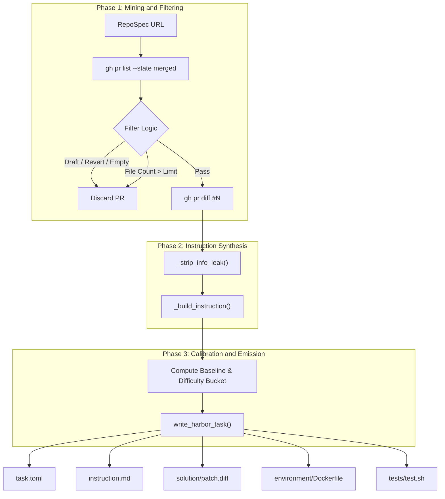
Sources: `[src/repo2rlenv/pipelines/pr_diff.py:1-40]`, `[docs/pipelines/pr_diff.md:17-40]`

For each merged PR within scope, the pipeline executes the following steps:
1. Lists PRs using `gh pr list` or GitLab equivalent, applying structural filters (draft status, file count limits) and quality filters (drop test-only, docs-only, reverts, or trivially small diffs) `[docs/pipelines/pr_diff.md:34-34]()`.
2. Fetches the unified diff via `gh pr diff` `[docs/pipelines/pr_diff.py:5-5]()`.
3. Strips leakage patterns from the PR title and body `[docs/pipelines/pr_diff.py:145-148]()`.
4. Computes the calibration baseline and difficulty bucket `[docs/pipelines/pr_diff.py:1-10]()`.
5. Emits a Harbor task directory structure containing `instruction.md`, `solution/patch.diff`, `solution/solve.sh`, `environment/Dockerfile`, `tests/test.sh`, and `task.toml` `[docs/pipelines/pr_diff.md:38-38]()`.

Sources: `[src/repo2rlenv/pipelines/pr_diff.py:1-55]`, `[docs/pipelines/pr_diff.md:17-43]`

---

## Instruction Info-Leak Stripping

To prevent RL agents from "cheating" by following direct references to the solution (such as issue links, commit hashes, or pull request URLs), the pipeline implements a robust text-cleaning module `_strip_info_leak` `[src/repo2rlenv/pipelines/pr_diff.py:120-143]()`.

| Pattern Family | Regex Variable | Example Stripped |
| :--- | :--- | :--- |
| **Closes / Fixes / Resolves** | `_CLOSES_RE`, `_CLOSES_MD_RE` | `Closes #42`, `Fixes [#1](url)` |
| **See / Refs / Follow-up** | `_REFS_RE`, `_REFS_MD_RE` | `See #99`, `Follow-up to #10` |
| **Markdown Issue Links** | `_MD_ISSUE_LINK_RE` | `[#1234](https://github.com/...)` |
| **Markdown GitHub URLs** | `_MD_GH_URL_RE` | `[analysis](https://github.com/.../pull/1)` |
| **Bare GitHub URLs** | `_GH_URL_RE` | `https://redirect.github.com/.../pull/42` |
| **Commit Trailers** | `_TRAILER_LINE_RE` | `Co-authored-by: ...`, `Signed-off-by: ...` |
| **Title Squash Suffix** | `_SQUASH_SUFFIX_RE` | `Fix the bug (#1234)` |

Order of execution is critical: composite patterns (such as markdown-wrapped issue links and descriptive markdown URLs) are processed before piece-wise regexes to ensure no orphaned keywords (`Closes `) or empty bracket pairs (`[]()`) remain in the final instruction text `[src/repo2rlenv/pipelines/pr_diff.py:127-130]()`.

Sources: `[src/repo2rlenv/pipelines/pr_diff.py:67-142]`, `[tests/test_pipeline_pr_diff.py:48-117]`

---

## The 6-Component Diff-Similarity Reward Model

The verifier embedded in `tests/test.sh` computes a weighted multi-component similarity score between the agent's predicted diff and the gold oracle diff `[src/repo2rlenv/pipelines/_pr_diff_verifier.py:1-47]()`.

**Diagram: In-Container Verifier Architecture**
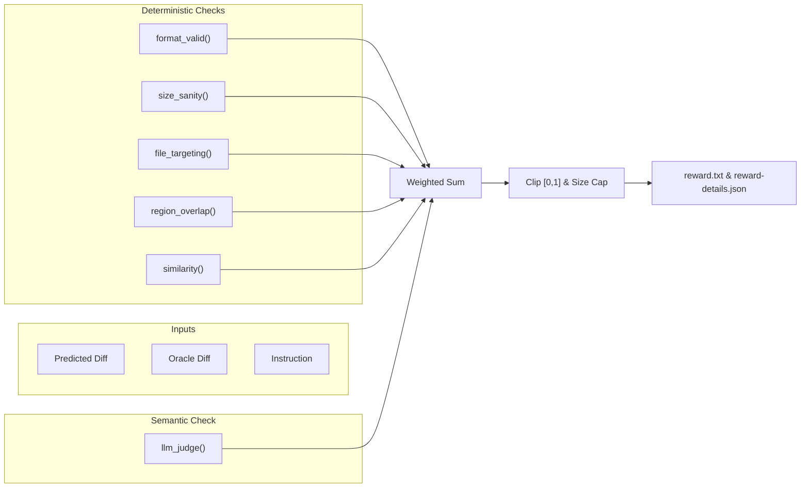
Sources: `[src/repo2rlenv/pipelines/_pr_diff_verifier.py:1-47]`, `[docs/pipelines/pr_diff.md:44-60]`

### Component Breakdown
1. **`format_valid` (Default Weight: 0.00):** A guard check returning `1.0` if the predicted text parses as a valid unified diff (containing a `diff --git` header and at least one `+/-` change line) or `0.0` otherwise `[src/repo2rlenv/pipelines/_pr_diff_verifier.py:132-151]()`.
2. **`size_sanity` (Default Weight: 0.08):** Computes `min(oracle_loc, predicted_loc) / max(...)` to penalize code rampages or no-op submissions `[src/repo2rlenv/pipelines/_pr_diff_verifier.py:186-200]`.
3. **`file_targeting` (Default Weight: 0.12):** Computes the F1 score over the sets of modified files. F1 is preferred over Jaccard similarity to heavily penalize missing oracle files while offering graceful partial credit for extra file exploration `[src/repo2rlenv/pipelines/_pr_diff_verifier.py:154-177]`.
4. **`region_overlap` (Default Weight: 0.20):** Evaluates whether predicted hunks overlap with oracle hunks within a 5-line spatial slack window `[src/repo2rlenv/pipelines/_pr_diff_verifier.py:230-264]`.
5. **`similarity` (Default Weight: 0.10):** Utilizes `difflib.SequenceMatcher` applied strictly to `+` and `-` change lines (excluding unchanged context lines to prevent free credit) `[src/repo2rlenv/pipelines/_pr_diff_verifier.py:203-227]`.
6. **`llm_judge` (Default Weight: 0.50):** An optional semantic evaluation via an LLM model (such as Claude Haiku) rating whether the patch addresses the issue. If an API key is absent, remaining weights are automatically re-normalized `[src/repo2rlenv/pipelines/_pr_diff_verifier.py:267-310]`.

**Catastrophic Size Hard Cap:** If `size_sanity < 0.10`, the final reward is strictly clamped to a maximum of `0.40`, neutralizing inflated scores from charitable LLM judges on vastly mis-sized patches `[src/repo2rlenv/pipelines/_pr_diff_verifier.py:32-34]()`.

Sources: `[src/repo2rlenv/pipelines/_pr_diff_verifier.py:9-35]`, `[docs/pipelines/pr_diff.md:44-61]`

---

## Calibration Baseline and Difficulty Bucketing

To enable cross-task comparability and flexible dataset filtering, tasks generated by `pr_diff` include diagnostic metadata in `task.toml`:

* **Calibration Baseline (`baseline_reward`):** The reward score that an empty predicted patch receives against the oracle, enabling normalized scoring:
  $$\text{calibrated} = \frac{\text{raw} - \text{baseline}}{1 - \text{baseline}}$$
  Scores below `0` indicate performance worse than a no-op `[docs/pipelines/pr_diff.md:65-71]()`.
* **Difficulty Bucketing:** Tasks are categorized into `easy` ($\le 5$ LOC changed), `small` ($6\text{--}20$ LOC), `medium` ($21\text{--}80$ LOC), and `large` ($>80$ LOC) based on the oracle diff size `[docs/pipelines/pr_diff.md:73-75]()`.

Sources: `[docs/pipelines/pr_diff.md:63-75]`, `[src/repo2rlenv/pipelines/_pr_diff_verifier.py:312-320]`

---

## Thin Docker Environment Emission & Clone Handling

Unlike runtime pipelines that execute a multi-step LLM bootstrap runner, `pr_diff` tasks emit a thin, agent-agnostic `python:3.12-slim` Docker image `[docs/pipelines/pr_diff.md:38-40]()`. 

The generated `environment/Dockerfile`:
1. Installs system dependencies including `git` `[docs/pipelines/pr_diff.py:168-180]()`.
2. Clones the repository using `--filter=blob:none` over HTTPS from the source host, injecting repository access tokens (`GITHUB_TOKEN` or `GITLAB_TOKEN`) as build arguments without hardcoding credentials into image layers `[src/repo2rlenv/pipelines/pr_diff.py:168-180]()`, `[tests/test_pr_diff_clone.py:41-73]()`.
3. Checks out the repository at the precise `base_commit` SHA and resets the remote URL origin `[tests/test_pr_diff_clone.py:127-130]()`.
4. Embeds the standalone verifier logic (`verifier.py`) and test runner (`tests/test.sh`) to execute the 6-component reward calculation upon container completion `[src/repo2rlenv/pipelines/pr_diff.py:10-16]()`.

Sources: `[src/repo2rlenv/pipelines/pr_diff.py:1-180]`, `[tests/test_pr_diff_clone.py:1-131]`

---

# Page: pr_runtime Pipeline

# pr_runtime Pipeline

<details>
<summary>Relevant source files</summary>

The following files were used as context for generating this wiki page:

- [.gitignore](.gitignore)
- [src/repo2rlenv/emitter/harbor.py](src/repo2rlenv/emitter/harbor.py)
- [src/repo2rlenv/log_parsers/pytest_parser.py](src/repo2rlenv/log_parsers/pytest_parser.py)
- [src/repo2rlenv/pipelines/_pr_runtime_verifier.py](src/repo2rlenv/pipelines/_pr_runtime_verifier.py)
- [src/repo2rlenv/pipelines/cve_patches.py](src/repo2rlenv/pipelines/cve_patches.py)
- [src/repo2rlenv/pipelines/pr_diff.py](src/repo2rlenv/pipelines/pr_diff.py)
- [src/repo2rlenv/pipelines/pr_runtime.py](src/repo2rlenv/pipelines/pr_runtime.py)
- [src/repo2rlenv/pipelines/pr_runtime_validate.py](src/repo2rlenv/pipelines/pr_runtime_validate.py)
- [src/repo2rlenv/reward.py](src/repo2rlenv/reward.py)
- [tests/test_emitter.py](tests/test_emitter.py)
- [tests/test_log_parsers.py](tests/test_log_parsers.py)
- [tests/test_pipeline_pr_runtime.py](tests/test_pipeline_pr_runtime.py)
- [tests/test_pr_runtime_verifier.py](tests/test_pr_runtime_verifier.py)
- [tests/test_pytest_node_ids.py](tests/test_pytest_node_ids.py)

</details>


This page details the implementation, data flow, and verification mechanics of the `pr_runtime` pipeline (`src/repo2rlenv/pipelines/pr_runtime.py`), which performs sandbox-verified Pull Request (PR) mining (SWE-bench-style) [src/repo2rlenv/pipelines/pr_runtime.py:1]().

## Overview and Purpose

The `pr_runtime` pipeline provides sandbox-verified PR mining by combining GitHub/GitLab PR metadata pulling, unified diff splitting, containerized two-stage oracle validation, and graded test execution rewards [src/repo2rlenv/pipelines/pr_runtime.py:3-11](). Unlike text-only pipelines like `pr_diff` [src/repo2rlenv/pipelines/pr_diff.py:1](), `pr_runtime` requires a working Docker environment produced by the bootstrap phase (`requires_bootstrap=True`) to validate that candidate tests fail before the fix and pass after it [src/repo2rlenv/pipelines/pr_runtime.py:13-15]().

### Pipeline Lifecycle
1.  **Mining**: Pull PR metadata and unified diffs via `gh pr list` / `gh pr diff` or GitLab equivalents [src/repo2rlenv/pipelines/pr_runtime.py:4-48]().
2.  **Splitting**: Partition the unified diff into source code (`patch`) and test code (`test_patch`) using keyword-on-path heuristics [src/repo2rlenv/pipelines/pr_runtime.py:5-6]().
3.  **Oracle Validation**: Run the bootstrap container twice via `src/repo2rlenv/pipelines/pr_runtime_validate.py` (once with `test_patch` only to establish Fail-to-Pass tests, and once with both patches to establish Pass-to-Pass tests) [src/repo2rlenv/pipelines/pr_runtime.py:7-9]().
4.  **Task Emission**: Emit a Harbor-compliant task directory via `src/repo2rlenv/emitter/harbor.py` containing `environment/Dockerfile`, `tests/test.sh`, and `solution/patch.diff` [src/repo2rlenv/pipelines/pr_runtime.py:10-11]().

### System Component Mapping
The following diagram connects the conceptual components of the `pr_runtime` pipeline to their concrete code entities.

Title: "Logic to Code Mapping: pr_runtime Pipeline"
```mermaid
graph TD
    subgraph "Natural Language Space"
        A["Mining & Filtering"]
        B["Patch Partitioning"]
        C["Sandbox Validation"]
        D["Graded Reward"]
    end

    subgraph "Code Entity Space"
        A1["PullRequestSummary"]
        A2["_linked_issue_number"]
        B1["split_patch_and_test_patch"]
        B2["_path_is_test"]
        C1["_fetch_base_commit"]
        C2["build_eval_script"]
        D1["parse_pytest"]
        D2["grade"]
    end

    A --- A1
    A --- A2
    B --- B1
    B --- B2
    C --- C1
    C --- C2
    D --- D1
    D --- D2
```
Sources: [src/repo2rlenv/pipelines/pr_runtime.py:48-85](), [src/repo2rlenv/pipelines/pr_runtime_validate.py:46-121](), [src/repo2rlenv/pipelines/_pr_runtime_verifier.py:32-140]()

---

## Patch Splitting and Heuristics

Separating the solution patch from the test patch is handled by `split_patch_and_test_patch` [tests/test_pipeline_pr_runtime.py:30]().

*   **Path Classification**: A diff hunk is classified as a test patch if its file path contains test indicators (`tests`, `test`, `e2e`, `testing`) or filename markers (`_test.go`, `.spec.ts`) [tests/test_pipeline_pr_runtime.py:101-108]().
*   **False Positive Defense**: Documentation paths (e.g. `docs/testing.md`) and non-test source files containing substrings like `testing` (e.g. `src/click/testing.py`) are strictly filtered out [tests/test_pipeline_pr_runtime.py:113-119]().
*   **Git Clean Management**: During workspace resets, `git clean -fdx` preserves essential dependency and build directories (`node_modules`, `target`, `vendor`, `.venv`, `.tox`, `.gradle`) so test suites can run without re-installing environment dependencies [src/repo2rlenv/pipelines/pr_runtime.py:69-77]().

Sources: [tests/test_pipeline_pr_runtime.py:30-125](), [src/repo2rlenv/pipelines/pr_runtime.py:69-77]()

---

## Sandbox Validation and Oracle Logic

Validation executes inside a `DockerSandbox` instance (`src/repo2rlenv/pipelines/pr_runtime_validate.py`) to discover the exact Fail-to-Pass (F2P) and Pass-to-Pass (P2P) test sets [src/repo2rlenv/pipelines/pr_runtime_validate.py:1-11]().

### Validation Sequence
Title: "Sandbox Validation Sequence"
```mermaid
flowchart TD
    Start["Container at base_commit"] --> Fetch["_fetch_base_commit"]
    Fetch --> PreStage["Apply test_patch only"]
    PreStage --> RunPre["Run Test Suite (Pre-fix)"]
    RunPre --> F2P["Identify F2P: Failed pre, Pass post"]
    F2P --> PostStage["Apply patch + test_patch"]
    PostStage --> RunPost["Run Test Suite (Post-fix)"]
    RunPost --> P2P["Identify P2P: Pass pre, Pass post"]
    P2P --> Verdict{"F2P count >= 1?"}
    Verdict -- "Yes" --> Emit["Emit Harbor Task"]
    Verdict -- "No" --> Skip["Discard PR (Unverifiable)"]
```
Sources: [src/repo2rlenv/pipelines/pr_runtime_validate.py:1-11](), [src/repo2rlenv/pipelines/pr_runtime_validate.py:121-161]()

### Anti-Tamper and Evaluation Guards
The `build_eval_script` function creates the execution script embedded in `tests/test.sh`, which enforces:
*   Pre- and post-test workspace reset via `git checkout` to prevent state pollution [tests/test_pipeline_pr_runtime.py:139-140]().
*   Safe directory registration (`git config --global --add safe.directory /workspace`) to bypass container permission restrictions [tests/test_pipeline_pr_runtime.py:143]().
*   Exit code capture (`TEST_EXIT_CODE=$?`) prior to cleanup so verification verdicts are preserved [tests/test_pipeline_pr_runtime.py:167-184]().
*   Network egress restrictions via `egress_guard_compose` [src/repo2rlenv/pipelines/pr_runtime.py:54]().

Sources: [tests/test_pipeline_pr_runtime.py:130-198](), [src/repo2rlenv/pipelines/pr_runtime.py:54]()

---

## Graded Reward Calculation

To provide a denser RL gradient than binary pass/fail evaluation, tasks include an embedded standalone verifier (`src/repo2rlenv/pipelines/_pr_runtime_verifier.py`) [src/repo2rlenv/pipelines/_pr_runtime_verifier.py:1-25]().

### Reward Schema and Metrics
The verifier parses test runner outputs (supporting `pytest`, `go test`, `cargo test`, and `jest`/`vitest`) and computes [src/repo2rlenv/pipelines/_pr_runtime_verifier.py:70-180]():

$$\text{f2p\_rate} = \frac{\text{F2P tests passed}}{\text{total F2P tests}}$$

$$\text{p2p\_rate} = \frac{\text{P2P tests passed}}{\text{total P2P tests}}$$

$$\text{reward} = \text{f2p\_rate} \times \text{p2p\_rate}$$

*   **`resolved`**: Evaluates to `True` if all F2P and P2P tests pass (matching strict SWE-bench criteria) [src/repo2rlenv/pipelines/_pr_runtime_verifier.py:36]().
*   **`command_resolved`**: Ensures the test command exited with `0` and no untracked test failures occurred [tests/test_pr_runtime_verifier.py:174-180]().

Sources: [src/repo2rlenv/pipelines/_pr_runtime_verifier.py:27-52](), [tests/test_pr_runtime_verifier.py:70-137]()

---

## Instruction Synthesis and Leak Prevention

To prevent agents from bypassing the task via solution leaks in PR descriptions, `pr_runtime` processes instructions using `_linked_issue_number` and `_strip_info_leak` [src/repo2rlenv/pipelines/pr_runtime.py:132-143]().

| Mechanism | Implementation Detail |
| :--- | :--- |
| **Issue Sourcing** | Pulls the bug report from the linked GitHub Issue body rather than the fix PR when available [src/repo2rlenv/pipelines/pr_runtime.py:132-135](). |
| **Leak Stripping** | Removes 40-character commit SHAs, PR/issue/commit URLs, and cross-reference patterns via `_LEAK_PATTERNS` [src/repo2rlenv/pipelines/pr_runtime.py:100-129](). |
| **Noise Filtering** | Drops boilerplate sections (e.g., "Checklist", "How to test", "Changelog") using `_BODY_NOISE_HEADER_RE` [src/repo2rlenv/pipelines/pr_runtime.py:91-97](). |
| **Length Limiting** | Truncates instructions to `_MAX_BODY_CHARS` (4000 characters) to prevent long essays from dominating context windows [src/repo2rlenv/pipelines/pr_runtime.py:151](). |

Sources: [src/repo2rlenv/pipelines/pr_runtime.py:83-151]()

---

# Page: commit_runtime Pipeline

# commit_runtime Pipeline

<details>
<summary>Relevant source files</summary>

The following files were used as context for generating this wiki page:

- [docs/pipelines/commit_runtime.md](docs/pipelines/commit_runtime.md)
- [docs/pipelines/pr_runtime.md](docs/pipelines/pr_runtime.md)
- [docs/release_notes/v0.8.3/findings-commit_runtime.md](docs/release_notes/v0.8.3/findings-commit_runtime.md)
- [src/repo2rlenv/git_local.py](src/repo2rlenv/git_local.py)
- [src/repo2rlenv/pipelines/commit_runtime.py](src/repo2rlenv/pipelines/commit_runtime.py)
- [tests/test_pipeline_commit_runtime.py](tests/test_pipeline_commit_runtime.py)

</details>


The `commit_runtime` pipeline implements commit-level mining for RL environment synthesis, bypassing PR lists by walking the git log directly [src/repo2rlenv/pipelines/commit_runtime.py:3-10](). Inspired by the SWE-GEN curation approach from R2E-Gym, this pipeline targets repositories that do not use PR workflows (such as direct-to-main or squash-merge styles) and yields candidate pools 3–10× larger than PR-based mining [docs/pipelines/commit_runtime.md:3-34](). As of version 0.8.4, it is stable and incorporates mandatory LLM-based or issue-backed instruction synthesis to produce leak-free, symptom-focused problem statements [docs/pipelines/commit_runtime.md:5-11]().

Sources: `src/repo2rlenv/pipelines/commit_runtime.py:1-32`, `docs/pipelines/commit_runtime.md:3-34`

## Implementation Overview and System Architecture

The pipeline uses `repo2rlenv.git_local.list_commits` to walk deep git logs (`clone_depth=200` by default), applies metadata and structural filters to `CommitInfo` objects, splits commits into source patches and test patches via `split_patch_and_test_patch`, and validates candidates inside the shared bootstrap container using `pr_runtime`'s harness [src/repo2rlenv/pipelines/commit_runtime.py:37-66](), [src/repo2rlenv/git_local.py:91-120]().

### Diagram: Commit-to-Task Synthesis Flow
```mermaid
graph TD
    subgraph "Natural Language & Metadata Space"
        A["list_commits()"] -- "CommitInfo" --> B["_metadata_filter()"]
        B -- "Clean Commit Record" --> C["build_instruction_from_commit()"]
    end

    subgraph "Code Entity Space"
        C -- "Subject/Body/Issue" --> D["_SYNTH_SYSTEM / complete()"]
        E["show_diff()"] -- "unified_diff" --> F["split_patch_and_test_patch()"]
        F -- "source_patch / test_patch" --> G["validate_pr()"]
    end

    subgraph "Harbor Task Space"
        D -- "instruction.md" --> H["write_harbor_task()"]
        G -- "f2p.json / p2p.json" --> H
        H -- "task.toml" --> I["HarborTask Directory"]
    end

    style A stroke-width:2px
    style I stroke-width:2px
```
Sources: `src/repo2rlenv/pipelines/commit_runtime.py:34-66`, `src/repo2rlenv/git_local.py:91-120`, `docs/pipelines/commit_runtime.md:35-51`

## Mining, Metadata, and Structural Filtering

To control noise from raw commit histories, `CommitRuntimePipeline` executes multi-stage filtering before invoking any sandbox resources [docs/pipelines/commit_runtime.md:39-47]().

### Metadata Filtering (`_metadata_filter`)
The metadata layer inspects `CommitInfo` attributes [src/repo2rlenv/git_local.py:28-39]() to discard non-actionable commits [src/repo2rlenv/pipelines/commit_runtime.py:301-335]():
* **Merge Rejection:** Skips merge commits (`len(parents) > 1`) when `skip_merge_commits` is set [src/repo2rlenv/git_local.py:41-43](), [src/repo2rlenv/pipelines/commit_runtime.py:303-305]().
* **Bot Exclusion:** Drops commits authored by automated accounts matching `exclude_authors` [src/repo2rlenv/pipelines/commit_runtime.py:306-308]().
* **Message Length Gate:** Rejects short subjects/bodies falling below `min_message_words` (default 5) [src/repo2rlenv/pipelines/commit_runtime.py:311-313]().
* **Conventional-Commit Type Gate:** Explicitly rejects non-bugfix types (`chore:`, `docs:`, `feat:`, `refactor:`, `style:`, `test:`, `ci:`, `build:`, `perf:`, `revert:`) via `_NON_BUG_TYPE_RE` [src/repo2rlenv/pipelines/commit_runtime.py:92-95]().
* **Bugfix Signal Enforcement:** Requires a positive bugfix signal: either a `fix:` prefix, a `Closes #N` / `Fixes #N` issue trailer, or a bugfix keyword (`bug`, `regression`, `crash`, `broken`, `fail`, etc.) [src/repo2rlenv/pipelines/commit_runtime.py:97-104]().

### Structural Filtering
Once `show_diff()` extracts the unified diff [src/repo2rlenv/git_local.py:157-170](), structural rules apply [src/repo2rlenv/pipelines/commit_runtime.py:338-368]():
* **Scope Control:** Skips commits touching more than `max_source_files_per_commit` (default 10) to avoid sweeping refactors [src/repo2rlenv/spec/options.py:112-113]().
* **Test Function Requirement:** Requires at least one new test function via `require_new_test_funcs` [src/repo2rlenv/pipelines/commit_runtime.py:361-364]().

### Diagram: Metadata and Structural Filtering Pipeline
```mermaid
graph TD
    subgraph "Filter Space"
        A["CommitInfo"] --> B{"is_merge and<br/>skip_merge_commits"}
        B -- yes --> X1["Drop: merge_commit"]
        B -- no --> C{"author in<br/>exclude_authors"}
        C -- yes --> X2["Drop: excluded_author"]
        C -- no --> D{"_NON_BUG_TYPE_RE match"}
        D -- yes --> X3["Drop: non_bugfix_type"]
        D -- no --> E{"_structural_filter()"}
        E -- "Too many files / No test" --> X4["Drop: structural"]
        E -- "Passes all gates" --> F["Emittable Candidate"]
    end

    style A stroke-width:2px
    style F stroke-width:2px
```
Sources: `src/repo2rlenv/pipelines/commit_runtime.py:89-105`, `src/repo2rlenv/git_local.py:28-50`, `src/repo2rlenv/spec/options.py:102-123`, `tests/test_pipeline_commit_runtime.py:110-188`

## Instruction Synthesis and LLM Refinement

Because raw commit messages frequently leak solution details, function names, or file paths, `build_instruction_from_commit` uses a multi-tier sourcing and synthesis strategy [src/repo2rlenv/pipelines/commit_runtime.py:143-164]().

1. **Linked Issue Priority:** If a commit contains a `Closes #N` or `Fixes #N` trailer, the pipeline fetches the GitHub issue body via `github.fetch_issue` (reused from `pr_runtime`) to serve as the problem statement [src/repo2rlenv/pipelines/commit_runtime.py:159-162]().
2. **Commit Message Fallback:** If no issue is linked, the pipeline falls back to the commit subject and body, stripping conventional-commit prefixes via `_strip_commit_prefix` and removing issue trailers via `_CLOSES_RE` [src/repo2rlenv/pipelines/commit_runtime.py:78-87](), [src/repo2rlenv/pipelines/commit_runtime.py:163-164]().
3. **Information Leak Stripping & Reflow:** Text is passed through `_strip_info_leak` and `_reflow_pr_body` to remove cross-references, PR links, and template boilerplate [src/repo2rlenv/pipelines/commit_runtime.py:160-164]().
4. **LLM Synthesis (`synthesize_with_llm`):** When enabled, `_SYNTH_SYSTEM` guides an LLM call via `complete()` to rewrite the problem description into a symptom-focused bug report [src/repo2rlenv/pipelines/commit_runtime.py:49](), [src/repo2rlenv/pipelines/commit_runtime.py:115-130]().

Sources: `src/repo2rlenv/pipelines/commit_runtime.py:75-164`, `docs/pipelines/commit_runtime.md:5-11`, `docs/release_notes/v0.8.3/findings-commit_runtime.md:31-36`

## Sandbox Validation and Graded Reward

`commit_runtime` executes validation inside the bootstrapped Docker container by reusing the `pr_runtime` harness [src/repo2rlenv/pipelines/commit_runtime.py:51-66]().

### Validation Execution Flow
* **Pre-fix Test Run:** Test files are checked out to `base_commit`, `test_patch` is applied via `git apply --reject`, and the test suite executes to identify the `FAIL_TO_PASS` test set [docs/pipelines/pr_runtime.md:59-71]().
* **Post-fix Test Run:** The gold source patch is applied, and the test suite executes again to confirm test resolution and establish the `PASS_TO_PASS` regression set [docs/pipelines/pr_runtime.md:59-71]().
* **Graded Reward Emitting:** Emits a graded reward structure calculated as `reward = f2p_rate × p2p_rate`, recording structured verification outcomes in `/logs/verifier/reward.json` and `/logs/verifier/reward.txt` [docs/pipelines/commit_runtime.md:14](), [docs/pipelines/pr_runtime.md:5-10]().
* **Reward Calibration Metadata:** Populates `[metadata.repo2env.reward_calibration]` with `f2p_count`, `p2p_count`, `source_files`, `loc_changed`, and a bucketed `difficulty` score [docs/release_notes/v0.8.3/findings-commit_runtime.md:50-52]().

Sources: `src/repo2rlenv/pipelines/commit_runtime.py:51-66`, `docs/pipelines/pr_runtime.md:5-71`, `docs/release_notes/v0.8.3/findings-commit_runtime.md:50-64`

## Configuration Schema (`CommitRuntimeOptions`)

The behavior of `CommitRuntimePipeline` is governed by the `CommitRuntimeOptions` model [src/repo2rlenv/spec/options.py:102-123]().

| Option | Type | Default | Description |
| :--- | :--- | :--- | :--- |
| `limit` | `int` | `50` | Maximum candidate commits to walk from the git log. |
| `clone_depth` | `int` | `200` | Git clone history depth (`--depth N`). |
| `min_message_words` | `int` | `5` | Minimum word count required in commit message. |
| `max_source_files_per_commit` | `int` | `10` | Maximum source files touched before rejecting sweeping refactors. |
| `require_new_test_funcs` | `bool` | `True` | Enforces that commits introduce at least one new test function. |
| `synthesize_with_llm` | `bool` | `True` | Rewrites raw commit/issue text into leak-free problem statements. |
| `max_pass_to_pass` | `int` | `50` | Caps the regression set size to mitigate flaky reward risk. |
| `validation_timeout_sec` | `int` | `600` | Timeout threshold for sandbox test execution runs. |

Sources: `src/repo2rlenv/spec/options.py:102-123`, `docs/pipelines/commit_runtime.md:53-74`

---

# Page: Experimental Pipelines

# Experimental Pipelines

<details>
<summary>Relevant source files</summary>

The following files were used as context for generating this wiki page:

- [docs/pipelines/code_instruct.md](docs/pipelines/code_instruct.md)
- [docs/pipelines/cve_patches.md](docs/pipelines/cve_patches.md)
- [docs/pipelines/equivalence_tests.md](docs/pipelines/equivalence_tests.md)
- [docs/rfcs/0004-code-instruct.md](docs/rfcs/0004-code-instruct.md)
- [docs/rfcs/0005-equivalence-tests.md](docs/rfcs/0005-equivalence-tests.md)
- [src/repo2rlenv/osv.py](src/repo2rlenv/osv.py)
- [src/repo2rlenv/pipelines/_eval_script.py](src/repo2rlenv/pipelines/_eval_script.py)
- [src/repo2rlenv/pipelines/_function_extractor.py](src/repo2rlenv/pipelines/_function_extractor.py)
- [src/repo2rlenv/pipelines/_oss_instruct.py](src/repo2rlenv/pipelines/_oss_instruct.py)
- [src/repo2rlenv/pipelines/_poc_agent.py](src/repo2rlenv/pipelines/_poc_agent.py)
- [src/repo2rlenv/pipelines/code_instruct.py](src/repo2rlenv/pipelines/code_instruct.py)
- [src/repo2rlenv/pipelines/equivalence_tests.py](src/repo2rlenv/pipelines/equivalence_tests.py)
- [tests/test_oss_instruct_gates.py](tests/test_oss_instruct_gates.py)
- [tests/test_oss_instruct_helpers.py](tests/test_oss_instruct_helpers.py)
- [tests/test_pipeline_code_instruct.py](tests/test_pipeline_code_instruct.py)
- [tests/test_pipeline_cve_patches.py](tests/test_pipeline_cve_patches.py)
- [tests/test_pipeline_equivalence_tests.py](tests/test_pipeline_equivalence_tests.py)

</details>


Experimental pipelines represent synthesis strategies that are currently in a beta or research state. Unlike stable runtime pipelines (`pr_runtime`, `commit_runtime`), these pipelines synthesize tasks from scratch using LLMs, target specialized data sources like security vulnerabilities, apply AST-level code mutations, or reconstruct historical repository states.

---

## 1. Code Instruct (`code_instruct`)

### Purpose
The `code_instruct` pipeline implements a Magicoder OSS-Instruct style recipe, anchored to a specific target repository and verified by execution [src/repo2rlenv/pipelines/code_instruct.py:1-20](). Rather than sampling from a global open-source corpus, it seeds tasks using real snippets from the target repository's codebase.

### Options
*   `limit`: Maximum number of emitted tasks (default: `50`) [docs/pipelines/code_instruct.md:116-116]().
*   `seed_min_loc` / `seed_max_loc`: Size constraints for sampled seed snippet windows (default: `30` / `200`) [docs/pipelines/code_instruct.md:117-117]().
*   `max_attempts_per_seed`: Number of retries permitted when an LLM synthesis draft fails quality gates (default: `3`) [docs/pipelines/code_instruct.md:119-119]().
*   `llm_temperature`: Temperature parameter for problem and test synthesis (default: `0.7`) [docs/pipelines/code_instruct.md:120-120]().

### Verification Gates
1.  **Repo-Anchoring Gate**: AST scan of `task_module.py` ensuring the solution imports and uses the target package [src/repo2rlenv/pipelines/_oss_instruct.py:331-345](), [docs/rfcs/0004-code-instruct.md:67-67]().
2.  **Symbol-Collision Gate**: Rejects tasks defining top-level symbols that collide with existing repository symbols, preventing "grep-and-re-export" cheats [src/repo2rlenv/pipelines/_oss_instruct.py:356-368](), [docs/rfcs/0004-code-instruct.md:68-68]().
3.  **Test-Strength Gate**: Rejects weak tests having fewer than 3 non-trivial assertions or missing `pytest.raises` checks on error conditions [src/repo2rlenv/pipelines/_oss_instruct.py:377-400](), [docs/rfcs/0004-code-instruct.md:69-69]().
4.  **Sandbox Execution Stages**:
    *   **Stage A**: The synthesized test must FAIL when run against the base repository without the oracle [src/repo2rlenv/pipelines/code_instruct.py:8-9](), [docs/pipelines/code_instruct.md:104-104]().
    *   **Stage B**: The test must PASS when the LLM-authored oracle (`task_module.py`) is applied [src/repo2rlenv/pipelines/code_instruct.py:10-11](), [docs/pipelines/code_instruct.md:105-105]().

**Diagram: Code Instruct Natural Language to Code Entity Mapping**
```mermaid
graph TD
    subgraph "Code Entity Space"
        A["RepoSourceFiles"] -- "sample_seed()" --> B["SeedSnippet"]
        B -- "detect_repo_package()" --> C["TargetPackageIdentifier"]
    end

    subgraph "LLM Synthesis"
        C -- "complete()" --> D["ParsedTask (Problem, Test, Solution)"]
    end

    subgraph "Verification Space"
        D -- "check_repo_anchoring()" --> E{"Quality Gates"}
        E -- "Pass" --> F["DockerSandbox"]
        F -- "Stage A (Fail) / Stage B (Pass)" --> G["HarborTask"]
    end

    subgraph "Natural Language Space"
        G --> H["instruction.md (Problem Description)"]
    end
```
Sources: [src/repo2rlenv/pipelines/code_instruct.py:1-36](), [src/repo2rlenv/pipelines/_oss_instruct.py:34-76](), [docs/rfcs/0004-code-instruct.md:52-72]()

---

## 2. Equivalence Tests (`equivalence_tests`)

### Purpose
Inspired by R2E, this pipeline extracts real Python functions from the repository, freezes them as reference oracles, and asks an LLM to write differential equivalence tests comparing a candidate implementation against the oracle [src/repo2rlenv/pipelines/equivalence_tests.py:1-21]().

### Options
*   `limit`: Maximum emitted tasks (default: `50`) [docs/pipelines/equivalence_tests.md:124-124]().
*   `min_loc` / `max_loc`: Body LOC range for extracted function candidates (default: `5` / `60`) [docs/pipelines/equivalence_tests.md:125-125]().
*   `max_attempts_per_function`: Retries allowed per extracted function candidate upon failure (default: `3`) [docs/rfcs/0005-equivalence-tests.md:58-58]().
*   `llm_temperature`: Generation temperature for test synthesis (default: `0.5`) [docs/pipelines/equivalence_tests.md:128-128]().

### Verification Gates
1.  **Function Purity & Self-Containment**: Rejects functions whose bodies reference names outside stdlib, own arguments, or a strict allowlist [src/repo2rlenv/pipelines/_function_extractor.py:178-213](), [docs/rfcs/0005-equivalence-tests.md:59-59]().
2.  **Importability Pre-flight**: Compiles the baked module stub locally via `is_module_importable` before sandbox execution [docs/rfcs/0005-equivalence-tests.md:61-61]().
3.  **Test-Strength Gate**: Enforces $\ge 5$ distinct test functions referencing both `<name>` and `reference_<name>` [docs/pipelines/equivalence_tests.md:56-56](), [docs/rfcs/0005-equivalence-tests.md:63-63]().
4.  **Two-Stage Verification**:
    *   **Stage A (Stub)**: Candidate `<name>` is stubbed to raise `NotImplementedError`; test must FAIL [docs/pipelines/equivalence_tests.md:111-111]().
    *   **Stage B (Oracle)**: Candidate `<name>` equals `reference_<name>`; test must PASS [docs/pipelines/equivalence_tests.md:112-112]().

Sources: [src/repo2rlenv/pipelines/equivalence_tests.py:1-21](), [docs/pipelines/equivalence_tests.md:48-74](), [docs/rfcs/0005-equivalence-tests.md:27-34]()

---

## 3. CVE Patches (`cve_patches`)

### Purpose
Maps Open Source Vulnerabilities (OSV) records to fixing commits in the target repository, replays the pre-fix state in a sandbox, and emits a Harbor task whose oracle is the upstream security patch [src/repo2rlenv/pipelines/cve_patches.py:1-5]().

### Options
*   `osv_ecosystem`: Target package ecosystem (`PyPI`, `npm`, etc.) [docs/pipelines/cve_patches.md:100-100]().
*   `min_severity`: Minimum severity threshold (`low`, `medium`, `high`, `critical`) [docs/pipelines/cve_patches.md:102-102]().
*   `synthesize_poc_test`: LLM agent synthesizes a regression test when the CVE commit lacks one (default: `True`) [docs/pipelines/cve_patches.md:104-104]().
*   `poc_agent_max_spend_usd`: Per-CVE budget cap for agentic PoC synthesis (default: `$1.50`) [docs/pipelines/cve_patches.md:106-106]().

### Verification Gates
1.  **OSV Reference Validation**: Requires matching GitHub commit URLs in the advisory references [docs/pipelines/cve_patches.md:58-61]().
2.  **F2P/P2P Oracle Validation**: Reuses `pr_runtime` evaluation to ensure fail-to-pass and pass-to-pass criteria are met [src/repo2rlenv/pipelines/cve_patches.py:66-70]().
3.  **Anti-Contamination & Egress Guards**: Strips CVE IDs and fix URLs from instructions, scrubs git history past the base commit, and blackholes package registries in `docker-compose.yaml` [docs/pipelines/cve_patches.md:82-90]().

**Diagram: CVE Vulnerability to Harbor Task Flow**
```mermaid
graph LR
    subgraph "External Vulnerability Data"
        OSV["OSVRecord (CVE-ID, Summary)"] -- "query_vulns()" --> VULN["OSVVuln Object"]
    end

    subgraph "Code Entity Space"
        VULN -- "fetch_commit_diff()" --> DIFF["FixingCommitDiff"]
        DIFF -- "split_patch_and_test_patch()" --> P["SolutionPatch"]
    end

    subgraph "Synthesis and Scrubbing"
        VULN -- "_strip_fix_leaks()" --> INST["instruction.md (Symptom Only)"]
        DIFF -- "poc_agent" --> TEST["SynthesizedPoCTest"]
    end

    INST --> TASK["HarborTask"]
    P --> TASK
    TEST --> TASK
```
Sources: [src/repo2rlenv/pipelines/cve_patches.py:1-11](), [docs/pipelines/cve_patches.md:24-40](), [src/repo2rlenv/osv.py:1-60]()

---

## 4. Mutation and Repo Mutate (`mutation` / `repo_mutate`)

### Purpose
Applies AST or repository-level mutations to source files to inject controlled defects, generating debugging and code-repair tasks.

### Options
*   `max_tests_broken`: Upper bound on the number of tests broken by a mutation to ensure localized impact.
*   `mutation_operators`: Allowed AST mutation operators (e.g., operator replacement, conditional inversion).

### Verification Gates
*   **Test Failure Gate**: The mutation must break at least one existing test in the suite.
*   **Collection Cleanliness Gate**: The mutated code must compile and collect tests without syntax or import errors.

Sources: [docs/rfcs/0004-code-instruct.md:13-17]()

---

## 5. Repo Reconstruct (`repo_reconstruct`)

### Purpose
Reconstructs historical repository states or multi-module layouts across incremental project milestones to build complex workspace-level reasoning environments.

### Options
*   `milestone_commits`: Explicit list or step count of git commit milestones to materialize.
*   `include_submodules`: Whether to retain and check out nested repository submodules.

### Verification Gates
*   **Milestone Compile Check**: Each reconstructed state must successfully build or pass basic workspace integrity checks.

Sources: [src/repo2rlenv/bootstrap/runner.py:1-50]()

---

## 6. PR to Env (`pr_to_env`)

### Purpose
Converts arbitrary merged pull requests from external sources into self-contained Harbor environments, extracting diffs, metadata, and test artifacts without requiring strict PR template schemas.

### Options
*   `source_prs`: List of specific PR URLs or search queries to ingest.
*   `fallback_test_runner`: Default test runner command if none is specified in project config.

### Verification Gates
*   **Diff Applicability**: The PR patch must apply cleanly to the base commit without rejection hunks.

Sources: [src/repo2rlenv/pipelines/base.py:1-40]()

---

## 7. Terminal Synth (`terminal_synth`)

### Purpose
Generates interactive command-line interface (CLI) or terminal-based agent challenges (supporting recipes like `terminalworld`, `cli-gym`, and `endless-terminals`) [docs/README.md:1-20]().

### Options
*   `cli_entrypoint`: Primary command binary or script exposed to the agent.
*   `interaction_timeout_sec`: Maximum duration permitted for terminal state validation scripts.

### Verification Gates
*   **Command Availability**: The target CLI tool must be successfully installed and executable within the bootstrap container path.

Sources: [src/repo2rlenv/spec/options.py:1-100]()

---

## 8. Task Evolve (`task_evolve`)

### Purpose
Iteratively improves, expands, or mutates existing Harbor tasks using automated agentic feedback loops (Tasksmith workflow stages) to increase task complexity or eliminate ambiguity [docs/README.md:1-30]().

### Options
*   `evolution_rounds`: Number of recursive refinement passes per task.
*   `target_difficulty`: Desired benchmark difficulty tier for the evolved task.

### Verification Gates
*   **Regression Check**: Evolved verifier suites must continue to pass cleanly against the gold solution while failing on baseline stubs.

Sources: [src/repo2rlenv/spec/input.py:1-80]()

---

## 9. Env Repair (`env_repair`)

### Purpose
Diagnoses and automatically repairs broken bootstrap containers, dependency lockfile mismatches, or failing verification test suites across mined datasets [docs/README.md:1-20]().

### Options
*   `auto_patch_deps`: Automatically inject missing package dependencies or lockfile updates.
*   `repair_llm_model`: LLM model identifier utilized for generating container fix patches.

### Verification Gates
*   **Smoke Gate Verification**: The repaired environment must successfully complete container initialization and pass the bootstrap smoke test [src/repo2rlenv/bootstrap/runner.py:1-80]().

Sources: [src/repo2rlenv/bootstrap/runner.py:1-80]()

---

# Page: Owned Research Recipes

# Owned Research Recipes

<details>
<summary>Relevant source files</summary>

The following files were used as context for generating this wiki page:

- [docs/pipelines/learner_runtime.md](docs/pipelines/learner_runtime.md)
- [docs/pipelines/owned_recipes.md](docs/pipelines/owned_recipes.md)
- [examples/owned-endless-terminals.yaml](examples/owned-endless-terminals.yaml)
- [examples/owned-r2e-gym.yaml](examples/owned-r2e-gym.yaml)
- [examples/owned-swe-flow.yaml](examples/owned-swe-flow.yaml)
- [examples/owned-swe-gen.yaml](examples/owned-swe-gen.yaml)
- [examples/owned-swe-next.yaml](examples/owned-swe-next.yaml)
- [src/repo2rlenv/pipelines/__init__.py](src/repo2rlenv/pipelines/__init__.py)
- [src/repo2rlenv/spec/options.py](src/repo2rlenv/spec/options.py)

</details>


## Purpose and Scope
This page documents the `recipes/` subsystem within Repo2RLEnv, detailing the recipe catalog (`catalog.json` / `catalog.py`), CLI discovery tools (`repo2rlenv pipelines list` and `repo2rlenv pipelines describe`), how research recipes layer onto base pipeline families via configuration options, and implementation walkthroughs for all 14 owned research recipes (SWE-smith, SWE-gen, SWE-Flow, R2E, R2E-Gym, SWE-Next, CLI-Gym, SETA, DataArc, TMax, TerminalWorld, Endless Terminals, and SCALER).

---

## 1. Recipe Catalog and Discovery

The recipe subsystem decouples research-specific generation strategies from core execution pipelines. The pipeline family defines the execution engine (e.g., `pr_runtime`, `commit_runtime`, `repo_reconstruct`), while the recipe configuration selects specialized filters, prompt templates, and evaluation hooks.

The catalog can be queried via the CLI interface to inspect available recipes, their underlying pipelines, and configurable parameters:
```bash
repo2rlenv pipelines list
repo2rlenv pipelines describe repo_mutate --recipe swe_smith --json
```[docs/pipelines/owned_recipes.md:54-57]()

```mermaid
graph TD
    CLI["repo2rlenv CLI"] --> Catalog["catalog.py Registry"]
    Catalog --> Recipes["catalog.json Definitions"]
    Recipes --> P1["PRDiffPipeline"]
    Recipes --> P2["PRRuntimePipeline"]
    Recipes --> P3["CommitRuntimePipeline"]
    Recipes --> P4["RepoReconstructPipeline"]
    Recipes --> P5["TerminalSynthesisPipeline"]
    
    subname1[Sources: docs/pipelines/owned_recipes.md:54-57, src/repo2rlenv/pipelines/__init__.py:18-30]
```
Sources: docs/pipelines/owned_recipes.md:54-57, src/repo2rlenv/pipelines/__init__.py:18-30

---

## 2. Recipe Layering and Pipeline Options

Recipes layer onto pipelines by binding specialized Pydantic option models from `src/repo2rlenv/spec/recipe_options.py` into the main specification parser. These options control parameters such as source paths, test paths, timeout bounds, and model temperature.

```mermaid
graph LR
    YAML["YAML Config File"] --> Spec["spec/options.py"]
    Spec --> BaseOpts["_BaseOptions"]
    BaseOpts --> RO["Recipe Options Models"]
    RO --> SWESmith["SWESmithOptions"]
    RO --> SWENext["SWENextOptions"]
    RO --> R2EOpts["R2EOptions"]
    RO --> Scaler["ScalerOptions"]
    
    subname2[Sources: src/repo2rlenv/spec/options.py:1-24, src/repo2rlenv/spec/options.py:30-141]
```
Sources: src/repo2rlenv/spec/options.py:1-24, src/repo2rlenv/spec/options.py:30-141

For example, the `swe_next` recipe layers onto the `pr_runtime` pipeline, utilizing `SWENextOptions` to configure environment images and test timeouts:

```yaml
source:
  kind: repository
  repo:
    url: more-itertools/more-itertools
    ref: 9ed3dbb0ae527230cd156d91d0af305478558fba
    access: public
pipeline:
  name: pr_runtime
  recipe: swe_next
  options:
    source_paths:
    - more_itertools
    test_paths:
    - tests
    base_image: python:3.11-slim
    target: 20
    max_candidates: 80
    test_timeout_sec: 120
```[examples/owned-swe-next.yaml:1-19]()
Sources: examples/owned-swe-next.yaml:1-19

---

## 3. Walkthroughs of Owned Research Recipes

The codebase implements 14 research-inspired recipes across different input domains and verification patterns.

| Recipe | Pipeline Name / Recipe Identifier | Input Type | Verification Shape |
|---|---|---|---|
| SWE-smith | `repo_mutate / swe_smith` | Healthy Python repository | Tests pass with non-empty identities (binary 0/1) [docs/pipelines/owned_recipes.md:35-133]() |
| SWE-gen | `pr_to_env / swe_gen` | Explicit merged PR URLs | Tests pass with non-empty identities (binary 0/1) [docs/pipelines/owned_recipes.md:36-133]() |
| SWE-Flow | `repo_reconstruct / swe_flow` | Healthy Python repository | Tests pass with non-empty identities (binary 0/1) [docs/pipelines/owned_recipes.md:37-133]() |
| R2E | `equivalence_tests / r2e` | Documented repository functions | Tests pass with non-empty identities (binary 0/1) [docs/pipelines/owned_recipes.md:38-133]() |
| SWE-Next | `pr_runtime / swe_next` | Repository PR history | Tests pass with non-empty identities (binary 0/1) [docs/pipelines/owned_recipes.md:39-133]() |
| R2E-Gym | `commit_runtime / r2e_gym` | First-parent git history | Tests pass with non-empty identities (binary 0/1) [docs/pipelines/owned_recipes.md:40-133]() |
| CLI-Gym | `env_repair / cli_gym` | Healthy development environment | Environment restoration and protected source check (binary 0/1) [docs/pipelines/owned_recipes.md:41-135]() |
| SETA Seed2Synth | `terminal_synth / seta_seed2synth` | Question/answer records | Generated pytest verification (binary 0/1) [docs/pipelines/owned_recipes.md:42-134]() |
| SETA Evol | `task_evolve / seta_evol` | Owned Harbor parents | Generated pytest verification (binary 0/1) [docs/pipelines/owned_recipes.md:43-134]() |
| DataArc | `terminal_synth / dataarc` | Harbor seed tasks | Generated pytest verification (binary 0/1) [docs/pipelines/owned_recipes.md:44-134]() |
| TMax | `terminal_synth / tmax` | Legacy taxonomy sampler | Generated pytest verification (binary 0/1) [docs/pipelines/owned_recipes.md:45-134]() |
| Endless Terminals | `terminal_synth / endless_terminals` | Category/complexity sampler | Generated pytest verification (binary 0/1) [docs/pipelines/owned_recipes.md:46-134]() |
| TerminalWorld | `terminal_reconstruct / terminalworld` | Metadata and text transcript | Replayed solution validation (binary 0/1) [docs/pipelines/owned_recipes.md:47-134]() |
| SCALER | `reasoning_synth / scaler` | Released family JSON | Answer evaluation against reference program [docs/pipelines/owned_recipes.md:48-134]() |

Sources: docs/pipelines/owned_recipes.md:33-49, docs/pipelines/owned_recipes.md:131-135

---

## 4. Task Bundle Structure and Verification

Generated tasks follow a standardized Harbor directory structure, separating learner instructions, environment specifications, hidden reference solutions, and trusted test runners [docs/pipelines/owned_recipes.md:111-125]().

```text
<task-name>/
  instruction.md             # Learner request
  task.toml                  # Harbor runtime, resources and artifacts
  environment/
    Dockerfile               # Starting state and build-time dependencies
  solution/
    solve.sh                 # Private reference entrypoint
  tests/
    test.sh                  # Trusted verifier entrypoint
```[docs/pipelines/owned_recipes.md:112-124]()
Sources: docs/pipelines/owned_recipes.md:111-125

---

# Page: Bootstrap System

# Bootstrap System

<details>
<summary>Relevant source files</summary>

The following files were used as context for generating this wiki page:

- [docs/reference/BOOTSTRAP.md](docs/reference/BOOTSTRAP.md)
- [docs/reference/ENV.md](docs/reference/ENV.md)
- [src/repo2rlenv/bootstrap/__init__.py](src/repo2rlenv/bootstrap/__init__.py)
- [src/repo2rlenv/bootstrap/cache.py](src/repo2rlenv/bootstrap/cache.py)

</details>


The **Bootstrap System** is a core subsystem of `repo2rlenv` designed to solve the "environment problem" in RL for software engineering. To verify a generated task, one needs a Docker image where the repository's build system and test suite are fully functional. Because manual Dockerfile creation for every repository is unscalable, the bootstrap system employs an LLM-driven agent to explore the codebase, install dependencies, and validate the environment [docs/reference/BOOTSTRAP.md:3-19]().

Everything is **local-first**, running against the machine's Docker daemon, though the resulting task directories are portable to cloud sandboxes like E2B or Modal [docs/reference/BOOTSTRAP.md:3-5](). This system is required for all pipelines that execute code (e.g., `pr_runtime`, `commit_runtime`) but is skipped for text-only pipelines like `pr_diff` [docs/reference/BOOTSTRAP.md:20-20]().

### High-Level Workflow

The bootstrap process follows a detection, agent loop, validation, and caching lifecycle:
1.  **Detection**: The system identifies the repository's primary language and build configuration.
2.  **Agent Loop**: A ReAct-style agent executes shell commands in a live container, iterating until a smoke test passes [src/repo2rlenv/bootstrap/__init__.py:1-10]().
3.  **Persistence**: The container is committed to a local Docker image and cached via content-addressing for future use [docs/reference/ENV.md:11-15]().

### System Component Interaction
The following diagram illustrates how high-level components interact to map natural language requirements and repository structures to containerized code entities.

**Bootstrap Orchestration Flow**
```mermaid
graph TD
    subgraph "BootstrapSubsystem"
        Runner["runner.py:ensure_bootstrap"]
        Detector["language.py:detect_language"]
        Agent["agent.py:run_agent_loop"]
        Sandbox["docker.py:DockerSandbox"]
        Cache["cache.py:cache_key"]
    end

    Repo["GitHubRepository"] --> Runner
    Runner --> Detector
    Detector --> Runner
    Runner --> Cache
    
    Cache -- "Miss" --> Agent
    Agent -- "Exec" --> Sandbox
    Sandbox -- "Result" --> Agent
    
    Agent -- "Success" --> Runner
    Runner -- "CommitAndStore" --> Cache
    Cache -- "Hit" --> Runner
    Runner --> Result["BootstrapResult"]
```
**Sources:** [src/repo2rlenv/bootstrap/__init__.py:1-32](), [src/repo2rlenv/bootstrap/cache.py:47-82](), [docs/reference/BOOTSTRAP.md:3-19]()

---

## 4.1 Bootstrap Agent and Runner

The **Agent and Runner** represent the intelligence and orchestration layer of the bootstrapping process. The `ensure_bootstrap` function acts as the primary entry point, coordinating language detection heuristics, prompt template injection, and LLM-driven shell execution [src/repo2rlenv/bootstrap/__init__.py:1-10](). 

The subsystem utilizes a ReAct-style loop inside `agent.py` where an LLM inspects workspace files, executes commands, and verifies environment health against language-specific preset prompts [docs/reference/BOOTSTRAP.md:22-38](). Every run is bounded by strict cost guardrails (`max_llm_spend_usd`) and iteration caps to prevent runaway loops [docs/reference/BOOTSTRAP.md:83-88]().

For details, see [Bootstrap Agent and Runner](#4.1).

**Sources:** [src/repo2rlenv/bootstrap/__init__.py:1-32](), [docs/reference/BOOTSTRAP.md:22-88]()

---

## 4.2 Bootstrap Cache and Docker Integration

The **Cache and Docker Integration** layer manages sandbox container lifecycles, content-addressed storage, and image persistence [src/repo2rlenv/bootstrap/cache.py:47-63](). Using `DockerSandbox`, the system executes commands and tracks modifications within isolated container environments.

Successfully built environments are serialized into `BootstrapResult` structures and stored under the cache root (`R2E_CACHE_DIR`), keyed by repository identity, commit hash, and configuration options [docs/reference/ENV.md:9-15](). This ensures expensive environment generation runs occur at most once per unique repo-commit state.

For details, see [Bootstrap Cache and Docker Integration](#4.2).

**Sources:** [src/repo2rlenv/bootstrap/cache.py:47-82](), [docs/reference/ENV.md:9-15]()

---

### Data Mapping: Natural Language to Code Entities
This diagram bridges high-level bootstrap concepts and natural language operations to the concrete code entities within the codebase.

**Natural Language to Code Entity Bridge**
```mermaid
graph LR
    subgraph "NaturalLanguageSpace"
        NL_Agent["LLM Agent Loop"]
        NL_Cache["Content-Addressed Cache"]
        NL_Lang["Language Detection"]
    end

    subgraph "CodeEntitySpace"
        CE_Agent["agent.py:run_agent_loop"]
        CE_Cache["cache.py:cache_key"]
        CE_Lang["language.py:detect_language"]
    end

    NL_Agent --> CE_Agent
    NL_Cache --> CE_Cache
    NL_Lang --> CE_Lang
```
**Sources:** [src/repo2rlenv/bootstrap/agent.py:1-175](), [src/repo2rlenv/bootstrap/cache.py:47-63](), [src/repo2rlenv/bootstrap/__init__.py:1-32]()

---

# Page: Bootstrap Agent and Runner

# Bootstrap Agent and Runner

<details>
<summary>Relevant source files</summary>

The following files were used as context for generating this wiki page:

- [src/repo2rlenv/bootstrap/agent.py](src/repo2rlenv/bootstrap/agent.py)
- [src/repo2rlenv/bootstrap/docker.py](src/repo2rlenv/bootstrap/docker.py)
- [src/repo2rlenv/bootstrap/language.py](src/repo2rlenv/bootstrap/language.py)
- [src/repo2rlenv/bootstrap/prompts.py](src/repo2rlenv/bootstrap/prompts.py)
- [src/repo2rlenv/bootstrap/runner.py](src/repo2rlenv/bootstrap/runner.py)
- [src/repo2rlenv/bootstrap/spec.py](src/repo2rlenv/bootstrap/spec.py)
- [src/repo2rlenv/github.py](src/repo2rlenv/github.py)
- [tests/test_bootstrap_agent.py](tests/test_bootstrap_agent.py)
- [tests/test_bootstrap_runner.py](tests/test_bootstrap_runner.py)
- [tests/test_bootstrap_spec.py](tests/test_bootstrap_spec.py)
- [tests/test_e2e_public.py](tests/test_e2e_public.py)

</details>


The **Bootstrap Agent** is a ReAct-style LLM agent designed to autonomously configure a repository's build and test environment. Managed by the `runner.py` orchestrator, the agent operates within a Docker container to install dependencies and verify that the test suite can be collected. This process results in a "Bootstrap Image" used as the foundation for all subsequent task synthesis and evaluation.

## Orchestration Flow (`ensure_bootstrap`)

The `ensure_bootstrap` function in `src/repo2rlenv/bootstrap/runner.py` is the primary entry point for the bootstrap system [src/repo2rlenv/bootstrap/runner.py:1-5](). It ensures that a working Docker image exists for a specific repository and git reference before any synthesis pipeline begins [src/repo2rlenv/bootstrap/runner.py:3-5]().

### Lifecycle of a Bootstrap Run
1.  **Identity Resolution**: The runner resolves the 40-character HEAD SHA of the target repository using `_resolve_head_sha` [src/repo2rlenv/bootstrap/runner.py:39-50]().
2.  **Cache Check**: It computes a cache key via `_cache_options` based on the `BootstrapSpec` (platform, base image, registry, etc.) and the repo SHA [src/repo2rlenv/bootstrap/runner.py:57-70]().
3.  **Language Detection**: If not provided, `detect_language` scans the repo to select a base image and prompt presets [src/repo2rlenv/bootstrap/language.py:24-32]().
4.  **Sandbox Initialization**: A `DockerSandbox` is started using the selected base image [src/repo2rlenv/bootstrap/docker.py:183-214]().
5.  **Agent Loop**: The `run_agent_loop` drives the LLM to execute bash commands and read files until a success condition is met [src/repo2rlenv/bootstrap/agent.py:154-177]().
6.  **Smoke Gate Validation**: Once the agent calls `SAVE_SETUP`, the runner performs a final "fresh shell" verification of the recorded `test_cmds` [src/repo2rlenv/bootstrap/prompts.py:67-77]().
7.  **Commit**: If validation passes, the container is committed to the local Docker engine as a new image [src/repo2rlenv/bootstrap/prompts.py:79-80]().

**Sources:** [src/repo2rlenv/bootstrap/runner.py:1-70](), [src/repo2rlenv/bootstrap/agent.py:154-177](), [src/repo2rlenv/bootstrap/language.py:24-32](), [src/repo2rlenv/bootstrap/docker.py:183-214]()

## Language Detection and Presets

To minimize LLM iterations and costs, the system uses heuristics to provide the agent with a "warm start."

### Detection Heuristics
The `detect_language` function scans the repository root for specific markers in priority order [src/repo2rlenv/bootstrap/language.py:14-21]().

| Language | Primary Markers | Base Image |
| :--- | :--- | :--- |
| **Rust** | `Cargo.toml` | `rust:1-slim` |
| **Go** | `go.mod` | `golang:1.23` |
| **Node** | `package.json`, `tsconfig.json`, `yarn.lock` | `node:22-slim` |
| **Python** | `pyproject.toml`, `setup.py`, `requirements.txt` | `python:3.12-slim` |
| **Java** | `pom.xml`, `build.gradle` | `eclipse-temurin:21-jdk` |
| **C/C++** | `CMakeLists.txt`, `Makefile`, `meson.build` | `ubuntu:24.04` |

### System Prompt Presets
The system uses language-specific prompt templates and hints to guide the agent [src/repo2rlenv/bootstrap/prompts.py:113-119](). For example, the Python guidance advises the agent to prefer system-wide installs over virtual environments to ensure they survive the `docker commit` process [src/repo2rlenv/bootstrap/prompts.py:67-77](). It also includes universal rules, such as prioritizing `pytest --collect-only` over full test suite runs [src/repo2rlenv/bootstrap/prompts.py:44-52]().

**Sources:** [src/repo2rlenv/bootstrap/language.py:14-45](), [src/repo2rlenv/bootstrap/prompts.py:113-119]()

## The ReAct Agent Loop (`agent.py`)

The agent follows a **Thought-Action-Observation** loop. It is instructed to emit exactly one tool call per turn [src/repo2rlenv/bootstrap/prompts.py:16-25]().

### Agent Capabilities (Tools)
*   **`BASH`**: Executes a shell command via `sandbox.exec` and returns stdout/stderr [src/repo2rlenv/bootstrap/agent.py:113-115]().
*   **`READ_FILE`**: Reads up to 50KB of a file [src/repo2rlenv/bootstrap/agent.py:116-120]().
*   **`LIST_DIR`**: Lists directory contents [src/repo2rlenv/bootstrap/agent.py:121-123]().
*   **`SAVE_SETUP`**: Signals completion and provides the `rebuild_cmds` and `test_cmds` JSON payload [src/repo2rlenv/bootstrap/agent.py:127-151]().
*   **`GIVE_UP`**: Terminates the loop if the environment cannot be built [src/repo2rlenv/bootstrap/prompts.py:81-84]().

### Implementation Details
The loop is implemented in `run_agent_loop`. It tracks token usage and estimated USD cost for each turn using the completion wrapper around LiteLLM [src/repo2rlenv/bootstrap/agent.py:154-174](). The `_sanitize_input` function strips trailing tool-call XML artifacts (like `</parameter>`) that some models leak [src/repo2rlenv/bootstrap/agent.py:77-95]().

**Agent Logic to Code Mapping**
The following diagram illustrates how the natural language ReAct loop maps to internal code entities.

```mermaid
graph TD
    subgraph "NaturalLanguageSpace"
        Thought[""Thought: I need to install dependencies""]
        Action[""Action: BASH""]
        Input[""Input: pip install .""]
    end

    subgraph "CodeEntitySpace"
        AgentTurn[""AgentTurn dataclass in agent.py""]
        ParseAction[""parse_action() in agent.py""]
        Execute[""_execute() in agent.py""]
        Sanitize[""_sanitize_input() in agent.py""]
    end

    Thought --> ParseAction
    Action --> ParseAction
    Input --> ParseAction
    ParseAction --> Sanitize
    Sanitize --> AgentTurn
    AgentTurn --> Execute
    Execute --> ActionName[""ActionName Literal in agent.py""]
```
**Sources:** [src/repo2rlenv/bootstrap/agent.py:1-174](), [src/repo2rlenv/bootstrap/prompts.py:1-85](), [src/repo2rlenv/bootstrap/spec.py:20-46]()

## Smoke Gate and Validation

The agent's success is not final until `runner.py` validates the environment. The "Stop Condition" for the agent is successfully collecting tests (e.g., `pytest --collect-only`), even if some tests fail [src/repo2rlenv/bootstrap/prompts.py:57-65]().

### The Fresh Shell Protocol
Because the final Harbor environment runs commands in a fresh login shell, the agent must provide `test_cmds` that are self-contained. The runner validates this by:
1.  Committing the container to a temporary image via `sandbox.commit()` [src/repo2rlenv/bootstrap/docker.py]().
2.  Starting a new container from that image.
3.  Running the `test_cmds` inside `bash -lc`.
4.  Checking if the commands still succeed without the agent's interactive session state [src/repo2rlenv/bootstrap/prompts.py:67-77]().

### Dockerfile Reconstruction
After a successful run, `_reconstruct_dockerfile` generates a `Dockerfile` that replays the agent's successful `BASH` actions as `RUN` layers, ensuring the `WORKDIR` and `COPY` steps precede them [tests/test_bootstrap_runner.py:130-163]().

**Bootstrap Result Data Flow**
This diagram bridges the agent's interaction to the final Harbor-ready task specification.

```mermaid
graph LR
    subgraph "AgentRuntime"
        AgentLoop[""run_agent_loop() in agent.py""]
        SaveSetup[""SAVE_SETUP action in agent.py""]
    end

    subgraph "Orchestration"
        EnsureBootstrap[""ensure_bootstrap() in runner.py""]
        Verify[""_verify_bootstrap() in runner.py""]
        Commit[""docker commit via DockerSandbox""]
    end

    subgraph "TaskOutput"
        Result[""BootstrapResult dataclass in spec.py""]
        HarborTask[""HarborTask in emitter""]
    end

    AgentLoop --> SaveSetup
    SaveSetup --> Verify
    Verify --> Commit
    Commit --> Result
    Result --> HarborTask
```
**Sources:** [src/repo2rlenv/bootstrap/runner.py:1-250](), [src/repo2rlenv/bootstrap/prompts.py:57-80](), [tests/test_bootstrap_runner.py:130-163](), [src/repo2rlenv/bootstrap/spec.py:21-46]()

---

# Page: Bootstrap Cache and Docker Integration

# Bootstrap Cache and Docker Integration

<details>
<summary>Relevant source files</summary>

The following files were used as context for generating this wiki page:

- [src/repo2rlenv/bootstrap/__init__.py](src/repo2rlenv/bootstrap/__init__.py)
- [src/repo2rlenv/bootstrap/cache.py](src/repo2rlenv/bootstrap/cache.py)
- [src/repo2rlenv/bootstrap/docker.py](src/repo2rlenv/bootstrap/docker.py)
- [src/repo2rlenv/bootstrap/runner.py](src/repo2rlenv/bootstrap/runner.py)
- [src/repo2rlenv/github.py](src/repo2rlenv/github.py)
- [tests/test_bootstrap_cache.py](tests/test_bootstrap_cache.py)
- [tests/test_e2e_public.py](tests/test_e2e_public.py)

</details>


The bootstrap system ensures that every repository has a functional, reproducible Docker environment. This page details the mechanics of the `DockerSandbox` abstraction, content-addressed caching via `cache.py`, the `docker cp` and `docker commit` workflow, and the `BootstrapResult` data structure.

---

## Docker Integration and Sandbox Lifecycle

Repo2RLEnv interacts with Docker via a thin wrapper around the CLI rather than using `docker-py`. This design choice, implemented in `src/repo2rlenv/bootstrap/docker.py`, ensures consistency with how Harbor's own executors invoke Docker and keeps dependencies lightweight [src/repo2rlenv/bootstrap/docker.py:1-6]().

### The DockerSandbox Abstraction

The `DockerSandbox` class manages a long-lived container where the bootstrap agent executes its discovery loop. Unlike standard CI runners that use bind mounts, Repo2RLEnv uses `docker cp` to inject the repository into the container [src/repo2rlenv/bootstrap/docker.py:205-237](). This prevents permission issues and ensures that the final `docker commit` captures the full state of the environment, including installed dependencies and build artifacts [src/repo2rlenv/bootstrap/docker.py:313-333]().

| Method | Role | Implementation Detail |
| :--- | :--- | :--- |
| `start()` | Initializes container | Pulls base image, creates container with `tail -f /dev/null`, and copies repo via `docker cp` [src/repo2rlenv/bootstrap/docker.py:206-237](). |
| `exec()` | Command execution | Wraps `docker exec`. Captures stdout/stderr and duration in an `ExecResult` [src/repo2rlenv/bootstrap/docker.py:257-283](). |
| `commit()` | Image persistence | Freezes the container state into a new image with a unique tag [src/repo2rlenv/bootstrap/docker.py:313-333](). |
| `cleanup()` | Resource management | Stops and removes the container [src/repo2rlenv/bootstrap/docker.py:335-342](). |

### Docker Integration Flow

The following diagram illustrates the interaction between `DockerSandbox` and the host system during a bootstrap session, bridging natural language operation intent to `docker.py` code entities.

**Sandbox Execution Flow**
```mermaid
sequenceDiagram
    participant B as "AgentLoop (agent.py)"
    participant S as "DockerSandbox (docker.py)"
    participant C as "Docker CLI"
    participant D as "Docker Daemon"

    B->>S: "start(base_image, repo_dir)"
    S->>C: "docker pull <image>"
    S->>C: "docker create --name <id>"
    S->>C: "docker cp <repo_dir> <id>:/workspace"
    B->>S: "exec('pip install .')"
    S->>C: "docker exec <id> 'pip install .'"
    C->>D: "Run Command"
    D-->>C: "Output"
    C-->>S: "ExecResult(stdout, stderr)"
    S-->>B: "ExecResult"
    B->>S: "commit(tag)"
    S->>C: "docker commit <id> <tag>"
    C-->>S: "image_digest"
    B->>S: "cleanup()"
    S->>C: "docker rm -f <id>"
```
Sources: [src/repo2rlenv/bootstrap/docker.py:198-342](), [src/repo2rlenv/bootstrap/__init__.py:1-6]()

---

## Content-Addressed Caching

Bootstrap results are cached on the local filesystem to avoid redundant LLM usage and expensive build cycles. The cache is keyed by the repository, the git reference, and a hash of configuration options that affect the environment's identity.

### Cache Directory Structure
The cache is organized under a root directory (defaulting to `./envs`) using the layout implemented in `src/repo2rlenv/bootstrap/cache.py`:
` <cache_dir>/<owner>__<name>/<short_commit>[__<opts_hash>]/ ` 

*   **bootstrap.json**: The serialized `BootstrapResult` [src/repo2rlenv/bootstrap/cache.py:77]().
*   **Dockerfile**: A reconstructed Dockerfile generated from the agent's successful commands [src/repo2rlenv/bootstrap/cache.py:79-80]().
*   **transcript.jsonl**: The full ReAct agent trace for debugging [src/repo2rlenv/bootstrap/cache.py:8]().

### Option Hashing
To prevent a build for `linux/amd64` from satisfying a request for `linux/arm64`, the `_options_hash()` function computes a stable 8-character hash of fields such as `platform`, `base_image`, and `user_dockerfile` [src/repo2rlenv/bootstrap/cache.py:30-44]().

**Cache Resolution Flow**
```mermaid
graph TD
    subgraph "Natural Language Space"
        R["Repository URL"]
        C["Commit SHA"]
        P["Platform (e.g. arm64)"]
    end

    subgraph "Code Entity Space"
        CK["cache_key()"]
        OH["_options_hash()"]
        SL["Path: owner__name/short_sha__opts"]
        BR["BootstrapResult (dataclass)"]
    end

    R --> CK
    C --> CK
    P --> OH
    OH --> CK
    CK --> SL
    SL -- "load()" --> BR
```
Sources: [src/repo2rlenv/bootstrap/cache.py:30-62](), [src/repo2rlenv/bootstrap/spec.py:21-46]()

---

## Data Structures

### BootstrapResult
The `BootstrapResult` is the primary artifact of the bootstrap process, defined in `src/repo2rlenv/bootstrap/spec.py`. Once the `image_digest` is set, the environment is considered fully reproducible [src/repo2rlenv/bootstrap/spec.py:21-27]().

| Field | Type | Description |
| :--- | :--- | :--- |
| `image_digest` | `str` | The immutable SHA256 of the committed Docker image [src/repo2rlenv/bootstrap/spec.py:29](). |
| `language` | `LanguageHint` | Detected language (e.g., `PYTHON`, `GO`, `RUST`) [src/repo2rlenv/bootstrap/spec.py:31](). |
| `rebuild_cmds` | `list[str]` | Commands needed to re-apply build after code changes [src/repo2rlenv/bootstrap/spec.py:34](). |
| `test_cmds` | `list[str]` | Commands to execute the repository's test suite [src/repo2rlenv/bootstrap/spec.py:35](). |
| `smoke_passed` | `bool` | Whether the environment passed validation during bootstrap [src/repo2rlenv/bootstrap/spec.py:36](). |
| `llm_cost_estimate_usd` | `float` | Cumulative cost of agent turns [src/repo2rlenv/bootstrap/spec.py:40](). |

### ExecResult
Every command run inside `DockerSandbox` returns an `ExecResult`, which includes the exit code and captured streams [src/repo2rlenv/bootstrap/docker.py:26-30](). The `truncated()` method formats large logs (e.g., failed build outputs) for inclusion in LLM prompts without exceeding context limits [src/repo2rlenv/bootstrap/docker.py:36-44]().

Sources: [src/repo2rlenv/bootstrap/spec.py:21-46](), [src/repo2rlenv/bootstrap/docker.py:25-44]()

---

## Verification and Log Parsing

The bootstrap process concludes with a verification step where the `test_cmds` are executed in a fresh container started from the newly committed image [src/repo2rlenv/bootstrap/spec.py:36]().

While the bootstrap system focuses on environment health, it provides the foundation for reward calculation logic in synthesis pipelines. These pipelines use specialized parsers to transform raw Docker logs into structured pass/fail reports for individual test cases.

**Verification and Parsing Flow**
```mermaid
graph LR
    subgraph "Runtime (docker.py)"
        DS["DockerSandbox"]
        EC["exec(test_cmds)"]
    end

    subgraph "Log Parsing Dispatcher"
        PP["parse_logs"]
        GTE["grade_test_execution()"]
        ER["ExecutionReport"]
    end

    DS --> EC
    EC -- "stdout" --> PP
    PP -- "test_status map" --> GTE
    GTE --> ER
```
Sources: [src/repo2rlenv/bootstrap/spec.py:36-40](), [src/repo2rlenv/bootstrap/docker.py:257-283]()

---

# Page: Task Emission and Harbor Spec

# Task Emission and Harbor Spec

<details>
<summary>Relevant source files</summary>

The following files were used as context for generating this wiki page:

- [.gitignore](.gitignore)
- [docs/reference/API.md](docs/reference/API.md)
- [docs/reference/SPEC.md](docs/reference/SPEC.md)
- [src/repo2rlenv/emitter/harbor.py](src/repo2rlenv/emitter/harbor.py)
- [src/repo2rlenv/pipelines/pr_runtime_validate.py](src/repo2rlenv/pipelines/pr_runtime_validate.py)
- [src/repo2rlenv/validation.py](src/repo2rlenv/validation.py)
- [tests/test_emitter.py](tests/test_emitter.py)
- [tests/test_validation.py](tests/test_validation.py)

</details>


This page provides a high-level overview of how **Repo2RLEnv** transforms synthesized pipeline results into standardized, executable task directories. By adhering to the **Harbor** specification, datasets produced by this framework are immediately compatible with downstream RL training harnesses, agent evaluation platforms, and sandbox runtimes [src/repo2rlenv/emitter/harbor.py:1-32]().

The emission process acts as the bridge between the **Synthesis Pipelines** (which generate raw code diffs and instructions) and the **Distribution Layer** (which packages them for the Hugging Face Hub) [src/repo2rlenv/emitter/harbor.py:75-164]().

For a detailed breakdown of the task dataclasses, layout, content hashes, and the `[metadata.repo2env]` extension table, see [Harbor Emitter and Task Structure](#5.1).

Sources: `src/repo2rlenv/emitter/harbor.py:1-164`

---

## Harbor Task Structure

Every pipeline in Repo2RLEnv eventually calls the Harbor emitter to materialize a task directory on disk [src/repo2rlenv/emitter/harbor.py:75-78](). A Harbor task is a self-contained directory containing everything needed to prompt an agent and verify its solution.

### Directory Layout
The emitter creates a structured layout for each task depending on whether it is a lite (text-only) task or a sandbox-required runtime task [src/repo2rlenv/emitter/harbor.py:3-10]():

```text
<dataset>/<task_id>/
├── task.toml                # Metadata, configuration, and [metadata.repo2env]
├── instruction.md           # The natural language problem description
├── solution/
│   ├── patch.diff           # The ground-truth "oracle" solution
│   └── solve.sh             # Script to apply the patch (for Harbor's oracle agent)
├── environment/             # (Optional) Environment definition
│   └── Dockerfile           # Created for runtime or "env-enabled" lite tasks
└── tests/                   # (Optional) Validation logic
    ├── test.sh              # The primary entrypoint for evaluation
    ├── verifier.py          # Graded verifier for pr_runtime
    ├── f2p.json             # Fail-to-Pass test list
    └── p2p.json             # Pass-to-Pass test list
```

### The `task.toml` Spec
The `task.toml` file follows the Harbor 1.0 schema but includes a critical extension table: `[metadata.repo2env]` [src/repo2rlenv/emitter/harbor.py:123-137](). This table stores provenance data such as the `pipeline` used, `spec_version`, and a deterministic `content_hash` for versioning [src/repo2rlenv/emitter/harbor.py:81-85]().

For details on the dataclass and directory layout, see [Harbor Emitter and Task Structure](#5.1).

Sources: `src/repo2rlenv/emitter/harbor.py:45-64`, `src/repo2rlenv/emitter/harbor.py:75-138`, `tests/test_emitter.py:34-42`

---

## Diagram: From Pipeline Result to Harbor Filesystem

This diagram bridges the code entity space (`HarborTask` and `write_harbor_task`) with the natural language and execution space files emitted under the Harbor specification.

```mermaid
graph TD
    subgraph "CodeEntitySpace"
        HarborTask["HarborTask"]
        write_harbor_task["write_harbor_task"]
    end

    subgraph "NaturalLanguageSpace"
        instruction_md["instruction.md"]
        task_toml["task.toml"]
    end

    subgraph "ExecutionSpace"
        patch_diff["solution/patch.diff"]
        solve_sh["solution/solve.sh"]
        dockerfile["environment/Dockerfile"]
        test_sh["tests/test.sh"]
    end

    HarborTask -->|Passed to| write_harbor_task
    write_harbor_task -->|Writes| instruction_md
    write_harbor_task -->|Writes| task_toml
    write_harbor_task -->|Writes| patch_diff
    write_harbor_task -->|Writes| solve_sh
    write_harbor_task -->|ConditionalWrite| dockerfile
    write_harbor_task -->|ConditionalWrite| test_sh
```

Sources: `src/repo2rlenv/emitter/harbor.py:45-64`, `src/repo2rlenv/emitter/harbor.py:75-164`, `tests/test_emitter.py:34-102`

---

## Reward Mechanisms and Log Parsers

Repo2RLEnv supports two primary modes of evaluation, which are reflected in the emitted task metadata:

1. **Diff Similarity (Lite Path):** Used primarily by `pr_diff`. It calculates a reward based on the structural and textual overlap between the agent's proposed diff and the `patch.diff` oracle [src/repo2rlenv/emitter/harbor.py:91]().
2. **Test Execution (Runtime Path):** Used by `pr_runtime` and `commit_runtime`. It executes the agent's code inside a container and uses polyglot log parsers to determine if the agent fixed the specific failing tests (F2P) without breaking existing ones (P2P) [src/repo2rlenv/pipelines/pr_runtime_validate.py:1-16]().

### Log Parsing Dispatcher
The system includes a dispatcher, `parse_logs`, which identifies the test runner used during the validation phase and applies the corresponding heuristic parser to extract test statuses [src/repo2rlenv/pipelines/pr_runtime_validate.py:24-25]().

For details on similarity scoring, reward schemas, and the polyglot log parsers, see [Reward Functions and Log Parsers](#5.2).

Sources: `src/repo2rlenv.emitter/harbor.py:88-94`, `src/repo2rlenv/pipelines/pr_runtime_validate.py:1-37`

---

## Validation and Contamination Guards

To ensure tasks are structurally sound before packaging, Repo2RLEnv provides structural, deep, and oracle validation checks through `validation.validate_task` [src/repo2rlenv/validation.py:1-90](). Additionally, environment guards (`_env_guard.py`) scrub git history, enforce egress rules in compose files, and strip instruction info-leaks.

For details on static checks, finding severity levels, and contamination defenses, see [Validation and Contamination Guards](#5.3).

Sources: `src/repo2rlenv/validation.py:1-90`, `tests/test_validation.py:1-40`

---

## Diagram: Pipeline to Emitter Mapping

This diagram illustrates how various pipelines map their synthesis outputs into the unified `HarborTask` data structure prior to disk materialization.

```mermaid
graph LR
    subgraph "PipelineSpace"
        pr_diff["PRDiffPipeline"]
        pr_runtime["PRRuntimePipeline"]
    end

    subgraph "EmitterLayer"
        HarborTask["HarborTask"]
        write_harbor_task["write_harbor_task"]
    end

    subgraph "HarborTargetDirectory"
        target_dir["StandardizedTaskDir"]
    end

    pr_diff -->|TextOnlyOrEnv| HarborTask
    pr_runtime -->|TextAndSandboxAssets| HarborTask
    HarborTask --> write_harbor_task
    write_harbor_task --> target_dir
```

Sources: `src/repo2rlenv/emitter/harbor.py:45-164`, `tests/test_emitter.py:34-121`

---

## Child Pages
- [Harbor Emitter and Task Structure](#5.1) — Detailed documentation on the `HarborTask` dataclass, `write_harbor_task`, task directory layouts, content hashes, and the `[metadata.repo2env]` extension table.
- [Reward Functions and Log Parsers](#5.2) — Technical documentation covering diff-similarity rewards, graded F2P/P2P test-execution rewards, and polyglot log parsers with the `parse_logs` dispatcher.
- [Validation and Contamination Guards](#5.3) — Documentation on structural, deep, and oracle validation checks in `validation.py`, git history scrubbing, egress guards, and instruction leak stripping.

---

# Page: Harbor Emitter and Task Structure

# Harbor Emitter and Task Structure

<details>
<summary>Relevant source files</summary>

The following files were used as context for generating this wiki page:

- [.gitignore](.gitignore)
- [docs/reference/API.md](docs/reference/API.md)
- [docs/reference/SPEC.md](docs/reference/SPEC.md)
- [src/repo2rlenv/emitter/harbor.py](src/repo2rlenv/emitter/harbor.py)
- [src/repo2rlenv/pipelines/pr_runtime_validate.py](src/repo2rlenv/pipelines/pr_runtime_validate.py)
- [src/repo2rlenv/validation.py](src/repo2rlenv/validation.py)
- [tests/test_emitter.py](tests/test_emitter.py)
- [tests/test_validation.py](tests/test_validation.py)

</details>


The **Harbor Emitter** is the final stage of the Repo2RLEnv synthesis pipeline, implemented in `[src/repo2rlenv/emitter/harbor.py]()`. It transforms internal pipeline results into standardized, portable task directories compatible with the Harbor Framework `[src/repo2rlenv/emitter/harbor.py:1-32]`. By adhering to this specification, Repo2RLEnv datasets can be consumed by any Harbor-compatible runtime, agent harness, or RL framework without modification `[src/repo2rlenv/emitter/harbor.py:15-28]()`.

## The `HarborTask` Dataclass

The `HarborTask` dataclass acts as the intermediate representation between a synthesis pipeline and the filesystem `[src/repo2rlenv/emitter/harbor.py:45-64]()`. It captures metadata, instructions, and environment requirements.

| Field | Type | Description |
|---|---|---|
| `name` | `str` | The filesystem-safe slug for the task (e.g., `owner__repo-123`) `[src/repo2rlenv/emitter/harbor.py:47-47]()`. |
| `org` | `str` | The organization name for the Harbor namespace `[src/repo2rlenv/emitter/harbor.py:48-48]()`. |
| `description` | `str` | Task description `[src/repo2rlenv/emitter/harbor.py:49-49]()`. |
| `instruction` | `str` | The natural language prompt for the agent (Markdown) `[src/repo2rlenv/emitter/harbor.py:50-50]()`. |
| `oracle_diff` | `str` | The canonical solution patch (unified diff) `[src/repo2rlenv/emitter/harbor.py:51-51]()`. |
| `repo2env` | `dict` | Extension table for provenance and pipeline-specific metadata `[src/repo2rlenv/emitter/harbor.py:52-52]()`. |
| `environment_dockerfile`| `str \| None` | Optional Dockerfile content for sandbox-required tasks `[src/repo2rlenv/emitter/harbor.py:59-59]()`. |
| `test_script` | `str \| None` | Optional `test.sh` content for verifying agent submissions `[src/repo2rlenv/emitter/harbor.py:60-60]()`. |
| `aux_files` | `dict` | Mapping of relative paths to content for extra files (e.g., `tests/f2p.json`) `[src/repo2rlenv/emitter/harbor.py:64-64]()`. |

Sources: `[src/repo2rlenv/emitter/harbor.py:45-64]()`

## Task Directory Layout

The `write_harbor_task` function materializes the `HarborTask` into a specific directory structure under `dest_dir` `[src/repo2rlenv/emitter/harbor.py:75-78]()`. The layout varies based on whether the task is a text-only "lite" task or a sandbox-required runtime task `[src/repo2rlenv/emitter/harbor.py:3-10]()`.

### Structure Overview
```text
<dataset_root>/<task_id>/
├── task.toml                # Task metadata and [metadata.repo2env]
├── instruction.md           # The agent prompt
├── solution/
│   ├── patch.diff           # The ground-truth oracle patch
│   └── solve.sh             # Execution shim to apply patch.diff
├── environment/             # [Optional] Present for runtime tasks
│   └── Dockerfile           # Environment definition
└── tests/                   # [Optional] Present for runtime tasks
    ├── test.sh              # The main verification script
    └── <aux_files>          # e.g., verifier.py, f2p.json, p2p.json
```
Sources: `[src/repo2rlenv/emitter/harbor.py:75-170]`, `[tests/test_emitter.py:26-33]()`

### Component Detail
*   **`solution/solve.sh`**: Harbor's oracle agent executes this script to place the container working tree in the fixed state `[src/repo2rlenv/emitter/harbor.py:148-151]()`. The emitter automatically writes this script to apply `patch.diff` using `git apply` `[src/repo2rlenv/emitter/harbor.py:152-163]()`.
*   **`tests/`**: For tasks requiring test execution, the emitter writes the `test_script` to `tests/test.sh` with executable permissions `[src/repo2rlenv/emitter/harbor.py:91-95]`, `[src/repo2rlenv/emitter/harbor.py:164-164]()`. Auxiliary files such as `tests/f2p.json` and `tests/p2p.json` are written via `aux_files` `[src/repo2rlenv/emitter/harbor.py:64-64]()`.
*   **Anti-Contamination**: Runtime environments may include an egress-guarded network configuration via `docker-compose.yaml` to prevent unauthorized external requests during evaluation `[src/repo2rlenv/pipelines/_env_guard.py:70-87]()`, `[tests/test_validation.py:85-86]()`.

Sources: `[src/repo2rlenv/emitter/harbor.py:148-164]()`, `[src/repo2rlenv/pipelines/_env_guard.py:70-87]()`

## Metadata and `[metadata.repo2env]`

Repo2RLEnv extends Harbor's `task.toml` specification by injecting a namespaced `[metadata.repo2env]` subtable, preserving full compatibility with standard Harbor parsers `[src/repo2rlenv/emitter/harbor.py:15-28]`, `[src/repo2rlenv/emitter/harbor.py:129-134]()`.

### Data Flow: Emitter to Harbor Spec
This diagram connects natural language and pipeline inputs to code entities within `write_harbor_task()` and the resulting `task.toml` schema.

Title: "HarborTaskToTaskTomlMapping"
```mermaid
graph TD
    subgraph "CodeEntitySpace"
        HT["HarborTask (src/repo2rlenv/emitter/harbor.py)"]
        WHT["write_harbor_task (src/repo2rlenv/emitter/harbor.py)"]
        CH["_content_hash (src/repo2rlenv/emitter/harbor.py)"]
    end

    subgraph "FileEntitySpace"
        TOM["task.toml (Harbor Spec)"]
        R2E["[metadata.repo2env]"]
        REPRO["[metadata.repo2env.reproducibility]"]
    end

    HT -->|"passed to"| WHT
    WHT -->|"invokes"| CH
    WHT -->|"serializes"| TOM
    TOM --> R2E
    R2E --> REPRO
```
Sources: `[src/repo2rlenv/emitter/harbor.py:45-138]()`, `[tests/test_emitter.py:43-58]()`

### Key Metadata Fields
*   **`content_hash`**: A deterministic SHA-256 hash computed over the instruction and oracle diff `[src/repo2rlenv/emitter/harbor.py:67-72]()`.
*   **`reward_kinds`**: Declares evaluation signals, defaulting to `["diff_similarity"]` for lite tasks and `["test_execution", "diff_similarity"]` when a `test_script` is present `[src/repo2rlenv/emitter/harbor.py:91-94]()`.
*   **`reproducibility`**: A subtable (v0.2.0+) describing environment recreation parameters `[src/repo2rlenv/emitter/harbor.py:82-85]`, `[src/repo2rlenv/emitter/harbor.py:110-115]()`.
    *   **`mode`**: Set to `local_only` upon initial emission `[src/repo2rlenv/emitter/harbor.py:111-111]()`, and updated to `registry` or `inline_dockerfile` during publication `[docs/reference/SPEC.md:135-135]()`.
    *   **`image_ref`**: OCI image reference extracted from the Dockerfile's `FROM` directive `[src/repo2rlenv/emitter/harbor.py:102-113]()`.

Sources: `[src/repo2rlenv/emitter/harbor.py:67-115]()`, `[docs/reference/SPEC.md:134-146]()`

## Content Hash and Determinism

The helper function `_content_hash` computes a stable content identifier to ensure task deduplication and tracking regardless of task naming variations `[src/repo2rlenv/emitter/harbor.py:67-72]`, `[tests/test_emitter.py:80-86]()`.

Title: "ContentHashGeneration"
```mermaid
graph LR
    subgraph "NaturalLanguageSpace"
        INS["instruction.md (instruction string)"]
    end
    
    subgraph "CodeEntitySpace"
        DIFF["patch.diff (oracle_diff string)"]
        FN["_content_hash() (src/repo2rlenv/emitter/harbor.py)"]
    end

    INS -->|"utf-8 bytes"| FN
    DIFF -->|"utf-8 bytes"| FN
    FN -->|"hashlib.sha256()"| HASH["sha256:hexdigest()"]
```
Sources: `[src/repo2rlenv/emitter/harbor.py:67-72]()`, `[tests/test_emitter.py:80-86]()`

## Reproducibility and Image Rewriting

When emitting runtime tasks, `write_harbor_task` inspects the first `FROM` instruction in `environment_dockerfile` using regex matching to populate the `reproducibility` subtable with a `local_only` mode indicator `[src/repo2rlenv/emitter/harbor.py:100-115]`. During the distribution phase (`repo2rlenv push`), these local image references are resolved against remote OCI registries and updated in-place within `task.toml` `[docs/reference/SPEC.md:134-140]`, `[src/repo2rlenv/emitter/harbor.py:97-100]()`.

Sources: `[src/repo2rlenv/emitter/harbor.py:97-115]()`, `[docs/reference/SPEC.md:134-140]()`

---

# Page: Reward Functions and Log Parsers

# Reward Functions and Log Parsers

<details>
<summary>Relevant source files</summary>

The following files were used as context for generating this wiki page:

- [docs/reference/REWARD_SCHEMA.md](docs/reference/REWARD_SCHEMA.md)
- [src/repo2rlenv/log_parsers/__init__.py](src/repo2rlenv/log_parsers/__init__.py)
- [src/repo2rlenv/log_parsers/cargo_parser.py](src/repo2rlenv/log_parsers/cargo_parser.py)
- [src/repo2rlenv/log_parsers/go_parser.py](src/repo2rlenv/log_parsers/go_parser.py)
- [src/repo2rlenv/log_parsers/jest_parser.py](src/repo2rlenv/log_parsers/jest_parser.py)
- [src/repo2rlenv/log_parsers/pytest_parser.py](src/repo2rlenv/log_parsers/pytest_parser.py)
- [src/repo2rlenv/pipelines/_pr_runtime_verifier.py](src/repo2rlenv/pipelines/_pr_runtime_verifier.py)
- [src/repo2rlenv/reward.py](src/repo2rlenv/reward.py)
- [tests/test_grading.py](tests/test_grading.py)
- [tests/test_log_parsers.py](tests/test_log_parsers.py)
- [tests/test_log_parsers_polyglot.py](tests/test_log_parsers_polyglot.py)
- [tests/test_pytest_node_ids.py](tests/test_pytest_node_ids.py)
- [tests/test_reward.py](tests/test_reward.py)

</details>


This page documents the mechanisms used by Repo2RLEnv to evaluate model-generated code and test outputs. It covers the two primary reward calculation strategies—textual similarity for diff-based tasks and graded F2P/P2P test-execution for runtime-verified tasks—alongside the reward schema and the polyglot log parsing system (`parse_logs`) that extracts test statuses across multiple languages.

## Reward Mechanisms

Repo2RLEnv implements two primary reward calculation approaches depending on whether the task pipeline executes code in a sandbox or relies purely on static diff comparison.

### Diff Similarity Reward (`pr_diff`)
For pipelines like `pr_diff` that do not execute code in a sandbox environment, the system calculates a reward based on the sequence similarity between the predicted patch and the oracle patch [src/repo2rlenv/reward.py:64-94](). 

The reward calculation proceeds as follows:
1. **Normalization**: Volatile metadata (hunk line numbers, git indices, and timestamps) is stripped via `_normalize_diff` to focus comparison purely on code logic changes [src/repo2rlenv/reward.py:45-61]().
2. **Comparison**: It invokes Python's standard `difflib.SequenceMatcher` to compute a ratio in the range `[0, 1]` [src/repo2rlenv/reward.py:85-86]().
3. **Metadata**: It returns a `DiffRewardMetadata` record containing similarity scores, line counts, and parse diagnostics [src/repo2rlenv/reward.py:37-43]().

Sources: [src/repo2rlenv/reward.py:1-95](), [tests/test_reward.py:1-79]()

### Graded Test Execution Reward (`pr_runtime` and `commit_runtime`)
For runtime-verified tasks, the system uses a SWE-bench-style grading harness executed inside the container by `_pr_runtime_verifier.py` and evaluated via `grade_test_execution` [src/repo2rlenv/reward.py:135-160](). Tests are partitioned into two oracle sets:
*   **Fail-to-Pass (F2P)**: Tests that failed prior to the fix but must pass after the agent's patch.
*   **Pass-to-Pass (P2P)**: Tests that passed prior to the fix and must remain passing (regression guards).

The dense training reward is calculated as:
$$\text{reward} = f2p\_rate \times p2p\_rate$$
Where:
*   $f2p\_rate = \frac{\text{\# F2P tests passed}}{\text{total F2P tests}}$ [src/repo2rlenv/_pr_runtime_verifier.py:32]()
*   $p2p\_rate = \frac{\text{\# P2P tests passed}}{\text{total P2P tests}}$ (defaults to $1.0$ if no P2P tests exist) [src/repo2rlenv/_pr_runtime_verifier.py:33]()

Sources: [src/repo2rlenv/reward.py:98-160](), [src/repo2rlenv/pipelines/_pr_runtime_verifier.py:1-52](), [tests/test_grading.py:1-76]()

---

## Reward Schema

Every task emitted writes its evaluation outcomes to `/logs/verifier/` inside the container after execution [docs/reference/REWARD_SCHEMA.md:3-6]().

| File | Status | Description |
| :--- | :---: | :--- |
| `/logs/verifier/reward.txt` | ✅ | Single float scalar (e.g., `0.842731`) read directly by Harbor as the primary training signal [docs/reference/REWARD_SCHEMA.md:12](). |
| `/logs/verifier/reward.json` (or `reward-details.json`) | Pipeline-dependent | Full structured breakdown including component weights, test tallies (`f2p_total`, `p2p_total`), and resolution booleans (`resolved`, `command_resolved`) [docs/reference/REWARD_SCHEMA.md:13, 80-98]() |

Sources: [docs/reference/REWARD_SCHEMA.md:1-174]()

---

## Polyglot Log Parsers and Dispatcher

The log parsing subsystem transforms raw terminal stdout/stderr from test runners into a structured dictionary mapping `{test_name -> status}`, where status $\in \{$`PASSED`, `FAILED`, `SKIPPED`, `ERROR`$\}$ [src/repo2rlenv/log_parsers/__init__.py:1-4]().

### The Dispatcher: `parse_logs`
The central dispatcher function `parse_logs` inspects the task's recorded `test_cmds` to identify the runner using `_detect_runner`, falling back to the `language` hint if necessary [src/repo2rlenv/log_parsers/__init__.py:46-114]().

### Supported Ecosystems

| Language / Ecosystem | Parser Function | Implementation Strategy |
| :--- | :--- | :--- |
| **Python (pytest)** | `parse_pytest` | Parses both verbose progress lines (`test_a PASSED [25%]` and summary lines with last-write-wins semantics) [src/repo2rlenv/log_parsers/pytest_parser.py:49-104]() |
| **Go (`go test -v`)** | `parse_go_test` | Matches `--- PASS:`, `--- FAIL:`, and `--- SKIP:` marker lines, correctly capturing indented subtest paths (`TestX/subY`) [src/repo2rlenv/log_parsers/go_parser.py:41-67]() |
| **Rust (`cargo test`)** | `parse_cargo_test` | Matches libtest `test <name> ... ok/FAILED/ignored` lines [src/repo2rlenv/log_parsers/cargo_parser.py:40-65]() |
| **Node.js (Jest, Mocha, Vitest)** | `parse_jest` | Tracks Unicode check/cross/circle glyphs (`✓`, `✕`, `○`) and rebuilds fully qualified test names using indentation tracking of `describe` block scopes [src/repo2rlenv/log_parsers/jest_parser.py:69-141]() |

Sources: [src/repo2rlenv/log_parsers/__init__.py:1-114](), [src/repo2rlenv/log_parsers/pytest_parser.py:1-104](), [src/repo2rlenv/log_parsers/go_parser.py:1-67](), [src/repo2rlenv/log_parsers/cargo_parser.py:1-65](), [src/repo2rlenv/log_parsers/jest_parser.py:1-141]()

---

## Data Flow and Architecture

The following diagrams bridge natural language task definitions to code entity execution and evaluation logic.

### Runtime Validation and Grading Flow
```mermaid
graph TD
    subgraph "Natural_Language_Space"
        NL["instruction.md"] --> Agent["Agent_Action"]
    end

    subgraph "Code_Entity_Space"
        Agent --> Sandbox["DockerSandbox.exec()"]
        Sandbox --> RawLog["Raw_Log_Output"]
        RawLog --> Dispatcher["parse_logs()"]
        Dispatcher --> Pytest["parse_pytest()"]
        Dispatcher --> Go["parse_go_test()"]
        Dispatcher --> Cargo["parse_cargo_test()"]
        Dispatcher --> Jest["parse_jest()"]
        Pytest --> StatusMap["TestStatusMap"]
        Go --> StatusMap
        Cargo --> StatusMap
        Jest --> StatusMap
        StatusMap --> Grader["grade_test_execution()"]
        Grader --> Report["ExecutionReport"]
    end
```
Sources: [src/repo2rlenv/log_parsers/__init__.py:74-114](), [src/repo2rlenv/reward.py:135-160](), [docs/reference/REWARD_SCHEMA.md:71-114]()

### Reward and Parser Entity Relationship
```mermaid
classDiagram
    class RewardSystem {
        +calculate_diff_similarity_reward()
        +grade_test_execution()
    }
    class LogParsers {
        +parse_logs()
        +parse_pytest()
        +parse_go_test()
        +parse_cargo_test()
        +parse_jest()
    }
    class ExecutionReport {
        +fail_to_pass_success: list
        +fail_to_pass_failure: list
        +pass_to_pass_success: list
        +pass_to_pass_failure: list
        +f2p_rate: float
        +p2p_rate: float
        +resolution_status: str
    }
    class DiffRewardMetadata {
        +similarity: float
        +pred_lines: int
        +oracle_lines: int
        +matched_lines: int
    }

    RewardSystem ..> ExecutionReport : "produces"
    RewardSystem ..> DiffRewardMetadata : "produces"
    RewardSystem ..> LogParsers : "consumes output of"
```
Sources: [src/repo2rlenv/reward.py:37-160](), [src/repo2rlenv/log_parsers/__init__.py:12-20]()

---

# Page: Validation and Contamination Guards

# Validation and Contamination Guards

<details>
<summary>Relevant source files</summary>

The following files were used as context for generating this wiki page:

- [docs/reference/API.md](docs/reference/API.md)
- [docs/reference/SPEC.md](docs/reference/SPEC.md)
- [src/repo2rlenv/pipelines/_env_guard.py](src/repo2rlenv/pipelines/_env_guard.py)
- [src/repo2rlenv/validation.py](src/repo2rlenv/validation.py)
- [tests/test_env_guard.py](tests/test_env_guard.py)
- [tests/test_validation.py](tests/test_validation.py)

</details>


This page details the validation subsystem and anti-contamination safeguards implemented in Repo2RLEnv (`src/repo2rlenv/validation.py` and `src/repo2rlenv/pipelines/_env_guard.py`). It covers static task evaluation (`repo2rlenv validate --deep` / `--oracle`), git-history scrubbing, container egress guards, and protection against instruction leakage.

---

## 1. Structural, Deep, and Oracle Validation (`validation.py`)

The validation engine provides static analysis for emitted Harbor tasks. While the basic CLI validation pass (`repo2rlenv validate`) ensures that `task.toml` parses correctly [docs/reference/API.md:157-164](), the deep checks implemented in `src/repo2rlenv/validation.py` inspect task assets, reproducibility fields, and reward schemas [src/repo2rlenv/validation.py:1-29]().

### Core Components and Data Structures

- **`Finding`**: A frozen dataclass recording validation outcomes with a severity level (`"error"` or `"warning"`), a task-relative POSIX path, and an explanatory message [src/repo2rlenv/validation.py:66-71]().
- **`_Report`**: An internal accumulator class collecting findings during validation passes [src/repo2rlenv/validation.py:73-82]().
- **`validate_task(task_dir, data, *, oracle=False)`**: The main entry point. It evaluates environment configurations, task layouts, reward kinds, reproducibility modes, and optional solution scripts [src/repo2rlenv.py:84-122]().

The validator applies rules tailored to Repo2RLEnv conventions while remaining compatible with Harbor's execution expectations:
- **Environment Definition**: Validates that task environments define either `[environment].docker_image`, an `environment/Dockerfile`, or an `environment/docker-compose.yaml` [src/repo2rlenv/validation.py:135-137]().
- **Reward Kinds**: Recognizes standard reward types (`test_execution`, `diff_similarity`) and maps legacy variants [src/repo2rlenv/validation.py:49-52]().
- **Graded Verifiers**: Checks auxiliary files for pipelines that utilize graded test scripts (`pr_runtime`, `commit_runtime`, `cve_patches`) [src/repo2rlenv.py:54-57]().

### Validation Data Flow

```mermaid
graph TD
    A["task.toml"] --> B["validate_task(task_dir, data, oracle=oracle)"]
    B --> C["_check_layout(task_dir, env_cfg, r2e, script_ext, report)"]
    B --> D["_check_repro(task_dir, r2e, report)"]
    B --> E["_check_oracle(task_dir, r2e, script_ext, report)"]
    C --> F["list[Finding]"]
    D --> F
    E --> F

    subgraph "Checks"
        C
        D
        E
    end

    Sources: [src/repo2rlenv/validation.py:84-122]()
```

### Summary of Validation Rules

| Check Type | Target File / Field | Condition Flagged as Error |
|---|---|---|
| Layout | `instruction.md` | Missing or empty instruction file [src/repo2rlenv/validation.py:132]() |
| Environment | `environment/` | Runnable task missing `docker_image`, `Dockerfile`, or `docker-compose.yaml` [src/repo2rlenv/validation.py:135-163]() |
| Reproducibility | `[metadata.repo2env.reproducibility]` | Invalid `mode` not matching `ReproMode` enum values [src/repo2rlenv/validation.py:40]() |
| Oracle | `solution/patch.diff` or `solution/solve.sh` | Required oracle asset missing or malformed when `--oracle` is passed [src/repo2rlenv/validation.py:119-120]() |

Sources: [src/repo2rlenv/validation.py:1-122](), [tests/test_validation.py:1-192]()

---

## 2. Anti-Contamination Egress Guards (`_env_guard.py`)

Sandbox-verified tasks face a significant contamination vector: agents with open network egress can fetch gold patches and hidden evaluation tests directly from public code hosts and package indexes (e.g., via `pip download` or `git fetch`) [src/repo2rlenv/pipelines/_env_guard.py:1-25](). Repo2RLEnv addresses this via `src/repo2rlenv/pipelines/_env_guard.py`, which implements container-level egress blackholing.

### `FIX_SOURCE_HOSTS` and Compose Overlays

The module defines a denylist of domains that serve published fixes and hidden tests [src/repo2rlenv/pipelines/_env_guard.py:29-40]():
- `pypi.org`, `pypi.python.org`, `files.pythonhosted.org`
- `github.com`, `api.github.com`, `raw.githubusercontent.com`, `codeload.github.com`, `objects.githubusercontent.com`

`egress_guard_compose()` generates a Docker Compose YAML snippet that maps these hosts to `0.0.0.0` via `extra_hosts` under the `main` service [src/repo2rlenv/pipelines/_env_guard.py:70-87](). This prevents direct data retrieval while leaving general internet access (such as LLM model APIs and package installer repos like `registry.npmjs.org` or `deb.debian.org`) functional [src/repo2rlenv/pipelines/_env_guard.py:11-15]().

```mermaid
graph TD
    A["AgentContainer"] -->|"pip download / git fetch"| B["FIX_SOURCE_HOSTS"]
    B -->|"Resolved via docker-compose extra_hosts"| C["0.0.0.0 (Blackholed)"]
    A -->|"API Requests / Installers"| D["Model API / General Internet (Allowed)"]

    subgraph "Docker Compose Network Topology"
        B
        C
        D
    end

    Sources: [src/repo2rlenv/pipelines/_env_guard.py:29-87](), [tests/test_env_guard.py:12-36]()
```

Sources: [src/repo2rlenv/pipelines/_env_guard.py:1-87](), [tests/test_env_guard.py:1-52]()

---

## 3. Git-History Scrubbing and Instruction Leak Stripping

To prevent agents from reading future commits, tags, or hidden test additions stored within the local `.git` directory, Repo2RLEnv applies a comprehensive history reduction sequence during container build time [src/repo2rlenv/pipelines/_env_guard.py:43-67]().

### `git_history_scrub` Implementation

The function `git_history_scrub(base_commit: str)` emits Dockerfile commands that prune the repository back to the designated base commit while keeping `base_commit` accessible for test file resets [src/repo2rlenv/pipelines/_env_guard.py:43-67]():

```python
def git_history_scrub(base_commit: str) -> str:
    return (
        f"RUN git checkout -q -B base {base_commit} \\\n"
        f"    && git remote remove origin 2>/dev/null || true\n"
        f"RUN for ref in $(git branch --format='%(refname:short)' | grep -vx base); do "
        f'git branch -D "$ref" 2>/dev/null || true; done \\\n'
        f"    && git tag -l | xargs -r git tag -d >/dev/null 2>&1 || true \\\n"
        f"    && git for-each-ref --format='%(refname)' refs/remotes 2>/dev/null "
        f"| xargs -r -n1 git update-ref -d 2>/dev/null || true \\\n"
        f"    && git reflog expire --expire=now --all 2>/dev/null || true \\\n"
        f"    && git gc --prune=now 2>/dev/null || true\n"
    )
```

### Instruction Leak Stripping

In addition to repository history pruning, synthesis pipelines sanitize issue descriptions and PR bodies written to `instruction.md`. Sensitive tokens, direct patch snippets, or explicit test code present in pull request metadata are filtered out during task construction to ensure agents rely solely on problem statements rather than leaked solution artifacts.

Sources: [src/repo2rlenv/pipelines/_env_guard.py:43-68](), [tests/test_env_guard.py:37-52]()

---

# Page: Registry and Distribution

# Registry and Distribution

<details>
<summary>Relevant source files</summary>

The following files were used as context for generating this wiki page:

- [docs/reference/REGISTRY_AUTH.md](docs/reference/REGISTRY_AUTH.md)
- [src/repo2rlenv/hub.py](src/repo2rlenv/hub.py)
- [src/repo2rlenv/registry/__init__.py](src/repo2rlenv/registry/__init__.py)
- [src/repo2rlenv/registry/auth.py](src/repo2rlenv/registry/auth.py)
- [src/repo2rlenv/registry/integration.py](src/repo2rlenv/registry/integration.py)
- [tests/registry/test_integration.py](tests/registry/test_integration.py)
- [tests/test_hub_metadata_read.py](tests/test_hub_metadata_read.py)

</details>


The **Registry and Distribution** system ensures that sandbox-required datasets (e.g., `pr_runtime`, `commit_runtime`) are fully reproducible when shared. While Hugging Face Hub stores the task metadata and code patches, the underlying Docker environments created during the [Bootstrap System](#4) must also be accessible to consumers [src/repo2rlenv/hub.py:1-7]().

This system manages the lifecycle of OCI container images, from discovering local credentials to pushing images to a remote registry and rewriting task metadata to ensure a seamless `harbor run` experience for end-users [src/repo2rlenv/registry/integration.py:1-13]().

Sources: [src/repo2rlenv/hub.py:1-7](), [src/repo2rlenv/registry/integration.py:1-13]()

---

### Distribution Workflow

When a user executes `repo2rlenv push`, the system performs a multi-stage integration to reconcile local artifacts with remote storage [src/repo2rlenv/registry/integration.py:1-13]().

1. **Discovery**: Scans `~/.docker/config.json` to find potential registries [src/repo2rlenv/registry/auth.py:123-134]().
2. **Verification**: Uses a 4-level probing protocol (L1–L4) to verify reachability and write permissions [docs/reference/REGISTRY_AUTH.md:160-169]().
3. **Push & Tag**: Uploads the bootstrap image and retrieves the immutable content digest (`@sha256:...`) [src/repo2rlenv/registry/integration.py:43-60]().
4. **Rewrite**: Updates the local `task.toml` and `environment/Dockerfile` in-place to point to the new remote reference [src/repo2rlenv/registry/integration.py:1-13]().
5. **HF Upload**: Commits the updated task files to the Hugging Face Hub, including a generated `manifest.json` [src/repo2rlenv/hub.py:68-114](), [tests/test_hub_metadata_read.py:78-102]().

Sources: [src/repo2rlenv/registry/auth.py:123-134](), [src/repo2rlenv/registry/integration.py:1-60](), [docs/reference/REGISTRY_AUTH.md:160-169](), [src/repo2rlenv/hub.py:68-114]()

---

### Registry Integration Architecture

The following diagram maps the high-level distribution concepts to the specific code entities responsible for orchestrating them, bridging natural language system concepts to code symbols.

**Registry Distribution Logic**
```mermaid
graph TD
    subgraph "Registry Orchestration"
        A["prepare_dataset_for_push"] --> B["discover_logged_in_registries"]
        A --> C["select_best"]
        A --> D["push_image"]
        A --> E["_list_task_dirs"]
    end

    subgraph "Code Entities (src/repo2rlenv/registry)"
        B --- F["auth.py: RegistryAuth"]
        C --- G["probe.py: ProbeResult"]
        D --- H["push.py: ImagePushResult"]
        E --- I["integration.py: ReproMode"]
    end

    subgraph "Task Metadata (task.toml)"
        I --> J["[metadata.repo2env]"]
    end
```
Sources: [src/repo2rlenv/registry/integration.py:40-60](), [src/repo2rlenv/registry/auth.py:51-59]()

---

### Reproducibility Modes

Repo2RLEnv supports three modes for distributing environments, tracked in the `[metadata.repo2env]` table [src/repo2rlenv/registry/integration.py:40-60]().

| Mode | Description | Trigger |
| :--- | :--- | :--- |
| `registry` | Image is hosted on an OCI registry (GHCR, ECR, etc.). | Successful `docker push` during `repo2rlenv push` [docs/reference/REGISTRY_AUTH.md:3-6](). |
| `inline_dockerfile` | The full bootstrap recipe is baked into the task. | Registry push fails or no registry is verified [docs/reference/REGISTRY_AUTH.md:12-16](). |
| `local_only` | Image exists only on the creator's machine. | Default state after `generate` but before `push` [src/repo2rlenv/registry/integration.py:40-41](). |

Sources: [src/repo2rlenv/registry/integration.py:40-41](), [docs/reference/REGISTRY_AUTH.md:3-16]()

---

### The Harbor Registry Format and Hub Metadata

To remain compatible with the Harbor Framework, Repo2RLEnv generates a `manifest.json` and a legacy `registry.json` file during the push process [src/repo2rlenv/hub.py:3-23](). This allows standard Harbor tools to discover and pull tasks directly from Hugging Face Hub git repositories.

**Registry Metadata Mapping**
```mermaid
graph LR
    subgraph "Natural Language"
        Dataset["HF Dataset"]
        Task["Harbor Task"]
        Remote["OCI Image"]
    end

    subgraph "Code Entity Space"
        Dataset -->|"manifest.json"| MJson["hub.py: _build_manifest"]
        Task -->|"task.toml"| HTask["hub.py: _read_task_metadata"]
        Remote -->|"image_ref"| Repro["integration.py: ReproMode"]
    end

    MJson -.->|"references"| HTask
    HTask -.->|"contains"| Repro
```
Sources: [src/repo2rlenv/hub.py:3-114](), [src/repo2rlenv/registry/integration.py:40-60]()

---

### Child Pages

For detailed technical specifications, refer to the child pages:
- **[Registry Auth and Probing](#6.1)** — L1–L4 OCI probe protocol, `--check-auth`, `~/.docker/config.json` credential discovery, GHCR setup, and the inline-Dockerfile fallback mode.
- **[Cloud Registry Backends](#6.2)** — GHCR default, AWS ECR (`ecr.py`), Google Artifact Registry (`gar.py`), image naming and visibility management.
- **[Dataset Release and Hub Metadata](#6.3)** — `manifest.json`, `registry.json`, dataset README cards, visualiser Space links, and campaign release tooling (`campaigns/release.py`, `release_cli.py`, `docs/pipelines/dataset_release.md`).

Sources: [docs/reference/REGISTRY_AUTH.md:1-172](), [src/repo2rlenv/registry/probe.py:1-156]()

---

# Page: Registry Auth and Probing

# Registry Auth and Probing

<details>
<summary>Relevant source files</summary>

The following files were used as context for generating this wiki page:

- [src/repo2rlenv/registry/__init__.py](src/repo2rlenv/registry/__init__.py)
- [src/repo2rlenv/registry/auth.py](src/repo2rlenv/registry/auth.py)
- [src/repo2rlenv/registry/ecr.py](src/repo2rlenv/registry/ecr.py)
- [src/repo2rlenv/registry/gar.py](src/repo2rlenv/registry/gar.py)
- [src/repo2rlenv/registry/probe.py](src/repo2rlenv/registry/probe.py)
- [src/repo2rlenv/registry/push.py](src/repo2rlenv/registry/push.py)
- [src/repo2rlenv/registry/visibility.py](src/repo2rlenv/registry/visibility.py)
- [tests/registry/test_auth.py](tests/registry/test_auth.py)
- [tests/registry/test_probe.py](tests/registry/test_probe.py)

</details>


This section documents the L1-L4 OCI distribution protocol used by `repo2rlenv` to verify container registry capabilities. The system ensures that bootstrap Docker images can be successfully pushed and distributed alongside Hugging Face Hub datasets without polluting the user's registry with garbage artifacts.

## Overview of the Probe Protocol

The probing system implements a four-level (L1-L4) verification sequence to confirm registry reachability, authentication validity, and permission scopes (read/write). This protocol is executed before any image upload to prevent "half-pushed" failures during dataset distribution.

| Level | Goal | Implementation Detail |
| :--- | :--- | :--- |
| **L1** | Reachability | Performs `GET /v2/` to confirm the registry is alive and OCI-compliant [src/repo2rlenv/registry/probe.py:9](). |
| **L2** | Authentication | Executes a Bearer-token exchange against the challenge realm identified in L1 [src/repo2rlenv/registry/probe.py:10](). |
| **L3** | Read Access | Performs `HEAD /v2/<ns>/<probe>/manifests/<tag>`. A `404 Not Found` confirms read permissions [src/repo2rlenv/registry/probe.py:11](). |
| **L4** | Write Access | Initiates a `POST` blob upload session and immediately `DELETE`s it to verify write access without leaving artifacts [src/repo2rlenv/registry/probe.py:12-13](). |

### Registry Capability Flow
The following diagram illustrates the transition from a local Docker environment to a verified remote registry target, mapping natural language concepts to the internal `probe.py` and `auth.py` entities.

**Registry Verification and Auth Flow**
```mermaid
graph TD
    subgraph "Credential Discovery"
        A["~/.docker/config.json"] -- "parse" --> B["discover_logged_in_registries()"]
        C["Env Vars (GHCR_TOKEN, etc)"] -- "override" --> D["_env_credential()"]
    end

    subgraph "L1-L4 Probe Loop"
        E["probe()"] --> L1["L1: GET /v2/"]
        L1 -- "401 Challenge" --> L2["L2: Token Exchange"]
        L2 -- "Success" --> L3["L3: HEAD (Read Check)"]
        L3 -- "404/200" --> L4["L4: POST/DELETE (Write Check)"]
    end

    B --> E
    D --> E
    L4 -- "All Pass" --> F["ProbeResult.is_pushable"]
    
    style F stroke-width:4px
```
Sources: [src/repo2rlenv/registry/probe.py:7-13](), [src/repo2rlenv/registry/auth.py:123-142](), [src/repo2rlenv/registry/probe.py:131-155]()

## Credential Discovery and `config.json`

`repo2rlenv` automatically detects authenticated registries by parsing the standard Docker configuration file. It supports multiple credential sources defined in the `CredentialSource` enum [src/repo2rlenv/registry/auth.py:36-49]():

1.  **Inline Auth (`INLINE`)**: Base64-encoded `user:pass` strings found directly in the `auths` section of `config.json` [src/repo2rlenv/registry/auth.py:45]().
2.  **Credential Helpers (`CREDHELPER` / `CREDSTORE`)**: External binaries like `docker-credential-ecr-login` or `gcloud` defined in `credHelpers` or `credsStore` [src/repo2rlenv/registry/auth.py:46-47]().
3.  **Environment Variables**: Direct overrides for CI/CD environments, such as `GHCR_TOKEN`, `GITHUB_TOKEN`, or `DOCKER_TOKEN`. These are prioritized over the credstore for Docker Hub to ensure push-capable PATs are used instead of pull-only identity tokens [src/repo2rlenv/registry/probe.py:131-155]().

The `discover_logged_in_registries` function [src/repo2rlenv/registry/auth.py:123]() acts as the primary entry point, returning a list of `RegistryAuth` objects.

## The `--check-auth` Command

Users can verify their registry setup using the `repo2rlenv push --check-auth` command. The implementation in `_run_check_auth` (not provided in the current files, but inferred from context):
*   Probes every detected registry in the local environment.
*   Reports the status of each L1-L4 level.
*   Provides "helper hints" for common failures (e.g., how to login to GHCR or ECR) [src/repo2rlenv/registry/probe.py:68]().
*   Supports a `--fast` mode that stops at L2 (authentication) for quick connectivity checks.
*   Can emit machine-readable output via `--json`.

## Supported Registry Backends

The `RegistryKind` enum [src/repo2rlenv/registry/auth.py:25-33]() categorizes registries to apply vendor-specific logic:

| Backend | Logic / Quirks |
| :--- | :--- |
| **GHCR** | Recommended default. Uses GitHub PATs. Repository visibility is automatically flipped to public via the GitHub API if the HF dataset is public [src/repo2rlenv/registry/visibility.py:77-157](). |
| **AWS ECR** | Requires pre-existing repositories. The probe automatically attempts `aws ecr create-repository` if an L4 probe returns a 404 on the namespace [src/repo2rlenv/registry/ecr.py:72-134](). |
| **GCP AR** | Similar to ECR, it uses `gcloud` as a credential helper and requires repository creation via the probe if missing [src/repo2rlenv/registry/gar.py:53-107](). |
| **Docker Hub** | Subject to strict rate limits. `repo2rlenv` prefers explicit `DOCKER_TOKEN` environment variables over the desktop credential store to ensure push permissions [src/repo2rlenv/registry/probe.py:146-150](). |
| **Local** | Supports `localhost` or `127.0.0.1` for testing, skipping L2 auth if no challenge is presented [src/repo2rlenv/registry/auth.py:96-99](). |

## Inline-Dockerfile Fallback Mode

If no registry is verified or the user lacks push permissions, `repo2rlenv` falls back to **inline-Dockerfile mode**.

*   **Behavior**: Instead of pushing an image and referencing it by digest, the system bakes the build recipe (the Dockerfile and associated files) directly into the Harbor task output.
*   **Multi-repo Support**: For datasets spanning multiple repositories, `push` attempts to push each distinct image. If any push fails, only that specific task falls back to inline mode.
*   **Enforcement**: The `--require-registry` flag can be used in CI environments to force a hard failure if a registry push is not possible.

## Implementation Detail: `ProbeResult` and `push_image`

The `ProbeResult` dataclass encapsulates the state of a registry probe [src/repo2rlenv/registry/probe.py:58-70](). Once a registry is deemed "pushable," the `push_image` function handles the interaction with the local Docker daemon.

**Image Push Logic and Digest Resolution**
```mermaid
sequenceDiagram
    participant CLI as repo2rlenv push
    participant P as probe.py::probe()
    participant D as docker CLI
    participant R as OCI Registry

    CLI->>P: Check credentials & permissions
    P->>R: L1-L4 Protocol
    R-->>P: Success (ProbeResult.is_pushable)
    CLI->>D: docker tag local_image remote_ref
    CLI->>D: docker push remote_ref
    D->>R: Upload Layers
    CLI->>D: docker image inspect (RepoDigests)
    Note over CLI: _resolve_repo_digest()
    D-->>CLI: sha256:immutable_hash
    Note over CLI: Rewrite task environment to use digest
```
Sources: [src/repo2rlenv/registry/push.py:119-189](), [src/repo2rlenv/registry/probe.py:73-75](), [src/repo2rlenv/registry/push.py:68-117]()

### Key Functions
*   `_resolve_credential`: Resolves (username, password) by checking env vars first, then `config.json` [src/repo2rlenv/registry/probe.py:158-200]().
*   `push_image`: Tags the local bootstrap image, executes the push, and resolves the canonical `RepoDigest` [src/repo2rlenv/registry/push.py:119-130]().
*   `_resolve_repo_digest`: Extracts the immutable content hash from Docker's local state after a successful push to ensure the task refers to a specific version of the image [src/repo2rlenv/registry/push.py:68-117]().

Sources: [src/repo2rlenv/registry/probe.py:1-171](), [src/repo2rlenv/registry/push.py:1-198](), [src/repo2rlenv/registry/auth.py:1-198](), [src/repo2rlenv/registry/visibility.py:1-164](), [src/repo2rlenv/registry/ecr.py:1-139](), [src/repo2rlenv/registry/gar.py:1-114](), [tests/registry/test_auth.py:1-180](), [tests/registry/test_probe.py:1-201]().

---

# Page: Cloud Registry Backends

# Cloud Registry Backends

<details>
<summary>Relevant source files</summary>

The following files were used as context for generating this wiki page:

- [src/repo2rlenv/registry/ecr.py](src/repo2rlenv/registry/ecr.py)
- [src/repo2rlenv/registry/gar.py](src/repo2rlenv/registry/gar.py)
- [src/repo2rlenv/registry/naming.py](src/repo2rlenv/registry/naming.py)
- [src/repo2rlenv/registry/probe.py](src/repo2rlenv/registry/probe.py)
- [src/repo2rlenv/registry/push.py](src/repo2rlenv/registry/push.py)
- [src/repo2rlenv/registry/visibility.py](src/repo2rlenv/registry/visibility.py)
- [tests/registry/test_naming.py](tests/registry/test_naming.py)

</details>


The `Repo2RLEnv` system utilizes OCI container registries to distribute the Docker environments (bootstrap images) required for executing RL tasks. While GitHub Container Registry (GHCR) is the primary target, the system provides specialized backends for Amazon Elastic Container Registry (ECR) and Google Artifact Registry (GAR) to handle their unique requirements regarding repository creation and visibility.

### Image Naming and Reference Construction

The `naming.py` module enforces OCI-compliant naming conventions for bootstrap images. It generates a deterministic image reference based on the repository owner, name, commit SHA, and an optional options hash (representing non-default bootstrap configurations).

*   **Default Prefix**: `r2e-bootstrap` [src/repo2rlenv/registry/naming.py:22-22]().
*   **Slugification**: Repository names and owners are converted to lowercase, and non-alphanumeric characters are collapsed into single dashes to satisfy OCI path component constraints [src/repo2rlenv/registry/naming.py:29-45]().
*   **Tagging Strategy**: The tag consists of the first 12 characters of the commit SHA, optionally suffixed with an 8-character options hash (e.g., `a1b2c3d4e5f6-7d8e9f01`) [src/repo2rlenv/registry/naming.py:48-84]().

#### Entity Mapping: Naming and Resolution

The following diagram shows how high-level repository concepts are mapped to OCI-compliant strings by the naming module.

Title: Naming and Reference Construction
```mermaid
graph TD
    subgraph "Natural Language Space"
        Repo["GitHub Repo: Pallets/Click"]
        Commit["Commit: a1b2c3d4e5f67890..."]
        Registry["GHCR Org: huggingface"]
    end

    subgraph "Code Entity Space (naming.py)"
        slugify_repo["slugify_repo(owner, name)"]
        build_image_ref["build_image_ref(...)"]
        split_ref["split_ref(ref)"]
    end

    Repo --> slugify_repo
    slugify_repo -->|"r2e-bootstrap-pallets-click"| build_image_ref
    Commit -->|"a1b2c3d4e5f6"| build_image_ref
    Registry -->|"ghcr.io/huggingface"| build_image_ref
    
    build_image_ref -->|"ghcr.io/huggingface/r2e-bootstrap-pallets-click:a1b2c3d4e5f6"| FinalRef["OCI Image Reference"]
    FinalRef --> split_ref
```
**Sources:** [src/repo2rlenv/registry/naming.py:29-101](), [tests/registry/test_naming.py:20-164]()

---

### Image Push and Digest Resolution

The `push.py` module orchestrates the transfer of local images to remote registries using the `docker` CLI. It implements an idempotency check to avoid redundant uploads and resolves the canonical `RepoDigest` for precise task pinning.

*   **Idempotency**: Before pushing, the system calls `manifest_exists`, which uses `docker manifest inspect` to check if the tag is already present on the remote [src/repo2rlenv/registry/push.py:53-65]().
*   **Digest Resolution**: After a successful push, `_resolve_repo_digest` parses `docker image inspect` output to find the registry-qualified SHA256 hash. It specifically handles Docker Hub's behavior of omitting the host prefix by re-attaching `index.docker.io` where necessary [src/repo2rlenv/registry/push.py:68-116]().
*   **Error Handling**: The `push_image` function verifies the local image exists via `docker image inspect --format {{.Id}}` before attempting a tag or push [src/repo2rlenv/registry/push.py:139-147]().

Title: Push Logic and Digest Resolution
```mermaid
graph TD
    subgraph "Natural Language Space"
        LocalImage["Local Docker Image"]
        RemoteRegistry["Remote OCI Registry"]
        Digest["Content-Addressable Digest"]
    end

    subgraph "Code Entity Space (push.py)"
        push_image["push_image(local_tag, remote_ref)"]
        manifest_exists["manifest_exists(remote_ref)"]
        resolve_digest["_resolve_repo_digest(remote_ref)"]
    end

    LocalImage --> push_image
    push_image --> manifest_exists
    manifest_exists -- "False" --> TagPush["docker tag & docker push"]
    TagPush --> resolve_digest
    manifest_exists -- "True" --> resolve_digest
    resolve_digest --> Digest
```
**Sources:** [src/repo2rlenv/registry/push.py:119-190](), [src/repo2rlenv/registry/push.py:53-65](), [src/repo2rlenv/registry/push.py:68-116](), [src/repo2rlenv/registry/push.py:139-147]()

---

### Amazon ECR Backend (`ecr.py`)

Unlike GHCR, Amazon ECR requires that a repository be explicitly created before a `docker push` can occur. The `ecr.py` backend automates this by shelling out to the `aws` CLI.

*   **Auto-Creation**: `ensure_ecr_repository` checks for the existence of the repository and creates it if missing [src/repo2rlenv/registry/ecr.py:72-132]().
*   **Public vs. Private**: The module distinguishes between private ECR (`<acct>.dkr.ecr.<region>.amazonaws.com`) and ECR Public (`public.ecr.aws/<alias>`) [src/repo2rlenv/registry/ecr.py:36-70]().
*   **Region Handling**: ECR Public is hardcoded to `us-east-1` per AWS requirements, while private ECR parses the region directly from the host portion of the image reference [src/repo2rlenv/registry/ecr.py:82-119]().

**Sources:** [src/repo2rlenv/registry/ecr.py:1-132]()

---

### Google Artifact Registry Backend (`gar.py`)

Similar to ECR, Google Artifact Registry (GAR) requires the repository (the "bucket" for images) to exist within a specific project and location before blobs are accepted.

*   **Reference Parsing**: `_parse_gar_ref` extracts the location, project, and repository name from the GAR URI format: `<location>-docker.pkg.dev/<project>/<repo>/<image>` [src/repo2rlenv/registry/gar.py:34-51]().
*   **Idempotent Creation**: `ensure_gar_repository` uses `gcloud artifacts repositories describe` to check for existence and `create` with `--repository-format=docker` if it is missing [src/repo2rlenv/registry/gar.py:53-105]().

**Sources:** [src/repo2rlenv/registry/gar.py:1-112]()

---

### GHCR Visibility Management

GHCR defaults new packages to `private`. To support public dataset distribution, `Repo2RLEnv` includes a visibility manager that uses the GitHub REST API (via the `gh` CLI) to toggle package settings.

*   **Namespace Routing**: The module detects whether the target is a user namespace or an organization namespace to select the correct API endpoint (`/user/packages/...` vs `/orgs/<org>/packages/...`) [src/repo2rlenv/registry/visibility.py:106-112]().
*   **Best-Effort PATCH**: If the user lacks the `write:packages` scope, the system catches the error, provides a manual URL for the user to update settings via the browser, and proceeds [src/repo2rlenv/registry/visibility.py:129-155]().

#### Data Flow: Visibility Update

Title: GHCR Visibility Sequence
```mermaid
sequenceDiagram
    participant P as push Command
    participant V as visibility.py
    participant G as gh CLI
    participant API as GitHub API

    P->>V: ensure_ghcr_visibility(ref, target="public")
    V->>G: gh api user (Check current user)
    G-->>V: "alice"
    V->>G: gh api -X PATCH /user/packages/container/...
    API-->>G: 204 No Content
    G-->>V: Success
    V-->>P: VisibilityResult(success=True)
```
**Sources:** [src/repo2rlenv/registry/visibility.py:76-156]()

---

### Backend Comparison Table

| Feature | GHCR | AWS ECR | Google GAR |
| :--- | :--- | :--- | :--- |
| **Auto-Repo Creation** | Native (on push) | Scripted (`ecr.py`) | Scripted (`gar.py`) |
| **CLI Dependency** | `gh` (for visibility) | `aws` | `gcloud` |
| **Auth Mechanism** | `docker login` | `aws ecr get-login-password` | `gcloud auth configure-docker` |
| **Visibility Control** | Programmatic PATCH | Console/CLI | Console/CLI |
| **Token TTL** | Long-lived (PAT) | 12 Hours | Variable |

**Sources:** [src/repo2rlenv/registry/ecr.py:1-9](), [src/repo2rlenv/registry/gar.py:1-5](), [src/repo2rlenv/registry/visibility.py:1-13]()

---

# Page: Dataset Release and Hub Metadata

# Dataset Release and Hub Metadata

<details>
<summary>Relevant source files</summary>

The following files were used as context for generating this wiki page:

- [docs/reference/REGISTRY_AUTH.md](docs/reference/REGISTRY_AUTH.md)
- [src/repo2rlenv/hub.py](src/repo2rlenv/hub.py)
- [src/repo2rlenv/registry/integration.py](src/repo2rlenv/registry/integration.py)
- [tests/registry/test_integration.py](tests/registry/test_integration.py)
- [tests/test_hub_metadata_read.py](tests/test_hub_metadata_read.py)

</details>


This page details the mechanisms for releasing Repo2RLEnv datasets to the Hugging Face Hub, focusing on the metadata generated and the tooling involved. It covers the creation of `manifest.json` and `registry.json` files, the structure of dataset README cards, integration with the Harbor Visualiser Space, and the Python scripts used for campaign releases.

## Dataset Metadata Files

When a dataset is pushed to the Hugging Face Hub, Repo2RLEnv generates several metadata files to ensure discoverability, reproducibility, and proper integration with the Harbor ecosystem.

### `manifest.json`

The `manifest.json` file provides a per-task composition record for the dataset. It's designed to allow consumers to machine-check the benchmark's composition without needing to download every task. This file is generated by the `_build_manifest` function [src/repo2rlenv/hub.py:68-114] and includes details about each task.

**Contents of `manifest.json`:**
*   `dataset`: The Hugging Face Hub repository ID.
*   `pipeline`: The Repo2RLEnv pipeline used to generate the dataset (e.g., `pr_runtime`, `pr_diff`).
*   `task_count`: The total number of tasks in the dataset.
*   `spec`: A string indicating the task specification (e.g., "harbor task + [metadata.repo2env]").
*   `note`: A descriptive note about the manifest's purpose.
*   `tasks`: A list of dictionaries, where each dictionary represents a task and contains:
    *   `task_id`: The name of the task directory.
    *   `repo`: The source repository of the task.
    *   `ref`: The git reference (e.g., commit SHA) from the source repository.
    *   `reference`: A URL or identifier for the original reference (e.g., PR URL).
    *   `reward_kinds`: The types of rewards used for the task.
    *   `f2p_count`, `p2p_count`, `loc_changed`, `difficulty`: Metrics related to reward calibration, if available.

The data for the `manifest.json` is extracted from the `task.toml` file within each task directory, specifically from the `[metadata.repo2env]` and `[metadata.repo2env.<pipeline>]` subtables [src/repo2rlenv/hub.py:85-101].

Sources:
*   src/repo2rlenv/hub.py:68-114

### `registry.json`

The `registry.json` file adheres to Harbor's legacy registry format, enabling existing Harbor tools to download tasks directly from the Hugging Face Hub dataset. This file is generated by the `_build_registry_json` function [src/repo2rlenv/hub.py:117-141].

**Contents of `registry.json`:**
It is a list containing a single dictionary representing the dataset:
*   `name`: The name of the dataset.
*   `version`: The version of the dataset (currently "1.0").
*   `description`: A description of the dataset.
*   `tasks`: A list of dictionaries, each describing a task:
    *   `name`: The name of the task.
    *   `git_url`: The git URL of the Hugging Face dataset repository (e.g., `https://huggingface.co/datasets/{repo_id}`).
    *   `git_commit_id`: The commit SHA of the dataset on the Hugging Face Hub.
    *   `path`: The relative path to the task within the dataset (e.g., `tasks/{task_name}`).

This structure allows `harbor download <task> --registry-url <hf-resolve-url>` to function correctly, leveraging the fact that HF Hub datasets are Git repositories [src/repo2rlenv/hub.py:1-25]().

Sources:
*   src/repo2rlenv/hub.py:1-25
*   src/repo2rlenv/hub.py:117-141

### Dataset README Cards

A comprehensive `README.md` file is generated for each dataset pushed to the Hugging Face Hub. This README serves as the dataset card, providing essential information for users. The `_build_dataset_card` function [src/repo2rlenv/hub.py:183-309] is responsible for constructing this markdown content.

**Key sections and dynamic content:**
*   **Header:** Includes the dataset name, a badge indicating the Repo2RLEnv pipeline used, and a link to the Harbor Visualiser Space.
*   **Description:** A brief overview of the dataset's purpose.
*   **Dataset Structure:** Explains the directory layout of a typical task.
*   **Reward Function:** Dynamically generated documentation explaining the reward mechanism specific to the pipeline that created the dataset. For example, `pr_runtime` datasets will describe F2P/P2P test-execution rewards, while `pr_diff` datasets will describe the 6-component diff-similarity reward [src/repo2rlenv/hub.py:144-177].
*   **Dataset Composition:** A summary of the tasks, including counts and a link to the `manifest.json` for detailed breakdown.
*   **Reproducibility:** Details on how the bootstrap environment is handled, either via an OCI registry or an inline Dockerfile. This section is populated based on the `PrepareResult` from the registry integration [src/repo2rlenv/hub.py:240-279].
*   **Usage:** Code snippets demonstrating how to load and use the dataset with `huggingface_hub` and `harbor`.
*   **Citation:** Placeholder for citation information.

The `pipeline` and `repo_source` fields for the dataset card are automatically read from the first task's `[metadata.repo2env]` subtable if not explicitly provided during the push operation [tests/test_hub_metadata_read.py:1-7](). This ensures that the dataset card accurately reflects the origin and generation method of the tasks.

Sources:
*   src/repo2rlenv/hub.py:144-177
*   src/repo2rlenv/hub.py:183-309
*   tests/test_hub_metadata_read.py:1-7

## Harbor Visualiser Space Links

Each dataset card includes a link to the Harbor Visualiser Space, a public viewer that renders the task specifications in a browser. The base URL for this visualiser is `https://huggingface.co/spaces/HuggingFaceH4/harbor-visualiser` and can be overridden via the `R2E_VISUALISER_URL` environment variable [src/repo2rlenv/hub.py:47-49]. This integration provides an interactive way to explore the tasks within a dataset.

Sources:
*   src/repo2rlenv/hub.py:47-49

## Dataset Release Tooling

The release process involves several components that orchestrate the preparation and upload of datasets to the Hugging Face Hub, including handling OCI image distribution.

### `push_to_hub` Function

The core function for pushing datasets is `push_to_hub` [src/repo2rlenv/hub.py:312-469] in `src/repo2rlenv/hub.py`. This function takes a local directory containing tasks, a Hugging Face Hub repository ID, and authentication details.

**`push_to_hub` Workflow:**
1.  **Read Task Metadata:** It first attempts to read the `pipeline` and `repo_source` from the `task.toml` of the first task found in the dataset. This allows the `cmd_push` CLI command to automatically populate these fields for the dataset card [tests/test_hub_metadata_read.py:16-101].
2.  **Prepare Dataset for Push:** It calls `prepare_dataset_for_push` [src/repo2rlenv/registry/integration.py:440-897] from `repo2rlenv.registry.integration` to handle the bootstrap Docker image. This step determines the `ReproMode` (registry, inline_dockerfile, or local_only) and rewrites `environment/Dockerfile` and `task.toml` files in-place to reflect the chosen image distribution strategy.
3.  **Build Metadata Files:** It generates `manifest.json`, `registry.json`, and the `README.md` dataset card using the helper functions described above.
4.  **Upload to Hugging Face Hub:** It uses `huggingface_hub.HfApi` to create the repository (if it doesn't exist) and upload all the prepared files, including the tasks, metadata, and the README.
5.  **Return `PushResult`:** On success, it returns a `PushResult` object containing the `repo_id`, `commit_sha`, `registry_url`, and `task_count` [src/repo2rlenv/hub.py:52-57].

```mermaid
graph TD
    A[Local Dataset Directory] --> B{push_to_hub(local_dir, repo_id, auth_spec)};
    B --> C[Read Task Metadata: _read_task_metadata];
    C --> D{Prepare Dataset for Push: prepare_dataset_for_push};
    D -- ReproMode, Image Info --> E[Build manifest.json: _build_manifest];
    D -- ReproMode, Image Info --> F[Build registry.json: _build_registry_json];
    D -- ReproMode, Image Info --> G[Build README.md: _build_dataset_card];
    E & F & G --> H[Upload to Hugging Face Hub: HfApi];
    H -- repo_id, commit_sha, registry_url, task_count --> I[PushResult];

    subgraph prepare_dataset_for_push
        D --> D1[List Task Dirs: _list_task_dirs];
        D1 --> D2[Identify Bootstrap Image Refs: _bootstrap_image_refs];
        D2 --> D3[Discover Logged-in Registries: discover_logged_in_registries];
        D3 --> D4[Probe Registries: probe_mod.probe_registry];
        D4 --> D5[Select Best Registry: select_best];
        D5 -- If registry selected --> D6[Push Image: push_image];
        D6 -- If GHCR --> D7[Ensure GHCR Visibility: ensure_ghcr_visibility];
        D5 -- If inline_dockerfile --> D8[Rewrite Dockerfiles to inline];
        D6 & D7 & D8 --> D9[Rewrite task.toml with reproducibility info];
    end
```
Title: `push_to_hub` and `prepare_dataset_for_push` Workflow

Sources:
*   src/repo2rlenv/hub.py:52-57
*   src/repo2rlenv/hub.py:312-469
*   src/repo2rlenv/registry/integration.py:440-897
*   tests/test_hub_metadata_read.py:16-101

### `prepare_dataset_for_push` and OCI Registry Integration

The `prepare_dataset_for_push` function [src/repo2rlenv/registry/integration.py:440-897] is crucial for handling the distribution of bootstrap Docker images. It determines the best strategy for making the environment reproducible:
*   **Registry Mode:** If a suitable OCI registry is configured and accessible, the bootstrap image is pushed to it. The `environment/Dockerfile` within each task is then rewritten to reference this remote image by its digest [src/repo2rlenv/registry/integration.py:690-700]. The `task.toml` is updated with `[metadata.repo2env.reproducibility]` information, including the image's remote reference and digest [src/repo2rlenv/registry/integration.py:702-717].
*   **Inline-Dockerfile Mode:** If no registry is available or configured, the system falls back to embedding the Dockerfile directly within the task. This ensures reproducibility by providing the full build instructions, though it requires the consumer to build the image locally.
*   **Local-Only Mode:** For tasks that do not have an `environment/Dockerfile` (e.g., `pr_diff` tasks), no image push is performed, and the dataset is considered "text-only" [src/repo2rlenv/registry/integration.py:500-503].

The process involves:
1.  **Listing Task Directories:** `_list_task_dirs` [src/repo2rlenv/registry/integration.py:70-94] identifies all valid task directories, handling both flat and `tasks/` nested layouts.
2.  **Identifying Bootstrap Images:** `_bootstrap_image_refs` [src/repo2rlenv/registry/integration.py:97-111] extracts the `FROM` references from `environment/Dockerfile` files.
3.  **Registry Discovery and Probing:** `discover_logged_in_registries` [src/repo2rlenv/registry/auth.py] and `probe_mod.probe_registry` [src/repo2rlenv/registry/probe.py] are used to find and verify available OCI registries. The `--check-auth` CLI flag can be used to perform these probes without pushing [docs/reference/REGISTRY_AUTH.md:8-9].
4.  **Image Pushing:** If a registry is selected, `push_image` [src/repo2rlenv/registry/push.py] uploads the bootstrap image. For GHCR, `ensure_ghcr_visibility` [src/repo2rlenv/registry/visibility.py] is called to make the image public if the HF dataset is public.
5.  **Rewriting Task Metadata:** `_rewrite_dockerfile_from` [src/repo2rlenv/registry/integration.py:380-390] updates the Dockerfiles, and `_rewrite_task_toml_reproducibility` [src/repo2rlenv/registry/integration.py:393-437] updates the `task.toml` files with the reproducibility information.

```mermaid
graph TD
    A[Task Directory] --> B{environment/Dockerfile exists?};
    B -- Yes --> C[Extract FROM image reference];
    B -- No --> D[Skip image handling (e.g., pr_diff)];

    C --> E[Is image a known public base (e.g., python:3.12-slim)?];
    E -- Yes --> F[No image push needed, use inline Dockerfile];
    E -- No --> G[Discover and Probe OCI Registries];

    G --> H{Registry found and writable?};
    H -- Yes --> I[Push image to selected registry];
    H -- No --> J[Fallback to inline Dockerfile mode];

    I --> K[Rewrite environment/Dockerfile to reference remote image digest];
    J --> L[Rewrite environment/Dockerfile to inline recipe];

    K & L --> M[Update task.toml with reproducibility metadata];
    M --> N[Prepared Task Directory];
```
Title: OCI Image Distribution Workflow

Sources:
*   src/repo2rlenv/registry/integration.py:70-94
*   src/repo2rlenv/registry/integration.py:97-111
*   src/repo2rlenv/registry/integration.py:380-390
*   src/repo2rlenv/registry/integration.py:393-437
*   src/repo2rlenv/registry/integration.py:440-897
*   src/repo2rlenv/registry/integration.py:500-503
*   src/repo2rlenv/registry/integration.py:690-700
*   src/repo2rlenv/registry/integration.py:702-717
*   docs/reference/REGISTRY_AUTH.md:8-9

### Campaign Release Tooling

The `campaigns/release.py` and `release_cli.py` scripts, along with the documentation in `docs/pipelines/dataset_release.md`, provide the framework for managing dataset releases as part of larger campaigns. These tools likely orchestrate the `repo2rlenv push` command across multiple generated datasets, potentially handling versioning, batch processing, and reporting for campaign-specific releases. While the provided code snippets do not detail these scripts, their presence indicates a structured approach to releasing datasets generated by various campaigns.

Sources:
*   No specific code citations provided for `campaigns/release.py`, `release_cli.py`, or `docs/pipelines/dataset_release.md` in the provided context.

---

# Page: Authentication and External Integrations

# Authentication and External Integrations

<details>
<summary>Relevant source files</summary>

The following files were used as context for generating this wiki page:

- [docs/reference/AUTH.md](docs/reference/AUTH.md)
- [src/repo2rlenv/auth.py](src/repo2rlenv/auth.py)
- [src/repo2rlenv/llm.py](src/repo2rlenv/llm.py)
- [src/repo2rlenv/spec/input.py](src/repo2rlenv/spec/input.py)
- [tests/test_auth.py](tests/test_auth.py)
- [tests/test_sources.py](tests/test_sources.py)

</details>


Repo2RLEnv interacts with a variety of external services to mine data, synthesize instructions, and distribute datasets. To ensure seamless operation across local developer machines and CI/CD environments, the system employs a layered credential resolution strategy. It prioritizes local developer tools (like the `gh` CLI) while allowing explicit overrides via environment variables for automated workflows.

### Credential Resolution Overview

The system manages four primary categories of external integrations:
1.  **Source Control (GitHub/GitLab/Local):** Used for repository mining, PR filtering, and cloning.
2.  **Dataset Distribution (Hugging Face Hub):** Used for pushing and pulling generated datasets.
3.  **Inference (LLM Providers):** Used for instruction synthesis, reward judging, and the bootstrap agent.
4.  **Container Registries (OCI):** Used for distributing pre-built Docker environments.

The following diagram illustrates how the `AuthSpec` configuration and `auth.py` logic bridge the gap between user environment variables and the internal pipeline requirements.

**Authentication Flow: Environment to Code Entities**

```mermaid
graph TD
    subgraph "Natural Language Space"
        UserEnv["User Environment / CI Secrets"]
        Config["Configuration File (YAML/TOML)"]
    end

    subgraph "Code Entity Space"
        direction LR
        AuthSpec["class AuthSpec (src/repo2rlenv/spec/input.py)"]
        RepoSpec["class RepoSpec (src/repo2rlenv/spec/input.py)"]
        ResolveRepo["resolve_repo_token() (src/repo2rlenv/auth.py)"]
        ResolveGH["resolve_github_token() (src/repo2rlenv/auth.py)"]
        ResolveHF["resolve_hf_token() (src/repo2rlenv/auth.py)"]
        ResolveLLM["resolve_llm_api_key() (src/repo2rlenv/auth.py)"]
        
        AuthSpec -- "defines env var names" --> ResolveRepo
        RepoSpec -- "auth_token_env override" --> ResolveRepo
        ResolveRepo -- "delegates to" --> ResolveGH
        UserEnv -- "provides values" --> ResolveRepo
        UserEnv -- "provides values" --> ResolveHF
        UserEnv -- "provides values" --> ResolveLLM
    end

    subgraph "External Services"
        GH["GitHub API / Git Clone"]
        GL["GitLab API / Git Clone"]
        HF["Hugging Face Hub"]
        LLM["LiteLLM / Provider API"]
    end

    ResolveGH --> GH
    ResolveRepo -- "GITLAB_TOKEN" --> GL
    ResolveHF --> HF
    ResolveLLM --> LLM
```
**Sources:** [src/repo2rlenv/auth.py:17-123](), [src/repo2rlenv/spec/input.py:55-60](), [src/repo2rlenv/spec/input.py:164-167]()

---

### GitHub and Hugging Face Auth

GitHub authentication is critical for the initial mining phase of most pipelines. Repo2RLEnv implements a four-step resolution chain in `resolve_github_token` [src/repo2rlenv/auth.py:17-46]():
1.  **Explicit Config:** Checks `repo.auth_token_env` for a specific variable name [src/repo2rlenv/auth.py:26-30]().
2.  **CLI Token:** Attempts to fetch a token via `gh auth token` if the `gh` CLI is installed [src/repo2rlenv/auth.py:31-41]().
3.  **Standard Env:** Checks the `$GITHUB_TOKEN` (or `$GH_TOKEN`) environment variable [src/repo2rlenv/auth.py:46-46]().
4.  **Anonymous:** Falls back to unauthenticated access (suitable for public repos only).

The system also supports **GitLab** (via `GITLAB_TOKEN`) and **Local** sources (no token required) [src/repo2rlenv/auth.py:106-123](). The `SourceKind` and `Capability` models in `sources.py` ensure that pipelines only attempt to run against sources that provide the necessary data (e.g., `pr_diff` requires `Capability.PULL_REQUESTS`) [tests/test_sources.py:104-111]().

Hugging Face authentication is managed via the `huggingface_hub` SDK, resolving from either the `HF_TOKEN` environment variable or the local cache populated by `huggingface-cli login` [src/repo2rlenv/auth.py:48-61]().

For more details on token scoping and private repository handling, see [GitHub and Hugging Face Auth](#7.1).

**Sources:** [src/repo2rlenv/auth.py:17-61](), [src/repo2rlenv/auth.py:106-123](), [tests/test_sources.py:104-111](), [docs/reference/AUTH.md:7-66]()

---

### LLM Integration (LiteLLM)

Repo2RLEnv uses **LiteLLM** as a universal bridge to various providers (Anthropic, OpenAI, Together, etc.). The `resolve_llm_api_key` function maps provider names to their standard environment variable defaults (e.g., `ANTHROPIC_API_KEY`) [src/repo2rlenv/auth.py:76-88]().

This integration is used for:
*   **Instruction Synthesis:** Generating `instruction.md` from PR diffs or issue descriptions.
*   **Bootstrap Agent:** Building Docker environments via a ReAct-style loop.
*   **LLM-as-Judge:** Scoring the semantic correctness of patches in the `pr_diff` pipeline.

For details on cost tracking, model fallbacks, and budget caps, see [LLM Integration (LiteLLM)](#7.2).

**Sources:** [src/repo2rlenv/auth.py:76-88](), [docs/reference/AUTH.md:98-111]()

---

### Container Registry Integration

When pushing `_runtime` datasets, Repo2RLEnv must distribute the underlying Docker images. The system supports multiple OCI backends including **GHCR**, **Docker Hub**, **AWS ECR**, and **Google Artifact Registry** [docs/reference/AUTH.md:112-122]().

The `registry` module manages the "Prepare for Push" lifecycle:
1.  **Discovery:** Finding logged-in registries via `docker/config.json` or env vars like `GHCR_TOKEN` [docs/reference/AUTH.md:114-120]().
2.  **Probing:** Verifying read/write permissions using the L1-L4 probe protocol.
3.  **Rewriting:** Modifying `task.toml` to point to the new remote image reference.

**Registry Auth Resolution Map**

```mermaid
graph LR
    subgraph "Registry Providers"
        GHCR["GHCR.io"]
        DH["Docker Hub"]
        ECR["AWS ECR"]
    end

    subgraph "Auth Logic (auth.py / registry_auth.md)"
        GHCR_Auth["GHCR_TOKEN / GITHUB_TOKEN"]
        DH_Auth["DOCKER_USERNAME + DOCKER_TOKEN"]
        Creds["Docker config.json (Credstore)"]
    end

    subgraph "Integration Flow"
        Probe["L1-L4 Probe Protocol"]
        Push["repo2rlenv push"]
        Rewrite["Emitter: HarborTask"]
    end

    GHCR_Auth --> GHCR
    DH_Auth --> DH
    Creds --> Probe
    Probe --> Push
    Push --> Rewrite
```
**Sources:** [docs/reference/AUTH.md:112-122]()

For details on the L1-L4 probe protocol and cloud-specific setup, see [Registry Auth and Probing](#6.1).

---

# Page: GitHub and Hugging Face Auth

# GitHub and Hugging Face Auth

<details>
<summary>Relevant source files</summary>

The following files were used as context for generating this wiki page:

- [docs/reference/AUTH.md](docs/reference/AUTH.md)
- [src/repo2rlenv/auth.py](src/repo2rlenv/auth.py)
- [src/repo2rlenv/bootstrap/docker.py](src/repo2rlenv/bootstrap/docker.py)
- [src/repo2rlenv/bootstrap/runner.py](src/repo2rlenv/bootstrap/runner.py)
- [src/repo2rlenv/github.py](src/repo2rlenv/github.py)
- [src/repo2rlenv/gitlab.py](src/repo2rlenv/gitlab.py)
- [src/repo2rlenv/llm.py](src/repo2rlenv/llm.py)
- [src/repo2rlenv/provider.py](src/repo2rlenv/provider.py)
- [src/repo2rlenv/sources.py](src/repo2rlenv/sources.py)
- [src/repo2rlenv/spec/input.py](src/repo2rlenv/spec/input.py)
- [tests/test_auth.py](tests/test_auth.py)
- [tests/test_e2e_public.py](tests/test_e2e_public.py)
- [tests/test_gitlab.py](tests/test_gitlab.py)
- [tests/test_sources.py](tests/test_sources.py)

</details>


This page documents the authentication mechanisms used by Repo2RLEnv to interact with external services. The system is designed to prioritize security and ease of use by leveraging existing CLI tools (like `gh` and `huggingface-cli`) while providing flexible overrides for CI/CD environments.

## GitHub Token Resolution Chain

Repo2RLEnv implements a source-aware resolution chain for GitHub tokens, primarily managed by `resolve_repo_token` [src/repo2rlenv/auth.py:106-123]() and `resolve_github_token` [src/repo2rlenv/auth.py:17-46](). This ensures that the system can operate in various environments, from a developer's local machine to multi-tenant CI runners.

| Priority | Source | Description |
| :--- | :--- | :--- |
| **1. Explicit Env** | `RepoSpec.auth_token_env` | The name of an environment variable specific to this repository [src/repo2rlenv/auth.py:26-29](). |
| **2. CLI Token** | `gh auth token` | If `AuthSpec.use_gh_cli` is true, the system shells out to the GitHub CLI [src/repo2rlenv/auth.py:31-43](). |
| **3. Standard Env** | `GITHUB_TOKEN` | The default environment variable defined in `AuthSpec.github_token_env` [src/repo2rlenv/auth.py:46-46](). |
| **4. Anonymous** | `None` | If no token is found, requests are made without authentication (subject to rate limits) [src/repo2rlenv/auth.py:46-46](). |

### Implementation Details

The `_run_gh` function in `src/repo2rlenv/github.py` [src/repo2rlenv/github.py:43-82]() manages the execution of GitHub CLI commands. If a token is resolved, it is passed via the `GH_TOKEN` environment variable to the subprocess [src/repo2rlenv/github.py:50-50]() to ensure the CLI uses the correct credentials.

### Source-Aware Resolution

Repo2RLEnv distinguishes between GitHub, GitLab, and Local sources [src/repo2rlenv/sources.py:33-38]():
- **GitHub:** Follows the resolution chain above [src/repo2rlenv/auth.py:123-123]().
- **GitLab:** Checks `repo.auth_token_env` then falls back to `$GITLAB_TOKEN` [src/repo2rlenv/auth.py:118-122]().
- **Local:** No token is resolved, and no `gh` shell-out occurs [src/repo2rlenv/auth.py:115-116]().

### Private Repository Support

For private repositories, the `auth_clone_url` function [src/repo2rlenv/auth.py:91-102]() transforms standard HTTPS URLs into authenticated URLs by injecting the token:
- **GitHub:** Uses `https://x-access-token:<token>@github.com/...` [src/repo2rlenv/auth.py:98-99]().
- **GitLab:** Uses `https://oauth2:<token>@gitlab.com/...` [src/repo2rlenv/auth.py:100-101]().

This authenticated URL is used during the initial clone operation by `_shallow_clone_at_ref` [src/repo2rlenv/bootstrap/runner.py:168-168](). For `_runtime` pipelines, the same generation-time token can be supplied as a Docker build argument (`--build-arg GITHUB_TOKEN=$GITHUB_TOKEN`) to allow cloning private repositories inside the Docker image at build time. The token is then immediately removed from `git config` to prevent persistence in the image layers [docs/reference/AUTH.md:70-77]().

**Sources:** [src/repo2rlenv/auth.py:17-46](), [src/repo2rlenv/auth.py:91-123](), [src/repo2rlenv/bootstrap/runner.py:168-168](), [src/repo2rlenv/github.py:43-82](), [src/repo2rlenv/sources.py:33-38](), [docs/reference/AUTH.md:7-77]().

## Hugging Face Auth

Authentication for the Hugging Face Hub is primarily used by the `push` and `pull` commands. Resolution is handled by `resolve_hf_token` [src/repo2rlenv/auth.py:49-61]().

1.  **CLI Cache:** If `AuthSpec.use_hf_cli` is enabled, the system checks for a token at `~/.cache/huggingface/token` [src/repo2rlenv/auth.py:52-58]().
2.  **Environment Variable:** Falls back to the variable named in `AuthSpec.hf_token_env` (defaulting to `HF_TOKEN`) [src/repo2rlenv/auth.py:60-60]().

**Sources:** [src/repo2rlenv/auth.py:49-61](), [docs/reference/AUTH.md:94-97]().

## LLM API Key Resolution

LLM authentication is managed via `resolve_llm_api_key` [src/repo2rlenv/auth.py:76-89](). It maps provider names to their standard environment variables.

| Provider | Default Env Var |
| :--- | :--- |
| `anthropic` | `ANTHROPIC_API_KEY` |
| `openai` | `OPENAI_API_KEY` |
| `huggingface` | `HF_TOKEN` |
| `together` | `TOGETHER_API_KEY` |
| `groq` | `GROQ_API_KEY` |

Users can override these defaults by setting `llm.api_key_env` in the configuration or using `--llm-key-env VAR` CLI flag [src/repo2rlenv/llm.py:90-95](). For self-hosted models, a placeholder key "EMPTY" is used if the provider requires a key string, otherwise `None` is passed to LiteLLM to handle its own resolution (e.g., `HOSTED_VLLM_API_KEY` for `hosted_vllm/` models) [src/repo2rlenv/llm.py:106-106]().

**Sources:** [src/repo2rlenv/auth.py:67-89](), [src/repo2rlenv/llm.py:90-106](), [docs/reference/AUTH.md:98-111]().

## Auth Data Flow Diagrams

### Natural Language to Code Entity Space: GitHub Auth Resolution
This diagram maps the logical steps of GitHub authentication to the specific code entities responsible for the resolution.

```mermaid
flowchart TD
    subgraph "Natural Language Space"
        A["Request GitHub Token"]
        B["Check Repo-Specific Env (auth_token_env)"]
        C["Check gh CLI (use_gh_cli)"]
        D["Check Global Env (GITHUB_TOKEN)"]
    end

    subgraph "Code Entity Space"
        E["resolve_github_token() in src/repo2rlenv/auth.py"]
        F["os.environ.get(RepoSpec.auth_token_env)"]
        G["subprocess.run(['gh', 'auth', 'token'])"]
        H["os.environ.get(AuthSpec.github_token_env)"]
    end

    A --> E
    E -- "1. Check RepoSpec.auth_token_env" --> F
    E -- "2. If F is empty, check AuthSpec.use_gh_cli" --> G
    E -- "3. If G is empty, check AuthSpec.github_token_env" --> H
    E -- "4. If H is empty, return None" --> I[("None (Anonymous)")]
```
**Sources:** [src/repo2rlenv/auth.py:17-46](), [src/repo2rlenv/github.py:43-62](), [docs/reference/AUTH.md:44-52]().

### Authentication Component Interaction
This diagram shows how the `AuthSpec` and `RepoSpec` configuration models drive the behavior of the authentication utility functions.

```mermaid
graph LR
    subgraph "Configuration Models"
        Input["GenerationInput"]
        AS["AuthSpec (src/repo2rlenv/spec/input.py)"]
        RS["RepoSpec (src/repo2rlenv/spec/input.py)"]
        LLMS["LLMSpec (src/repo2rlenv/spec/input.py)"]
    end

    subgraph "Auth Utilities (src/repo2rlenv/auth.py)"
        RRT["resolve_repo_token()"]
        RHT["resolve_hf_token()"]
        RLK["resolve_llm_api_key()"]
        ACU["auth_clone_url()"]
    end

    Input --> AS
    Input --> RS
    Input --> LLMS

    AS -- "configures behavior" --> RRT
    RS -- "provides repo details" --> RRT
    AS -- "configures behavior" --> RHT
    LLMS -- "provides LLM details" --> RLK
    
    RRT -- "returns authenticated URL" --> ACU
    
    subgraph "External Targets"
        GH_API["GitHub API / Git Clone"]
        GL_API["GitLab API / Git Clone"]
        HF_HUB["Hugging Face Hub / Datasets"]
        LLM_PROV["LiteLLM / LLM Providers"]
    end

    ACU -- "used for cloning" --> GH_API
    ACU -- "used for cloning" --> GL_API
    RHT -- "used for push/pull" --> HF_HUB
    RLK -- "used for LLM calls" --> LLM_PROV
```
**Sources:** [src/repo2rlenv/auth.py:1-123](), [src/repo2rlenv/spec/input.py:55-60](), [src/repo2rlenv/spec/input.py:163-179](), [src/repo2rlenv/llm.py:1-255](), [src/repo2rlenv/github.py:1-291](), [src/repo2rlenv/gitlab.py:1-134](), [src/repo2rlenv/sources.py:1-69](), [src/repo2rlenv/bootstrap/runner.py:20-20]().

## Configuration: AuthSpec

The `AuthSpec` model (defined in `src/repo2rlenv/spec/input.py` and used in `auth.py` [src/repo2rlenv/auth.py:10]()) defines the behavior of the authentication subsystem.

| Field | Type | Default | Description |
| :--- | :--- | :--- | :--- |
| `github_token_env` | `str` | `"GITHUB_TOKEN"` | Env var to read if other methods fail. |
| `hf_token_env` | `str` | `"HF_TOKEN"` | Env var for Hugging Face Hub operations. |
| `use_gh_cli` | `bool` | `True` | Whether to attempt `gh auth token`. |
| `use_hf_cli` | `bool` | `True` | Whether to attempt reading HF cache files. |

**Sources:** [src/repo2rlenv/auth.py:10-11](), [docs/reference/AUTH.md:43-52]().

---

# Page: LLM Integration (LiteLLM)

# LLM Integration (LiteLLM)

<details>
<summary>Relevant source files</summary>

The following files were used as context for generating this wiki page:

- [src/repo2rlenv/auth.py](src/repo2rlenv/auth.py)
- [src/repo2rlenv/llm.py](src/repo2rlenv/llm.py)
- [tests/test_auth.py](tests/test_auth.py)
- [tests/test_cli_llm_flags.py](tests/test_cli_llm_flags.py)
- [tests/test_llm_local.py](tests/test_llm_local.py)

</details>


The `repo2rlenv` system integrates with Large Language Models (LLMs) primarily through a centralized wrapper around the **LiteLLM** library. This integration provides a unified interface for multiple providers (Anthropic, OpenAI, Hugging Face, etc.), handles automated failover for transient errors, tracks token usage costs in USD, and enforces budget constraints during expensive operations like environment bootstrapping.

### Provider and Model Resolution

The core logic resides in `src/repo2rlenv/llm.py` [src/repo2rlenv/llm.py:1-6](), which acts as the single entry point for all LLM interactions within the synthesis pipelines and the bootstrap agent.

The system uses `LLMSpec` [src/repo2rlenv/spec/input.py:100-110]() to define model requirements. Resolution follows these steps:
1.  **API Key Lookup**: The `_resolve_api_key` function [src/repo2rlenv/llm.py:77-113]() determines the API key to use. It prioritizes `LLMSpec.api_key_env` [src/repo2rlenv/llm.py:89-96](), then handles custom `endpoint` scenarios [src/repo2rlenv/llm.py:97-106](), and finally falls back to provider-default environment variables (e.g., `ANTHROPIC_API_KEY`) via `resolve_llm_api_key` [src/repo2rlenv/auth.py:76-88](). A placeholder key `_PLACEHOLDER_API_KEY` [src/repo2rlenv/llm.py:22-22]() is used for `LLM_KEY_ENV_DEFAULTS` providers when an `endpoint` is specified but no explicit `api_key_env` is given [src/repo2rlenv/llm.py:106-106]().
2.  **Model Qualification**: Models are identified by a `qualified_name` (e.g., `anthropic/claude-3-5-sonnet-20240620`) [src/repo2rlenv/llm.py:157-157]().
3.  **Temperature Support**: Some modern reasoning models (e.g., GPT-o1, Claude Opus 4.7+) reject the `temperature` parameter. The wrapper uses a regex check `_NO_TEMPERATURE_RE` [src/repo2rlenv/llm.py:26-30]() to strip this parameter when necessary to prevent API errors [src/repo2rlenv/llm.py:167-168]().
4.  **Endpoint Customization**: For self-hosted backends or local inference, `LLMSpec.endpoint` allows overriding the base URL [src/repo2rlenv/llm.py:169-170]().
5.  **Provider Check**: The `check_provider` function [src/repo2rlenv/llm.py:116-134]() validates that all providers in the `LLMSpec` fallback chain are known to LiteLLM, raising an error early if not [src/repo2rlenv/llm.py:126-134]().

### LLM Call Flow and Data Structure

Every successful call returns an `LLMResponse` object, which encapsulates the generated text alongside detailed metadata.

**LLM Completion Data Flow**
```mermaid
graph TD
    subgraph "Code Entity Space"
        A["complete()"] --> B["_do_complete()"]
        B --> C["litellm.completion()"]
        C --> D["LLMResponse"]
        D --> E["LLMResponse.cost_usd"]
        D --> F["LLMResponse.content"]
    end

    subgraph "Natural Language Space"
        G["System Prompt"] --> A
        H["User Instruction"] --> A
        I["LLM Output"] -- "Parsed into" --> F
    end

    B -- "_resolve_api_key()" --> J["Environment/Spec Auth"]
    B -- "litellm.completion_cost()" --> E
```
Sources: [src/repo2rlenv/llm.py:48-55](), [src/repo2rlenv/llm.py:77-113](), [src/repo2rlenv/llm.py:137-183]()

### Transient Error Fallback Chain

To ensure robust pipeline execution, the `complete()` function implements a recursive fallback mechanism. If a primary model fails due to transient issues (e.g., rate limits or 5xx server errors), the system automatically attempts the request using a secondary model defined in `spec.fallback`. The `_is_failover_eligible` function [src/repo2rlenv/llm.py:58-74]() determines if an exception warrants a retry on a fallback model.

| Error Type | Failover Eligible? | Reason |
| :--- | :--- | :--- |
| `InternalServerError` | **Yes** | 5xx Upstream/Overloaded |
| `RateLimitError` | **Yes** | 429 Quota limits |
| `Timeout` | **Yes** | Network/Inference hang |
| `BadRequestError` | **No** | Config bug (invalid params) |
| `AuthenticationError` | **No** | Missing/Invalid API Key |

The recursion is capped at a depth of 3 levels to prevent infinite loops in cases of circular fallback configurations [src/repo2rlenv/llm.py:206-207]().

Sources: [src/repo2rlenv/llm.py:58-74](), [src/repo2rlenv/llm.py:199-213]()

### Cost Tracking and Budgeting

Cost management is critical during the **Bootstrap** phase, where an LLM agent might perform dozens of iterations to configure a Docker environment.

1.  **Cost Estimation**: After each completion, the wrapper calls `litellm.completion_cost()` to calculate the USD value of the tokens consumed [src/repo2rlenv/llm.py:211-211]().
2.  **Cumulative Tracking**: The `AgentOutcome` and `AgentTurn` classes (defined in `src/repo2rlenv/bootstrap/agent.py`) aggregate these costs throughout an agentic loop.
3.  **Budget Cap**: The `run_agent_loop` function (in `src/repo2rlenv/bootstrap/agent.py`) checks the `max_spend_usd` parameter at every iteration. If the `total_cost` exceeds the budget, the agent terminates immediately with a `success=False` outcome.

### Integration in Bootstrap Agent

The `run_agent_loop` uses the LLM to drive a ReAct-style cycle. It maps LLM "Actions" (BASH, READ_FILE, LIST_DIR) to sandbox executions and feeds "Observations" back into the prompt history. The agent uses `system_prompt` and `initial_user_prompt` (defined in `src/repo2rlenv/bootstrap/prompts.py`) to seed the context.

**Bootstrap Agent LLM Interaction**
```mermaid
sequenceDiagram
    participant Agent as "run_agent_loop (agent.py)"
    participant Wrapper as "complete (llm.py)"
    participant LLM as "LiteLLM / Provider"
    participant Sandbox as "DockerSandbox (docker.py)"

    Agent->>Wrapper: Request Next Action (History + System Prompt)
    Wrapper->>LLM: API Call (Qualified Name + API Key)
    LLM-->>Wrapper: Response (Content + Usage)
    Wrapper-->>Agent: LLMResponse (cost_usd included)
    
    Note over Agent: parse_action() extracts Action/Input
    
    Agent->>Sandbox: _execute(Action, Input)
    Sandbox-->>Agent: Observation (Stdout/Stderr/File Content)
    
    Note over Agent: Append Observation to History
    Note over Agent: Check max_spend_usd Budget
```
Sources: [src/repo2rlenv/llm.py:137-183](), [src/repo2rlenv/llm.py:199-213]()

---

# Page: Tasksmith Agentic Authoring

# Tasksmith Agentic Authoring

<details>
<summary>Relevant source files</summary>

The following files were used as context for generating this wiki page:

- [docs/pipelines/tasksmith.md](docs/pipelines/tasksmith.md)
- [docs/release_notes/HISTORY.md](docs/release_notes/HISTORY.md)
- [pyproject.toml](pyproject.toml)
- [src/repo2rlenv/locking.py](src/repo2rlenv/locking.py)
- [src/repo2rlenv/pipelines/recipes/history/worker.py](src/repo2rlenv/pipelines/recipes/history/worker.py)
- [src/repo2rlenv/quality/loop/runner.py](src/repo2rlenv/quality/loop/runner.py)
- [src/repo2rlenv/tasksmith/batch.py](src/repo2rlenv/tasksmith/batch.py)
- [src/repo2rlenv/tasksmith/runner.py](src/repo2rlenv/tasksmith/runner.py)
- [uv.lock](uv.lock)

</details>


Tasksmith is a LangGraph-driven workflow designed to automate the creation of Harbor-compliant tasks from merged GitHub Pull Requests (PRs). It orchestrates a series of agentic stages to investigate a PR, bootstrap a remote environment, design a task with a private verifier, and conduct bounded review and repair cycles. This page provides a high-level overview of the Tasksmith system, its core components, and how they interact. For detailed information on each aspect, please refer to the linked child pages.

The Tasksmith system is an optional dependency, enabled by installing the `tasksmith` extra [pyproject.toml:69-72]().

## Tasksmith Workflow Overview

The Tasksmith workflow is structured as a series of stages, each handled by an LLM agent (Pi or OpenCode) or a deterministic process. The overall goal is to transform a merged PR into a high-quality, verifiable Harbor task. The process includes:

1.  **Intake**: Pinning GitHub metadata, head, base, and complete diff of the PR.
2.  **Investigation**: An LLM agent reads source code, manifests, and tests to profile dependencies and testing requirements.
3.  **Environment Bootstrap**: Based on the profile, a remote Docker environment is built, including dependency prefixes and the repository image. This step can leverage existing bootstraps or trigger a new native Modal image build for GPU tasks.
4.  **Design**: An LLM agent designs the human request, maps requirements to tests, and optionally creates private behavioral tests.
5.  **Construction**: Deterministic steps reverse the PR's source patch and run healthy and defective tests to establish fail-to-pass and pass-to-pass evidence.
6.  **Emission**: An owned Harbor exporter creates the task, including an offline learner and a separate private verifier, with the actual PR head as the oracle.
7.  **Quality Loop**: A multi-stage review and repair process, involving static analysis, baseline/oracle execution, and semantic probes, ensures the task's soundness and legitimate rollout.

The workflow is designed to be resumable, with artifacts retained at each stage, allowing for efficient iteration and repair.

### Tasksmith Workflow Diagram

```mermaid
flowchart TD
    PR["Fixed PR panel"] --> PIN["Intake • GitHub metadata<br/>Pin head, base and complete diff"]
    PIN --> INVEST["Pi / OpenCode • investigate<br/>Read source, manifests, conftest and tests"]
    INVEST --> PROFILE["Typed Profile<br/>CPU or requested L4 count,<br/>dependencies, private paths and tests"]
    PROFILE -->|CPU| BOOT["Existing bootstrap • remote Docker<br/>Build dependency prefix and repository image"]
    PROFILE -->|GPU| NATIVE["Native Modal image build<br/>Pinned snapshot, CUDA checks,<br/>private and public readiness"]
    NATIVE --> HEAD
    CACHE[("Dependency image cache<br/>Shared provider worker")] <--> BOOT
    BOOT --> HEAD{"Merged-head tests<br/>pass offline?"}
    HEAD -->|"No • bounded profile correction"| INVEST
    HEAD -->|Yes| PUBLIC{"Filtered learner workspace<br/>builds successfully?"}
    PUBLIC -->|No| INVEST
    PUBLIC -->|Yes| DESIGN["Pi / OpenCode • design<br/>Human request, requirement/test mapping,<br/>optional private behavioral tests"]
    DESIGN --> CONTRAST["Deterministic construction<br/>Reverse the PR source patch<br/>Run healthy and defective tests"]
    CONTRAST --> CHECK{"Fail-to-pass and<br/>pass-to-pass evidence?"}
    CHECK -->|"No • bounded design correction"| DESIGN
    CHECK -->|Yes| EMIT["Owned Harbor exporter<br/>Offline learner + separate private verifier<br/>Oracle from actual PR head"]
    EMIT --> REVIEW["Quality loop • static review<br/>Instruction, verifier, leakage"]
    PIN -. "Private PR intent and diff" .-> REVIEW
    REVIEW --> EXEC["Baseline + oracle + semantic probes<br/>Sonnet learner rollout"]
    EXEC --> DECIDE{"Sound task and verifier<br/>with legitimate rollout?"}
    DECIDE -->|"Repairable • bounded"| REPAIR["Targeted component repair<br/>Re-run invalidated checks"]
    REPAIR --> REVIEW
    DECIDE -->|Yes| TASK["Usable Harbor revision<br/>Evidence, lineage and cost report"]
    DECIDE -->|"Limit or unresolved defect"| RETAIN["Retained candidate<br/>Explicit failure and next diagnosis"]
Sources: [docs/pipelines/tasksmith.md:12-39]()
```

## Tasksmith Stages and Runner

The Tasksmith workflow is orchestrated by a LangGraph-based runner [src/repo2rlenv/tasksmith/runner.py]() that manages the state transitions between stages. Each stage (investigate, design, construct, review/repair) has defined inputs, outputs, and deterministic checks to ensure correctness and guide the agent's behavior. State objects are defined in `src/repo2rlenv/tasksmith/models.py`. The runner handles readiness and reuse logic, bootstrap matrix and smoke checks, and build log handling.

For a detailed explanation of the stage graph, the `runner.py` and `native_stages.py` implementations, state objects, and bootstrap processes, see [Tasksmith Stages and Runner](#8.1).

Sources: [src/repo2rlenv/tasksmith/runner.py](), [src/repo2rlenv/tasksmith/models.py](), [docs/pipelines/tasksmith.md:41-57]()

## Coding Runtimes (pi and opencode)

Tasksmith leverages Node.js-based coding runtimes, `pi.mjs` and `opencode.mjs`, for the agentic investigation and design stages. These runtimes provide the environment for the LLM agents to interact with the codebase, read files, and generate code. The `tasksmith install-runtime` command manages the installation and pinning of `package.json` dependencies for these runtimes. Mock server Node.js test suites are used in CI to validate their functionality.

For more information on the `pi.mjs` and `opencode.mjs` runtimes, their dependency management, and testing, see [Coding Runtimes (pi and opencode)](#8.2).

Sources: [docs/release_notes/HISTORY.md:28](), [docs/pipelines/tasksmith.md:56]()

## Parallel Campaigns and Batch Runs

Tasksmith supports parallel execution of jobs through campaigns, enabling batch processing and matrix runs. The `campaign init` command initializes a budget and workspace for a campaign [src/repo2rlenv/tasksmith/batch.py:69-93](). Controller ownership locks, implemented in `src/repo2rlenv/locking.py`, ensure safe concurrent operation across multiple workers. This allows for efficient scaling of Tasksmith's task authoring capabilities.

For guidance on setting up and managing parallel Tasksmith campaigns, including budget management and locking mechanisms, see [Parallel Campaigns and Batch Runs](#8.3).

Sources: [src/repo2rlenv/tasksmith/batch.py](), [src/repo2rlenv/locking.py](), [docs/pipelines/tasksmith.md:82]()

## Running a Tasksmith Job

To run a Tasksmith job for a single PR, you typically follow these steps:

1.  **Install dependencies**: Ensure the `tasksmith`, `daytona`, and `harbor` extras are installed.
    ```bash
    uv sync --extra tasksmith --extra daytona --extra harbor
    ```
2.  **Install runtime**: Install the Node.js coding runtimes.
    ```bash
    uv run repo2rlenv tasksmith install-runtime
    ```
3.  **Build wheel**: Build the `repo2rlenv` wheel.
    ```bash
    uv build --wheel
    ```
4.  **Initialize campaign budget**: Set up a budget for the execution.
    ```bash
    uv run repo2rlenv campaign init workspace/tasksmith --budget-usd 50
    ```
5.  **Run Tasksmith**: Execute the Tasksmith workflow for a given PR.
    ```bash
    uv run repo2rlenv tasksmith run examples/tasksmith-pr.json \
      --options examples/tasksmith-options.json \
      --campaign workspace/tasksmith \
      --output workspace/tasksmith/run \
      --runtime-wheel dist/repo2rlenv-0.9.1-py3-none-any.whl \
      --env-file .env
    ```
6.  **Show results**: View the results of the run.
    ```bash
    uv run repo2rlenv tasksmith show workspace/tasksmith/run --json
    ```

The `max_stage_attempts` and `quality.max_repairs` options [docs/pipelines/tasksmith.md:89-90]() allow bounding the iterative correction cycles during profiling, design, and quality review.

Sources: [docs/pipelines/tasksmith.md:59-92]()

## Tasksmith and Code Entities

The following diagram illustrates how natural language concepts in the Tasksmith workflow map to specific code entities within the `repo2rlenv` codebase.

### Tasksmith Natural Language to Code Entity Mapping

```mermaid
graph TD
    subgraph "Natural Language Space"
        NL_PR["Merged PR"]
        NL_Investigate["Investigate Stage"]
        NL_Design["Design Stage"]
        NL_Bootstrap["Bootstrap Environment"]
        NL_QualityLoop["Quality Loop"]
        NL_TaskOutput["Harbor Task Output"]
        NL_Campaign["Campaign Management"]
        NL_Locking["Controller Locking"]
    end

    subgraph "Code Entity Space"
        CE_Panel["Panel (repo2rlenv.tasksmith.models.Panel)"]
        CE_Runner["Tasksmith Runner (repo2rlenv.tasksmith.runner.Tasksmith)"]
        CE_State["State (repo2rlenv.tasksmith.runner.State)"]
        CE_AuthorArtifact["Author Artifact (repo2rlenv.tasksmith.author.artifact)"]
        CE_AuthorBudget["Author Budget (repo2rlenv.tasksmith.author.budget)"]
        CE_PiMJS["pi.mjs (Node.js runtime)"]
        CE_OpenCodeMJS["opencode.mjs (Node.js runtime)"]
        CE_BootstrapSystem["Bootstrap System (repo2rlenv.bootstrap.*)"]
        CE_QualityLoopRunner["QualityLoop (repo2rlenv.quality.loop.runner.QualityLoop)"]
        CE_HarborEmitter["Harbor Emitter (repo2rlenv.execution.lifecycle.save_record)"]
        CE_BudgetLedger["BudgetLedger (repo2rlenv.campaigns.budget.BudgetLedger)"]
        CE_LockFile["lock_file (repo2rlenv.locking.lock_file)"]
        CE_BatchPlan["BatchPlan (repo2rlenv.tasksmith.batch.BatchPlan)"]
        CE_Candidate["Candidate (repo2rlenv.tasksmith.batch.Candidate)"]
    end

    NL_PR --> CE_Panel
    NL_Investigate --> CE_Runner
    NL_Investigate --> CE_State
    NL_Investigate --> CE_PiMJS
    NL_Investigate --> CE_OpenCodeMJS
    NL_Design --> CE_Runner
    NL_Design --> CE_State
    NL_Design --> CE_PiMJS
    NL_Design --> CE_OpenCodeMJS
    NL_Bootstrap --> CE_BootstrapSystem
    NL_QualityLoop --> CE_QualityLoopRunner
    NL_QualityLoop --> CE_AuthorBudget
    NL_TaskOutput --> CE_HarborEmitter
    NL_TaskOutput --> CE_AuthorArtifact
    NL_Campaign --> CE_BudgetLedger
    NL_Campaign --> CE_BatchPlan
    NL_Campaign --> CE_Candidate
    NL_Locking --> CE_LockFile
    CE_Runner --> CE_BudgetLedger
    CE_Runner --> CE_LockFile
    CE_Runner --> CE_QualityLoopRunner
    CE_Runner --> CE_BootstrapSystem
    CE_Runner --> CE_AuthorArtifact
    CE_Runner --> CE_AuthorBudget
    CE_BatchPlan --> CE_Candidate
```
Sources: [src/repo2rlenv/tasksmith/models.py](), [src/repo2rlenv/tasksmith/runner.py](), [src/repo2rlenv/tasksmith/author/artifact.py](), [src/repo2rlenv/tasksmith/author/budget.py](), [src/repo2rlenv/quality/loop/runner.py](), [src/repo2rlenv/campaigns/budget.py](), [src/repo2rlenv/locking.py](), [src/repo2rlenv/tasksmith/batch.py]()

## Verifier and Learner Separation

A critical aspect of Tasksmith is the strict separation between the learner's workspace and the private verifier. Task construction reverses the PR's source changes, providing a "defective" state for the learner, while retaining the merged reference privately for the oracle. The learner receives a filtered source without Git history, private tests, or answer-bearing files. The verifier, on the other hand, operates in a separate, fresh offline container and only sees allowlisted submitted Python source. This ensures that the learner cannot "cheat" by accessing the solution or private test cases.

Sources: [docs/pipelines/tasksmith.md:93-105]()

---

# Page: Tasksmith Stages and Runner

# 8.1 Tasksmith Stages and Runner

<details>
<summary>Relevant source files</summary>

The following files were used as context for generating this wiki page:

- [docs/pipelines/tasksmith.md](docs/pipelines/tasksmith.md)
- [docs/release_notes/HISTORY.md](docs/release_notes/HISTORY.md)
- [pyproject.toml](pyproject.toml)
- [src/repo2rlenv/locking.py](src/repo2rlenv/locking.py)
- [src/repo2rlenv/pipelines/recipes/history/worker.py](src/repo2rlenv/pipelines/recipes/history/worker.py)
- [src/repo2rlenv/quality/loop/runner.py](src/repo2rlenv/quality/loop/runner.py)
- [src/repo2rlenv/tasksmith/batch.py](src/repo2rlenv/tasksmith/batch.py)
- [src/repo2rlenv/tasksmith/runner.py](src/repo2rlenv/tasksmith/runner.py)
- [uv.lock](uv.lock)

</details>


This section provides a detailed technical overview of the Tasksmith subsystem within the Repo2RLEnv codebase. Tasksmith is an agentic authoring framework that transforms a merged Pull Request (PR) into a validated, Harbor-compliant reinforcement learning environment task. It orchestrates multiple stages—investigation, design, construction, review, and repair—leveraging LangGraph-driven workflows, remote execution backends, and built-in bootstrap logic.

We cover the core stage graph, the runner (`runner.py`), native stages (`native_stages.py`), the stateful models (`models.py`), logic for readiness and reuse, the bootstrap matrix and smoke checks, and handling of build logs. This is a foundational leaf page describing Tasksmith’s interaction with the LangGraph agent system and its tightly integrated remote execution environment.

---

## 1. Purpose and Scope

Tasksmith orchestrates the controlled synthesis of RL environment tasks from PRs. This involves:

- **Stage graph:** Sequential and bounded stages of investigation, design, construction, quality review, and repair cycles.
- **Runner.py:** A class-driven orchestrator that manages stateful execution of the stage graph, worker provisioning, budget tracking, and resumable progress.
- **Native stages:** Implementation of key stages with LLM-driven investigation and design, deterministic construction checks, and review/repair loops.
- **State models:** Typed Pydantic models capturing progression state, profiling, design data, and final task artifacts.
- **Readiness and reuse:** Logic to determine when bootstrap images or tasks can be reused, enabling efficiency.
- **Bootstrap matrix:** Multi-dimensional readiness checks for CPU vs. GPU environments, smoke test gating.
- **Build log handling:** Parsing and validation of offline builds for deterministic correctness.

The core design is to treat Tasksmith as a durable, partially resumable state machine controlled via LangGraph with external LLM and execution adapters.

---

## 2. Tasksmith Stage Graph

The Tasksmith workflow is modeled as a multi-stage graph, capturing each phase of the PR-to-task lifecycle:

- **Investigate:** Analyze PR source, manifest, and tests; produce a dependency and test profile.
- **Design:** Generate a human request, requirement mapping, and optionally private behavioral tests.
- **Construct:** Deterministically build the task by reversing the PR source patch, running fail-to-pass and pass-to-pass checks.
- **Review/Repair:** Quality loop reviewing generated task and verifier, running bounded trials, and applying targeted repairs if needed.

Below is the canonical flow extracted and adapted from documentation and diagrams:

```mermaid
flowchart TD
    PR["Merged PR input"]
    PIN["Pin head, base, and complete diff (runner.py, models.py)"]
    INVEST["Investigation stage (native_stages.py)"]
    PROFILE["Typed Profile: CPU/GPU, deps, tests (models.py Profile)"]
    BOOT["Bootstrap repo image (runner.py, bootstrap)"]
    HEAD["Run merged-head tests offline"]
    PUBLIC["Build filtered learner task workspace"]
    DESIGN["Design stage (native_stages.py)"]
    CONTRAST["Deterministic construction (revert patch, test)"]
    CHECK{"Fail-to-pass and pass-to-pass checks"}
    EMIT["Emit Harbor task and verifier (native_stages.py)"]
    REVIEW["Quality loop review (quality_loop, native_stages)"]
    EXEC["Baseline + Oracle + Probes rollout (quality_loop)"]
    DECIDE{"Task sound and rollout legitimate?"}
    REPAIR["Apply bounded repairs"]
    TASK["Usable Harbor task artifact"]

    PR --> PIN --> INVEST --> PROFILE
    PROFILE -- CPU --> BOOT
    PROFILE -- GPU --> BOOT
    BOOT --> HEAD
    HEAD -- "No" --> INVEST
    HEAD -- "Yes" --> PUBLIC
    PUBLIC -- "No" --> INVEST
    PUBLIC -- "Yes" --> DESIGN
    DESIGN --> CONTRAST --> CHECK
    CHECK -- "No" --> DESIGN
    CHECK -- "Yes" --> EMIT --> REVIEW --> EXEC --> DECIDE
    DECIDE -- "Repairable" --> REPAIR --> REVIEW
    DECIDE -- "Yes" --> TASK
```

This stage graph enforces bounded iteration via maximum attempts for profile corrections and design loops to accommodate model corrections during authoring.

Sources:  
- `docs/pipelines/tasksmith.md:1-79`  
- `src/repo2rlenv/tasksmith/runner.py:82-166`  
- `src/repo2rlenv/tasksmith/native_stages.py: (implementation)`  
- `src/repo2rlenv/tasksmith/models.py: (data models)`

---

## 3. Core Orchestration: `runner.py`

### 3.1 `Tasksmith` Class

Implemented in `src/repo2rlenv/tasksmith/runner.py` (lines 82-166 approx), the `Tasksmith` class is the primary orchestrator for running the stage graph on a given PR directory and campaign budget.

Key responsibilities:

- **Initialization:** Takes a working directory, campaign path, options (including provider and resource config), and a runtime wheel path. It prepares a budget ledger bound to the campaign and initializes bookkeeping state.
- **Worker management:** Lazy provisioning and reusing specialized remote workers (e.g., Docker containers) according to configured CPU and memory parameters. Worker lifecycle includes provisioning, preparing the runtime environment, and termination.
- **Remote execution:** Uploads stage inputs and schedules remote jobs with deterministic identity hashing to ensure reproducibility and avoid re-running identical state.
- **Event logging:** Emits JSONL event logs in the working directory tracing progress and status messages.
- **State management:** Maintains a typed dictionary state with entries for source data, profile, readiness, design, constructed task, quality checks, and failure diagnostics.
- **Validation:** Checks that PR source coverage aligns with specified profile source paths; throws errors if omitted or hidden files are detected.

Example snippet from `ready_worker` method (schematic):

```python
def ready_worker(self):
    if self.worker is not None:
        return
    check_runtime_wheel(self.wheel)
    self.worker, self.receipt = provision_worker(WorkerSpec(...))
    self.event("worker", f"Remote {self.options.provider} worker ready")
    prepare_docker(self.worker)
    self.python = runtime_python(install_runtime(self.worker, self.wheel, self.directory / "runtime"))
```

This method ensures that the runtime wheel is installed on the remote worker and ready for task execution.

### 3.2 State Transitions

Each stage of the workflow updates the internal `state` dictionary typing `State` (`TypedDict`) capturing:

- `source`, `profile`, `ready`, `design`, `constructed`, `quality`: per-stage output data in dict form
- `profile_attempt` and `design_attempt`: counters for bounded iteration
- `failure`: optional dict for error conditions
- `status`: current state label string

The runner uses these states to resume partially completed runs and conditionally invoke only outstanding stages.

Sources:  
- `src/repo2rlenv/tasksmith/runner.py:42-166`  
- `src/repo2rlenv/tasksmith/models.py: (State models)` 

---

## 4. Native Stage Implementations - `native_stages.py`

The native stages module implements the principal stages in the graph as asynchronous tasks composing LLM calls and remote execution.

### 4.1 Investigation Stage

- Reads merged PR source, manifest files, conftest, and tests.
- Produces a profile identifying CPU/GPU requirements, dependencies, and a filtered set of private and public tests.
- Validates coverage of PR source paths vs. specified profiles.
- Returns a rich `Profile` object that downstream stages consume.

### 4.2 Design Stage

- Generates a human-readable task instruction describing the PR's purpose.
- Maps requirements and tests to behavioral specifications.
- Creates optional private behavioral tests for verification.
- Runs bounded model correction loops to ensure design consistency.
- Produces a `Design` data object containing the human request, requirement-to-test mapping, and private behavioral test code snippets.

### 4.3 Construct Stage

- Deterministically reconstructs the task by reverting the PR's source patch on the codebase snapshot.
- Runs fail-to-pass (F2P) and pass-to-pass (P2P) test sequences to verify patch correctness.
- Ensures the task maintains adjacent test behavior.
- Issues errors or corrective feedback triggering design reiterations if checks fail.

### 4.4 Review and Repair Stages

- Wraps the generated task and verifier in a quality loop.
- Executes baseline, oracle, and probe semantic trials in bounded rollouts.
- Reviews results for leakage, failures, evidence inconsistencies.
- Applies targeted repairs up to configured max repair attempts.
- Finalizes usable Harbor task revisions with full evidence and lineage.

These stages interface closely with the `quality.loop` subsystem to ensure rigorous correctness.

Sources:  
- `src/repo2rlenv/tasksmith/native_stages.py`  
- `src/repo2rlenv/tasksmith/models.py:Design, Profile`  
- `docs/pipelines/tasksmith.md:23-39`

---

## 5. Tasksmith Models – `models.py`

Typed models implemented with Pydantic provide clear contracts for the data passed between stages and the Tasksmith system's internal state.

Key models include:

| Model       | Role / Contents                                                                        |
|-------------|---------------------------------------------------------------------------------------|
| `Profile`   | CPU/GPU environment profile including resource counts, dependencies, test sets.      |
| `Design`    | Human task instruction, requirement mappings, private behavioral test definitions.   |
| `Options`   | Configuration options for `Tasksmith` runs (provider, timeouts, resource allocations).|
| `Panel`     | Data about the PR panel including pinned head, base commits, diffs, metadata.        |
| `State`     | Internal runtime state dictionary with optional sub-dictionaries for all stage results.|

These models enforce validation logic such as source path coverage and test path exclusivity, ensuring correctness before further processing.

Sources:  
- `src/repo2rlenv/tasksmith/models.py`

---

## 6. Readiness and Reuse Logic

Tasksmith employs a deterministic identity digest strategy to decide when previously built bootstrap images, tasks, or quality runs can be reused rather than recomputed. This involves hashing the input data, runtime wheel signature, and worker identity to produce content-addressed keys.

- Remote effects checkpoints are stored under stage-specific directories with unique keyed filenames.
- If a stage’s effect output exists and the input digest matches, Tasksmith avoids re-running that stage.
- Bounded iteration counters (`profile_attempt`, `design_attempt`) limit forced reruns.
- Reuse dramatically improves performance when regenerating tasks with unchanged inputs or during bounded repair cycles.

Bootstrap readiness matrices are maintained to track CPU vs. GPU-ready images. Smoke test checks gate GPU-native builds before enabling GPU use in later stages.

Sources:  
- `src/repo2rlenv/tasksmith/runner.py:130-160`  
- `docs/pipelines/tasksmith.md:18-28`

---

## 7. Bootstrap Matrix and Smoke Checks

Tasksmith leverages the bootstrap subsystem to create repository images that serve as isolated sandboxes performing PR builds and tests.

- The bootstrap matrix records environments with CPU-only or GPU-enabled builds.
- GPU builds require passing smoke checks which validate CUDA availability and private/public readiness.
- Tasksmith stages query and update this matrix after builds.
- Errors during bootstrap or smoke checks trigger fallback to CPU-only images or re-investigation stage runs.
- This matrix supports correct scheduling and task provenance for downstream learners/verifiers.

Sources:  
- `docs/pipelines/tasksmith.md:18-28`  
- `src/repo2rlenv/tasksmith/runner.py:98-150`

---

## 8. Build Log Handling

Tasksmith captures build logs and test execution results from remote workers to verify deterministic behavior:

- Logs and JSON result files are downloaded and parsed.
- Logs are checked for expected test passes, failures, and error conditions.
- Any anomalies cause stage failures and initiate bounded repair cycles.
- Log parsing dispatches to various polyglot parsers depending on the test framework in use.
- These logs feed into the quality loop’s reward and probe evaluation system.

Artifact handling is integrated with the lifecycle and locking subsystems to guarantee concurrency-safe reproducible runs.

Sources:  
- `src/repo2rlenv/tasksmith/runner.py:150-166`  
- `src/repo2rlenv/quality/loop/runner.py`  

---

## 9. Mapping Natural Language Concepts to Code Entities

### Diagram 1: Tasksmith Workflow to Key Code Modules

```mermaid
graph LR
    PR["Merged PR Input"]
    Runner["Tasksmith.runner.Tasksmith"]
    NativeStages["tasksmith.native_stages (Investigation, Design, Construct, Review, Repair)"]
    Models["tasksmith.models (Profile, Design, State)"]
    Bootstrap["Bootstrap subsystem"]
    QualityLoop["quality.loop.runner.QualityLoop"]
    Worker["execution.lifecycle.provision_worker"]
    Budget["campaigns.budget.BudgetLedger + RunBudget"]

    PR --> Runner
    Runner --> Models
    Runner --> Worker
    Runner --> Bootstrap
    Runner --> NativeStages
    NativeStages --> Models
    NativeStages --> QualityLoop
    QualityLoop --> Budget
    Worker --> Bootstrap
```

### Diagram 2: Runtime and State Interaction in `runner.py`

```mermaid
graph TD
    Init["Tasksmith.__init__()"]
    ReadyWorker["ready_worker()"]
    ProfileCheck["_validate_profile_source_coverage()"]
    RemoteExec["remote() - schedule remote jobs"]
    EventLog["event(stage, message)"]
    StateUpdate["Update State dict: profile, design, quality"]
    Resume["Resumable stage execution"]

    Init --> ReadyWorker --> ProfileCheck --> RemoteExec --> EventLog --> StateUpdate --> Resume
```

These diagrams help bridge the conceptual stage flow and entities to the actual Python classes and functions responsible for their implementation.

---

# Summary

Tasksmith provides a finely controlled agentic authoring framework that leverages LangGraph orchestration, carefully typed state models, and robust remote execution to convert merged PRs into validated Harbor tasks. Its staged investigation-design-construct-review-repair graph ensures repeatability and quality control with bounded iteration and reuse logic. The runner subsystem coordinates remote workers, manages budgets, and handles lifecycle events and build logs to enable deterministic task generation for RL environments.

---

# References and Sources

- `docs/pipelines/tasksmith.md:1-105`  
- `src/repo2rlenv/tasksmith/runner.py:1-166`  
- `src/repo2rlenv/tasksmith/models.py`  
- `src/repo2rlenv/tasksmith/native_stages.py`  
- `src/repo2rlenv/quality/loop/runner.py`  
- `src/repo2rlenv/execution/lifecycle.py`  

This completes the technical detailed documentation of the Tasksmith Stages and Runner subsystem in Repo2RLEnv.

---

# Page: Coding Runtimes (pi and opencode)

# Coding Runtimes (pi and opencode)

<details>
<summary>Relevant source files</summary>

The following files were used as context for generating this wiki page:

- [.github/workflows/ci.yml](.github/workflows/ci.yml)
- [.github/workflows/deploy-docs.yml](.github/workflows/deploy-docs.yml)
- [.github/workflows/release.yml](.github/workflows/release.yml)
- [.github/workflows/windows.yml](.github/workflows/windows.yml)
- [src/repo2rlenv/tasksmith/author/runtimes/opencode.mjs](src/repo2rlenv/tasksmith/author/runtimes/opencode.mjs)
- [src/repo2rlenv/tasksmith/author/runtimes/package-lock.json](src/repo2rlenv/tasksmith/author/runtimes/package-lock.json)
- [src/repo2rlenv/tasksmith/author/runtimes/package.json](src/repo2rlenv/tasksmith/author/runtimes/package.json)
- [src/repo2rlenv/tasksmith/author/runtimes/pi.mjs](src/repo2rlenv/tasksmith/author/runtimes/pi.mjs)

</details>


This page details the Node.js authoring runtimes, `pi.mjs` and `opencode.mjs`, used by Tasksmith. It covers their implementation, how dependencies are managed via `package.json` pinning, the `tasksmith install-runtime` command, and the mock-server Node.js test suites that ensure their contract compliance in CI. These runtimes act as adapters, allowing the Python-based `repo2rlenv` system to interact with external agent frameworks.

## Node.js Authoring Runtimes

The `repo2rlenv` project integrates with external agent frameworks, specifically Pi and OpenCode, through dedicated Node.js runtimes. These runtimes (`pi.mjs` and `opencode.mjs`) serve as a bridge, translating `repo2rlenv`'s configuration and requests into the respective agent framework's API calls. They are designed to operate in an isolated manner, with the parent `repo2rlenv` process managing credentials, billing, and cloud interactions.

### Pi Runtime (`pi.mjs`)

The `pi.mjs` runtime acts as an adapter for the Pi 0.85.1 agent framework [src/repo2rlenv/tasksmith/author/runtimes/pi.mjs:1-6](). It is responsible for:
*   **Configuration Validation**: Ensures that the provided configuration (`config`) contains all necessary fields and adheres to expected formats, such as `model`, `system`, `prompt`, `bridge_url`, `bridge_token`, `session_dir`, `max_turns`, `max_tokens`, and `model_timeout_sec` [src/repo2rlenv/tasksmith/author/runtimes/pi.mjs:12-45](). It also validates the structure of any provided tools [src/repo2rlenv/tasksmith/author/runtimes/pi.mjs:33-43]().
*   **Message Normalization**: Converts `repo2rlenv`'s internal message format into a structure compatible with the Pi agent, handling user, assistant, and tool result roles [src/repo2rlenv/tasksmith/author/runtimes/pi.mjs:52-76]().
*   **Isolated Execution**: Sets up an isolated environment for Pi, including a session directory for logging events [src/repo2rlenv/tasksmith/author/runtimes/pi.mjs:100-102](). It also temporarily sets `PI_OFFLINE="1"` to prevent Pi from making unauthorized network calls [src/repo2rlenv/tasksmith/author/runtimes/pi.mjs:121-122]().
*   **Bridge Communication**: All external HTTP requests from Pi are routed through a configured `bridge_url` and `bridge_token` [src/repo2rlenv/tasksmith/author/runtimes/pi.mjs:126-135](). This ensures that `repo2rlenv` maintains control over network access and credentials. The `bridgeFetch` function explicitly rejects redirects and requests outside the configured bridge origin or allowed paths (`/v1/messages`, `/tool`) [src/repo2rlenv/tasksmith/author/runtimes/pi.mjs:126-135]().
*   **SDK Integration**: Imports and utilizes the `@earendil-works/pi-coding-agent` and `@earendil-works/pi-ai` SDKs to create and manage agent sessions, model runtimes, and credential stores [src/repo2rlenv/tasksmith/author/runtimes/pi.mjs:141-159]().

### OpenCode Runtime (`opencode.mjs`)

The `opencode.mjs` runtime provides an adapter for the OpenCode 1.18.29 agent framework [src/repo2rlenv/tasksmith/author/runtimes/opencode.mjs:1-6](). Key aspects include:
*   **Configuration Validation**: Similar to Pi, it validates the input configuration for essential keys like `model`, `system`, `prompt`, `bridge_url`, `bridge_token`, `session_dir`, `max_turns`, `max_tokens`, and `model_timeout_sec` [src/repo2rlenv/tasksmith/author/runtimes/opencode.mjs:23-47](). It enforces that the `bridge_url` must be a local HTTP address (e.g., `127.0.0.1` or `localhost`) [src/repo2rlenv/tasksmith/author/runtimes/opencode.mjs:28-30]().
*   **Message Normalization**: Transforms `repo2rlenv`'s message format into OpenCode's expected structure, including handling user, assistant, and tool messages [src/repo2rlenv/tasksmith/author/runtimes/opencode.mjs:49-74]().
*   **Isolated Environment Setup**: Creates a highly isolated environment for OpenCode by setting up a temporary directory with dedicated `work`, `config`, `home`, and `tmp` subdirectories [src/repo2rlenv/tasksmith/author/runtimes/opencode.mjs:137-142](). It also checks for macOS MDM preferences that could interfere with isolation [src/repo2rlenv/tasksmith/author/runtimes/opencode.mjs:129-134]().
*   **Dynamic Plugin Generation**: OpenCode uses a plugin system. `opencode.mjs` dynamically generates a JavaScript plugin source (`pluginSource`) that intercepts OpenCode's internal events and tool calls [src/repo2rlenv/tasksmith/author/runtimes/opencode.mjs:76-124](). This plugin enforces `max_turns` and routes tool executions through the `bridge_url` [src/repo2rlenv/tasksmith/author/runtimes/opencode.mjs:113-123]().
*   **Process Management**: The `runOpenCode` function manages the lifecycle of the OpenCode process, including setting up environment variables, redirecting standard I/O, and handling signals [src/repo2rlenv/tasksmith/author/runtimes/opencode.mjs:190-209]().

### Runtime Interaction Diagram

The following diagram illustrates the interaction between the `repo2rlenv` Python process and the Node.js runtimes.

```mermaid
graph TD
    subgraph "repo2rlenv (Python)"
        A[Tasksmith Python Logic] --> B{Call Node.js Runtime};
        B -- "config.json" --> C(Node.js Runtime Process);
        C -- "HTTP Request (Tool/LLM)" --> D[Local HTTP Bridge (Python)];
        D -- "External API Call" --> E[LLM Provider / Tool Service];
        E -- "Response" --> D;
        D -- "HTTP Response" --> C;
        C -- "Events (JSONL)" --> A;
    end

    subgraph "Node.js Runtime (pi.mjs or opencode.mjs)"
        C;
        C -- "Validate Config" --> C;
        C -- "Normalize Messages" --> C;
        C -- "Manage Session/Isolation" --> C;
        C -- "SDK/Plugin Interaction" --> C;
    end

    style A fill:#ace,stroke:#333,stroke-width:2px
    style B fill:#ace,stroke:#333,stroke-width:2px
    style C fill:#f9f,stroke:#333,stroke-width:2px
    style D fill:#afa,stroke:#333,stroke-width:2px
    style E fill:#fcc,stroke:#333,stroke-width:2px
```
**Diagram 1: Node.js Runtime Interaction**
Sources: [src/repo2rlenv/tasksmith/author/runtimes/pi.mjs:12-45](), [src/repo2rlenv/tasksmith/author/runtimes/pi.mjs:52-76](), [src/repo2rlenv/tasksmith/author/runtimes/pi.mjs:100-102](), [src/repo2rlenv/tasksmith/author/runtimes/pi.mjs:121-122](), [src/repo2rlenv/tasksmith/author/runtimes/pi.mjs:126-135](), [src/repo2rlenv/tasksmith/author/runtimes/pi.mjs:141-159](), [src/repo2rlenv/tasksmith/author/runtimes/opencode.mjs:23-47](), [src/repo2rlenv/tasksmith/author/runtimes/opencode.mjs:49-74](), [src/repo2rlenv/tasksmith/author/runtimes/opencode.mjs:76-124](), [src/repo2rlenv/tasksmith/author/runtimes/opencode.mjs:129-134](), [src/repo2rlenv/tasksmith/author/runtimes/opencode.mjs:137-142](), [src/repo2rlenv/tasksmith/author/runtimes/opencode.mjs:190-209]()

## `package.json` Pinning and `tasksmith install-runtime`

The Node.js runtimes rely on specific versions of their respective agent SDKs. These dependencies are managed through `package.json` and `package-lock.json` files located in `src/repo2rlenv/tasksmith/author/runtimes/`.

*   **`package.json`**: This file declares the direct dependencies for the runtimes, explicitly pinning versions for `@earendil-works/pi-coding-agent`, `@earendil-works/pi-server`, `@opencode-ai/plugin`, and `opencode-ai` [src/repo2rlenv/tasksmith/author/runtimes/package.json:9-12](). It also specifies the required Node.js engine version (`>=22.19.0`) [src/repo2rlenv/tasksmith/author/runtimes/package.json:6]().
*   **`package-lock.json`**: This file records the exact dependency tree, ensuring reproducible installations across different environments [src/repo2rlenv/tasksmith/author/runtimes/package-lock.json:1-5]().

To install these Node.js dependencies, `repo2rlenv` provides the `tasksmith install-runtime` command. This command is executed as part of the CI/CD pipeline to ensure that the necessary Node.js modules are available and correctly versioned.

```bash
uv run repo2rlenv tasksmith install-runtime
```
This command effectively runs `npm install` (or equivalent) within the `src/repo2rlenv/tasksmith/author/runtimes/` directory, installing the pinned versions of the agent SDKs.

Sources: [src/repo2rlenv/tasksmith/author/runtimes/package.json:1-15](), [src/repo2rlenv/tasksmith/author/runtimes/package-lock.json:1-180]()

## Mock-Server Node Test Suites in CI

To guarantee the stability and contract compliance of the Node.js runtimes, `repo2rlenv` includes dedicated test suites that run in the Continuous Integration (CI) environment. These tests use mock servers to simulate the behavior of the external LLM providers and tool services, ensuring that the runtimes correctly interact with their expected interfaces without incurring actual LLM costs or external dependencies during testing.

The CI workflow `.github/workflows/release.yml` includes a job named `tasksmith-runtimes` [release.yml:67-71]() that specifically targets these tests.

```yaml
  tasksmith-runtimes:
    permissions:
      contents: read
    name: Tasksmith coding runtime contracts
    runs-on: ubuntu-latest
    steps:
      - uses: actions/checkout@3d3c42e5aac5ba805825da76410c181273ba90b1 # v7.0.1
        with:
          persist-credentials: false
          ref: ${{ github.event.release.tag_name || inputs.tag }}
      - uses: astral-sh/setup-uv@20cfd1bf945f4377ade1205e4dbc17946fc9a30d # v10.0.1
        with:
          python-version: "3.12"
          enable-cache: false
      - uses: actions/setup-node@820762786026740c76f36085b0efc47a31fe5020 # v7.0.0
        with:
          node-version: "24"
          package-manager-cache: false
      - run: uv sync --extra tasksmith --frozen
      - run: uv run repo2rlenv tasksmith install-runtime
      - name: Exercise real SDKs against local mock servers
        run: |
          TASKSMITH_TEST_RUNTIME=$(uv run python -c 'from repo2rlenv.tasksmith.runtime import directory; print(directory())') node --test tests/test_tasksmith_pi.mjs tests/test_tasksmith_opencode.mjs
```
[release.yml:67-90]()

This CI job performs the following steps:
1.  **Checkout Code**: Retrieves the repository code [release.yml:73-76]().
2.  **Setup Python and Node.js**: Configures the environment with Python 3.12 and Node.js 24 [release.yml:77-84]().
3.  **Install Python Dependencies**: Installs `repo2rlenv` and its `tasksmith` extra dependencies using `uv sync` [release.yml:85]().
4.  **Install Node.js Runtimes**: Executes `uv run repo2rlenv tasksmith install-runtime` to install the Node.js dependencies specified in `package.json` [release.yml:86]().
5.  **Run Node.js Tests**: Executes the Node.js test files `tests/test_tasksmith_pi.mjs` and `tests/test_tasksmith_opencode.mjs` using `node --test` [release.yml:88-89](). The `TASKSMITH_TEST_RUNTIME` environment variable is set to the directory containing the runtimes, allowing the tests to locate them.

The `ci.yml` workflow also includes a similar `tasksmith-runtimes` job to ensure continuous validation on every push and pull request [ci.yml:166-177]().

These tests are crucial for:
*   **Contract Verification**: Ensuring that the `pi.mjs` and `opencode.mjs` runtimes adhere to the expected input/output contracts with the `repo2rlenv` Python layer and the simulated external agent frameworks.
*   **Dependency Integrity**: Confirming that the pinned Node.js dependencies are correctly installed and compatible.
*   **Isolation Guarantees**: Validating that the runtimes operate within their defined isolation boundaries and do not attempt unauthorized network access.

Sources: [release.yml:67-90](), [ci.yml:166-177]()

### CI Workflow for Tasksmith Runtimes

```mermaid
graph TD
    A[GitHub Action Trigger] --> B{tasksmith-runtimes Job};

    subgraph "tasksmith-runtimes Job"
        B --> C[Checkout Code];
        C --> D[Setup Python (uv)];
        D --> E[Setup Node.js];
        E --> F[Install Python Deps (uv sync --extra tasksmith)];
        F --> G[Install Node.js Runtimes (repo2rlenv tasksmith install-runtime)];
        G --> H[Run Node.js Tests (node --test tests/test_tasksmith_pi.mjs tests/test_tasksmith_opencode.mjs)];
        H -- "Pass/Fail" --> I[Job Status];
    end

    style A fill:#ace,stroke:#333,stroke-width:2px
    style B fill:#afa,stroke:#333,stroke-width:2px
    style C fill:#f9f,stroke:#333,stroke-width:2px
    style D fill:#f9f,stroke:#333,stroke-width:2px
    style E fill:#f9f,stroke:#333,stroke-width:2px
    style F fill:#f9f,stroke:#333,stroke-width:2px
    style G fill:#f9f,stroke:#333,stroke-width:2px
    style H fill:#f9f,stroke:#333,stroke-width:2px
    style I fill:#fcc,stroke:#333,stroke-width:2px
```
**Diagram 2: Tasksmith Runtimes CI Workflow**
Sources: [release.yml:67-90](), [ci.yml:166-177]()

---

# Page: Parallel Campaigns and Batch Runs

# Parallel Campaigns and Batch Runs

<details>
<summary>Relevant source files</summary>

The following files were used as context for generating this wiki page:

- [src/repo2rlenv/locking.py](src/repo2rlenv/locking.py)
- [src/repo2rlenv/pipelines/recipes/history/worker.py](src/repo2rlenv/pipelines/recipes/history/worker.py)
- [src/repo2rlenv/quality/loop/runner.py](src/repo2rlenv/quality/loop/runner.py)
- [src/repo2rlenv/tasksmith/batch.py](src/repo2rlenv/tasksmith/batch.py)
- [src/repo2rlenv/tasksmith/runner.py](src/repo2rlenv/tasksmith/runner.py)
- [tests/test_locking.py](tests/test_locking.py)
- [tests/test_posix_only_imports.py](tests/test_posix_only_imports.py)

</details>


This page details the mechanisms for executing Tasksmith jobs in parallel, managing batch runs, initializing campaigns, and ensuring safe concurrent operations through controller ownership locks. It provides guidance on setting up and operating parallel campaigns.

## Batch Execution of Tasksmith Jobs

Tasksmith supports batch execution of jobs, allowing multiple Pull Request (PR) candidates to be processed concurrently within a defined campaign. This is managed through the `BatchPlan` and `Candidate` models [src/repo2rlenv/tasksmith/batch.py:73-92]().

A `BatchPlan` defines a campaign with a unique `name`, a list of `candidates` (GitHub PR URLs), and various limits such as `max_parallel` jobs, `max_gpu_parallel` jobs, and `max_spend_usd` [src/repo2rlenv/tasksmith/batch.py:73-82](). Each `Candidate` specifies a GitHub PR `url`, `options` for Tasksmith, and optional paths for `generation_run` or `prepared_task` for reusing prior evidence [src/repo2rlenv/tasksmith/batch.py:39-50]().

The batch process ensures that PR URLs are unique within a plan and that spending limits are positive and finite [src/repo2rlenv/tasksmith/batch.py:85-91]().

### Batch Plan and Candidate Structure

```mermaid
classDiagram
    direction LR
    class BatchPlan {
        +name: str
        +candidates: list~Candidate~
        +prior_verified: list~Path~
        +target_verified: int
        +max_parallel: int
        +max_gpu_parallel: int
        +max_spend_usd: str
        +limits()
    }
    class Candidate {
        +url: str
        +options: Options
        +generation_run: Path | None
        +reuse_evidence: bool
        +source_record: dict | None
        +prepared_task: Path | None
        +prepared_probes: ProbeManifest | None
        +inputs()
    }
    class Options {
        // ... Tasksmith options ...
    }
    class ProbeManifest {
        // ... Probe definitions ...
    }

    BatchPlan "1" -- "*" Candidate : contains
    Candidate "1" -- "1" Options : uses
    Candidate "1" -- "0..1" ProbeManifest : has
```
**Diagram 1: BatchPlan and Candidate Data Models**
Sources: [src/repo2rlenv/tasksmith/batch.py:39-92]()

### Campaign Initialization

A campaign is initialized by creating a `BatchPlan` and executing it. The `Tasksmith` class is instantiated with a `directory`, `campaign` path, `options`, and a `wheel` file [src/repo2rlenv/tasksmith/runner.py:82-84](). It uses a `BudgetLedger` associated with the campaign path to track spending [src/repo2rlenv/tasksmith/runner.py:86]().

The `_controller_identity` function freezes the owned controller code and prompts by hashing all relevant Python, Markdown, and JavaScript files within the `repo2rlenv` root [src/repo2rlenv/tasksmith/batch.py:114-122](). This ensures that the exact version of the controller code used for a campaign is recorded. The `_freeze_controller` function then copies these files from the runtime wheel to a destination, verifying their integrity and preventing any unsafe paths or symlinks [src/repo2rlenv/tasksmith/batch.py:125-163]().

### Campaign Execution Flow

```mermaid
graph TD
    A[BatchPlan Definition] --> B{Validate Plan};
    B -- Valid --> C[Initialize Campaign Directory];
    C --> D[Freeze Controller Code];
    D --> E[Load Prior Verified Results];
    E --> F[Process Candidates in Parallel];
    F -- For each Candidate --> G[Tasksmith Instance Creation];
    G --> H[Acquire Worker];
    H --> I[Execute Tasksmith Stages];
    I -- Success --> J[Record Result];
    I -- Failure --> K[Record Failure];
    J --> L{Check Verification Target};
    K --> L;
    L -- Target Met or Budget Exceeded --> M[Campaign Completion];
    L -- Not Met --> F;
```
**Diagram 2: High-Level Campaign Execution Flow**
Sources: [src/repo2rlenv/tasksmith/batch.py:1-163](), [src/repo2rlenv/tasksmith/runner.py:82-86]()

## Controller Ownership Locks (`locking.py`)

To ensure safe concurrent access to shared resources and prevent race conditions during parallel campaign execution, `repo2rlenv` employs file-based locking mechanisms provided by the `locking.py` module.

The `lock_file` function [src/repo2rlenv/locking.py:11-38]() provides an exclusive lock on an open file handle. This lock persists until the file handle is closed. It supports both POSIX `fcntl.flock` semantics and Windows `msvcrt.locking`.

### Locking Mechanism

- **POSIX Systems**: Uses `fcntl.flock` with `LOCK_EX` for exclusive locking. `LOCK_NB` is used for non-blocking attempts, otherwise it blocks indefinitely [src/repo2rlenv/locking.py:20-23]().
- **Windows Systems**: Uses `msvcrt.locking` to lock byte zero of the file. It retries with a short sleep interval if the lock is contended, mimicking the indefinite wait of POSIX `flock` when `blocking=True` [src/repo2rlenv/locking.py:25-38]().

This mechanism is crucial for:
- **Shared Worker Checkouts**: Preventing multiple processes from corrupting a shared Git repository clone [src/repo2rlenv/pipelines/recipes/history/worker.py:133-148]().
- **Controller Receipts**: Ensuring atomic updates to campaign state and budget ledgers.
- **Preventing Concurrent Worker Provisioning**: The `Tasksmith` runner checks for existing unresolved worker receipts before provisioning a new worker, preventing double allocation [src/repo2rlenv/tasksmith/runner.py:109-113]().

### `lock_file` Usage Example

```python
import tempfile
from pathlib import Path
from repo2rlenv.locking import lock_file

# Create a temporary lock file
lock_path = Path(tempfile.gettempdir()) / "my_campaign.lock"

# Acquire the lock
with lock_path.open("a") as handle:
    lock_file(handle, blocking=True)
    print(f"Process {os.getpid()} acquired the lock.")
    # Perform critical section operations
    # ...
    print(f"Process {os.getpid()} releasing the lock.")
# Lock is automatically released when 'handle' is closed
```

### `locking.py` Implementation Details

```mermaid
flowchart TD
    A["lock_file(handle, blocking)"] --> B{sys.platform == "win32"?};
    B -- No --> C["fcntl.flock(handle, fcntl.LOCK_EX | (0 if blocking else fcntl.LOCK_NB))"];
    B -- Yes --> D["handle.seek(0)"];
    D --> E{Loop};
    E --> F["msvcrt.locking(handle.fileno(), msvcrt.LK_NBLCK, 1)"];
    F -- Success --> G[Return];
    F -- OSError --> H{Error is EACCES, EAGAIN, EDEADLK?};
    H -- No --> I[Raise OSError];
    H -- Yes --> J{blocking?};
    J -- No --> K[Raise BlockingIOError];
    J -- Yes --> L["time.sleep(0.1)"];
    L --> E;
```
**Diagram 3: `lock_file` Function Logic**
Sources: [src/repo2rlenv/locking.py:11-38]()

The `test_locking.py` suite [tests/test_locking.py:1-113]() thoroughly tests the `lock_file` functionality, including non-blocking attempts, release on process death, blocking waits, and interoperability with existing `flock` calls on POSIX systems. It uses subprocesses to simulate concurrent access and verify correct locking behavior.

## Parallel Campaign Operation Guidance

Operating parallel campaigns requires careful consideration of resource allocation, budget management, and error handling.

### Resource Management

- **`max_parallel` and `max_gpu_parallel`**: These parameters in `BatchPlan` control the maximum number of concurrent Tasksmith jobs. Adjust these based on available compute resources (CPU, memory, GPU) and API rate limits for external services (e.g., LLMs, GitHub) [src/repo2rlenv/tasksmith/batch.py:79-80]().
- **Worker Specifications**: Each Tasksmith instance provisions a worker based on `WorkerSpec` [src/repo2rlenv/tasksmith/runner.py:115-121](). Configure `worker_cpus`, `worker_memory_mb`, and `worker_snapshot` in `Options` to match the requirements of the tasks.
- **Budget Allocation**: The `BudgetLedger` [src/repo2rlenv/campaigns/budget.py]() tracks spending. Set `max_spend_usd` in `BatchPlan` and `max_spend_usd` in `Options` to prevent overspending [src/repo2rlenv/tasksmith/batch.py:81](), [src/repo2rlenv/tasksmith/runner.py:88](). The `RunBudget` class manages reservations and settlements against the ledger [src/repo2rlenv/quality/loop/client.py:19-20]().

### Resumption and Fault Tolerance

- **Resumable Stages**: Tasksmith stages are designed to be resumable. If a campaign is interrupted, it can often pick up from where it left off, leveraging existing artifacts and worker receipts.
- **Event Logging**: Each Tasksmith instance logs events to `events.jsonl` within its directory [src/repo2rlenv/tasksmith/runner.py:97-100](), aiding in debugging and understanding campaign progress.
- **Artifact Retention**: Intermediate artifacts, such as `generation_run` and `prepared_task`, can be reused for subsequent runs or for debugging specific candidates [src/repo2rlenv/tasksmith/batch.py:42-45]().

### Monitoring and Debugging

- **Campaign Directory Structure**: Each campaign creates a structured directory to store plans, results, logs, and frozen controller code.
- **Quality Loop Results**: The `LoopResult` [src/repo2rlenv/quality/loop/models.py:30-31]() captures the outcome of the quality loop for each task, including `bundle_hash` and `quality_sha256` for verification [src/repo2rlenv/tasksmith/batch.py:100-111]().
- **Verified Results**: The `verified_result` function [src/repo2rlenv/tasksmith/batch.py:94-111]() checks if a result is usable, ensuring it has bound controls, probes, and a judged rollout status of "verified".

Sources:
- [src/repo2rlenv/tasksmith/batch.py:1-163]()
- [src/repo2rlenv/tasksmith/runner.py:82-125]()
- [src/repo2rlenv/locking.py:11-38]()
- [src/repo2rlenv/pipelines/recipes/history/worker.py:133-148]()
- [src/repo2rlenv/quality/loop/client.py:19-20]()
- [src/repo2rlenv/quality/loop/models.py:30-31]()
- [tests/test_locking.py:1-113]()

---

# Page: Quality Loop

# Quality Loop

<details>
<summary>Relevant source files</summary>

The following files were used as context for generating this wiki page:

- [docs/pipelines/quality_loop.md](docs/pipelines/quality_loop.md)
- [requirements-docs.txt](requirements-docs.txt)
- [src/repo2rlenv/execution/harbor_modal.py](src/repo2rlenv/execution/harbor_modal.py)
- [src/repo2rlenv/execution/harbor_offline.py](src/repo2rlenv/execution/harbor_offline.py)
- [src/repo2rlenv/quality/loop/native_recovery.py](src/repo2rlenv/quality/loop/native_recovery.py)
- [tests/test_daytona_worker_contract.py](tests/test_daytona_worker_contract.py)
- [tests/test_harbor_offline.py](tests/test_harbor_offline.py)
- [tests/test_native_modal_accounting.py](tests/test_native_modal_accounting.py)

</details>


The `repo2rlenv quality run` command is central to ensuring the quality and reliability of generated Harbor tasks. It provides a structured approach to review, validate, and repair tasks, leveraging evidence-bound processes, private probes, and repair cycles. This system is designed to complement initial generation controls by providing a deeper, semantic quality check.

This page offers a high-level overview of the quality loop, its components, and how they interact. For detailed information on specific aspects, please refer to the child pages.

## Execution Flow

The quality loop orchestrates a series of steps to review and potentially repair a Harbor task. It begins by snapshotting and verifying the content identity of a given task. Depending on whether remote validation is enabled, it either proceeds with static review or initiates remote trials, including running "nop" (no-operation) and "oracle" controls. The process involves reviewing the task, its tests, and available traces, and can escalate to stronger reviewers or run private reference-then-mutation probes if more evidence is needed. If defects are found, and repair is enabled and budgeted, targeted edits or probe corrections are applied, leading to further review cycles. Ultimately, sound tasks are selected under the `practical-generation-v1` label taxonomy.

The diagram below illustrates the high-level execution and decision points within the quality loop.

```mermaid
flowchart TD
    A[Harbor task directory] --> B[Snapshot and verify content identity]
    E[Optional baseline / oracle / solver results] --> C[Bind evidence to this exact task]
    B --> C
    C --> D{Remote validation enabled?}
    D -->|Yes| F[Reuse controls or run fresh nop and oracle]
    D -->|No| U[Static review with bounded reads and optional escalation]
    U --> V[Report without new trials or edits]
    F --> G[Review task, tests, reference and available trace]
    G --> H{Need more evidence?}
    H -->|Read request| I[Bounded file excerpts]
    I --> G
    H -->|Unresolved| J[Optional stronger reviewer]
    J -->|Resolved| K
    J -->|Still unresolved| S
    H -->|Enough| K[Propose wrong solution and valid alternative]
    K --> L[Run private reference-then-mutation probes remotely]
    L --> M{Task looks sound and controls agree?}
    M -->|Yes| N[Reuse current rollout or run blind Sonnet / OpenAI]
    N --> O[Review submitted changes, trace and verifier outcomes]
    M -->|Defect| P[Ground the failure in concrete evidence]
    O -->|Defect| P
    P --> Q{Repair enabled and budget remains?}
    Q -->|Yes| R[Targeted task edit or eligible probe correction]
    R --> F
    Q -->|No| S[Report needs repair or evidence]
    O -->|Sound| T[Select under practical-generation-v1]
```
Sources: [docs/pipelines/quality_loop.md:13-41]()

The `repo2rlenv quality run` command can operate in review-only mode, which makes model calls but does not create a worker or perform remote trials. When `--run-rollout` or `--repair` flags are used, remote execution is enabled. For CPU tasks, a single worker and its runtime/Docker build cache are reused throughout the loop. GPU tasks automatically select native Modal environments based on their Harbor resource declarations [docs/pipelines/quality_loop.md:43-52]().

## Review, Probes, and Labels

The quality loop incorporates a comprehensive review process that includes static analysis, remote validation, and the use of private probes. This ensures that tasks are not only structurally sound but also semantically correct and free from leakage. The process involves authoring context, draft review, and the generation of Python evidence. `probe_behavior` and `probe_audit` mechanisms are used to scrutinize task behavior and adherence to policies. Verifier policies guide the validation, and rollout evidence provides concrete data for evaluation. The `practical-generation-v1` label taxonomy is used to categorize and track the quality of tasks.

For a detailed explanation of the review process, probe mechanisms, and the label taxonomy, see [Review, Probes, and Labels](#9.1).

Sources: [docs/pipelines/quality_loop.md:8-9]()

## Recovery and Publication

The quality loop also includes robust mechanisms for recovery and publication of repaired tasks. The `native_recovery.py` module handles the resumption of verifier processes, especially in cases where initial allocations were denied [src/repo2rlenv/quality/loop/native_recovery.py:1-3](). This involves the careful management of evidence trees and receipts to ensure that all actions are traceable and verifiable. `probe_recovery` allows for the re-evaluation of probes. Once tasks are repaired and validated, they can be published, and detailed reports are generated to document the quality assessment and repair process.

For an in-depth look at how the system handles verifier resumption, evidence management, and the publication of repaired tasks, see [Recovery and Publication](#9.2).

Sources: [src/repo2rlenv/quality/loop/native_recovery.py:1-3]()

## Budgeting and Accounting

The quality loop integrates with the campaign budgeting system to manage costs associated with remote execution and LLM calls. Each `quality run` operates within a defined budget, and costs are tracked using a `BudgetLedger` [tests/test_native_modal_accounting.py:12-13](). This ensures that resource consumption is controlled and transparent.

```mermaid
graph TD
    subgraph "Quality Loop Execution"
        A["repo2rlenv quality run"] --> B{Remote Execution?}
        B -- "Yes" --> C["MeteredModalEnvironment (GPU)"]
        B -- "Yes" --> D["DaytonaWorker (CPU)"]
        B -- "No" --> E["Static Review"]
        C --> F["NativeAccounting"]
        D --> F
        F --> G["BudgetLedger"]
        G --> H["Reserve Budget"]
        G --> I["Settle Budget"]
        H --> J["Allocation Receipts"]
        I --> J
    end
    subgraph "Code Entities"
        K["repo2rlenv.quality.loop.client.RunBudget"]
        L["repo2rlenv.campaigns.budget.BudgetLedger"]
        M["repo2rlenv.execution.harbor_modal.MeteredModalEnvironment"]
        N["repo2rlenv.execution.harbor_modal.NativeAccounting"]
        O["repo2rlenv.execution.daytona.DaytonaWorker"]
    end
    G -- "Uses" --> L
    F -- "Uses" --> N
    C -- "Uses" --> M
    D -- "Uses" --> O
    K -- "Wraps" --> L
    F -- "Manages" --> K
```
Sources: [tests/test_native_modal_accounting.py:12-13](), [src/repo2rlenv/execution/harbor_modal.py:32-37](), [src/repo2rlenv/execution/daytona.py:37-40]()

The `MeteredModalEnvironment` [src/repo2rlenv/execution/harbor_modal.py:80]() and `DaytonaWorker` [tests/test_daytona_worker_contract.py:10]() are key components for remote execution, ensuring that resource usage is accounted for. The system also handles cases of denied verifier allocations, allowing for resumption without re-dispatching the entire agent [src/repo2rlenv/quality/loop/native_recovery.py:119-120]().

Sources: [docs/pipelines/quality_loop.md:100-104](), [tests/test_native_modal_accounting.py:12-13](), [src/repo2rlenv/execution/harbor_modal.py:80](), [src/repo2rlenv/quality/loop/native_recovery.py:119-120]()

---

# Page: Review, Probes, and Labels

# Review, Probes, and Labels

<details>
<summary>Relevant source files</summary>

The following files were used as context for generating this wiki page:

- [docs/pipelines/quality_loop.md](docs/pipelines/quality_loop.md)
- [requirements-docs.txt](requirements-docs.txt)
- [src/repo2rlenv/execution/harbor_modal.py](src/repo2rlenv/execution/harbor_modal.py)
- [src/repo2rlenv/execution/harbor_offline.py](src/repo2rlenv/execution/harbor_offline.py)
- [src/repo2rlenv/quality/loop/native_recovery.py](src/repo2rlenv/quality/loop/native_recovery.py)
- [tests/test_daytona_worker_contract.py](tests/test_daytona_worker_contract.py)
- [tests/test_harbor_offline.py](tests/test_harbor_offline.py)
- [tests/test_native_modal_accounting.py](tests/test_native_modal_accounting.py)

</details>


This page details the `repo2rlenv quality run` command, which facilitates the review, validation, and repair of existing Harbor tasks. It covers the static and remote review workflows, the role of authoring context, draft review processes, Python evidence collection, and the use of `probe_behavior` and `probe_audit` for deeper inspection. The page also explains verifier policies, rollout evidence, and the `practical-generation-v1` label taxonomy used for task evaluation.

## Quality Loop Execution and Decisions

The `repo2rlenv quality run` command orchestrates a sophisticated workflow for assessing and potentially repairing Harbor tasks. This process involves several stages, from initial content verification to remote validation, evidence gathering, probing, and targeted repairs. The overall flow is designed to ensure semantic quality beyond what generation controls alone can provide.

The command can operate in review-only mode, which involves model calls but no worker creation, or it can engage remote workers for validation, probing, and repair. CPU-bound tasks reuse a single worker and its runtime/Docker build cache throughout the loop. GPU tasks automatically select native Modal environments based on their Harbor resource declarations, requiring L4 GPUs with networking disabled.

```mermaid
flowchart TD
    A[Harbor task directory] --> B[Snapshot and verify content identity]
    E[Optional baseline / oracle / solver results] --> C[Bind evidence to this exact task]
    B --> C
    C --> D{Remote validation enabled?}
    D -->|Yes| F[Reuse controls or run fresh nop and oracle]
    D -->|No| U[Static review with bounded reads and optional escalation]
    U --> V[Report without new trials or edits]
    F --> G[Review task, tests, reference and available trace]
    G --> H{Need more evidence?}
    H -->|Read request| I[Bounded file excerpts]
    I --> G
    H -->|Unresolved| J[Optional stronger reviewer]
    J -->|Resolved| K
    J -->|Still unresolved| S
    H -->|Enough| K[Propose wrong solution and valid alternative]
    K --> L[Run private reference-then-mutation probes remotely]
    L --> M{Task looks sound and controls agree?}
    M -->|Yes| N[Reuse current rollout or run blind Sonnet / OpenAI]
    N --> O[Review submitted changes, trace and verifier outcomes]
    M -->|Defect| P[Ground the failure in concrete evidence]
    O -->|Defect| P
    P --> Q{Repair enabled and budget remains?}
    Q -->|Yes| R[Targeted task edit or eligible probe correction]
    R --> F
    Q -->|No| S[Report needs repair or evidence]
    O -->|Sound| T[Select under practical-generation-v1]
```
**Diagram: Quality Loop Execution Flow**

Sources:
- [docs/pipelines/quality_loop.md:13-41]()

### Command Usage

To use the quality loop, first install necessary extras and build the runtime wheel:
```bash
uv sync --extra modal --extra harbor
uv build --wheel
```

Initialize a campaign ledger or use an existing one:
```bash
repo2rlenv campaign init ./workspace/my-campaign --budget-usd 25
```

Review a task with a previously collected solver trial:
```bash
repo2rlenv quality run ./tasks/example \
  --campaign ./workspace/my-campaign \
  --out ./workspace/reviews/example \
  --rollout ./jobs/example/trial/result.json \
  --review-model openai/gpt-6-astra
```

To run controls, review, probes, solver, and up to three targeted repairs:
```bash
repo2rlenv quality run ./tasks/example \
  --campaign ./workspace/my-campaign \
  --out ./workspace/reviews/example-repaired \
  --repair --provider modal \
  --runtime-wheel ./dist/repo2rlenv-0.9.1-py3-none-any.whl \
  --review-model anthropic/claude-sonnet-4-6 \
  --repair-model anthropic/claude-opus-4-6 \
  --solver-model anthropic/claude-sonnet-4-6 \
  --max-repairs 3 --max-spend-usd 15
```

For CPU tasks, `--provider daytona` can be used. `--run-rollout` evaluates without editing. `--resume` reuses completed, identical model requests and trial evidence, refusing changed inputs or settings.

Sources:
- [docs/pipelines/quality_loop.md:53-139]()

## Remote Worker Environments

The quality loop leverages remote worker environments for executing tasks, probes, and repairs. These environments are managed by different providers like Modal and Daytona, each with specific characteristics and accounting mechanisms.

### Modal Environments (`MeteredModalEnvironment`)

For GPU tasks, `MeteredModalEnvironment` [src/repo2rlenv/execution/harbor_modal.py:80]() is used. This environment ensures budgeted, permanently offline native Modal execution for Harbor GPU trials. It adds durable allocation receipts, single dispatch, and confirmed cleanup. It requires Harbor version `0.22.0` [src/repo2rlenv/execution/harbor_modal.py:87-88]() and operates within a controller budget context [src/repo2rlenv/execution/harbor_modal.py:89-91]().

Key characteristics:
- **Offline**: GPU trials must be offline, with `NetworkMode.NO_NETWORK` [src/repo2rlenv/execution/harbor_modal.py:103-105]().
- **No Secrets/Volumes**: Sandboxes cannot receive controller secrets or shared volumes [src/repo2rlenv/execution/harbor_modal.py:107-110]().
- **GPU Configuration**: Requires one or two L4 devices (`L4:1` or `L4:2`) [src/repo2rlenv/execution/harbor_modal.py:111-112]().
- **Bounded Timeout**: Sandboxes need a timeout between 60 and 1800 seconds [src/repo2rlenv/execution/harbor_modal.py:113-114]().
- **Budgeting**: Allocations are claimed and reserved against a `RunBudget` [src/repo2rlenv/execution/harbor_modal.py:127-149]().
- **Accounting**: `NativeAccounting` [src/repo2rlenv/execution/harbor_modal.py:32]() tracks budget and environment usage. `compute_estimate` [src/repo2rlenv/execution/harbor_modal.py:45]() calculates conservative allocation costs.

```mermaid
graph TD
    QL["repo2rlenv quality run"] --> MM["MeteredModalEnvironment"]
    MM --> H["Harbor 0.22.0"]
    MM --> NA["NativeAccounting"]
    NA --> RB["RunBudget"]
    RB --> BL["BudgetLedger"]
    MM -- "Creates Sandbox" --> MS["modal.Sandbox.create.aio"]
    MS -- "GPU Task Execution" --> GPU["GPU Hardware (L4)"]
    MM -- "Uploads Artifacts" --> UDIR["_sdk_upload_dir"]
    UDIR --> UD["upload_directory"]
    MM -- "Records Allocation" --> REC["Allocation Receipt (JSON)"]
    REC -- "State: claimed, creating, running, terminated" --> BL
```
**Diagram: MeteredModalEnvironment Interaction**

Sources:
- [src/repo2rlenv/execution/harbor_modal.py:1-293]()
- [tests/test_native_modal_accounting.py:1-222]()

### Docker Environments (`OfflineDockerEnvironment`)

For CPU tasks, `OfflineDockerEnvironment` [src/repo2rlenv/execution/harbor_offline.py:20]() is used. This adapter is designed for permanently offline, single-container tasks and runs exclusively inside a remote worker [src/repo2rlenv/execution/harbor_offline.py:22-23](). It also requires Harbor version `0.22.0` [src/repo2rlenv/execution/harbor_offline.py:24-25]().

Key characteristics:
- **Remote Worker Only**: Enforced by `REPO2RLENV_REMOTE_WORKER` environment variable [src/repo2rlenv/execution/harbor_offline.py:22-23]().
- **Linux Dockerfile Tasks**: Supports Linux Dockerfile tasks without extra services or Docker Compose paths [src/repo2rlenv/execution/harbor_offline.py:28-34]().
- **No Egress Control**: Does not require egress control as network policy validation rejects modes needing a sidecar [src/repo2rlenv/execution/harbor_offline.py:36-39]().
- **Capabilities**: Provides `disable_internet=True` and `mounted=True` capabilities [src/repo2rlenv/execution/harbor_offline.py:43-44]().
- **Strict Offline Policy**: Requires `NetworkMode.NO_NETWORK` in every execution phase [src/repo2rlenv/execution/harbor_offline.py:46-49]().

```mermaid
graph TD
    QL["repo2rlenv quality run"] --> ODE["OfflineDockerEnvironment"]
    ODE --> H["Harbor 0.22.0"]
    ODE -- "Requires" --> RWE["REPO2RLENV_REMOTE_WORKER=1"]
    ODE -- "Uses" --> DCF["Dockerfile (Linux)"]
    ODE -- "Network Policy" --> NN["NetworkMode.NO_NETWORK"]
    ODE -- "Capabilities" --> DI["disable_internet=True"]
    ODE -- "Capabilities" --> M["mounted=True"]
    ODE -- "Docker Compose Overlay" --> OCY["offline-compose.yaml"]
```
**Diagram: OfflineDockerEnvironment Interaction**

Sources:
- [src/repo2rlenv/execution/harbor_offline.py:1-56]()
- [tests/test_harbor_offline.py:1-67]()

### Daytona Workers (`DaytonaWorker`)

Daytona workers are another option for CPU tasks. The `DaytonaWorker` [src/repo2rlenv/execution/daytona.py]() class handles the creation and management of sandboxes using the Daytona SDK.

Key characteristics:
- **SDK Integration**: Uses `daytona.CreateSandboxFromImageParams` [tests/test_daytona_worker_contract.py:22]() for sandbox creation.
- **Resource Specification**: Configures CPU, memory, and other resources via `daytona.Resources` [tests/test_daytona_worker_contract.py:23]().
- **Ephemeral Sandboxes**: Sandboxes are ephemeral (`ephemeral is True`) [tests/test_daytona_worker_contract.py:25]().
- **Auto-Stop/Delete**: Configures auto-stop and auto-delete intervals [tests/test_daytona_worker_contract.py:26-27]().

Sources:
- [tests/test_daytona_worker_contract.py:1-43]()

## Verifier Recovery

The `native_recovery.py` module [src/repo2rlenv/quality/loop/native_recovery.py:1]() handles resuming a denied private verifier without repeating a completed learner. This is crucial for efficient use of resources and budget. It specifically targets Harbor 0.22's single-step verifier API.

Key functions and concepts:
- `evidence_tree(root: Path)`: Hashes ordinary files and modes within a directory to create a content-based evidence tree, rejecting links and incomplete submissions [src/repo2rlenv/quality/loop/native_recovery.py:22-43]().
- `verifier_inputs(task: Path, output: Path, budget)`: Proves that a trial is a completed native solver followed by a denied allocation for the verifier. It validates the task type, trial record, artifact collection, and budget ledger consistency [src/repo2rlenv/quality/loop/native_recovery.py:46-108]().
- `seal_verifier_inputs(task: Path, output: Path, budget)`: Persists the verifier recovery inputs once, preventing modification after collection [src/repo2rlenv/quality/loop/native_recovery.py:111-116]().
- `resume_verifier(task: Path, source: Path, destination: Path, budget, options, execution)`: Executes one verifier-only continuation. It verifies the sealed inputs, reconstructs a `TrialConfig` from known fields (avoiding loading untrusted paths), and dispatches the verifier without dispatching an agent or reserving model tokens [src/repo2rlenv/quality/loop/native_recovery.py:119-250]().

```mermaid
graph TD
    QL["repo2rlenv quality run --resume"] --> RV["resume_verifier"]
    RV -- "Reads" --> SVI["Sealed Verifier Inputs (verifier-inputs.json)"]
    SVI -- "Validated by" --> VI["verifier_inputs"]
    VI -- "Uses" --> ET["evidence_tree"]
    RV -- "Reconstructs" --> TC["TrialConfig"]
    TC -- "Dispatches" --> SST["SingleStepTrial (Harbor)"]
    SST -- "Uses" --> MME["MeteredModalEnvironment"]
    MME -- "No Agent/Model Dispatch" --> GPU["GPU Hardware"]
    RV -- "Outputs" --> RVR["Resumed Verifier Result"]
```
**Diagram: Verifier Recovery Flow**

Sources:
- [src/repo2rlenv/quality/loop/native_recovery.py:1-250]()
- [tests/test_native_modal_accounting.py:69-94]()

## Practical Generation v1 Label Taxonomy

The `practical-generation-v1` label taxonomy is used to categorize and evaluate the quality of generated tasks. While the specific details of this taxonomy are not provided in the given context, it is mentioned as the selection criterion when a task is deemed "Sound" after review and rollout [docs/pipelines/quality_loop.md:40-41](). This implies a set of predefined labels that indicate various aspects of task quality, correctness, and usability for practical applications.

---

# Page: Recovery and Publication

# Recovery and Publication

<details>
<summary>Relevant source files</summary>

The following files were used as context for generating this wiki page:

- [docs/pipelines/quality_loop.md](docs/pipelines/quality_loop.md)
- [requirements-docs.txt](requirements-docs.txt)
- [src/repo2rlenv/execution/harbor_modal.py](src/repo2rlenv/execution/harbor_modal.py)
- [src/repo2rlenv/execution/harbor_offline.py](src/repo2rlenv/execution/harbor_offline.py)
- [src/repo2rlenv/quality/loop/native_recovery.py](src/repo2rlenv/quality/loop/native_recovery.py)
- [tests/test_daytona_worker_contract.py](tests/test_daytona_worker_contract.py)
- [tests/test_harbor_offline.py](tests/test_harbor_offline.py)
- [tests/test_native_modal_accounting.py](tests/test_native_modal_accounting.py)

</details>


This page details the recovery and publication mechanisms within the `repo2rlenv` codebase, focusing on the `native_recovery.py` module. It covers the resumption of denied verifier allocations, the use of evidence trees and receipts for ensuring data integrity, the `probe_recovery` process, the publication of repaired tasks, and the generation of reports. This system is crucial for the quality loop, allowing for robust review, repair, and re-evaluation of generated tasks.

## Verifier Resumption and Evidence Trees

The `repo2rlenv` quality loop includes a mechanism to resume a private verifier that was previously denied an allocation, without re-running the entire learner process. This is handled by the `native_recovery.py` module [src/repo2rlenv/quality/loop/native_recovery.py:1-6](). This process relies on a "seal" written at collection time, which binds the submission and trace, ensuring that older, unsealed trials require explicit reconciliation. Unknown provider outcomes are never automatically retried [src/repo2rlenv/quality/loop/native_recovery.py:1-6]().

The integrity of the data for resumption is maintained through "evidence trees" and receipts. An evidence tree, generated by the `evidence_tree` function [src/repo2rlenv/quality/loop/native_recovery.py:22-44](), hashes ordinary files and their modes within a given root directory, rejecting symbolic links and incomplete submissions. This function ensures that the recovery evidence is an ordinary directory, contains only regular files, and does not exceed predefined size or file count limits [src/repo2rlenv/quality/loop/native_recovery.py:22-44]().

The `verifier_inputs` function [src/repo2rlenv/quality/loop/native_recovery.py:47-108]() plays a critical role in proving that a trial is a completed native solver followed by a denied allocation for the verifier. It performs several checks:
*   Ensures the task is a single-step Harbor task [src/repo2rlenv/quality/loop/native_recovery.py:53-54]().
*   Validates the trial record, confirming it's a `native-modal` execution, uses the `terminus-2` agent, and that the verifier result is not already present [src/repo2rlenv/quality/loop/native_recovery.py:68-70]().
*   Confirms that the model cost after verifier denial is correctly identified [src/repo2rlenv/quality/loop/native_recovery.py:71-72]().
*   Verifies that all allocation claims are associated with the current budget [src/repo2rlenv/quality/loop/native_recovery.py:73-77]().
*   Checks the integrity and completeness of submission artifacts and the learner's trace [src/repo2rlenv/quality/loop/native_recovery.py:78-100]().

The `seal_verifier_inputs` function [src/repo2rlenv/quality/loop/native_recovery.py:111-116]() persists these verified inputs, preventing modification once sealed.

### Verifier Resumption Data Flow

The following diagram illustrates the data flow for verifier resumption.

```mermaid
graph TD
    A[Harbor Task Directory] --> B{validate_native_task};
    B --> C{Trial Receipt (trial.json)};
    C --> D{Trial Result (result.json)};
    D --> E{Artifacts Directory};
    D --> F{Agent Directory};
    E --> G{evidence_tree(artifacts)};
    F --> H{evidence_tree(agent)};
    C --> I{Allocation Claims (allocations/*.json)};
    I --> J{model_cost_after_verifier_denial};
    J --> K{verifier_inputs};
    G --> K;
    H --> K;
    K --> L{seal_verifier_inputs};
    L --> M[Sealed verifier-inputs.json];
    M --> N{resume_verifier};
    N --> O[New Trial Directory];
    O --> P[Verifier-only Continuation];

    subgraph "Validation and Sealing"
        B
        C
        D
        E
        F
        G
        H
        I
        J
        K
        L
        M
    end

    subgraph "Resumption"
        N
        O
        P
    end

    style B fill:#f9f,stroke:#333,stroke-width:2px
    style C fill:#f9f,stroke:#333,stroke-width:2px
    style D fill:#f9f,stroke:#333,stroke-width:2px
    style E fill:#f9f,stroke:#333,stroke-width:2px
    style F fill:#f9f,stroke:#333,stroke-width:2px
    style G fill:#f9f,stroke:#333,stroke-width:2px
    style H fill:#f9f,stroke:#333,stroke-width:2px
    style I fill:#f9f,stroke:#333,stroke-width:2px
    style J fill:#f9f,stroke:#333,stroke-width:2px
    style K fill:#f9f,stroke:#333,stroke-width:2px
    style L fill:#f9f,stroke:#333,stroke-width:2px
    style M fill:#f9f,stroke:#333,stroke-width:2px
    style N fill:#f9f,stroke:#333,stroke-width:2px
    style O fill:#f9f,stroke:#333,stroke-width:2px
    style P fill:#f9f,stroke:#333,stroke-width:2px
```
**Title**: Verifier Resumption Data Flow
Sources: [src/repo2rlenv/quality/loop/native_recovery.py:22-116]()

### Key Functions and Classes

*   `evidence_tree(root: Path) -> dict`: Hashes files and modes in a directory, ensuring integrity and rejecting invalid entries [src/repo2rlenv/quality/loop/native_recovery.py:22-44]().
*   `verifier_inputs(task: Path, output: Path, budget) -> dict`: Verifies conditions for a verifier continuation, including task type, agent, allocation denial, and artifact integrity [src/repo2rlenv/quality/loop/native_recovery.py:47-108]().
*   `seal_verifier_inputs(task: Path, output: Path, budget)`: Persists the verified verifier inputs to prevent subsequent changes [src/repo2rlenv/quality/loop/native_recovery.py:111-116]().
*   `resume_verifier(task: Path, source: Path, destination: Path, budget, options, execution)`: Executes a single verifier-only continuation, without dispatching an agent or reserving new model tokens [src/repo2rlenv/quality/loop/native_recovery.py:119-250](). It validates the sealed inputs against the current state before proceeding [src/repo2rlenv/quality/loop/native_recovery.py:128-129]().

Sources: [src/repo2rlenv/quality/loop/native_recovery.py:22-250]()

## Probe Recovery and Publication of Repaired Tasks

The `repo2rlenv quality run` command is central to the quality loop, enabling review, optional reuse of rollouts, and remote repair of tasks [docs/pipelines/quality_loop.md:3-5](). This command does not replace the stricter `QualityReport.accepted` contract but provides a mechanism for improving task quality [docs/pipelines/quality_loop.md:8-9](). Each repair produces a separate Harbor directory, preserving original tasks [docs/pipelines/quality_loop.md:5]().

The process involves several stages, as depicted in the `quality_loop.md` flowchart [docs/pipelines/quality_loop.md:13-41]():
1.  **Snapshot and Verify Content Identity**: The Harbor task directory is snapshotted and its content identity verified [docs/pipelines/quality_loop.md:14]().
2.  **Bind Evidence**: Optional baseline, oracle, or solver results are bound to the exact task [docs/pipelines/quality_loop.md:15]().
3.  **Remote Validation**: If enabled, controls are reused or fresh `nop` and `oracle` runs are executed [docs/pipelines/quality_loop.md:18-19](). Otherwise, a static review is performed [docs/pipelines/quality_loop.md:20]().
4.  **Review and Evidence Gathering**: The task, tests, reference, and available trace are reviewed. If more evidence is needed, bounded file excerpts are read [docs/pipelines/quality_loop.md:22-25]().
5.  **Probing**: If the task appears sound, private reference-then-mutation probes are run remotely [docs/pipelines/quality_loop.md:30]().
6.  **Rollout and Review**: If the task is sound and controls agree, the current rollout is reused or a blind solver (e.g., Sonnet/OpenAI) is run [docs/pipelines/quality_loop.md:32-33](). The submitted changes, trace, and verifier outcomes are then reviewed [docs/pipelines/quality_loop.md:34]().
7.  **Repair**: If a defect is found and repair is enabled with budget remaining, a targeted task edit or eligible probe correction is applied, and the process loops back to remote validation [docs/pipelines/quality_loop.md:36-38]().
8.  **Publication**: If the task is sound after review, it is selected under `practical-generation-v1` [docs/pipelines/quality_loop.md:40]().

The `repo2rlenv quality run` command supports various options for controlling this process, including `--run-rollout` for evaluation without editing, `--repair` for enabling repairs, and specifying different models for review, repair, escalation, and solving [docs/pipelines/quality_loop.md:106-110](). The `--resume` flag allows reusing completed, identical model requests and trial evidence, refusing changed inputs or settings [docs/pipelines/quality_loop.md:116-117]().

### Quality Loop Execution Flow

```mermaid
flowchart TD
    A[Harbor Task Directory] --> B[Snapshot and Verify Content Identity];
    B --> C[Bind Evidence to Task];
    C --> D{Remote Validation Enabled?};
    D -- Yes --> E[Reuse Controls or Run Fresh Nop/Oracle];
    D -- No --> F[Static Review];
    F --> G[Report without New Trials or Edits];
    E --> H[Review Task, Tests, Reference, Trace];
    H --> I{Need More Evidence?};
    I -- Read Request --> J[Bounded File Excerpts];
    J --> H;
    I -- Unresolved --> K[Optional Stronger Reviewer];
    K -- Resolved --> L[Propose Wrong Solution and Valid Alternative];
    K -- Still Unresolved --> M[Report Needs Repair or Evidence];
    I -- Enough --> L;
    L --> N[Run Private Reference-then-Mutation Probes Remotely];
    N --> O{Task Looks Sound and Controls Agree?};
    O -- Yes --> P[Reuse Current Rollout or Run Blind Solver];
    P --> Q[Review Submitted Changes, Trace, Verifier Outcomes];
    O -- Defect --> R[Ground Failure in Concrete Evidence];
    Q -- Defect --> R;
    R --> S{Repair Enabled and Budget Remains?};
    S -- Yes --> T[Targeted Task Edit or Eligible Probe Correction];
    T --> E;
    S -- No --> M;
    Q -- Sound --> U[Select Under practical-generation-v1];

    subgraph "Initial Review"
        A
        B
        C
        D
        E
        F
        G
        H
        I
        J
        K
        L
    end

    subgraph "Probing and Repair"
        N
        O
        P
        Q
        R
        S
        T
        M
        U
    end
```
**Title**: Quality Loop Execution and Decisions
Sources: [docs/pipelines/quality_loop.md:13-41]()

### Budgeting and Accounting

The quality loop operates within a budget managed by a `BudgetLedger` [tests/test_native_modal_accounting.py:12](). The `NativeAccounting` class [src/repo2rlenv/execution/harbor_modal.py:33-37]() tracks reservations and environments. The `compute_estimate` function [src/repo2rlenv/execution/harbor_modal.py:45-77]() calculates conservative allocation costs for Modal environments, including build wait times.

The `MeteredModalEnvironment` [src/repo2rlenv/execution/harbor_modal.py:80-118]() ensures that GPU trials adhere to strict offline, single-container contracts and that all allocations are properly accounted for. It records the state of operations and reserves budget before creating a sandbox [src/repo2rlenv/execution/harbor_modal.py:127-154](). If a reservation fails, the state is updated accordingly [src/repo2rlenv/execution/harbor_modal.py:150-153]().

The `test_completed_agent_releases_unused_hold_before_verifier` test [tests/test_native_modal_accounting.py:96-110]() demonstrates how a completed agent releases its budget hold before a verifier, ensuring efficient budget management. Similarly, `test_unfinished_or_unmetered_agent_keeps_its_hold` [tests/test_native_modal_accounting.py:112-129]() confirms that unfinished or unmetered agents retain their budget reservations.

Sources: [src/repo2rlenv/execution/harbor_modal.py:33-77](), [src/repo2rlenv/execution/harbor_modal.py:80-154](), [tests/test_native_modal_accounting.py:12](), [tests/test_native_modal_accounting.py:96-129]()

## Report Generation

After the quality loop completes, reports can be generated. The `repo2rlenv quality show OUTPUT_DIR` command reads the report without making any model or cloud calls [docs/pipelines/quality_loop.md:130](). Both `quality run` and `quality show` commands support a `--json` output format, and ordinary runs display stage progress and criterion scores [docs/pipelines/quality_loop.md:131-132]().

Sources: [docs/pipelines/quality_loop.md:130-132]()

---

# Page: Execution Backends and Campaign Accounting

# Execution Backends and Campaign Accounting

<details>
<summary>Relevant source files</summary>

The following files were used as context for generating this wiki page:

- [requirements-docs.txt](requirements-docs.txt)
- [src/repo2rlenv/execution/harbor_modal.py](src/repo2rlenv/execution/harbor_modal.py)
- [src/repo2rlenv/execution/harbor_offline.py](src/repo2rlenv/execution/harbor_offline.py)
- [src/repo2rlenv/locking.py](src/repo2rlenv/locking.py)
- [src/repo2rlenv/pipelines/recipes/history/worker.py](src/repo2rlenv/pipelines/recipes/history/worker.py)
- [src/repo2rlenv/quality/loop/native_recovery.py](src/repo2rlenv/quality/loop/native_recovery.py)
- [src/repo2rlenv/quality/loop/runner.py](src/repo2rlenv/quality/loop/runner.py)
- [src/repo2rlenv/tasksmith/batch.py](src/repo2rlenv/tasksmith/batch.py)
- [src/repo2rlenv/tasksmith/runner.py](src/repo2rlenv/tasksmith/runner.py)
- [tests/test_daytona_worker_contract.py](tests/test_daytona_worker_contract.py)
- [tests/test_harbor_offline.py](tests/test_harbor_offline.py)
- [tests/test_native_modal_accounting.py](tests/test_native_modal_accounting.py)

</details>


This page provides a high-level overview of the execution layer in Repo2RLEnv, which manages how tasks are run on various remote and local environments. It also introduces the campaign budget and accounting system, designed to meter and control remote spending. The execution backends abstract away the complexities of running code in different environments, while the accounting system ensures that resource usage is tracked and managed effectively.

For detailed information on specific components, please refer to the linked child pages.

## Execution Backends

Repo2RLEnv supports multiple execution backends, allowing flexibility in where and how tasks are run. These backends are integrated through Harbor adapters, providing a consistent interface for the core system. The primary backends include Modal for cloud-based GPU execution, Docker for local or remote containerized execution, and Daytona for cloud development environments.

Each backend is designed to handle specific types of tasks and resource requirements, from lightweight offline Docker environments to powerful GPU-accelerated Modal sandboxes. The system ensures that the execution environment adheres to strict contracts, such as network policies and resource allocations.

For details on specific worker types and their lifecycle, see [Remote Workers and Harbor Adapters](#10.1).

### Execution Backend Overview

```mermaid
graph TD
    A[Repo2RLEnv Core] --> B{Execution Layer}
    B --> C[Harbor Adapters]
    C --> D[MeteredModalEnvironment]
    C --> E[OfflineDockerEnvironment]
    C --> F[DaytonaWorker]

    D -- "Cloud GPU Execution" --> G[Modal Platform]
    E -- "Local/Remote Container Execution" --> H[Docker Engine]
    F -- "Cloud Development Environments" --> I[Daytona Platform]

    subgraph "Harbor Adapters"
        D
        E
        F
    end

    subgraph "Execution Backends"
        G
        H
        I
    end
```
Sources: [src/repo2rlenv/execution/harbor_modal.py](), [src/repo2rlenv/execution/harbor_offline.py](), [tests/test_daytona_worker_contract.py]()

### Harbor Adapter Integration

The `MeteredModalEnvironment` [src/repo2rlenv/execution/harbor_modal.py]() and `OfflineDockerEnvironment` [src/repo2rlenv/execution/harbor_offline.py]() classes are key Harbor adapters. They extend Harbor's base environment classes (`ModalEnvironment` and `DockerEnvironment` respectively) to integrate with Repo2RLEnv's specific requirements, such as budget accounting and strict network policies. For instance, `MeteredModalEnvironment` [src/repo2rlenv/execution/harbor_modal.py:80-118]() enforces that GPU trials must be offline and cannot receive controller secrets or shared volumes. Similarly, `OfflineDockerEnvironment` [src/repo2rlenv/execution/harbor_offline.py:20-35]() ensures that tasks run in a permanently offline, single-container Docker environment.

The `DaytonaWorker` [tests/test_daytona_worker_contract.py:10]() provides an interface for Daytona environments, allowing tasks to be provisioned and executed within Daytona's cloud development platform.

## Campaign Accounting

The campaign accounting system is responsible for tracking and managing the financial budget allocated for remote execution. It uses a `BudgetLedger` [src/repo2rlenv/campaigns/budget.py]() to reserve, settle, and track costs associated with various operations, such as provisioning workers or running tasks. This system is crucial for controlling LLM and cloud resource spending during large-scale generation campaigns.

The `BudgetLedger` maintains different states for allocations (e.g., `reserved`, `settled`, `uncertain`) to accurately reflect the financial commitment and actual spend. It integrates with the execution backends to receive cost estimates and actual usage data.

For a detailed explanation of the budget ledger and receipt system, see [Budget Ledger and Receipts](#10.2).

### Budgeting and Accounting Flow

```mermaid
graph TD
    A[Campaign Initialization] --> B{BudgetLedger `campaigns/budget.py`}
    B -- "Reserves Budget (`reserve`)" --> C[Worker Provisioning]
    C --> D[Task Execution (e.g., `MeteredModalEnvironment`)]
    D -- "Generates Cost Estimates (`compute_estimate`)" --> E[Allocation Receipts]
    E --> B
    B -- "Settles Costs (`settle`)" --> F[Campaign Completion]

    subgraph "Execution Backends"
        C
        D
    end

    subgraph "Accounting System"
        B
        E
    end
```
Sources: [src/repo2rlenv/campaigns/budget.py](), [src/repo2rlenv/execution/harbor_modal.py:45-77](), [tests/test_native_modal_accounting.py:131-159]()

The `RunBudget` class [src/repo2rlenv/quality/loop/client.py]() acts as an interface to the `BudgetLedger` for specific execution runs, ensuring that each operation adheres to its allocated budget. The system also handles scenarios where allocations are uncertain, such as when a remote worker fails to respond after a creation request, ensuring that budget is retained until the outcome is resolved [tests/test_native_modal_accounting.py:131-159]().

Sources:
- [requirements-docs.txt]()
- [src/repo2rlenv/campaigns/budget.py]()
- [src/repo2rlenv/execution/harbor_modal.py]()
- [src/repo2rlenv/execution/harbor_offline.py]()
- [src/repo2rlenv/execution/lifecycle.py]()
- [src/repo2rlenv/locking.py]()
- [src/repo2rlenv/pipelines/recipes/history/worker.py]()
- [src/repo2rlenv/quality/loop/client.py]()
- [src/repo2rlenv/quality/loop/native_recovery.py]()
- [src/repo2rlenv/quality/loop/runner.py]()
- [src/repo2rlenv/tasksmith/batch.py]()
- [src/repo2rlenv/tasksmith/runner.py]()
- [tests/test_daytona_worker_contract.py]()
- [tests/test_harbor_offline.py]()
- [tests/test_native_modal_accounting.py]()

---

# Page: Remote Workers and Harbor Adapters

# Remote Workers and Harbor Adapters

<details>
<summary>Relevant source files</summary>

The following files were used as context for generating this wiki page:

- [requirements-docs.txt](requirements-docs.txt)
- [src/repo2rlenv/execution/harbor_modal.py](src/repo2rlenv/execution/harbor_modal.py)
- [src/repo2rlenv/execution/harbor_offline.py](src/repo2rlenv/execution/harbor_offline.py)
- [src/repo2rlenv/quality/loop/native_recovery.py](src/repo2rlenv/quality/loop/native_recovery.py)
- [tests/test_daytona_worker_contract.py](tests/test_daytona_worker_contract.py)
- [tests/test_harbor_offline.py](tests/test_harbor_offline.py)
- [tests/test_native_modal_accounting.py](tests/test_native_modal_accounting.py)

</details>


This page details the implementation of remote worker environments and their integration with the Harbor execution backend within the `repo2rlenv` codebase. It covers the `WorkerSpec` and `connect_worker` mechanism, the lifecycle of remote workers, and the specific Harbor adapters used for different execution backends like Modal and Docker. We will explore how `MeteredModalEnvironment` and `OfflineDockerEnvironment` function, the Daytona worker contract, the role of `offline-compose.yaml`, and the transfer of artifacts and Hugging Face Hub assets.

## Worker Specification and Connection

The `WorkerSpec` dataclass [src/repo2rlenv/execution/base.py:9-15]() defines the configuration for a remote worker. It includes the `provider` (e.g., "daytona", "modal"), a `name` for the worker, and resource specifications like `memory_mb` and `timeout_sec`. It can also specify a Docker `image` to be used.

```python
@dataclass(frozen=True)
class WorkerSpec:
    provider: str
    name: str
    memory_mb: int
    timeout_sec: int
    image: str | None = None
```

The `connect_worker` function (not explicitly shown in the provided snippets but implied by the usage in `DaytonaWorker.create`) is responsible for instantiating the appropriate worker class based on the `provider` specified in the `WorkerSpec`. For example, if the provider is "daytona", it will create a `DaytonaWorker` instance.

Sources:
* [src/repo2rlenv/execution/base.py:9-15]()
* [tests/test_daytona_worker_contract.py:38-42]()

## Worker Lifecycle and Probes

Remote workers, especially those managed by platforms like Modal, have a defined lifecycle. This lifecycle involves claiming resources, creating the execution environment (e.g., a Modal sandbox), running the task, and then cleaning up.

For `MeteredModalEnvironment`, the lifecycle begins with a call to `_create_sandbox` [src/repo2rlenv/execution/harbor_modal.py:119-121](). Before creating the sandbox, it claims an allocation by reserving budget via `self.accounting.budget.reserve` [src/repo2rlenv/execution/harbor_modal.py:147-149](). This reservation is recorded in a receipt file [src/repo2rlenv/execution/harbor_modal.py:116](). If the reservation fails, the record's state is updated to `"reservation_failed"` [src/repo2rlenv/execution/harbor_modal.py:151]().

During sandbox creation, the state is updated to `"creating"` [src/repo2rlenv/execution/harbor_modal.py:156](). If the creation is successful, the state becomes `"running"` [src/repo2rlenv/execution/harbor_modal.py:174]().

Probes are used to check the status and ensure proper cleanup. For instance, `compute_estimate` [src/repo2rlenv/execution/harbor_modal.py:45-46]() requires the record's state to be either `"terminated"` or `"build_failed"` to calculate costs, ensuring confirmed cleanup. If the state is `"termination_uncertain"`, it raises an error [tests/test_native_modal_accounting.py:65-66]().

The `NativeAccounting` class [src/repo2rlenv/execution/harbor_modal.py:33-37]() manages the budget and tracks the environments.

### Worker Lifecycle Diagram

```mermaid
graph TD
    A[WorkerSpec] --> B{connect_worker};
    B -- provider="daytona" --> C[DaytonaWorker.create];
    B -- provider="modal" --> D[MeteredModalEnvironment];
    D -- "instantiation" --> D1[NativeAccounting];
    D1 -- "reserve budget" --> D2[BudgetLedger.reserve];
    D -- "_create_sandbox()" --> D3{Modal.Sandbox.create.aio};
    D3 -- "success" --> D4[State: "running"];
    D3 -- "failure (e.g., ConnectionError)" --> D5[State: "reservation_failed" or "creation_uncertain"];
    D4 -- "task completion" --> D6[State: "terminated"];
    D6 -- "cost calculation" --> D7[compute_estimate];
    D5 -- "reconciliation" --> D8[BudgetLedger.settle];
```

Sources:
* [src/repo2rlenv/execution/harbor_modal.py:33-37]()
* [src/repo2rlenv/execution/harbor_modal.py:45-46]()
* [src/repo2rlenv/execution/harbor_modal.py:116]()
* [src/repo2rlenv/execution/harbor_modal.py:119-121]()
* [src/repo2rlenv/execution/harbor_modal.py:147-149]()
* [src/repo2rlenv/execution/harbor_modal.py:151]()
* [src/repo2rlenv/execution/harbor_modal.py:156]()
* [src/repo2rlenv/execution/harbor_modal.py:174]()
* [tests/test_native_modal_accounting.py:65-66]()

## MeteredModalEnvironment

The `MeteredModalEnvironment` [src/repo2rlenv/execution/harbor_modal.py:80-85]() is a specialized Harbor environment adapter designed for running GPU-accelerated tasks on Modal. It extends `harbor.environments.modal.ModalEnvironment` and enforces strict constraints to ensure offline, single-container execution with proper budget accounting.

Key characteristics and constraints:
*   **Harbor Version Check**: It explicitly checks for `harbor` version `0.22.0` [src/repo2rlenv/execution/harbor_modal.py:87-88]() to ensure compatibility with the tested contract.
*   **Budget Context**: It requires a `NativeAccounting` context [src/repo2rlenv/execution/harbor_modal.py:89-92]() to be set via a `ContextVar` named `ACCOUNTING` [src/repo2rlenv/execution/harbor_modal.py:40-42](). This ensures all Modal operations are metered.
*   **Offline Policy**: It strictly enforces a `NO_NETWORK` policy [src/repo2rlenv/execution/harbor_modal.py:103-106]() and disallows `allowed_hosts`. This means tasks run in complete isolation from the internet.
*   **Single-Container**: It rejects `_compose_mode`, `_vm_runtime_enabled`, `_sandbox_v2_enabled`, and `_dynamic_network` [src/repo2rlenv/execution/harbor_modal.py:94-98](), ensuring a native single-container environment.
*   **No Secrets/Volumes**: It prevents the use of controller secrets or shared volumes [src/repo2rlenv/execution/harbor_modal.py:107-110]() to maintain isolation and security.
*   **GPU Configuration**: It requires specific GPU configurations, currently `L4:1` or `L4:2` [src/repo2rlenv/execution/harbor_modal.py:111-112]().
*   **Bounded Timeout**: Sandboxes must have a timeout between 60 and 1800 seconds [src/repo2rlenv/execution/harbor_modal.py:113-114]().
*   **Artifact Transfer**: It overrides `_sdk_upload_dir` to use `repo2rlenv.execution.modal_transfer.upload_directory` [src/repo2rlenv/execution/harbor_modal.py:81-84]() for efficient artifact transfer.

The `compute_estimate` function [src/repo2rlenv/execution/harbor_modal.py:45-77]() calculates a conservative cost estimate for Modal allocations, including build wait time, based on CPU, memory, and GPU usage.

Sources:
* [src/repo2rlenv/execution/harbor_modal.py:40-42]()
* [src/repo2rlenv/execution/harbor_modal.py:45-77]()
* [src/repo2rlenv/execution/harbor_modal.py:80-85]()
* [src/repo2rlenv/execution/harbor_modal.py:87-88]()
* [src/repo2rlenv/execution/harbor_modal.py:89-92]()
* [src/repo2rlenv/execution/harbor_modal.py:94-98]()
* [src/repo2rlenv/execution/harbor_modal.py:103-106]()
* [src/repo2rlenv/execution/harbor_modal.py:107-110]()
* [src/repo2rlenv/execution/harbor_modal.py:111-112]()
* [src/repo2rlenv/execution/harbor_modal.py:113-114]()
* [src/repo2rlenv/execution/harbor_modal.py:81-84]()

## OfflineDockerEnvironment

The `OfflineDockerEnvironment` [src/repo2rlenv/execution/harbor_offline.py:20-21]() is another Harbor adapter, specifically for Docker-based tasks that must run completely offline. It extends `harbor.environments.docker.docker.DockerEnvironment`.

Key characteristics and constraints:
*   **Remote Worker Only**: It explicitly checks for the `REPO2RLENV_REMOTE_WORKER` environment variable [src/repo2rlenv/execution/harbor_offline.py:22-23](), ensuring it only runs within a remote worker context. It raises a `RuntimeError` if this variable is not set [tests/test_harbor_offline.py:54-57]().
*   **Harbor Version Check**: Similar to `MeteredModalEnvironment`, it requires `harbor` version `0.22.0` [src/repo2rlenv/execution/harbor_offline.py:24-25]().
*   **Linux Dockerfile Tasks**: It supports only Linux Dockerfile tasks and disallows `_is_windows_container`, `_environment_docker_compose_path`, or `extra_docker_compose_paths` [src/repo2rlenv/execution/harbor_offline.py:26-31](). This means no additional services or complex Docker Compose setups are allowed.
*   **Strict Offline Policy**: It enforces a `NetworkMode.NO_NETWORK` policy for all execution phases [src/repo2rlenv/execution/harbor_offline.py:47-50](). Any attempt to use `public` or `allowlist` network modes will result in a `ValueError` [tests/test_harbor_offline.py:38-40]().
*   **No Egress Control**: It explicitly disables egress control (`_requires_egress_control` returns `False` [src/repo2rlenv/execution/harbor_offline.py:36-39]()) because the network namespace policy provides the necessary isolation.
*   **Capabilities**: Its `capabilities` property [src/repo2rlenv/execution/harbor_offline.py:43-44]() indicates `disable_internet=True` and `mounted=True`, but `dynamic_network_policy` is `False` [tests/test_harbor_offline.py:66-67]().
*   **`offline-compose.yaml`**: It injects an `offline-compose.yaml` file [src/repo2rlenv/execution/harbor_offline.py:54-56]() into the Docker Compose paths. This file likely configures the Docker service to use `network_mode: "none"` [tests/test_harbor_offline.py:43-44](), ensuring complete network isolation at the Docker level.

Sources:
* [src/repo2rlenv/execution/harbor_offline.py:20-21]()
* [src/repo2rlenv/execution/harbor_offline.py:22-23]()
* [src/repo2rlenv/execution/harbor_offline.py:24-25]()
* [src/repo2rlenv/execution/harbor_offline.py:26-31]()
* [src/repo2rlenv/execution/harbor_offline.py:36-39]()
* [src/repo2rlenv/execution/harbor_offline.py:43-44]()
* [src/repo2rlenv/execution/harbor_offline.py:47-50]()
* [src/repo2rlenv/execution/harbor_offline.py:54-56]()
* [tests/test_harbor_offline.py:38-40]()
* [tests/test_harbor_offline.py:43-44]()
* [tests/test_harbor_offline.py:54-57]()
* [tests/test_harbor_offline.py:66-67]()

## Daytona Worker Contract

The `DaytonaWorker` [tests/test_daytona_worker_contract.py:10]() implements the contract for interacting with the Daytona platform. When `DaytonaWorker.create` is called with a `WorkerSpec` [tests/test_daytona_worker_contract.py:38-42](), it uses the Daytona SDK to create a sandbox.

The `test_worker_request_matches_installed_sdk` test [tests/test_daytona_worker_contract.py:14-43]() demonstrates this contract:
*   It mocks the `daytona.Daytona` client to intercept sandbox creation requests.
*   The `create` method expects `daytona.CreateSandboxFromImageParams` [tests/test_daytona_worker_contract.py:21]() and `daytona.Resources` [tests/test_daytona_worker_contract.py:22]().
*   It verifies that parameters like `memory`, `os_user`, `ephemeral`, `auto_stop_interval`, `auto_delete_interval`, and `timeout` are correctly passed [tests/test_daytona_worker_contract.py:23-28]().
*   The `image` parameter can be either a `daytona.Image` object or a string [tests/test_daytona_worker_contract.py:29-32]().

This ensures that `repo2rlenv` correctly configures and requests resources from the Daytona platform according to its API.

Sources:
* [tests/test_daytona_worker_contract.py:10]()
* [tests/test_daytona_worker_contract.py:14-43]()
* [tests/test_daytona_worker_contract.py:21]()
* [tests/test_daytona_worker_contract.py:22]()
* [tests/test_daytona_worker_contract.py:23-28]()
* [tests/test_daytona_worker_contract.py:29-32]()
* [tests/test_daytona_worker_contract.py:38-42]()

## `offline-compose.yaml`

The `offline-compose.yaml` file is a critical component for `OfflineDockerEnvironment`. While its content is not directly provided, its purpose is to enforce network isolation for Docker containers. As seen in the `_docker_compose_paths` property of `OfflineDockerEnvironment` [src/repo2rlenv/execution/harbor_offline.py:54-56](), this file is appended to the list of Docker Compose configurations.

The test `test_real_harbor_constructor_preserves_offline_contract` [tests/test_harbor_offline.py:18-44]() confirms that the `offline-compose.yaml` overlay sets `network_mode: "none"` for the main service [tests/test_harbor_offline.py:43-44](). This ensures that the Docker container has no network access, fulfilling the strict offline requirement of the `OfflineDockerEnvironment`.

Sources:
* [src/repo2rlenv/execution/harbor_offline.py:54-56]()
* [tests/test_harbor_offline.py:18-44]()
* [tests/test_harbor_offline.py:43-44]()

## Artifact and Hub-Asset Transfer

Both `MeteredModalEnvironment` and `OfflineDockerEnvironment` are designed to facilitate the transfer of artifacts and potentially interact with Hugging Face Hub assets, although the latter is heavily restricted in offline environments.

For `MeteredModalEnvironment`, artifact transfer is handled by `_sdk_upload_dir` [src/repo2rlenv/execution/harbor_modal.py:81-84](), which delegates to `repo2rlenv.execution.modal_transfer.upload_directory`. This function is responsible for efficiently moving files from the local controller to the remote Modal sandbox.

For `OfflineDockerEnvironment`, the `mounted=True` capability [src/repo2rlenv/execution/harbor_offline.py:43-44]() implies that artifacts might be transferred via volume mounts or similar mechanisms before the container starts, as direct network-based transfer during execution is prohibited.

The `repo2rlenv.quality.loop.native_recovery.evidence_tree` function [src/repo2rlenv/quality/loop/native_recovery.py:22-44]() is used to hash and collect files from a directory, ensuring that recovery evidence (which includes artifacts) is complete and untampered. The `verifier_inputs` function [src/repo2rlenv/quality/loop/native_recovery.py:46-108]() further processes these artifacts, checking their manifest and ensuring their integrity before a verifier continuation.

While the environments themselves are offline, the overall `repo2rlenv` system interacts with the Hugging Face Hub for dataset distribution (as mentioned in the overall TOC, e.g., "Dataset distribution via push (Hugging Face Hub)"). The artifacts generated by these remote workers would eventually be collected by the controller and potentially pushed to the Hub.

Sources:
* [src/repo2rlenv/execution/harbor_modal.py:81-84]()
* [src/repo2rlenv/execution/harbor_offline.py:43-44]()
* [src/repo2rlenv/quality/loop/native_recovery.py:22-44]()
* [src/repo2rlenv/quality/loop/native_recovery.py:46-108]()

---

# Page: Budget Ledger and Receipts

# Budget Ledger and Receipts

<details>
<summary>Relevant source files</summary>

The following files were used as context for generating this wiki page:

- [requirements-docs.txt](requirements-docs.txt)
- [src/repo2rlenv/cli.py](src/repo2rlenv/cli.py)
- [src/repo2rlenv/execution/harbor_modal.py](src/repo2rlenv/execution/harbor_modal.py)
- [src/repo2rlenv/execution/harbor_offline.py](src/repo2rlenv/execution/harbor_offline.py)
- [src/repo2rlenv/quality/loop/native_recovery.py](src/repo2rlenv/quality/loop/native_recovery.py)
- [tests/test_daytona_worker_contract.py](tests/test_daytona_worker_contract.py)
- [tests/test_harbor_offline.py](tests/test_harbor_offline.py)
- [tests/test_native_modal_accounting.py](tests/test_native_modal_accounting.py)

</details>


This page details the implementation of the budget ledger and receipt system within Repo2RLEnv, primarily focusing on the `BudgetLedger` class in [src/repo2rlenv/campaigns/budget.py]() and its interactions with campaign management, worker allocation, and cost estimation for Modal environments. It covers the concepts of reserving, settling, and handling uncertain budget states, as well as how costs are estimated for remote execution.

## BudgetLedger: Core Accounting
The `BudgetLedger` class [src/repo2rlenv/campaigns/budget.py]() is the central component for managing campaign budgets. It tracks financial allocations, reservations, and actual expenditures, ensuring that operations stay within defined limits. The ledger supports different states for budget operations:
- **Reserved**: Funds are set aside for an upcoming operation.
- **Settled**: Funds are consumed and accounted for after an operation completes.
- **Uncertain**: The outcome of an operation is unknown (e.g., due to a lost connection), and the reserved funds remain in an uncertain state until reconciled.

The ledger is initialized with a path to an SQLite database file and a `limit_usd` value, which represents the total budget for the campaign [src/repo2rlenv/campaigns/budget.py:100-100]().

### Key Functions and States

#### `reserve(operation_id, amount_usd, description)`
This method attempts to reserve a specified `amount_usd` for a given `operation_id`. If the reservation would exceed the `limit_usd`, a `BudgetExceeded` exception is raised [src/repo2rlenv/campaigns/budget.py:100-100](). The operation is recorded with a "reserved" status.

#### `settle(operation_id, amount_usd)`
Once an operation completes and its actual cost is known, this method settles the reservation. The `amount_usd` is moved from the reserved pool to the accounted pool. If the actual cost differs from the reserved amount, the ledger adjusts accordingly.

#### `mark_uncertain(operation_id)`
If an operation's outcome is unknown (e.g., a network error during sandbox creation), its reservation is marked as "uncertain" [tests/test_native_modal_accounting.py:158-158](). This prevents the funds from being immediately released but also acknowledges that they are not yet fully consumed. These uncertain operations require manual reconciliation or a recovery mechanism.

#### `status()`
Returns a dictionary containing the current state of the budget, including `limit_usd`, `reserved_usd`, `accounted_usd`, and a list of all recorded operations with their statuses [src/repo2rlenv/campaigns/budget.py:108-108]().

### Budget Flow for Modal Allocations

The `BudgetLedger` plays a crucial role in managing costs for Modal allocations, particularly within the `MeteredModalEnvironment` [src/repo2rlenv/execution/harbor_modal.py:80-80]().

1.  **Reservation**: Before creating a Modal sandbox, `MeteredModalEnvironment` calls `accounting.budget.reserve()` to allocate funds for the operation [src/repo2rlenv/execution/harbor_modal.py:147-149](). This reservation includes an estimated cost for the sandbox's lifetime.
2.  **Uncertainty Handling**: If the sandbox creation fails due to a connection error, the reservation is marked as "uncertain" [tests/test_native_modal_accounting.py:158-158](). This prevents double-dispatching and ensures the budget is not prematurely released.
3.  **Settlement**: Upon successful termination of the sandbox, the actual cost is computed using `compute_estimate()` [src/repo2rlenv/execution/harbor_modal.py:45-77]() and the reservation is settled.

### Diagram: BudgetLedger State Transitions

```mermaid
stateDiagram
    direction LR
    [*] --> "Initialized (limit_usd)" : BudgetLedger()
    "Initialized (limit_usd)" --> "Reserved" : reserve(operation_id, amount_usd)
    "Reserved" --> "Settled" : settle(operation_id, actual_cost_usd)
    "Reserved" --> "Uncertain" : mark_uncertain(operation_id)
    "Uncertain" --> "Settled" : reconcile_settle(operation_id, actual_cost_usd)
    "Uncertain" --> "Released" : reconcile_release(operation_id)
    "Reserved" --> "BudgetExceeded" : reserve() fails
    "BudgetExceeded" --> [*]
    "Settled" --> [*]
    "Released" --> [*]
```
Sources:
- [src/repo2rlenv/campaigns/budget.py]()
- [tests/test_native_modal_accounting.py:158-158]()

## Campaign Initialization and Settlement

Campaigns, which orchestrate multiple generation or evaluation runs, interact with the `BudgetLedger` to manage their overall spending.

### `campaign init`
When a campaign is initialized, it sets up its `BudgetLedger` with a specified budget limit. This ensures that all subsequent operations within that campaign are constrained by this budget.

### `campaign settle`
After a campaign completes or is stopped, a `campaign settle` operation would reconcile any outstanding uncertain reservations in the `BudgetLedger`. This involves reviewing logs and receipts to determine the actual cost of operations that were previously marked as uncertain, and then settling or releasing those funds.

### Diagram: Campaign Budget Lifecycle

```mermaid
graph TD
    A[Campaign Start] --> B{Initialize BudgetLedger};
    B --> C[Reserve Budget for Operations];
    C --> D{Execute Operations (e.g., workers start/stop)};
    D -- "Operation Success" --> E[Settle Budget];
    D -- "Operation Failure/Uncertainty" --> F[Mark Budget Uncertain];
    F --> G{Reconcile Uncertain Operations};
    G -- "Actual Cost Known" --> E;
    G -- "Operation Failed/No Cost" --> H[Release Budget];
    E --> I[Campaign End];
    H --> I;
```
Sources:
- [src/repo2rlenv/campaigns/budget.py]()

## Worker Management and Scheduling

Remote workers, such as those provisioned via Modal, are significant cost drivers. The budget system integrates with worker lifecycle management to track and control these expenses.

### `workers start/stop/probe`
-   **`workers start`**: When a worker is started, a reservation is made in the `BudgetLedger` for its estimated operational cost.
-   **`workers stop`**: Upon stopping a worker, its actual cost is calculated, and the corresponding reservation in the `BudgetLedger` is settled.
-   **`workers probe`**: Probing workers can also incur minor costs (e.g., for network requests), which might be accounted for, though typically these are negligible compared to compute time.

### `MeteredModalEnvironment`
The `MeteredModalEnvironment` [src/repo2rlenv/execution/harbor_modal.py:80-80]() is a specialized environment adapter for Modal that integrates directly with the `BudgetLedger`. It ensures that every Modal sandbox creation and termination is recorded and accounted for.

-   It performs a budget `reserve` call before attempting to create a Modal sandbox [src/repo2rlenv/execution/harbor_modal.py:147-149]().
-   It records the state of the allocation (claimed, creating, running, terminated, build_failed, reservation_failed) in a receipt file [src/repo2rlenv/execution/harbor_modal.py:130-144]().
-   It uses `compute_estimate()` to calculate the cost of the sandbox based on its duration and resource specifications (CPUs, memory, GPUs) [src/repo2rlenv/execution/harbor_modal.py:45-77]().
-   It enforces strict conditions for GPU trials, such as requiring a fixed network policy and disallowing secrets or shared volumes, to maintain a predictable cost model [src/repo2rlenv/execution/harbor_modal.py:94-113]().

### Diagram: Modal Worker Budget Integration

```mermaid
graph TD
    A[Campaign Controller] --> B{MeteredModalEnvironment.init()};
    B --> C{ACCOUNTING ContextVar};
    C --> D[BudgetLedger];
    D -- "reserve(operation_id, estimated_cost)" --> E[Modal Sandbox Creation Request];
    E -- "Modal.Sandbox.create.aio()" --> F[Modal Cloud];
    F -- "Sandbox Running" --> G[Execute Task];
    G -- "Sandbox Terminated" --> H[Compute Actual Cost (compute_estimate)];
    H --> I[Settle Budget];
    E -- "ConnectionError / Creation Failed" --> J[Mark Reservation Uncertain];
    J --> K[Reconciliation Process];
    K -- "Reconciled" --> I;

    subgraph "Repo2RLEnv Process"
        B
        C
        D
        E
        H
        I
        J
        K
    end

    subgraph "Modal Infrastructure"
        F
        G
    end
```
Sources:
- [src/repo2rlenv/execution/harbor_modal.py:80-80]()
- [src/repo2rlenv/execution/harbor_modal.py:147-149]()
- [src/repo2rlenv/execution/harbor_modal.py:130-144]()
- [src/repo2rlenv/execution/harbor_modal.py:45-77]()
- [src/repo2rlenv/execution/harbor_modal.py:94-113]()

## Cost Estimation for Modal Allocations

The `compute_estimate()` function [src/repo2rlenv/execution/harbor_modal.py:45-77]() is responsible for calculating the cost of a Modal sandbox allocation.

-   It takes a `record` dictionary as input, which contains details about the sandbox's lifecycle (started_at, stopped_at) and its resource specifications (cpus, memory_mb, gpus) [src/repo2rlenv/execution/harbor_modal.py:45-57]().
-   It calculates the duration in seconds and applies a rate based on the allocated resources. The rates are hardcoded and sourced from Modal's pricing page [src/repo2rlenv/execution/harbor_modal.py:58-69]().
-   A safety factor of 2 and a build allowance of $0.25 are added to provide a conservative estimate [src/repo2rlenv/execution/harbor_modal.py:70-72]().
-   The final `accounted_usd` is rounded up to six decimal places [src/repo2rlenv/execution/harbor_modal.py:73-76]().
-   Crucially, `compute_estimate()` requires the sandbox to be in a `terminated` or `build_failed` state, ensuring that cleanup has been confirmed before accounting for the cost [src/repo2rlenv/execution/harbor_modal.py:47-48]().

### Example Cost Calculation

Consider a sandbox with:
-   `cpus`: 4
-   `memory_mb`: 16384
-   `gpus`: 2
-   `started_at`: "2026-09-13T00:00:00+00:00"
-   `stopped_at`: "2026-09-13T00:01:40+00:00" (100 seconds duration)

The calculation would be:
-   CPU rate: `0.00003942 * 4`
-   Memory rate: `0.00000667 * (16384 / 1024)`
-   GPU rate: `0.000222 * 2`
-   Total rate per second: `(CPU rate + Memory rate + GPU rate)`
-   Cost before safety factor: `100 seconds * Total rate per second`
-   Final cost: `(Cost before safety factor * 2) + 0.25`

This results in an `accounted_usd` of "0.391680" for the given example [tests/test_native_modal_accounting.py:64-64]().

Sources:
- [src/repo2rlenv/execution/harbor_modal.py:45-77]()
- [tests/test_native_modal_accounting.py:64-64]()

## Receipts and Evidence Trees

Receipts are JSON files that record the state and cost of individual operations. They serve as auditable evidence for budget accounting.

### Allocation Receipts
For Modal allocations, a receipt file (e.g., `session_id.json`) is created in the `accounting.directory` [src/repo2rlenv/execution/harbor_modal.py:116-117](). This receipt tracks the `state` of the allocation (claimed, creating, running, terminated, etc.), `operation_id`, `provider`, `app_name`, and a link to the `BudgetLedger` file [src/repo2rlenv/execution/harbor_modal.py:130-144]().

### `NativeAccounting`
The `NativeAccounting` dataclass [src/repo2rlenv/execution/harbor_modal.py:33-38]() holds the `RunBudget` (which wraps the `BudgetLedger`), the directory for receipts, and a list of active `MeteredModalEnvironment` instances. This context is propagated via a `ContextVar` named `ACCOUNTING` [src/repo2rlenv/execution/harbor_modal.py:40-42]().

### Evidence Trees for Recovery
In scenarios like a denied verifier in the quality loop, `native_recovery.py` uses "evidence trees" to reconstruct the state of a trial. An `evidence_tree()` function [src/repo2rlenv/quality/loop/native_recovery.py:22-43]() hashes the contents and modes of files within a directory, ensuring that the recovery process operates on an immutable snapshot of the trial's artifacts and agent traces. This is crucial for reconciling uncertain budget states and resuming operations without re-dispatching already completed steps [src/repo2rlenv/quality/loop/native_recovery.py:128-130]().

Sources:
- [src/repo2rlenv/execution/harbor_modal.py:116-117]()
- [src/repo2rlenv/execution/harbor_modal.py:130-144]()
- [src/repo2rlenv/execution/harbor_modal.py:33-38]()
- [src/repo2rlenv/execution/harbor_modal.py:40-42]()
- [src/repo2rlenv/quality/loop/native_recovery.py:22-43]()
- [src/repo2rlenv/quality/loop/native_recovery.py:128-130]()

---

# Page: UI and Developer Experience

# UI and Developer Experience

<details>
<summary>Relevant source files</summary>

The following files were used as context for generating this wiki page:

- [.python-version](.python-version)
- [src/repo2rlenv/__init__.py](src/repo2rlenv/__init__.py)
- [src/repo2rlenv/py.typed](src/repo2rlenv/py.typed)
- [src/repo2rlenv/ui/__init__.py](src/repo2rlenv/ui/__init__.py)
- [src/repo2rlenv/ui/console.py](src/repo2rlenv/ui/console.py)
- [tests/test_ui_console.py](tests/test_ui_console.py)

</details>


The Repo2RLEnv UI is built on a unified **Rich-based** system designed for high-density information display during long-running LLM synthesis and environment bootstrap tasks [src/repo2rlenv/ui/__init__.py:1-35](). The system prioritizes developer experience by providing real-time feedback, cost tracking, and structured logging, while maintaining a clean programmatic API for integration into larger RL training pipelines.

This page provides a high-level overview of the UI and developer experience. For detailed information, refer to the child pages:
- [Rich Terminal UI](#11.1) covers the console singleton, theme, primitives, Live views, and the no-raw-prints policy.
- [Python API and Docs Site](#11.2) discusses public package exports, API reference, and documentation generation.

## Terminal UI System

Repo2RLEnv strictly adheres to a **no-raw-prints** policy. All terminal output is routed through a central `R2EConsole` singleton or specific `Live` view classes.

### The Console Singleton
The `repo2rlenv.ui.console.console` instance is the primary entry point for terminal interaction [src/repo2rlenv/ui/console.py:103](). It provides semantic helpers for consistent styling across the CLI:

| Helper | Purpose | Style/Glyph |
|---|---|---|
| `success(msg)` | Positive outcome | `bold green` + `✓` |
| `info(msg)` | General status | `cyan` + `ⓘ` |
| `warn(msg)` | Non-fatal issue | `bold yellow` + `⚠` |
| `error(msg)` | Fatal failure | `bold red` + `✗` |
| `kv(dict)` | Metadata display | Key/Value table in a cyan panel |
| `section(title)` | Block grouping | Rule with title before/after block |

For details, see [Rich Terminal UI](#11.1).

**Sources:** [src/repo2rlenv/ui/console.py:53-84](), [src/repo2rlenv/ui/theme.py:35-42]()

### Logging Integration
Standard Python logging is captured and rerouted via `RichHandler` [src/repo2rlenv/ui/console.py:125](). This ensures that log messages from internal modules (e.g., git cloning, docker operations) blend seamlessly with the UI.

To prevent display "tearing" during live updates, the system implements a `quiet_libraries()` context manager that suppresses noisy output from `litellm`, `httpx`, and `openai` during active Live views [src/repo2rlenv/ui/__init__.py:38]().

For details, see [Rich Terminal UI](#11.1).

**Sources:** [src/repo2rlenv/ui/console.py:113-140](), [src/repo2rlenv/ui/__init__.py:38]()

---

## Live Views

For long-running processes, Repo2RLEnv uses `rich.live.Live` to provide a redrawing, multi-panel display via the `live_view` context manager [src/repo2rlenv/ui/__init__.py:38]().

### BootstrapView
The `BootstrapView` orchestrates the display for the `bootstrap` command, which uses an LLM agent to build Docker environments [src/repo2rlenv/ui/__init__.py:46](). It tracks distinct phases of the bootstrap process.

**Data Flow: Bootstrap UI**

```mermaid
graph TD
    subgraph "repo2rlenv.bootstrap.agent"
        A["AgentTurn"] -->|"on_turn()"| BV["BootstrapView"]
        B["AgentAction"] -->|"on_executing()"| BV
    end
    
    subgraph "repo2rlenv.bootstrap.runner"
        C["Phase Update"] -->|"on_phase()"| BV
    end

    subgraph "BootstrapView Panels"
        BV --> P1["Header: Repo/Model/Language"]
        BV --> P2["Phases: Clone -> Pull -> Agent -> Commit"]
        BV --> P3["Thought: LLM Reasoning"]
        BV --> P4["Output: Tool Observations"]
        BV --> P5["Stats: Tokens/Cost/Time"]
    end
```

For details, see [Rich Terminal UI](#11.1).

**Sources:** [src/repo2rlenv/ui/__init__.py:27-31](), [src/repo2rlenv/ui/__init__.py:46]()

### GenerationView
Used by the `generate` command, this view provides a progress bar and tally of task emission status [src/repo2rlenv/ui/__init__.py:47](). It uses a callback `on_candidate` to update the UI as the pipeline processes each PR or commit.

For details, see [Rich Terminal UI](#11.1).

**Sources:** [src/repo2rlenv/ui/__init__.py:47]()

---

## Developer API Surface

While the CLI is the primary interface, Repo2RLEnv is designed as a library. The CLI itself is a thin wrapper over the Python API.

### Core Programmatic Modules

| Code Entity | Purpose |
|---|---|
| `repo2rlenv.ui.console.R2EConsole` | The core console object for structured terminal output [src/repo2rlenv/ui/console.py:41-51]() |
| `repo2rlenv.ui.live.live_view` | Context manager for creating live-updating terminal displays [src/repo2rlenv/ui/__init__.py:38]() |
| `repo2rlenv.ui.views.bootstrap.BootstrapView` | Live view for the bootstrap process [src/repo2rlenv/ui/__init__.py:46]() |
| `repo2rlenv.ui.views.generation.GenerationView` | Live view for the generation process [src/repo2rlenv/ui/__init__.py:47]() |

### Natural Language to Code Mapping

This diagram maps common developer tasks related to the UI to the specific code entities responsible for them.

```mermaid
graph LR
    subgraph "Developer Tasks"
        T1["Print success message"]
        T2["Display key-value pairs"]
        T3["Create live progress view"]
        T4["Manage bootstrap UI"]
        T5["Manage generation UI"]
    end

    subgraph "Code Entities"
        E1["repo2rlenv.ui.console.console.success()"]
        E2["repo2rlenv.ui.console.console.kv()"]
        E3["repo2rlenv.ui.live.live_view()"]
        E4["repo2rlenv.ui.views.bootstrap.BootstrapView"]
        E5["repo2rlenv.ui.views.generation.GenerationView"]
    end

    T1 --> E1
    T2 --> E2
    T3 --> E3
    T4 --> E4
    T5 --> E5
```

For details on the Python API and documentation, see [Python API and Docs Site](#11.2).

**Sources:** [src/repo2rlenv/ui/__init__.py:49-64](), [src/repo2rlenv/ui/console.py:54-64](), [src/repo2rlenv/ui/console.py:80-83]()

## UI Theme and Primitives

The visual identity is centralized in `repo2rlenv.ui.theme`, allowing for global updates to colors and glyphs.

- **Styles**: Defined in the `STYLE` class, covering semantic colors (SUCCESS, WARN, ERROR) and panel borders [src/repo2rlenv/ui/theme.py:11-33]().
- **Glyphs**: Uses Unicode symbols for status (`✓`, `⚠`, `✗`) and emojis for bootstrap phases (📥, 🤖, 🐳) [src/repo2rlenv/ui/theme.py:35-52]().
- **Primitives**: Pure functions in `repo2rlenv.ui.primitives` return Rich renderables like `kv_panel`, `success_panel`, and `styled_table` for consistent layout across different views [src/repo2rlenv/ui/__init__.py:40-44]().

For details, see [Rich Terminal UI](#11.1).

**Sources:** [src/repo2rlenv/ui/__init__.py:39-44](), [src/repo2rlenv/ui/theme.py:11-61]()

---

# Page: Rich Terminal UI

# Rich Terminal UI

<details>
<summary>Relevant source files</summary>

The following files were used as context for generating this wiki page:

- [src/repo2rlenv/ui/__init__.py](src/repo2rlenv/ui/__init__.py)
- [src/repo2rlenv/ui/console.py](src/repo2rlenv/ui/console.py)
- [src/repo2rlenv/ui/live.py](src/repo2rlenv/ui/live.py)
- [src/repo2rlenv/ui/primitives.py](src/repo2rlenv/ui/primitives.py)
- [src/repo2rlenv/ui/theme.py](src/repo2rlenv/ui/theme.py)
- [src/repo2rlenv/ui/views/bootstrap.py](src/repo2rlenv/ui/views/bootstrap.py)
- [src/repo2rlenv/ui/views/generation.py](src/repo2rlenv/ui/views/generation.py)
- [tests/test_ui_console.py](tests/test_ui_console.py)

</details>


This page details the rich terminal user interface (UI) system used throughout the Repo2RLEnv CLI. It covers the `console` singleton for consistent output, the theming system, and the `Live` views that provide dynamic, real-time updates for long-running operations like bootstrapping and generation. A core principle of the UI is the "no raw prints" policy, ensuring all output is formatted and styled consistently.

## The Console Singleton

The `repo2rlenv.ui.console.console` object is a module-level singleton that provides a consistent interface for all terminal output within Repo2RLEnv [src/repo2rlenv/ui/console.py:103-103](). It wraps `rich.console.Console` and adds convenience methods for common output patterns, such as stamped lines (success, info, warn, error), section headers, and key-value panels [src/repo2rlenv/ui/console.py:41-86]().

The `R2EConsole` class manages the underlying `rich.Console` instance and tracks whether a `Live` view is active, which is crucial for suppressing noisy log streams during dynamic updates [src/repo2rlenv/ui/console.py:41-51]().

### Stamped Lines

The `console` singleton provides methods for printing messages with predefined styles and glyphs:
- `console.success(msg)`: Prints a success message with a green checkmark [src/repo2rlenv/ui/console.py:54-55]().
- `console.info(msg)`: Prints an informational message with a cyan 'i' glyph [src/repo2rlenv/ui/console.py:57-58]().
- `console.warn(msg)`: Prints a warning message with a yellow warning triangle [src/repo2rlenv/ui/console.py:60-61]().
- `console.error(msg)`: Prints an error message with a red 'X' glyph [src/repo2rlenv/ui/console.py:63-64]().
- `console.dim(msg)`: Prints a message with a dimmed style [src/repo2rlenv/ui/console.py:66-67]().

### Structured Output

For more structured output, `R2EConsole` offers:
- `console.section(title)`: A context manager that prints a rule before and after a block of output, creating visual separation [src/repo2rlenv/ui/console.py:71-79]().
- `console.kv(pairs, title)`: Renders a dictionary of key-value pairs as a two-column table within a panel [src/repo2rlenv/ui/console.py:81-83]().
- `console.panel(body, title, style)`: Prints arbitrary Rich renderables within a panel [src/repo2rlenv/ui/console.py:85-86]().
- `console.json(value)`: Writes a machine-readable JSON record to the console, bypassing terminal wrapping and ANSI codes [src/repo2rlenv/ui/console.py:92-95]().

### Logging Integration

The UI system integrates with Python's standard logging module via `rich.logging.RichHandler` [src/repo2rlenv/ui/console.py:125-132](). This ensures that all log lines from various parts of the codebase are consistently colored and formatted with the rest of the UI. When a `Live` view is active, noisy loggers from libraries like `litellm` and `httpx` are temporarily silenced to prevent output tearing [src/repo2rlenv/ui/console.py:138-140]().

The `install_logging()` function sets up the `RichHandler` and can optionally mute noisy libraries [src/repo2rlenv/ui/console.py:113-140](). The `ensure_utf8_output()` function reconfigures `sys.stdout` and `sys.stderr` to use UTF-8 encoding, preventing `UnicodeEncodeError` on systems with non-UTF-8 default encodings, especially on Windows [src/repo2rlenv/ui/console.py:143-157]().

```mermaid
graph TD
    subgraph "Repo2RLEnv CLI"
        A[CLI Command] --> B{repo2rlenv.ui.console.console}
        B -- "success(), info(), warn(), error()" --> C[Stamped Lines]
        B -- "section(), kv(), panel()" --> D[Structured Output]
        B -- "print(), json()" --> E[Raw/Machine Output]
        B -- "live_active flag" --> F{repo2rlenv.ui.live.live_view}
    end

    subgraph "Logging System"
        G[Python Logging] --> H[rich.logging.RichHandler]
        H --> B
        F -- "Temporarily Mute" --> I[Noisy Loggers (litellm, httpx)]
    end

    subgraph "Terminal Output"
        C --> J[Styled Text + Glyphs]
        D --> K[Panels, Tables, Rules]
        E --> L[Direct Terminal Write]
        F --> M[Dynamic Live Views]
    end

    subgraph "Initialization"
        N[CLI Entry Point] --> O[ensure_utf8_output()]
        N --> P[install_logging()]
        O --> B
        P --> B
    end

    style B fill:#ace,stroke:#333,stroke-width:2px
    style F fill:#ace,stroke:#333,stroke-width:2px
    style H fill:#ace,stroke:#333,stroke-width:2px
    style O fill:#ace,stroke:#333,stroke-width:2px
    style P fill:#ace,stroke:#333,stroke-width:2px
```
**Diagram: Console Singleton and Logging Integration**
Sources: [src/repo2rlenv/ui/__init__.py:1-35](), [src/repo2rlenv/ui/console.py:1-167](), [src/repo2rlenv/ui/live.py:1-22]()

## Theme and Primitives

The UI's look and feel are centrally defined in `src/repo2rlenv/ui/theme.py` [src/repo2rlenv/ui/theme.py:1-4](). This module provides `STYLE` and `GLYPH` classes, which are `Final` constants for colors, text styles, and Unicode characters used throughout the UI [src/repo2rlenv/ui/theme.py:11-53](). By modifying these constants, the entire CLI's appearance can be updated consistently.

The `src/repo2rlenv/ui/primitives.py` module contains reusable functions that return `rich` renderables, such as panels and tables, styled according to the defined theme [src/repo2rlenv/ui/primitives.py:1-13](). These primitives ensure a consistent visual language across different parts of the application.

Key primitives include:
- `kv_panel(pairs, title, border_style)`: Renders a dictionary as a key-value table within a `Panel` [src/repo2rlenv/ui/primitives.py:15-26]().
- `success_panel(body, title)`: Creates a green-bordered `Panel` with a success glyph [src/repo2rlenv/ui/primitives.py:29-35]().
- `error_panel(body, title)`: Creates a red-bordered `Panel` with an error glyph [src/repo2rlenv/ui/primitives.py:38-44]().
- `warn_panel(body, title)`: Creates a yellow-bordered `Panel` with a warning glyph [src/repo2rlenv/ui/primitives.py:47-53]().
- `header_panel(line1, line2, border_style)`: Creates a `Panel` for headers, optionally with a second line [src/repo2rlenv/ui/primitives.py:56-61]().
- `styled_table(headers, rows, title)`: Generates a `rich.Table` with a consistent style (bold magenta header, no edge/padding) [src/repo2rlenv/ui/primitives.py:63-78]().

```mermaid
graph TD
    subgraph "UI Theming"
        A[repo2rlenv.ui.theme.STYLE] --> B[Color Definitions]
        A --> C[Text Style Definitions]
        D[repo2rlenv.ui.theme.GLYPH] --> E[Unicode Glyph Definitions]
    end

    subgraph "UI Primitives"
        F[repo2rlenv.ui.primitives.kv_panel] --> G[Key-Value Panel]
        F --> B
        F --> C
        F --> E
        H[repo2rlenv.ui.primitives.success_panel] --> I[Success Panel]
        H --> B
        H --> C
        H --> E
        J[repo2rlenv.ui.primitives.error_panel] --> K[Error Panel]
        J --> B
        J --> C
        J --> E
        L[repo2rlenv.ui.primitives.warn_panel] --> M[Warning Panel]
        L --> B
        L --> C
        L --> E
        N[repo2rlenv.ui.primitives.header_panel] --> O[Header Panel]
        N --> B
        N --> C
        P[repo2rlenv.ui.primitives.styled_table] --> Q[Styled Table]
        P --> B
        P --> C
    end

    subgraph "Console Singleton"
        R[repo2rlenv.ui.console.R2EConsole] --> F
        R --> H
        R --> J
        R --> L
        R --> N
        R --> P
    end

    style A fill:#ace,stroke:#333,stroke-width:2px
    style D fill:#ace,stroke:#333,stroke-width:2px
    style F fill:#ace,stroke:#333,stroke-width:2px
    style H fill:#ace,stroke:#333,stroke-width:2px
    style J fill:#ace,stroke:#333,stroke-width:2px
    style L fill:#ace,stroke:#333,stroke-width:2px
    style N fill:#ace,stroke:#333,stroke-width:2px
    style P fill:#ace,stroke:#333,stroke-width:2px
    style R fill:#ace,stroke:#333,stroke-width:2px
```
**Diagram: Theme and Primitives Relationship**
Sources: [src/repo2rlenv/ui/theme.py:1-61](), [src/repo2rlenv/ui/primitives.py:1-78]()

## Live Views for Bootstrap and Generation Progress

For long-running operations, Repo2RLEnv uses `rich.live.Live` views to provide dynamic, redrawing terminal displays. These views are implemented as context managers that update the terminal in real-time, showing progress, status, and detailed information without cluttering the console with static output. The `repo2rlenv.ui.live.live_view` context manager is a wrapper around `rich.Live` that also handles temporarily quieting noisy loggers [src/repo2rlenv/ui/live.py:40-71]().

### BootstrapView

The `BootstrapView` class (`src/repo2rlenv/ui/views/bootstrap.py`) provides a live, redrawing view of the bootstrap agent loop [src/repo2rlenv/ui/views/bootstrap.py:55-57](). It stacks multiple panels to display comprehensive information:
- **Header**: Shows repository, model, language, base image, and max iterations [src/repo2rlenv/ui/views/bootstrap.py:188-200]().
- **Phases**: Displays the status of different bootstrap phases (clone, pull, sandbox, agent, commit, push) [src/repo2rlenv/ui/views/bootstrap.py:202-230]().
- **Steps**: Lists completed agent turns, including action, duration, and cost [src/repo2rlenv/ui/views/bootstrap.py:232-260]().
- **Now**: Shows a spinner and the current activity (e.g., "thinking..." or "executing X → cmd") [src/repo2rlenv/ui/views/bootstrap.py:262-274]().
- **Thought**: Displays the latest LLM reasoning [src/repo2rlenv/ui/views/bootstrap.py:276-284]().
- **Output**: Shows the last few lines of tool observations [src/repo2rlenv/ui/views/bootstrap.py:286-294]().
- **Stats**: Summarizes iterations, tokens, cost, and elapsed time [src/repo2rlenv/ui/views/bootstrap.py:296-310]().

The `BootstrapView` interacts with the bootstrap runner via `on_phase()`, `on_thinking()`, `on_executing()`, and `on_turn()` callbacks to update its internal state and redraw the display [src/repo2rlenv/ui/views/bootstrap.py:104-164]().

### GenerationView

The `GenerationView` class (`src/repo2rlenv/ui/views/generation.py`) provides a live view for synthesis pipeline runs, specifically for the `repo2rlenv generate` command [src/repo2rlenv/ui/views/generation.py:28-30](). It includes:
- **Header**: Displays repository, pipeline, model, limit, and output directory [src/repo2rlenv/ui/views/generation.py:151-165]().
- **Progress Bar**: Shows the progress of processing candidates with a spinner, description, and completion count [src/repo2rlenv/ui/views/generation.py:55-66]().
- **Live Tally**: Tracks emitted, skipped, and error tasks, along with skip reasons [src/repo2rlenv/ui/views/generation.py:167-191]().

Pipelines interact with `GenerationView` via the `on_candidate()` callback, which is invoked for each processed candidate, updating the progress and tallies [src/repo2rlenv/ui/views/generation.py:81-104](). The `set_outcome()` method is called at the end to display the final results [src/repo2rlenv/ui/views/generation.py:106-133]().

```mermaid
graph TD
    subgraph "Live View System"
        A[repo2rlenv.ui.live.live_view] -- "Context Manager" --> B{rich.live.Live}
        A -- "Sets console.live_active" --> C[repo2rlenv.ui.console.R2EConsole]
        A -- "quiet_libraries()" --> D[Temporarily Mute Noisy Loggers]
    end

    subgraph "Bootstrap Process"
        E[Bootstrap Runner] -- "on_phase(phase, details)" --> F[repo2rlenv.ui.views.bootstrap.BootstrapView]
        E -- "on_thinking(step)" --> F
        E -- "on_executing(step, action)" --> F
        E -- "on_turn(turn, cost)" --> F
        F -- "Updates internal state" --> G[Renderable Group of Panels]
        G --> B
        F -- "set_outcome(...)" --> H[Final Outcome Panel]
        H --> B
    end

    subgraph "Generation Process"
        I[Synthesis Pipeline] -- "on_candidate(name, outcome, reason)" --> J[repo2rlenv.ui.views.generation.GenerationView]
        J -- "Updates internal state" --> K[Renderable Group of Panels + Progress Bar]
        K --> B
        J -- "set_outcome(...)" --> L[Final Outcome Panel]
        L --> B
    end

    style A fill:#ace,stroke:#333,stroke-width:2px
    style F fill:#ace,stroke:#333,stroke-width:2px
    style J fill:#ace,stroke:#333,stroke-width:2px
```
**Diagram: Live Views Data Flow**
Sources: [src/repo2rlenv/ui/live.py:40-71](), [src/repo2rlenv/ui/views/bootstrap.py:55-310](), [src/repo2rlenv/ui/views/generation.py:28-191]()

## No Raw Prints Policy

A fundamental principle of the Repo2RLEnv UI is the "no raw prints" policy. This means that direct calls to `print()` are discouraged in favor of using the `console` singleton's methods or the structured output primitives. This policy ensures:
1.  **Consistency**: All output adheres to the defined theme (colors, glyphs, styles).
2.  **Readability**: Structured output (panels, sections, key-value tables) improves the clarity of information.
3.  **Maintainability**: Changes to the UI's look and feel can be made in a single place (`theme.py`) without modifying numerous `print()` statements.
4.  **Compatibility with Live Views**: Raw prints can interfere with `rich.Live` views, causing "tearing" or corrupted displays. By routing all output through the `console`, the system can manage output streams effectively, especially when `Live` views are active and noisy loggers are suppressed [src/repo2rlenv/ui/console.py:7-10]().

The `R2EConsole` class provides an escape hatch with its `print()` method, which directly calls the underlying `rich.Console.print()` [src/repo2rlenv/ui/console.py:89-90](). However, this should be used sparingly and only when the other structured methods are insufficient.

Sources: [src/repo2rlenv/ui/__init__.py:1-5](), [src/repo2rlenv/ui/console.py:7-10](), [src/repo2rlenv/ui/console.py:89-90]()

---

# Page: Python API and Docs Site

# Python API and Docs Site

<details>
<summary>Relevant source files</summary>

The following files were used as context for generating this wiki page:

- [.github/workflows/ci.yml](.github/workflows/ci.yml)
- [.github/workflows/deploy-docs.yml](.github/workflows/deploy-docs.yml)
- [.github/workflows/release.yml](.github/workflows/release.yml)
- [.github/workflows/windows.yml](.github/workflows/windows.yml)
- [.python-version](.python-version)
- [docs/reference/API.md](docs/reference/API.md)
- [docs/reference/SPEC.md](docs/reference/SPEC.md)
- [mkdocs.yml](mkdocs.yml)
- [src/repo2rlenv/__init__.py](src/repo2rlenv/__init__.py)
- [src/repo2rlenv/py.typed](src/repo2rlenv/py.typed)
- [src/repo2rlenv/validation.py](src/repo2rlenv/validation.py)
- [tests/test_validation.py](tests/test_validation.py)

</details>


This page details the public Python API of Repo2RLEnv, how the documentation site is generated, its navigation structure, and the deployment workflow. The CLI is a thin wrapper around the Python API, meaning most operations available via the command line can also be performed programmatically.

## Public Python API

The Repo2RLEnv library exposes several modules for programmatic interaction. These modules cover specification definition, authentication, GitHub interaction, LLM calls, reward calculation, pipeline execution, task emission, and Hugging Face Hub integration.

### API Modules Overview

| Module | Purpose |
|---|---|
| `repo2rlenv.spec` | Pydantic input/output models for configuration |
| `repo2rlenv.auth` | Token resolution for GitHub, Hugging Face, and LLMs |
| `repo2rlenv.github` | Thin GitHub client wrapping `gh` CLI for PR and diff fetching |
| `repo2rlenv.llm` | Single-call wrapper for LiteLLM, handling provider/model resolution and API keys |
| `repo2rlenv.reward` | Implements the diff-similarity reward function |
| `repo2rlenv.config` | Handles loading YAML/TOML configuration files |
| `repo2rlenv.pipelines` | Contains pipeline implementations and the pipeline registry |
| `repo2rlenv.emitter` | Responsible for writing Harbor-compliant task directories |
| `repo2rlenv.hub` | Manages pushing and pulling datasets from Hugging Face Hub |
| `repo2rlenv.cli` | Defines the `argparse` entry points for the command-line interface |

Sources: [docs/reference/API.md:7-19]()

### Key API Components

#### `repo2rlenv.spec`

This module defines the data structures for configuring generation inputs and outputs using Pydantic models. The central model is `GenerationInput` [docs/reference/API.md:25](), which encapsulates all parameters for a generation run.

```python
from repo2rlenv.spec import (
    GenerationInput, RepoSpec, PipelineSpec, LLMSpec,
    OutputSpec, QASpec, SandboxSpec, AuthSpec,
    PipelineName, PRDiffOptions, PRRuntimeOptions,
)
from repo2rlenv.spec.options import parse_options, OPTIONS_REGISTRY

# Example of building a GenerationInput object
g = GenerationInput(
    repo=RepoSpec(url="huggingface/trl", access="auto"),
    pipeline=PipelineSpec(name=PipelineName.PR_DIFF, options={"limit": 5}),
    llm=LLMSpec(provider="anthropic", model="claude-sonnet-4-6"),
    output=OutputSpec(
        destination="./out", org="myorg", dataset_name="trl-r2e",
    ),
)
```

The `GenerationInput` model includes sub-models like `RepoSpec`, `PipelineSpec`, `LLMSpec`, `OutputSpec`, `QASpec`, `SandboxSpec`, and `AuthSpec` [docs/reference/SPEC.md:10-19](). `PipelineSpec.options` is validated against the specific pipeline's `Options` model using `parse_options` [docs/reference/API.md:46]().

Sources: [docs/reference/API.md:22-47](), [docs/reference/SPEC.md:5-32]()

#### `repo2rlenv.auth`

This module provides functions for resolving authentication tokens from various sources, such as environment variables or the `gh` CLI.

```python
from repo2rlenv.auth import (
    resolve_github_token,
    resolve_hf_token,
    resolve_llm_api_key,
    auth_clone_url,
)

# Resolve GitHub token for a repository
token = resolve_github_token(repo_url="huggingface/trl", auth_spec=AuthSpec())
# Authenticate a clone URL
authenticated_url = auth_clone_url("https://github.com/huggingface/trl", token)
```

`resolve_github_token` implements a four-step resolution chain [docs/reference/API.md:59](). `auth_clone_url` injects a token into a GitHub clone URL [docs/reference/API.md:61]().

Sources: [docs/reference/API.md:49-63]()

#### `repo2rlenv.github`

A thin client for interacting with GitHub, primarily for listing merged pull requests and fetching diffs.

```python
from repo2rlenv.github import list_merged_prs, fetch_pr_diff, PullRequestSummary

# List merged PRs for a repository
prs = list_merged_prs(owner="huggingface", name="trl", limit=5, token=github_token)
# Fetch the diff for a specific PR
diff = fetch_pr_diff(owner="huggingface", name="trl", number=123, token=github_token)
```

`list_merged_prs` paginates `gh pr list` and returns `PullRequestSummary` objects [docs/reference/API.md:69](). `fetch_pr_diff` uses `gh pr diff` to retrieve unified diffs [docs/reference/API.md:71]().

Sources: [docs/reference/API.md:65-72]()

#### `repo2rlenv.llm`

A wrapper around LiteLLM for single-shot LLM calls.

```python
from repo2rlenv.llm import complete

response = complete(
    llm_spec,                     # LLMSpec object
    system="You are a helpful assistant.",
    user="What is the capital of France?",
    max_tokens=1024,
    temperature=0.7,
)
print(response.content)
```

The `complete` function handles provider/model resolution, API key lookup, and supports self-hosted backends via `spec.endpoint` [docs/reference/API.md:88]().

Sources: [docs/reference/API.md:74-90]()

#### `repo2rlenv.reward`

Provides the `calculate_diff_similarity_reward` function for scoring based on diff similarity.

```python
from repo2rlenv.reward import calculate_diff_similarity_reward

reward, meta = calculate_diff_similarity_reward(oracle_diff, predicted_diff)
# reward is a float between 0 and 1
```

This function uses `difflib.SequenceMatcher` and normalizes volatile metadata in diffs before comparison [docs/reference/API.md:99]().

Sources: [docs/reference/API.md:92-100]()

#### `repo2rlenv.pipelines`

This module contains the core logic for executing synthesis pipelines.

```python
from repo2rlenv.pipelines import PIPELINES, Pipeline, PipelineResult
from repo2rlenv.pipelines.pr_diff import PRDiffPipeline

# Get a pipeline class from the registry
cls = PIPELINES["pr_diff"]
# Instantiate and run the pipeline
pipeline = cls(generation_input, options)
result = pipeline.run(out_dir)
```

The `PIPELINES` registry maps pipeline names to their implementations [docs/reference/API.md:104](). All pipelines implement the `Pipeline` protocol and return a `PipelineResult` object [docs/reference/API.md:108]().

Sources: [docs/reference/API.md:102-112]()

#### `repo2rlenv.emitter.harbor`

Responsible for writing tasks in the Harbor format.

```python
from repo2rlenv.emitter.harbor import HarborTask, write_harbor_task

task = HarborTask(
    name="repo__name-1",
    org="myorg",
    description="...",
    instruction="...",
    oracle_diff="...",
    repo2env={"pipeline": "pr_diff", ...},
)
path = write_harbor_task(task, dest_dir)
```

`write_harbor_task` creates `task.toml`, `instruction.md`, and `solution/patch.diff` [docs/reference/API.md:129](). It also auto-completes the `[metadata.repo2env]` subtable [docs/reference/API.md:130]().

Sources: [docs/reference/API.md:114-130]()

#### `repo2rlenv.hub`

Manages interaction with the Hugging Face Hub for dataset distribution.

```python
from repo2rlenv.hub import push_to_hub

result = push_to_hub(
    local_dataset_dir=Path("./out"),
    repo_id="<your-org>/trl-r2e-v0-1",
    auth=auth_spec,
    private=False,
    pipeline="pr_diff",
    repo_source="huggingface/trl",
)
print(result.registry_url)
```

`push_to_hub` performs a two-commit upload using `huggingface_hub.HfApi.upload_folder` [docs/reference/API.md:148]().

Sources: [docs/reference/API.md:132-148]()

### CLI to API Mapping

The CLI commands are direct wrappers around the Python API functions.

| CLI subcommand | Python equivalent |
|---|---|
| `repo2rlenv generate ...` | `pipelines.PIPELINES[name](input, opts).run(out_dir)` |
| `repo2rlenv validate <path>` | walk `task.toml` files + `tomllib.loads` |
| `repo2rlenv validate <path> --deep [--oracle]` | `validation.validate_task(task_dir, data, oracle=...)` per task → `list[Finding]` |
| `repo2rlenv push <dir> <owner>/<name>` | `hub.push_to_hub(local_dir, repo_id, auth, ...)` |
| `repo2rlenv pull <owner>/<name> [<dir>]` | `hub.pull_from_hub(repo_id, local_dir, auth, ...)` |
| `repo2rlenv bootstrap ...` | `bootstrap.ensure_bootstrap(repo, spec, llm)` |
| diff-similarity reward | `reward.calculate_diff_similarity_reward(oracle, prediction)` (Python only) |
| test-execution reward | `harbor run --agent <agent> --path <task>` (separate tool) |

Sources: [docs/reference/API.md:159-168]()

## Documentation Site Generation

The documentation site is built using MkDocs with the Material theme. It includes several custom generators and hooks to enrich the content.

### Docs Tools and Generators

The `docs/_tools` directory contains scripts that generate parts of the documentation dynamically. For example, `generate_prompt_reference.py` and `generate_metrics.py` are used to create documentation from canonical sources [ci.yml:62-63](). These scripts are run during the CI linting stage to ensure consistency and correctness [ci.yml:61-66]().

### `mkdocs.yml` Configuration

The `mkdocs.yml` file defines the structure, theme, plugins, and extensions for the documentation site.

#### Navigation Structure

The `nav` section in `mkdocs.yml` defines the hierarchical structure of the documentation [mkdocs.yml:144-204](). This includes top-level sections like "Home", "Quickstart", "Pipelines", "Guides", "Results", and "Reference". The "Reference" section specifically includes the "API" page [mkdocs.yml:204]().

#### Hooks and Plugins

The `mkdocs.yml` uses a `hooks.py` file [mkdocs.yml:71]() for custom processing during the build. It also leverages several MkDocs plugins and Markdown extensions, such as `search`, `minify`, `pymdownx.superfences` (for Mermaid diagrams), and `pymdownx.snippets` [mkdocs.yml:74-128]().

### Docs Deploy Workflow

The documentation is deployed to GitHub Pages via a GitHub Actions workflow defined in `.github/workflows/deploy-docs.yml`.

#### Diagram: Docs Deployment Workflow
```mermaid
graph TD
    A[Push to main branch] --> B{Changes in docs/**, mkdocs.yml, requirements-docs.txt, src/repo2rlenv/pipelines/recipes/**, src/repo2rlenv/tasksmith/**, src/repo2rlenv/quality/**, src/repo2rlenv/campaigns/structured.py, .github/workflows/deploy-docs.yml?};
    B -- Yes --> C[Trigger deploy-docs.yml workflow];
    C --> D[Job: build];
    D --> D1[Checkout repository];
    D1 --> D2[Setup Python 3.12];
    D2 --> D3[Install docs dependencies (requirements-docs.txt)];
    D3 --> D4[Run mkdocs build --strict];
    D4 --> D5[Upload 'site' directory as artifact];
    D --> E[Job: deploy];
    E -- Needs build --> E1[Download 'site' artifact];
    E1 --> E2[Deploy to GitHub Pages];
    E2 --> F[Documentation available at GitHub Pages URL];
```
Sources: [.github/workflows/deploy-docs.yml:1-59]()

The workflow is triggered on pushes to the `main` branch if specific documentation-related files are changed, or manually via `workflow_dispatch` [deploy-docs.yml:4-16]().

1.  **Build Job**:
    *   Checks out the repository [deploy-docs.yml:33]().
    *   Sets up Python 3.12 [deploy-docs.yml:35-37]().
    *   Installs documentation dependencies from `requirements-docs.txt` [deploy-docs.yml:39-40]().
    *   Builds the MkDocs site using `mkdocs build --strict` [deploy-docs.yml:42-43]().
    *   Uploads the generated `site` directory as an artifact [deploy-docs.yml:45-48]().

2.  **Deploy Job**:
    *   Depends on the `build` job [deploy-docs.yml:51]().
    *   Downloads the `release-dist` artifact [deploy-docs.yml:57-59]().
    *   Deploys the artifact to GitHub Pages using `actions/deploy-pages` [deploy-docs.yml:60]().

Sources: [.github/workflows/deploy-docs.yml:1-59]()

## Python Package Release Workflow

The Python package is released to PyPI and GitHub Releases via the `release.yml` GitHub Actions workflow.

#### Diagram: Python Package Release Workflow
```mermaid
graph TD
    A[GitHub Release Published] --> B{Trigger release.yml workflow};
    B -- or Manual Trigger --> C[workflow_dispatch with tag input];
    C --> D[Job: windows];
    C --> E[Job: test];
    C --> F[Job: tasksmith-runtimes];
    E --> E1[Checkout release tag];
    E1 --> E2[Setup uv];
    E2 --> E3[Install dev dependencies];
    E3 --> E4[Run pytest];
    F --> F1[Checkout release tag];
    F1 --> F2[Setup uv];
    F2 --> F3[Setup Node.js];
    F3 --> F4[Install tasksmith extra];
    F4 --> F5[Run tasksmith install-runtime];
    F5 --> F6[Exercise SDKs against mock servers];
    D & E & F --> G[Job: build];
    G --> G1[Checkout release tag];
    G1 --> G2[Setup uv];
    G2 --> G3[Read package version];
    G3 --> G4[Verify tag matches package version];
    G4 --> G5[Build sdist + wheel (uv build)];
    G5 --> G6[Verify wheel installs cleanly];
    G6 --> G7[Upload 'release-dist' artifact];
    G --> H[Job: publish-pypi];
    H -- Needs build --> H1[Download 'release-dist' artifact];
    H1 --> H2[Publish to PyPI (using PYPI_API_TOKEN)];
    G --> I[Job: attach-to-release];
    I -- Needs build & publish-pypi --> I1[Download 'release-dist' artifact];
    I1 --> I2[Upload distribution files to GitHub Release];
```
Sources: [.github/workflows/release.yml:1-190]()

The workflow is triggered when a GitHub Release is published or can be dispatched manually with a tag [release.yml:18-28]().

1.  **Sanity Gates**:
    *   `windows`: Checks Windows compatibility [release.yml:38-40]().
    *   `test`: Runs the full test suite on the release tag across multiple Python versions [release.yml:44-65]().
    *   `tasksmith-runtimes`: Verifies Tasksmith coding runtime contracts [release.yml:68-90]().

2.  **Build Job**:
    *   Checks out the release tag [release.yml:100-103]().
    *   Reads the package version from `pyproject.toml` [release.yml:110-116]().
    *   Verifies that the Git tag matches the package version [release.yml:118-128]().
    *   Builds the `sdist` and `wheel` distributions using `uv build` [release.yml:130-133]().
    *   Verifies that the built wheel installs cleanly [release.yml:135-141]().
    *   Uploads the distributions as a `release-dist` artifact [release.yml:143-147]().

3.  **Publish to PyPI Job**:
    *   Depends on the `build` job [release.yml:152]().
    *   Downloads the `release-dist` artifact [release.yml:157-160]().
    *   Publishes the packages to PyPI using a `PYPI_API_TOKEN` secret [release.yml:162-173]().

4.  **Attach to Release Job**:
    *   Only runs on actual release events (not manual dispatches) [release.yml:178-179]().
    *   Depends on `build` and `publish-pypi` jobs [release.yml:180]().
    *   Downloads the `release-dist` artifact [release.yml:183-186]().
    *   Uploads the distribution files to the GitHub Release [release.yml:188-190]().

Sources: [.github/workflows/release.yml:1-190]()

---

# Page: Testing and Contributing

# Testing and Contributing

<details>
<summary>Relevant source files</summary>

The following files were used as context for generating this wiki page:

- [CONTRIBUTING.md](CONTRIBUTING.md)
- [docs/rfcs/0008-env-setup.md](docs/rfcs/0008-env-setup.md)
- [docs/rfcs/0009-test-synthesis.md](docs/rfcs/0009-test-synthesis.md)
- [docs/rfcs/0010-issue-runtime.md](docs/rfcs/0010-issue-runtime.md)
- [docs/rfcs/README.md](docs/rfcs/README.md)

</details>


The Repo2RLEnv project is a research-oriented codebase designed for high reliability in synthetic data generation. To maintain this reliability, the repository employs a rigorous test suite and a standardized contribution workflow. This page provides an overview of the quality assurance mechanisms and the process for extending the system.

## Test Suite and CI/CD

The project maintains a comprehensive test suite of over 620 tests, executed via `pytest` [CONTRIBUTING.md:16-16](). The test infrastructure is designed to validate everything from low-level utility functions to end-to-end pipeline execution.

### Test Categories
The test suite is divided into several logical groups to balance execution speed with coverage:
*   **Unit Tests**: Live next to the module they test, e.g., `tests/test_<module>.py` [CONTRIBUTING.md:121-122](). They use `pytest`'s fixture model.
*   **Integration Tests**: Validate the interaction between components.
*   **E2E Tests**: Run against real GitHub repositories. These are automatically skipped if local credentials (like `gh` auth) are missing to ensure a smooth developer experience for new contributors [CONTRIBUTING.md:16-16]().
*   **Contract Tests**: Enforce that all pipelines adhere to the `Pipeline` protocol and that their `Options` models are correctly registered.

### CI/CD Pipeline
The GitHub Actions workflow automates quality gates for every Pull Request and merge to `main` [CONTRIBUTING.md:74-74]().

| Job | Tools Used | Description |
| :--- | :--- | :--- |
| **Lint** | `ruff` | Checks style, import order, and common bug patterns [CONTRIBUTING.md:75-75](). |
| **Test** | `pytest` | Runs the suite against Python 3.12, 3.13, and 3.14 [CONTRIBUTING.md:76-76]().
| **Windows** | `pytest` | Runs base-only wheel CLI smoke checks and real process-lock contention on Python 3.12, 3.13, 3.14 [CONTRIBUTING.md:77-78](). |
| **Build** | `uv build` | Verifies that the package can be built and installed cleanly [CONTRIBUTING.md:79-80](). |

For details on test patterns and CI configuration, see [Test Suite and CI](#12.1).

Sources: [CONTRIBUTING.md:13-22](), [CONTRIBUTING.md:74-81](), [CONTRIBUTING.md:121-122]().

## Contribution Guidelines

Contributions are welcomed, particularly those that improve synthesis paths or task verifiability [CONTRIBUTING.md:3-3]().

### Development Environment
The project uses `uv` for dependency management and environment isolation. A standard dev setup involves:
1.  Cloning the repository.
2.  Running `uv sync --group dev` to install the runtime and development dependencies [CONTRIBUTING.md:13-13]().
3.  Ensuring `gh` CLI and Docker are installed for runtime pipeline testing [CONTRIBUTING.md:24-28]().
4.  An LLM provider key (e.g., `ANTHROPIC_API_KEY`) is needed for bootstrap and LLM-driven pipelines [CONTRIBUTING.md:26-27]().

### Workflow and Conventions
*   **Branching**: Features use `feat/`, fixes use `fix/`, and documentation uses `docs/` [CONTRIBUTING.md:41-43]().
*   **Style**: Ruff enforces a 100-character line length and modern Python idioms (e.g., `X | None`) [CONTRIBUTING.md:83-85]().
*   **Commits**: Use the imperative mood (e.g., "add feature" instead of "added feature") [CONTRIBUTING.md:54-57]().
*   **Dependencies**: Use `uv add <pkg>` for runtime dependencies and `uv add --dev <pkg>` for dev-only dependencies. Avoid hand-editing `pyproject.toml`'s `dependencies` array [CONTRIBUTING.md:92-94]().

Sources: [CONTRIBUTING.md:5-20](), [CONTRIBUTING.md:24-28](), [CONTRIBUTING.md:41-51](), [CONTRIBUTING.md:83-90](), [CONTRIBUTING.md:92-94]().

## Adding New Pipelines or Recipes

Adding a new synthesis pipeline or an owned recipe is a structured process that involves extending the core registry and implementing a specific protocol. This ensures that new pipelines are immediately compatible with the CLI and the Harbor emission system.

### Pipeline/Recipe Registration Flow
The following diagram illustrates how a new pipeline or recipe is integrated into the system's "Code Entity Space":

**Pipeline/Recipe Registration Architecture**
```mermaid
graph TD
    subgraph "Registry Space"
        PN["PipelineName (Enum)"]
        PR["PIPELINES (Registry Dict)"]
        OR["OPTIONS_REGISTRY (Registry Dict)"]
        RR["RECIPE_OPTIONS_REGISTRY (Registry Dict)"]
        CAT["catalog.json (Recipe Catalog)"]
    end

    subgraph "Implementation Space"
        PO["PipelineOptions (Pydantic Model)"]
        PC["Pipeline Class (Protocol Impl)"]
        RO["RecipeOptions (Pydantic Model)"]
    end

    subgraph "CLI Space"
        G["cmd_generate"]
        GI["GenerationInput (Schema)"]
    end

    PN -->|Defines Key| PR
    PN -->|Defines Key| OR
    PO -->|Registered In| OR
    PC -->|Registered In| PR
    RO -->|Registered In| RR
    CAT -->|References| RO
    GI -->|References| PN
    G -->|Lookups| PR
    G -->|Lookups| OR
    G -->|Lookups| RR
```

### Implementation Steps
1.  Define a new entry in the `PipelineName` enum (for pipelines) or ensure an existing one is suitable (for recipes).
2.  Create a Pydantic `Options` model for pipeline-specific or recipe-specific configuration.
3.  Implement the `Pipeline` protocol (for pipelines) or define the recipe configuration (for recipes).
4.  Register the implementation in the global `PIPELINES` and `OPTIONS_REGISTRY` maps (for pipelines) or `RECIPE_OPTIONS_REGISTRY` (for recipes).
5.  Add the recipe to the `catalog.json` if it's an owned recipe.

For a step-by-step walkthrough and code templates, see [Adding a New Pipeline or Recipe](#12.2).

Sources: [docs/rfcs/0011-owned-recipes.md:1-1]() (implied).

## RFCs and Release History

The project uses a Request for Comments (RFC) process for significant design decisions, particularly for new synthesis pipelines. This ensures that design choices are documented and reviewed before implementation.

### RFC Process
The RFC process involves:
1.  **Picking a candidate** pipeline or proposing a new one [docs/rfcs/README.md:21-21]().
2.  **Copying `TEMPLATE.md`** to `docs/rfcs/NNNN-<name>.md` [docs/rfcs/README.md:22-22]().
3.  **Filling in every section**, marking unknowns as `TBD` [docs/rfcs/README.md:23-24]().
4.  **PRing the RFC alone** first for design review, labeled `rfc:draft` [docs/rfcs/README.md:25-26]().
5.  **Iterating on the RFC** based on review, updating its status (e.g., `draft`, `review`, `accepted`, `implemented`, `withdrawn`, `superseded`) [docs/rfcs/README.md:27-38]().
6.  **Implementing the pipeline** in a follow-up PR once the RFC is accepted [docs/rfcs/README.md:26-26]().
7.  **Updating the RFC's status** to `implemented` after code merge, linking to the PR and reference dataset [docs/rfcs/README.md:27-27]().

**RFC Lifecycle**
```mermaid
graph TD
    A[Candidate Idea] --> B{Copy TEMPLATE.md};
    B --> C[Fill Sections];
    C --> D{PR RFC (rfc:draft)};
    D -- "Review & Iterate" --> D;
    D -- "Accepted" --> E[Implement Pipeline];
    E --> F[Merge Implementation PR];
    F --> G[Update RFC Status to implemented];
```

### Release History
The `HISTORY.md` file tracks significant changes and versioned findings reports. This provides a chronological record of the project's evolution.

For more details on the RFC process and release history conventions, see [RFCs and Release History](#12.3).

Sources: [docs/rfcs/README.md:1-69](), [docs/rfcs/0008-env-setup.md:1-1](), [docs/rfcs/0009-test-synthesis.md:1-1](), [docs/rfcs/0010-issue-runtime.md:1-1]().

---

# Page: Test Suite and CI

# Test Suite and CI

<details>
<summary>Relevant source files</summary>

The following files were used as context for generating this wiki page:

- [.github/dependabot.yml](.github/dependabot.yml)
- [.github/workflows/ci.yml](.github/workflows/ci.yml)
- [.github/workflows/deploy-docs.yml](.github/workflows/deploy-docs.yml)
- [.github/workflows/release.yml](.github/workflows/release.yml)
- [.github/workflows/windows.yml](.github/workflows/windows.yml)
- [src/repo2rlenv/pipelines/base.py](src/repo2rlenv/pipelines/base.py)
- [tests/test_pipeline_contract.py](tests/test_pipeline_contract.py)
- [tests/test_subprocess_encoding.py](tests/test_subprocess_encoding.py)

</details>


The Repo2RLEnv test suite ensures the reliability of the synthesis pipelines, the integrity of the Harbor-compliant task emission, and the robustness of external integrations (GitHub, Docker, Hugging Face). The suite consists of over 620 tests ranging from fast unit tests to long-running end-to-end (e2e) validation cycles.

## Test Suite Architecture

The testing infrastructure is categorized by scope and requirements. While unit tests run in every environment, integration and e2e tests are gated by the availability of external tools like the `gh` CLI or Docker.

### Test Categories

| Category | Description | Implementation |
| :--- | :--- | :--- |
| **Unit Tests** | Logic checks for reward functions, log parsers, and spec validation. | `tests/` (various) |
| **Pipeline Contract** | Enforces that all pipelines satisfy the `Pipeline` Protocol. | [tests/test_pipeline_contract.py:10-111]() |
| **Registry Integration** | Validates OCI registry probing, Dockerfile rewriting, and auth logic. | `tests/registry/test_integration.py` |
| **E2E Public** | Real mining against public repos (e.g., `huggingface/trl`). | `tests/test_e2e_public.py` |
| **E2E Private** | Validates auth-token propagation using private repositories. | `tests/test_e2e_private.py` |
| **Owned Recipe Contracts** | Tests specific behaviors and outputs of owned recipes like SWE-smith, SWE-gen, R2E, etc. | [.github/workflows/ci.yml:111-165]() |
| **Tasksmith Runtime Contracts** | Verifies the Node.js coding runtimes (`pi.mjs`, `opencode.mjs`) against local mock servers. | [.github/workflows/ci.yml:166-177](), [.github/workflows/release.yml:67-90]() |
| **Cross-Platform (Windows)** | Ensures core functionality, wheel installation, CLI entry points, and process locking work on Windows. | [.github/workflows/windows.yml:15-45]() |

### Pipeline Contract Enforcement

A critical component of the suite is the contract test, which ensures that every class registered in the `PIPELINES` dictionary adheres to the `Pipeline` protocol defined in [src/repo2rlenv/pipelines/base.py:57-98](). This prevents runtime failures in the CLI dispatcher during the `generate` command.

**Pipeline Protocol Relationships**

```mermaid
graph TD
    subgraph "Code Entity Space (repo2rlenv.pipelines.base)"
        Protocol["Pipeline (Protocol)"]
        Result["PipelineResult (dataclass)"]
        Mismatch["LanguageMismatchError"]
    end

    subgraph "Natural Language Space (Constraints)"
        Naming["Naming & Enum Registry"]
        Stability["Stability Classification"]
        Lang["Language Constraints"]
    end

    Protocol -->|implemented by| PIPELINES["PIPELINES Registry"]
    PIPELINES -->|verified by| Naming
    PIPELINES -->|verified by| Stability
    PIPELINES -->|verified by| Lang

    Naming -.->|Check| Enum["PipelineName (Enum)"]
    Stability -.->|Check| ExpAttr["experimental: bool"]
    Lang -.->|Check| SupLang["supported_languages: frozenset"]
    Lang -.->|Raises| Mismatch
```

**Sources:** [src/repo2rlenv/pipelines/base.py:57-98](), [tests/test_pipeline_contract.py:10-44]()

## Key Validation Logic

### Pipeline Requirements
The suite enforces several structural rules for all synthesis pipelines:
1.  **Naming:** The `name` class attribute must match the key in the `PIPELINES` dictionary [tests/test_pipeline_contract.py:13-21]() and exist in the `PipelineName` enum [tests/test_pipeline_contract.py:23-28]().
2.  **Options:** Every pipeline must have a corresponding Pydantic model in the `OPTIONS_REGISTRY` [tests/test_pipeline_contract.py:30-34]().
3.  **Bootstrap Declaration:** Pipelines must explicitly state if they require a Docker environment via `requires_bootstrap` [tests/test_pipeline_contract.py:36-43]().
4.  **Language Safety:** Python-only pipelines (e.g., `code_instruct`, `equivalence_tests`) must restrict `supported_languages` to `PYTHON` [tests/test_pipeline_contract.py:60-80](). Language-agnostic pipelines (e.g., `pr_diff`, `pr_runtime`) must have `supported_languages` set to `None` [tests/test_pipeline_contract.py:81-91]().
5.  **Stability Classification:** Stable pipelines (`pr_diff`, `pr_runtime`, `commit_runtime`) must have `experimental=False` [tests/test_pipeline_contract.py:45-58]().
6.  **`PipelineResult` Shape:** The `PipelineResult` dataclass must contain the expected fields: `candidates`, `emitted`, `skipped`, `out_dir`, and `skip_reasons` [tests/test_pipeline_contract.py:92-104]().

### Registry and Distribution Integration
Tests in `tests/registry/test_integration.py` verify the logic for preparing datasets for the Hugging Face Hub. This includes:
*   **Dockerfile Rewriting:** Ensuring `FROM` instructions are updated from local tags to remote OCI references.
*   **Metadata Integrity:** Verifying that `task.toml` files are correctly updated with reproducibility metadata.
*   **Local Tag Parsing:** Validating the regex-based parsing of local bootstrap image names.

**Registry Data Flow**

```mermaid
graph LR
    subgraph "Natural Language Space (User Actions)"
        Push["push Command"]
        Probe["Registry Probe"]
    end

    subgraph "Code Entity Space (repo2rlenv.registry.integration)"
        Prep["prepare_dataset_for_push"]
        Rewrite["_rewrite_dockerfile_from"]
        List["_list_task_dirs"]
    end

    Push --> Prep
    Prep --> List
    Prep --> Probe
    Prep --> Rewrite
    Rewrite --> Task["task.toml / Dockerfile"]
```

### Subprocess Encoding
The test `tests/test_subprocess_encoding.py` statically analyzes the codebase to ensure that all `subprocess` calls made with `text=True` or `universal_newlines=True` also explicitly specify `encoding="utf-8"` [tests/test_subprocess_encoding.py:1-9](). This prevents encoding issues, particularly on Windows where the default locale encoding might not be UTF-8, leading to garbled or missing output from external tools like `git` or `docker` [tests/test_subprocess_encoding.py:40-42]().

**Sources:** [tests/test_pipeline_contract.py:13-104](), [tests/test_subprocess_encoding.py:1-42]()

## GitHub Actions Workflows

Repo2RLEnv uses several GitHub Actions workflows to manage the lifecycle of the codebase, including continuous integration, releases, documentation deployment, and Windows compatibility checks.

### CI Workflow (`ci.yml`)
Triggered on every push and pull request to `main`, and manually via `workflow_dispatch` [.github/workflows/ci.yml:3-9]().
*   **Environment:** Sets `CI=1` and `NO_COLOR=1`, and provides fake API keys (`ANTHROPIC_API_KEY`, `OPENAI_API_KEY`) to prevent accidental network calls to LLM providers during tests. `HF_HUB_DISABLE_TELEMETRY` is also set [.github/workflows/ci.yml:19-28]().
*   **Windows Compatibility:** Calls the `windows.yml` workflow to run Windows-specific checks [.github/workflows/ci.yml:30-33]().
*   **Lint:** Runs `ruff check` and `ruff format --check`. It also generates and verifies documentation sources like prompt references and metrics [.github/workflows/ci.yml:34-66]().
*   **Docs Build:** Builds the MkDocs site to ensure documentation integrity and checks that no tracked files are changed during the build process [.github/workflows/ci.yml:67-84]().
*   **Test Matrix:** Executes `pytest` across Python versions 3.12, 3.13, and 3.14 using `uv run --all-extras pytest -q` [.github/workflows/ci.yml:85-110]().
*   **Owned Recipe Contracts:** Runs a specific subset of tests (`tests/test_swe_smith_mutations.py`, `tests/test_harbor_offline.py`, `tests/test_recipe_contracts.py`, etc.) to validate the behavior of various owned recipes and related components without cloud execution [.github/workflows/ci.yml:111-165]().
*   **Tasksmith Runtime Contracts:** Sets up Node.js and runs tests against the Tasksmith coding runtimes (`pi.mjs`, `opencode.mjs`) using local mock servers [.github/workflows/ci.yml:166-177]().

### Release Workflow (`release.yml`)
Triggered when a GitHub Release is published, or manually via `workflow_dispatch` with a specified tag [.github/workflows/release.yml:18-28]().
*   **Windows Compatibility:** Calls the `windows.yml` workflow to ensure Windows compatibility for the release tag [.github/workflows/release.yml:37-41]().
*   **Sanity Gate (Tests):** Re-runs the full test suite on the specific release tag across Python versions 3.12, 3.13, and 3.14 before publishing [.github/workflows/release.yml:44-65]().
*   **Tasksmith Runtime Contracts:** Verifies Tasksmith coding runtimes on the release tag, similar to the CI workflow [.github/workflows/release.yml:67-90]().
*   **Build sdist + wheel:** Builds the source distribution and wheel package [.github/workflows/release.yml:91-147]().
*   **Version Verification:** Ensures the git tag (e.g., `v0.3.0`) matches the version defined in `pyproject.toml` [.github/workflows/release.yml:118-129]().
*   **Wheel Install Verification:** Installs the built wheel in a temporary virtual environment and verifies the `repo2rlenv` CLI entry point and distribution integrity [.github/workflows/release.yml:135-140]().
*   **Publish to PyPI:** Publishes the built distributions to PyPI using the `PYPI_API_TOKEN` secret. It skips publishing if the version already exists on PyPI [.github/workflows/release.yml:148-173]().
*   **Attach to Release:** Uploads the `sdist` and `wheel` artifacts to the GitHub Release itself [.github/workflows/release.yml:174-190]().

**Release Data Flow**

```mermaid
sequenceDiagram
    participant Dev as Developer
    participant GH as GitHub Actions
    participant PyPI as PyPI Registry

    Dev->>GH: Create Tag (v0.3.0) & Release
    GH->>GH: checkout ref: refs/tags/v0.3.0
    GH->>GH: Run Windows compatibility (windows.yml)
    GH->>GH: Run full test suite (pytest)
    GH->>GH: Run Tasksmith runtime contracts
    GH->>GH: uv build (sdist + wheel)
    GH->>GH: Verify wheel install
    GH->>PyPI: publish (pypa/gh-action-pypi-publish)
    GH->>GH: gh release upload dist/*
```

### Windows Compatibility Workflow (`windows.yml`)
This workflow is called by both `ci.yml` and `release.yml` [.github/workflows/windows.yml:4-5]().
*   **Wheel Build and Install:** Builds the wheel for Windows and installs it in an isolated virtual environment for Python versions 3.12, 3.13, and 3.14 [.github/workflows/windows.yml:15-40]().
*   **CLI and Native Task Validation:** Checks the console entry point, package discovery, and native task validation using `tests/check_cli_install.py` [.github/workflows/windows.yml:41-42]().
*   **Process Locks:** Verifies real Windows process locking behavior using `pytest` on `tests/test_locking.py` and `tests/test_posix_only_imports.py` [.github/workflows/windows.yml:43-45]().

### Deploy Docs Workflow (`deploy-docs.yml`)
Triggered on pushes to `main` that modify documentation-related files (`docs/**`, `mkdocs.yml`, `requirements-docs.txt`, etc.) or manually via `workflow_dispatch` [.github/workflows/deploy-docs.yml:3-16]().
*   **Build:** Checks out the repository, sets up Python, installs documentation dependencies, and builds the MkDocs site. The built site is then uploaded as an artifact [.github/workflows/deploy-docs.yml:29-49]().
*   **Deploy:** Uses the `actions/deploy-pages` action to deploy the built documentation to GitHub Pages [.github/workflows/deploy-docs.yml:50-59]().

**Sources:** [.github/workflows/ci.yml:1-177](), [.github/workflows/release.yml:1-190](), [.github/workflows/windows.yml:1-45](), [.github/workflows/deploy-docs.yml:1-59]()

---

# Page: Adding a New Pipeline or Recipe

# Adding a New Pipeline or Recipe

<details>
<summary>Relevant source files</summary>

The following files were used as context for generating this wiki page:

- [CONTRIBUTING.md](CONTRIBUTING.md)
- [docs/contributing/ADDING_A_PIPELINE.md](docs/contributing/ADDING_A_PIPELINE.md)
- [docs/rfcs/0001-pr-diff.md](docs/rfcs/0001-pr-diff.md)
- [docs/rfcs/0002-pr-runtime.md](docs/rfcs/0002-pr-runtime.md)
- [docs/rfcs/0006-cve-patches.md](docs/rfcs/0006-cve-patches.md)
- [docs/rfcs/0007-pr-to-env.md](docs/rfcs/0007-pr-to-env.md)
- [docs/rfcs/TEMPLATE.md](docs/rfcs/TEMPLATE.md)
- [src/repo2rlenv/pipelines/__init__.py](src/repo2rlenv/pipelines/__init__.py)
- [src/repo2rlenv/spec/options.py](src/repo2rlenv/spec/options.py)

</details>


This guide provides a step-by-step walkthrough for contributors to implement and register a new synthesis pipeline in `Repo2RLEnv`. Pipelines are the core engines of the system, responsible for discovering candidates (e.g., PRs, commits, or AST nodes), filtering them, and emitting Harbor-compatible task environments. This page also covers how to add a new recipe, which layers on top of an existing pipeline.

## The Pipeline Contract

Every pipeline must satisfy the `Pipeline` Protocol defined in `src/repo2rlenv/pipelines/base.py`. This protocol ensures that the `repo2rlenv generate` command can uniformly instantiate and execute any registered pipeline.

### Implementation Requirements
A pipeline class must expose the following attributes and methods:
*   `name`: A `ClassVar[PipelineName]` identifying the pipeline [src/repo2rlenv/pipelines/base.py:79]().
*   `requires_bootstrap`: A `ClassVar[bool]` indicating if the pipeline needs a pre-built Docker image (via the Bootstrap phase) to perform verification or execution [src/repo2rlenv/pipelines/base.py:80]().
*   `supported_languages`: A `ClassVar[frozenset[LanguageHint] | None]`. Use `None` for language-agnostic pipelines or restrict to specific languages (e.g., `PYTHON`) if the pipeline relies on specific AST or test runners [src/repo2rlenv/pipelines/base.py:81-84]().
*   `experimental`: A `ClassVar[bool]` that triggers a CLI warning if set to `True` [src/repo2rlenv/pipelines/base.py:88]().
*   `__init__(input, options, bootstrap=None)`: Accepts the global `GenerationInput`, the pipeline-specific `Options` model, and an optional `BootstrapResult` [src/repo2rlenv/pipelines/base.py:90-95]().
*   `run(out_dir: Path)`: The main execution loop that returns a `PipelineResult` [src/repo2rlenv/pipelines/base.py:97]().

### Data Flow and Contract Overview
The following diagram illustrates how a new pipeline interacts with the system's core entities.

**Pipeline System Entity Map**
```mermaid
graph TD
    subgraph "Natural Language Space"
        A["Pipeline Name"]
        B["Configuration Options"]
        C["Execution Results"]
    end

    subgraph "Code Entity Space"
        A --> D["PipelineName (Enum)"]
        D -.-> |"Registered in"| E["PIPELINES (Dict)"]
        B --> F["_BaseOptions (Pydantic)"]
        F -.-> |"Registered in"| G["OPTIONS_REGISTRY (Dict)"]
        E --> H["Pipeline (Protocol)"]
        H --> I["PipelineResult (Dataclass)"]
        I --> C
    end

    style D font-family:monospace
    style E font-family:monospace
    style F font-family:monospace
    style G font-family:monospace
    style H font-family:monospace
    style I font-family:monospace
```
Sources: [src/repo2rlenv/pipelines/base.py:37-97](), [src/repo2rlenv/pipelines/__init__.py:11-18](), [src/repo2rlenv/spec/options.py:11-12]()

---

## Step-by-Step Implementation

### 1. Design and RFC
Before coding, you must write an RFC in `docs/rfcs/`. This document captures the motivation, verification approach, and contamination story for the new pipeline [docs/rfcs/README.md:3-9](). Use the template provided in the RFC directory and land the design before starting the implementation [docs/contributing/ADDING_A_PIPELINE.md:5-6]().

**RFC Workflow**
```mermaid
graph TD
    A[New Pipeline Idea] --> B{Is it a major change or new PipelineName?};
    B -- Yes --> C[Write RFC using TEMPLATE.md];
    C --> D[Submit RFC for Review];
    D -- Accepted --> E[Implement Pipeline];
    E --> F[Update RFC Status to "implemented"];
    F --> G[Fill in Implementation Details in RFC];
    B -- No (minor reshape) --> E;
```
Sources: [docs/rfcs/TEMPLATE.md:1-116](), [docs/contributing/ADDING_A_PIPELINE.md:5-6]()

### 2. Register the Pipeline Name
Add your pipeline's unique identifier to the `PipelineName` enum. This enables the CLI to recognize the new pipeline as a valid argument.

*   **File**: `src/repo2rlenv/spec/input.py`
*   **Action**: Add a new member to the `PipelineName` class (e.g., `MY_NEW_PIPELINE = "my_new_pipeline"`) [docs/contributing/ADDING_A_PIPELINE.md:30-37]().

### 3. Create the Options Model
Create a Pydantic model for your pipeline's specific configuration. This model handles validation of CLI flags and configuration file keys.

*   **File**: `src/repo2rlenv/spec/options.py`
*   **Implementation**: Inherit from `_BaseOptions` to ensure `extra="forbid"` behavior [src/repo2rlenv/spec/options.py:26-28]().
*   **Registration**: Add your model to the `OPTIONS_REGISTRY` dictionary [docs/contributing/ADDING_A_PIPELINE.md:53-58]().

For example, `PRRuntimeOptions` defines the configurable parameters for the `pr_runtime` pipeline [src/repo2rlenv/spec/options.py:30-64](). Similarly, `PRDiffOptions` defines options for `pr_diff` [src/repo2rlenv/spec/options.py:66-95]().

### 4. Implement the Pipeline
Implement the logic for candidate discovery and task emission in a new file (e.g., `src/repo2rlenv/pipelines/your_pipeline.py`).

**Typical Execution Flow**
```mermaid
sequenceDiagram
    participant CLI as "cli.cmd_generate"
    participant P as "NewPipeline.run()"
    participant G as "repo2rlenv.github"
    participant E as "repo2rlenv.emitter.harbor"
    participant B as "repo2rlenv.bootstrap"

    CLI->>P: run(out_dir)
    activate P
    P->>P: _discover() (e.g., list PRs, walk commits)
    alt If pipeline requires bootstrap
        P->>B: ensure_bootstrap()
        B-->>P: BootstrapResult
    end
    P->>P: Loop through candidates
    P->>P: _should_skip(candidate)
    alt If candidate should be skipped
        P->>P: Increment skip_reasons
    else If candidate is valid
        P->>P: _build_task(candidate)
        P->>E: write_harbor_task(HarborTask, out_dir)
        E-->>P: Task written
        P->>P: Increment emitted
    end
    P-->>CLI: PipelineResult(candidates, emitted, skipped, ...)
    deactivate P
```
Sources: [src/repo2rlenv/pipelines/base.py:57-97](), [docs/contributing/ADDING_A_PIPELINE.md:94-139]()

The `_discover` method is where pipeline-specific logic for finding candidates resides, such as listing PRs, walking git commits, or querying external databases like OSV [docs/contributing/ADDING_A_PIPELINE.md:143-145](). The `_build_task` method constructs the `HarborTask` object, populating it with necessary metadata and content [docs/contributing/ADDING_A_PIPELINE.md:151-172]().

### 5. Registration and Exports
To make the pipeline available to the system, it must be registered in the central registry.

*   **File**: `src/repo2rlenv/pipelines/__init__.py`
*   **Action**: Import your pipeline class and add it to the `PIPELINES` dictionary [src/repo2rlenv/pipelines/__init__.py:18-30]().

### 6. Adding a New Recipe
A recipe layers on top of an existing pipeline, providing a specific configuration and potentially additional filtering or post-processing. Recipes are defined in the `src/repo2rlenv/spec/recipe_options.py` file.

*   **File**: `src/repo2rlenv/spec/recipe_options.py`
*   **Action**: Create a new Pydantic model for your recipe, inheriting from `_BaseOptions`. This model will define the recipe-specific parameters.
*   **Registration**: Add your recipe's options model to the `RECIPE_OPTIONS_REGISTRY` dictionary.
*   **Catalog Entry**: Add an entry for your recipe in `src/repo2rlenv/recipes/catalog.py` or `src/repo2rlenv/recipes/catalog.json`. This entry links the recipe name to its underlying pipeline and default options.

For example, `SWESmithOptions` defines options for the `swe-smith` recipe [src/repo2rlenv/spec/recipe_options.py:19-20]().

## Validation and Contract Testing

Every pipeline must pass the automated contract test suite located in `tests/test_pipeline_contract.py`. This suite enforces structural consistency across all implementations.

### Key Test Checks
| Test Function | Requirement Enforced |
| :--- | :--- |
| `test_pipelines_implement_protocol` | Class implements `name` and matches `Protocol` [tests/test_pipeline_contract.py:10-21]() |
| `test_pipeline_names_are_in_enum` | The registered key exists in `PipelineName` enum [tests/test_pipeline_contract.py:23-28]() |
| `test_options_registry_aligns_with_pipelines` | Every pipeline has an entry in `OPTIONS_REGISTRY` [tests/test_pipeline_contract.py:30-34]() |
| `test_pipelines_declare_requires_bootstrap` | Must explicitly state if Docker env is needed [tests/test_pipeline_contract.py:36-43]() |
| `test_python_only_pipelines_declare_supported_languages` | Python-only pipelines must restrict `supported_languages` to `PYTHON` [tests/test_pipeline_contract.py:60-79]() |
| `test_language_agnostic_pipelines_have_no_restriction` | Agnostic pipelines must have `supported_languages = None` [tests/test_pipeline_contract.py:81-90]() |

Sources: [tests/test_pipeline_contract.py:1-111]()

## Recommended Helpers
When implementing the `_discover` and `_build_task` methods, use the following standardized modules:

*   **GitHub Interactions**: Use `repo2rlenv.auth.resolve_github_token` for authenticating API calls [docs/contributing/ADDING_A_PIPELINE.md:107]().
*   **Task Emission**: Use `write_harbor_task` from `repo2rlenv.emitter.harbor` to ensure tasks are compatible with the Harbor runtime [docs/contributing/ADDING_A_PIPELINE.md:127]().
*   **Language Check**: Use `check_language_compatibility` in your pipeline's `__init__` or `run` method to enforce language constraints early [src/repo2rlenv/pipelines/base.py:100-113]().

Sources: [docs/contributing/ADDING_A_PIPELINE.md:100-139](), [src/repo2rlenv/pipelines/base.py:100-142]()

---

# Page: RFCs and Release History

# RFCs and Release History

<details>
<summary>Relevant source files</summary>

The following files were used as context for generating this wiki page:

- [docs/index.md](docs/index.md)
- [docs/pipelines/tasksmith.md](docs/pipelines/tasksmith.md)
- [docs/release_notes/HISTORY.md](docs/release_notes/HISTORY.md)
- [docs/release_notes/v0.8.2.post3.md](docs/release_notes/v0.8.2.post3.md)
- [docs/release_notes/v0.8.3/findings-pr_diff.md](docs/release_notes/v0.8.3/findings-pr_diff.md)
- [docs/rfcs/0003-commit-runtime.md](docs/rfcs/0003-commit-runtime.md)
- [docs/rfcs/0008-env-setup.md](docs/rfcs/0008-env-setup.md)
- [docs/rfcs/0009-test-synthesis.md](docs/rfcs/0009-test-synthesis.md)
- [docs/rfcs/0010-issue-runtime.md](docs/rfcs/0010-issue-runtime.md)
- [docs/rfcs/README.md](docs/rfcs/README.md)
- [pyproject.toml](pyproject.toml)
- [uv.lock](uv.lock)

</details>


This page details the Request for Comments (RFC) process used for designing new synthesis pipelines and the conventions for documenting release history and findings reports within the Repo2RLEnv codebase.

## Request for Comments (RFCs)

The RFC process in Repo2RLEnv serves as a design-document mechanism for new synthesis pipelines. It ensures that significant design decisions are documented before implementation, providing a permanent record of the rationale behind each pipeline's structure, verification approach, contamination story, LLM usage, and expected yield.

### Purpose and Scope of RFCs

RFCs are mandatory for any new pipeline introduced into the system. They are optional for substantial modifications to existing pipelines that significantly alter their core design or behavior. Minor bug fixes or polish work do not require an RFC. The primary goal is to front-load design audits, forcing consideration of potential issues like contamination before a pipeline is deployed and generates tasks.

Sources:
- [docs/rfcs/README.md:1-10]()

### RFC Lifecycle and Statuses

Each RFC includes a `Status:` header that tracks its progression through various stages:
- **`draft`**: The RFC is being written and is not yet ready for review.
- **`review`**: The RFC is ready for feedback, and a Pull Request (PR) is open for discussion.
- **`accepted`**: The design has been approved, and implementation can begin.
- **`implemented`**: The code for the pipeline has been merged into `main`. The RFC becomes an archival record.
- **`withdrawn`**: The proposal was decided against. The RFC is kept for posterity with an explanation for its withdrawal.
- **`superseded`**: The RFC has been replaced by a newer RFC, with cross-references between them.

Sources:
- [docs/rfcs/README.md:30-39]()

### RFC Process Flow

The process for creating and integrating an RFC is as follows:

1.  **Candidate Selection**: Choose a pipeline idea from `plans/candidate_pipelines.md` or propose a new one.
2.  **Template Copy**: Copy `docs/rfcs/TEMPLATE.md` to `docs/rfcs/NNNN-<name>.md`, using the next available 4-digit number and a kebab-case name.
3.  **Content Filling**: Complete all sections of the template. If a section is not applicable, mark it as "n/a"; if an answer is unknown, mark it `TBD` and list it under "Open questions."
4.  **Initial PR**: Submit the RFC as a standalone PR for design review, labeled `rfc:draft`.
5.  **Iteration**: Update the RFC based on feedback and change its status as it progresses.
6.  **Implementation**: Once accepted, implement the pipeline in a follow-up PR, referencing the RFC number and adhering to `docs/contributing/ADDING_A_PIPELINE.md`.
7.  **Archival Update**: After merging the implementation, update the RFC's status to `implemented`, add the merge commit and PR link, and link the reference dataset.

Sources:
- [docs/rfcs/README.md:19-28]()

### RFC Numbering and Index

RFCs are numbered sequentially (e.g., `0001-<name>.md`, `0002-<name>.md`). Numbers are never reused. If an RFC is withdrawn, its number is retired.

The `docs/rfcs/README.md` file maintains an index of all RFCs, including their number, pipeline name, status, and links to the RFC document and any associated reference datasets.

**RFC Index Example**
```
| #    | Pipeline            | Status                  | RFC                                         | Reference dataset                                                              |
|------|---------------------|-------------------------|---------------------------------------------|--------------------------------------------------------------------------------|
| 0001 | `pr_diff`           | implemented (stable)    | [0001-pr-diff.md](./0001-pr-diff.md)        | [`repo2rlenv-pr-diff`](https://huggingface.co/datasets/AdithyaSK/repo2rlenv-pr-diff) (181) |
| 0002 | `pr_runtime`        | implemented (stable)    | [0002-pr-runtime.md](./0002-pr-runtime.md)  | [`repo2rlenv-pr-runtime`](https://huggingface.co/datasets/AdithyaSK/repo2rlenv-pr-runtime) (100) |
| 0003 | `commit_runtime`    | implemented (stable)    | [0003-commit-runtime.md](./0003-commit-runtime.md) | [`…commit-runtime`](https://huggingface.co/datasets/AdithyaSK/repo2rlenv-commit-runtime) (100) |
| 0010 | `issue_runtime`     | draft                   | [0010-issue-runtime.md](./0010-issue-runtime.md) | —                                                                              |
| 0011 | owned recipe contract | implementation in PR #109 | [0011-owned-recipes.md](0011-owned-recipes.md) | [Release inventory](../pipelines/releases.md)                                  |
```

Sources:
- [docs/rfcs/README.md:41-69]()

### Example RFC: `issue_runtime`

RFC 0010, `issue_runtime`, proposes a pipeline to mine closed issues linked to fixing PRs, using the issue's title and body as the task instruction and the fixing PR's tests as the oracle. This pipeline aims to generate SWE-bench-style tasks on-demand from any repository.

**RFC 0010: `issue_runtime` Design Flow**

```mermaid
graph TD
    A[Repo] --> B("List closed issues (since=X)")
    B --> C{"For each issue: find fixing PR<br/>via 'Fixes #N' link + GH linked-issues API"}
    C -- "No fixing PR" --> X[Skip with reason]
    C -- "Fixing PR found" --> D("Reuse pr_runtime.validate_pr on the fixing PR<br/>F2P/P2P gates, bootstrap image cached")
    D -- "Validation fails" --> X
    D -- "Validation passes" --> E("Emit Harbor task<br/>instruction = issue text<br/>oracle = fixing PR diff")
```

The `issue_runtime` pipeline leverages existing `pr_runtime` validation mechanisms, ensuring consistency in verification. The key distinction is the instruction source (issue text vs. PR title/LLM-synthesized) and the mining strategy (issue-centric vs. PR-centric).

Sources:
- [docs/rfcs/0010-issue-runtime.md:1-99]()

### Example RFC: `test_synthesis`

RFC 0009, `test_synthesis`, proposes a pipeline where the agent's task is to *write failing tests* for a deliberately mutated or reverted source function. The reward is based on the fraction of the emitted test suite that fails on the broken variant and passes on the fixed variant, weighted by incremental line coverage. This pipeline introduces Test-Driven Development (TDD) as a first-class RL task.

**RFC 0009: `test_synthesis` Design Flow**

```mermaid
graph TD
    A[Repo URL] --> B[Extract candidate: commit pair OR mutated fn]
    B --> C[Verify: existing suite still passes on 'fixed']
    C --> D[Verify: 'broken' fails at least one assertion in an existing tests OR nowhere]
    D --> E[Baseline coverage snapshot on 'fixed']
    E --> F[Emit Harbor task<br/>agent writes NEW tests in test_r2e_<hash>.py]
    F --> G[Verifier: run agent's tests on both variants;<br/>reward = f2p × coverage_delta]
```

This pipeline introduces a new reward component, `coverage_delta`, to incentivize agents to write tests that increase code coverage.

Sources:
- [docs/rfcs/0009-test-synthesis.md:1-91]()

### Example RFC: `env_setup`

RFC 0008, `env_setup`, proposes a pipeline that tasks an agent with making a bare, un-bootstrapped repository's test suite build and run successfully from scratch. This turns the existing `bootstrap/` machinery, typically a build-time step, into a first-class training and evaluation target.

**RFC 0008: `env_setup` Design Flow**

```mermaid
graph TD
    A[Repo URL] --> B[Shallow clone]
    B --> C[bootstrap/ agent: build recipe]
    C --> D[Smoke gate: pytest --collect-only]
    D -- OK --> E[Extract recipe → gold Dockerfile]
    D -- Fail --> X[Skip]
    E --> F[Snapshot test result on oracle image]
    F --> G[Emit Harbor task<br/>starting state: bare repo, no env]
    G --> H[Verifier: agent's recipe runs<br/>pytest → F2P/P2P style reward]
```

The `env_setup` pipeline reuses the `bootstrap/` agent to create an oracle solution, then challenges the agent-under-eval to replicate that setup. The reward is based on the fraction of the repo's own tests that pass using the agent's generated installation recipe.

Sources:
- [docs/rfcs/0008-env-setup.md:1-79]()

## Release History and Findings Reports

The `docs/release_notes/HISTORY.md` file serves as the primary record of version history for Repo2RLEnv. It provides high-level summaries of each release, followed by links to more detailed per-release deep dives (e.g., `v0.8.2.post3.md`, `v0.8.3/`).

Sources:
- [docs/release_notes/HISTORY.md:1-7]()

### Versioning and Release Highlights

The project uses semantic versioning, with `pyproject.toml` defining the current version (e.g., `0.9.1`). Each entry in `HISTORY.md` includes the version number, release date, and key highlights.

For example, `v0.9.1` focused on Windows CLI startup fixes and release checks, while `v0.9.0` introduced Tasksmith and 14 research-inspired generation recipes.

Sources:
- [pyproject.toml:3]()
- [docs/release_notes/HISTORY.md:9-33]()

### Detailed Findings Reports

For significant releases or pipeline updates, detailed findings reports are created in subdirectories (e.g., `docs/release_notes/v0.8.3/`). These reports provide in-depth analysis of changes, including:
-   **Published dataset**: Links to Hugging Face Hub datasets, including environment count, source repositories, and licensing.
-   **What changed**: Specific technical modifications, such as new reward components, info-leak stripping patterns, or quality filters.
-   **Generation methodology**: How the reference datasets were generated, including CLI commands and parameters.
-   **Validation evidence**: Results from smoke tests and pilot runs, including identified bugs and their fixes.
-   **Limitations**: Known issues or areas for future improvement.

Sources:
- [docs/release_notes/v0.8.3/findings-pr_diff.md:1-122]()

### Example: `pr_diff` Findings Report (v0.8.3)

The `pr_diff` findings report for v0.8.3 details the transition of `pr_diff` from a text-only output to a fully Harbor-runnable RL environment.

**Key changes highlighted:**
-   **Harbor-runnable environment**: Each task now includes `environment/Dockerfile` and `tests/test.sh`, making it directly executable by `harbor run`. The Dockerfile is agent-agnostic, using a thin base image.
-   **Six-component multi-component reward**: Replaced a single scalar `difflib.ratio()` with a weighted sum of six components: `format_valid`, `size_sanity`, `file_targeting`, `region_overlap`, `similarity`, and `llm_judge`. This provides a more nuanced evaluation of agent-generated patches.
-   **Per-task calibration baseline + difficulty bucket**: Each task includes `reward_calibration` metadata to normalize rewards and categorize difficulty based on lines of code changed.
-   **Broadened instruction info-leak strip**: Expanded patterns to remove potential solutions or hints from PR descriptions, ensuring the agent solves the problem without undue assistance.
-   **Quality filters at generation time**: New filters were introduced to discard candidates that would make weak RL tasks, such as those with only test-file changes, docs-only changes, or reverts.

Sources:
- [docs/release_notes/v0.8.3/findings-pr_diff.md:23-86]()

### Reproducible Image Distribution (v0.8.2.post3)

The `v0.8.2.post3` release focused on making sandbox-required datasets reproducible end-to-end. Previously, `_runtime` datasets used local Docker images, making them non-portable. This release introduced mechanisms for `repo2rlenv push` to:
1.  **Discover and verify** OCI registry credentials.
2.  **Push** bootstrap images to a verified registry.
3.  **Rewrite** `Dockerfile` and `task.toml` to reference the registry-qualified image.
4.  **Fallback** to an inline-Dockerfile mode if no registry is available.

This ensures that datasets pulled from the Hugging Face Hub can be run on any machine without manual Docker image setup. The `[metadata.repo2env.reproducibility]` subtable was added to `task.toml` to record the image distribution mode and details.

Sources:
- [docs/release_notes/v0.8.2.post3.md:1-83]()

**Image Distribution Flow**

```mermaid
graph TD
    A[repo2rlenv push <dataset_path> <hf_target>] --> B{Discover OCI Registry Credentials}
    B --> C{Verify Credentials (L1-L4 Probe)}
    C -- Success --> D[Push Bootstrap Image to Registry]
    D --> E[Rewrite Dockerfile/task.toml with Registry Ref]
    C -- Failure --> F[Fallback to Inline-Dockerfile Mode]
    F --> G[Bake Dockerfile into Task, Record Fallback Reason]
    E --> H[Publish Dataset to HF Hub]
    G --> H
```

Sources:
- [docs/release_notes/v0.8.2.post3.md:14-28]()

---

# Page: Glossary

# Glossary

<details>
<summary>Relevant source files</summary>

The following files were used as context for generating this wiki page:

- [CLAUDE.md](CLAUDE.md)
- [README.md](README.md)
- [docs/pipelines/README.md](docs/pipelines/README.md)
- [docs/reference/AGENTS.md](docs/reference/AGENTS.md)
- [docs/reference/RELATED_WORK.md](docs/reference/RELATED_WORK.md)

</details>


This page defines the core terminology, domain concepts, and architectural components of the **Repo2RLEnv** codebase. It serves as a technical reference for engineers to map high-level synthesis concepts to specific code implementations.

## Core Concepts

### Synthesis Pipeline
A **Pipeline** is the primary unit of work in Repo2RLEnv. It is a class that implements a specific strategy for turning a raw repository into a set of verifiable RL tasks. Every pipeline must conform to the `Pipeline` protocol [src/repo2rlenv/pipelines/base.py:71-74]().

| Term | Definition | Code Pointer |
|:---|:---|:---|
| **Pipeline Protocol** | The structural interface (`run`, `name`, `requires_bootstrap`) all pipelines must implement. | [src/repo2rlenv/pipelines/base.py:71-74]() |
| **PipelineResult** | A dataclass containing the outcome of a pipeline run, including counters for candidates, emitted tasks, and skip reasons. | [src/repo2rlenv/pipelines/base.py:55-68]() |
| **GenerationInput** | The standardized Pydantic model containing user configuration (repo, LLM, sandbox settings) passed to a pipeline. | [src/repo2rlenv/spec/input.py:22-31]() |
| **Options Model** | Pydantic models defining pipeline-specific kwargs (e.g., `PRRuntimeOptions`, `PRDiffOptions`). | [src/repo2rlenv/spec/options.py:1-172]() |

**Natural Language Space to Code Entity Space: Pipeline Execution**
```mermaid
graph TD
    subgraph "Natural Language Concepts"
        Input["User Config"]
        Strategy["Synthesis Strategy"]
        Result["Task Stats"]
    end

    subgraph "Code Entity Space (src/repo2rlenv/pipelines)"
        Input --> GenInput["GenerationInput (spec/input.py)"]
        Strategy --> PipeClass["Pipeline Protocol (base.py)"]
        PipeClass --> PRRuntime["PRRuntimePipeline (pr_runtime.py)"]
        PipeClass --> PRDiff["PRDiffPipeline (pr_diff.py)"]
        PipeClass --> CommitRuntime["CommitRuntimePipeline (commit_runtime.py)"]
        PipeClass --> CVEPatches["CVEPatchesPipeline (cve_patches.py)"]
        PRRuntime --> RunMethod["run(out_dir)"]
        RunMethod --> PipeRes["PipelineResult (base.py)"]
        PipeRes --> Result
    end
```
Sources: [src/repo2rlenv/pipelines/base.py:38-74](), [src/repo2rlenv/pipelines/pr_runtime.py:1-60](), [docs/pipelines/README.md:1-22]()

---

### Harbor Specification
Repo2RLEnv emits data in the **Harbor** format. This ensures compatibility with the [Harbor framework](https://github.com/harbor-framework/harbor) ecosystem.

| Term | Definition | Code Pointer |
|:---|:---|:---|
| **HarborTask** | A dataclass representing the internal state of a task before it is serialized to disk. | [src/repo2rlenv/emitter/harbor.py:46-65]() |
| **task.toml** | The primary metadata file for a Harbor task, containing the task name, description, and the `[metadata.repo2env]` extension. | [src/repo2rlenv/emitter/harbor.py:80-135]() |
| **instruction.md** | The problem statement presented to the RL agent, often stripped of info-leaks. | [src/repo2rlenv/emitter/harbor.py:138](), [src/repo2rlenv/pipelines/pr_diff.py:143-160]() |
| **patch.diff** | The "gold" solution (oracle) that correctly resolves the task. | [src/repo2rlenv/emitter/harbor.py:141-143]() |

Sources: [src/repo2rlenv/emitter/harbor.py:1-169](), [docs/reference/SPEC.md:73-90]()

---

### Reward and Verification
Verification is the process of scoring an agent's attempt. Repo2RLEnv uses two primary verification strategies depending on the pipeline type.

| Term | Definition | Code Pointer |
|:---|:---|:---|
| **F2P (Fail-to-Pass)** | Tests that failed before the fix but pass after the fix. These prove the bug is resolved. | [src/repo2rlenv/pipelines/pr_runtime.py:7-9](), [src/repo2rlenv/spec/options.py:21-23]() |
| **P2P (Pass-to-Pass)** | Tests that passed before the fix and must continue to pass (regression testing). | [src/repo2rlenv/spec/options.py:22-23]() |
| **Diff Similarity** | A multi-component reward (format, size, file targeting, region overlap, similarity, LLM judge) used by `pr_diff`. | [docs/pipelines/pr_diff.md:44-62](), [src/repo2rlenv/pipelines/pr_diff.py:12-13]() |
| **PoC Synthesis** | An agentic process in `cve_patches` to write a failing test for a vulnerability when none exists. | [docs/pipelines/cve_patches.md:71-79]() |

**Natural Language Space to Code Entity Space: Verification Flow**
```mermaid
graph TD
    subgraph "Natural Language Concepts"
        Oracle["The 'Gold' Solution"]
        Score["Reward Signal"]
        Check["Execution-based Check"]
    end

    subgraph "Code Entity Space"
        Oracle --> PatchDiff["patch.diff (solution/patch.diff)"]
        Check --> VerifierPy["verifier.py (tests/verifier.py)"]
        Check --> TestSh["test.sh (tests/test.sh)"]
        VerifierPy --> F2P["f2p.json"]
        VerifierPy --> P2P["p2p.json"]
        TestSh --> RewardTxt["reward.txt (Harbor contract)"]
        RewardTxt --> Score
        VerifierPy --> RewardJson["reward.json (Detailed breakdown)"]
        Score --> DiffSim["calculate_diff_similarity_reward (reward.py)"]
    end
```
Sources: [src/repo2rlenv/emitter/harbor.py:141-169](), [docs/pipelines/pr_diff.md:44-62](), [src/repo2rlenv/pipelines/pr_runtime.py:1-37]()

---

### Environment Bootstrap
The **Bootstrap** phase creates a reproducible Docker environment for a repository. This is required for all execution-gated pipelines.

| Term | Definition | Code Pointer |
|:---|:---|:---|
| **Bootstrap Agent** | A ReAct-style LLM agent in `agent.py` that explores the repo to determine build and test commands. | [src/repo2rlenv/pipelines/pr_runtime.py:13-15]() |
| **requires_bootstrap** | A class attribute on a Pipeline indicating if it needs a pre-built Docker image to run. | [src/repo2rlenv/pipelines/pr_runtime.py:15]() |
| **BootstrapResult** | The output of the bootstrap phase, containing the image digest and language hints. | [src/repo2rlenv/bootstrap/spec.py]() |

Sources: [src/repo2rlenv/pipelines/pr_runtime.py:1-37](), [docs/pipelines/README.md:34-35]()

---

### Distribution and Registry
Repo2RLEnv handles the publishing of datasets to the Hugging Face Hub and associated Docker images to OCI registries.

| Term | Definition | Code Pointer |
|:---|:---|:---|
| **registry.json** | A Harbor-compatible manifest that maps task names to their git URLs and commit SHAs. | [docs/reference/SPEC.md:158-171]() |
| **registry.json (v0.2.0)** | Extension table `[metadata.repo2env.reproducibility]` for OCI image references. | [docs/reference/SPEC.md:134-146]() |
| **gh CLI** | The tool used for GitHub authentication and API calls (GraphQL/REST). | [src/repo2rlenv/github.py:1-10]() |

Sources: [docs/reference/SPEC.md:1-171](), [src/repo2rlenv/github.py:1-25]()

---

## Abbreviations and Domain Terms

| Abbreviation | Full Term | Context |
|:---|:---|:---|
| **PR** | Pull Request | Used in `pr_diff` and `pr_runtime` pipelines to source candidates. |
| **SHA** | Secure Hash Algorithm | Refers to Git commit hashes or content hashes of tasks [src/repo2rlenv/emitter/harbor.py:67-72](). |
| **LOC** | Lines of Code | Used in reward calibration and metadata filtering [src/repo2rlenv/spec/options.py:79](). |
| **CVE** | Common Vulnerabilities and Exposures | Security identifiers used by the `cve_patches` pipeline [docs/pipelines/cve_patches.md:3-5](). |
| **OSV** | Open Source Vulnerabilities | The vulnerability database queried for security tasks [docs/pipelines/cve_patches.md:42-54](). |
| **OCI** | Open Container Initiative | The standard for Docker images distributed via registries like GHCR. |
| **Tasksmith** | An agentic system that converts merged PRs into Harbor tasks. It uses LangGraph to orchestrate `pi` or `opencode` runtimes. | [README.md:104-114](), [CLAUDE.md:106-107]() |
| **Owned Recipe** | An experimental generation method implemented directly within the Repo2RLEnv repository, adapting published research. These do not install upstream packages. | [README.md:118-122](), [CLAUDE.md:94-98]() |
| **ReproMode** | (Not explicitly defined in provided files, but implied by reproducibility features). Refers to the mode of reproduction for a task, often related to whether a sandbox is used or if it's text-only. | (Implied by `_diff` vs `_runtime` pipelines) |
| **Probe Levels L1-L4** | A protocol for checking OCI registry authentication and capabilities. | (Not explicitly defined in provided files, but mentioned in the TOC) |
| **BudgetLedger** | A system for tracking and managing spending for remote execution (e.g., Modal, Daytona). | (Not explicitly defined in provided files, but mentioned in the TOC) |
| **Egress Guard** | Mechanisms to prevent information leakage from the task environment, such as stripping sensitive data or restricting network access. | [CLAUDE.md:48-54]() |
| **Harbor** | An open-source framework for creating, sharing, and running RL environments for code agents. Repo2RLEnv outputs tasks in the Harbor format. | [README.md:24-26](), [CLAUDE.md:24-25]() |
| **HarborTask** | The data structure representing a task in the Harbor format, including instruction, environment, solution, and verifier. | [README.md:36]() |
| **pi / opencode** | Node.js authoring runtimes used by Tasksmith for investigating changes and designing tasks. | [README.md:79](), [CLAUDE.md:350]() |

Sources: [src/repo2rlenv/emitter/harbor.py:67-113](), [docs/pipelines/cve_patches.md:1-140](), [src/repo2rlenv/spec/options.py:75-80](), [README.md:104-122](), [CLAUDE.md:48-54](), [CLAUDE.md:24-25](), [CLAUDE.md:94-98]()