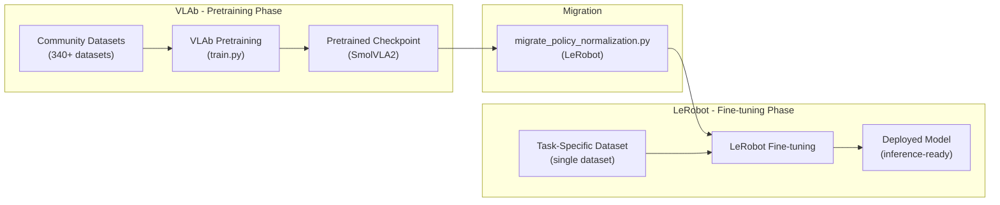
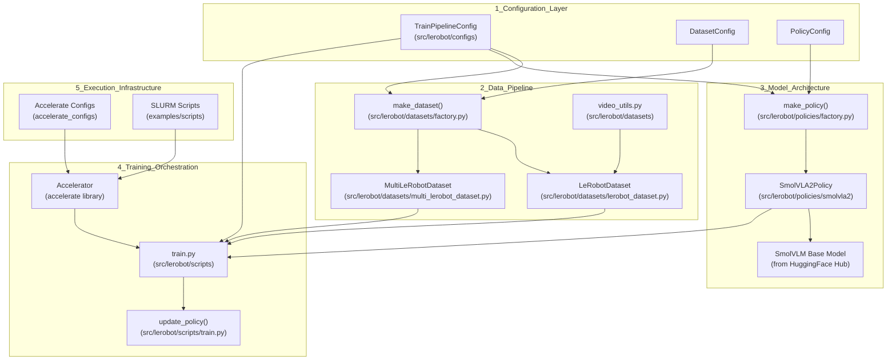
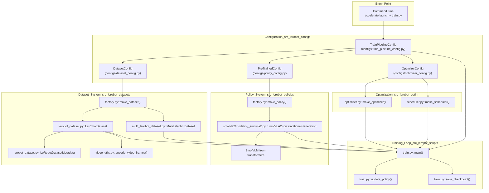
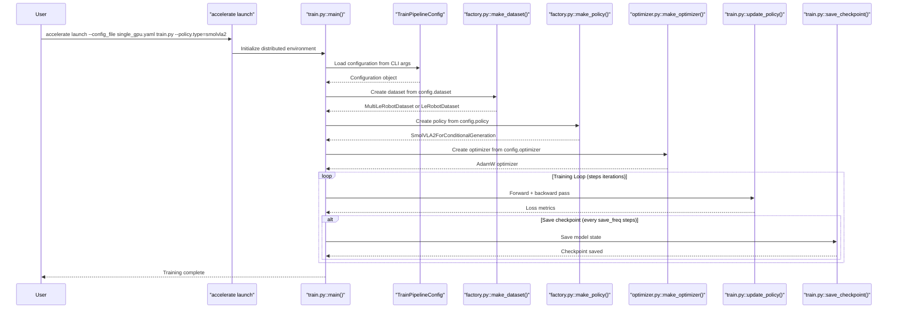
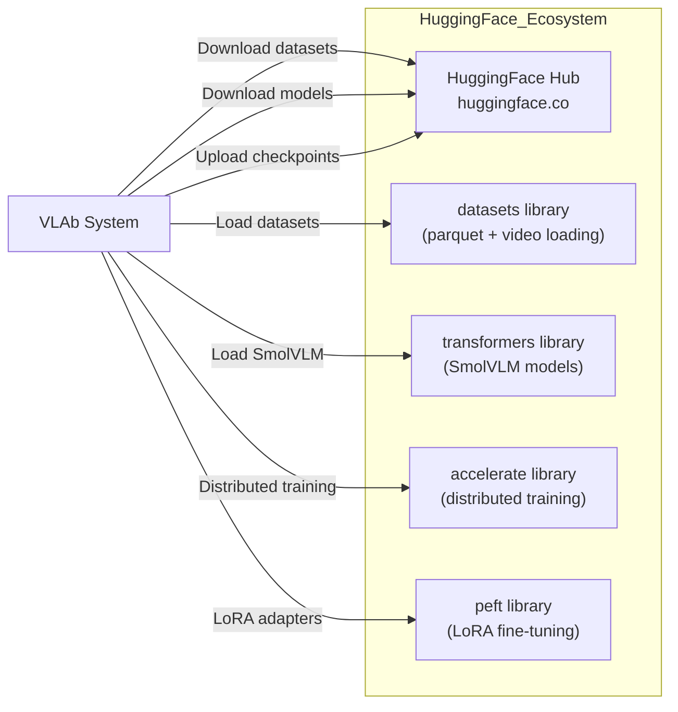

<!-- source: DeepWiki mcp.deepwiki.com · repo huggingface/VLAb · page 1 Overview · fetched 2026-10-26 -->

# Overview

<details>
<summary>Relevant source files</summary>

The following files were used as context for generating this wiki page:

- [LICENSE](LICENSE)
- [README.md](README.md)

</details>


## Purpose and Scope

This page provides an introduction to VLAb, a specialized pretraining system for Vision-Language-Action (VLA) models. It explains VLAb's purpose, its relationship to the LeRobot library, and gives a high-level overview of the system architecture and core components.

For specific setup instructions, see [Getting Started](#2). For detailed system architecture, see [System Architecture](#3). For information on fine-tuning and inference workflows, refer to the LeRobot library and [Migration to LeRobot](#9.3).

## What is VLAb

VLAb is a streamlined library for **pretraining** vision-language-action (VLA) models on robotics datasets. It is derived from the [LeRobot](https://github.com/huggingface/lerobot) library but focuses exclusively on the pretraining phase of the model development lifecycle. VLAb serves as the official reproduction kit for the [SmolVLA](https://huggingface.co/blog/smolvla) model, providing the exact datasets, configurations, and workflows used to train the original model.

**Key Characteristics:**
- **Pretraining-Focused**: Optimized for large-scale pretraining on multi-modal robotics datasets, not for fine-tuning or deployment
- **Multi-Dataset Support**: Train on 340+ community robotics datasets simultaneously with configurable sampling strategies
- **Distributed Training**: Built-in support for multi-GPU (single-node) and multi-node (SLURM cluster) distributed training via HuggingFace Accelerate
- **Reduced Dependencies**: Simplified environment setup compared to LeRobot, removing inference and evaluation dependencies

**Sources:** [README.md:1-25]()

## Relationship to LeRobot

VLAb and LeRobot serve complementary roles in the VLA model development lifecycle:

| Aspect | VLAb | LeRobot |
|--------|------|---------|
| **Primary Purpose** | Pretraining on large-scale datasets | Fine-tuning and inference |
| **Datasets** | 340+ community datasets (Community Dataset v1/v2) | Single dataset fine-tuning |
| **Training Scale** | Multi-GPU, multi-node distributed training | Single GPU or small-scale training |
| **Model Outputs** | Pretrained checkpoints (requires migration) | Fine-tuned models ready for deployment |
| **Environment Dependencies** | Minimal (training-only) | Full (includes robot drivers, simulators) |
| **Checkpoint Compatibility** | Requires migration via `migrate_policy_normalization.py` | Direct compatibility |

VLAb produces pretrained checkpoints that must be migrated to LeRobot format before fine-tuning. The migration script is located at [lerobot/processor/migrate_policy_normalization.py](https://github.com/huggingface/lerobot/blob/main/src/lerobot/processor/migrate_policy_normalization.py) in the LeRobot repository.



**Workflow Summary:**
1. **Pretraining (VLAb)**: Train SmolVLA2 on 340+ community datasets using distributed training infrastructure
2. **Migration**: Convert VLAb checkpoint to LeRobot format using migration script
3. **Fine-tuning (LeRobot)**: Fine-tune migrated model on task-specific dataset
4. **Deployment (LeRobot)**: Deploy fine-tuned model to robot hardware

**Sources:** [README.md:11-25](), [README.md:220-227]()

## High-Level System Architecture

VLAb consists of five primary subsystems that work together to enable efficient pretraining:



**Architecture Layers:**

1. **Configuration Layer**: Defines training parameters via dataclasses in `src/lerobot/configs/`. The `TrainPipelineConfig` class aggregates all configuration objects.

2. **Data Pipeline**: Handles multi-modal robotics data loading. The `make_dataset()` factory creates `LeRobotDataset` instances for single datasets or `MultiLeRobotDataset` for aggregating multiple datasets.

3. **Model Architecture**: Implements the SmolVLA2 policy via `make_policy()` factory. The policy combines a pretrained SmolVLM vision-language model with an expert model for action prediction.

4. **Training Orchestration**: The `train.py` script coordinates the training loop, calling `update_policy()` for forward/backward passes. Integrates with HuggingFace Accelerate for distributed training.

5. **Execution Infrastructure**: Supports local multi-GPU training (via `accelerate_configs/`) and SLURM cluster training (via `examples/scripts/`).

**Sources:** [README.md:289-309]()

## Core Components and Code Entities

This section maps VLAb's conceptual components to specific code entities in the repository.



**Key Code Entity Mapping:**

| Conceptual Component | Code Entity | File Path |
|---------------------|-------------|-----------|
| **Entry Point** | `accelerate launch` + `train.py` | `src/lerobot/scripts/train.py` |
| **Configuration** | `TrainPipelineConfig` | `src/lerobot/configs/train_pipeline_config.py` |
| **Dataset Factory** | `make_dataset()` | `src/lerobot/datasets/factory.py` |
| **Single Dataset** | `LeRobotDataset` | `src/lerobot/datasets/lerobot_dataset.py` |
| **Multi-Dataset** | `MultiLeRobotDataset` | `src/lerobot/datasets/multi_lerobot_dataset.py` |
| **Dataset Metadata** | `LeRobotDatasetMetadata` | `src/lerobot/datasets/lerobot_dataset.py` |
| **Video Processing** | `encode_video_frames()` | `src/lerobot/datasets/video_utils.py` |
| **Policy Factory** | `make_policy()` | `src/lerobot/policies/factory.py` |
| **SmolVLA2 Model** | `SmolVLA2ForConditionalGeneration` | `src/lerobot/policies/smolvla2/modeling_smolvla2.py` |
| **Optimizer Factory** | `make_optimizer()` | `src/lerobot/optim/optimizer.py` |
| **Scheduler Factory** | `make_scheduler()` | `src/lerobot/optim/scheduler.py` |
| **Training Loop** | `main()` | `src/lerobot/scripts/train.py` |
| **Training Step** | `update_policy()` | `src/lerobot/scripts/train.py` |
| **Checkpointing** | `save_checkpoint()` | `src/lerobot/scripts/train.py` |

**Sources:** [README.md:289-309]()

## Training Execution Flow

The following diagram shows the complete execution flow from command-line invocation to checkpoint saving, with actual function and class names:



**Execution Flow Steps:**

1. **Initialization**: User invokes `accelerate launch` with configuration file and `train.py` script
2. **Configuration Loading**: `train.py::main()` loads `TrainPipelineConfig` from command-line arguments
3. **Dataset Creation**: `make_dataset()` factory instantiates `LeRobotDataset` or `MultiLeRobotDataset` based on configuration
4. **Policy Creation**: `make_policy()` factory instantiates `SmolVLA2ForConditionalGeneration` with pretrained weights from HuggingFace Hub
5. **Optimizer Creation**: `make_optimizer()` creates AdamW optimizer with configured learning rate and hyperparameters
6. **Training Loop**: Iterates for specified number of steps, calling `update_policy()` for each training step
7. **Checkpointing**: Periodically saves model state via `save_checkpoint()` based on `save_freq` parameter

**Sources:** [README.md:95-120](), [README.md:163-195]()

## Integration with External Systems

VLAb integrates with several external systems to provide a complete pretraining workflow:

### HuggingFace Ecosystem



**Integration Points:**
- **HuggingFace Hub**: Download community datasets (340+ datasets via `--dataset.repo_id`), download pretrained SmolVLM models (`--policy.repo_id`), and optionally upload trained checkpoints
- **datasets library**: Load parquet-backed datasets with efficient video frame decoding
- **transformers library**: Load SmolVLM architecture as base model for SmolVLA2
- **accelerate library**: Enable multi-GPU and multi-node distributed training
- **peft library**: Support LoRA-based parameter-efficient fine-tuning (`--policy.peft_method=lora`)

**Sources:** [README.md:89-93](), [README.md:249-255]()

### Experiment Tracking

| Service | Purpose | Configuration |
|---------|---------|---------------|
| **Weights & Biases** | Real-time metrics, loss curves, hyperparameter tracking | `--wandb.enable=true --wandb.project=PROJECT` |
| **TrackIO** | I/O monitoring, data throughput tracking | `--trackio.enable=true --trackio.project=PROJECT` |

**Sources:** [README.md:109-110]()

### Compute Infrastructure

VLAb supports two execution environments:

1. **Local Multi-GPU**: Configure via `accelerate_configs/single_gpu.yaml` or `accelerate_configs/multi_gpu.yaml`
2. **SLURM Clusters**: Submit jobs via `examples/scripts/reproduce_smolvla.slurm` for multi-node training

For detailed execution environment setup, see [Execution Environments](#8).

**Sources:** [README.md:163-174](), [README.md:203-218]()

## Data Sources: Community Datasets

VLAb is designed to work with the SmolVLA community datasets, which are collections of robotics demonstrations uploaded to HuggingFace Hub:

| Dataset | Contributors | Episodes | Frames | Size | Format |
|---------|--------------|----------|--------|------|--------|
| **Community Dataset v1** | 55 | 11.1K | 5.1M | 119.3 GB | LeRobot v1.x |
| **Community Dataset v2** | 117 | 6.3K | 5.0M | 59 GB | LeRobot v2.0/v2.1 |

Both datasets contain SO-100 robotic arm demonstrations focused on tabletop manipulation tasks. Dataset v1 represents a curated, high-quality subset with manually verified task descriptions used to pretrain the original SmolVLA model. Dataset v2 expands the collection with more contributors and updated LeRobot format support.

**Dataset Structure:**
```
community_dataset_v1/v2/        
├── contributor1/               
│   ├── dataset_name_1/    
│   │   ├── data/          # Parquet files with metadata
│   │   ├── videos/        # MP4 video files
│   │   └── meta/          # Episode metadata
│   └── dataset_name_2/           
├── contributor2/                  
│   └── dataset_name_3/           
└── ...
```

**Usage:**
```bash
# Download from HuggingFace Hub
hf download HuggingFaceVLA/community_dataset_v2 --repo-type=dataset --local-dir /path/to/datasets

# Train with local datasets
accelerate launch train.py \
    --dataset.repo_id="community_dataset_v2/user1/dataset1,community_dataset_v2/user2/dataset2" \
    --dataset.root="/path/to/datasets" \
    --dataset.features_version=2
```

For detailed dataset documentation, see [Community Datasets](#4.5).

**Sources:** [README.md:122-161]()

## System Requirements and Dependencies

**Python Environment:**
- Python 3.11
- PyTorch with CUDA 11.8 support
- HuggingFace libraries (transformers, datasets, accelerate, peft)
- Video processing libraries (pyav, opencv)

**Hardware Requirements:**
- **Minimum**: Single GPU with 24GB+ VRAM (e.g., NVIDIA RTX 4090, A5000)
- **Recommended**: Multiple GPUs for distributed training (e.g., 4x A100 40GB)
- **Optimal**: SLURM cluster with multiple nodes for large-scale pretraining

**Installation:**
```bash
# Create conda environment
conda env create -f environment.yml
conda activate vlab

# Set PYTHONPATH
export PYTHONPATH="${PWD}/src:${PYTHONPATH}"

# Verify installation
python tests/test_installation.py
```

For detailed setup instructions, see [Environment Setup](#2.1).

**Sources:** [README.md:47-85]()

## Next Steps

To get started with VLAb:

1. **Environment Setup**: Follow [Environment Setup](#2.1) to install dependencies
2. **Quick Start**: Run your first training job with [Quick Start Training](#2.2)
3. **Configuration**: Learn about configuration options in [Configuration System](#6)
4. **Dataset Handling**: Understand dataset loading in [Dataset System](#4)
5. **Model Architecture**: Explore the SmolVLA2 architecture in [Policy and Model System](#5)
6. **Distributed Training**: Scale to multi-GPU and cluster training in [Execution Environments](#8)
7. **Migration**: Convert checkpoints for LeRobot in [Migration to LeRobot](#9.3)

**Sources:** [README.md:1-309]()

---

