# Page: Overview

# Overview

<details>
<summary>Relevant source files</summary>

The following files were used as context for generating this wiki page:

- [LICENSE](LICENSE)
- [README.md](README.md)

</details>


## Purpose and Scope

This page provides an introduction to VLAb, a specialized pretraining system for Vision-Language-Action (VLA) models. It explains VLAb's purpose, its relationship to the LeRobot library, and gives a high-level overview of the system architecture and core components.

For specific setup instructions, see [Getting Started](#2). For detailed system architecture, see [System Architecture](#3). For information on fine-tuning and inference workflows, refer to the LeRobot library and [Migration to LeRobot](#9.3).

## What is VLAb

VLAb is a streamlined library for **pretraining** vision-language-action (VLA) models on robotics datasets. It is derived from the [LeRobot](https://github.com/huggingface/lerobot) library but focuses exclusively on the pretraining phase of the model development lifecycle. VLAb serves as the official reproduction kit for the [SmolVLA](https://huggingface.co/blog/smolvla) model, providing the exact datasets, configurations, and workflows used to train the original model.

**Key Characteristics:**
- **Pretraining-Focused**: Optimized for large-scale pretraining on multi-modal robotics datasets, not for fine-tuning or deployment
- **Multi-Dataset Support**: Train on 340+ community robotics datasets simultaneously with configurable sampling strategies
- **Distributed Training**: Built-in support for multi-GPU (single-node) and multi-node (SLURM cluster) distributed training via HuggingFace Accelerate
- **Reduced Dependencies**: Simplified environment setup compared to LeRobot, removing inference and evaluation dependencies

**Sources:** [README.md:1-25]()

## Relationship to LeRobot

VLAb and LeRobot serve complementary roles in the VLA model development lifecycle:

| Aspect | VLAb | LeRobot |
|--------|------|---------|
| **Primary Purpose** | Pretraining on large-scale datasets | Fine-tuning and inference |
| **Datasets** | 340+ community datasets (Community Dataset v1/v2) | Single dataset fine-tuning |
| **Training Scale** | Multi-GPU, multi-node distributed training | Single GPU or small-scale training |
| **Model Outputs** | Pretrained checkpoints (requires migration) | Fine-tuned models ready for deployment |
| **Environment Dependencies** | Minimal (training-only) | Full (includes robot drivers, simulators) |
| **Checkpoint Compatibility** | Requires migration via `migrate_policy_normalization.py` | Direct compatibility |

VLAb produces pretrained checkpoints that must be migrated to LeRobot format before fine-tuning. The migration script is located at [lerobot/processor/migrate_policy_normalization.py](https://github.com/huggingface/lerobot/blob/main/src/lerobot/processor/migrate_policy_normalization.py) in the LeRobot repository.

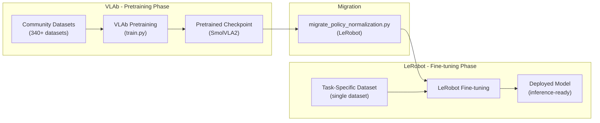

**Workflow Summary:**
1. **Pretraining (VLAb)**: Train SmolVLA2 on 340+ community datasets using distributed training infrastructure
2. **Migration**: Convert VLAb checkpoint to LeRobot format using migration script
3. **Fine-tuning (LeRobot)**: Fine-tune migrated model on task-specific dataset
4. **Deployment (LeRobot)**: Deploy fine-tuned model to robot hardware

**Sources:** [README.md:11-25](), [README.md:220-227]()

## High-Level System Architecture

VLAb consists of five primary subsystems that work together to enable efficient pretraining:

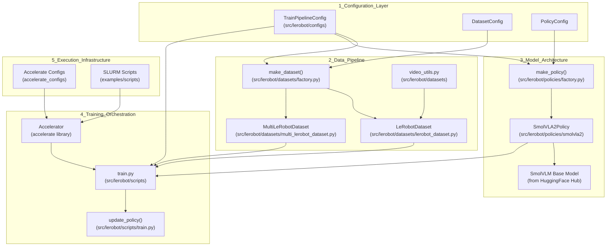

**Architecture Layers:**

1. **Configuration Layer**: Defines training parameters via dataclasses in `src/lerobot/configs/`. The `TrainPipelineConfig` class aggregates all configuration objects.

2. **Data Pipeline**: Handles multi-modal robotics data loading. The `make_dataset()` factory creates `LeRobotDataset` instances for single datasets or `MultiLeRobotDataset` for aggregating multiple datasets.

3. **Model Architecture**: Implements the SmolVLA2 policy via `make_policy()` factory. The policy combines a pretrained SmolVLM vision-language model with an expert model for action prediction.

4. **Training Orchestration**: The `train.py` script coordinates the training loop, calling `update_policy()` for forward/backward passes. Integrates with HuggingFace Accelerate for distributed training.

5. **Execution Infrastructure**: Supports local multi-GPU training (via `accelerate_configs/`) and SLURM cluster training (via `examples/scripts/`).

**Sources:** [README.md:289-309]()

## Core Components and Code Entities

This section maps VLAb's conceptual components to specific code entities in the repository.

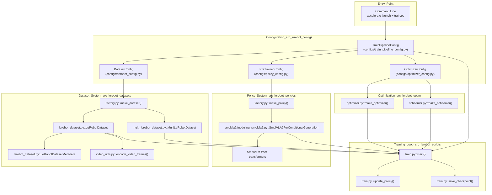

**Key Code Entity Mapping:**

| Conceptual Component | Code Entity | File Path |
|---------------------|-------------|-----------|
| **Entry Point** | `accelerate launch` + `train.py` | `src/lerobot/scripts/train.py` |
| **Configuration** | `TrainPipelineConfig` | `src/lerobot/configs/train_pipeline_config.py` |
| **Dataset Factory** | `make_dataset()` | `src/lerobot/datasets/factory.py` |
| **Single Dataset** | `LeRobotDataset` | `src/lerobot/datasets/lerobot_dataset.py` |
| **Multi-Dataset** | `MultiLeRobotDataset` | `src/lerobot/datasets/multi_lerobot_dataset.py` |
| **Dataset Metadata** | `LeRobotDatasetMetadata` | `src/lerobot/datasets/lerobot_dataset.py` |
| **Video Processing** | `encode_video_frames()` | `src/lerobot/datasets/video_utils.py` |
| **Policy Factory** | `make_policy()` | `src/lerobot/policies/factory.py` |
| **SmolVLA2 Model** | `SmolVLA2ForConditionalGeneration` | `src/lerobot/policies/smolvla2/modeling_smolvla2.py` |
| **Optimizer Factory** | `make_optimizer()` | `src/lerobot/optim/optimizer.py` |
| **Scheduler Factory** | `make_scheduler()` | `src/lerobot/optim/scheduler.py` |
| **Training Loop** | `main()` | `src/lerobot/scripts/train.py` |
| **Training Step** | `update_policy()` | `src/lerobot/scripts/train.py` |
| **Checkpointing** | `save_checkpoint()` | `src/lerobot/scripts/train.py` |

**Sources:** [README.md:289-309]()

## Training Execution Flow

The following diagram shows the complete execution flow from command-line invocation to checkpoint saving, with actual function and class names:

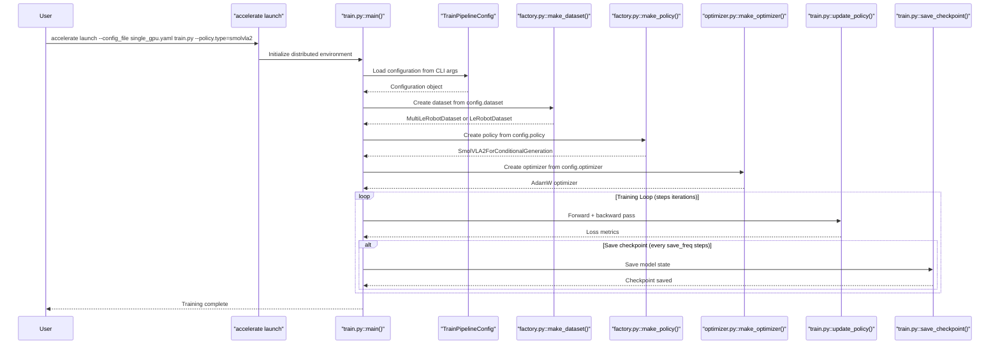

**Execution Flow Steps:**

1. **Initialization**: User invokes `accelerate launch` with configuration file and `train.py` script
2. **Configuration Loading**: `train.py::main()` loads `TrainPipelineConfig` from command-line arguments
3. **Dataset Creation**: `make_dataset()` factory instantiates `LeRobotDataset` or `MultiLeRobotDataset` based on configuration
4. **Policy Creation**: `make_policy()` factory instantiates `SmolVLA2ForConditionalGeneration` with pretrained weights from HuggingFace Hub
5. **Optimizer Creation**: `make_optimizer()` creates AdamW optimizer with configured learning rate and hyperparameters
6. **Training Loop**: Iterates for specified number of steps, calling `update_policy()` for each training step
7. **Checkpointing**: Periodically saves model state via `save_checkpoint()` based on `save_freq` parameter

**Sources:** [README.md:95-120](), [README.md:163-195]()

## Integration with External Systems

VLAb integrates with several external systems to provide a complete pretraining workflow:

### HuggingFace Ecosystem

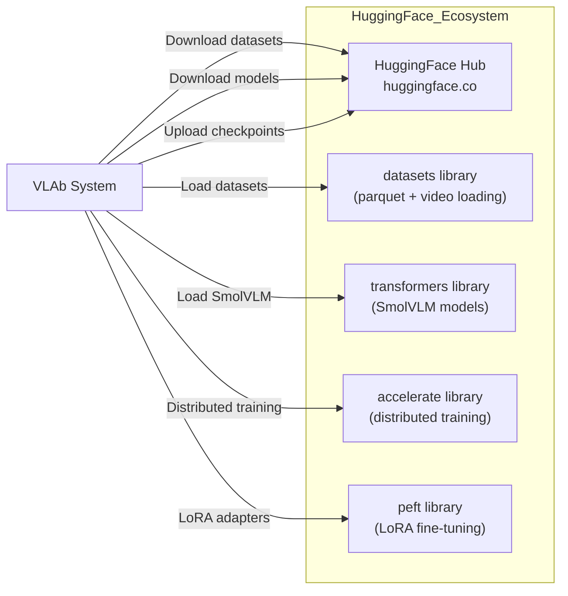

**Integration Points:**
- **HuggingFace Hub**: Download community datasets (340+ datasets via `--dataset.repo_id`), download pretrained SmolVLM models (`--policy.repo_id`), and optionally upload trained checkpoints
- **datasets library**: Load parquet-backed datasets with efficient video frame decoding
- **transformers library**: Load SmolVLM architecture as base model for SmolVLA2
- **accelerate library**: Enable multi-GPU and multi-node distributed training
- **peft library**: Support LoRA-based parameter-efficient fine-tuning (`--policy.peft_method=lora`)

**Sources:** [README.md:89-93](), [README.md:249-255]()

### Experiment Tracking

| Service | Purpose | Configuration |
|---------|---------|---------------|
| **Weights & Biases** | Real-time metrics, loss curves, hyperparameter tracking | `--wandb.enable=true --wandb.project=PROJECT` |
| **TrackIO** | I/O monitoring, data throughput tracking | `--trackio.enable=true --trackio.project=PROJECT` |

**Sources:** [README.md:109-110]()

### Compute Infrastructure

VLAb supports two execution environments:

1. **Local Multi-GPU**: Configure via `accelerate_configs/single_gpu.yaml` or `accelerate_configs/multi_gpu.yaml`
2. **SLURM Clusters**: Submit jobs via `examples/scripts/reproduce_smolvla.slurm` for multi-node training

For detailed execution environment setup, see [Execution Environments](#8).

**Sources:** [README.md:163-174](), [README.md:203-218]()

## Data Sources: Community Datasets

VLAb is designed to work with the SmolVLA community datasets, which are collections of robotics demonstrations uploaded to HuggingFace Hub:

| Dataset | Contributors | Episodes | Frames | Size | Format |
|---------|--------------|----------|--------|------|--------|
| **Community Dataset v1** | 55 | 11.1K | 5.1M | 119.3 GB | LeRobot v1.x |
| **Community Dataset v2** | 117 | 6.3K | 5.0M | 59 GB | LeRobot v2.0/v2.1 |

Both datasets contain SO-100 robotic arm demonstrations focused on tabletop manipulation tasks. Dataset v1 represents a curated, high-quality subset with manually verified task descriptions used to pretrain the original SmolVLA model. Dataset v2 expands the collection with more contributors and updated LeRobot format support.

**Dataset Structure:**
```
community_dataset_v1/v2/        
├── contributor1/               
│   ├── dataset_name_1/    
│   │   ├── data/          # Parquet files with metadata
│   │   ├── videos/        # MP4 video files
│   │   └── meta/          # Episode metadata
│   └── dataset_name_2/           
├── contributor2/                  
│   └── dataset_name_3/           
└── ...
```

**Usage:**
```bash
# Download from HuggingFace Hub
hf download HuggingFaceVLA/community_dataset_v2 --repo-type=dataset --local-dir /path/to/datasets

# Train with local datasets
accelerate launch train.py \
    --dataset.repo_id="community_dataset_v2/user1/dataset1,community_dataset_v2/user2/dataset2" \
    --dataset.root="/path/to/datasets" \
    --dataset.features_version=2
```

For detailed dataset documentation, see [Community Datasets](#4.5).

**Sources:** [README.md:122-161]()

## System Requirements and Dependencies

**Python Environment:**
- Python 3.11
- PyTorch with CUDA 11.8 support
- HuggingFace libraries (transformers, datasets, accelerate, peft)
- Video processing libraries (pyav, opencv)

**Hardware Requirements:**
- **Minimum**: Single GPU with 24GB+ VRAM (e.g., NVIDIA RTX 4090, A5000)
- **Recommended**: Multiple GPUs for distributed training (e.g., 4x A100 40GB)
- **Optimal**: SLURM cluster with multiple nodes for large-scale pretraining

**Installation:**
```bash
# Create conda environment
conda env create -f environment.yml
conda activate vlab

# Set PYTHONPATH
export PYTHONPATH="${PWD}/src:${PYTHONPATH}"

# Verify installation
python tests/test_installation.py
```

For detailed setup instructions, see [Environment Setup](#2.1).

**Sources:** [README.md:47-85]()

## Next Steps

To get started with VLAb:

1. **Environment Setup**: Follow [Environment Setup](#2.1) to install dependencies
2. **Quick Start**: Run your first training job with [Quick Start Training](#2.2)
3. **Configuration**: Learn about configuration options in [Configuration System](#6)
4. **Dataset Handling**: Understand dataset loading in [Dataset System](#4)
5. **Model Architecture**: Explore the SmolVLA2 architecture in [Policy and Model System](#5)
6. **Distributed Training**: Scale to multi-GPU and cluster training in [Execution Environments](#8)
7. **Migration**: Convert checkpoints for LeRobot in [Migration to LeRobot](#9.3)

**Sources:** [README.md:1-309]()

---

# Page: Getting Started

# Getting Started

<details>
<summary>Relevant source files</summary>

The following files were used as context for generating this wiki page:

- [LICENSE](LICENSE)
- [README.md](README.md)
- [environment.yml](environment.yml)

</details>


This page provides a high-level guide to setting up VLAb and running your first training job. VLAb is designed for researchers who want to pretrain Vision-Language-Action (VLA) models on robotics datasets efficiently across multi-GPU setups and SLURM clusters.

**Scope of this page**: This page introduces the installation and quick start workflows. For detailed environment setup instructions, see [Environment Setup](#2.1). For a complete walkthrough of training configurations and options, see [Quick Start Training](#2.2). For advanced distributed training setups, see [Distributed Training with Accelerate](#7.2).

---

## Prerequisites

Before starting, ensure you have:

| Requirement | Purpose | Notes |
|------------|---------|-------|
| **Conda** | Environment management | Required for dependency isolation |
| **CUDA 11.8 or 12.1** | GPU acceleration | Match your system's CUDA version |
| **Python 3.11** | Runtime environment | Installed via conda |
| **Git** | Repository cloning | For downloading VLAb |
| **HuggingFace Account** (optional) | Dataset/model access | Only needed for Hub downloads |

Sources: [README.md:47-93](), [environment.yml:1-29]()

---

## Installation Workflow

The installation process consists of four sequential steps that configure your environment and verify the installation.

**Installation Flow**

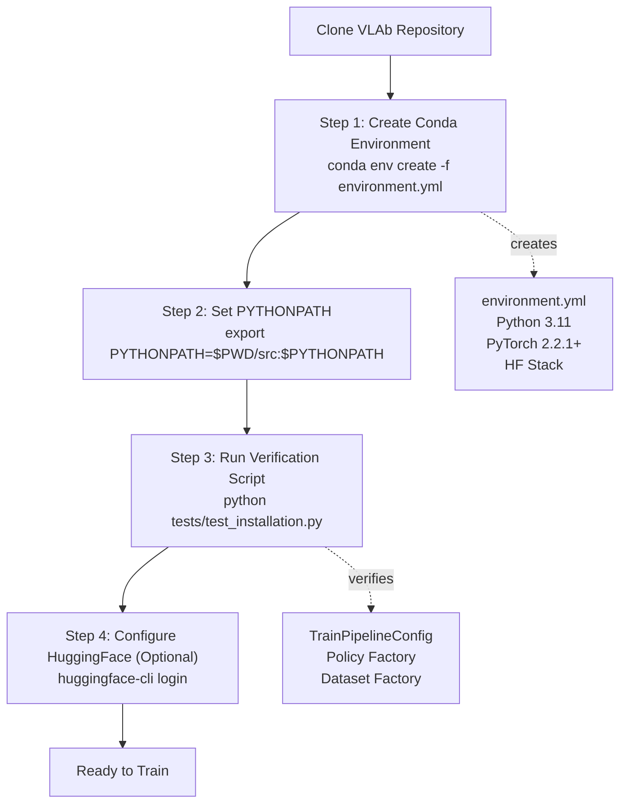

**Key Installation Artifacts**

| Component | File/Command | Purpose |
|-----------|--------------|---------|
| Environment Definition | `environment.yml` | Specifies all Python dependencies |
| PYTHONPATH Configuration | `export PYTHONPATH="${PWD}/src:${PYTHONPATH}"` | Enables import of `lerobot` modules |
| Verification Script | `tests/test_installation.py` | Validates core components are importable |
| HuggingFace CLI | `huggingface-cli login` | Authenticates for Hub access |

### Minimal Installation Commands

```bash
# Step 1: Create environment
conda env create -f environment.yml
conda activate vlab

# Step 2: Set Python path
export PYTHONPATH="${PWD}/src:${PYTHONPATH}"

# Step 3: Verify installation
python tests/test_installation.py

# Step 4 (Optional): Configure HuggingFace
huggingface-cli login
```

The verification script validates that the following core components are importable:
- `TrainPipelineConfig` from [src/lerobot/configs/train_pipeline.py]()
- Policy factory function from [src/lerobot/policies/factory.py]()
- Dataset factory function from [src/lerobot/datasets/factory.py]()

For detailed installation instructions including troubleshooting and environment persistence, see [Environment Setup](#2.1).

Sources: [README.md:47-93](), [environment.yml:1-29]()

---

## Quick Start Training Workflow

Once installation is complete, you can launch your first training job. VLAb uses the **Accelerate** library for distributed training orchestration and the `train.py` script as the main entry point.

**Training Execution Flow**

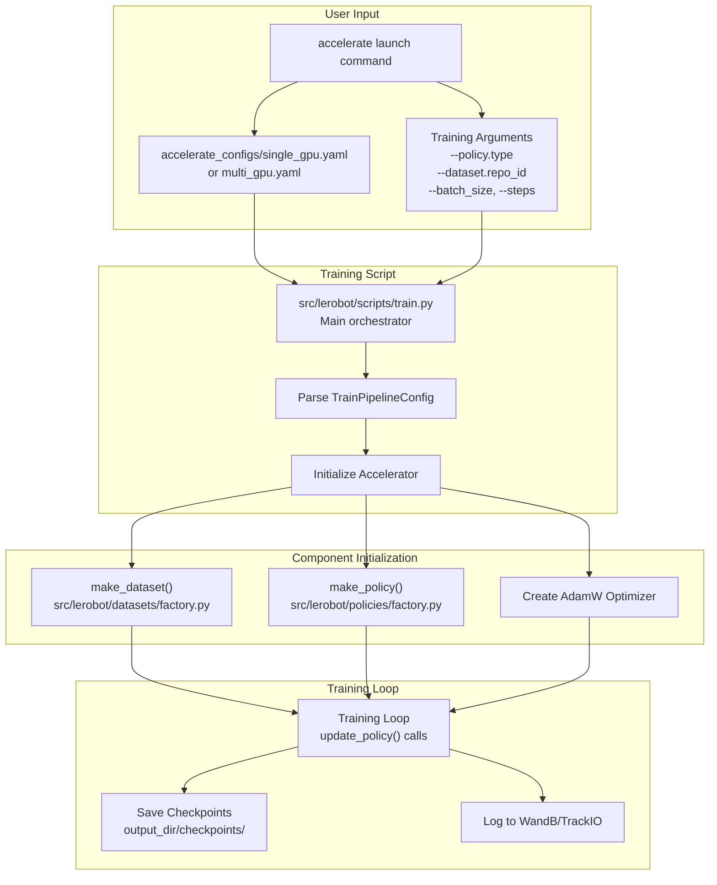

### Minimal Quick Start Command

```bash
accelerate launch --config_file accelerate_configs/single_gpu.yaml \
    src/lerobot/scripts/train.py \
    --policy.type=smolvla2 \
    --policy.repo_id=HuggingFaceTB/SmolVLM2-500M-Video-Instruct \
    --dataset.repo_id="Beegbrain/pick_lemon_and_drop_in_bowl,Chojins/chess_game_000_white_red" \
    --dataset.video_backend=pyav \
    --output_dir="./outputs/training" \
    --batch_size=8 \
    --steps=10000 \
    --wandb.enable=true \
    --wandb.project="smolvla2-quickstart"
```

**Command Structure Breakdown**

| Component | Value | Purpose |
|-----------|-------|---------|
| **Launcher** | `accelerate launch` | Distributed training orchestrator |
| **Accelerate Config** | `--config_file accelerate_configs/single_gpu.yaml` | Defines hardware setup (single GPU) |
| **Training Script** | `src/lerobot/scripts/train.py` | Main training orchestrator |
| **Policy Type** | `--policy.type=smolvla2` | Specifies SmolVLA2 architecture |
| **Base Model** | `--policy.repo_id=HuggingFaceTB/SmolVLM2-500M-Video-Instruct` | Pre-trained VLM to build upon |
| **Datasets** | `--dataset.repo_id="dataset1,dataset2"` | Comma-separated dataset IDs from HF Hub |
| **Video Backend** | `--dataset.video_backend=pyav` | Video decoding library (pyav recommended) |
| **Output Directory** | `--output_dir="./outputs/training"` | Checkpoint save location |
| **Training Duration** | `--batch_size=8 --steps=10000` | Training hyperparameters |
| **Logging** | `--wandb.enable=true --wandb.project="..."` | Weights & Biases integration |

This command will:
1. Download the specified datasets from HuggingFace Hub
2. Load the SmolVLM2-500M-Video-Instruct base model
3. Initialize the SmolVLA2 policy architecture
4. Train for 10,000 steps on a single GPU
5. Save checkpoints to `./outputs/training/checkpoints/`
6. Log metrics to Weights & Biases

For a complete walkthrough with explanations of all configuration options, see [Quick Start Training](#2.2).

Sources: [README.md:95-120](), [src/lerobot/scripts/train.py]()

---

## Training Execution Modes

VLAb supports multiple execution modes depending on your hardware configuration:

**Execution Mode Comparison**

| Mode | Configuration File | Use Case | Hardware |
|------|-------------------|----------|----------|
| **Single GPU** | `accelerate_configs/single_gpu.yaml` | Development, small-scale experiments | 1 GPU |
| **Multi-GPU (Local)** | `accelerate_configs/multi_gpu.yaml` | Medium-scale training | 2+ GPUs on single machine |
| **SLURM Cluster** | `examples/scripts/*.slurm` | Large-scale pretraining | Multi-node cluster |

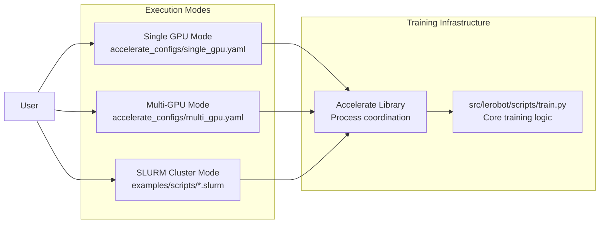

For local multi-GPU setups, see [Local Multi-GPU Training](#8.1). For SLURM cluster training, see [SLURM Cluster Training](#8.2).

Sources: [README.md:163-218]()

---

## Code Entity Map: Setup to Training

This diagram maps the user-facing commands to the actual code entities they invoke:

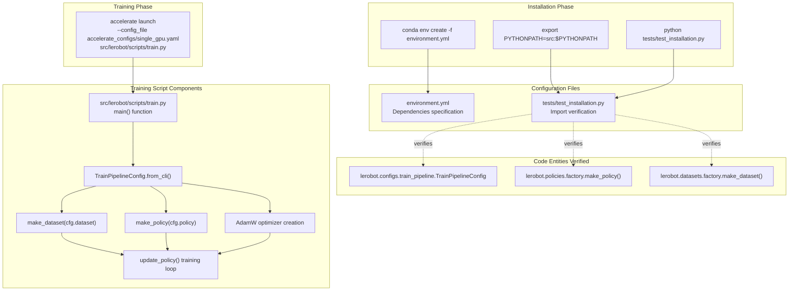

Sources: [README.md:47-120](), [tests/test_installation.py](), [src/lerobot/scripts/train.py]()

---

## Next Steps

After completing the quick start, explore these topics:

| Topic | Documentation | Description |
|-------|---------------|-------------|
| **Detailed Configuration** | [Configuration System](#6) | All available configuration parameters |
| **Dataset Options** | [Dataset System](#4) | Working with datasets (local, Hub, multi-dataset) |
| **Model Architecture** | [SmolVLA2 Architecture](#5.1) | Understanding the policy architecture |
| **Training Strategies** | [Training Strategies](#5.2) | Expert-only, freezing, PEFT/LoRA options |
| **Distributed Training** | [Distributed Training with Accelerate](#7.2) | Multi-GPU and multi-node setup |
| **SLURM Clusters** | [SLURM Cluster Training](#8.2) | Running on compute clusters |
| **Experiment Tracking** | [Experiment Tracking](#9.2) | WandB and TrackIO integration |
| **Migration** | [Migration to LeRobot](#9.3) | Using checkpoints for fine-tuning |

### Common Next Actions

```bash
# Train on locally downloaded datasets
accelerate launch --config_file accelerate_configs/multi_gpu.yaml \
    src/lerobot/scripts/train.py \
    --dataset.root="/path/to/datasets" \
    --dataset.repo_id="community_dataset_v2/user/dataset_name" \
    --policy.type=smolvla2

# Resume training from checkpoint
accelerate launch --config_file accelerate_configs/multi_gpu.yaml \
    src/lerobot/scripts/train.py \
    --resume=true \
    --checkpoint_path="./outputs/training/checkpoints/last"

# Train with PEFT/LoRA for efficient fine-tuning
accelerate launch --config_file accelerate_configs/single_gpu.yaml \
    src/lerobot/scripts/train.py \
    --policy.peft_method=lora \
    --policy.peft_config.r=16
```

Sources: [README.md:122-218]()

---

# Page: Environment Setup

# Environment Setup

<details>
<summary>Relevant source files</summary>

The following files were used as context for generating this wiki page:

- [LICENSE](LICENSE)
- [README.md](README.md)
- [environment.yml](environment.yml)

</details>


This page provides detailed instructions for setting up the VLAb development environment. It covers dependency installation, environment configuration, and verification steps necessary before training VLA models.

For information about running training after setup, see [Quick Start Training](#2.2). For cluster-specific environment configuration, see [SLURM Cluster Training](#8.2).

---

## Overview

VLAb uses a Conda-based environment with Python 3.11, PyTorch 2.2.1+, and the HuggingFace ecosystem. The setup process involves four main steps:

1. Creating the Conda environment from specification
2. Configuring Python module paths
3. Verifying the installation
4. (Optional) Authenticating with HuggingFace Hub

The entire setup process typically takes 5-10 minutes, depending on your internet connection and whether you need to download CUDA dependencies.

**Sources:** [README.md:47-93]()

---

## System Requirements

### Hardware Requirements

| Component | Minimum | Recommended |
|-----------|---------|-------------|
| **RAM** | 16 GB | 32 GB+ |
| **GPU** | NVIDIA GPU with CUDA 11.8 or 12.1 support | NVIDIA A100, H100, or equivalent |
| **Storage** | 50 GB free space | 200+ GB for dataset caching |
| **CPU** | 4 cores | 8+ cores |

### Software Requirements

| Software | Version | Purpose |
|----------|---------|---------|
| **Conda/Miniconda** | Latest | Package and environment management |
| **CUDA** | 11.8 or 12.1 | GPU acceleration |
| **Git** | Any recent version | Repository cloning |
| **HuggingFace CLI** | Included in environment | Dataset/model downloads |

**Note:** The provided `environment.yml` specifies CUDA 11.8 by default. If your system uses CUDA 12.1, modify [environment.yml:10]() before creating the environment.

**Sources:** [environment.yml:1-28](), [README.md:47-93]()

---

## Environment Creation Process

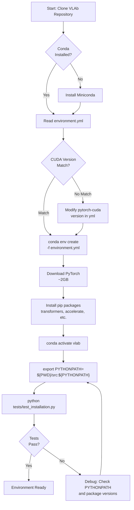

**Sources:** [README.md:47-85](), [environment.yml:1-28]()

---

## Step 1: Create Conda Environment

### Basic Environment Creation

Navigate to the VLAb repository root and create the environment:

```bash
conda env create -f environment.yml
```

This command reads [environment.yml:1-28]() and installs all specified dependencies. The process includes:

1. Creating a new environment named `vlab` with Python 3.11
2. Installing PyTorch, torchvision, and CUDA toolkit from conda channels
3. Installing Python packages via pip (transformers, accelerate, datasets, etc.)

### CUDA Version Compatibility

The default configuration uses CUDA 11.8. If your system has CUDA 12.1:

```bash
# Open environment.yml in an editor
# Change line 10 from:
#   - pytorch-cuda=11.8
# To:
#   - pytorch-cuda=12.1

conda env create -f environment.yml
```

### Verify Environment Creation

```bash
conda activate vlab
python --version  # Should output: Python 3.11.x
```

**Sources:** [README.md:49-54](), [environment.yml:1-28]()

---

## Step 2: Configure PYTHONPATH

### Why PYTHONPATH Configuration is Required

VLAb uses a `src`-layout directory structure where the main package code resides in `src/lerobot/`. Python's import system needs to know where to find these modules. The PYTHONPATH environment variable tells Python to look in the `src/` directory when resolving imports.

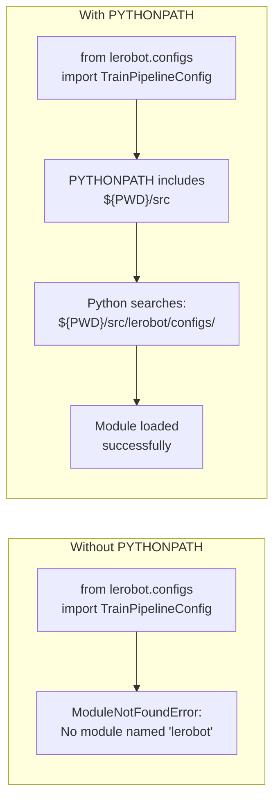

### Temporary Configuration (Current Session Only)

```bash
export PYTHONPATH="${PWD}/src:${PYTHONPATH}"
```

This sets PYTHONPATH for the current terminal session. You must run this command in the VLAb repository root directory, as `${PWD}` expands to the current working directory.

### Persistent Configuration (Recommended)

Add the export command to your shell configuration file:

**For Bash:**
```bash
# Add to ~/.bashrc
echo 'export PYTHONPATH="/path/to/VLAb/src:${PYTHONPATH}"' >> ~/.bashrc
source ~/.bashrc
```

**For Zsh:**
```bash
# Add to ~/.zshrc
echo 'export PYTHONPATH="/path/to/VLAb/src:${PYTHONPATH}"' >> ~/.zshrc
source ~/.zshrc
```

Replace `/path/to/VLAb` with the absolute path to your VLAb repository.

### Verification

```bash
python -c "from lerobot.configs import TrainPipelineConfig; print('Import successful')"
```

If this command prints "Import successful", PYTHONPATH is configured correctly.

**Sources:** [README.md:56-67]()

---

## Step 3: Verify Installation

VLAb provides a test script that verifies all critical components are installed and importable.

### Running the Verification Script

```bash
python tests/test_installation.py
```

### Expected Output

```
============================================================
VLAb Installation Test
============================================================
✓ TrainPipelineConfig
✓ Policy factory
✓ Dataset factory
============================================================
✅ All tests passed!
```

### What the Test Verifies

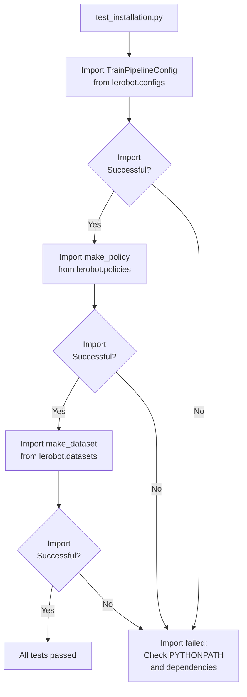

The test script verifies:
1. **Configuration System**: `TrainPipelineConfig` can be imported from `lerobot.configs`
2. **Policy Factory**: `make_policy` function is accessible from `lerobot.policies`
3. **Dataset Factory**: `make_dataset` function is accessible from `lerobot.datasets`

These are the core components required for training VLA models.

**Sources:** [README.md:69-85]()

---

## Step 4: HuggingFace Hub Configuration (Optional)

### When Authentication is Required

HuggingFace Hub authentication is necessary if you plan to:

- Download datasets from HuggingFace Hub (e.g., `community_dataset_v1`, `community_dataset_v2`)
- Download pretrained models (e.g., `SmolVLM2-500M-Video-Instruct`)
- Upload trained checkpoints to the Hub
- Access private repositories

### Authentication Process

```bash
huggingface-cli login
```

This command prompts for a HuggingFace access token. You can create a token at: https://huggingface.co/settings/tokens

### Token Permissions

| Operation | Required Permission |
|-----------|-------------------|
| Download public datasets/models | Read token |
| Download private datasets/models | Read token with repo access |
| Upload checkpoints | Write token |

### Verifying Authentication

```bash
huggingface-cli whoami
```

This displays your authenticated username and token permissions.

### Alternative: Environment Variable

Instead of interactive login, you can set the token as an environment variable:

```bash
export HUGGING_FACE_HUB_TOKEN="hf_xxxxxxxxxxxxx"
```

This is useful for automated scripts and cluster environments. See [SLURM Cluster Training](#8.2) for cluster-specific authentication patterns.

**Sources:** [README.md:87-93]()

---

## Dependency Architecture

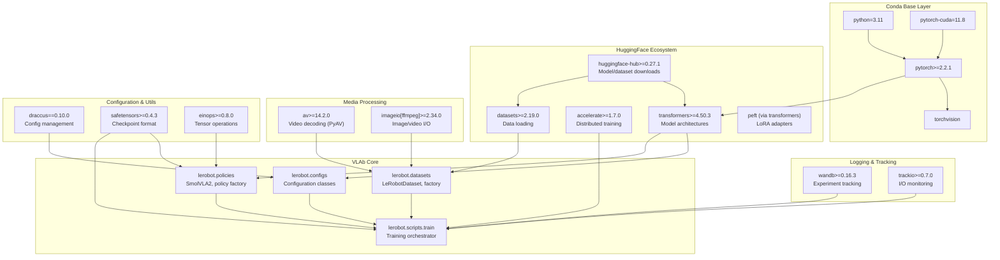

### Core Dependencies by Category

| Category | Package | Version | Purpose |
|----------|---------|---------|---------|
| **Deep Learning** | pytorch | ≥2.2.1 | Neural network framework |
| | torchvision | latest | Vision utilities |
| | pytorch-cuda | 11.8 | GPU acceleration |
| **HuggingFace** | transformers | ≥4.50.3 | Model architectures (SmolVLM) |
| | accelerate | ≥1.7.0 | Distributed training |
| | datasets | ≥2.19.0 | Dataset loading (Parquet-backed) |
| | huggingface-hub | ≥0.27.1 | Hub integration with hf-transfer |
| **Video Processing** | av | ≥14.2.0 | Video decoding (PyAV backend) |
| | imageio[ffmpeg] | ≥2.34.0 | Video encoding/frame extraction |
| **Configuration** | draccus | 0.10.0 | Dataclass-based config system |
| | safetensors | ≥0.4.3 | Efficient checkpoint format |
| **Logging** | wandb | ≥0.16.3 | Experiment tracking |
| | trackio | ≥0.7.0 | I/O performance monitoring |
| **Utilities** | einops | ≥0.8.0 | Tensor reshaping operations |
| | termcolor | ≥2.4.0 | Colored terminal output |
| | jsonlines | ≥4.0.0 | JSONL file handling |

**Sources:** [environment.yml:1-28]()

---

## Troubleshooting

### Common Issues and Solutions

#### Issue: ModuleNotFoundError for lerobot

**Symptom:**
```
ModuleNotFoundError: No module named 'lerobot'
```

**Solution:**
1. Verify you're in the VLAb repository root directory
2. Set PYTHONPATH: `export PYTHONPATH="${PWD}/src:${PYTHONPATH}"`
3. Re-run the import or script

#### Issue: CUDA Version Mismatch

**Symptom:**
```
RuntimeError: CUDA error: no kernel image is available for execution on the device
```

**Solution:**
Edit [environment.yml:10]() to match your CUDA version:
```yaml
# For CUDA 12.1
- pytorch-cuda=12.1

# For CUDA 11.8 (default)
- pytorch-cuda=11.8
```

Then recreate the environment:
```bash
conda env remove -n vlab
conda env create -f environment.yml
```

#### Issue: Conda Environment Creation Fails

**Symptom:**
```
CondaError: Unable to create environment
```

**Solutions:**
1. Update conda: `conda update -n base conda`
2. Clear conda cache: `conda clean --all`
3. Try creating with verbose output: `conda env create -f environment.yml -v`

#### Issue: pip Package Installation Fails

**Symptom:**
```
ERROR: Could not build wheels for package-name
```

**Solution:**
1. Activate environment: `conda activate vlab`
2. Manually install problematic package: `pip install package-name --no-cache-dir`
3. Common culprits: `av`, `imageio[ffmpeg]`

For `av` specifically on Linux:
```bash
# Install system dependencies first
sudo apt-get install libavformat-dev libavcodec-dev libavdevice-dev
pip install av
```

#### Issue: HuggingFace Hub Connection Timeout

**Symptom:**
```
requests.exceptions.ConnectionError: HTTPSConnectionPool
```

**Solutions:**
1. Check network connectivity
2. Enable HF transfer acceleration:
   ```bash
   pip install "huggingface-hub[hf-transfer]"
   export HF_HUB_ENABLE_HF_TRANSFER=1
   ```
3. Use a proxy if behind firewall:
   ```bash
   export HTTP_PROXY="http://proxy:port"
   export HTTPS_PROXY="http://proxy:port"
   ```

**Sources:** [README.md:228-246](), [environment.yml:1-28]()

---

## Environment Directory Structure

After successful setup, your environment should have this structure:

```
~/miniconda3/envs/vlab/               # Conda environment root
├── bin/
│   ├── python                        # Python 3.11 interpreter
│   ├── accelerate                    # Accelerate CLI
│   ├── huggingface-cli              # HF Hub CLI
│   └── wandb                         # WandB CLI
├── lib/
│   └── python3.11/
│       └── site-packages/
│           ├── torch/                # PyTorch
│           ├── transformers/         # HuggingFace Transformers
│           ├── accelerate/           # Accelerate
│           ├── datasets/             # HF Datasets
│           ├── av/                   # PyAV
│           └── ...
└── ...
```

Your VLAb repository structure:

```
VLAb/                                 # Repository root
├── src/
│   └── lerobot/                      # Main package (in PYTHONPATH)
│       ├── configs/                  # Configuration classes
│       ├── datasets/                 # Dataset implementations
│       ├── policies/                 # Policy implementations
│       ├── scripts/
│       │   └── train.py             # Training script
│       └── utils/                    # Utilities
├── tests/
│   └── test_installation.py         # Installation verification
├── environment.yml                   # Conda specification
└── accelerate_configs/              # Distributed training configs
```

**Sources:** [README.md:289-309]()

---

## Verification Checklist

Before proceeding to training, ensure all of the following work:

| Check | Command | Expected Result |
|-------|---------|-----------------|
| **Python version** | `python --version` | `Python 3.11.x` |
| **Conda environment** | `conda env list` | `vlab` appears in list |
| **PyTorch installation** | `python -c "import torch; print(torch.__version__)"` | Version ≥2.2.1 |
| **CUDA availability** | `python -c "import torch; print(torch.cuda.is_available())"` | `True` |
| **Transformers** | `python -c "import transformers; print(transformers.__version__)"` | Version ≥4.50.3 |
| **Accelerate** | `python -c "import accelerate; print(accelerate.__version__)"` | Version ≥1.7.0 |
| **PYTHONPATH** | `echo $PYTHONPATH` | Contains `/path/to/VLAb/src` |
| **Config import** | `python -c "from lerobot.configs import TrainPipelineConfig"` | No errors |
| **Policy import** | `python -c "from lerobot.policies import make_policy"` | No errors |
| **Dataset import** | `python -c "from lerobot.datasets import make_dataset"` | No errors |
| **Installation test** | `python tests/test_installation.py` | `All tests passed!` |

If all checks pass, your environment is correctly configured. Proceed to [Quick Start Training](#2.2).

**Sources:** [README.md:69-85]()

---

## Next Steps

After successful environment setup:

1. **Quick Start Training** - Run your first training job with minimal configuration. See [Quick Start Training](#2.2).

2. **Configuration Deep Dive** - Learn about VLAb's configuration system and available parameters. See [Configuration System](#6).

3. **Multi-GPU Setup** - Configure distributed training on local multi-GPU machines. See [Local Multi-GPU Training](#8.1).

4. **Cluster Setup** - Set up training on SLURM clusters. See [SLURM Cluster Training](#8.2).

**Sources:** [README.md:1-309]()

---

# Page: Quick Start Training

# Quick Start Training

<details>
<summary>Relevant source files</summary>

The following files were used as context for generating this wiki page:

- [LICENSE](LICENSE)
- [README.md](README.md)
- [examples/README.md](examples/README.md)

</details>


This page guides you through running your first VLAb training examples with minimal configuration. After completing this tutorial, you will understand how to launch training jobs, configure basic parameters, and monitor training progress.

**Prerequisites**: You must have completed the environment setup described in [Environment Setup](#2.1). For detailed configuration options, see [Configuration System](#6). For execution on SLURM clusters, see [SLURM Cluster Training](#8.2).

---

## Overview

VLAb training jobs are launched using the Accelerate library, which handles distributed training across single or multiple GPUs. The basic workflow is:

1. Configure Accelerate for your hardware setup
2. Launch training with `accelerate launch` pointing to the training script
3. Specify model, dataset, and training parameters via command-line arguments
4. Monitor training progress through logs and experiment tracking

---

## Training Command Structure

All VLAb training follows this structure:

```bash
accelerate launch --config_file <accelerate_config> \
    src/lerobot/scripts/train.py \
    --policy.<param>=<value> \
    --dataset.<param>=<value> \
    --<training_param>=<value>
```

**Command Components:**

| Component | Purpose | Example |
|-----------|---------|---------|
| `accelerate launch` | Launches distributed training | Required for all training |
| `--config_file` | Specifies hardware configuration | `accelerate_configs/single_gpu.yaml` |
| `src/lerobot/scripts/train.py` | Main training orchestrator | Fixed path |
| `--policy.*` | Model configuration parameters | `--policy.type=smolvla2` |
| `--dataset.*` | Dataset configuration parameters | `--dataset.repo_id=...` |
| Training parameters | Steps, batch size, output directory | `--batch_size=8 --steps=10000` |

Sources: [README.md:95-111](), [src/lerobot/scripts/train.py]()

---

## Minimal Training Example

### Single GPU Training

This example trains SmolVLA2 on two small datasets from HuggingFace Hub:

```bash
accelerate launch --config_file accelerate_configs/single_gpu.yaml \
    src/lerobot/scripts/train.py \
    --policy.type=smolvla2 \
    --policy.repo_id=HuggingFaceTB/SmolVLM2-500M-Video-Instruct \
    --dataset.repo_id="Beegbrain/pick_lemon_and_drop_in_bowl,Chojins/chess_game_000_white_red" \
    --dataset.video_backend=pyav \
    --output_dir="./outputs/training" \
    --batch_size=8 \
    --steps=10000 \
    --wandb.enable=true \
    --wandb.project="smolvla2-quickstart"
```

**What This Does:**

1. Downloads the SmolVLM2-500M base model from HuggingFace Hub
2. Downloads the two specified datasets (automatically cached)
3. Trains for 10,000 steps with batch size 8
4. Saves checkpoints to `./outputs/training/`
5. Logs metrics to Weights & Biases project "smolvla2-quickstart"

**Expected Output Structure:**

```
./outputs/training/
├── checkpoints/
│   ├── 000500/              # Checkpoint at step 500
│   ├── 001000/              # Checkpoint at step 1000
│   └── last -> 010000/      # Symlink to latest checkpoint
├── config.yaml              # Full training configuration
└── logs/
    └── events.out.tfevents  # TensorBoard logs
```

Sources: [README.md:95-120]()

---

## Training Execution Flow

### Command to Execution Diagram

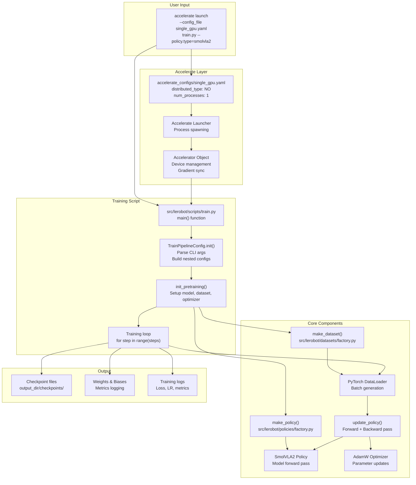

Sources: [README.md:95-120](), [src/lerobot/scripts/train.py]()

---

## Essential Training Parameters

### Model Parameters

| Parameter | Purpose | Default | Example |
|-----------|---------|---------|---------|
| `--policy.type` | Policy architecture | Required | `smolvla2` |
| `--policy.repo_id` | Base VLM model from Hub | Required | `HuggingFaceTB/SmolVLM2-500M-Video-Instruct` |
| `--policy.pretrained_path` | Local model path (optional) | None | `./models/smolvla2/` |
| `--policy.use_amp` | Enable mixed precision | `true` | `true`, `false` |

### Dataset Parameters

| Parameter | Purpose | Default | Example |
|-----------|---------|---------|---------|
| `--dataset.repo_id` | Comma-separated dataset IDs | Required | `dataset1,dataset2` |
| `--dataset.root` | Local dataset directory | None | `/data/datasets/` |
| `--dataset.video_backend` | Video decoding backend | `pyav` | `pyav`, `opencv` |
| `--dataset.features_version` | Dataset feature version | `2` | `1`, `2` |

### Training Parameters

| Parameter | Purpose | Default | Example |
|-----------|---------|---------|---------|
| `--batch_size` | Batch size per GPU | Required | `8` |
| `--steps` | Total training steps | Required | `100000` |
| `--output_dir` | Checkpoint save location | Required | `./outputs/run1/` |
| `--save_freq` | Checkpoint save frequency | `500` | `1000` |
| `--log_freq` | Logging frequency | `10` | `50` |

### Experiment Tracking Parameters

| Parameter | Purpose | Default | Example |
|-----------|---------|---------|---------|
| `--wandb.enable` | Enable Weights & Biases | `false` | `true` |
| `--wandb.project` | W&B project name | None | `smolvla2-training` |
| `--wandb.entity` | W&B team/user | None | `my-org` |
| `--wandb.run_id` | Resume W&B run | None | `abc123` |

Sources: [README.md:95-120](), [README.md:177-195]()

---

## Multi-GPU Training

### Configuration

For multi-GPU training, use the multi-GPU Accelerate configuration:

```bash
accelerate launch --config_file accelerate_configs/multi_gpu.yaml \
    src/lerobot/scripts/train.py \
    --policy.type=smolvla2 \
    --policy.repo_id=HuggingFaceTB/SmolVLM2-500M-Video-Instruct \
    --dataset.repo_id="dataset1,dataset2,dataset3" \
    --dataset.video_backend=pyav \
    --output_dir="./outputs/multi_gpu_training" \
    --batch_size=8 \
    --steps=200000 \
    --wandb.enable=true \
    --wandb.project="smolvla2-training"
```

**Key Differences:**
- `--config_file accelerate_configs/multi_gpu.yaml` specifies multi-GPU setup
- Batch size is **per GPU** (e.g., batch_size=8 on 4 GPUs = global batch size of 32)
- Gradient synchronization happens automatically via Accelerate
- Only one process saves checkpoints (rank 0)

### Multi-GPU Execution Flow

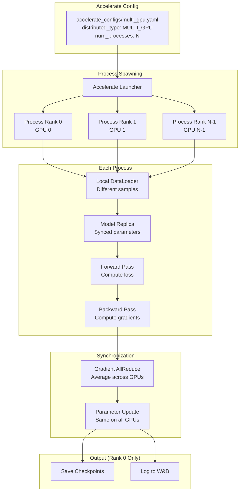

Sources: [README.md:163-195](), [accelerate_configs/multi_gpu.yaml]()

---

## Training with Local Datasets

If you have pre-downloaded datasets locally, specify the root directory:

```bash
accelerate launch --config_file accelerate_configs/multi_gpu.yaml \
    src/lerobot/scripts/train.py \
    --policy.type=smolvla2 \
    --policy.repo_id=HuggingFaceTB/SmolVLM2-500M-Video-Instruct \
    --dataset.repo_id="community_dataset_v2/airthebear/so100_GL,community_dataset_v2/acrampette/third_arm_01" \
    --dataset.root="/path/to/datasets" \
    --dataset.video_backend=pyav \
    --dataset.features_version=2 \
    --output_dir="./outputs/training" \
    --batch_size=8 \
    --steps=200000 \
    --wandb.enable=true \
    --wandb.project="smolvla2-training"
```

**Dataset Path Resolution:**
- `--dataset.root`: Base directory containing datasets
- `--dataset.repo_id`: Relative path from root
- Example resolution:
  - Root: `/path/to/datasets`
  - Repo ID: `community_dataset_v2/user/dataset_name`
  - Final path: `/path/to/datasets/community_dataset_v2/user/dataset_name`

**Expected Dataset Structure:**
```
/path/to/datasets/
└── community_dataset_v2/
    └── airthebear/
        └── so100_GL/
            ├── data/
            │   └── chunk-000/
            │       └── data.parquet
            ├── videos/
            │   └── chunk-000/
            │       ├── observation.images.top_000000.mp4
            │       └── ...
            └── meta/
                └── info.json
```

Sources: [README.md:177-201]()

---

## Configuration to Code Mapping

This diagram shows how command-line arguments map to configuration classes and code entities:

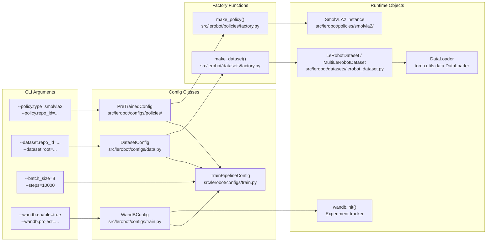

Sources: [src/lerobot/configs/train.py](), [src/lerobot/scripts/train.py](), [src/lerobot/policies/factory.py](), [src/lerobot/datasets/factory.py]()

---

## Monitoring Training Progress

### Console Output

During training, you will see periodic log messages:

```
step: 100, loss: 2.456, lr: 0.0001, grad_norm: 1.234, time: 0.45s
step: 200, loss: 2.234, lr: 0.0001, grad_norm: 1.156, time: 0.43s
step: 300, loss: 2.087, lr: 0.0001, grad_norm: 0.987, time: 0.44s
```

| Metric | Description |
|--------|-------------|
| `step` | Current training step |
| `loss` | Training loss (should decrease) |
| `lr` | Current learning rate (may vary with scheduler) |
| `grad_norm` | Gradient norm (should be stable, <10) |
| `time` | Time per step in seconds |

### Weights & Biases Dashboard

If `--wandb.enable=true`, metrics are logged to W&B:

1. Navigate to `https://wandb.ai/<entity>/<project>`
2. View real-time plots of loss, learning rate, and gradient norm
3. Compare multiple runs
4. View system metrics (GPU utilization, memory usage)

### Checkpoint Files

Checkpoints are saved at intervals specified by `--save_freq`:

```
outputs/training/checkpoints/
├── 000500/
│   ├── model.safetensors          # Model weights
│   ├── optimizer.bin               # Optimizer state
│   ├── scheduler.bin               # LR scheduler state
│   └── random_states.bin           # RNG states
├── 001000/
└── last -> 010000/                 # Symlink to latest
```

Sources: [src/lerobot/scripts/train.py]()

---

## Single Training Step Flow

This diagram details what happens during a single training step:

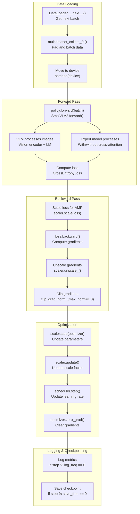

Sources: [src/lerobot/scripts/train.py]()

---

## Common Issues

### Out of Memory (OOM)

**Symptoms:** `RuntimeError: CUDA out of memory`

**Solutions:**
- Reduce `--batch_size`
- Enable gradient checkpointing (if supported by policy)
- Use smaller model via `--policy.repo_id`
- Reduce sequence length or image resolution

### Slow Training

**Symptoms:** Steps take >1 second each

**Solutions:**
- Increase `num_workers` in DataLoader (default: 4)
- Use `--dataset.video_backend=pyav` instead of `opencv`
- Ensure datasets are on fast storage (SSD, not network drive)
- Enable mixed precision with `--policy.use_amp=true` (default)

### Dataset Download Failures

**Symptoms:** `Connection error` or `Dataset not found`

**Solutions:**
- Verify HuggingFace Hub login: `huggingface-cli login`
- Check dataset ID spelling in `--dataset.repo_id`
- Clear cache: `rm -rf ~/.cache/huggingface/datasets`
- Use local datasets with `--dataset.root`

### Checkpoint Loading Errors

**Symptoms:** `KeyError` or `Missing keys` when loading checkpoint

**Solutions:**
- Ensure checkpoint is from compatible VLAb version
- Verify model architecture matches (e.g., same `--policy.type`)
- Use fresh output directory for new runs
- For resuming, use exact same configuration

Sources: [README.md:228-246]()

---

## Next Steps

After completing this quick start:

1. **Customize training**: See [Configuration System](#6) for all available parameters
2. **Train on community datasets**: See [Community Datasets](#4.5) for dataset information
3. **Scale to cluster**: See [SLURM Cluster Training](#8.2) for multi-node training
4. **Advanced training strategies**: See [Training Strategies](#5.2) for expert-only, LoRA, etc.
5. **Fine-tuning and inference**: See [Migration to LeRobot](#9.3) for using trained models

Sources: [README.md](), [examples/README.md]()

---

# Page: System Architecture

# System Architecture

<details>
<summary>Relevant source files</summary>

The following files were used as context for generating this wiki page:

- [LICENSE](LICENSE)
- [README.md](README.md)
- [VLAb.png](VLAb.png)

</details>


## Purpose and Scope

This document describes the high-level architecture of VLAb, explaining how major components are organized and interact to enable Vision-Language-Action (VLA) model pretraining. The architecture is designed around four core pillars: configuration management, data processing, model training, and distributed execution.

For detailed information about specific subsystems, see:
- Dataset handling and multi-dataset aggregation: [Dataset System](#4)
- Model architecture and training strategies: [Policy and Model System](#5)
- Configuration parameters and options: [Configuration System](#6)
- Training script and execution flow: [Training Execution](#7)
- HuggingFace Hub and experiment tracking: [External Integrations](#9)

---

## Architectural Overview

VLAb follows a layered architecture with clear separation of concerns. The system is built on top of the HuggingFace ecosystem, leveraging `datasets`, `transformers`, `accelerate`, and `peft` libraries for core functionality.

### Core System Layers

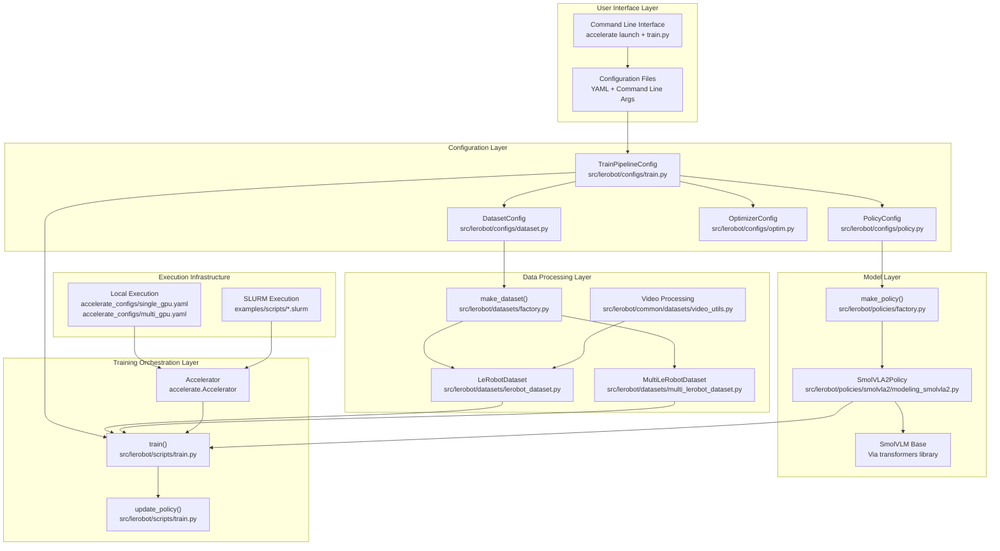

**Sources:** [README.md:289-309](), [README.md:1-43]()

---

## Component Relationships

### Configuration to Execution Flow

The system uses a declarative configuration approach where `TrainPipelineConfig` acts as the master orchestrator, aggregating all subsystem configurations.

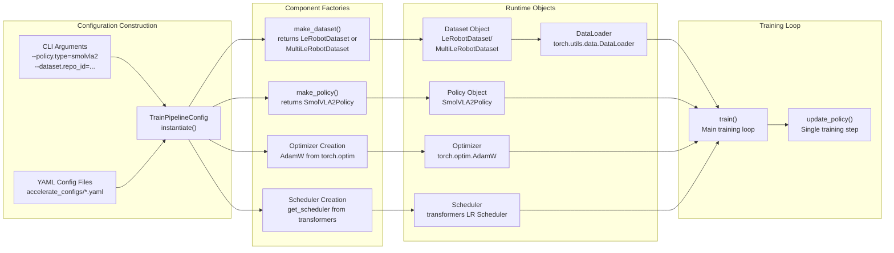

**Sources:** [README.md:96-120](), [README.md:163-195]()

---

## Data Pipeline Architecture

The data pipeline transforms raw datasets from HuggingFace Hub or local storage into batched tensors ready for model consumption.

### Dataset Factory and Loading Chain

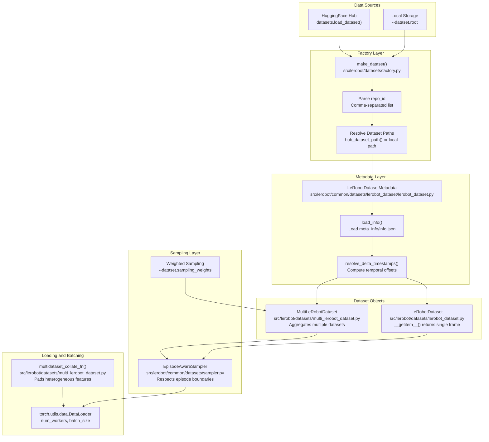

**Sources:** [README.md:147-161](), [README.md:176-195]()

The `make_dataset` factory function determines whether to instantiate a single `LeRobotDataset` or a `MultiLeRobotDataset` based on the number of datasets specified in `--dataset.repo_id`. The `MultiLeRobotDataset` handles feature alignment across heterogeneous datasets through automatic padding.

---

## Model Architecture Components

### Policy Factory and Model Instantiation

```mermaid
graph TB
    subgraph "Policy Configuration"
        PolicyConfig["PolicyConfig<br/>--policy.type=smolvla2<br/>--policy.repo_id"]
        LoadWeights["--policy.load_vlm_weights<br/>Load pretrained VLM"]
        TrainStrategy["Training Strategy Flags<br/>--policy.train_expert_only<br/>--policy.freeze_vision_encoder"]
        PEFTConfig["PEFT Configuration<br/>--policy.peft_method=lora<br/>--policy.peft_config"]
    end
    
    subgraph "Model Factory"
        MakePolicy["make_policy()<br/>src/lerobot/policies/factory.py"]
        LoadPretrained["Load from Hub<br/>PreTrainedModel.from_pretrained()"]
        InitRandom["Initialize Random<br/>SmolVLA2Config()"]
    end
    
    subgraph "SmolVLA2 Components"
        VLMModel["SmolVLM Base<br/>self.vlm<br/>Vision + Language Model"]
        ExpertModel["Expert Model<br/>self.expert<br/>Smaller LM for actions"]
        VisionEncoder["Vision Encoder<br/>self.vlm.vision_model<br/>Process images/videos"]
        Connector["Connector<br/>self.vlm.connector<br/>Visual token projection"]
        TextModel["Text Model<br/>self.vlm.text_model<br/>24 transformer layers"]
        ExpertLayers["Expert Layers<br/>self.expert.model.layers<br/>6 layers with optional cross-attn"]
    end
    
    subgraph "Training Modes"
        SelfAttention["Self-Attention Mode<br/>attention_mode='self'<br/>Independent processing"]
        CrossAttention["Cross-Attention Mode<br/>attention_mode='cross'<br/>Expert attends to VLM"]
    end
    
    PolicyConfig --> MakePolicy
    LoadWeights --> MakePolicy
    TrainStrategy --> MakePolicy
    PEFTConfig --> MakePolicy
    
    MakePolicy --> LoadPretrained
    MakePolicy --> InitRandom
    
    LoadPretrained --> VLMModel
    LoadPretrained --> ExpertModel
    
    VLMModel --> VisionEncoder
    VLMModel --> Connector
    VLMModel --> TextModel
    
    ExpertModel --> ExpertLayers
    
    ExpertLayers --> SelfAttention
    ExpertLayers --> CrossAttention
    TextModel --> CrossAttention
```

**Sources:** [README.md:96-120]()

The `SmolVLA2Policy` class in [src/lerobot/policies/smolvla2/modeling_smolvla2.py]() combines a full SmolVLM model with a smaller expert model. The expert model has reduced hidden dimensions (controlled by `--policy.expert_width_multiplier`) and fewer layers (controlled by `--policy.num_expert_layers`).

---

## Training Execution Flow

### Main Training Loop

```mermaid
graph TB
    subgraph "Initialization Phase"
        ParseArgs["Parse Arguments<br/>parse_train_args()"]
        InitAccelerator["Initialize Accelerator<br/>accelerate.Accelerator()"]
        CreateDataset["Create Dataset<br/>make_dataset()"]
        CreatePolicy["Create Policy<br/>make_policy()"]
        CreateOptimizer["Create Optimizer<br/>torch.optim.AdamW"]
        CreateScheduler["Create Scheduler<br/>transformers.get_scheduler()"]
        PrepareAccel["Prepare for Distributed<br/>accelerator.prepare()"]
    end
    
    subgraph "Training Loop"
        IterateDataLoader["Iterate DataLoader<br/>for batch in dataloader"]
        UpdatePolicyFn["update_policy()<br/>src/lerobot/scripts/train.py:300-400"]
        ForwardPass["Forward Pass<br/>policy.forward(batch)"]
        ComputeLoss["Compute Loss<br/>loss.backward()"]
        ClipGradients["Clip Gradients<br/>accelerator.clip_grad_norm_()"]
        OptimizerStep["Optimizer Step<br/>optimizer.step()"]
        SchedulerStep["Scheduler Step<br/>scheduler.step()"]
        LogMetrics["Log Metrics<br/>WandB / TrackIO"]
    end
    
    subgraph "Checkpointing"
        SaveCheckpoint["Save Checkpoint<br/>Every --save_freq steps"]
        SaveLast["Update 'last' symlink<br/>outputs/checkpoints/last"]
    end
    
    subgraph "Resumption"
        CheckResume["Check --resume flag"]
        LoadCheckpoint["Load Checkpoint<br/>accelerator.load_state()"]
    end
    
    ParseArgs --> InitAccelerator
    InitAccelerator --> CheckResume
    CheckResume --> LoadCheckpoint
    CheckResume --> CreateDataset
    LoadCheckpoint --> CreateDataset
    
    CreateDataset --> CreatePolicy
    CreatePolicy --> CreateOptimizer
    CreateOptimizer --> CreateScheduler
    CreateScheduler --> PrepareAccel
    
    PrepareAccel --> IterateDataLoader
    IterateDataLoader --> UpdatePolicyFn
    
    UpdatePolicyFn --> ForwardPass
    ForwardPass --> ComputeLoss
    ComputeLoss --> ClipGradients
    ClipGradients --> OptimizerStep
    OptimizerStep --> SchedulerStep
    SchedulerStep --> LogMetrics
    
    LogMetrics --> SaveCheckpoint
    SaveCheckpoint --> SaveLast
    SaveLast --> IterateDataLoader
```

**Sources:** [README.md:96-120]()

The `train()` function in [src/lerobot/scripts/train.py]() orchestrates the entire training process. It uses the Accelerate library's `Accelerator` class to handle distributed training transparently across single GPU, multi-GPU, and multi-node configurations.

### Update Policy Function

The `update_policy()` function handles a single training step:

| Step | Function | Description |
|------|----------|-------------|
| 1 | Forward Pass | Execute `policy.forward(batch)` to compute predictions and loss |
| 2 | Backward Pass | Call `loss.backward()` or `accelerator.backward(loss)` for gradient computation |
| 3 | Gradient Clipping | Apply `accelerator.clip_grad_norm_(policy.parameters(), max_norm=1.0)` |
| 4 | Optimizer Step | Execute `optimizer.step()` to update parameters |
| 5 | Zero Gradients | Call `optimizer.zero_grad()` to reset gradients |
| 6 | Scheduler Step | Execute `scheduler.step()` to update learning rate |

**Sources:** [README.md:96-120]()

---

## Configuration System Hierarchy

VLAb uses a hierarchical configuration system with `TrainPipelineConfig` as the root configuration class.

```mermaid
graph TB
    subgraph "Master Configuration"
        TrainPipeline["TrainPipelineConfig<br/>src/lerobot/configs/train.py"]
    end
    
    subgraph "Subsystem Configurations"
        Dataset["DatasetConfig<br/>src/lerobot/configs/dataset.py<br/>repo_id, root, sampling_weights"]
        Policy["PolicyConfig<br/>src/lerobot/configs/policy.py<br/>type, repo_id, peft_method"]
        Optimizer["OptimizerConfig<br/>src/lerobot/configs/optim.py<br/>lr, betas, weight_decay"]
        Scheduler["LRSchedulerConfig<br/>src/lerobot/configs/optim.py<br/>warmup_steps, scheduler_type"]
        Eval["EvalConfig<br/>src/lerobot/configs/eval.py<br/>n_episodes, batch_size"]
        WandB["WandBConfig<br/>src/lerobot/configs/train.py<br/>project, entity, mode"]
        TrackIO["TrackIOConfig<br/>src/lerobot/configs/train.py<br/>project, space_id"]
    end
    
    subgraph "Nested Configurations"
        ImageTransforms["ImageTransformsConfig<br/>src/lerobot/configs/dataset.py<br/>Augmentation pipeline"]
        PEFTConfig["LoRAConfig / PEFTConfig<br/>Via peft library<br/>r, alpha, target_modules"]
        AttentionConfig["Attention Parameters<br/>attention_mode, num_expert_layers"]
    end
    
    TrainPipeline --> Dataset
    TrainPipeline --> Policy
    TrainPipeline --> Optimizer
    TrainPipeline --> Scheduler
    TrainPipeline --> Eval
    TrainPipeline --> WandB
    TrainPipeline --> TrackIO
    
    Dataset --> ImageTransforms
    Policy --> PEFTConfig
    Policy --> AttentionConfig
```

**Sources:** [README.md:96-120](), [README.md:176-195]()

Configuration values can be specified through:
1. Command-line arguments: `--policy.type=smolvla2`
2. Configuration files: YAML files loaded via `--config_path`
3. Default values: Defined in configuration classes

Command-line arguments take precedence over file-based configuration, which takes precedence over defaults.

---

## Distributed Training Infrastructure

### Accelerate Integration

```mermaid
graph LR
    subgraph "Configuration Layer"
        AccelConfig["Accelerate Config<br/>accelerate_configs/single_gpu.yaml<br/>accelerate_configs/multi_gpu.yaml"]
        TrainConfig["Training Config<br/>TrainPipelineConfig"]
    end
    
    subgraph "Accelerate Library"
        Accelerator["Accelerator Object<br/>accelerate.Accelerator"]
        Prepare["accelerator.prepare()<br/>Wraps model, optimizer, dataloader"]
        Backward["accelerator.backward()<br/>Gradient synchronization"]
        ClipGrad["accelerator.clip_grad_norm_()<br/>Distributed gradient clipping"]
        SaveState["accelerator.save_state()<br/>Save distributed checkpoint"]
        LoadState["accelerator.load_state()<br/>Load distributed checkpoint"]
    end
    
    subgraph "Execution Backends"
        SingleGPU["Single GPU<br/>MULTI_GPU backend: NO"]
        MultiGPU["Multi-GPU<br/>MULTI_GPU backend: YES<br/>DDP or FSDP"]
        MultiNode["Multi-Node<br/>SLURM + DeepSpeed/FSDP"]
    end
    
    subgraph "Runtime"
        TrainScript["train()<br/>src/lerobot/scripts/train.py"]
        TrainingLoop["Training Loop<br/>Transparent distributed execution"]
    end
    
    AccelConfig --> Accelerator
    TrainConfig --> TrainScript
    
    Accelerator --> Prepare
    Prepare --> TrainScript
    
    TrainScript --> Backward
    TrainScript --> ClipGrad
    TrainScript --> SaveState
    TrainScript --> LoadState
    TrainScript --> TrainingLoop
    
    Accelerator --> SingleGPU
    Accelerator --> MultiGPU
    Accelerator --> MultiNode
```

**Sources:** [README.md:163-174](), [README.md:202-218]()

The Accelerate library provides a unified interface for distributed training. The configuration file (e.g., `accelerate_configs/multi_gpu.yaml`) specifies:
- `compute_environment`: LOCAL_MACHINE or CLUSTER
- `mixed_precision`: "no", "fp16", or "bf16"
- `num_processes`: Number of GPUs/processes
- `multi_gpu_backend`: DDP, FSDP, or DeepSpeed

---

## External System Integration

### HuggingFace Ecosystem Integration

```mermaid
graph TB
    subgraph "VLAb Core"
        TrainScript["train.py<br/>Training orchestrator"]
        DatasetFactory["make_dataset()<br/>Dataset factory"]
        PolicyFactory["make_policy()<br/>Policy factory"]
    end
    
    subgraph "HuggingFace Hub"
        HubDatasets["HuggingFace Hub Datasets<br/>datasets.load_dataset()"]
        HubModels["HuggingFace Hub Models<br/>PreTrainedModel.from_pretrained()"]
        PushToHub["Push to Hub<br/>policy.push_to_hub()"]
    end
    
    subgraph "HuggingFace Libraries"
        DatasetsLib["datasets library<br/>Parquet-backed loading"]
        TransformersLib["transformers library<br/>SmolVLM, PreTrainedModel"]
        AccelerateLib["accelerate library<br/>Distributed training"]
        PEFTLib["peft library<br/>LoRA, PrefixTuning"]
    end
    
    subgraph "Experiment Tracking"
        WandB["Weights & Biases<br/>wandb.init(), wandb.log()"]
        TrackIO["TrackIO<br/>trackio.init(), trackio.log()"]
    end
    
    subgraph "Community Datasets"
        CDv1["community_dataset_v1<br/>128 datasets, 119 GB"]
        CDv2["community_dataset_v2<br/>340 datasets, 59 GB"]
    end
    
    DatasetFactory --> DatasetsLib
    DatasetFactory --> HubDatasets
    CDv1 --> HubDatasets
    CDv2 --> HubDatasets
    
    PolicyFactory --> TransformersLib
    PolicyFactory --> HubModels
    PolicyFactory --> PEFTLib
    
    TrainScript --> AccelerateLib
    TrainScript --> WandB
    TrainScript --> TrackIO
    TrainScript --> PushToHub
```

**Sources:** [README.md:1-43](), [README.md:122-145](), [README.md:249-255]()

VLAb is deeply integrated with the HuggingFace ecosystem:

| Integration | Purpose | Key Functions |
|-------------|---------|---------------|
| **datasets** | Load and process robotics datasets | `datasets.load_dataset()`, Parquet backend |
| **transformers** | Load pretrained VLMs, model architectures | `PreTrainedModel.from_pretrained()`, `AutoModel` |
| **accelerate** | Distributed training abstraction | `Accelerator()`, `prepare()`, `backward()` |
| **peft** | Parameter-efficient fine-tuning | `LoraConfig`, `get_peft_model()` |

---

## Checkpoint and State Management

### Checkpoint Structure

Checkpoints are saved to `--output_dir/checkpoints/` with the following structure:

```
outputs/training/checkpoints/
├── 010000/                    # Checkpoint at step 10,000
│   ├── optimizer.bin          # Optimizer state
│   ├── scheduler.bin          # LR scheduler state
│   ├── random_states.pkl      # Random number generator states
│   ├── pytorch_model.bin      # Model weights
│   └── config.json            # Model configuration
├── 020000/                    # Checkpoint at step 20,000
├── last -> 020000             # Symlink to latest checkpoint
└── config.pkl                 # Training configuration
```

**Sources:** [README.md:220-227]()

The `accelerator.save_state()` function in [src/lerobot/scripts/train.py]() handles checkpoint saving, ensuring all distributed state is properly synchronized and saved. The `--resume` flag enables training resumption from the latest checkpoint.

---

## Summary

VLAb's architecture is organized into distinct layers:

1. **Configuration Layer**: Declarative system using `TrainPipelineConfig` and nested configs
2. **Data Processing Layer**: Factory-based dataset instantiation with `make_dataset()` and multi-dataset support
3. **Model Layer**: Factory-based policy instantiation with `make_policy()` and SmolVLA2 architecture
4. **Training Orchestration**: `train()` function and `update_policy()` step function with Accelerate integration
5. **Execution Infrastructure**: Support for local GPU and SLURM cluster execution

The system emphasizes modularity, allowing each component to be independently configured and tested while maintaining clean interfaces between layers. All components integrate with the HuggingFace ecosystem for model/dataset access and experiment tracking.

**Sources:** [README.md:1-309](), [README.md:289-309]()

---

# Page: Dataset System

# Dataset System

<details>
<summary>Relevant source files</summary>

The following files were used as context for generating this wiki page:

- [LICENSE](LICENSE)
- [README.md](README.md)
- [src/lerobot/datasets/factory.py](src/lerobot/datasets/factory.py)
- [src/lerobot/datasets/lerobot_dataset.py](src/lerobot/datasets/lerobot_dataset.py)

</details>


## Purpose and Scope

The Dataset System is the core data loading and processing infrastructure in VLAb, responsible for loading robotics datasets, managing multi-modal data (images, videos, states, actions), and preparing batches for training. This system handles datasets stored both on HuggingFace Hub and locally on disk, with support for temporal context queries, multi-dataset aggregation, and heterogeneous feature alignment.

For detailed documentation on specific components:
- Single dataset handling: see [LeRobotDataset](#4.1)
- Multi-dataset aggregation: see [MultiLeRobotDataset](#4.2)
- Dataset instantiation logic: see [Dataset Factory](#4.3)
- Video encoding/decoding: see [Video Processing](#4.4)
- Community dataset collections: see [Community Datasets](#4.5)

## System Architecture

The dataset system is built around three primary abstractions: `LeRobotDatasetMetadata` for metadata management, `LeRobotDataset` for single-dataset access, and `MultiLeRobotDataset` for aggregating multiple datasets with heterogeneous features.

```mermaid
graph TB
    subgraph "Data Sources"
        HFHub["HuggingFace Hub<br/>repo_id"]
        LocalDisk["Local Disk<br/>root/repo_id"]
    end
    
    subgraph "Entry Point"
        MakeDataset["make_dataset()<br/>factory.py:72"]
    end
    
    subgraph "Metadata Layer"
        DSMeta["LeRobotDatasetMetadata<br/>lerobot_dataset.py:118"]
        LoadInfo["load_info()<br/>Load info.json"]
        LoadEpisodes["load_episodes()<br/>Load episodes.jsonl"]
        LoadStats["load_episodes_stats()<br/>Load episodes_stats.jsonl"]
    end
    
    subgraph "Dataset Layer"
        SingleDS["LeRobotDataset<br/>lerobot_dataset.py:391"]
        MultiDS["MultiLeRobotDataset<br/>lerobot_dataset.py:1316"]
    end
    
    subgraph "Data Access"
        HFDataset["HuggingFace Dataset<br/>Parquet files"]
        VideoDecoder["decode_video_frames()<br/>video_utils.py"]
        Transforms["ImageTransforms<br/>transforms.py"]
    end
    
    subgraph "Training Pipeline"
        DataLoader["PyTorch DataLoader"]
        CollateFn["multidataset_collate_fn"]
    end
    
    HFHub --> MakeDataset
    LocalDisk --> MakeDataset
    
    MakeDataset --> DSMeta
    DSMeta --> LoadInfo
    DSMeta --> LoadEpisodes
    DSMeta --> LoadStats
    
    MakeDataset --> SingleDS
    MakeDataset --> MultiDS
    
    SingleDS --> DSMeta
    MultiDS --> SingleDS
    
    SingleDS --> HFDataset
    SingleDS --> VideoDecoder
    SingleDS --> Transforms
    
    MultiDS --> Transforms
    
    SingleDS --> DataLoader
    MultiDS --> DataLoader
    DataLoader --> CollateFn
```

**Sources:** [src/lerobot/datasets/factory.py:1-192](), [src/lerobot/datasets/lerobot_dataset.py:118-389](), [src/lerobot/datasets/lerobot_dataset.py:391-1214](), [src/lerobot/datasets/lerobot_dataset.py:1316-1550]()

## Core Components

### LeRobotDatasetMetadata

The `LeRobotDatasetMetadata` class ([lerobot_dataset.py:118-389]()) manages dataset metadata without loading the actual data. It loads and caches information from the `meta/` directory including:

- `info.json`: Dataset properties (fps, features, shapes, dtypes, robot_type, paths)
- `episodes.jsonl`: Episode-level information (indices, lengths, tasks)
- `episodes_stats.jsonl`: Per-episode statistics for normalization
- `tasks.jsonl`: Task descriptions

Key properties exposed:
- `fps`: Frames per second
- `features`: Dictionary of feature specifications
- `camera_keys`, `video_keys`, `image_keys`: Visual modality accessors
- `shapes`, `names`: Feature dimensionality information
- `episodes_stats`, `stats`: Statistics for normalization

**Sources:** [src/lerobot/datasets/lerobot_dataset.py:118-389]()

### LeRobotDataset

The `LeRobotDataset` class ([lerobot_dataset.py:391-1214]()) provides access to a single robotics dataset, supporting both images and videos, with optional temporal context via `delta_timestamps`. It wraps a HuggingFace `Dataset` object (backed by Parquet files) and handles video decoding on-the-fly.

Key initialization parameters:
- `repo_id`: Dataset identifier (HF Hub or local path)
- `root`: Local directory for dataset storage
- `episodes`: Optional list to load only specific episodes
- `delta_timestamps`: Dict mapping features to temporal offsets
- `video_backend`: Video decoder ("pyav" or "torchcodec")
- `image_transforms`: Preprocessing transforms

**Sources:** [src/lerobot/datasets/lerobot_dataset.py:391-1214]()

### MultiLeRobotDataset

The `MultiLeRobotDataset` class ([lerobot_dataset.py:1316-1550]()) aggregates multiple `LeRobotDataset` instances for joint training. It handles:

- Feature alignment across datasets with different schemas
- Padding features to maximum dimensions
- Per-dataset sampling weights
- Statistics aggregation per robot type
- Dataset filtering by FPS and feature consistency

**Sources:** [src/lerobot/datasets/lerobot_dataset.py:1316-1550]()

### Dataset Factory

The `make_dataset()` function ([factory.py:72-191]()) is the entry point for dataset instantiation. It:

1. Parses comma-separated `repo_id` to determine single vs multi-dataset mode
2. Resolves `delta_timestamps` from policy configuration
3. Handles `root` path construction for local datasets
4. Creates either `LeRobotDataset` or `MultiLeRobotDataset`
5. Optionally applies ImageNet statistics for normalization

**Sources:** [src/lerobot/datasets/factory.py:72-191]()

## Dataset Storage Structure

VLAb datasets follow a standardized directory structure:

```
dataset_root/
├── meta/
│   ├── info.json              # Dataset metadata
│   ├── episodes.jsonl          # Episode index
│   ├── episodes_stats.jsonl    # Per-episode statistics
│   └── tasks.jsonl             # Task descriptions
├── data/
│   ├── chunk-000/
│   │   ├── episode_000000.parquet
│   │   ├── episode_000001.parquet
│   │   └── ...
│   ├── chunk-001/
│   └── ...
└── videos/                     # Optional, if using video storage
    ├── chunk-000/
    │   ├── observation.images.camera1/
    │   │   ├── episode_000000.mp4
    │   │   └── ...
    │   └── observation.images.camera2/
    └── ...
```

**Key points:**
- Episodes are grouped into chunks (default 1000 episodes per chunk)
- Each episode is stored as a separate Parquet file
- Videos are organized by camera key and episode
- Metadata files use JSONL format for incremental updates

**Sources:** [README.md:449-488](), [src/lerobot/datasets/lerobot_dataset.py:449-488]()

## Data Loading Flow

```mermaid
flowchart TD
    Config["TrainPipelineConfig<br/>dataset.repo_id<br/>dataset.root"]
    
    Factory["make_dataset()<br/>factory.py:72"]
    
    CheckMulti{"Multiple<br/>repo_ids?"}
    
    SinglePath["Single Dataset Path"]
    MultiPath["Multi Dataset Path"]
    
    ResolveDelta["resolve_delta_timestamps()<br/>factory.py:39"]
    
    CreateMeta["LeRobotDatasetMetadata<br/>Load meta files"]
    
    CreateSingle["LeRobotDataset<br/>lerobot_dataset.py:391"]
    
    CreateMulti["MultiLeRobotDataset<br/>lerobot_dataset.py:1316"]
    
    LoadParquet["load_hf_dataset()<br/>Load parquet files"]
    
    SetupIndices["get_episode_data_index()<br/>Build episode index"]
    
    SetupDelta["get_delta_indices()<br/>Convert timestamps to indices"]
    
    Dataset["Dataset Ready<br/>for DataLoader"]
    
    Config --> Factory
    Factory --> CheckMulti
    
    CheckMulti -->|"Single repo_id"| SinglePath
    CheckMulti -->|"Comma-separated"| MultiPath
    
    SinglePath --> ResolveDelta
    MultiPath --> ResolveDelta
    
    ResolveDelta --> CreateMeta
    
    CreateMeta --> CreateSingle
    CreateMeta --> CreateMulti
    
    CreateSingle --> LoadParquet
    CreateMulti --> CreateSingle
    
    LoadParquet --> SetupIndices
    SetupIndices --> SetupDelta
    
    SetupDelta --> Dataset
```

**Sources:** [src/lerobot/datasets/factory.py:39-191](), [src/lerobot/datasets/lerobot_dataset.py:391-636]()

## Feature Alignment and Padding

When training on multiple datasets with heterogeneous features, VLAb performs automatic feature alignment:

### Feature Key Mapping

The system uses `feature_keys_mapping` dictionaries to standardize feature names across datasets. For example, a dataset with `observation.images.side` can be mapped to `observation.images.image2`.

```mermaid
graph LR
    subgraph "Dataset A Features"
        A1["observation.images.front"]
        A2["observation.state<br/>(6D)"]
        A3["action<br/>(7D)"]
    end
    
    subgraph "Feature Mapping"
        M1["FEATURE_KEYS_MAPPING<br/>utils_must.py"]
    end
    
    subgraph "Standardized Features"
        S1["observation.images.image"]
        S2["observation.state<br/>(padded to max_state_dim)"]
        S3["action<br/>(padded to max_action_dim)"]
    end
    
    A1 --> M1
    A2 --> M1
    A3 --> M1
    
    M1 --> S1
    M1 --> S2
    M1 --> S3
```

**Sources:** [src/lerobot/datasets/lerobot_dataset.py:94-97](), [src/lerobot/datasets/lerobot_dataset.py:638-653]()

### Dimension Padding

For vector features (states, actions), VLAb pads to maximum dimensions specified in configuration:

| Feature Type | Configuration Parameter | Purpose |
|-------------|------------------------|---------|
| `action` | `max_action_dim` | Pad action vectors to uniform size |
| `observation.state` | `max_state_dim` | Pad state vectors to uniform size |
| `observation.env_state` | `max_state_dim` | Pad environment state vectors |
| `observation.images.*` | `max_image_dim` | Pad image dimensions (width/height) |

The padding occurs in `reshape_features_to_max_dim()` and `create_padded_features()` functions, using zero-padding for vectors and maintaining aspect ratios for images.

**Sources:** [src/lerobot/datasets/lerobot_dataset.py:643-653](), [src/lerobot/datasets/factory.py:121-125]()

## Temporal Context with Delta Timestamps

VLAb supports history-aware policies through `delta_timestamps`, allowing queries for past and future frames:

```mermaid
graph TB
    subgraph "Policy Configuration"
        PolicyCfg["PreTrainedConfig<br/>observation_delta_indices<br/>action_delta_indices"]
    end
    
    subgraph "Timestamp Resolution"
        Resolve["resolve_delta_timestamps()<br/>factory.py:39"]
        DeltaTS["delta_timestamps<br/>{'{'}key: [t-2, t-1, t]{'}'}"]
    end
    
    subgraph "Index Conversion"
        Convert["get_delta_indices()<br/>Convert to frame offsets"]
        DeltaIdx["delta_indices<br/>{'{'}key: [-2, -1, 0]{'}'}"]
    end
    
    subgraph "Data Access"
        GetItem["__getitem__()<br/>lerobot_dataset.py:896"]
        QueryIndices["_get_query_indices()<br/>lerobot_dataset.py:810"]
        QueryHF["_query_hf_dataset()<br/>lerobot_dataset.py:847"]
        QueryVideo["_query_videos()<br/>lerobot_dataset.py:873"]
    end
    
    PolicyCfg --> Resolve
    Resolve --> DeltaTS
    DeltaTS --> Convert
    Convert --> DeltaIdx
    DeltaIdx --> GetItem
    GetItem --> QueryIndices
    QueryIndices --> QueryHF
    QueryIndices --> QueryVideo
```

For example, if `observation_delta_indices = [-2, -1, 0]` and fps=10:
- `delta_timestamps` = {"observation.state": [-0.2, -0.1, 0.0]}
- When accessing frame at t=1.0s, returns observations from t=0.8s, 0.9s, 1.0s

**Sources:** [src/lerobot/datasets/factory.py:39-69](), [src/lerobot/datasets/lerobot_dataset.py:810-829](), [src/lerobot/datasets/lerobot_dataset.py:632-635]()

## Video vs Image Storage

VLAb supports two storage modes for visual data:

### Video Mode (Default)
- Visual observations stored as MP4 files
- Decoded on-the-fly during training using `decode_video_frames()`
- More storage-efficient but requires video decoding overhead
- Configured via `video_backend` ("pyav" or "torchcodec")

### Image Mode
- Visual observations stored as PNG files
- Loaded directly from disk
- Higher storage requirements but no decoding overhead
- Determined by `info["features"][key]["dtype"]` being "image"

The mode is determined during dataset creation and stored in metadata. Both modes support the same API through the dataset `__getitem__` method.

**Sources:** [src/lerobot/datasets/lerobot_dataset.py:873-885](), [src/lerobot/datasets/lerobot_dataset.py:227-239]()

## Episode Management and Sampling

### Episode Data Index

The `get_episode_data_index()` function creates a mapping between episode indices and frame ranges:

```python
episode_data_index = {
    "from": [0, 150, 320, ...],  # Start frame of each episode
    "to": [150, 320, 475, ...]    # End frame of each episode (exclusive)
}
```

This allows efficient episode boundary checking during temporal queries.

**Sources:** [src/lerobot/datasets/lerobot_dataset.py:598]()

### Episode Filtering Options

VLAb provides several mechanisms to filter or subset episodes:

| Parameter | Location | Purpose |
|-----------|----------|---------|
| `episodes` | LeRobotDataset init | Load only specific episode indices |
| `discard_first_n_frames` | LeRobotDataset init | Skip first N seconds of each episode |
| `discard_first_idle_frames` | LeRobotDataset init | Skip static frames at episode start using motion detection |
| `motion_threshold` | LeRobotDataset init | Threshold for motion detection |
| `motion_window_size` | LeRobotDataset init | Window size for motion averaging |
| `motion_buffer` | LeRobotDataset init | Buffer frames before detected motion |

**Sources:** [src/lerobot/datasets/lerobot_dataset.py:601-622]()

### Motion Detection

The `find_start_of_motion()` function ([lerobot_dataset.py:110-116]()) detects when a robot starts moving by:
1. Computing velocity norms from state changes
2. Sliding a window over velocities
3. Finding first window where mean exceeds threshold
4. Including buffer frames before motion start

**Sources:** [src/lerobot/datasets/lerobot_dataset.py:110-116](), [src/lerobot/datasets/lerobot_dataset.py:610-622]()

## Multi-Dataset Sampling

When using `MultiLeRobotDataset`, sampling is controlled by:

### Sampling Weights

Specified via `--dataset.sampling_weights` as comma-separated floats. These weights control the relative sampling probability from each dataset.

**Sources:** [src/lerobot/datasets/factory.py:93](), [src/lerobot/datasets/lerobot_dataset.py:1335-1366]()

### Dataset Filtering

`MultiLeRobotDatasetCleaner` ([lerobot_dataset.py:1279-1314]()) filters datasets by:

1. **FPS Validation**: Removes datasets outside `[min_fps, max_fps]` range
2. **Feature Consistency**: Within each robot type, keeps only datasets with identical feature sets
3. **Weight Adjustment**: Updates sampling weights after filtering

```mermaid
graph TB
    Input["Input Datasets<br/>+ Sampling Weights"]
    
    FilterFPS["keep_datasets_with_valid_fps()<br/>Remove invalid FPS"]
    
    FilterFeatures["keep_datasets_with_the_same_features_per_robot_type()<br/>Group by robot_type"]
    
    UpdateWeights["Update Sampling Weights<br/>for kept datasets"]
    
    Cleaned["Cleaned Datasets<br/>+ Adjusted Weights"]
    
    Input --> FilterFPS
    FilterFPS --> FilterFeatures
    FilterFeatures --> UpdateWeights
    UpdateWeights --> Cleaned
```

**Sources:** [src/lerobot/datasets/lerobot_dataset.py:1279-1314]()

## Statistics and Normalization

### Statistics Storage

Dataset statistics are stored at two levels:

1. **Per-Episode Statistics** (`episodes_stats.jsonl`): Statistics for each episode
2. **Aggregated Statistics** (`stats` property): Combined statistics across selected episodes

Statistics include `min`, `max`, `mean`, `std` for each feature, used for normalization during training.

**Sources:** [src/lerobot/datasets/lerobot_dataset.py:159-164]()

### Statistics Aggregation

For multi-dataset training, statistics are aggregated per robot type using `aggregate_stats_per_robot_type()`:

- Groups datasets by `robot_type` field
- Computes combined statistics within each group
- Pads statistics to `max_action_dim` and `max_state_dim`
- Enables robot-specific normalization schemes

**Sources:** [src/lerobot/datasets/lerobot_dataset.py:1259-1271]()

### ImageNet Statistics Override

When `--dataset.use_imagenet_stats=true`, the factory applies standard ImageNet normalization to image features:

```python
IMAGENET_STATS = {
    "mean": [0.485, 0.456, 0.406],
    "std": [0.229, 0.224, 0.225]
}
```

**Sources:** [src/lerobot/datasets/factory.py:31-34](), [src/lerobot/datasets/factory.py:178-189]()

## Local vs Remote Dataset Loading

### Remote Loading (HuggingFace Hub)

When `--dataset.root` is not specified:
- Downloads dataset from HuggingFace Hub to `~/.cache/huggingface/lerobot/{repo_id}`
- Uses `snapshot_download()` to fetch files
- Supports incremental downloads (only missing files are fetched)
- Respects `--dataset.revision` for version pinning

### Local Loading

When `--dataset.root=/path/to/datasets` is specified:
- Constructs full path as `root / repo_id`
- Sets `local_files_only=True` to prevent Hub downloads
- Requires complete dataset structure on disk
- Supports relative `repo_id` paths (e.g., `community_dataset_v2/user/dataset`)

**Sources:** [src/lerobot/datasets/factory.py:96-108](), [src/lerobot/datasets/lerobot_dataset.py:131-142](), [README.md:196-201]()

## Integration Points

### DataLoader Integration

Datasets are used with PyTorch `DataLoader`:

```python
from torch.utils.data import DataLoader

dataloader = DataLoader(
    dataset,
    batch_size=cfg.batch_size,
    shuffle=True,
    num_workers=cfg.num_workers,
    collate_fn=multidataset_collate_fn if isinstance(dataset, MultiLeRobotDataset) else None
)
```

The `multidataset_collate_fn` handles padding for batches with mixed datasets.

**Sources:** Based on standard PyTorch DataLoader usage patterns

### Image Transforms

Image transforms are applied in `__getitem__` to all camera keys:

```python
if self.image_transforms is not None:
    for cam in item:
        if cam in self.meta.camera_keys:
            item[cam] = self.image_transforms(item[cam])
```

Transforms are specified via `--dataset.image_transforms.*` configuration parameters.

**Sources:** [src/lerobot/datasets/lerobot_dataset.py:930-933]()

## Key Configuration Parameters

| Parameter | Default | Description |
|-----------|---------|-------------|
| `dataset.repo_id` | Required | Dataset identifier(s), comma-separated for multi-dataset |
| `dataset.root` | None | Local root directory for datasets |
| `dataset.episodes` | None | Specific episodes to load |
| `dataset.video_backend` | "pyav" | Video decoder backend |
| `dataset.features_version` | 2 | Feature schema version |
| `dataset.max_action_dim` | None | Maximum action dimension for padding |
| `dataset.max_state_dim` | None | Maximum state dimension for padding |
| `dataset.max_num_images` | None | Maximum number of camera views |
| `dataset.max_image_dim` | None | Maximum image dimension (width/height) |
| `dataset.sampling_weights` | None | Comma-separated weights for multi-dataset |
| `dataset.use_imagenet_stats` | false | Use ImageNet normalization for images |
| `dataset.discard_first_n_frames` | 0 | Seconds to skip at episode start |
| `dataset.discard_first_idle_frames` | false | Skip static frames at episode start |
| `dataset.min_fps` | 1 | Minimum FPS for dataset inclusion |
| `dataset.max_fps` | 100 | Maximum FPS for dataset inclusion |

**Sources:** [src/lerobot/datasets/factory.py:72-191](), [src/lerobot/datasets/lerobot_dataset.py:392-417]()

---

# Page: LeRobotDataset

# LeRobotDataset

<details>
<summary>Relevant source files</summary>

The following files were used as context for generating this wiki page:

- [LICENSE](LICENSE)
- [README.md](README.md)
- [src/lerobot/datasets/lerobot_dataset.py](src/lerobot/datasets/lerobot_dataset.py)

</details>


## Purpose and Scope

This page documents the `LeRobotDataset` class, which provides the core interface for loading and accessing single robotics datasets in VLAb. The class encapsulates dataset metadata, episode management, and efficient data access patterns for both parquet-based tabular data and video files.

For information about aggregating multiple datasets, see [MultiLeRobotDataset](#4.2). For the factory function that instantiates datasets, see [Dataset Factory](#4.3). For video encoding/decoding utilities, see [Video Processing](#4.4).

## Overview

`LeRobotDataset` wraps a HuggingFace `datasets.Dataset` and extends it with robotics-specific functionality including:
- Episode-based data organization with metadata tracking
- Temporal querying via delta timestamps for history-aware policies
- Efficient video frame decoding synchronized with tabular data
- Support for both local and HuggingFace Hub storage
- Dataset creation and recording workflows

The class is designed to handle datasets that may already exist (locally or on the Hub) or to create new datasets from scratch for data recording.

**Sources:** [src/lerobot/datasets/lerobot_dataset.py:391-1214]()

## File Structure

A `LeRobotDataset` consists of three main components stored on disk:

```mermaid
graph TB
    subgraph "Dataset Root Directory"
        DataDir["data/<br/>Parquet files"]
        MetaDir["meta/<br/>Metadata files"]
        VideoDir["videos/<br/>MP4 files (optional)"]
    end
    
    subgraph "data/"
        Chunk0["chunk-000/<br/>Episodes 0-999"]
        Chunk1["chunk-001/<br/>Episodes 1000-1999"]
        ChunkN["chunk-N/..."]
    end
    
    subgraph "Parquet Files"
        EP0["episode_000000.parquet"]
        EP1["episode_000001.parquet"]
        EP2["episode_000002.parquet"]
    end
    
    subgraph "meta/"
        InfoJSON["info.json<br/>Dataset schema & stats"]
        EpisodesJSONL["episodes.jsonl<br/>Episode metadata"]
        TasksJSONL["tasks.jsonl<br/>Task descriptions"]
        StatsJSONL["episodes_stats.jsonl<br/>Per-episode statistics"]
    end
    
    subgraph "videos/"
        VidChunk0["chunk-000/<br/>observation.images.laptop/<br/>observation.images.phone/"]
        VidChunk1["chunk-001/..."]
    end
    
    subgraph "Video Files"
        VID0["episode_000000.mp4"]
        VID1["episode_000001.mp4"]
    end
    
    DataDir --> Chunk0
    DataDir --> Chunk1
    DataDir --> ChunkN
    
    Chunk0 --> EP0
    Chunk0 --> EP1
    Chunk0 --> EP2
    
    MetaDir --> InfoJSON
    MetaDir --> EpisodesJSONL
    MetaDir --> TasksJSONL
    MetaDir --> StatsJSONL
    
    VideoDir --> VidChunk0
    VideoDir --> VidChunk1
    
    VidChunk0 --> VID0
    VidChunk0 --> VID1
```

| Component | Description | Format |
|-----------|-------------|--------|
| **data/** | Tabular data organized by episodes and chunks | Parquet |
| **meta/** | Dataset metadata, episode info, task descriptions | JSON/JSONL |
| **videos/** | Visual observations organized by camera and episode | MP4 |

Episodes are grouped into chunks (default 1000 episodes per chunk) to enable granular downloads and efficient file organization. The `info.json` file contains formattable path strings like `"data/chunk-{episode_chunk:03d}/episode_{episode_index:06d}.parquet"` that determine the exact file locations.

**Sources:** [src/lerobot/datasets/lerobot_dataset.py:449-488](), [README.md:133-145]()

## Architecture Overview

The `LeRobotDataset` system consists of two primary classes that work together:

```mermaid
graph TB
    subgraph "LeRobotDataset Class"
        Dataset["LeRobotDataset<br/>(torch.utils.data.Dataset)"]
        HFDataset["hf_dataset<br/>(datasets.Dataset)"]
        Meta["meta<br/>(LeRobotDatasetMetadata)"]
        EpisodeIndex["episode_data_index<br/>{from, to} tensors"]
        DeltaIndices["delta_indices<br/>Temporal query offsets"]
    end
    
    subgraph "LeRobotDatasetMetadata Class"
        Info["info<br/>Dataset schema"]
        Episodes["episodes<br/>Episode metadata dict"]
        EpisodeStats["episodes_stats<br/>Per-episode stats"]
        Stats["stats<br/>Aggregated stats"]
        Tasks["tasks<br/>Task descriptions"]
    end
    
    subgraph "Data Sources"
        ParquetFiles["Parquet Files<br/>(data)"]
        VideoFiles["Video Files<br/>(videos)"]
        MetaFiles["Metadata Files<br/>(meta)"]
    end
    
    subgraph "Access Patterns"
        GetItem["__getitem__(idx)<br/>Returns single frame"]
        QueryHF["_query_hf_dataset<br/>Temporal context"]
        QueryVideo["_query_videos<br/>Decode frames"]
    end
    
    Dataset --> Meta
    Dataset --> HFDataset
    Dataset --> EpisodeIndex
    Dataset --> DeltaIndices
    
    Meta --> Info
    Meta --> Episodes
    Meta --> EpisodeStats
    Meta --> Stats
    Meta --> Tasks
    
    MetaFiles --> Meta
    ParquetFiles --> HFDataset
    
    GetItem --> QueryHF
    GetItem --> QueryVideo
    QueryHF --> HFDataset
    QueryVideo --> VideoFiles
    
    Dataset -.uses.-> GetItem
```

**Sources:** [src/lerobot/datasets/lerobot_dataset.py:118-389](), [src/lerobot/datasets/lerobot_dataset.py:391-1214]()

## LeRobotDatasetMetadata

The `LeRobotDatasetMetadata` class handles all metadata loading and provides a clean interface to dataset properties.

### Initialization

```python
LeRobotDatasetMetadata(
    repo_id: str,
    root: str | Path | None = None,
    local_files_only: bool = False,
    feature_keys_mapping: dict[str, str] | None = None,
    revision: str | None = None,
    force_cache_sync: bool = False,
)
```

The metadata class automatically downloads metadata files from HuggingFace Hub if not present locally, or loads them from the `meta/` directory if available.

**Sources:** [src/lerobot/datasets/lerobot_dataset.py:118-152]()

### Key Properties

| Property | Type | Description |
|----------|------|-------------|
| `fps` | `int` | Frames per second during data collection |
| `features` | `dict[str, dict]` | Feature schema with dtype, shape, names |
| `shapes` | `dict` | Feature shapes as tuples |
| `image_keys` | `list[str]` | Keys for image modalities |
| `video_keys` | `list[str]` | Keys for video modalities |
| `camera_keys` | `list[str]` | All visual modality keys |
| `total_episodes` | `int` | Total number of episodes |
| `total_frames` | `int` | Total number of frames across all episodes |
| `total_tasks` | `int` | Number of unique tasks |
| `robot_type` | `str` | Robot type identifier |
| `episodes` | `dict` | Episode metadata indexed by episode_index |
| `episodes_stats` | `dict` | Per-episode statistics for normalization |
| `stats` | `dict` | Aggregated statistics across all episodes |

**Sources:** [src/lerobot/datasets/lerobot_dataset.py:180-286]()

### Metadata Loading Flow

```mermaid
flowchart TD
    Init["__init__()"]
    CheckCache["Check local cache<br/>at root/meta/"]
    CacheExists{Files exist?}
    LoadLocal["load_metadata()<br/>Load from disk"]
    Download["pull_from_repo()<br/>Download meta/ from Hub"]
    
    LoadInfo["load_info()<br/>info.json"]
    LoadTasks["load_tasks()<br/>tasks.jsonl"]
    LoadEpisodes["load_episodes()<br/>episodes.jsonl"]
    LoadStats["load_episodes_stats()<br/>episodes_stats.jsonl"]
    AggStats["aggregate_stats()<br/>Compute aggregated stats"]
    
    Init --> CheckCache
    CheckCache --> CacheExists
    CacheExists -->|Yes| LoadLocal
    CacheExists -->|No| Download
    Download --> LoadLocal
    
    LoadLocal --> LoadInfo
    LoadInfo --> LoadTasks
    LoadTasks --> LoadEpisodes
    LoadEpisodes --> LoadStats
    LoadStats --> AggStats
```

**Sources:** [src/lerobot/datasets/lerobot_dataset.py:133-164]()

### Path Resolution

The metadata class provides methods to resolve file paths for episodes:

```python
# Get parquet file path for an episode
data_path = meta.get_data_file_path(ep_index=5)
# Returns: Path("data/chunk-000/episode_000005.parquet")

# Get video file path for an episode and camera
video_path = meta.get_video_file_path(ep_index=5, vid_key="observation.images.laptop")
# Returns: Path("videos/chunk-000/observation.images.laptop/episode_000005.mp4")
```

These methods use formattable path strings from `info.json` and compute the episode chunk index automatically.

**Sources:** [src/lerobot/datasets/lerobot_dataset.py:185-196]()

## LeRobotDataset Initialization

The `LeRobotDataset` class provides flexible initialization for different use cases.

### Constructor Parameters

| Parameter | Type | Default | Description |
|-----------|------|---------|-------------|
| `repo_id` | `str` | Required | Dataset identifier (local path or HF repo) |
| `root` | `str \| Path` | `~/.cache/huggingface/lerobot` | Local storage directory |
| `episodes` | `list[int]` | `None` | Subset of episodes to load (None = all) |
| `image_transforms` | `Callable` | `None` | Torchvision transforms for images |
| `delta_timestamps` | `dict[list[float]]` | `None` | Temporal offsets for history/future |
| `tolerance_s` | `float` | `1e-4` | Timestamp synchronization tolerance |
| `revision` | `str` | `CODEBASE_VERSION` | Git revision for Hub downloads |
| `download_videos` | `bool` | `True` | Whether to download video files |
| `video_backend` | `str` | `None` | Video decoder ("pyav", "torchcodec") |
| `local_files_only` | `bool` | `False` | Disable Hub downloads |
| `force_cache_sync` | `bool` | `False` | Force re-download from Hub |

**Additional parameters for multi-dataset training:**

| Parameter | Type | Default | Description |
|-----------|------|---------|-------------|
| `feature_keys_mapping` | `dict[str, str]` | `None` | Remap feature keys across datasets |
| `max_action_dim` | `int` | `None` | Pad action to this dimension |
| `max_state_dim` | `int` | `None` | Pad state to this dimension |
| `max_image_dim` | `int` | `None` | Pad image features to this dimension |
| `training_features` | `list` | `None` | Subset of features to use |
| `discard_first_n_frames` | `int` | `0` | Skip initial frames per episode |
| `discard_first_idle_frames` | `bool` | `False` | Skip frames before motion detected |
| `motion_threshold` | `float` | `0.05` | Velocity threshold for motion detection |
| `motion_window_size` | `int` | `10` | Window size for motion detection |
| `motion_buffer` | `int` | `3` | Buffer frames before motion start |

**Sources:** [src/lerobot/datasets/lerobot_dataset.py:392-417]()

### Initialization Flow

```mermaid
flowchart TD
    Init["__init__(repo_id, ...)"]
    CreateMeta["Create LeRobotDatasetMetadata"]
    CheckFiles["Check for expected files"]
    FilesExist{All files present?}
    Download["download_episodes()<br/>Pull from Hub"]
    LoadHF["load_hf_dataset()<br/>Load parquet into HF dataset"]
    BuildIndex["Build episode_data_index<br/>{from, to} boundaries"]
    MotionDetect{discard_first_idle_frames?}
    ComputeMotion["Compute motion start<br/>per episode"]
    ResolveDelta["resolve_delta_timestamps()<br/>Convert to indices"]
    Ready["Dataset ready"]
    
    Init --> CreateMeta
    CreateMeta --> CheckFiles
    CheckFiles --> FilesExist
    FilesExist -->|No| Download
    FilesExist -->|Yes| LoadHF
    Download --> LoadHF
    LoadHF --> BuildIndex
    BuildIndex --> MotionDetect
    MotionDetect -->|Yes| ComputeMotion
    MotionDetect -->|No| ResolveDelta
    ComputeMotion --> ResolveDelta
    ResolveDelta --> Ready
```

**Sources:** [src/lerobot/datasets/lerobot_dataset.py:519-636]()

### Episode Data Index

After loading, the dataset builds an `episode_data_index` that maps episode indices to frame ranges:

```python
episode_data_index = {
    "from": torch.tensor([0, 120, 245, ...]),  # Start frame for each episode
    "to": torch.tensor([120, 245, 380, ...]),   # End frame (exclusive) for each episode
}
```

This index is critical for temporal queries to ensure frames don't cross episode boundaries.

**Sources:** [src/lerobot/datasets/lerobot_dataset.py:598](), [src/lerobot/datasets/utils.py:59]()

## Data Access and Querying

### Basic Frame Access

The `__getitem__` method returns a single frame as a dictionary:

```python
frame = dataset[100]
# Returns:
# {
#     "observation.state": torch.Tensor([...]),          # Robot state
#     "observation.images.laptop": torch.Tensor([...]),  # Image from camera
#     "action": torch.Tensor([...]),                      # Action taken
#     "episode_index": torch.Tensor(3),                  # Episode ID
#     "frame_index": torch.Tensor(100),                  # Frame within dataset
#     "timestamp": torch.Tensor(3.33),                   # Time in seconds
#     "task_index": torch.Tensor(0),                     # Task ID
#     "task": "pick up the cube",                        # Task description
# }
```

**Sources:** [src/lerobot/datasets/lerobot_dataset.py:896-936]()

### Temporal Context Queries

When `delta_timestamps` is provided, `__getitem__` returns temporal context:

```python
# Configuration
delta_timestamps = {
    "observation.state": [-0.1, -0.05, 0.0],  # 100ms, 50ms history + current
    "action": [0.0, 0.05, 0.1, 0.15],         # Current + 3 future actions
}

frame = dataset[100]
# Returns:
# {
#     "observation.state": torch.Tensor([3, D]),         # 3 timesteps x D dimensions
#     "observation.state_is_pad": torch.BoolTensor([3]), # Padding flags
#     "action": torch.Tensor([4, D]),                     # 4 timesteps x D dimensions
#     "action_is_pad": torch.BoolTensor([4]),            # Padding flags
#     ...
# }
```

**Query index computation:**

```mermaid
flowchart LR
    CurrentIdx["Current Index<br/>idx=100"]
    DeltaTS["delta_timestamps<br/>{key: [t1, t2, ...]"}
    FPS["Dataset FPS<br/>fps=30"]
    
    ComputeDelta["delta_indices = {<br/>key: [t*fps for t in timestamps]<br/>}"]
    
    EpBounds["Episode Bounds<br/>from=80, to=150"]
    
    QueryIdx["Query Indices<br/>{key: [max(from, min(to-1, idx+delta))<br/>for delta in deltas]}"]
    
    PaddingMask["Padding Mask<br/>{key_is_pad: [<br/>(idx+delta < from) | (idx+delta >= to)<br/>]}"]
    
    CurrentIdx --> ComputeDelta
    DeltaTS --> ComputeDelta
    FPS --> ComputeDelta
    
    ComputeDelta --> QueryIdx
    EpBounds --> QueryIdx
    
    QueryIdx --> PaddingMask
```

The querying system ensures that:
1. Indices never cross episode boundaries
2. Out-of-bounds frames are clamped to episode edges
3. Padding flags indicate which frames are clamped

**Sources:** [src/lerobot/datasets/lerobot_dataset.py:810-829](), [src/lerobot/datasets/utils.py:58]()

### Video Frame Decoding

For video-based datasets, frames are decoded on-the-fly during `__getitem__`:

```python
# Internal flow during __getitem__(idx)
def _query_videos(query_timestamps, ep_idx):
    """Decode video frames at specific timestamps."""
    item = {}
    for vid_key, query_ts in query_timestamps.items():
        # Construct path: videos/chunk-000/observation.images.laptop/episode_000003.mp4
        video_path = root / meta.get_video_file_path(ep_idx, vid_key)
        
        # Decode frames at requested timestamps using pyav or torchcodec
        frames = decode_video_frames(video_path, query_ts, tolerance_s, video_backend)
        item[vid_key] = frames.squeeze(0)
    
    return item
```

The `decode_video_frames` function uses either:
- **pyav**: Default backend, compatible with all platforms
- **torchcodec**: Faster GPU-accelerated decoding (when available)

**Sources:** [src/lerobot/datasets/lerobot_dataset.py:873-885](), [src/lerobot/datasets/video_utils.py:100]()

### Data Query Architecture

```mermaid
graph TB
    GetItem["__getitem__(idx)"]
    
    subgraph "Parquet Query"
        GetFrame["hf_dataset[idx]<br/>Get base frame"]
        MapKeys["map_dict_keys()<br/>Apply feature mapping"]
        GetEpisode["Extract episode_index"]
    end
    
    subgraph "Temporal Query"
        ComputeIndices["_get_query_indices()<br/>Compute temporal offsets"]
        QueryHF["_query_hf_dataset()<br/>Query parquet for history"]
        CreatePadding["Create padding masks"]
    end
    
    subgraph "Video Query"
        GetTimestamps["_get_query_timestamps()<br/>Map indices to timestamps"]
        QueryVid["_query_videos()<br/>Decode video frames"]
    end
    
    subgraph "Post-processing"
        AddTask["Add task string"]
        ApplyTransforms["Apply image_transforms"]
        Collate["Collate into dict"]
    end
    
    GetItem --> GetFrame
    GetFrame --> MapKeys
    MapKeys --> GetEpisode
    
    GetEpisode --> ComputeIndices
    ComputeIndices --> QueryHF
    ComputeIndices --> CreatePadding
    
    GetEpisode --> GetTimestamps
    GetTimestamps --> QueryVid
    
    QueryHF --> AddTask
    QueryVid --> AddTask
    CreatePadding --> AddTask
    
    AddTask --> ApplyTransforms
    ApplyTransforms --> Collate
```

**Sources:** [src/lerobot/datasets/lerobot_dataset.py:896-936]()

## Episode Management

### Episode Structure

Each episode in a dataset is defined by:

```python
# From episodes.jsonl
{
    "episode_index": 3,
    "tasks": ["pick up the cube", "place it in the bowl"],
    "length": 180  # Number of frames
}

# From episodes_stats.jsonl (episode_index: stats_dict)
{
    "action": {
        "max": [1.2, 0.8, 1.5, 0.9, 1.1, 0.7],
        "mean": [0.1, 0.05, 0.2, 0.0, 0.15, -0.05],
        "min": [-1.0, -0.7, -1.3, -0.9, -1.0, -0.6],
        "std": [0.4, 0.3, 0.5, 0.3, 0.4, 0.2]
    },
    "observation.state": {...}
}
```

**Sources:** [src/lerobot/datasets/lerobot_dataset.py:327-337](), [src/lerobot/datasets/utils.py:335]()

### Episode Statistics

Statistics are computed per-episode and aggregated for normalization:

```mermaid
flowchart TD
    Episodes["Individual Episodes"]
    
    subgraph "Per-Episode Stats"
        EP0["Episode 0 Stats<br/>{action: {min, max, mean, std}}"]
        EP1["Episode 1 Stats"]
        EP2["Episode 2 Stats"]
    end
    
    Aggregate["aggregate_stats()<br/>Compute dataset-wide stats"]
    
    GlobalStats["Global Stats<br/>{action: {<br/>  min: element-wise min,<br/>  max: element-wise max,<br/>  mean: weighted average,<br/>  std: combined std<br/>}}"]
    
    Normalize["Used for data normalization<br/>during training"]
    
    Episodes --> EP0
    Episodes --> EP1
    Episodes --> EP2
    
    EP0 --> Aggregate
    EP1 --> Aggregate
    EP2 --> Aggregate
    
    Aggregate --> GlobalStats
    GlobalStats --> Normalize
```

**Sources:** [src/lerobot/datasets/compute_stats.py:41](), [src/lerobot/datasets/lerobot_dataset.py:336]()

### Episode Filtering

The dataset can load a subset of episodes:

```python
# Load only specific episodes
dataset = LeRobotDataset(
    repo_id="user/dataset",
    episodes=[0, 1, 5, 10]  # Only these episodes
)

# Access pattern is transparent
frame = dataset[0]  # Still uses zero-based indexing
```

When episodes are filtered:
1. Only the specified parquet and video files are downloaded
2. `episode_data_index` is rebuilt for the subset
3. Statistics are recomputed from the subset if using v2.1+ format

**Sources:** [src/lerobot/datasets/lerobot_dataset.py:524](), [src/lerobot/datasets/lerobot_dataset.py:559-561]()

### Motion Detection and Frame Filtering

For datasets with idle periods at the start of episodes, VLAb can automatically detect and skip frames before motion:

```python
dataset = LeRobotDataset(
    repo_id="user/dataset",
    discard_first_idle_frames=True,
    motion_threshold=0.05,       # Velocity threshold (L2 norm)
    motion_window_size=10,       # Frames to average over
    motion_buffer=3              # Include N frames before motion
)
```

The motion detection algorithm:
1. Computes frame-to-frame velocities from `observation.state`
2. Finds the first window where average velocity exceeds threshold
3. Includes a buffer of frames before motion starts
4. Builds a filtered frame index `subset_frame_ids`

**Sources:** [src/lerobot/datasets/lerobot_dataset.py:610-622](), [src/lerobot/datasets/lerobot_dataset.py:110-115]()

## Dataset Creation and Recording

`LeRobotDataset` can be created from scratch for recording new data.

### Creation Workflow

```python
from lerobot.datasets import LeRobotDataset

# Define features
features = {
    "observation.state": {"dtype": "float32", "shape": (6,), "names": ["x", "y", "z", "rx", "ry", "rz"]},
    "observation.images.laptop": {"dtype": "video", "shape": (480, 640, 3)},
    "action": {"dtype": "float32", "shape": (6,), "names": ["dx", "dy", "dz", "drx", "dry", "drz"]},
}

# Create empty dataset
dataset = LeRobotDataset.create(
    repo_id="username/my_dataset",
    fps=30,
    features=features,
    robot_type="so100",
    root="./data",
    use_videos=True
)

# Record frames
for frame in data_collection_loop():
    dataset.add_frame(
        frame={
            "observation.state": state_vector,
            "observation.images.laptop": image_array,
            "action": action_vector
        },
        task="pick up the cube"
    )

# Save episode
dataset.save_episode()
```

**Sources:** [src/lerobot/datasets/lerobot_dataset.py:1169-1213](), [src/lerobot/datasets/lerobot_dataset.py:973-1016]()

### Recording Pipeline

```mermaid
flowchart TD
    Create["LeRobotDataset.create()<br/>Initialize empty dataset"]
    CreateMeta["Create metadata structure<br/>info.json with empty stats"]
    CreateBuffer["create_episode_buffer()<br/>Initialize episode buffer"]
    
    StartWriter["start_image_writer()<br/>(Optional) Async writer"]
    
    LoopStart["Data collection loop"]
    AddFrame["add_frame(frame, task)<br/>Add to episode_buffer"]
    SaveImage["Save images to temp dir<br/>images/{key}/{ep}/{frame}.png"]
    
    SaveEp["save_episode()"]
    ValidateBuffer["validate_episode_buffer()<br/>Check completeness"]
    WaitWriter["Wait for image writer"]
    ComputeStats["compute_episode_stats()<br/>Min/max/mean/std"]
    EncodeVideos["encode_episode_videos()<br/>PNG → MP4"]
    SaveParquet["Save parquet file<br/>data/chunk-000/episode_000000.parquet"]
    UpdateMeta["meta.save_episode()<br/>Update metadata files"]
    DeleteImages["Delete temp images"]
    
    PushHub["push_to_hub()<br/>Upload to HuggingFace"]
    
    Create --> CreateMeta
    CreateMeta --> CreateBuffer
    CreateBuffer --> StartWriter
    
    StartWriter --> LoopStart
    LoopStart --> AddFrame
    AddFrame --> SaveImage
    SaveImage --> LoopStart
    
    LoopStart --> SaveEp
    SaveEp --> ValidateBuffer
    ValidateBuffer --> WaitWriter
    WaitWriter --> ComputeStats
    ComputeStats --> EncodeVideos
    EncodeVideos --> SaveParquet
    SaveParquet --> UpdateMeta
    UpdateMeta --> DeleteImages
    
    DeleteImages --> PushHub
```

**Sources:** [src/lerobot/datasets/lerobot_dataset.py:1017-1091]()

### Async Image Writing

For high-throughput recording, use asynchronous image writing:

```python
# Start async writer with multiple processes/threads
dataset.start_image_writer(
    num_processes=4,  # Parallel processes for writing
    num_threads=4     # Threads per process
)

# Recording loop writes images asynchronously
for frame in data_collection():
    dataset.add_frame(frame, task)

# Writer is automatically waited on during save_episode()
dataset.save_episode()
```

The `AsyncImageWriter` uses a queue-based system with multiple worker processes to write images in parallel without blocking the data collection loop.

**Sources:** [src/lerobot/datasets/lerobot_dataset.py:1115-1138](), [src/lerobot/datasets/image_writer.py:44]()

## HuggingFace Hub Integration

### Downloading from Hub

```python
# Automatic download if not cached
dataset = LeRobotDataset(
    repo_id="lerobot/pusht",  # HuggingFace repo
    download_videos=True       # Include videos
)

# Explicit download of specific episodes
dataset = LeRobotDataset(
    repo_id="lerobot/pusht",
    episodes=[0, 1, 2]  # Only download these
)
```

The download process:
1. Checks local cache at `~/.cache/huggingface/lerobot/lerobot/pusht`
2. Downloads missing files using `huggingface_hub.snapshot_download`
3. Constructs file patterns from metadata to download only needed files

**Sources:** [src/lerobot/datasets/lerobot_dataset.py:733-746]()

### Uploading to Hub

```python
# Upload dataset to HuggingFace Hub
dataset.push_to_hub(
    branch="main",
    tags=["robotics", "manipulation"],
    license="apache-2.0",
    push_videos=True,  # Include video files
    private=False
)
```

The upload process:
1. Creates repository on Hub if it doesn't exist
2. Uploads all files except `images/` directory (temporary)
3. Generates README card with dataset information
4. Creates git tag for version tracking

**Sources:** [src/lerobot/datasets/lerobot_dataset.py:663-717]()

### Hub Integration Architecture

```mermaid
flowchart LR
    subgraph "Local System"
        Dataset["LeRobotDataset"]
        LocalCache["~/.cache/huggingface/lerobot/"]
        
        Dataset -.reads/writes.-> LocalCache
    end
    
    subgraph "HuggingFace Hub"
        Repo["datasets/{repo_id}"]
        
        subgraph "Repository Contents"
            DataFiles["data/**/*.parquet"]
            VideoFiles["videos/**/*.mp4"]
            MetaFiles["meta/*.json(l)"]
            README["README.md"]
        end
        
        Repo --> DataFiles
        Repo --> VideoFiles
        Repo --> MetaFiles
        Repo --> README
    end
    
    subgraph "Operations"
        Download["snapshot_download()<br/>Hub → Local"]
        Upload["upload_folder()<br/>Local → Hub"]
    end
    
    Download --> LocalCache
    LocalCache --> Upload
    
    Repo -.download.-> Download
    Upload -.upload.-> Repo
```

**Sources:** [src/lerobot/datasets/lerobot_dataset.py:166-178](), [src/lerobot/datasets/lerobot_dataset.py:719-731]()

## Feature Mapping and Padding

For multi-dataset training, VLAb supports feature key remapping and dimension padding.

### Feature Key Mapping

Datasets may use different naming conventions for the same features:

```python
feature_keys_mapping = {
    "community_dataset_v2/user/dataset_a": {
        "observation.images.side": "observation.images.image2",  # Rename camera
        "observation.joint_positions": None,  # Exclude feature
    }
}

dataset = LeRobotDataset(
    repo_id="community_dataset_v2/user/dataset_a",
    feature_keys_mapping=feature_keys_mapping
)
```

This remapping ensures consistent feature names across datasets when training on multiple sources.

**Sources:** [src/lerobot/datasets/lerobot_dataset.py:543-546](), [src/lerobot/datasets/utils_must.py:88]()

### Dimension Padding

Actions and states can be padded to a common dimension:

```python
dataset = LeRobotDataset(
    repo_id="user/dataset",
    max_action_dim=10,   # Pad actions to 10D
    max_state_dim=15,    # Pad states to 15D
    max_image_dim=3      # Pad to 3 cameras
)

# If dataset has 6D actions, they become 10D with padding:
# [a1, a2, a3, a4, a5, a6, 0, 0, 0, 0]
```

Padding enables batching across datasets with different action/state spaces.

**Sources:** [src/lerobot/datasets/lerobot_dataset.py:644-653](), [src/lerobot/datasets/utils_must.py:96]()

## Summary

The `LeRobotDataset` class provides:

| Capability | Key Classes/Methods | Purpose |
|------------|---------------------|---------|
| **Metadata Management** | `LeRobotDatasetMetadata` | Load/manage dataset schema and statistics |
| **Data Loading** | `load_hf_dataset()`, `__getitem__()` | Efficient parquet and video access |
| **Temporal Queries** | `delta_timestamps`, `_get_query_indices()` | History-aware policy support |
| **Episode Management** | `episode_data_index`, `episodes` | Organize data by episodes |
| **Recording** | `create()`, `add_frame()`, `save_episode()` | Create new datasets |
| **Hub Integration** | `download_episodes()`, `push_to_hub()` | Sync with HuggingFace Hub |
| **Multi-Dataset** | `feature_keys_mapping`, padding parameters | Cross-dataset compatibility |

For aggregating multiple `LeRobotDataset` instances, see [MultiLeRobotDataset](#4.2).

**Sources:** [src/lerobot/datasets/lerobot_dataset.py:1-1550]()

---

# Page: MultiLeRobotDataset

# MultiLeRobotDataset

<details>
<summary>Relevant source files</summary>

The following files were used as context for generating this wiki page:

- [src/lerobot/datasets/factory.py](src/lerobot/datasets/factory.py)
- [src/lerobot/datasets/lerobot_dataset.py](src/lerobot/datasets/lerobot_dataset.py)

</details>


This page documents the `MultiLeRobotDataset` class, which aggregates multiple heterogeneous robotics datasets into a single unified dataset for multi-dataset training. For information about individual dataset handling, see [LeRobotDataset](#4.1). For information about how datasets are instantiated, see [Dataset Factory](#4.3).

## Purpose and Scope

`MultiLeRobotDataset` enables training on multiple robotics datasets simultaneously by:
- Concatenating multiple `LeRobotDataset` instances into a single dataset interface
- Aligning heterogeneous features across datasets through padding and standardization
- Cleaning datasets to ensure compatibility (valid FPS, consistent features per robot type)
- Supporting weighted sampling across datasets
- Aggregating statistics per robot type for proper normalization

This class is essential for pretraining Vision-Language-Action models on diverse robotics data where different datasets may have different action dimensions, state dimensions, camera configurations, and robot types.

## Class Architecture

The `MultiLeRobotDataset` system consists of three interconnected classes that work together to aggregate and manage multiple datasets.

```mermaid
graph TB
    MultiDS["MultiLeRobotDataset"]
    Cleaner["MultiLeRobotDatasetCleaner"]
    Meta["MultiLeRobotDatasetMeta"]
    LeRobot["LeRobotDataset[]<br/>Individual datasets"]
    
    MultiDS -->|"contains"| Cleaner
    MultiDS -->|"contains"| Meta
    MultiDS -->|"manages"| LeRobot
    
    Cleaner -->|"filters & validates"| LeRobot
    Cleaner -->|"produces cleaned list"| MultiDS
    
    Meta -->|"aggregates metadata from"| LeRobot
    Meta -->|"provides unified schema to"| MultiDS
    
    subgraph "MultiLeRobotDataset Responsibilities"
        DS_Init["Dataset concatenation"]
        DS_Index["Index mapping & sampling"]
        DS_Getitem["__getitem__ with padding"]
    end
    
    subgraph "MultiLeRobotDatasetCleaner Responsibilities"
        Clean_FPS["Filter invalid FPS"]
        Clean_Features["Enforce feature consistency"]
        Clean_Weights["Update sampling weights"]
    end
    
    subgraph "MultiLeRobotDatasetMeta Responsibilities"
        Meta_Features["Union & reshape features"]
        Meta_Stats["Aggregate stats per robot"]
        Meta_Episodes["Collect episodes & tasks"]
    end
    
    MultiDS -.-> DS_Init
    MultiDS -.-> DS_Index
    MultiDS -.-> DS_Getitem
    
    Cleaner -.-> Clean_FPS
    Cleaner -.-> Clean_Features
    Cleaner -.-> Clean_Weights
    
    Meta -.-> Meta_Features
    Meta -.-> Meta_Stats
    Meta -.-> Meta_Episodes
```

**Sources:** [src/lerobot/datasets/lerobot_dataset.py:1216-1277](), [src/lerobot/datasets/lerobot_dataset.py:1279-1314](), [src/lerobot/datasets/lerobot_dataset.py:1316-1549]()

## Initialization Flow

The initialization process for `MultiLeRobotDataset` involves loading individual datasets, cleaning them, and building unified metadata.

```mermaid
flowchart TD
    Start["MultiLeRobotDataset.__init__"]
    LoadDS["Load individual LeRobotDataset instances<br/>Line 1367-1392"]
    HandleErrors["Handle loading errors<br/>Skip failed datasets"]
    
    Cleaner["MultiLeRobotDatasetCleaner<br/>Line 1407-1414"]
    FilterFPS["keep_datasets_with_valid_fps<br/>Filter by min_fps, max_fps"]
    FilterFeatures["keep_datasets_with_the_same_features_per_robot_type<br/>Enforce consistency"]
    UpdateWeights["Update sampling_weights<br/>Line 1304"]
    
    BuildMeta["MultiLeRobotDatasetMeta<br/>Line 1425-1437"]
    UnionFeatures["Build union_features<br/>Line 1248-1252"]
    ReshapeFeatures["reshape_features_to_max_dim<br/>Line 1255-1257"]
    AggStats["aggregate_stats_per_robot_type<br/>Line 1260"]
    PadStats["Pad stats to max_dim<br/>Line 1264-1271"]
    
    AssignProps["Assign properties<br/>_datasets, cumulative_sizes, meta"]
    
    Start --> LoadDS
    LoadDS --> HandleErrors
    HandleErrors --> Cleaner
    
    Cleaner --> FilterFPS
    FilterFPS --> FilterFeatures
    FilterFeatures --> UpdateWeights
    
    UpdateWeights --> BuildMeta
    BuildMeta --> UnionFeatures
    UnionFeatures --> ReshapeFeatures
    ReshapeFeatures --> AggStats
    AggStats --> PadStats
    
    PadStats --> AssignProps
```

**Sources:** [src/lerobot/datasets/lerobot_dataset.py:1323-1439](), [src/lerobot/datasets/lerobot_dataset.py:1279-1314](), [src/lerobot/datasets/lerobot_dataset.py:1216-1277]()

## Constructor Parameters

The `MultiLeRobotDataset` constructor accepts an extensive set of parameters to control dataset aggregation and processing:

| Parameter | Type | Description |
|-----------|------|-------------|
| `repo_ids` | `list[str]` | List of HuggingFace dataset repository IDs to aggregate |
| `root` | `str \| Path \| None` | Local directory for datasets (defaults to `HF_LEROBOT_HOME`) |
| `episodes` | `dict \| None` | Per-dataset episode selection `{repo_id: [episode_indices]}` |
| `image_transforms` | `Callable \| None` | Torchvision transforms applied to visual modalities |
| `delta_timestamps` | `dict[list[float]] \| None` | Per-dataset temporal offsets for history-aware policies |
| `sampling_weights` | `list[float] \| None` | Relative sampling probability for each dataset |
| `feature_keys_mapping` | `dict[str, dict[str, str]] \| None` | Per-dataset feature key remapping |
| `max_action_dim` | `int` | Maximum action dimension for padding |
| `max_state_dim` | `int` | Maximum state dimension for padding |
| `max_num_images` | `int` | Maximum number of camera images |
| `max_image_dim` | `int` | Maximum image feature dimension |
| `train_on_all_features` | `bool` | If False, only train on common features across datasets |
| `training_features` | `list \| None` | Explicit list of features to use for training |
| `discard_first_n_frames` | `int` | Number of initial frames to skip per episode |
| `discard_first_idle_frames` | `bool` | Skip idle frames before motion starts |
| `min_fps` | `int` | Minimum FPS threshold for dataset inclusion (default: 1) |
| `max_fps` | `int` | Maximum FPS threshold for dataset inclusion (default: 100) |
| `motion_threshold` | `float` | Velocity threshold for motion detection (default: 0.05) |
| `motion_window_size` | `int` | Window size for motion detection (default: 10) |
| `motion_buffer` | `int` | Buffer frames before detected motion (default: 3) |

**Sources:** [src/lerobot/datasets/lerobot_dataset.py:1323-1350]()

## Dataset Cleaning Process

The `MultiLeRobotDatasetCleaner` ensures compatibility across datasets by applying a two-stage filtering process:

```mermaid
flowchart LR
    Input["Input datasets<br/>Original list"]
    
    Stage1["Stage 1: FPS Filtering<br/>keep_datasets_with_valid_fps"]
    ValidFPS["Datasets with<br/>min_fps ≤ fps ≤ max_fps"]
    
    Stage2["Stage 2: Feature Consistency<br/>keep_datasets_with_the_same_features_per_robot_type"]
    ConsistentDS["Datasets with matching<br/>features per robot_type"]
    
    UpdateMask["Update keep_mask<br/>cleaned_weights<br/>cleaned_repo_ids"]
    
    Output["Cleaned datasets<br/>ready for aggregation"]
    
    Input --> Stage1
    Stage1 --> ValidFPS
    ValidFPS --> Stage2
    Stage2 --> ConsistentDS
    ConsistentDS --> UpdateMask
    UpdateMask --> Output
```

### FPS Filtering

The cleaner removes datasets with FPS values outside the valid range using `keep_datasets_with_valid_fps` from [src/lerobot/datasets/utils_must.py](). This prevents mixing datasets with drastically different temporal resolutions.

### Feature Consistency by Robot Type

The function `keep_datasets_with_the_same_features_per_robot_type` groups datasets by `robot_type` and ensures all datasets within each robot type group have identical feature sets. Datasets with mismatched features are removed from the group.

**Sources:** [src/lerobot/datasets/lerobot_dataset.py:1279-1314](), [src/lerobot/datasets/utils_must.py]()

## Feature Alignment and Padding

Multi-dataset training requires aligning heterogeneous features. The `MultiLeRobotDatasetMeta` class handles this through a multi-stage process:

### Stage 1: Disabled Features

When `train_on_all_features=False`, the system computes the intersection of features across all datasets and disables any features not in this intersection:

```python
# From MultiLeRobotDatasetMeta.__init__
intersection = set(datasets[0].features)
for ds in datasets:
    intersection.intersection_update(ds.features)
    
for repo_id, ds in zip(repo_ids, datasets):
    extra = set(ds.features) - intersection
    disabled_features.update(extra)
```

**Sources:** [src/lerobot/datasets/lerobot_dataset.py:1234-1245]()

### Stage 2: Union Features

The system builds `union_features` by collecting all non-disabled features from all datasets:

```python
union_features = {}
for ds in datasets:
    for k, v in ds.features.items():
        if k not in disabled_features:
            union_features[k] = v
```

**Sources:** [src/lerobot/datasets/lerobot_dataset.py:1248-1252]()

### Stage 3: Feature Reshaping

The `reshape_features_to_max_dim` function from [src/lerobot/datasets/utils_must.py]() reshapes feature schemas to accommodate maximum dimensions:

```mermaid
graph TB
    UnionFeats["union_features<br/>Raw feature schemas"]
    MaxDims["keys_to_max_dim<br/>ACTION: max_action_dim<br/>OBS_STATE: max_state_dim<br/>OBS_IMAGE: max_image_dim"]
    
    Reshape["reshape_features_to_max_dim"]
    
    ReshapedFeats["Reshaped features<br/>shape[-1] = max_dim"]
    
    UnionFeats --> Reshape
    MaxDims --> Reshape
    Reshape --> ReshapedFeats
    
    Example["Example:<br/>action shape [7] → [max_action_dim]<br/>state shape [14] → [max_state_dim]"]
    
    ReshapedFeats -.-> Example
```

**Sources:** [src/lerobot/datasets/lerobot_dataset.py:1255-1257](), [src/lerobot/datasets/utils_must.py]()

### Stage 4: Statistics Aggregation and Padding

Statistics are aggregated per robot type using `aggregate_stats_per_robot_type`, then padded to match maximum dimensions:

```python
# Aggregate stats by robot type
stats = aggregate_stats_per_robot_type(datasets)

# Pad stats tensors
for robot_type_, stats_ in stats.items():
    for feat_key, feat_stats in stats_.items():
        if feat_key in [ACTION, OBS_ENV_STATE, OBS_STATE]:
            for k, v in feat_stats.items():
                pad_value = 0 if k in ["min", "mean"] else 1
                stats[robot_type_][feat_key][k] = pad_tensor(
                    v, 
                    max_size=keys_to_max_dim.get(feat_key, -1),
                    pad_dim=-1,
                    pad_value=pad_value
                )
```

This ensures normalization statistics match the padded feature dimensions.

**Sources:** [src/lerobot/datasets/lerobot_dataset.py:1260-1271](), [src/lerobot/datasets/utils_must.py]()

## Indexing and Sampling

The `MultiLeRobotDataset` implements a concatenated indexing scheme with cumulative offsets:

```mermaid
graph LR
    GlobalIdx["Global Index<br/>idx ∈ [0, total_frames)"]
    
    SearchSorted["np.searchsorted<br/>cumulative_sizes"]
    
    DatasetIdx["Dataset Index<br/>dataset_idx"]
    LocalIdx["Local Index<br/>local_idx"]
    
    Lookup["self._datasets[dataset_idx][local_idx]"]
    
    Item["Retrieved item<br/>+ dataset_index field"]
    
    GlobalIdx --> SearchSorted
    SearchSorted --> DatasetIdx
    SearchSorted --> LocalIdx
    DatasetIdx --> Lookup
    LocalIdx --> Lookup
    Lookup --> Item
```

### Cumulative Sizes

The `cumulative_sizes` array stores the cumulative frame counts:

```python
cumulative_sizes = [0] + list(torch.cumsum(torch.tensor([len(d) for d in datasets]), dim=0))
# Example: [0, 1000, 2500, 5000] for datasets with 1000, 1500, 2500 frames
```

### Index Mapping Algorithm

```python
def __getitem__(self, idx: int) -> dict[str, torch.Tensor]:
    # Find which dataset this index belongs to
    dataset_idx = np.searchsorted(self.cumulative_sizes, idx, side="right").item() - 1
    
    # Compute local index within that dataset
    local_idx = (idx - self.cumulative_sizes[dataset_idx]).item()
    
    # Retrieve item from appropriate dataset
    item = self._datasets[dataset_idx][local_idx]
    
    # Add dataset identifier
    item["dataset_index"] = torch.tensor(dataset_idx)
    
    # Pad features to maximum dimensions
    item = create_padded_features(item, self.meta.features)
    
    # Remove disabled features
    for data_key in self.disabled_features:
        if data_key in item:
            del item[data_key]
    
    return item
```

**Sources:** [src/lerobot/datasets/lerobot_dataset.py:1524-1535](), [src/lerobot/datasets/lerobot_dataset.py:1310-1312]()

## Runtime Feature Padding

The `create_padded_features` function from [src/lerobot/datasets/utils_must.py]() pads features at retrieval time to ensure consistent tensor shapes across datasets:

```mermaid
flowchart TD
    Item["Raw item from dataset_idx"]
    Schema["meta.features schema<br/>with max_dim shapes"]
    
    Iterate["For each key in item"]
    
    CheckType{"Is tensor?"}
    CheckKey{"Key in schema?"}
    CheckPad{"item.shape != schema.shape?"}
    
    Pad["pad_tensor to schema.shape"]
    
    PaddedItem["Padded item<br/>consistent dimensions"]
    
    Item --> Iterate
    Schema --> Iterate
    
    Iterate --> CheckType
    CheckType -->|Yes| CheckKey
    CheckType -->|No| PaddedItem
    CheckKey -->|Yes| CheckPad
    CheckKey -->|No| PaddedItem
    CheckPad -->|Yes| Pad
    CheckPad -->|No| PaddedItem
    Pad --> PaddedItem
```

Example padding for actions:

| Dataset | Original Shape | Padded Shape (max_action_dim=10) | Padding |
|---------|---------------|----------------------------------|---------|
| Dataset A | `[7]` | `[10]` | `[0, 0, 0]` appended |
| Dataset B | `[10]` | `[10]` | No padding |
| Dataset C | `[5]` | `[10]` | `[0, 0, 0, 0, 0]` appended |

**Sources:** [src/lerobot/datasets/lerobot_dataset.py:1531](), [src/lerobot/datasets/utils_must.py]()

## Metadata Access

The `MultiLeRobotDatasetMeta` class provides unified access to metadata across all datasets:

| Property | Type | Description |
|----------|------|-------------|
| `features` | `dict` | Unified feature schema with max dimensions |
| `stats` | `dict[str, dict]` | Per-robot-type statistics (keyed by robot_type) |
| `episodes` | `dict[str, dict]` | Per-dataset episode metadata (keyed by repo_id) |
| `tasks` | `dict[str, dict]` | Per-dataset task definitions (keyed by repo_id) |
| `info` | `dict[str, dict]` | Per-dataset info metadata (keyed by repo_id) |
| `disabled_features` | `set[str]` | Features excluded from training |
| `union_features` | `dict` | All non-disabled features before reshaping |

**Sources:** [src/lerobot/datasets/lerobot_dataset.py:1216-1277]()

## Properties and Methods

### Dataset Properties

```python
@property
def repo_id_to_index(self) -> dict[str, int]:
    """Mapping from repo_id to numeric dataset index."""
    return {repo_id: i for i, repo_id in enumerate(self.repo_ids)}

@property
def repo_index_to_id(self) -> dict[int, str]:
    """Inverse mapping from dataset index to repo_id."""
    return {v: k for k, v in self.repo_id_to_index}

@property
def fps(self) -> int:
    """Frames per second (assumes all datasets have same FPS)."""
    return self._datasets[0].meta.info["fps"]

@property
def num_frames(self) -> int:
    """Total number of frames across all datasets."""
    return sum(d.num_frames for d in self._datasets)

@property
def num_episodes(self) -> int:
    """Total number of episodes across all datasets."""
    return sum(d.num_episodes for d in self._datasets)
```

**Sources:** [src/lerobot/datasets/lerobot_dataset.py:1441-1520]()

### Special Methods

```python
def __len__(self) -> int:
    """Returns total number of frames."""
    return self.num_frames

def __getitem__(self, idx: int) -> dict[str, torch.Tensor]:
    """Retrieves item with index mapping and feature padding."""
    # Implementation shown in Indexing section above

def __repr__(self) -> str:
    """String representation showing dataset configuration."""
    return (
        f"{self.__class__.__name__}(\n"
        f"  Repository IDs: '{self.repo_ids}',\n"
        f"  Number of Samples: {self.num_frames},\n"
        f"  Number of Episodes: {self.num_episodes},\n"
        ...
    )
```

**Sources:** [src/lerobot/datasets/lerobot_dataset.py:1521-1549]()

## Usage in Training Pipeline

The `make_dataset` factory function in [src/lerobot/datasets/factory.py]() creates a `MultiLeRobotDataset` when multiple repo_ids are provided:

```mermaid
flowchart TD
    Config["TrainPipelineConfig<br/>cfg.dataset.repo_id = 'ds1,ds2,ds3'"]
    
    Check{"Contains comma?"}
    
    SingleDS["Create LeRobotDataset<br/>Single dataset"]
    
    MultiFlow["Multi-dataset flow"]
    SplitIDs["Split repo_id by comma<br/>Line 88-90"]
    ResolveDelta["resolve_delta_timestamps per dataset<br/>Line 137-143"]
    CreateMulti["Create MultiLeRobotDataset<br/>Line 148-173"]
    
    Config --> Check
    Check -->|No| SingleDS
    Check -->|Yes| MultiFlow
    
    MultiFlow --> SplitIDs
    SplitIDs --> ResolveDelta
    ResolveDelta --> CreateMulti
```

### Example Configuration

```python
# In TrainPipelineConfig
dataset.repo_id = "aloha/sim_transfer,bridge/v2,rt_1/pusht"
dataset.sampling_weights = "1.0,2.0,1.5"
dataset.max_action_dim = 14
dataset.max_state_dim = 30
```

This creates a `MultiLeRobotDataset` with three datasets, where Bridge v2 is sampled twice as often as ALOHA, and RT-1 PushT is sampled 1.5x as often.

**Sources:** [src/lerobot/datasets/factory.py:72-191]()

## Sampling Weights

Sampling weights control the relative probability of sampling from each dataset. They are specified as a comma-separated string and converted to a numpy array:

```python
sampling_weights = cfg.dataset.sampling_weights.split(",")  # ["1.0", "2.0", "1.5"]
sampling_weights = [float(w) for w in sampling_weights]     # [1.0, 2.0, 1.5]
```

The cleaner updates these weights after removing invalid datasets:

```python
cleaned_weights = [sampling_weights[i] for i in range(len(datasets)) if keep_mask[i]]
```

**Note:** As of the current implementation, sampling weights are stored but not actively used in the `__getitem__` method. They are prepared for integration with weighted samplers like `EpisodeAwareSampler`.

**Sources:** [src/lerobot/datasets/factory.py:93](), [src/lerobot/datasets/lerobot_dataset.py:1304](), [src/lerobot/datasets/lerobot_dataset.py:1362-1366]()

## Error Handling

The initialization process includes robust error handling for dataset loading failures:

```python
for i, repo_id in enumerate(repo_ids):
    try:
        _datasets.append(LeRobotDataset(...))
        datasets_repo_ids.append(repo_id)
        sampling_weights.append(float(sampling_weights[i]))
    except Exception as e:
        print(f"Failed to load dataset: {repo_id} due to Exception: {e}")
```

Failed datasets are skipped rather than causing the entire initialization to fail. This is useful when working with large collections of community datasets where some may be temporarily unavailable.

**Sources:** [src/lerobot/datasets/lerobot_dataset.py:1368-1392]()

## Integration with DataLoader

The `MultiLeRobotDataset` is compatible with PyTorch's `DataLoader` and can be used with custom collate functions:

```python
from lerobot.datasets.collate import multidataset_collate_fn

dataloader = torch.utils.data.DataLoader(
    multi_dataset,
    batch_size=32,
    collate_fn=multidataset_collate_fn,
    num_workers=4,
)
```

The `multidataset_collate_fn` handles batching of padded features and ensures proper alignment of tensors with different dimensions across datasets.

**Sources:** [src/lerobot/datasets/lerobot_dataset.py:1316-1549]()

## Key Design Decisions

### Why Feature Padding?

Different robotics platforms have different dimensionalities:
- **Action space:** UR5 has 6 DoF, Aloha has 14 DoF (bimanual)
- **State space:** Varies based on proprioceptive sensors
- **Visual observations:** Different camera configurations

Padding to maximum dimensions allows these heterogeneous datasets to be batched together during training while maintaining semantic correctness.

### Why Clean by Robot Type?

Datasets from the same robot type should have consistent feature sets because the physical hardware determines what observations and actions are available. Mixing incompatible feature sets within a robot type would produce invalid training data.

### Why Cumulative Indexing?

The cumulative indexing scheme provides O(log n) lookup time (via binary search) while maintaining the abstraction of a single concatenated dataset. This is more efficient than iterating through datasets and more intuitive than maintaining separate samplers per dataset.

**Sources:** [src/lerobot/datasets/lerobot_dataset.py:1216-1549](), [src/lerobot/datasets/utils_must.py]()

---

# Page: Dataset Factory

# Dataset Factory

<details>
<summary>Relevant source files</summary>

The following files were used as context for generating this wiki page:

- [src/lerobot/datasets/factory.py](src/lerobot/datasets/factory.py)
- [src/lerobot/datasets/lerobot_dataset.py](src/lerobot/datasets/lerobot_dataset.py)

</details>


## Purpose and Scope

The Dataset Factory is responsible for instantiating dataset objects (`LeRobotDataset` or `MultiLeRobotDataset`) from configuration parameters. It serves as the entry point for dataset creation during training, handling the complex logic of determining which dataset type to create, resolving temporal context parameters (delta timestamps), and configuring preprocessing options.

For details on the dataset classes themselves, see [LeRobotDataset](#4.1) and [MultiLeRobotDataset](#4.2). For information on the configuration parameters that drive the factory, see [DatasetConfig](#6.2).

**Sources:** [src/lerobot/datasets/factory.py:1-192]()

---

## Factory Function Overview

The Dataset Factory is implemented primarily through the `make_dataset` function in [src/lerobot/datasets/factory.py:72-191](). This function accepts a `TrainPipelineConfig` object and returns either a `LeRobotDataset` (for single datasets) or a `MultiLeRobotDataset` (for multi-dataset training).

### Decision Flow

```mermaid
graph TB
    Start["make_dataset(cfg)"]
    CheckRepoId{"Check cfg.dataset.repo_id<br/>contains comma?"}
    
    ParseSingle["Parse single repo_id<br/>as string"]
    ParseMulti["Parse repo_id by<br/>splitting on comma"]
    
    SetupTransforms["Setup ImageTransforms<br/>if cfg.dataset.image_transforms.enable"]
    
    CreateSingleMeta["Create LeRobotDatasetMetadata<br/>for single dataset"]
    CreateMultiMeta["Create metadata<br/>for each dataset"]
    
    ResolveSingleDelta["resolve_delta_timestamps()<br/>from cfg.policy"]
    ResolveMultiDelta["resolve_delta_timestamps()<br/>for each dataset"]
    
    CreateSingle["Instantiate LeRobotDataset"]
    CreateMulti["Instantiate MultiLeRobotDataset"]
    
    ApplyImageNet{"cfg.dataset.use_imagenet_stats?"}
    SetImageNetStats["Apply IMAGENET_STATS<br/>to camera keys"]
    
    ReturnDataset["Return dataset object"]
    
    Start --> SetupTransforms
    SetupTransforms --> CheckRepoId
    
    CheckRepoId -->|"No comma"| ParseSingle
    CheckRepoId -->|"Has comma"| ParseMulti
    
    ParseSingle --> CreateSingleMeta
    CreateSingleMeta --> ResolveSingleDelta
    ResolveSingleDelta --> CreateSingle
    
    ParseMulti --> CreateMultiMeta
    CreateMultiMeta --> ResolveMultiDelta
    ResolveMultiDelta --> CreateMulti
    
    CreateSingle --> ApplyImageNet
    CreateMulti --> ApplyImageNet
    
    ApplyImageNet -->|"Yes"| SetImageNetStats
    ApplyImageNet -->|"No"| ReturnDataset
    SetImageNetStats --> ReturnDataset
```

**Sources:** [src/lerobot/datasets/factory.py:72-191]()

---

## Delta Timestamps Resolution

Delta timestamps enable history-aware policies by specifying temporal offsets for observations and actions. The `resolve_delta_timestamps` function converts frame-based indices from the policy configuration into time-based offsets.

### Function Signature and Logic

```mermaid
graph LR
    Input["resolve_delta_timestamps<br/>(cfg: PreTrainedConfig,<br/>ds_meta: LeRobotDatasetMetadata)"]
    
    CheckReward{"cfg.reward_delta_indices<br/>not None?"}
    CheckAction{"cfg.action_delta_indices<br/>not None?"}
    CheckObs{"cfg.observation_delta_indices<br/>not None?"}
    
    ConvertReward["Convert indices to timestamps:<br/>timestamp = index / fps"]
    ConvertAction["Convert indices to timestamps:<br/>timestamp = index / fps"]
    ConvertObs["Convert indices to timestamps:<br/>timestamp = index / fps"]
    
    BuildDict["Build delta_timestamps dict"]
    CheckEmpty{"delta_timestamps<br/>empty?"}
    ReturnNone["Return None"]
    ReturnDict["Return delta_timestamps dict"]
    
    Input --> CheckReward
    Input --> CheckAction
    Input --> CheckObs
    
    CheckReward -->|"Yes"| ConvertReward
    CheckAction -->|"Yes"| ConvertAction
    CheckObs -->|"Yes"| ConvertObs
    
    ConvertReward --> BuildDict
    ConvertAction --> BuildDict
    ConvertObs --> BuildDict
    CheckReward -->|"No"| BuildDict
    CheckAction -->|"No"| BuildDict
    CheckObs -->|"No"| BuildDict
    
    BuildDict --> CheckEmpty
    CheckEmpty -->|"Yes"| ReturnNone
    CheckEmpty -->|"No"| ReturnDict
```

### Delta Indices to Timestamps Conversion

The conversion formula is straightforward:
```
delta_timestamp = delta_index / fps
```

For example, if `fps=10` and `observation_delta_indices=[-2, -1, 0]`:
- Index -2 → Timestamp -0.2s (200ms in the past)
- Index -1 → Timestamp -0.1s (100ms in the past)  
- Index 0 → Timestamp 0.0s (current frame)

**Sources:** [src/lerobot/datasets/factory.py:39-69]()

---

## Single Dataset Instantiation

When `cfg.dataset.repo_id` does not contain a comma, a single `LeRobotDataset` is created.

### Configuration to Dataset Mapping

```mermaid
graph TB
    Config["TrainPipelineConfig"]
    DatasetConfig["cfg.dataset"]
    PolicyConfig["cfg.policy"]
    
    RepoId["repo_id: str"]
    Root["root: Path | None"]
    Episodes["episodes: list[int] | None"]
    Revision["revision: str | None"]
    VideoBackend["video_backend: str"]
    MaxDims["max_action_dim<br/>max_state_dim<br/>max_num_images<br/>max_image_dim"]
    
    Metadata["LeRobotDatasetMetadata<br/>(repo_id, root, feature_keys_mapping)"]
    
    ResolveDelta["resolve_delta_timestamps<br/>(cfg.policy, ds_meta)"]
    
    Dataset["LeRobotDataset<br/>(repo_id, root, episodes,<br/>delta_timestamps, image_transforms,<br/>max_action_dim, max_state_dim, ...)"]
    
    Config --> DatasetConfig
    Config --> PolicyConfig
    
    DatasetConfig --> RepoId
    DatasetConfig --> Root
    DatasetConfig --> Episodes
    DatasetConfig --> Revision
    DatasetConfig --> VideoBackend
    DatasetConfig --> MaxDims
    
    RepoId --> Metadata
    Root --> Metadata
    
    Metadata --> ResolveDelta
    PolicyConfig --> ResolveDelta
    
    ResolveDelta --> Dataset
    RepoId --> Dataset
    Root --> Dataset
    Episodes --> Dataset
    MaxDims --> Dataset
```

### Key Parameters

| Parameter | Source | Purpose |
|-----------|--------|---------|
| `repo_id` | `cfg.dataset.repo_id` | HuggingFace Hub dataset identifier |
| `root` | `cfg.dataset.root` | Local directory path (if provided, prevents Hub downloads) |
| `episodes` | `cfg.dataset.episodes` | Subset of episodes to load |
| `delta_timestamps` | Resolved from `cfg.policy.*_delta_indices` | Temporal context offsets |
| `image_transforms` | `cfg.dataset.image_transforms` | Image preprocessing pipeline |
| `video_backend` | `cfg.dataset.video_backend` | Video decoding backend ('pyav' or 'torchcodec') |
| `max_action_dim` | `cfg.dataset.max_action_dim` | Maximum action dimension for padding |
| `max_state_dim` | `cfg.dataset.max_state_dim` | Maximum state dimension for padding |
| `local_files_only` | Derived from `root is not None` | Skip HuggingFace Hub downloads |

**Sources:** [src/lerobot/datasets/factory.py:95-125]()

---

## Multi-Dataset Instantiation

When `cfg.dataset.repo_id` contains a comma-separated list of dataset IDs, a `MultiLeRobotDataset` is created to aggregate multiple datasets.

### Multi-Dataset Configuration Flow

```mermaid
graph TB
    SplitRepoIds["Split repo_id on comma:<br/>repo_id = cfg.dataset.repo_id.split(',')"]
    SplitWeights["Split sampling_weights on comma:<br/>sampling_weights = cfg.dataset.sampling_weights.split(',')"]
    
    IterateDatasets["For each repo_id in list"]
    
    CreateMeta["Create LeRobotDatasetMetadata<br/>for repo_id[i]"]
    ResolveDelta["resolve_delta_timestamps<br/>(cfg.policy, ds_meta)"]
    StoreInDict["Store in delta_timestamps[repo_id[i]]"]
    
    GetEpisodes["episodes[repo_id[i]] = <br/>EPISODES_DATASET_MAPPING.get(repo_id[i], cfg.dataset.episodes)"]
    
    CreateMulti["MultiLeRobotDataset<br/>(repo_ids, root, episodes,<br/>delta_timestamps, sampling_weights,<br/>feature_keys_mapping, max_dims, ...)"]
    
    LogMapping["Log repo_id_to_index mapping"]
    
    SplitRepoIds --> SplitWeights
    SplitWeights --> IterateDatasets
    
    IterateDatasets --> CreateMeta
    CreateMeta --> ResolveDelta
    ResolveDelta --> StoreInDict
    StoreInDict --> GetEpisodes
    
    GetEpisodes --> CreateMulti
    CreateMulti --> LogMapping
```

### Multi-Dataset Specific Parameters

| Parameter | Source | Purpose |
|-----------|--------|---------|
| `sampling_weights` | `cfg.dataset.sampling_weights` | Relative sampling frequency per dataset |
| `train_on_all_features` | `cfg.dataset.train_on_all_features` | Whether to use union vs intersection of features |
| `discard_first_n_frames` | `cfg.dataset.discard_first_n_frames` | Skip initial frames per episode |
| `min_fps` / `max_fps` | `cfg.dataset.min_fps` / `cfg.dataset.max_fps` | Filter datasets by FPS range |
| `discard_first_idle_frames` | `cfg.dataset.discard_first_idle_frames` | Skip frames before motion starts |
| `motion_threshold` | `cfg.dataset.motion_threshold` | Velocity threshold for motion detection |

The `EPISODES_DATASET_MAPPING` constant provides per-dataset episode overrides, allowing fine-grained control over which episodes are used from each source.

**Sources:** [src/lerobot/datasets/factory.py:126-177]()

---

## Root Path Handling

The factory supports both local datasets and HuggingFace Hub datasets. When `root` is provided, it affects path construction and download behavior:

```mermaid
graph TB
    CheckRoot{"cfg.dataset.root<br/>provided?"}
    
    SinglePath["Single dataset:<br/>dataset_root = Path(root) / repo_id"]
    MultiPath["Multi dataset:<br/>dataset_root = Path(root) / repo_id[i]<br/>for each dataset"]
    
    SetLocalOnly["local_files_only = True<br/>(prevents Hub downloads)"]
    UseDefault["dataset_root = None<br/>local_files_only = False<br/>(use HF_LEROBOT_HOME)"]
    
    CheckRoot -->|"Yes"| SinglePath
    CheckRoot -->|"Yes"| MultiPath
    CheckRoot -->|"No"| UseDefault
    
    SinglePath --> SetLocalOnly
    MultiPath --> SetLocalOnly
```

This design enables:
- **Local training**: Point to a local directory containing datasets
- **Hub-based training**: Automatically download from HuggingFace Hub
- **Offline training**: Use pre-downloaded datasets without network access

**Sources:** [src/lerobot/datasets/factory.py:97-101](), [src/lerobot/datasets/factory.py:129-135]()

---

## ImageNet Statistics Normalization

The factory can optionally apply ImageNet normalization statistics to camera inputs. This is useful when leveraging pretrained vision encoders that expect ImageNet-normalized images.

### ImageNet Statistics Structure

```python
IMAGENET_STATS = {
    "mean": [[[0.485]], [[0.456]], [[0.406]]],  # (c,1,1)
    "std": [[[0.229]], [[0.224]], [[0.225]]],   # (c,1,1)
}
```

### Application Logic

```mermaid
graph TB
    CheckFlag{"cfg.dataset.use_imagenet_stats?"}
    
    InitStats["Initialize dataset.meta.stats<br/>if None"]
    
    GetCameraKeys["Get camera_keys from dataset<br/>(all visual modalities)"]
    
    IterateKeys["For each key in camera_keys"]
    
    InitKeyStats["Initialize dataset.meta.stats[key]<br/>if None"]
    
    SetMean["dataset.meta.stats[key]['mean'] =<br/>torch.tensor(IMAGENET_STATS['mean'])"]
    SetStd["dataset.meta.stats[key]['std'] =<br/>torch.tensor(IMAGENET_STATS['std'])"]
    
    Continue["Continue without ImageNet stats"]
    
    CheckFlag -->|"Yes"| InitStats
    CheckFlag -->|"No"| Continue
    
    InitStats --> GetCameraKeys
    GetCameraKeys --> IterateKeys
    IterateKeys --> InitKeyStats
    InitKeyStats --> SetMean
    SetMean --> SetStd
```

**Important Notes:**
- ImageNet statistics are applied **after** dataset creation
- They override any existing statistics in `dataset.meta.stats`
- The statistics are stored as PyTorch tensors with shape `(3, 1, 1)` for broadcasting
- This only affects normalization during data loading, not the underlying dataset files

**Sources:** [src/lerobot/datasets/factory.py:31-34](), [src/lerobot/datasets/factory.py:178-189]()

---

## Feature Keys Mapping

The factory uses `FEATURE_KEYS_MAPPING` to standardize feature names across datasets. This allows datasets with different naming conventions to be aggregated in multi-dataset training.

### Mapping Flow

```mermaid
graph LR
    GlobalMapping["FEATURE_KEYS_MAPPING<br/>(from utils_must)"]
    
    PerDatasetMapping["feature_keys_mapping.get(repo_id, None)"]
    
    Metadata["LeRobotDatasetMetadata<br/>applies mapping during init"]
    
    Dataset["LeRobotDataset / MultiLeRobotDataset<br/>uses mapped keys"]
    
    GlobalMapping --> PerDatasetMapping
    PerDatasetMapping --> Metadata
    Metadata --> Dataset
```

### Example Mapping

A dataset might use custom camera names like `"observation.images.wrist_camera"` which gets mapped to the standardized `"observation.images.image"` key for uniform processing.

**Sources:** [src/lerobot/datasets/factory.py:36](), [src/lerobot/datasets/factory.py:94]()

---

## Integration with Training Pipeline

The factory is called early in the training pipeline to create the dataset that will be wrapped in a PyTorch DataLoader.

### Training Script Integration

```mermaid
graph TB
    TrainScript["train.py"]
    LoadConfig["Load TrainPipelineConfig<br/>from command line args"]
    
    CallFactory["dataset = make_dataset(cfg)"]
    
    CreateSampler["Create EpisodeAwareSampler<br/>(if needed)"]
    
    CreateLoader["DataLoader<br/>(dataset, sampler, collate_fn)"]
    
    TrainingLoop["Training Loop<br/>iterates over batches"]
    
    TrainScript --> LoadConfig
    LoadConfig --> CallFactory
    CallFactory --> CreateSampler
    CreateSampler --> CreateLoader
    CreateLoader --> TrainingLoop
```

The factory abstracts all dataset complexity, providing a clean interface where the training script only needs to:
1. Load configuration
2. Call `make_dataset(cfg)`
3. Wrap the result in a DataLoader

**Sources:** [src/lerobot/datasets/factory.py:72-191]()

---

## Summary Table: Factory Responsibilities

| Responsibility | Implementation | Location |
|---------------|----------------|----------|
| Parse repo_id configuration | String splitting on comma | [factory.py:88-92]() |
| Setup image transforms | ImageTransforms instantiation | [factory.py:84-86]() |
| Resolve temporal context | `resolve_delta_timestamps()` | [factory.py:39-69]() |
| Create metadata objects | `LeRobotDatasetMetadata()` | [factory.py:102-108](), [137-142]() |
| Instantiate single dataset | `LeRobotDataset()` | [factory.py:110-125]() |
| Instantiate multi-dataset | `MultiLeRobotDataset()` | [factory.py:148-173]() |
| Apply ImageNet normalization | Override `dataset.meta.stats` | [factory.py:178-189]() |
| Handle local vs Hub paths | Path construction and `local_files_only` flag | [factory.py:97-101](), [129-135]() |
| Feature key mapping | Pass `feature_keys_mapping` to datasets | [factory.py:94](), [105](), [120]() |

---

## Error Handling and Edge Cases

The factory includes several important checks and fallbacks:

1. **Empty repo_id filtering**: When splitting comma-separated IDs, empty strings are filtered out [factory.py:89-91]()
2. **Sampling weights validation**: Defaults to equal weights if not provided [factory.py:93]()
3. **Root path handling**: Constructs proper paths for both single and multi-dataset cases
4. **Local-only mode**: Automatically enabled when `root` is provided to prevent unwanted downloads

The factory delegates most error handling to the underlying dataset classes (`LeRobotDataset` and `MultiLeRobotDataset`), which perform validation during initialization.

**Sources:** [src/lerobot/datasets/factory.py:72-191]()

---

# Page: Video Processing

# Video Processing

<details>
<summary>Relevant source files</summary>

The following files were used as context for generating this wiki page:

- [examples/scripts/reproduce_smolvla.slurm](examples/scripts/reproduce_smolvla.slurm)
- [examples/scripts/reproduce_smolvla_resume.slurm](examples/scripts/reproduce_smolvla_resume.slurm)
- [src/lerobot/datasets/lerobot_dataset.py](src/lerobot/datasets/lerobot_dataset.py)
- [src/lerobot/datasets/video_utils.py](src/lerobot/datasets/video_utils.py)

</details>


This page documents VLAb's video processing capabilities, including video decoding, encoding, and frame extraction utilities used throughout the dataset system. Video processing enables efficient storage and retrieval of visual observations from robotics datasets by storing image sequences as compressed video files rather than individual frames.

For information about the broader dataset system that uses these video utilities, see [Dataset System](#4). For details on the LeRobotDataset class that consumes video frames, see [LeRobotDataset](#4.1).

## Overview

VLAb's video processing system provides three main capabilities:

1. **Video Decoding**: Extracting frames from MP4 video files at specific timestamps using multiple backend options
2. **Video Encoding**: Converting sequences of PNG images into compressed MP4 video files
3. **Metadata Extraction**: Reading video properties such as resolution, FPS, codec, and pixel format

The system is designed around timestamp-based frame extraction, allowing precise temporal querying of video data to support history-aware policies that need to access multiple frames at specific time intervals.

**Video Processing Architecture**

```mermaid
graph TB
    subgraph "Video Storage"
        PNG["PNG Image Sequences<br/>frame_000000.png<br/>frame_000001.png"]
        MP4["MP4 Video Files<br/>episode_00000.mp4"]
    end
    
    subgraph "Encoding Pipeline"
        EncodeFunc["encode_video_frames()"]
        Codecs["Codec Selection<br/>libsvtav1, h264, hevc"]
        PyAV["PyAV Library<br/>av.open()"]
    end
    
    subgraph "Decoding Pipeline"
        DecodeFunc["decode_video_frames()"]
        BackendSelect["Backend Selection<br/>get_safe_default_codec()"]
        TorchCodec["decode_video_frames_torchcodec()"]
        TorchVision["decode_video_frames_torchvision()"]
        PyAVBackend["pyav backend"]
        VideoReader["video_reader backend"]
    end
    
    subgraph "Metadata Extraction"
        GetInfo["get_video_info()"]
        VideoMeta["Video Properties<br/>height, width, fps<br/>codec, pix_fmt"]
        AudioMeta["Audio Properties<br/>channels, sample_rate"]
    end
    
    subgraph "Integration"
        LeRobotDS["LeRobotDataset<br/>_query_videos()"]
        QueryTS["Timestamp Queries<br/>[0.0, 0.033, 0.066]"]
        Frames["Decoded Frames<br/>torch.Tensor [T,C,H,W]"]
    end
    
    PNG --> EncodeFunc
    EncodeFunc --> Codecs
    Codecs --> PyAV
    PyAV --> MP4
    
    MP4 --> DecodeFunc
    DecodeFunc --> BackendSelect
    BackendSelect --> TorchCodec
    BackendSelect --> TorchVision
    TorchVision --> PyAVBackend
    TorchVision --> VideoReader
    
    MP4 --> GetInfo
    GetInfo --> VideoMeta
    GetInfo --> AudioMeta
    
    LeRobotDS --> QueryTS
    QueryTS --> DecodeFunc
    TorchCodec --> Frames
    PyAVBackend --> Frames
    VideoReader --> Frames
    Frames --> LeRobotDS
```

Sources: [src/lerobot/datasets/video_utils.py:1-461](), [src/lerobot/datasets/lerobot_dataset.py:98-104](), [src/lerobot/datasets/lerobot_dataset.py:873-885]()

## Video Decoding

Video decoding extracts frames from compressed MP4 files at specified timestamps. VLAb supports multiple decoding backends to optimize performance across different hardware configurations.

### Decoding Backend Selection

The system automatically selects the best available backend or allows manual specification via configuration.

**Backend Selection Flow**

```mermaid
graph TD
    Start["decode_video_frames()<br/>video_path, timestamps, tolerance_s<br/>backend=None"]
    CheckBackend{"backend<br/>specified?"}
    GetDefault["get_safe_default_codec()"]
    CheckTorchCodec{"torchcodec<br/>available?"}
    UseTorchCodec["backend = 'torchcodec'"]
    UsePyAV["backend = 'pyav'<br/>(fallback)"]
    
    DispatchTorchCodec["decode_video_frames_torchcodec()"]
    DispatchTorchVision["decode_video_frames_torchvision()"]
    CheckTVBackend{"backend in<br/>['pyav', 'video_reader']?"}
    Error["ValueError:<br/>Unsupported backend"]
    
    Start --> CheckBackend
    CheckBackend -->|No| GetDefault
    CheckBackend -->|Yes| CheckTVBackend
    
    GetDefault --> CheckTorchCodec
    CheckTorchCodec -->|Yes| UseTorchCodec
    CheckTorchCodec -->|No| UsePyAV
    
    UseTorchCodec --> DispatchTorchCodec
    UsePyAV --> DispatchTorchVision
    
    CheckTVBackend -->|Yes| DispatchTorchVision
    CheckTVBackend -->|No| Error
    
    CheckTVBackend -->|backend=='torchcodec'| DispatchTorchCodec
```

Sources: [src/lerobot/datasets/video_utils.py:36-73]()

### Supported Backends

| Backend | Library | Default Device | Key Features | Performance Notes |
|---------|---------|----------------|--------------|-------------------|
| `torchcodec` | torchcodec | CPU (GPU capable) | Fast seeking, accurate timestamps | Preferred when available |
| `pyav` | torchvision + PyAV | CPU | Keyframe-only seeking | Reliable fallback |
| `video_reader` | torchvision | CPU | Faster than pyav | Requires special compilation |

Sources: [src/lerobot/datasets/video_utils.py:76-174](), [src/lerobot/datasets/video_utils.py:177-249]()

### Timestamp-Based Frame Extraction

Frame extraction uses timestamps rather than frame indices to support variable FPS datasets and temporal queries.

**Frame Extraction Process**

```mermaid
sequenceDiagram
    participant Client as LeRobotDataset
    participant Decoder as decode_video_frames
    participant Backend as Backend Implementation
    participant Video as Video File
    
    Client->>Decoder: timestamps=[0.0, 0.033, 0.066]<br/>tolerance_s=1e-4
    Decoder->>Backend: video_path, timestamps
    
    Note over Backend: Seek to first keyframe<br/>before min(timestamps)
    Backend->>Video: seek(0.0, keyframes_only)
    
    loop Load frames until last timestamp
        Video-->>Backend: frame, pts (timestamp)
        Backend->>Backend: loaded_frames.append(frame)<br/>loaded_ts.append(pts)
        Note over Backend: Check if pts >= max(timestamps)
    end
    
    Note over Backend: Compute distances between<br/>query timestamps and loaded timestamps
    Backend->>Backend: dist = cdist(query_ts, loaded_ts)
    Backend->>Backend: argmin = dist.min(dim=1)
    
    Note over Backend: Validate tolerance<br/>assert all(min_dist < tolerance_s)
    
    Backend->>Backend: closest_frames = stack([loaded[i] for i in argmin])
    Backend->>Backend: Convert to float32 [0,1] range
    
    Backend-->>Decoder: frames [T, C, H, W]
    Decoder-->>Client: frames torch.Tensor
```

Sources: [src/lerobot/datasets/video_utils.py:76-174]()

### TorchCodec Backend

The `torchcodec` backend provides fast, accurate frame extraction with approximate seeking.

```mermaid
graph LR
    Input["Timestamps<br/>[0.0, 0.033, 0.066]"]
    Metadata["VideoDecoder.metadata<br/>average_fps"]
    Indices["Frame Indices<br/>[0, 1, 2]"]
    Batch["decoder.get_frames_at()<br/>frames_batch"]
    Validate["Validate Tolerance<br/>dist(query_ts, loaded_ts)"]
    Output["Frames [T,C,H,W]<br/>float32 [0,1]"]
    
    Input --> Metadata
    Metadata --> Indices
    Indices --> Batch
    Batch --> Validate
    Validate --> Output
```

Key implementation details:
- Converts timestamps to frame indices using `round(ts * average_fps)`
- Uses `seek_mode="approximate"` for efficient random access
- Batch retrieves all requested frames in single call
- Operates on CPU by default (GPU support available but not recommended in data workers)

Sources: [src/lerobot/datasets/video_utils.py:177-249]()

### PyAV Backend (Torchvision)

The `pyav` backend uses torchvision's video reader with PyAV under the hood.

Key characteristics:
- **Keyframe-only seeking**: Must load all frames from preceding keyframe to target frame
- **Sequential loading**: Iterates through frames after seeking to first keyframe
- **Tolerance validation**: Ensures extracted frames are within `tolerance_s` of requested timestamps
- **Container management**: Explicitly closes PyAV container after reading

The keyframe limitation means decoding time scales with distance between keyframes in the video. This can be controlled during encoding via the `g` (GOP size) parameter.

Sources: [src/lerobot/datasets/video_utils.py:76-174]()

### Configuration in Dataset

The video backend is configured when instantiating a `LeRobotDataset`:

```python
# From lerobot_dataset.py __init__
self.video_backend = video_backend if video_backend else get_safe_default_codec()
```

The backend is then used in frame queries:

```python
# From LeRobotDataset._query_videos()
frames = decode_video_frames(video_path, query_ts, self.tolerance_s, self.video_backend)
```

Configuration via command line:
```bash
--dataset.video_backend=pyav
```

Sources: [src/lerobot/datasets/lerobot_dataset.py:527](), [src/lerobot/datasets/lerobot_dataset.py:873-885](), [examples/scripts/reproduce_smolvla.slurm:196]()

## Video Encoding

Video encoding converts sequences of PNG images into compressed MP4 files for efficient storage and access.

### Encoding Pipeline

**Encoding Process Flow**

```mermaid
graph TB
    ImgsDir["Images Directory<br/>frame_000000.png<br/>frame_000001.png<br/>..."]
    GlobFrames["glob.glob()<br/>pattern: frame_[0-9]{6}.png"]
    SortFrames["Sort by frame number"]
    
    GetDims["Read first frame<br/>Extract width, height"]
    OpenOutput["av.open(video_path, 'w')"]
    AddStream["output.add_stream()<br/>vcodec, fps, options"]
    SetFormat["stream.pix_fmt = 'yuv420p'<br/>stream.width, height"]
    
    LoopStart["Loop through frames"]
    LoadFrame["Image.open(path).convert('RGB')"]
    CreateAVFrame["av.VideoFrame.from_image()"]
    Encode["output_stream.encode(frame)"]
    Mux["output.mux(packet)"]
    
    Flush["Flush encoder<br/>stream.encode() with no frame"]
    CloseOutput["Close output container"]
    Validate["Check video_path.exists()"]
    
    ImgsDir --> GlobFrames
    GlobFrames --> SortFrames
    SortFrames --> GetDims
    
    GetDims --> OpenOutput
    OpenOutput --> AddStream
    AddStream --> SetFormat
    
    SetFormat --> LoopStart
    LoopStart --> LoadFrame
    LoadFrame --> CreateAVFrame
    CreateAVFrame --> Encode
    Encode --> Mux
    Mux -->|More frames| LoopStart
    
    Mux -->|All frames done| Flush
    Flush --> CloseOutput
    CloseOutput --> Validate
```

Sources: [src/lerobot/datasets/video_utils.py:252-338]()

### Codec Support and Options

VLAb supports three video codecs with different trade-offs:

| Codec | Identifier | Pixel Format Support | Compression | Speed | Use Case |
|-------|-----------|---------------------|-------------|-------|----------|
| H.264 | `h264` | yuv420p, yuv444p | Good | Fast | Broad compatibility |
| HEVC (H.265) | `hevc` | yuv420p | Better | Moderate | Higher compression |
| AV1 | `libsvtav1` | yuv420p | Best | Slower | Storage efficiency |

**Encoding Parameters**

```python
def encode_video_frames(
    imgs_dir: Path,
    video_path: Path,
    fps: int,
    vcodec: str = "libsvtav1",      # Default codec
    pix_fmt: str = "yuv420p",       # Pixel format
    g: int | None = 2,              # GOP size (keyframe interval)
    crf: int | None = 30,           # Constant Rate Factor (quality)
    fast_decode: int = 0,           # Fast decode optimization
    log_level: int | None = av.logging.ERROR,
    overwrite: bool = False,
)
```

Key parameters:
- **`g` (GOP size)**: Controls keyframe interval. Smaller values = more keyframes = faster seeking but larger files
- **`crf` (Constant Rate Factor)**: Quality setting. Lower = better quality but larger files (18-28 typical range)
- **`fast_decode`**: Enables decoder optimization (AV1-specific)
- **`pix_fmt`**: Pixel format. `yuv420p` is most compatible; `yuv444p` offers better quality but limited codec support

Codec-pixel format compatibility:
- `libsvtav1` and `hevc` do not support `yuv444p`, automatically fallback to `yuv420p`
- `h264` supports both `yuv420p` and `yuv444p`

Sources: [src/lerobot/datasets/video_utils.py:252-338]()

### Integration with Dataset Recording

During episode recording, images are temporarily saved as PNGs, then encoded to video after the episode completes:

```python
# From LeRobotDataset.save_episode()
if len(self.meta.video_keys) > 0:
    video_paths = self.encode_episode_videos(episode_index)
    for key in self.meta.video_keys:
        episode_buffer[key] = video_paths[key]
```

After encoding, the temporary PNG directory is deleted:

```python
# Delete images
img_dir = self.root / "images"
if img_dir.is_dir():
    shutil.rmtree(self.root / "images")
```

Sources: [src/lerobot/datasets/lerobot_dataset.py:1060-1087]()

## Video Metadata Extraction

VLAb provides utilities to extract comprehensive metadata from video files without fully decoding them.

### Video Information Structure

**Metadata Extraction Flow**

```mermaid
graph LR
    VideoFile["Video File<br/>episode_00000.mp4"]
    OpenAV["av.open(video_path, 'r')"]
    
    subgraph "Video Stream"
        VideoStream["video_file.streams.video[0]"]
        VHeight["height"]
        VWidth["width"]
        VCodec["codec.canonical_name"]
        VPixFmt["pix_fmt"]
        VFPS["base_rate (fps)"]
        VChannels["Infer from pix_fmt"]
    end
    
    subgraph "Audio Stream"
        AudioStream["video_file.streams.audio[0]"]
        AChannels["channels"]
        ACodec["codec.canonical_name"]
        ABitRate["bit_rate"]
        ASampleRate["sample_rate"]
        ABitDepth["format.bits"]
    end
    
    VideoMeta["video_info dict"]
    
    VideoFile --> OpenAV
    OpenAV --> VideoStream
    OpenAV --> AudioStream
    
    VideoStream --> VHeight
    VideoStream --> VWidth
    VideoStream --> VCodec
    VideoStream --> VPixFmt
    VideoStream --> VFPS
    VPixFmt --> VChannels
    
    AudioStream --> AChannels
    AudioStream --> ACodec
    AudioStream --> ABitRate
    AudioStream --> ASampleRate
    AudioStream --> ABitDepth
    
    VHeight --> VideoMeta
    VWidth --> VideoMeta
    VCodec --> VideoMeta
    VPixFmt --> VideoMeta
    VFPS --> VideoMeta
    VChannels --> VideoMeta
    AChannels --> VideoMeta
    ACodec --> VideoMeta
    ABitRate --> VideoMeta
    ASampleRate --> VideoMeta
    ABitDepth --> VideoMeta
```

Sources: [src/lerobot/datasets/video_utils.py:404-461]()

### Extracted Properties

**Video Properties**

| Property | Key | Type | Source |
|----------|-----|------|--------|
| Height | `video.height` | int | `video_stream.height` |
| Width | `video.width` | int | `video_stream.width` |
| Codec | `video.codec` | str | `video_stream.codec.canonical_name` |
| Pixel Format | `video.pix_fmt` | str | `video_stream.pix_fmt` |
| FPS | `video.fps` | int | `video_stream.base_rate` |
| Channels | `video.channels` | int | Inferred from `pix_fmt` |
| Is Depth Map | `video.is_depth_map` | bool | Always False (placeholder) |

**Audio Properties**

| Property | Key | Type | Source |
|----------|-----|------|--------|
| Has Audio | `has_audio` | bool | Audio stream exists |
| Channels | `audio.channels` | int | `audio_stream.channels` |
| Codec | `audio.codec` | str | `audio_stream.codec.canonical_name` |
| Bit Rate | `audio.bit_rate` | int | `audio_stream.bit_rate` |
| Sample Rate | `audio.sample_rate` | int | `audio_stream.sample_rate` |
| Bit Depth | `audio.bit_depth` | int | `audio_stream.format.bits` |
| Channel Layout | `audio.channel_layout` | str | `audio_stream.layout.name` |

Sources: [src/lerobot/datasets/video_utils.py:404-461]()

### Pixel Format Channel Inference

The `get_video_pixel_channels()` function infers the number of color channels from the pixel format string:

```python
def get_video_pixel_channels(pix_fmt: str) -> int:
    if "gray" in pix_fmt or "depth" in pix_fmt or "monochrome" in pix_fmt:
        return 1  # Grayscale
    elif "rgba" in pix_fmt or "yuva" in pix_fmt:
        return 4  # RGBA with alpha
    elif "rgb" in pix_fmt or "yuv" in pix_fmt:
        return 3  # RGB or YUV
    else:
        raise ValueError("Unknown format")
```

Similar logic exists for PIL images via `get_image_pixel_channels()`.

Sources: [src/lerobot/datasets/video_utils.py:439-461]()

### Usage in Dataset Metadata

Video information is stored in dataset metadata and updated after encoding the first episode:

```python
# From LeRobotDatasetMetadata.update_video_info()
for key in self.video_keys:
    if not self.features[key].get("info", None):
        video_path = self.root / self.get_video_file_path(ep_index=0, vid_key=key)
        self.info["features"][key]["info"] = get_video_info(video_path)
```

This metadata is crucial for validating video compatibility and understanding dataset structure without loading video data.

Sources: [src/lerobot/datasets/lerobot_dataset.py:339-348]()

## VideoFrame Feature Type

VLAb defines a custom HuggingFace Datasets feature type for representing video frames with timestamp metadata.

### VideoFrame DataClass

```python
@dataclass
class VideoFrame:
    """
    Provides a type for a dataset containing video frames.
    
    Example:
    data_dict = [{"image": {"path": "videos/episode_0.mp4", "timestamp": 0.3}}]
    features = {"image": VideoFrame()}
    Dataset.from_dict(data_dict, features=Features(features))
    """
    pa_type: ClassVar[Any] = pa.struct({"path": pa.string(), "timestamp": pa.float32()})
    _type: str = field(default="VideoFrame", init=False, repr=False)
    
    def __call__(self):
        return self.pa_type
```

The `VideoFrame` type is registered with HuggingFace Datasets to enable seamless integration:

```python
register_feature(VideoFrame, "VideoFrame")
```

**VideoFrame Structure**

```mermaid
graph LR
    VF["VideoFrame"]
    Path["path: string<br/>'videos/chunk-000/observation.images.laptop/episode_000000.mp4'"]
    TS["timestamp: float32<br/>0.033"]
    
    PyArrowStruct["PyArrow Struct<br/>pa.struct()"]
    
    VF --> Path
    VF --> TS
    VF --> PyArrowStruct
    
    PyArrowStruct -.registered with.-> HFDatasets["HuggingFace Datasets<br/>Feature Type System"]
```

This feature type allows video references to be stored in Parquet files alongside other data, with actual video decoding deferred until access time.

Sources: [src/lerobot/datasets/video_utils.py:340-369]()

## Integration with Dataset System

Video processing is tightly integrated with the LeRobotDataset class for efficient data loading during training.

### Video Querying in LeRobotDataset

**Dataset-to-Video Integration**

```mermaid
graph TB
    GetItem["LeRobotDataset.__getitem__(idx)"]
    CheckVideos{"len(video_keys) > 0?"}
    GetTS["current_ts = item['timestamp']"]
    
    QueryTS["_get_query_timestamps()<br/>current_ts, query_indices"]
    
    subgraph "Temporal Query"
        DeltaIndices["self.delta_indices<br/>{key: [0, -1, -2]}"]
        ComputeTS["query_ts = [current_ts + delta/fps]<br/>for each delta"]
    end
    
    QueryVideos["_query_videos()<br/>query_timestamps, ep_idx"]
    
    subgraph "Per Video Key"
        GetPath["video_path = root / get_video_file_path()"]
        Decode["decode_video_frames()<br/>video_path, query_ts<br/>tolerance_s, video_backend"]
        Frames["frames [T,C,H,W]"]
    end
    
    MergeItem["item = {**video_frames, **item}"]
    Transform["Apply image_transforms"]
    Return["return item"]
    
    GetItem --> CheckVideos
    CheckVideos -->|Yes| GetTS
    CheckVideos -->|No| Return
    
    GetTS --> QueryTS
    QueryTS --> DeltaIndices
    DeltaIndices --> ComputeTS
    ComputeTS --> QueryVideos
    
    QueryVideos --> GetPath
    GetPath --> Decode
    Decode --> Frames
    
    Frames --> MergeItem
    MergeItem --> Transform
    Transform --> Return
```

Sources: [src/lerobot/datasets/lerobot_dataset.py:873-936]()

### Temporal Context Retrieval

The video system supports retrieving multiple frames at different temporal offsets to provide history for policies:

```python
# Example: delta_timestamps for action-chunking with observation history
delta_timestamps = {
    "observation.images.top": [-0.1, 0.0],      # Current and 100ms ago
    "observation.state": [0.0],                  # Current only
    "action": [0.0, 0.02, 0.04, 0.06],          # Current + 3 future steps
}
```

The system converts these time deltas to frame indices and retrieves the closest available frames from video:

```python
# From LeRobotDataset._get_query_indices()
query_indices = {
    key: [max(ep_start, min(ep_end - 1, idx + delta)) for delta in delta_idx]
    for key, delta_idx in self.delta_indices.items()
}
```

This enables efficient temporal sampling without loading entire episodes into memory.

Sources: [src/lerobot/datasets/lerobot_dataset.py:810-829]()

### Video Path Resolution

Video files are organized by episode chunks and camera keys:

```
videos/
├── chunk-000/
│   ├── observation.images.top/
│   │   ├── episode_000000.mp4
│   │   ├── episode_000001.mp4
│   └── observation.images.wrist/
│       ├── episode_000000.mp4
│       ├── episode_000001.mp4
├── chunk-001/
└── ...
```

Path resolution:
```python
# From LeRobotDatasetMetadata.get_video_file_path()
def get_video_file_path(self, ep_index: int, vid_key: str) -> Path:
    ep_chunk = self.get_episode_chunk(ep_index)
    fpath = self.video_path.format(
        episode_chunk=ep_chunk,
        video_key=vid_key,
        episode_index=ep_index
    )
    return Path(fpath)
```

The `video_path` template is stored in dataset metadata:
```
"video_path": "videos/chunk-{episode_chunk:03d}/{video_key}/episode_{episode_index:06d}.mp4"
```

Sources: [src/lerobot/datasets/lerobot_dataset.py:190-193](), [src/lerobot/datasets/lerobot_dataset.py:873-885]()

### Performance Considerations

**Video Loading in DataLoader Workers**

Important: Video decoders should not be initialized in the main process when using multi-worker data loading:

```python
# From video_utils.py docstring
"""Note: When using data workers (e.g. DataLoader with num_workers>0), do not call this function
in the main process (e.g. by using a second Dataloader with num_workers=0). It will result in a
Segmentation Fault. This probably happens because a memory reference to the video loader is created in
the main process and a subprocess fails to access it."""
```

This constraint affects how video decoding is used in training pipelines with parallel data loading.

**Video Compression vs. Decoding Trade-off**

Videos benefit from inter-frame compression, but this creates a decoding dependency:
- Decoders must load the preceding keyframe and all intermediate frames to access a target frame
- Keyframe interval (GOP size `g`) controls this trade-off:
  - Smaller `g` = more keyframes = faster random access but larger files
  - Larger `g` = fewer keyframes = smaller files but slower random access
- Typical setting: `g=2` provides good balance for robotics datasets with frequent temporal sampling

Sources: [src/lerobot/datasets/video_utils.py:873-877](), [src/lerobot/datasets/video_utils.py:96-100]()

## Configuration Options

Video processing behavior is controlled through dataset configuration parameters.

### Key Configuration Parameters

| Parameter | Type | Default | Description |
|-----------|------|---------|-------------|
| `video_backend` | str | `"torchcodec"` or `"pyav"` | Video decoding backend |
| `tolerance_s` | float | `1e-4` | Maximum timestamp deviation (seconds) |
| `download_videos` | bool | `True` | Whether to download video files |
| `vcodec` | str | `"libsvtav1"` | Video encoding codec |
| `g` | int | `2` | GOP size (keyframe interval) |
| `crf` | int | `30` | Constant Rate Factor (quality) |

### Example Configuration

**Command-line configuration:**
```bash
python train.py \
    --dataset.video_backend=pyav \
    --dataset.root=/path/to/data \
    --dataset.repo_id=example/dataset
```

**Python configuration:**
```python
dataset = LeRobotDataset(
    repo_id="example/dataset",
    video_backend="pyav",
    tolerance_s=1e-4,
    download_videos=True,
)
```

Sources: [src/lerobot/datasets/lerobot_dataset.py:392-418](), [examples/scripts/reproduce_smolvla.slurm:190]()

---

# Page: Community Datasets

# Community Datasets

<details>
<summary>Relevant source files</summary>

The following files were used as context for generating this wiki page:

- [LICENSE](LICENSE)
- [README.md](README.md)
- [src/lerobot/datasets/lerobot_dataset.py](src/lerobot/datasets/lerobot_dataset.py)

</details>


This page documents the pre-curated community dataset collections (v1 and v2) provided by HuggingFace for VLA pretraining. These datasets are publicly available on the HuggingFace Hub and contain robotics demonstrations collected by community contributors.

For information about loading and processing individual datasets, see [LeRobotDataset](#4.1). For multi-dataset training aggregation, see [MultiLeRobotDataset](#4.2).

---

## Purpose and Scope

The community datasets are curated collections of robotics demonstrations designed specifically for VLA pretraining. VLAb provides two versions of these collections, which differ in size, curation level, and format support. This page covers:

- The differences between Community Dataset v1 and v2
- The hierarchical directory structure
- Download procedures via HuggingFace Hub
- Path resolution and dataset referencing in training configurations
- Dataset metadata and format specifications

---

## Overview

Community datasets are hosted on HuggingFace Hub as hierarchical collections of individual robotics datasets. Each dataset within the collection follows the LeRobot dataset format with parquet files for data and MP4 files for videos.

### Key Characteristics

Both community dataset versions share these properties:

- **Robot Platform**: SO-100 robotic arm demonstrations
- **Task Domain**: Tabletop manipulation, pick-and-place operations, object interactions
- **Format**: LeRobot v2.0+ format with parquet data files and MP4 video files
- **Organization**: Hierarchical structure with contributor subdirectories

**Sources**: [README.md:126-145]()

---

## Dataset Versions

### Community Dataset v1

| Property | Value |
|----------|-------|
| Hub Repository | `HuggingFaceVLA/community_dataset_v1` |
| Total Datasets | 128 |
| Contributors | 55 |
| Episodes | 11,100 |
| Frames | 5.1M |
| Duration | 46.9 hours |
| Size | 119.3 GB |
| Format Version | LeRobot v2.0/v2.1 |

Community Dataset v1 represents a **curated, high-quality subset** with manual quality filtering and task description verification. This version was used to pretrain the original SmolVLA model.

### Community Dataset v2

| Property | Value |
|----------|-------|
| Hub Repository | `HuggingFaceVLA/community_dataset_v2` |
| Total Datasets | 340 |
| Contributors | 117 |
| Episodes | 6,300 |
| Frames | 5M |
| Duration | 46.6 hours |
| Size | 59 GB |
| Format Version | LeRobot v2.0/v2.1 |

Community Dataset v2 expands the collection with more contributors and datasets while maintaining LeRobot v2.0/v2.1 format compatibility. This version has broader coverage but less stringent quality filtering compared to v1.

**Sources**: [README.md:126-131]()

---

## Directory Structure

Both community dataset versions use an identical hierarchical structure:

```
Directory Structure of Community Datasets
```

```mermaid
graph TB
    Root["community_dataset_v1/ or community_dataset_v2/"]
    
    subgraph "Contributor Level"
        C1["contributor1/"]
        C2["contributor2/"]
        C3["contributor3/"]
        CN["..."]
    end
    
    subgraph "Dataset Level - Contributor 1"
        D11["dataset_name_1/"]
        D12["dataset_name_2/"]
    end
    
    subgraph "Dataset Level - Contributor 2"
        D21["dataset_name_3/"]
    end
    
    subgraph "Dataset Contents"
        Data["data/"]
        Videos["videos/"]
        Meta["meta/"]
    end
    
    subgraph "Data Directory"
        Chunks["chunk-000/, chunk-001/, ..."]
        Parquet["episode_NNNNNN.parquet"]
    end
    
    subgraph "Videos Directory"
        VidChunks["chunk-000/, chunk-001/, ..."]
        VidKeys["observation.images.image/"]
        MP4["episode_NNNNNN.mp4"]
    end
    
    subgraph "Meta Directory"
        Episodes["episodes.jsonl"]
        Info["info.json"]
        Stats["episodes_stats.jsonl"]
        Tasks["tasks.jsonl"]
    end
    
    Root --> C1
    Root --> C2
    Root --> C3
    Root --> CN
    
    C1 --> D11
    C1 --> D12
    C2 --> D21
    
    D11 --> Data
    D11 --> Videos
    D11 --> Meta
    
    Data --> Chunks
    Chunks --> Parquet
    
    Videos --> VidChunks
    VidChunks --> VidKeys
    VidKeys --> MP4
    
    Meta --> Episodes
    Meta --> Info
    Meta --> Stats
    Meta --> Tasks
```

**Sources**: [README.md:134-145]()

### Directory Components

Each individual dataset within the community collection contains:

- **`data/`**: Parquet files organized by episode chunks
  - `chunk-NNN/episode_NNNNNN.parquet`: Episode data with observations, actions, states
- **`videos/`**: MP4 video files organized by episode chunks and camera keys
  - `chunk-NNN/{camera_key}/episode_NNNNNN.mp4`: Encoded video frames
- **`meta/`**: Metadata files describing the dataset
  - `info.json`: Dataset configuration (fps, features, shapes, robot_type)
  - `episodes.jsonl`: Episode metadata (length, task indices)
  - `episodes_stats.jsonl`: Per-episode statistics for normalization
  - `tasks.jsonl`: Task descriptions in natural language

**Sources**: [src/lerobot/datasets/lerobot_dataset.py:449-481]()

---

## Downloading Datasets

### Using HuggingFace CLI

The recommended method for downloading community datasets is using the `huggingface-cli` tool:

```bash
# Download Community Dataset v1 (119.3 GB)
hf download HuggingFaceVLA/community_dataset_v1 \
    --repo-type=dataset \
    --local-dir /path/to/datasets/community_dataset_v1

# Download Community Dataset v2 (59 GB)
hf download HuggingFaceVLA/community_dataset_v2 \
    --repo-type=dataset \
    --local-dir /path/to/datasets/community_dataset_v2
```

### Download Considerations

- **Time**: Initial download may take 3-4 hours depending on network speed
- **Authentication**: Login via `huggingface-cli login` if required
- **Incremental**: Already-downloaded files are skipped automatically
- **Selective**: Download specific datasets by adjusting `allow_patterns`

```bash
# Download only specific contributor's datasets
hf download HuggingFaceVLA/community_dataset_v2 \
    --repo-type=dataset \
    --local-dir /path/to/datasets/community_dataset_v2 \
    --include="airthebear/*"
```

**Sources**: [README.md:147-161]()

---

## Using Community Datasets in Training

### Path Resolution Mechanism

When using community datasets with VLAb, the path resolution follows this pattern:

```
Path Resolution for Community Datasets
```

```mermaid
graph LR
    subgraph "Configuration"
        Root["--dataset.root<br>/path/to/datasets"]
        RepoID["--dataset.repo_id<br>community_dataset_v2/airthebear/so100_GL"]
    end
    
    subgraph "Path Construction"
        Concat["Path Concatenation"]
        FullPath["Full Path:<br>/path/to/datasets/community_dataset_v2/airthebear/so100_GL"]
    end
    
    subgraph "Dataset Loading"
        Metadata["LeRobotDatasetMetadata"]
        Dataset["LeRobotDataset"]
    end
    
    subgraph "File Access"
        DataFiles["data/chunk-NNN/episode_NNNNNN.parquet"]
        VideoFiles["videos/chunk-NNN/{key}/episode_NNNNNN.mp4"]
        MetaFiles["meta/*.json[l]"]
    end
    
    Root --> Concat
    RepoID --> Concat
    Concat --> FullPath
    FullPath --> Metadata
    Metadata --> Dataset
    Dataset --> DataFiles
    Dataset --> VideoFiles
    Dataset --> MetaFiles
```

**Sources**: [README.md:196-201](), [src/lerobot/datasets/lerobot_dataset.py:130-132]()

### Training Configuration Examples

#### Single Dataset from Community Collection

```bash
accelerate launch --config_file accelerate_configs/single_gpu.yaml \
    src/lerobot/scripts/train.py \
    --policy.type=smolvla2 \
    --policy.repo_id=HuggingFaceTB/SmolVLM2-500M-Video-Instruct \
    --dataset.repo_id="community_dataset_v2/airthebear/so100_GL" \
    --dataset.root="/path/to/datasets" \
    --dataset.video_backend=pyav \
    --dataset.features_version=2 \
    --output_dir="./outputs/training" \
    --batch_size=8 \
    --steps=10000
```

#### Multiple Datasets from Community Collection

```bash
accelerate launch --config_file accelerate_configs/multi_gpu.yaml \
    src/lerobot/scripts/train.py \
    --policy.type=smolvla2 \
    --policy.repo_id=HuggingFaceTB/SmolVLM2-500M-Video-Instruct \
    --dataset.repo_id="community_dataset_v2/airthebear/so100_GL,community_dataset_v2/acrampette/third_arm_01" \
    --dataset.root="/path/to/datasets" \
    --dataset.video_backend=pyav \
    --dataset.features_version=2 \
    --output_dir="./outputs/training" \
    --batch_size=8 \
    --steps=200000
```

#### Mixed Community and Hub Datasets

Community datasets can be mixed with direct Hub downloads:

```bash
accelerate launch --config_file accelerate_configs/multi_gpu.yaml \
    src/lerobot/scripts/train.py \
    --policy.type=smolvla2 \
    --policy.repo_id=HuggingFaceTB/SmolVLM2-500M-Video-Instruct \
    --dataset.repo_id="community_dataset_v2/airthebear/so100_GL,Beegbrain/pick_lemon_and_drop_in_bowl" \
    --dataset.root="/path/to/datasets" \
    --dataset.video_backend=pyav \
    --output_dir="./outputs/training" \
    --batch_size=8
```

When `--dataset.root` is specified:
- Datasets matching the root path structure are loaded locally
- Datasets not found locally are downloaded from HuggingFace Hub

**Sources**: [README.md:176-201]()

---

## Dataset Naming Conventions

### Repo ID Format

Community datasets use a three-level naming hierarchy:

```
{collection_name}/{contributor_name}/{dataset_name}
```

Examples:
- `community_dataset_v1/airthebear/so100_GL`
- `community_dataset_v2/acrampette/third_arm_01`
- `community_dataset_v1/Beegbrain/pick_lemon_and_drop_in_bowl`

### Path Mapping

```
Dataset Name to File Path Mapping
```

```mermaid
graph TB
    subgraph "Configuration Input"
        Input["--dataset.repo_id<br>community_dataset_v2/contributor/dataset"]
    end
    
    subgraph "Path Components"
        Collection["Collection:<br>community_dataset_v2"]
        Contributor["Contributor:<br>contributor"]
        Dataset["Dataset:<br>dataset"]
    end
    
    subgraph "Root Resolution"
        RootArg["--dataset.root<br>/data/datasets"]
        DefaultRoot["Default Root:<br>~/.cache/huggingface/lerobot"]
        ActualRoot["Actual Root<br>(if --dataset.root specified)"]
    end
    
    subgraph "Final Path"
        LocalPath["/data/datasets/community_dataset_v2/contributor/dataset"]
        DefaultPath["~/.cache/huggingface/lerobot/community_dataset_v2/contributor/dataset"]
    end
    
    Input --> Collection
    Input --> Contributor
    Input --> Dataset
    
    RootArg --> ActualRoot
    DefaultRoot --> ActualRoot
    
    ActualRoot --> LocalPath
    Collection --> LocalPath
    Contributor --> LocalPath
    Dataset --> LocalPath
    
    DefaultRoot --> DefaultPath
    Collection --> DefaultPath
    Contributor --> DefaultPath
    Dataset --> DefaultPath
```

**Sources**: [src/lerobot/datasets/lerobot_dataset.py:131-132](), [README.md:196-201]()

---

## Dataset Metadata and Format

### Features Version

Community datasets use `features_version=2`, which corresponds to LeRobot v2.0/v2.1 format. This must be specified in the dataset configuration:

```bash
--dataset.features_version=2
```

The features version determines:
- Expected metadata file format (`episodes_stats.jsonl` vs legacy `stats.json`)
- Feature schema structure
- Video encoding parameters

**Sources**: [src/lerobot/datasets/lerobot_dataset.py:158-164]()

### Metadata Files

Each dataset in the community collection contains standardized metadata:

| File | Format | Purpose |
|------|--------|---------|
| `meta/info.json` | JSON | Dataset configuration: fps, features, shapes, codebase version |
| `meta/episodes.jsonl` | JSON Lines | Per-episode metadata: index, length, task indices |
| `meta/episodes_stats.jsonl` | JSON Lines | Per-episode statistics for normalization (min, max, mean, std) |
| `meta/tasks.jsonl` | JSON Lines | Task descriptions indexed by task_index |

### Loading Metadata

The `LeRobotDatasetMetadata` class handles metadata loading:

```
Metadata Loading Flow
```

```mermaid
graph TB
    subgraph "Initialization"
        Init["LeRobotDatasetMetadata.__init__"]
        RepoID["repo_id: str"]
        Root["root: Path"]
        ForceSync["force_cache_sync: bool"]
    end
    
    subgraph "Cache Check"
        CheckCache["Check local cache"]
        CacheExists{"Metadata<br>exists?"}
        LoadLocal["load_metadata()"]
    end
    
    subgraph "Remote Fetch"
        PullRepo["pull_from_repo()"]
        DownloadMeta["Download meta/ directory"]
        LoadRemote["load_metadata()"]
    end
    
    subgraph "Metadata Loading"
        LoadInfo["load_info()<br>meta/info.json"]
        LoadTasks["load_tasks()<br>meta/tasks.jsonl"]
        LoadEpisodes["load_episodes()<br>meta/episodes.jsonl"]
        LoadStats["load_episodes_stats()<br>meta/episodes_stats.jsonl"]
    end
    
    subgraph "Processing"
        CheckVersion["check_version_compatibility()"]
        AggregateStats["aggregate_stats()"]
        MapKeys["map_dict_keys()<br>Apply feature mapping"]
    end
    
    Init --> RepoID
    Init --> Root
    Init --> ForceSync
    
    RepoID --> CheckCache
    Root --> CheckCache
    ForceSync --> CheckCache
    
    CheckCache --> CacheExists
    CacheExists -->|Yes| LoadLocal
    CacheExists -->|No| PullRepo
    
    PullRepo --> DownloadMeta
    DownloadMeta --> LoadRemote
    
    LoadLocal --> LoadInfo
    LoadRemote --> LoadInfo
    
    LoadInfo --> CheckVersion
    CheckVersion --> LoadTasks
    LoadTasks --> LoadEpisodes
    LoadEpisodes --> LoadStats
    
    LoadStats --> AggregateStats
    AggregateStats --> MapKeys
```

**Sources**: [src/lerobot/datasets/lerobot_dataset.py:118-164]()

### Feature Keys Mapping

Community datasets may have non-standard feature key names. VLAb handles this via `feature_keys_mapping`:

```python
# Example mapping applied internally
feature_keys_mapping = {
    "community_dataset_v2/contributor/dataset": {
        "observation.images.side": "observation.images.image2",
        "observation.images.wrist": "observation.images.image3"
    }
}
```

This mapping is applied during dataset loading to standardize feature keys across different datasets.

**Sources**: [src/lerobot/datasets/lerobot_dataset.py:144-151](), [src/lerobot/datasets/lerobot_dataset.py:543-546]()

---

## Integration with Dataset System

### From Community Datasets to Training

```
End-to-End Dataset Loading
```

```mermaid
graph TB
    subgraph "User Configuration"
        CLI["Command Line Arguments"]
        RootArg["--dataset.root=/data"]
        RepoArg["--dataset.repo_id=community_dataset_v2/user/dataset"]
    end
    
    subgraph "Dataset Factory"
        Factory["make_dataset()"]
        ParseIDs["Parse comma-separated repo_ids"]
        MultiCheck{"Multiple<br>datasets?"}
    end
    
    subgraph "Single Dataset Path"
        SingleDS["LeRobotDataset"]
        SingleMeta["LeRobotDatasetMetadata"]
        SingleHF["Load HF Dataset from parquet"]
        SingleVideo["Video frames via decode_video_frames()"]
    end
    
    subgraph "Multi Dataset Path"
        MultiDS["MultiLeRobotDataset"]
        CreateMany["Create LeRobotDataset for each repo_id"]
        Cleaner["MultiLeRobotDatasetCleaner"]
        MetaAgg["MultiLeRobotDatasetMeta"]
    end
    
    subgraph "Training Loop"
        DataLoader["PyTorch DataLoader"]
        Collate["multidataset_collate_fn"]
        Batch["Batched samples"]
    end
    
    CLI --> RootArg
    CLI --> RepoArg
    RootArg --> Factory
    RepoArg --> Factory
    
    Factory --> ParseIDs
    ParseIDs --> MultiCheck
    
    MultiCheck -->|Single| SingleDS
    MultiCheck -->|Multiple| MultiDS
    
    SingleDS --> SingleMeta
    SingleMeta --> SingleHF
    SingleHF --> SingleVideo
    
    MultiDS --> CreateMany
    CreateMany --> SingleDS
    CreateMany --> Cleaner
    Cleaner --> MetaAgg
    
    SingleDS --> DataLoader
    MetaAgg --> DataLoader
    DataLoader --> Collate
    Collate --> Batch
```

**Sources**: [src/lerobot/datasets/lerobot_dataset.py:391-597](), [src/lerobot/datasets/lerobot_dataset.py:1316-1438]()

### Dataset Cleaning and Validation

When loading multiple community datasets, `MultiLeRobotDatasetCleaner` performs validation:

1. **FPS Filtering**: Remove datasets with fps outside valid range [1, 100]
2. **Feature Consistency**: Keep datasets with same features per robot_type
3. **Weight Adjustment**: Adjust sampling weights for remaining datasets

```python
# Cleaning steps applied in MultiLeRobotDatasetCleaner
# 1. keep_datasets_with_valid_fps()
# 2. keep_datasets_with_the_same_features_per_robot_type()
# 3. Adjust sampling_weights and repo_ids lists
```

**Sources**: [src/lerobot/datasets/lerobot_dataset.py:1279-1314]()

---

## Best Practices

### Storage Management

- **Separate Root Directory**: Use a dedicated directory for community datasets to avoid mixing with other data
- **Disk Space**: Ensure sufficient space (120 GB for v1, 60 GB for v2)
- **Cache Location**: Set `LEROBOT_HOME` environment variable to control cache location

### Training Configuration

- **Explicit Root**: Always specify `--dataset.root` for local datasets to avoid redundant Hub downloads
- **Features Version**: Always set `--dataset.features_version=2` for community datasets
- **Video Backend**: Use `--dataset.video_backend=pyav` for reliable video decoding
- **Sampling Weights**: Adjust `--dataset.sampling_weights` to balance dataset contributions

### Troubleshooting

Common issues with community datasets:

| Issue | Solution |
|-------|----------|
| Missing metadata files | Run with `--force_cache_sync` to re-download metadata |
| Corrupted downloads | Clear cache: `rm -rf ~/.cache/huggingface/datasets` |
| Video key mismatches | Check `feature_keys_mapping` for camera key standardization |
| Path not found | Verify `--dataset.root` matches actual download location |

**Sources**: [README.md:228-246]()

---

## Summary

Community datasets provide curated collections of robotics demonstrations optimized for VLA pretraining:

- **Two versions**: v1 (curated, 128 datasets) and v2 (expanded, 340 datasets)
- **Hierarchical structure**: `{collection}/{contributor}/{dataset}` with standardized LeRobot format
- **Hub integration**: Downloadable via `huggingface-cli` and loadable via `LeRobotDataset`
- **Path resolution**: Flexible local/remote loading via `--dataset.root` and `--dataset.repo_id`
- **Multi-dataset support**: Seamless aggregation via `MultiLeRobotDataset` with validation and cleaning

These datasets enable efficient pretraining workflows by providing pre-organized, quality-controlled robotics data at scale.

**Sources**: [README.md:124-201](), [src/lerobot/datasets/lerobot_dataset.py:118-164](), [src/lerobot/datasets/lerobot_dataset.py:1279-1438]()

---

# Page: Policy and Model System

# Policy and Model System

<details>
<summary>Relevant source files</summary>

The following files were used as context for generating this wiki page:

- [LICENSE](LICENSE)
- [README.md](README.md)
- [src/lerobot/policies/smolvla2/smolvlm_with_expert2.py](src/lerobot/policies/smolvla2/smolvlm_with_expert2.py)

</details>


This document describes VLAb's policy and model architecture, focusing on the `SmolVLA2` implementation. It covers the hybrid VLM+Expert architecture, attention mechanisms, model initialization, forward pass logic, and integration with training strategies.

For information about training strategies and optimization approaches, see [Training Strategies](#5.2). For details about configuring the policy, see [Policy Configuration](#6.3). For the complete training loop that uses these models, see [Training Execution](#7).

## Overview

The VLAb policy system is built around the `SmolVLMWithExpertModel` class, which combines a pretrained Vision-Language Model (SmolVLM) with a smaller "expert" language model. This hybrid architecture enables efficient pretraining for vision-language-action tasks by processing visual and textual inputs through a full-capacity VLM while using a smaller expert model for action-specific reasoning.

The system supports multiple attention modes (self-attention and cross-attention) and flexible training strategies (expert-only training, vision encoder freezing, full fine-tuning, and PEFT/LoRA adaptation).

Sources: [src/lerobot/policies/smolvla2/smolvlm_with_expert2.py:1-603](), [README.md:1-309]()

## Architecture Overview

The following diagram illustrates the high-level architecture and how the major components interact:

```mermaid
graph TB
    subgraph "Model Initialization"
        HF["HuggingFace Hub<br/>SmolVLM2-500M-Video-Instruct"]
        AutoModel["AutoModelForImageTextToText.from_pretrained()"]
        AutoProcessor["AutoProcessor.from_pretrained()"]
    end
    
    subgraph "SmolVLMWithExpertModel"
        VLM["self.vlm<br/>SmolVLMForConditionalGeneration"]
        Processor["self.processor<br/>SmolVLM Processor"]
        Expert["self.lm_expert<br/>AutoModel (reduced size)"]
        Config["self.config<br/>Model configuration"]
    end
    
    subgraph "VLM Components"
        VisionModel["vision_model<br/>Vision Encoder"]
        Connector["connector<br/>Visual Token Projection"]
        TextModel["text_model<br/>24 Transformer Layers"]
        LMHead["lm_head<br/>Output projection"]
    end
    
    subgraph "Expert Components"
        ExpertLayers["layers<br/>6 Transformer Layers<br/>(0.5x hidden_size)"]
        ExpertNorm["norm<br/>Final RMSNorm"]
    end
    
    HF --> AutoModel
    HF --> AutoProcessor
    AutoModel --> VLM
    AutoProcessor --> Processor
    
    VLM --> VisionModel
    VLM --> Connector
    VLM --> TextModel
    VLM --> LMHead
    
    Expert --> ExpertLayers
    Expert --> ExpertNorm
    
    style VLM fill:#f9f9f9
    style Expert fill:#f9f9f9
```

**Architecture Components:**

| Component | Class/Type | Purpose |
|-----------|------------|---------|
| `SmolVLMWithExpertModel` | `nn.Module` | Main wrapper orchestrating VLM and Expert |
| `self.vlm` | `SmolVLMForConditionalGeneration` | Pretrained vision-language model |
| `self.lm_expert` | `AutoModel` | Smaller expert model for action reasoning |
| `self.processor` | `AutoProcessor` | Tokenizer and image processor |
| `vision_model` | Vision encoder | Encodes images to patch embeddings |
| `connector` | Resampler/projection | Projects visual tokens for text model |
| `text_model` | Transformer layers | Processes combined visual+text tokens |

Sources: [src/lerobot/policies/smolvla2/smolvlm_with_expert2.py:63-150]()

## SmolVLMWithExpertModel Class

The `SmolVLMWithExpertModel` class is defined in [src/lerobot/policies/smolvla2/smolvlm_with_expert2.py:63-603]() and serves as the main policy implementation.

### Constructor Parameters

```python
def __init__(
    self,
    model_id: str = "HuggingFaceTB/SmolVLM2-500M-Video-Instruct",
    load_vlm_weights: bool = True,
    train_expert_only: bool = True,
    freeze_vision_encoder: bool = False,
    attention_mode: str = "self_attn",
    num_expert_layers: int = -1,
    num_vlm_layers: int = -1,
    self_attn_every_n_layers: int = -1,
    expert_width_multiplier: float = 0.5,
)
```

| Parameter | Type | Default | Description |
|-----------|------|---------|-------------|
| `model_id` | `str` | `"HuggingFaceTB/SmolVLM2-500M-Video-Instruct"` | HuggingFace model ID for base VLM |
| `load_vlm_weights` | `bool` | `True` | Whether to load pretrained VLM weights |
| `train_expert_only` | `bool` | `True` | Freeze VLM and train only expert model |
| `freeze_vision_encoder` | `bool` | `False` | Freeze vision encoder during training |
| `attention_mode` | `str` | `"self_attn"` | Attention mechanism: `"self_attn"` or `"cross_attn"` |
| `num_expert_layers` | `int` | `-1` | Number of expert layers (-1 = match VLM) |
| `num_vlm_layers` | `int` | `-1` | Number of VLM layers to use (-1 = all) |
| `self_attn_every_n_layers` | `int` | `-1` | Frequency of self-attention in cross-attention mode |
| `expert_width_multiplier` | `float` | `0.5` | Hidden size multiplier for expert (0.5 = half size) |

Sources: [src/lerobot/policies/smolvla2/smolvlm_with_expert2.py:64-75]()

## Model Initialization Flow

The following diagram shows how the model components are initialized:

```mermaid
flowchart TD
    Start["SmolVLMWithExpertModel.__init__()"]
    LoadWeights{"load_vlm_weights?"}
    FromPretrained["AutoModelForImageTextToText.from_pretrained(model_id)"]
    FromConfig["SmolVLMForConditionalGeneration(config)"]
    LoadProcessor["AutoProcessor.from_pretrained(model_id)"]
    
    ReduceVLM{"num_vlm_layers > 0?"}
    TrimLayers["text_model.layers = layers[:num_vlm_layers]"]
    CountLayers["self.num_vlm_layers = len(layers)"]
    
    CreateExpertConfig["copy.deepcopy(config.text_config)"]
    ScaleHidden["hidden_size *= expert_width_multiplier"]
    CalcIntermediate["intermediate_size = get_intermediate_size()"]
    SetExpertLayers["num_hidden_layers = num_expert_layers"]
    
    CreateExpert["AutoModel.from_config(lm_expert_config)"]
    RemoveEmbeddings["lm_expert.embed_tokens = None"]
    
    CrossAttnCheck{"attention_mode == 'cross_attn'?"}
    ReshapeProjections["Reshape k_proj, v_proj<br/>to match VLM dimensions"]
    
    SetRequiresGrad["set_requires_grad()"]
    End["Initialization Complete"]
    
    Start --> LoadWeights
    LoadWeights -->|True| FromPretrained
    LoadWeights -->|False| FromConfig
    FromPretrained --> LoadProcessor
    FromConfig --> LoadProcessor
    
    LoadProcessor --> ReduceVLM
    ReduceVLM -->|Yes| TrimLayers
    ReduceVLM -->|No| CountLayers
    TrimLayers --> CountLayers
    
    CountLayers --> CreateExpertConfig
    CreateExpertConfig --> ScaleHidden
    ScaleHidden --> CalcIntermediate
    CalcIntermediate --> SetExpertLayers
    SetExpertLayers --> CreateExpert
    
    CreateExpert --> RemoveEmbeddings
    RemoveEmbeddings --> CrossAttnCheck
    CrossAttnCheck -->|Yes| ReshapeProjections
    CrossAttnCheck -->|No| SetRequiresGrad
    ReshapeProjections --> SetRequiresGrad
    SetRequiresGrad --> End
```

### Key Initialization Steps

1. **VLM Loading** [src/lerobot/policies/smolvla2/smolvlm_with_expert2.py:77-102](): Loads SmolVLM from HuggingFace Hub with bfloat16 precision. Uses `device_map=None` when Accelerate is detected to avoid tensor parallelism conflicts.

2. **Layer Reduction** [src/lerobot/policies/smolvla2/smolvlm_with_expert2.py:104-107](): Optionally reduces VLM layers for faster training.

3. **Expert Configuration** [src/lerobot/policies/smolvla2/smolvlm_with_expert2.py:109-119](): Creates expert config with reduced `hidden_size` (multiplied by `expert_width_multiplier`) and recalculated `intermediate_size` via `get_intermediate_size()` [src/lerobot/policies/smolvla2/smolvlm_with_expert2.py:56-60]().

4. **Cross-Attention Setup** [src/lerobot/policies/smolvla2/smolvlm_with_expert2.py:124-138](): When using cross-attention, reshapes expert's `k_proj` and `v_proj` to accept VLM-sized inputs.

5. **Gradient Configuration** [src/lerobot/policies/smolvla2/smolvlm_with_expert2.py:202-232](): Sets `requires_grad` based on training strategy.

Sources: [src/lerobot/policies/smolvla2/smolvlm_with_expert2.py:63-150]()

## Expert Model Sizing

The expert model is created with reduced capacity to enable efficient training:

```python
# From smolvlm_with_expert2.py:110-119
lm_expert_config = copy.deepcopy(config.text_config)
hidden_size = lm_expert_config.hidden_size
lm_expert_config.hidden_size = int(hidden_size * expert_width_multiplier)  # e.g., 0.5x
lm_expert_config.intermediate_size = get_intermediate_size(
    int(hidden_size * expert_width_multiplier)
)
```

**Sizing Function** [src/lerobot/policies/smolvla2/smolvlm_with_expert2.py:56-60]():

```python
def get_intermediate_size(hidden_dim, ffn_dim_multiplier=4, multiple_of=256):
    hidden_dim = int(2 * hidden_dim / 3)
    hidden_dim = int(ffn_dim_multiplier * hidden_dim)
    hidden_dim = multiple_of * ((hidden_dim + multiple_of - 1) // multiple_of)
    return hidden_dim
```

This ensures the intermediate size follows standard transformer scaling patterns.

Sources: [src/lerobot/policies/smolvla2/smolvlm_with_expert2.py:56-60](), [src/lerobot/policies/smolvla2/smolvlm_with_expert2.py:109-120]()

## Attention Mechanisms

VLAb supports two attention modes that determine how the VLM and expert interact:

```mermaid
graph TB
    subgraph "Self-Attention Mode"
        SA_Input["Input Embeddings<br/>[VLM_embeds, Expert_embeds]"]
        SA_Concat["Concatenate on sequence dimension"]
        SA_QKV["Compute Q, K, V<br/>for concatenated sequence"]
        SA_Attn["Standard Self-Attention<br/>All tokens attend to all tokens"]
        SA_Split["Split outputs back<br/>to VLM and Expert"]
        SA_Output["Output Embeddings<br/>[VLM_out, Expert_out]"]
        
        SA_Input --> SA_Concat
        SA_Concat --> SA_QKV
        SA_QKV --> SA_Attn
        SA_Attn --> SA_Split
        SA_Split --> SA_Output
    end
    
    subgraph "Cross-Attention Mode"
        CA_Input["Input Embeddings<br/>[VLM_embeds, Expert_embeds]"]
        CA_VLM["VLM Self-Attention<br/>Process VLM tokens"]
        CA_KV["Extract K, V from VLM output"]
        CA_Expert["Expert Cross-Attention<br/>Q from Expert, K/V from VLM"]
        CA_Output["Output Embeddings<br/>[VLM_out, Expert_out]"]
        
        CA_Input --> CA_VLM
        CA_VLM --> CA_KV
        CA_Input --> CA_Expert
        CA_KV --> CA_Expert
        CA_VLM --> CA_Output
        CA_Expert --> CA_Output
    end
```

### Self-Attention Mode

In self-attention mode [src/lerobot/policies/smolvla2/smolvlm_with_expert2.py:273-332](), both VLM and expert embeddings are concatenated and processed together through standard self-attention:

**Process:**
1. Concatenate VLM and expert embeddings on sequence dimension
2. Compute Q, K, V for entire concatenated sequence
3. Apply RoPE positional encoding [src/lerobot/policies/smolvla2/smolvlm_with_expert2.py:30-53]()
4. Perform attention computation
5. Split output back to VLM and expert components

**Implementation:** `forward_attn_layer()` [src/lerobot/policies/smolvla2/smolvlm_with_expert2.py:261-332]()

Sources: [src/lerobot/policies/smolvla2/smolvlm_with_expert2.py:261-332]()

### Cross-Attention Mode

In cross-attention mode [src/lerobot/policies/smolvla2/smolvlm_with_expert2.py:334-443](), the expert attends to VLM outputs:

**Process:**
1. VLM processes its embeddings through self-attention
2. Extract K, V from VLM outputs
3. Expert computes Q from its embeddings
4. Expert's K, V projections reshape VLM's K, V to expert dimensions
5. Expert attends to VLM representations

**Key Projection Reshaping** [src/lerobot/policies/smolvla2/smolvlm_with_expert2.py:407-419]():
```python
expert_key_states = expert_layer.self_attn.k_proj(_key_states).view(
    *_key_states.shape[:-1], -1, expert_layer.self_attn.head_dim
)
expert_value_states = expert_layer.self_attn.v_proj(_value_states).view(
    *_value_states.shape[:-1], -1, expert_layer.self_attn.head_dim
)
```

**Implementation:** `forward_cross_attn_layer()` [src/lerobot/policies/smolvla2/smolvlm_with_expert2.py:334-443]()

Sources: [src/lerobot/policies/smolvla2/smolvlm_with_expert2.py:334-443]()

## Forward Pass

The forward pass coordinates processing through both VLM and expert models:

```mermaid
flowchart TD
    Start["forward(inputs_embeds, attention_mask, position_ids)"]
    GetModels["models = [text_model, lm_expert]"]
    GetLayers["model_layers = get_model_layers(models)"]
    
    LoopStart["For layer_idx in range(num_layers)"]
    CheckMode{"Attention Mode?"}
    
    SelfAttn["forward_attn_layer()<br/>Self-attention processing"]
    CrossAttn["forward_cross_attn_layer()<br/>Cross-attention processing"]
    
    GetOutputs["att_outputs, past_key_values"]
    
    ProcessOutputs["For each model (VLM, Expert):"]
    ApplyOProj["Apply o_proj to attention output"]
    AddResidual1["Add residual connection"]
    PostNorm["Apply post_attention_layernorm"]
    MLP["Apply MLP"]
    AddResidual2["Add second residual"]
    
    UpdateEmbeds["inputs_embeds = outputs_embeds"]
    NextLayer{"More layers?"}
    
    FinalNorm["For each model: Apply final norm"]
    Return["Return outputs_embeds, past_key_values"]
    
    Start --> GetModels
    GetModels --> GetLayers
    GetLayers --> LoopStart
    
    LoopStart --> CheckMode
    CheckMode -->|"self_attn"| SelfAttn
    CheckMode -->|"cross_attn"| CrossAttn
    
    SelfAttn --> GetOutputs
    CrossAttn --> GetOutputs
    
    GetOutputs --> ProcessOutputs
    ProcessOutputs --> ApplyOProj
    ApplyOProj --> AddResidual1
    AddResidual1 --> PostNorm
    PostNorm --> MLP
    MLP --> AddResidual2
    
    AddResidual2 --> UpdateEmbeds
    UpdateEmbeds --> NextLayer
    NextLayer -->|Yes| LoopStart
    NextLayer -->|No| FinalNorm
    FinalNorm --> Return
```

### Forward Method Signature

[src/lerobot/policies/smolvla2/smolvlm_with_expert2.py:459-467]()
```python
def forward(
    self,
    attention_mask: Optional[torch.Tensor] = None,
    position_ids: Optional[torch.LongTensor] = None,
    past_key_values: Optional[List[torch.FloatTensor]] = None,
    inputs_embeds: List[torch.FloatTensor] = None,
    use_cache: Optional[bool] = None,
    fill_kv_cache: Optional[bool] = None,
)
```

### Layer Processing Logic

The main forward loop [src/lerobot/policies/smolvla2/smolvlm_with_expert2.py:476-541]():

1. **Attention Layer** [src/lerobot/policies/smolvla2/smolvlm_with_expert2.py:478-508](): Routes to `forward_attn_layer()` or `forward_cross_attn_layer()` based on `attention_mode`

2. **Output Projection** [src/lerobot/policies/smolvla2/smolvlm_with_expert2.py:522-525](): Applies `o_proj` to attention output and adds first residual

3. **MLP Block** [src/lerobot/policies/smolvla2/smolvlm_with_expert2.py:530-533](): Applies post-attention normalization, MLP, and second residual

4. **Final Normalization** [src/lerobot/policies/smolvla2/smolvlm_with_expert2.py:543-550](): Applies final RMSNorm to both models' outputs

Sources: [src/lerobot/policies/smolvla2/smolvlm_with_expert2.py:459-551]()

## Layer Alignment

When the number of VLM layers differs from expert layers, the system aligns them intelligently:

```mermaid
graph LR
    subgraph "VLM Layers (24)"
        V0["Layer 0"]
        V1["Layer 1"]
        V2["Layer 2"]
        V3["Layer 3"]
        V_dots["..."]
        V23["Layer 23"]
    end
    
    subgraph "Expert Layers (6)"
        E0["Expert Layer 0"]
        E1["Expert Layer 1"]
        E2["Expert Layer 2"]
        E_dots["..."]
        E5["Expert Layer 5"]
    end
    
    V0 -.->|"maps to"| E0
    V1 -.->|"None"| None1["(no expert)"]
    V2 -.->|"None"| None2["(no expert)"]
    V3 -.->|"None"| None3["(no expert)"]
    V_dots -.-> E1
    V23 -.-> E5
```

**Implementation** [src/lerobot/policies/smolvla2/smolvlm_with_expert2.py:445-457]():

```python
def get_model_layers(self, models: list) -> list:
    vlm_layers = []
    expert_layers = []
    multiple_of = self.num_vlm_layers // self.num_expert_layers
    for i in range(self.num_vlm_layers):
        if multiple_of > 0 and i > 0 and i % multiple_of != 0:
            expert_layer = None  # Skip expert for intermediate layers
        else:
            expert_layer_index = i // multiple_of if multiple_of > 0 else i
            expert_layer = models[1].layers[expert_layer_index]
        vlm_layers.append(models[0].layers[i])
        expert_layers.append(expert_layer)
    return [vlm_layers, expert_layers]
```

This allows the expert to process at a coarser granularity while the VLM maintains full layer depth.

Sources: [src/lerobot/policies/smolvla2/smolvlm_with_expert2.py:445-457]()

## Embedding Methods

The model provides utility methods for embedding different input modalities:

### Image Embedding

[src/lerobot/policies/smolvla2/smolvlm_with_expert2.py:243-256]()

```python
def embed_image(self, image: torch.Tensor):
    # Vision encoder processes raw pixels
    image_hidden_states = (
        self.get_vlm_model()
        .vision_model(
            pixel_values=image.to(dtype=self.get_vlm_model().vision_model.dtype),
            patch_attention_mask=patch_attention_mask,
        )
        .last_hidden_state
    )
    # Connector projects to text model dimension
    image_hidden_states = self.get_vlm_model().connector(image_hidden_states)
    return image_hidden_states
```

**Process:**
1. Vision encoder converts pixels to patch embeddings
2. Connector/resampler projects visual tokens to text model dimension
3. Returns embeddings ready for concatenation with text tokens

### Language Token Embedding

[src/lerobot/policies/smolvla2/smolvlm_with_expert2.py:258-259]()

```python
def embed_language_tokens(self, tokens: torch.Tensor):
    return self.get_vlm_model().text_model.get_input_embeddings()(tokens)
```

Sources: [src/lerobot/policies/smolvla2/smolvlm_with_expert2.py:243-259]()

## Attention Implementation

The attention computation uses eager (non-flash) attention with manual softmax:

[src/lerobot/policies/smolvla2/smolvlm_with_expert2.py:557-602]()

```python
def eager_attention_forward(
    self, attention_mask, batch_size, head_dim, query_states, key_states, value_states
):
    # Expand key/value for grouped-query attention
    key_states = key_states[:, :, :, None, :].expand(...)
    value_states = value_states[:, :, :, None, :].expand(...)
    
    # Transpose for attention computation
    query_states = query_states.transpose(1, 2)
    key_states = key_states.transpose(1, 2)
    
    # Compute attention scores
    att_weights = torch.matmul(query_states, key_states.transpose(2, 3))
    att_weights *= head_dim**-0.5
    
    # Apply causal mask
    big_neg = torch.finfo(att_weights.dtype).min
    masked_att_weights = torch.where(attention_mask[:, None, :, :], att_weights, big_neg)
    
    # Softmax and weighted sum
    probs = nn.functional.softmax(masked_att_weights, dim=-1)
    att_output = torch.matmul(probs, value_states.permute(0, 2, 1, 3))
    
    return att_output.reshape(batch_size, -1, ...)
```

**Key Features:**
- Grouped-query attention support (key/value head expansion)
- Causal masking via attention mask
- Upcasting to float32 for numerical stability
- Manual softmax computation

Sources: [src/lerobot/policies/smolvla2/smolvlm_with_expert2.py:553-602]()

## RoPE Positional Encoding

Rotary Position Embedding (RoPE) is applied to queries and keys:

[src/lerobot/policies/smolvla2/smolvlm_with_expert2.py:30-53]()

```python
def apply_rope(x, positions, max_wavelength=10_000):
    """
    Applies RoPE positions [B, L] to x [B, L, H, D].
    """
    d_half = x.shape[-1] // 2
    
    # Compute frequency scaling
    freq_exponents = (2.0 / x.shape[-1]) * torch.arange(d_half, ...)
    timescale = max_wavelength**freq_exponents
    radians = positions[..., None].to(torch.float32) / timescale[...]
    
    # Compute sin/cos
    sin = torch.sin(radians)
    cos = torch.cos(radians)
    
    # Apply rotation
    x1, x2 = x.split(d_half, dim=-1)
    res[..., :d_half] = x1 * cos - x2 * sin
    res[..., d_half:] = x2 * cos + x1 * sin
    
    return res
```

RoPE provides relative positional information without adding learned parameters.

Sources: [src/lerobot/policies/smolvla2/smolvlm_with_expert2.py:30-53]()

## Training Strategy Configuration

The model's training behavior is controlled by several flags set during initialization:

```mermaid
graph TB
    Init["Model Initialization"]
    
    TrainExpertOnly{"train_expert_only?"}
    FreezeVLM["Freeze all VLM parameters<br/>self.vlm.eval()"]
    TrainVLM["VLM parameters trainable<br/>(except last layer)"]
    
    FreezeVision{"freeze_vision_encoder?"}
    FreezeVisionParams["Freeze vision_model parameters"]
    VisionTrainable["Vision model trainable"]
    
    ExpertParams["Expert parameters always trainable<br/>(except lm_head)"]
    
    Final["Final requires_grad state"]
    
    Init --> TrainExpertOnly
    TrainExpertOnly -->|Yes| FreezeVLM
    TrainExpertOnly -->|No| TrainVLM
    
    FreezeVLM --> FreezeVision
    TrainVLM --> FreezeVision
    
    FreezeVision -->|Yes| FreezeVisionParams
    FreezeVision -->|No| VisionTrainable
    
    FreezeVisionParams --> ExpertParams
    VisionTrainable --> ExpertParams
    ExpertParams --> Final
```

### Gradient Configuration

The `set_requires_grad()` method [src/lerobot/policies/smolvla2/smolvlm_with_expert2.py:202-232]() configures which parameters receive gradients:

**Vision Encoder** [src/lerobot/policies/smolvla2/smolvlm_with_expert2.py:203-206]():
```python
if self.freeze_vision_encoder:
    self.get_vlm_model().vision_model.eval()
    for params in self.get_vlm_model().vision_model.parameters():
        params.requires_grad = False
```

**VLM Training** [src/lerobot/policies/smolvla2/smolvlm_with_expert2.py:207-228]():
```python
if self.train_expert_only:
    self.vlm.eval()
    for params in self.vlm.parameters():
        params.requires_grad = False
else:
    # Freeze last layer and lm_head to avoid unused param issues
    frozen_layers = ["lm_head", "text_model.model.norm.weight"]
    for layer in last_layers:
        frozen_layers.append(f"text_model.model.layers.{layer}.")
```

**Expert Training** [src/lerobot/policies/smolvla2/smolvlm_with_expert2.py:229-232]():
```python
for name, params in self.lm_expert.named_parameters():
    if "lm_head" in name:
        params.requires_grad = False
```

The `train()` method [src/lerobot/policies/smolvla2/smolvlm_with_expert2.py:234-242]() ensures frozen components stay in eval mode even when `model.train()` is called.

Sources: [src/lerobot/policies/smolvla2/smolvlm_with_expert2.py:202-242]()

## PEFT/LoRA Integration

VLAb supports Parameter-Efficient Fine-Tuning (PEFT) via LoRA adaptation:

```mermaid
graph TB
    ConfigPEFT["configure_peft(config)"]
    CheckMethod{"peft_method == 'lora'?"}
    
    ExtractConfig["Extract LoRA config:<br/>- r (rank)<br/>- lora_alpha<br/>- lora_dropout<br/>- target_modules"]
    
    CreateLoRA["LoraConfig(<br/>task_type=CAUSAL_LM,<br/>exclude_modules=['lm_expert', ...]<br/>)"]
    
    CheckTarget{"peft_target_model?"}
    TextOnly["Apply to text_model only"]
    FullVLM["Apply to entire VLM"]
    
    GetPEFTModel["get_peft_model(model, lora_config)"]
    
    SetGrad["Set requires_grad:<br/>- LoRA params: True<br/>- Base params: False"]
    
    Done["LoRA configured"]
    
    ConfigPEFT --> CheckMethod
    CheckMethod -->|Yes| ExtractConfig
    CheckMethod -->|No| Done
    
    ExtractConfig --> CreateLoRA
    CreateLoRA --> CheckTarget
    CheckTarget -->|"'text'"| TextOnly
    CheckTarget -->|Other| FullVLM
    
    TextOnly --> GetPEFTModel
    FullVLM --> GetPEFTModel
    GetPEFTModel --> SetGrad
    SetGrad --> Done
```

### LoRA Configuration

[src/lerobot/policies/smolvla2/smolvlm_with_expert2.py:151-183]()

```python
def configure_peft(self, config):
    if "lora" in self.peft_method:
        lora_config = LoraConfig(
            task_type=TaskType.CAUSAL_LM,
            r=peft_config.r,  # LoRA rank
            lora_alpha=peft_config.lora_alpha,  # Scaling factor
            lora_dropout=peft_config.lora_dropout,
            target_modules=target_modules,  # Which layers to adapt
            exclude_modules=["lm_expert", "model.lm_expert.model.layers"],
        )
        
        # Apply LoRA
        if "text" in self.peft_target_model:
            self.get_vlm_model().text_model = get_peft_model(
                self.get_vlm_model().text_model, lora_config
            )
        else:
            self.vlm = get_peft_model(self.vlm, lora_config)
        
        # Set trainable parameters
        for name, param in self.vlm.named_parameters():
            if "lora" in name:
                param.requires_grad = True
            else:
                param.requires_grad = False
```

**LoRA Parameters:**

| Parameter | Description |
|-----------|-------------|
| `r` | LoRA rank (low-rank decomposition dimension) |
| `lora_alpha` | Scaling factor for LoRA updates |
| `lora_dropout` | Dropout probability for LoRA layers |
| `target_modules` | Which linear layers to adapt (e.g., `["q_proj", "v_proj"]`) |

### Merging LoRA Weights

After training, LoRA weights can be merged back into the base model:

[src/lerobot/policies/smolvla2/smolvlm_with_expert2.py:185-192]()

```python
def merge_lora_weights(self):
    if "text" in self.peft_target_model:
        self.get_vlm_model().text_model = self.get_vlm_model().text_model.merge_and_unload()
    else:
        self.vlm = self.vlm.merge_and_unload()
```

This creates a single model without the separate LoRA adapters, useful for deployment.

Sources: [src/lerobot/policies/smolvla2/smolvlm_with_expert2.py:151-192]()

## Device Mapping and Distributed Training

The model initialization handles distributed training environments:

[src/lerobot/policies/smolvla2/smolvlm_with_expert2.py:77-98]()

```python
# Disable device_map when using Accelerate for multi-GPU training
import os
is_accelerate = "ACCELERATE_MIXED_PRECISION" in os.environ

try:
    import torch.distributed as dist
    is_distributed = dist.is_initialized()
except:
    is_distributed = False

# Use device_map=None when using accelerate or distributed training
use_device_map = not (is_accelerate or is_distributed)
device_map = None if not use_device_map else "auto"

self.vlm = AutoModelForImageTextToText.from_pretrained(
    model_id,
    device_map=device_map,
    torch_dtype="bfloat16",
    low_cpu_mem_usage=True,
)
```

**Rationale:**
- When using Accelerate or distributed training, `device_map` must be `None` to let Accelerate handle device placement
- `device_map="auto"` enables automatic tensor parallelism only for single-device inference
- This prevents conflicts with PyTorch's distributed training mechanisms

Sources: [src/lerobot/policies/smolvla2/smolvlm_with_expert2.py:77-98]()

## Helper Methods

### VLM Model Access

[src/lerobot/policies/smolvla2/smolvlm_with_expert2.py:194-200]()

```python
def get_vlm_model(self):
    if hasattr(self.vlm.model, "model"):  # When using PEFT
        return self.vlm.model.model
    else:
        return self.vlm.model
```

This method abstracts accessing the underlying model, handling both PEFT-wrapped and unwrapped cases.

### Attention Interface

[src/lerobot/policies/smolvla2/smolvlm_with_expert2.py:553-555]()

```python
def get_attention_interface(self):
    attention_interface = self.eager_attention_forward
    return attention_interface
```

This provides a hook for potentially swapping attention implementations (e.g., to FlashAttention in the future).

Sources: [src/lerobot/policies/smolvla2/smolvlm_with_expert2.py:194-200](), [src/lerobot/policies/smolvla2/smolvlm_with_expert2.py:553-555]()

## Summary

The VLAb policy system provides a flexible, efficient architecture for pretraining vision-language-action models:

| Feature | Implementation | Benefit |
|---------|----------------|---------|
| **Hybrid Architecture** | VLM + Expert model | Balance capacity and efficiency |
| **Flexible Attention** | Self-attention or cross-attention | Control information flow |
| **Layer Alignment** | Automatic VLM-expert mapping | Support different layer counts |
| **Training Strategies** | Expert-only, vision freezing, full, PEFT | Adapt to compute budgets |
| **PEFT Support** | LoRA integration | Parameter-efficient adaptation |
| **Distributed Training** | Accelerate-compatible | Scale to multi-GPU/multi-node |

The implementation in `SmolVLMWithExpertModel` provides the foundation for efficient VLA pretraining while maintaining compatibility with the HuggingFace ecosystem.

Sources: [src/lerobot/policies/smolvla2/smolvlm_with_expert2.py:1-603]()

---

# Page: SmolVLA2 Architecture

# SmolVLA2 Architecture

<details>
<summary>Relevant source files</summary>

The following files were used as context for generating this wiki page:

- [LICENSE](LICENSE)
- [README.md](README.md)
- [src/lerobot/policies/smolvla2/smolvlm_with_expert2.py](src/lerobot/policies/smolvla2/smolvlm_with_expert2.py)

</details>


This document provides a detailed technical explanation of the SmolVLA2 architecture, which combines a full Vision-Language Model (VLM) with a smaller expert language model for efficient Vision-Language-Action (VLA) pretraining. For information about training strategies and PEFT methods, see [Training Strategies](#5.2). For configuration options, see [Policy Configuration](#6.3).

---

## Overview

SmolVLA2 is a hybrid architecture that leverages a pretrained SmolVLM base model alongside a smaller "expert" language model. The architecture supports two attention modes: **self-attention** (where VLM and expert process independently) and **cross-attention** (where the expert attends to VLM outputs). This design enables efficient pretraining by allowing different training strategies, from freezing the entire VLM to full fine-tuning with PEFT methods.

The primary implementation is in the `SmolVLMWithExpertModel` class, which orchestrates the interaction between the VLM and expert components.

**Sources:** [src/lerobot/policies/smolvla2/smolvlm_with_expert2.py:63-151](), [README.md:1-25]()

---

## High-Level Architecture

```mermaid
graph TB
    subgraph VLM["SmolVLM Base Model"]
        VisionEncoder["Vision Encoder<br/>(vision_model)"]
        Connector["Connector/Resampler<br/>(connector)"]
        TextModel["Text Model<br/>(text_model)<br/>24 layers default"]
    end
    
    subgraph Expert["Expert Model"]
        ExpertLayers["Expert Layers<br/>(lm_expert)<br/>6-24 layers<br/>0.5x hidden_size"]
    end
    
    Input["Input:<br/>Images + Text Tokens"]
    
    ImageEmbed["embed_image()"]
    TextEmbed["embed_language_tokens()"]
    
    Forward["forward()<br/>Attention Processing"]
    
    Output["Output:<br/>Action Predictions"]
    
    Input --> ImageEmbed
    Input --> TextEmbed
    
    ImageEmbed --> VisionEncoder
    VisionEncoder --> Connector
    Connector --> Forward
    
    TextEmbed --> Forward
    
    Forward --> TextModel
    Forward --> ExpertLayers
    
    TextModel --> Output
    ExpertLayers --> Output
```

**Sources:** [src/lerobot/policies/smolvla2/smolvlm_with_expert2.py:63-150]()

---

## Architecture Components

### Base VLM Model

The SmolVLA2 architecture uses `SmolVLMForConditionalGeneration` as its base VLM, which is loaded from HuggingFace Hub. The VLM consists of three main components:

| Component | Description | Code Reference |
|-----------|-------------|----------------|
| Vision Encoder | Processes image/video inputs into visual features | `self.get_vlm_model().vision_model` |
| Connector | Projects and resamples visual features into language model space | `self.get_vlm_model().connector` |
| Text Model | Language model with 24 layers (default) for text processing | `self.get_vlm_model().text_model` |

The VLM is loaded with the following configuration:

```python
self.vlm = AutoModelForImageTextToText.from_pretrained(
    model_id,
    device_map=device_map,
    torch_dtype="bfloat16",
    low_cpu_mem_usage=True,
)
```

**Sources:** [src/lerobot/policies/smolvla2/smolvlm_with_expert2.py:77-108](), [src/lerobot/policies/smolvla2/smolvlm_with_expert2.py:194-200]()

### Expert Model

The expert model is a scaled-down version of the VLM's text model, designed for efficient action prediction:

**Expert Model Configuration:**

| Parameter | Value | Description |
|-----------|-------|-------------|
| `hidden_size` | `vlm_hidden_size * expert_width_multiplier` | Typically 0.5x VLM hidden size |
| `intermediate_size` | Computed via `get_intermediate_size()` | FFN dimension |
| `num_hidden_layers` | 6-24 (configurable) | Number of transformer layers |
| `embed_tokens` | `None` (removed) | Uses VLM embeddings instead |

The expert is instantiated from the VLM's text config:

```python
lm_expert_config = copy.deepcopy(config.text_config)
lm_expert_config.hidden_size = int(hidden_size * expert_width_multiplier)
lm_expert_config.intermediate_size = get_intermediate_size(
    int(hidden_size * expert_width_multiplier)
)
self.lm_expert = AutoModel.from_config(lm_expert_config)
```

**Sources:** [src/lerobot/policies/smolvla2/smolvlm_with_expert2.py:110-141](), [src/lerobot/policies/smolvla2/smolvlm_with_expert2.py:56-60]()

### Layer Mapping Strategy

When the expert has fewer layers than the VLM, layers are mapped according to a multiple strategy:

```mermaid
graph LR
    subgraph VLM["VLM Text Model (24 layers)"]
        V0["Layer 0"]
        V1["Layer 1"]
        V2["Layer 2"]
        V3["Layer 3"]
        V4["Layer 4"]
        V5["Layer 5"]
        VDots["..."]
    end
    
    subgraph Expert["Expert Model (6 layers)"]
        E0["Expert Layer 0"]
        E1["Expert Layer 1"]
        E2["Expert Layer 2"]
        E3["Expert Layer 3"]
        E4["Expert Layer 4"]
        E5["Expert Layer 5"]
    end
    
    V0 --> E0
    V1 -.no expert.-> V1
    V2 -.no expert.-> V2
    V3 -.no expert.-> V3
    V4 --> E1
    V5 -.no expert.-> V5
```

The mapping logic computes `multiple_of = num_vlm_layers // num_expert_layers` and only attaches expert layers at multiples of this value.

**Sources:** [src/lerobot/policies/smolvla2/smolvlm_with_expert2.py:445-457]()

---

## Attention Mechanisms

SmolVLA2 supports two attention modes controlled by the `attention_mode` parameter:

### Self-Attention Mode

In self-attention mode (`attention_mode="self_attn"`), the VLM and expert process their inputs independently:

```mermaid
graph TB
    subgraph Layer["Layer N Processing"]
        VLMInput["VLM Input<br/>Hidden States"]
        ExpertInput["Expert Input<br/>Hidden States"]
        
        VLMAttn["VLM Self-Attention<br/>Q, K, V from VLM"]
        ExpertAttn["Expert Self-Attention<br/>Q, K, V from Expert"]
        
        ConcatQKV["Concatenate Q, K, V<br/>across sequence dimension"]
        
        Attention["Attention Computation<br/>apply_rope + softmax"]
        
        SplitOutput["Split Output<br/>back to VLM and Expert"]
        
        VLMOutput["VLM Output"]
        ExpertOutput["Expert Output"]
    end
    
    VLMInput --> VLMAttn
    ExpertInput --> ExpertAttn
    
    VLMAttn --> ConcatQKV
    ExpertAttn --> ConcatQKV
    
    ConcatQKV --> Attention
    
    Attention --> SplitOutput
    
    SplitOutput --> VLMOutput
    SplitOutput --> ExpertOutput
```

**Key Implementation Details:**
- Query, key, and value states are computed independently for VLM and expert
- States are concatenated along the sequence dimension
- Single attention operation is performed on concatenated states
- Output is split back to respective models

**Sources:** [src/lerobot/policies/smolvla2/smolvlm_with_expert2.py:261-332]()

### Cross-Attention Mode

In cross-attention mode (`attention_mode="cross_attn"`), the expert attends to VLM outputs:

```mermaid
graph TB
    subgraph PrefixPhase["Prefix Phase (VLM)"]
        VLMHidden["VLM Hidden States"]
        VLMCompute["Compute VLM<br/>Q, K, V"]
        VLMAttn["VLM Self-Attention"]
        VLMOut["VLM Output"]
        CacheKV["Cache K, V<br/>for expert"]
    end
    
    subgraph ExpertPhase["Expert Phase"]
        ExpertHidden["Expert Hidden States"]
        ExpertQ["Compute Expert Q"]
        
        ProjectK["Project Cached K<br/>expert_k_proj"]
        ProjectV["Project Cached V<br/>expert_v_proj"]
        
        CrossAttn["Cross-Attention<br/>Expert Q attends to VLM K, V"]
        ExpertOut["Expert Output"]
    end
    
    VLMHidden --> VLMCompute
    VLMCompute --> VLMAttn
    VLMAttn --> VLMOut
    VLMAttn --> CacheKV
    
    ExpertHidden --> ExpertQ
    CacheKV --> ProjectK
    CacheKV --> ProjectV
    
    ExpertQ --> CrossAttn
    ProjectK --> CrossAttn
    ProjectV --> CrossAttn
    CrossAttn --> ExpertOut
```

**Key Implementation Details:**
- VLM processes first, computing its own Q, K, V
- K and V are cached for the expert
- Expert computes only its own Q
- Expert's K and V projections take VLM's K, V as input (different dimensions)
- Expert queries attend to projected VLM keys and values

The cross-attention projections are reshaped during initialization:

```python
self.lm_expert.layers[layer_idx].self_attn.k_proj = nn.Linear(
    config.text_config.num_key_value_heads * config.text_config.head_dim,
    lm_expert_config.num_key_value_heads * lm_expert_config.head_dim,
    bias=lm_expert_config.attention_bias,
)
```

**Sources:** [src/lerobot/policies/smolvla2/smolvlm_with_expert2.py:334-443](), [src/lerobot/policies/smolvla2/smolvlm_with_expert2.py:124-138]()

### Mixed Attention Mode

A hybrid mode supports periodic self-attention layers within cross-attention mode via `self_attn_every_n_layers`:

```python
if (self.self_attn_every_n_layers > 0 and 
    layer_idx % self.self_attn_every_n_layers == 0):
    # Use self-attention for this layer
    att_outputs = self.forward_attn_layer(...)
else:
    # Use cross-attention for this layer
    att_outputs = self.forward_cross_attn_layer(...)
```

This allows some layers to process independently while others use cross-attention.

**Sources:** [src/lerobot/policies/smolvla2/smolvlm_with_expert2.py:479-508](), [src/lerobot/policies/smolvla2/smolvlm_with_expert2.py:123]()

---

## Forward Pass Flow

The forward pass orchestrates the interaction between VLM and expert models:

```mermaid
graph TB
    Start["forward()"]
    
    GetLayers["get_model_layers()<br/>Map VLM and Expert layers"]
    
    LoopStart["For each layer<br/>(0 to num_vlm_layers)"]
    
    CheckMode{"Attention Mode?"}
    
    SelfAttn["forward_attn_layer()<br/>Self-attention processing"]
    CrossAttn["forward_cross_attn_layer()<br/>Cross-attention processing"]
    
    ProcessOutputs["Process Attention Outputs:<br/>1. Apply output projection<br/>2. First residual connection<br/>3. Post-attention LayerNorm<br/>4. MLP forward<br/>5. Second residual connection"]
    
    UpdateEmbeds["Update inputs_embeds<br/>for next layer"]
    
    LoopEnd{"More layers?"}
    
    FinalNorm["Apply final<br/>layer normalization<br/>to both models"]
    
    Return["Return<br/>outputs_embeds, past_key_values"]
    
    Start --> GetLayers
    GetLayers --> LoopStart
    LoopStart --> CheckMode
    
    CheckMode -->|"self_attn or<br/>fill_kv_cache"| SelfAttn
    CheckMode -->|"cross_attn"| CrossAttn
    
    SelfAttn --> ProcessOutputs
    CrossAttn --> ProcessOutputs
    
    ProcessOutputs --> UpdateEmbeds
    UpdateEmbeds --> LoopEnd
    
    LoopEnd -->|Yes| LoopStart
    LoopEnd -->|No| FinalNorm
    
    FinalNorm --> Return
```

**Key Parameters:**

| Parameter | Type | Description |
|-----------|------|-------------|
| `inputs_embeds` | `List[torch.FloatTensor]` | List of embeddings for VLM and expert |
| `attention_mask` | `torch.Tensor` | Causal attention mask |
| `position_ids` | `torch.LongTensor` | Position indices for RoPE |
| `past_key_values` | `Optional[dict]` | Cached K, V for generation |
| `use_cache` | `bool` | Whether to cache K, V states |
| `fill_kv_cache` | `bool` | Whether to fill cache (vs. use cached values) |

**Sources:** [src/lerobot/policies/smolvla2/smolvlm_with_expert2.py:459-551]()

---

## Embedding Processing

### Image Embedding Pipeline

Images are processed through a multi-stage pipeline:

```mermaid
graph LR
    Input["Input Images<br/>pixel_values"]
    
    VisionEnc["vision_model<br/>Vision Encoder"]
    
    VisualFeatures["Visual Features<br/>last_hidden_state"]
    
    Connector["connector<br/>Resampler/Projection"]
    
    ImageEmbeds["Image Embeddings<br/>(ready for text model)"]
    
    Input --> VisionEnc
    VisionEnc --> VisualFeatures
    VisualFeatures --> Connector
    Connector --> ImageEmbeds
```

**Implementation:**

The `embed_image()` method processes images:

```python
def embed_image(self, image: torch.Tensor):
    patch_attention_mask = None
    # Get sequence from the vision encoder
    image_hidden_states = (
        self.get_vlm_model()
        .vision_model(
            pixel_values=image.to(dtype=self.get_vlm_model().vision_model.dtype),
            patch_attention_mask=patch_attention_mask,
        )
        .last_hidden_state
    )
    # Modality projection & resampling
    image_hidden_states = self.get_vlm_model().connector(image_hidden_states)
    return image_hidden_states
```

**Sources:** [src/lerobot/policies/smolvla2/smolvlm_with_expert2.py:243-256]()

### Text Embedding

Text tokens are embedded through the text model's embedding layer:

```python
def embed_language_tokens(self, tokens: torch.Tensor):
    return self.get_vlm_model().text_model.get_input_embeddings()(tokens)
```

These embeddings are concatenated with image embeddings before being fed to the attention layers.

**Sources:** [src/lerobot/policies/smolvla2/smolvlm_with_expert2.py:258-259]()

### RoPE Position Encoding

Rotary Position Embeddings (RoPE) are applied to query and key states:

```mermaid
graph LR
    States["Q and K States<br/>[B, L, H, D]"]
    
    Positions["Position IDs<br/>[B, L]"]
    
    ComputeFreq["Compute Frequencies<br/>timescale = max_wavelength^freq_exponents"]
    
    ComputeAngles["Compute Angles<br/>radians = positions / timescale"]
    
    SinCos["Compute sin/cos"]
    
    Rotate["Rotate:<br/>x1_new = x1*cos - x2*sin<br/>x2_new = x2*cos + x1*sin"]
    
    Output["Rotated States"]
    
    States --> Rotate
    Positions --> ComputeFreq
    ComputeFreq --> ComputeAngles
    ComputeAngles --> SinCos
    SinCos --> Rotate
    Rotate --> Output
```

**Sources:** [src/lerobot/policies/smolvla2/smolvlm_with_expert2.py:30-53]()

---

## Configuration Options

### Architectural Parameters

The architecture supports extensive configuration through initialization parameters:

```python
def __init__(
    self,
    model_id: str = "HuggingFaceTB/SmolVLM2-500M-Video-Instruct",
    load_vlm_weights: bool = True,
    train_expert_only: bool = True,
    freeze_vision_encoder: bool = False,
    attention_mode: str = "self_attn",
    num_expert_layers: int = -1,
    num_vlm_layers: int = -1,
    self_attn_every_n_layers: int = -1,
    expert_width_multiplier: float = 0.5,
):
```

**Parameter Details:**

| Parameter | Default | Description |
|-----------|---------|-------------|
| `model_id` | `"HuggingFaceTB/SmolVLM2-500M-Video-Instruct"` | HuggingFace model ID for base VLM |
| `load_vlm_weights` | `True` | Load pretrained VLM weights vs. random initialization |
| `train_expert_only` | `True` | Freeze VLM and train only expert model |
| `freeze_vision_encoder` | `False` | Freeze vision encoder (keep text model trainable) |
| `attention_mode` | `"self_attn"` | `"self_attn"` or `"cross_attn"` |
| `num_expert_layers` | `-1` | Number of expert layers (default: match VLM) |
| `num_vlm_layers` | `-1` | Number of VLM layers (default: use all 24) |
| `self_attn_every_n_layers` | `-1` | Periodic self-attention in cross-attention mode |
| `expert_width_multiplier` | `0.5` | Expert hidden size relative to VLM |

**Sources:** [src/lerobot/policies/smolvla2/smolvlm_with_expert2.py:64-75]()

### PEFT/LoRA Configuration

SmolVLA2 supports Parameter-Efficient Fine-Tuning (PEFT) via LoRA:

```python
def configure_peft(self, config):
    self.peft_method = config.peft_method
    self.peft_target_model = config.peft_target_model
    if "lora" in self.peft_method:
        peft_config = config.peft_config
        target_modules = peft_config.target_modules
        lora_config = LoraConfig(
            task_type=TaskType.CAUSAL_LM,
            r=peft_config.r,
            lora_alpha=peft_config.lora_alpha,
            lora_dropout=peft_config.lora_dropout,
            target_modules=target_modules,
            exclude_modules=["lm_expert", "model.lm_expert.model.layers"],
        )
```

**LoRA Parameters:**

| Parameter | Description |
|-----------|-------------|
| `r` | Rank of low-rank adaptation matrices |
| `lora_alpha` | Scaling factor for LoRA updates |
| `lora_dropout` | Dropout probability for LoRA layers |
| `target_modules` | List of modules to apply LoRA (e.g., `["q_proj", "v_proj"]`) |
| `peft_target_model` | Whether to apply LoRA to full model or just `text_model` |

LoRA adapters are applied to the VLM while excluding the expert model, which is trained normally.

**Sources:** [src/lerobot/policies/smolvla2/smolvlm_with_expert2.py:151-183]()

---

## Training Mode Management

### Gradient Control

The `set_requires_grad()` method controls which parameters are trainable:

```mermaid
graph TB
    Start["set_requires_grad()"]
    
    CheckVision{"freeze_vision_encoder?"}
    
    FreezeVision["Set vision_model.eval()<br/>vision_model.requires_grad = False"]
    
    CheckExpert{"train_expert_only?"}
    
    FreezeVLM["Set vlm.eval()<br/>vlm.requires_grad = False"]
    
    FreezeLast["Freeze last VLM layers<br/>and lm_head to avoid<br/>unused params in DDP"]
    
    FreezeExpertHead["Freeze expert lm_head<br/>(unused for action prediction)"]
    
    Done["Training mode configured"]
    
    Start --> CheckVision
    
    CheckVision -->|Yes| FreezeVision
    CheckVision -->|No| CheckExpert
    FreezeVision --> CheckExpert
    
    CheckExpert -->|Yes| FreezeVLM
    CheckExpert -->|No| FreezeLast
    
    FreezeVLM --> FreezeExpertHead
    FreezeLast --> FreezeExpertHead
    
    FreezeExpertHead --> Done
```

**Special Handling for Distributed Training:**

To avoid unused parameter errors in distributed training, the last VLM layer and `lm_head` are always frozen:

```python
frozen_layers = [
    "lm_head",
    "text_model.model.norm.weight",
]
for layer in last_layers:
    frozen_layers.append(f"text_model.model.layers.{layer}.")

for name, params in self.vlm.named_parameters():
    if any(k in name for k in frozen_layers):
        params.requires_grad = False
```

**Sources:** [src/lerobot/policies/smolvla2/smolvlm_with_expert2.py:202-232]()

### Training Mode Override

The `train()` method ensures frozen components remain in eval mode:

```python
def train(self, mode: bool = True):
    super().train(mode)
    
    if self.freeze_vision_encoder:
        self.get_vlm_model().vision_model.eval()
    
    if self.train_expert_only:
        self.vlm.eval()
```

This prevents batch normalization and dropout from being activated in frozen modules during training.

**Sources:** [src/lerobot/policies/smolvla2/smolvlm_with_expert2.py:234-241]()

---

## Device and Memory Management

### Multi-GPU Compatibility

The model initialization detects whether Accelerate or distributed training is active:

```python
import os
is_accelerate = "ACCELERATE_MIXED_PRECISION" in os.environ

try:
    import torch.distributed as dist
    is_distributed = dist.is_initialized()
except:
    is_distributed = False

# Use device_map=None when using accelerate or distributed training
use_device_map = not (is_accelerate or is_distributed)
device_map = None if not use_device_map else "auto"
```

When using Accelerate or distributed training, `device_map` is set to `None` to prevent tensor parallel which requires PyTorch >=2.5.

**Sources:** [src/lerobot/policies/smolvla2/smolvlm_with_expert2.py:81-92]()

### Memory-Efficient Loading

Models are loaded with memory optimization flags:

```python
self.vlm = AutoModelForImageTextToText.from_pretrained(
    model_id,
    device_map=device_map,
    torch_dtype="bfloat16",  # Mixed precision
    low_cpu_mem_usage=True,   # Efficient loading
)
```

**Sources:** [src/lerobot/policies/smolvla2/smolvlm_with_expert2.py:93-98]()

---

## Code Entity Reference

This table maps high-level concepts to specific code entities:

| Concept | Class/Function | File | Lines |
|---------|---------------|------|-------|
| Main Architecture | `SmolVLMWithExpertModel` | `src/lerobot/policies/smolvla2/smolvlm_with_expert2.py` | 63-603 |
| VLM Access | `get_vlm_model()` | `src/lerobot/policies/smolvla2/smolvlm_with_expert2.py` | 194-200 |
| Image Processing | `embed_image()` | `src/lerobot/policies/smolvla2/smolvlm_with_expert2.py` | 243-256 |
| Text Embedding | `embed_language_tokens()` | `src/lerobot/policies/smolvla2/smolvlm_with_expert2.py` | 258-259 |
| Forward Pass | `forward()` | `src/lerobot/policies/smolvla2/smolvlm_with_expert2.py` | 459-551 |
| Self-Attention | `forward_attn_layer()` | `src/lerobot/policies/smolvla2/smolvlm_with_expert2.py` | 261-332 |
| Cross-Attention | `forward_cross_attn_layer()` | `src/lerobot/policies/smolvla2/smolvlm_with_expert2.py` | 334-443 |
| RoPE Encoding | `apply_rope()` | `src/lerobot/policies/smolvla2/smolvlm_with_expert2.py` | 30-53 |
| Layer Mapping | `get_model_layers()` | `src/lerobot/policies/smolvla2/smolvlm_with_expert2.py` | 445-457 |
| PEFT Configuration | `configure_peft()` | `src/lerobot/policies/smolvla2/smolvlm_with_expert2.py` | 151-183 |
| Gradient Control | `set_requires_grad()` | `src/lerobot/policies/smolvla2/smolvlm_with_expert2.py` | 202-232 |
| FFN Size Calculation | `get_intermediate_size()` | `src/lerobot/policies/smolvla2/smolvlm_with_expert2.py` | 56-60 |
| Attention Interface | `eager_attention_forward()` | `src/lerobot/policies/smolvla2/smolvlm_with_expert2.py` | 557-602 |

**Sources:** [src/lerobot/policies/smolvla2/smolvlm_with_expert2.py:1-603]()

---

# Page: Training Strategies

# Training Strategies

<details>
<summary>Relevant source files</summary>

The following files were used as context for generating this wiki page:

- [LICENSE](LICENSE)
- [README.md](README.md)
- [src/lerobot/policies/smolvla2/smolvlm_with_expert2.py](src/lerobot/policies/smolvla2/smolvlm_with_expert2.py)

</details>


## Purpose and Scope

This page documents the different training strategies available in VLAb for pretraining Vision-Language-Action models. Training strategies determine which model components are updated during training and how parameter updates are applied, enabling efficient pretraining with controlled compute budgets and memory footprint.

For architectural details of the SmolVLA2 model, see [SmolVLA2 Architecture](#5.1). For optimizer and learning rate configuration, see [Optimization Configuration](#6.4).

---

## Overview of Training Strategies

VLAb supports four primary training strategies that can be combined to create flexible training configurations:

| Strategy | Parameters Updated | Memory Footprint | Compute Cost | Primary Use Case |
|----------|-------------------|------------------|--------------|------------------|
| **Expert-Only** | Expert model only | Low (~50% of full) | Low | Efficient pretraining with frozen VLM |
| **Vision Freezing** | Text model + Expert | Medium | Medium | Preserve visual representations |
| **Full Fine-Tuning** | All parameters | High | High | Maximum adaptation capability |
| **PEFT/LoRA** | Low-rank adapters | Very Low (~1-5% extra) | Low | Parameter-efficient adaptation |

These strategies are controlled through configuration parameters in the `SmolVLMWithExpertModel` class and can be combined (e.g., expert-only + vision freezing).

Sources: [src/lerobot/policies/smolvla2/smolvlm_with_expert2.py:63-149](), [README.md:17-24]()

---

## Training Strategy Architecture

```mermaid
graph TB
    subgraph "Training Strategy Selection"
        Config["PolicyConfig<br/>--policy.type=smolvla2"]
        TrainExpertOnly["--train_expert_only<br/>(bool)"]
        FreezeVision["--freeze_vision_encoder<br/>(bool)"]
        PeftMethod["--policy.peft_method<br/>(lora|none)"]
        AttentionMode["--attention_mode<br/>(self_attn|cross_attn)"]
    end
    
    subgraph "SmolVLMWithExpertModel.__init__"
        LoadWeights["load_vlm_weights<br/>Load pretrained SmolVLM"]
        CreateExpert["Create Expert Model<br/>Smaller LM with reduced dims"]
        SetMode["Store training mode flags"]
    end
    
    subgraph "set_requires_grad()"
        CheckExpertOnly{"train_expert_only?"}
        FreezeVLM["Freeze all VLM parameters<br/>vlm.eval()"]
        CheckVisionFreeze{"freeze_vision_encoder?"}
        FreezeVision2["Freeze vision_model<br/>vision_model.eval()"]
        FreezeLastLayers["Freeze last VLM layers<br/>lm_head, norm, layer[-1]"]
        FreezeExpertHead["Freeze expert lm_head"]
    end
    
    subgraph "configure_peft()"
        CheckPeft{"peft_method == 'lora'?"}
        CreateLoraConfig["Create LoraConfig<br/>r, lora_alpha, target_modules"]
        ApplyPeft["get_peft_model()<br/>Apply LoRA to text_model"]
        SetLoraGrad["Set requires_grad<br/>Only LoRA params trainable"]
    end
    
    Config --> TrainExpertOnly
    Config --> FreezeVision
    Config --> PeftMethod
    Config --> AttentionMode
    
    TrainExpertOnly --> SetMode
    FreezeVision --> SetMode
    AttentionMode --> SetMode
    
    SetMode --> CheckExpertOnly
    CheckExpertOnly -->|Yes| FreezeVLM
    CheckExpertOnly -->|No| CheckVisionFreeze
    CheckVisionFreeze -->|Yes| FreezeVision2
    CheckVisionFreeze -->|No| FreezeLastLayers
    FreezeVLM --> FreezeExpertHead
    FreezeVision2 --> FreezeLastLayers
    FreezeLastLayers --> FreezeExpertHead
    
    PeftMethod --> CheckPeft
    CheckPeft -->|Yes| CreateLoraConfig
    CreateLoraConfig --> ApplyPeft
    ApplyPeft --> SetLoraGrad
```

Sources: [src/lerobot/policies/smolvla2/smolvlm_with_expert2.py:63-149](), [src/lerobot/policies/smolvla2/smolvlm_with_expert2.py:202-232](), [src/lerobot/policies/smolvla2/smolvlm_with_expert2.py:151-183]()

---

## Expert-Only Training

### Description

Expert-only training freezes the entire VLM (Vision-Language Model) and trains only the expert model. This is the most compute-efficient strategy, as the VLM forward pass is computed but gradients are not propagated through it.

### Configuration

Enable expert-only training with:
```bash
--train_expert_only=true
```

### Implementation Details

When `train_expert_only=True`, the `set_requires_grad()` method at [src/lerobot/policies/smolvla2/smolvlm_with_expert2.py:207-210]() performs the following:

1. Sets `vlm.eval()` to put the VLM in evaluation mode
2. Sets `requires_grad=False` for all VLM parameters
3. Expert model remains trainable by default

The `train()` method override at [src/lerobot/policies/smolvla2/smolvlm_with_expert2.py:234-242]() ensures that `vlm.eval()` is maintained even when the overall model is set to training mode.

### Frozen Components

```mermaid
graph LR
    subgraph "VLM (Frozen)"
        VisionEncoder["vision_model<br/>🔒 Frozen"]
        Connector["connector/resampler<br/>🔒 Frozen"]
        TextLayers["text_model.layers[0-23]<br/>🔒 Frozen"]
        LMHead["lm_head<br/>🔒 Frozen"]
    end
    
    subgraph "Expert (Trainable)"
        ExpertLayers["lm_expert.layers[0-N]<br/>✓ Trainable"]
        ExpertHead["expert lm_head<br/>🔒 Frozen"]
    end
    
    VisionEncoder --> Connector
    Connector --> TextLayers
    TextLayers -.cross-attn.-> ExpertLayers
    ExpertLayers --> ExpertHead
```

### Use Cases

- **Initial pretraining**: Start with expert-only to quickly adapt the expert to robotics tasks
- **Limited compute**: Reduce memory and compute requirements by ~50%
- **Preserve VLM knowledge**: When the base VLM already has strong visual and language understanding

### Memory and Compute Impact

With expert-only training:
- **Memory**: ~50% reduction (no gradients stored for VLM)
- **Backward pass**: Only expert layers compute gradients
- **Forward pass**: Full VLM forward pass still computed (needed for cross-attention)

Sources: [src/lerobot/policies/smolvla2/smolvlm_with_expert2.py:68](), [src/lerobot/policies/smolvla2/smolvlm_with_expert2.py:207-210](), [src/lerobot/policies/smolvla2/smolvlm_with_expert2.py:234-242]()

---

## Vision Encoder Freezing

### Description

Vision encoder freezing keeps the vision model's weights fixed while allowing the text model and expert to be trained. This preserves the pre-trained visual representations while adapting the language and action components.

### Configuration

Enable vision encoder freezing with:
```bash
--freeze_vision_encoder=true
```

This can be combined with other strategies:
```bash
# Vision freezing + expert-only
--freeze_vision_encoder=true --train_expert_only=true

# Vision freezing + full fine-tuning
--freeze_vision_encoder=true
```

### Implementation Details

The vision encoder freezing is implemented at [src/lerobot/policies/smolvla2/smolvlm_with_expert2.py:203-206]():

1. Sets `vision_model.eval()` to evaluation mode
2. Sets `requires_grad=False` for all vision model parameters
3. Maintained in training mode override at [src/lerobot/policies/smolvla2/smolvlm_with_expert2.py:237-238]()

### Component Status with Vision Freezing

```mermaid
graph TB
    subgraph "Vision Pipeline (Frozen)"
        VisionModel["get_vlm_model().vision_model<br/>🔒 Frozen in eval mode"]
    end
    
    subgraph "Language Pipeline (Trainable)"
        Connector["connector<br/>✓ Trainable"]
        TextModel["text_model<br/>✓ Trainable"]
    end
    
    subgraph "Expert Pipeline (Trainable)"
        ExpertModel["lm_expert<br/>✓ Trainable"]
    end
    
    Images["Input Images"] --> VisionModel
    VisionModel --> Connector
    Connector --> TextModel
    TextModel --> ExpertModel
```

### Use Cases

- **Domain-specific vision**: When the vision encoder is already well-trained on relevant visual data
- **Stability**: Prevent catastrophic forgetting of visual features during robotics pretraining
- **Compute reduction**: Save memory and compute on vision encoder gradients

Sources: [src/lerobot/policies/smolvla2/smolvlm_with_expert2.py:69](), [src/lerobot/policies/smolvla2/smolvlm_with_expert2.py:203-206](), [src/lerobot/policies/smolvla2/smolvlm_with_expert2.py:237-238]()

---

## Full Fine-Tuning

### Description

Full fine-tuning trains all model parameters except certain architecture-specific frozen components (last layers, lm_head). This provides maximum adaptation capability but requires the most memory and compute.

### Configuration

Full fine-tuning is the default when neither expert-only nor PEFT is enabled:
```bash
# Full fine-tuning (default)
accelerate launch ... --train_expert_only=false --policy.peft_method=none

# With vision freezing (common combination)
accelerate launch ... --train_expert_only=false --freeze_vision_encoder=true
```

### Architecture-Specific Freezing

Even in full fine-tuning mode, certain components are frozen to prevent unused parameters in distributed training. The logic at [src/lerobot/policies/smolvla2/smolvlm_with_expert2.py:212-228]() freezes:

| Component | Reason for Freezing |
|-----------|-------------------|
| `lm_head` | Tied to embeddings, not separately trainable |
| `text_model.model.norm.weight` | Final layer norm |
| Last 1-2 text model layers | Prevents unused parameter issues in DDP |
| Expert `lm_head` | Not used for action prediction |

### Layer Freezing Logic

```mermaid
graph TD
    CheckLayers{"num_vlm_layers ==<br/>num_expert_layers?"}
    FreezeOne["Freeze last_layers = [23]"]
    FreezeTwo["Freeze last_layers = [22, 23]"]
    
    IterateParams["Iterate over vlm.named_parameters()"]
    CheckName{"name contains<br/>frozen layer?"}
    SetGrad["Set requires_grad = False"]
    KeepGrad["Keep requires_grad = True"]
    
    CheckLayers -->|Yes| FreezeOne
    CheckLayers -->|No| FreezeTwo
    FreezeOne --> IterateParams
    FreezeTwo --> IterateParams
    IterateParams --> CheckName
    CheckName -->|Yes| SetGrad
    CheckName -->|No| KeepGrad
```

### Trainable Parameters in Full Fine-Tuning

```mermaid
graph TB
    subgraph "VLM Components"
        Vision["vision_model<br/>✓ Trainable (unless frozen)"]
        Connector["connector<br/>✓ Trainable"]
        TextLayers["text_model.layers[0-21]<br/>✓ Trainable"]
        LastLayers["text_model.layers[22-23]<br/>🔒 Frozen (DDP)"]
        Norm["text_model.norm<br/>🔒 Frozen"]
        LMHead["lm_head<br/>🔒 Frozen (tied)"]
    end
    
    subgraph "Expert Components"
        ExpertLayers["lm_expert.layers<br/>✓ Trainable"]
        ExpertHead["expert lm_head<br/>🔒 Frozen"]
    end
```

### Use Cases

- **Maximum adaptation**: When the model needs to learn significantly different visual or language patterns
- **Smaller datasets**: When pretraining on a focused, high-quality dataset
- **Fine-grained control**: When you need all components to adapt to the robotics domain

### Memory and Compute Requirements

Full fine-tuning requires:
- **Memory**: Highest memory usage (gradients for all trainable parameters)
- **GPU requirements**: Typically needs 40GB+ VRAM for SmolVLM-500M with reasonable batch sizes
- **Training speed**: Slowest due to backward pass through all layers

Sources: [src/lerobot/policies/smolvla2/smolvlm_with_expert2.py:212-228](), [src/lerobot/policies/smolvla2/smolvlm_with_expert2.py:230-232]()

---

## PEFT with LoRA

### Description

Parameter-Efficient Fine-Tuning (PEFT) using LoRA (Low-Rank Adaptation) adds trainable low-rank matrices to existing layers, enabling efficient adaptation with minimal additional parameters. In VLAb, LoRA is applied to the VLM's text model while keeping the expert model fully trainable.

### Configuration

Enable LoRA with:
```bash
--policy.peft_method=lora \
--policy.peft_config.r=8 \
--policy.peft_config.lora_alpha=16 \
--policy.peft_config.lora_dropout=0.05 \
--policy.peft_config.target_modules="q_proj,v_proj,k_proj,o_proj"
```

### LoRA Parameters

| Parameter | Default | Description |
|-----------|---------|-------------|
| `r` | 8 | Rank of low-rank matrices (higher = more capacity) |
| `lora_alpha` | 16 | Scaling factor for LoRA updates |
| `lora_dropout` | 0.05 | Dropout applied to LoRA layers |
| `target_modules` | `"q_proj,v_proj,k_proj,o_proj"` | Which attention projections to adapt |

### Implementation Details

LoRA configuration is handled by the `configure_peft()` method at [src/lerobot/policies/smolvla2/smolvlm_with_expert2.py:151-183]():

```mermaid
graph TB
    Start["configure_peft(config)"]
    ParseModules["Parse target_modules<br/>Split comma-separated string"]
    CreateConfig["Create LoraConfig<br/>task_type=CAUSAL_LM<br/>r, lora_alpha, lora_dropout"]
    ExcludeExpert["Add exclude_modules:<br/>['lm_expert', 'model.lm_expert.model.layers']"]
    
    CheckTarget{"peft_target_model<br/>== 'text'?"}
    ApplyText["Apply to text_model:<br/>get_peft_model(text_model, lora_config)"]
    ApplyFull["Apply to full VLM:<br/>get_peft_model(vlm, lora_config)"]
    
    SetGrad["Iterate named_parameters()"]
    CheckLora{"'lora' in name AND<br/>NOT last layer?"}
    MakeTrain["requires_grad = True"]
    MakeFreeze["requires_grad = False"]
    
    Start --> ParseModules
    ParseModules --> CreateConfig
    CreateConfig --> ExcludeExpert
    ExcludeExpert --> CheckTarget
    CheckTarget -->|Yes| ApplyText
    CheckTarget -->|No| ApplyFull
    ApplyText --> SetGrad
    ApplyFull --> SetGrad
    SetGrad --> CheckLora
    CheckLora -->|Yes| MakeTrain
    CheckLora -->|No| MakeFreeze
```

### LoRA Application Scope

The `peft_target_model` parameter controls where LoRA is applied:

- **`"text"`**: Apply LoRA only to `text_model` (default for SmolVLA2)
- **Other**: Apply LoRA to the entire `vlm` model

The expert model is always excluded from LoRA via the `exclude_modules` list at [src/lerobot/policies/smolvla2/smolvlm_with_expert2.py:166-169]().

### Parameter Status with LoRA

```mermaid
graph TB
    subgraph "VLM with LoRA"
        VisionModel["vision_model<br/>🔒 Frozen"]
        Connector["connector<br/>🔒 Frozen"]
        
        subgraph "text_model.layers"
            BaseWeights["Base weights (W_q, W_k, W_v, W_o)<br/>🔒 Frozen"]
            LoraA["LoRA A matrices<br/>✓ Trainable (rank r)"]
            LoraB["LoRA B matrices<br/>✓ Trainable (rank r)"]
        end
        
        TextOutput["Combined output:<br/>W_base(x) + (LoRA_B @ LoRA_A)(x)"]
    end
    
    subgraph "Expert Model"
        ExpertFull["lm_expert<br/>✓ Fully trainable"]
    end
    
    VisionModel --> Connector
    Connector --> BaseWeights
    BaseWeights --> TextOutput
    LoraA --> TextOutput
    LoraB --> TextOutput
    TextOutput --> ExpertFull
```

### Memory and Efficiency

LoRA provides significant efficiency gains:

| Metric | Full Fine-Tuning | LoRA (r=8) |
|--------|------------------|------------|
| Trainable parameters | ~500M (100%) | ~5-25M (1-5%) |
| Memory overhead | High | Very low |
| Training speed | Baseline | Faster (fewer gradients) |
| Checkpoint size | Full model (~1-2GB) | LoRA weights only (~10-50MB) |

### Use Cases

- **Memory-constrained training**: Train on GPUs with limited VRAM
- **Quick iteration**: Faster training and smaller checkpoints for experimentation
- **Task-specific adaptation**: Keep base model frozen, add task-specific LoRA adapters
- **Multi-task learning**: Train separate LoRA adapters for different robotics tasks

### Merging LoRA Weights

After training, LoRA weights can be merged back into the base model using the `merge_lora_weights()` method at [src/lerobot/policies/smolvla2/smolvlm_with_expert2.py:185-192]():

```python
# Merge LoRA weights into base model
model.merge_lora_weights()
```

This creates a standard model without LoRA adapters, useful for deployment.

Sources: [src/lerobot/policies/smolvla2/smolvlm_with_expert2.py:151-183](), [src/lerobot/policies/smolvla2/smolvlm_with_expert2.py:185-192]()

---

## Combining Training Strategies

### Compatible Combinations

Training strategies can be combined to create custom training configurations:

| Combination | Expert-Only | Vision Freeze | LoRA | Use Case |
|-------------|-------------|---------------|------|----------|
| **Minimal Compute** | ✓ | ✓ | - | Fastest training, frozen VLM |
| **Vision Preservation** | - | ✓ | ✓ | Keep vision fixed, efficient text adaptation |
| **Expert Focus** | ✓ | - | - | Train expert only, VLM with vision trainable |
| **Balanced** | - | ✓ | - | Full text training, frozen vision |
| **Maximum Efficiency** | ✓ | ✓ | ✓ | Expert + LoRA on VLM (rare) |

### Configuration Examples

**1. Minimal Compute (Expert-Only + Vision Freeze):**
```bash
accelerate launch ... \
  --train_expert_only=true \
  --freeze_vision_encoder=true
```

**2. Vision Preservation with LoRA:**
```bash
accelerate launch ... \
  --freeze_vision_encoder=true \
  --policy.peft_method=lora \
  --policy.peft_config.r=8
```

**3. Expert-Only (Default for SmolVLA Reproduction):**
```bash
accelerate launch ... \
  --train_expert_only=true
```

### Strategy Selection Decision Tree

```mermaid
graph TD
    Start["Choose Training Strategy"]
    
    Q1{"Limited GPU memory<br/>(< 40GB)?"}
    Q2{"Need to preserve<br/>vision features?"}
    Q3{"Training on<br/>small dataset?"}
    Q4{"Want maximum<br/>adaptation?"}
    
    LoRA["Use LoRA<br/>--peft_method=lora"]
    ExpertOnly["Use Expert-Only<br/>--train_expert_only=true"]
    VisionFreeze["Add Vision Freeze<br/>--freeze_vision_encoder=true"]
    FullFineTune["Full Fine-Tuning<br/>(default)"]
    
    Start --> Q1
    Q1 -->|Yes| LoRA
    Q1 -->|No| Q2
    Q2 -->|Yes| VisionFreeze
    Q2 -->|No| Q3
    Q3 -->|Yes| ExpertOnly
    Q3 -->|No| Q4
    Q4 -->|Yes| FullFineTune
    Q4 -->|No| ExpertOnly
```

Sources: [src/lerobot/policies/smolvla2/smolvlm_with_expert2.py:64-75](), [README.md:96-120]()

---

## Attention Mode Impact on Training

### Attention Modes

The `attention_mode` parameter affects how the VLM and expert interact, which impacts training strategy effectiveness:

| Mode | Description | Best Strategy |
|------|-------------|---------------|
| `self_attn` | VLM and expert process independently | Expert-only works well |
| `cross_attn` | Expert attends to VLM outputs | Requires VLM forward pass |

### Cross-Attention Dependencies

When using `attention_mode="cross_attn"`, the expert model requires VLM outputs for its key/value projections at [src/lerobot/policies/smolvla2/smolvlm_with_expert2.py:406-419](). This means:

1. **Expert-only training**: VLM forward pass is still computed (no memory savings on activations)
2. **Memory savings**: Only from not storing VLM gradients
3. **Cross-attention layers**: Modified k_proj and v_proj to project VLM outputs at [src/lerobot/policies/smolvla2/smolvlm_with_expert2.py:129-138]()

### Self-Attention Configuration

With `self_attn_every_n_layers > 0`, certain layers use self-attention instead of cross-attention:

```python
# Example: Self-attention every 2 layers in a 6-layer expert
--num_expert_layers=6 --self_attn_every_n_layers=2
# Layers 0, 2, 4 use self-attention
# Layers 1, 3, 5 use cross-attention (if attention_mode="cross_attn")
```

This is checked at [src/lerobot/policies/smolvla2/smolvlm_with_expert2.py:127-128]() during initialization and [src/lerobot/policies/smolvla2/smolvlm_with_expert2.py:482]() during forward pass.

Sources: [src/lerobot/policies/smolvla2/smolvlm_with_expert2.py:70](), [src/lerobot/policies/smolvla2/smolvlm_with_expert2.py:73](), [src/lerobot/policies/smolvla2/smolvlm_with_expert2.py:127-138](), [src/lerobot/policies/smolvla2/smolvlm_with_expert2.py:406-419]()

---

## Training Mode Override

### Maintaining Frozen State

The `train()` method at [src/lerobot/policies/smolvla2/smolvlm_with_expert2.py:234-242]() overrides PyTorch's default to maintain frozen states:

```python
def train(self, mode: bool = True):
    super().train(mode)
    
    if self.freeze_vision_encoder:
        self.get_vlm_model().vision_model.eval()
    
    if self.train_expert_only:
        self.vlm.eval()
```

This ensures that even when the model is set to training mode (e.g., by the training loop), frozen components remain in evaluation mode with dropout/batch normalization disabled.

### Impact on Training

| Component State | train() Called | Frozen Component Behavior |
|----------------|----------------|---------------------------|
| `model.train()` | Yes | Frozen components stay in `eval()` |
| `model.eval()` | No | All components in `eval()` |
| Frozen dropout | - | Always disabled |
| Frozen batch norm | - | Always uses running stats |

This is critical for:
1. **Reproducibility**: Frozen components behave identically in train/eval
2. **Correctness**: No stochastic behavior (dropout) in frozen layers
3. **Stability**: Batch norm uses pre-computed statistics

Sources: [src/lerobot/policies/smolvla2/smolvlm_with_expert2.py:234-242]()

---

## Best Practices and Recommendations

### For SmolVLA Reproduction

The official SmolVLA reproduction uses expert-only training:
```bash
--train_expert_only=true
```

This matches the original SmolVLA pretraining strategy and provides a good balance of efficiency and performance.

### For Different Scenarios

**Limited GPU Memory (< 24GB):**
```bash
--policy.peft_method=lora \
--policy.peft_config.r=8 \
--freeze_vision_encoder=true \
--batch_size=4  # Smaller batch size
```

**Maximum Performance (40GB+ GPU):**
```bash
--train_expert_only=false \
--freeze_vision_encoder=false \
--batch_size=16
```

**Quick Experimentation:**
```bash
--train_expert_only=true \
--freeze_vision_encoder=true \
--steps=1000  # Short training run
```

### Gradient Clipping and Mixed Precision

Training strategies interact with optimization settings:

- **Gradient clipping**: Applied regardless of strategy (default `max_norm=1.0`)
- **Mixed precision (`use_amp`)**: Compatible with all strategies, saves additional memory
- **Gradient accumulation**: Useful with small batch sizes in memory-constrained settings

For optimization details, see [Optimization Configuration](#6.4).

### Monitoring Training

Different strategies may show different training dynamics:

| Strategy | Expected Loss Pattern | Key Metrics |
|----------|----------------------|-------------|
| Expert-only | Faster initial drop | Expert gradient norms |
| Full fine-tuning | Slower, steady | All layer gradients |
| LoRA | Similar to full, faster | LoRA parameter norms |
| Vision frozen | Stable vision features | Text loss dominates |

Sources: [README.md:122-195](), [README.md:96-120]()

---

## Summary

VLAb provides flexible training strategies to balance compute efficiency, memory usage, and model adaptation capability:

1. **Expert-Only**: Train only the expert model (default for SmolVLA reproduction)
2. **Vision Freezing**: Keep vision encoder fixed while training language/action components
3. **Full Fine-Tuning**: Update all parameters (except specific frozen layers)
4. **PEFT/LoRA**: Parameter-efficient adaptation with low-rank matrices

These strategies can be combined through configuration parameters in `SmolVLMWithExpertModel`, with automatic handling of frozen states, gradient computation, and distributed training compatibility.

For implementation details of the SmolVLA2 architecture that these strategies operate on, see [SmolVLA2 Architecture](#5.1).

Sources: [src/lerobot/policies/smolvla2/smolvlm_with_expert2.py:63-232]()

---

# Page: Configuration System

# Configuration System

<details>
<summary>Relevant source files</summary>

The following files were used as context for generating this wiki page:

- [src/lerobot/configs/__pycache__/default.cpython-311.pyc](src/lerobot/configs/__pycache__/default.cpython-311.pyc)
- [src/lerobot/configs/__pycache__/train.cpython-311.pyc](src/lerobot/configs/__pycache__/train.cpython-311.pyc)
- [src/lerobot/configs/default.py](src/lerobot/configs/default.py)
- [src/lerobot/configs/train.py](src/lerobot/configs/train.py)
- [src/lerobot/constants.py](src/lerobot/constants.py)

</details>


## Purpose and Scope

The Configuration System provides a declarative, type-safe mechanism for specifying all parameters required to train VLA models. It uses a hierarchical dataclass structure that aggregates dataset, policy, optimization, evaluation, and logging configurations into a unified `TrainPipelineConfig`. This system enables configuration through multiple sources (CLI arguments, JSON files, pretrained models) and ensures validation before training begins.

For details on specific configuration classes, see:
- [TrainPipelineConfig](#6.1) - Master training configuration orchestrator
- [DatasetConfig](#6.2) - Dataset parameters and multi-dataset support
- [Policy Configuration](#6.3) - Model architecture and training strategy parameters
- [Optimization Configuration](#6.4) - Optimizer and learning rate scheduler settings

## System Architecture

The configuration system is built on three core principles:
1. **Hierarchical Composition**: Nested dataclasses organize related parameters
2. **Type Safety**: Python type hints enable validation and IDE support
3. **Multiple Sources**: Configuration can come from CLI, files, or pretrained models

```mermaid
graph TB
    subgraph "Configuration Sources"
        CLI["CLI Arguments<br/>--policy.type smolvla2<br/>--batch_size 8"]
        JSON["JSON Config Files<br/>train_config.json"]
        Pretrained["Pretrained Models<br/>--policy.path model_dir"]
    end
    
    subgraph "Parser Layer"
        Draccus["draccus Library<br/>Parsing & Serialization"]
        Parser["lerobot.configs.parser<br/>CLI Argument Parsing"]
    end
    
    subgraph "Configuration Classes"
        TrainPipeline["TrainPipelineConfig<br/>Master Orchestrator"]
        
        subgraph "Component Configs"
            Dataset["DatasetConfig<br/>Data parameters"]
            Policy["PreTrainedConfig<br/>Model parameters"]
            Optimizer["OptimizerConfig<br/>Optimization settings"]
            Scheduler["LRSchedulerConfig<br/>Learning rate schedule"]
            Eval["EvalConfig<br/>Evaluation settings"]
            WandB["WandBConfig<br/>Experiment tracking"]
            TrackIO["TrackIOConfig<br/>I/O monitoring"]
        end
    end
    
    subgraph "Lifecycle Operations"
        Create["Creation<br/>from_pretrained()"]
        Validate["Validation<br/>validate()"]
        Save["Serialization<br/>_save_pretrained()"]
    end
    
    CLI --> Draccus
    JSON --> Draccus
    Pretrained --> Parser
    
    Draccus --> TrainPipeline
    Parser --> TrainPipeline
    
    TrainPipeline --> Dataset
    TrainPipeline --> Policy
    TrainPipeline --> Optimizer
    TrainPipeline --> Scheduler
    TrainPipeline --> Eval
    TrainPipeline --> WandB
    TrainPipeline --> TrackIO
    
    TrainPipeline --> Create
    TrainPipeline --> Validate
    TrainPipeline --> Save
```

**Sources**: [src/lerobot/configs/train.py:1-215](), [src/lerobot/configs/default.py:1-98]()

## Configuration Class Hierarchy

The configuration system organizes parameters into specialized dataclasses, each responsible for a specific subsystem:

| Configuration Class | Purpose | Key Parameters | File Location |
|---------------------|---------|----------------|---------------|
| `TrainPipelineConfig` | Master configuration orchestrator | `batch_size`, `steps`, `output_dir`, `resume` | [train.py:38-215]() |
| `DatasetConfig` | Dataset loading and preprocessing | `repo_id`, `root`, `episodes`, `image_transforms` | [default.py:27-55]() |
| `PreTrainedConfig` | Policy architecture and parameters | `type`, `pretrained_path`, `push_to_hub` | Referenced from policies |
| `OptimizerConfig` | Optimizer settings | `lr`, `betas`, `weight_decay` | Referenced from optim |
| `LRSchedulerConfig` | Learning rate scheduling | `warmup_steps`, `num_training_steps` | Referenced from optim |
| `EvalConfig` | Evaluation parameters | `n_episodes`, `batch_size`, `use_async_envs` | [default.py:81-97]() |
| `WandBConfig` | Weights & Biases logging | `enable`, `project`, `entity`, `run_id` | [default.py:58-66]() |
| `TrackIOConfig` | TrackIO I/O monitoring | `enable`, `project`, `space_id` | [default.py:70-77]() |

**Sources**: [src/lerobot/configs/train.py:38-69](), [src/lerobot/configs/default.py:26-97]()

## Configuration Sources and Parsing

VLAb supports three primary sources for configuration parameters, each with specific use cases:

```mermaid
graph LR
    subgraph "Configuration Flow"
        Source1["CLI Arguments<br/>Highest Priority"]
        Source2["Config Files<br/>train_config.json"]
        Source3["Pretrained Models<br/>from_pretrained()"]
    end
    
    subgraph "Parser Components"
        DraccusParse["draccus.parse()<br/>JSON-based parsing"]
        GetPathArg["parser.get_path_arg()<br/>Extract paths"]
        GetCLIOverrides["parser.get_cli_overrides()<br/>Extract overrides"]
    end
    
    subgraph "Configuration Object"
        Config["TrainPipelineConfig<br/>Validated instance"]
    end
    
    Source1 --> DraccusParse
    Source2 --> DraccusParse
    Source3 --> GetPathArg
    Source3 --> GetCLIOverrides
    
    DraccusParse --> Config
    GetPathArg --> Config
    GetCLIOverrides --> Config
```

### CLI Arguments

Command-line arguments provide the highest priority configuration source. The system uses `draccus` for parsing, which supports nested dataclass fields:

```bash
accelerate launch train.py \
  --dataset.repo_id "lerobot/aloha_sim_insertion_human_image" \
  --policy.type smolvla2 \
  --batch_size 16 \
  --steps 100000
```

The `draccus` library automatically maps dot-notation CLI arguments to nested dataclass fields, performing type checking and conversion.

### Config Files

JSON configuration files enable reproducibility and version control. The system saves configurations to `train_config.json` in the output directory:

```python
# Saving configuration
def _save_pretrained(self, save_directory: Path) -> None:
    with open(save_directory / TRAIN_CONFIG_NAME, "w") as f, draccus.config_type("json"):
        draccus.dump(self, f, indent=4)
```

### Pretrained Models

When resuming or loading from pretrained models, configurations are loaded from the model directory. This ensures consistency when continuing training:

```python
# Loading from pretrained
config = TrainPipelineConfig.from_pretrained(
    pretrained_name_or_path="path/to/checkpoint",
    cli_args=sys.argv[1:]  # CLI overrides still apply
)
```

**Sources**: [src/lerobot/configs/train.py:73-95](), [src/lerobot/configs/train.py:162-209]()

## Configuration Lifecycle

The configuration system follows a well-defined lifecycle from creation to validation to serialization:

```mermaid
stateDiagram-v2
    [*] --> Parsing
    
    Parsing --> Creation: draccus.parse()
    Creation --> PostInit: __post_init__()
    
    PostInit --> Validation: validate()
    
    state Validation {
        [*] --> LoadPolicy
        LoadPolicy --> LoadCheckpoint: if resume
        LoadPolicy --> ValidateJobName
        LoadCheckpoint --> ValidateJobName
        ValidateJobName --> ValidateOutputDir
        ValidateOutputDir --> ValidateDataset
        ValidateDataset --> ValidateOptimizer
        ValidateOptimizer --> ValidateHub
        ValidateHub --> [*]
    }
    
    Validation --> Training: Pass to train.py
    Training --> Serialization: Save checkpoints
    
    Serialization --> [*]: _save_pretrained()
```

### Creation Phase

Configuration objects are created through one of three mechanisms:

1. **Direct instantiation** with default values:
```python
config = TrainPipelineConfig(
    dataset=DatasetConfig(repo_id="lerobot/dataset"),
    policy=PreTrainedConfig(type="smolvla2")
)
```

2. **CLI parsing** with `draccus`:
```python
config = draccus.parse(TrainPipelineConfig)
```

3. **Loading from pretrained** models or checkpoints:
```python
config = TrainPipelineConfig.from_pretrained("path/to/checkpoint")
```

**Sources**: [src/lerobot/configs/train.py:166-209]()

### Post-Initialization

The `__post_init__` method performs basic initialization immediately after object creation:

```python
def __post_init__(self):
    self.checkpoint_path = None
```

This initializes state that depends on the configuration but doesn't require validation logic.

**Sources**: [src/lerobot/configs/train.py:70-71]()

### Validation Phase

The `validate()` method performs comprehensive checks and transformations before training begins. This phase handles:

#### 1. Policy Loading
```python
policy_path = parser.get_path_arg("policy")
if policy_path:
    cli_overrides = parser.get_cli_overrides("policy")
    self.policy = PreTrainedConfig.from_pretrained(policy_path, cli_overrides=cli_overrides)
    self.policy.pretrained_path = policy_path
```

Loads policy configuration from a pretrained model path if provided via CLI.

#### 2. Resume Logic
```python
elif self.resume:
    config_path = parser.parse_arg("config_path")
    if not config_path:
        raise ValueError(
            f"A config_path is expected when resuming a run. Please specify path to {TRAIN_CONFIG_NAME}"
        )
    policy_path = Path(config_path).parent
    self.checkpoint_path = policy_path.parent
```

When resuming, validates that a config path exists and sets up checkpoint paths.

#### 3. Job Name Generation
```python
if not self.job_name:
    if self.env is None:
        self.job_name = f"{self.policy.type}"
    else:
        self.job_name = f"{self.env.type}_{self.policy.type}"
```

Automatically generates descriptive job names if not provided.

#### 4. Output Directory Management
```python
if not self.output_dir:
    now = dt.datetime.now()
    train_dir = f"{now:%Y-%m-%d}/{now:%H-%M-%S}_{self.job_name}"
    self.output_dir = Path("outputs/train") / train_dir
elif not self.resume and isinstance(self.output_dir, Path) and self.output_dir.is_dir():
    # Handle existing directory - prompt or auto-timestamp
```

Creates timestamped output directories and handles existing directory conflicts based on whether the session is interactive or non-interactive (e.g., SLURM).

#### 5. Dataset Validation
```python
if isinstance(self.dataset.repo_id, list):
    raise NotImplementedError("LeRobotMultiDataset is not currently implemented.")
```

Validates dataset configuration parameters.

#### 6. Optimizer/Scheduler Setup
```python
if not self.use_policy_training_preset and (self.optimizer is None or self.scheduler is None):
    raise ValueError("Optimizer and Scheduler must be set when the policy presets are not used.")
elif self.use_policy_training_preset and not self.resume:
    self.optimizer = self.policy.get_optimizer_preset()
    self.scheduler = self.policy.get_scheduler_preset()
```

Either validates that optimizer/scheduler are provided or loads them from policy presets.

#### 7. Hub Integration
```python
if self.policy.push_to_hub and not self.policy.repo_id:
    raise ValueError(
        "'policy.repo_id' argument missing. Please specify it to push the model to the hub."
    )
```

Ensures Hub parameters are properly configured if model pushing is enabled.

**Sources**: [src/lerobot/configs/train.py:73-152]()

### Serialization Phase

After validation, configurations are serialized to JSON format using `draccus`:

```python
def _save_pretrained(self, save_directory: Path) -> None:
    with open(save_directory / TRAIN_CONFIG_NAME, "w") as f, draccus.config_type("json"):
        draccus.dump(self, f, indent=4)
```

The serialized configuration is saved as `train_config.json` in the output directory, enabling exact reproduction of training runs.

**Sources**: [src/lerobot/configs/train.py:162-164]()

## Integration with HubMixin

`TrainPipelineConfig` inherits from `HubMixin`, providing seamless integration with HuggingFace Hub:

```mermaid
graph TB
    subgraph "HubMixin Integration"
        Config["TrainPipelineConfig<br/>extends HubMixin"]
        
        subgraph "Hub Operations"
            Push["push_to_hub()<br/>Upload configuration"]
            Load["from_pretrained()<br/>Download configuration"]
            Save["_save_pretrained()<br/>Serialize to JSON"]
        end
        
        subgraph "HuggingFace Hub"
            Repo["Model Repository<br/>train_config.json"]
            Cache["Local Cache<br/>HF_HOME/lerobot"]
        end
    end
    
    Config --> Push
    Config --> Load
    Config --> Save
    
    Push --> Repo
    Load --> Cache
    Save --> Repo
    
    Repo --> Cache
```

The `from_pretrained()` method handles multiple scenarios:

1. **Local directory**: Loads `train_config.json` from the specified path
2. **Local file**: Loads the config file directly
3. **Hub repository**: Downloads config from HuggingFace Hub using `hf_hub_download()`

```python
@classmethod
def from_pretrained(
    cls: Type["TrainPipelineConfig"],
    pretrained_name_or_path: str | Path,
    *,
    force_download: bool = False,
    resume_download: bool = None,
    proxies: dict | None = None,
    token: str | bool | None = None,
    cache_dir: str | Path | None = None,
    local_files_only: bool = False,
    revision: str | None = None,
    **kwargs,
) -> "TrainPipelineConfig":
```

This enables seamless loading of configurations from both local paths and remote repositories.

**Sources**: [src/lerobot/configs/train.py:32-33](), [src/lerobot/configs/train.py:166-209]()

## Configuration Constants

The configuration system defines several constants used throughout the codebase:

| Constant | Value | Purpose | Location |
|----------|-------|---------|----------|
| `TRAIN_CONFIG_NAME` | `"train_config.json"` | Filename for saved configurations | [train.py:34]() |
| `HF_LEROBOT_HOME` | `Path(HF_HOME) / "lerobot"` | Cache directory for datasets and models | [constants.py:54]() |
| `CHECKPOINTS_DIR` | `"checkpoints"` | Directory for model checkpoints | [constants.py:36]() |
| `LAST_CHECKPOINT_LINK` | `"last"` | Symlink to most recent checkpoint | [constants.py:37]() |

**Sources**: [src/lerobot/configs/train.py:34](), [src/lerobot/constants.py:36-54]()

## Type Safety and Validation

The configuration system leverages Python's type hints for compile-time and runtime validation:

```python
@dataclass
class DatasetConfig:
    repo_id: str  # Required field
    root: str | None = None  # Optional field with default
    episodes: list[int] | None = None  # Typed collection
    image_transforms: ImageTransformsConfig = field(default_factory=ImageTransformsConfig)  # Nested config
    features_version: int = 0  # Integer with default
    motion_threshold: float = 5e-2  # Float with default
```

Key type safety features:

1. **Required vs Optional**: Fields without defaults are required at creation
2. **Union Types**: `str | None` enables optional parameters
3. **Collection Types**: `list[int]` specifies element types
4. **Nested Dataclasses**: Enables hierarchical composition
5. **Default Factories**: `field(default_factory=...)` for mutable defaults

The `draccus` library uses these type hints to:
- Parse CLI arguments with correct types
- Validate configuration values
- Generate documentation
- Provide IDE autocompletion

**Sources**: [src/lerobot/configs/default.py:26-55]()

## Configuration Best Practices

Based on the codebase design, follow these practices when working with configurations:

### 1. Use Policy Presets
Enable `use_policy_training_preset=True` to load optimizer and scheduler configurations from the policy:

```python
# Policy presets are enabled by default
config = TrainPipelineConfig(
    policy=PreTrainedConfig(type="smolvla2"),
    use_policy_training_preset=True
)
```

### 2. Specify Output Directories
Always specify output directories to avoid conflicts:

```bash
--output_dir outputs/train/my_experiment
```

### 3. Enable Resumption Properly
When resuming, provide the config path:

```bash
--resume --config_path outputs/train/previous_run/train_config.json
```

### 4. Use Revision for Reproducibility
Specify dataset and model revisions for exact reproducibility:

```bash
--dataset.revision main --policy.revision v1.0
```

### 5. Validate Before Long Runs
Configuration validation catches errors early. Review validation output before submitting long training jobs.

**Sources**: [src/lerobot/configs/train.py:73-152]()

---

# Page: TrainPipelineConfig

# TrainPipelineConfig

<details>
<summary>Relevant source files</summary>

The following files were used as context for generating this wiki page:

- [src/lerobot/configs/__pycache__/default.cpython-311.pyc](src/lerobot/configs/__pycache__/default.cpython-311.pyc)
- [src/lerobot/configs/__pycache__/train.cpython-311.pyc](src/lerobot/configs/__pycache__/train.cpython-311.pyc)
- [src/lerobot/configs/train.py](src/lerobot/configs/train.py)
- [src/lerobot/constants.py](src/lerobot/constants.py)

</details>


## Purpose

`TrainPipelineConfig` is the master configuration class that orchestrates all training parameters in VLAb. It serves as the single source of truth for a training run, aggregating specialized configuration objects for datasets, policies, optimization, evaluation, and logging. This page documents the structure, lifecycle, and usage patterns of `TrainPipelineConfig`.

For specific configuration subsystems, see:
- Dataset parameters: [DatasetConfig](#6.2)
- Policy parameters: [Policy Configuration](#6.3)
- Optimization parameters: [Optimization Configuration](#6.4)

**Sources:** [src/lerobot/configs/train.py:38-215]()

## Class Overview

`TrainPipelineConfig` is defined as a Python dataclass that extends `HubMixin` from the lerobot utilities, enabling integration with HuggingFace Hub. The class uses the `draccus` library for configuration parsing, serialization, and command-line argument handling.

### Core Structure

```mermaid
graph TB
    TrainPipelineConfig["TrainPipelineConfig<br/>(HubMixin)"]
    
    subgraph "Configuration Objects"
        DatasetConfig["DatasetConfig<br/>data loading parameters"]
        PreTrainedConfig["PreTrainedConfig<br/>policy/model parameters"]
        OptimizerConfig["OptimizerConfig<br/>optimizer settings"]
        LRSchedulerConfig["LRSchedulerConfig<br/>LR schedule"]
        EvalConfig["EvalConfig<br/>evaluation settings"]
        WandBConfig["WandBConfig<br/>Weights & Biases"]
        TrackIOConfig["TrackIOConfig<br/>TrackIO logging"]
    end
    
    subgraph "Training Parameters"
        Steps["steps: int<br/>total training iterations"]
        BatchSize["batch_size: int<br/>samples per batch"]
        Seed["seed: int<br/>random seed"]
        NumWorkers["num_workers: int<br/>dataloader workers"]
    end
    
    subgraph "Checkpoint Parameters"
        OutputDir["output_dir: Path<br/>save location"]
        Resume["resume: bool<br/>continue from checkpoint"]
        SaveFreq["save_freq: int<br/>checkpoint interval"]
        CheckpointPath["checkpoint_path: Path<br/>resume location"]
    end
    
    subgraph "Logging Parameters"
        LogFreq["log_freq: int<br/>logging interval"]
        EvalFreq["eval_freq: int<br/>eval interval"]
        JobName["job_name: str<br/>run identifier"]
    end
    
    TrainPipelineConfig --> DatasetConfig
    TrainPipelineConfig --> PreTrainedConfig
    TrainPipelineConfig --> OptimizerConfig
    TrainPipelineConfig --> LRSchedulerConfig
    TrainPipelineConfig --> EvalConfig
    TrainPipelineConfig --> WandBConfig
    TrainPipelineConfig --> TrackIOConfig
    
    TrainPipelineConfig --> Steps
    TrainPipelineConfig --> BatchSize
    TrainPipelineConfig --> Seed
    TrainPipelineConfig --> NumWorkers
    
    TrainPipelineConfig --> OutputDir
    TrainPipelineConfig --> Resume
    TrainPipelineConfig --> SaveFreq
    TrainPipelineConfig --> CheckpointPath
    
    TrainPipelineConfig --> LogFreq
    TrainPipelineConfig --> EvalFreq
    TrainPipelineConfig --> JobName
```

**Sources:** [src/lerobot/configs/train.py:38-69]()

## Configuration Fields

### Core Training Parameters

| Field | Type | Default | Description |
|-------|------|---------|-------------|
| `steps` | `int` | `100_000` | Total number of training iterations |
| `batch_size` | `int` | `8` | Number of samples per training batch |
| `seed` | `int \| None` | `1000` | Random seed for reproducibility |
| `num_workers` | `int` | `4` | Number of dataloader worker processes |

**Sources:** [src/lerobot/configs/train.py:54-57]()

### Output and Checkpointing

| Field | Type | Default | Description |
|-------|------|---------|-------------|
| `output_dir` | `Path \| None` | `None` | Directory for saving outputs and checkpoints |
| `job_name` | `str \| None` | `None` | Human-readable identifier for the training run |
| `resume` | `bool` | `False` | Whether to resume from a previous checkpoint |
| `save_checkpoint` | `bool` | `True` | Whether to save checkpoints during training |
| `save_freq` | `int` | `20_000` | Checkpoint saving interval (in steps) |

The `output_dir` is auto-generated if not specified, using the format `outputs/train/{YYYY-MM-DD}/{HH-MM-SS}_{job_name}`. The system includes collision detection and user prompting to prevent accidental overwrites.

**Sources:** [src/lerobot/configs/train.py:44-63]()

### Logging and Evaluation

| Field | Type | Default | Description |
|-------|------|---------|-------------|
| `log_freq` | `int` | `200` | Logging interval (in steps) |
| `eval_freq` | `int` | `20_000` | Evaluation interval (in steps) |
| `eval` | `EvalConfig` | `EvalConfig()` | Evaluation-specific configuration |
| `wandb` | `WandBConfig` | `WandBConfig()` | Weights & Biases configuration |
| `trackio` | `TrackIOConfig` | `TrackIOConfig()` | TrackIO configuration |

**Sources:** [src/lerobot/configs/train.py:58-68]()

### Optimization Configuration

| Field | Type | Default | Description |
|-------|------|---------|-------------|
| `use_policy_training_preset` | `bool` | `True` | Use policy's default optimizer/scheduler |
| `optimizer` | `OptimizerConfig \| None` | `None` | Custom optimizer configuration |
| `scheduler` | `LRSchedulerConfig \| None` | `None` | Custom LR scheduler configuration |

When `use_policy_training_preset=True`, the optimizer and scheduler are automatically loaded from the policy's preset methods. Otherwise, they must be explicitly specified.

**Sources:** [src/lerobot/configs/train.py:63-65]()

## Configuration Lifecycle

### Diagram: Configuration Lifecycle

```mermaid
sequenceDiagram
    participant CLI as "Command Line"
    participant Parser as "draccus.parse"
    participant TrainConfig as "TrainPipelineConfig"
    participant Validation as "validate()"
    participant PolicyConfig as "PreTrainedConfig"
    participant TrainScript as "train.py"
    participant Hub as "HuggingFace Hub"

    CLI->>Parser: accelerate launch train.py<br/>--policy.path=... --dataset.repo_id=...
    Parser->>TrainConfig: __init__(args)
    TrainConfig->>TrainConfig: __post_init__()
    Note over TrainConfig: checkpoint_path = None
    
    TrainScript->>TrainConfig: validate()
    
    alt Policy Path Provided
        Validation->>Parser: get_path_arg("policy")
        Validation->>PolicyConfig: from_pretrained(path)
        PolicyConfig-->>Validation: policy config
        Validation->>TrainConfig: self.policy = policy
    else Resume Training
        Validation->>Parser: parse_arg("config_path")
        Validation->>TrainConfig: load checkpoint_path
    end
    
    Validation->>Validation: Generate output_dir if needed
    Validation->>Validation: Check output_dir collision
    
    alt use_policy_training_preset
        Validation->>PolicyConfig: get_optimizer_preset()
        Validation->>PolicyConfig: get_scheduler_preset()
        PolicyConfig-->>Validation: optimizer, scheduler
    else
        Validation->>Validation: Validate optimizer/scheduler exist
    end
    
    Validation->>Validation: Validate push_to_hub settings
    Validation-->>TrainScript: validated config
    
    TrainScript->>TrainScript: Execute training
    
    alt Save Checkpoint
        TrainScript->>TrainConfig: _save_pretrained(save_dir)
        TrainConfig->>Hub: Save train_config.json
    end
```

**Sources:** [src/lerobot/configs/train.py:70-153]()

### Initialization and Post-Processing

The configuration object is initialized through standard dataclass mechanisms. The `__post_init__` method sets the initial checkpoint path to `None`:

```python
def __post_init__(self):
    self.checkpoint_path = None
```

**Sources:** [src/lerobot/configs/train.py:70-71]()

### Validation Logic

The `validate()` method is called after initialization to perform several critical checks and transformations:

#### 1. Policy Configuration Loading

```mermaid
graph TD
    Start["validate() called"]
    CheckPolicyPath["Check if --policy.path provided"]
    LoadPolicy["Load PreTrainedConfig<br/>from policy path"]
    CheckResume["Check if resume=True"]
    LoadConfig["Parse config_path<br/>for checkpoint location"]
    ValidateConfigPath["Validate config_path exists<br/>and is local"]
    SetCheckpointPath["Set checkpoint_path<br/>from config parent dir"]
    ContinueValidation["Continue validation"]
    
    Start --> CheckPolicyPath
    CheckPolicyPath -->|Yes| LoadPolicy
    LoadPolicy --> ContinueValidation
    CheckPolicyPath -->|No| CheckResume
    CheckResume -->|Yes| LoadConfig
    LoadConfig --> ValidateConfigPath
    ValidateConfigPath --> SetCheckpointPath
    SetCheckpointPath --> ContinueValidation
    CheckResume -->|No| ContinueValidation
```

**Sources:** [src/lerobot/configs/train.py:74-95]()

#### 2. Job Name Generation

If `job_name` is not provided, it's automatically generated:
- Without env: `{policy.type}`
- With env: `{env.type}_{policy.type}`

Note: VLAb pretraining doesn't use environments, so the first pattern applies.

**Sources:** [src/lerobot/configs/train.py:97-101]()

#### 3. Output Directory Collision Handling

The validation logic includes sophisticated handling for output directory collisions:

| Scenario | Interactive Mode | Non-Interactive Mode |
|----------|-----------------|---------------------|
| `output_dir` not set | Generate: `outputs/train/{date}/{time}_{job_name}` | Same |
| `output_dir` exists, not resuming | Prompt user (y/n) | Auto-append timestamp |
| User confirms overwrite | Use existing directory | N/A |
| User declines overwrite | Append timestamp | Append timestamp |

The timestamp format is `YYYYMMDD_HHMMSS`.

**Sources:** [src/lerobot/configs/train.py:103-138]()

#### 4. Dataset Validation

The method validates that multi-dataset configurations are not used (currently unsupported):

```python
if isinstance(self.dataset.repo_id, list):
    raise NotImplementedError("LeRobotMultiDataset is not currently implemented.")
```

**Sources:** [src/lerobot/configs/train.py:140-141]()

#### 5. Optimizer and Scheduler Validation

```mermaid
graph TD
    CheckPreset["use_policy_training_preset?"]
    CheckOptimSched["optimizer and scheduler<br/>explicitly set?"]
    RaiseError["Raise ValueError:<br/>Must set optimizer/scheduler"]
    LoadPresets["Load from policy:<br/>get_optimizer_preset()<br/>get_scheduler_preset()"]
    Continue["Continue validation"]
    
    CheckPreset -->|False| CheckOptimSched
    CheckOptimSched -->|No| RaiseError
    CheckOptimSched -->|Yes| Continue
    CheckPreset -->|True| LoadPresets
    LoadPresets --> Continue
```

**Sources:** [src/lerobot/configs/train.py:143-147]()

#### 6. Hub Validation

Validates that if `policy.push_to_hub=True`, then `policy.repo_id` must be set:

**Sources:** [src/lerobot/configs/train.py:149-152]()

## Serialization and Persistence

### Configuration File Format

`TrainPipelineConfig` is serialized to JSON format using the draccus library. The configuration is saved as `train_config.json` in the checkpoint directory.

**Constant Definition:**
```python
TRAIN_CONFIG_NAME = "train_config.json"
```

**Sources:** [src/lerobot/configs/train.py:34](), [src/lerobot/constants.py:1-59]()

### Saving Configuration

The `_save_pretrained` method writes the configuration to disk:

```python
def _save_pretrained(self, save_directory: Path) -> None:
    with open(save_directory / TRAIN_CONFIG_NAME, "w") as f, draccus.config_type("json"):
        draccus.dump(self, f, indent=4)
```

This method:
1. Opens the target file in write mode
2. Sets draccus context to JSON serialization
3. Dumps the entire configuration with 4-space indentation

**Sources:** [src/lerobot/configs/train.py:162-164]()

### Loading Configuration

The `from_pretrained` classmethod supports loading from multiple sources:

```mermaid
graph TD
    Start["from_pretrained(path)"]
    CheckLocal["Path is local directory?"]
    CheckContains["Contains train_config.json?"]
    LoadLocal["Load from local path"]
    CheckFile["Path is file?"]
    LoadFile["Load from file"]
    DownloadHub["Download from<br/>HuggingFace Hub"]
    CheckDownload["Download successful?"]
    RaiseError["Raise FileNotFoundError"]
    ParseConfig["draccus.parse(config_file)"]
    Return["Return TrainPipelineConfig"]
    
    Start --> CheckLocal
    CheckLocal -->|Yes| CheckContains
    CheckContains -->|Yes| LoadLocal
    CheckContains -->|No| PrintWarning["Print warning"]
    PrintWarning --> CheckFile
    CheckLocal -->|No| CheckFile
    CheckFile -->|Yes| LoadFile
    CheckFile -->|No| DownloadHub
    DownloadHub --> CheckDownload
    CheckDownload -->|Yes| LoadLocal
    CheckDownload -->|No| RaiseError
    LoadLocal --> ParseConfig
    LoadFile --> ParseConfig
    ParseConfig --> Return
```

#### Method Signature

```python
@classmethod
def from_pretrained(
    cls: Type["TrainPipelineConfig"],
    pretrained_name_or_path: str | Path,
    *,
    force_download: bool = False,
    resume_download: bool = None,
    proxies: dict | None = None,
    token: str | bool | None = None,
    cache_dir: str | Path | None = None,
    local_files_only: bool = False,
    revision: str | None = None,
    **kwargs,
) -> "TrainPipelineConfig":
```

#### Loading Process

1. **Local Directory**: Check if path contains `train_config.json`
2. **Local File**: Directly load if path points to a file
3. **HuggingFace Hub**: Download using `hf_hub_download` with provided parameters
4. **Parsing**: Use `draccus.parse` with optional CLI argument overrides

**Sources:** [src/lerobot/configs/train.py:166-209]()

## Integration with Command-Line Interface

### Path Field Resolution

The `__get_path_fields__` classmethod enables special handling for nested configuration objects that can be loaded from paths:

```python
@classmethod
def __get_path_fields__(cls) -> list[str]:
    """This enables the parser to load config from the policy using `--policy.path=local/dir`"""
    return ["policy"]
```

This allows commands like:
```bash
python train.py --policy.path=outputs/train/2024-01-15/model --dataset.repo_id=...
```

The parser automatically loads the `PreTrainedConfig` from the specified path before creating `TrainPipelineConfig`.

**Sources:** [src/lerobot/configs/train.py:154-157]()

### Dictionary Serialization

The `to_dict` method converts the configuration to a dictionary for programmatic access:

```python
def to_dict(self) -> dict:
    return draccus.encode(self)
```

**Sources:** [src/lerobot/configs/train.py:159-160]()

## Integration with Training System

### Connection to train.py

```mermaid
graph LR
    subgraph "CLI Execution"
        AccelerateLaunch["accelerate launch"]
        TrainScript["train.py"]
    end
    
    subgraph "Configuration Loading"
        ParseArgs["draccus.parse<br/>TrainPipelineConfig"]
        Validate["cfg.validate()"]
    end
    
    subgraph "Training Setup"
        DatasetFactory["make_dataset(cfg.dataset)"]
        PolicyFactory["make_policy(cfg.policy)"]
        OptimizerSetup["Setup optimizer<br/>cfg.optimizer"]
        SchedulerSetup["Setup scheduler<br/>cfg.scheduler"]
    end
    
    subgraph "Training Loop"
        TrainingStep["update_policy()"]
        Logging["Log metrics<br/>(cfg.log_freq)"]
        Evaluation["Run evaluation<br/>(cfg.eval_freq)"]
        Checkpoint["Save checkpoint<br/>(cfg.save_freq)"]
    end
    
    AccelerateLaunch --> TrainScript
    TrainScript --> ParseArgs
    ParseArgs --> Validate
    Validate --> DatasetFactory
    Validate --> PolicyFactory
    Validate --> OptimizerSetup
    Validate --> SchedulerSetup
    OptimizerSetup --> TrainingStep
    SchedulerSetup --> TrainingStep
    TrainingStep --> Logging
    TrainingStep --> Evaluation
    TrainingStep --> Checkpoint
```

The training script accesses configuration parameters throughout execution:
- **Data loading**: `cfg.dataset`, `cfg.batch_size`, `cfg.num_workers`
- **Model setup**: `cfg.policy`
- **Optimization**: `cfg.optimizer`, `cfg.scheduler`, `cfg.steps`
- **Checkpointing**: `cfg.output_dir`, `cfg.save_freq`, `cfg.resume`
- **Logging**: `cfg.log_freq`, `cfg.wandb`, `cfg.trackio`
- **Evaluation**: `cfg.eval_freq`, `cfg.eval`

**Sources:** [src/lerobot/configs/train.py:1-215]()

## Special Configuration: TrainRLServerPipelineConfig

A specialized variant exists for reinforcement learning scenarios where no offline dataset is needed:

```python
@dataclass(kw_only=True)
class TrainRLServerPipelineConfig(TrainPipelineConfig):
    dataset: DatasetConfig | None = None  # NOTE: In RL, we don't need an offline dataset
```

This subclass makes the `dataset` field optional, allowing training configurations that operate purely on online RL data.

**Sources:** [src/lerobot/configs/train.py:212-214]()

## Configuration Field Reference Table

### Complete Field Summary

| Category | Field | Type | Default | Required | Notes |
|----------|-------|------|---------|----------|-------|
| **Data** | `dataset` | `DatasetConfig` | - | Yes | See [DatasetConfig](#6.2) |
| **Model** | `env` | `None` | `None` | No | Removed for SmolVLA2 pretraining |
| **Model** | `policy` | `PreTrainedConfig \| None` | `None` | Yes | See [Policy Configuration](#6.3) |
| **Output** | `output_dir` | `Path \| None` | Auto-generated | No | Auto-collision handling |
| **Output** | `job_name` | `str \| None` | Auto-generated | No | Used in output path |
| **Checkpoint** | `resume` | `bool` | `False` | No | Resume from checkpoint |
| **Training** | `seed` | `int \| None` | `1000` | No | Random seed |
| **Training** | `num_workers` | `int` | `4` | No | Dataloader workers |
| **Training** | `batch_size` | `int` | `8` | No | Batch size |
| **Training** | `steps` | `int` | `100_000` | No | Total training steps |
| **Evaluation** | `eval_freq` | `int` | `20_000` | No | Evaluation interval |
| **Logging** | `log_freq` | `int` | `200` | No | Logging interval |
| **Checkpoint** | `save_checkpoint` | `bool` | `True` | No | Enable checkpointing |
| **Checkpoint** | `save_freq` | `int` | `20_000` | No | Checkpoint interval |
| **Optimization** | `use_policy_training_preset` | `bool` | `True` | No | Use policy defaults |
| **Optimization** | `optimizer` | `OptimizerConfig \| None` | `None` | Conditional | Required if preset=False |
| **Optimization** | `scheduler` | `LRSchedulerConfig \| None` | `None` | Conditional | Required if preset=False |
| **Evaluation** | `eval` | `EvalConfig` | `EvalConfig()` | No | Evaluation settings |
| **Logging** | `wandb` | `WandBConfig` | `WandBConfig()` | No | W&B settings |
| **Logging** | `trackio` | `TrackIOConfig` | `TrackIOConfig()` | No | TrackIO settings |

**Sources:** [src/lerobot/configs/train.py:38-69](), [src/lerobot/configs/default.py:1-115]()

---

# Page: DatasetConfig

# DatasetConfig

<details>
<summary>Relevant source files</summary>

The following files were used as context for generating this wiki page:

- [src/lerobot/configs/default.py](src/lerobot/configs/default.py)
- [src/lerobot/configs/train.py](src/lerobot/configs/train.py)
- [src/lerobot/constants.py](src/lerobot/constants.py)

</details>


## Purpose and Scope

`DatasetConfig` is the configuration class that controls all dataset-related parameters for VLAb training. It defines dataset sources, data loading behavior, multi-dataset aggregation settings, image/video processing options, and motion detection filters. This configuration is used by the Dataset Factory (see [Dataset Factory](#4.3)) to instantiate `LeRobotDataset` (see [LeRobotDataset](#4.1)) or `MultiLeRobotDataset` (see [MultiLeRobotDataset](#4.2)) objects.

For information about the master training configuration that includes `DatasetConfig`, see [TrainPipelineConfig](#6.1). For policy-specific configuration, see [Policy Configuration](#6.3).

**Sources:** [src/lerobot/configs/default.py:26-55]()

---

## Configuration Class Structure

`DatasetConfig` is defined as a Python dataclass in [src/lerobot/configs/default.py:26-55](). It is instantiated as part of `TrainPipelineConfig` and passed to the dataset factory during training initialization.

```mermaid
graph TB
    CLI["Command Line Arguments<br/>--dataset.repo_id<br/>--dataset.root<br/>--dataset.episodes"]
    TrainPipelineConfig["TrainPipelineConfig<br/>src/lerobot/configs/train.py:38"]
    DatasetConfig["DatasetConfig<br/>src/lerobot/configs/default.py:26-55"]
    DatasetFactory["make_dataset<br/>Dataset Factory"]
    LeRobotDataset["LeRobotDataset<br/>Single Dataset"]
    MultiLeRobotDataset["MultiLeRobotDataset<br/>Multi-Dataset Aggregation"]
    
    CLI --> TrainPipelineConfig
    TrainPipelineConfig --> DatasetConfig
    DatasetConfig --> DatasetFactory
    DatasetFactory --> LeRobotDataset
    DatasetFactory --> MultiLeRobotDataset
```

**Sources:** [src/lerobot/configs/train.py:39](), [src/lerobot/configs/default.py:26-55]()

---

## Dataset Source Configuration

### Core Source Parameters

| Parameter | Type | Default | Description |
|-----------|------|---------|-------------|
| `repo_id` | `str` | Required | HuggingFace Hub repository ID for the dataset (e.g., `"lerobot/aloha_sim_insertion_human"`) or comma-separated list for multi-dataset training |
| `root` | `str \| None` | `None` | Local directory path where dataset will be stored or loaded from. If `None`, uses HuggingFace cache |
| `episodes` | `list[int] \| None` | `None` | Specific episode indices to load. If `None`, loads all available episodes |
| `revision` | `str \| None` | `None` | Git revision (branch, tag, or commit) to load from HuggingFace Hub |

```mermaid
flowchart LR
    subgraph "Dataset Source Options"
        HFHub["HuggingFace Hub<br/>repo_id + revision"]
        LocalPath["Local Filesystem<br/>root parameter"]
    end
    
    subgraph "DatasetConfig Fields"
        repo_id["repo_id: str<br/>Dataset identifier"]
        root["root: str | None<br/>Local path"]
        revision["revision: str | None<br/>Git ref"]
        episodes["episodes: list[int] | None<br/>Episode filter"]
    end
    
    subgraph "Dataset Loading"
        Factory["make_dataset()<br/>Creates dataset instance"]
        Download["Download from Hub<br/>if not cached"]
        LoadLocal["Load from local path"]
    end
    
    repo_id --> HFHub
    root --> LocalPath
    revision --> HFHub
    
    HFHub --> Download
    LocalPath --> LoadLocal
    Download --> Factory
    LoadLocal --> Factory
    episodes --> Factory
```

**Example Usage:**
```bash
# Load from HuggingFace Hub
python train.py --dataset.repo_id=lerobot/aloha_sim_insertion_human

# Load from local directory
python train.py --dataset.root=/path/to/local/dataset

# Load specific episodes
python train.py --dataset.episodes=[0,1,2,5,10]

# Load specific revision
python train.py --dataset.repo_id=lerobot/my_dataset --dataset.revision=v1.0
```

**Sources:** [src/lerobot/configs/default.py:32-37]()

---

## Image and Video Configuration

### Image Transformation Configuration

The `image_transforms` field is an `ImageTransformsConfig` object that controls image preprocessing. It is separate from `DatasetConfig` but integrated through composition.

| Parameter | Type | Default | Description |
|-----------|------|---------|-------------|
| `image_transforms` | `ImageTransformsConfig` | `ImageTransformsConfig()` | Configuration for image preprocessing pipeline (see [ImageTransforms](#4.1)) |
| `use_imagenet_stats` | `bool` | `True` | Whether to normalize images using ImageNet statistics (mean and std) |

### Video Backend Configuration

| Parameter | Type | Default | Description |
|-----------|------|---------|-------------|
| `video_backend` | `str` | `get_safe_default_codec()` | Video decoding backend to use. Default is `"pyav"`. Options include `"pyav"`, `"opencv"`, etc. |

```mermaid
graph TB
    DatasetConfig["DatasetConfig"]
    ImageTransformsConfig["ImageTransformsConfig<br/>src/lerobot/datasets/transforms.py"]
    VideoBackend["video_backend<br/>get_safe_default_codec()"]
    VideoUtils["video_utils.py<br/>Video decoding functions"]
    
    DatasetConfig -->|"image_transforms field"| ImageTransformsConfig
    DatasetConfig -->|"video_backend field"| VideoBackend
    VideoBackend --> VideoUtils
    
    ImageTransformsConfig --> Preprocessing["Image Preprocessing<br/>Resize, Crop, Normalize"]
    VideoUtils --> VideoDecoding["Video Frame Extraction<br/>MP4 -> Frames"]
    
    Preprocessing --> DataLoader["PyTorch DataLoader"]
    VideoDecoding --> DataLoader
```

**Sources:** [src/lerobot/configs/default.py:36-39](), [src/lerobot/datasets/video_utils.py:23]()

---

## Multi-Dataset Support

When training on multiple datasets simultaneously, `DatasetConfig` provides parameters to handle heterogeneous datasets with different feature dimensions and sampling strategies.

### Multi-Dataset Parameters

| Parameter | Type | Default | Description |
|-----------|------|---------|-------------|
| `sampling_weights` | `str \| None` | `None` | Comma-separated list of sampling weights for multi-dataset training. Must match number of datasets in `repo_id`. Example: `"0.5,0.3,0.2"` |
| `max_action_dim` | `int \| None` | `None` | Maximum action dimensionality across all datasets. Smaller datasets are padded. |
| `max_state_dim` | `int \| None` | `None` | Maximum state dimensionality across all datasets. Smaller datasets are padded. |
| `max_num_images` | `int \| None` | `None` | Maximum number of image observations across all datasets. |
| `max_image_dim` | `int \| None` | `None` | Maximum spatial dimension for images (assumes square images). |
| `train_on_all_features` | `bool` | `True` | If `False`, only train on features common across all datasets. If `True`, pad missing features. |

```mermaid
graph TB
    subgraph "Multi-Dataset Configuration"
        repo_id_list["repo_id: str<br/>Comma-separated list<br/>'dataset1,dataset2,dataset3'"]
        sampling_weights["sampling_weights: str<br/>'0.5,0.3,0.2'"]
        max_dims["Max Dimension Parameters<br/>max_action_dim<br/>max_state_dim<br/>max_num_images<br/>max_image_dim"]
        train_all["train_on_all_features: bool<br/>Padding strategy"]
    end
    
    subgraph "Dataset Factory Processing"
        MultiDS["MultiLeRobotDataset<br/>Aggregates datasets"]
        Padding["Feature Padding<br/>Align dimensions"]
        Sampler["EpisodeAwareSampler<br/>Weighted sampling"]
    end
    
    repo_id_list --> MultiDS
    sampling_weights --> Sampler
    max_dims --> Padding
    train_all --> Padding
    
    MultiDS --> Padding
    MultiDS --> Sampler
```

**Example Usage:**
```bash
# Train on multiple datasets with equal sampling
python train.py --dataset.repo_id="dataset1,dataset2,dataset3"

# Train with weighted sampling
python train.py \
  --dataset.repo_id="dataset1,dataset2" \
  --dataset.sampling_weights="0.7,0.3"

# Specify maximum dimensions for padding
python train.py \
  --dataset.repo_id="dataset1,dataset2" \
  --dataset.max_action_dim=14 \
  --dataset.max_state_dim=30
```

**Note:** As of the current implementation, [src/lerobot/configs/train.py:140-141]() indicates that multi-dataset support via list `repo_id` raises `NotImplementedError`, suggesting this feature is planned but not yet fully implemented in the training pipeline.

**Sources:** [src/lerobot/configs/default.py:40-46](), [src/lerobot/configs/train.py:140-141]()

---

## Feature Configuration

### Feature Versioning

| Parameter | Type | Default | Description |
|-----------|------|---------|-------------|
| `features_version` | `int` | `0` | Dataset features schema version. Version 2 is recommended for new datasets. Controls metadata interpretation and feature naming conventions. |

The `features_version` parameter determines how dataset metadata is interpreted and which feature naming conventions are used. This is important for compatibility with different dataset formats and versions.

```mermaid
graph LR
    DatasetConfig["DatasetConfig<br/>features_version: int"]
    Metadata["LeRobotDatasetMetadata<br/>Feature schema"]
    Features["Dataset Features<br/>observation.images<br/>action<br/>observation.state"]
    
    DatasetConfig -->|"features_version=2"| Metadata
    Metadata --> Features
```

**Sources:** [src/lerobot/configs/default.py:47]()

---

## Frame Filtering and Motion Detection

VLAb provides sophisticated frame filtering capabilities to remove redundant or idle frames from training data, improving data efficiency.

### Frame Filtering Parameters

| Parameter | Type | Default | Description |
|-----------|------|---------|-------------|
| `discard_first_n_frames` | `int` | `0` | Number of frames to discard from the start of each episode |
| `min_fps` | `int` | `1` | Minimum frames per second threshold for filtering episodes |
| `max_fps` | `int` | `100` | Maximum frames per second threshold for filtering episodes |
| `discard_first_idle_frames` | `bool` | `False` | Whether to automatically detect and discard idle frames at episode start based on motion detection |

### Motion Detection Parameters

When `discard_first_idle_frames=True`, these parameters control how motion is detected:

| Parameter | Type | Default | Description |
|-----------|------|---------|-------------|
| `motion_threshold` | `float` | `5e-2` (0.05) | Minimum action magnitude to be considered "motion". Actions below this threshold are considered idle |
| `motion_window_size` | `int` | `10` | Number of consecutive frames to analyze for motion detection |
| `motion_buffer` | `int` | `3` | Number of frames before detected motion to retain (safety buffer) |

```mermaid
flowchart TB
    subgraph "DatasetConfig Parameters"
        discard_n["discard_first_n_frames: int<br/>Static frame removal"]
        fps_filter["min_fps / max_fps: int<br/>Episode FPS filtering"]
        idle_flag["discard_first_idle_frames: bool<br/>Enable motion detection"]
        motion_params["Motion Detection<br/>motion_threshold: 5e-2<br/>motion_window_size: 10<br/>motion_buffer: 3"]
    end
    
    subgraph "Frame Processing Pipeline"
        RawEpisode["Raw Episode<br/>All frames"]
        StaticFilter["Apply discard_first_n_frames<br/>Remove first N frames"]
        FPSFilter["Apply FPS filter<br/>Check episode FPS"]
        MotionDetect["Motion Detection<br/>Analyze action magnitude"]
        BufferApply["Apply motion_buffer<br/>Keep frames before motion"]
        FilteredEpisode["Filtered Episode<br/>Training-ready frames"]
    end
    
    RawEpisode --> StaticFilter
    discard_n --> StaticFilter
    
    StaticFilter --> FPSFilter
    fps_filter --> FPSFilter
    
    FPSFilter --> MotionDetect
    idle_flag --> MotionDetect
    motion_params --> MotionDetect
    
    MotionDetect --> BufferApply
    BufferApply --> FilteredEpisode
```

### Motion Detection Algorithm

The motion detection process works as follows:

1. **Action Analysis:** For each frame, compute the L2 norm of the action vector
2. **Threshold Check:** Compare action magnitude against `motion_threshold`
3. **Window Evaluation:** Look at `motion_window_size` consecutive frames
4. **Motion Point Detection:** Find the first frame where significant motion begins
5. **Buffer Application:** Keep `motion_buffer` frames before the detected motion point

**Example:** If `motion_threshold=0.05`, `motion_window_size=10`, and `motion_buffer=3`:
- The algorithm scans the first frames of each episode
- When it finds 10 consecutive frames where action magnitude > 0.05
- It marks the motion start point
- It discards all frames except the 3 frames before motion started

**Example Usage:**
```bash
# Discard first 10 frames from each episode
python train.py --dataset.discard_first_n_frames=10

# Filter episodes by FPS
python train.py --dataset.min_fps=15 --dataset.max_fps=30

# Enable automatic idle frame removal with custom thresholds
python train.py \
  --dataset.discard_first_idle_frames=True \
  --dataset.motion_threshold=0.1 \
  --dataset.motion_window_size=5 \
  --dataset.motion_buffer=2
```

**Sources:** [src/lerobot/configs/default.py:48-54]()

---

## Integration with Training Pipeline

`DatasetConfig` is instantiated as part of `TrainPipelineConfig` and used during the training initialization phase.

```mermaid
sequenceDiagram
    participant CLI as Command Line
    participant Parser as draccus.parse
    participant TrainConfig as TrainPipelineConfig
    participant DatasetConfig as DatasetConfig
    participant Factory as make_dataset
    participant Dataset as LeRobotDataset
    
    CLI->>Parser: accelerate launch train.py<br/>--dataset.repo_id=...
    Parser->>TrainConfig: Create config object
    TrainConfig->>DatasetConfig: Instantiate dataset config
    Note over DatasetConfig: All dataset parameters<br/>populated from CLI args
    
    TrainConfig->>TrainConfig: validate()
    Note over TrainConfig: Check parameter consistency
    
    TrainConfig->>Factory: make_dataset(cfg.dataset)
    Factory->>DatasetConfig: Read configuration
    DatasetConfig->>Factory: Return parameters
    Factory->>Dataset: Create dataset instance
    Dataset->>Factory: Return dataset object
    Factory->>TrainConfig: Dataset ready for training
```

**Sources:** [src/lerobot/configs/train.py:38-39]()

---

## Configuration Validation

`DatasetConfig` itself does not implement validation logic (it's a plain dataclass). Validation occurs in `TrainPipelineConfig.validate()`:

```mermaid
graph TB
    validate["TrainPipelineConfig.validate()<br/>src/lerobot/configs/train.py:73"]
    
    check1["Check if repo_id is list<br/>Line 140-141"]
    check2["Verify output_dir handling<br/>Lines 107-138"]
    check3["Validate optimizer/scheduler<br/>Lines 143-147"]
    
    validate --> check1
    validate --> check2
    validate --> check3
    
    check1 -->|"isinstance(repo_id, list)"| error1["Raise NotImplementedError<br/>Multi-dataset not yet supported"]
    check2 -->|"output_dir exists"| prompt["Prompt user or auto-rename<br/>Avoid overwriting"]
    check3 -->|"use_policy_training_preset"| load["Load optimizer/scheduler<br/>from policy presets"]
```

**Key Validation Points:**

1. **Multi-Dataset Check (Line 140-141):** Currently raises `NotImplementedError` if `repo_id` is a list
2. **Output Directory Handling (Lines 107-138):** Prevents accidental overwriting of existing training runs
3. **Optimizer/Scheduler Configuration (Lines 143-147):** Ensures optimizer and scheduler are properly configured

**Sources:** [src/lerobot/configs/train.py:73-148]()

---

## Complete Parameter Reference Table

| Parameter | Type | Default | Category | Description |
|-----------|------|---------|----------|-------------|
| `repo_id` | `str` | Required | Source | Dataset repository ID or comma-separated list |
| `root` | `str \| None` | `None` | Source | Local directory path for dataset storage |
| `episodes` | `list[int] \| None` | `None` | Source | Specific episode indices to load |
| `revision` | `str \| None` | `None` | Source | Git revision for HuggingFace Hub |
| `image_transforms` | `ImageTransformsConfig` | `ImageTransformsConfig()` | Processing | Image preprocessing configuration |
| `use_imagenet_stats` | `bool` | `True` | Processing | Use ImageNet normalization statistics |
| `video_backend` | `str` | `"pyav"` | Processing | Video decoding backend |
| `sampling_weights` | `str \| None` | `None` | Multi-Dataset | Dataset sampling weight distribution |
| `max_action_dim` | `int \| None` | `None` | Multi-Dataset | Maximum action dimension for padding |
| `max_state_dim` | `int \| None` | `None` | Multi-Dataset | Maximum state dimension for padding |
| `max_num_images` | `int \| None` | `None` | Multi-Dataset | Maximum number of image observations |
| `max_image_dim` | `int \| None` | `None` | Multi-Dataset | Maximum image spatial dimension |
| `train_on_all_features` | `bool` | `True` | Multi-Dataset | Whether to pad or filter features |
| `features_version` | `int` | `0` | Features | Dataset feature schema version |
| `discard_first_n_frames` | `int` | `0` | Filtering | Number of initial frames to discard |
| `min_fps` | `int` | `1` | Filtering | Minimum FPS threshold |
| `max_fps` | `int` | `100` | Filtering | Maximum FPS threshold |
| `discard_first_idle_frames` | `bool` | `False` | Filtering | Enable automatic idle frame removal |
| `motion_threshold` | `float` | `5e-2` | Motion Detection | Action magnitude threshold for motion |
| `motion_window_size` | `int` | `10` | Motion Detection | Frames to analyze for motion |
| `motion_buffer` | `int` | `3` | Motion Detection | Frames to keep before motion start |

**Sources:** [src/lerobot/configs/default.py:26-55]()

---

## Usage Examples

### Basic Single Dataset Training

```bash
# Simple training with HuggingFace Hub dataset
python train.py \
  --dataset.repo_id=lerobot/aloha_sim_insertion_human \
  --policy.type=smolvla2
```

### Local Dataset with Custom Parameters

```bash
# Train from local dataset with specific episodes
python train.py \
  --dataset.root=/data/robotics/my_dataset \
  --dataset.episodes=[0,1,2,5,10,15] \
  --dataset.features_version=2
```

### Motion Detection and Frame Filtering

```bash
# Remove idle frames and limit FPS range
python train.py \
  --dataset.repo_id=lerobot/pusht \
  --dataset.discard_first_idle_frames=True \
  --dataset.motion_threshold=0.08 \
  --dataset.motion_window_size=15 \
  --dataset.min_fps=10 \
  --dataset.max_fps=30
```

### Multi-Dataset Training Configuration

```bash
# Multi-dataset training with weighted sampling (when implemented)
python train.py \
  --dataset.repo_id="dataset1,dataset2,dataset3" \
  --dataset.sampling_weights="0.5,0.3,0.2" \
  --dataset.max_action_dim=14 \
  --dataset.max_state_dim=30 \
  --dataset.train_on_all_features=True
```

**Sources:** [src/lerobot/configs/default.py:26-55](), [src/lerobot/configs/train.py:38-39]()

---

# Page: Policy Configuration

# Policy Configuration

<details>
<summary>Relevant source files</summary>

The following files were used as context for generating this wiki page:

- [src/lerobot/configs/train.py](src/lerobot/configs/train.py)
- [src/lerobot/constants.py](src/lerobot/constants.py)
- [src/lerobot/policies/smolvla2/smolvlm_with_expert2.py](src/lerobot/policies/smolvla2/smolvlm_with_expert2.py)

</details>


## Purpose and Scope

This page documents the policy configuration system in VLAb, which controls the SmolVLA2 model architecture, training strategies, and Parameter-Efficient Fine-Tuning (PEFT) settings. Policy configuration is a component of the master `TrainPipelineConfig` (see [TrainPipelineConfig](#6.1)) and determines how the VLM+Expert model is instantiated and trained.

For information about the underlying SmolVLA2 model architecture, see [SmolVLA2 Architecture](#5.1). For training strategy details including expert-only training and vision freezing, see [Training Strategies](#5.2).

**Sources:** [src/lerobot/configs/train.py:38-68]()

## Policy Configuration Overview

The policy configuration in VLAb is managed through the `PreTrainedConfig` class, which is embedded within `TrainPipelineConfig`. The configuration system supports:

1. **Model instantiation** from HuggingFace Hub or local paths
2. **Architecture parameters** controlling VLM and expert model sizes
3. **Training strategy flags** for selective parameter training
4. **Attention mode selection** between self-attention and cross-attention
5. **PEFT/LoRA settings** for efficient fine-tuning

```mermaid
graph TB
    subgraph "Configuration Hierarchy"
        TrainPipeline["TrainPipelineConfig"]
        Policy["policy: PreTrainedConfig"]
        ModelParams["Model Architecture Parameters"]
        TrainStrategy["Training Strategy Flags"]
        AttentionConfig["Attention Configuration"]
        PEFTConfig["PEFT Configuration"]
    end
    
    subgraph "Model Instantiation"
        ModelID["model_id or pretrained_path"]
        LoadWeights["load_vlm_weights"]
        ModelFactory["SmolVLMWithExpertModel.__init__"]
    end
    
    subgraph "Architecture Control"
        VLMLayers["num_vlm_layers"]
        ExpertLayers["num_expert_layers"]
        WidthMultiplier["expert_width_multiplier"]
    end
    
    subgraph "Training Control"
        TrainExpertOnly["train_expert_only"]
        FreezeVision["freeze_vision_encoder"]
        RequiresGrad["set_requires_grad"]
    end
    
    TrainPipeline --> Policy
    Policy --> ModelParams
    Policy --> TrainStrategy
    Policy --> AttentionConfig
    Policy --> PEFTConfig
    
    ModelParams --> ModelID
    ModelParams --> LoadWeights
    ModelParams --> VLMLayers
    ModelParams --> ExpertLayers
    ModelParams --> WidthMultiplier
    
    TrainStrategy --> TrainExpertOnly
    TrainStrategy --> FreezeVision
    
    ModelID --> ModelFactory
    LoadWeights --> ModelFactory
    VLMLayers --> ModelFactory
    ExpertLayers --> ModelFactory
    WidthMultiplier --> ModelFactory
    
    TrainExpertOnly --> RequiresGrad
    FreezeVision --> RequiresGrad
```

**Sources:** [src/lerobot/configs/train.py:38-41](), [src/lerobot/policies/smolvla2/smolvlm_with_expert2.py:63-149]()

## PreTrainedConfig Integration

The `policy` field in `TrainPipelineConfig` is of type `PreTrainedConfig`, which can be instantiated in several ways:

| Loading Method | CLI Syntax | Description |
|----------------|------------|-------------|
| From Hub | `--policy.path=HuggingFaceTB/SmolVLM2` | Loads configuration from HuggingFace Hub repository |
| From Local Path | `--policy.path=/path/to/checkpoint` | Loads configuration from local checkpoint directory |
| With Overrides | `--policy.path=... --policy.train_expert_only=true` | Loads from path with CLI parameter overrides |
| From Scratch | Specify all parameters directly | Creates new configuration without pretrained weights |

The configuration validation and loading process is handled by `TrainPipelineConfig.validate()`:

```mermaid
graph LR
    subgraph "Configuration Loading Flow"
        ParseArgs["parser.get_path_arg('policy')"]
        LoadConfig["PreTrainedConfig.from_pretrained"]
        SetPath["policy.pretrained_path"]
        Overrides["parser.get_cli_overrides('policy')"]
    end
    
    subgraph "Resume Flow"
        ResumeFlag["resume=True"]
        ConfigPath["config_path argument"]
        LoadCheckpoint["Load from checkpoint/train_config.json"]
    end
    
    ParseArgs --> LoadConfig
    Overrides --> LoadConfig
    LoadConfig --> SetPath
    
    ResumeFlag --> ConfigPath
    ConfigPath --> LoadCheckpoint
    LoadCheckpoint --> SetPath
```

**Sources:** [src/lerobot/configs/train.py:73-96]()

## Model Architecture Parameters

The policy configuration controls the SmolVLA2 model architecture through several key parameters:

### Model Loading Parameters

| Parameter | Type | Default | Description |
|-----------|------|---------|-------------|
| `model_id` | `str` | `"HuggingFaceTB/SmolVLM2-500M-Video-Instruct"` | HuggingFace Hub model ID or local path |
| `load_vlm_weights` | `bool` | `True` | Whether to load pretrained VLM weights |

The `load_vlm_weights` parameter determines whether to initialize the VLM with pretrained weights or from scratch:

- **`True`**: Uses `AutoModelForImageTextToText.from_pretrained()` to load full pretrained model
- **`False`**: Creates model from config only using `SmolVLMForConditionalGeneration(config=config)`

**Sources:** [src/lerobot/policies/smolvla2/smolvlm_with_expert2.py:66-102]()

### Layer Configuration

| Parameter | Type | Default | Description |
|-----------|------|---------|-------------|
| `num_vlm_layers` | `int` | `-1` | Number of VLM text model layers (default: use all) |
| `num_expert_layers` | `int` | `-1` | Number of expert model layers (default: match VLM) |
| `expert_width_multiplier` | `float` | `0.5` | Expert hidden size multiplier relative to VLM |

The layer configuration enables creating smaller expert models:

```mermaid
graph TB
    subgraph "Layer Reduction"
        VLMFull["VLM Model (24 layers)"]
        VLMReduced["VLM Model (num_vlm_layers)"]
        ExpertConfig["Expert Config Creation"]
        ExpertLayers["Expert Model (num_expert_layers)"]
    end
    
    subgraph "Width Reduction"
        VLMHidden["VLM hidden_size: 1536"]
        ExpertHidden["Expert hidden_size: 1536 * 0.5 = 768"]
        IntermediateSize["Expert intermediate_size computed"]
    end
    
    VLMFull --> VLMReduced
    VLMReduced --> ExpertConfig
    ExpertConfig --> ExpertLayers
    
    VLMHidden --> ExpertHidden
    ExpertHidden --> IntermediateSize
    IntermediateSize --> ExpertConfig
```

The expert model's hidden size is computed as:
- `expert_hidden_size = int(vlm_hidden_size * expert_width_multiplier)`
- `expert_intermediate_size = get_intermediate_size(expert_hidden_size)`

**Sources:** [src/lerobot/policies/smolvla2/smolvlm_with_expert2.py:104-122](), [src/lerobot/policies/smolvla2/smolvlm_with_expert2.py:56-60]()

## Attention Mode Configuration

The attention mode determines how the VLM and expert models interact:

| Parameter | Type | Default | Options | Description |
|-----------|------|---------|---------|-------------|
| `attention_mode` | `str` | `"self_attn"` | `"self_attn"`, `"cross_attn"` | Attention mechanism between VLM and expert |
| `self_attn_every_n_layers` | `int` | `-1` | Any positive int or `-1` | Frequency of self-attention in cross-attention mode |

### Self-Attention Mode

In self-attention mode, VLM and expert process their inputs independently:

```mermaid
graph LR
    subgraph "Self-Attention Mode"
        Input["inputs_embeds[VLM, Expert]"]
        VLMProcess["VLM Self-Attention"]
        ExpertProcess["Expert Self-Attention"]
        VLMOutput["VLM Output"]
        ExpertOutput["Expert Output"]
    end
    
    Input --> VLMProcess
    Input --> ExpertProcess
    VLMProcess --> VLMOutput
    ExpertProcess --> ExpertOutput
```

### Cross-Attention Mode

In cross-attention mode, the expert attends to VLM outputs:

```mermaid
graph TB
    subgraph "Cross-Attention Mode"
        VLMInput["VLM Input Embeddings"]
        ExpertInput["Expert Input Embeddings"]
        VLMSelfAttn["VLM Self-Attention"]
        ExpertCrossAttn["Expert Cross-Attention to VLM"]
        VLMKeys["VLM Keys/Values"]
        ExpertQuery["Expert Query"]
        Output["Expert Output"]
    end
    
    VLMInput --> VLMSelfAttn
    VLMSelfAttn --> VLMKeys
    ExpertInput --> ExpertQuery
    VLMKeys --> ExpertCrossAttn
    ExpertQuery --> ExpertCrossAttn
    ExpertCrossAttn --> Output
```

When using cross-attention, the expert's `k_proj` and `v_proj` layers are reshaped to accept VLM hidden states:

**Sources:** [src/lerobot/policies/smolvla2/smolvlm_with_expert2.py:70](), [src/lerobot/policies/smolvla2/smolvlm_with_expert2.py:124-138](), [src/lerobot/policies/smolvla2/smolvlm_with_expert2.py:334-443]()

## Training Strategy Parameters

Training strategy flags control which model components are trainable:

| Parameter | Type | Default | Description |
|-----------|------|---------|-------------|
| `train_expert_only` | `bool` | `True` | Freeze all VLM parameters, train only expert |
| `freeze_vision_encoder` | `bool` | `False` | Freeze vision encoder within VLM |

### Parameter Freezing Logic

The `set_requires_grad()` method implements the parameter freezing:

```mermaid
graph TB
    subgraph "Freeze Vision Encoder"
        FreezeVision["freeze_vision_encoder=True"]
        VisionEval["vision_model.eval()"]
        VisionParams["vision_model.parameters().requires_grad=False"]
    end
    
    subgraph "Train Expert Only"
        TrainExpert["train_expert_only=True"]
        VLMEval["vlm.eval()"]
        VLMParams["vlm.parameters().requires_grad=False"]
        ExpertTrain["expert parameters trainable"]
    end
    
    subgraph "Full Fine-Tuning"
        TrainBoth["train_expert_only=False"]
        FreezeLastLayers["Freeze last VLM layers"]
        FreezeHead["Freeze lm_head"]
        TrainVLM["Train most VLM layers"]
    end
    
    FreezeVision --> VisionEval
    FreezeVision --> VisionParams
    
    TrainExpert --> VLMEval
    TrainExpert --> VLMParams
    VLMParams --> ExpertTrain
    
    TrainBoth --> FreezeLastLayers
    TrainBoth --> FreezeHead
    FreezeLastLayers --> TrainVLM
```

Key implementation details:
- When `train_expert_only=True`, the entire VLM is set to `.eval()` and all parameters have `requires_grad=False`
- When `freeze_vision_encoder=True`, only the vision encoder is frozen
- When training the full model, the last VLM layer and `lm_head` are frozen to avoid unused parameters in distributed training
- Expert's `lm_head` is always frozen

**Sources:** [src/lerobot/policies/smolvla2/smolvlm_with_expert2.py:68-69](), [src/lerobot/policies/smolvla2/smolvlm_with_expert2.py:202-233](), [src/lerobot/policies/smolvla2/smolvlm_with_expert2.py:234-242]()

## PEFT/LoRA Configuration

VLAb supports Parameter-Efficient Fine-Tuning through the PEFT library, particularly LoRA:

### PEFT Configuration Structure

The `configure_peft()` method accepts a configuration object with the following structure:

| Field | Type | Description |
|-------|------|-------------|
| `peft_method` | `str` | Method name (e.g., `"lora"`) |
| `peft_target_model` | `str` | Which model to apply PEFT to (`"text"` or full model) |
| `peft_config` | `object` | PEFT-specific configuration |

### LoRA Configuration Parameters

When `peft_method="lora"`, the `peft_config` object should contain:

| Parameter | Type | Description |
|-----------|------|-------------|
| `r` | `int` | Rank of the low-rank adaptation matrices |
| `lora_alpha` | `float` | Scaling factor for LoRA weights |
| `lora_dropout` | `float` | Dropout probability for LoRA layers |
| `target_modules` | `str` or `list[str]` | Module names or patterns to apply LoRA to |

### PEFT Application Flow

```mermaid
graph TB
    subgraph "PEFT Configuration"
        Config["peft_config"]
        Method["peft_method='lora'"]
        TargetModel["peft_target_model"]
    end
    
    subgraph "LoRA Setup"
        LoraConfig["LoraConfig creation"]
        Params["r, lora_alpha, lora_dropout"]
        TargetModules["target_modules parsing"]
        ExcludeModules["exclude_modules=['lm_expert']"]
    end
    
    subgraph "Model Application"
        TextModel["Apply to text_model only"]
        FullModel["Apply to full vlm"]
        GetPeft["get_peft_model()"]
        SetGrad["Set requires_grad"]
    end
    
    Config --> LoraConfig
    Method --> LoraConfig
    Params --> LoraConfig
    TargetModules --> LoraConfig
    ExcludeModules --> LoraConfig
    
    TargetModel --> TextModel
    TargetModel --> FullModel
    LoraConfig --> GetPeft
    GetPeft --> TextModel
    GetPeft --> FullModel
    TextModel --> SetGrad
    FullModel --> SetGrad
```

Key implementation details:
- `target_modules` can be a comma-separated string or list
- The expert model (`lm_expert`) is always excluded from LoRA
- Only parameters containing `"lora"` in their name are set to `requires_grad=True`
- Layer 17 of the text model is excluded from LoRA updates
- LoRA weights can be merged back into the base model using `merge_lora_weights()`

**Sources:** [src/lerobot/policies/smolvla2/smolvlm_with_expert2.py:151-192]()

## Configuration Examples

### Example 1: Expert-Only Training

Train only the expert model while freezing the pretrained VLM:

```bash
--policy.path=HuggingFaceTB/SmolVLM2-500M-Video-Instruct \
--policy.load_vlm_weights=true \
--policy.train_expert_only=true \
--policy.freeze_vision_encoder=false
```

This configuration:
- Loads full pretrained VLM weights
- Freezes all VLM parameters
- Trains only expert parameters
- Vision encoder is frozen as part of VLM

### Example 2: LoRA Fine-Tuning

Apply LoRA to the text model while training the expert:

```bash
--policy.path=HuggingFaceTB/SmolVLM2-500M-Video-Instruct \
--policy.load_vlm_weights=true \
--policy.train_expert_only=false \
--policy.peft_method=lora \
--policy.peft_target_model=text \
--policy.peft_config.r=8 \
--policy.peft_config.lora_alpha=16 \
--policy.peft_config.lora_dropout=0.1 \
--policy.peft_config.target_modules="q_proj,v_proj"
```

### Example 3: Reduced Model Size

Create a smaller expert model with fewer layers:

```bash
--policy.path=HuggingFaceTB/SmolVLM2-500M-Video-Instruct \
--policy.num_vlm_layers=12 \
--policy.num_expert_layers=6 \
--policy.expert_width_multiplier=0.5 \
--policy.train_expert_only=true
```

This configuration:
- Reduces VLM from 24 to 12 layers
- Creates expert with 6 layers
- Expert hidden size is 50% of VLM hidden size

### Example 4: Cross-Attention Mode

Enable cross-attention between VLM and expert:

```bash
--policy.path=HuggingFaceTB/SmolVLM2-500M-Video-Instruct \
--policy.attention_mode=cross_attn \
--policy.num_expert_layers=6 \
--policy.self_attn_every_n_layers=-1
```

**Sources:** [src/lerobot/policies/smolvla2/smolvlm_with_expert2.py:64-75]()

## Policy Configuration Presets

The `PreTrainedConfig` class provides preset methods for optimizer and scheduler configuration:

```mermaid
graph LR
    subgraph "Configuration Presets"
        UsePreset["use_policy_training_preset=True"]
        GetOptimizer["policy.get_optimizer_preset()"]
        GetScheduler["policy.get_scheduler_preset()"]
        OptimizerConfig["OptimizerConfig"]
        SchedulerConfig["LRSchedulerConfig"]
    end
    
    UsePreset --> GetOptimizer
    UsePreset --> GetScheduler
    GetOptimizer --> OptimizerConfig
    GetScheduler --> SchedulerConfig
```

When `use_policy_training_preset=True`, the training pipeline automatically retrieves optimizer and scheduler configurations from the policy, ensuring consistency with recommended training settings.

**Sources:** [src/lerobot/configs/train.py:143-147]()

## Model Device Mapping

The policy configuration handles device placement automatically based on the execution environment:

```mermaid
graph TB
    subgraph "Device Map Detection"
        CheckAccelerate["Check ACCELERATE_MIXED_PRECISION"]
        CheckDistributed["Check torch.distributed.is_initialized()"]
        Decide["Use device_map?"]
    end
    
    subgraph "Device Map Options"
        AutoMap["device_map='auto'"]
        NoMap["device_map=None"]
        TensorParallel["Enables tensor parallelism"]
        AccelerateControl["Accelerate handles placement"]
    end
    
    CheckAccelerate --> Decide
    CheckDistributed --> Decide
    Decide -->|"Not distributed"| AutoMap
    Decide -->|"Using Accelerate"| NoMap
    AutoMap --> TensorParallel
    NoMap --> AccelerateControl
```

The device mapping logic ensures compatibility with:
- Single GPU training (uses `device_map="auto"`)
- Multi-GPU with Accelerate (uses `device_map=None`)
- Distributed training (uses `device_map=None`)

Setting `device_map=None` when using Accelerate prevents tensor parallelism which requires PyTorch 2.5+, ensuring compatibility with PyTorch 2.4.

**Sources:** [src/lerobot/policies/smolvla2/smolvlm_with_expert2.py:77-98]()

---

# Page: Optimization Configuration

# Optimization Configuration

<details>
<summary>Relevant source files</summary>

The following files were used as context for generating this wiki page:

- [src/lerobot/configs/default.py](src/lerobot/configs/default.py)
- [src/lerobot/configs/train.py](src/lerobot/configs/train.py)
- [src/lerobot/constants.py](src/lerobot/constants.py)

</details>


This page documents the optimization configuration system in VLAb, including optimizer and learning rate scheduler setup. For the master training configuration, see [TrainPipelineConfig](#6.1). For policy-specific parameters, see [Policy Configuration](#6.3).

## Overview

VLAb provides two mechanisms for configuring optimization:

1. **Policy Training Presets** (default): Automatically uses optimizer and scheduler configurations recommended by the policy
2. **Custom Configuration**: Explicitly specify optimizer and scheduler parameters via command-line arguments

The optimization configuration system integrates with the distributed training infrastructure and checkpoint management to enable resumable training with full optimizer state preservation.

## Configuration Architecture

```mermaid
graph TB
    subgraph "TrainPipelineConfig"
        UsePreset["use_policy_training_preset<br/>(default: True)"]
        OptField["optimizer: OptimizerConfig | None"]
        SchedField["scheduler: LRSchedulerConfig | None"]
        Steps["steps: int<br/>(default: 100_000)"]
        BatchSize["batch_size: int<br/>(default: 8)"]
    end
    
    subgraph "Policy Presets"
        PolicyClass["PolicyConfig"]
        GetOptPreset["get_optimizer_preset()"]
        GetSchedPreset["get_scheduler_preset()"]
    end
    
    subgraph "Custom Configuration"
        OptConfig["OptimizerConfig<br/>lr, betas, weight_decay"]
        SchedConfig["LRSchedulerConfig<br/>warmup_steps, schedule_type"]
    end
    
    subgraph "Validation Logic"
        ValidateMethod["TrainPipelineConfig.validate()"]
        CheckPreset{"use_policy_training_preset?"}
        CheckCustom{"optimizer & scheduler set?"}
        RaiseError["ValueError:<br/>Must set optimizer & scheduler"]
    end
    
    subgraph "Training Execution"
        Optimizer["torch.optim.AdamW"]
        Scheduler["LR Scheduler<br/>(warmup + cosine)"]
        TrainingLoop["update_policy()"]
    end
    
    UsePreset --> ValidateMethod
    OptField --> ValidateMethod
    SchedField --> ValidateMethod
    
    ValidateMethod --> CheckPreset
    CheckPreset -->|"True"| PolicyClass
    PolicyClass --> GetOptPreset
    PolicyClass --> GetSchedPreset
    GetOptPreset --> OptField
    GetSchedPreset --> SchedField
    
    CheckPreset -->|"False"| CheckCustom
    CheckCustom -->|"None"| RaiseError
    CheckCustom -->|"Set"| OptConfig
    CheckCustom -->|"Set"| SchedConfig
    OptConfig --> OptField
    SchedConfig --> SchedField
    
    OptField --> Optimizer
    SchedField --> Scheduler
    Steps --> Scheduler
    Optimizer --> TrainingLoop
    Scheduler --> TrainingLoop
```

Sources: [src/lerobot/configs/train.py:38-148]()

## Policy Training Presets

The default configuration mode leverages policy-specific optimization presets. When `use_policy_training_preset=True` (the default), VLAb automatically retrieves optimizer and scheduler configurations from the policy class.

### Preset Activation Logic

[src/lerobot/configs/train.py:143-147]() implements the preset activation logic:

```python
if not self.use_policy_training_preset and (self.optimizer is None or self.scheduler is None):
    raise ValueError("Optimizer and Scheduler must be set when the policy presets are not used.")
elif self.use_policy_training_preset and not self.resume:
    self.optimizer = self.policy.get_optimizer_preset()
    self.scheduler = self.policy.get_scheduler_preset()
```

Key behaviors:
- **Non-resuming training**: Calls `get_optimizer_preset()` and `get_scheduler_preset()` on the policy
- **Resuming training**: Skips preset loading; configurations are restored from checkpoint
- **Validation**: Ensures optimizer and scheduler are set when presets are disabled

### Usage Example

```bash
# Use policy presets (default)
python -m lerobot.scripts.train \
    --policy.type smolvla2 \
    --policy.pretrained_path HuggingFaceTB/SmolVLM2-500M-Video-Instruct \
    --batch_size 8 \
    --steps 100000
```

Sources: [src/lerobot/configs/train.py:143-147]()

## Custom Optimization Configuration

For advanced use cases, you can disable policy presets and specify custom optimizer and scheduler parameters.

### OptimizerConfig

The `OptimizerConfig` class defines parameters for the optimizer, typically AdamW. Based on the training architecture diagrams, standard parameters include:

| Parameter | Type | Description |
|-----------|------|-------------|
| `lr` | float | Learning rate (e.g., 1e-4, 5e-5) |
| `betas` | tuple[float, float] | Adam beta parameters (β₁, β₂) for momentum and variance |
| `weight_decay` | float | L2 regularization coefficient |
| `eps` | float | Numerical stability epsilon |

### LRSchedulerConfig

The `LRSchedulerConfig` class defines learning rate scheduling, typically implementing warmup followed by cosine decay:

| Parameter | Type | Description |
|-----------|------|-------------|
| `warmup_steps` | int | Number of steps for linear warmup phase |
| `schedule_type` | str | Scheduler type (e.g., "cosine", "linear") |
| `num_training_steps` | int | Total training steps (derived from `steps` config) |
| `min_lr` | float | Minimum learning rate after decay |

### Custom Configuration Example

```bash
# Disable presets and use custom configuration
python -m lerobot.scripts.train \
    --policy.type smolvla2 \
    --use_policy_training_preset false \
    --optimizer.lr 1e-4 \
    --optimizer.betas 0.9 0.999 \
    --optimizer.weight_decay 0.01 \
    --scheduler.warmup_steps 1000 \
    --scheduler.schedule_type cosine \
    --batch_size 8 \
    --steps 100000
```

Sources: [src/lerobot/configs/train.py:64-65](), [src/lerobot/configs/train.py:143-144]()

## Training Loop Integration

```mermaid
graph LR
    subgraph "Configuration Phase"
        TrainConfig["TrainPipelineConfig"]
        OptConfig["optimizer: OptimizerConfig"]
        SchedConfig["scheduler: LRSchedulerConfig"]
    end
    
    subgraph "Instantiation"
        CreateOpt["Create torch.optim.AdamW"]
        CreateSched["Create LR Scheduler"]
    end
    
    subgraph "Training Loop (update_policy)"
        Forward["Forward Pass<br/>Compute Loss"]
        Backward["Backward Pass<br/>Accumulate Gradients"]
        GradClip["Gradient Clipping<br/>(max_norm=1.0)"]
        OptStep["optimizer.step()"]
        OptZero["optimizer.zero_grad()"]
        SchedStep["scheduler.step()"]
        LogLR["Log LR to WandB/TrackIO"]
    end
    
    subgraph "Mixed Precision"
        AMP["Automatic Mixed Precision"]
        GradScaler["Gradient Scaler"]
    end
    
    TrainConfig --> OptConfig
    TrainConfig --> SchedConfig
    OptConfig --> CreateOpt
    SchedConfig --> CreateSched
    
    CreateOpt --> OptStep
    CreateOpt --> OptZero
    CreateSched --> SchedStep
    
    Forward --> Backward
    Backward --> GradClip
    GradClip --> OptStep
    OptStep --> OptZero
    OptZero --> SchedStep
    SchedStep --> LogLR
    
    AMP --> Forward
    AMP --> Backward
    GradScaler --> Backward
    
    LogLR --> Forward
```

The optimization configuration flows into the training loop as follows:

1. **Instantiation**: `OptimizerConfig` and `LRSchedulerConfig` are used to create PyTorch optimizer and scheduler objects
2. **Forward Pass**: Model computes predictions and loss
3. **Backward Pass**: Gradients are computed (with AMP if enabled)
4. **Gradient Clipping**: Gradients are clipped to max norm 1.0 for stability
5. **Optimizer Step**: Parameters are updated using AdamW
6. **Zero Gradients**: Gradient buffers are cleared
7. **Scheduler Step**: Learning rate is updated according to schedule
8. **Logging**: Current learning rate is logged to WandB/TrackIO

Sources: [src/lerobot/configs/train.py:64-65]()

## Checkpoint Management

Optimizer and scheduler states are preserved during checkpointing to enable seamless training resumption.

### Checkpoint Structure

```mermaid
graph TB
    subgraph "Checkpoint Directory"
        CheckpointDir["output_dir/checkpoints/step_XXXXX/"]
        TrainingState["training_state/"]
    end
    
    subgraph "Training State Components"
        OptState["optimizer_state.safetensors<br/>(parameter momentum & variance)"]
        OptParams["optimizer_param_groups.json<br/>(lr, weight_decay per group)"]
        SchedState["scheduler_state.json<br/>(current step, last_lr)"]
        RNGState["rng_state.safetensors<br/>(random seeds)"]
        StepInfo["training_step.json<br/>(global step counter)"]
    end
    
    subgraph "Model Components"
        ModelDir["pretrained_model/<br/>(model weights & config)"]
    end
    
    CheckpointDir --> TrainingState
    CheckpointDir --> ModelDir
    TrainingState --> OptState
    TrainingState --> OptParams
    TrainingState --> SchedState
    TrainingState --> RNGState
    TrainingState --> StepInfo
```

Checkpoint files related to optimization:

| File | Purpose | Format |
|------|---------|--------|
| `optimizer_state.safetensors` | Optimizer state (momentum, variance, step counts) | SafeTensors |
| `optimizer_param_groups.json` | Parameter group configurations (learning rates, weight decay) | JSON |
| `scheduler_state.json` | Scheduler state (current step, learning rates) | JSON |
| `training_step.json` | Global training step counter | JSON |

Sources: [src/lerobot/constants.py:36-44]()

### Resumption Behavior

When resuming training with `--resume true`:

1. **Configuration Loading**: Entire `TrainPipelineConfig` (including optimizer/scheduler configs) is loaded from `train_config.json` [src/lerobot/configs/train.py:81-95]()
2. **State Restoration**: Optimizer and scheduler states are restored from checkpoint directory
3. **Preset Bypassing**: `use_policy_training_preset` logic is skipped to preserve original configuration [src/lerobot/configs/train.py:145]()
4. **Step Continuation**: Training continues from the saved global step

Example resumption command:

```bash
python -m lerobot.scripts.train \
    --resume true \
    --config_path outputs/train/2024-01-15/12-00-00_smolvla2/checkpoints/last/train_config.json
```

Sources: [src/lerobot/configs/train.py:81-95](), [src/lerobot/constants.py:36-44]()

## Training Parameter Interactions

Several training parameters in `TrainPipelineConfig` directly affect optimization behavior:

```mermaid
graph TB
    subgraph "Training Parameters"
        Steps["steps: int<br/>(total training steps)"]
        BatchSize["batch_size: int<br/>(effective batch size)"]
        LogFreq["log_freq: int<br/>(logging frequency)"]
        SaveFreq["save_freq: int<br/>(checkpoint frequency)"]
    end
    
    subgraph "Scheduler Configuration"
        WarmupSteps["warmup_steps"]
        TotalSteps["num_training_steps"]
        Schedule["schedule function<br/>(cosine/linear)"]
    end
    
    subgraph "Runtime Behavior"
        LRValue["Current Learning Rate"]
        GradAccum["Gradient Accumulation"]
        CheckpointTrigger["Checkpoint Saving"]
        LogTrigger["Metrics Logging"]
    end
    
    Steps --> TotalSteps
    BatchSize --> GradAccum
    TotalSteps --> Schedule
    WarmupSteps --> Schedule
    Schedule --> LRValue
    
    SaveFreq --> CheckpointTrigger
    LogFreq --> LogTrigger
    LRValue --> LogTrigger
```

### Parameter Relationships

| Config Parameter | Effect on Optimization |
|-----------------|----------------------|
| `steps` | Defines total training duration; used to calculate scheduler `num_training_steps` |
| `batch_size` | Determines effective learning rate; larger batches may require higher learning rates |
| `log_freq` | Controls how often learning rate is logged to WandB/TrackIO |
| `save_freq` | Determines checkpoint frequency, preserving optimizer/scheduler states |

Sources: [src/lerobot/configs/train.py:56-62]()

## Gradient Clipping

VLAb applies gradient clipping with a maximum norm of 1.0 to prevent gradient explosion and stabilize training. This is hardcoded in the training loop implementation and occurs after the backward pass but before the optimizer step.

Gradient clipping flow:
1. Backward pass computes gradients
2. Gradients are clipped: `torch.nn.utils.clip_grad_norm_(parameters, max_norm=1.0)`
3. Optimizer step updates parameters with clipped gradients

This configuration cannot be modified without changing the training script source code.

Sources: High-level system diagrams (Diagram 4: Model Architecture and Training Strategy)

## Mixed Precision Training

VLAb supports Automatic Mixed Precision (AMP) training, which affects optimization by:

1. **Forward/Backward Passes**: Computed in FP16 for memory efficiency
2. **Gradient Scaling**: Applied to prevent gradient underflow in FP16
3. **Optimizer Step**: Performed in FP32 for numerical stability
4. **Master Weights**: Maintained in FP32 within optimizer state

Mixed precision is controlled by the `--policy.use_amp` flag and integrates with the optimizer through gradient scaling. The optimizer state size increases when using AMP due to maintaining FP32 master weights.

Sources: High-level system diagrams (Diagram 4: Model Architecture and Training Strategy)

## Configuration Validation

The `TrainPipelineConfig.validate()` method enforces optimization configuration constraints:

```python
# From src/lerobot/configs/train.py:143-147
if not self.use_policy_training_preset and (self.optimizer is None or self.scheduler is None):
    raise ValueError("Optimizer and Scheduler must be set when the policy presets are not used.")
elif self.use_policy_training_preset and not self.resume:
    self.optimizer = self.policy.get_optimizer_preset()
    self.scheduler = self.policy.get_scheduler_preset()
```

Validation ensures:
- **Mutual exclusivity**: Either use presets OR provide custom configs, not neither
- **Completeness**: Both optimizer and scheduler must be specified together when using custom configs
- **Resume handling**: Configuration validation is skipped when resuming from checkpoint

Sources: [src/lerobot/configs/train.py:143-147]()

---

# Page: Training Execution

# Training Execution

<details>
<summary>Relevant source files</summary>

The following files were used as context for generating this wiki page:

- [LICENSE](LICENSE)
- [README.md](README.md)
- [src/lerobot/scripts/train.py](src/lerobot/scripts/train.py)

</details>


This page documents the training orchestration system in VLAb, including the main training script, the core training loop, and the execution flow from initialization to completion. This covers how the various components (datasets, policies, optimizers) are coordinated during the pretraining process.

For detailed information on specific aspects of training execution:
- Training script structure and initialization: see [Training Script Overview](#7.1)
- Distributed training with Accelerate: see [Distributed Training with Accelerate](#7.2)
- Checkpoint management: see [Checkpointing and Resumption](#7.3)

For related configuration options, see [Configuration System](#6). For model architecture details, see [Policy and Model System](#5). For dataset loading, see [Dataset System](#4).

---

## Training Orchestration Overview

VLAb's training execution is orchestrated by the `train.py` script, which serves as the central coordinator for all training activities. The script initializes all necessary components, manages the training loop, handles distributed training via Accelerate, and coordinates logging and checkpointing.

### Execution Entry Point

Training is launched using the Accelerate library command-line interface:

```bash
accelerate launch --config_file accelerate_configs/single_gpu.yaml \
    src/lerobot/scripts/train.py \
    --policy.type=smolvla2 \
    --dataset.repo_id="dataset1,dataset2" \
    --batch_size=8 \
    --steps=200000
```

The entry point is the `train()` function in [src/lerobot/scripts/train.py:129-377](), which is wrapped with the configuration parser decorator.

**Sources:** [src/lerobot/scripts/train.py:1-62](), [README.md:95-120]()

---

## Training Execution Flow

The following diagram illustrates the complete training execution flow from script launch to completion:

### Diagram: End-to-End Training Execution Flow

```mermaid
flowchart TD
    CLI["accelerate launch + train.py"]
    ParseConfig["@parser.wrap()<br/>Parse TrainPipelineConfig"]
    InitAccel["Initialize Accelerator<br/>is_launched_with_accelerate()"]
    InitLogging["Initialize Logging<br/>WandBLogger / TrackIOLogger"]
    
    SetSeed["set_seed(cfg.seed)"]
    CheckDevice["get_safe_torch_device()"]
    
    MakeDataset["make_dataset(cfg)<br/>Create LeRobotDataset"]
    MakePolicy["make_policy(cfg.policy, ds_meta)<br/>Load SmolVLA2"]
    MakeOptim["make_optimizer_and_scheduler()<br/>AdamW + LR Scheduler"]
    GradScaler["GradScaler(enabled=use_amp)"]
    
    Resume{"cfg.resume?"}
    LoadState["load_training_state()<br/>Load optimizer, scheduler, step"]
    
    CreateDataLoader["torch.utils.data.DataLoader<br/>with multidataset_collate_fn"]
    PrepareAccel["accelerator.prepare()<br/>policy, optimizer, dataloader, scheduler"]
    CycleIter["cycle(dataloader)<br/>Infinite iterator"]
    
    TrainLoop["Training Loop<br/>for _ in range(step, cfg.steps)"]
    NextBatch["batch = next(dl_iter)"]
    MoveDevice["Move batch to device"]
    UpdatePolicy["update_policy()<br/>Forward + Backward + Optimizer step"]
    
    LogCheck{"step % log_freq == 0?"}
    LogMetrics["Log to WandB/TrackIO<br/>loss, grad_norm, lr"]
    
    SaveCheck{"step % save_freq == 0?"}
    SaveCheckpoint["save_checkpoint()<br/>update_last_checkpoint()"]
    
    EndCheck{"step == cfg.steps?"}
    
    PushHub{"cfg.policy.push_to_hub?"}
    PushModel["policy.push_model_to_hub()"]
    
    End["End of Training"]
    
    CLI --> ParseConfig
    ParseConfig --> InitAccel
    InitAccel --> InitLogging
    InitLogging --> SetSeed
    SetSeed --> CheckDevice
    CheckDevice --> MakeDataset
    MakeDataset --> MakePolicy
    MakePolicy --> MakeOptim
    MakeOptim --> GradScaler
    GradScaler --> Resume
    
    Resume -->|Yes| LoadState
    Resume -->|No| CreateDataLoader
    LoadState --> CreateDataLoader
    
    CreateDataLoader --> PrepareAccel
    PrepareAccel --> CycleIter
    CycleIter --> TrainLoop
    
    TrainLoop --> NextBatch
    NextBatch --> MoveDevice
    MoveDevice --> UpdatePolicy
    UpdatePolicy --> LogCheck
    
    LogCheck -->|Yes| LogMetrics
    LogCheck -->|No| SaveCheck
    LogMetrics --> SaveCheck
    
    SaveCheck -->|Yes| SaveCheckpoint
    SaveCheck -->|No| EndCheck
    SaveCheckpoint --> EndCheck
    
    EndCheck -->|No| NextBatch
    EndCheck -->|Yes| PushHub
    
    PushHub -->|Yes| PushModel
    PushHub -->|No| End
    PushModel --> End
```

**Sources:** [src/lerobot/scripts/train.py:129-377]()

---

## Component Initialization

The training script initializes components in a specific sequence to ensure proper dependency resolution:

### Diagram: Component Initialization Sequence

```mermaid
graph TB
    subgraph "Configuration Phase"
        Config["TrainPipelineConfig<br/>cfg.validate()"]
    end
    
    subgraph "Infrastructure Setup"
        Accel["Accelerator<br/>DistributedDataParallelKwargs<br/>InitProcessGroupKwargs"]
        Logger["WandBLogger / TrackIOLogger<br/>Based on cfg.wandb / cfg.trackio"]
        Seed["set_seed(cfg.seed)"]
        Device["device = get_safe_torch_device()"]
    end
    
    subgraph "Data Pipeline"
        Dataset["dataset = make_dataset(cfg)"]
        Sampler["EpisodeAwareSampler<br/>if cfg.policy.drop_n_last_frames"]
        Collate["multidataset_collate_fn<br/>keys_to_max_dim padding"]
        DataLoader["torch.utils.data.DataLoader"]
    end
    
    subgraph "Model & Optimization"
        Policy["policy = make_policy(cfg.policy, ds_meta)"]
        Optimizer["optimizer, lr_scheduler = <br/>make_optimizer_and_scheduler()"]
        GradScaler["grad_scaler = GradScaler()"]
    end
    
    subgraph "Training State"
        Resume{"cfg.resume?"}
        LoadState["load_training_state()<br/>step, optimizer, lr_scheduler"]
        InitStep["step = 0"]
    end
    
    subgraph "Accelerate Preparation"
        Prepare["accelerator.prepare()<br/>policy, optimizer, dataloader, lr_scheduler"]
    end
    
    Config --> Accel
    Accel --> Logger
    Logger --> Seed
    Seed --> Device
    
    Device --> Dataset
    Dataset --> Sampler
    Sampler --> Collate
    Collate --> DataLoader
    
    Dataset --> Policy
    Policy --> Optimizer
    Optimizer --> GradScaler
    
    GradScaler --> Resume
    Resume -->|Yes| LoadState
    Resume -->|No| InitStep
    
    LoadState --> Prepare
    InitStep --> Prepare
    DataLoader --> Prepare
```

**Sources:** [src/lerobot/scripts/train.py:129-252]()

---

## Training Loop Structure

The main training loop executes a fixed number of steps, performing data loading, model updates, logging, and checkpointing:

### Training Loop Code Structure

The training loop is implemented in [src/lerobot/scripts/train.py:269-325]():

```python
for _ in range(step, cfg.steps):
    # 1. Data loading
    start_time = time.perf_counter()
    batch = next(dl_iter)
    train_tracker.dataloading_s = time.perf_counter() - start_time
    
    # 2. Move batch to device
    for key in batch:
        if isinstance(batch[key], torch.Tensor):
            batch[key] = batch[key].to(device, non_blocking=True)
    
    # 3. Policy update
    train_tracker, output_dict = update_policy(
        train_tracker, policy, batch, optimizer,
        cfg.optimizer.grad_clip_norm, grad_scaler,
        lr_scheduler, cfg.policy.use_amp, accelerator
    )
    
    # 4. Step increment and checks
    step += 1
    train_tracker.step()
    is_log_step = cfg.log_freq > 0 and step % cfg.log_freq == 0
    is_saving_step = step % cfg.save_freq == 0 or step == cfg.steps
    
    # 5. Logging
    if is_log_step:
        logging.info(train_tracker)
        wandb_logger.log_dict(train_tracker.to_dict(), step)
        train_tracker.reset_averages()
    
    # 6. Checkpointing
    if cfg.save_checkpoint and is_saving_step:
        checkpoint_dir = get_step_checkpoint_dir(cfg.output_dir, cfg.steps, step)
        save_checkpoint(checkpoint_dir, step, cfg, policy, optimizer, lr_scheduler)
        update_last_checkpoint(checkpoint_dir)
```

### Key Loop Components

| Component | Type | Purpose |
|-----------|------|---------|
| `dl_iter` | Iterator | Infinite iterator created by `cycle(dataloader)` |
| `train_tracker` | `MetricsTracker` | Accumulates and reports training metrics |
| `batch` | dict | Contains batched tensors for images, actions, states |
| `step` | int | Current training step counter |
| `is_log_step` | bool | Whether to log metrics this step |
| `is_saving_step` | bool | Whether to save checkpoint this step |

**Sources:** [src/lerobot/scripts/train.py:269-325]()

---

## Policy Update Mechanism

The `update_policy()` function performs a single training iteration, including forward pass, backward pass, gradient clipping, and optimizer step:

### Diagram: update_policy() Execution Flow

```mermaid
flowchart TD
    Start["update_policy(train_metrics, policy, batch, optimizer, ...)"]
    
    CheckAccel{"accelerator is not None?"}
    
    subgraph "With Accelerate"
        AccumCtx["accelerator.accumulate(policy)"]
        AmpCtx["torch.autocast() if use_amp"]
        Forward1["loss, output_dict = policy.forward(batch)"]
        Backward1["accelerator.backward(loss)"]
        SyncCheck{"accelerator.sync_gradients?"}
        ClipGrad1["clip_grad_norm_(policy.parameters())"]
        OptimStep1["optimizer.step()<br/>optimizer.zero_grad()"]
    end
    
    subgraph "Without Accelerate"
        AmpCtx2["torch.autocast() if use_amp"]
        Forward2["loss, output_dict = policy.forward(batch)"]
        Scale["grad_scaler.scale(loss).backward()"]
        Unscale["grad_scaler.unscale_(optimizer)"]
        ClipGrad2["clip_grad_norm_(policy.parameters())"]
        OptimStep2["grad_scaler.step(optimizer)<br/>grad_scaler.update()<br/>optimizer.zero_grad()"]
    end
    
    LRStep["lr_scheduler.step()"]
    
    PolicyUpdate{"has_method(policy, 'update')?"}
    CallUpdate["policy.update()<br/>or accelerator.unwrap_model(policy).update()"]
    
    UpdateMetrics["train_metrics.loss = loss.item()<br/>train_metrics.grad_norm = grad_norm.item()<br/>train_metrics.lr = optimizer.param_groups[0]['lr']<br/>train_metrics.update_s = elapsed_time"]
    
    Return["return train_metrics, output_dict"]
    
    Start --> CheckAccel
    
    CheckAccel -->|Yes| AccumCtx
    AccumCtx --> AmpCtx
    AmpCtx --> Forward1
    Forward1 --> Backward1
    Backward1 --> SyncCheck
    SyncCheck -->|Yes| ClipGrad1
    SyncCheck -->|No| OptimStep1
    ClipGrad1 --> OptimStep1
    OptimStep1 --> LRStep
    
    CheckAccel -->|No| AmpCtx2
    AmpCtx2 --> Forward2
    Forward2 --> Scale
    Scale --> Unscale
    Unscale --> ClipGrad2
    ClipGrad2 --> OptimStep2
    OptimStep2 --> LRStep
    
    LRStep --> PolicyUpdate
    PolicyUpdate -->|Yes| CallUpdate
    PolicyUpdate -->|No| UpdateMetrics
    CallUpdate --> UpdateMetrics
    UpdateMetrics --> Return
```

**Sources:** [src/lerobot/scripts/train.py:64-125]()

### Mixed Precision Training

The training loop supports Automatic Mixed Precision (AMP) for faster training and reduced memory usage:

```python
with torch.autocast(device_type=device.type) if use_amp else nullcontext():
    loss, output_dict = policy.forward(batch)
```

When using Accelerate, the autocast context is managed internally. When not using Accelerate, a `GradScaler` is used to prevent underflow:

```python
grad_scaler = GradScaler(device.type, enabled=cfg.policy.use_amp)
grad_scaler.scale(loss).backward()
grad_scaler.unscale_(optimizer)
grad_norm = torch.nn.utils.clip_grad_norm_(policy.parameters(), grad_clip_norm)
grad_scaler.step(optimizer)
grad_scaler.update()
```

**Sources:** [src/lerobot/scripts/train.py:64-125](), [src/lerobot/scripts/train.py:199]()

---

## Metrics Tracking and Logging

VLAb tracks training metrics using the `MetricsTracker` class and logs them to WandB or TrackIO:

### Tracked Metrics

| Metric | Type | Description |
|--------|------|-------------|
| `loss` | `AverageMeter` | Training loss value |
| `grad_norm` | `AverageMeter` | L2 norm of gradients after clipping |
| `lr` | `AverageMeter` | Current learning rate |
| `update_s` | `AverageMeter` | Time taken for forward+backward+optimizer step |
| `dataloading_s` | `AverageMeter` | Time taken to fetch next batch |

### Diagram: Logging Flow

```mermaid
graph LR
    subgraph "Metric Collection"
        UpdatePolicy["update_policy()<br/>Populates train_metrics"]
        DataLoading["Data loading time<br/>train_tracker.dataloading_s"]
    end
    
    subgraph "Metric Aggregation"
        Tracker["MetricsTracker<br/>train_tracker"]
        AverageMeter["AverageMeter instances<br/>Running averages"]
    end
    
    subgraph "Logging Condition"
        LogCheck{"step % log_freq == 0?"}
    end
    
    subgraph "Logging Backends"
        Console["logging.info(train_tracker)<br/>Console output"]
        WandB["wandb_logger.log_dict()<br/>WandB dashboard"]
        TrackIO["trackio_logger.log_dict()<br/>TrackIO platform"]
    end
    
    subgraph "Reset"
        Reset["train_tracker.reset_averages()"]
    end
    
    UpdatePolicy --> Tracker
    DataLoading --> Tracker
    Tracker --> AverageMeter
    AverageMeter --> LogCheck
    
    LogCheck -->|Yes| Console
    LogCheck -->|Yes| WandB
    LogCheck -->|Yes| TrackIO
    
    Console --> Reset
    WandB --> Reset
    TrackIO --> Reset
    
    LogCheck -->|No| Continue["Continue training"]
```

**Sources:** [src/lerobot/scripts/train.py:256-311]()

### Logger Initialization

Loggers are conditionally initialized based on configuration:

```python
wandb_logger = None
trackio_logger = None

if cfg.wandb.enable and cfg.wandb.project:
    wandb_logger = WandBLogger(cfg)
elif cfg.trackio.enable and cfg.trackio.project:
    trackio_logger = TrackIOLogger(cfg)
else:
    logging.info("Logs will be saved locally.")
```

On non-main processes in distributed training, logging is disabled:

```python
if accelerator and not accelerator.is_main_process:
    cfg.wandb.enable = False
    cfg.trackio.enable = False
```

**Sources:** [src/lerobot/scripts/train.py:155-169]()

---

## Data Loading Pipeline

The training loop uses an infinite iterator created from the PyTorch DataLoader:

### Diagram: Data Loading Architecture

```mermaid
graph TB
    subgraph "Dataset"
        DS["LeRobotDataset<br/>or MultiLeRobotDataset"]
    end
    
    subgraph "Sampling Strategy"
        SamplerCheck{"cfg.policy.drop_n_last_frames?"}
        EpisodeSampler["EpisodeAwareSampler<br/>Episode-aware sampling<br/>shuffle=True"]
        RandomSampler["Random Sampling<br/>shuffle=True"]
    end
    
    subgraph "Collation"
        CollateFn["multidataset_collate_fn<br/>keys_to_max_dim padding"]
        MaxDim["keys_to_max_dim = {<br/>  'action': (32,),<br/>  'observation.state': (32,),<br/>  'observation.images.image': (3, 1080, 1920)<br/>}"]
    end
    
    subgraph "DataLoader"
        DL["torch.utils.data.DataLoader<br/>num_workers, batch_size<br/>pin_memory"]
    end
    
    subgraph "Accelerate Preparation"
        Prepare["accelerator.prepare(dataloader)<br/>Distributed data loading"]
    end
    
    subgraph "Infinite Iterator"
        Cycle["cycle(dataloader)<br/>Repeats indefinitely"]
        DLIter["dl_iter"]
    end
    
    subgraph "Training Loop"
        Next["batch = next(dl_iter)<br/>Get next batch"]
    end
    
    DS --> SamplerCheck
    SamplerCheck -->|Yes| EpisodeSampler
    SamplerCheck -->|No| RandomSampler
    
    EpisodeSampler --> DL
    RandomSampler --> DL
    
    MaxDim --> CollateFn
    CollateFn --> DL
    
    DL --> Prepare
    Prepare --> Cycle
    Cycle --> DLIter
    DLIter --> Next
```

**Sources:** [src/lerobot/scripts/train.py:218-252]()

### Collate Function

The `multidataset_collate_fn` handles batching of heterogeneous datasets with different action/state dimensions. It pads tensors to maximum dimensions specified in `keys_to_max_dim`:

```python
keys_to_max_dim = {
    "action": (32,),
    "observation.state": (32,),
    "observation.images.image": (3, 1080, 1920),
    "observation.images.image2": (3, 1080, 1920),
}
collate_fn = partial(multidataset_collate_fn, keys_to_max_dim=keys_to_max_dim)
```

This enables training on datasets with varying action/state dimensionality.

**Sources:** [src/lerobot/scripts/train.py:230-237]()

---

## Accelerate Integration

VLAb detects whether training was launched with Accelerate and initializes accordingly:

### Detection and Initialization

```python
def is_launched_with_accelerate() -> bool:
    return "ACCELERATE_MIXED_PRECISION" in os.environ

if is_launched_with_accelerate():
    import accelerate
    from accelerate import DistributedDataParallelKwargs
    from accelerate import InitProcessGroupKwargs
    
    ddp_kwargs = DistributedDataParallelKwargs(find_unused_parameters=True)
    nccl_timeout = getattr(cfg, 'nccl_timeout', 1800)
    ddp_init_kwargs = InitProcessGroupKwargs(timeout=timedelta(seconds=nccl_timeout))
    gradient_accumulation_steps = getattr(cfg, 'gradient_accumulation_steps', 1)
    
    accelerator = accelerate.Accelerator(
        step_scheduler_with_optimizer=False,
        gradient_accumulation_steps=gradient_accumulation_steps,
        kwargs_handlers=[ddp_init_kwargs, ddp_kwargs]
    )
```

**Key Configuration Parameters:**

| Parameter | Default | Purpose |
|-----------|---------|---------|
| `find_unused_parameters` | `True` | Allows policies with unused parameters (e.g., Pi0) |
| `nccl_timeout` | 1800 seconds | NCCL timeout for distributed operations |
| `gradient_accumulation_steps` | 1 | Number of steps to accumulate gradients |
| `step_scheduler_with_optimizer` | `False` | Manual LR scheduler stepping per batch |

**Sources:** [src/lerobot/scripts/train.py:61-62](), [src/lerobot/scripts/train.py:134-151]()

### Component Preparation

After initialization, components are prepared for distributed training:

```python
policy, optimizer, dataloader, lr_scheduler = accelerator.prepare(
    policy, optimizer, dataloader, lr_scheduler
)
```

This wraps components for:
- Model distribution across GPUs
- Gradient synchronization
- Data parallelism
- Mixed precision training

For detailed information on distributed training configuration, see [Distributed Training with Accelerate](#7.2).

**Sources:** [src/lerobot/scripts/train.py:248-251]()

---

## Device Management

The training script handles device placement with automatic fallback:

```python
device = get_safe_torch_device(cfg.policy.device, log=True)
torch.backends.cudnn.benchmark = True
torch.backends.cuda.matmul.allow_tf32 = True
```

Batches are moved to the device with non-blocking transfers for efficiency:

```python
for key in batch:
    if isinstance(batch[key], torch.Tensor):
        batch[key] = batch[key].to(device, non_blocking=True)
```

**Sources:** [src/lerobot/scripts/train.py:175-177](), [src/lerobot/scripts/train.py:274-276]()

---

## Training Completion

Upon completing the specified number of training steps, the script performs final cleanup:

### Final Steps

1. **Training Loop Exit**: Loop completes after `cfg.steps` iterations
2. **Model Pushing** (optional): If `cfg.policy.push_to_hub` is enabled, uploads model to HuggingFace Hub
3. **Logging Completion**: Logs "End of training" message

```python
if cfg.policy.push_to_hub:
    unwrapped_policy = accelerator.unwrap_model(policy) if accelerator else policy
    unwrapped_policy.push_model_to_hub(cfg)
```

The unwrapping step is necessary when using Accelerate to access the original policy object without distributed wrappers.

**Sources:** [src/lerobot/scripts/train.py:367-377]()

---

## Command-Line Execution Examples

### Single GPU Training

```bash
accelerate launch --config_file accelerate_configs/single_gpu.yaml \
    src/lerobot/scripts/train.py \
    --policy.type=smolvla2 \
    --policy.repo_id=HuggingFaceTB/SmolVLM2-500M-Video-Instruct \
    --dataset.repo_id="dataset1,dataset2" \
    --batch_size=8 \
    --steps=10000 \
    --wandb.enable=true
```

### Multi-GPU Training

```bash
accelerate launch --config_file accelerate_configs/multi_gpu.yaml \
    src/lerobot/scripts/train.py \
    --policy.type=smolvla2 \
    --dataset.root="/path/to/datasets" \
    --dataset.repo_id="community_dataset_v2/user1/dataset1" \
    --batch_size=8 \
    --steps=200000
```

### Training Resumption

```bash
accelerate launch --config_file accelerate_configs/multi_gpu.yaml \
    src/lerobot/scripts/train.py \
    --resume=true \
    --checkpoint_path="./outputs/training/checkpoints/last"
```

**Sources:** [README.md:95-195]()

---

## Summary

The training execution system in VLAb provides:

1. **Unified Entry Point**: Single `train.py` script handles all training scenarios
2. **Flexible Infrastructure**: Supports single-GPU, multi-GPU, and SLURM cluster execution
3. **Robust State Management**: Automatic checkpointing and resumption capabilities
4. **Comprehensive Logging**: Integration with WandB and TrackIO for experiment tracking
5. **Distributed Training**: Seamless integration with Accelerate for scalability
6. **Mixed Precision**: Support for FP16/BF16 training with gradient scaling
7. **Efficient Data Loading**: Infinite iterator pattern with multi-worker data loading

The modular design allows the same training code to run across different execution environments with minimal configuration changes.

---

# Page: Training Script Overview

# Training Script Overview

<details>
<summary>Relevant source files</summary>

The following files were used as context for generating this wiki page:

- [LICENSE](LICENSE)
- [README.md](README.md)
- [src/lerobot/scripts/train.py](src/lerobot/scripts/train.py)

</details>


This page documents the main training orchestrator located at [src/lerobot/scripts/train.py](). This script serves as the central entry point for all VLAb training runs, coordinating dataset loading, policy initialization, optimization, and the training loop. For details on distributed training configuration, see [Distributed Training with Accelerate](#7.2). For checkpoint management, see [Checkpointing and Resumption](#7.3). For configuration details, see [TrainPipelineConfig](#6.1).

**Sources:** [src/lerobot/scripts/train.py:1-378]()

## Script Entry Point

The training script is invoked via the `train()` function, which serves as the main orchestrator. This function is decorated with `@parser.wrap()`, enabling command-line argument parsing that automatically populates a `TrainPipelineConfig` object.

The script can be launched in two modes:
1. **Single-process mode**: Direct Python execution without Accelerate
2. **Multi-process mode**: Via `accelerate launch` for distributed training

The script detects its launch mode by checking for the `ACCELERATE_MIXED_PRECISION` environment variable set by Accelerate.

```mermaid
graph TD
    CLI["Command Line<br/>accelerate launch train.py"]
    
    CheckAccel{"is_launched_with_accelerate()"}
    InitAccel["Initialize Accelerator<br/>line 135-147"]
    NoAccel["Single-process mode<br/>accelerator = None"]
    
    ParseConfig["Parse Configuration<br/>@parser.wrap()<br/>cfg: TrainPipelineConfig"]
    Validate["cfg.validate()"]
    
    TrainFunc["train(cfg)<br/>Main Orchestrator<br/>line 129"]
    
    CLI --> TrainFunc
    TrainFunc --> ParseConfig
    ParseConfig --> Validate
    Validate --> CheckAccel
    CheckAccel -->|"Yes"| InitAccel
    CheckAccel -->|"No"| NoAccel
    InitAccel --> Components
    NoAccel --> Components
    
    Components["Initialize Components<br/>Dataset, Policy, Optimizer"]
    
    style TrainFunc fill:#f9f9f9
    style ParseConfig fill:#f9f9f9
```

**Sources:** [src/lerobot/scripts/train.py:61-62](), [src/lerobot/scripts/train.py:128-151]()

## Component Initialization Sequence

The training script follows a strict initialization sequence to set up all required components. Each component depends on the previous ones being properly configured.

```mermaid
graph TB
    subgraph "Initialization Phase"
        Config["TrainPipelineConfig<br/>Master Configuration"]
        
        Accelerator["Accelerator Setup<br/>(optional)<br/>line 134-151"]
        
        Loggers["Logger Initialization<br/>WandBLogger or TrackIOLogger<br/>line 161-169"]
        
        Seed["Set Random Seed<br/>set_seed(cfg.seed)<br/>line 171-172"]
        
        Device["Device Configuration<br/>get_safe_torch_device()<br/>line 175-177"]
        
        Dataset["Dataset Creation<br/>make_dataset(cfg)<br/>line 180"]
        
        Policy["Policy Creation<br/>make_policy(cfg.policy, ds_meta)<br/>line 191-195"]
        
        OptimSched["Optimizer & Scheduler<br/>make_optimizer_and_scheduler(cfg, policy)<br/>line 198"]
        
        GradScaler["Gradient Scaler<br/>GradScaler(device.type, enabled=use_amp)<br/>line 199"]
        
        Resume{"cfg.resume?"}
        LoadState["load_training_state()<br/>line 204"]
        
        DataLoader["DataLoader Setup<br/>with custom collate_fn<br/>line 238-247"]
        
        PrepareAccel["Accelerate Prepare<br/>Wrap policy, optimizer, dataloader<br/>line 248-251"]
    end
    
    Config --> Accelerator
    Accelerator --> Loggers
    Loggers --> Seed
    Seed --> Device
    Device --> Dataset
    Dataset --> Policy
    Policy --> OptimSched
    OptimSched --> GradScaler
    GradScaler --> Resume
    Resume -->|"Yes"| LoadState
    Resume -->|"No"| DataLoader
    LoadState --> DataLoader
    DataLoader --> PrepareAccel
    
    style Config fill:#f9f9f9
    style Dataset fill:#f9f9f9
    style Policy fill:#f9f9f9
```

**Sources:** [src/lerobot/scripts/train.py:129-252]()

### Key Initialization Steps

| Step | Function/Class | Location | Purpose |
|------|----------------|----------|---------|
| Configuration | `TrainPipelineConfig` | line 129 | Master configuration object |
| Accelerator | `accelerate.Accelerator()` | line 147 | Distributed training setup (optional) |
| Logger | `WandBLogger` or `TrackIOLogger` | line 165-167 | Experiment tracking |
| Seed | `set_seed()` | line 172 | Reproducibility |
| Device | `get_safe_torch_device()` | line 175 | GPU/CPU selection |
| Dataset | `make_dataset()` | line 180 | Load training data |
| Policy | `make_policy()` | line 192 | Initialize model |
| Optimizer | `make_optimizer_and_scheduler()` | line 198 | Create optimization components |
| DataLoader | `torch.utils.data.DataLoader` | line 238 | Batch iteration |

**Sources:** [src/lerobot/scripts/train.py:129-252]()

## Training Loop Structure

The main training loop iterates for `cfg.steps` updates, executing data loading, forward/backward passes, optimization, and periodic logging/checkpointing.

```mermaid
graph TB
    Start["Training Loop Start<br/>for _ in range(step, cfg.steps)"]
    
    subgraph "Single Iteration"
        LoadData["Load Batch<br/>batch = next(dl_iter)<br/>line 271"]
        
        MoveDevice["Move to Device<br/>batch[key].to(device)<br/>line 274-276"]
        
        UpdatePolicy["update_policy()<br/>Forward + Backward + Optim<br/>line 278-288"]
        
        IncrStep["Increment Step<br/>step += 1<br/>train_tracker.step()<br/>line 292-293"]
        
        CheckLog{"is_log_step?<br/>step % log_freq == 0"}
        
        LogMetrics["Log Metrics<br/>logger.log_dict()<br/>line 301-310"]
        
        CheckSave{"is_saving_step?<br/>step % save_freq == 0"}
        
        SaveCheckpoint["save_checkpoint()<br/>update_last_checkpoint()<br/>line 315-324"]
        
        CheckEval{"is_eval_step?<br/>(disabled for SmolVLA2)"}
    end
    
    Start --> LoadData
    LoadData --> MoveDevice
    MoveDevice --> UpdatePolicy
    UpdatePolicy --> IncrStep
    IncrStep --> CheckLog
    CheckLog -->|"Yes"| LogMetrics
    CheckLog -->|"No"| CheckSave
    LogMetrics --> CheckSave
    CheckSave -->|"Yes"| SaveCheckpoint
    CheckSave -->|"No"| CheckEval
    SaveCheckpoint --> CheckEval
    CheckEval --> End
    
    End["Continue to Next Step or Finish"]
    
    style UpdatePolicy fill:#f9f9f9
    style SaveCheckpoint fill:#f9f9f9
```

**Sources:** [src/lerobot/scripts/train.py:269-362]()

### Loop Variables and Tracking

The training loop maintains several key variables:

- **`step`**: Global training step counter (number of optimizer updates performed)
- **`dl_iter`**: Cyclic iterator over the DataLoader created by `cycle(dataloader)` at line 252
- **`train_tracker`**: `MetricsTracker` object accumulating training metrics
- **`is_log_step`**: Boolean flag for logging (line 294)
- **`is_saving_step`**: Boolean flag for checkpointing (line 295)
- **`is_eval_step`**: Boolean flag for evaluation (line 296, disabled for pretraining)

**Sources:** [src/lerobot/scripts/train.py:201](), [src/lerobot/scripts/train.py:252](), [src/lerobot/scripts/train.py:264-266](), [src/lerobot/scripts/train.py:269-296]()

## Training Step: `update_policy`

The `update_policy()` function encapsulates a single training step, including forward pass, loss computation, backward pass, gradient clipping, and optimization.

```mermaid
graph TB
    Input["update_policy()<br/>Inputs: policy, batch, optimizer, grad_clip_norm"]
    
    SetTrain["policy.train()<br/>line 78"]
    
    CheckAccel{"accelerator?"}
    
    subgraph "With Accelerate"
        AccumCtx["accelerator.accumulate(policy)<br/>line 83"]
        AmpCtx["torch.autocast() context<br/>(if use_amp)<br/>line 84"]
        ForwardAccel["policy.forward(batch)<br/>Returns: loss, output_dict<br/>line 85"]
        BackwardAccel["accelerator.backward(loss)<br/>line 86"]
        ClipAccel["torch.nn.utils.clip_grad_norm_()<br/>line 88-92"]
        StepAccel["optimizer.step()<br/>optimizer.zero_grad()<br/>line 93-94"]
    end
    
    subgraph "Without Accelerate"
        AmpCtxStd["torch.autocast() context<br/>(if use_amp)<br/>line 97"]
        ForwardStd["policy.forward(batch)<br/>Returns: loss, output_dict<br/>line 98"]
        ScaleBackward["grad_scaler.scale(loss).backward()<br/>line 100"]
        Unscale["grad_scaler.unscale_(optimizer)<br/>line 101"]
        ClipStd["torch.nn.utils.clip_grad_norm_()<br/>line 102-106"]
        ScaleStep["grad_scaler.step(optimizer)<br/>grad_scaler.update()<br/>line 107-108"]
        ZeroGrad["optimizer.zero_grad()<br/>line 109"]
    end
    
    SchedulerStep["lr_scheduler.step()<br/>(if lr_scheduler)<br/>line 112-113"]
    
    PolicyUpdate["policy.update()<br/>(if has_method)<br/>line 115-119"]
    
    UpdateMetrics["Update train_metrics<br/>loss, grad_norm, lr, update_s<br/>line 121-124"]
    
    Return["Return train_metrics, output_dict<br/>line 125"]
    
    Input --> SetTrain
    SetTrain --> CheckAccel
    CheckAccel -->|"Yes"| AccumCtx
    CheckAccel -->|"No"| AmpCtxStd
    
    AccumCtx --> AmpCtx
    AmpCtx --> ForwardAccel
    ForwardAccel --> BackwardAccel
    BackwardAccel --> ClipAccel
    ClipAccel --> StepAccel
    StepAccel --> SchedulerStep
    
    AmpCtxStd --> ForwardStd
    ForwardStd --> ScaleBackward
    ScaleBackward --> Unscale
    Unscale --> ClipStd
    ClipStd --> ScaleStep
    ScaleStep --> ZeroGrad
    ZeroGrad --> SchedulerStep
    
    SchedulerStep --> PolicyUpdate
    PolicyUpdate --> UpdateMetrics
    UpdateMetrics --> Return
    
    style ForwardAccel fill:#f9f9f9
    style ForwardStd fill:#f9f9f9
    style ClipAccel fill:#f9f9f9
    style ClipStd fill:#f9f9f9
```

**Sources:** [src/lerobot/scripts/train.py:64-125]()

### Key Features

1. **Dual-path execution**: Separate code paths for Accelerate (distributed) vs standard (single-process) training
2. **Gradient accumulation**: When using Accelerate, gradient accumulation is handled via `accelerator.accumulate()` context (line 83)
3. **Mixed precision**: Optional automatic mixed precision (AMP) via `torch.autocast()` when `use_amp=True`
4. **Gradient scaling**: `GradScaler` prevents underflow in mixed precision training (line 100-108)
5. **Gradient clipping**: `clip_grad_norm_()` with max norm specified by `cfg.optimizer.grad_clip_norm` (line 88-92, 102-106)
6. **Per-batch scheduler**: Learning rate scheduler steps after every batch, not every epoch (line 112-113)
7. **Policy update hook**: Optional `policy.update()` method called after optimization for custom logic (line 115-119)

**Sources:** [src/lerobot/scripts/train.py:64-125]()

## DataLoader Configuration

The training script uses a custom DataLoader setup to handle multi-dataset training with variable-dimension features.

```mermaid
graph LR
    Dataset["dataset<br/>(LeRobotDataset or<br/>MultiLeRobotDataset)"]
    
    Sampler["EpisodeAwareSampler<br/>(if policy has drop_n_last_frames)<br/>line 221-225"]
    
    CollateConfig["keys_to_max_dim<br/>Feature dimension limits<br/>line 230-236"]
    
    CollateFn["multidataset_collate_fn<br/>Padding & batching<br/>line 237"]
    
    DataLoader["torch.utils.data.DataLoader<br/>line 238-247"]
    
    CycleIter["cycle(dataloader)<br/>Infinite iterator<br/>line 252"]
    
    Dataset --> Sampler
    Sampler --> DataLoader
    CollateConfig --> CollateFn
    CollateFn --> DataLoader
    DataLoader --> CycleIter
    
    style CollateFn fill:#f9f9f9
    style DataLoader fill:#f9f9f9
```

**Sources:** [src/lerobot/scripts/train.py:218-252]()

### DataLoader Parameters

| Parameter | Value | Purpose |
|-----------|-------|---------|
| `collate_fn` | `partial(multidataset_collate_fn, keys_to_max_dim=...)` | Custom batching with padding |
| `num_workers` | `cfg.num_workers` | Parallel data loading |
| `batch_size` | `cfg.batch_size` | Samples per batch |
| `shuffle` | `True` (if no sampler) | Random sample ordering |
| `sampler` | `EpisodeAwareSampler` (optional) | Episode-aware sampling |
| `pin_memory` | `True` (if GPU) | Faster host-to-device transfer |
| `drop_last` | `False` | Include incomplete final batch |

The `keys_to_max_dim` dictionary specifies maximum dimensions for each feature type, enabling the collate function to pad tensors to a common shape across heterogeneous datasets:

```python
keys_to_max_dim = {
    "action": (32,),
    "observation.state": (32,),
    "observation.images.image": (3, 1080, 1920),
    "observation.images.image2": (3, 1080, 1920),
}
```

**Sources:** [src/lerobot/scripts/train.py:230-247]()

## Logging and Monitoring

The training script supports dual logging backends with conditional activation based on configuration.

```mermaid
graph TB
    CheckWandB{"cfg.wandb.enable<br/>and cfg.wandb.project?"}
    CheckTrackIO{"cfg.trackio.enable<br/>and cfg.trackio.project?"}
    
    InitWandB["WandBLogger(cfg)<br/>line 165"]
    InitTrackIO["TrackIOLogger(cfg)<br/>line 167"]
    NoLogger["Local logging only<br/>line 169"]
    
    subgraph "Logging Events"
        IsLogStep{"is_log_step?"}
        LogMetrics["logger.log_dict(metrics, step)<br/>line 301-310"]
        
        IsSaveStep{"is_saving_step?"}
        LogCheckpoint["logger.log_policy(checkpoint_dir)<br/>line 321-324"]
    end
    
    CheckWandB -->|"Yes"| InitWandB
    CheckWandB -->|"No"| CheckTrackIO
    CheckTrackIO -->|"Yes"| InitTrackIO
    CheckTrackIO -->|"No"| NoLogger
    
    InitWandB --> IsLogStep
    InitTrackIO --> IsLogStep
    
    IsLogStep -->|"Yes"| LogMetrics
    LogMetrics --> IsSaveStep
    IsLogStep -->|"No"| IsSaveStep
    IsSaveStep -->|"Yes"| LogCheckpoint
    
    style InitWandB fill:#f9f9f9
    style InitTrackIO fill:#f9f9f9
    style LogMetrics fill:#f9f9f9
```

**Sources:** [src/lerobot/scripts/train.py:161-169](), [src/lerobot/scripts/train.py:301-324]()

### Logged Metrics

The `train_tracker` maintains running averages of key training metrics:

- **`loss`**: Training loss value
- **`grad_norm`**: Gradient norm after clipping
- **`lr`**: Current learning rate
- **`update_s`**: Time per training step (seconds)
- **`dataloading_s`**: Time per data loading operation (seconds)

Additional metrics from `output_dict` returned by `policy.forward()` are also logged if available.

**Sources:** [src/lerobot/scripts/train.py:256-262](), [src/lerobot/scripts/train.py:301-310]()

## Multi-Process Coordination

When launched with Accelerate, the script includes special logic to prevent duplicate logging and ensure proper coordination across processes.

```mermaid
graph TB
    CheckMainProcess{"accelerator.is_main_process?"}
    
    SetLoggingLevel["Set logging level to WARNING<br/>on non-main processes<br/>line 148-151"]
    
    DisableLoggers["Disable WandB and TrackIO<br/>cfg.wandb.enable = False<br/>cfg.trackio.enable = False<br/>line 155-158"]
    
    CheckMainProcess -->|"No"| SetLoggingLevel
    SetLoggingLevel --> DisableLoggers
    CheckMainProcess -->|"Yes"| MainProcess
    
    MainProcess["Continue with full logging<br/>and monitoring"]
    DisableLoggers --> MainProcess
    
    style CheckMainProcess fill:#f9f9f9
```

**Key behaviors:**
- Only the main process (rank 0) performs logging to WandB/TrackIO
- Non-main processes have logging level set to WARNING to reduce clutter
- All processes participate in training and gradient synchronization
- Checkpoint saving is coordinated through Accelerate's mechanisms

**Sources:** [src/lerobot/scripts/train.py:148-158]()

## Key Configuration Parameters

The following configuration parameters directly control the training script's behavior:

| Parameter | Type | Purpose | Default/Example |
|-----------|------|---------|-----------------|
| `cfg.steps` | int | Total number of training updates | 200000 |
| `cfg.batch_size` | int | Samples per batch | 8 |
| `cfg.num_workers` | int | DataLoader worker processes | 4 |
| `cfg.log_freq` | int | Steps between logging | 100 |
| `cfg.save_freq` | int | Steps between checkpoints | 10000 |
| `cfg.eval_freq` | int | Steps between evaluations (disabled) | 0 |
| `cfg.resume` | bool | Resume from checkpoint | False |
| `cfg.checkpoint_path` | Path | Path to checkpoint for resumption | None |
| `cfg.output_dir` | Path | Directory for outputs | "./outputs" |
| `cfg.seed` | int | Random seed | None |
| `cfg.save_checkpoint` | bool | Enable checkpoint saving | True |
| `cfg.optimizer.grad_clip_norm` | float | Gradient clipping threshold | 1.0 |
| `cfg.policy.use_amp` | bool | Use automatic mixed precision | False |
| `cfg.gradient_accumulation_steps` | int | Gradient accumulation steps | 1 |
| `cfg.nccl_timeout` | int | NCCL timeout in seconds | 1800 |

**Sources:** [src/lerobot/scripts/train.py:129-373]()

## Script Execution Flow Summary

```mermaid
graph TD
    Start["Script Start<br/>if __name__ == '__main__'<br/>line 375"]
    
    InitLog["init_logging()<br/>line 376"]
    
    ParseArgs["train()<br/>@parser.wrap()<br/>Parse CLI args to TrainPipelineConfig"]
    
    InitComponents["Initialize Components<br/>Accelerator, Loggers, Dataset,<br/>Policy, Optimizer, DataLoader"]
    
    Loop["Training Loop<br/>for step in range(cfg.steps)"]
    
    Finish["Training Complete<br/>Push to Hub (if configured)<br/>line 369-372"]
    
    Exit["Exit"]
    
    Start --> InitLog
    InitLog --> ParseArgs
    ParseArgs --> InitComponents
    InitComponents --> Loop
    Loop --> Finish
    Finish --> Exit
    
    style ParseArgs fill:#f9f9f9
    style Loop fill:#f9f9f9
```

**Sources:** [src/lerobot/scripts/train.py:375-377](), [src/lerobot/scripts/train.py:129-373]()

---

# Page: Distributed Training with Accelerate

# Distributed Training with Accelerate

<details>
<summary>Relevant source files</summary>

The following files were used as context for generating this wiki page:

- [LICENSE](LICENSE)
- [README.md](README.md)
- [accelerate_configs/multi_gpu.yaml](accelerate_configs/multi_gpu.yaml)
- [src/lerobot/scripts/train.py](src/lerobot/scripts/train.py)

</details>


## Purpose and Scope

This document explains how VLAb uses the HuggingFace Accelerate library to enable distributed training across single GPUs, multi-GPU setups, and SLURM clusters. It covers the Accelerate configuration system, integration points in the training script, and how distributed training is orchestrated.

For information about the overall training script structure, see [Training Script Overview](#7.1). For SLURM-specific cluster execution, see [SLURM Cluster Training](#8.2).

## Overview of Accelerate

Accelerate is HuggingFace's library that abstracts distributed training complexity, providing a unified API across different hardware configurations. VLAb leverages Accelerate to enable:

- **Multi-GPU training** on a single machine using `DistributedDataParallel`
- **Multi-node training** on SLURM clusters
- **Gradient accumulation** for effective large batch sizes
- **Mixed precision training** with automatic gradient scaling
- **Process synchronization** for logging and checkpointing

The key advantage is that the same training code works across all configurations without manual device placement or communication primitives.

**Sources:** [README.md:1-309](), [src/lerobot/scripts/train.py:1-378]()

## Accelerate Configuration Files

VLAb provides pre-configured Accelerate YAML files for common setups:

### Single GPU Configuration

The `single_gpu.yaml` configuration is used for training on a single GPU:

```yaml
compute_environment: LOCAL_MACHINE
distributed_type: NO
use_cpu: false
```

### Multi-GPU Configuration

The `multi_gpu.yaml` configuration enables data-parallel training across multiple GPUs on a single machine:

| Parameter | Value | Description |
|-----------|-------|-------------|
| `compute_environment` | `LOCAL_MACHINE` | Training on local machine |
| `distributed_type` | `MULTI_GPU` | Use DistributedDataParallel |
| `num_processes` | `2` | Number of GPU processes (customize based on available GPUs) |
| `gpu_ids` | `all` | Use all available GPUs |
| `mixed_precision` | `no` | Controlled via `--policy.use_amp` instead |
| `num_machines` | `1` | Single machine |

**Sources:** [accelerate_configs/multi_gpu.yaml:1-19]()

## Launching Training with Accelerate

Training is launched using the `accelerate launch` command wrapper:

```bash
# Single GPU
accelerate launch --config_file accelerate_configs/single_gpu.yaml \
    src/lerobot/scripts/train.py \
    --policy.type=smolvla2 \
    --batch_size=8

# Multi-GPU
accelerate launch --config_file accelerate_configs/multi_gpu.yaml \
    src/lerobot/scripts/train.py \
    --policy.type=smolvla2 \
    --batch_size=8
```

The `accelerate launch` command sets environment variables that the training script detects to enable distributed training mode.

**Sources:** [README.md:96-111](), [README.md:162-196]()

## Detecting Accelerate Launch

The training script detects whether it was launched with Accelerate by checking for environment variables:

```mermaid
flowchart TD
    Start["train.py starts"]
    Check["is_launched_with_accelerate()"]
    EnvVar["Check ACCELERATE_MIXED_PRECISION in os.environ"]
    InitAccel["Initialize Accelerator object"]
    StandardMode["Standard training mode"]
    
    Start --> Check
    Check --> EnvVar
    EnvVar -->|"Present"| InitAccel
    EnvVar -->|"Absent"| StandardMode
```

**Detection Function**

The `is_launched_with_accelerate()` function checks for Accelerate-specific environment variables:

[src/lerobot/scripts/train.py:61-62]()

This simple check determines whether to initialize the `Accelerator` object and use distributed training features.

**Sources:** [src/lerobot/scripts/train.py:61-62](), [src/lerobot/scripts/train.py:134-147]()

## Accelerator Initialization

When launched with Accelerate, the training script initializes an `Accelerator` object with specialized configurations:

```mermaid
flowchart LR
    Init["Accelerator Initialization"]
    DDP["DistributedDataParallelKwargs"]
    PGKwargs["InitProcessGroupKwargs"]
    GradAccum["gradient_accumulation_steps"]
    
    Init --> DDP
    Init --> PGKwargs
    Init --> GradAccum
    
    DDP --> FindUnused["find_unused_parameters=True"]
    PGKwargs --> Timeout["timeout=timedelta(nccl_timeout)"]
    GradAccum --> Steps["Default: 1"]
```

**Initialization Code**

[src/lerobot/scripts/train.py:134-147]()

### Key Configuration Parameters

| Parameter | Default | Purpose |
|-----------|---------|---------|
| `find_unused_parameters` | `True` | Required for SmolVLA2 which has unused parameters (e.g., last LLM block in pi0) |
| `nccl_timeout` | `1800` seconds | NCCL communication timeout for multi-node training |
| `gradient_accumulation_steps` | `1` | Number of batches to accumulate before optimizer step |
| `step_scheduler_with_optimizer` | `False` | Manual scheduler stepping in training loop |

**Sources:** [src/lerobot/scripts/train.py:134-147]()

## Process Management and Logging

Accelerate manages multiple processes in distributed training. VLAb ensures only the main process performs logging and I/O operations:

```mermaid
flowchart TD
    Process["Process starts"]
    CheckMain{"accelerator.is_main_process"}
    MainProc["Main process (rank 0)"]
    WorkerProc["Worker process (rank > 0)"]
    
    Process --> CheckMain
    CheckMain -->|"True"| MainProc
    CheckMain -->|"False"| WorkerProc
    
    MainProc --> MainLog["Full logging (INFO level)"]
    MainProc --> WandB["Enable WandB/TrackIO"]
    MainProc --> CheckpointSave["Save checkpoints"]
    
    WorkerProc --> WorkerLog["Minimal logging (WARNING level)"]
    WorkerProc --> NoWandB["Disable WandB/TrackIO"]
    WorkerProc --> NoCheckpoint["Skip checkpoint operations"]
```

**Process-Specific Configuration**

[src/lerobot/scripts/train.py:148-158]()

This ensures:
- Only one process writes checkpoints (avoiding conflicts)
- Only one process logs to WandB/TrackIO (avoiding duplicate metrics)
- Worker processes have minimal logging overhead

**Sources:** [src/lerobot/scripts/train.py:148-158]()

## Component Preparation

The `accelerator.prepare()` method wraps PyTorch objects for distributed training:

```mermaid
flowchart LR
    Before["Original Components"]
    Prepare["accelerator.prepare()"]
    After["Distributed-Ready Components"]
    
    Before --> Policy["policy (nn.Module)"]
    Before --> Optimizer["optimizer"]
    Before --> DataLoader["dataloader"]
    Before --> Scheduler["lr_scheduler"]
    
    Policy --> Prepare
    Optimizer --> Prepare
    DataLoader --> Prepare
    Scheduler --> Prepare
    
    Prepare --> WrappedPolicy["DistributedDataParallel(policy)"]
    Prepare --> WrappedOpt["optimizer (gradient sync aware)"]
    Prepare --> WrappedDL["dataloader (distributed sampler)"]
    Prepare --> WrappedSched["lr_scheduler (wrapped)"]
    
    WrappedPolicy --> After
    WrappedOpt --> After
    WrappedDL --> After
    WrappedSched --> After
```

**Preparation Code**

[src/lerobot/scripts/train.py:248-251]()

The `prepare()` method:
- Wraps the policy model with `DistributedDataParallel` for gradient synchronization
- Distributes data loading across processes with `DistributedSampler`
- Ensures optimizer steps are synchronized across GPUs
- Handles device placement automatically

**Sources:** [src/lerobot/scripts/train.py:248-251]()

## Training Loop Integration

The `update_policy()` function adapts its behavior based on whether Accelerate is active:

```mermaid
flowchart TD
    Update["update_policy()"]
    CheckAccel{"accelerator present?"}
    
    Update --> CheckAccel
    
    CheckAccel -->|"Yes"| AccelPath["Accelerate Path"]
    CheckAccel -->|"No"| StandardPath["Standard Path"]
    
    AccelPath --> Accumulate["accelerator.accumulate(policy)"]
    Accumulate --> Forward1["Forward pass (mixed precision)"]
    Forward1 --> Backward1["accelerator.backward(loss)"]
    Backward1 --> SyncCheck{"accelerator.sync_gradients?"}
    SyncCheck -->|"True"| ClipGrad1["Clip gradients"]
    SyncCheck -->|"False"| Skip1["Skip optimizer step"]
    ClipGrad1 --> OptStep1["optimizer.step()"]
    OptStep1 --> ZeroGrad1["optimizer.zero_grad()"]
    Skip1 --> ZeroGrad1
    
    StandardPath --> Forward2["Forward pass (mixed precision)"]
    Forward2 --> Backward2["grad_scaler.scale(loss).backward()"]
    Backward2 --> Unscale["grad_scaler.unscale_(optimizer)"]
    Unscale --> ClipGrad2["Clip gradients"]
    ClipGrad2 --> ScaledStep["grad_scaler.step(optimizer)"]
    ScaledStep --> ScalerUpdate["grad_scaler.update()"]
    ScalerUpdate --> ZeroGrad2["optimizer.zero_grad()"]
```

**Accelerate Training Path**

[src/lerobot/scripts/train.py:82-94]()

Key differences in the Accelerate path:
- Uses `accelerator.accumulate(policy)` context for gradient accumulation
- Uses `accelerator.backward(loss)` instead of `loss.backward()`
- Only clips gradients when `accelerator.sync_gradients` is `True`
- Gradient scaling is handled automatically by Accelerate

**Standard Training Path**

[src/lerobot/scripts/train.py:96-109]()

The standard path uses PyTorch's native gradient scaler for mixed precision.

**Sources:** [src/lerobot/scripts/train.py:64-125]()

## Model Unwrapping

When checkpointing or evaluating, the model must be unwrapped from the DistributedDataParallel wrapper:

```mermaid
flowchart LR
    Wrapped["Wrapped Policy"]
    Unwrap["accelerator.unwrap_model(policy)"]
    Clean["Original Policy"]
    
    Wrapped --> CheckAccel{"accelerator exists?"}
    CheckAccel -->|"Yes"| Unwrap
    CheckAccel -->|"No"| UsePolicy["Use policy directly"]
    Unwrap --> Clean
    UsePolicy --> Clean
    
    Clean --> Checkpoint["save_checkpoint()"]
    Clean --> Push["push_model_to_hub()"]
```

**Unwrapping for Checkpointing**

[src/lerobot/scripts/train.py:316-318]()

**Unwrapping for Hub Push**

[src/lerobot/scripts/train.py:370-372]()

Unwrapping is necessary because:
- Checkpoint state dicts should contain the original model parameters, not DDP wrapper state
- HuggingFace Hub expects unwrapped models for upload
- Evaluation may require access to model methods obscured by DDP wrapper

**Sources:** [src/lerobot/scripts/train.py:316-324](), [src/lerobot/scripts/train.py:369-372]()

## Gradient Accumulation

Gradient accumulation enables training with larger effective batch sizes by accumulating gradients over multiple forward passes:

| Configuration | Location | Default |
|---------------|----------|---------|
| `gradient_accumulation_steps` | `TrainPipelineConfig` attribute | `1` |
| Accelerator initialization | `src/lerobot/scripts/train.py:146` | Read from config |

**How It Works**

1. The `accelerator.accumulate(policy)` context manager tracks accumulation steps
2. Gradients are accumulated without synchronization until the final step
3. `accelerator.sync_gradients` becomes `True` only on the final accumulation step
4. Optimizer step and gradient clipping occur only when synchronization happens

**Effective Batch Size**

```
effective_batch_size = batch_size × num_gpus × gradient_accumulation_steps
```

For example:
- `batch_size=8`
- `num_processes=4` (4 GPUs)
- `gradient_accumulation_steps=2`
- Effective batch size = 8 × 4 × 2 = 64

**Sources:** [src/lerobot/scripts/train.py:146-147](), [src/lerobot/scripts/train.py:82-94]()

## Distributed Training Modes

### Single GPU Mode

No special configuration required. Either:
1. Don't use `accelerate launch` (standard PyTorch training)
2. Use `accelerate launch` with `single_gpu.yaml` (Accelerate manages device placement)

### Multi-GPU Mode (Single Node)

Uses `DistributedDataParallel` to parallelize training across GPUs on one machine:

```bash
accelerate launch --config_file accelerate_configs/multi_gpu.yaml \
    src/lerobot/scripts/train.py \
    --batch_size=8
```

Each GPU processes `batch_size` samples independently, and gradients are synchronized across all GPUs before the optimizer step.

### Multi-Node Mode (SLURM)

For SLURM clusters, Accelerate automatically detects the distributed environment from SLURM environment variables:

```bash
srun accelerate launch --config_file accelerate_configs/multi_gpu.yaml \
    src/lerobot/scripts/train.py \
    --batch_size=8
```

SLURM sets variables like `SLURM_PROCID`, `SLURM_NNODES`, and `SLURM_NTASKS` that Accelerate uses to configure distributed training.

**Sources:** [README.md:162-218]()

## Advanced Configuration Options

### NCCL Timeout

For multi-node training, increase the NCCL timeout to handle slow network communication:

```python
# In TrainPipelineConfig or command line
nccl_timeout = 3600  # seconds (default: 1800)
```

[src/lerobot/scripts/train.py:143-144]()

### DDP Find Unused Parameters

Required for architectures with conditional computation paths:

```python
ddp_kwargs = DistributedDataParallelKwargs(find_unused_parameters=True)
```

[src/lerobot/scripts/train.py:138-139]()

This is essential for SmolVLA2, which has unused parameters in certain training modes (e.g., when training only the expert model).

**Sources:** [src/lerobot/scripts/train.py:138-144]()

## Summary: Accelerate Integration Points

```mermaid
flowchart TB
    Launch["accelerate launch command"]
    Detect["is_launched_with_accelerate()"]
    Init["Initialize Accelerator"]
    Prepare["accelerator.prepare()"]
    Train["Training loop"]
    Unwrap["accelerator.unwrap_model()"]
    
    Launch --> EnvVars["Sets environment variables"]
    EnvVars --> Detect
    Detect --> Init
    Init --> ProcessMgmt["Configure process-specific behavior"]
    ProcessMgmt --> Prepare
    Prepare --> WrapPolicy["Wrap policy with DDP"]
    Prepare --> WrapDL["Wrap dataloader with DistributedSampler"]
    WrapPolicy --> Train
    WrapDL --> Train
    Train --> AccelForward["accelerator.backward()"]
    Train --> SyncGrads["accelerator.sync_gradients"]
    AccelForward --> Checkpoint["Checkpointing"]
    Checkpoint --> Unwrap
    Unwrap --> Save["save_checkpoint()"]
```

The key integration points are:
1. **Detection**: [src/lerobot/scripts/train.py:61-62]()
2. **Initialization**: [src/lerobot/scripts/train.py:134-147]()
3. **Process Management**: [src/lerobot/scripts/train.py:148-158]()
4. **Component Preparation**: [src/lerobot/scripts/train.py:248-251]()
5. **Training Loop**: [src/lerobot/scripts/train.py:82-94]()
6. **Model Unwrapping**: [src/lerobot/scripts/train.py:316-318](), [src/lerobot/scripts/train.py:370-372]()

**Sources:** [src/lerobot/scripts/train.py:61-378]()

---

# Page: Checkpointing and Resumption

# Checkpointing and Resumption

<details>
<summary>Relevant source files</summary>

The following files were used as context for generating this wiki page:

- [LICENSE](LICENSE)
- [README.md](README.md)
- [src/lerobot/configs/train.py](src/lerobot/configs/train.py)
- [src/lerobot/constants.py](src/lerobot/constants.py)
- [src/lerobot/scripts/train.py](src/lerobot/scripts/train.py)

</details>


This document covers VLAb's checkpointing system for saving training progress and resuming interrupted training runs. For information about the overall training loop that uses checkpointing, see [Training Script Overview](#7.1). For distributed training considerations, see [Distributed Training with Accelerate](#7.2).

## Purpose and Scope

VLAb implements a comprehensive checkpointing system that periodically saves:
- Model weights (policy parameters)
- Optimizer state (Adam momentum, variance statistics)
- Learning rate scheduler state
- Training step counter
- Random number generator states

This enables long-running pretraining jobs to survive interruptions, hardware failures, or deliberate pauses without losing progress. The system is designed to work seamlessly with both local multi-GPU training and SLURM cluster environments.

## Checkpoint Directory Structure

VLAb organizes checkpoints in a hierarchical directory structure under the configured `output_dir`:

```mermaid
graph TB
    OutputDir["output_dir/"]
    CheckpointsDir["checkpoints/"]
    StepDir1["step_020000/"]
    StepDir2["step_040000/"]
    StepDirN["step_200000/"]
    LastLink["last → step_200000/"]
    
    PretrainedModel1["pretrained_model/"]
    TrainingState1["training_state/"]
    
    ModelFiles["config.json<br/>model.safetensors<br/>preprocessor_config.json"]
    StateFiles["optimizer_state.safetensors<br/>optimizer_param_groups.json<br/>scheduler_state.json<br/>rng_state.safetensors<br/>training_step.json"]
    TrainConfig["train_config.json"]
    
    OutputDir --> CheckpointsDir
    CheckpointsDir --> StepDir1
    CheckpointsDir --> StepDir2
    CheckpointsDir --> StepDirN
    CheckpointsDir --> LastLink
    
    StepDirN --> PretrainedModel1
    StepDirN --> TrainingState1
    StepDirN --> TrainConfig
    
    PretrainedModel1 --> ModelFiles
    TrainingState1 --> StateFiles
```

Sources: [src/lerobot/constants.py:35-44](), [src/lerobot/scripts/train.py:315-319]()

### Directory Structure Components

| Component | Purpose | Content |
|-----------|---------|---------|
| `checkpoints/` | Root checkpoint directory | Contains all checkpoint steps |
| `step_NNNNNN/` | Individual checkpoint at step N | Complete training state at that step |
| `last` | Symlink to most recent checkpoint | Enables easy resumption without specifying step |
| `pretrained_model/` | Model weights and configuration | Policy parameters in safetensors format |
| `training_state/` | Optimizer and scheduler state | Complete state for exact resumption |
| `train_config.json` | Training configuration | Full training pipeline config at checkpoint time |

**Constants defining checkpoint structure:**

[src/lerobot/constants.py:36-44]():
```python
CHECKPOINTS_DIR = "checkpoints"
LAST_CHECKPOINT_LINK = "last"
PRETRAINED_MODEL_DIR = "pretrained_model"
TRAINING_STATE_DIR = "training_state"
RNG_STATE = "rng_state.safetensors"
TRAINING_STEP = "training_step.json"
OPTIMIZER_STATE = "optimizer_state.safetensors"
OPTIMIZER_PARAM_GROUPS = "optimizer_param_groups.json"
SCHEDULER_STATE = "scheduler_state.json"
```

## Checkpoint Contents

Each checkpoint contains two primary components: the pretrained model and the training state.

### Pretrained Model Directory

The `pretrained_model/` subdirectory contains everything needed to load the model for inference or fine-tuning:

| File | Content | Format |
|------|---------|--------|
| `config.json` | Model architecture configuration | JSON |
| `model.safetensors` | Model weights | SafeTensors |
| `preprocessor_config.json` | Image preprocessing configuration | JSON |

These files follow the HuggingFace Hub model format, making the checkpoint directly compatible with `Policy.from_pretrained()`.

### Training State Directory

The `training_state/` subdirectory contains everything needed to resume training from the exact point:

| File | Content | Purpose |
|------|---------|---------|
| `training_step.json` | Current training step number | Track progress |
| `optimizer_state.safetensors` | Adam momentum and variance buffers | Exact optimizer state |
| `optimizer_param_groups.json` | Learning rate and hyperparameters | Optimizer configuration |
| `scheduler_state.json` | LR scheduler internal state | Exact schedule position |
| `rng_state.safetensors` | PyTorch, NumPy, Python RNG states | Reproducible sampling |

The training state ensures that resumed training continues with identical optimization dynamics to non-interrupted training.

Sources: [src/lerobot/scripts/train.py:315-319](), [src/lerobot/constants.py:36-44]()

## Checkpoint Saving Flow

The checkpoint saving process is triggered periodically during training based on the `save_freq` configuration parameter.

```mermaid
flowchart TD
    TrainingLoop["Training Loop<br/>(train.py:269-324)"]
    CheckStep{"Is Saving Step?<br/>step % save_freq == 0<br/>OR step == cfg.steps"}
    SaveEnabled{"cfg.save_checkpoint<br/>== True?"}
    
    GetCheckpointDir["get_step_checkpoint_dir()<br/>Create checkpoint path"]
    UnwrapPolicy["Unwrap policy from<br/>Accelerate if distributed"]
    SaveCheckpoint["save_checkpoint()<br/>Save model + training state"]
    UpdateLast["update_last_checkpoint()<br/>Update 'last' symlink"]
    LogCheckpoint["Log to WandB/TrackIO"]
    
    ContinueTraining["Continue Training"]
    
    TrainingLoop --> CheckStep
    CheckStep -->|No| ContinueTraining
    CheckStep -->|Yes| SaveEnabled
    SaveEnabled -->|No| ContinueTraining
    SaveEnabled -->|Yes| GetCheckpointDir
    GetCheckpointDir --> UnwrapPolicy
    UnwrapPolicy --> SaveCheckpoint
    SaveCheckpoint --> UpdateLast
    UpdateLast --> LogCheckpoint
    LogCheckpoint --> ContinueTraining
```

Sources: [src/lerobot/scripts/train.py:313-324]()

### Checkpoint Trigger Logic

Checkpoints are saved when either condition is met:
1. **Periodic saving**: `step % cfg.save_freq == 0`
2. **Final step**: `step == cfg.steps`

**Configuration parameters:**

[src/lerobot/configs/train.py:60-62]():
```python
save_checkpoint: bool = True
# Checkpoint is saved every `save_freq` training iterations and after the last training step.
save_freq: int = 20_000
```

### Distributed Training Considerations

When training with Accelerate, the policy must be unwrapped before saving to extract the raw model parameters without distributed training wrappers:

[src/lerobot/scripts/train.py:317]():
```python
unwrapped_policy = accelerator.unwrap_model(policy) if accelerator else policy
```

This ensures checkpoints are portable across different distributed training configurations.

### Checkpoint Save Implementation

The `save_checkpoint` function (imported from `lerobot.utils.train_utils`) performs the actual save operation:

[src/lerobot/scripts/train.py:318]():
```python
save_checkpoint(checkpoint_dir, step, cfg, unwrapped_policy, optimizer, lr_scheduler)
```

This function:
1. Creates the checkpoint directory structure
2. Saves model weights to `pretrained_model/`
3. Saves training state to `training_state/`
4. Saves the training configuration as `train_config.json`

### Last Checkpoint Link

After saving, the `last` symlink is updated to point to the most recent checkpoint:

[src/lerobot/scripts/train.py:319]():
```python
update_last_checkpoint(checkpoint_dir)
```

This enables resumption without knowing the exact step number:
```bash
--checkpoint_path=outputs/training/checkpoints/last
```

Sources: [src/lerobot/scripts/train.py:313-324](), [src/lerobot/configs/train.py:60-62]()

## Resuming Training

VLAb supports seamless training resumption from any saved checkpoint. The resume process restores the complete training state, ensuring continued training is identical to uninterrupted training.

```mermaid
flowchart TD
    StartTrain["train.py execution starts"]
    CheckResume{"cfg.resume<br/>== True?"}
    
    ParseConfigPath["Parse --config_path argument"]
    ValidatePath{"config_path<br/>exists?"}
    LoadTrainConfig["Load TrainPipelineConfig<br/>from checkpoint"]
    SetCheckpointPath["Set cfg.checkpoint_path<br/>to checkpoint directory"]
    
    CreatePolicy["Create policy from<br/>cfg.policy.pretrained_path"]
    CreateOptimSched["Create optimizer<br/>and scheduler"]
    
    LoadTrainingState["load_training_state()<br/>Restore step, optimizer, scheduler"]
    
    InitializeStep["Initialize step = 0"]
    
    ContinueTraining["Continue training loop<br/>from restored step"]
    
    Error["Raise error:<br/>Invalid checkpoint path"]
    
    StartTrain --> CheckResume
    CheckResume -->|Yes| ParseConfigPath
    CheckResume -->|No| CreatePolicy
    
    ParseConfigPath --> ValidatePath
    ValidatePath -->|No| Error
    ValidatePath -->|Yes| LoadTrainConfig
    LoadTrainConfig --> SetCheckpointPath
    SetCheckpointPath --> CreatePolicy
    
    CreatePolicy --> CreateOptimSched
    CreateOptimSched --> CheckResume
    
    CheckResume -->|Yes| LoadTrainingState
    CheckResume -->|No| InitializeStep
    
    LoadTrainingState --> ContinueTraining
    InitializeStep --> ContinueTraining
```

Sources: [src/lerobot/configs/train.py:81-95](), [src/lerobot/scripts/train.py:203-204]()

### Resume Configuration

To resume training, set two command-line arguments:

```bash
accelerate launch --config_file accelerate_configs/multi_gpu.yaml \
    src/lerobot/scripts/train.py \
    --resume=true \
    --config_path="outputs/training/checkpoints/last/train_config.json"
```

**Key parameters:**

| Parameter | Type | Purpose |
|-----------|------|---------|
| `--resume` | `bool` | Enable resume mode |
| `--config_path` | `Path` | Path to `train_config.json` in checkpoint |

[src/lerobot/configs/train.py:50]():
```python
resume: bool = False
```

### Resume Validation Logic

The `TrainPipelineConfig.validate()` method handles resume logic:

[src/lerobot/configs/train.py:81-95]():
```python
elif self.resume:
    # The entire train config is already loaded, we just need to get the checkpoint dir
    config_path = parser.parse_arg("config_path")
    if not config_path:
        raise ValueError(
            f"A config_path is expected when resuming a run. Please specify path to {TRAIN_CONFIG_NAME}"
        )
    if not Path(config_path).resolve().exists():
        raise NotADirectoryError(
            f"{config_path=} is expected to be a local path. "
            "Resuming from the hub is not supported for now."
        )
    policy_path = Path(config_path).parent
    self.policy.pretrained_path = policy_path
    self.checkpoint_path = policy_path.parent
```

This logic:
1. Requires `--config_path` when `--resume=true`
2. Validates the checkpoint path exists locally
3. Sets `pretrained_path` to the checkpoint's `pretrained_model/` directory
4. Sets `checkpoint_path` to the checkpoint's `training_state/` directory

### Training State Restoration

After policy and optimizer creation, the training state is restored:

[src/lerobot/scripts/train.py:203-204]():
```python
if cfg.resume:
    step, optimizer, lr_scheduler = load_training_state(cfg.checkpoint_path, optimizer, lr_scheduler)
```

The `load_training_state` function (from `lerobot.utils.train_utils`) restores:
- Training step counter
- Optimizer state (momentum, variance buffers)
- Learning rate scheduler state
- Random number generator states

This ensures the resumed training continues with identical:
- Optimization dynamics (same Adam statistics)
- Learning rate schedule position
- Data sampling order (via RNG restoration)

### Resume from Last Checkpoint

The `last` symlink enables resumption without specifying the exact step:

```bash
--config_path="outputs/training/checkpoints/last/train_config.json"
```

This automatically resolves to the most recent checkpoint.

Sources: [src/lerobot/scripts/train.py:203-204](), [src/lerobot/configs/train.py:50, 81-95]()

## SLURM Resume Scripts

VLAb provides example SLURM scripts for cluster training with resumption support. These scripts are located in `examples/scripts/`:

| Script | Purpose |
|--------|---------|
| `train_smolvla_optimized_fresh.slurm` | Start training from scratch |
| `train_smolvla_resume.slurm` | Resume from checkpoint |

### Resume Script Example

The resume script demonstrates proper checkpoint path configuration for SLURM environments:

[README.md:206-218]():
```bash
# Submit resume job
sbatch examples/scripts/train_smolvla_resume.slurm
```

The resume script should:
1. Set the `--config_path` to point to a saved checkpoint
2. Set `--resume=true`
3. Optionally clean cache if resuming after significant time gaps
4. Use the same accelerate configuration as the original run

### Checkpoint Path Management

When resuming on SLURM, use absolute paths to avoid confusion with relative paths across different execution contexts:

```bash
--config_path="/absolute/path/to/outputs/training/checkpoints/last/train_config.json"
```

Sources: [README.md:206-218]()

## Integration with Experiment Tracking

Checkpoint saving integrates with both WandB and TrackIO experiment tracking:

```mermaid
graph LR
    SaveCheckpoint["save_checkpoint()<br/>Save to disk"]
    CheckLogger{"Which logger<br/>enabled?"}
    WandBLog["wandb_logger.log_policy()<br/>Upload checkpoint artifact"]
    TrackIOLog["trackio_logger.log_policy()<br/>Upload checkpoint artifact"]
    ContinueTraining["Continue training"]
    
    SaveCheckpoint --> CheckLogger
    CheckLogger -->|WandB| WandBLog
    CheckLogger -->|TrackIO| TrackIOLog
    CheckLogger -->|None| ContinueTraining
    WandBLog --> ContinueTraining
    TrackIOLog --> ContinueTraining
```

Sources: [src/lerobot/scripts/train.py:320-324]()

### Checkpoint Upload

After saving locally, checkpoints can be uploaded to experiment tracking platforms:

[src/lerobot/scripts/train.py:320-324]():
```python
# Log checkpoint to enabled logger
if wandb_logger:
    wandb_logger.log_policy(checkpoint_dir)
elif trackio_logger:
    trackio_logger.log_policy(checkpoint_dir)
```

This provides:
- Cloud backup of checkpoints
- Checkpoint versioning in experiment tracking
- Easy sharing of checkpoints across team members

For more details on experiment tracking configuration, see [Experiment Tracking](#9.2).

Sources: [src/lerobot/scripts/train.py:320-324]()

## Migration to LeRobot

VLAb checkpoints may require conversion before use with the latest LeRobot library due to updates in normalization formats.

### Checkpoint Compatibility

VLAb checkpoints are not directly compatible with LeRobot for:
- Fine-tuning on specific robot tasks
- Real-world inference deployments

This is due to normalization format changes in LeRobot's updated codebase.

### Migration Process

To use VLAb pretrained models with LeRobot:

1. **Convert checkpoint using migration script:**
   ```python
   # From LeRobot repository
   from lerobot.processor.migrate_policy_normalization import migrate_policy
   
   migrate_policy(
       input_checkpoint="vlab_checkpoint/",
       output_checkpoint="lerobot_checkpoint/"
   )
   ```

2. **Fine-tune with LeRobot:**
   Follow the [LeRobot fine-tuning guide](https://huggingface.co/docs/lerobot/smolvla)

3. **Deploy for inference:**
   Use LeRobot's updated inference pipeline

### Migration Script Reference

The migration script is maintained in the LeRobot repository:

[README.md:224]():
```
https://github.com/huggingface/lerobot/blob/f6b16f6d97155e3ce34ab2a1ec145e9413588197/src/lerobot/processor/migrate_policy_normalization.py#L4
```

For complete migration details, see [Migration to LeRobot](#9.3).

Sources: [README.md:220-227]()

## Checkpoint Storage Considerations

### Disk Space Requirements

Each checkpoint contains the full model weights and training state. For SmolVLA2-500M:

| Component | Approximate Size |
|-----------|-----------------|
| Model weights (`model.safetensors`) | ~1 GB |
| Optimizer state (`optimizer_state.safetensors`) | ~2 GB |
| Other files (config, scheduler, RNG) | ~1 MB |
| **Total per checkpoint** | **~3 GB** |

With default `save_freq=20_000` and `steps=200_000`, this results in:
- 10 checkpoints
- ~30 GB total disk usage

### Storage Optimization Strategies

1. **Increase save frequency:**
   ```bash
   --save_freq=50000  # Fewer checkpoints
   ```

2. **Delete old checkpoints manually:**
   ```bash
   # Keep only last 3 checkpoints
   ls -t outputs/training/checkpoints/step_* | tail -n +4 | xargs rm -rf
   ```

3. **Use shared filesystem on SLURM:**
   Configure `output_dir` to point to high-capacity shared storage.

### Checkpoint Cleanup

VLAb does not automatically delete old checkpoints to prevent accidental data loss. Users should implement their own retention policies based on disk space constraints.

Sources: [src/lerobot/configs/train.py:60-62]()

## Troubleshooting Resume Issues

### Common Resume Errors

| Error | Cause | Solution |
|-------|-------|----------|
| `config_path is expected when resuming` | Missing `--config_path` | Specify path to checkpoint's `train_config.json` |
| `config_path is expected to be a local path` | Checkpoint not found | Verify checkpoint exists and path is correct |
| `Mismatched optimizer state` | Optimizer config changed | Use original optimizer configuration |
| `Checkpoint not found` | Symlink broken | Verify `last` symlink points to valid checkpoint |

### Verifying Checkpoint Integrity

Before resuming, verify checkpoint completeness:

```bash
# Check directory structure
ls outputs/training/checkpoints/last/
# Should contain: pretrained_model/ training_state/ train_config.json

# Check pretrained model
ls outputs/training/checkpoints/last/pretrained_model/
# Should contain: config.json model.safetensors preprocessor_config.json

# Check training state
ls outputs/training/checkpoints/last/training_state/
# Should contain: optimizer_state.safetensors optimizer_param_groups.json
#                 scheduler_state.json rng_state.safetensors training_step.json
```

### Resume from Specific Step

To resume from a specific step instead of the last checkpoint:

```bash
--config_path="outputs/training/checkpoints/step_040000/train_config.json"
```

This is useful when the most recent checkpoint is corrupted or represents an undesired training state.

Sources: [src/lerobot/configs/train.py:81-95]()

---

# Page: Execution Environments

# Execution Environments

<details>
<summary>Relevant source files</summary>

The following files were used as context for generating this wiki page:

- [LICENSE](LICENSE)
- [README.md](README.md)
- [accelerate_configs/multi_gpu.yaml](accelerate_configs/multi_gpu.yaml)
- [examples/README.md](examples/README.md)

</details>


This document describes the execution environments available for training VLA models in VLAb, including configuration requirements, hardware options, and the infrastructure that enables distributed training across different compute setups.

VLAb supports two primary execution environments:
- **Local execution**: Single-machine training with one or multiple GPUs
- **SLURM cluster execution**: Multi-node distributed training on HPC clusters

For detailed instructions on using these environments, see [Local Multi-GPU Training](#8.1) and [SLURM Cluster Training](#8.2). For information about the training script itself and the training loop, see [Training Execution](#7).

## Overview of Execution Options

VLAb uses the HuggingFace Accelerate library to abstract distributed training complexity, providing a unified training interface regardless of the underlying hardware configuration. The same `train.py` script runs across all execution environments, with behavior controlled by Accelerate configuration files.

### Execution Environment Mapping

```mermaid
graph TB
    subgraph "User Entry Points"
        CLI["accelerate launch<br/>--config_file"]
        Script["src/lerobot/scripts/train.py"]
    end
    
    subgraph "Accelerate Configuration Files"
        SingleGPU["accelerate_configs/<br/>single_gpu.yaml"]
        MultiGPU["accelerate_configs/<br/>multi_gpu.yaml"]
        CustomConfig["Custom Accelerate Config<br/>(via accelerate config)"]
    end
    
    subgraph "Execution Environments"
        LocalSingle["Local Single GPU<br/>1 process<br/>NO_DISTRIBUTED"]
        LocalMulti["Local Multi-GPU<br/>2+ processes<br/>MULTI_GPU"]
        SLURMCluster["SLURM Cluster<br/>Multi-node<br/>MULTI_GPU"]
    end
    
    subgraph "Training Infrastructure"
        Accelerator["Accelerate.Accelerator<br/>Process coordination<br/>Gradient synchronization"]
        TrainLoop["train() function<br/>Main training loop"]
        UpdatePolicy["update_policy()<br/>Training step"]
    end
    
    subgraph "Output"
        Checkpoints["output_dir/checkpoints/<br/>Model weights"]
        WandB["Weights & Biases<br/>Metrics logging"]
        Logs["Training logs<br/>stdout/stderr"]
    end
    
    CLI --> SingleGPU
    CLI --> MultiGPU
    CLI --> CustomConfig
    CLI --> Script
    
    SingleGPU --> LocalSingle
    MultiGPU --> LocalMulti
    CustomConfig --> LocalMulti
    CustomConfig --> SLURMCluster
    
    LocalSingle --> Accelerator
    LocalMulti --> Accelerator
    SLURMCluster --> Accelerator
    
    Script --> Accelerator
    Accelerator --> TrainLoop
    TrainLoop --> UpdatePolicy
    
    TrainLoop --> Checkpoints
    TrainLoop --> WandB
    TrainLoop --> Logs
```

**Sources:** [README.md:96-111](), [README.md:163-174](), [README.md:202-218](), [examples/README.md:14-43]()

### Supported Configurations

| Configuration | Hardware | Process Count | Backend | Use Case |
|--------------|----------|---------------|---------|----------|
| Single GPU | 1 GPU | 1 | `NO_DISTRIBUTED` | Development, small-scale experiments |
| Multi-GPU | 2-8 GPUs (local) | 2-8 | `MULTI_GPU` | Full-scale local training |
| SLURM Multi-Node | Multiple nodes | 2+ (across nodes) | `MULTI_GPU` | Large-scale cluster training |

**Sources:** [README.md:163-174](), [accelerate_configs/multi_gpu.yaml:1-19]()

## Accelerate Integration

VLAb uses the HuggingFace Accelerate library as its distributed training engine. Accelerate handles process spawning, gradient synchronization, model parallelism, and mixed precision training.

### Core Components

```mermaid
graph LR
    subgraph "Accelerate Setup"
        Config["Accelerate Config YAML<br/>compute_environment<br/>distributed_type<br/>num_processes"]
        EnvVars["Environment Variables<br/>MASTER_ADDR<br/>MASTER_PORT<br/>RANK, WORLD_SIZE"]
    end
    
    subgraph "train.py Initialization"
        AccelObj["accelerator = Accelerator()"]
        PrepareModel["accelerator.prepare(model)"]
        PrepareOptim["accelerator.prepare(optimizer)"]
        PrepareLoader["accelerator.prepare(dataloader)"]
    end
    
    subgraph "Training Loop"
        Forward["forward_pass()"]
        Backward["accelerator.backward(loss)"]
        AllReduce["All-Reduce Gradient Sync"]
        OptimizerStep["optimizer.step()"]
    end
    
    subgraph "Process Management"
        MainProcess["accelerator.is_main_process"]
        WaitForEveryone["accelerator.wait_for_everyone()"]
        GatherForMetrics["accelerator.gather()"]
    end
    
    Config --> AccelObj
    EnvVars --> AccelObj
    
    AccelObj --> PrepareModel
    AccelObj --> PrepareOptim
    AccelObj --> PrepareLoader
    
    PrepareModel --> Forward
    Forward --> Backward
    Backward --> AllReduce
    AllReduce --> OptimizerStep
    
    MainProcess --> WaitForEveryone
    WaitForEveryone --> GatherForMetrics
```

**Sources:** [README.md:163-174](), [accelerate_configs/multi_gpu.yaml:1-19]()

### Accelerate Configuration Structure

The `accelerate_configs/multi_gpu.yaml` file defines the distributed training setup:

```yaml
compute_environment: LOCAL_MACHINE
distributed_type: MULTI_GPU
num_processes: 2
gpu_ids: all
machine_rank: 0
num_machines: 1
mixed_precision: 'no'
```

Key parameters:
- **`compute_environment`**: Specifies execution context (`LOCAL_MACHINE` or `CLUSTER`)
- **`distributed_type`**: Training backend (`NO`, `MULTI_GPU`, `MULTI_CPU`, `DEEPSPEED`, etc.)
- **`num_processes`**: Number of parallel processes (typically equals number of GPUs)
- **`gpu_ids`**: GPU selection (`all` or comma-separated list)
- **`num_machines`**: Number of nodes in multi-node setup
- **`machine_rank`**: Node rank in multi-node setup (0 for main node)
- **`mixed_precision`**: Precision mode (`no`, `fp16`, `bf16`)

**Sources:** [accelerate_configs/multi_gpu.yaml:1-19]()

## Environment Setup Requirements

All execution environments require the same base environment setup. The training infrastructure expects certain environment variables and package installations.

### Required Environment Configuration

```mermaid
graph TB
    subgraph "Base Requirements"
        Conda["Conda Environment<br/>environment.yml<br/>Python 3.11"]
        PythonPath["PYTHONPATH<br/>export PYTHONPATH='PWD/src'"]
        HFToken["HuggingFace Token<br/>(optional for Hub access)"]
    end
    
    subgraph "Core Dependencies"
        PyTorch["torch >= 2.1.0<br/>CUDA 11.8 support"]
        Accelerate["accelerate<br/>Distributed training"]
        Transformers["transformers<br/>Model architectures"]
        Datasets["datasets<br/>Data loading"]
    end
    
    subgraph "Optional Dependencies"
        WandB["wandb<br/>Experiment tracking"]
        TrackIO["trackio<br/>I/O monitoring"]
    end
    
    subgraph "Execution Verification"
        TestScript["tests/test_installation.py<br/>Verify imports"]
        Output["✓ TrainPipelineConfig<br/>✓ Policy factory<br/>✓ Dataset factory"]
    end
    
    Conda --> PyTorch
    Conda --> Accelerate
    Conda --> Transformers
    Conda --> Datasets
    Conda --> WandB
    Conda --> TrackIO
    
    PythonPath --> TestScript
    PyTorch --> TestScript
    TestScript --> Output
```

**Sources:** [README.md:47-86]()

### Environment Setup Commands

```bash
# Create conda environment
conda env create -f environment.yml
conda activate vlab

# Set PYTHONPATH (required)
export PYTHONPATH="${PWD}/src:${PYTHONPATH}"

# Verify installation
python tests/test_installation.py

# Optional: Login to HuggingFace Hub
huggingface-cli login
```

**Sources:** [README.md:47-93]()

## Command Execution Patterns

VLAb training is launched using the `accelerate launch` command, which spawns the appropriate number of processes based on the configuration file.

### Command Structure

```mermaid
graph LR
    subgraph "Command Components"
        AccelLaunch["accelerate launch"]
        ConfigFile["--config_file<br/>accelerate_configs/multi_gpu.yaml"]
        TrainScript["src/lerobot/scripts/train.py"]
        TrainArgs["Training Arguments<br/>--policy.type<br/>--dataset.repo_id<br/>--batch_size<br/>--steps"]
    end
    
    subgraph "Process Spawning"
        Spawn["Accelerate spawns<br/>N processes"]
        Rank0["Process 0 (main)<br/>RANK=0"]
        RankN["Process N<br/>RANK=N"]
    end
    
    subgraph "Training Execution"
        InitAccel["Each process:<br/>accelerator = Accelerator()"]
        LoadModel["Load model shard"]
        LoadData["Load data shard"]
        TrainLoop["Execute training loop"]
    end
    
    AccelLaunch --> ConfigFile
    ConfigFile --> TrainScript
    TrainScript --> TrainArgs
    
    TrainScript --> Spawn
    Spawn --> Rank0
    Spawn --> RankN
    
    Rank0 --> InitAccel
    RankN --> InitAccel
    InitAccel --> LoadModel
    LoadModel --> LoadData
    LoadData --> TrainLoop
```

**Sources:** [README.md:96-111](), [README.md:163-195]()

### Example Commands by Environment

#### Local Single GPU
```bash
accelerate launch --config_file accelerate_configs/single_gpu.yaml \
    src/lerobot/scripts/train.py \
    --policy.type=smolvla2 \
    --policy.repo_id=HuggingFaceTB/SmolVLM2-500M-Video-Instruct \
    --dataset.repo_id="dataset1,dataset2" \
    --batch_size=8 \
    --steps=10000
```

#### Local Multi-GPU
```bash
accelerate launch --config_file accelerate_configs/multi_gpu.yaml \
    src/lerobot/scripts/train.py \
    --policy.type=smolvla2 \
    --policy.repo_id=HuggingFaceTB/SmolVLM2-500M-Video-Instruct \
    --dataset.repo_id="dataset1,dataset2" \
    --dataset.root="/path/to/local/datasets" \
    --batch_size=8 \
    --steps=200000 \
    --wandb.enable=true
```

#### SLURM Cluster
```bash
sbatch examples/scripts/reproduce_smolvla.slurm
```

**Sources:** [README.md:96-111](), [README.md:163-195](), [examples/README.md:27-30]()

## Configuration vs Runtime Behavior

The relationship between Accelerate configuration and actual execution behavior:

```mermaid
graph TB
    subgraph "Configuration Files"
        SingleGPUYAML["single_gpu.yaml<br/>distributed_type: NO"]
        MultiGPUYAML["multi_gpu.yaml<br/>distributed_type: MULTI_GPU<br/>num_processes: 2"]
        SLURMConfig["SLURM Script Variables<br/>SLURM_NTASKS<br/>SLURM_GPUS_PER_TASK"]
    end
    
    subgraph "Runtime Process Spawning"
        SingleProcess["1 Process<br/>GPU 0"]
        MultiProcess["2+ Processes<br/>GPU 0, GPU 1, ..."]
        MultiNode["Processes across nodes<br/>Node 0: GPU 0-7<br/>Node 1: GPU 0-7"]
    end
    
    subgraph "Training Behavior"
        SingleGPUBehavior["No gradient sync<br/>Direct optimizer step"]
        MultiGPUBehavior["All-reduce gradients<br/>Synchronized step"]
        MultiNodeBehavior["Cross-node communication<br/>NCCL backend"]
    end
    
    subgraph "Checkpoint Saving"
        MainProcessOnly["Only RANK=0 saves<br/>accelerator.is_main_process"]
        CheckpointDir["output_dir/checkpoints/"]
        SymlinkLast["symlink: last -> checkpoint-N"]
    end
    
    SingleGPUYAML --> SingleProcess
    MultiGPUYAML --> MultiProcess
    SLURMConfig --> MultiNode
    
    SingleProcess --> SingleGPUBehavior
    MultiProcess --> MultiGPUBehavior
    MultiNode --> MultiNodeBehavior
    
    SingleGPUBehavior --> MainProcessOnly
    MultiGPUBehavior --> MainProcessOnly
    MultiNodeBehavior --> MainProcessOnly
    
    MainProcessOnly --> CheckpointDir
    CheckpointDir --> SymlinkLast
```

**Sources:** [accelerate_configs/multi_gpu.yaml:1-19](), [README.md:115-120]()

## Output and Logging in Distributed Environments

VLAb handles output and logging differently depending on the process rank:

| Output Type | Behavior | Details |
|------------|----------|---------|
| **Checkpoints** | Main process only | Only `RANK=0` writes to `output_dir/checkpoints/` |
| **WandB Logging** | Main process only | Only `RANK=0` logs metrics to Weights & Biases |
| **Console Output** | All processes | All processes can print, but typically main process logs |
| **Symlinks** | Main process only | `last` symlink points to latest checkpoint |

### Checkpoint Directory Structure

```
output_dir/
├── checkpoints/
│   ├── checkpoint-1000/
│   │   ├── model.safetensors
│   │   └── optimizer.pt
│   ├── checkpoint-2000/
│   │   ├── model.safetensors
│   │   └── optimizer.pt
│   └── last -> checkpoint-2000/  # Symlink to latest
├── config.json  # Training configuration
└── wandb/       # WandB logs (if enabled)
```

**Sources:** [README.md:115-120]()

## Process Coordination and Synchronization

Accelerate provides several utilities for coordinating processes during training:

```mermaid
graph TB
    subgraph "Synchronization Points"
        DataLoading["Data Loading<br/>Each process loads shard"]
        ForwardPass["Forward Pass<br/>Independent computation"]
        BackwardPass["Backward Pass<br/>Local gradients"]
        GradientSync["Gradient Synchronization<br/>All-reduce across processes"]
        OptimizerStep["Optimizer Step<br/>Synchronized update"]
        CheckpointSave["Checkpoint Save<br/>Main process waits"]
    end
    
    subgraph "Accelerate Barriers"
        WaitForEveryone1["accelerator.wait_for_everyone()"]
        WaitForEveryone2["accelerator.wait_for_everyone()"]
    end
    
    subgraph "Main Process Check"
        IsMainProcess["if accelerator.is_main_process"]
        SaveCheckpoint["Save checkpoint"]
        LogMetrics["Log to WandB"]
    end
    
    DataLoading --> ForwardPass
    ForwardPass --> BackwardPass
    BackwardPass --> GradientSync
    GradientSync --> OptimizerStep
    OptimizerStep --> WaitForEveryone1
    WaitForEveryone1 --> IsMainProcess
    IsMainProcess --> SaveCheckpoint
    IsMainProcess --> LogMetrics
    SaveCheckpoint --> WaitForEveryone2
    LogMetrics --> WaitForEveryone2
```

**Sources:** [README.md:163-174]()

## Environment-Specific Considerations

### Local Execution
- Limited to single machine GPU count (typically 1-8 GPUs)
- Fast iteration for debugging and development
- Direct access to local datasets via `--dataset.root`
- Console output visible immediately
- Manual process management via terminal

### SLURM Cluster Execution
- Scales to multiple nodes with dozens of GPUs
- Requires SLURM job submission and queuing
- Environment variables set by SLURM (`SLURM_PROCID`, `SLURM_LOCALID`, etc.)
- Output captured in SLURM log files (`slurm-JOBID.out`)
- Resource allocation managed by cluster scheduler

**Sources:** [README.md:202-218](), [examples/README.md:14-43]()

## Common Configuration Scenarios

### Scenario 1: Development on Single GPU
- **Config**: `accelerate_configs/single_gpu.yaml` (or create via `accelerate config`)
- **Processes**: 1
- **Batch Size**: Small (4-8)
- **Use Case**: Code development, quick iteration

### Scenario 2: Full Training on Local Workstation
- **Config**: `accelerate_configs/multi_gpu.yaml`
- **Processes**: 2-8 (number of available GPUs)
- **Batch Size**: Larger (8-16 per GPU)
- **Use Case**: Complete training runs on powerful workstation

### Scenario 3: Large-Scale Cluster Training
- **Config**: Custom config or SLURM environment variables
- **Processes**: 16+ (across multiple nodes)
- **Batch Size**: Maximum possible (8-32 per GPU)
- **Use Case**: Production training, SmolVLA reproduction

**Sources:** [README.md:96-111](), [README.md:163-195](), [examples/README.md:14-43]()

## Troubleshooting Execution Environments

### Common Issues

| Issue | Symptom | Solution |
|-------|---------|----------|
| **PYTHONPATH not set** | `ModuleNotFoundError: No module named 'lerobot'` | `export PYTHONPATH="${PWD}/src:${PYTHONPATH}"` |
| **Wrong GPU count** | Training uses fewer GPUs than expected | Check `num_processes` in Accelerate config |
| **Port conflict** | `RuntimeError: Address already in use` | Change `main_process_port` in config or wait |
| **NCCL errors** | `NCCL error: unhandled system error` | Check CUDA/NCCL compatibility, network config |
| **Out of memory** | `CUDA out of memory` | Reduce `--batch_size` or enable gradient accumulation |

**Sources:** [README.md:228-248]()

### Verification Steps

1. **Verify environment**: `python tests/test_installation.py`
2. **Check GPU availability**: `nvidia-smi`
3. **Test Accelerate**: `accelerate test`
4. **Dry run training**: Run with `--steps=10` to verify setup

**Sources:** [README.md:69-85]()

## Next Steps

For detailed instructions on using specific execution environments:
- [Local Multi-GPU Training](#8.1) - Setup and execution for local machines
- [SLURM Cluster Training](#8.2) - Job submission and cluster configuration

For information about the training script and loop:
- [Training Script Overview](#7.1) - Understanding `train.py`
- [Distributed Training with Accelerate](#7.2) - Deep dive into Accelerate features

For configuration options:
- [TrainPipelineConfig](#6.1) - Master configuration
- [Optimization Configuration](#6.4) - Optimizer and scheduler settings

**Sources:** [README.md:1-309](), [examples/README.md:1-90]()

---

# Page: Local Multi-GPU Training

# Local Multi-GPU Training

<details>
<summary>Relevant source files</summary>

The following files were used as context for generating this wiki page:

- [LICENSE](LICENSE)
- [README.md](README.md)
- [accelerate_configs/multi_gpu.yaml](accelerate_configs/multi_gpu.yaml)

</details>


## Purpose and Scope

This page documents how to execute VLAb training on local machines with single or multiple GPUs using the Accelerate library. It covers Accelerate configuration files, command-line invocation, and process distribution strategies for local hardware setups.

For cluster-based multi-node training on SLURM, see [SLURM Cluster Training](#8.2). For details on how Accelerate integrates with the training loop, see [Distributed Training with Accelerate](#7.2).

---

## Overview

VLAb supports local training in two configurations:

| Configuration | Processes | Use Case | Config File |
|--------------|-----------|----------|-------------|
| **Single GPU** | 1 | Development, small models, quick experiments | `accelerate_configs/single_gpu.yaml` |
| **Multi-GPU** | 2+ | Production pretraining, faster convergence, larger batches | `accelerate_configs/multi_gpu.yaml` |

Both configurations use the same training script [src/lerobot/scripts/train.py]() orchestrated by the Accelerate library, which handles process spawning, gradient synchronization, and device placement.

**Sources:** [README.md:95-175]()

---

## Accelerate Configuration System

### Configuration Files

VLAb provides pre-configured YAML files for local training located in the `accelerate_configs/` directory:

```mermaid
graph TB
    subgraph "Configuration Files"
        SingleGPU["single_gpu.yaml<br/>1 process, no distribution"]
        MultiGPU["multi_gpu.yaml<br/>2+ processes, MULTI_GPU backend"]
    end
    
    subgraph "Accelerate Library"
        Launcher["accelerate launch command"]
        PartialState["PartialState<br/>Device management"]
        ProcessGroup["ProcessGroup<br/>Gradient sync"]
    end
    
    subgraph "Training Execution"
        TrainScript["train.py<br/>Main training loop"]
        UpdatePolicy["update_policy()<br/>Forward/backward pass"]
    end
    
    SingleGPU --> Launcher
    MultiGPU --> Launcher
    
    Launcher --> PartialState
    Launcher --> ProcessGroup
    
    PartialState --> TrainScript
    ProcessGroup --> TrainScript
    
    TrainScript --> UpdatePolicy
```

**Sources:** [README.md:163-174](), [accelerate_configs/multi_gpu.yaml:1-19]()

### Multi-GPU Configuration Parameters

The [accelerate_configs/multi_gpu.yaml]() file contains the following key parameters:

```mermaid
graph LR
    subgraph "multi_gpu.yaml Parameters"
        ComputeEnv["compute_environment: LOCAL_MACHINE"]
        DistType["distributed_type: MULTI_GPU"]
        NumProc["num_processes: 2"]
        GPUIDs["gpu_ids: all"]
        MachineRank["machine_rank: 0"]
        NumMachines["num_machines: 1"]
        MixedPrec["mixed_precision: 'no'"]
    end
    
    subgraph "Runtime Behavior"
        ProcessSpawn["Spawn 2 processes"]
        GPUAssign["Assign processes to GPUs"]
        GradSync["Synchronize gradients across GPUs"]
        NoAMP["No automatic mixed precision"]
    end
    
    DistType --> ProcessSpawn
    NumProc --> ProcessSpawn
    GPUIDs --> GPUAssign
    ProcessSpawn --> GradSync
    MixedPrec --> NoAMP
```

**Parameter Descriptions:**

| Parameter | Value | Description |
|-----------|-------|-------------|
| `compute_environment` | `LOCAL_MACHINE` | Indicates training on local hardware (not cloud or cluster) |
| `distributed_type` | `MULTI_GPU` | Enables data-parallel training across multiple GPUs |
| `num_processes` | `2` | Number of parallel processes to spawn (typically 1 per GPU) |
| `gpu_ids` | `all` | Uses all available GPUs; can specify subset like `0,1,2` |
| `machine_rank` | `0` | Machine identifier for multi-node setups (always 0 for local) |
| `num_machines` | `1` | Number of machines (always 1 for local training) |
| `mixed_precision` | `'no'` | Whether to use automatic mixed precision (FP16/BF16) |
| `same_network` | `true` | Assumes all GPUs on same network for communication |
| `rdzv_backend` | `static` | Rendezvous backend for process coordination |

**Sources:** [accelerate_configs/multi_gpu.yaml:1-19]()

---

## Launching Training

### Command Structure

Training is launched using the `accelerate launch` command with the following structure:

```bash
accelerate launch \
    --config_file <path/to/config.yaml> \
    src/lerobot/scripts/train.py \
    <training arguments>
```

The command consists of three parts:

1. **Accelerate launcher**: `accelerate launch --config_file <config>`
2. **Training script**: `src/lerobot/scripts/train.py`
3. **Training arguments**: Configuration overrides and parameters

```mermaid
flowchart LR
    subgraph "Command Line"
        AccelCmd["accelerate launch<br/>--config_file multi_gpu.yaml"]
        TrainScript["src/lerobot/scripts/train.py"]
        Args["--policy.type smolvla2<br/>--batch_size 8<br/>--steps 10000"]
    end
    
    subgraph "Process Spawning"
        MainProc["Main Process<br/>GPU:0"]
        Worker1["Worker Process<br/>GPU:1"]
    end
    
    subgraph "Training Loop"
        LoadModel["Load SmolVLA2<br/>on each GPU"]
        LoadData["Create DataLoader<br/>with DistributedSampler"]
        TrainStep["update_policy()<br/>Forward + Backward"]
        SyncGrad["All-reduce gradients<br/>across GPUs"]
    end
    
    AccelCmd --> MainProc
    AccelCmd --> Worker1
    TrainScript --> MainProc
    TrainScript --> Worker1
    Args --> MainProc
    Args --> Worker1
    
    MainProc --> LoadModel
    Worker1 --> LoadModel
    LoadModel --> LoadData
    LoadData --> TrainStep
    TrainStep --> SyncGrad
```

**Sources:** [README.md:99-111](), [README.md:180-195]()

### Single GPU Example

```bash
accelerate launch --config_file accelerate_configs/single_gpu.yaml \
    src/lerobot/scripts/train.py \
    --policy.type=smolvla2 \
    --policy.repo_id=HuggingFaceTB/SmolVLM2-500M-Video-Instruct \
    --dataset.repo_id="Beegbrain/pick_lemon_and_drop_in_bowl,Chojins/chess_game_000_white_red" \
    --dataset.video_backend=pyav \
    --output_dir="./outputs/training" \
    --batch_size=8 \
    --steps=10000 \
    --wandb.enable=true \
    --wandb.project="smolvla2-quickstart"
```

This configuration:
- Spawns a single process on GPU:0
- Loads the SmolVLM2-500M-Video-Instruct base model
- Trains on 2 datasets with batch size 8
- Saves checkpoints to `./outputs/training`
- Logs metrics to Weights & Biases

**Sources:** [README.md:97-120]()

### Multi-GPU Example with Local Datasets

```bash
accelerate launch --config_file accelerate_configs/multi_gpu.yaml \
    src/lerobot/scripts/train.py \
    --policy.type=smolvla2 \
    --policy.repo_id=HuggingFaceTB/SmolVLM2-500M-Video-Instruct \
    --dataset.repo_id="community_dataset_v2/airthebear/so100_GL,community_dataset_v2/acrampette/third_arm_01" \
    --dataset.root="/path/to/datasets" \
    --dataset.video_backend=pyav \
    --dataset.features_version=2 \
    --output_dir="./outputs/training" \
    --batch_size=8 \
    --steps=200000 \
    --wandb.enable=true \
    --wandb.project="smolvla2-training"
```

This configuration:
- Spawns 2 processes (1 per GPU based on `num_processes: 2`)
- Uses locally downloaded datasets via `--dataset.root`
- Effective batch size is `8 * 2 = 16` (batch size per GPU × number of GPUs)
- Synchronizes gradients across both GPUs after each backward pass

**Important:** When using `--dataset.root`, the `--dataset.repo_id` paths are relative to the root directory. For example:
- Root: `/path/to/datasets`
- Repo ID: `community_dataset_v2/airthebear/so100_GL`
- Full path: `/path/to/datasets/community_dataset_v2/airthebear/so100_GL`

**Sources:** [README.md:176-201]()

---

## Process Distribution and Data Parallelism

### How Multi-GPU Training Works

Multi-GPU training uses **data parallelism**: each GPU receives a subset of the batch, computes gradients independently, then synchronizes gradients before the optimizer step.

```mermaid
graph TB
    subgraph "Batch Preparation"
        FullBatch["Full Batch<br/>Size: 16"]
        Split["DistributedSampler<br/>Split batch by rank"]
        Batch0["Sub-batch 0<br/>Size: 8"]
        Batch1["Sub-batch 1<br/>Size: 8"]
    end
    
    subgraph "GPU:0 Process"
        Model0["SmolVLA2 Replica<br/>GPU:0"]
        Forward0["Forward Pass<br/>Compute loss"]
        Backward0["Backward Pass<br/>Compute gradients"]
        Grad0["Local Gradients<br/>GPU:0"]
    end
    
    subgraph "GPU:1 Process"
        Model1["SmolVLA2 Replica<br/>GPU:1"]
        Forward1["Forward Pass<br/>Compute loss"]
        Backward1["Backward Pass<br/>Compute gradients"]
        Grad1["Local Gradients<br/>GPU:1"]
    end
    
    subgraph "Gradient Synchronization"
        AllReduce["All-Reduce Operation<br/>Average gradients across GPUs"]
        SyncGrad["Synchronized Gradients<br/>Identical on both GPUs"]
    end
    
    subgraph "Optimizer Step"
        OptimStep["AdamW.step()<br/>Update weights"]
        UpdatedModel["Updated Model Weights<br/>Identical on both GPUs"]
    end
    
    FullBatch --> Split
    Split --> Batch0
    Split --> Batch1
    
    Batch0 --> Forward0
    Batch1 --> Forward1
    
    Forward0 --> Backward0
    Forward1 --> Backward1
    
    Backward0 --> Grad0
    Backward1 --> Grad1
    
    Grad0 --> AllReduce
    Grad1 --> AllReduce
    
    AllReduce --> SyncGrad
    
    SyncGrad --> OptimStep
    OptimStep --> UpdatedModel
    UpdatedModel --> Model0
    UpdatedModel --> Model1
```

**Key Points:**
1. **Model replication**: Each GPU has an identical copy of the model
2. **Batch splitting**: `DistributedSampler` ensures each process gets different data
3. **Independent forward/backward**: Each GPU computes gradients on its sub-batch
4. **Gradient synchronization**: All-reduce averages gradients across GPUs
5. **Synchronized update**: All GPUs update with the same averaged gradients

**Sources:** Inferred from multi-GPU training principles and [accelerate_configs/multi_gpu.yaml]()

### Effective Batch Size

The effective batch size in multi-GPU training is:

```
Effective Batch Size = batch_size × num_processes
```

For example, with `--batch_size=8` and `num_processes: 2`:
- Each GPU processes 8 samples per step
- Effective batch size is 16 samples per optimizer step

**Memory Considerations:**
- Each GPU must fit `batch_size` samples in memory
- Total GPU memory requirement scales linearly with `num_processes`
- Gradient synchronization adds communication overhead

**Sources:** Inferred from distributed training principles

---

## Configuration Customization

### Creating Custom Accelerate Configs

Instead of using the provided configs, you can generate a custom configuration:

```bash
accelerate config
```

This interactive command will prompt you for:
1. Compute environment (LOCAL_MACHINE, AWS, etc.)
2. Distributed type (NO, MULTI_GPU, MULTI_CPU, etc.)
3. Number of processes
4. GPU selection
5. Mixed precision settings

The configuration is saved to `~/.cache/huggingface/accelerate/default_config.yaml` and can be used without the `--config_file` flag:

```bash
accelerate launch src/lerobot/scripts/train.py <args>
```

**Sources:** [README.md:167-174]()

### Modifying GPU Selection

To train on a specific subset of GPUs, modify the `gpu_ids` parameter:

**Use first 2 GPUs:**
```yaml
gpu_ids: 0,1
```

**Use specific GPUs:**
```yaml
gpu_ids: 0,2
```

**Use all GPUs:**
```yaml
gpu_ids: all
```

You can also control GPU visibility via environment variables:

```bash
CUDA_VISIBLE_DEVICES=0,1 accelerate launch --config_file accelerate_configs/multi_gpu.yaml \
    src/lerobot/scripts/train.py <args>
```

**Sources:** [accelerate_configs/multi_gpu.yaml:7]()

### Mixed Precision Training

To enable mixed precision (FP16 or BF16) for faster training and reduced memory usage:

```yaml
mixed_precision: 'fp16'  # or 'bf16'
```

Mixed precision:
- Reduces memory usage by ~50%
- Increases training speed on modern GPUs (A100, H100)
- May require gradient scaling to prevent underflow

**Note:** VLAb also supports mixed precision via the `--policy.use_amp` flag, which provides finer control over AMP settings. The Accelerate `mixed_precision` setting and policy-level AMP can be used together.

**Sources:** [accelerate_configs/multi_gpu.yaml:10]()

---

## Best Practices

### Choosing Number of Processes

| Scenario | Recommended `num_processes` |
|----------|----------------------------|
| Single GPU development | 1 |
| Multi-GPU local machine | Number of GPUs (e.g., 2, 4, 8) |
| Testing distributed logic | 2 (even with 1 GPU, for debugging) |

**Rule of thumb:** Set `num_processes` equal to the number of GPUs you want to use.

### Batch Size Tuning

1. **Start conservative**: Begin with a small batch size per GPU (e.g., 4 or 8)
2. **Monitor GPU memory**: Check `nvidia-smi` during training
3. **Increase gradually**: Double the batch size if GPU memory usage is below 80%
4. **Consider gradient accumulation**: For larger effective batch sizes without OOM

### Monitoring Multi-GPU Training

Check process distribution and GPU utilization:

```bash
# Monitor GPU usage in real-time
watch -n 1 nvidia-smi

# Check process assignment
ps aux | grep train.py
```

Expected output with `num_processes: 2`:
- 2 Python processes running `train.py`
- Each process utilizing a different GPU
- Roughly equal GPU memory usage across GPUs

**Sources:** General distributed training best practices

---

## Troubleshooting

### Common Issues

#### Issue: "No CUDA devices available"

**Symptoms:** Training fails immediately with CUDA error

**Solutions:**
1. Verify GPU availability: `nvidia-smi`
2. Check CUDA installation: `nvcc --version`
3. Ensure correct PyTorch CUDA version: `python -c "import torch; print(torch.cuda.is_available())"`

#### Issue: "Out of memory" on one GPU

**Symptoms:** One GPU runs out of memory while others have headroom

**Causes:**
- Uneven data distribution (some episodes longer than others)
- Main process has additional overhead

**Solutions:**
1. Reduce `--batch_size`
2. Enable gradient checkpointing in policy config
3. Use mixed precision: `mixed_precision: 'fp16'`

#### Issue: Slow training with multiple GPUs

**Symptoms:** Multi-GPU training not significantly faster than single GPU

**Causes:**
- Communication overhead dominates computation
- Small batch size per GPU
- Slow data loading (CPU bottleneck)

**Solutions:**
1. Increase `--batch_size` to utilize GPUs more fully
2. Increase `num_workers` in DataLoader configuration
3. Reduce model size or use gradient checkpointing
4. Check if data loading is the bottleneck via profiling

#### Issue: Processes stuck at initialization

**Symptoms:** Training hangs after "Launching training" message

**Causes:**
- NCCL communication issues
- Incorrect `num_processes` setting
- Firewall blocking inter-process communication

**Solutions:**
1. Set environment variables:
   ```bash
   export NCCL_DEBUG=INFO
   export NCCL_P2P_DISABLE=1  # Disable peer-to-peer if issues
   ```
2. Verify `num_processes` matches available GPUs
3. Check firewall settings for localhost communication

**Sources:** Common distributed training issues and [README.md:228-247]()

---

## Performance Optimization

### Optimal Configuration for Different Hardware

**2 GPUs (e.g., 2× RTX 3090):**
```yaml
num_processes: 2
gpu_ids: all
mixed_precision: 'fp16'
```
Recommended batch size: 8-16 per GPU

**4 GPUs (e.g., 4× A100):**
```yaml
num_processes: 4
gpu_ids: all
mixed_precision: 'bf16'  # A100 supports BF16
```
Recommended batch size: 16-32 per GPU

**8 GPUs (e.g., 8× H100):**
```yaml
num_processes: 8
gpu_ids: all
mixed_precision: 'bf16'
```
Recommended batch size: 32-64 per GPU

### Data Loading Optimization

Ensure data loading doesn't bottleneck training:

1. **Set appropriate `num_workers`**: Typically 4-8 per GPU
2. **Enable persistent workers**: Reduces worker startup overhead
3. **Use fast video backend**: `--dataset.video_backend=pyav` (default)
4. **Pre-download datasets**: Use `--dataset.root` for local datasets

**Sources:** General performance optimization principles

---

## Summary

Local multi-GPU training in VLAb is configured through:

1. **Accelerate config files** (`accelerate_configs/multi_gpu.yaml`) defining process distribution
2. **Command-line invocation** using `accelerate launch` to spawn processes
3. **Training arguments** passed to `train.py` for model/data configuration

Key parameters:
- `num_processes`: Number of parallel processes (typically 1 per GPU)
- `batch_size`: Samples per GPU per step (effective batch = batch_size × num_processes)
- `gpu_ids`: GPU selection (use `all` or specify subset)

For cluster-based multi-node training with job scheduling, see [SLURM Cluster Training](#8.2).

**Sources:** [README.md:95-201](), [accelerate_configs/multi_gpu.yaml:1-19]()

---

# Page: SLURM Cluster Training

# SLURM Cluster Training

<details>
<summary>Relevant source files</summary>

The following files were used as context for generating this wiki page:

- [LICENSE](LICENSE)
- [README.md](README.md)
- [examples/README.md](examples/README.md)
- [examples/scripts/reproduce_smolvla.slurm](examples/scripts/reproduce_smolvla.slurm)
- [examples/scripts/reproduce_smolvla_resume.slurm](examples/scripts/reproduce_smolvla_resume.slurm)
- [src/lerobot/datasets/video_utils.py](src/lerobot/datasets/video_utils.py)

</details>


This document covers how to execute VLAb training on SLURM clusters for large-scale, multi-GPU distributed training. It explains SLURM job configuration, resource allocation, environment setup, and the workflow for both fresh and resumed training runs.

For local multi-GPU training without SLURM, see [Local Multi-GPU Training](#8.1). For general distributed training concepts with Accelerate, see [Distributed Training with Accelerate](#7.2).

## Overview

VLAb provides SLURM batch scripts for training on compute clusters. The SLURM integration handles job scheduling, resource allocation, environment configuration, and distributed training setup across multiple nodes and GPUs.

### SLURM Training Architecture

```mermaid
graph TB
    subgraph "User Space"
        User["User"]
        Script["SLURM Batch Script<br/>reproduce_smolvla.slurm"]
        ResumeScript["SLURM Resume Script<br/>reproduce_smolvla_resume.slurm"]
    end
    
    subgraph "SLURM Scheduler"
        Queue["Job Queue"]
        Scheduler["SLURM Scheduler"]
        Partition["hopper-prod Partition"]
    end
    
    subgraph "Compute Node"
        NodeEnv["Node Environment"]
        CondaActivate["Conda Activation<br/>vlab environment"]
        EnvVars["Environment Variables<br/>CUDA, NCCL, HF"]
        PyPath["PYTHONPATH Setup<br/>VLAb/src"]
        
        subgraph "Training Process"
            Accelerate["accelerate launch<br/>multi_gpu.yaml"]
            TrainScript["train.py"]
            MultiGPU["2+ GPU Processes<br/>NCCL Communication"]
        end
        
        subgraph "Storage"
            OutputDir["Output Directory<br/>/path/outputs/"]
            Checkpoints["Checkpoints<br/>checkpoints/last/"]
            Logs["SLURM Logs<br/>*.out, *.err"]
        end
    end
    
    subgraph "External Services"
        WandB["Weights & Biases<br/>Experiment Tracking"]
        HFCache["HuggingFace Cache<br/>TRANSFORMERS_CACHE"]
        DataRoot["Dataset Root<br/>--dataset.root"]
    end
    
    User --> Script
    User --> ResumeScript
    Script --> Queue
    ResumeScript --> Queue
    Queue --> Scheduler
    Scheduler --> Partition
    Partition --> NodeEnv
    
    NodeEnv --> CondaActivate
    CondaActivate --> EnvVars
    EnvVars --> PyPath
    PyPath --> Accelerate
    
    Accelerate --> TrainScript
    TrainScript --> MultiGPU
    
    TrainScript --> OutputDir
    OutputDir --> Checkpoints
    NodeEnv --> Logs
    
    TrainScript --> WandB
    TrainScript --> HFCache
    TrainScript --> DataRoot
```

**Sources:** [examples/scripts/reproduce_smolvla.slurm:1-218](), [examples/scripts/reproduce_smolvla_resume.slurm:1-225](), [examples/README.md:1-90]()

## SLURM Job Scripts

VLAb provides two main SLURM batch scripts located in `examples/scripts/`:

| Script | Purpose | Use Case |
|--------|---------|----------|
| `reproduce_smolvla.slurm` | Fresh training | Start new training from scratch |
| `reproduce_smolvla_resume.slurm` | Resume training | Continue from checkpoint |

Both scripts configure a 2-GPU training setup optimized for the SmolVLA2 pretraining workflow.

### Job Script Structure

```mermaid
graph TB
    subgraph "SLURM Directives"
        JobName["#SBATCH --job-name"]
        Resources["#SBATCH --nodes, --gres=gpu"]
        Partition["#SBATCH --partition"]
        Time["#SBATCH --time"]
        Logs["#SBATCH --output, --error"]
    end
    
    subgraph "Environment Setup"
        MkdirLogs["mkdir -p logs/"]
        CondaInit["source conda.sh<br/>conda activate vlab"]
        PythonPath["export PYTHONPATH"]
    end
    
    subgraph "CUDA Configuration"
        CudaVisible["CUDA_VISIBLE_DEVICES"]
        PytorchAlloc["PYTORCH_CUDA_ALLOC_CONF"]
        NCCLSettings["NCCL_DEBUG, NCCL_IB_DISABLE"]
        AccelerateFlags["ACCELERATE_USE_FSDP"]
    end
    
    subgraph "Training Configuration"
        OutputDir["OUTPUT_DIR"]
        RepoIDs["REPO_IDS<br/>from all_datasets_relative.txt"]
        ModelConfig["VLM_REPO_ID, POLICY"]
        TrainingParams["BATCH_SIZE, STEPS, LR"]
    end
    
    subgraph "HuggingFace Configuration"
        HFHome["HF_LEROBOT_HOME"]
        TransformersCache["TRANSFORMERS_CACHE"]
        OfflineMode["HF_HUB_OFFLINE"]
        CleanCache["CLEAN_CACHE option"]
    end
    
    subgraph "Training Execution"
        AccelerateLaunch["accelerate launch<br/>--config_file multi_gpu.yaml"]
        TrainPy["train.py with args"]
    end
    
    JobName --> MkdirLogs
    Resources --> MkdirLogs
    Partition --> MkdirLogs
    Time --> MkdirLogs
    Logs --> MkdirLogs
    
    MkdirLogs --> CondaInit
    CondaInit --> PythonPath
    PythonPath --> CudaVisible
    
    CudaVisible --> PytorchAlloc
    PytorchAlloc --> NCCLSettings
    NCCLSettings --> AccelerateFlags
    
    AccelerateFlags --> OutputDir
    OutputDir --> RepoIDs
    RepoIDs --> ModelConfig
    ModelConfig --> TrainingParams
    
    TrainingParams --> HFHome
    HFHome --> TransformersCache
    TransformersCache --> OfflineMode
    OfflineMode --> CleanCache
    
    CleanCache --> AccelerateLaunch
    AccelerateLaunch --> TrainPy
```

**Sources:** [examples/scripts/reproduce_smolvla.slurm:1-218](), [examples/scripts/reproduce_smolvla_resume.slurm:1-225]()

## SLURM Directives

SLURM directives at the top of batch scripts control job scheduling and resource allocation:

### Resource Allocation

```bash
#SBATCH --job-name=smolvla_reproduce
#SBATCH --nodes=1
#SBATCH --ntasks-per-node=1
#SBATCH --cpus-per-task=44
#SBATCH --gres=gpu:2
#SBATCH --mem=0
#SBATCH --time=2:00:00
#SBATCH --partition=hopper-prod
#SBATCH --exclusive
```

| Directive | Value | Purpose |
|-----------|-------|---------|
| `--nodes` | `1` | Number of compute nodes |
| `--ntasks-per-node` | `1` | Number of tasks per node |
| `--cpus-per-task` | `44` | CPU cores per task |
| `--gres=gpu` | `2` | Number of GPUs requested |
| `--mem` | `0` | Memory (0 = all available) |
| `--time` | `2:00:00` | Maximum runtime (2 hours) |
| `--partition` | `hopper-prod` | Target partition |
| `--exclusive` | - | Exclusive node access |

**Sources:** [examples/scripts/reproduce_smolvla.slurm:1-12](), [examples/scripts/reproduce_smolvla_resume.slurm:1-12]()

### Log Output

```bash
#SBATCH --output=/fsx/dana_aubakirova/vla/logs/smolvla_reproduce_%j.out
#SBATCH --error=/fsx/dana_aubakirova/vla/logs/smolvla_reproduce_%j.err
```

The `%j` token is replaced with the job ID at runtime. The script creates the log directory if it doesn't exist:

```bash
mkdir -p /fsx/dana_aubakirova/vla/logs
```

**Sources:** [examples/scripts/reproduce_smolvla.slurm:10-15]()

## Environment Setup

### Conda Environment Activation

The SLURM script activates the VLAb conda environment:

```bash
source /fsx/dana_aubakirova/miniconda3/etc/profile.d/conda.sh
conda activate vlab
```

**Sources:** [examples/scripts/reproduce_smolvla.slurm:17-19]()

### Python Path Configuration

VLAb source must be added to `PYTHONPATH`:

```bash
export PYTHONPATH="/fsx/dana_aubakirova/vla/VLAb/src:$PYTHONPATH"
```

This allows the training script to import VLAb modules. The path should point to the `src` directory within the VLAb repository.

**Sources:** [examples/scripts/reproduce_smolvla.slurm:21-22]()

### CUDA Environment Configuration

```mermaid
graph LR
    subgraph "CUDA Settings"
        CudaVisible["CUDA_VISIBLE_DEVICES=0,1<br/>GPU device selection"]
        PytorchAlloc["PYTORCH_CUDA_ALLOC_CONF<br/>Memory management"]
        LaunchBlocking["CUDA_LAUNCH_BLOCKING=0<br/>Async execution"]
    end
    
    subgraph "NCCL Settings"
        NCCLDebug["NCCL_DEBUG=WARN<br/>Logging level"]
        NCCLIBDisable["NCCL_IB_DISABLE=1<br/>Disable InfiniBand"]
        NCCLP2PDisable["NCCL_P2P_DISABLE=1<br/>Disable peer-to-peer"]
    end
    
    subgraph "Accelerate Settings"
        NoFSDP["ACCELERATE_USE_FSDP=false<br/>No FSDP"]
        NoDeepSpeed["ACCELERATE_USE_DEEPSPEED=false<br/>No DeepSpeed"]
        NoDeviceMap["HF_ACCELERATE_DEVICE_MAP=false<br/>Manual device placement"]
    end
    
    subgraph "Distributed Training"
        TorchDebug["TORCH_DISTRIBUTED_DEBUG=OFF<br/>Production mode"]
    end
    
    CudaVisible --> PytorchAlloc
    PytorchAlloc --> LaunchBlocking
    
    NCCLDebug --> NCCLIBDisable
    NCCLIBDisable --> NCCLP2PDisable
    
    NoFSDP --> NoDeepSpeed
    NoDeepSpeed --> NoDeviceMap
```

**Key environment variables:**

```bash
# GPU Configuration
export CUDA_VISIBLE_DEVICES=0,1

# PyTorch Memory Management
export PYTORCH_CUDA_ALLOC_CONF=max_split_size_mb:512,expandable_segments:True,garbage_collection_threshold:0.8

# Distributed Training
export TORCH_DISTRIBUTED_DEBUG=OFF
export NCCL_DEBUG=WARN
export CUDA_LAUNCH_BLOCKING=0

# Disable Advanced Features
export ACCELERATE_USE_FSDP=false
export ACCELERATE_USE_DEEPSPEED=false
export HF_ACCELERATE_DEVICE_MAP=false

# NCCL Communication
export NCCL_IB_DISABLE=1
export NCCL_P2P_DISABLE=1
```

| Variable | Value | Purpose |
|----------|-------|---------|
| `CUDA_VISIBLE_DEVICES` | `0,1` | Specify GPUs 0 and 1 |
| `PYTORCH_CUDA_ALLOC_CONF` | Multiple options | Memory allocator optimization |
| `NCCL_DEBUG` | `WARN` | Reduce NCCL logging verbosity |
| `NCCL_IB_DISABLE` | `1` | Disable InfiniBand (cluster-specific) |
| `NCCL_P2P_DISABLE` | `1` | Disable peer-to-peer GPU communication |
| `ACCELERATE_USE_FSDP` | `false` | Disable Fully Sharded Data Parallel |
| `ACCELERATE_USE_DEEPSPEED` | `false` | Disable DeepSpeed integration |

**Sources:** [examples/scripts/reproduce_smolvla.slurm:24-35]()

### HuggingFace Cache Configuration

```bash
export HF_LEROBOT_HOME="/fsx/dana_aubakirova/vla"
export TRANSFORMERS_CACHE="/fsx/dana_aubakirova/vla/.cache/huggingface"
export HF_HUB_OFFLINE=0
export TRANSFORMERS_OFFLINE=0
```

These variables control where HuggingFace libraries cache downloaded models and datasets. Setting offline mode to `0` enables online downloads.

**Sources:** [examples/scripts/reproduce_smolvla.slurm:95-103]()

### Optional Cache Cleaning

The scripts include an optional cache cleaning mechanism:

```bash
CLEAN_CACHE=false
if [ "$CLEAN_CACHE" = true ]; then
    echo "🧹 Cleaning HuggingFace cache..."
    rm -rf "$HF_HOME/datasets" 2>/dev/null || true
    rm -rf "$HF_HUB_CACHE/hub" 2>/dev/null || true
    rm -rf "$TRANSFORMERS_CACHE" 2>/dev/null || true
    echo "✅ Cache cleaning completed"
fi
```

Set `CLEAN_CACHE=true` to clear cached files before training. This is useful for resolving corrupted cache issues or forcing re-downloads.

**Sources:** [examples/scripts/reproduce_smolvla.slurm:105-118]()

## Training Configuration

### Dataset Configuration

The scripts load dataset IDs from `all_datasets_relative.txt`:

```bash
export REPO_IDS=$(cat /fsx/dana_aubakirova/vla/VLAb/examples/all_datasets_relative.txt)
```

This file contains comma-separated relative paths to all datasets in the Community Dataset collections. The script also shows a commented alternative for testing with a small subset:

```bash
#export REPO_IDS="AndrejOrsula/lerobot_double_ball_stacking_random,koenvanwijk/orange50-variation-2"
```

**Dataset parameters:**

```bash
export USE_IMAGENET_STATS=false
export ENABLE_IMG_TRANSFORM=true
export MAX_NUM_IMAGES=2
export MAX_IMAGE_DIM=256
export TRAIN_ON_ALL_FEATURES=true
export FEATURES_VERSION=2
export FPS_MIN=30
export FPS_MAX=30
```

**Sources:** [examples/scripts/reproduce_smolvla.slurm:42-77](), [examples/README.md:10-10]()

### Model and Policy Configuration

```bash
export VLM_REPO_ID=HuggingFaceTB/SmolVLM2-500M-Video-Instruct
export POLICY=smolvla2
export LOAD_VLM_WEIGHTS=true
export MAX_ACTION_DIM=32
export MAX_STATE_DIM=32

# PEFT Configuration
export PEFT_METHOD=lora
export LORA_R=32
export LORA_TARGET_MODULES=q_proj,v_proj

# Architecture Parameters
export VLM_LAYERS=16
export EXPERT_WIDTH_MULTIPLIER=0.75
export ATTENTION_MODE=cross_attn
export SELF_ATTN_EVERY_N_LAYERS=2
export CAUSAL_ACTION_ATTENTION=true
export PREFIX_LENGTH=0
```

**Sources:** [examples/scripts/reproduce_smolvla.slurm:47-87]()

### Training Hyperparameters

```bash
export STEPS=100000
export BATCH_SIZE=8  # Per GPU (global = 16 with 2 GPUs)
export GRADIENT_ACCUMULATION_STEPS=1
export EVAL_FREQ=-1  # Disabled
export SAVE_FREQ=10000
export NUM_WORKERS=4

# Optimization
export USE_AMP=true
export OPTIMIZER_LR=5e-4
export LR_VLM=1e-4
export WARMUP_STEPS=1000
export DECAY_LR=1e-6
export DECAY_STEPS=50000
```

**Sources:** [examples/scripts/reproduce_smolvla.slurm:49-93]()

### Logging Configuration

```bash
export LOGGING_BACKEND="wandb"
export WANDB_PROJECT="smolvla2-training"
export WANDB_NOTES="VLAb training FRESH START - all datasets from all_datasets_relative.txt"
export WANDB_MODE="online"
```

For resume training, additional WandB configuration is used:

```bash
export WANDB_RUN_ID=""  # Set to existing run ID
export WANDB_RESUME="must"  # Resume existing run
```

**Sources:** [examples/scripts/reproduce_smolvla.slurm:120-126](), [examples/scripts/reproduce_smolvla_resume.slurm:125-130]()

## Job Submission

### Fresh Training

Submit a fresh training job:

```bash
sbatch examples/scripts/reproduce_smolvla.slurm
```

The script creates a timestamped output directory:

```bash
export OUTPUT_DIR="/fsx/dana_aubakirova/vla/outputs/train_smolvla_fresh_$(date +%Y%m%d_%H%M%S)"
```

**Sources:** [examples/README.md:28-30](), [examples/scripts/reproduce_smolvla.slurm:41-41]()

### Resume Training

To resume from a checkpoint:

1. Edit `reproduce_smolvla_resume.slurm` and set the checkpoint path:

```bash
export RESUME_FROM_CHECKPOINT="/fsx/dana_aubakirova/vla/outputs/your_training_run"
export OUTPUT_DIR="$RESUME_FROM_CHECKPOINT"
```

2. Submit the resume job:

```bash
sbatch examples/scripts/reproduce_smolvla_resume.slurm
```

The resume script passes the `--resume` flag and loads configuration from the checkpoint:

```bash
accelerate launch --config_file /path/to/multi_gpu.yaml \
    VLAb/src/lerobot/scripts/train.py \
    --resume=true \
    --config_path="$RESUME_FROM_CHECKPOINT/checkpoints/last/pretrained_model/train_config.json" \
    ...
```

**Sources:** [examples/README.md:38-43](), [examples/scripts/reproduce_smolvla_resume.slurm:40-167]()

## Training Execution Flow

```mermaid
graph TB
    subgraph "Job Submission"
        Submit["sbatch reproduce_smolvla.slurm"]
        Queue["SLURM Queue"]
        Schedule["Job Scheduled"]
    end
    
    subgraph "Node Initialization"
        AllocNode["Allocate Node<br/>2 GPUs, 44 CPUs"]
        CreateLogs["Create Log Directory<br/>mkdir -p logs/"]
        ActivateConda["Activate vlab Environment"]
        SetPythonPath["Set PYTHONPATH"]
        SetEnvVars["Set CUDA/NCCL/HF Env Vars"]
    end
    
    subgraph "Configuration Loading"
        LoadDatasets["Load REPO_IDS<br/>from all_datasets_relative.txt"]
        SetOutputDir["Create OUTPUT_DIR<br/>with timestamp"]
        ConfigModel["Configure Model/Policy<br/>VLM_REPO_ID, POLICY"]
        ConfigHyper["Configure Hyperparameters<br/>BATCH_SIZE, STEPS, LR"]
    end
    
    subgraph "Cache Management"
        CheckCache["Check CLEAN_CACHE"]
        CleanCache["Clean HF Caches"]
        SkipClean["Skip Cleaning"]
    end
    
    subgraph "Training Launch"
        PrintConfig["Print Configuration Info<br/>nvidia-smi, settings"]
        AccelerateLaunch["accelerate launch<br/>--config_file multi_gpu.yaml"]
        TrainPy["train.py<br/>with environment variables"]
        MultiGPUTraining["Distributed Training<br/>2 GPU processes"]
    end
    
    subgraph "Outputs"
        Checkpoints["Save Checkpoints<br/>every SAVE_FREQ steps"]
        WandBLogs["Log to WandB<br/>WANDB_PROJECT"]
        SlurmLogs["Write SLURM Logs<br/>*.out, *.err"]
    end
    
    Submit --> Queue
    Queue --> Schedule
    Schedule --> AllocNode
    
    AllocNode --> CreateLogs
    CreateLogs --> ActivateConda
    ActivateConda --> SetPythonPath
    SetPythonPath --> SetEnvVars
    
    SetEnvVars --> LoadDatasets
    LoadDatasets --> SetOutputDir
    SetOutputDir --> ConfigModel
    ConfigModel --> ConfigHyper
    
    ConfigHyper --> CheckCache
    CheckCache -->|true| CleanCache
    CheckCache -->|false| SkipClean
    CleanCache --> PrintConfig
    SkipClean --> PrintConfig
    
    PrintConfig --> AccelerateLaunch
    AccelerateLaunch --> TrainPy
    TrainPy --> MultiGPUTraining
    
    MultiGPUTraining --> Checkpoints
    MultiGPUTraining --> WandBLogs
    MultiGPUTraining --> SlurmLogs
```

**Sources:** [examples/scripts/reproduce_smolvla.slurm:1-218](), [examples/scripts/reproduce_smolvla_resume.slurm:1-225]()

## Accelerate Configuration

The SLURM scripts invoke `accelerate launch` with a configuration file:

```bash
accelerate launch --config_file /fsx/dana_aubakirova/vla/VLAb/accelerate_configs/multi_gpu.yaml \
    VLAb/src/lerobot/scripts/train.py \
    ...
```

The `multi_gpu.yaml` configuration defines distributed training parameters. For details on Accelerate configuration, see [Distributed Training with Accelerate](#7.2).

**Sources:** [examples/scripts/reproduce_smolvla.slurm:160-160](), [README.md:172-173]()

## Training Command Arguments

The training script receives configuration through command-line arguments:

```bash
VLAb/src/lerobot/scripts/train.py \
    --policy.type=$POLICY \
    --dataset.repo_id="$REPO_IDS" \
    --dataset.root="/fsx/dana_aubakirova/vla" \
    --dataset.use_imagenet_stats=$USE_IMAGENET_STATS \
    --dataset.image_transforms.enable=$ENABLE_IMG_TRANSFORM \
    --dataset.train_on_all_features=$TRAIN_ON_ALL_FEATURES \
    --dataset.features_version=$FEATURES_VERSION \
    --policy.max_action_dim=$MAX_ACTION_DIM \
    --policy.max_state_dim=$MAX_STATE_DIM \
    --output_dir=$OUTPUT_DIR \
    --batch_size=$BATCH_SIZE \
    --steps=$STEPS \
    --eval_freq=$EVAL_FREQ \
    --save_freq=$SAVE_FREQ \
    --policy.use_amp=$USE_AMP \
    --policy.optimizer_lr=$OPTIMIZER_LR \
    --policy.optimizer_lr_vlm=$LR_VLM \
    --policy.scheduler_decay_lr=$DECAY_LR \
    --policy.scheduler_decay_steps=$DECAY_STEPS \
    --policy.scheduler_warmup_steps=$WARMUP_STEPS \
    --policy.peft_method=$PEFT_METHOD \
    --policy.peft_config.r=$LORA_R \
    --policy.peft_config.target_modules=$LORA_TARGET_MODULES \
    --policy.load_vlm_weights=$LOAD_VLM_WEIGHTS \
    --policy.repo_id=$VLM_REPO_ID \
    --dataset.max_num_images=$MAX_NUM_IMAGES \
    --dataset.max_image_dim=$MAX_IMAGE_DIM \
    --dataset.video_backend=pyav \
    --num_workers=$NUM_WORKERS \
    --wandb.enable=true \
    --wandb.project=$WANDB_PROJECT \
    --dataset.min_fps=$FPS_MIN \
    --dataset.max_fps=$FPS_MAX \
    --policy.num_vlm_layers=$VLM_LAYERS \
    --policy.expert_width_multiplier=$EXPERT_WIDTH_MULTIPLIER \
    --policy.causal_action_attention_mask=$CAUSAL_ACTION_ATTENTION \
    --policy.self_attn_every_n_layers=$SELF_ATTN_EVERY_N_LAYERS \
    --policy.attention_mode=$ATTENTION_MODE \
    --policy.prefix_length=$PREFIX_LENGTH
```

**Sources:** [examples/scripts/reproduce_smolvla.slurm:161-203]()

## Fresh vs Resume Training

### Fresh Training Workflow

```mermaid
graph LR
    subgraph "Fresh Training"
        NewOutputDir["Create New OUTPUT_DIR<br/>timestamped"]
        InitWandB["Initialize New WandB Run"]
        LoadDatasets["Load Datasets<br/>from REPO_IDS"]
        InitPolicy["Initialize Policy<br/>from VLM_REPO_ID"]
        TrainFromZero["Train from Step 0"]
    end
    
    NewOutputDir --> InitWandB
    InitWandB --> LoadDatasets
    LoadDatasets --> InitPolicy
    InitPolicy --> TrainFromZero
```

Fresh training starts from scratch:
- Creates a new timestamped output directory
- Initializes a new WandB run
- Loads pretrained VLM weights from `VLM_REPO_ID`
- Trains from step 0

**Sources:** [examples/scripts/reproduce_smolvla.slurm:40-41](), [examples/README.md:16-31]()

### Resume Training Workflow

```mermaid
graph LR
    subgraph "Resume Training"
        ExistingDir["Use Existing OUTPUT_DIR<br/>from checkpoint"]
        ResumeWandB["Resume WandB Run<br/>WANDB_RUN_ID"]
        LoadCheckpoint["Load Checkpoint<br/>checkpoints/last/"]
        RestoreState["Restore Model/Optimizer/Scheduler"]
        ContinueTraining["Continue from Last Step"]
    end
    
    ExistingDir --> ResumeWandB
    ResumeWandB --> LoadCheckpoint
    LoadCheckpoint --> RestoreState
    RestoreState --> ContinueTraining
```

Resume training continues from a checkpoint:
- Uses existing output directory
- Resumes WandB run with `WANDB_RUN_ID`
- Loads checkpoint from `checkpoints/last/`
- Restores model weights, optimizer state, and scheduler state
- Continues training from the last completed step

**Key differences:**

| Aspect | Fresh Training | Resume Training |
|--------|---------------|-----------------|
| Output Directory | New timestamped dir | Existing checkpoint dir |
| `--resume` flag | Not set | `--resume=true` |
| `--config_path` | Not set | Path to saved config |
| WandB Mode | New run | `WANDB_RESUME="must"` |
| WandB Run ID | Auto-generated | Set to existing run |
| Starting Step | 0 | Last checkpoint step |

**Sources:** [examples/scripts/reproduce_smolvla_resume.slurm:40-167](), [examples/README.md:33-43]()

## Monitoring and Debugging

### SLURM Job Status

Check job status with standard SLURM commands:

```bash
# List your jobs
squeue -u $USER

# View job details
scontrol show job <job_id>

# Cancel a job
scancel <job_id>
```

### Log Files

SLURM writes stdout and stderr to separate files:

```bash
/fsx/dana_aubakirova/vla/logs/smolvla_reproduce_<job_id>.out
/fsx/dana_aubakirova/vla/logs/smolvla_reproduce_<job_id>.err
```

Monitor training progress in real-time:

```bash
tail -f /fsx/dana_aubakirova/vla/logs/smolvla_reproduce_<job_id>.out
```

**Sources:** [examples/scripts/reproduce_smolvla.slurm:10-11]()

### Configuration Info Output

The scripts print comprehensive configuration information:

```bash
echo "🚀 =============================================="
echo "🚀 VLAb FRESH START TRAINING CONFIGURATION"
echo "🚀 =============================================="
echo "🆕 FRESH START - No resume, new output directory"
echo "📊 Datasets: ALL datasets from all_datasets_relative.txt"
echo "📁 Output directory: $OUTPUT_DIR"
echo "📊 Number of datasets: $(echo "$REPO_IDS" | tr ',' '\n' | wc -l)"
echo "🎯 Policy: $POLICY"
echo "🔧 Batch size per GPU: $BATCH_SIZE (GLOBAL: $((BATCH_SIZE * 2)))"
...
```

This output appears at the start of the `.out` log file.

**Sources:** [examples/scripts/reproduce_smolvla.slurm:128-153]()

### GPU Information

The scripts print GPU availability:

```bash
echo "🖥️  GPU Information:"
nvidia-smi --list-gpus
```

**Sources:** [examples/scripts/reproduce_smolvla.slurm:156-157]()

### WandB Dashboard

View training metrics in real-time at https://wandb.ai. The dashboard shows:
- Training loss
- Learning rate schedule
- Gradient norms
- GPU utilization
- Custom metrics

**Sources:** [examples/scripts/reproduce_smolvla.slurm:124-126](), [README.md:119-119]()

## Advanced Configurations

### Multi-Node Training

To scale to multiple nodes, modify SLURM directives:

```bash
#SBATCH --nodes=2  # Use 2 nodes
#SBATCH --ntasks-per-node=1
#SBATCH --gres=gpu:4  # 4 GPUs per node
```

Ensure the Accelerate configuration file supports multi-node training with proper address and port settings.

**Sources:** [examples/scripts/reproduce_smolvla.slurm:3-3]()

### Memory Optimization

Adjust memory allocation for different cluster configurations:

```bash
#SBATCH --mem=0  # Use all available memory
# or
#SBATCH --mem=256G  # Request specific amount
```

Configure PyTorch memory allocator:

```bash
export PYTORCH_CUDA_ALLOC_CONF=max_split_size_mb:512,expandable_segments:True,garbage_collection_threshold:0.8
```

**Sources:** [examples/scripts/reproduce_smolvla.slurm:7-26]()

### Dataset Subsetting for Testing

For quick testing, use a small subset of datasets:

```bash
export REPO_IDS="AndrejOrsula/lerobot_double_ball_stacking_random,koenvanwijk/orange50-variation-2"
```

Comment out the full dataset loading line:

```bash
#export REPO_IDS=$(cat /fsx/dana_aubakirova/vla/VLAb/examples/all_datasets_relative.txt)
```

**Sources:** [examples/scripts/reproduce_smolvla.slurm:43-45]()

### Partition Configuration

Different clusters have different partition names. Update the partition directive:

```bash
#SBATCH --partition=hopper-prod  # Update to your cluster's partition
```

Common partition names: `gpu`, `compute`, `prod`, `dev`, `debug`.

**Sources:** [examples/scripts/reproduce_smolvla.slurm:9-9](), [examples/README.md:89-89]()

### Time Limits

Adjust the time limit based on training duration:

```bash
#SBATCH --time=2:00:00   # 2 hours for testing
#SBATCH --time=48:00:00  # 48 hours for full training
#SBATCH --time=7-00:00:00  # 7 days maximum
```

**Sources:** [examples/scripts/reproduce_smolvla.slurm:8-8]()

## Dataset List File

The `all_datasets_relative.txt` file contains comma-separated relative paths to all datasets:

```
community_dataset_v1/contributor1/dataset_name_1,
community_dataset_v1/contributor2/dataset_name_2,
community_dataset_v2/contributor3/dataset_name_3,
...
```

Generate this file dynamically with a script:

```bash
DATASET_LIST=$(python -c "
import os
datasets = []
for root, dirs, files in os.walk('/path/to/datasets'):
    if 'data.parquet' in files:
        rel_path = os.path.relpath(root, '/path/to/datasets')
        datasets.append(rel_path)
print(','.join(datasets))
")
```

**Sources:** [examples/README.md:46-74](), [examples/scripts/reproduce_smolvla.slurm:43-43]()

## Troubleshooting SLURM Jobs

### Common Issues

| Issue | Symptom | Solution |
|-------|---------|----------|
| Job pending | `PENDING` status | Check partition availability, resource limits |
| Out of memory | `CUDA out of memory` | Reduce `BATCH_SIZE` or `NUM_WORKERS` |
| NCCL errors | `NCCL failure` | Check `NCCL_IB_DISABLE` and `NCCL_P2P_DISABLE` |
| Cache corruption | Dataset loading fails | Set `CLEAN_CACHE=true` |
| Module import errors | `ModuleNotFoundError` | Verify `PYTHONPATH` is set correctly |
| GPU not detected | Training fails | Check `CUDA_VISIBLE_DEVICES` |

### Debug Mode

Enable verbose logging for troubleshooting:

```bash
export NCCL_DEBUG=INFO
export TORCH_DISTRIBUTED_DEBUG=DETAIL
```

Warning: This generates very verbose output.

**Sources:** [examples/scripts/reproduce_smolvla.slurm:24-35](), [README.md:228-248]()

### Cache Issues

If encountering corrupted cache or outdated metadata, enable cache cleaning:

```bash
CLEAN_CACHE=true
```

This removes:
- `$HF_HOME/datasets` - Dataset cache
- `$HF_HUB_CACHE/hub` - Model downloads
- `$TRANSFORMERS_CACHE` - Transformers cache

**Sources:** [examples/scripts/reproduce_smolvla.slurm:105-118](), [README.md:230-245]()

---

# Page: External Integrations

# External Integrations

<details>
<summary>Relevant source files</summary>

The following files were used as context for generating this wiki page:

- [LICENSE](LICENSE)
- [README.md](README.md)
- [src/lerobot/configs/default.py](src/lerobot/configs/default.py)
- [src/lerobot/datasets/lerobot_dataset.py](src/lerobot/datasets/lerobot_dataset.py)

</details>


## Purpose and Scope

This document describes VLAb's integrations with external services, libraries, and ecosystems. VLAb is deeply embedded in the HuggingFace ecosystem and relies on several external services for model storage, dataset management, distributed training, and experiment tracking. 

For configuration of these integrations, see [Configuration System](#6). For execution environments and SLURM cluster setup, see [Execution Environments](#8). For the relationship between VLAb and LeRobot, see [Overview](#1).

---

## HuggingFace Ecosystem

VLAb is built on top of the HuggingFace ecosystem and leverages multiple HuggingFace libraries to provide its functionality.

### HuggingFace Hub Integration

The HuggingFace Hub serves as the central repository for both models and datasets in VLAb. The system uses the `huggingface_hub` library to download and upload artifacts.

**Model Repository Access**

Models are accessed through the `repo_id` parameter in policy configuration. The SmolVLA2 policy loads pretrained vision-language models from the Hub:

```mermaid
graph TB
    subgraph "VLAb System"
        PolicyConfig["PolicyConfig<br/>--policy.repo_id"]
        PolicyFactory["make_policy<br/>src/lerobot/policies/__init__.py"]
        SmolVLA2["SmolVLA2Policy"]
    end
    
    subgraph "HuggingFace Hub"
        ModelRepo["Model Repository<br/>HuggingFaceTB/SmolVLM2-500M-Video-Instruct"]
        Transformers["transformers.AutoModel"]
    end
    
    PolicyConfig --> PolicyFactory
    PolicyFactory --> SmolVLA2
    SmolVLA2 --> Transformers
    Transformers --> ModelRepo
    
    ModelRepo -.downloads.-> SmolVLA2
```

Sources: [README.md:100-113](), [src/lerobot/configs/default.py]()

**Dataset Repository Access**

Datasets are downloaded from the Hub using `snapshot_download` and stored locally. The `LeRobotDatasetMetadata` class manages dataset discovery and downloading:

```mermaid
graph TB
    subgraph "Dataset Configuration"
        DatasetConfig["DatasetConfig<br/>--dataset.repo_id<br/>--dataset.root"]
    end
    
    subgraph "Dataset Factory"
        MakeDataset["make_dataset<br/>src/lerobot/datasets/factory.py"]
        LeRobotDataset["LeRobotDataset"]
        Metadata["LeRobotDatasetMetadata"]
    end
    
    subgraph "HuggingFace Hub Operations"
        SnapshotDownload["snapshot_download<br/>from huggingface_hub"]
        HfApi["HfApi<br/>from huggingface_hub"]
        HubDatasets["Dataset Repository<br/>HuggingFaceVLA/community_dataset_v2"]
    end
    
    subgraph "Local Storage"
        LocalCache["~/.cache/huggingface/lerobot<br/>or custom root"]
    end
    
    DatasetConfig --> MakeDataset
    MakeDataset --> LeRobotDataset
    LeRobotDataset --> Metadata
    Metadata --> SnapshotDownload
    SnapshotDownload --> HubDatasets
    HubDatasets -.downloads.-> LocalCache
    Metadata --> HfApi
```

Sources: [src/lerobot/datasets/lerobot_dataset.py:166-178](), [src/lerobot/datasets/lerobot_dataset.py:719-746]()

**Key Hub Operations**

| Operation | Function | File Location | Purpose |
|-----------|----------|---------------|---------|
| Download datasets | `snapshot_download` | [src/lerobot/datasets/lerobot_dataset.py:171-178]() | Downloads dataset files from Hub to local cache |
| Upload datasets | `HfApi.upload_folder` | [src/lerobot/datasets/lerobot_dataset.py:703-706]() | Pushes local datasets to Hub |
| Create repositories | `HfApi.create_repo` | [src/lerobot/datasets/lerobot_dataset.py:680-685]() | Creates new dataset repositories |
| Manage tags/revisions | `HfApi.create_tag` | [src/lerobot/datasets/lerobot_dataset.py:717]() | Version control for datasets |

**Authentication**

Hub access requires authentication for private repositories or uploads:

```bash
huggingface-cli login
```

The authentication token is stored in `~/.cache/huggingface/token` and used automatically by the `huggingface_hub` library.

Sources: [README.md:89-93](), [src/lerobot/datasets/lerobot_dataset.py:30-32]()

### HuggingFace Libraries Integration

VLAb integrates with multiple HuggingFace libraries:

```mermaid
graph LR
    subgraph "VLAb Core"
        TrainScript["train.py"]
        Dataset["LeRobotDataset"]
        Policy["SmolVLA2Policy"]
    end
    
    subgraph "HuggingFace Libraries"
        HFDatasets["datasets<br/>load_dataset, Dataset.from_dict"]
        HFTransformers["transformers<br/>AutoModel, AutoProcessor"]
        HFAccelerate["accelerate<br/>Accelerator, DistributedDataParallel"]
        HFPEFT["peft<br/>LoraConfig, get_peft_model"]
    end
    
    Dataset --> HFDatasets
    Policy --> HFTransformers
    Policy --> HFPEFT
    TrainScript --> HFAccelerate
    
    HFDatasets -.provides.-> Dataset
    HFTransformers -.provides.-> Policy
    HFPEFT -.provides.-> Policy
    HFAccelerate -.provides.-> TrainScript
```

**datasets Library**

The `datasets` library provides efficient data loading through Apache Arrow and Parquet:

- `load_dataset`: Loads datasets from Parquet files [src/lerobot/datasets/lerobot_dataset.py:765]()
- `Dataset.from_dict`: Creates datasets from dictionaries [src/lerobot/datasets/lerobot_dataset.py:777]()
- `concatenate_datasets`: Merges multiple datasets [src/lerobot/datasets/lerobot_dataset.py:29]()
- `set_transform`: Applies on-the-fly transformations [src/lerobot/datasets/lerobot_dataset.py:771]()

**transformers Library**

The `transformers` library provides vision-language model architectures. VLAb uses it to load SmolVLM models, which are then extended with expert layers.

**peft Library**

The `peft` library enables parameter-efficient fine-tuning through LoRA (Low-Rank Adaptation):

- Configuration via `PolicyConfig.peft_method` and `PolicyConfig.peft_config`
- Supports training only adapter weights while freezing base model parameters
- See [Training Strategies](#5.2) for more details

**accelerate Library**

The `accelerate` library handles distributed training:

- Configuration files in `accelerate_configs/` directory
- Abstracts single-GPU, multi-GPU, and multi-node training
- See [Distributed Training with Accelerate](#7.2) for details

Sources: [src/lerobot/datasets/lerobot_dataset.py:23-32](), [README.md:250-254]()

---

## Experiment Tracking

VLAb supports two experiment tracking platforms: Weights & Biases and TrackIO. Both can be enabled simultaneously.

### Weights & Biases Integration

Weights & Biases (WandB) is the primary experiment tracking platform, providing real-time metrics, logs, and artifacts.

**Configuration**

```mermaid
graph TB
    subgraph "Configuration"
        WandBConfig["WandBConfig<br/>src/lerobot/configs/default.py:58-66"]
        EnableFlag["--wandb.enable=true"]
        Project["--wandb.project"]
        Entity["--wandb.entity"]
        RunID["--wandb.run_id"]
        Mode["--wandb.mode"]
    end
    
    subgraph "Training Script"
        TrainScript["train.py"]
        WandBInit["wandb.init"]
        WandBLog["wandb.log"]
    end
    
    subgraph "WandB Service"
        Dashboard["WandB Dashboard<br/>Online/Offline/Disabled"]
        Metrics["Metrics Storage"]
        Artifacts["Checkpoint Artifacts"]
    end
    
    EnableFlag --> WandBConfig
    Project --> WandBConfig
    Entity --> WandBConfig
    RunID --> WandBConfig
    Mode --> WandBConfig
    
    WandBConfig --> TrainScript
    TrainScript --> WandBInit
    TrainScript --> WandBLog
    
    WandBInit --> Dashboard
    WandBLog --> Metrics
    WandBLog --> Artifacts
```

**Configuration Parameters**

| Parameter | Type | Default | Purpose |
|-----------|------|---------|---------|
| `enable` | bool | False | Enable/disable WandB tracking |
| `project` | str | "lerobot" | WandB project name |
| `entity` | str | None | WandB team/username |
| `run_id` | str | None | Resume existing run |
| `mode` | str | None | "online", "offline", or "disabled" |
| `notes` | str | None | Run description |
| `disable_artifact` | bool | False | Disable checkpoint artifact uploads |

**Usage Example**

```bash
accelerate launch --config_file accelerate_configs/multi_gpu.yaml \
    src/lerobot/scripts/train.py \
    --policy.type=smolvla2 \
    --dataset.repo_id="dataset1,dataset2" \
    --wandb.enable=true \
    --wandb.project="smolvla2-training" \
    --wandb.entity="my-team" \
    --wandb.mode="online"
```

**Logged Metrics**

The training script logs the following to WandB:
- Training loss per step
- Learning rate per step
- Gradient norm per step
- Steps per second (throughput)
- Training throughput (samples/sec)
- Validation metrics (if enabled)

Sources: [src/lerobot/configs/default.py:58-66](), [README.md:109-119]()

### TrackIO Integration

TrackIO provides I/O monitoring and can optionally host dashboards on HuggingFace Spaces.

**Configuration**

```mermaid
graph TB
    subgraph "Configuration"
        TrackIOConfig["TrackIOConfig<br/>src/lerobot/configs/default.py:70-77"]
        EnableFlag["--trackio.enable=true"]
        Project["--trackio.project"]
        SpaceID["--trackio.space_id"]
    end
    
    subgraph "Training Script"
        TrainScript["train.py"]
        TrackIOInit["trackio initialization"]
        TrackIOLog["I/O monitoring"]
    end
    
    subgraph "TrackIO Service"
        LocalDashboard["Local Dashboard"]
        HFSpace["HuggingFace Space<br/>Online Dashboard"]
    end
    
    EnableFlag --> TrackIOConfig
    Project --> TrackIOConfig
    SpaceID --> TrackIOConfig
    
    TrackIOConfig --> TrainScript
    TrainScript --> TrackIOInit
    TrainScript --> TrackIOLog
    
    TrackIOInit --> LocalDashboard
    TrackIOInit -.optional.-> HFSpace
```

**Configuration Parameters**

| Parameter | Type | Default | Purpose |
|-----------|------|---------|---------|
| `enable` | bool | False | Enable/disable TrackIO |
| `project` | str | "smolvla2-training" | TrackIO project name |
| `space_id` | str | None | HuggingFace Space for online dashboard |
| `notes` | str | None | Project notes |
| `disable_artifact` | bool | False | Disable artifact uploads |

**Space ID Format**

If hosting the dashboard online, provide the Space ID in format `"username/space-name"`.

Sources: [src/lerobot/configs/default.py:70-77]()

---

## LeRobot Ecosystem Integration

VLAb is derived from LeRobot but specializes in pretraining. The two systems have complementary roles in the VLA training pipeline.

### System Relationship

```mermaid
graph LR
    subgraph "VLAb"
        VLabTraining["VLAb Pretraining<br/>Multi-dataset training<br/>SmolVLA2 architecture"]
        VLabCheckpoint["Checkpoint<br/>.safetensors"]
    end
    
    subgraph "Migration"
        MigrationScript["migrate_policy_normalization.py<br/>LeRobot repository"]
    end
    
    subgraph "LeRobot"
        LeRobotCheckpoint["Converted Checkpoint<br/>Updated normalization format"]
        LeRobotFinetuning["Fine-tuning<br/>Task-specific adaptation"]
        LeRobotInference["Inference<br/>Robot deployment"]
    end
    
    VLabTraining --> VLabCheckpoint
    VLabCheckpoint --> MigrationScript
    MigrationScript --> LeRobotCheckpoint
    LeRobotCheckpoint --> LeRobotFinetuning
    LeRobotFinetuning --> LeRobotInference
```

**Division of Responsibilities**

| System | Purpose | Key Features |
|--------|---------|--------------|
| VLAb | Pretraining | Multi-dataset support, SLURM cluster training, SmolVLA2 architecture, large-scale data handling |
| LeRobot | Fine-tuning & Inference | Task-specific adaptation, robot environment integration, real-time inference, evaluation tools |

Sources: [README.md:25](), [README.md:220-226]()

### Checkpoint Migration

VLAb checkpoints require conversion before use in LeRobot due to updated normalization formats.

**Migration Process**

1. **Generate VLAb Checkpoint**: Train a model in VLAb and save checkpoint to `output_dir/checkpoints/`

2. **Convert Checkpoint**: Use LeRobot's migration script
   ```bash
   # In LeRobot repository
   python src/lerobot/processor/migrate_policy_normalization.py \
       --checkpoint_path /path/to/vlab/checkpoint.safetensors \
       --output_path /path/to/converted/checkpoint.safetensors
   ```

3. **Fine-tune in LeRobot**: Load the converted checkpoint in LeRobot
   ```bash
   # In LeRobot repository
   python lerobot/scripts/train.py \
       --policy.pretrained_policy_path=/path/to/converted/checkpoint.safetensors \
       --env_name=aloha \
       --num_episodes=50
   ```

4. **Deploy for Inference**: Use LeRobot's inference pipeline

**Normalization Format Changes**

The migration script updates statistics format from VLAb's training format to LeRobot's inference format. This includes:
- Reorganization of normalization statistics keys
- Update of tensor shapes for compatibility
- Conversion of metadata fields

Sources: [README.md:220-226]()

**Related Resources**

- LeRobot GitHub: https://github.com/huggingface/lerobot
- LeRobot Installation Guide: https://huggingface.co/docs/lerobot/en/installation
- SmolVLA Fine-tuning Guide: https://huggingface.co/docs/lerobot/smolvla

Sources: [README.md:249-254]()

---

## Cache Management

VLAb uses HuggingFace's caching system to store downloaded models and datasets locally.

**Cache Locations**

```mermaid
graph TB
    subgraph "HuggingFace Cache"
        DatasetsCache["~/.cache/huggingface/datasets<br/>Dataset files and metadata"]
        HubCache["~/.cache/huggingface/hub<br/>Model files and metadata"]
        TransformersCache["~/.cache/huggingface/transformers<br/>Model configurations"]
    end
    
    subgraph "VLAb Cache"
        LeRobotHome["LEROBOT_HOME<br/>Default: ~/.cache/huggingface/lerobot<br/>Dataset storage"]
    end
    
    subgraph "Operations"
        Download["Download Operations"]
        Load["Load Operations"]
    end
    
    Download --> DatasetsCache
    Download --> HubCache
    Download --> LeRobotHome
    
    Load --> DatasetsCache
    Load --> HubCache
    Load --> TransformersCache
    Load --> LeRobotHome
```

**Manual Cache Cleanup**

If encountering corrupted files or persistent errors:

```bash
rm -rf ~/.cache/huggingface/datasets
rm -rf ~/.cache/huggingface/hub
rm -rf ~/.cache/huggingface/transformers
```

**Automatic Cache Cleanup in SLURM**

SLURM scripts support automatic cache cleanup via environment variable:

```bash
CLEAN_CACHE=true sbatch examples/scripts/reproduce_smolvla.slurm
```

**Cache Environment Variables**

| Variable | Default | Purpose |
|----------|---------|---------|
| `LEROBOT_HOME` | `~/.cache/huggingface/lerobot` | VLAb dataset storage location |
| `HF_HOME` | `~/.cache/huggingface` | HuggingFace cache root |

Sources: [README.md:230-246](), [src/lerobot/datasets/lerobot_dataset.py:107]()

---

## Infrastructure Dependencies

VLAb relies on several infrastructure components beyond Python libraries.

**Core Dependencies**

```mermaid
graph TB
    subgraph "VLAb Runtime"
        VLabCode["VLAb Codebase"]
    end
    
    subgraph "Python Stack"
        Python["Python 3.11"]
        Conda["Conda Environment<br/>environment.yml"]
    end
    
    subgraph "Deep Learning Framework"
        PyTorch["PyTorch 2.2.0+"]
        CUDA["CUDA 11.8"]
    end
    
    subgraph "Compute Infrastructure"
        GPU["NVIDIA GPUs"]
        SLURM["SLURM Workload Manager<br/>Optional"]
    end
    
    VLabCode --> Conda
    Conda --> Python
    Conda --> PyTorch
    PyTorch --> CUDA
    CUDA --> GPU
    SLURM -.manages.-> GPU
```

**Environment Specification**

The Conda environment is defined in `environment.yml` and includes:
- Python 3.11
- PyTorch 2.2.0+ with CUDA 11.8 support
- HuggingFace libraries (transformers, datasets, accelerate, peft)
- Video processing libraries (pyav, opencv)
- Experiment tracking clients (wandb)

**Installation**

```bash
conda env create -f environment.yml
conda activate vlab
export PYTHONPATH="${PWD}/src:${PYTHONPATH}"
```

Sources: [README.md:49-67](), [README.md:250-254]()

**SLURM Integration**

For cluster execution, VLAb integrates with SLURM through:
- Job submission scripts in `examples/scripts/`
- Environment setup in job prologue
- Multi-node coordination through Accelerate
- See [SLURM Cluster Training](#8.2) for detailed configuration

Sources: [README.md:203-218]()

---

# Page: HuggingFace Hub Integration

# HuggingFace Hub Integration

<details>
<summary>Relevant source files</summary>

The following files were used as context for generating this wiki page:

- [LICENSE](LICENSE)
- [README.md](README.md)
- [src/lerobot/datasets/lerobot_dataset.py](src/lerobot/datasets/lerobot_dataset.py)

</details>


## Purpose and Scope

This document explains how VLAb integrates with the HuggingFace Hub for dataset and model management. VLAb uses the Hub as its primary repository for both community datasets and pre-trained vision-language models. This integration enables downloading, caching, versioning, and uploading of datasets and model checkpoints.

For information about experiment tracking integrations (Weights & Biases and TrackIO), see [Experiment Tracking](#9.2). For details on migrating checkpoints to the LeRobot ecosystem, see [Migration to LeRobot](#9.3).

---

## Overview of Hub Integration

VLAb's HuggingFace Hub integration spans three main areas:

1. **Dataset Management**: Downloading and loading robotics datasets from community collections
2. **Model Loading**: Initializing policies with pre-trained vision-language models from the Hub
3. **Artifact Publishing**: Uploading trained models and datasets back to the Hub

The integration is built primarily on the `huggingface_hub` library, which provides utilities for authentication, downloading, caching, and uploading.

---

## Authentication

### HuggingFace CLI Login

VLAb uses the standard HuggingFace authentication mechanism. Users authenticate once, and credentials are stored for all subsequent operations.

**Command:**
```bash
huggingface-cli login
```

Authentication is **required** for:
- Downloading private datasets or models
- Uploading datasets or models to your account
- Accessing gated models or datasets

Authentication is **optional** for:
- Downloading public datasets
- Local-only training without Hub downloads

**Storage:** Credentials are stored in `~/.cache/huggingface/token` and automatically used by the `huggingface_hub` library.

Sources: [README.md:88-93]()

---

## Dataset Integration

### Dataset Repository Structure

HuggingFace Hub datasets follow a hierarchical structure. Community datasets use nested directories for organization:

```
community_dataset_v2/
├── contributor1/
│   ├── dataset_name_1/
│   │   ├── data/
│   │   │   ├── chunk-000/
│   │   │   │   └── episode_000000.parquet
│   │   ├── videos/
│   │   │   ├── chunk-000/
│   │   │   │   └── observation.images.*/
│   │   │   │       └── episode_000000.mp4
│   │   └── meta/
│   │       ├── info.json
│   │       ├── episodes.jsonl
│   │       └── stats.json
```

Sources: [README.md:134-145]()

---

### Dataset Download and Loading Flow

```mermaid
flowchart TB
    subgraph "User Configuration"
        RepoID["--dataset.repo_id<br/>'community_dataset_v2/user/dataset'"]
        Root["--dataset.root<br/>'/path/to/datasets'"]
        Revision["--revision<br/>version tag"]
    end
    
    subgraph "LeRobotDatasetMetadata Initialization"
        Init["LeRobotDatasetMetadata.__init__"]
        CheckLocal["Check local cache<br/>self.root / 'meta'"]
        PullMeta["pull_from_repo<br/>allow_patterns='meta/'"]
        LoadMeta["load_metadata<br/>load_info, load_tasks,<br/>load_episodes"]
    end
    
    subgraph "HuggingFace Hub API"
        SnapshotDL["snapshot_download"]
        HubAPI["huggingface_hub.HfApi"]
        LocalCache["~/.cache/huggingface/hub/<br/>or --dataset.root"]
    end
    
    subgraph "LeRobotDataset Initialization"
        DSInit["LeRobotDataset.__init__"]
        CheckEpisodes["get_episodes_file_paths<br/>Check episode files"]
        DownloadEps["download_episodes<br/>Pull data + videos"]
        LoadHF["load_hf_dataset<br/>Load from parquet"]
    end
    
    RepoID --> Init
    Root --> Init
    Revision --> Init
    
    Init --> CheckLocal
    CheckLocal -->|"Missing"| PullMeta
    CheckLocal -->|"Found"| LoadMeta
    PullMeta --> SnapshotDL
    SnapshotDL --> LocalCache
    PullMeta --> LoadMeta
    
    LoadMeta --> DSInit
    DSInit --> CheckEpisodes
    CheckEpisodes -->|"Missing files"| DownloadEps
    DownloadEps --> SnapshotDL
    CheckEpisodes -->|"All present"| LoadHF
    DownloadEps --> LoadHF
    
    style Init fill:#f9f9f9
    style DSInit fill:#f9f9f9
    style SnapshotDL fill:#e8f5e9
```

Sources: [src/lerobot/datasets/lerobot_dataset.py:118-178](), [src/lerobot/datasets/lerobot_dataset.py:392-597]()

---

### Key Classes and Methods for Dataset Loading

#### `LeRobotDatasetMetadata`

The `LeRobotDatasetMetadata` class handles all Hub interactions for dataset metadata.

**Initialization Parameters:**
- `repo_id` (str): HuggingFace Hub repository identifier (e.g., `"community_dataset_v2/user/dataset"`)
- `root` (Path): Local cache directory (defaults to `~/.cache/huggingface/lerobot/{repo_id}`)
- `revision` (str): Git revision (branch, tag, or commit hash)
- `local_files_only` (bool): If True, only use local cache without Hub access
- `force_cache_sync` (bool): If True, force re-download from Hub

**Key Method: `pull_from_repo`**

```python
def pull_from_repo(
    self,
    allow_patterns: list[str] | str | None = None,
    ignore_patterns: list[str] | str | None = None,
) -> None:
    snapshot_download(
        self.repo_id,
        repo_type="dataset",
        revision=self.revision,
        local_dir=self.root,
        allow_patterns=allow_patterns,
        ignore_patterns=ignore_patterns,
    )
```

This method wraps `huggingface_hub.snapshot_download` to selectively download files from the Hub repository.

Sources: [src/lerobot/datasets/lerobot_dataset.py:118-149](), [src/lerobot/datasets/lerobot_dataset.py:166-178]()

---

#### `LeRobotDataset`

The main dataset class coordinates Hub downloads and local caching.

**Initialization Flow:**

1. **Create metadata object** with `LeRobotDatasetMetadata`
2. **Check for local files** using `get_episodes_file_paths()`
3. **Download missing files** via `download_episodes()` if needed
4. **Load parquet data** with `load_hf_dataset()`

**Key Method: `download_episodes`**

```python
def download_episodes(self, download_videos: bool = True) -> None:
    files = None
    ignore_patterns = None if download_videos else "videos/"
    if self.episodes is not None:
        files = self.get_episodes_file_paths()
    
    self.pull_from_repo(allow_patterns=files, ignore_patterns=ignore_patterns)
```

This enables **selective episode downloading** by specifying which episode indices to download via the `episodes` parameter. Only the required parquet and video files are downloaded.

Sources: [src/lerobot/datasets/lerobot_dataset.py:733-746]()

---

### Dataset Repository ID Resolution

When using `--dataset.root`, the repository ID is interpreted as a **relative path** from the root:

| Configuration | Resolution |
|--------------|------------|
| `--dataset.repo_id="community_dataset_v2/user/dataset"` | `{HF_LEROBOT_HOME}/community_dataset_v2/user/dataset` |
| `--dataset.root="/data" --dataset.repo_id="community_dataset_v2/user/dataset"` | `/data/community_dataset_v2/user/dataset` |
| `--dataset.repo_id="Beegbrain/pick_lemon"` (no root) | `{HF_LEROBOT_HOME}/Beegbrain/pick_lemon` |

The constant `HF_LEROBOT_HOME` defaults to `~/.cache/huggingface/lerobot`.

Sources: [README.md:196-200](), [src/lerobot/datasets/lerobot_dataset.py:34-38]()

---

### Version Control and Revisions

VLAb supports Git-based version control for datasets through the `revision` parameter.

**Revision Types:**
- **Tags**: Semantic versions (e.g., `"v2.0"`, `"v2.1"`)
- **Branches**: Named branches (e.g., `"main"`, `"dev"`)
- **Commits**: Full commit hashes

**Default Behavior:**

The `CODEBASE_VERSION` constant (currently `"v2.1"`) is used as the default revision. When loading a dataset, VLAb:

1. Checks if the requested revision is valid
2. Falls back to a safe version via `get_safe_version()` if needed
3. Verifies compatibility between dataset version and codebase version

**Version Compatibility Check:**

```python
check_version_compatibility(self.repo_id, self._version, CODEBASE_VERSION)
```

This ensures that the dataset format matches the expected structure for the current VLAb version.

Sources: [src/lerobot/datasets/lerobot_dataset.py:106](), [src/lerobot/datasets/lerobot_dataset.py:153-155]()

---

### Multi-Dataset Loading

VLAb supports loading multiple datasets simultaneously via `MultiLeRobotDataset`. Each dataset is downloaded and cached independently.

```mermaid
flowchart LR
    subgraph "Configuration"
        RepoIDs["--dataset.repo_id<br/>'dataset1,dataset2,dataset3'"]
        Root["--dataset.root"]
    end
    
    subgraph "MultiLeRobotDataset"
        Init["MultiLeRobotDataset.__init__"]
        Loop["For each repo_id"]
        CreateDS["Create LeRobotDataset"]
    end
    
    subgraph "Per-Dataset Downloads"
        DS1["LeRobotDataset<br/>dataset1"]
        DS2["LeRobotDataset<br/>dataset2"]
        DS3["LeRobotDataset<br/>dataset3"]
    end
    
    subgraph "Hub Cache"
        Cache1["~/.cache/.../dataset1/"]
        Cache2["~/.cache/.../dataset2/"]
        Cache3["~/.cache/.../dataset3/"]
    end
    
    RepoIDs --> Init
    Root --> Init
    Init --> Loop
    Loop --> CreateDS
    CreateDS --> DS1
    CreateDS --> DS2
    CreateDS --> DS3
    
    DS1 --> Cache1
    DS2 --> Cache2
    DS3 --> Cache3
    
    style Init fill:#f9f9f9
    style CreateDS fill:#e8f5e9
```

**Example Configuration:**

```bash
--dataset.repo_id="community_dataset_v2/user1/dataset1,community_dataset_v2/user2/dataset2"
--dataset.root="/data"
```

Each dataset is downloaded to its own subdirectory and loaded independently. Failed downloads are logged but don't prevent other datasets from loading.

Sources: [src/lerobot/datasets/lerobot_dataset.py:1316-1395]()

---

## Model Integration

### Loading Pre-trained Models from Hub

VLAb loads vision-language models (specifically SmolVLM) from the HuggingFace Hub via the `--policy.repo_id` configuration parameter.

**Example:**
```bash
--policy.repo_id="HuggingFaceTB/SmolVLM2-500M-Video-Instruct"
```

This parameter specifies the **base vision-language model** that will be used to initialize the policy. The SmolVLA2 architecture then adds an expert model on top of this base.

Sources: [README.md:103-113]()

---

### Model Loading Flow

```mermaid
flowchart TB
    subgraph "Configuration"
        PolicyType["--policy.type<br/>'smolvla2'"]
        RepoID["--policy.repo_id<br/>'HuggingFaceTB/SmolVLM2-...'"]
        PretrainedPath["--policy.pretrained_path<br/>(optional local path)"]
    end
    
    subgraph "Policy Factory"
        MakePolicy["make_policy function"]
        LoadConfig["Load PreTrainedConfig"]
    end
    
    subgraph "SmolVLA2Policy Initialization"
        PolicyInit["SmolVLA2Policy.__init__"]
        LoadVLM["Load SmolVLM from Hub<br/>AutoModel.from_pretrained"]
        CreateExpert["Create Expert Model"]
        ConfigureAttention["Configure attention mode"]
    end
    
    subgraph "HuggingFace Hub"
        ModelRepo["Model Repository<br/>config.json, weights"]
        Download["Download and cache<br/>~/.cache/huggingface/hub"]
    end
    
    subgraph "Model Components"
        VLM["SmolVLM Base<br/>Vision + Language"]
        Expert["Expert Model<br/>Smaller LM"]
    end
    
    PolicyType --> MakePolicy
    RepoID --> MakePolicy
    PretrainedPath --> MakePolicy
    
    MakePolicy --> LoadConfig
    LoadConfig --> PolicyInit
    
    PolicyInit --> LoadVLM
    LoadVLM --> ModelRepo
    ModelRepo --> Download
    Download --> VLM
    
    PolicyInit --> CreateExpert
    PolicyInit --> ConfigureAttention
    
    VLM --> Expert
    
    style MakePolicy fill:#f9f9f9
    style PolicyInit fill:#e8f5e9
    style LoadVLM fill:#fff4e1
```

**Model Configuration Priority:**

1. If `--policy.pretrained_path` is specified, load from local path
2. Otherwise, download from `--policy.repo_id` on HuggingFace Hub
3. Cache downloaded models in `~/.cache/huggingface/hub/`

The `AutoModel.from_pretrained()` method from the `transformers` library handles the actual download and caching logic.

---

## Uploading to Hub

### Dataset Upload with `push_to_hub`

VLAb datasets can be uploaded to the HuggingFace Hub using the `push_to_hub` method.

**Method Signature:**

```python
def push_to_hub(
    self,
    branch: str | None = None,
    tags: list | None = None,
    license: str | None = "apache-2.0",
    tag_version: bool = True,
    push_videos: bool = True,
    private: bool = False,
    allow_patterns: list[str] | str | None = None,
    upload_large_folder: bool = False,
    **card_kwargs,
) -> None
```

**Key Parameters:**

| Parameter | Description |
|-----------|-------------|
| `branch` | Git branch to upload to (creates if doesn't exist) |
| `tags` | List of tags for dataset categorization |
| `license` | License identifier (default: Apache 2.0) |
| `tag_version` | Whether to create a version tag (e.g., "v2.1") |
| `push_videos` | Whether to include video files in upload |
| `private` | Whether to create a private repository |
| `upload_large_folder` | Use chunked upload for large datasets |

**Upload Process:**

1. **Create repository** on Hub (if doesn't exist) via `HfApi.create_repo()`
2. **Create branch** (if specified) via `HfApi.create_branch()`
3. **Upload files** using either:
   - `HfApi.upload_folder()` for normal datasets
   - `HfApi.upload_large_folder()` for large datasets (>5GB)
4. **Generate dataset card** if missing via `create_lerobot_dataset_card()`
5. **Create version tag** (if `tag_version=True`) via `HfApi.create_tag()`

**Ignore Patterns:**

- Always ignores `images/` directory (temporary storage during recording)
- Ignores `videos/` directory if `push_videos=False`

Sources: [src/lerobot/datasets/lerobot_dataset.py:663-717]()

---

### Dataset Card Generation

When uploading a dataset without an existing README, VLAb automatically generates a dataset card with metadata:

**Card Contents:**
- Dataset description and statistics (episodes, frames, fps)
- Feature schema (actions, observations, etc.)
- Robot type information
- License information
- Usage examples
- Tags for discoverability

The card is created by `create_lerobot_dataset_card()` and pushed via the `huggingface_hub` dataset card API.

Sources: [src/lerobot/datasets/lerobot_dataset.py:709-712]()

---

## Caching and Local Storage

### Cache Directory Structure

VLAb uses a hierarchical cache structure for datasets and models:

```
~/.cache/huggingface/
├── lerobot/                    # Dataset cache
│   └── {repo_id}/
│       ├── data/
│       ├── videos/
│       └── meta/
├── hub/                        # Model cache
│   └── models--{org}--{model}/
│       ├── snapshots/
│       │   └── {commit_hash}/
│       │       ├── config.json
│       │       └── pytorch_model.bin
└── datasets/                   # Datasets library cache
    └── {repo_id}/
```

**Environment Variables:**

| Variable | Purpose | Default |
|----------|---------|---------|
| `LEROBOT_HOME` | Dataset cache root | `~/.cache/huggingface/lerobot` |
| `HF_HOME` | HuggingFace cache root | `~/.cache/huggingface` |

---

### Cache Management

**Manual Cache Cleanup:**

```bash
rm -rf ~/.cache/huggingface/datasets
rm -rf ~/.cache/huggingface/hub
rm -rf ~/.cache/huggingface/transformers
```

**Automatic Cleanup in SLURM:**

SLURM scripts can set `CLEAN_CACHE=true` to automatically clean cache before training. This is useful for:
- Recovering from corrupted downloads
- Forcing re-download of updated datasets
- Freeing disk space on shared clusters

**Note:** After cache cleanup, datasets and models will be re-downloaded on first use.

Sources: [README.md:230-245]()

---

### Local-Only Mode

For offline training or when datasets are pre-downloaded, use `local_files_only=True`:

```python
dataset = LeRobotDataset(
    repo_id="community_dataset_v2/user/dataset",
    root="/path/to/local/datasets",
    local_files_only=True,
)
```

This prevents any Hub API calls and only uses files already present in the `root` directory.

Sources: [src/lerobot/datasets/lerobot_dataset.py:404]()

---

## Hub API Reference

### Key Functions from `huggingface_hub`

VLAb uses several core functions from the `huggingface_hub` library:

**`snapshot_download`**
```python
snapshot_download(
    repo_id: str,
    repo_type: str = "dataset",  # or "model"
    revision: str | None = None,
    local_dir: Path,
    allow_patterns: list[str] | None = None,
    ignore_patterns: list[str] | None = None,
)
```
Downloads an entire repository or specific files based on patterns.

**`HfApi.create_repo`**
```python
api.create_repo(
    repo_id: str,
    repo_type: str = "dataset",  # or "model"
    private: bool = False,
    exist_ok: bool = True,
)
```
Creates a new repository on the Hub.

**`HfApi.upload_folder`**
```python
api.upload_folder(
    repo_id: str,
    folder_path: Path,
    repo_type: str = "dataset",
    revision: str | None = None,
    allow_patterns: list[str] | None = None,
    ignore_patterns: list[str] | None = None,
)
```
Uploads a local directory to the Hub.

Sources: [src/lerobot/datasets/lerobot_dataset.py:30](), [src/lerobot/datasets/lerobot_dataset.py:679-706]()

---

## Common Configuration Patterns

### Pattern 1: Download from Hub

```bash
accelerate launch --config_file accelerate_configs/multi_gpu.yaml \
    src/lerobot/scripts/train.py \
    --policy.type=smolvla2 \
    --policy.repo_id=HuggingFaceTB/SmolVLM2-500M-Video-Instruct \
    --dataset.repo_id="Beegbrain/pick_lemon,Chojins/chess_game" \
    --batch_size=8
```

- Datasets downloaded to `~/.cache/huggingface/lerobot/{repo_id}`
- Model downloaded to `~/.cache/huggingface/hub/`

### Pattern 2: Use Local Datasets

```bash
accelerate launch --config_file accelerate_configs/multi_gpu.yaml \
    src/lerobot/scripts/train.py \
    --policy.type=smolvla2 \
    --policy.repo_id=HuggingFaceTB/SmolVLM2-500M-Video-Instruct \
    --dataset.repo_id="community_dataset_v2/user1/dataset1,community_dataset_v2/user2/dataset2" \
    --dataset.root="/data/datasets"
```

- Datasets loaded from `/data/datasets/community_dataset_v2/{user}/{dataset}`
- Model still downloaded from Hub

### Pattern 3: Offline Training

```bash
# Pre-download everything first
python -c "
from lerobot.datasets import LeRobotDataset
ds = LeRobotDataset('repo_id', root='/data')
"

# Train offline
accelerate launch --config_file accelerate_configs/multi_gpu.yaml \
    src/lerobot/scripts/train.py \
    --policy.pretrained_path=/models/smolvlm \
    --dataset.repo_id="dataset1,dataset2" \
    --dataset.root="/data"
```

Sources: [README.md:99-110](), [README.md:176-195]()

---

## Error Handling and Troubleshooting

### Common Issues

**Issue 1: Missing HuggingFace Token**
```
Error: Repository not found or authentication required
```
**Solution:** Run `huggingface-cli login` to authenticate.

**Issue 2: Corrupted Cache**
```
Error: Failed to load dataset metadata
```
**Solution:** Clear cache and re-download:
```bash
rm -rf ~/.cache/huggingface/datasets/{repo_id}
```

**Issue 3: Video Key Mismatch**
```
FileNotFoundError: Video directory names don't match image keys in metadata
```
**Solution:** This occurs when video files exist but keys don't match metadata. Usually resolved by clearing cache and re-downloading.

**Issue 4: Revision Not Found**
```
RevisionNotFoundError: Revision 'v2.1' does not exist
```
**Solution:** The dataset may not have the requested version tag. Use default revision or specify an existing branch/tag.

Sources: [src/lerobot/datasets/lerobot_dataset.py:564-591](), [README.md:230-246]()

---

## Summary

VLAb's HuggingFace Hub integration provides:

1. **Seamless dataset access** to 340+ community robotics datasets
2. **Pre-trained model loading** for vision-language models like SmolVLM
3. **Version control** via Git revisions for reproducible experiments
4. **Intelligent caching** to minimize redundant downloads
5. **Publishing capabilities** for sharing trained models and datasets

The integration is transparent to users—datasets and models are automatically downloaded when specified by `repo_id`, cached locally for reuse, and can be versioned for reproducibility.

---

# Page: Experiment Tracking

# Experiment Tracking

<details>
<summary>Relevant source files</summary>

The following files were used as context for generating this wiki page:

- [LICENSE](LICENSE)
- [README.md](README.md)
- [src/lerobot/configs/default.py](src/lerobot/configs/default.py)
- [src/lerobot/scripts/train.py](src/lerobot/scripts/train.py)

</details>


## Purpose and Scope

This page documents VLAb's experiment tracking system for logging training metrics, checkpoints, and artifacts. VLAb supports two logging backends: **Weights & Biases (WandB)** and **TrackIO**. The tracking system captures training loss, learning rate, gradient norms, and optionally saves model checkpoints as artifacts.

For information about the training loop that generates these metrics, see [Training Script Overview](#7.1). For checkpoint saving mechanisms, see [Checkpointing and Resumption](#7.3).

---

## Overview

VLAb's experiment tracking system provides real-time monitoring of training runs through external services. The system is designed to:

- Log training metrics at configurable intervals
- Upload model checkpoints as artifacts
- Support multiple concurrent logging backends
- Operate in distributed training scenarios
- Gracefully disable on non-main processes

The tracking system is optional and disabled by default. When neither WandB nor TrackIO is enabled, training logs are saved locally only.

**Sources:** [src/lerobot/scripts/train.py:161-169]()

---

## Supported Backends

### Weights & Biases (WandB)

WandB is a popular experiment tracking platform that provides dashboards, hyperparameter sweeps, and artifact management. VLAb integrates with WandB through the `WandBLogger` class.

**Key Features:**
- Real-time metric visualization
- Checkpoint artifact storage
- Run resumption with existing run IDs
- Team collaboration through entity/project organization
- Online, offline, and disabled modes

### TrackIO

TrackIO is an alternative tracking backend that can optionally host dashboards on HuggingFace Spaces. It provides similar functionality to WandB but with tighter integration into the HuggingFace ecosystem.

**Key Features:**
- Metric logging and visualization
- Optional HuggingFace Space hosting
- Checkpoint artifact management
- I/O performance monitoring

**Sources:** [src/lerobot/configs/default.py:58-78](), [src/lerobot/scripts/train.py:58-59]()

---

## Architecture

### Logging System Flow

```mermaid
graph TB
    subgraph "Training Loop"
        TrainScript["train.py main loop"]
        UpdatePolicy["update_policy()<br/>Compute metrics"]
        MetricsTracker["MetricsTracker<br/>Aggregate metrics"]
    end
    
    subgraph "Configuration"
        TrainConfig["TrainPipelineConfig"]
        WandBCfg["WandBConfig<br/>enable, project, entity"]
        TrackIOCfg["TrackIOConfig<br/>enable, project, space_id"]
    end
    
    subgraph "Logger Initialization"
        InitLogic["Logger selection logic"]
        WandBInit["WandBLogger.__init__()"]
        TrackIOInit["TrackIOLogger.__init__()"]
        NoLogger["Local logging only"]
    end
    
    subgraph "Logger Instances"
        WandBLogger["WandBLogger<br/>wandb.log(), log_policy()"]
        TrackIOLogger["TrackIOLogger<br/>log_dict(), log_policy()"]
    end
    
    subgraph "External Services"
        WandBService["Weights & Biases<br/>Cloud Dashboard"]
        TrackIOService["TrackIO Service<br/>Optional HF Space"]
    end
    
    TrainConfig --> WandBCfg
    TrainConfig --> TrackIOCfg
    
    WandBCfg --> InitLogic
    TrackIOCfg --> InitLogic
    
    InitLogic -->|"enable=true"| WandBInit
    InitLogic -->|"enable=true"| TrackIOInit
    InitLogic -->|"both false"| NoLogger
    
    WandBInit --> WandBLogger
    TrackIOInit --> TrackIOLogger
    
    TrainScript --> UpdatePolicy
    UpdatePolicy --> MetricsTracker
    
    MetricsTracker -->|"to_dict()"| WandBLogger
    MetricsTracker -->|"to_dict()"| TrackIOLogger
    
    WandBLogger -->|"API calls"| WandBService
    TrackIOLogger -->|"API calls"| TrackIOService
    
    TrainScript -->|"Checkpoints"| WandBLogger
    TrainScript -->|"Checkpoints"| TrackIOLogger
```

**Sources:** [src/lerobot/scripts/train.py:128-169](), [src/lerobot/scripts/train.py:298-324]()

---

## Configuration

### WandBConfig

The `WandBConfig` dataclass defines all parameters for Weights & Biases integration:

| Parameter | Type | Default | Description |
|-----------|------|---------|-------------|
| `enable` | `bool` | `False` | Enable WandB logging |
| `disable_artifact` | `bool` | `False` | Disable checkpoint artifact uploads |
| `project` | `str` | `"lerobot"` | WandB project name |
| `entity` | `str \| None` | `None` | WandB team/entity name |
| `notes` | `str \| None` | `None` | Run notes/description |
| `run_id` | `str \| None` | `None` | Existing run ID for resumption |
| `mode` | `str \| None` | `None` | Logging mode: `'online'`, `'offline'`, or `'disabled'` |

**Configuration Location:** [src/lerobot/configs/default.py:58-67]()

### TrackIOConfig

The `TrackIOConfig` dataclass defines parameters for TrackIO integration:

| Parameter | Type | Default | Description |
|-----------|------|---------|-------------|
| `enable` | `bool` | `False` | Enable TrackIO logging |
| `disable_artifact` | `bool` | `False` | Disable checkpoint artifact uploads |
| `project` | `str` | `"smolvla2-training"` | TrackIO project name |
| `notes` | `str \| None` | `None` | Run notes/description |
| `space_id` | `str \| None` | `None` | HuggingFace Space ID for hosted dashboard (e.g., `"username/space-name"`) |

**Configuration Location:** [src/lerobot/configs/default.py:70-78]()

---

## Integration with Training Loop

### Logger Initialization

Logger initialization occurs early in the training script, after distributed training setup:

```mermaid
graph TB
    Start["train() entry point"]
    AccelCheck{"Accelerate<br/>enabled?"}
    MainProcess{"Is main<br/>process?"}
    ConfigCheck{"WandB or<br/>TrackIO enabled?"}
    
    InitWandB["wandb_logger = WandBLogger(cfg)"]
    InitTrackIO["trackio_logger = TrackIOLogger(cfg)"]
    DisableLogging["Set enable=False<br/>on non-main processes"]
    LocalOnly["Log warning:<br/>Local logging only"]
    
    Continue["Continue training setup"]
    
    Start --> AccelCheck
    AccelCheck -->|"Yes"| MainProcess
    AccelCheck -->|"No"| ConfigCheck
    
    MainProcess -->|"Not main"| DisableLogging
    MainProcess -->|"Main"| ConfigCheck
    
    DisableLogging --> ConfigCheck
    
    ConfigCheck -->|"WandB enabled"| InitWandB
    ConfigCheck -->|"TrackIO enabled"| InitTrackIO
    ConfigCheck -->|"Both disabled"| LocalOnly
    
    InitWandB --> Continue
    InitTrackIO --> Continue
    LocalOnly --> Continue
```

The initialization logic ensures that:
1. Only the main process logs in distributed training
2. Exactly one backend is active (WandB takes precedence)
3. Training continues normally if logging is disabled

**Implementation:** [src/lerobot/scripts/train.py:155-169]()

**Sources:** [src/lerobot/scripts/train.py:134-169]()

---

### Metric Logging Flow

Metrics are logged at regular intervals controlled by `cfg.log_freq`:

```mermaid
graph LR
    subgraph "Training Step"
        Batch["Load batch"]
        Forward["Forward pass"]
        Backward["Backward pass"]
        Update["Optimizer step"]
    end
    
    subgraph "Metric Collection"
        Tracker["MetricsTracker<br/>loss, grad_norm, lr"]
        ToDict["to_dict()<br/>Convert to dict"]
        OutputDict["output_dict<br/>from policy.forward()"]
    end
    
    subgraph "Logging Decision"
        LogCheck{"step %<br/>log_freq == 0?"}
        LogInfo["logging.info()"]
    end
    
    subgraph "Logger Dispatch"
        WandBCheck{"wandb_logger<br/>exists?"}
        TrackIOCheck{"trackio_logger<br/>exists?"}
        WandBLog["wandb_logger.log_dict()"]
        TrackIOLog["trackio_logger.log_dict()"]
    end
    
    Batch --> Forward
    Forward --> Backward
    Backward --> Update
    
    Update --> Tracker
    Forward --> OutputDict
    
    Tracker --> ToDict
    ToDict --> LogCheck
    OutputDict --> LogCheck
    
    LogCheck -->|"Yes"| LogInfo
    LogCheck -->|"No"| Batch
    
    LogInfo --> WandBCheck
    WandBCheck -->|"Yes"| WandBLog
    WandBCheck -->|"No"| TrackIOCheck
    TrackIOCheck -->|"Yes"| TrackIOLog
    TrackIOCheck -->|"No"| Batch
    
    WandBLog --> Batch
    TrackIOLog --> Batch
```

**Key Code Sections:**
- Metric collection: [src/lerobot/scripts/train.py:64-125]()
- Logging decision: [src/lerobot/scripts/train.py:294-311]()
- Logger dispatch: [src/lerobot/scripts/train.py:301-310]()

**Sources:** [src/lerobot/scripts/train.py:278-311]()

---

### Checkpoint Artifact Logging

When checkpoints are saved, they are optionally uploaded as artifacts:

```mermaid
graph TB
    SaveCheck{"step %<br/>save_freq == 0<br/>OR<br/>step == cfg.steps?"}
    
    Unwrap["Unwrap policy<br/>from Accelerate"]
    SaveCheckpoint["save_checkpoint()<br/>Save to disk"]
    UpdateLast["update_last_checkpoint()<br/>Update 'last' symlink"]
    
    ArtifactCheck{"Logger<br/>exists?"}
    WandBUpload["wandb_logger.log_policy()<br/>Upload checkpoint"]
    TrackIOUpload["trackio_logger.log_policy()<br/>Upload checkpoint"]
    
    Continue["Continue training"]
    
    SaveCheck -->|"Yes"| Unwrap
    SaveCheck -->|"No"| Continue
    
    Unwrap --> SaveCheckpoint
    SaveCheckpoint --> UpdateLast
    UpdateLast --> ArtifactCheck
    
    ArtifactCheck -->|"WandB"| WandBUpload
    ArtifactCheck -->|"TrackIO"| TrackIOUpload
    ArtifactCheck -->|"None"| Continue
    
    WandBUpload --> Continue
    TrackIOUpload --> Continue
```

**Implementation Notes:**
- Checkpoints are first saved locally via `save_checkpoint()`
- The `last` symlink is updated to point to the most recent checkpoint
- Artifact upload happens asynchronously and doesn't block training
- If `disable_artifact=True`, checkpoints are saved locally but not uploaded

**Sources:** [src/lerobot/scripts/train.py:313-324]()

---

## Logged Metrics

### Core Training Metrics

The following metrics are tracked during every training step and logged at `log_freq` intervals:

| Metric | Key | Description | Unit |
|--------|-----|-------------|------|
| Loss | `loss` | Training loss from `policy.forward()` | Float |
| Gradient Norm | `grad_norm` | L2 norm of gradients after clipping | Float |
| Learning Rate | `lr` | Current learning rate from optimizer | Float |
| Update Time | `update_s` | Time for forward + backward + optimizer step | Seconds |
| Data Loading Time | `dataloading_s` | Time to load and prepare batch | Seconds |

These metrics are collected by the `MetricsTracker` class, which uses `AverageMeter` instances to compute running averages over the logging window.

**Sources:** [src/lerobot/scripts/train.py:256-266]()

### Policy-Specific Metrics

Policies can return additional metrics through the `output_dict` from `policy.forward()`. These metrics are merged with core training metrics before logging:

```python
# From train.py logging section
wandb_log_dict = train_tracker.to_dict()
if output_dict:
    wandb_log_dict.update(output_dict)
wandb_logger.log_dict(wandb_log_dict, step)
```

**Sources:** [src/lerobot/scripts/train.py:302-305]()

### Metadata and Configuration

At the start of training, loggers typically record:
- Training configuration (all `cfg` parameters)
- Dataset metadata (number of frames, episodes)
- Model architecture details (number of parameters)
- Execution environment (device, distributed setup)

---

## Usage Examples

### Basic WandB Configuration

Enable WandB logging with minimal configuration:

```bash
accelerate launch src/lerobot/scripts/train.py \
    --policy.type=smolvla2 \
    --dataset.repo_id="example/dataset" \
    --wandb.enable=true \
    --wandb.project="my-vla-project" \
    --log_freq=100
```

This will:
1. Log metrics every 100 steps
2. Create a new run in the "my-vla-project" WandB project
3. Use the default entity (your WandB username)

**Sources:** [README.md:99-111]()

### WandB with Team Entity

Log to a team workspace:

```bash
accelerate launch src/lerobot/scripts/train.py \
    --wandb.enable=true \
    --wandb.project="vla-research" \
    --wandb.entity="robotics-lab" \
    --wandb.notes="Experiment with new dataset v2"
```

### Resume Existing WandB Run

Continue logging to an existing run:

```bash
accelerate launch src/lerobot/scripts/train.py \
    --resume=true \
    --checkpoint_path="outputs/training/checkpoints/last" \
    --wandb.enable=true \
    --wandb.run_id="unique-run-id-123"
```

### TrackIO with HuggingFace Space

Enable TrackIO with hosted dashboard:

```bash
accelerate launch src/lerobot/scripts/train.py \
    --trackio.enable=true \
    --trackio.project="smolvla2-experiments" \
    --trackio.space_id="username/vla-dashboard" \
    --log_freq=50
```

### Disable Artifact Uploads

Log metrics but skip checkpoint uploads to save bandwidth:

```bash
accelerate launch src/lerobot/scripts/train.py \
    --wandb.enable=true \
    --wandb.project="quick-test" \
    --wandb.disable_artifact=true
```

**Sources:** [src/lerobot/configs/default.py:58-78]()

---

## Distributed Training Behavior

In distributed training scenarios with Accelerate, logging is automatically configured to avoid duplication:

```mermaid
graph TB
    Launch["accelerate launch<br/>Multi-GPU/Multi-Node"]
    
    subgraph "Process 0 (Main)"
        Main["accelerator.is_main_process = True"]
        EnableLog["wandb.enable = True<br/>trackio.enable = True"]
        InitLogger["Initialize logger"]
        LogMetrics["Log metrics and artifacts"]
    end
    
    subgraph "Process 1..N (Workers)"
        Worker["accelerator.is_main_process = False"]
        DisableLog["wandb.enable = False<br/>trackio.enable = False"]
        SetWarn["Set log level to WARNING"]
        SkipLog["Skip all logging calls"]
    end
    
    Launch --> Main
    Launch --> Worker
    
    Main --> EnableLog
    EnableLog --> InitLogger
    InitLogger --> LogMetrics
    
    Worker --> DisableLog
    DisableLog --> SetWarn
    SetWarn --> SkipLog
```

**Key Implementation:**
1. Non-main processes disable both WandB and TrackIO: [src/lerobot/scripts/train.py:155-158]()
2. Logging level is set to WARNING on workers: [src/lerobot/scripts/train.py:148-151]()
3. Logger existence checks prevent errors when loggers are `None`

**Sources:** [src/lerobot/scripts/train.py:134-158]()

---

## Logger Implementation Details

### WandBLogger Class

The `WandBLogger` class (defined in `src/lerobot/utils/wandb_utils.py`) provides:

- **Initialization:** Sets up WandB run with project, entity, and run ID
- **log_dict(data, step, mode="train"):** Logs dictionary of metrics at given step
- **log_policy(checkpoint_dir):** Uploads checkpoint directory as WandB artifact
- **log_video(video_path, step, mode="eval"):** Logs video files (used in evaluation)

### TrackIOLogger Class

The `TrackIOLogger` class (defined in `src/lerobot/utils/trackio_utils.py`) provides:

- **Initialization:** Sets up TrackIO project with optional HuggingFace Space
- **log_dict(data, step):** Logs dictionary of metrics at given step
- **log_policy(checkpoint_dir):** Uploads checkpoint directory as TrackIO artifact

Both classes follow a similar interface to enable easy swapping between backends.

**Sources:** [src/lerobot/scripts/train.py:58-59]()

---

## Configuration Hierarchy

```mermaid
graph TB
    TrainPipeline["TrainPipelineConfig<br/>Master configuration"]
    
    subgraph "Logging Configuration"
        WandB["WandBConfig<br/>src/lerobot/configs/default.py:58-67"]
        TrackIO["TrackIOConfig<br/>src/lerobot/configs/default.py:70-78"]
    end
    
    subgraph "Frequency Control"
        LogFreq["log_freq: int<br/>Steps between metric logs"]
        SaveFreq["save_freq: int<br/>Steps between checkpoints"]
    end
    
    subgraph "Output Configuration"
        OutputDir["output_dir: Path<br/>Local checkpoint directory"]
        SaveCheckpoint["save_checkpoint: bool<br/>Enable checkpoint saving"]
    end
    
    TrainPipeline --> WandB
    TrainPipeline --> TrackIO
    TrainPipeline --> LogFreq
    TrainPipeline --> SaveFreq
    TrainPipeline --> OutputDir
    TrainPipeline --> SaveCheckpoint
    
    WandB -.influences.-> LogFreq
    TrackIO -.influences.-> LogFreq
    SaveCheckpoint -.controls.-> SaveFreq
```

**Sources:** [src/lerobot/configs/default.py:26-98]()

---

## Troubleshooting

### No Metrics Appearing in Dashboard

**Symptoms:** Training runs but no metrics appear in WandB/TrackIO dashboard.

**Possible Causes:**
1. Logging is disabled in configuration
2. Running on non-main process in distributed setup
3. `log_freq` is too high (metrics haven't been logged yet)

**Solutions:**
- Check `cfg.wandb.enable` or `cfg.trackio.enable` is `True`
- Verify you're checking the correct project/entity
- Lower `log_freq` for more frequent updates
- Check console output for logger initialization messages

### Checkpoint Artifacts Not Uploaded

**Symptoms:** Checkpoints are saved locally but not appearing in artifact storage.

**Possible Causes:**
1. `disable_artifact=True` in configuration
2. Network connectivity issues
3. Insufficient storage quota

**Solutions:**
- Verify `cfg.wandb.disable_artifact` is `False`
- Check WandB/TrackIO account has sufficient storage
- Review console for upload error messages

### Multiple Runs Created on Resume

**Symptoms:** Resuming training creates a new run instead of continuing the old one.

**Possible Causes:**
1. `run_id` not specified in resume configuration
2. Invalid or expired run ID

**Solutions:**
- When using `--resume=true`, also specify `--wandb.run_id=<existing-run-id>`
- Verify the run ID exists in your WandB project
- Check that the run wasn't deleted or archived

**Sources:** [src/lerobot/configs/default.py:58-78]()

---

## Best Practices

1. **Choose Appropriate log_freq:** For pretraining with hundreds of thousands of steps, use `log_freq=100` or higher to avoid excessive API calls

2. **Use Notes for Experiment Tracking:** Add meaningful notes to distinguish experiments:
   ```bash
   --wandb.notes="Testing expert_width_multiplier=0.5 on community_dataset_v2"
   ```

3. **Disable Artifacts for Quick Tests:** When iterating on code, disable artifact uploads to speed up iteration:
   ```bash
   --wandb.disable_artifact=true
   ```

4. **Monitor Both Core and Policy Metrics:** Core metrics (loss, learning rate) track training health, while policy-specific metrics provide domain insights

5. **Use run_id for Long Training Runs:** Save the run ID when starting long training jobs to enable proper resumption if interrupted

**Sources:** [README.md:99-111](), [src/lerobot/scripts/train.py:298-324]()

---

# Page: Migration to LeRobot

# Migration to LeRobot

<details>
<summary>Relevant source files</summary>

The following files were used as context for generating this wiki page:

- [LICENSE](LICENSE)
- [README.md](README.md)
- [src/lerobot/configs/train.py](src/lerobot/configs/train.py)
- [src/lerobot/constants.py](src/lerobot/constants.py)

</details>


## Purpose and Scope

This document explains how to migrate pretrained VLAb checkpoints to the LeRobot format for fine-tuning and inference. VLAb is optimized for pretraining Vision-Language-Action models on large-scale robotics datasets, while LeRobot provides the infrastructure for fine-tuning and deployment. Due to differences in normalization formats between the two systems, a migration step is required to use VLAb pretrained models with LeRobot.

For information about VLAb's training process, see [Training Execution](#7). For information about checkpointing during training, see [Checkpointing and Resumption](#7.3).

**Sources:** [README.md:220-227]()

## VLAb and LeRobot Ecosystem Relationship

```mermaid
graph LR
    subgraph VLAb["VLAb System"]
        Pretrain["Pretraining<br/>train.py"]
        VLabCheckpoint["VLAb Checkpoint<br/>pretrained_model/<br/>training_state/"]
        VLabPolicy["SmolVLA2 Policy<br/>policies/smolvla2/"]
    end
    
    subgraph Migration["Migration Layer"]
        MigrationScript["migrate_policy_normalization.py<br/>(LeRobot script)"]
        NormConversion["Normalization Format<br/>Conversion"]
    end
    
    subgraph LeRobot["LeRobot System"]
        LeRobotCheckpoint["LeRobot Checkpoint<br/>Compatible format"]
        FineTune["Fine-tuning<br/>LeRobot train.py"]
        Inference["Inference<br/>LeRobot eval.py"]
    end
    
    Pretrain --> VLabCheckpoint
    VLabPolicy --> VLabCheckpoint
    VLabCheckpoint --> MigrationScript
    MigrationScript --> NormConversion
    NormConversion --> LeRobotCheckpoint
    LeRobotCheckpoint --> FineTune
    LeRobotCheckpoint --> Inference
```

**VLAb** specializes in pretraining VLA models on diverse robotics datasets using efficient multi-GPU and cluster training. **LeRobot** provides the complete robotics learning framework including fine-tuning on task-specific data and real-time inference for robot control. The migration script bridges these two systems by converting checkpoint normalization formats.

**Sources:** [README.md:11-25](), [README.md:220-227]()

## Checkpoint Compatibility Issues

VLAb and LeRobot use different normalization formats for policy inputs and outputs. This incompatibility arises from:

| Aspect | VLAb | LeRobot |
|--------|------|---------|
| **Primary Use Case** | Large-scale pretraining | Task-specific fine-tuning and inference |
| **Normalization Storage** | Embedded in checkpoint during pretraining | Updated format for runtime flexibility |
| **Configuration Format** | TrainPipelineConfig snapshot | Latest LeRobot config structure |

The migration script updates the normalization statistics and configuration structure to match LeRobot's expectations without retraining the model weights.

**Sources:** [README.md:220-227]()

## VLAb Checkpoint Structure

```mermaid
graph TB
    OutputDir["output_dir/"]
    
    OutputDir --> Checkpoints["checkpoints/"]
    OutputDir --> Config["train_config.json<br/>TrainPipelineConfig"]
    
    Checkpoints --> LastLink["last (symlink)<br/>→ step_NNNNNN/"]
    Checkpoints --> Steps["step_000000/<br/>step_020000/<br/>step_040000/"]
    
    Steps --> PretrainedModel["pretrained_model/<br/>Policy weights"]
    Steps --> TrainingState["training_state/<br/>Optimizer & scheduler state"]
    
    PretrainedModel --> ModelSafetensors["model.safetensors<br/>Policy parameters"]
    PretrainedModel --> ConfigJson["config.json<br/>Policy config"]
    
    TrainingState --> OptimizerState["optimizer_state.safetensors"]
    TrainingState --> SchedulerState["scheduler_state.json"]
    TrainingState --> RNGState["rng_state.safetensors"]
    TrainingState --> TrainingStep["training_step.json"]
```

VLAb saves checkpoints in a hierarchical structure within the `output_dir`:

- **`checkpoints/`**: Contains timestamped checkpoint directories
  - **`step_NNNNNN/`**: Individual checkpoint at step N
    - **`pretrained_model/`**: Policy model weights and configuration
      - `model.safetensors`: Model parameters in safetensors format
      - `config.json`: Policy configuration
    - **`training_state/`**: Training state for resumption
      - `optimizer_state.safetensors`: Optimizer state
      - `scheduler_state.json`: Learning rate scheduler state
      - `rng_state.safetensors`: Random number generator state
      - `training_step.json`: Current training step
  - **`last`**: Symlink pointing to the most recent checkpoint

The `pretrained_model/` subdirectory contains the policy that needs migration to LeRobot format.

**Sources:** [src/lerobot/constants.py:36-44](), [README.md:116-119]()

## Migration Workflow

```mermaid
flowchart TD
    Start["VLAb Training Completed"]
    
    Start --> Locate["Locate Checkpoint<br/>output_dir/checkpoints/last/pretrained_model/"]
    
    Locate --> Download["Download Migration Script<br/>lerobot/processor/migrate_policy_normalization.py"]
    
    Download --> Execute["Execute Migration Script<br/>python migrate_policy_normalization.py<br/>--checkpoint_path ..."]
    
    Execute --> Convert["Convert Normalization Format"]
    
    Convert --> Verify["Verify Converted Checkpoint<br/>Load with LeRobot"]
    
    Verify --> FineTune["Fine-tune with LeRobot<br/>python lerobot/scripts/train.py<br/>--policy.path converted_checkpoint/"]
    
    FineTune --> Inference["Run Inference<br/>python lerobot/scripts/eval.py"]
    
    Inference --> End["Deploy to Robot"]
```

The migration process follows these steps:

1. **Complete VLAb pretraining** and identify the checkpoint directory
2. **Obtain the migration script** from the LeRobot repository
3. **Execute the migration script** on the VLAb checkpoint
4. **Verify the converted checkpoint** loads correctly in LeRobot
5. **Fine-tune the converted model** on task-specific datasets using LeRobot
6. **Run inference** and deploy to physical robots

**Sources:** [README.md:220-227]()

## Using the Migration Script

### Prerequisites

```bash
# Install LeRobot (separate from VLAb environment)
git clone https://github.com/huggingface/lerobot.git
cd lerobot
pip install -e .
```

### Migration Command

The migration script is located in the LeRobot repository at `src/lerobot/processor/migrate_policy_normalization.py`. Execute it with:

```bash
python lerobot/processor/migrate_policy_normalization.py \
    --checkpoint_path /path/to/vlab/outputs/training/checkpoints/last/pretrained_model \
    --output_path /path/to/converted_checkpoint
```

### Parameters

| Parameter | Description | Example |
|-----------|-------------|---------|
| `--checkpoint_path` | Path to VLAb's `pretrained_model/` directory | `outputs/training/checkpoints/last/pretrained_model` |
| `--output_path` | Destination for converted checkpoint | `outputs/converted_checkpoints/smolvla2_migrated` |

### Verification

After migration, verify the checkpoint loads correctly:

```python
from lerobot.policies import make_policy

policy = make_policy(
    policy_type="smolvla2",
    pretrained_path="/path/to/converted_checkpoint"
)
print("✓ Checkpoint loaded successfully")
```

**Sources:** [README.md:220-227]()

## Checkpoint Contents Mapping

```mermaid
graph LR
    subgraph VLabCheckpoint["VLAb Checkpoint Format"]
        VLabModel["model.safetensors<br/>Policy weights"]
        VLabConfig["config.json<br/>PreTrainedConfig"]
        VLabNorm["Normalization stats<br/>(embedded)"]
    end
    
    subgraph MigrationProcess["Migration Script Processing"]
        LoadWeights["Load model weights"]
        ParseConfig["Parse configuration"]
        ConvertNorm["Convert normalization<br/>format"]
        UpdateConfig["Update config<br/>structure"]
    end
    
    subgraph LeRobotCheckpoint["LeRobot Checkpoint Format"]
        LeRobotModel["model.safetensors<br/>Policy weights<br/>(unchanged)"]
        LeRobotConfig["config.json<br/>Updated format"]
        LeRobotNorm["Normalization stats<br/>(LeRobot format)"]
    end
    
    VLabModel --> LoadWeights
    VLabConfig --> ParseConfig
    VLabNorm --> ConvertNorm
    
    LoadWeights --> LeRobotModel
    ParseConfig --> UpdateConfig
    ConvertNorm --> LeRobotNorm
    UpdateConfig --> LeRobotConfig
```

The migration script preserves model weights while updating configuration and normalization formats:

| Component | VLAb Format | Migration Action | LeRobot Format |
|-----------|-------------|------------------|----------------|
| **Model Weights** | `model.safetensors` | Copy unchanged | `model.safetensors` |
| **Configuration** | `PreTrainedConfig` snapshot | Update structure | Latest LeRobot config schema |
| **Normalization Stats** | Embedded format | Convert to LeRobot format | Runtime-compatible stats |
| **Policy Type** | `smolvla2` | Preserve | `smolvla2` |

**Sources:** [README.md:220-227](), [src/lerobot/configs/policies.py]()

## Post-Migration Fine-Tuning

After migration, use LeRobot for task-specific fine-tuning:

### Fine-Tuning Command

```bash
python lerobot/scripts/train.py \
    --policy.path=/path/to/converted_checkpoint \
    --dataset.repo_id=user/task_specific_dataset \
    --env.type=your_robot_env \
    --batch_size=32 \
    --steps=50000 \
    --output_dir=outputs/finetuning
```

### Configuration Differences

| Aspect | VLAb Pretraining | LeRobot Fine-Tuning |
|--------|------------------|---------------------|
| **Dataset** | Multi-dataset aggregation | Single task-specific dataset |
| **Environment** | Not required (offline pretraining) | Real or simulated robot environment |
| **Batch Size** | Large (8-64 for GPU efficiency) | Smaller (task-dependent) |
| **Training Steps** | High (100k-200k) | Lower (10k-50k) |
| **Evaluation** | Periodic checkpointing | Environment rollouts |

**Sources:** [README.md:250-254]()

## Post-Migration Inference

LeRobot provides inference capabilities for robot control:

```bash
# Evaluate policy in environment
python lerobot/scripts/eval.py \
    --policy.path=/path/to/finetuned_checkpoint \
    --env.type=your_robot_env \
    --eval.n_episodes=10
```

The inference pipeline:
1. Loads the fine-tuned policy checkpoint
2. Initializes the robot environment
3. Runs episodes collecting observations and executing actions
4. Reports success rates and metrics

**Sources:** [README.md:250-254]()

## Common Migration Issues

| Issue | Symptom | Solution |
|-------|---------|----------|
| **Normalization mismatch** | Runtime errors loading policy | Ensure migration script completed successfully |
| **Config version mismatch** | Missing configuration keys | Update to latest LeRobot version |
| **Path not found** | Checkpoint loading fails | Verify `--checkpoint_path` points to `pretrained_model/` directory |
| **Memory errors** | OOM during migration | Reduce batch size or use CPU-only migration |

**Sources:** [README.md:228-247]()

## Integration with HuggingFace Hub

Both VLAb and LeRobot support pushing checkpoints to HuggingFace Hub:

```mermaid
graph LR
    VLabCheckpoint["VLAb Checkpoint<br/>(local)"]
    MigrateLocal["Migrate Locally"]
    LeRobotCheckpoint["LeRobot Checkpoint<br/>(local)"]
    PushHub["Push to Hub<br/>policy.push_to_hub()"]
    HFHub["HuggingFace Hub<br/>user/model_name"]
    
    VLabCheckpoint --> MigrateLocal
    MigrateLocal --> LeRobotCheckpoint
    LeRobotCheckpoint --> PushHub
    PushHub --> HFHub
```

After migration and fine-tuning, share models on the Hub:

```python
from lerobot.policies import make_policy

policy = make_policy(
    policy_type="smolvla2",
    pretrained_path="/path/to/finetuned_checkpoint"
)

policy.push_to_hub(
    repo_id="username/smolvla2-finetuned-task",
    commit_message="Fine-tuned SmolVLA2 for pick-and-place"
)
```

**Sources:** [README.md:250-254](), [src/lerobot/configs/train.py:149-152]()

## Summary

The migration process connects VLAb's pretraining capabilities with LeRobot's fine-tuning and inference infrastructure. Key points:

1. **VLAb checkpoints** require format conversion due to normalization differences
2. **Migration script** (`migrate_policy_normalization.py`) handles the conversion automatically
3. **Converted checkpoints** are compatible with LeRobot's training and evaluation pipelines
4. **Post-migration workflow** involves task-specific fine-tuning and robot deployment

This separation allows VLAb to optimize for large-scale pretraining while LeRobot handles the complexities of robot interaction and real-time control.

**Sources:** [README.md:220-227](), [README.md:250-254]()

---

# Page: Advanced Topics

# Advanced Topics

<details>
<summary>Relevant source files</summary>

The following files were used as context for generating this wiki page:

- [LICENSE](LICENSE)
- [README.md](README.md)
- [src/lerobot/datasets/lerobot_dataset.py](src/lerobot/datasets/lerobot_dataset.py)
- [src/lerobot/policies/smolvla2/smolvlm_with_expert2.py](src/lerobot/policies/smolvla2/smolvlm_with_expert2.py)

</details>


This page covers advanced usage patterns and implementation details for VLAb that go beyond basic training workflows. These topics are intended for users who need to customize dataset handling, optimize performance, or understand the internal mechanisms of the system.

**Related pages:**
- For temporal querying and history-aware policies, see [Temporal Context with Delta Timestamps](#10.1)
- For recording new datasets, see [Custom Dataset Creation](#10.2)
- For debugging common errors, see [Troubleshooting](#10.3)

---

## Feature Mapping and Heterogeneous Datasets

VLAb supports training on datasets with different feature schemas through a sophisticated feature mapping and padding system. This enables pretraining on diverse robotics datasets that may have different observation spaces, action dimensions, or camera configurations.

### Feature Key Mapping

The `feature_keys_mapping` system allows remapping dataset-specific feature names to standardized keys. This is configured per-dataset and applied during dataset initialization.

```mermaid
graph TB
    subgraph "Dataset A (Custom Keys)"
        A1["observation.images.camera_1"]
        A2["observation.images.camera_2"]
        A3["action (dim=5)"]
    end
    
    subgraph "Feature Mapping Layer"
        Map["feature_keys_mapping dict<br/>per repo_id"]
    end
    
    subgraph "Standardized Schema"
        B1["observation.images.image"]
        B2["observation.images.image2"]
        B3["action (padded to max_dim)"]
    end
    
    subgraph "Training Features"
        C1["Selected features for training"]
        C2["Excluded features"]
    end
    
    A1 --> Map
    A2 --> Map
    A3 --> Map
    
    Map --> B1
    Map --> B2
    Map --> B3
    
    B1 --> C1
    B2 --> C1
    B3 --> C1
```

**Sources:** [src/lerobot/datasets/lerobot_dataset.py:124-151](), [src/lerobot/datasets/lerobot_dataset.py:543-546]()

### Feature Padding and Alignment

When training on multiple datasets with different feature dimensions, VLAb pads features to a maximum dimension specified in the configuration. This ensures all batches have uniform shapes.

| Feature Type | Configuration Parameter | Padding Strategy |
|-------------|------------------------|------------------|
| Action | `max_action_dim` | Pad to maximum action dimension across datasets |
| State | `max_state_dim` | Pad to maximum state dimension |
| Environment State | `max_state_dim` | Same as state padding |
| Images | `max_image_dim` | Resize or pad to uniform dimensions |
| Number of Images | `max_num_images` | Pad with dummy camera streams |

The padding is applied in [src/lerobot/datasets/lerobot_dataset.py:643-653]() and uses the `reshape_features_to_max_dim` function to transform feature schemas. Statistics are also padded accordingly to ensure proper normalization of padded dimensions.

**Implementation:**

```mermaid
flowchart LR
    DS1["Dataset 1<br/>action: 7-dim<br/>state: 14-dim"]
    DS2["Dataset 2<br/>action: 5-dim<br/>state: 10-dim"]
    DS3["Dataset 3<br/>action: 6-dim<br/>state: 12-dim"]
    
    Config["Configuration<br/>max_action_dim: 7<br/>max_state_dim: 14"]
    
    Pad["Feature Padding<br/>reshape_features_to_max_dim"]
    
    Uniform["Uniform Batches<br/>All actions: 7-dim<br/>All states: 14-dim"]
    
    DS1 --> Pad
    DS2 --> Pad
    DS3 --> Pad
    Config --> Pad
    Pad --> Uniform
```

**Sources:** [src/lerobot/datasets/lerobot_dataset.py:643-653](), [src/lerobot/datasets/utils_must.py]()

---

## Motion Detection and Idle Frame Filtering

VLAb provides two mechanisms to filter out idle or stationary frames at the beginning of episodes, which can improve training efficiency by focusing on actionable demonstrations.

### Configuration Options

The frame filtering is controlled by three dataset configuration parameters:

- `discard_first_n_frames` (int): Remove the first N frames from each episode
- `discard_first_idle_frames` (bool): Automatically detect and remove idle frames
- `motion_threshold` (float): Velocity threshold for motion detection (default: 0.05)
- `motion_window_size` (int): Sliding window size for motion detection (default: 10)
- `motion_buffer` (int): Number of frames to include before detected motion (default: 3)

### Motion Detection Algorithm

When `discard_first_idle_frames=True`, the system analyzes robot state velocities to find the start of motion:

```mermaid
flowchart TB
    Episode["Episode Robot States<br/>[T, D] tensor"]
    
    Velocity["Compute Velocities<br/>np.linalg.norm(np.diff(states, axis=0), axis=1)"]
    
    Window["Sliding Window Analysis<br/>window_size frames"]
    
    Threshold["Check Mean Velocity<br/>window_mean > motion_threshold"]
    
    Buffer["Add Motion Buffer<br/>max(0, t - motion_buffer)"]
    
    Start["Motion Start Index"]
    
    Subset["Filtered Frame IDs<br/>from motion_start to episode_end"]
    
    Episode --> Velocity
    Velocity --> Window
    Window --> Threshold
    Threshold -->|"Found"| Buffer
    Threshold -->|"Not found"| Start
    Buffer --> Start
    Start --> Subset
```

The implementation in [src/lerobot/datasets/lerobot_dataset.py:610-623]() computes velocities from consecutive state differences, applies a sliding window to smooth the signal, and identifies when the mean velocity exceeds the threshold. A buffer is added to include context before the motion starts.

**Sources:** [src/lerobot/datasets/lerobot_dataset.py:410-423](), [src/lerobot/datasets/lerobot_dataset.py:610-623](), [src/lerobot/datasets/lerobot_dataset.py:110-116]()

---

## Multi-Dataset Aggregation and Cleaning

The `MultiLeRobotDataset` class handles training on multiple heterogeneous datasets simultaneously, with built-in validation and cleaning mechanisms.

### Dataset Validation Pipeline

```mermaid
flowchart TB
    Input["Input Datasets<br/>repo_ids, sampling_weights"]
    
    FPS["FPS Validation<br/>keep_datasets_with_valid_fps<br/>min_fps ≤ fps ≤ max_fps"]
    
    Features["Feature Consistency Check<br/>keep_datasets_with_the_same_features_per_robot_type"]
    
    RobotType["Group by Robot Type<br/>ROBOT_TYPE_KEYS_MAPPING"]
    
    Stats["Aggregate Statistics<br/>aggregate_stats_per_robot_type"]
    
    Union["Union Feature Schema<br/>Exclude disabled features"]
    
    Pad["Pad Features<br/>reshape_features_to_max_dim"]
    
    Final["MultiLeRobotDatasetMeta<br/>features, stats, episodes"]
    
    Input --> FPS
    FPS --> Features
    Features --> RobotType
    RobotType --> Stats
    Features --> Union
    Union --> Pad
    Pad --> Final
    Stats --> Final
```

The `MultiLeRobotDatasetCleaner` class [src/lerobot/datasets/lerobot_dataset.py:1279-1314]() implements a two-stage filtering process:

1. **FPS Validation**: Removes datasets with invalid frame rates outside the `[min_fps, max_fps]` range
2. **Feature Consistency**: Groups datasets by robot type and ensures all datasets for a given robot type have compatible features

After cleaning, sampling weights are adjusted and cumulative dataset sizes are computed for efficient indexing during training.

**Sources:** [src/lerobot/datasets/lerobot_dataset.py:1279-1314](), [src/lerobot/datasets/lerobot_dataset.py:1216-1277]()

### Robot Type Aggregation

Statistics aggregation respects robot types to enable proper normalization across different robot platforms:

```mermaid
graph TB
    subgraph "Datasets by Robot Type"
        R1["so_arm datasets"]
        R2["franka datasets"]
        R3["xarm datasets"]
    end
    
    subgraph "Per-Robot Statistics"
        S1["so_arm stats<br/>action min/max/mean/std<br/>state min/max/mean/std"]
        S2["franka stats<br/>action min/max/mean/std<br/>state min/max/mean/std"]
        S3["xarm stats<br/>action min/max/mean/std<br/>state min/max/mean/std"]
    end
    
    subgraph "Padded Statistics"
        PS["Padded to max_dims<br/>pad_tensor for each stat"]
    end
    
    R1 --> S1
    R2 --> S2
    R3 --> S3
    
    S1 --> PS
    S2 --> PS
    S3 --> PS
```

The `aggregate_stats_per_robot_type` function groups datasets by robot type and computes separate statistics for each group. This allows the policy to normalize actions and states appropriately for different robot platforms during training.

**Sources:** [src/lerobot/datasets/lerobot_dataset.py:1260-1271](), [src/lerobot/datasets/utils_must.py:aggregate_stats_per_robot_type]()

---

## Cache Management and Optimization

VLAb relies on HuggingFace's caching mechanisms for datasets and models. Understanding cache behavior is crucial for managing disk space and debugging download issues.

### Cache Structure

The default cache locations are:

| Component | Default Path | Environment Variable |
|-----------|-------------|---------------------|
| Datasets | `~/.cache/huggingface/datasets` | `HF_DATASETS_CACHE` |
| Models | `~/.cache/huggingface/hub` | `HF_HOME` |
| Transformers | `~/.cache/huggingface/transformers` | `TRANSFORMERS_CACHE` |
| LeRobot Datasets | `~/.cache/huggingface/lerobot` | `LEROBOT_HOME` |

### Cache Synchronization

The `force_cache_sync` parameter in `LeRobotDataset` [src/lerobot/datasets/lerobot_dataset.py:126]() controls whether to refresh cached metadata:

```python
meta = LeRobotDatasetMetadata(
    repo_id,
    root,
    force_cache_sync=True  # Forces re-download of metadata
)
```

When `force_cache_sync=True`, the system will re-download metadata files from the hub even if they exist locally, ensuring you have the latest dataset version.

### Manual Cache Cleanup

For corrupted or outdated cache entries, manual cleanup may be required:

```bash
# Remove all cached datasets
rm -rf ~/.cache/huggingface/datasets

# Remove all cached models
rm -rf ~/.cache/huggingface/hub

# Remove all cached transformers
rm -rf ~/.cache/huggingface/transformers
```

In SLURM environments, the cache cleanup can be automated by setting `CLEAN_CACHE=true` in the job script. This is particularly useful when encountering persistent cache corruption issues across cluster nodes.

**Sources:** [README.md:228-245](), [src/lerobot/datasets/lerobot_dataset.py:126](), [src/lerobot/datasets/lerobot_dataset.py:133-143]()

---

## Video Backend Selection and Configuration

VLAb supports multiple video decoding backends, each with different performance characteristics and compatibility requirements.

### Available Backends

| Backend | Description | Requirements | Performance |
|---------|-------------|--------------|-------------|
| `pyav` | FFmpeg-based decoder via PyAV | `av` package | Good compatibility, moderate speed |
| `video_reader` | Torchvision video_reader | Torchvision ≥0.9 | Fast, platform-dependent |
| `torchcodec` | Modern Torch codec (default when available) | Platform-specific | Best performance |

The backend is selected in [src/lerobot/datasets/lerobot_dataset.py:527]():

```python
self.video_backend = video_backend if video_backend else get_safe_default_codec()
```

The `get_safe_default_codec()` function attempts to use `torchcodec` if available, falling back to `pyav` for broader compatibility.

### Video Decoding Flow

```mermaid
flowchart LR
    Request["Frame Request<br/>episode_idx, video_key, timestamps"]
    
    Path["Video File Path<br/>meta.get_video_file_path"]
    
    Decode["decode_video_frames<br/>video_backend parameter"]
    
    subgraph "Backend Selection"
        PyAV["PyAV Decoder<br/>av.open()"]
        VR["video_reader Decoder<br/>torchvision"]
        TC["torchcodec Decoder<br/>torch.ops"]
    end
    
    Frames["Decoded Frames<br/>[T, C, H, W] tensor"]
    
    Request --> Path
    Path --> Decode
    Decode --> PyAV
    Decode --> VR
    Decode --> TC
    PyAV --> Frames
    VR --> Frames
    TC --> Frames
```

Video decoding happens on-demand during `__getitem__` calls [src/lerobot/datasets/lerobot_dataset.py:873-884](), using the configured backend to extract frames at specific timestamps. The decoder ensures frame timestamps match the requested timestamps within the specified `tolerance_s`.

**Sources:** [src/lerobot/datasets/lerobot_dataset.py:527](), [src/lerobot/datasets/lerobot_dataset.py:873-884](), [src/lerobot/datasets/video_utils.py:get_safe_default_codec]()

---

## Training Strategy Optimization

The SmolVLA2 architecture supports multiple training strategies with different compute and memory requirements.

### Training Mode Comparison

```mermaid
graph TB
    subgraph "train_expert_only=True"
        TE1["VLM Frozen<br/>requires_grad=False"]
        TE2["Expert Trainable<br/>requires_grad=True"]
        TE3["Low Memory<br/>~30% of full model"]
    end
    
    subgraph "freeze_vision_encoder=True"
        FV1["Vision Encoder Frozen"]
        FV2["Text Model Trainable"]
        FV3["Expert Trainable"]
        FV4["Medium Memory"]
    end
    
    subgraph "Full Fine-tuning"
        FF1["All Parameters Trainable"]
        FF2["Highest Memory"]
        FF3["Best Performance"]
    end
    
    subgraph "PEFT/LoRA"
        LR1["LoRA Adapters Added<br/>target_modules"]
        LR2["Low-rank Updates<br/>r, lora_alpha"]
        LR3["Very Low Memory"]
        LR4["90% of full performance"]
    end
```

The training mode is controlled by configuration parameters and implemented in [src/lerobot/policies/smolvla2/smolvlm_with_expert2.py:202-233]():

- `train_expert_only`: Freezes the entire VLM, trains only the expert model
- `freeze_vision_encoder`: Freezes vision encoder only, trains text model and expert
- `peft_method`: Applies parameter-efficient fine-tuning (LoRA) to specified modules

### PEFT Configuration

When using LoRA, the configuration specifies which modules to adapt:

```python
lora_config = LoraConfig(
    task_type=TaskType.CAUSAL_LM,
    r=peft_config.r,  # Rank of low-rank adaptation
    lora_alpha=peft_config.lora_alpha,  # Scaling factor
    lora_dropout=peft_config.lora_dropout,
    target_modules=["q_proj", "v_proj", "k_proj", "o_proj"],
    exclude_modules=["lm_expert"]  # Expert is always trained fully
)
```

The expert model is always excluded from LoRA adaptation and trained with full-rank updates, regardless of the PEFT configuration.

**Sources:** [src/lerobot/policies/smolvla2/smolvlm_with_expert2.py:151-184](), [src/lerobot/policies/smolvla2/smolvlm_with_expert2.py:202-233]()

---

## Attention Mode Configuration

The SmolVLA2 architecture supports two attention mechanisms that affect how the expert model interacts with the VLM.

### Self-Attention Mode

In self-attention mode (`attention_mode="self_attn"`), the VLM and expert process inputs independently and their outputs are concatenated:

```mermaid
graph TB
    Input["Input Embeddings"]
    
    subgraph "VLM Processing"
        V1["VLM Layers"]
        V2["Self-Attention"]
        V3["MLP"]
        VOut["VLM Output"]
    end
    
    subgraph "Expert Processing"
        E1["Expert Layers"]
        E2["Self-Attention"]
        E3["MLP"]
        EOut["Expert Output"]
    end
    
    Concat["Concatenate Outputs"]
    Final["Final Output"]
    
    Input --> V1
    V1 --> V2
    V2 --> V3
    V3 --> VOut
    
    Input --> E1
    E1 --> E2
    E2 --> E3
    E3 --> EOut
    
    VOut --> Concat
    EOut --> Concat
    Concat --> Final
```

### Cross-Attention Mode

In cross-attention mode (`attention_mode="cross_attn"`), the expert attends to VLM outputs, enabling richer information flow:

```mermaid
graph TB
    Input["Input Embeddings"]
    
    subgraph "VLM Processing"
        V1["VLM Layers"]
        V2["Self-Attention"]
        V3["MLP"]
        VOut["VLM Output<br/>(Keys & Values)"]
    end
    
    subgraph "Expert Processing"
        E1["Expert Layers"]
        E2["Cross-Attention<br/>Q from expert<br/>K,V from VLM"]
        E3["MLP"]
        EOut["Expert Output"]
    end
    
    Concat["Concatenate Outputs"]
    Final["Final Output"]
    
    Input --> V1
    V1 --> V2
    V2 --> V3
    V3 --> VOut
    
    Input --> E1
    E1 --> E2
    VOut --> E2
    E2 --> E3
    E3 --> EOut
    
    VOut --> Concat
    EOut --> Concat
    Concat --> Final
```

The cross-attention implementation [src/lerobot/policies/smolvla2/smolvlm_with_expert2.py:334-443]() reshapes the K and V projections to accept VLM hidden states as input, while Q comes from the expert's own hidden states. This allows the expert to selectively attend to relevant VLM features.

**Sources:** [src/lerobot/policies/smolvla2/smolvlm_with_expert2.py:70](), [src/lerobot/policies/smolvla2/smolvlm_with_expert2.py:124-138](), [src/lerobot/policies/smolvla2/smolvlm_with_expert2.py:334-443](), [src/lerobot/policies/smolvla2/smolvlm_with_expert2.py:479-508]()

---

## Expert Model Architecture Configuration

The expert model's architecture can be customized to balance performance and efficiency.

### Architecture Parameters

| Parameter | Description | Default | Impact |
|-----------|-------------|---------|--------|
| `num_expert_layers` | Number of transformer layers in expert | All VLM layers | Memory usage scales linearly |
| `expert_width_multiplier` | Hidden dimension multiplier | 0.5 | Quadratic memory impact |
| `num_vlm_layers` | Number of VLM layers to use | All layers | Affects KV cache size |
| `self_attn_every_n_layers` | Frequency of self-attention in cross-attn mode | -1 (disabled) | Reduces cross-attn computation |

### Layer Configuration Example

```mermaid
graph LR
    subgraph "VLM: 24 Layers"
        V0["Layer 0"]
        V1["Layer 1"]
        V2["..."]
        V23["Layer 23"]
    end
    
    subgraph "Expert: 6 Layers (num_expert_layers=6)"
        E0["Expert 0<br/>matches VLM 0"]
        E1["Expert 1<br/>matches VLM 4"]
        E2["Expert 2<br/>matches VLM 8"]
        E3["Expert 3<br/>matches VLM 12"]
        E4["Expert 4<br/>matches VLM 16"]
        E5["Expert 5<br/>matches VLM 20"]
    end
    
    V0 -.->|"cross-attn"| E0
    V1 --> V2
    V2 -.->|"cross-attn"| E1
    V23 -.->|"cross-attn"| E5
```

When `num_expert_layers` is less than `num_vlm_layers`, the expert layers are distributed evenly across the VLM depth. The implementation in [src/lerobot/policies/smolvla2/smolvlm_with_expert2.py:445-457]() computes the mapping:

```python
multiple_of = self.num_vlm_layers // self.num_expert_layers
for i in range(self.num_vlm_layers):
    if multiple_of > 0 and i > 0 and i % multiple_of != 0:
        expert_layer = None  # Skip this VLM layer
    else:
        expert_layer_index = i // multiple_of
        expert_layer = models[1].layers[expert_layer_index]
```

**Sources:** [src/lerobot/policies/smolvla2/smolvlm_with_expert2.py:64-75](), [src/lerobot/policies/smolvla2/smolvlm_with_expert2.py:104-122](), [src/lerobot/policies/smolvla2/smolvlm_with_expert2.py:445-457]()

---

# Page: Temporal Context with Delta Timestamps

# Temporal Context with Delta Timestamps

<details>
<summary>Relevant source files</summary>

The following files were used as context for generating this wiki page:

- [src/lerobot/datasets/factory.py](src/lerobot/datasets/factory.py)
- [src/lerobot/datasets/lerobot_dataset.py](src/lerobot/datasets/lerobot_dataset.py)

</details>


## Purpose and Scope

This document explains how VLAb implements temporal context for history-aware policies through the **delta timestamps** mechanism. Delta timestamps enable policies to access observations, actions, and rewards from multiple timesteps simultaneously, providing the temporal context necessary for sequential decision-making in robotics tasks.

This mechanism is fundamental to training Vision-Language-Action models that need to understand motion, trajectory, and temporal relationships in robot behavior. For information about the overall dataset system that uses delta timestamps, see [Dataset System](#4). For policy configuration that specifies which temporal offsets to use, see [Policy Configuration](#6.3).

## Overview

Delta timestamps allow a dataset to return data from multiple time offsets relative to the current frame. Instead of returning a single observation at time `t`, the dataset can return observations at times `[t-2, t-1, t]`, providing the policy with temporal context about recent history.

**Key Concepts:**
- **Delta Indices**: Integer frame offsets specified in configuration (e.g., `[-2, -1, 0]`)
- **Delta Timestamps**: Real-time offsets in seconds computed from delta indices (e.g., `[-0.04, -0.02, 0]` at 50 FPS)
- **Temporal Queries**: Mechanism to fetch data at multiple timesteps while respecting episode boundaries

Sources: [src/lerobot/datasets/factory.py:39-69]()

## System Architecture

```mermaid
graph TB
    subgraph "Configuration Layer"
        PolicyConfig["PolicyConfig<br/>PreTrainedConfig"]
        ObsDelta["observation_delta_indices<br/>e.g., [-2, -1, 0]"]
        ActionDelta["action_delta_indices<br/>e.g., [0]"]
        RewardDelta["reward_delta_indices<br/>e.g., [0, 1]"]
    end
    
    subgraph "Resolution Layer"
        ResolveFunc["resolve_delta_timestamps()<br/>factory.py:39-69"]
        DSMeta["LeRobotDatasetMetadata<br/>fps property"]
    end
    
    subgraph "Delta Timestamps"
        DeltaDict["delta_timestamps dict<br/>{key: [timestamps]}"]
        ObsTS["observation.state:<br/>[-0.04, -0.02, 0]"]
        ActionTS["action: [0]"]
        RewardTS["next.reward: [0, 0.02]"]
    end
    
    subgraph "Query Layer"
        GetDelta["get_delta_indices()<br/>utils.py"]
        DeltaIndices["delta_indices dict<br/>{key: [indices]}"]
    end
    
    subgraph "Dataset Execution"
        GetItem["__getitem__(idx)<br/>lerobot_dataset.py:896-936"]
        QueryIndices["_get_query_indices()<br/>lerobot_dataset.py:810-829"]
        QueryHF["_query_hf_dataset()<br/>lerobot_dataset.py:847-871"]
        QueryVideo["_query_videos()<br/>lerobot_dataset.py:873-885"]
    end
    
    PolicyConfig --> ObsDelta
    PolicyConfig --> ActionDelta
    PolicyConfig --> RewardDelta
    
    ObsDelta --> ResolveFunc
    ActionDelta --> ResolveFunc
    RewardDelta --> ResolveFunc
    DSMeta --> ResolveFunc
    
    ResolveFunc --> DeltaDict
    DeltaDict --> ObsTS
    DeltaDict --> ActionTS
    DeltaDict --> RewardTS
    
    DeltaDict --> GetDelta
    GetDelta --> DeltaIndices
    
    DeltaIndices --> GetItem
    GetItem --> QueryIndices
    QueryIndices --> QueryHF
    QueryIndices --> QueryVideo
```

**Diagram: Delta Timestamps Flow from Configuration to Execution**

Sources: [src/lerobot/datasets/factory.py:39-69](), [src/lerobot/datasets/lerobot_dataset.py:528-635]()

## Configuration: Specifying Delta Indices

Delta indices are specified in the policy configuration using three parameters:

| Parameter | Type | Description | Example |
|-----------|------|-------------|---------|
| `observation_delta_indices` | `list[int]` | Frame offsets for observations | `[-2, -1, 0]` |
| `action_delta_indices` | `list[int]` | Frame offsets for actions | `[0]` |
| `reward_delta_indices` | `list[int]` | Frame offsets for rewards | `[0, 1]` |

These parameters are attributes of the `PreTrainedConfig` class and can be set via command-line arguments or configuration files:

```bash
# Example: Request 3 observation frames and current action
--policy.observation_delta_indices=-2,-1,0 \
--policy.action_delta_indices=0
```

**Interpretation:**
- Negative indices refer to past frames (e.g., `-2` means 2 frames ago)
- Zero refers to the current frame
- Positive indices refer to future frames (e.g., `1` means next frame)

Sources: [src/lerobot/datasets/factory.py:59-64]()

## Resolution: Converting Indices to Timestamps

The `resolve_delta_timestamps` function converts delta indices to delta timestamps by dividing by the dataset's frame rate:

```mermaid
graph LR
    subgraph "Input"
        Config["PreTrainedConfig<br/>observation_delta_indices: [-2,-1,0]"]
        Meta["LeRobotDatasetMetadata<br/>fps: 50<br/>features: {observation.state, action, ...}"]
    end
    
    subgraph "resolve_delta_timestamps"
        ForLoop["For each feature<br/>in ds_meta.features"]
        CheckType["Check if feature matches<br/>delta_indices type"]
        Compute["timestamps = [i / fps<br/>for i in indices]"]
    end
    
    subgraph "Output"
        Result["delta_timestamps<br/>{<br/>'observation.state': [-0.04, -0.02, 0],<br/>'action': [0]<br/>}"]
    end
    
    Config --> ForLoop
    Meta --> ForLoop
    ForLoop --> CheckType
    CheckType --> Compute
    Compute --> Result
```

**Diagram: Delta Timestamp Resolution Algorithm**

### Implementation Details

The resolution process in [src/lerobot/datasets/factory.py:39-69]():

1. **Initialize empty dictionary**: `delta_timestamps = {}`

2. **Iterate over dataset features**: For each feature key in `ds_meta.features`

3. **Match to delta type**:
   - If key is `"next.reward"` → use `cfg.reward_delta_indices`
   - If key is `"action"` → use `cfg.action_delta_indices`
   - If key starts with `"observation."` → use `cfg.observation_delta_indices`

4. **Compute timestamps**: `delta_timestamps[key] = [i / ds_meta.fps for i in indices]`

5. **Return result**: Returns `None` if dictionary is empty, otherwise returns the dictionary

**Example:**
- Delta indices: `[-2, -1, 0]`
- FPS: 50 Hz (0.02 seconds per frame)
- Delta timestamps: `[-0.04, -0.02, 0]` seconds

Sources: [src/lerobot/datasets/factory.py:39-69]()

## Query Mechanism: Fetching Multi-Timestep Data

When `delta_timestamps` is provided, the dataset's `__getitem__` method queries data from multiple timesteps instead of a single frame.

```mermaid
graph TB
    subgraph "Entry Point"
        GetItem["__getitem__(idx=100)"]
    end
    
    subgraph "Compute Query Indices"
        GetQueryIdx["_get_query_indices(idx, ep_idx)<br/>lerobot_dataset.py:810-829"]
        EpBounds["Episode boundaries:<br/>ep_start=80, ep_end=150"]
        ClampLogic["For each delta in delta_indices:<br/>max(ep_start, min(ep_end-1, idx+delta))"]
        QueryDict["query_indices = {<br/>'observation.state': [98, 99, 100],<br/>'action': [100]<br/>}"]
        PadDict["padding = {<br/>'observation.state_is_pad': [F,F,F],<br/>'action_is_pad': [F]<br/>}"]
    end
    
    subgraph "Execute Queries"
        QueryHF["_query_hf_dataset(query_indices)<br/>lerobot_dataset.py:847-871"]
        QueryVid["_query_videos(query_timestamps)<br/>lerobot_dataset.py:873-885"]
        HFResult["Parquet data:<br/>observation.state: [3, D]<br/>action: [1, D]"]
        VidResult["Video frames:<br/>observation.images.top: [3, H, W, C]"]
    end
    
    subgraph "Compose Result"
        MergeItem["item = {current_frame_data}<br/>+ {queried_data}<br/>+ {padding_flags}"]
    end
    
    GetItem --> GetQueryIdx
    GetQueryIdx --> EpBounds
    EpBounds --> ClampLogic
    ClampLogic --> QueryDict
    ClampLogic --> PadDict
    
    QueryDict --> QueryHF
    QueryDict --> QueryVid
    
    QueryHF --> HFResult
    QueryVid --> VidResult
    
    HFResult --> MergeItem
    VidResult --> MergeItem
    PadDict --> MergeItem
```

**Diagram: Multi-Timestep Query Execution**

Sources: [src/lerobot/datasets/lerobot_dataset.py:896-936](), [src/lerobot/datasets/lerobot_dataset.py:810-829]()

### Query Index Computation

The `_get_query_indices` method computes frame indices for each temporal offset while ensuring they remain within episode boundaries:

```python
# Conceptual implementation (see lerobot_dataset.py:810-829)
def _get_query_indices(self, idx, ep_idx):
    ep_start = self.episode_data_index["from"][ep_idx]
    ep_end = self.episode_data_index["to"][ep_idx]
    
    query_indices = {
        key: [max(ep_start, min(ep_end - 1, idx + delta)) 
              for delta in delta_idx]
        for key, delta_idx in self.delta_indices.items()
    }
    
    padding = {
        f"{key}_is_pad": torch.BoolTensor([
            (idx + delta < ep_start) | (idx + delta >= ep_end)
            for delta in delta_idx
        ])
        for key, delta_idx in self.delta_indices.items()
    }
    
    return query_indices, padding
```

**Key Features:**
- **Clamping**: Indices are clamped to `[ep_start, ep_end-1]` range
- **Padding Flags**: Boolean tensors indicate which queried frames are outside episode bounds
- **Per-Feature Queries**: Different features can have different temporal offsets

Sources: [src/lerobot/datasets/lerobot_dataset.py:810-829]()

## Episode Boundary Handling

A critical aspect of temporal queries is handling episode boundaries correctly. When requesting historical frames at the beginning of an episode, or future frames at the end, the indices must be handled carefully.

### Clamping Strategy

```mermaid
graph TB
    subgraph "Episode Structure"
        Ep["Episode 5<br/>frames [100-149]"]
        Start["ep_start = 100"]
        End["ep_end = 150<br/>(exclusive)"]
    end
    
    subgraph "Query at Episode Start"
        Q1["idx = 101<br/>delta_indices = [-2, -1, 0]"]
        Raw1["Raw indices:<br/>[99, 100, 101]"]
        Clamp1["Clamped indices:<br/>[100, 100, 101]"]
        Pad1["Padding flags:<br/>[True, False, False]"]
    end
    
    subgraph "Query at Episode End"
        Q2["idx = 148<br/>delta_indices = [0, 1, 2]"]
        Raw2["Raw indices:<br/>[148, 149, 150]"]
        Clamp2["Clamped indices:<br/>[148, 149, 149]"]
        Pad2["Padding flags:<br/>[False, False, True]"]
    end
    
    Ep --> Start
    Ep --> End
    
    Start --> Q1
    Q1 --> Raw1
    Raw1 --> Clamp1
    Clamp1 --> Pad1
    
    End --> Q2
    Q2 --> Raw2
    Raw2 --> Clamp2
    Clamp2 --> Pad2
```

**Diagram: Episode Boundary Clamping Examples**

### Padding Flags

For each feature with temporal context, a corresponding `{feature}_is_pad` boolean tensor is added to the batch:

| Feature Key | Padding Key | Shape | Description |
|-------------|-------------|-------|-------------|
| `observation.state` | `observation.state_is_pad` | `[num_deltas]` | True where frames are outside episode |
| `action` | `action_is_pad` | `[num_deltas]` | True where actions are padded |

The policy can use these flags to:
- Mask attention weights in transformer models
- Skip gradient computation for padded timesteps
- Apply different processing for valid vs. padded data

Sources: [src/lerobot/datasets/lerobot_dataset.py:823-829]()

## Video Frame Queries with Temporal Context

Video frames require special handling because they're stored in MP4 files rather than Parquet tables. The `_query_videos` method decodes frames at specific timestamps.

### Timestamp Computation for Videos

The `_get_query_timestamps` method converts query indices to timestamps for video decoding:

```mermaid
graph LR
    subgraph "Input"
        QueryIdx["query_indices<br/>{'observation.images.top': [98,99,100]}"]
        CurrentTS["current_ts = 2.0 seconds"]
        VideoKeys["meta.video_keys<br/>['observation.images.top']"]
    end
    
    subgraph "Timestamp Lookup"
        SelectFrames["hf_dataset.select([98,99,100])"]
        ExtractTS["Extract 'timestamp' column"]
        TSList["[1.96, 1.98, 2.0]"]
    end
    
    subgraph "Video Decoding"
        DecodeFn["decode_video_frames(video_path,<br/>query_ts, tolerance_s, backend)"]
        VideoPath["videos/chunk-X/<br/>observation.images.top/<br/>episode_XXXXX.mp4"]
        Frames["frames: [3, H, W, C]"]
    end
    
    QueryIdx --> SelectFrames
    CurrentTS --> SelectFrames
    VideoKeys --> SelectFrames
    
    SelectFrames --> ExtractTS
    ExtractTS --> TSList
    
    TSList --> DecodeFn
    VideoPath --> DecodeFn
    DecodeFn --> Frames
```

**Diagram: Video Frame Query with Timestamps**

### Implementation Details

The video query process in [src/lerobot/datasets/lerobot_dataset.py:831-885]():

1. **Check if queries exist**: If `query_indices` is not None for a video key, use those indices
2. **Extract timestamps**: Look up actual timestamps from HF dataset at query indices
3. **Decode frames**: Use `decode_video_frames` to extract frames at specified timestamps
4. **Handle tolerance**: Frames within `tolerance_s` of requested time are acceptable
5. **Return stacked frames**: All frames for a video key are returned as a single tensor

**Key Point**: Videos use floating-point timestamps rather than integer indices because:
- Video encoding may not preserve exact frame timing
- Allows sub-frame precision if needed
- Consistent with episode timestamp tracking

Sources: [src/lerobot/datasets/lerobot_dataset.py:831-885]()

## Data Flow: Complete Example

Let's trace a complete example of how temporal context is retrieved:

### Scenario Setup

```
Dataset: aloha_sim_insertion_scripted
FPS: 50 Hz
Episode 10: frames [500-599]
Current index: 520
Policy config: observation_delta_indices = [-4, -2, 0]
                action_delta_indices = [0]
```

### Step-by-Step Execution

```mermaid
sequenceDiagram
    participant User
    participant DataLoader
    participant Dataset
    participant QueryIndices as _get_query_indices
    participant QueryHF as _query_hf_dataset
    participant QueryVideo as _query_videos
    participant Result
    
    User->>DataLoader: Request batch
    DataLoader->>Dataset: __getitem__(520)
    Dataset->>Dataset: Load base item from idx=520
    Dataset->>Dataset: Get episode_index = 10
    
    Dataset->>QueryIndices: _get_query_indices(520, 10)
    QueryIndices->>QueryIndices: ep_start=500, ep_end=600
    QueryIndices->>QueryIndices: observation deltas: [-4,-2,0]
    QueryIndices->>QueryIndices: Compute: [516,518,520]
    QueryIndices->>QueryIndices: All within bounds, no padding
    QueryIndices-->>Dataset: query_indices, padding
    
    Dataset->>QueryHF: _query_hf_dataset(query_indices)
    QueryHF->>QueryHF: Select frames [516,518,520]
    QueryHF->>QueryHF: Stack observations/actions
    QueryHF-->>Dataset: {observation.state: [3,D], action: [1,D]}
    
    Dataset->>QueryVideo: _query_videos(query_timestamps)
    QueryVideo->>QueryVideo: timestamps = [10.32, 10.36, 10.40]
    QueryVideo->>QueryVideo: Decode MP4 at those timestamps
    QueryVideo-->>Dataset: {observation.images.top: [3,H,W,C]}
    
    Dataset->>Result: Merge all data + padding flags
    Result-->>DataLoader: Complete batch item
    DataLoader-->>User: Batched data
```

**Diagram: Complete Temporal Query Execution Sequence**

### Resulting Batch Structure

The returned dictionary contains:

```python
{
    # Base frame data (always present)
    "index": 520,
    "episode_index": 10,
    "timestamp": 10.40,
    "task_index": 0,
    "task": "Insert the peg",
    
    # Multi-timestep observations (shape: [num_deltas, ...])
    "observation.state": torch.Tensor([3, 14]),        # [516,518,520]
    "observation.images.top": torch.Tensor([3, 480, 640, 3]),
    
    # Single-timestep action
    "action": torch.Tensor([1, 14]),                   # [520]
    
    # Padding indicators
    "observation.state_is_pad": torch.BoolTensor([False, False, False]),
    "action_is_pad": torch.BoolTensor([False]),
}
```

Sources: [src/lerobot/datasets/lerobot_dataset.py:896-936]()

## Integration with Dataset Factory

The `make_dataset` factory function integrates delta timestamp resolution into dataset creation:

```mermaid
graph TB
    subgraph "Configuration"
        TrainConfig["TrainPipelineConfig<br/>contains PolicyConfig<br/>and DatasetConfig"]
    end
    
    subgraph "Dataset Creation"
        MakeDS["make_dataset(cfg)<br/>factory.py:72-191"]
        SingleDS["Single Dataset<br/>isinstance(repo_id, str)"]
        MultiDS["Multi Dataset<br/>isinstance(repo_id, list)"]
    end
    
    subgraph "Single Dataset Flow"
        Meta1["LeRobotDatasetMetadata(repo_id)"]
        Resolve1["delta_timestamps =<br/>resolve_delta_timestamps(cfg.policy, ds_meta)"]
        Create1["LeRobotDataset(repo_id,<br/>delta_timestamps=delta_timestamps)"]
    end
    
    subgraph "Multi Dataset Flow"
        Loop["For each repo_id"]
        Meta2["ds_meta = LeRobotDatasetMetadata(repo_id)"]
        Resolve2["delta_timestamps[repo_id] =<br/>resolve_delta_timestamps(...)"]
        Create2["MultiLeRobotDataset(<br/>delta_timestamps=delta_timestamps)"]
    end
    
    TrainConfig --> MakeDS
    MakeDS --> SingleDS
    MakeDS --> MultiDS
    
    SingleDS --> Meta1
    Meta1 --> Resolve1
    Resolve1 --> Create1
    
    MultiDS --> Loop
    Loop --> Meta2
    Meta2 --> Resolve2
    Resolve2 --> Create2
```

**Diagram: Delta Timestamps in Dataset Factory**

### Multi-Dataset Handling

When training on multiple datasets with `MultiLeRobotDataset`, each dataset can have different delta timestamps:

```python
# Conceptual structure (see factory.py:127-173)
delta_timestamps = {}
for i, repo_id in enumerate(repo_ids):
    ds_meta = LeRobotDatasetMetadata(repo_id)
    delta_timestamps[repo_id] = resolve_delta_timestamps(cfg.policy, ds_meta)

dataset = MultiLeRobotDataset(
    repo_ids,
    delta_timestamps=delta_timestamps,  # Per-dataset offsets
    ...
)
```

This allows different datasets with different FPS to use the same delta indices but get appropriately scaled timestamps.

Sources: [src/lerobot/datasets/factory.py:72-191](), [src/lerobot/datasets/lerobot_dataset.py:1323-1437]()

## Performance Considerations

### Efficient Querying

The temporal query mechanism is designed for efficiency:

| Aspect | Implementation | Benefit |
|--------|----------------|---------|
| **Parquet Queries** | `hf_dataset.select(indices)` | Efficient columnar access |
| **Video Decoding** | Single call per video key | Batch decode multiple frames |
| **Index Caching** | Pre-computed episode bounds | No runtime search |
| **Padding Computation** | Vectorized boolean operations | Fast boundary checks |

### Memory Usage

Temporal context increases memory usage proportionally to the number of delta indices:

```
Memory per sample = base_size × (1 + num_observation_deltas + num_action_deltas)
```

For example:
- Base sample: 1 observation + 1 action
- With `observation_delta_indices=[-2,-1,0]`: 3 observations + 1 action
- Memory increase: 3× for observations

### Recommendations

1. **Limit temporal context**: Use only necessary history (e.g., 3-5 frames)
2. **Asymmetric deltas**: Different temporal spans for different modalities
   - Images: `[-2, -1, 0]` (recent history)
   - Actions: `[0]` (current only)
   - State: `[-4, -2, 0]` (wider context)
3. **DataLoader workers**: Use multiple workers to parallelize video decoding
4. **Video backend**: Choose efficient backend (`pyav` or `torchcodec`)

Sources: [src/lerobot/datasets/lerobot_dataset.py:810-885]()

## Common Patterns and Use Cases

### Pattern 1: Action History for Trajectory Modeling

```python
# Policy config for action-conditioned models
observation_delta_indices = [-1, 0]    # Current and previous obs
action_delta_indices = [-1, 0]          # Current and previous action
```

**Use case**: Models that need to understand action effects over time

### Pattern 2: Extended Visual History

```python
# Policy config for motion understanding
observation_delta_indices = [-4, -2, 0]  # 3 frames spanning 80ms at 50Hz
action_delta_indices = [0]               # Current action only
```

**Use case**: Visual policies that track object motion and trajectories

### Pattern 3: Future Prediction

```python
# Policy config for predictive models
observation_delta_indices = [0]
action_delta_indices = [0, 1, 2, 3]      # Current + next 3 actions
```

**Use case**: Training models to predict future action sequences

### Pattern 4: No Temporal Context

```python
# Policy config for reactive policies
observation_delta_indices = None
action_delta_indices = None
```

**Use case**: Simple reactive policies without temporal reasoning

Sources: [src/lerobot/datasets/factory.py:39-69]()

## Troubleshooting

### Issue: Padding at Episode Boundaries

**Symptom**: Many samples have `{feature}_is_pad=True` flags

**Cause**: Temporal offsets extend beyond episode start/end

**Solution**: 
- Reduce magnitude of negative indices (e.g., `[-1,0]` instead of `[-4,-2,0]`)
- Filter episodes with minimum length: `episode_length > abs(min(delta_indices))`
- Handle padding in policy architecture (e.g., attention masking)

### Issue: Video Timestamp Mismatch

**Symptom**: `decode_video_frames` fails or returns incorrect frames

**Cause**: Requested timestamps not in video or exceed tolerance

**Solution**:
- Increase `tolerance_s` parameter (default: 1e-4)
- Check dataset FPS matches actual recording rate
- Verify video encoding settings preserve frame timing

### Issue: Memory Overflow with Large Context

**Symptom**: Out-of-memory errors during training

**Cause**: Too many temporal offsets for batch size

**Solution**:
- Reduce batch size proportionally to context length
- Use fewer delta indices
- Enable gradient checkpointing in policy
- Use mixed precision training

### Issue: Delta Timestamps Not Applied

**Symptom**: Dataset returns single-frame data despite delta_indices config

**Cause**: `resolve_delta_timestamps` returned `None`

**Solution**:
- Verify `delta_indices` are not `None` in policy config
- Check feature keys match dataset features
- Confirm dataset metadata loaded correctly
- Inspect `dataset.delta_timestamps` and `dataset.delta_indices` attributes

Sources: [src/lerobot/datasets/lerobot_dataset.py:39-69](), [src/lerobot/datasets/lerobot_dataset.py:810-936]()

## Summary

The delta timestamps mechanism provides a powerful and flexible way to incorporate temporal context into VLAb's training pipeline:

**Key Capabilities:**
- **Per-modality temporal offsets**: Different features can have different temporal contexts
- **Automatic episode boundary handling**: Safe clamping and padding flags
- **Efficient implementation**: Leverages Parquet columnar storage and batch video decoding
- **FPS-aware**: Automatically converts frame indices to real-time offsets
- **Multi-dataset support**: Each dataset can have different temporal configurations

**Integration Points:**
- Configuration: `PreTrainedConfig.{observation,action,reward}_delta_indices`
- Resolution: `resolve_delta_timestamps(cfg, metadata)` in dataset factory
- Execution: `LeRobotDataset.__getitem__` and query methods
- Usage: Policy architectures that process temporal sequences

This mechanism is essential for training policies that understand dynamics, motion, and temporal causality in robotic manipulation tasks.

Sources: [src/lerobot/datasets/factory.py:39-191](), [src/lerobot/datasets/lerobot_dataset.py:391-936]()

---

# Page: Custom Dataset Creation

# Custom Dataset Creation

<details>
<summary>Relevant source files</summary>

The following files were used as context for generating this wiki page:

- [examples/scripts/reproduce_smolvla.slurm](examples/scripts/reproduce_smolvla.slurm)
- [examples/scripts/reproduce_smolvla_resume.slurm](examples/scripts/reproduce_smolvla_resume.slurm)
- [src/lerobot/datasets/lerobot_dataset.py](src/lerobot/datasets/lerobot_dataset.py)
- [src/lerobot/datasets/video_utils.py](src/lerobot/datasets/video_utils.py)

</details>


This page explains how to create and record new robotics datasets in the VLAb format. This includes defining dataset structure, recording episodes frame-by-frame, and saving data to disk in the LeRobotDataset format.

**Scope**: This page covers the programmatic creation of new datasets using VLAb's recording APIs. For information about loading and using existing datasets, see [LeRobotDataset](#4.1). For details on the community dataset collections, see [Community Datasets](#4.5).

---

## Dataset Structure Overview

A LeRobotDataset follows a standardized file structure that separates metadata, data, and videos into distinct directories. This structure enables efficient episode-level access and distributed downloads.

### File Organization

```mermaid
graph TB
    Root["Dataset Root Directory<br/>(repo_id)"]
    
    subgraph "meta/"
        Info["info.json<br/>Dataset configuration & features"]
        Episodes["episodes.jsonl<br/>Episode metadata"]
        Stats["episodes_stats.jsonl<br/>Per-episode statistics"]
        Tasks["tasks.jsonl<br/>Task descriptions"]
    end
    
    subgraph "data/"
        Chunk0["chunk-000/"]
        Chunk1["chunk-001/"]
        Parquet0["episode_000000.parquet"]
        Parquet1["episode_000001.parquet"]
    end
    
    subgraph "videos/"
        VidChunk0["chunk-000/"]
        VidChunk1["chunk-001/"]
        CameraDir["observation.images.{camera_name}/"]
        Vid0["episode_000000.mp4"]
        Vid1["episode_000001.mp4"]
    end
    
    Root --> Info
    Root --> Episodes
    Root --> Stats
    Root --> Tasks
    Root --> Chunk0
    Root --> Chunk1
    Chunk0 --> Parquet0
    Chunk0 --> Parquet1
    Root --> VidChunk0
    Root --> VidChunk1
    VidChunk0 --> CameraDir
    CameraDir --> Vid0
    CameraDir --> Vid1
```

Sources: [src/lerobot/datasets/lerobot_dataset.py:449-488]()

| Directory | Purpose | File Format |
|-----------|---------|-------------|
| `meta/` | Dataset metadata, episode lists, statistics, and tasks | JSON/JSONL |
| `data/` | Observation, action, and state data organized by episode | Parquet |
| `videos/` | Visual observations encoded as MP4 videos | MP4 |

---

## Creating a New Dataset

### Initialization Workflow

The process of creating a new dataset involves two main steps: creating metadata and instantiating the dataset object.

```mermaid
sequenceDiagram
    participant User
    participant LRDMeta as LeRobotDatasetMetadata.create
    participant LRD as LeRobotDataset
    participant Disk as File System
    
    User->>LRDMeta: create(repo_id, fps, features)
    LRDMeta->>LRDMeta: Create empty info.json
    LRDMeta->>LRDMeta: Initialize episodes/stats/tasks
    LRDMeta->>Disk: Write meta/info.json
    LRDMeta-->>User: Return metadata object
    
    User->>LRD: Instantiate with repo_id, root
    LRD->>LRD: Load metadata from disk
    LRD->>LRD: create_hf_dataset()
    LRD->>LRD: create_episode_buffer()
    LRD-->>User: Return dataset object
```

Sources: [src/lerobot/datasets/lerobot_dataset.py:360-388](), [src/lerobot/datasets/lerobot_dataset.py:391-662]()

### Defining Features

Features define the structure of data recorded in each frame. The features dictionary specifies the shape, dtype, and names for each modality.

**Required Feature Types:**

| Feature Type | Description | Example Keys |
|--------------|-------------|--------------|
| Observations | Sensor readings (images, states) | `observation.images.top`, `observation.state` |
| Actions | Robot control commands | `action` |
| States | Ground-truth robot state | `observation.state`, `observation.environment_state` |
| Metadata | Frame/episode information | `episode_index`, `frame_index`, `timestamp` |

**Example Feature Definition:**

```python
features = {
    "observation.images.top": {
        "dtype": "video",  # or "image"
        "shape": (480, 640, 3),
        "names": ["height", "width", "channels"]
    },
    "observation.state": {
        "dtype": "float32",
        "shape": (6,),
        "names": ["x", "y", "z", "roll", "pitch", "yaw"]
    },
    "action": {
        "dtype": "float32",
        "shape": (7,),
        "names": ["joint_1", "joint_2", "joint_3", "joint_4", 
                  "joint_5", "joint_6", "gripper"]
    }
}
```

Sources: [src/lerobot/datasets/lerobot_dataset.py:378-379](), [src/lerobot/datasets/utils.py:46]()

### Creating Dataset Metadata

Use `LeRobotDatasetMetadata.create()` to initialize a new dataset:

```python
from lerobot.datasets.lerobot_dataset import LeRobotDatasetMetadata

meta = LeRobotDatasetMetadata.create(
    repo_id="username/my_robot_dataset",
    fps=30,  # Recording frequency
    features=features,  # Feature definitions from above
    robot_type="ur5",  # Optional: robot identifier
    root="/path/to/datasets",  # Local storage path
    use_videos=True  # True for video, False for images
)
```

This creates the `meta/info.json` file with:
- Codebase version (`v2.1`)
- Feature schemas
- FPS configuration
- Data/video path templates
- Empty episode/stats/tasks lists

Sources: [src/lerobot/datasets/lerobot_dataset.py:360-388]()

---

## Recording Episodes

### Episode Recording Lifecycle

```mermaid
stateDiagram-v2
    [*] --> CreateBuffer: create_episode_buffer()
    CreateBuffer --> AddFrames: add_frame(frame, task)
    AddFrames --> AddFrames: Repeat for each frame
    AddFrames --> SaveEpisode: save_episode()
    SaveEpisode --> WriteData: Write parquet file
    WriteData --> EncodeVideos: encode_episode_videos()
    EncodeVideos --> UpdateMetadata: Update info/stats
    UpdateMetadata --> ResetBuffer: Reset episode buffer
    ResetBuffer --> [*]
```

Sources: [src/lerobot/datasets/lerobot_dataset.py:949-1090]()

### Frame-by-Frame Recording

The `add_frame()` method accumulates frames in an episode buffer before writing to disk:

```python
dataset = LeRobotDataset(repo_id="username/my_robot_dataset", root="/path/to/datasets")

# Start new episode
dataset.episode_buffer = dataset.create_episode_buffer()

# Record each frame in a loop
for step in range(num_steps):
    frame = {
        "observation.images.top": camera.read(),  # numpy array (H, W, C)
        "observation.state": robot.get_state(),    # numpy array (D,)
        "action": robot.get_action()               # numpy array (A,)
    }
    
    task_description = "pick and place red block"
    timestamp = step / dataset.fps  # Auto-computed if None
    
    dataset.add_frame(frame, task=task_description, timestamp=timestamp)

# Save complete episode
dataset.save_episode()
```

**Key Points:**

- Frames are validated against the features schema
- Images are temporarily saved to `images/` directory
- The buffer tracks frame count via `episode_buffer["size"]`
- `frame_index` and `timestamp` are auto-generated if not provided

Sources: [src/lerobot/datasets/lerobot_dataset.py:973-1015]()

### Episode Buffer Structure

The episode buffer is a dictionary accumulating data for the current episode:

| Key | Type | Description |
|-----|------|-------------|
| `episode_index` | int | Episode number (assigned at buffer creation) |
| `size` | int | Current frame count |
| `task` | list[str] | Task description for each frame |
| `frame_index` | list[int] | Sequential frame indices |
| `timestamp` | list[float] | Timestamp in seconds |
| Feature keys | list | Accumulated feature values (observations, actions, states) |

For image/video features, the buffer stores temporary file paths rather than pixel data.

Sources: [src/lerobot/datasets/lerobot_dataset.py:949-957]()

---

## Saving and Validation

### Save Episode Workflow

```mermaid
flowchart TD
    Start["save_episode()"]
    Validate["validate_episode_buffer()<br/>Check sizes, types, indices"]
    ProcessTasks["Process tasks<br/>Add new tasks to meta.tasks"]
    CreateIndices["Create index arrays<br/>episode_index, frame_index"]
    StackArrays["Stack feature arrays<br/>Convert lists to numpy"]
    
    SaveParquet["_save_episode_table()<br/>Write episode_XXXXXX.parquet"]
    
    EncodeCheck{use_videos?}
    EncodeVideos["encode_episode_videos()<br/>Convert images to MP4"]
    
    ComputeStats["compute_episode_stats()<br/>Calculate min/max/mean/std"]
    UpdateMeta["meta.save_episode()<br/>Update info.json, episodes.jsonl"]
    
    CheckTimestamps["check_timestamps_sync()<br/>Verify FPS consistency"]
    DeleteImages["Delete temporary images/"]
    
    Start --> Validate
    Validate --> ProcessTasks
    ProcessTasks --> CreateIndices
    CreateIndices --> StackArrays
    StackArrays --> SaveParquet
    SaveParquet --> EncodeCheck
    EncodeCheck -->|Yes| EncodeVideos
    EncodeCheck -->|No| ComputeStats
    EncodeVideos --> ComputeStats
    ComputeStats --> UpdateMeta
    UpdateMeta --> CheckTimestamps
    CheckTimestamps --> DeleteImages
    DeleteImages --> End[Reset buffer]
```

Sources: [src/lerobot/datasets/lerobot_dataset.py:1017-1090]()

### Video Encoding

When `use_videos=True`, images are encoded to MP4 after episode completion:

```python
def encode_episode_videos(self, episode_index: int) -> dict:
    video_paths = {}
    for key in self.meta.video_keys:
        imgs_dir = self.root / "images" / f"episode_{episode_index:06d}" / key
        video_path = self.root / self.meta.get_video_file_path(episode_index, key)
        
        encode_video_frames(
            imgs_dir=imgs_dir,
            video_path=video_path,
            fps=self.fps,
            vcodec="libsvtav1",  # Default codec
            pix_fmt="yuv420p",
            g=2,  # Keyframe interval
            crf=30  # Quality (lower = better, larger file)
        )
        video_paths[key] = str(video_path)
    return video_paths
```

**Encoding Parameters:**

| Parameter | Default | Description |
|-----------|---------|-------------|
| `vcodec` | `libsvtav1` | Video codec (h264, hevc, libsvtav1) |
| `pix_fmt` | `yuv420p` | Pixel format |
| `g` | 2 | Keyframe interval (GOP size) |
| `crf` | 30 | Constant rate factor (quality) |

Sources: [src/lerobot/datasets/lerobot_dataset.py:1102-1144](), [src/lerobot/datasets/video_utils.py:252-338]()

### Statistics Computation

Episode statistics are computed for normalization during training:

```python
from lerobot.datasets.compute_stats import compute_episode_stats

ep_stats = compute_episode_stats(episode_buffer, features)
# Returns:
# {
#     "action": {"max": [...], "min": [...], "mean": [...], "std": [...]},
#     "observation.state": {"max": [...], "min": [...], ...},
#     ...
# }
```

These are saved to `meta/episodes_stats.jsonl` and aggregated into `stats` for the full dataset.

Sources: [src/lerobot/datasets/lerobot_dataset.py:1058](), [src/lerobot/datasets/compute_stats.py]()

---

## Advanced Topics

### Asynchronous Image Writing

For high-FPS recording, use `AsyncImageWriter` to write images in a background thread:

```python
from lerobot.datasets.image_writer import AsyncImageWriter

dataset.image_writer = AsyncImageWriter(num_processes=4)

# In recording loop
dataset.add_frame(frame, task)  # Images written asynchronously

# Before save_episode()
dataset._wait_image_writer()  # Ensure all writes complete
```

Sources: [src/lerobot/datasets/lerobot_dataset.py:1056](), [src/lerobot/datasets/image_writer.py]()

### Task Management

Tasks are natural language descriptions associated with episodes. Multiple tasks can exist within a single episode:

```python
# First occurrence of a task auto-registers it
dataset.add_frame(frame, task="pick red cube")

# Task index is automatically assigned
task_index = dataset.meta.get_task_index("pick red cube")

# Manually add a task without recording
dataset.meta.add_task("new task description")
```

Tasks are stored in `meta/tasks.jsonl` with auto-incremented indices.

Sources: [src/lerobot/datasets/lerobot_dataset.py:281-304](), [src/lerobot/datasets/lerobot_dataset.py:1041-1047]()

### Episode Chunking

Episodes are organized into chunks (groups) to enable efficient loading:

```python
# Configured in info.json
chunks_size = 1000  # Max episodes per chunk

# Episode 0-999 → chunk-000/
# Episode 1000-1999 → chunk-001/
ep_chunk = episode_index // chunks_size
```

This affects file paths:
- `data/chunk-000/episode_000000.parquet`
- `videos/chunk-000/observation.images.top/episode_000000.mp4`

Sources: [src/lerobot/datasets/lerobot_dataset.py:185-196](), [src/lerobot/datasets/lerobot_dataset.py:316-318]()

### Timestamp Synchronization

VLAb validates that timestamps are consistent with the configured FPS:

```python
# Tolerance check
tolerance_s = 1e-4  # seconds

# Validates that frame timestamps are separated by 1/fps ± tolerance_s
check_timestamps_sync(timestamps, episode_indices, ep_data_index, fps, tolerance_s)
```

This ensures proper temporal alignment for history-aware policies using delta timestamps.

Sources: [src/lerobot/datasets/lerobot_dataset.py:1070-1076](), [src/lerobot/datasets/utils.py:check_timestamps_sync]()

---

## Code Reference Summary

| Class/Function | Purpose | Location |
|----------------|---------|----------|
| `LeRobotDatasetMetadata.create()` | Create new dataset metadata | [src/lerobot/datasets/lerobot_dataset.py:360-388]() |
| `LeRobotDataset.create_episode_buffer()` | Initialize episode buffer | [src/lerobot/datasets/lerobot_dataset.py:949-957]() |
| `LeRobotDataset.add_frame()` | Add frame to current episode | [src/lerobot/datasets/lerobot_dataset.py:973-1015]() |
| `LeRobotDataset.save_episode()` | Write episode to disk | [src/lerobot/datasets/lerobot_dataset.py:1017-1090]() |
| `encode_video_frames()` | Encode images to MP4 | [src/lerobot/datasets/video_utils.py:252-338]() |
| `compute_episode_stats()` | Calculate dataset statistics | [src/lerobot/datasets/compute_stats.py]() |
| `AsyncImageWriter` | Background image writing | [src/lerobot/datasets/image_writer.py]() |

---

# Page: Troubleshooting

# Troubleshooting

<details>
<summary>Relevant source files</summary>

The following files were used as context for generating this wiki page:

- [LICENSE](LICENSE)
- [README.md](README.md)
- [environment.yml](environment.yml)

</details>


This page provides solutions for common issues encountered when using VLAb, including cache management, environment setup, dataset loading, training errors, and distributed execution problems. For installation instructions, see [Environment Setup](#2.1). For cluster-specific configuration, see [SLURM Cluster Training](#8.2).

## Overview of Common Issues

VLAb issues typically fall into one of the following categories:

| Category | Common Symptoms | Primary Solutions |
|----------|----------------|-------------------|
| **Cache Corruption** | Persistent download errors, stale metadata, corrupted files | Clear HuggingFace cache directories |
| **Environment Setup** | Import errors, missing modules, CUDA mismatches | Verify `PYTHONPATH`, reinstall environment |
| **Dataset Loading** | Download failures, video decoding errors, missing episodes | Check dataset paths, video backend configuration |
| **Training Failures** | OOM errors, NaN losses, checkpoint errors | Adjust batch size, check configuration, validate checkpoints |
| **Distributed Training** | Process hangs, synchronization failures, SLURM errors | Verify Accelerate config, check SLURM logs |

## Troubleshooting Workflow

```mermaid
flowchart TD
    Start["Issue Encountered"]
    Category{"Categorize Issue"}
    
    Cache["Cache/Download<br/>Issue"]
    Env["Environment/Import<br/>Issue"]
    Dataset["Dataset Loading<br/>Issue"]
    Train["Training Runtime<br/>Issue"]
    Dist["Distributed Training<br/>Issue"]
    
    CacheSol["Clear HuggingFace<br/>Cache"]
    EnvSol["Check PYTHONPATH<br/>Reinstall Environment"]
    DatasetSol["Verify Dataset Path<br/>Check Video Backend"]
    TrainSol["Adjust Batch Size<br/>Check Configuration"]
    DistSol["Review Accelerate<br/>Config & Logs"]
    
    Test{"Issue<br/>Resolved?"}
    GitHub["Open Issue on<br/>GitHub"]
    Success["Continue Training"]
    
    Start --> Category
    Category -->|"Corrupted files<br/>Stale metadata"| Cache
    Category -->|"Import errors<br/>Missing modules"| Env
    Category -->|"Download failures<br/>Decoding errors"| Dataset
    Category -->|"OOM, NaN loss<br/>Checkpoint errors"| Train
    Category -->|"Process hangs<br/>Sync failures"| Dist
    
    Cache --> CacheSol
    Env --> EnvSol
    Dataset --> DatasetSol
    Train --> TrainSol
    Dist --> DistSol
    
    CacheSol --> Test
    EnvSol --> Test
    DatasetSol --> Test
    TrainSol --> Test
    DistSol --> Test
    
    Test -->|No| GitHub
    Test -->|Yes| Success
```

**Troubleshooting Workflow**: Follow this decision tree to identify and resolve common VLAb issues systematically.

Sources: [README.md:228-247]()

---

## Cache Issues

HuggingFace caches downloaded models, datasets, and metadata to avoid redundant downloads. Cache corruption is the most common source of persistent errors in VLAb.

### Cache Directory Structure

```mermaid
graph TB
    subgraph "HuggingFace Cache (~/.cache/huggingface)"
        Datasets["datasets/<br/>Dataset artifacts<br/>Parquet, MP4 files"]
        Hub["hub/<br/>Downloaded repos<br/>Models & datasets"]
        Transformers["transformers/<br/>Model checkpoints<br/>Config files"]
        
        subgraph "Dataset Cache Structure"
            DsIndex["_index/<br/>Metadata index"]
            DsData["data/<br/>Parquet files"]
            DsVideo["videos/<br/>MP4 files"]
        end
        
        subgraph "Hub Cache Structure"
            HubModels["models--*/<br/>Model repositories"]
            HubDatasets["datasets--*/<br/>Dataset repositories"]
            HubBlobs["blobs/<br/>LFS objects"]
        end
    end
    
    Datasets --> DsIndex
    Datasets --> DsData
    Datasets --> DsVideo
    
    Hub --> HubModels
    Hub --> HubDatasets
    Hub --> HubBlobs
```

**HuggingFace Cache Structure**: Understanding cache organization helps diagnose and resolve cache-related issues.

Sources: [README.md:231-239]()

### Common Cache Problems

#### Symptom: Corrupted Dataset Files

**Error Messages:**
```
FileNotFoundError: [Errno 2] No such file or directory: '~/.cache/huggingface/datasets/...'
ParquetInvalidOrCorruptedFileError: Parquet file is corrupted
```

**Solution:**

```bash
# Remove entire datasets cache
rm -rf ~/.cache/huggingface/datasets

# Or remove specific dataset cache
rm -rf ~/.cache/huggingface/datasets/HuggingFaceVLA__community_dataset_v2
```

The dataset will be re-downloaded on next training run.

#### Symptom: Outdated Metadata

**Error Messages:**
```
DatasetGenerationError: An error occurred while generating the dataset
ValueError: Episode indices do not match expected format
```

**Solution:**

Clear both datasets and hub caches to force metadata refresh:

```bash
rm -rf ~/.cache/huggingface/datasets
rm -rf ~/.cache/huggingface/hub
```

#### Symptom: Model Download Failures

**Error Messages:**
```
OSError: Can't load model for 'HuggingFaceTB/SmolVLM2-500M-Video-Instruct'
requests.exceptions.ConnectionError: Failed to download
```

**Solution:**

```bash
# Clear transformers cache
rm -rf ~/.cache/huggingface/transformers

# Clear hub cache for models
rm -rf ~/.cache/huggingface/hub/models--*
```

Then retry training. If issues persist, check HuggingFace Hub authentication:

```bash
huggingface-cli login
```

### SLURM Automatic Cache Cleanup

For SLURM cluster training, the provided scripts support automatic cache cleanup:

```bash
# In SLURM script
export CLEAN_CACHE=true

# Cache will be cleaned before training starts
```

This is useful when:
- Starting fresh training runs
- Switching between dataset versions
- Recovering from persistent cache errors

**Warning:** Automatic cleanup in multi-node jobs may cause race conditions. Use only for single-node jobs or ensure proper synchronization.

Sources: [README.md:228-246](), [examples/scripts/reproduce_smolvla.slurm]() (referenced in README)

---

## Environment Setup Issues

### PYTHONPATH Not Set

#### Symptom

**Error Messages:**
```
ModuleNotFoundError: No module named 'lerobot'
ImportError: cannot import name 'TrainPipelineConfig' from 'lerobot.configs'
```

**Solution:**

VLAb requires the `src` directory in `PYTHONPATH`:

```bash
# Temporary (current session)
export PYTHONPATH="${PWD}/src:${PYTHONPATH}"

# Persistent (add to shell config)
echo 'export PYTHONPATH="${PWD}/src:${PYTHONPATH}"' >> ~/.bashrc
source ~/.bashrc
```

Verify with:

```bash
python -c "import lerobot; print(lerobot.__file__)"
```

Expected output should show path to `src/lerobot/__init__.py`.

Sources: [README.md:56-67]()

### Missing Dependencies

#### Symptom

**Error Messages:**
```
ModuleNotFoundError: No module named 'av'
ImportError: cannot import name 'Accelerator'
ModuleNotFoundError: No module named 'draccus'
```

**Solution:**

Recreate the conda environment:

```bash
# Remove existing environment
conda deactivate
conda env remove -n vlab

# Recreate from environment.yml
conda env create -f environment.yml
conda activate vlab

# Verify installation
python tests/test_installation.py
```

Expected test output:

```
============================================================
VLAb Installation Test
============================================================
✓ TrainPipelineConfig
✓ Policy factory
✓ Dataset factory
============================================================
✅ All tests passed!
```

Sources: [README.md:47-85](), [environment.yml:1-29]()

### CUDA Version Mismatch

#### Symptom

**Error Messages:**
```
RuntimeError: CUDA error: no kernel image is available for execution on the device
AssertionError: Torch not compiled with CUDA enabled
```

**Solution:**

Check CUDA version and update `environment.yml`:

```bash
# Check system CUDA version
nvcc --version

# Check PyTorch CUDA version
python -c "import torch; print(torch.version.cuda)"
```

Edit [environment.yml:10]() to match system CUDA:

```yaml
# For CUDA 11.8
- pytorch-cuda=11.8

# For CUDA 12.1
- pytorch-cuda=12.1
```

Then recreate environment:

```bash
conda env create -f environment.yml --force
```

Sources: [environment.yml:10]()

---

## Dataset Loading Issues

### Dataset Download Failures

#### Symptom

**Error Messages:**
```
ConnectionError: Couldn't reach https://huggingface.co
FileNotFoundError: Dataset not found at /path/to/datasets/...
```

**Diagnosis Flow:**

```mermaid
flowchart LR
    Error["Dataset Download<br/>Failure"]
    
    CheckNet{"Network<br/>Available?"}
    CheckAuth{"HF Auth<br/>Valid?"}
    CheckPath{"Dataset Path<br/>Correct?"}
    
    NetSol["Check internet<br/>connection<br/>Check proxy"]
    AuthSol["Run huggingface-cli<br/>login"]
    PathSol["Verify dataset.root<br/>and dataset.repo_id"]
    
    Success["Dataset Loads<br/>Successfully"]
    
    Error --> CheckNet
    CheckNet -->|No| NetSol
    CheckNet -->|Yes| CheckAuth
    CheckAuth -->|No| AuthSol
    CheckAuth -->|Yes| CheckPath
    CheckPath -->|No| PathSol
    CheckPath -->|Yes| Success
    
    NetSol --> CheckNet
    AuthSol --> CheckAuth
    PathSol --> Success
```

**Network Issues Solution:**

```bash
# Enable HF transfer acceleration
export HF_HUB_ENABLE_HF_TRANSFER=1

# Set timeout for large downloads
export HF_HUB_DOWNLOAD_TIMEOUT=600

# Retry download
accelerate launch --config_file accelerate_configs/single_gpu.yaml \
    src/lerobot/scripts/train.py \
    --dataset.repo_id="..." \
    --dataset.root="..."
```

**Authentication Solution:**

```bash
# Login to HuggingFace
huggingface-cli login

# Verify token
huggingface-cli whoami
```

**Path Configuration:**

When using `--dataset.root`, paths must be relative to root:

```bash
# Correct: dataset.root + dataset.repo_id
--dataset.root="/data/datasets" \
--dataset.repo_id="community_dataset_v2/user/dataset_name"

# Dataset location: /data/datasets/community_dataset_v2/user/dataset_name
```

Sources: [README.md:147-201]()

### Video Decoding Errors

#### Symptom

**Error Messages:**
```
RuntimeError: Failed to decode video with PyAV
ValueError: Unsupported video backend: ...
av.error.InvalidDataError: Invalid data found when processing input
```

**Solution:**

VLAb uses PyAV for video decoding. Verify backend configuration:

```bash
# Ensure PyAV is installed
pip show av

# If missing, reinstall
pip install av>=14.2.0
```

In training configuration:

```bash
--dataset.video_backend=pyav  # Use PyAV backend
```

For corrupted videos, clear cache and re-download:

```bash
rm -rf ~/.cache/huggingface/datasets/*/videos
```

Sources: [README.md:104](), [environment.yml:16]()

### Episode Index Errors

#### Symptom

**Error Messages:**
```
IndexError: Episode index out of range
KeyError: 'episode_index' not found in dataset
ValueError: Episode data shape mismatch
```

**Solution:**

This typically indicates cache corruption or dataset version mismatch. Clear cache:

```bash
rm -rf ~/.cache/huggingface/datasets
```

Verify dataset features version matches dataset format:

```bash
# For community_dataset_v2
--dataset.features_version=2

# For community_dataset_v1 or older datasets
--dataset.features_version=1
```

Sources: [README.md:189]()

---

## Training Runtime Issues

### CUDA Out of Memory (OOM)

#### Symptom

**Error Messages:**
```
RuntimeError: CUDA out of memory. Tried to allocate X.XX GiB
torch.cuda.OutOfMemoryError: CUDA out of memory
```

**Solution Hierarchy:**

```mermaid
graph TB
    OOM["CUDA OOM Error"]
    
    ReduceBatch["Reduce Batch Size"]
    EnableGC["Enable Gradient<br/>Checkpointing"]
    ReduceSeq["Reduce Sequence<br/>Length"]
    DisableAMP["Disable Mixed<br/>Precision"]
    
    Check1{"Memory<br/>Available?"}
    Check2{"Still<br/>OOM?"}
    Check3{"Still<br/>OOM?"}
    
    Success["Training Runs"]
    
    OOM --> ReduceBatch
    ReduceBatch --> Check1
    Check1 -->|No| EnableGC
    Check1 -->|Yes| Success
    
    EnableGC --> Check2
    Check2 -->|Yes| ReduceSeq
    Check2 -->|No| Success
    
    ReduceSeq --> Check3
    Check3 -->|Yes| DisableAMP
    Check3 -->|No| Success
    
    DisableAMP --> Success
```

**Primary Solution - Reduce Batch Size:**

```bash
# Reduce from default 8 to 4 or lower
--batch_size=4

# Or use gradient accumulation to maintain effective batch size
--batch_size=2 \
--gradient_accumulation_steps=4  # Effective batch size: 2*4=8
```

**Advanced Solutions:**

```bash
# Enable gradient checkpointing (if supported by policy)
--policy.use_gradient_checkpointing=true

# Reduce sequence length
--dataset.delta_timestamps='[-1, 0]'  # Use fewer history frames

# Disable mixed precision (uses more memory but may help)
--policy.use_amp=false
```

**Clear GPU Cache:**

```python
# In Python debugging session
import torch
torch.cuda.empty_cache()
```

Sources: [src/lerobot/scripts/train.py]() (references batch_size parameter)

### NaN or Inf Loss

#### Symptom

**Error Messages:**
```
RuntimeError: Loss is NaN
ValueError: Loss contains Inf values
Warning: Gradient norm is NaN
```

**Solution:**

Check gradient clipping and learning rate:

```bash
# Reduce learning rate
--optimizer.lr=1e-5  # Instead of default 1e-4

# Ensure gradient clipping is enabled
--clip_grad_max_norm=1.0

# Reduce batch size for more stable gradients
--batch_size=4
```

If using mixed precision, try disabling it:

```bash
--policy.use_amp=false
```

**Debug Steps:**

1. Check data quality:
```bash
# Enable verbose logging
export LEROBOT_DEBUG=1

# Inspect batch statistics
--log_freq=10
```

2. Validate dataset normalization:
```python
# Check for extreme values in dataset
import torch
from lerobot.datasets import make_dataset

dataset = make_dataset(config)
batch = next(iter(dataset))
print(batch['observation.image'].min(), batch['observation.image'].max())
```

Sources: [src/lerobot/scripts/train.py]() (references gradient clipping)

### Checkpoint Loading Failures

#### Symptom

**Error Messages:**
```
FileNotFoundError: Checkpoint not found at ...
RuntimeError: Error loading checkpoint
KeyError: Missing keys in checkpoint: ...
```

**Solution:**

**For Missing Checkpoints:**

```bash
# Check checkpoint directory
ls -la outputs/training/checkpoints/

# Ensure checkpoint exists
--checkpoint_path="outputs/training/checkpoints/last"
```

**For Incompatible Checkpoints:**

```bash
# Clear model cache and re-download
rm -rf ~/.cache/huggingface/hub/models--*

# Or specify exact checkpoint
--policy.pretrained_path="HuggingFaceTB/SmolVLM2-500M-Video-Instruct"
```

**For Resume Failures:**

```bash
# Disable resume and start fresh
--resume=false

# Or specify config from checkpoint
--config_path="outputs/training/checkpoints/last/config.yaml"
```

Sources: [README.md:222-227]() (migration to LeRobot section)

### DataLoader Worker Crashes

#### Symptom

**Error Messages:**
```
RuntimeError: DataLoader worker (pid XXX) exited unexpectedly
BrokenPipeError: [Errno 32] Broken pipe
```

**Solution:**

Reduce number of DataLoader workers:

```bash
# In training configuration
--dataloader.num_workers=2  # Reduce from default 4

# For debugging, use single worker
--dataloader.num_workers=0
```

Check system resources:

```bash
# Check available memory
free -h

# Check open file limits
ulimit -n

# Increase if needed
ulimit -n 4096
```

For shared storage issues (SLURM):

```bash
# Use local storage for caching
export HF_HOME=/tmp/hf_cache
```

Sources: [src/lerobot/datasets/lerobot_dataset.py]() (references DataLoader configuration)

---

## Distributed Training Issues

### Accelerate Configuration Problems

#### Symptom

**Error Messages:**
```
ValueError: Accelerate configuration not found
RuntimeError: Distributed training not properly initialized
```

**Solution:**

Verify Accelerate configuration:

```bash
# Check existing config
accelerate config --config_file accelerate_configs/single_gpu.yaml

# Or generate new config
accelerate config

# Test configuration
accelerate test --config_file accelerate_configs/multi_gpu.yaml
```

For multi-GPU training, ensure `multi_gpu.yaml` specifies correct settings:

```yaml
compute_environment: LOCAL_MACHINE
distributed_type: MULTI_GPU
num_processes: 2  # Match number of GPUs
```

Sources: [README.md:163-174](), [accelerate_configs/multi_gpu.yaml]() (referenced in README)

### Process Synchronization Failures

#### Symptom

**Error Messages:**
```
RuntimeError: ProcessGroup is not initialized
RuntimeError: Timed out waiting for processes
NCCL error: unhandled system error
```

**Solution:**

**Check GPU Availability:**

```bash
# Verify GPUs are visible
nvidia-smi

# Check CUDA is accessible
python -c "import torch; print(torch.cuda.device_count())"
```

**Increase Timeout:**

```bash
# Set environment variables
export NCCL_TIMEOUT=1800
export TORCH_DISTRIBUTED_TIMEOUT=1800
```

**Debug NCCL:**

```bash
# Enable NCCL debug logging
export NCCL_DEBUG=INFO

# Run training and check logs
accelerate launch --config_file accelerate_configs/multi_gpu.yaml ...
```

Sources: [src/lerobot/scripts/train.py]() (references Accelerate initialization)

### SLURM Job Failures

#### Symptom

**Error Messages:**
```
slurmstepd: error: *** JOB XXX ON node CANCELLED AT XXX DUE TO TIME LIMIT ***
sbatch: error: Batch job submission failed: ...
```

**Common Causes and Solutions:**

```mermaid
graph TB
    SlurmFail["SLURM Job Failure"]
    
    Timeout["Job Timeout"]
    Resource["Resource<br/>Unavailable"]
    OOM["Node OOM"]
    Config["Configuration<br/>Error"]
    
    TimeoutSol["Increase #SBATCH<br/>--time"]
    ResourceSol["Check partition<br/>availability<br/>Reduce resources"]
    OOMSol["Reduce batch size<br/>Enable checkpointing"]
    ConfigSol["Verify SLURM<br/>directives"]
    
    SlurmFail --> Timeout
    SlurmFail --> Resource
    SlurmFail --> OOM
    SlurmFail --> Config
    
    Timeout --> TimeoutSol
    Resource --> ResourceSol
    OOM --> OOMSol
    Config --> ConfigSol
```

**Timeout Solution:**

```bash
# In SLURM script
#SBATCH --time=48:00:00  # Increase time limit

# Enable checkpointing for resume
--save_freq=1000
```

**Resource Availability:**

```bash
# Check partition status
sinfo -p hopper-prod

# Check job queue
squeue -u $USER

# Request different resources
#SBATCH --nodes=1
#SBATCH --gpus-per-node=2  # Instead of 8
```

**Debug SLURM Job:**

```bash
# Check job output
tail -f slurm-<job_id>.out

# Check job details
scontrol show job <job_id>

# Check node status
scontrol show node <node_name>
```

Sources: [README.md:202-218](), [examples/scripts/reproduce_smolvla.slurm]() (referenced in README)

---

## Model-Specific Issues

### SmolVLM Loading Errors

#### Symptom

**Error Messages:**
```
OSError: HuggingFaceTB/SmolVLM2-500M-Video-Instruct does not appear to be a valid model identifier
ValueError: Incompatible model architecture
```

**Solution:**

Verify model identifier and cache:

```bash
# Clear transformers cache
rm -rf ~/.cache/huggingface/transformers

# Specify exact model path
--policy.repo_id="HuggingFaceTB/SmolVLM2-500M-Video-Instruct" \
--policy.type="smolvla2"
```

Ensure HuggingFace authentication:

```bash
huggingface-cli login
```

Sources: [README.md:99-113]()

### Expert Model Configuration Errors

#### Symptom

**Error Messages:**
```
ValueError: expert_width_multiplier must be positive
RuntimeError: Expert model layers mismatch
```

**Solution:**

Verify expert model configuration:

```bash
# Use default expert configuration
--policy.expert_width_multiplier=0.5 \
--policy.num_expert_layers=6

# Or disable expert (use base VLM only)
--policy.train_expert_only=false \
--policy.load_vlm_weights=true
```

Sources: [src/lerobot/policies/smolvla2/]() (SmolVLA2 architecture)

---

## Getting Additional Help

If issues persist after following this guide:

1. **Check GitHub Issues**: Search existing issues at https://github.com/huggingface/vlab/issues
2. **Enable Debug Logging**:
   ```bash
   export LEROBOT_DEBUG=1
   export NCCL_DEBUG=INFO
   ```
3. **Collect Diagnostic Information**:
   ```bash
   # System info
   python -c "import torch; print(torch.__version__, torch.cuda.is_available())"
   nvidia-smi
   
   # Environment info
   conda list
   echo $PYTHONPATH
   ```
4. **Open New Issue**: Include error messages, configuration, and diagnostic output

For LeRobot-specific issues (fine-tuning, inference), see [Migration to LeRobot](#9.3) and refer to the LeRobot repository.

Sources: [README.md:247-254]()