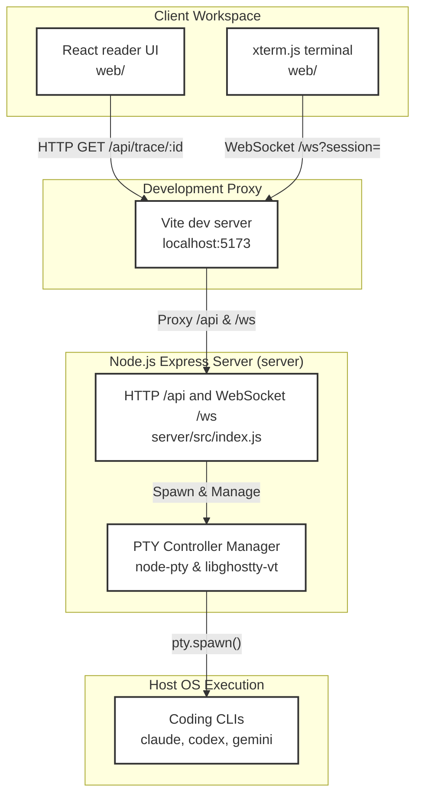
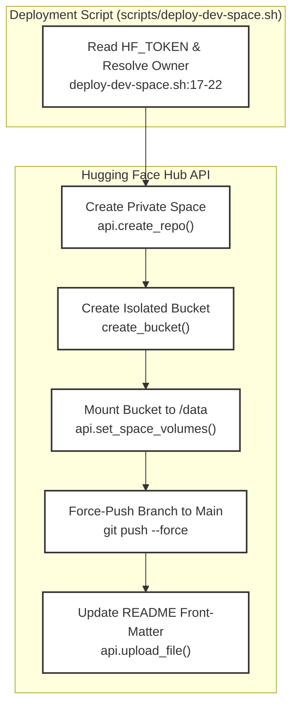

<!-- source: DeepWiki mcp.deepwiki.com · repo huggingface/agent-manager · page 1.1 Getting Started and Development Setup · fetched 2026-10-26 -->

# Getting Started and Development Setup

<details>
<summary>Relevant source files</summary>

The following files were used as context for generating this wiki page:

- [docs/development.md](docs/development.md)
- [docs/first-run-dialogs.md](docs/first-run-dialogs.md)
- [package.json](package.json)
- [scripts/deploy-dev-space.sh](scripts/deploy-dev-space.sh)
- [scripts/install-local-clis.sh](scripts/install-local-clis.sh)

</details>


This page covers the technical requirements, local development workflow, CLI provisioning, first-run session mechanics, and dev space deployment processes for Agent Manager. It provides deep architectural detail on bootstrapping a local source checkout, interacting with the backend and frontend development servers, managing CLI-specific state, and provisioning throwaway Hugging Face Spaces with dedicated `/data` storage buckets.

---

## Prerequisites and Local CLI Installation

Running Agent Manager locally requires Git with Git LFS, a C/C++ toolchain for native terminal dependencies (`node-pty` / `libghostty-vt`), Python, and **Node.js 24.16 or later** (matching the runtime major version of the container image). Older Node versions fail during CLI installation rather than upfront [docs/development.md:7-12]().

The repository root includes an installation script, `scripts/install-local-clis.sh`, which provisions the required and optional npm-distributed coding CLIs into `${NPM_CONFIG_PREFIX:-$HOME/.local}` [scripts/install-local-clis.sh:1-12]().

```bash
git clone https://github.com/huggingface/agent-manager.git
cd agent-manager
./scripts/install-local-clis.sh
```

CLI provisioning bifurcates into mandatory dependencies (which abort the script upon failure) and best-effort optional binaries (which are logged as skipped and marked unavailable in the application UI) [scripts/install-local-clis.sh:14-20]().

| CLI Identifier | npm Package | Binary | Optional Status |
|---|---|---|---|
| `claude` | `@anthropic-ai/claude-code@latest` | `claude` | Required (`optional=0`) [scripts/install-local-clis.sh:24]() |
| `codex` | `@openai/codex@latest` | `codex` | Required (`optional=0`) [scripts/install-local-clis.sh:25]() |
| `gemini` | `@google/gemini-cli@latest` | `gemini` | Optional (`optional=1`) [scripts/install-local-clis.sh:26]() |
| `opencode` | `opencode-ai@latest` | `opencode` | Optional (`optional=1`) [scripts/install-local-clis.sh:27]() |
| `openclaw` | `openclaw@latest` | `openclaw` | Optional (`optional=1`) [scripts/install-local-clis.sh:28]() |

Sources: `docs/development.md`, `scripts/install-local-clis.sh`

---

## Local Development Workflow and Runtime Architecture

Once the CLI binaries are installed and their `bin` directory is added to the system `PATH`, launch the backend and frontend in separate terminals from the repository root [docs/development.md:33-52]().

```bash
# Terminal 1: Backend
cd server
npm ci
npm run dev
```

```bash
# Terminal 2: Frontend
cd web
npm ci
npm run dev
```

Vite proxies `/api` and `/ws` requests from the frontend (`http://localhost:5173`) to the backend server (`http://localhost:7860`) [docs/development.md:54-56](). 



*Diagram 1: Local Development Request Flow bridging frontend proxying to backend PTY orchestration.*

Sources: `docs/development.md`

---

## First-Run CLI Dialogs and State Management

Brand-new coding CLI sessions frequently encounter initialization prompts (such as folder trust queries or update notices) before executing assigned launch prompts [docs/first-run-dialogs.md:1-7](). Agent Manager preemptively addresses these dialogs at boot and launch time to prevent coordinator polling deadlocks [docs/first-run-dialogs.md:66-79]().

| CLI | Dialog Encountered | Trigger Condition | State Record / Mitigation Strategy |
|---|---|---|---|
| Both | "Do you trust this folder?" | Any new folder path [docs/first-run-dialogs.md:15]() | Claude Code inherits trust from parent paths (`projects[<path>].hasTrustDialogAccepted` in `.claude.json`) [docs/first-run-dialogs.md:15,22-25](). Codex requires explicit path appends in `config.toml` [docs/first-run-dialogs.md:15,26-27,76](). |
| Codex | Update available modal | Launch with no initial prompt when cache holds newer version [docs/first-run-dialogs.md:16,33-38]() | Handled via `dismissCodexUpdatePrompt()` modifying `dismissed_version` in `version.json` [docs/first-run-dialogs.md:78,112](). |
| Claude Code | Managed settings / telemetry | Managed settings hash change [docs/first-run-dialogs.md:17]() | Recorded in `remote-settings-consent.json` [docs/first-run-dialogs.md:17](). |
| Claude Code | "Bypass Permissions mode" warning | Unanswered global prompt [docs/first-run-dialogs.md:18]() | Recorded as `skipDangerousModePermissionPrompt` in `settings.json` [docs/first-run-dialogs.md:18](). |

To avoid race conditions and concurrent write losses, Agent Manager avoids rewriting CLI-owned configuration files on session spawn paths where possible [docs/first-run-dialogs.md:68-71](). Codex folder trust entries are safely appended rather than structurally rewritten, parsing TOML headers to avoid duplicate declarations [docs/first-run-dialogs.md:76,106-109]().

Sources: `docs/first-run-dialogs.md`

---

## Dev Space Deployment and the `/data` Bucket

The `scripts/deploy-dev-space.sh` utility automates pushing branches to throwaway Hugging Face Spaces with isolated storage buckets [scripts/deploy-dev-space.sh:1-12]().

```bash
scripts/deploy-dev-space.sh am-dev-instance feature-branch --no-wait
```



*Diagram 2: Space Provisioning and Storage Binding Pipeline executed by `deploy-dev-space.sh`.*

The deployment script executes four primary steps:
1. **Space & Bucket Provisioning:** Creates a private Space repository (`$OWNER/$NAME`) and a dedicated storage bucket (`$OWNER/$NAME-data`) to ensure dev instances never mount production storage [scripts/deploy-dev-space.sh:39-50]().
2. **Volume Binding:** Attaches the storage bucket to the Space container at mount path `/data` using `api.set_space_volumes()` [scripts/deploy-dev-space.sh:48]().
3. **Branch Push:** Configures a temporary git remote and force-pushes the target branch to `refs/heads/main` [scripts/deploy-dev-space.sh:53-58]().
4. **Dashboard Card Styling:** Updates the Space's `README.md` front-matter (`title`, `emoji`, `short_description`) to distinguish the dev instance on the Hugging Face dashboard [scripts/deploy-dev-space.sh:65-90]().

Sources: `scripts/deploy-dev-space.sh`

---

## Runtime Configuration Reference

Agent Manager reads standard environment variables to configure network ports, storage paths, and integration credentials [docs/development.md:120-134]().

| Environment Variable | Default Value | Purpose |
|---|---|---|
| `PORT` | `7860` | HTTP and WebSocket server listening port (Hugging Face `app_port`) [docs/development.md:123]() |
| `DATA_DIR` | `/data` (Docker) / `server/data` (Local) | Persistent storage root for sessions and history [docs/development.md:124]() |
| `AM_SCROLLBACK_BYTES` | `67108864` | Maximum Ghostty terminal scrollback memory per session [docs/development.md:125]() |
| `AM_RESIZE_SETTLE_MS` | `120` | Quiet debounce period before PTY geometry adjustments are applied [docs/development.md:126]() |
| `BIND_HOST` | `127.0.0.1` (`0.0.0.0` in container) | Network interface bind address for HTTP and WebSocket servers [docs/development.md:127]() |
| `AM_FRAME_ANCESTORS` | — | Comma-separated list of allowed origins permitted to embed the app in an `iframe` [docs/development.md:128]() |
| `ANTHROPIC_API_KEY` | — | API credential for Claude Code, opencode, and Hermes [docs/development.md:129]() |
| `OPENAI_API_KEY` / `CODEX_API_KEY` | — | API credential for Codex [docs/development.md:130]() |
| `GEMINI_API_KEY` | — | API credential for Gemini CLI [docs/development.md:131]() |
| `HF_TOKEN` | — | Hugging Face Hub operations and bucket discovery token [docs/development.md:133]() |

Sources: `docs/development.md`

---

