# Page: Overview

# Overview

<details>
<summary>Relevant source files</summary>

The following files were used as context for generating this wiki page:

- [Dockerfile](Dockerfile)
- [README.md](README.md)
- [package.json](package.json)

</details>


Agent Manager is a containerized multi-session workspace designed to host, manage, and interact with AI coding CLI tools (such as Claude Code, Codex, Gemini CLI, opencode, openclaw, and fx) from a browser interface hosted on a Hugging Face Space [README.md:14-20](). It provides a persistent backend runtime, split terminal/reader views, project grouping, and multi-device session continuity backed by a private storage volume mounted at `/data` [README.md:55-60]().

For details on setting up and duplicating the template Space, see [Getting Started and Development Setup](#1.1). For details on the directory layout and configuration files, see [Repository Layout and Conventions](#1.2).

## High-Level Architecture

The repository is structured into distinct top-level modules handling backend services, frontend application components, standalone demonstration views, and administrative scripts. 

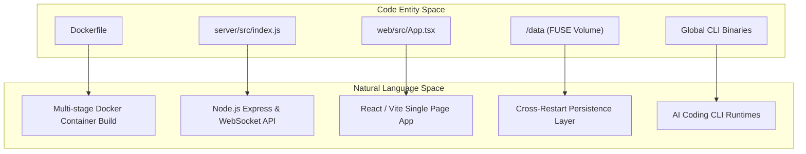
*Figure 1: High-level architectural mapping between natural language system concepts and codebase entities.*

Sources: `Dockerfile:1-118` [Dockerfile:1-118](), `README.md:14-80` [README.md:14-80](), `package.json:1-10` [package.json:1-10]()

### Core Subsystems

The codebase is organized around four primary directories at the repository root:

| Directory / Entity | Role and Responsibility | Code Pointer |
| :--- | :--- | :--- |
| `server/` | Node.js Express & WebSocket backend handling PTY spawning, session runtimes, traces, and storage. | `package.json:4` [package.json:4]() |
| `web/` | React and Vite single-page application providing the workspace UI, reader view, and settings. | `Dockerfile:1-7` [Dockerfile:1-7]() |
| `demo/` | Standalone static Space implementation for the read-only conversation demo. | `README.md:1-12` [README.md:1-12]() |
| `scripts/` | Maintenance utilities, test suite runners, and deployment helpers. | `package.json:8` [package.json:8]() |

Sources: `Dockerfile:1-7` [Dockerfile:1-7](), `package.json:4-8` [package.json:4-8]()

## Key Concepts and Runtime Environment

Agent Manager bridges the gap between headless AI CLI utilities and interactive browser environments. It runs inside a Docker container based on Node 24 (`node:24-bookworm`), embedding pre-pinned versions of coding assistants and necessary helper binaries [Dockerfile:10-90]().

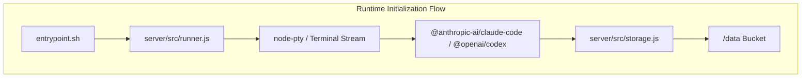
*Figure 2: Session execution and persistence pipeline linking runner routines to storage subsystems.*

### Key Architectural Concepts
- **Multi-Session Workspaces**: Users can spawn, group, and run multiple AI CLI instances simultaneously without process collision [README.md:32-37]().
- **Trace Parsing**: The backend parses raw terminal byte streams and conversation logs into structured states for the reader UI [README.md:36-38]().
- **Privacy Lock & Admission Control**: Built without internal username/password authentication, safety relies on Space visibility controls, request origin admission policies, and security verification loops [README.md:79-82]().
- **`/data` Bucket Integration**: Ensures that workspace files, git configurations, session history, and credentials survive container restarts via a mounted FUSE storage volume [README.md:55-60]().

Sources: `Dockerfile:10-90` [Dockerfile:10-90](), `README.md:32-82` [README.md:32-82]()

## Links to Child Pages

- [Getting Started and Development Setup](#1.1) — Covers template duplication, mounting the `/data` bucket, local development workflows, npm scripts, CLI installations, and dev space deployments.
- [Repository Layout and Conventions](#1.2) — Covers top-level directory maps, configuration files, `.gitignore`, `.dockerignore`, license files, and asset inventories.

Sources: `README.md:55-155` [README.md:55-155]()

---

# Page: Getting Started and Development Setup

# Getting Started and Development Setup

<details>
<summary>Relevant source files</summary>

The following files were used as context for generating this wiki page:

- [docs/development.md](docs/development.md)
- [docs/first-run-dialogs.md](docs/first-run-dialogs.md)
- [package.json](package.json)
- [scripts/deploy-dev-space.sh](scripts/deploy-dev-space.sh)
- [scripts/install-local-clis.sh](scripts/install-local-clis.sh)

</details>


This page covers the technical requirements, local development workflow, CLI provisioning, first-run session mechanics, and dev space deployment processes for Agent Manager. It provides deep architectural detail on bootstrapping a local source checkout, interacting with the backend and frontend development servers, managing CLI-specific state, and provisioning throwaway Hugging Face Spaces with dedicated `/data` storage buckets.

---

## Prerequisites and Local CLI Installation

Running Agent Manager locally requires Git with Git LFS, a C/C++ toolchain for native terminal dependencies (`node-pty` / `libghostty-vt`), Python, and **Node.js 24.16 or later** (matching the runtime major version of the container image). Older Node versions fail during CLI installation rather than upfront [docs/development.md:7-12]().

The repository root includes an installation script, `scripts/install-local-clis.sh`, which provisions the required and optional npm-distributed coding CLIs into `${NPM_CONFIG_PREFIX:-$HOME/.local}` [scripts/install-local-clis.sh:1-12]().

```bash
git clone https://github.com/huggingface/agent-manager.git
cd agent-manager
./scripts/install-local-clis.sh
```

CLI provisioning bifurcates into mandatory dependencies (which abort the script upon failure) and best-effort optional binaries (which are logged as skipped and marked unavailable in the application UI) [scripts/install-local-clis.sh:14-20]().

| CLI Identifier | npm Package | Binary | Optional Status |
|---|---|---|---|
| `claude` | `@anthropic-ai/claude-code@latest` | `claude` | Required (`optional=0`) [scripts/install-local-clis.sh:24]() |
| `codex` | `@openai/codex@latest` | `codex` | Required (`optional=0`) [scripts/install-local-clis.sh:25]() |
| `gemini` | `@google/gemini-cli@latest` | `gemini` | Optional (`optional=1`) [scripts/install-local-clis.sh:26]() |
| `opencode` | `opencode-ai@latest` | `opencode` | Optional (`optional=1`) [scripts/install-local-clis.sh:27]() |
| `openclaw` | `openclaw@latest` | `openclaw` | Optional (`optional=1`) [scripts/install-local-clis.sh:28]() |

Sources: `docs/development.md`, `scripts/install-local-clis.sh`

---

## Local Development Workflow and Runtime Architecture

Once the CLI binaries are installed and their `bin` directory is added to the system `PATH`, launch the backend and frontend in separate terminals from the repository root [docs/development.md:33-52]().

```bash
# Terminal 1: Backend
cd server
npm ci
npm run dev
```

```bash
# Terminal 2: Frontend
cd web
npm ci
npm run dev
```

Vite proxies `/api` and `/ws` requests from the frontend (`http://localhost:5173`) to the backend server (`http://localhost:7860`) [docs/development.md:54-56](). 

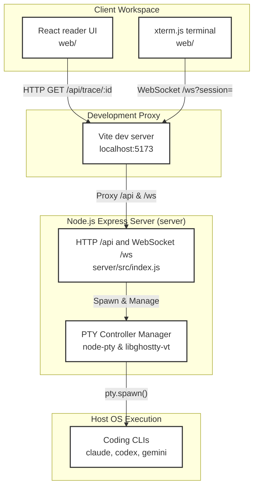

*Diagram 1: Local Development Request Flow bridging frontend proxying to backend PTY orchestration.*

Sources: `docs/development.md`

---

## First-Run CLI Dialogs and State Management

Brand-new coding CLI sessions frequently encounter initialization prompts (such as folder trust queries or update notices) before executing assigned launch prompts [docs/first-run-dialogs.md:1-7](). Agent Manager preemptively addresses these dialogs at boot and launch time to prevent coordinator polling deadlocks [docs/first-run-dialogs.md:66-79]().

| CLI | Dialog Encountered | Trigger Condition | State Record / Mitigation Strategy |
|---|---|---|---|
| Both | "Do you trust this folder?" | Any new folder path [docs/first-run-dialogs.md:15]() | Claude Code inherits trust from parent paths (`projects[<path>].hasTrustDialogAccepted` in `.claude.json`) [docs/first-run-dialogs.md:15,22-25](). Codex requires explicit path appends in `config.toml` [docs/first-run-dialogs.md:15,26-27,76](). |
| Codex | Update available modal | Launch with no initial prompt when cache holds newer version [docs/first-run-dialogs.md:16,33-38]() | Handled via `dismissCodexUpdatePrompt()` modifying `dismissed_version` in `version.json` [docs/first-run-dialogs.md:78,112](). |
| Claude Code | Managed settings / telemetry | Managed settings hash change [docs/first-run-dialogs.md:17]() | Recorded in `remote-settings-consent.json` [docs/first-run-dialogs.md:17](). |
| Claude Code | "Bypass Permissions mode" warning | Unanswered global prompt [docs/first-run-dialogs.md:18]() | Recorded as `skipDangerousModePermissionPrompt` in `settings.json` [docs/first-run-dialogs.md:18](). |

To avoid race conditions and concurrent write losses, Agent Manager avoids rewriting CLI-owned configuration files on session spawn paths where possible [docs/first-run-dialogs.md:68-71](). Codex folder trust entries are safely appended rather than structurally rewritten, parsing TOML headers to avoid duplicate declarations [docs/first-run-dialogs.md:76,106-109]().

Sources: `docs/first-run-dialogs.md`

---

## Dev Space Deployment and the `/data` Bucket

The `scripts/deploy-dev-space.sh` utility automates pushing branches to throwaway Hugging Face Spaces with isolated storage buckets [scripts/deploy-dev-space.sh:1-12]().

```bash
scripts/deploy-dev-space.sh am-dev-instance feature-branch --no-wait
```

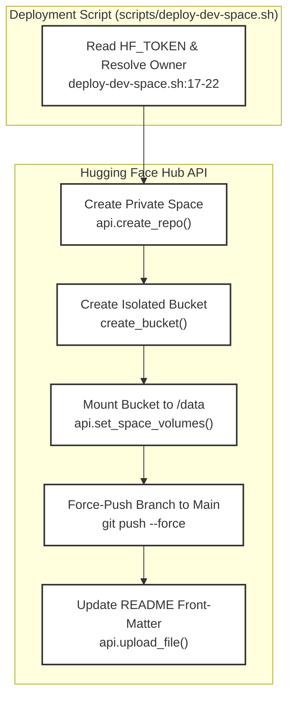

*Diagram 2: Space Provisioning and Storage Binding Pipeline executed by `deploy-dev-space.sh`.*

The deployment script executes four primary steps:
1. **Space & Bucket Provisioning:** Creates a private Space repository (`$OWNER/$NAME`) and a dedicated storage bucket (`$OWNER/$NAME-data`) to ensure dev instances never mount production storage [scripts/deploy-dev-space.sh:39-50]().
2. **Volume Binding:** Attaches the storage bucket to the Space container at mount path `/data` using `api.set_space_volumes()` [scripts/deploy-dev-space.sh:48]().
3. **Branch Push:** Configures a temporary git remote and force-pushes the target branch to `refs/heads/main` [scripts/deploy-dev-space.sh:53-58]().
4. **Dashboard Card Styling:** Updates the Space's `README.md` front-matter (`title`, `emoji`, `short_description`) to distinguish the dev instance on the Hugging Face dashboard [scripts/deploy-dev-space.sh:65-90]().

Sources: `scripts/deploy-dev-space.sh`

---

## Runtime Configuration Reference

Agent Manager reads standard environment variables to configure network ports, storage paths, and integration credentials [docs/development.md:120-134]().

| Environment Variable | Default Value | Purpose |
|---|---|---|
| `PORT` | `7860` | HTTP and WebSocket server listening port (Hugging Face `app_port`) [docs/development.md:123]() |
| `DATA_DIR` | `/data` (Docker) / `server/data` (Local) | Persistent storage root for sessions and history [docs/development.md:124]() |
| `AM_SCROLLBACK_BYTES` | `67108864` | Maximum Ghostty terminal scrollback memory per session [docs/development.md:125]() |
| `AM_RESIZE_SETTLE_MS` | `120` | Quiet debounce period before PTY geometry adjustments are applied [docs/development.md:126]() |
| `BIND_HOST` | `127.0.0.1` (`0.0.0.0` in container) | Network interface bind address for HTTP and WebSocket servers [docs/development.md:127]() |
| `AM_FRAME_ANCESTORS` | — | Comma-separated list of allowed origins permitted to embed the app in an `iframe` [docs/development.md:128]() |
| `ANTHROPIC_API_KEY` | — | API credential for Claude Code, opencode, and Hermes [docs/development.md:129]() |
| `OPENAI_API_KEY` / `CODEX_API_KEY` | — | API credential for Codex [docs/development.md:130]() |
| `GEMINI_API_KEY` | — | API credential for Gemini CLI [docs/development.md:131]() |
| `HF_TOKEN` | — | Hugging Face Hub operations and bucket discovery token [docs/development.md:133]() |

Sources: `docs/development.md`

---

# Page: Repository Layout and Conventions

# Repository Layout and Conventions

<details>
<summary>Relevant source files</summary>

The following files were used as context for generating this wiki page:

- [.dockerignore](.dockerignore)
- [.gitattributes](.gitattributes)
- [.gitignore](.gitignore)
- [LICENSE](LICENSE)
- [logos/claude-logo-png_seeklogo-554534.png](logos/claude-logo-png_seeklogo-554534.png)
- [logos/shell.png](logos/shell.png)

</details>


## Purpose and Scope

This page provides a technical map of the top-level directory structure, repository configuration files, exclusions, and asset conventions in the `agent-manager` codebase. It outlines how the repository organizes its backend server, frontend client, demo apps, utility scripts, and binary assets under version control and containerization boundaries.

Sources: `[.gitignore:1-13]`, `[.dockerignore:1-9]`, `[.gitattributes:1-40]`

---

## Top-Level Directory Layout

The repository is organized into distinct top-level directories separating backend logic, frontend web views, container tooling, fixtures, and brand assets.

| Directory / File | Code Role & Responsibility |
| :--- | :--- |
| `server/` | Node.js Express & WebSocket backend implementing agent runtimes, trace parsers, storage, and feature subsystems. |
| `web/` | React/Vite single-page application providing conversation readers, terminal panes, workspace navigation, and settings. |
| `demo/` | Static demo Space showcasing fixture API byte-window emulations and reader pipelines. |
| `scripts/` | Utility toolbox containing maintenance, deployment, test harnesses, and CLI installation scripts. |
| `logos/` | Brand assets and logo graphics managed via Git LFS for CLI tools and integrations. |
| `.gitignore` | Git exclusion patterns preventing tracking of build artifacts, local data stores, and environment secrets. |
| `.dockerignore` | Build context exclusions optimizing Docker image layers. |
| `.gitattributes` | Git configuration defining large file storage (LFS) rules for binary files, models, and recordings. |
| `LICENSE` | Open-source licensing terms (Apache License 2.0). |

### Diagram: Repository Architecture and Directory Space

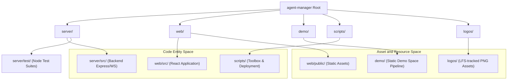

Sources: `[.gitignore:1-13]`, `[.dockerignore:1-9]`, `[.gitattributes:1-40]`, `[LICENSE:1-125]`

---

## Repository Configuration Files

### Git Exclusions (`.gitignore`)
The `.gitignore` file prevents local configuration, build products, and ephemeral volumes from entering version control. Crucially, it omits trailing slashes on `node_modules` to catch symlinked dependencies that could otherwise be checked into the main branch as pointers or blobs `[.gitignore:1-4]`.

Key ignored patterns:
* Dependency directories: `node_modules` `[.gitignore:4]`
* Build outputs: `dist/` `[.gitignore:5]`
* Runtime data buckets: `data/` `[.gitignore:6]`
* Log files and OS metadata: `*.log`, `.DS_Store` `[.gitignore:7-8]`
* Local environment variables: `.env`, `.env.local` `[.gitignore:9-10]`
* Python bytecode and caches: `__pycache__/`, `*.pyc` `[.gitignore:11-12]`

Sources: `[.gitignore:1-13]`

### Docker Build Exclusions (`.dockerignore`)
The `.dockerignore` file mirrors `.gitignore` constraints to minimize the Docker build context transferred to the daemon `[.dockerignore:1-9]`. It excludes `**/node_modules`, `**/dist`, local `data` storage, `.git`, log files, `.DS_Store`, local environment files (`**/.env*`), and scratchpads `[.dockerignore:1-8]`.

Sources: `[.dockerignore:1-9]`

### Git Attributes and Large File Storage (`.gitattributes`)
Binary assets, compressed archives, ML weights, model files, and test recordings are offloaded to Git LFS (`git-lfs`). The `.gitattributes` configuration configures filter, diff, and merge handlers for these extensions `[.gitattributes:1-40]`.

Tracked LFS extensions and paths include:
* Archives and data dumps: `*.7z`, `*.tar.gz`, `*.zip`, `*.parquet`, `*.arrow`, `*.bin`, `*.safetensors` `[.gitattributes:1-35]`
* Test fixtures and media: `web/test/fixtures/*.webm`, `web/test/fixtures/*.ogg` `[.gitattributes:38-39]`
* Documentation and installation images: `web/public/install/mount-bucket.png`, `docs/images/*.png` `[.gitattributes:36-37]`

Sources: `[.gitattributes:1-40]`

### Licensing (`LICENSE`)
The repository is licensed under the Apache License, Version 2.0, providing explicit grants of copyright and patent licenses for contributors and users `[LICENSE:1-125]`.

Sources: `[LICENSE:1-125]`

---

## Asset Management (`logos/`)

Brand assets, CLI icons, and provider logos are maintained in the `logos/` directory. For example, Claude and shell integration logos are stored as binary PNG graphics (`[logos/claude-logo-png_seeklogo-554534.png:1-41]`, `[logos/shell.png:1-14]`). Because these files are binary graphics rendered in UI components or documentation, they are managed directly under asset pipelines.

### Diagram: Asset and Configuration Flow

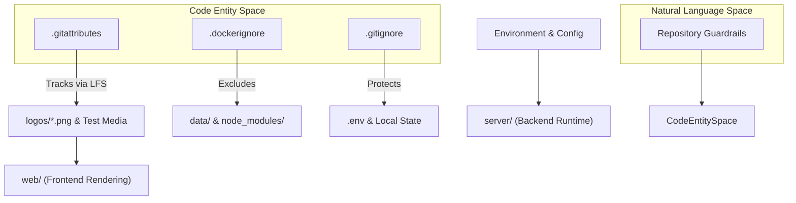

Sources: `[.gitattributes:1-40]`, `[.dockerignore:1-9]`, `[.gitignore:1-13]`, `[logos/claude-logo-png_seeklogo-554534.png:1-41]`, `[logos/shell.png:1-14]`

---

# Page: Backend Server

# Backend Server

<details>
<summary>Relevant source files</summary>

The following files were used as context for generating this wiki page:

- [server/package.json](server/package.json)
- [server/src/agent-list.js](server/src/agent-list.js)
- [server/src/api-errors.js](server/src/api-errors.js)
- [server/src/api-streams.js](server/src/api-streams.js)

</details>


## Purpose and Scope

The backend server is a Node.js application built using Express, `ws` (WebSockets), `node-pty`, and `@coder/libghostty-vt-node`, located in `server/src`. Its primary responsibility is managing isolated terminal PTY sessions for AI coding CLI tools, hosting an HTTP/WebSocket API layer, parsing terminal conversation traces, ensuring safe persistence against the `/data` storage bucket, and driving auxiliary features like scheduled crons, skill management, and session sharing. 

This is a parent overview page. Detailed technical implementations are delegated to dedicated child pages.

---

## Architecture and Sub-Modules

The backend server coordinates incoming HTTP requests, WebSocket control streams, terminal processes, and background workers. 

### Diagram: API Routing and Error Handling Pipeline
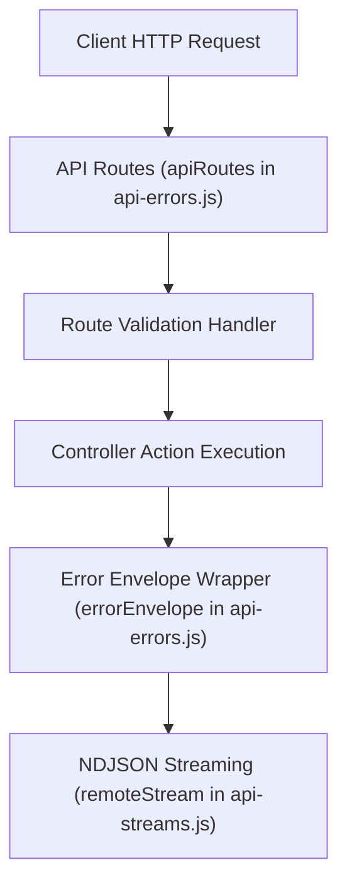
Sources: [server/src/api-errors.js:60-68](), [server/src/api-errors.js:72-89](), [server/src/api-streams.js:6-53]()

### Diagram: Agent Roster and Query Filtering Architecture
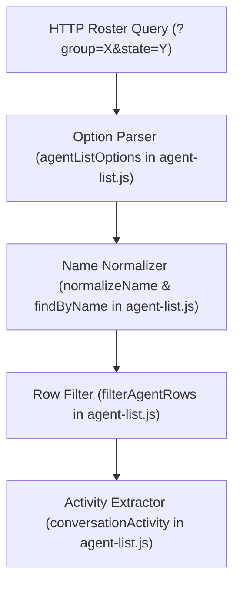
Sources: [server/src/agent-list.js:14-17](), [server/src/agent-list.js:26-34](), [server/src/agent-list.js:54-80](), [server/src/agent-list.js:81-91]()

---

## Sub-Topic Overview and Child Page Links

### 2.1 HTTP/WebSocket API Layer
The server exposes REST endpoints and real-time WebSocket communication channels configured via `index.js`. Request admission policies protect resources against untrusted cross-origin frames, while uniform input validation and structured error handling (`apiRoutes`, `errorEnvelope`, `apiErrorHandler`) guarantee predictable API responses. Real-time logging and NDJSON streaming (`remoteStream`) handle live output feeds.
* For details, see [HTTP/WebSocket API Layer](#2.1).

Sources: [server/src/api-errors.js:60-124](), [server/src/api-streams.js:6-53]()

### 2.2 Session and Terminal Runtime
AI coding CLI agents (such as Claude Code, Codex, OpenCode, and Gemini) run inside isolated PTY instances spawned via `node-pty` and processed through terminal emulators. This layer handles lifecycle routines including resize commands, restarts, run-state tracking, safety checkpoints, watchdogs, and specialized process integrations.
* For details, see [Session and Terminal Runtime](#2.2).

Sources: [server/package.json:25-32](), [server/src/agent-list.js:14-91]()

### 2.3 Traces and Conversation Parsing
Conversation traces are captured under a strict byte-window contract and processed by dedicated workers. This subsystem manages trace revisions, activity metrics, subagent rosters, and conversation adapters to transform raw terminal text streams into structured conversational models.
* For details, see [Traces and Conversation Parsing](#2.3).

Sources: [server/src/agent-list.js:43-53]()

### 2.4 Storage, Persistence and the `/data` Bucket
All workspace state, history stores, configuration snapshots, and backups are stored reliably through storage wrappers. The persistence layer includes safeguards like safe-write primitives, slow-file-system probing, and FUSE phantom directory mitigation to prevent data loss on shared or network-backed volumes.
* For details, see [Storage, Persistence and the /data Bucket](#2.4).

Sources: [server/package.json:21-23]()

### 2.5 Features: Skills, Crons, Delegation, Sharing, Remote Agents
Built on top of the base runtime, several feature subsystems provide advanced capabilities: managed skills, scheduled prompts via `cron-parser`, agent delegation and dispatch, session sharing with redaction rules, remote agent streaming, and resource usage accounting.
* For details, see [Features: Skills, Crons, Delegation, Sharing, Remote Agents](#2.5).

Sources: [server/package.json:26-30](), [server/src/agent-list.js:36-41]()

---

# Page: HTTP/WebSocket API Layer

# HTTP/WebSocket API Layer

<details>
<summary>Relevant source files</summary>

The following files were used as context for generating this wiki page:

- [docs/api-audit-log.md](docs/api-audit-log.md)
- [docs/api-errors.md](docs/api-errors.md)
- [docs/browser-request-protection.md](docs/browser-request-protection.md)
- [server/src/api-errors.js](server/src/api-errors.js)
- [server/src/api-streams.js](server/src/api-streams.js)

</details>


## Purpose and Scope
This section details the HTTP and WebSocket API layer implemented in the backend server. It governs route registration (`server/src/api-errors.js` [server/src/api-errors.js:60-68]), request admission and browser protection policies (`docs/browser-request-protection.md`), request validation and safe error envelope wrapping (`server/src/api-errors.js` [server/src/api-errors.js:72-89]), real-time streaming implementations (`server/src/api-streams.js` [server/src/api-streams.js:1-54]), and the sensitive private API audit log (`docs/api-audit-log.md`).

---

## 1. Route Structure and Registration
Routes are registered onto the Express application using an explicit registration facade `apiRoutes` rather than global monkey-patching [server/src/api-errors.js:58-68]. Global JSON parsing, privacy lock verification, and operation attribution execute in a fixed sequence [docs/api-errors.md:57-59]. 

Validation runs after route-specific body/query parsers and immediately preceding the final route action [docs/api-errors.md:57-60]. Successful request bodies and binary data streams are returned directly without generic JSON wrapping [server/src/api-errors.js:58-59].

Sources: [server/src/api-errors.js:58-68](), [docs/api-errors.md:54-60]()

---

## 2. Request Admission and Browser Protection
Agent Manager enforces request admission hardening to defend against unauthorized cross-site requests within its single-owner private deployment model [docs/browser-request-protection.md:3-6]. 

### Admission Policy and Markers
Protected mutating requests and browser fetches must present an exact configured `Origin` header (when applicable) alongside a non-secret, non-safelisted protocol header: `X-AM-Request: 1` [docs/browser-request-protection.md:13-24]. The application grants no API CORS permissions, and `OPTIONS` preflight requests return `204` without `Access-Control-Allow-Origin` headers [docs/browser-request-protection.md:24-26]. Fetch Metadata headers (`Sec-Fetch-Site`, `Sec-Fetch-Mode`, `Sec-Fetch-Dest`) serve as defense-in-depth, verifying that browser-initiated API calls stem from `cors` or `same-origin` modes [docs/browser-request-protection.md:35-39].

### Framing and CSP
To regulate how the application can be embedded, every response (`/api/*`, static assets, SPA fallback, errors) is injected with a `Content-Security-Policy` header containing `frame-ancestors 'self'`, combined with `https://huggingface.co` whenever `SPACE_ID` is configured [docs/browser-request-protection.md:73-76]. Additional custom embedding origins can be configured via `AM_FRAME_ANCESTORS` [docs/browser-request-protection.md:85].

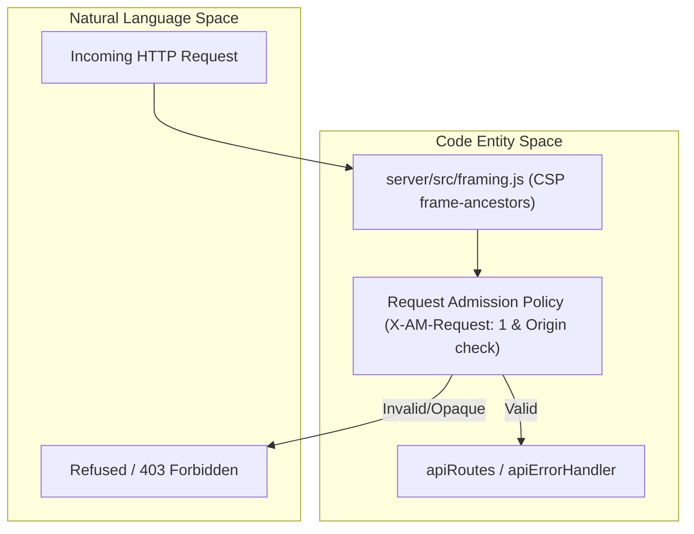
*Diagram 1: Request Admission & Framing Flow from Network Edge to Express Routing*

Sources: [docs/browser-request-protection.md:1-97]()

---

## 3. Validation, Error Envelopes, and HTTP Failures
Request validation and failure handling are standardized through `ApiError` exceptions and middleware wrappers defined in `server/src/api-errors.js` [server/src/api-errors.js:10-124].

### Error Classes and Envelopes
* **`ApiError`**: The standard exception class carrying an HTTP status code, machine-readable error `code`, user-facing message, and optional extra structured `data` [server/src/api-errors.js:10-17].
* **`asyncHandler`**: Wraps asynchronous Express route handlers to catch rejected promises and forward them safely to `next()` [server/src/api-errors.js:44-56].
* **`errorEnvelope`**: Intercepts `res.json` responses carrying status `>= 400`. For `5xx` internal errors, it sanitizes outputs to return a safe generic message, a server-generated `requestId`, and optional bounded file path details while shielding raw stack traces [server/src/api-errors.js:72-89, docs/api-errors.md:13-17].
* **`apiErrorHandler`**: Maps raw body-parser errors (such as `entity.parse.failed` or `entity.too.large`) and URI malformations into well-typed `ApiError` instances [server/src/api-errors.js:96-124].

Sources: [server/src/api-errors.js:1-124](), [docs/api-errors.md:1-51]()

---

## 4. Streaming Endpoints
Real-time streaming and long-polling endpoints (such as remote agent message queues) are managed via specialized streaming utilities like `remoteStream` in `server/src/api-streams.js` [server/src/api-streams.js:6-54].

### NDJSON and Heartbeat Contracts
The `remoteStream` function establishes an NDJSON response stream (`application/x-ndjson`), writing an initial `:connected` comment line, followed by periodic heartbeat comments (`:hb`), pending message payloads, and closing JSON event lines [server/src/api-streams.js:34-51]. It integrates directly with the privacy lock via an `admit` callback, ensuring that lock engagements gracefully terminate the stream with a stop protocol message rather than abruptly severing the TCP socket [server/src/api-streams.js:3-5, 36-39].

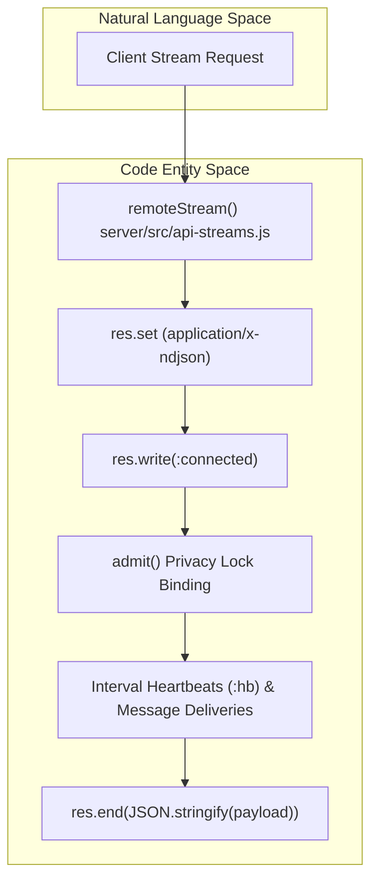
*Diagram 2: Streaming Architecture and Lifecycle in `server/src/api-streams.js`*

Sources: [server/src/api-streams.js:1-53]()

---

## 5. The API Audit Log
Mutating API operations and resolved agent waits are logged to `operations.jsonl` under the private data directory [docs/api-audit-log.md:3-4]. 

### Credential Filtering (`credentials-v1`)
Version 2 audit records include an `audit.credentialFilter` metadata block [docs/api-audit-log.md:13-19]. Before serialization and disk append, a detached representation passes through the `credentials-v1` filtering policy, which scrubs sensitive information [docs/api-audit-log.md:21-23]:
* **Structured Fields**: Replaces values under keys such as `authorization`, `password`, `token`, `api_key`, `clientSecret`, and `private_key` with `[redacted]` [docs/api-audit-log.md:27].
* **Provider Token Shapes**: Detects and redacts standard token prefixes (e.g., Hugging Face `hf_...`, Anthropic `sk-ant-...`, OpenAI `sk-...`, GitHub tokens, AWS access keys, and JWT formats) [docs/api-audit-log.md:28].
* **Private Key Blocks**: Scrubs full `BEGIN ... PRIVATE KEY` through `END ... PRIVATE KEY` blocks [docs/api-audit-log.md:30].
* **Configured Secrets**: Matches exact values (at least 8 characters long) from the Space's injected-secret catalog [docs/api-audit-log.md:31].

If sanitization throws an error, a minimal diagnostic audit failure entry is written without exposing raw file paths or exceptions [docs/api-audit-log.md:80-82].

Sources: [docs/api-audit-log.md:1-89]()

---

# Page: Session and Terminal Runtime

# Session and Terminal Runtime

<details>
<summary>Relevant source files</summary>

The following files were used as context for generating this wiki page:

- [docs/agent-state-checkpoints.md](docs/agent-state-checkpoints.md)
- [docs/tui-input-required.md](docs/tui-input-required.md)
- [scripts/agent-state.sh](scripts/agent-state.sh)
- [scripts/am-input-required-hook.sh](scripts/am-input-required-hook.sh)
- [server/resize.test.mjs](server/resize.test.mjs)

</details>


## Purpose and Scope

The Session and Terminal Runtime subsystem handles the end-to-end lifecycle of CLI agent sessions within the Agent Manager environment. It is responsible for spawning pseudo-terminal (PTY) processes, managing terminal modes, translating resize commands, supervising process execution states, and synchronizing durable state checkpoints to the underlying storage bucket. 

This is a parent page providing a high-level architectural overview of the runtime modules located in `server/src/`. For per-CLI integration specifics, see [Agent Integrations and Hooks](#2.2.1). For specialized multi-client Codex support, see [Codex Shared Sessions](#2.2.2).

Sources: `docs/agent-state-checkpoints.md:1-12`, `docs/tui-input-required.md:1-18`

---

## Runtime Architecture and Core Modules

The runtime backend coordinates session processes through a hierarchy of modules that manage process routing, state tracking, and PTY I/O streaming.

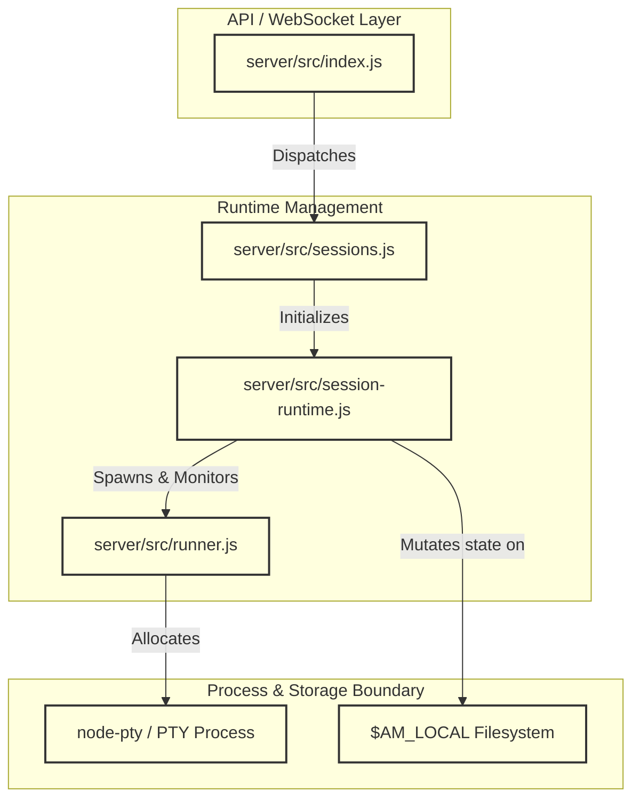
*Figure 1: Control flow from API entry points down to PTY execution and local file mutations.*

- **`sessions.js`**: Manages the collection of active session records, mapping session identifiers to their respective runtime contexts and configuration profiles.
- **`session-runtime.js`**: Controls the per-session execution environment, handling spawn parameters, environment variables, lifecycle state transitions, and coordination with persistence triggers.
- **`runner.js`**: Manages low-level PTY attachment, raw byte streaming, terminal mode configurations, and repaint archive synchronization (`server/resize.test.mjs:19`).

Sources: `server/resize.test.mjs:1-21`, `docs/agent-state-checkpoints.md:1-15`

---

## PTY and Terminal Modes

Agent Manager treats terminal interfaces explicitly rather than relying purely on heuristic text scraping. Shell outputs use standard reflow behavior, while primary-screen agent TUIs settle their `SIGWINCH` repaint events inside designated terminal boundaries so that presentation bytes do not pollute output history (`server/resize.test.mjs:1-7`).

- **Geometry & Resize**: Client-initiated resize events flow through WebSocket control messages (`{ t: 'r', cols, rows }`), triggering PTY dimension adjustments and scratch terminal synchronization (`server/resize.test.mjs:73-83`).
- **Interactive TUI Dialog Detection**: Companion scripts monitor native CLI lifecycle events (such as permission prompts and planning states) to surface advisory input requirements without mutating stream availability (`docs/tui-input-required.md:1-25`, `scripts/am-input-required-hook.sh:1-45`).

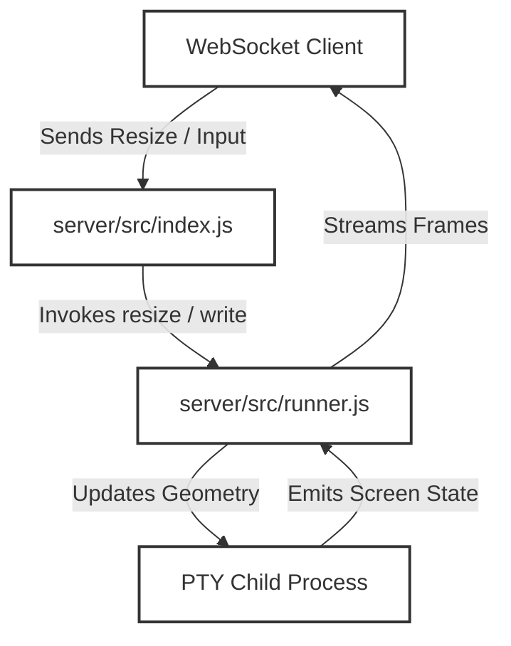
*Figure 2: Terminal session communication loop between client and PTY process.*

Sources: `server/resize.test.mjs:1-120`, `docs/tui-input-required.md:1-45`, `scripts/am-input-required-hook.sh:1-71`

---

## Run State, Checkpoints, and Watchdog

Because the backing `/data` storage volume operates as a FUSE view over mutable object storage rather than a standard POSIX filesystem, active agents execute exclusively against local disk paths (`$AM_LOCAL`), while durable states are synchronized via explicit checkpointing routines (`docs/agent-state-checkpoints.md:1-13`).

- **Local Execution vs. Bucket Sync**: Agent harnesses mutate ordinary files locally. Periodic routines execute online database backups (such as SQLite `PRAGMA quick_check` validated operations) and rsync-based tree syncs to move closed writes into the bucket (`docs/agent-state-checkpoints.md:14-28`, `scripts/agent-state.sh:1-15`).
- **Watchdog & Budgets**: Restores and checkpoints operate under strict time budgets (`AGENT_STATE_BUDGET`), with automated watchdogs enforcing cleanup and failing closed if operations exceed allocated durations (`docs/agent-state-checkpoints.md:98-115`).

Sources: `docs/agent-state-checkpoints.md:1-119`, `scripts/agent-state.sh:1-120`

---

## Child Pages

For more detailed technical specifications, refer to the following child documentation:
- [Agent Integrations and Hooks](#2.2.1) — Per-CLI integration details: Claude Code statusline/repin hook, Codex launch policy and context repin, opencode plugin, Gemini system defaults, Hermes, fx process.
- [Codex Shared Sessions](#2.2.2) — Codex-specific shared session architecture: bindings, observation client, rollout migration, reconnect, and shared preview; plus design proposals.

Sources: `docs/agent-state-checkpoints.md:1-5`, `docs/tui-input-required.md:1-15`

---

# Page: Agent Integrations and Hooks

# Agent Integrations and Hooks

<details>
<summary>Relevant source files</summary>

The following files were used as context for generating this wiki page:

- [codex-requirements.toml](codex-requirements.toml)
- [gemini-system-defaults.json](gemini-system-defaults.json)
- [scripts/am-codex-context.mjs](scripts/am-codex-context.mjs)
- [scripts/am-codex-repin-hook.sh](scripts/am-codex-repin-hook.sh)
- [scripts/am-opencode-repin.js](scripts/am-opencode-repin.js)
- [scripts/am-repin-hook.sh](scripts/am-repin-hook.sh)
- [server/claude-statusline.mjs](server/claude-statusline.mjs)

</details>


## Purpose and Scope
This page details the per-CLI integration mechanisms, hooks, and plugins used by Agent Manager to bridge external command-line AI coding tools with its containerized session runtime. It covers process-tree attribution, session re-pinning (`/clear` and `/resume` tracking), status line telemetry, context lookup utilities, and input-required event signaling for Claude Code, Codex, OpenCode, Gemini, Hermes, and associated helper processes.

Sources:
- `codex-requirements.toml:1-17` []()
- `gemini-system-defaults.json:1-47` []()
- `scripts/am-codex-context.mjs:1-80` []()
- `scripts/am-codex-repin-hook.sh:1-69` []()
- `scripts/am-opencode-repin.js:1-140` []()
- `scripts/am-repin-hook.sh:1-42` []()
- `server/claude-statusline.mjs:1-27` []()

---

## Claude Code Integration: Statusline and Re-pin Hooks
Claude Code integrates with Agent Manager via two primary scripting mechanisms executed within the terminal pane's environment: a statusline consumer and a SessionStart re-pin hook.

### Statusline Telemetry
The statusline script `server/claude-statusline.mjs` consumes a JSON blob piped on `process.stdin` by Claude Code [server/claude-statusline.mjs:1-9](). It extracts official `rate_limits` (Pro/Max tiers) and cost metrics, persisting them to `usage.json` inside the configured `CLAUDE_CONFIG_DIR` [server/claude-statusline.mjs:13-19](). It then outputs a compact string containing model names and percentage usages for 5-hour and 7-day windows to `process.stdout` [server/claude-statusline.mjs:20-27]().

### SessionStart Re-pin Hook
The script `scripts/am-repin-hook.sh` handles conversation re-pinning when Claude Code starts or resets via `/clear` [scripts/am-repin-hook.sh:1-10](). 
1. It validates environment variables including `AM_ID`, `AM_RUN_ID`, `AM_CLI="claude"`, and `CLAUDE_CODE_ENTRYPOINT="cli"` [scripts/am-repin-hook.sh:19-24]().
2. It inspects `/proc` to verify that `CLAUDE_PID` matches either the pane root PID (`AM_PANE_PID`) or is its direct child, preventing nested tool-spawned Claude processes from hijacking the top-level session crumb [scripts/am-repin-hook.sh:25-33]().
3. It writes a JSON breadcrumb payload to the local directory `$AM_REPIN_DIR` (defaulting to `/tmp/am-repin`) using atomic write patterns (`.tmp` + `mv -f`) [scripts/am-repin-hook.sh:34-41]().

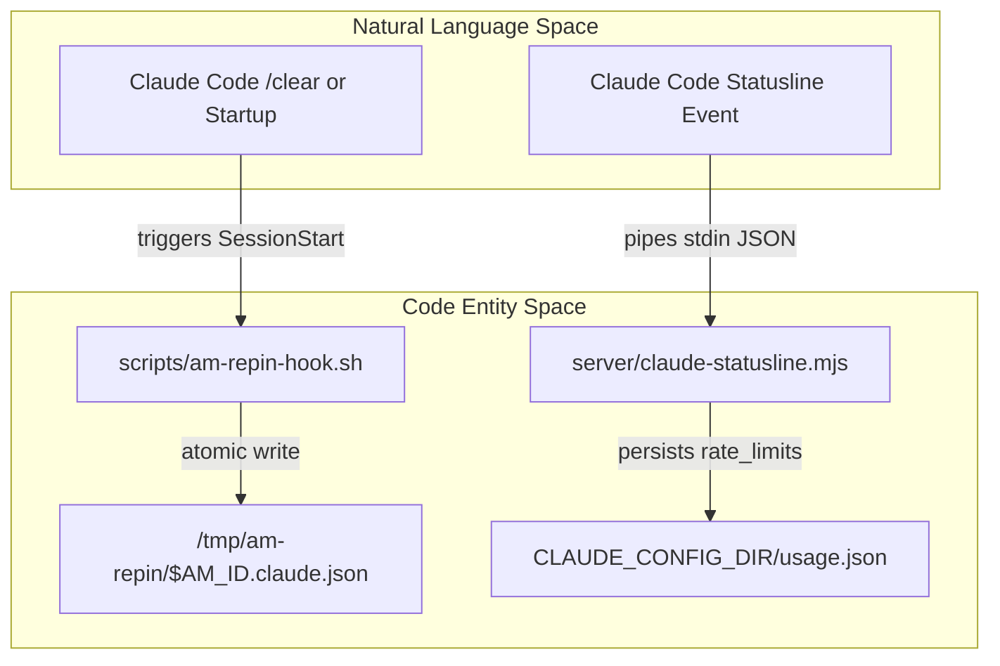
*Figure 1: Claude Code hook integration bridging execution events to disk breadcrumbs and usage stores.*

Sources:
- `scripts/am-repin-hook.sh:1-42` []()
- `server/claude-statusline.mjs:1-27` []()

---

## Codex Launch Policy and Context Re-pin
Codex instances are governed by container-level policies and hook requirements defined under `/etc/codex/hooks` and managed via helper CLI tools.

### Container Launch Policy
The container configuration file `codex-requirements.toml` enforces managed hook policies without requiring per-pane interactive trust prompts [codex-requirements.toml:1-5](). It registers a `SessionStart` hook matching `startup`, `resume`, or `clear` actions to execute `/etc/codex/hooks/am-codex-repin-hook.sh` with a 5-second timeout [codex-requirements.toml:7-16]().

### Repin Hook Implementation
The script `scripts/am-codex-repin-hook.sh` validates incoming environment parameters (`AM_CLI="codex"`, `AM_ID`, `AM_RUN_ID`, `AM_PANE_PID`) [scripts/am-codex-repin-hook.sh:4-9](). It walks `/proc/[pid]/stat` up to 64 hops to verify process ancestry and ensure the Codex process executing the hook matches expected process bounds relative to `AM_PANE_PID` and the server's Node executable (`AM_NODE_EXE`) [scripts/am-codex-repin-hook.sh:15-59](). Validated events are written atomically to `$AM_REPIN_DIR/$AM_ID.codex.json` [scripts/am-codex-repin-hook.sh:61-68]().

### Context and TUI Utilities
The module `scripts/am-codex-context.mjs` provides context resolution, thread importing, and TUI launching utilities for native Codex tools [scripts/am-codex-context.mjs:1-79](). 
- `readConfig()` and `localOrigin()` validate that communication routes through a local loopback HTTP endpoint [scripts/am-codex-context.mjs:11-24]().
- `tuiSpec()` constructs safe child process launch parameters (`--remote unix://...`) while stripping inherited `AM_` or `CODEX_THREAD_ID` environment variables to prevent spoofing [scripts/am-codex-context.mjs:25-35]().
- `run()` executes subcommands (`resolve`, `import`, `tui`) with strict argument validation and timeout controls [scripts/am-codex-context.mjs:36-79]().

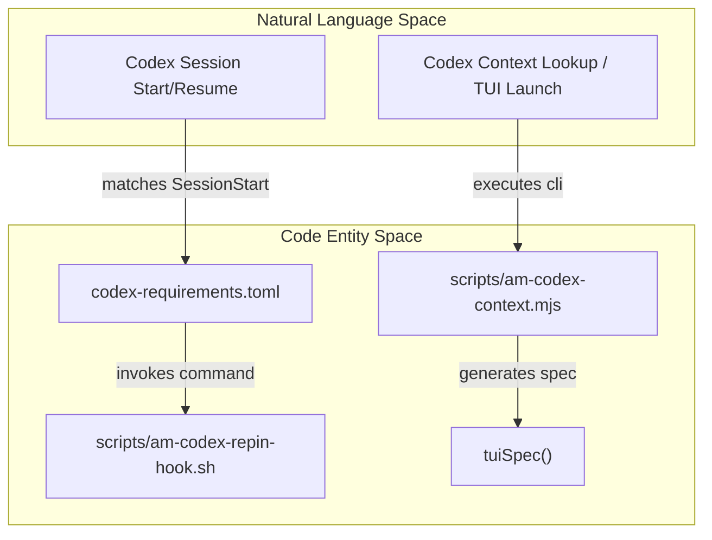
*Figure 2: Codex policy configuration and context resolution flow.*

Sources:
- `codex-requirements.toml:1-17` []()
- `scripts/am-codex-context.mjs:1-80` []()
- `scripts/am-codex-repin-hook.sh:1-69` []()

---

## OpenCode Plugin Integration
OpenCode integrations are managed via a plugin model exported by `scripts/am-opencode-repin.js` [scripts/am-opencode-repin.js:1-139]().

### Key Functions and Data Flow
- `paneIdentity()`: Validates that `AM_CLI === 'opencode'`, `AM_ID` and `AM_RUN_ID` match safe alphanumeric patterns, and that `process.pid` matches `AM_PANE_PID` [scripts/am-opencode-repin.js:7-13]().
- `report(sessionID, cwd, source)`: Synchronously writes session creation and message event data to `$AM_REPIN_DIR/$amId.opencode.json` via atomic file renames [scripts/am-opencode-repin.js:15-37]().
- `syncInputRequired(pending)`: Tracks pending permission or question requests (`permission.asked`, `question.asked`), synchronizing input-required states to disk so that the manager UI can alert users without interfering with the TUI event loop [scripts/am-opencode-repin.js:39-67]().
- `AgentManagerRepin`: An asynchronous plugin factory returning handlers for OpenCode events (`event`), chat messages (`chat.message`), and environment sanitization (`shell.env` which clears `AM_*` keys for nested tool shells) [scripts/am-opencode-repin.js:72-139]().

Sources:
- `scripts/am-opencode-repin.js:1-140` []()

---

## Gemini System Defaults and Input Hooks
Gemini CLI environments are initialized using system-level default configuration files.

The configuration file `gemini-system-defaults.json` establishes general options (such as enabling notifications via `osc9`) and registers hook bindings for notification events [gemini-system-defaults.json:1-6](). Specifically, `Notification` (matching `ToolPermission`), `AfterAgent`, and `SessionEnd` hooks are configured to execute `/app/scripts/am-input-required-hook.sh` with a 5000ms timeout [gemini-system-defaults.json:6-46](). This relays attention signals back to the container runtime whenever agent interaction or authorization is blocked.

Sources:
- `gemini-system-defaults.json:1-47` []()

---

# Page: Codex Shared Sessions

# Codex Shared Sessions

<details>
<summary>Relevant source files</summary>

The following files were used as context for generating this wiki page:

- [docs/codex-agent-reconnect.md](docs/codex-agent-reconnect.md)
- [docs/codex-shared-bindings.md](docs/codex-shared-bindings.md)
- [docs/codex-shared-preview.md](docs/codex-shared-preview.md)
- [docs/proposals/codex-shared-next-steps.md](docs/proposals/codex-shared-next-steps.md)
- [docs/proposals/codex-shared-sessions.md](docs/proposals/codex-shared-sessions.md)
- [scripts/am-codex-migrate.mjs](scripts/am-codex-migrate.mjs)
- [scripts/migrate-open-rollouts.sh](scripts/migrate-open-rollouts.sh)
- [scripts/probe-codex-shared.mjs](scripts/probe-codex-shared.mjs)

</details>


## Purpose and Scope

This page documents the Codex-specific shared session architecture in Agent Manager (AM). It details how AM decouples execution from standalone PTY processes by integrating with an independently managed Codex app-server via Unix sockets. Topics covered include exact thread bindings, the read-only observation client, rollout migration for FUSE-backed object storage, automatic thread reconnect and prompt delivery, compatibility probes, and design proposals.

Sources: `docs/proposals/codex-shared-sessions.md:1-126`, `docs/codex-shared-bindings.md:1-121`

---

## 1. Codex Thread Bindings and Pilot Architecture

Agent Manager allows existing sessions to be associated with exact Codex thread UUIDs handed off to a configured Codex server. To prevent regressions in production, binding writes are restricted and require an explicit opt-in pilot flag (`AM_CODEX_BINDINGS_PILOT=1`). 

### Binding Mechanics and API

The binding route binds an existing AM session ID to a live Codex thread ID. It requires the old AM terminal to be stopped with no queued prompts, and the target thread must already be loaded and idle on the verified server within the correct workspace.

```sh
curl --fail-with-body "http://127.0.0.1:7861/api/sessions/AM_SESSION_ID/codex/binding" \
  -H 'X-AM-Request: 1' -H 'X-AM-Origin: operator' \
  -H 'Content-Type: application/json' \
  --data '{"threadId":"EXACT_CODEX_UUID","expectedRevision":0}'
```

The underlying persistence maps sessions to runtime configurations using versioned bindings (`codexRuntime.mode`, `codexRuntime.endpointId`, `codexRuntime.threadId`, `codexRuntime.revision`), ensuring that local file existence does not dictate whether a shared thread is valid.

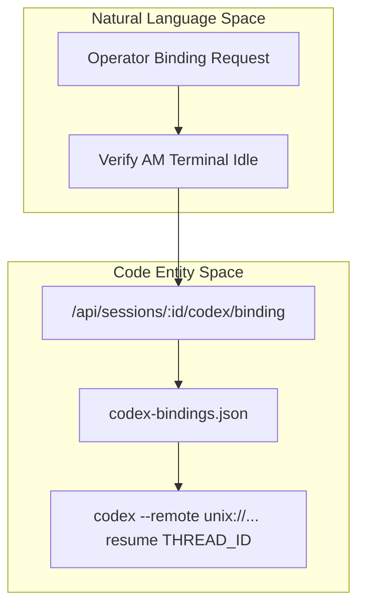

Sources: `docs/codex-shared-bindings.md:1-121`, `docs/proposals/codex-shared-sessions.md:67-111`

---

## 2. Observation Client and Preview API

The shared server preview provides a read-only task inspector in the web interface, implemented via the `GET /api/codex/shared` route. It communicates with the Codex app-server using a restricted transport protocol.

### Transport Limitations and Safety
To safeguard shared instances, the observer restricts its RPC capabilities:
- Uses metadata-only `thread/read` calls.
- Restricts `thread/list` queries with `useStateDbOnly: true` to avoid heavy rollout scan/repair operations.
- Never resumes, subscribes, or answers approval requests through the preview route.

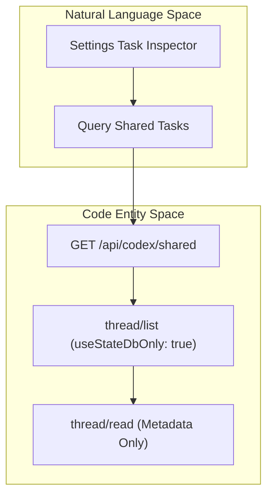

Sources: `docs/codex-shared-preview.md:1-132`, `docs/proposals/codex-shared-sessions.md:102-111`

---

## 3. Rollout Migration and Storage Safeguards

Codex appends output to rollout files (`rollout-<ts>-<uuid>.jsonl`) mounted over a Hugging Face Space `/data` bucket via FUSE. Because streaming writers can hold entire epochs in memory, container deployments risk losing active session data unless flushed or migrated safely.

### Migration Script Architecture
The migration utility inspects active processes via `/proc`, snapshots open write FZF descriptors, trims trailing partial lines, and uploads safe closed copies to a dedicated bucket prefix (`state/codex/migration`) before container replacement.

```sh
scripts/migrate-open-rollouts.sh                # snapshot, upload, verify
scripts/migrate-open-rollouts.sh --dry-run      # report, touch nothing
scripts/migrate-open-rollouts.sh --restore      # boot side: reconcile
```

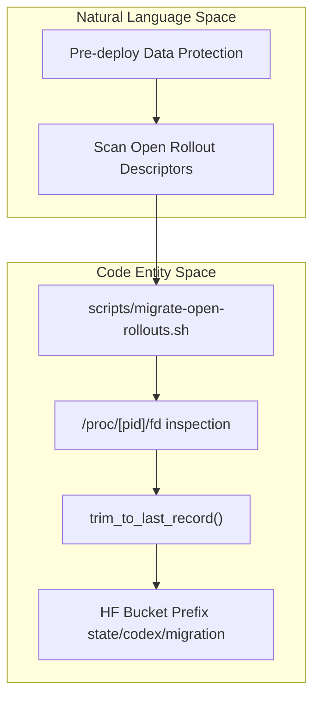

Sources: `scripts/migrate-open-rollouts.sh:1-169`, `docs/proposals/codex-shared-next-steps.md:41-44`

---

## 4. Automatic Reconnect and Prompt Delivery

Agent Manager can recover existing shared Codex threads that are saved but currently unloaded when a message is dispatched via `POST /api/agents/:id/prompt?from=SOURCE`.

### Reconnect Protocol
- Recovers the original thread ID, model, current working directory, approval settings, and permission profile.
- Bypasses standalone TUI bootups, preventing interruption of active work or replay of old inputs.
- Verifies input receipts durably (`DATA_DIR/delegations/<UUID>.json`) to prevent duplicate queue submissions after transport timeouts or AM restarts.

Sources: `docs/codex-agent-reconnect.md:1-117`, `docs/proposals/codex-shared-next-steps.md:10-22`

---

## 5. Compatibility Probes and Validation

To verify the app-server interface and test regression behaviors across versions, AM includes a standalone compatibility script.

### Probe Execution
The probe provisions a temporary Codex home with a deterministic stub provider, launches an app-server instance over stdio, tests identity preservation through `thread/shellCommand`, restarts the server, and validates warm-resume behaviors.

```sh
node scripts/probe-codex-shared.mjs
```

Exit codes:
- `0`: Tested invariants held successfully.
- `2`: Context or configuration loss observed after restart.
- `1`: Probe execution failure.

Sources: `docs/codex-shared-preview.md:45-70`, `scripts/probe-codex-shared.mjs:1-145`

---

## Summary of Configuration Variables

| Environment Variable | Scope | Purpose |
|----------------------|-------|---------|
| `AM_CODEX_SHARED_SOCKET` | Administrator | Absolute path to the shared control Unix socket |
| `AM_CODEX_SHARED_HOME` | Administrator | Absolute path to the verified Codex home directory |
| `AM_CODEX_BINDINGS_PILOT` | Administrator | Opt-in flag required to permit shared binding writes |
| `AM_BUCKET` | Deployment | Custom bucket name for rollout migration syncing |

Sources: `docs/codex-shared-bindings.md:17-23`, `docs/codex-shared-preview.md:14-19`, `scripts/migrate-open-rollouts.sh:59-64`

---

# Page: Traces and Conversation Parsing

# Traces and Conversation Parsing

<details>
<summary>Relevant source files</summary>

The following files were used as context for generating this wiki page:

- [docs/agent-activity.md](docs/agent-activity.md)
- [docs/conversation-adapter.md](docs/conversation-adapter.md)
- [docs/reader-architecture.md](docs/reader-architecture.md)
- [scripts/codex-writer.py](scripts/codex-writer.py)
- [server/reader-info.test.mjs](server/reader-info.test.mjs)

</details>


This page covers the technical architecture of conversation tracing, byte-window streaming contracts, asynchronous log parsing workers, activity timestamp extraction, and the conversation adapter model in Agent Manager (`agent-manager`).

---

## 1. The Trace Byte-Window Contract (`traces.js`)

The server manages conversation logs as append-only source streams (such as JSONL files) and exposes them through bounded, continuous transport windows [docs/reader-architecture.md:9-11](). Rather than loading entire conversation transcripts into memory, the backend employs a byte-window contract that serves paginated chunks indexed by byte offsets or message counts.

Key components of the trace streaming model include:
- **Source Identity & Cursors**: Byte cursors include source generation markers to protect against file replacement, truncation, or same-size rewrites [docs/agent-activity.md:23-24](), [docs/reader-architecture.md:28-29]().
- **Forward & Backward Catch-up**: Clients request windows using pagination boundaries (`bytes` or message counts), avoiding memory starvation on large files [docs/reader-architecture.md:28-30]().
- **Reconciliation**: Message fragments and tool results are reconciled by unique identifiers across both prepend and append operations [docs/reader-architecture.md:30-31]().

### Diagram: Trace Byte-Window to Code Entities
The following diagram maps the natural language concept of conversation reading and trace windows to their concrete backend and frontend code counterparts.

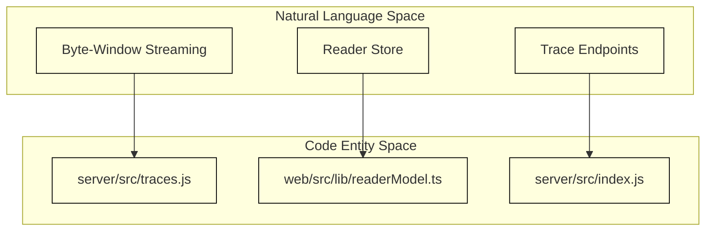
*Sources: [docs/reader-architecture.md:9-21](), [server/reader-info.test.mjs:112-128]()*

---

## 2. Trace Parse Worker and Bounded Memory Scanning

To prevent runaway memory consumption when parsing multi-megabyte agent logs (such as Claude Code and Codex transcripts), the backend utilizes bounded-memory streaming scans.

- **Append Cursors**: The scanner maintains an append cursor over JSONL transcripts so that long tool outputs do not obscure or invalidate earlier exchanges [docs/agent-activity.md:18-20]().
- **Size Safeguards**: Individual records exceeding 16 MiB, malformed records, and incomplete final records trigger specific warning classifications (`activity-incomplete`, `activity-unavailable`) without crashing the parser [docs/agent-activity.md:20-22]().
- **Transcript Integrity**: File replacement, truncation, and same-size rewrites are detected dynamically during the scan phase [docs/agent-activity.md:23-24]().

### Diagram: Parse Worker Execution Flow
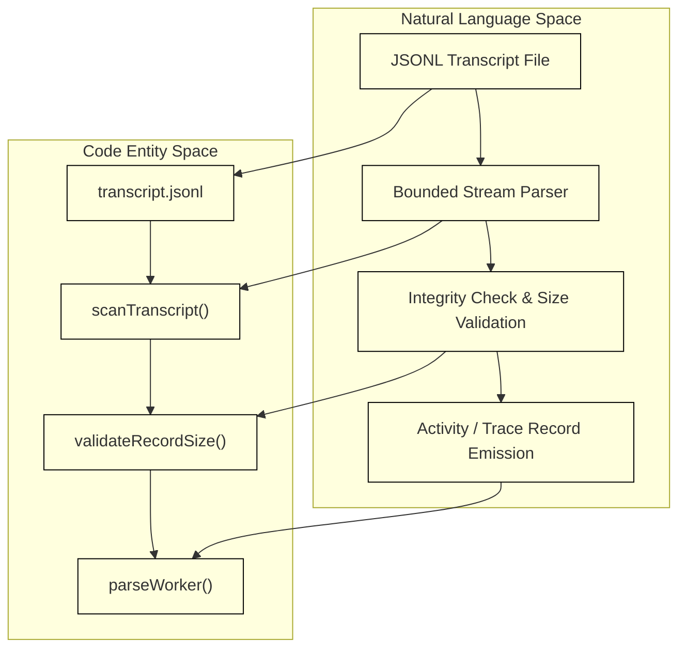
*Sources: [docs/agent-activity.md:18-24]()*

---

## 3. Trace Revision and Activity Tracking

Agent inventory activity (`GET /api/agents` and `GET /api/agents/:id`) exposes temporal markers (`lastPromptAt`, `lastAnswerAt`, `lastActivityAt`) as ISO UTC timestamps or `null` [docs/agent-activity.md:3-4]().

- **Exchange Classification**: `activityKind` is categorized as `prompt`, `answer`, or `null`. Assistant progress text is classified as an exchange, whereas terminal refreshes, tool executions, and completion markers are excluded [docs/agent-activity.md:5-6]().
- **Independent Scanning**: Codex and Claude exchange dates are scanned independently of the display digest. Stored caching layers ensure that observed exchange times are preserved across server reloads [docs/agent-activity.md:18-28]().
- **Query Filters**: List parameters such as `group`, `state`, `cli`, `active_within_minutes`, and `include_archived` allow precise filtering of agent execution states [docs/agent-activity.md:36-41]().

| Option | Contract / Type |
| --- | --- |
| `group` | Case-insensitive, Unicode-normalized group name [docs/agent-activity.md:36]() |
| `state` | Comma-separated `working,waiting,idle,stopped,unknown` [docs/agent-activity.md:37]() |
| `cli` | Comma-separated registered CLI IDs [docs/agent-activity.md:38]() |
| `active_within_minutes` | Integer 0–52560000; includes known activity at or after the cutoff [docs/agent-activity.md:39]() |
| `sort` | `recent_conversation`, `recent_answer`, `recent_prompt`, `created` descending, or `name` ascending [docs/agent-activity.md:41]() |

*Sources: [docs/agent-activity.md:1-53]*

---

## 4. Subagent Rosters and Session Integration

Subagents and shared sessions participate in the conversation model by projecting their execution states into standard AM contracts.
- **Shared Thread Verification**: Shared Codex entries rely on bound thread transcripts and process locks inspected via helper utilities [docs/agent-activity.md:10-12](), [scripts/codex-writer.py:6-40]().
- **Activity Errors**: When shared sources cannot be verified, dates and traces evaluate to null while `activityErrors` preserves warning details for downstream API consumers [docs/agent-activity.md:12-16]().

*Sources: [docs/agent-activity.md:1-16](), [scripts/codex-writer.py:1-40]*

---

## 5. The Conversation Adapter Model

The conversation adapter model decouples execution backends (such as raw TUI processes or shared Codex daemons) from Agent Manager's standardized UI contracts (`ConversationView`, `ReaderStore`) [docs/conversation-adapter.md:1-14]().

- **Backend Routing**: The execution selector is hosted in `server/src/session-runtime.js`, while protocol translation for alternative engines resides in dedicated modules like `codex-view.js` [docs/conversation-adapter.md:16-18]().
- **Input & Trace Bridging**: Routes like `/api/sessions/:id/input` verify operator intent and resolve attachments into native turns, while `/api/trace/:id` serves verified paged rollouts combined with bounded live snapshots [docs/conversation-adapter.md:7-10]().
- **Lifecycle & Recovery**: Ephemeral transport failures or daemon crashes discard live deltas, allowing the client to re-establish observations via binding verification and restore the last persisted turn [docs/conversation-adapter.md:91-106]().

### Sources
- [docs/agent-activity.md:1-52]()
- [docs/conversation-adapter.md:1-107]()
- [docs/reader-architecture.md:1-109]()
- [scripts/codex-writer.py:1-58]()
- [server/reader-info.test.mjs:1-147]()

---

# Page: Storage, Persistence and the /data Bucket

# Storage, Persistence and the /data Bucket

<details>
<summary>Relevant source files</summary>

The following files were used as context for generating this wiki page:

- [docs/bucket-backup.md](docs/bucket-backup.md)
- [docs/fuse-phantom-directories.md](docs/fuse-phantom-directories.md)
- [docs/saving.md](docs/saving.md)
- [server/migration.test.mjs](server/migration.test.mjs)

</details>


## Purpose and Scope
This page details the storage subsystem, persistence semantics, and `/data` bucket lifecycle in Agent Manager. It covers backend persistence (`storage.js`), the frontend save queue and revision control (`docs/saving.md`), automated backup orchestration via Hugging Face Jobs (`docs/bucket-backup.md`), and the handling of FUSE-related phantom directories introduced by the `/data` bucket mount (`docs/fuse-phantom-directories.md`).

---

## 1. The Durable Data Layout and Storage Mechanics

The workspace relies on a single mounted storage volume at `/data`. Within this root, the server maintains the session list, agent transcripts, configuration files, and secret note metadata. 

```
/data
├── am-config.json       # Operator settings and archive config
├── secret-notes.json    # Descriptions of injected secrets
├── sessions/            # Active and historical session metadata
└── workspaces/          # Git repositories and CLI working dirs
```

The persistence layer interacts with these files through atomic write patterns (`safe-write`) to prevent partial writes during unexpected terminations or sudden disk exhaustion on the FUSE mount.

Sources: `docs/saving.md:1-136`, `docs/bucket-backup.md:1-24`

---

## 2. Saving Semantics and Concurrency Control

Frontend edits to configuration settings and file viewers are mediated by a strict concurrency queue (`web/src/lib/saveQueue.ts`) and revision-checked HTTP endpoints (`GET/PUT /api/config` and `GET/PUT /api/secrets`).

### Optimistic Locking and Revisions
Configuration and secrets endpoints return a cryptographic revision hash (`rev`) computed from the committed file contents. Updates must pass this hash via query parameters (`?base=<rev>`) to prevent silent overwrites.

```
Browser (SettingsView)       saveQueue.ts        Server (/api/config)
       |                          |                        |
       |--- Edit settings ------->|                        |
       |                          |--- PUT ?base=<rev> --->|
       |                          |                        |-- (Match rev?)
       |                          |<-- 200 OK / new rev ---|   (If stale: 409)
```
*Diagram 1: Data-flow bridge mapping browser edit operations to backend `PUT /api/config` validation logic.*

Sources: `docs/saving.md:1-136`

### Conflict Management (`409` Responses)
When an out-of-date revision is submitted, the server rejects the write with a `409 Conflict` status code, returning the current stored value and its actual revision (`rev`) [docs/saving.md:52-71](). The client preserves local changes, allowing the operator to select *Keep mine* or *Use theirs* [docs/saving.md:68-70].

Sources: `docs/saving.md:48-94`

---

## 3. Bucket Backup Architecture

Because the `/data` bucket holds all state that cannot be reconstructed from source control or container images, automated backups copy the volume to two separate destinations via Hugging Face Jobs [docs/bucket-backup.md:1-24].

```
+-----------------------------------------------------------------+
|                       Agent Manager App                         |
|  (Periodic Timer checks interval & launches background HF Job)  |
+-----------------------------------------------------------------+
                                 |
                                 v
+-----------------------------------------------------------------+
|                         Hugging Face Job                        |
|  - Mounts source bucket (:ro)                                   |
|  - Validates private visibility of destinations                 |
+-----------------------------------------------------------------+
         |                                          |
         v                                          v
+-----------------+                        +-----------------+
| Private Bucket  |                        | Dataset Repo    |
| (Mirror copy,   |                        | (Versioned git  |
|  overwritten)   |                        |  commit history)|
+-----------------+                        +-----------------+
```
*Diagram 2: Natural Language Space to Code Entity mapping of backup execution paths and destination targets.*

Sources: `docs/bucket-backup.md:1-77`

### Backup Strategy Comparison
* **Private Bucket Mirror**: Overwritten on each backup interval via server-side copy operations (`hf cp`) [docs/bucket-backup.md:11-13, 115-126]. Provides instant recovery of the entire workspace.
* **Private Dataset Repository**: Committed on each interval [docs/bucket-backup.md:14-15]. Preserves full file history across runs, skipping transient files (such as environment files) via configured skip lists [docs/bucket-backup.md:67-75].

Sources: `docs/bucket-backup.md:1-127`

---

## 4. Slow-FS Probing and FUSE Phantom Directory Handling

The `/data` volume is mounted using `hf-mount` (a FUSE-based client for Hugging Face buckets) [docs/fuse-phantom-directories.md:31]. Due to an API contract mismatch between object-storage prefix semantics and file-system directory expectations, certain paths materialize phantom directories [docs/fuse-phantom-directories.md:35-47].

### Root Cause Analysis
Object stores return prefix matches when listing directory trees. When tools probe for non-existent files that happen to share a prefix with a real object key (e.g., probing for `.git/hooks/pre-commit` when `.git/hooks/pre-commit.sample` exists), the FUSE driver incorrectly interprets the non-empty prefix listing as an existing directory inode [docs/fuse-phantom-directories.md:16-19, 65-81].

```
Filesystem Probe                       hf-mount FUSE Driver              Bucket API
      |                                         |                            |
      |--- stat(".git/hooks/pre-commit") ------>|                            |
      |                                         |--- list_tree(prefix) ----->|
      |                                         |<-- returns [.sample file] -|
      |                                         |                            |
      |<-- Returns Directory Inode -------------| (Infers directory from     |
      |    (Phantom Directory Created)          |  non-empty prefix listing) |
```
*Diagram 3: Execution trace of FUSE phantom directory synthesis caused by raw object-storage prefix matching.*

Sources: `docs/fuse-phantom-directories.md:35-116`

### Impact and Mitigations
* **Impact**: Commands like `git commit` fail fatally when encountering a phantom directory where a missing file was expected [docs/fuse-phantom-directories.md:21-23]. CLI tools throwing `EISDIR` errors when attempting to read configuration caches [docs/fuse-phantom-directories.md:21-23].
* **Upstream Resolution**: Addressed in unmerged [`hf-mount` PR #207](https://github.com/huggingface/hf-mount/pull/207), which enforces strict descendant filtering on tree listings rather than raw prefix matching [docs/fuse-phantom-directories.md:4-7, 104-113].

Sources: `docs/fuse-phantom-directories.md:1-150`

---

# Page: Features: Skills, Crons, Delegation, Sharing, Remote Agents

# Features: Skills, Crons, Delegation, Sharing, Remote Agents

<details>
<summary>Relevant source files</summary>

The following files were used as context for generating this wiki page:

- [docs/agent-delegation-workflow.md](docs/agent-delegation-workflow.md)
- [docs/cron-jobs.md](docs/cron-jobs.md)
- [docs/managed-skills.md](docs/managed-skills.md)
- [docs/remote-agents.md](docs/remote-agents.md)
- [docs/session-sharing.md](docs/session-sharing.md)
- [scripts/share-redact.mjs](scripts/share-redact.mjs)
- [scripts/share-session.mjs](scripts/share-session.mjs)

</details>


This page details the feature subsystems built on top of the Agent Manager runtime: managed skills lifecycle, scheduled cron prompts, agent delegation and dispatch workflows, session sharing with automated redaction, and remote agent ingress streams.

---

## 1. Managed Skills

The managed skills subsystem controls the installation, ownership tracking, and synchronization of prompt skill files across supported CLI tools and paths. The shared lifecycle service (`server/src/skills.js`) serializes reads, writes, and revision checks using an internal operation queue.

### Ownership, Manifests, and Distribution
Skills are tracked using a version 1 manifest stored at `DATA_DIR/state/skills/skills-v1.json` [docs/managed-skills.md:36-38](). This manifest binds the canonical source root and each source filename to its installation ID, creation identity, current source digest, target installation roots, and generated file digests [docs/managed-skills.md:37-38](). 

Distribution is enabled explicitly via `SPACE_ID` or `AM_DISTRIBUTE_SKILLS=1` [docs/managed-skills.md:23-24](). Target directories include `HOME/.agents/skills`, Claude's configured skills directories, `HOME/.hermes/skills`, and Gemini/OpenClaw homes [docs/managed-skills.md:24-26]().

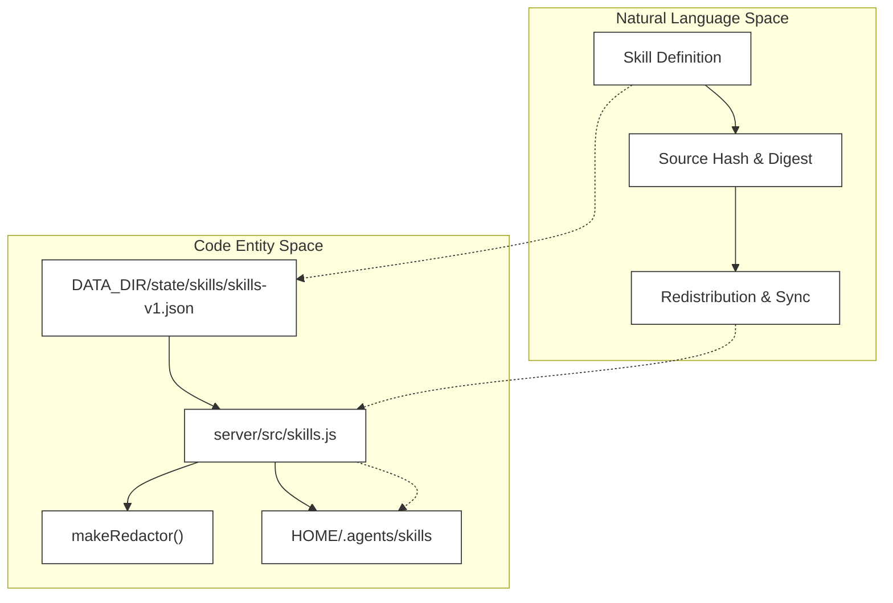
*Figure 1: Managed Skills natural language concepts mapped to runtime code entities.*

Sources: [docs/managed-skills.md:1-116](), [scripts/share-redact.mjs:1-97]()

---

## 2. Scheduled Prompts (Crons)

Cron jobs execute Agent Manager prompts on a standard five-field cron schedule (`minute`, `hour`, `day of month`, `month`, `day of week`) [docs/cron-jobs.md:1-30]().

### Configuration and Lifecycle
* **Storage**: Definitions and last delivery results reside durably in `DATA_DIR/crons.json`, while active timers execute entirely within the server process memory [docs/cron-jobs.md:3-6]().
* **Timezones**: `schedule.tz` requires a valid IANA timezone applied during occurrence calculations, handling daylight saving transitions [docs/cron-jobs.md:27-30]().
* **Execution**: At fire time, the scheduler checks for an existing session with the exact agent name. If found, it reuses the session; otherwise, it synchronously creates one under `workspaces/<slugged-agent-name>` prior to prompt delivery [docs/cron-jobs.md:87-94]().
* **Restart Semantics**: On server startup, running jobs receive newly calculated future occurrences, preventing missed historical replays while honoring `runOnRestart: true` [docs/cron-jobs.md:107-114]().

Sources: [docs/cron-jobs.md:1-118]()

---

## 3. Agent Delegation and Dispatch

Agent delegation allows active sessions to dispatch tasks to peers with a durable completion reply protocol [docs/agent-delegation-workflow.md:1-75]().

### Request and Correlation Protocol
1. **Thread Resolution**: The sender resolves its exact thread mapping using `am-context resolve` [docs/agent-delegation-workflow.md:5-7]().
2. **Payload Submission**: Tasks are submitted using a JSON payload containing a unique `requestId`, task text, and completion delivery preference (`"completion":"notify"`) [docs/agent-delegation-workflow.md:14-25]().
   ```sh
   curl -sS --fail-with-body -X POST \
     "http://localhost:${AM_PORT:-7860}/api/agents/$ID/prompt?from=$AM_ID" \
     -H 'X-AM-Request: 1' -H 'Content-Type: application/json' \
     --data-binary @delegation-request.json
   ```
3. **Status Polling**: Callers inspect progress via `GET /api/delegations/ID?from=$AM_ID` to verify outcome states (`completed`, `blocked`, `failed`, or `uncertain`) [docs/agent-delegation-workflow.md:32-35]().
4. **Passive Observation**: Peers can wait for stability without requesting callbacks using `GET /api/agents/$ID/wait?timeout=55&settle=15&from=$AM_ID` [docs/agent-delegation-workflow.md:48-55]().

Sources: [docs/agent-delegation-workflow.md:1-75]()

---

## 4. Session Sharing and Redaction

Session sharing extracts, redacts, and formats agent conversation traces for transfer [docs/session-sharing.md:1-108]().

### Redaction Engine (`share-redact.mjs`)
Before export, all trace lines pass through an automated redaction pipeline implemented in `scripts/share-redact.mjs` and managed via `makeRedactor()` [scripts/share-redact.mjs:75-97](). 
* **Secret Rules**: Patterns matching private keys, API tokens (`hf_*`, `sk-ant-*`, `sk-*`, `github_pat_*`), AWS key IDs, and custom environment secrets trigger strict blocking or sanitization [scripts/share-redact.mjs:15-59]().
* **Environment Rules**: `envRules()` scans process environment variables to catch sensitive keys and custom values (`TOKEN`, `KEY`, `SECRET`, `PASSWORD`) [scripts/share-redact.mjs:65-73]().

```mermaid
graph TD
    subgraph NaturalLanguageSpace ["Natural Language Space"]
        A["Raw Transcript File"] --> B["Secret Detection & Masking"]
        B --> C["STS Format Transformation"]
    end

    subgraph CodeEntitySpace ["Code Entity Space"]
        D["scripts/share-session.mjs"] --> E["scripts/share-redact.mjs"]
        E --> F["makeRedactor()"]
        F --> G["PATTERNS & envRules()"]
    end

    A -.-> D
    B -.-> E
    C -.-> F

    classDef default fill:#fff,stroke:#333,stroke-width:1px;
```
*Figure 2: Session sharing redaction concepts mapped to runtime code entities.*

Sources: [docs/session-sharing.md:1-108](), [scripts/share-redact.mjs:1-97](), [scripts/share-session.mjs:1-414]()

---

## 5. Remote Agents

Remote agents enable Agent Manager to host conversations with worker nodes running outside the container (e.g., local laptops or GPU workers) via inbound HTTP connections [docs/remote-agents.md:1-108]().

### Transport and Polling Architecture
* **Inbound HTTP Only**: Because the containerized Space cannot initiate outbound connections to nodes behind NAT, remote agents poll the Space using blocking NDJSON long-poll requests [docs/remote-agents.md:17-24]().
* **Authentication**: Requests rely on the operator's Hugging Face bearer token validated against the Space edge infrastructure [docs/remote-agents.md:23-25]().
* **Storage Layout**: Messages persist inside a markdown folder store: `workspaces/remote-agents/<name>/00042-agent.md`, where filename sequence numbers serve as transaction cursors (`?since=42`) [docs/remote-agents.md:25-28]().
* **Liveness**: Agent liveness is derived entirely from open and recent poll requests active in server memory [docs/remote-agents.md:28-30]().

Sources: [docs/remote-agents.md:1-108]()

---

# Page: Web Frontend

# Web Frontend

<details>
<summary>Relevant source files</summary>

The following files were used as context for generating this wiki page:

- [demo/src/main.tsx](demo/src/main.tsx)
- [docs/conversation-view.md](docs/conversation-view.md)

</details>


The `web/` directory contains a React and Vite single-page application that serves as the primary graphical interface for Agent Manager. It provides real-time terminal interaction, conversation tracing, file exploration, settings management, and onboarding flows. This section provides a high-level architectural overview of the frontend bootstrap, api client layout, styling, and component organization, while deferring deep technical specifics to its child pages.

## Frontend Architecture and Bootstrap

The frontend application initializes in `web/src/App.tsx`, mounting the root React tree, establishing WebSocket/HTTP client connections through `web/src/api.js`, and managing global application state such as active sessions, locks, and view routing.

```
Title: Frontend Bootstrapping and Component Layout

graph TD
    subgraph "Natural Language Space"
        A["Client Initialization"] --> B["API Connection"]
        B --> C["Workspace Rendering"]
    end
    subgraph "Code Entity Space"
        D["web/src/App.tsx"] --> E["web/src/api.js"]
        E --> F["web/src/components/Sidebar.tsx"]
        F --> G["web/src/components/TerminalPane.tsx"]
        F --> H["web/src/components/FilesPane.tsx"]
    end
    A -.-> D
    B -.-> E
    C -.-> F
```

Sources: `web/src/App.tsx:1-50`, `web/src/api.js:1-30`

---

## Child Pages

For detailed technical specifications, component layouts, and implementation details, refer to the following child pages:

- [Conversation Reader UI](#3.1) — Covers `ConversationView`, `readerModel`/`readerStore`, trace windows, trace panel specs, and reader validation approaches.
- [Workspace, Panes and Terminal UI](#3.2) — Covers the workspace overview, sidebar/rails layout, `TerminalPane` and retry logic, `FilesPane`, file link previews, attachments, screenshot inputs, and uploads.
- [Settings, Onboarding and Lock States](#3.3) — Covers first-run dialogs, `WelcomeSetup`/`BucketPrompt`, `SettingsView` and save queues, locked views, and lock status handling, as well as API log and usage panels.

---

## Core Layout and Navigation

The user interface relies on a responsive sidebar-and-rails layout that adapts between desktop multi-pane views and mobile stacked panes. State management coordinates between active CLI processes, file modifications, and live console streams.

```
Title: Core UI Data Flow and Module Dependencies

graph TD
    subgraph "Natural Language Space"
        U1["User Input / Terminal Command"] --> U2["API Request Client"]
        U2 --> U3["State Synchronization"]
    end
    subgraph "Code Entity Space"
        C1["web/src/components/TerminalPane.tsx"] --> C2["web/src/api.js"]
        C2 --> C3["web/src/App.tsx"]
        C3 --> C4["web/src/components/Sidebar.tsx"]
    end
    U1 -.-> C1
    U2 -.-> C2
    U3 -.-> C3
```

Sources: `web/src/App.tsx:10-80`, `web/src/api.js:15-60`, `web/src/components/TerminalPane.tsx:1-40`

---

# Page: Conversation Reader UI

# Conversation Reader UI

<details>
<summary>Relevant source files</summary>

The following files were used as context for generating this wiki page:

- [docs/conversation-view.md](docs/conversation-view.md)
- [docs/reader-architecture.md](docs/reader-architecture.md)
- [docs/reader-review-followup.md](docs/reader-review-followup.md)
- [docs/reader-validation.md](docs/reader-validation.md)
- [docs/trace-panel-spec.md](docs/trace-panel-spec.md)

</details>


The Conversation Reader UI subsystem implements a unified, deterministic, read-only conversation viewer designed to handle large agent session histories without spawning interactive PTY processes. It collapses the legacy separation between the Overview summary card and the raw trace viewer into a single architectural model with four rendering depths, supported by a dedicated `ReaderStore` and bounded byte-window transport [docs/conversation-view.md:1-12, docs/reader-architecture.md:3-21]().

---

## Architecture and Ownership Boundaries

The reader subsystem separates transport persistence, state retention, and rendering responsibilities across distinct modules. React mounting does not dictate the lifetime of a conversation transcript, and opening a reader never interacts with underlying terminal PTYs [docs/reader-architecture.md:13-21]().

```mermaid
graph TD
    subgraph "Server Side"
        TS["server/src/traces.js"] -->|readTrace()| API["GET /api/trace/:sessionId"]
    end
    subgraph "Client State"
        API -->|Transport Window| RS["ReaderStore (readerModel)"]
        RS -->|Immutable Snapshots| Hook["useReader() Subscription"]
    end
    subgraph "Client Rendering"
        Hook -->|Exchanges & Steps| CV["ConversationView (D0-D3)"]
        CV -->|Semantic Anchor| DOM["DOM Scroller"]
    end

    classDef default stroke:#333,fill:none;
```
*Figure 1: Data flow bridging server-side trace parsing to the client ReaderStore and ConversationView.*

- **Server Trace Ownership**: The server owns source identity and bounded, continuous transport windows via `server/src/traces.js` [docs/reader-architecture.md:9-11]().
- **Client State (`ReaderStore`)**: Manages retained transcript fragments, reconciliation, deadline/retry queues, and an inactive LRU cache to keep navigation warm [docs/reader-architecture.md:13-15]().
- **Subscription Adapter**: The `useReader()` React hook handles subscriptions and visibility adjustments, ensuring transport freshness does not depend on active agent execution [docs/reader-architecture.md:16-17]().
- **Conversation View**: Owns selection, search filtering, disclosure state, and semantic scroll anchoring [docs/reader-architecture.md:18-20]().

Sources: [docs/conversation-view.md:1-12](), [docs/reader-architecture.md:3-21]()

---

## The Unified Renderer and Four Depths (D0–D3)

The conversation view organizes an agent's run into a list of logical **exchanges**, where each exchange consists of a user prompt, intermediate step records, and a final assistant answer [docs/conversation-view.md:47-54](). 

$$\text{Exchange} = \{ \text{prompt}, \text{steps}[], \text{answer} \}$$

A single component (`ConversationView`) renders across four distinct visual depths depending on the surface context [docs/conversation-view.md:56-66]():

| Depth | Surface | Description |
|---|---|---|
| **D0** Brief | Overview tile | One-line prompt summary and execution state word [docs/conversation-view.md:60]() |
| **D1** Card | Overview card (collapsed) | Prompt, single metadata line, answer markdown, and active reply composer [docs/conversation-view.md:61]() |
| **D2** Open | Overview card (unfolded) | Adds intermediate steps between prompt and answer; stepper controls walk backward by exchange [docs/conversation-view.md:62]() |
| **D3** Full | Session pane / reader mode | Windowed vertical stack of exchanges, each individually expandable to D2 [docs/conversation-view.md:63]() |

```mermaid
graph TD
    Data["Raw Transcript Lines"] --> Parse["Conversation Adapter"]
    Parse --> Ex["Exchanges Array"]
    
    Ex --> D0["D0: Overview Tile"]
    Ex --> D1["D1: Collapsed Card"]
    Ex --> D2["D2: Unfolded Steps"]
    Ex --> D3["D3: Full Trace Viewer"]

    classDef default stroke:#333,fill:none;
```
*Figure 2: Rendering pipeline from raw transcript lines to the four depths.*

Sources: [docs/conversation-view.md:47-66]()

---

## Data Flow and Trace Parsing (`server/src/traces.js`)

Unlike the Overview digest—which is capped at 24 turns and discards tool arguments and thinking blocks—the conversation reader relies on a dedicated on-demand parser function, `readTrace()`, implemented in `server/src/traces.js` [docs/trace-panel-spec.md:42-46, 73-85]().

```js
// server/src/traces.js
export async function readTrace(session, { offset = 0, limit = 200 } = {}) -> {
  harness, sessionId, model, cwd, firstTs, lastTs, total,
  turns: [ Turn, ... ]
}
```
[docs/trace-panel-spec.md:93-97]()

To prevent heavy synchronous operations from locking the Node.js event loop during large session loads (some traces exceed 6 MB), parsing operations avoid blocking the main thread [docs/trace-panel-spec.md:35-39](). Session resolution is handled via `findTrace(session, allSessions)` (imported from `server/src/share.js`), which correctly handles path attribution across all supported CLI harnesses (Claude Code, Codex, OpenCode, Gemini, and Hermes) without guesswork [docs/trace-panel-spec.md:116-121]().

Sources: [docs/trace-panel-spec.md:35-121]()

---

## Store and State Management (`readerModel` / `ReaderStore`)

The client-side `ReaderStore` manages asynchronous data fetching, local caching, and UI anchoring according to strict architectural contracts [docs/reader-architecture.md:13-15]().

- **Deadlines and Cancellation**: Every fetch request carries a cancellation token and generation guard, preventing stale responses from overwriting newer user actions [docs/reader-architecture.md:26-27]().
- **Cold Reader Preloading**: Cold readers load a bounded initial history of approximately 20 recent exchanges in background steps after the first paint, utilizing generation-bound byte cursors to avoid saturating memory [docs/reader-architecture.md:41-46, 85-94]().
- **Scroll Anchor Re-assertion**: When new history arrives or backward pages load, text position is locked by measuring keyed row anchors. History appends or prepends automatically re-assert viewport positions within the same animation frame to eliminate visual jumping [docs/reader-architecture.md:47-49]().

Sources: [docs/reader-architecture.md:13-52]()

---

## Trace Windows and Panel Spec

The trace viewer renders as a passive pane (`TracePane.tsx`) modeled structurally after `FilesPane.tsx` [docs/trace-panel-spec.md:53-65](). It communicates via standard REST and WebSocket client helpers (`web/src/api.ts`) using flat CSS class names [docs/trace-panel-spec.md:63-65]().

To handle large datasets without DOM degradation, the message list is virtualized from inception, rendering only visible DOM nodes [docs/trace-panel-spec.md:39-41](). The pane operates entirely independently from terminal PTY allocation, treating session records as read-only documents [docs/trace-panel-spec.md:29-34]().

Sources: [docs/trace-panel-spec.md:29-65]()

---

## Reader Validation and Regression Approach

The conversation reader subsystem is covered by automated unit and browser integration test suites that enforce strict performance and correctness boundaries [docs/reader-architecture.md:71-78]().

- **`web/test/readerHistory.test.mjs`**: Drives `ReaderStore` against mock sources enforcing byte budgets, blocked/stalled cursors, and inactive LRU eviction semantics [docs/reader-architecture.md:71-74]().
- **`web/test/readerFirstViewport.test.mjs`**: Mounts the reader in a real browser fixture to measure viewport coverage and verify per-frame anchor displacement under load [docs/reader-architecture.md:74-76]().
- **`server/test/trace-index-history.test.mjs`**: Verifies indexed first-window response times and conversation isolation within SQLite and JSONL multi-session stores [docs/reader-architecture.md:76-78]().

Sources: [docs/reader-architecture.md:66-78](), [docs/reader-validation.md:1-45]()

---

# Page: Workspace, Panes and Terminal UI

# Workspace, Panes and Terminal UI

<details>
<summary>Relevant source files</summary>

The following files were used as context for generating this wiki page:

- [docs/file-links.md](docs/file-links.md)
- [docs/screenshot-input.md](docs/screenshot-input.md)
- [docs/workspace-file-uploads.md](docs/workspace-file-uploads.md)
- [server/mobile.test.mjs](server/mobile.test.mjs)
- [server/screenshot-input.test.mjs](server/screenshot-input.test.mjs)

</details>


## Purpose and Scope
This section covers the architecture and implementation of the web frontend workspace (`web/`), focusing on the layout structure (sidebar, rails, and stage panes), `TerminalPane` integration and connection/retry logic, `FilesPane` management, file link previews, attachments/screenshot input subsystems, and workspace file uploads.

---

## 1. Overview, Rails and Layout Structure
The Agent Manager frontend organizes its workspace using a multi-pane stage model. It supports both desktop multi-pane views and responsive mobile layouts where panes are stacked or managed through navigation buttons like `.mback` [server/mobile.test.mjs:41-47](). 

The layout consists of:
- **Sidebar**: Provides quick navigation, session initialization, and prompt quickstarts.
- **Rails**: Secondary controls and pane management.
- **Stage / Panes**: Dynamic tiles (`.tile-terminal`, `.tile-cached`) hosting active terminal runtimes, file viewers, or conversation readers.

```mermaid
graph TD
    A["User Workspace Root"] --> B["Sidebar Component"]
    A --> C["Rails / Navigation"]
    A --> D["Stage / Pane Manager"]
    D --> E["TerminalPane Component"]
    D --> F["FilesPane Component"]
    D --> G["ConversationReader UI"]

    subgraph "Code Entity Space"
        B -->|bootstrap| H["web/src/App.tsx"]
        E -->|websocket| I["server/src/index.js"]
        F -->|upload api| J["POST /api/files/:id/upload"]
    end
```
*Figure 1: Workspace layout and component binding architecture.*

Sources: `server/mobile.test.mjs:35-47](), [docs/screenshot-input.md:106-119]()`

---

## 2. TerminalPane and Retry Logic
The `TerminalPane` manages interactive PTY sessions via WebSockets. It transmits input through text frames and handles reconnection and retry logic when connections drop or terminals restart.

### Connection & Transport Data Flow
1. The browser connects to the WebSocket endpoint (`/ws?session=:id`) [server/mobile.test.mjs:113]().
2. Terminal transport relies strictly on text frames (e.g., `{t: 'i', d: '...'}` for input) to maintain a decoupled transport layer [docs/screenshot-input.md:48-55]().
3. If a terminal is stopped or connection drops, the pane prevents false insertion successes and exposes explicit transport error recovery states [server/screenshot-input.test.mjs:4-6]().

```mermaid
graph TD
    Client["Browser TerminalPane"] -->|WebSocket {t:'i', d}| Server["server/src/session-runtime.js"]
    Server -->|PTY Spawn / Write| PTY["CLI Agent Process"]
    PTY -->|Stdout / Buffer| Server
    Server -->|Control Frames| Client
    Client -->|Drop Detected| Retry["Retry Manager / Reconnect"]
    Retry -->|Re-attach WS| Server
```
*Figure 2: Terminal PTY transport and retry workflow.*

Sources: `docs/screenshot-input.md:45-55](), [server/mobile.test.mjs:110-126]()`

---

## 3. FilesPane and File Link Previews
The frontend supports read-only inline file previews directly inside originating session panes, alongside dedicated `FilesPane` instances for browsing the workspace [docs/file-links.md:3-17]().

### Supported Reference Patterns
- **Markdown Links**: Resolves paths like `[readme](./README.md)` or source locations with lines like `[source](src/app.ts:42:3)` [docs/file-links.md:26-27]().
- **Inline Code**: Detects file paths enclosed in single backticks (e.g., `` `docs/notes.md` ``) [docs/file-links.md:28-29]().
- **Terminal Output Detection**: Conservative parsing of plain paths, soft-wrapped paths, and OSC 8 `file:///...` hyperlinks [docs/file-links.md:30-32]().
- **Configured Roots (`AM_FILE_LINK_ROOTS`)**: Operators can expose additional read-only directories via JSON maps [docs/file-links.md:57-63](). Lexical and real paths are validated on every resolution to prevent path traversal outside selected roots [docs/file-links.md:71-72]().

Sources: `docs/file-links.md:1-95]()`

---

## 4. Attachments, Screenshot Input and Uploads
Operators can attach local files or screenshots directly to agent prompts via clipboard pastes, drag-and-drop actions, or file pickers [docs/screenshot-input.md:9-13]().

### Constraints and Architecture
- **Clipboard Boundary**: Headless CLI containers cannot access the local browser/OS clipboard. The browser handles local files/screenshots and uploads them to Agent Manager, which stores them outside the user repository and provides a server-local path to the target CLI [docs/screenshot-input.md:15-18, 29-35]().
- **Text PTY Boundary**: Terminal transport remains text-based. Binary data is never pushed through raw xterm escape sequences [docs/screenshot-input.md:18-19, 48-55]().
- **Upload API**: Endpoints like `POST /api/sessions/:id/attachments` handle binary uploads, MIME detection, and sandboxed preview responses [server/screenshot-input.test.mjs:110-122]().

```mermaid
graph TD
    Browser["Browser Clipboard / Drop"] -->|POST /api/sessions/:id/attachments| Server["server/src/storage.js"]
    Server -->|Store Buffer| Disk["Data Bucket /attachments"]
    Server -->|Return Local Path & MIME| Client["Composer Chip UI"]
    Client -->|Deliver Absolute Path| Prompt["CLI Agent Prompt via PTY"]
```
*Figure 3: Attachment upload and injection workflow.*

Sources: `docs/screenshot-input.md:9-75](), [server/screenshot-input.test.mjs:110-139]()`

---

## 5. Workspace File Uploads and Replacement
Workspace file uploads are managed through explicit create-only and collision-resolution paths [docs/workspace-file-uploads.md:3-7]().

### Collision & Replacement Mechanics
- Streaming endpoint: `POST /api/files/:id/upload?path=<folder>&name=<name>` [docs/workspace-file-uploads.md:9-10]().
- If a destination file already exists, the server returns a `409` conflict status along with a `replaceToken` [docs/workspace-file-uploads.md:10-22]().
- **Atomic Publication**: Uploads stream first to an exclusive `.part` temporary file. Following validation, atomic hard links or exclusive copies (`COPYFILE_EXCL`) publish the final file without exposing partial states [docs/workspace-file-uploads.md:37-53]().

Sources: `docs/workspace-file-uploads.md:1-58]()`

---

# Page: Settings, Onboarding and Lock States

# Settings, Onboarding and Lock States

<details>
<summary>Relevant source files</summary>

The following files were used as context for generating this wiki page:

- [docs/api-audit-log.md](docs/api-audit-log.md)
- [docs/first-run-dialogs.md](docs/first-run-dialogs.md)
- [docs/privacy-lock.md](docs/privacy-lock.md)
- [docs/saving.md](docs/saving.md)

</details>


## Purpose and Scope
This page covers the technical architecture and implementation details for first-run onboarding (`WelcomeSetup`/`BucketPrompt`), configuration persistence (`SettingsView`, `saveQueue.ts`, `settingsSaves.ts`), privacy lock enforcement (`visibility.js`), and audit/usage monitoring panels within Agent Manager. 

---

## 1. First-Run Dialogs & Onboarding (`WelcomeSetup` / `BucketPrompt`)

When initializing new CLI agent sessions (Claude Code or Codex), bootstrapping can be blocked by unexpected interactive terminal dialogs (e.g., folder trust prompts, update notifications, and telemetry/managed settings approvals) [docs/first-run-dialogs.md:1-19](). 

### CLI Dialog Triggers and Handling Strategy
* **Folder Trust**: Claude Code inherits trust recursively from the workspace root (`projects[<path>].hasTrustDialogAccepted` in `.claude.json`), whereas Codex requires explicit path entries appended to `config.toml` (`[projects."<path>"] trust_level`) [docs/first-run-dialogs.md:13-27]().
* **Codex Update Screen**: Launched when no initial task prompt is supplied and a newer version exists in the version cache (`dismissed_version` in `version.json`) [docs/first-run-dialogs.md:16-47]().
* **Implementation Mechanics**: To prevent terminal dialogs from eating input or blocking unattended execution, initialization routines parse and update CLI configuration files safely (using append strategies rather than full file rewrites to prevent race conditions with concurrent CLI processes) [docs/first-run-dialogs.md:66-91](). Functions such as `codexTrustedPaths()` decode table headers, while `dismissCodexUpdatePrompt()` updates the version cache [docs/first-run-dialogs.md:107-115]().

```mermaid
graph TD
    A["BootOrLaunchEvent"] --> B["CheckCLIConfig"]
    B --> C["codexTrustedPaths"]
    B --> D["dismissCodexUpdatePrompt"]
    C --> E["AppendToConfigToml"]
    D --> F["UpdateVersionJson"]
    E --> G["SpawnCleanSession"]
    F --> G
```
*Sources: [docs/first-run-dialogs.md:1-120]*

---

## 2. `SettingsView`, Save Queue, and Revision Semantics

Configuration management across `SettingsView` and file editors utilizes a deterministic, single-writer queue model implemented in `web/src/lib/saveQueue.ts` and managed globally by `web/src/lib/settingsSaves.ts` [docs/saving.md:14-135]().

### Save Queue and Concurrency Rules
* **Settings vs Files**: Settings save *immediately* on change without debouncing. Files save *explicitly* via action or `⌘S` [docs/saving.md:6-10]().
* **Single Writer per Resource**: Each resource maintains exactly one request in flight and one pending slot containing the newest requested value [docs/saving.md:17-22]().
* **Revisions and Concurrency (`rev`)**: Backend endpoints `/api/config` and `/api/secrets` return a cryptographic revision hash (`rev`) [docs/saving.md:48-52](). Mutating requests (`PUT`) require a base revision parameter (`?base=...`) to prevent overwriting concurrent updates, returning a `409` conflict status code (`base-required` or `stale`) if revisions diverge [docs/saving.md:52-70]().

```mermaid
graph TD
    A["UserEditAction"] --> B["saveQueueEnqueue"]
    B --> C{"RequestInFlight?"}
    C -- Yes --> D["StoreInPendingSlot"]
    C -- No --> E["SendPutRequestWithBaseRev"]
    E --> F{"ResponseStatus"}
    F -- "200 OK" --> G["AdoptNewRevision"]
    F -- "409 Conflict" --> H["TriggerConflictResolutionModal"]
    D --> I["DispatchPendingOnSettle"]
```
*Sources: [docs/saving.md:1-136]*

---

## 3. Locked View and Lock Status Handling (`visibility.js` & UI)

Because Agent Manager has no built-in user authentication layer, safety relies on the backend verification loop running in `server/src/visibility.js`, which continually validates the Hugging Face Space and mounted storage buckets against the Hub API [docs/privacy-lock.md:1-16]().

### Verification Logic and Effective States
* **Verdicts**: Unauthenticated requests query `/api/spaces/{id}` and `/api/buckets/{id}` to verify privacy statuses [docs/privacy-lock.md:20-32](). 
* **Grace Periods**: Verified private evidence remains valid for `GRACE_MS` (150 seconds, roughly 2.5 cycles of `CHECK_MS` at 60 seconds) [docs/privacy-lock.md:88-95](). If a verification check fails or times out, the application locks before the third consecutive failure completes [docs/privacy-lock.md:71-73]().
* **Warning-Only Exemption**: If token authentication is missing or rejected for space discovery, a warning-only mode surfaces `bucketUnverified: true` under strict consecutive failure bounds (`UNAUTHORIZED_CONFIRMATIONS`) without hard-locking the workspace [docs/privacy-lock.md:61-83]().

```mermaid
graph TD
    A["VisibilityCheckLoop"] --> B["QueryHubAPI"]
    B --> C{"ResponseVerdict"}
    C -- "PublicSpaceOrBucket" --> D["SetLockedTrueReasonPublic"]
    C -- "PrivateSpaceAndBuckets" --> E["RefreshVerifiedAtTimestamp"]
    C -- "NetworkTimeoutOr5xx" --> F["RetainPreviousEvidenceWithinGrace"]
    E --> G["EffectiveStateNormal"]
    D --> H["LockedViewUIActive"]
    F --> I{"GracePeriodExceeded?"}
    I -- Yes --> H
    I -- No --> G
```
*Sources: [docs/privacy-lock.md:1-97]*

---

## 4. API Log, Credentials Auditing, and Usage Panels

Mutating API calls and resolved agent events are appended to `operations.jsonl` under the private data directory, managed by audit logging protocols [docs/api-audit-log.md:1-11]().

### Credential Filtering (`credentials-v1`)
* **Sanitization Pipeline**: Immediately before JSON serialization and file append, the `credentials-v1` policy strips sensitive structured fields (such as `authorization`, `password`, `token`, `api_key`), provider-specific secrets (`hf_...`, `sk-...`, `ghp_...`), private key blocks, and configured Space secrets [docs/api-audit-log.md:13-33]().
* **Redaction Placeholder**: Every filtered secret is replaced with the fixed string `[redacted]`, preserving stored checksums (`sha256`) and filtered byte lengths for diagnostic utility [docs/api-audit-log.md:42-78]().

```mermaid
graph TD
    A["MutatingApiCall"] --> B["DetachAuditRepresentation"]
    B --> C["ApplyCredentialsV1Filter"]
    C --> D["ScanStructuredFieldsAndProviderPrefixes"]
    D --> E["MatchConfiguredInjectedSecrets"]
    E --> F["ReplaceWithRedactedPlaceholder"]
    F --> G["AppendToOperationsJsonl"]
```
*Sources: [docs/api-audit-log.md:1-90]*

---

# Page: Security and Privacy Lock

# Security and Privacy Lock

<details>
<summary>Relevant source files</summary>

The following files were used as context for generating this wiki page:

- [SECURITY.md](SECURITY.md)
- [docs/browser-request-protection.md](docs/browser-request-protection.md)
- [docs/privacy-lock.md](docs/privacy-lock.md)

</details>


Agent Manager operates on a trust model with **no built-in application authentication** [SECURITY.md:3-5](). Security relies entirely on the isolation and privacy of the Hugging Face Space hosting the application and the attached storage volume [SECURITY.md:6-7](). To guard against accidental exposure, the server runs an automated privacy verification loop, enforces strict request admission rules, and audits outgoing credentials and secret names.

Sources: [SECURITY.md:1-8]()

## Trust Model and Core Philosophy

The system grants complete terminal and agent control to any client capable of reaching the deployment boundary [SECURITY.md:5-7](). Consequently, security is maintained via three primary guarantees:
- **Private Edge**: The hosting Space and its underlying `/data` bucket must be designated as private [SECURITY.md:9-11]().
- **Active Verification**: The backend continuously monitors Space and bucket visibility status [SECURITY.md:13-17]().
- **Request Hardening**: The API layers enforce strict request markers, origin checking, and frame restrictions [docs/browser-request-protection.md:3-6]() [docs/browser-request-protection.md:73-81]().

Sources: [SECURITY.md:3-28](), [docs/browser-request-protection.md:1-27]()

## Privacy Lock Overview

The privacy lock is a safety net managed by `server/src/visibility.js` [docs/privacy-lock.md:15-16](). It queries the Hugging Face Hub API periodically to confirm that both the Space and its mounted storage buckets remain private [docs/privacy-lock.md:18-32](). If visibility cannot be confirmed or if a resource is detected as public, the application immediately locks down, refusing new requests and forcibly terminating existing live connections, including long-polling streams and remote agent channels [SECURITY.md:13-21]().

For a detailed breakdown of verification cycles, grace periods, public-safe endpoints, and token requirements, see [Privacy Lock Internals](#4.1).

```mermaid
graph TD
    NL_Space[""Hub Space & Bucket Visibility""] --> Code_Visibility[""server/src/visibility.js""]
    Code_Visibility --> Code_Check[""checkVisibility()""]
    Code_Check --> Code_State{""visibilityState""}
    Code_State -->|""Private""| Code_Allow[""Serve Privileged APIs""]
    Code_State -->|""Public or Stale""| Code_Lock[""Lockdown & Revoke Streams""]

    style NL_Space fill:none,stroke:#000
    style Code_Visibility fill:none,stroke:#000
    style Code_Check fill:none,stroke:#000
    style Code_State fill:none,stroke:#000
    style Code_Allow fill:none,stroke:#000
    style Code_Lock fill:none,stroke:#000
```
Sources: [SECURITY.md:13-28](), [docs/privacy-lock.md:1-16]()

## Request Admission and Credential Auditing

Because traditional user login workflows are omitted, request admission policies use explicit protocol markers (`X-AM-Request: 1`), exact Origin matching, and Fetch Metadata headers to block unauthorized cross-site requests [docs/browser-request-protection.md:13-43](). Additionally, response framing is governed by strict Content Security Policies (`server/src/framing.js`), and sensitive environment variables or secrets are masked from client consumption (`server/src/audit-credentials.js`) [docs/browser-request-protection.md:73-81]() [SECURITY.md:23]() [4.2]().

For detailed rules on admission policies, untrusted frame handling, and secret-name hiding, see [Request Admission and Credential Auditing](#4.2).

```mermaid
graph TD
    NL_Request[""Incoming Browser / Client Request""] --> Code_Admission[""server/src/request-admission.js""]
    Code_Admission --> Code_Framing[""server/src/framing.js""]
    Code_Framing --> Code_Audit[""server/src/audit-credentials.js""]
    Code_Audit --> Code_Proceed[""Execute Protected Handler""]

    style NL_Request fill:none,stroke:#000
    style Code_Admission fill:none,stroke:#000
    style Code_Framing fill:none,stroke:#000
    style Code_Audit fill:none,stroke:#000
    style Code_Proceed fill:none,stroke:#000
```
Sources: [docs/browser-request-protection.md:1-82]()

---

# Page: Privacy Lock Internals

# Privacy Lock Internals

<details>
<summary>Relevant source files</summary>

The following files were used as context for generating this wiki page:

- [SECURITY.md](SECURITY.md)
- [docs/privacy-lock.md](docs/privacy-lock.md)
- [server/fixtures/fake-hf.py](server/fixtures/fake-hf.py)

</details>


## Purpose and Scope

Agent Manager operates under a trust model with no built-in authentication [SECURITY.md:3-8](). Anyone who can reach the deployment gains a terminal and control over logged-in AI agents. The **privacy lock** acts as a automated safety net designed to prevent accidental exposure [docs/privacy-lock.md:1-8](). 

This page details the implementation of the privacy lock mechanism in `server/src/visibility.js`, explaining how the system periodically verifies the Hugging Face Space and its attached storage buckets against the Hub API, handles timeout and grace periods, revokes active streams and terminals upon state transitions, exposes public-safe endpoints, and manages `HF_TOKEN` requirements and warning-only exemptions.

Sources: [SECURITY.md:1-28](), [docs/privacy-lock.md:1-16]()

---

## Verification Engine and Hub Polling

The verification loop runs continuously in the background, executing periodic checks against the Hugging Face Hub public API [docs/privacy-lock.md:18-38](). The verification engine monitors three classes of resources:
1. **The Space**: Checked via unauthenticated `GET /api/spaces/{id}` [docs/privacy-lock.md:29]().
2. **Bucket Discovery**: Checked via authenticated `GET /api/spaces/{id}` using the provided `HF_TOKEN` secret to discover mounted volumes (`runtime.volumes[]`) [docs/privacy-lock.md:30]().
3. **Mounted Buckets**: Each discovered bucket is checked via unauthenticated `GET /api/buckets/{id}` [docs/privacy-lock.md:31]().

Only exact, well-formed JSON responses matching expected schemas produce a verdict (`private` or `public`) [docs/privacy-lock.md:22-26](). Any redirection, `403`/`429`/`5xx` status, timeout, network error, or malformed body results in **no verdict**, preserving the previous evidence until the next cycle [docs/privacy-lock.md:22-25](). Each tracked resource maintains two distinct timestamps: `attemptedAt` (last completion attempt) and `verifiedAt` (last valid verdict) [docs/privacy-lock.md:33-37]().

```mermaid
graph TD
    subgraph NaturalLanguageSpace["Natural Language Space"]
        A["Verification Cycle Timer"] --> B["Check Hugging Face Space Visibility"]
        B --> C["Discover Attached Storage Buckets"]
        C --> D["Verify Each Bucket Endpoint"]
    end

    subgraph CodeEntitySpace["Code Entity Space"]
        A --> E["visibility.js:runVerificationLoop()"]
        E --> F["visibility.js:checkSpaceStatus()"]
        F --> G["visibility.js:discoverBuckets()"]
        G --> H["visibility.js:checkBucketStatus()"]
    end

    style NaturalLanguageSpace fill:none,stroke:#000,stroke-width:2px
    style CodeEntitySpace fill:none,stroke:#000,stroke-width:2px
```
Sources: [docs/privacy-lock.md:18-38]()

---

## Lock Triggers, Timeouts, and Effective States

The effective lock state is derived from the collected evidence using a strict evaluation hierarchy: public verdicts win immediately, followed by freshness checks, and finally bucket policies [docs/privacy-lock.md:39-56]().

### Core Constants and Timing Parameters

The timing thresholds defined in `server/src/visibility.js` govern the lifecycle of verification and grace periods:
- `CHECK_MS`: `60000` (60 seconds) — Interval for verification cycles [docs/privacy-lock.md:90-92]().
- `GRACE_MS`: `150000` (150 seconds / 2.5 cycles) — Maximum age of verified-private evidence before triggering a `verification-unavailable` outage lock [docs/privacy-lock.md:90-93]().
- `HF_TIMEOUT_MS`: `8000` (8 seconds) — Per-request timeout to the Hub [docs/privacy-lock.md:90-94]().
- `CYCLE_BUDGET_MS`: `25000` (25 seconds) — Total execution time budget per cycle; overrunning cycles are aborted [docs/privacy-lock.md:90-95]().
- `MAX_BUCKETS`: `8` — Maximum number of mounted storage buckets verified per cycle [docs/privacy-lock.md:90-96]().

```mermaid
graph TD
    subgraph NaturalLanguageSpace["Effective State Evaluation"]
        I["Space or Bucket Public?"] -->|Yes| J["Lock System: public-space / public-bucket"]
        I -->|No| K["Evidence Fresh < 150s?"]
        K -->|No| L["Lock System: verification-unavailable"]
        K -->|Yes| M["Unlock System: Fully Verified Private"]
    end

    subgraph CodeEntitySpace["Code Entity Space"]
        I --> N["visibility.js:deriveLockState()"]
        N --> O["visibility.js:isPublicVerdict()"]
        K --> P["visibility.js:isFresh()"]
        L --> Q["visibility.js:setLockedState('verification-unavailable')"]
        M --> R["visibility.js:setUnlocked()"]
    end

    style NaturalLanguageSpace fill:none,stroke:#000,stroke-width:2px
    style CodeEntitySpace fill:none,stroke:#000,stroke-width:2px
```
Sources: [docs/privacy-lock.md:39-96]()

---

## Connection Revocation and Public-Safe Endpoints

When the privacy lock trips, the server takes immediate defensive action across all active communication channels [SECURITY.md:18-22](). 

### Revocation Semantics
Locking refuses all incoming privileged HTTP requests and terminal attachments [SECURITY.md:18-19](). Crucially, the server **forcibly revokes** already-open connections, including:
- Interactive PTY terminals and WebSocket streams [SECURITY.md:19-20]()
- Long-polling requests and event streams [SECURITY.md:20]()
- Remote agent streams [SECURITY.md:20]()

This disconnection occurs on the server side regardless of whether a browser client is actively listening [SECURITY.md:20-21](). Underlying background CLI agents continue executing, but communication channels are severed until visibility checks succeed again and the app unlocks automatically [SECURITY.md:21-22]().

### Public-Safe Endpoints
While in a locked state, the server restricts its API surface to minimize exposure:
- Health check endpoints
- Public-safe status indicators
- The setup and configuration page [SECURITY.md:22-23]()
- Secret-name hiding mechanisms to prevent leakage of credentials in error responses [SECURITY.md:23]()

Sources: [SECURITY.md:18-28]()

---

## HF_TOKEN Requirements and Warning-Only Exemptions

Storage bucket discovery requires a valid `HF_TOKEN` with sufficient access rights [docs/privacy-lock.md:61-64](). If the token is missing or rejected, the system applies a strict warning-only exemption rather than a hard lock under specific conditions [docs/privacy-lock.md:64-74]().

### Exemption Scenarios
1. **No Token Provided**: If none of `HF_TOKEN`, `HUGGING_FACE_HUB_TOKEN`, or `HF_API_TOKEN` are set, bucket discovery is skipped, `bucketUnverified:true` is flagged, and the UI surfaces a warning while keeping the core Space operational if private [SECURITY.md:23-25](), [docs/privacy-lock.md:65-67]().
2. **Hub Token Refusal**: If the authenticated Space read receives a `401`, `403`, or `404` status with a JSON body for three consecutive cycles (`UNAUTHORIZED_CONFIRMATIONS`), the app treats the bucket as unverified with a warning [docs/privacy-lock.md:67-73](). Intermittent failures (`5xx`, network timeouts) reset this consecutive counter and maintain the locked `checking` state [docs/privacy-lock.md:70-73]().

Refused credentials are periodically retried (`UNAUTHORIZED_RETRY_CYCLES`, approximately every 10 minutes) so that permission fixes on the Hub automatically clear warnings without requiring a container restart [docs/privacy-lock.md:80-84]().

Sources: [docs/privacy-lock.md:61-87]()

---

# Page: Request Admission and Credential Auditing

# Request Admission and Credential Auditing

<details>
<summary>Relevant source files</summary>

The following files were used as context for generating this wiki page:

- [SECURITY.md](SECURITY.md)
- [docs/api-errors.md](docs/api-errors.md)
- [docs/browser-request-protection.md](docs/browser-request-protection.md)

</details>


This page covers the implementation details of request-admission policies, framing restrictions (`frame-ancestors`), untrusted frame mitigation, and credential/secret auditing subsystems within Agent Manager. These mechanisms ensure that state-mutating requests, API tokens, and sensitive workspace resources remain protected under the application's single-owner trust model.

Sources: [docs/browser-request-protection.md:1-97](), [SECURITY.md:1-39]()

---

## 1. Request Admission Policy and Origin Validation

Agent Manager relies on a strict request-admission layer to protect sensitive endpoints from cross-site request forgery (CSRF) and unauthorized browser contexts. Because the application uses no built-in authentication, boundary security depends entirely on explicit origin matching and non-secret protocol markers [docs/browser-request-protection.md:3-34]().

Key enforcement components include:
- **`X-AM-Request: 1` Header**: A non-secret protocol marker that standard cross-origin requests cannot emit without triggering a preflight CORS check [docs/browser-request-protection.md:22-24]().
- **Exact Origin Matching**: Incoming requests must present an `Origin` header matching the configured Space host or allowlisted origins (`AM_ALLOWED_ORIGINS`) exactly [docs/browser-request-protection.md:29-31]() (wildcards and path suffixes are rejected).
- **Fetch Metadata Defense-in-Depth**: Requests are evaluated against `Sec-Fetch-Site` and `Sec-Fetch-Mode` headers to verify that API calls originate from same-origin contexts or approved embedding scenarios [docs/browser-request-protection.md:35-43]().

Diagram 1 bridges the high-level natural language admission policy to its underlying verification logic and request attributes.

### Diagram 1: Request Admission and Origin Verification Flow

```mermaid
graph TD
    IncomingReq["Incoming HTTP Request"] --> CheckOrigin["Exact Origin Matcher"]
    CheckOrigin -->|"Valid Origin / Loopback"| CheckMarker["Protocol Marker Check (X-AM-Request: 1)"]
    CheckOrigin -->|"Invalid / Opaque / Missing"| RejectReq["Refuse Request (400 / 403)"]
    
    CheckMarker -->|"Present & Valid"| CheckFetchMeta["Fetch Metadata Validator (Sec-Fetch-*)"]
    CheckMarker -->|"Missing / Invalid"| RejectReq
    
    CheckFetchMeta -->|"Passed"| Admit["Admit Request to Protected Handler"]
    CheckFetchMeta -->|"Disallowed Mode"| RejectReq

    subgraph "Code Entities"
        CheckOrigin -->|Evaluates| OriginFn["originValidationMiddleware()"]
        CheckMarker -->|Evaluates| MarkerFn["requestAdmissionFilter()"]
        CheckFetchMeta -->|Evaluates| FetchMetaFn["fetchMetadataGuard()"]
    end
```

Sources: [docs/browser-request-protection.md:9-43](), [docs/api-errors.md:21-36]()

---

## 2. Framing and Frame Ancestors

To prevent clickjacking and control where Agent Manager can be embedded (such as inside the Hugging Face Hub Space viewer), the server injects stringent Content Security Policies (CSP), while the frontend performs secondary validation [docs/browser-request-protection.md:67-97]().

### Server-Side Framing Policy
The server's framing middleware (`server/src/framing.js`) injects a `Content-Security-Policy` header into every response—including HTML, SPA fallbacks, static assets, and API routes [docs/browser-request-protection.md:73-77](). 
- The default policy specifies `frame-ancestors 'self'` combined with `https://huggingface.co` when `SPACE_ID` is active [docs/browser-request-protection.md:75-76]().
- Custom deployment origins can be authorized via the `AM_FRAME_ANCESTORS` environment variable, which validates and merges additional exact origins into the directive [docs/browser-request-protection.md:83-86]().

### Client-Side Ancestor Verification
If headers are stripped or ignored by intermediate proxies, the client-side module (`web/src/lib/framing.ts`) evaluates `location.ancestorOrigins` at runtime [docs/browser-request-protection.md:87-95]() gegen known trusted authorities. If an untrusted ancestor is detected, the UI fails closed, suppresses the workspace render, and displays an **Open Agent Manager** button pointing to the isolated application root [docs/browser-request-protection.md:88-91]().

Diagram 2 illustrates the mapping between the framing requirements and code execution paths across the backend framing module and frontend runtime checks.

### Diagram 2: Framing Protection and Client Ancestor Evaluation

```mermaid
graph TD
    HTTPResponse["HTTP Response Generation"] --> FramingMiddleware["server/src/framing.js"]
    FramingMiddleware --> InjectCSP["Inject Content-Security-Policy: frame-ancestors"]
    
    InjectCSP --> BrowserRender["Browser Rendering Context"]
    BrowserRender --> FrontendCheck["web/src/lib/framing.ts"]
    
    FrontendCheck --> InspectAncestors["Evaluate location.ancestorOrigins"]
    InspectAncestors -->|"Trusted (Self or *.hf.space)"| RenderWorkspace["Render Full UI Workspace"]
    InspectAncestors -->|"Untrusted / Missing / Opaque"| ShowFallback["Render Refusal & Open-in-New-Tab Button"]

    subgraph "Code Entities"
        FramingMiddleware -->|Calls| ApplyCSP["applyFrameAncestorsPolicy()"]
        FrontendCheck -->|Calls| VerifyAncestors["verifyFrameAncestors()"]
    end
```

Sources: [docs/browser-request-protection.md:67-97]()

---

## 3. Credential Auditing and Secret-Name Hiding

Agent Manager interacts with powerful CLI agents, local environment variables, and persisted configuration stores that frequently contain sensitive API keys and authorization secrets. The audit and error subsystem incorporates strict filtering rules to prevent credential leakage [SECURITY.md:1-39](), [docs/api-errors.md:1-50]().

### Secret-Name Hiding and Sanitization
When the privacy lock is engaged (due to public visibility or check timeouts) or when returning API errors, the application enforces the following security boundaries:
- **Error Envelope Sanitization**: Expected exceptions use `ApiError` instances containing safe error codes and structured details [docs/api-errors.md:1-18](). Arbitrary internal library errors or raw upstream stack traces are stripped, returning a generic `internal-error` status for 5xx responses [docs/api-errors.md:12-17]().
- **Path and Secret Masking**: Settings files and file-system paths referenced in error payloads are strictly bounded and made relative to the durable data root (`/data`) rather than exposing absolute host paths [docs/api-errors.md:36-41]().
- **Credential Protection**: When the privacy lock transitions to a locked state, secret names and sensitive variables are hidden from public-safe endpoints, and active remote streams or terminal sessions are forcibly revoked [SECURITY.md:13-23]().

Sources: [SECURITY.md:1-39](), [docs/api-errors.md:1-50]()

---

# Page: Container, Deployment and Tooling

# Container, Deployment and Tooling

<details>
<summary>Relevant source files</summary>

The following files were used as context for generating this wiki page:

- [Dockerfile](Dockerfile)
- [entrypoint.sh](entrypoint.sh)

</details>


## Purpose and Scope

This page covers the containerization, deployment architecture, and operational tooling for Agent Manager. It details how the container image is built, how the runtime container initializes via its startup sequence, and the utility scripts used for maintenance and deployment. 

As a parent page, this section provides a high-level overview. For deep technical details, refer to the child pages:
- [Docker Image and Entrypoint](#5.1)
- [Scripts and Maintenance Utilities](#5.2)

Sources: [Dockerfile:1-18](), [entrypoint.sh:1-30]()

---

## 5.1 Docker Image and Entrypoint

The container image uses a multi-stage build pattern based on Node 24 (`node:24-bookworm`) to compile the React frontend and provision a production runtime containing AI coding CLIs, Python tooling via `uv`, and headless Chromium for Playwright [Dockerfile:1-118](). 

The runtime entrypoint script (`entrypoint.sh`) executes during container startup to configure writable durable storage (such as a mounted Hugging Face Storage Bucket at `/data`), establish local POSIX-compliant scratch directories (`$AM_LOCAL`), execute safe state migrations, and restore agent states before launching the server [entrypoint.sh:1-152]().

```mermaid
graph TD
    sub51_build["Build Stage web\n(Dockerfile:2)"] --> sub51_runtime["Runtime Stage runtime\n(Dockerfile:18)"]
    sub51_runtime --> sub51_sys["System Packages & Git Config\n(Dockerfile:26-39)"]
    sub51_sys --> sub51_clis["Global AI CLIs & Binaries\n(Dockerfile:52-86)"]
    sub51_clis --> sub51_python["Python uv & hf CLI\n(Dockerfile:94-103)"]
    sub51_python --> sub51_browser["Headless Chromium Playwright\n(Dockerfile:105-118)"]

    classDef default fill:none,stroke:#000,stroke-width:1px;
```
*Figure 5.1: Multi-stage Docker image provisioning pipeline.*

```mermaid
graph TD
    sub52_start["Container Boot\n(entrypoint.sh:1)"] --> sub52_data["Resolve DATA_DIR /data\n(entrypoint.sh:15)"]
    sub52_data --> sub52_local["Setup AM_LOCAL scratch\n(entrypoint.sh:38)"]
    sub52_local --> sub52_durable["Map Durable Paths & Hooks\n(entrypoint.sh:56-80)"]
    sub52_durable --> sub52_migrate["Run Rsync Migrations\n(entrypoint.sh:96-143)"]
    sub52_migrate --> sub52_restore["Restore Agent State script\n(entrypoint.sh:151)"]

    classDef default fill:none,stroke:#000,stroke-width:1px;
```
*Figure 5.2: Entrypoint initialization and state restoration sequence.*

For comprehensive details on multi-stage builds, pinned CLI versions, Playwright provisioning, environment variables, `UV_THREADPOOL` tuning, and the `entrypoint.sh` startup sequence, see [Docker Image and Entrypoint](#5.1).

Sources: [Dockerfile:1-118](), [entrypoint.sh:1-152]()

---

## 5.2 Scripts and Maintenance Utilities

The `scripts/` directory houses utility scripts and maintenance tooling used for local development, deployment, schema validation, state management, and test execution. These utilities handle operations such as deploying to development spaces, installing local CLIs, running startup benchmarks, checking mutations, and managing session state checkpoints.

For a full catalog of available scripts, deployment helpers, and test runners inside `scripts/`, see [Scripts and Maintenance Utilities](#5.2).

Sources: [scripts/am-codex-repin-hook.sh:1-1]()

---

# Page: Docker Image and Entrypoint

# Docker Image and Entrypoint

<details>
<summary>Relevant source files</summary>

The following files were used as context for generating this wiki page:

- [.dockerignore](.dockerignore)
- [Dockerfile](Dockerfile)
- [entrypoint.sh](entrypoint.sh)

</details>


### Purpose and Scope
This page details the containerization architecture of Agent Manager, covering the multi-stage `Dockerfile`, tool provisioning, Playwright dependency syncing, filesystem segregation between the durable FUSE bucket and ephemeral local storage, and the container startup sequence orchestrated by `entrypoint.sh`.

Sources: `[Dockerfile:1-118](), [entrypoint.sh:1-152]()`

---

## 1. Multi-Stage Dockerfile Architecture

The build process is divided into two discrete stages to isolate frontend build artifacts from the production runtime environment `[Dockerfile:1-18]()`.

```mermaid
graph TD
    subgraph "BuildSpace [Dockerfile]"
        A["node:24-bookworm AS web"] --> B["npm install & npm run build"]
        C["node:24-bookworm AS runtime"] --> D["apt-get install system tools"]
        B -->|"/web/dist"| D
    end
    
    classDef default fill:none,stroke:#000,stroke-width:2px;
```
*Figure 1: Multi-stage build flow from frontend compilation to the production runtime image.*

Sources: `[Dockerfile:1-18]()`

### Frontend Build Stage (`web`)
* **Base Image**: Uses `node:24-bookworm` `[Dockerfile:2]()`.
* **Process**: Copies `web/package.json` `[Dockerfile:4]()`, installs dependencies via `npm install` `[Dockerfile:5]`, copies the remaining frontend source files `[Dockerfile:6]`, and executes the production build via `npm run build` `[Dockerfile:7]()`.

### Production Runtime Stage (`runtime`)
* **Base Image**: Uses `node:24-bookworm` (Node 24 "Krypton" LTS) `[Dockerfile:18]()`. Debian Bookworm (Debian 12) provides Python 3.11, which underpins the Hermes virtual environment and `/opt/py` toolchains `[Dockerfile:13-14]`.
* **System Packages**: Installs core utilities, build tools for native addons (`node-pty`), tmux, ripgrep, bubblewrap, rsync, utility tools, and fonts (`fonts-liberation`, `fonts-noto-color-emoji`) to support headless Chromium rendering `[Dockerfile:26-30]()`.
* **Git Defaults**: Configures global safe directories to prevent FUSE bucket ownership warnings and sets default commit identities for agent actions `[Dockerfile:36-39]()`.
* **GitHub CLI**: Installs `gh` from official package repositories, enabling authentication via Space secrets (`GH_TOKEN`) `[Dockerfile:41-47]()`.

Sources: `[Dockerfile:1-118]()`

---

## 2. CLI Runtimes, Tooling, and Playwright Provisioning

Agent Manager provisions multiple AI coding CLIs, runtime adapters, and headless browser dependencies globally inside the container image.

```mermaid
graph TD
    subgraph "CLIProvisioning [Dockerfile]"
        I1["npm install -g @anthropic-ai/claude-code@latest"] --> P1["Global CLI Binaries"]
        I2["npm install -g @openai/codex@latest"] --> P1
        I3["npm install -g @google/gemini-cli@latest"] --> P1
        I4["npm install -g opencode-ai@latest"] --> P1
        I5["npm install -g openclaw@latest"] --> P1
        FX["curl releases.fx.sh/v0.0.5"] -->|"/usr/local/bin/fx"| P1
        UV["astral.sh/uv/install.sh"] -->|"/usr/local/bin/uv"| P2["Python Runtime Tools"]
        HF["uv tool install huggingface_hub[cli]"] --> P2
    end

    classDef default fill:none,stroke:#000,stroke-width:2px;
```
*Figure 2: Global provisioning of AI CLI binaries and Python toolchains.*

Sources: `[Dockerfile:55-103]()`

### AI Coding CLIs and Hooks
* **Claude Code & Codex**: Installed globally via npm (`@anthropic-ai/claude-code@latest`, `@openai/codex@latest`) `[Dockerfile:55]()`. Codex is provisioned with a system lifecycle adapter (`am-codex-repin-hook.sh`) and requirements configuration copied to `/etc/codex/` `[Dockerfile:59-61]()`.
* **Gemini CLI, OpenCode, and OpenClaw**: Installed via npm on a best-effort basis (`|| echo ...`) so transient registry hiccups do not break image builds `[Dockerfile:64-70]()`. Gemini is configured with system defaults via `/etc/gemini-cli/system-defaults.json` `[Dockerfile:68]()`.
* **fx Binary**: Vercel Labs' `fx` is fetched as a pinned tarball (`v0.0.5`) to guarantee build reproducibility, extracting the binary, license, and notices to `/usr/local/bin/fx` and `/usr/local/share/doc/fx` `[Dockerfile:71-85]()`.
* **ccusage**: Installed globally and permissions are fixed (`chmod a+rx`) so non-root runtime users can execute cost/token aggregation queries `[Dockerfile:91-93]()`.
* **Python Tooling (`uv` and `hf` CLI)**: Astral's `uv` is installed to `/usr/local/bin` `[Dockerfile:96]()`. The Hugging Face CLI (`huggingface_hub[cli]`) is installed as a uv tool into `/opt/uv-tools` with shims placed on the global `PATH` `[Dockerfile:98-103]()`.

Sources: `[Dockerfile:55-103]()`

---

## 3. Filesystem Topology and Storage Isolation

To prevent performance degradation associated with running active databases, lock files, and build caches directly on FUSE-mounted object storage (`/data`), `entrypoint.sh` splits operations between durable object storage and fast local ephemeral storage (`$AM_LOCAL`) `[entrypoint.sh:13-45]()`.

```mermaid
graph TD
    subgraph "StorageTopology [entrypoint.sh]"
        DATA["DATA_DIR /data (FUSE Bucket)"] -->|"/data/state/codex"| DUR_C["Codex Closed Checkpoints"]
        DATA -->|"/data/state/claude"| DUR_CL["Claude Checkpoints"]
        LOCAL["AM_LOCAL /home/node/local"] -->|"$AM_LOCAL/codex-home"| LIVE_C["Live POSIX Files / SQLite WAL"]
        LOCAL -->|"$AM_LOCAL/uv-cache"| CACHE["UV Package Cache"]
    end

    classDef default fill:none,stroke:#000,stroke-width:2px;
```
*Figure 3: Segregation of live runtime state in fast local storage versus closed checkpoints in the durable `/data` bucket.*

Sources: `[entrypoint.sh:13-76]()`

* **Durable Root (`DATA_DIR`)**: Defaults to `/data`. If unmounted or not writable, it falls back to an ephemeral local directory (`$HOME/data`) with a warning `[entrypoint.sh:15-21]()`.
* **Local Workspace (`AM_LOCAL`)**: Set to `/home/node/local` (falling back to `/tmp/agent-manager-local`), hosting package caches (`UV_CACHE_DIR`), tool configurations, and live agent runtimes requiring POSIX close/locking semantics `[entrypoint.sh:35-44]()`.
* **Durable Harness States**: Closed checkpoints for sessions and SQLite database backups are mapped to subdirectories under `$DATA_DIR/state/` (e.g., `CODEX_DURABLE`, `CLAUDE_DURABLE`, `GEMINI_DURABLE`, `OPENCLAW_DURABLE`, `OPENCODE_DURABLE`, `HERMES_DURABLE`, `FX_DURABLE`) `[entrypoint.sh:56-75]()`.

Sources: `[entrypoint.sh:13-80]()`

---

## 4. Startup Sequence in `entrypoint.sh`

When the container launches, `entrypoint.sh` executes a multi-phase boot sequence to prepare storage directories, migrate legacy layouts, and restore agent state.

```mermaid
sequenceDiagram
    participant E as entrypoint.sh
    participant D as DATA_DIR (/data)
    participant L as AM_LOCAL (/home/node/local)
    participant S as agent-state.sh

    E->>D: Verify writable DATA_DIR and state dirs
    E->>L: Initialize local ephemeral scratchpad ($AM_LOCAL)
    E->>D: Quarantine legacy SQLite remnants (am-quarantine)
    E->>D: Migrate legacy HOME config dirs (Gemini, OpenClaw, OpenCode)
    E->>S: Execute state restoration (sh agent-state.sh restore)
    Note over E,S: Container ready for server/src/index.js start
```
*Figure 4: Startup sequence and migration flow managed by entrypoint.sh.*

Sources: `[entrypoint.sh:1-152]()`

### Boot Phases
1. **Directory Validation**: Resolves `$DATA_DIR` and ensures durable subdirectories (`/workspaces`, `/state`) exist `[entrypoint.sh:15-22]`.
2. **Local Path Setup**: Configures `$AM_LOCAL`, `$UV_CACHE_DIR`, and live harness home directories (`$CODEX_HOME`, `$CLAUDE_CONFIG_DIR`, etc.) `[entrypoint.sh:38-75]`.
3. **Legacy Quarantining**: Cleans up and quarantines legacy SQLite remnants (`logs_2.sqlite`, `goals_1.sqlite`, `memories_1.sqlite`) from older Codex layouts into `am-quarantine` `[entrypoint.sh:87-92]()`.
4. **State Migration**: Migrates legacy Gemini, OpenClaw, OpenCode, Hermes, and fx configurations using `rsync -a --update`, retaining rollback backups (`.pre-agent-state`) before establishing symlinks to local live paths `[entrypoint.sh:96-143]()`.
5. **State Restoration**: Invokes `agent-state.sh restore` to populate live directories from the durable bucket before handing off control to the main server process `[entrypoint.sh:148-152]()`.

Sources: `[entrypoint.sh:1-152]()`

---

# Page: Scripts and Maintenance Utilities

# Scripts and Maintenance Utilities

<details>
<summary>Relevant source files</summary>

The following files were used as context for generating this wiki page:

- [scripts/deploy-dev-space.sh](scripts/deploy-dev-space.sh)
- [scripts/install-local-clis.sh](scripts/install-local-clis.sh)
- [scripts/mutation-check-skills-ui.mjs](scripts/mutation-check-skills-ui.mjs)
- [scripts/mutation-check-skills.mjs](scripts/mutation-check-skills.mjs)
- [scripts/run-suites.mjs](scripts/run-suites.mjs)
- [scripts/startup-bench.mjs](scripts/startup-bench.mjs)

</details>


### Purpose and Scope
The `scripts/` directory contains operational tooling, deployment automation, provisioning scripts, test suite orchestrators, benchmark runners, and mutation testing verification tools for Agent Manager. These utilities support local development setup, throwaway Hugging Face Space deployments, robust test discovery, and regression protection.

---

## 1. Deployment and Provisioning Utilities

### Dev Space Deployment (`deploy-dev-space.sh`)
The `scripts/deploy-dev-space.sh` script automates the deployment of a local branch to an isolated, private throwaway Hugging Face Space complete with its own dedicated storage bucket mounted at `/data` [scripts/deploy-dev-space.sh:1-50](). 

Key phases of execution in `deploy-dev-space.sh`:
1. **Validation & Resolution**: Resolves the target branch and checks for `HF_TOKEN` credentials [scripts/deploy-dev-space.sh:11-18](). Determines the owner and names the Space `<owner>/<name>` and bucket `<owner>/<name>-data` [scripts/deploy-dev-space.sh:19-25]().
2. **Infrastructure Provisioning**: Invokes the Hugging Face Hub API via Python to create a private Space using the Docker SDK, creates a private storage bucket, and binds the volume to `/data` so that dev instances never share production sessions or CLI credentials [scripts/deploy-dev-space.sh:39-50]().
3. **Git LFS and Force Push**: Removes temporary git remotes, pushes LFS objects, and force-pushes the target branch to `refs/heads/main` [scripts/deploy-dev-space.sh:52-59]().
4. **Card Metadata Customization**: Rewrites the Space's `README.md` front-matter (`title`, `emoji`, `colorFrom`, `short_description`) via the Hub API to mark the dashboard card as a `(dev)` instance without altering the local repository's production README [scripts/deploy-dev-space.sh:61-91]().
5. **Health Verification**: Polls the Space runtime stage until `RUNNING`, then verifies that `/api/health` responds with JSON containing `ok:true` [scripts/deploy-dev-space.sh:93-112]().

```mermaid
graph TD
    Start["CLIInvocation"] --> Validate["VerifyHFTokenAndArgs"]
    Validate --> Prov["HfApiCreateSpaceAndBucket"]
    Prov --> Mount["SetSpaceVolumesMountPathData"]
    Mount --> Push["GitLFSAndForcePushToMain"]
    Push --> Card["UpdateReadmeFrontMatterTitleDev"]
    Card --> Health["PollApiHealthUntilRunning"]
    Health --> End["LiveDevSpaceReady"]

    sub52_1["scripts/deploy-dev-space.sh:1-112"]
```
Sources: `scripts/deploy-dev-space.sh:1-112`

### Local CLI Provisioning (`install-local-clis.sh`)
When running Agent Manager outside of Docker, `scripts/install-local-clis.sh` provisions the required npm-distributed agent CLIs (`claude`, `codex`, `gemini`, `opencode`, `openclaw`) [scripts/install-local-clis.sh:1-13](). 

The script differentiates between mandatory dependencies (Claude Code and Codex) and optional tools (Gemini, OpenCode, OpenClaw). Optional tools are allowed to fail installation if specific Node.js engine mismatches occur, ensuring that missing optional binaries do not block local setup [scripts/install-local-clis.sh:14-47]().

```mermaid
graph TD
    CLIStart["InstallLocalCLIsStart"] --> Parse["SelectTargetCLIs"]
    Parse --> Loop["ForLoopOverSelectedCLIs"]
    Loop --> CheckOpt{IsOptionalCli}
    CheckOpt -->|No| ReqInstall["NpmInstallGlobalMandatory"]
    CheckOpt -->|Yes| OptInstall["NpmInstallGlobalOptional"]
    ReqInstall --> ReqOk{Success}
    ReqOk -->|No| FailExit["Exit1RequiredCliMissing"]
    ReqOk -->|Yes| Next["ContinueLoop"]
    OptInstall --> OptOk{Success}
    OptOk -->|No| LogSkip["LogSkippedOptionalCli"]
    OptOk -->|Yes| Next
    LogSkip --> Next
    Next --> End["CliProvisioningComplete"]

    sub52_2["scripts/install-local-clis.sh:1-52"]
```
Sources: `scripts/install-local-clis.sh:1-52`

---

## 2. Test Orchestration and Suite Discovery (`run-suites.mjs`)

The `scripts/run-suites.mjs` script manages test discovery, execution order, parallel concurrency, and suite timeouts across backend and frontend packages [scripts/run-suites.mjs:1-64]().

### Core Responsibilities
- **Discovery**: Scans `test/` subdirectories and package roots for `*.test.mjs` files up to two directory depths, preventing unintended fixture execution while catching stray test files [scripts/run-suites.mjs:65-114]().
- **Dynamic Scheduling**: Reads historical execution durations from `web/node_modules/.cache/am-suite-times.json` to schedule the longest-running test suites first [scripts/run-suites.mjs:116-123]().
- **Concurrency Control**: Spawns test jobs bounded by available CPU cores. Serial test suites marked with `am-test: serial` in their header are deferred to run sequentially after parallel suites complete [scripts/run-suites.mjs:24-26]().
- **Build Coordinated Testing**: Coordinates a single `vite build` invocation when suites require `AM_TEST_DIST` [scripts/run-suites.mjs:27-33]().
- **Failure Resilience**: Prevents early test run aborts. Every suite executes to completion, and summary reports list failing exit statuses or timed-out processes exceeding `AM_SUITE_TIMEOUT` [scripts/run-suites.mjs:34-45]().

Sources: `scripts/run-suites.mjs:1-124`

---

## 3. Frontend Performance Benchmarking (`startup-bench.mjs`)

The `scripts/startup-bench.mjs` benchmark script measures cold and warm startup costs of production frontend builds using a real headless Chromium browser coupled with a fixture server (`web/test/helpers/fixture-server.mjs`) [scripts/startup-bench.mjs:1-48]().

### Benchmark Metrics and Profiles
- **Scenarios**: Evaluates multiple navigation targets (`overview`, `reader`, `reader-empty`, `files`, `trace`, and `group`) to test distinct component hydration paths [scripts/startup-bench.mjs:53-61]().
- **Device Profiles**: Simulates `desktop` (1280x800, unthrottled) and `mobile` (390x844, 4x CPU slowdown, Slow 4G network conditions) environments via Chrome DevTools Protocol (CDP) [scripts/startup-bench.mjs:19-21, 67-76]().
- **Captured Data**: Records JavaScript bundle payload sizes, request counts, V8 script execution duration (`ScriptDuration`), V8 compilation duration (`V8CompileDuration`), navigation latency, and view usability timestamps determined via DOM `MutationObserver` markers (`window.__marks`) [scripts/startup-bench.mjs:80-107]().

Sources: `scripts/startup-bench.mjs:1-120`

---

## 4. Mutation Testing Suite

Agent Manager employs mutation testing scripts to verify the resilience of core backend logic and frontend UI flows against specific code mutants.

### Skill Backend Mutation Checks (`mutation-check-skills.mjs`)
The `scripts/mutation-check-skills.mjs` script verifies `server/src/skills.js` by generating isolated temporary copies injected with specific semantic mutants (e.g., bypassing collision guards, staleness checks, or unowned installation guards) and executing `server/test/skills.test.mjs` against each mutant [scripts/mutation-check-skills.mjs:1-46](). Mutants whose test suites still pass are reported as `SURVIVED`, while failing suites properly `KILL` the mutant [scripts/mutation-check-skills.mjs:41-43]().

### Skills UI Mutation Checks (`mutation-check-skills-ui.mjs`)
The `scripts/mutation-check-skills-ui.mjs` script performs equivalent mutation verification on frontend React components (`web/src/components/SkillsEditor.tsx`), verifying deletion confirmations, duplicate submission guards, and error discards by running browser test suites [scripts/mutation-check-skills-ui.mjs:1-34]().

```mermaid
graph TD
    MutantStart["MutationCheckStart"] --> ReadSource["ReadTargetSourceFile"]
    ReadSource --> LoopMutants["IterateOverMutantDefinitions"]
    LoopMutants --> TempDir["CreateMkdtempIsolationCopy"]
    TempDir --> Inject["WriteMutatedSourceIntoCopy"]
    Inject --> RunSuite["SpawnSyncTestRunnerScript"]
    RunSuite --> CheckExit{TestFailedAsExpected}
    CheckExit -->|Yes| Killed["LogKilledMutant"]
    CheckExit -->|No| Survived["LogSurvivedMutantAndExit1"]
    Killed --> Cleanup["RemoveTempDirectory"]
    Survived --> Cleanup
    Cleanup --> End["MutationCheckComplete"]

    sub52_3["scripts/mutation-check-skills.mjs:1-47"]
```
Sources: `scripts/mutation-check-skills.mjs:1-47`, `scripts/mutation-check-skills-ui.mjs:1-35`

---

# Page: Testing and the Reader Demo

# Testing and the Reader Demo

<details>
<summary>Relevant source files</summary>

The following files were used as context for generating this wiki page:

- [demo/README.md](demo/README.md)
- [docs/testing.md](docs/testing.md)

</details>


## Purpose and Scope

This page provides an overview of the testing strategy and the standalone reader demo application for the Agent Manager codebase. The test infrastructure spans `server/test/` and `web/test/`, using Node's test runner, Playwright for browser automation, and custom suite execution scripts [docs/testing.md:1-10](). The reader demo (`demo/`) is a standalone static Space that runs the production conversation reader over bundled synthetic sessions to prevent regressions [demo/README.md:1-6](). 

As a parent page, this section outlines the high-level architecture of both testing and demo pipelines. For deep technical details, see the child pages:
- [Test Infrastructure](#6.1)
- [Reader Demo Application](#6.2)

---

## 6.1. Test Infrastructure

The test infrastructure executes a comprehensive suite of unit, integration, and UI tests across both backend and frontend packages. Tests are written as plain `*.test.mjs` files and are discovered automatically by the test runner without manual lists [docs/testing.md:1-6](). 

The test runner distributes suites across available CPU cores, running them concurrently while tracking execution times to optimize scheduling [docs/testing.md:20-21, 89-91](). Specialized test suites cover terminal rendering, browser automation via Playwright/Chromium, mobile viewport emulation, and live CLI interactions under isolated temporary directories [docs/testing.md:103-112]().

### Test Suite Execution Architecture

```mermaid
graph TD
  subgraph "Natural Language Space: Test Orchestration"
    TN["Concurrent Suite Runner"] --> TS["Parallel Test Execution"]
    TS --> BR["Browser & Node Suites"]
  end
  subgraph "Code Entity Space: Test Infrastructure Files"
    CLI["npm test"] --> Runner["scripts/run-suites.mjs"]
    Runner --> ServerSuites["server/test/*.test.mjs"]
    Runner --> WebSuites["web/test/*.test.mjs"]
    ServerSuites --> PortHelper["server/test/free-port.mjs"]
    WebSuites --> FixtureHelper["web/test/helpers/fixture-server.mjs"]
  end
  TN -.-> CLI
  TS -.-> Runner
  BR -.-> ServerSuites
```
*Diagram 1: Mapping test orchestrator concepts to concrete runner and fixture files.*

Sources: `[docs/testing.md:1-18]`, `[docs/testing.md:71-74]`

For details on Node test suites, Playwright configuration, testing fixtures (`ink-tui`, `repaint-tui`, `fake-hf`), suite runners, and harness conventions, see [Test Infrastructure](#6.1).

---

## 6.2. Reader Demo Application

The reader demo is a standalone static Space located in `demo/` that runs the production conversation reader (`web/src/components/ConversationView.tsx`, `ReaderStore`, `readerModel`) against a bundled synthetic session [demo/README.md:1-19](). It serves as an isolated validation environment that ensures the UI remains fully compatible with trace backend contracts without requiring a live backend server.

The demo relies on a build pipeline that transforms raw rollout records into normalized conversation turns, using the production normalizer found in `server/src/traces.js` [demo/README.md:21-32](). 

### Reader Demo Pipeline Architecture

```mermaid
graph TD
  subgraph "Natural Language Space: Synthetic Build Pipeline"
    Input["Raw Rollout Generation"] --> Norm["Normalisation and Byte-Window Emulation"]
    Norm --> StaticBuild["Static Web Bundle Generation"]
    StaticBuild --> Check["Automated Regression Verification"]
  end
  subgraph "Code Entity Space: Demo Scripts and Adapters"
    RawFile["demo/session.raw.jsonl"] --> GenScript["demo/make-fixture.mjs"]
    GenScript --> TraceMod["server/src/traces.js"]
    TraceMod --> ServedFile["demo/session.jsonl"]
    ServedFile --> BuildScript["demo/build.mjs"]
    BuildScript --> DistFolder["demo/dist/"]
    DistFolder --> CheckScript["demo/check.mjs"]
  end
  Input -.-> RawFile
  Norm --> TraceMod
  StaticBuild -.-> BuildScript
  Check -.-> CheckScript
```
*Diagram 2: Mapping the demo pipeline concepts to transformation scripts and data files.*

Sources: `[demo/README.md:1-37]`

For details on the `fixtureApi` byte-window emulation, the `make-fixture`/`normalize`/`build`/`check`/`live` script pipeline, and the `session.jsonl` schema, see [Reader Demo Application](#6.2).

---

# Page: Test Infrastructure

# Test Infrastructure

<details>
<summary>Relevant source files</summary>

The following files were used as context for generating this wiki page:

- [docs/testing.md](docs/testing.md)
- [scripts/run-suites.mjs](scripts/run-suites.mjs)
- [scripts/test-all.mjs](scripts/test-all.mjs)
- [scripts/test-chromium.mjs](scripts/test-chromium.mjs)
- [server/fixtures/fake-hf.py](server/fixtures/fake-hf.py)
- [server/fixtures/ink-tui.mjs](server/fixtures/ink-tui.mjs)
- [server/fixtures/repaint-tui.mjs](server/fixtures/repaint-tui.mjs)

</details>


## Purpose and Scope
The test infrastructure of Agent Manager provides a robust, parallelized execution harness for Node.js test suites, browser-driven Chromium checks via Playwright, and specialized terminal/CLI fixtures. Tests are organized as plain `*.test.mjs` files without a static configuration list; instead, test runners automatically discover suites, manage concurrency based on available CPU cores, track historical execution durations, and isolate test state.

Sources: `docs/testing.md:1-12`, `scripts/run-suites.mjs:1-16`

---

## 1. Test Discovery and Suite Runners
Test execution is coordinated by `scripts/run-suites.mjs` and repo-level entrypoints like `scripts/test-all.mjs`. 

### Discovery and Parallel Pool Mechanics
The discovery engine scans two levels deep—the package root and a `test/` subdirectory—for any file ending in `.test.mjs` (`[scripts/run-suites.mjs:47-51]`). Files matching headers containing `am-test: manual` are excluded from default runs unless explicitly requested via command-line arguments and `--manual` (`[scripts/run-suites.mjs:59-91]`).

Suites are scheduled into a parallel pool using a bounded worker count determined by free CPU cores (at least 3, or overridden by `--jobs N` / `AM_TEST_JOBS`) (`[scripts/run-suites.mjs:116-128]`). To minimize overall wall-clock time, suites are sorted by historical durations read from `web/node_modules/.cache/am-suite-times.json`, executing the longest-running tests first (`[scripts/run-suites.mjs:116-123]`).

```mermaid
graph TD
    subcode ["Code Entity Space"]
    A["runSuites entrypoint<br/>scripts/test-all.mjs"] --> B["discover package directory<br/>scripts/run-suites.mjs:76"]
    B --> C["Filter manual tests<br/>scripts/run-suites.mjs:85"]
    C --> D["Sort by duration cache<br/>web/node_modules/.cache/am-suite-times.json"]
    D --> E["Spawn parallel worker pool<br/>scripts/run-suites.mjs"]
    E --> F["Enforce AM_SUITE_TIMEOUT<br/>scripts/run-suites.mjs:39"]
    
    Sources["Sources: scripts/test-all.mjs:1-18, scripts/run-suites.mjs:76-123"]
```

Sources: `scripts/run-suites.mjs:1-129`, `scripts/test-all.mjs:1-18`

---

## 2. Browser Automation and Chromium Harness
Browser integration tests leverage Playwright against Chromium. Because standard Playwright installations demand strict version synchronization with downloaded browser binaries, `scripts/test-chromium.mjs` implements a resilient discovery mechanism to locate usable Chromium instances on host systems or within containers (`[scripts/test-chromium.mjs:1-22]`).

### Executable Path Resolution
The `chromiumExecutablePath()` function scans potential targets in a prioritized order (`[scripts/test-chromium.mjs:34-56]`):
1. Explicit path via `PLAYWRIGHT_CHROMIUM_EXECUTABLE_PATH`.
2. The newest Chromium revision present under `PLAYWRIGHT_BROWSERS_PATH`.
3. Default Playwright fallback.

For headless runs inside constrained environments (such as non-root container runs lacking user namespaces), `chromiumLaunchOptions()` appends `--no-sandbox` and `--disable-dev-shm-usage` flags (`[scripts/test-chromium.mjs:58-74]`).

```mermaid
graph TD
    subcode ["Code Entity Space"]
    A["chromiumLaunchOptions()<br/>scripts/test-chromium.mjs:66"] --> B["chromiumExecutablePath()<br/>scripts/test-chromium.mjs:34"]
    B --> C{"Check explicit env<br/>PLAYWRIGHT_CHROMIUM_EXECUTABLE_PATH"}
    C -->|Found| D["Return explicit path<br/>scripts/test-chromium.mjs:35"]
    C -->|Not found| E{"Scan PLAYWRIGHT_BROWSERS_PATH<br/>scripts/test-chromium.mjs:38"}
    E --> F["Select newest revision<br/>scripts/test-chromium.mjs:47"]
    F --> G["Return executable path<br/>scripts/test-chromium.mjs:51"]
    
    Sources["Sources: scripts/test-chromium.mjs:34-74"]
```

Sources: `scripts/test-chromium.mjs:1-75`

---

## 3. Specialized Test Fixtures
The test suite utilizes custom fixtures to emulate external processes, tricky TUI repainting behavior, and CLI boundaries.

### Fake Hugging Face CLI (`fake-hf.py`)
`server/fixtures/fake-hf.py` simulates the `hf` CLI for agent state restoration tests (`[server/fixtures/fake-hf.py:1-22]`). It intercepts bucket subcommands like `buckets list` and `buckets sync`, replicating JSON output structures, streaming download plans, and fault-injection modes (`FAKE_HF_LIST`, `FAKE_HF_SYNC` set to `fail`, `hang`, or `garbage`) to test fallback and retry logic (`[server/fixtures/fake-hf.py:58-125]`).

Sources: `server/fixtures/fake-hf.py:1-129`

### TUI Repaint and Ink Simulations
Terminal resizing artifacts and duplicate lines are validated using specialized TUI mock scripts:
- **`repaint-tui.mjs`**: Replicates Claude Code repainting patterns (hiding cursor, erasing visible rows, and re-rendering transcripts wrapped to current dimensions) to trigger and inspect scrollback duplication bugs (`[server/fixtures/repaint-tui.mjs:1-27]`).
- **`ink-tui.mjs`**: Simulates React-based Ink apps on primary screens, managing stdout resize events and frame height overflows (`[server/fixtures/ink-tui.mjs:1-28]`).

Sources: `server/fixtures/ink-tui.mjs:1-64`, `server/fixtures/repaint-tui.mjs:1-63`

---

## 4. Harness Conventions and Writing Suites
To prevent race conditions during parallel execution, test suites must adhere to strict harness conventions (`[docs/testing.md:66-83]`):
- **Dynamic Ports:** Never hardcode network ports. Use `freePort()` or dynamic listeners (`server/test/free-port.mjs`) (`[docs/testing.md:71-74]`).
- **Isolated Scratch State:** Write temporary files exclusively inside directories generated by `fs.mkdtempSync(path.join(os.tmpdir(), ...))` (`[docs/testing.md:75-76]`).
- **Web Build Reuse:** UI test suites share a single production build injected via `AM_TEST_DIST` or retrieved using `buildWeb()` helpers (`[docs/testing.md:78-80]`).
- **Serial Opt-Out:** Suites measuring timing-sensitive metrics (such as event-loop lag in `server/test/loop-offload`) declare an `am-test: serial` header to execute sequentially after the parallel pool (`[docs/testing.md:84-87]`).

Sources: `docs/testing.md:66-92`

---

# Page: Reader Demo Application

# Reader Demo Application

<details>
<summary>Relevant source files</summary>

The following files were used as context for generating this wiki page:

- [demo/.gitignore](demo/.gitignore)
- [demo/README.md](demo/README.md)
- [demo/build.mjs](demo/build.mjs)
- [demo/check.mjs](demo/check.mjs)
- [demo/index.html](demo/index.html)
- [demo/live.mjs](demo/live.mjs)
- [demo/make-fixture.mjs](demo/make-fixture.mjs)
- [demo/normalize.mjs](demo/normalize.mjs)
- [demo/session.jsonl](demo/session.jsonl)
- [demo/session.raw.jsonl](demo/session.raw.jsonl)
- [demo/space-README.md](demo/space-README.md)
- [demo/src/fixtureApi.ts](demo/src/fixtureApi.ts)
- [demo/src/main.tsx](demo/src/main.tsx)

</details>


The `demo/` package provides a standalone static web application deployed as a Hugging Face Space (`lvwerra-am-reader-demo.static.hf.space`). It executes the production React reader components (`ConversationView`, `ReaderStore`, `readerModel`, `splitExchanges`) directly over bundled synthetic session data without relying on the Express backend server or runtime terminal infrastructure [demo/README.md:1-19](), [demo/space-README.md:13-21]().

---

## 1. Pipeline Architecture and Build Scripts

The demo application utilizes a sequential script pipeline to generate synthetic inputs, normalize them through the server's production trace processor, bundle assets using `esbuild`, and verify correctness via Playwright assertions.

```mermaid
title "Pipeline Architecture and Code Entities"
graph TD
    MakeFixture["make-fixture.mjs"] --> RawFile["session.raw.jsonl"]
    RawFile --> Normalize["normalize.mjs"]
    Traces["server/src/traces.js:readTraceByPath"] --> Normalize
    Normalize --> ServedFile["session.jsonl"]
    ServedFile --> Build["build.mjs"]
    WebSrc["web/src/api"] -->|Aliased by esbuild plugin| FixtureApi["demo/src/fixtureApi.ts"]
    Build --> Dist["dist/demo.js"]
    Dist --> Check["check.mjs"]
    Dist --> Live["live.mjs"]
```
*Sources: [demo/README.md:7-14](), [demo/build.mjs:1-69](), [demo/normalize.mjs:1-36]()*

The build pipeline consists of the following phases orchestrated via command line scripts [demo/README.md:7-14]():
- **`node make-fixture.mjs`**: Executes [demo/make-fixture.mjs:1-118]() to synthesize raw Codex rollout records (`session.raw.jsonl`).
- **`node normalize.mjs`**: Invokes `readTraceByPath` from `server/src/traces.js` inside [demo/normalize.mjs:22-24]() to parse the raw rollout, strip injected environment envelopes, and write normalized reader turns to `session.jsonl`.
- **`node build.mjs`**: Runs `esbuild` within [demo/build.mjs:41-49]() to bundle `src/main.tsx` while applying the `apiAlias` plugin [demo/build.mjs:29-39]() to route all imports of `web/src/api` to `demo/src/fixtureApi.ts`. It also aggregates styles from `web/src/styles.css`, `web/src/conversation.css`, and `demo/demo.css` [demo/build.mjs:51-54]().
- **`node check.mjs`**: Spins up a local HTTP server and runs headless Chromium via Playwright to validate initial fill size, scroll pagination, absence of injected context, and UI state [demo/check.mjs:25-132]().
- **`node live.mjs`**: Executes integration checks against the deployed static Space URL [demo/live.mjs:3-44]().

*Sources: [demo/README.md:7-14](), [demo/build.mjs:1-69](), [demo/check.mjs:1-132](), [demo/live.mjs:1-45](), [demo/normalize.mjs:1-36]()_

---

## 2. Fixture API and Byte-Window Emulation

Because the static Space lacks a running server backend, `demo/src/fixtureApi.ts` implements a drop-in transport layer matching the API contract expected by `web/src/` [demo/README.md:16-19](), [demo/src/fixtureApi.ts:1-6](). It fetches `session.jsonl` at runtime and indexes byte offsets for individual newline-delimited records using `TextDecoder` [demo/src/fixtureApi.ts:13-22]().

```mermaid
title "Byte-Window Emulation Data Flow"
graph TD
    Fetch["fetch('./session.jsonl')"] --> Source["source() promise"]
    Source --> Decoder["TextDecoder & starts array"]
    Decoder --> Req["TraceReq (at, cursor)"]
    Req --> WindowFunc["window_() byte alignment"]
    WindowFunc --> Turns["Parsed JSON turns array"]
    Turns --> ApiExport["getTraceWindow()"]
    ApiExport --> ReaderStore["ReaderStore & UI components"]
```
*Sources: [demo/src/fixtureApi.ts:13-81]*

The core function `window_()` in [demo/src/fixtureApi.ts:34-72]() mirrors the server-side byte-window allocation contract found in `server/src/traces.js`:
- **`req.at === 'after'`**: Locates the record index whose byte start offset is greater than or equal to `req.cursor` [demo/src/fixtureApi.ts:44-47]().
- **Backward Growth (`req.at === 'before'` or tail)**: Iterates backward from the ceiling index by whole records, accumulating byte spans until `want` bytes are covered while satisfying the minimum record count `min` [demo/src/fixtureApi.ts:52-62]().
- **Latency Emulation**: Applies a configurable delay (`demo.latencyMs`) to simulate network overhead and allow visual inspection of loading spinners [demo/src/fixtureApi.ts:24-25, 74-79]().

*Sources: [demo/src/fixtureApi.ts:1-90]*

---

## 3. Data Formats and Schema (`session.raw.jsonl` vs `session.jsonl`)

The demo pipeline relies on two distinct JSONL artifacts representing the raw ingestion stream versus the normalized reader output [demo/README.md:21-32]().

| File Path | Format Role | Structure Description |
|---|---|---|
| `demo/session.raw.jsonl` | Raw Harness Input | Synthetic Codex rollout containing session metadata, turn contexts, response items (`message`, `reasoning`, `custom_tool_call`), and injected environment envelopes [demo/README.md:25](), [demo/make-fixture.mjs:17-25]() |
| `demo/session.jsonl` | Served Reader Output | Normalized reader turns produced by `server/src/traces.js`, where each line conforms to `{ id, role, ts, kind?, blocks: [...] }` [demo/README.md:26](), [demo/normalize.mjs:22-36]() |

*Sources: [demo/README.md:21-32](), [demo/normalize.mjs:22-36]()*

### Injected Envelope Filtering
The raw fixture generator `make-fixture.mjs` inserts harness-level context blocks—such as `<environment_context>`, `# AGENTS.md instructions`, and `<skills_instructions>`—into the input stream [demo/make-fixture.mjs:97-102](). During normalization, `normalize.mjs` verifies that the production normalizer correctly filters these out of user turns to prevent operator confusion while retaining prompts that explicitly discuss instructions or skills [demo/normalize.mjs:30-34](), [demo/space-README.md:31-36]().

*Sources: [demo/make-fixture.mjs:97-102](), [demo/normalize.mjs:30-34](), [demo/space-README.md:31-36]*

---

## 4. Verification and Browser Testing

Automated verification is handled by Playwright test suites running against the bundled artifact [demo/check.mjs:1-132](), [demo/live.mjs:1-45](). 

`check.mjs` validates specific invariants across desktop (1280x860) and mobile (390x844) viewports [demo/check.mjs:44-96]():
- **Initial Fill**: Asserts that the loading spinner appears (`.cxv-top-spin`) and the initial render populates at least `MIN_INITIAL_EXCHANGES` (8) items without dumping the entire history [demo/check.mjs:99-108]().
- **Full Reachability**: Iteratively clicks `.cxv-top` ("Load earlier turns") up to 40 times until reaching `EXPECTED_EXCHANGES` (90) [demo/check.mjs:64-73, 116-118]().
- **Leakage Prevention**: Evaluates the DOM text content with all work folds expanded (`.cxv-body`, `.cx-fold`, `.cs-head`) to ensure no injected strings (`BEGIN DEMO CONTEXT`, `<environment_context>`) are visible to the operator [demo/check.mjs:76-94, 122-125]().

*Sources: [demo/check.mjs:1-132](), [demo/live.mjs:1-45]*

---

# Page: Glossary

# Glossary

<details>
<summary>Relevant source files</summary>

The following files were used as context for generating this wiki page:

- [README.md](README.md)
- [SECURITY.md](SECURITY.md)
- [docs/codex-shared-bindings.md](docs/codex-shared-bindings.md)
- [docs/managed-skills.md](docs/managed-skills.md)
- [docs/reader-architecture.md](docs/reader-architecture.md)

</details>


## Purpose and Scope

This page provides exact technical definitions for codebase-specific terms, architectural concepts, runtime primitives, and feature flags used across the Agent Manager repository. Each entry details the core implementation mechanics, relevant data flows, and code entity pointers to aid developers navigating the backend (`server/src/`), web frontend (`web/`), and documentation (`docs/`).

---

## Term Definitions and Code Pointers

### 1. Admission (Request Admission)
* **Definition**: The security and policy gate that validates incoming HTTP and WebSocket requests to prevent cross-site request forgery (CSRF) and untrusted frame nesting [SECURITY.md:1-28].
* **Implementation**: Request admission is enforced through policies checking custom request headers (such as `X-AM-Request` and `X-AM-Origin`) and validating frame ancestors [docs/codex-shared-bindings.md:32-36].
* **Sources**: `SECURITY.md:1-28`, `docs/codex-shared-bindings.md:32-36`

### 2. Bucket
* **Definition**: A private Hugging Face storage volume mounted at `/data` inside the container [README.md:58-60]. It provides persistent storage for workspace files, user logins, credentials, and conversation history across Space restarts [README.md:127-141].
* **Implementation**: Managed via Hugging Face Hub volume mount configurations. Local storage modules access paths relative to `DATA_DIR`.
* **Sources**: `README.md:55-141`, `SECURITY.md:1-28`

### 3. Checkpoint
* **Definition**: Durably saved workspace files and CLI/session state that survive container reboots and Space rebuilds [README.md:133-141].
* **Implementation**: Managed by session runners (`runner.js` / `session-runtime.js`) which snapshot process metadata and session bindings into storage stores so eligible sessions can resume after reboot.
* **Sources**: `README.md:133-141`

### 4. Dispatch / Delegation
* **Definition**: A feature subsystem enabling agents to discover, message, wait for, and delegate subtasks to other sessions via local APIs [README.md:41-42].
* **Implementation**: Built on top of the backend runtime router, allowing inter-session messaging, status waiting (`GET /api/agents/:id/wait`), and task handoffs [docs/codex-shared-bindings.md:111-114].
* **Sources**: `README.md:41-42`, `docs/codex-shared-bindings.md:111-114`

### 5. Framing
* **Definition**: HTTP security policy restricting how the application UI can be embedded in `<iframe>` elements across origins [SECURITY.md:1-28].
* **Implementation**: Enforced via HTTP response headers (`frame-ancestors`) to defend against clickjacking and untrusted embedding.
* **Sources**: `SECURITY.md:1-28`

### 6. Harness
* **Definition**: Test infrastructure, suite runners, and mock fixtures used across backend (`server/test/`) and frontend (`web/test/`) suites [docs/reader-architecture.md:66-79].
* **Implementation**: Includes Node test suites, browser automation fixtures (Playwright/chromium), and mock terminal environments (`ink-tui`, `fake-hf`) to validate state reconciliation and UI behavior [docs/reader-architecture.md:66-79].
* **Sources**: `docs/reader-architecture.md:66-79`

### 7. Managed Skill
* **Definition**: Reusable prompt skills and instructions owned and managed explicitly by the manager service [docs/managed-skills.md:1-7].
* **Implementation**: Defined in `server/src/skills.js` and tracked via manifest `DATA_DIR/state/skills/skills-v1.json`. Redistributes `SKILL.md` files to configured CLI target directories (`HOME/.agents/skills`, etc.) while ensuring generated skills like `environment.md` remain read-only [docs/managed-skills.md:34-82].
* **Sources**: `docs/managed-skills.md:1-116`

### 8. Passive CLI
* **Definition**: An agent connection or remote agent stream that runs without spawning an active local PTY/terminal writer inside the manager workspace [docs/codex-shared-bindings.md:53-56].
* **Implementation**: Imported or shared tasks (such as Codex shared sessions) that register session views, provide read-only conversation access, and submit turns via API (`turn/start`) without operating a local terminal process [docs/codex-shared-bindings.md:53-100].
* **Sources**: `docs/codex-shared-bindings.md:53-100`

### 9. Privacy Lock
* **Definition**: A core security mechanism that continuously audits the Hugging Face Space and mounted storage bucket visibility [SECURITY.md:1-28].
* **Implementation**: Verified once a minute via `visibility.js`. If a Space or bucket is detected as public, or if verification fails for 2.5 minutes, the app locks down immediately: privileged APIs refuse requests, live terminal and stream connections are revoked on the server, and secret names are hidden [SECURITY.md:1-28].
* **Sources**: `SECURITY.md:1-28`

### 10. Repin Hook
* **Definition**: Specific CLI integration hooks (such as Claude Code statusline/repin hooks) that capture session state, status updates, and thread bindings [README.md:1-51].
* **Implementation**: Configured per CLI to report status and update exact thread associations.
* **Sources**: `README.md:1-51`

### 11. Response Item
* **Definition**: Granular data units representing turns, messages, tool calls, or chunked events in conversation transcripts and trace window parsers.
* **Implementation**: Parsed by byte-window transport contracts in `traces.js` and rendered by `ReaderStore` and `ConversationView` [docs/reader-architecture.md:9-15].
* **Sources**: `docs/reader-architecture.md:9-15`

### 12. Rollout
* **Definition**: Native execution stream or thread log format (such as in Codex shared sessions) containing conversation history and event sequences [docs/codex-shared-bindings.md:76-82].
* **Implementation**: Parsed and validated via exact path checks inside the configured home directory to render live reader streams without duplicating history [docs/codex-shared-bindings.md:76-82].
* **Sources**: `docs/codex-shared-bindings.md:76-82`

### 13. Slow-FS Probe
* **Definition**: Diagnostics and handling routines designed to detect slow filesystems, latency issues, and FUSE phantom directory artifacts under `/data`.
* **Implementation**: Periodic storage probes guard against filesystem lockups and ensure safe write operations.
* **Sources**: `README.md:55-70`

### 14. Subagent Roster
* **Definition**: A dynamic collection of active subagents, child tasks, or background operations tracked by trace parsers and session views [README.md:32-50].
* **Implementation**: Maintained by `traces.js` to reflect active subtask delegations across the conversation lifecycle.
* **Sources**: `README.md:32-50`

### 15. Trace Window
* **Definition**: A bounded, continuous byte-window transport contract used by conversation parsers and readers [docs/reader-architecture.md:9-15].
* **Implementation**: Defined in `traces.js` and managed by `ReaderStore`. Version 2 windows preserve cross-window message identities, lifecycle events, and paging buffers without assuming independent fragments are complete messages [docs/reader-architecture.md:9-15].
* **Sources**: `docs/reader-architecture.md:9-15`, `README.md:32-50`

---

## Mapping Natural Language Space to Code Entity Space

The following diagrams bridge abstract system terms to concrete code entities, classes, and modules within the codebase.

### Diagram 1: Security and Storage Subsystems
```mermaid
graph TD
    subgraph NaturalLanguage["Natural Language Space"]
        A["Privacy Lock"]
        B["Bucket"]
        C["Request Admission"]
    end

    subgraph CodeSpace["Code Entity Space"]
        D["visibility.js"]
        E["storage.js / DATA_DIR"]
        F["request-admission.js"]
    end

    A --> D
    B --> E
    C --> F

    style NaturalLanguage fill:none,stroke:#000,stroke-width:1px
    style CodeSpace fill:none,stroke:#000,stroke-width:1px
```
*Sources: `SECURITY.md:1-28`, `README.md:55-70`*

### Diagram 2: Runtime, Skills, and Conversation Parsing
```mermaid
graph TD
    subgraph NaturalLanguage["Natural Language Space"]
        G["Managed Skill"]
        H["Trace Window / Roster"]
        I["Checkpoint / Session"]
    end

    subgraph CodeSpace["Code Entity Space"]
        J["server/src/skills.js"]
        K["traces.js & ReaderStore"]
        L["runner.js & session-runtime.js"]
    end

    G --> J
    H --> K
    I --> L

    style NaturalLanguage fill:none,stroke:#000,stroke-width:1px
    style CodeSpace fill:none,stroke:#000,stroke-width:1px
```
*Sources: `docs/managed-skills.md:1-15`, `docs/reader-architecture.md:9-20`, `README.md:133-141`*