# Page: Overview

# Overview

<details>
<summary>Relevant source files</summary>

The following files were used as context for generating this wiki page:

- [README.md](README.md)

</details>


This document provides a high-level introduction to the Alignment Handbook, a comprehensive system for training aligned language models. It covers the purpose, scope, supported training methods, model families, and core architectural components of the codebase.

For specific installation steps, see [Installation and Setup](#1.1). For detailed code organization, see [Project Structure](#1.2). For hands-on usage, see [Quick Start Guide](#1.3).

## Purpose and Scope

The Alignment Handbook is a production-grade training system that provides robust recipes to continue pretraining and align language models with human and AI preferences. The system implements the full pipeline from base model selection through instruction tuning and preference alignment, supporting multiple training methodologies including Supervised Fine-Tuning (SFT), Direct Preference Optimization (DPO), Odds Ratio Preference Optimization (ORPO), and Continued Pretraining (CPT).

The handbook is designed around three core principles:
1. **Reproducibility**: YAML-based recipe configurations enable exact replication of training runs
2. **Flexibility**: Supports multiple training methods, model families, and hardware configurations from single GPU to multi-node clusters
3. **Integration**: Deep integration with the HuggingFace ecosystem (TRL, Transformers, Datasets, Accelerate, Hub)

The codebase has been used to train production models including Zephyr-7B-β, SmolLM2-Instruct, StarChat2-15B, and Zephyr-141B-A35B, with reproducible recipes and published technical reports.

**Sources:** [README.md:1-50]()

## What Models Can Be Trained

The Alignment Handbook supports training aligned language models across a wide range of sizes and domains:

| Model Family | Base Models | Size Range | Primary Use Case |
|--------------|-------------|------------|------------------|
| Zephyr | Mistral-7B, Gemma-7B, Mixtral-8x22B | 7B - 141B | General chat assistants |
| SmolLM | Custom small models | 135M - 3B | Resource-efficient assistants |
| StarChat | StarCoder2-15B | 15B | Code-specialized assistants |
| Constitutional AI | Various | Variable | Safety-aligned models |
| Custom | Any HuggingFace model | Variable | Domain-specific applications |

The system is model-agnostic and can work with any HuggingFace Transformers-compatible model, though pre-configured recipes exist for the families listed above.

**Sources:** [README.md:21-31](), [README.md:34]()

## Training Methods Architecture

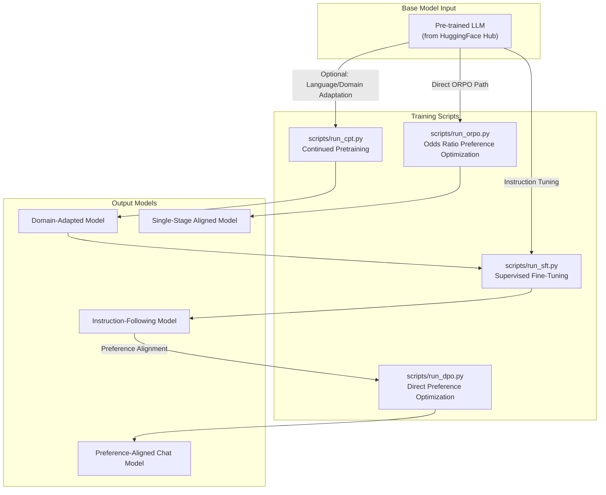

**Training Methodology: Code to Concept Mapping**

The handbook implements four core training methodologies, each corresponding to a dedicated script:

**Continued Pretraining (CPT)**
- Script: `scripts/run_cpt.py`
- Purpose: Adapt pre-trained models to new languages, domains, or datasets
- Use case: Language adaptation (e.g., GPT-NL for Dutch) or domain specialization
- Dataset format: Raw text for causal language modeling

**Supervised Fine-Tuning (SFT)**
- Script: `scripts/run_sft.py`
- Purpose: Teach models to follow instructions and respond in chat format
- Trainer: `trl.SFTTrainer`
- Dataset format: Messages with role/content structure (see [Dataset Formats](#8.2))
- Key configuration class: `SFTConfig` (extends `trl.SFTConfig`)

**Direct Preference Optimization (DPO)**
- Script: `scripts/run_dpo.py`
- Purpose: Align models with human preferences through preference pairs
- Trainer: `trl.DPOTrainer`
- Dataset format: Chosen and rejected response pairs
- Key configuration class: `DPOConfig` (extends `trl.DPOConfig`)
- Key parameter: `beta` controls preference strength

**Odds Ratio Preference Optimization (ORPO)**
- Script: `scripts/run_orpo.py`
- Purpose: Combined instruction tuning and preference alignment in single stage
- Trainer: `trl.ORPOTrainer`
- Dataset format: Same as DPO (chosen/rejected pairs)
- Key configuration class: `ORPOConfig` (extends `trl.ORPOConfig`)
- Advantage: More efficient than two-stage SFT→DPO pipeline

**Sources:** [README.md:40](), [README.md:53-61]()

## Training Pipeline Paths

The system supports multiple training pathways depending on your goals and computational resources:

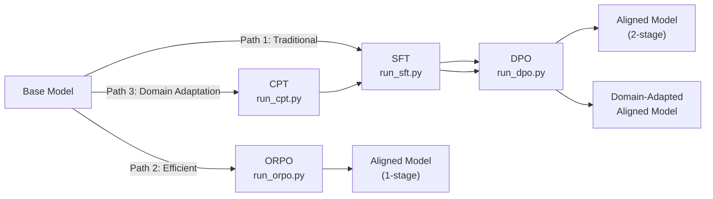

**Pipeline Path Details**

| Path | Stages | Example Model | Computational Cost | Use Case |
|------|--------|---------------|-------------------|----------|
| Traditional 2-Stage | SFT → DPO | Zephyr-7B-β | High | Maximum performance |
| Efficient 1-Stage | ORPO | Zephyr-141B-A35B | Medium | Resource-constrained |
| Domain Adaptation | CPT → SFT → DPO | GPT-NL | Very High | New language/domain |

**Sources:** [README.md:40-41]()

## Code Organization: Repository Structure

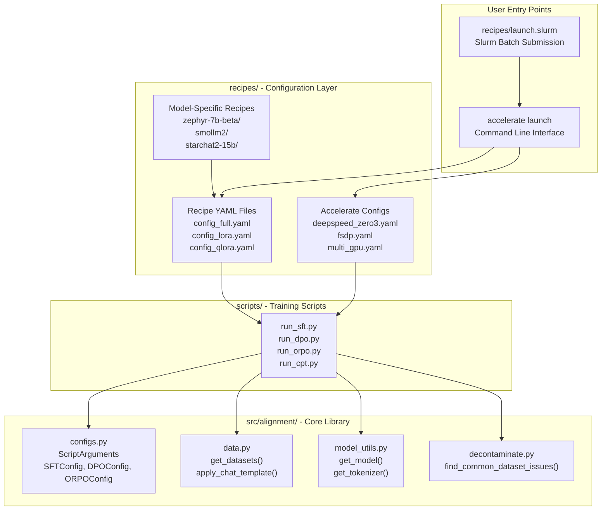

**Directory Breakdown**

The codebase follows a clean separation of concerns:

**`scripts/` - Training Execution**
- `run_sft.py`: Supervised fine-tuning script
- `run_dpo.py`: DPO training script  
- `run_orpo.py`: ORPO training script
- `run_cpt.py`: Continued pretraining script
- Each script is a standalone entry point that accepts configuration via CLI args or YAML

**`recipes/` - Configuration and Deployment**
- Model-specific subdirectories (e.g., `zephyr-7b-beta/`, `smollm2/`) containing YAML configs
- `accelerate_configs/`: Distributed training configurations (DeepSpeed, FSDP, DDP)
- `launch.slurm`: Slurm batch script template for HPC cluster deployment
- Recipe files named by training method: `config_full.yaml`, `config_lora.yaml`, `config_qlora.yaml`

**`src/alignment/` - Core Library**
- `configs.py`: Python dataclass configurations (`ScriptArguments`, `SFTConfig`, `DPOConfig`, `ORPOConfig`)
- `data.py`: Dataset loading, mixing, and chat template application (`get_datasets`, `apply_chat_template`)
- `model_utils.py`: Model and tokenizer instantiation (`get_model`, `get_tokenizer`, `get_kbit_device_map`)
- `decontaminate.py`: Dataset quality checks and decontamination utilities

**`tests/` - Test Suite**
- Configuration validation tests
- Data processing tests
- Model loading tests

**Sources:** [README.md:107-119](), [README.md:38-41]()

## Configuration System Flow

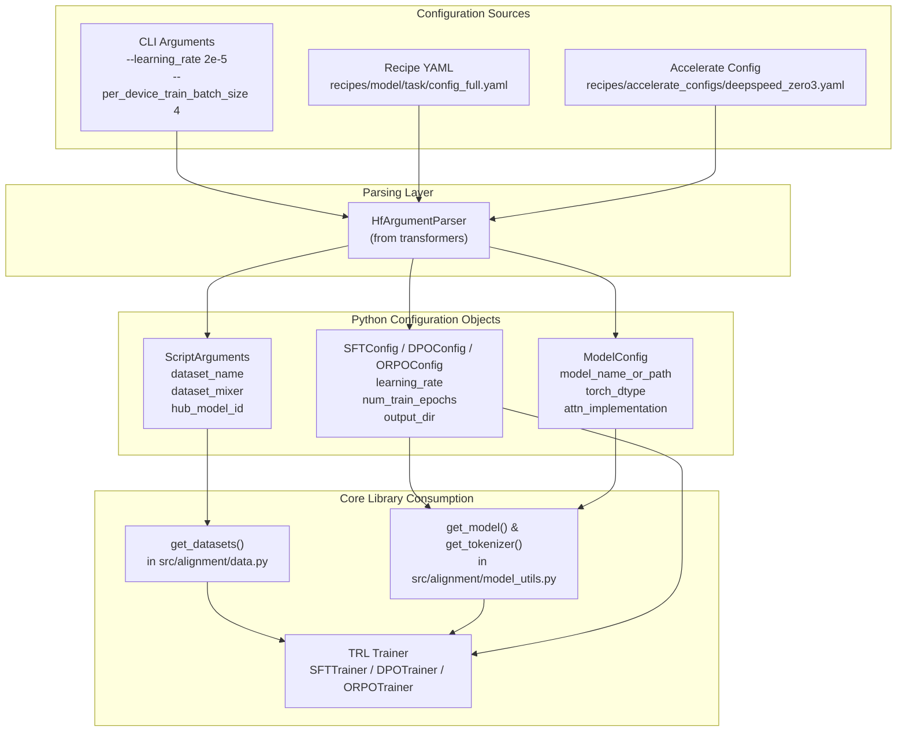

**Configuration Priority and Merging**

The configuration system implements a three-tier priority system:
1. **Highest Priority**: CLI arguments (override everything)
2. **Medium Priority**: Recipe YAML files (override defaults)
3. **Lowest Priority**: Default values in Python dataclasses

The `HfArgumentParser` from Transformers merges these sources automatically. This allows reproducible recipe-based training while maintaining flexibility for experimentation via CLI overrides.

For detailed configuration parameters, see [Configuration Parameters](#8.1). For configuration class details, see [Configuration System](#2.1).

**Sources:** [README.md:41]()

## Published Models and Technical Report

The Alignment Handbook has produced several state-of-the-art models with published recipes:

| Model | Size | Key Innovation | Recipe Location |
|-------|------|----------------|-----------------|
| Zephyr-7B-β | 7B | First application of DPO to Mistral | `recipes/zephyr-7b-beta/` |
| SmolLM2-Instruct | 135M-1.7B | Efficient small model alignment | `recipes/smollm2/` |
| SmolLM3-3B | 3B | Hybrid reasoning with APO | `recipes/smollm3/` |
| StarChat2-15B | 15B | Code-specialized ORPO training | `recipes/starchat2-15b/` |
| Zephyr-141B-A35B | 141B | Large-scale ORPO with FSDP | `recipes/zephyr-141b-A35b/` |

All models are published to the HuggingFace Hub under the `alignment-handbook` or `HuggingFaceH4` organizations and can be loaded directly via the `transformers` library.

**Technical Report**

The methodology and findings are documented in the technical report:
- **Paper**: [Technical Report on arXiv](https://arxiv.org/abs/2310.16944)
- **Models & Datasets Collection**: Available on [HuggingFace Hub](https://huggingface.co/collections/alignment-handbook/handbook-v01-models-and-datasets-654e424d22e6880da5ebc015)

The report covers the complete pipeline from data collection through evaluation, including ablation studies on preference alignment methods.

**Sources:** [README.md:6](), [README.md:21-30](), [README.md:34]()

## Getting Started

To begin using the Alignment Handbook:

1. **Set up your environment** following the installation instructions in [Installation and Setup](#1.1)
2. **Understand the code structure** by reviewing [Project Structure](#1.2)
3. **Run your first training job** using the [Quick Start Guide](#1.3)
4. **Explore model recipes** in the [Model Training Recipes](#4) section
5. **Customize for your needs** using guides in [Advanced Topics](#6)

The recommended learning path is to first replicate an existing recipe (e.g., Zephyr-7B-β) to understand the full pipeline, then adapt it to your specific model and dataset requirements.

**Sources:** [README.md:43-48]()

## System Dependencies

The Alignment Handbook builds upon the HuggingFace ecosystem:

| Dependency | Purpose | Key Components Used |
|------------|---------|---------------------|
| **TRL** | Training library | `SFTTrainer`, `DPOTrainer`, `ORPOTrainer`, config base classes |
| **Transformers** | Model library | Model loading, tokenizers, `HfArgumentParser` |
| **Datasets** | Data loading | `load_dataset`, `DatasetDict`, dataset streaming |
| **Accelerate** | Distributed training | Multi-GPU orchestration, DeepSpeed, FSDP integration |
| **PyTorch** | Deep learning framework | Core tensor operations, distributed primitives |
| **Flash Attention 2** | Efficient attention | Memory-efficient attention for long sequences |

Version requirements and installation details are in [Installation and Setup](#1.1).

**Sources:** [README.md:62-103]()

## Citation

If you use the Alignment Handbook in your work, cite it as:

```bibtex
@software{Tunstall_The_Alignment_Handbook,
  author = {Tunstall, Lewis and Beeching, Edward and Lambert, Nathan and Rajani, Nazneen and Huang, Shengyi and Rasul, Kashif and Bartolome, Alvaro, and M. Patiño, Carlos and M. Rush, Alexander and Wolf, Thomas},
  license = {Apache-2.0},
  title = {{The Alignment Handbook}},
  url = {https://github.com/huggingface/alignment-handbook},
  version = {0.4.0.dev0}
}
```

**Sources:** [README.md:121-133]()

---

# Page: Installation and Setup

# Installation and Setup

<details>
<summary>Relevant source files</summary>

The following files were used as context for generating this wiki page:

- [README.md](README.md)
- [setup.py](setup.py)

</details>


This page provides step-by-step instructions for installing the Alignment Handbook and configuring the development environment. It covers Python environment creation, PyTorch installation, dependency management, Flash Attention setup, and Hugging Face authentication. For information about the overall project structure after installation, see [Project Structure](#1.2). For running your first training job after setup, see [Quick Start Guide](#1.3).

## Prerequisites

The Alignment Handbook requires:
- **Python**: Version 3.10.9 or higher (3.11 recommended)
- **CUDA-compatible GPU**: Required for training (CUDA 12.6 recommended for PyTorch 2.6.0)
- **Operating System**: Linux (tested), other Unix-like systems supported
- **Git LFS**: For pushing models to Hugging Face Hub

Sources: [setup.py:136](), [README.md:64-105]()

## Installation Flow Overview

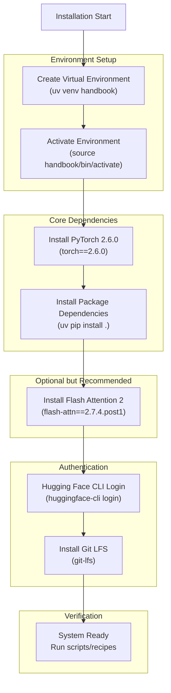

**Installation Flow**: The installation process follows a specific order to ensure compatibility. PyTorch must be installed before package dependencies due to hardware-specific requirements. Flash Attention is installed separately after main dependencies due to compilation requirements.

Sources: [README.md:62-105]()

## Step 1: Environment Setup

Create an isolated Python virtual environment using `uv` (recommended) or standard `venv`:

```bash
# Using uv (recommended)
uv venv handbook --python 3.11 && source handbook/bin/activate && uv pip install --upgrade pip

# Alternative: Using standard venv
python3.11 -m venv handbook && source handbook/bin/activate && pip install --upgrade pip
```

The `uv` tool provides faster dependency resolution and installation compared to standard pip. Installation instructions for `uv` are available at the [UV Installation Guide](https://docs.astral.sh/uv/getting-started/installation).

Sources: [README.md:64-71]()

## Step 2: PyTorch Installation

Install PyTorch version 2.6.0 with CUDA 12.6 support:

```bash
uv pip install torch==2.6.0 --index-url https://download.pytorch.org/whl/cu126
```

**Version Precision**: The exact PyTorch version (2.6.0) is critical for reproducibility. Hardware-specific variations may require different CUDA versions or wheel URLs. Consult the [PyTorch Installation Page](https://pytorch.org/get-started/locally) for alternative configurations.

**Dependency Note**: PyTorch must be installed before the main package dependencies because the package's [setup.py:67]() specifies `torch>=2.6.0` as a dependency, but the appropriate wheel must be selected based on your hardware.

Sources: [README.md:73-79](), [setup.py:67]()

## Step 3: Core Package Dependencies

Install the Alignment Handbook package and all dependencies:

```bash
uv pip install .
```

This command executes [setup.py]() which installs all dependencies specified in [setup.py:96-119](). The core dependencies include:

| Category | Key Dependencies | Purpose |
|----------|-----------------|---------|
| **Training** | `accelerate>=1.9.0`, `deepspeed>=0.17.2` | Distributed training orchestration |
| **Models** | `transformers>=4.53.3`, `trl>=0.19.1`, `peft>=0.16.0` | Model loading, trainers, parameter-efficient methods |
| **Data** | `datasets>=4.0.0`, `huggingface-hub>=0.33.4` | Dataset loading and Hub integration |
| **Optimization** | `bitsandbytes>=0.46.1`, `liger-kernel>=0.6.0` | Quantization and kernel optimizations |
| **Logging** | `tensorboard`, `wandb` | Experiment tracking |
| **Utilities** | `einops>=0.8.1`, `safetensors>=0.5.3`, `jinja2>=3.0.0` | Tensor operations, model serialization, templates |

Sources: [README.md:81-85](), [setup.py:43-73](), [setup.py:96-119]()

## Step 4: Flash Attention 2 Installation

Install Flash Attention 2 for optimized attention computation:

```bash
uv pip install "flash-attn==2.7.4.post1" --no-build-isolation
```

**Installation Details**:
- The `--no-build-isolation` flag is required because Flash Attention needs to compile CUDA kernels during installation
- This step requires a CUDA-compatible GPU and NVCC compiler
- Flash Attention 2 provides significant speedups for training but is not strictly required

**Optional**: If Flash Attention installation fails, the system will fall back to standard attention mechanisms with reduced performance.

Sources: [README.md:87-91]()

## Step 5: Hugging Face Authentication

Authenticate with Hugging Face Hub to access models and datasets:

```bash
huggingface-cli login
```

This command:
1. Prompts for your Hugging Face access token
2. Stores credentials locally for API access
3. Enables loading gated models and pushing trained models to Hub

**Token Permissions**: Your token should have `write` permissions if you plan to push models to the Hub.

Sources: [README.md:93-97]()

## Step 6: Git LFS Installation

Install Git Large File Storage for pushing models:

```bash
sudo apt-get install git-lfs
```

Git LFS is required because trained model weights are typically several gigabytes. Without Git LFS, pushing models to the Hub will fail or timeout.

**Alternative Installation**: On non-Debian systems, follow instructions at [git-lfs.com](https://git-lfs.com).

Sources: [README.md:99-103]()

## Dependency Architecture

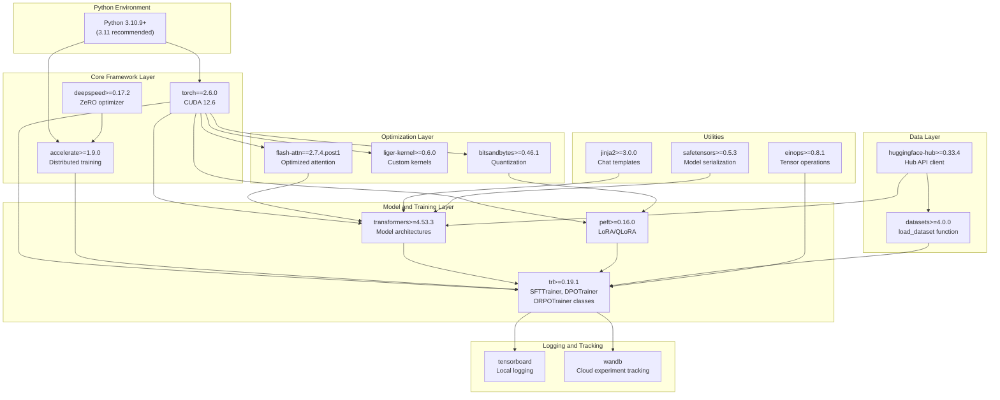

**Dependency Relationships**: The diagram shows how dependencies build on each other. The TRL library sits at the top of the stack, depending on most other components. Training scripts in `scripts/` use TRL trainers which orchestrate all underlying dependencies.

Sources: [setup.py:43-73](), [setup.py:96-119]()

## Installation Component Mapping

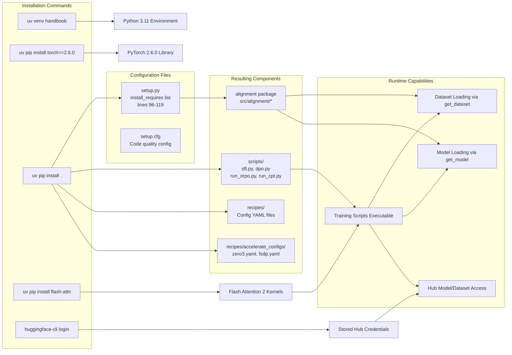

**Installation to Code Mapping**: This diagram connects installation commands to the actual code components they enable. The `uv pip install .` command processes [setup.py]() which installs the `alignment` package from [src/alignment/](), making functions like `get_dataset` and `get_model` available to training scripts.

Sources: [setup.py:96-119](), [setup.py:132-133](), [README.md:109-119]()

## Verification

After installation, verify the setup:

```bash
# Check Python version
python --version  # Should be 3.10.9+

# Check PyTorch and CUDA
python -c "import torch; print(f'PyTorch: {torch.__version__}, CUDA: {torch.cuda.is_available()}')"

# Check alignment package
python -c "import alignment; print(f'Alignment package: {alignment.__version__}')"

# Check Flash Attention (optional)
python -c "import flash_attn; print(f'Flash Attention: {flash_attn.__version__}')"

# Verify Hub authentication
huggingface-cli whoami
```

Expected output:
- Python 3.11.x (or 3.10.9+)
- PyTorch 2.6.0 with `CUDA: True`
- Alignment package version 0.4.0.dev0
- Flash Attention 2.7.4.post1 (if installed)
- Your Hugging Face username

Sources: [setup.py:123]()

## Optional Development Dependencies

For contributors developing the Alignment Handbook, install additional dependencies:

```bash
# Install all development dependencies
uv pip install -e ".[dev]"

# Or install specific groups
uv pip install -e ".[quality]"  # black, isort, flake8
uv pip install -e ".[tests]"    # pytest, parameterized
uv pip install -e ".[docs]"     # hf-doc-builder
```

The extras groups are defined in [setup.py:88-93]():
- `quality`: Code formatting and linting tools
- `tests`: Testing framework dependencies
- `docs`: Documentation building tools
- `dev`: All of the above

For more information on development workflows, see [Development Setup](#7.1).

Sources: [setup.py:88-93]()

## Troubleshooting Common Issues

| Issue | Solution |
|-------|----------|
| **Flash Attention compilation fails** | Install with system compiler: `CC=gcc CXX=g++ uv pip install flash-attn --no-build-isolation` or skip Flash Attention |
| **CUDA version mismatch** | Install PyTorch for your CUDA version from [pytorch.org](https://pytorch.org/get-started/locally) |
| **Git LFS push fails** | Run `git lfs install` in your repository directory |
| **Hub authentication fails** | Create a new token at [huggingface.co/settings/tokens](https://huggingface.co/settings/tokens) with write permissions |
| **Import errors after installation** | Ensure virtual environment is activated and reinstall with `uv pip install --force-reinstall .` |

For additional troubleshooting, see [Troubleshooting](#8.4).

Sources: [README.md:87-91](), [README.md:93-103]()

## Next Steps

After completing installation:

1. Review the [Project Structure](#1.2) to understand the codebase organization
2. Follow the [Quick Start Guide](#1.3) to run your first training job
3. Explore [Training Methods](#3) to understand SFT, DPO, and ORPO
4. Examine [Model Training Recipes](#4) for pre-configured training examples

Sources: [README.md:45-48](), [README.md:105]()

---

# Page: Project Structure

# Project Structure

<details>
<summary>Relevant source files</summary>

The following files were used as context for generating this wiki page:

- [README.md](README.md)
- [src/alignment/__init__.py](src/alignment/__init__.py)

</details>


This document explains the organization of the Alignment Handbook codebase, focusing on the three primary components: training scripts (`scripts/`), configuration recipes (`recipes/`), and the core library (`src/alignment/`). For installation information, see page 1.1.

## Repository Organization

The Alignment Handbook follows a modular design that separates execution scripts, configuration recipes, and reusable library components.

**Repository Layout**
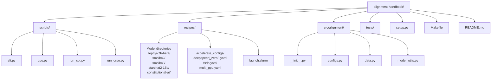

Sources: [README.md:107-119](), [src/alignment/__init__.py:1-17]()

## Scripts Directory

The `scripts/` directory contains executable Python scripts for training and aligning language models. Each script implements a specific training methodology:

**Training Scripts**

| Script | Training Method | Primary Use Case |
|--------|----------------|------------------|
| `sft.py` | Supervised Fine-Tuning | Instruction tuning with prompt-response pairs |
| `dpo.py` | Direct Preference Optimization | Preference alignment with chosen/rejected pairs |
| `run_orpo.py` | Odds Ratio Preference Optimization | Combined SFT and preference alignment in one stage |
| `run_cpt.py` | Continued Pre-Training | Domain or language adaptation via causal language modeling |

Each script accepts configuration via YAML files (from `recipes/`) and command-line arguments. They support distributed training strategies including DeepSpeed ZeRO-3, PyTorch FSDP, and parameter-efficient methods like LoRA and QLoRA.

**Execution Pattern**

Scripts are launched using `accelerate launch` with an accelerate configuration file:

```bash
ACCELERATE_LOG_LEVEL=info accelerate launch \
    --config_file recipes/accelerate_configs/deepspeed_zero3.yaml \
    scripts/sft.py \
    recipes/zephyr-7b-beta/sft/config_full.yaml
```

Sources: [README.md:40]()

## Recipes Directory

The `recipes/` directory stores YAML configuration files that define training hyperparameters, dataset specifications, and model settings. Recipes enable reproducible training runs and serve as templates for custom experiments.

**Directory Structure**

```
recipes/
├── accelerate_configs/           # Distributed training configurations
│   ├── deepspeed_zero3.yaml     # DeepSpeed ZeRO-3 for multi-GPU full training
│   ├── fsdp.yaml                # PyTorch FSDP for very large models
│   ├── multi_gpu.yaml           # Standard multi-GPU DDP
│   └── fsdp_qlora.yaml          # FSDP with QLoRA
├── zephyr-7b-beta/              # Zephyr 7B training recipes
│   ├── sft/
│   │   ├── config_full.yaml
│   │   └── config_qlora.yaml
│   └── dpo/
│       ├── config_full.yaml
│       └── config_qlora.yaml
├── smollm2/                      # SmolLM2 small model recipes
├── smollm3/                      # SmolLM3 advanced recipes
├── starchat2-15b/               # StarChat code model recipes
├── constitutional-ai/           # Constitutional AI recipes
└── launch.slurm                 # Slurm cluster submission script
```

**Recipe File Structure**

Each recipe YAML file typically includes:
- Training hyperparameters (learning rate, batch size, number of epochs)
- Dataset configuration (dataset names, mixing weights, column mappings)
- Model configuration (model path, quantization settings, LoRA parameters)
- Output configuration (save paths, Hub push settings, logging)

Example recipe structure:
```yaml
# Model arguments
model_name_or_path: alignment-handbook/zephyr-7b-sft-full

# Dataset configuration
dataset_mixer:
  HuggingFaceH4/ultrafeedback_binarized: 1.0

# Training configuration
learning_rate: 5.0e-7
per_device_train_batch_size: 2
gradient_accumulation_steps: 8
num_train_epochs: 1

# Output configuration
output_dir: data/zephyr-7b-beta
hub_model_id: alignment-handbook/zephyr-7b-beta
```

Sources: [README.md:41]()

## Source Directory (Core Library)

The `src/alignment/` directory implements the core library that provides reusable components for configuration management, data loading, and model initialization. This library is installed as the `alignment` Python package via `setup.py`.

**Core Module Structure**

| Module | Purpose |
|--------|---------|
| `configs.py` | Configuration dataclasses: `ScriptArguments`, `SFTConfig`, `DPOConfig`, `ORPOConfig` |
| `data.py` | Dataset loading and mixing via `get_dataset()` |
| `model_utils.py` | Model and tokenizer initialization via `get_model()` and `get_tokenizer()` |
| `__init__.py` | Package API surface |

**Public API**

The package exports the following symbols from [src/alignment/__init__.py:1-16]():

```python
from alignment import (
    # Configuration classes
    ScriptArguments,      # Common script arguments (dataset names, output paths, etc.)
    SFTConfig,           # Supervised fine-tuning configuration (extends TRL SFTConfig)
    DPOConfig,           # DPO training configuration (extends TRL DPOConfig)
    ORPOConfig,          # ORPO training configuration (extends TRL ORPOConfig)
    
    # Data loading
    get_dataset,         # Load and mix datasets based on configuration
    
    # Model utilities
    get_tokenizer,       # Load and configure tokenizer with chat template
    get_model,           # Load model with quantization and device mapping
)
```

**Configuration Class Hierarchy**

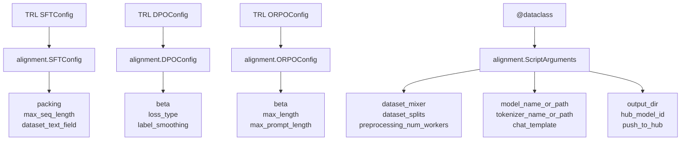

The configuration classes extend TRL's base training configurations with alignment-specific features like dataset mixing and chat template handling.

Sources: [src/alignment/__init__.py:1-16]()

## Component Interaction

The diagram below illustrates how scripts, recipes, and the core library interact during a training run:

**Training Execution Flow**

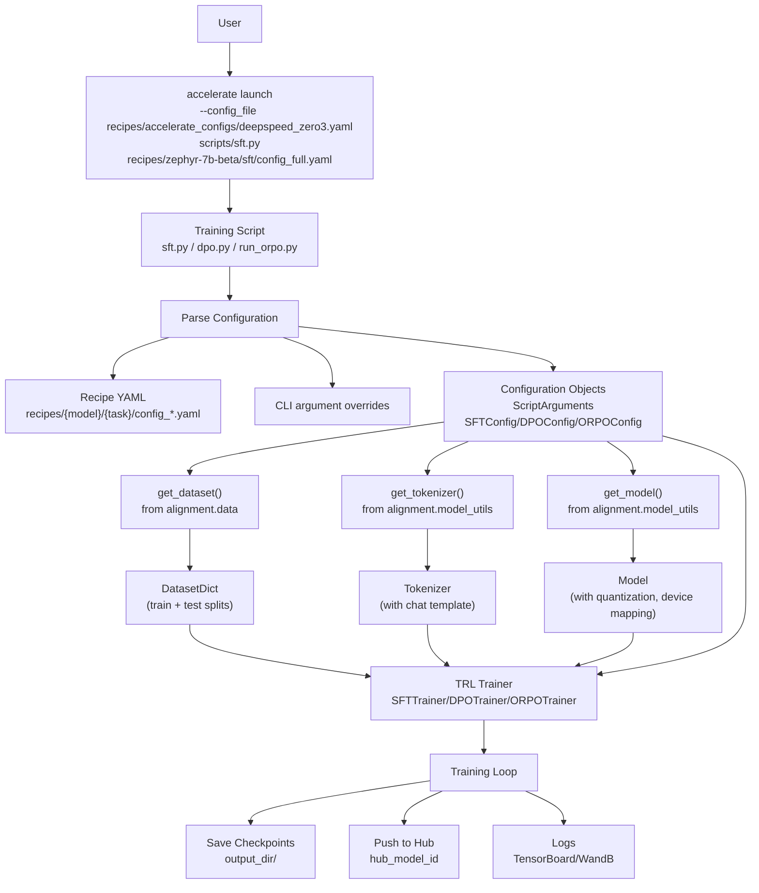

**Key Interactions:**

1. **Configuration Parsing**: Recipe YAML files are merged with CLI arguments to create typed configuration objects (`ScriptArguments`, `SFTConfig`, etc.)

2. **Data Loading**: `get_dataset()` [data.py]() loads datasets from HuggingFace Hub or local paths, applies dataset mixing with weights, and creates train/test splits

3. **Model Initialization**: `get_tokenizer()` and `get_model()` [model_utils.py]() handle tokenizer loading (with chat templates) and model loading (with quantization and device mapping)

4. **Training**: Configuration objects and loaded resources are passed to TRL trainers (`SFTTrainer`, `DPOTrainer`, `ORPOTrainer`) which execute the training loop

5. **Output**: Trained models are saved locally and optionally pushed to HuggingFace Hub, with metrics logged to TensorBoard or Weights & Biases

Sources: [src/alignment/__init__.py:1-16]()

## Running Training Jobs

The Alignment Handbook provides multiple ways to run training jobs:

1. Direct execution with `accelerate launch`:

```bash
# Full training with ZeRO-3 on 8 GPUs
ACCELERATE_LOG_LEVEL=info accelerate launch --config_file recipes/accelerate_configs/deepspeed_zero3.yaml scripts/run_{task}.py recipes/{model_name}/{task}/config_full.yaml

# QLoRA 4-bit training on a single GPU
ACCELERATE_LOG_LEVEL=info accelerate launch --config_file recipes/accelerate_configs/multi_gpu.yaml --num_processes=1 scripts/run_{task}.py recipes/{model_name}/{task}/config_qlora.yaml
```

2. Launching on a Slurm cluster:

```bash
sbatch --job-name=handbook_{task} --nodes=1 recipes/launch.slurm {model_name} {task} {precision} {accelerator}
```

Sources: [scripts/README.md:14-29](), [scripts/README.md:64-78]()

## Dataset Requirements

For different alignment techniques, datasets need to have specific formats:

**SFT Datasets:**
- Must have a `messages` column containing a list of dictionaries with `role` and `content` fields
- Example: [ultrachat_200k](https://huggingface.co/datasets/HuggingFaceH4/ultrachat_200k)

**DPO and ORPO Datasets:**
- Must have `chosen` and `rejected` columns, each containing lists of dictionaries with `role` and `content` fields
- Example: [ultrafeedback_binarized](https://huggingface.co/datasets/HuggingFaceH4/ultrafeedback_binarized)

Dataset mixing can be configured in YAML files:

```yaml
datasets_mixer:
    dataset_1: 0.5  # Use 50% of training examples
    dataset_2: 0.66 # Use 66% of training examples
dataset_splits:
- train_xxx         # Training splits to mix
- test_xxx          # Test splits to mix
```

Sources: [scripts/README.md:82-115]()

## Version Information

The version information for the Alignment Handbook is maintained in `__init__.py` and updated using the `release.py` script. Current version: 0.3.0.dev0.

Sources: [src/alignment/__init__.py:1](), [src/alignment/release.py:1-126]()

## Conclusion

The Alignment Handbook provides a comprehensive framework for training and aligning language models, with a clear separation of concerns between configuration, data processing, model utilities, and training scripts. The repository is designed to facilitate experimentation and reproducibility, with recipes for recreating specific models and scripts for implementing different alignment techniques.

Sources: [README.md:9-19]()

---

# Page: Quick Start Guide

# Quick Start Guide

<details>
<summary>Relevant source files</summary>

The following files were used as context for generating this wiki page:

- [README.md](README.md)
- [scripts/README.md](scripts/README.md)

</details>


This guide provides a hands-on introduction to running your first training job with the Alignment Handbook. It covers the basic `accelerate launch` command structure, how to use pre-configured recipes, and how to monitor training progress. 

For detailed installation instructions, see [Installation and Setup](#1.1). For an explanation of the codebase organization, see [Project Structure](#1.2). For comprehensive training method documentation, see [Training Methods](#3).

---

## Command Structure Overview

All training jobs in the Alignment Handbook follow a consistent command pattern that combines three configuration sources:

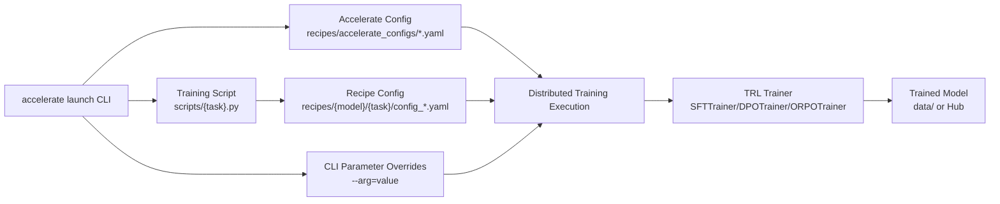

**Command Template:**
```bash
ACCELERATE_LOG_LEVEL=info accelerate launch \
  --config_file recipes/accelerate_configs/{accelerate_config}.yaml \
  scripts/{task}.py \
  --config recipes/{model_name}/{task}/config_{precision}.yaml \
  [--optional_overrides=value]
```

**Sources:** [README.md:14-16](), [README.md:38-47](), [scripts/README.md:14-29]()

---

## Running Your First Training Job

### Single-GPU QLoRA Training (Recommended for Getting Started)

The simplest way to get started is with QLoRA fine-tuning on a single GPU. This example trains a Zephyr-7B model using supervised fine-tuning:

```bash
# Train SFT model on single GPU with QLoRA
ACCELERATE_LOG_LEVEL=info accelerate launch \
  --config_file recipes/accelerate_configs/ddp.yaml \
  --num_processes=1 \
  scripts/sft.py \
  --config recipes/zephyr-7b-beta/sft/config_qlora.yaml
```

This command will:
1. Load the base model (Mistral-7B-v0.1) in 4-bit quantization
2. Apply LoRA adapters for parameter-efficient training
3. Train on the UltraChat 200k dataset
4. Save outputs to `data/zephyr-7b-beta-sft-qlora/`
5. Push the model to your HuggingFace Hub account as `{username}/zephyr-7b-beta-sft-qlora`

**Sources:** [scripts/README.md:18-19](), [README.md:38-47]()

### Multi-GPU Full Fine-Tuning

For full model training with 8 GPUs using DeepSpeed ZeRO-3:

```bash
# Full SFT training with ZeRO-3 on 8 GPUs
ACCELERATE_LOG_LEVEL=info accelerate launch \
  --config_file recipes/accelerate_configs/zero3.yaml \
  scripts/sft.py \
  --config recipes/zephyr-7b-beta/sft/config_full.yaml
```

**Sources:** [scripts/README.md:15-16](), [README.md:40-44]()

---

## Understanding Command Components

### Component Mapping

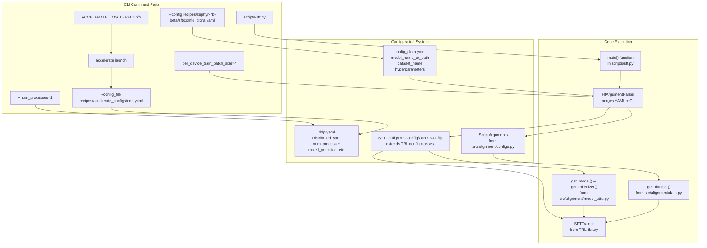

**Sources:** [scripts/README.md:14-29](), [scripts/README.md:49-54]()

### Available Training Tasks

| Task | Script | Purpose | Dataset Format |
|------|--------|---------|----------------|
| `sft` | `scripts/sft.py` | Supervised Fine-Tuning | `messages` column with role/content dicts |
| `dpo` | `scripts/dpo.py` | Direct Preference Optimization | `chosen` and `rejected` columns |
| `orpo` | `scripts/run_orpo.py` | Odds Ratio Preference Optimization | `chosen` and `rejected` columns |
| `cpt` | `scripts/run_cpt.py` | Continued Pretraining | Raw text or instruction format |

**Sources:** [scripts/README.md:31-36](), [scripts/README.md:98-114]()

### Available Accelerate Configurations

| Config File | Strategy | Best For | GPU Requirements |
|-------------|----------|----------|------------------|
| `ddp.yaml` | PyTorch DDP | Single GPU or light multi-GPU | 1+ GPUs |
| `zero3.yaml` | DeepSpeed ZeRO-3 | Full training on multi-GPU | 8x 80GB recommended |
| `fsdp.yaml` | PyTorch FSDP | Very large models (Mixtral 8x22B) | 8+ GPUs |
| `fsdp+qlora.yaml` | FSDP + QLoRA | QLoRA on multiple GPUs | 2+ GPUs |

**Sources:** [scripts/README.md:14-29](), [README.md:7-10]()

---

## Training Configuration Examples

### Basic Training Modes

```bash
# 1. QLoRA on single GPU (4-bit quantization)
ACCELERATE_LOG_LEVEL=info accelerate launch \
  --config_file recipes/accelerate_configs/ddp.yaml \
  --num_processes=1 \
  scripts/sft.py \
  --config recipes/zephyr-7b-beta/sft/config_qlora.yaml

# 2. LoRA on single GPU (16-bit precision)
ACCELERATE_LOG_LEVEL=info accelerate launch \
  --config_file recipes/accelerate_configs/ddp.yaml \
  --num_processes=1 \
  scripts/sft.py \
  --config recipes/zephyr-7b-beta/sft/config_qlora.yaml \
  --load_in_4bit=false

# 3. LoRA with ZeRO-3 on multiple GPUs
ACCELERATE_LOG_LEVEL=info accelerate launch \
  --config_file recipes/accelerate_configs/zero3.yaml \
  --num_processes=4 \
  scripts/sft.py \
  --config recipes/zephyr-7b-beta/sft/config_qlora.yaml \
  --load_in_4bit=false

# 4. Full training with DeepSpeed ZeRO-3
ACCELERATE_LOG_LEVEL=info accelerate launch \
  --config_file recipes/accelerate_configs/zero3.yaml \
  scripts/sft.py \
  --config recipes/zephyr-7b-beta/sft/config_full.yaml
```

**Sources:** [scripts/README.md:14-29]()

### Overriding Configuration Parameters

Any parameter from the recipe YAML can be overridden via CLI flags:

```bash
# Override batch size and learning rate
ACCELERATE_LOG_LEVEL=info accelerate launch \
  --config_file recipes/accelerate_configs/ddp.yaml \
  --num_processes=1 \
  scripts/sft.py \
  --config recipes/zephyr-7b-beta/sft/config_qlora.yaml \
  --per_device_train_batch_size=2 \
  --learning_rate=5e-5 \
  --num_train_epochs=3

# Change output directory and Hub repository name
ACCELERATE_LOG_LEVEL=info accelerate launch \
  --config_file recipes/accelerate_configs/ddp.yaml \
  --num_processes=1 \
  scripts/sft.py \
  --config recipes/zephyr-7b-beta/sft/config_qlora.yaml \
  --output_dir=./my_custom_output \
  --hub_model_id=myusername/my-custom-model
```

**Sources:** [scripts/README.md:49-54](), [README.md:49-54]()

---

## Execution Flow Diagram

This diagram shows how the command components flow through the codebase:

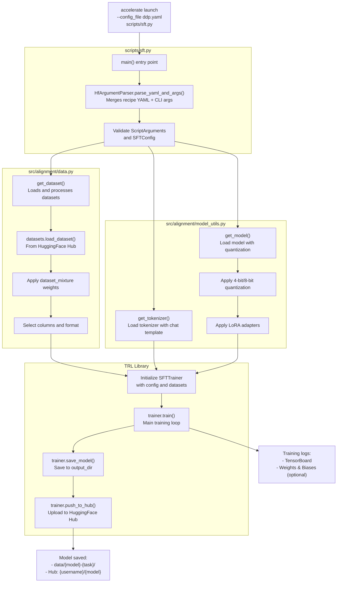

**Sources:** [README.md:38-47](), [scripts/README.md:84-115]()

---

## Monitoring Training Progress

### Default Logging (TensorBoard)

By default, training metrics are logged to TensorBoard. To view them:

```bash
# In a separate terminal, start TensorBoard
tensorboard --logdir data/zephyr-7b-beta-sft-qlora/runs

# Navigate to http://localhost:6006 in your browser
```

Logs are saved in the `{output_dir}/runs/` subdirectory.

**Sources:** [scripts/README.md:56-57]()

### Weights & Biases Integration

To log to Weights & Biases instead:

```bash
ACCELERATE_LOG_LEVEL=info accelerate launch \
  --config_file recipes/accelerate_configs/ddp.yaml \
  --num_processes=1 \
  scripts/sft.py \
  --config recipes/zephyr-7b-beta/sft/config_qlora.yaml \
  --report_to=wandb
```

**Sources:** [scripts/README.md:56-61]()

### Understanding Output Locations

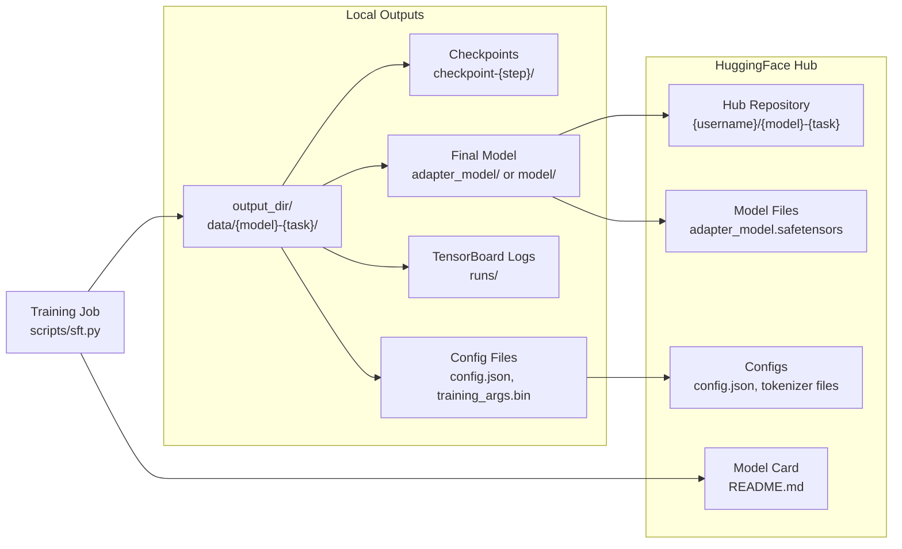

**Sources:** [scripts/README.md:49-54](), [README.md:38-47]()

---

## Common Training Patterns

### Two-Stage Alignment (SFT → DPO)

The traditional approach used for Zephyr-7B-β:

```bash
# Stage 1: Supervised Fine-Tuning
ACCELERATE_LOG_LEVEL=info accelerate launch \
  --config_file recipes/accelerate_configs/zero3.yaml \
  scripts/sft.py \
  --config recipes/zephyr-7b-beta/sft/config_full.yaml

# Stage 2: Direct Preference Optimization
# Uses the SFT model from Stage 1 as the base
ACCELERATE_LOG_LEVEL=info accelerate launch \
  --config_file recipes/accelerate_configs/zero3.yaml \
  scripts/dpo.py \
  --config recipes/zephyr-7b-beta/dpo/config_full.yaml
```

**Sources:** [README.md:40-44]()

### Single-Stage ORPO Alignment

A more efficient alternative that combines SFT and preference optimization:

```bash
# Single-stage training with ORPO
ACCELERATE_LOG_LEVEL=info accelerate launch \
  --config_file recipes/accelerate_configs/fsdp.yaml \
  scripts/run_orpo.py \
  --config recipes/zephyr-141b-A35b/orpo/config_full.yaml
```

**Sources:** [README.md:60]()

---

## Next Steps

### Explore Pre-Configured Recipes

The `recipes/` directory contains production-ready configurations for various model families:

| Recipe Directory | Model Family | Training Methods |
|------------------|--------------|------------------|
| `recipes/zephyr-7b-beta/` | Zephyr-7B-β (Mistral-7B base) | SFT + DPO |
| `recipes/zephyr-7b-gemma/` | Zephyr-7B-Gemma | SFT + DPO |
| `recipes/zephyr-141b-A35b/` | Zephyr-141B (Mixtral base) | ORPO |
| `recipes/smollm2/` | SmolLM2 (135M-1.7B) | SFT + DPO |
| `recipes/smollm3/` | SmolLM3-3B | Mid-training + SFT + DPO |
| `recipes/starchat2-15b/` | StarChat2-15B (code-focused) | ORPO |

**Sources:** [README.md:21-30](), [README.md:41]()

### Learn More

- **[Training Methods](#3)**: Deep dive into SFT, DPO, ORPO, and CPT methodologies
- **[Model Training Recipes](#4)**: Detailed guides for specific model families
- **[Distributed Training Configurations](#5.1)**: Scaling to multiple GPUs and nodes
- **[Dataset Mixing and Weighting](#6.1)**: Creating custom dataset mixtures
- **[LoRA and QLoRA Training](#6.2)**: Parameter-efficient fine-tuning details

### Troubleshooting

If you encounter issues:
1. Verify installation with `python -c "import alignment; print(alignment.__version__)"`
2. Check GPU availability with `nvidia-smi`
3. Ensure you're logged into HuggingFace Hub with `huggingface-cli login`
4. Review [Troubleshooting](#8.4) for common issues and solutions

**Sources:** [README.md:62-105]()

---

# Page: Core Library (src/alignment)

# Core Library (src/alignment)

<details>
<summary>Relevant source files</summary>

The following files were used as context for generating this wiki page:

- [src/alignment/__init__.py](src/alignment/__init__.py)

</details>


The `src/alignment` package is the core Python library that provides reusable components for training aligned language models. It abstracts common functionality needed across different training methods (SFT, DPO, ORPO, etc.) into three main areas: configuration management, dataset loading and mixing, and model instantiation. This page provides an overview of the library's architecture and components.

For detailed documentation on specific subsystems:
- Configuration classes and validation: see [Configuration System](#2.1)
- Model and tokenizer loading: see [Model Loading and Utilities](#2.2)
- Dataset composition and format handling: see [Dataset Loading and Mixing](#2.3)
- Complete API reference: see [Package API Reference](#2.4)

## Package Structure

The `alignment` package exposes a clean public API through its `__init__.py` module. All core functionality is available through direct imports from the package.

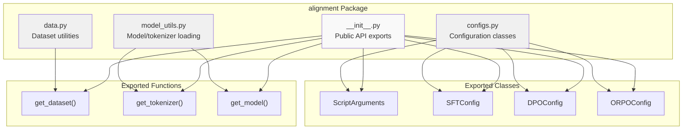

**Sources:** [src/alignment/__init__.py:1-17]()

## Core Components

The library is organized into three functional modules, each handling a distinct aspect of the training pipeline:

| Module | Primary Exports | Purpose |
|--------|----------------|---------|
| `configs.py` | `ScriptArguments`, `SFTConfig`, `DPOConfig`, `ORPOConfig` | Configuration dataclasses that extend TRL base configs with alignment-specific parameters and validation logic |
| `data.py` | `get_dataset()` | Dataset loading, mixing, format validation, and train/test splitting |
| `model_utils.py` | `get_model()`, `get_tokenizer()` | Model and tokenizer instantiation with quantization, device mapping, and chat template handling |

### Configuration Classes

The configuration system provides strongly-typed configuration objects that merge parameters from multiple sources (CLI arguments, YAML recipe files, and defaults). Each training method has its own configuration class:

- **`ScriptArguments`**: Common parameters shared across all training methods (dataset names, hub settings, debugging flags)
- **`SFTConfig`**: Extends `trl.SFTConfig` with supervised fine-tuning specific parameters
- **`DPOConfig`**: Extends `trl.DPOConfig` with DPO-specific parameters like beta, label smoothing, and loss types
- **`ORPOConfig`**: Extends `trl.ORPOConfig` with ORPO-specific parameters for odds ratio preference optimization

All configuration classes include `__post_init__` validation to ensure parameter consistency and construct complex nested configurations like `DatasetMixtureConfig`.

**Sources:** [src/alignment/__init__.py:3]()

### Dataset Loading

The `get_dataset()` function provides flexible dataset composition:

- Load single datasets from Hugging Face Hub or local paths
- Mix multiple datasets with configurable weights
- Select specific columns from each dataset
- Validate dataset formats (messages column for SFT, chosen/rejected columns for DPO)
- Split datasets into train/test sets with reproducible seeding

The function returns a `DatasetDict` containing train and optionally test splits, ready for use with TRL trainers.

**Sources:** [src/alignment/__init__.py:4]()

### Model Utilities

The model loading utilities handle the complexity of instantiating models with various configurations:

- **`get_tokenizer()`**: Load and configure tokenizers, apply chat templates, set special tokens
- **`get_model()`**: Instantiate models with quantization (4-bit/8-bit), device mapping, dtype configuration, PEFT adapter integration

These functions abstract away common patterns like handling `BitsAndBytesConfig` for quantization, setting up Flash Attention 2, and configuring torch dtype based on mixed precision settings.

**Sources:** [src/alignment/__init__.py:5]()

## Integration with Training Scripts

The core library provides the foundation for all training scripts. The typical usage pattern follows this sequence:

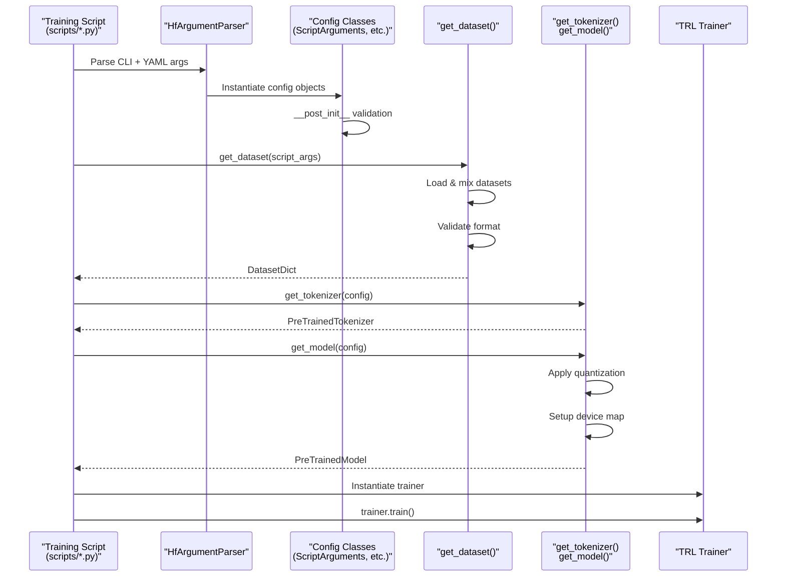

**Component Flow Diagram:**

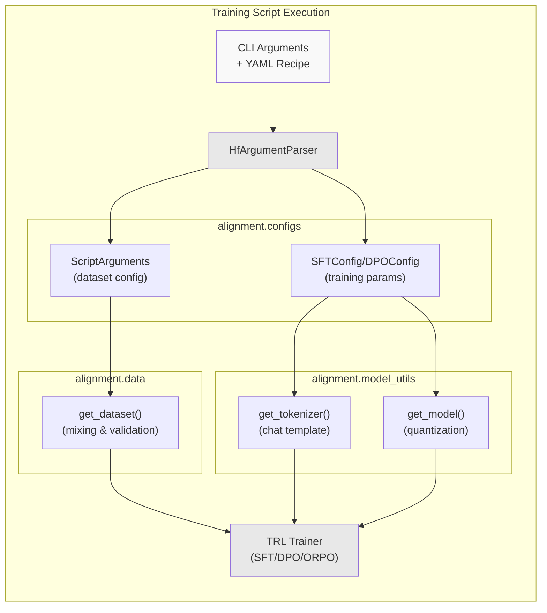

**Sources:** [src/alignment/__init__.py:1-17]()

## Design Principles

The core library follows several key design principles:

1. **Separation of Concerns**: Configuration, data, and model loading are cleanly separated into distinct modules
2. **Extensibility**: Configuration classes extend TRL base configs, allowing the library to leverage TRL's trainer infrastructure while adding alignment-specific features
3. **Type Safety**: All configuration parameters are strongly typed using Python dataclasses with validation
4. **Reproducibility**: Seed-based operations and explicit configuration ensure deterministic behavior
5. **Flexibility**: Support for both simple single-dataset scenarios and complex multi-dataset mixtures with weights

## Version Information

The package version is defined in [src/alignment/__init__.py:1]() and follows semantic versioning. The current development version is `0.4.0.dev0`.

**Sources:** [src/alignment/__init__.py:1]()

## Usage Example

Here's how a training script typically uses the core library:

```python
# 1. Parse configuration
parser = HfArgumentParser((ScriptArguments, SFTConfig, ModelConfig))
script_args, training_args, model_config = parser.parse_args_into_dataclasses()

# 2. Load dataset
dataset = get_dataset(script_args)

# 3. Load tokenizer and model
tokenizer = get_tokenizer(model_config, training_args)
model = get_model(model_config, training_args)

# 4. Initialize trainer
trainer = SFTTrainer(
    model=model,
    args=training_args,
    train_dataset=dataset["train"],
    tokenizer=tokenizer,
)

# 5. Train
trainer.train()
```

This pattern is consistent across all training scripts (`scripts/sft.py`, `scripts/dpo.py`, `scripts/run_orpo.py`), demonstrating the library's reusability.

**Sources:** [src/alignment/__init__.py:1-17]()

---

# Page: Configuration System

# Configuration System

<details>
<summary>Relevant source files</summary>

The following files were used as context for generating this wiki page:

- [src/alignment/configs.py](src/alignment/configs.py)

</details>


## Purpose and Scope

This document describes the configuration system in the Alignment Handbook, which manages all training parameters, dataset specifications, and model settings. The system uses typed Python dataclasses that extend the TRL library's configuration classes to provide type-safe, validated configuration objects for training jobs.

For information about how datasets are loaded and processed using these configurations, see [Dataset Loading and Mixing](#2.3). For details on model loading parameters, see [Model Loading and Utilities](#2.2). For specific training method configurations, see [Training Methods](#3).

## Configuration Architecture

The configuration system operates in three layers: configuration sources (YAML files and CLI arguments), Python configuration classes (typed dataclasses), and validation/merging logic. The system uses Hugging Face's `HfArgumentParser` to merge multiple configuration sources and produce validated configuration objects.

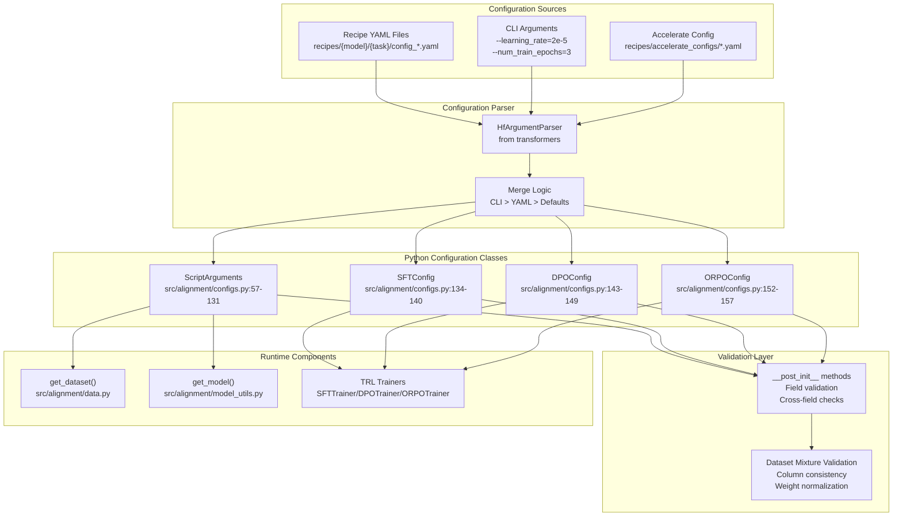

**Figure 1: Configuration System Architecture**

Sources: [src/alignment/configs.py:1-158]()

## Core Configuration Classes

### ScriptArguments

The `ScriptArguments` class extends `trl.ScriptArguments` to add dataset mixture support. It is the primary container for dataset-related configuration and is used across all training scripts.

| Field | Type | Default | Description |
|-------|------|---------|-------------|
| `dataset_name` | `Optional[str]` | `None` | Single dataset identifier (inherited from TRL) |
| `dataset_mixture` | `Optional[dict]` | `None` | Configuration dictionary for dataset mixtures |

The class enforces that either `dataset_name` or `dataset_mixture` must be provided but not both. When `dataset_mixture` is specified, it is parsed and validated in the `__post_init__` method [src/alignment/configs.py:88-131]().

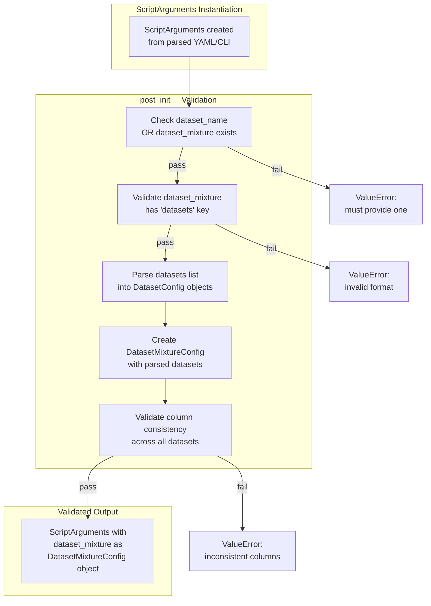

**Figure 2: ScriptArguments Validation Flow**

Sources: [src/alignment/configs.py:57-131]()

### Dataset Configuration Classes

The dataset configuration system uses two dataclasses to define single datasets and mixtures of datasets.

#### DatasetConfig

The `DatasetConfig` class specifies a single dataset in a mixture [src/alignment/configs.py:36-45]():

| Field | Type | Default | Description |
|-------|------|---------|-------------|
| `id` | `str` | Required | Dataset identifier (HF Hub path or local path) |
| `config` | `Optional[str]` | `None` | Dataset configuration name (for multi-config datasets) |
| `split` | `str` | `"train"` | Dataset split to use |
| `columns` | `Optional[list[str]]` | `None` | Columns to retain from the dataset |
| `weight` | `Optional[float]` | `None` | Sampling weight for this dataset in the mixture |

#### DatasetMixtureConfig

The `DatasetMixtureConfig` class specifies a mixture of multiple datasets [src/alignment/configs.py:47-54]():

| Field | Type | Default | Description |
|-------|------|---------|-------------|
| `datasets` | `list[DatasetConfig]` | Required | List of dataset configurations |
| `seed` | `int` | `0` | Random seed for shuffling and sampling |
| `test_split_size` | `Optional[float]` | `None` | Fraction of data to use for test split |

**Example YAML Configuration:**

```yaml
dataset_mixture:
  datasets:
    - id: HuggingFaceH4/ultrachat_200k
      split: train_sft
      columns:
        - messages
      weight: 0.7
    - id: HuggingFaceH4/ultrafeedback_binarized
      split: train_prefs
      columns:
        - messages
      weight: 0.3
  seed: 42
  test_split_size: 0.1
```

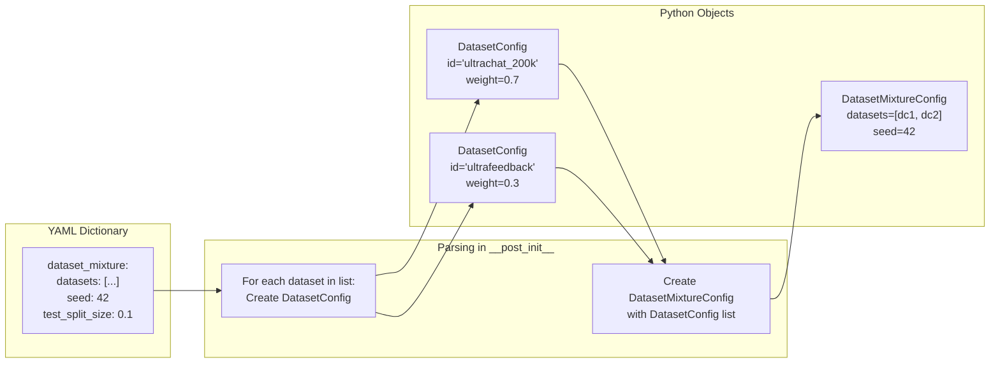

**Figure 3: Dataset Mixture Configuration Parsing**

Sources: [src/alignment/configs.py:36-54](), [src/alignment/configs.py:88-131]()

### Training Configuration Classes

The Alignment Handbook extends TRL's training configuration classes to add chat template support. Each training method has its own configuration class.

#### SFTConfig

Extends `trl.SFTConfig` for supervised fine-tuning [src/alignment/configs.py:134-140]():

| Additional Field | Type | Default | Description |
|-----------------|------|---------|-------------|
| `chat_template` | `Optional[str]` | `None` | Custom Jinja2 chat template for message formatting |

Inherits all fields from `trl.SFTConfig`, including:
- Standard training parameters (learning rate, batch size, epochs)
- Packing options for sequence concatenation
- Max sequence length
- Gradient checkpointing settings

#### DPOConfig

Extends `trl.DPOConfig` for direct preference optimization [src/alignment/configs.py:143-149]():

| Additional Field | Type | Default | Description |
|-----------------|------|---------|-------------|
| `chat_template` | `Optional[str]` | `None` | Custom Jinja2 chat template for message formatting |

Inherits all fields from `trl.DPOConfig`, including:
- Beta parameter for KL divergence penalty
- Reference model settings
- Loss type (sigmoid, hinge, ipo, kto)
- Label smoothing

#### ORPOConfig

Extends `trl.ORPOConfig` for odds ratio preference optimization [src/alignment/configs.py:152-157]():

| Additional Field | Type | Default | Description |
|-----------------|------|---------|-------------|
| `chat_template` | `Optional[str]` | `None` | Custom Jinja2 chat template for message formatting |

Inherits all fields from `trl.ORPOConfig`, including:
- Lambda parameter for odds ratio penalty
- Max prompt length and completion length
- Packing options

```mermaid
graph TB
    subgraph trl["TRL Base Classes"]
        trl_script["trl.ScriptArguments"]
        trl_sft["trl.SFTConfig"]
        trl_dpo["trl.DPOConfig"]
        trl_orpo["trl.ORPOConfig"]
    end
    
    subgraph alignment["Alignment Handbook Classes"]
        script["ScriptArguments<br/>+ dataset_mixture"]
        sft["SFTConfig<br/>+ chat_template"]
        dpo["DPOConfig<br/>+ chat_template"]
        orpo["ORPOConfig<br/>+ chat_template"]
    end
    
    trl_script -->|extends| script
    trl_sft -->|extends| sft
    trl_dpo -->|extends| dpo
    trl_orpo -->|extends| orpo
```

**Figure 4: Configuration Class Hierarchy**

Sources: [src/alignment/configs.py:57-157]()

## Configuration Source Merging

The configuration system merges values from three sources, with the following precedence (highest to lowest):

1. **Command-line arguments**: Directly specified via `--parameter=value`
2. **YAML configuration files**: Specified via `--config_file=path/to/config.yaml`
3. **Default values**: Defined in the dataclass field definitions

When training scripts invoke `HfArgumentParser`, it performs this merge automatically. For example:

```bash
# YAML file specifies learning_rate: 2e-4
# CLI override: --learning_rate=1e-5
# Result: learning_rate = 1e-5 (CLI takes precedence)
accelerate launch scripts/sft.py \
  --config_file recipes/zephyr-7b-beta/sft/config_full.yaml \
  --learning_rate=1e-5
```

The parser processes arguments in this order:
1. Load default values from dataclass field definitions
2. Override with values from YAML file(s) if provided
3. Override with CLI arguments if provided
4. Call `__post_init__` methods for validation

Sources: [src/alignment/configs.py:1-158]()

## Validation Logic

The configuration system implements validation at two levels: field-level validation (via dataclass field types) and cross-field validation (via `__post_init__` methods).

### ScriptArguments Validation

The `ScriptArguments.__post_init__` method [src/alignment/configs.py:88-131]() performs the following validations:

1. **Mutual Exclusivity Check**: Ensures exactly one of `dataset_name` or `dataset_mixture` is provided
2. **Structure Validation**: Validates that `dataset_mixture` is a dictionary with a `datasets` key
3. **Dataset List Parsing**: Converts raw dictionary entries into `DatasetConfig` objects
4. **Column Consistency Check**: Ensures all datasets in a mixture specify the same columns if columns are specified

**Validation Pseudocode:**

```
if dataset_name is None and dataset_mixture is None:
    raise ValueError("Must provide dataset_name or dataset_mixture")

if dataset_mixture is not None:
    if not isinstance(dataset_mixture, dict) or "datasets" not in dataset_mixture:
        raise ValueError("Invalid dataset_mixture format")
    
    # Parse each dataset config
    for config_dict in dataset_mixture["datasets"]:
        datasets.append(DatasetConfig(**config_dict))
    
    # Check column consistency
    all_columns = [set(d.columns) for d in datasets if d.columns is not None]
    if all_columns and not all consistent:
        raise ValueError("Column names must be consistent")
    
    # Replace dict with DatasetMixtureConfig object
    self.dataset_mixture = DatasetMixtureConfig(datasets, seed, test_split_size)
```

### Column Consistency Example

The system enforces that all datasets in a mixture use the same column names [src/alignment/configs.py:122-130](). This prevents downstream errors during dataset concatenation.

**Valid Configuration:**
```yaml
dataset_mixture:
  datasets:
    - id: dataset1
      columns: ["messages"]
    - id: dataset2
      columns: ["messages"]  # Same columns ✓
```

**Invalid Configuration:**
```yaml
dataset_mixture:
  datasets:
    - id: dataset1
      columns: ["messages"]
    - id: dataset2
      columns: ["prompt", "completion"]  # Different columns ✗
```

Sources: [src/alignment/configs.py:88-131]()

## Configuration Flow to Runtime

Once configurations are parsed and validated, they flow to the training scripts and are used by core library functions. The following diagram shows this flow:

```mermaid
graph TD
    subgraph parsing["Configuration Parsing"]
        yaml["config.yaml"]
        cli["CLI args"]
        parser["HfArgumentParser.parse_args_into_dataclasses()"]
    end
    
    subgraph objects["Configuration Objects"]
        script_args["script_args: ScriptArguments"]
        training_args["training_args: SFTConfig/DPOConfig/ORPOConfig"]
    end
    
    subgraph scripts["Training Scripts"]
        sft_py["scripts/sft.py"]
        dpo_py["scripts/dpo.py"]
        orpo_py["scripts/run_orpo.py"]
    end
    
    subgraph core["Core Library Functions"]
        get_dataset["get_dataset(script_args)<br/>src/alignment/data.py"]
        get_tokenizer["get_tokenizer(training_args)<br/>src/alignment/model_utils.py"]
        get_model["get_model(training_args)<br/>src/alignment/model_utils.py"]
    end
    
    subgraph trainers["TRL Trainers"]
        sft_trainer["SFTTrainer(model, training_args, dataset)"]
        dpo_trainer["DPOTrainer(model, training_args, dataset)"]
        orpo_trainer["ORPOTrainer(model, training_args, dataset)"]
    end
    
    yaml --> parser
    cli --> parser
    parser --> script_args
    parser --> training_args
    
    script_args --> sft_py
    training_args --> sft_py
    script_args --> dpo_py
    training_args --> dpo_py
    script_args --> orpo_py
    training_args --> orpo_py
    
    sft_py --> get_dataset
    dpo_py --> get_dataset
    orpo_py --> get_dataset
    
    sft_py --> get_tokenizer
    dpo_py --> get_tokenizer
    orpo_py --> get_tokenizer
    
    sft_py --> get_model
    dpo_py --> get_model
    orpo_py --> get_model
    
    get_dataset --> sft_trainer
    get_model --> sft_trainer
    training_args --> sft_trainer
    
    get_dataset --> dpo_trainer
    get_model --> dpo_trainer
    training_args --> dpo_trainer
    
    get_dataset --> orpo_trainer
    get_model --> orpo_trainer
    training_args --> orpo_trainer
```

**Figure 5: Configuration Flow from Parsing to Runtime**

### Typical Usage Pattern

Training scripts follow this pattern:

1. Parse configurations using `HfArgumentParser`
2. Extract `ScriptArguments` and training-specific config (e.g., `SFTConfig`)
3. Pass `ScriptArguments` to `get_dataset()` for dataset loading
4. Pass training config to `get_tokenizer()` and `get_model()` for model setup
5. Pass all components to the appropriate TRL trainer

**Example from scripts/sft.py:**

```python
parser = HfArgumentParser((ScriptArguments, SFTConfig, ModelConfig))
script_args, training_args, model_config = parser.parse_args_into_dataclasses()

# Use ScriptArguments for dataset loading
train_dataset, eval_dataset = get_dataset(script_args, ...)

# Use training config for tokenizer/model
tokenizer = get_tokenizer(training_args, ...)
model = get_model(training_args, ...)

# Pass training config to trainer
trainer = SFTTrainer(model, training_args, train_dataset, ...)
```

Sources: [src/alignment/configs.py:1-158]()

## Configuration Extensibility

The configuration system is designed to be extended. To add new configuration parameters:

1. **For dataset-related parameters**: Add fields to `ScriptArguments`
2. **For training parameters**: Add fields to `SFTConfig`, `DPOConfig`, or `ORPOConfig`
3. **For validation logic**: Implement or extend `__post_init__` methods

The system maintains backward compatibility with TRL's base configuration classes, allowing seamless integration with TRL trainers while adding Alignment Handbook-specific features like dataset mixing and custom chat templates.

Sources: [src/alignment/configs.py:1-158]()

---

# Page: Model Loading and Utilities

# Model Utilities

<details>
<summary>Relevant source files</summary>

The following files were used as context for generating this wiki page:

- [src/alignment/model_utils.py](src/alignment/model_utils.py)

</details>


## Overview

The Model Utilities module provides essential functions for configuring, loading, and managing language models in the Alignment Handbook. These utilities serve as a bridge between high-level model configuration parameters and the low-level implementation details required by the Hugging Face Transformers, PEFT, and BitsAndBytes libraries.

This module handles several critical aspects of model setup including:
- Tokenizer configuration
- Quantization setup
- Parameter-efficient fine-tuning (PEFT) configuration
- Device mapping
- Checkpoint management

For information about data processing utilities, see [Data Processing](#2.3).

Sources: [src/alignment/model_utils.py:15-129]()

## Model Configuration Flow

```mermaid
flowchart TD
    subgraph "Configuration Parsing"
        cfg["ModelArguments"]
    end

    subgraph "Model Utilities"
        get_tokenizer["get_tokenizer()"]
        get_quant["get_quantization_config()"]
        get_peft["get_peft_config()"]
        get_device["get_current_device()/get_kbit_device_map()"]
    end

    subgraph "Output Configurations"
        tokenizer["PreTrainedTokenizer"]
        quant_cfg["BitsAndBytesConfig"]
        peft_cfg["LoraConfig"]
        device_map["Device Map Dictionary"]
    end
    
    cfg --> get_tokenizer
    cfg --> get_quant
    cfg --> get_peft
    cfg --> get_device
    
    get_tokenizer --> tokenizer
    get_quant --> quant_cfg
    get_peft --> peft_cfg
    get_device --> device_map
```

Sources: [src/alignment/model_utils.py:33-128]()

## Quantization Utilities

The Alignment Handbook provides built-in support for both 8-bit and 4-bit quantization through the `get_quantization_config` function. This enables memory-efficient loading and fine-tuning of large language models.

### get_quantization_config

```mermaid
flowchart LR
    subgraph "Input"
        model_args["ModelArguments"]
    end
    
    subgraph "Decision Process"
        check4bit{"load_in_4bit?"}
        check8bit{"load_in_8bit?"}
    end
    
    subgraph "Output"
        config4bit["BitsAndBytesConfig\n(4-bit settings)"]
        config8bit["BitsAndBytesConfig\n(8-bit settings)"]
        none["None"]
    end
    
    model_args --> check4bit
    check4bit -- "Yes" --> config4bit
    check4bit -- "No" --> check8bit
    check8bit -- "Yes" --> config8bit
    check8bit -- "No" --> none
```

The function supports the following quantization options:
- 4-bit quantization with configurable compute dtype
- 4-bit nested quantization (double quantization)
- 8-bit quantization

Sources: [src/alignment/model_utils.py:43-63]()

## Tokenizer Utilities

### get_tokenizer

The `get_tokenizer` function loads and configures a tokenizer based on the provided model and data arguments. It handles several important tokenization aspects:

1. Loading the tokenizer from the specified path
2. Setting default padding token if none exists
3. Configuring truncation side
4. Setting appropriate model maximum length
5. Configuring chat template

```mermaid
flowchart TD
    subgraph "Inputs"
        ma["ModelArguments"]
        da["DataArguments"]
        auto_chat["auto_set_chat_template"]
    end
    
    subgraph "Process"
        load["Load tokenizer from path"]
        pad["Set pad_token if needed"]
        trunc["Set truncation_side"]
        maxlen["Set model_max_length"]
        chat_temp["Configure chat_template"]
    end
    
    subgraph "Output"
        tok["PreTrainedTokenizer"]
    end
    
    ma --> load
    da --> trunc
    da --> chat_temp
    auto_chat --> chat_temp
    
    load --> pad --> trunc --> maxlen --> chat_temp --> tok
```

Chat templates are particularly important for alignment as they define how to format conversations between users and assistants. The function will:
- Use a custom chat template if specified in `data_args.chat_template`
- Use the model's built-in chat template if available
- Fall back to a default chat template if needed and `auto_set_chat_template` is enabled

Sources: [src/alignment/model_utils.py:66-94](), [tests/test_data.py:124-140]()

## PEFT Configuration Utilities

### get_peft_config

The `get_peft_config` function creates a configuration for Parameter-Efficient Fine-Tuning (PEFT). It specifically configures LoRA (Low-Rank Adaptation), which enables efficient fine-tuning of large models by only updating a small number of adapter parameters rather than the full model weights.

```mermaid
flowchart TD
    subgraph "Input"
        ma["ModelArguments"]
    end
    
    subgraph "Decision"
        check{"use_peft?"}
    end
    
    subgraph "Output"
        lora["LoraConfig"]
        none["None"]
    end
    
    ma --> check
    check -- "Yes" --> lora
    check -- "No" --> none
```

The LoRA configuration includes:
- Rank (`r`): Controls the size of low-rank matrices
- Alpha (`lora_alpha`): Scaling factor for adapted weights
- Dropout (`lora_dropout`): Regularization parameter
- Target modules: Which layers to apply LoRA to
- Modules to save: Which modules to save separately

Sources: [src/alignment/model_utils.py:97-111](), [tests/test_model_utils.py:70-81]()

## Device Management Utilities

The module provides two functions to manage compute devices:

1. **get_current_device**: Returns the local process index for GPU setups or "cpu" for CPU-only environments
2. **get_kbit_device_map**: Returns a device map for running inference with quantized models

These utilities help simplify distributed training and inference across multiple GPUs.

Sources: [src/alignment/model_utils.py:33-40]()

## Checkpoint and Model Type Utilities

### get_checkpoint

The `get_checkpoint` function retrieves the last checkpoint from a training directory. This is useful for resuming training from the last saved checkpoint.

### is_adapter_model

The `is_adapter_model` function determines whether a given model is an adapter model (using PEFT) by checking for the presence of adapter model files in either a Hugging Face Hub repository or a local directory.

```mermaid
flowchart TD
    subgraph "Input"
        model_path["model_name_or_path"]
        revision["revision (default: main)"]
    end
    
    subgraph "Check Process"
        try_hub{"Try Hub repo?"}
        list_hub["list_repo_files()"]
        list_local["os.listdir()"]
        check_adapter{"Contains adapter files?"}
    end
    
    subgraph "Output"
        is_adapter["True"]
        not_adapter["False"]
    end
    
    model_path --> try_hub
    revision --> try_hub
    
    try_hub -- "Success" --> list_hub --> check_adapter
    try_hub -- "Failure" --> list_local --> check_adapter
    
    check_adapter -- "Yes" --> is_adapter
    check_adapter -- "No" --> not_adapter
```

Sources: [src/alignment/model_utils.py:114-121](), [tests/test_model_utils.py:84-88]()

## Integration with Training Pipeline

The Model Utilities module integrates with the broader Alignment Handbook pipeline as shown below:

```mermaid
flowchart TD
    subgraph "Configuration"
        config["ModelArguments/DataArguments/TrainingArguments"]
    end
    
    subgraph "Model Setup"
        get_tokenizer["get_tokenizer()"]
        get_quant["get_quantization_config()"]
        get_peft["get_peft_config()"]
        model_setup["Model Creation\n(in training scripts)"]
    end
    
    subgraph "Data Processing"
        tokenizer["PreTrainedTokenizer"]
        data_proc["Data Processors\n(apply_chat_template, etc.)"]
    end
    
    subgraph "Training"
        trainer["SFTTrainer/DPOTrainer"]
        ckpt["get_checkpoint()"]
    end
    
    config --> get_tokenizer & get_quant & get_peft
    get_tokenizer --> tokenizer
    tokenizer --> data_proc
    get_quant & get_peft --> model_setup
    model_setup & data_proc --> trainer
    ckpt --> trainer
```

Sources: [src/alignment/model_utils.py:15-129]()

## API Reference

| Function | Purpose | Key Arguments |
|----------|---------|---------------|
| `get_current_device()` | Get current device for computation | None |
| `get_kbit_device_map()` | Get device map for quantized models | None |
| `get_quantization_config(model_args)` | Configure quantization settings | `ModelArguments` object |
| `get_tokenizer(model_args, data_args, auto_set_chat_template)` | Load and configure tokenizer | `ModelArguments`, `DataArguments`, boolean flag |
| `get_peft_config(model_args)` | Configure LoRA for PEFT | `ModelArguments` object |
| `is_adapter_model(model_name_or_path, revision)` | Check if model uses PEFT adapters | Model path, revision name |
| `get_checkpoint(training_args)` | Get last checkpoint from training | `SFTConfig` or `DPOConfig` object |

Sources: [src/alignment/model_utils.py:15-129]()

---

# Page: Dataset Loading and Mixing

# Dataset Loading and Mixing

<details>
<summary>Relevant source files</summary>

The following files were used as context for generating this wiki page:

- [src/alignment/data.py](src/alignment/data.py)

</details>


This document explains the dataset loading and mixing functionality in the Alignment Handbook. The `get_dataset` function in [src/alignment/data.py]() handles loading either a single dataset or a weighted mixture of multiple datasets. For details on the configuration classes, see page 2.1. For information about model loading, see page 2.2.

## Overview

The `get_dataset` function provides two modes of operation:

1. **Single Dataset Loading**: Load a single dataset from Hugging Face Hub or local path
2. **Dataset Mixture**: Load and combine multiple datasets with configurable weights, column selection, and sampling

The function returns a `DatasetDict` containing train and optionally test splits, ready for use by training scripts (SFT, DPO, ORPO, etc.).

```mermaid
flowchart TB
    ScriptArgs["ScriptArguments"]
    
    subgraph SingleMode["Single Dataset Mode"]
        SingleConfig["dataset_name<br/>dataset_config"]
        LoadSingle["datasets.load_dataset()"]
        SingleOutput["DatasetDict"]
    end
    
    subgraph MixtureMode["Dataset Mixture Mode"]
        MixConfig["dataset_mixture<br/>(DatasetMixtureConfig)"]
        LoadMultiple["Load each dataset<br/>from mixture"]
        SelectCols["Select columns"]
        WeightSample["Weighted subsampling"]
        Concat["concatenate_datasets()"]
        Shuffle["Shuffle with seed"]
        Split["train_test_split()"]
        MixOutput["DatasetDict"]
    end
    
    ScriptArgs --> SingleConfig
    ScriptArgs --> MixConfig
    
    SingleConfig --> LoadSingle
    LoadSingle --> SingleOutput
    
    MixConfig --> LoadMultiple
    LoadMultiple --> SelectCols
    SelectCols --> WeightSample
    WeightSample --> Concat
    Concat --> Shuffle
    Shuffle --> Split
    Split --> MixOutput
    
    SingleOutput --> Trainer["SFTTrainer/<br/>DPOTrainer/<br/>ORPOTrainer"]
    MixOutput --> Trainer
```

Sources: [src/alignment/data.py:26-79]()
</thinking>

## The get_dataset Function

The main entry point for dataset loading is the `get_dataset` function, which takes a `ScriptArguments` object and returns a `DatasetDict`.

**Function Signature:**
```python
def get_dataset(args: ScriptArguments) -> DatasetDict
```

The function behavior depends on which arguments are provided:
- If `args.dataset_name` is set (and `args.dataset_mixture` is not), it loads a single dataset
- If `args.dataset_mixture` is set, it loads and mixes multiple datasets
- If neither is set, it raises a `ValueError`

Sources: [src/alignment/data.py:26-34]()

## Single Dataset Loading

When `dataset_name` is provided without a `dataset_mixture`, the function performs a straightforward dataset load:

```python
datasets.load_dataset(args.dataset_name, args.dataset_config)
```

This returns the dataset's default `DatasetDict` structure (typically with train/test/validation splits).

**Example Configuration (YAML):**
```yaml
dataset_name: "HuggingFaceH4/ultrachat_200k"
dataset_config: "default"
```

Sources: [src/alignment/data.py:35-37]()

## Dataset Mixture Configuration

The `dataset_mixture` parameter accepts a `DatasetMixtureConfig` object that specifies multiple datasets to combine. Each dataset in the mixture is described by a `DatasetConfig` object.

### DatasetMixtureConfig Structure

The configuration consists of:
- `datasets`: List of `DatasetConfig` objects
- `seed`: Random seed for shuffling and splitting
- `test_split_size`: Optional proportion for train/test split (e.g., 0.1 for 10% test)

### DatasetConfig Structure

Each dataset in the mixture has:

| Field | Type | Description |
|-------|------|-------------|
| `id` | str | Dataset identifier (Hugging Face Hub name or local path) |
| `config` | str | Dataset configuration name (e.g., "default") |
| `split` | str | Which split to load (e.g., "train", "test") |
| `columns` | List[str] | Columns to retain from the dataset |
| `weight` | float | Sampling weight (0.0-1.0) for subsampling |

**Example Configuration (YAML):**
```yaml
dataset_mixture:
  seed: 42
  test_split_size: 0.1
  datasets:
    - id: "HuggingFaceH4/ultrachat_200k"
      config: "default"
      split: "train_sft"
      columns: ["messages"]
      weight: 0.5
    - id: "HuggingFaceH4/helpful-base"
      config: "default"
      split: "train"
      columns: ["messages"]
      weight: 1.0
```

See page 2.1 for complete configuration reference.

Sources: [src/alignment/data.py:38-76]()

## Dataset Mixing Process

When a dataset mixture is configured, the function performs the following steps:

### Step-by-Step Mixing Pipeline

```mermaid
flowchart TB
    Start["Start with<br/>dataset_mixture config"]
    
    subgraph ForEach["For Each Dataset in Mixture"]
        Load["Load dataset using<br/>datasets.load_dataset()"]
        CheckCols{"columns<br/>specified?"}
        SelectCols["ds.select_columns()"]
        CheckWeight{"weight<br/>specified?"}
        Subsample["Shuffle and subsample:<br/>ds.shuffle(seed).select()"]
        Append["Append to<br/>datasets_list"]
    end
    
    Concatenate["concatenate_datasets()"]
    ShuffleAll["Shuffle combined<br/>dataset with seed"]
    CheckSplit{"test_split_size<br/>specified?"}
    TrainTest["combined_dataset.<br/>train_test_split()"]
    WrapDict["Wrap in DatasetDict<br/>with 'train' key"]
    Return["Return DatasetDict"]
    
    Start --> ForEach
    Load --> CheckCols
    CheckCols -->|Yes| SelectCols
    CheckCols -->|No| CheckWeight
    SelectCols --> CheckWeight
    CheckWeight -->|Yes| Subsample
    CheckWeight -->|No| Append
    Subsample --> Append
    
    Append --> Concatenate
    Concatenate --> ShuffleAll
    ShuffleAll --> CheckSplit
    CheckSplit -->|Yes| TrainTest
    CheckSplit -->|No| WrapDict
    TrainTest --> Return
    WrapDict --> Return
```

Sources: [src/alignment/data.py:38-76]()

### 1. Load Individual Datasets

For each dataset configuration in the mixture, the function calls:

```python
ds = datasets.load_dataset(
    dataset_config.id,
    dataset_config.config,
    split=dataset_config.split,
)
```

This loads the specified split from each dataset.

Sources: [src/alignment/data.py:43-49]()

### 2. Column Selection

If `columns` is specified for a dataset, only those columns are retained:

```python
if dataset_config.columns is not None:
    ds = ds.select_columns(dataset_config.columns)
```

This prevents schema conflicts when concatenating datasets with different column sets. All datasets in the mixture must have compatible columns after this step.

Sources: [src/alignment/data.py:50-51]()

### 3. Weighted Subsampling

If `weight` is specified (and not `None`), the dataset is subsampled:

```python
if dataset_config.weight is not None:
    ds = ds.shuffle(seed=seed).select(range(int(len(ds) * dataset_config.weight)))
```

The weight parameter works as follows:
- `weight=0.5`: Use 50% of the dataset examples
- `weight=1.0`: Use 100% of the dataset (all examples)
- `weight=0.1`: Use 10% of the dataset

The subsampling is deterministic based on the seed, ensuring reproducibility.

Sources: [src/alignment/data.py:52-56]()

### 4. Concatenation

All processed datasets are concatenated into a single dataset:

```python
combined_dataset = concatenate_datasets(datasets_list)
```

This creates a single dataset containing all examples from all source datasets.

Sources: [src/alignment/data.py:60-61]()

### 5. Shuffling

The combined dataset is shuffled using the specified seed:

```python
combined_dataset = combined_dataset.shuffle(seed=seed)
```

This ensures examples from different source datasets are interleaved, rather than appearing in blocks.

Sources: [src/alignment/data.py:62]()

### 6. Train/Test Splitting

If `test_split_size` is specified, the combined dataset is split:

```python
combined_dataset = combined_dataset.train_test_split(
    test_size=args.dataset_mixture.test_split_size, 
    seed=seed
)
```

This returns a `DatasetDict` with `train` and `test` keys. If `test_split_size` is not specified, the function returns a `DatasetDict` with only a `train` key.

Sources: [src/alignment/data.py:65-72]()

## Chat Template Processing

After datasets are loaded, the next step is to apply chat templates to format the conversations properly for the model.

### Default Chat Template

The framework provides a default chat template that formats messages from different roles (user, system, assistant):

```


{{ '<|user|>\n' + message['content'] + eos_token }}

{{ '<|system|>\n' + message['content'] + eos_token }}

{{ '<|assistant|>\n'  + message['content'] + eos_token }}


{{ '<|assistant|>' }}


```

This template is used when no custom template is provided.

Sources: [src/alignment/data.py:25]()

### System Message Insertion

The `maybe_insert_system_message` function ensures that conversations have a system message:

```mermaid
flowchart TB
    Start["Start"] --> CheckSystem{"First message\nis system?"}
    CheckSystem -->|"Yes"| End["End (no change)"]
    CheckSystem -->|"No"| CheckTemplate{"Chat template\nrefers to system?"}
    CheckTemplate -->|"Yes"| InsertSystem["Insert empty\nsystem message"]
    CheckTemplate -->|"No"| End
    InsertSystem --> End
```

Sources: [src/alignment/data.py:28-40]()

### Task-Specific Formatting

The `apply_chat_template` function formats examples differently depending on the training task:

| Task | Input | Output |
|------|-------|--------|
| SFT | `messages` | `text` with complete conversation |
| Generation | `messages` | `text` with conversation + generation prompt |
| RM | `chosen`, `rejected` | `text_chosen`, `text_rejected` |
| DPO/ORPO | `chosen`, `rejected` | `text_prompt`, `text_chosen`, `text_rejected` |

Sources: [src/alignment/data.py:42-108]()

### Task-Specific Data Flows

```mermaid
flowchart TB
    subgraph "Data Formatting by Task"
        Raw["Raw Dataset"] --> TaskCheck{"Task Type?"}
        
        TaskCheck -->|"SFT/Generation"| SFTPath["Format messages"]
        TaskCheck -->|"RM"| RMPath["Format chosen/rejected\nconversations"]
        TaskCheck -->|"DPO/ORPO"| DPOPath["Extract prompt\nFormat chosen/rejected\nresponses"]
        
        SFTPath --> TokenizerApply["Apply tokenizer\nchat template"]
        RMPath --> TokenizerApply
        DPOPath --> TokenizerApply
        
        TokenizerApply --> Processed["Processed Dataset"]
    end
```

Sources: [src/alignment/data.py:42-108]()

## Integration with Training Pipeline

The processed datasets are used by the training scripts (SFT, DPO, etc.) to train and align language models.

```mermaid
flowchart LR
    subgraph "Data Processing"
        Config["DataArguments"] --> GetDatasets["get_datasets()"]
        GetDatasets --> RawDatasets["Raw Datasets"]
        RawDatasets --> ApplyTemplate["apply_chat_template()"]
        ApplyTemplate --> ProcessedDatasets["Processed Datasets"]
    end
    
    subgraph "Training Scripts"
        SFT["run_sft.py"]
        DPO["run_dpo.py"]
        ORPO["run_orpo.py"]
    end
    
    ProcessedDatasets --> SFT
    ProcessedDatasets --> DPO
    ProcessedDatasets --> ORPO
```

Sources: [src/alignment/data.py:42-108](), [src/alignment/data.py:125-176]()

## Example Usage

Here's a typical flow for processing data for SFT training:

1. Define a dataset configuration:
   ```python
   data_args = DataArguments(
       dataset_mixer={
           "HuggingFaceH4/alpaca_cleaned": 0.5,
           "HuggingFaceH4/helpful_harmless_rlhf": 0.5
       },
       chat_template="chatml"
   )
   ```

2. Load and mix the datasets:
   ```python
   raw_datasets = get_datasets(data_args)
   ```

3. Apply the chat template:
   ```python
   processed_datasets = raw_datasets.map(
       apply_chat_template,
       fn_kwargs={"tokenizer": tokenizer, "task": "sft"}
   )
   ```

4. Use the processed datasets for training.

Sources: [src/alignment/data.py:125-176](), [src/alignment/data.py:42-108]()

## Data Schema Requirements

Different tasks require specific formats:

### SFT and Generation Tasks
Require a `messages` field containing a list of message objects in OpenAI format (each with `role` and `content` keys).

### RM Tasks
Require both `chosen` and `rejected` fields, each containing a list of message objects.

### DPO/ORPO Tasks
Require:
- Either a `prompt` field + `chosen`/`rejected` fields, or
- Just `chosen`/`rejected` fields, where the prompt is extracted from all but the last message of `chosen`

Sources: [src/alignment/data.py:42-108]()

## Format Validation

The `is_openai_format` function checks if messages follow the OpenAI format:
- Must be a list of dictionaries
- Each dictionary must have `role` and `content` keys

This validation is used during template application to ensure properly formatted inputs.

Sources: [src/alignment/data.py:111-122]()

---

# Page: Package API Reference

# Package API Reference

<details>
<summary>Relevant source files</summary>

The following files were used as context for generating this wiki page:

- [src/alignment/__init__.py](src/alignment/__init__.py)

</details>


This page documents the public API surface exposed by the `alignment` package, including versioning information and the complete list of exported classes and functions. This reference serves as a quick lookup for developers integrating the Alignment Handbook into their own code or scripts.

For detailed documentation on specific components:
- Configuration classes and their parameters: see [Configuration System](#2.1)
- Model and tokenizer loading functions: see [Model Loading and Utilities](#2.2)
- Dataset loading and mixing functions: see [Dataset Loading and Mixing](#2.3)

## Package Structure

The `alignment` package is a Python library that provides reusable components for training aligned language models. All public API elements are exposed through the top-level `alignment` module via [src/alignment/\_\_init\_\_.py:1-17]().

```mermaid
graph TB
    subgraph "alignment Package"
        Init["__init__.py<br/>Public API Exports"]
    end
    
    subgraph "Internal Modules"
        Configs["configs.py<br/>Configuration Classes"]
        Data["data.py<br/>Dataset Loading"]
        ModelUtils["model_utils.py<br/>Model & Tokenizer Loading"]
    end
    
    subgraph "Exported API"
        ScriptArgs["ScriptArguments"]
        DPOConf["DPOConfig"]
        SFTConf["SFTConfig"]
        ORPOConf["ORPOConfig"]
        GetDataset["get_dataset()"]
        GetTokenizer["get_tokenizer()"]
        GetModel["get_model()"]
    end
    
    Configs --> Init
    Data --> Init
    ModelUtils --> Init
    
    Init --> ScriptArgs
    Init --> DPOConf
    Init --> SFTConf
    Init --> ORPOConf
    Init --> GetDataset
    Init --> GetTokenizer
    Init --> GetModel
```

**Sources:** [src/alignment/\_\_init\_\_.py:1-17]()

## Version Information

The package version follows semantic versioning and is defined in [src/alignment/\_\_init\_\_.py:1]():

```python
__version__ = "0.4.0.dev0"
```

The `.dev0` suffix indicates this is a development version. This version string is accessible as:

```python
import alignment
print(alignment.__version__)  # "0.4.0.dev0"
```

**Sources:** [src/alignment/\_\_init\_\_.py:1]()

## Public API Surface

The complete public API is defined in the `__all__` list in [src/alignment/\_\_init\_\_.py:8-16](). All other symbols in the package are considered internal implementation details and should not be relied upon.

### API Components Table

| Component | Type | Source Module | Purpose |
|-----------|------|---------------|---------|
| `ScriptArguments` | Class | `alignment.configs` | Dataset and script configuration arguments |
| `SFTConfig` | Class | `alignment.configs` | Supervised fine-tuning configuration |
| `DPOConfig` | Class | `alignment.configs` | Direct preference optimization configuration |
| `ORPOConfig` | Class | `alignment.configs` | Odds ratio preference optimization configuration |
| `get_dataset` | Function | `alignment.data` | Load and prepare training datasets with optional mixing |
| `get_tokenizer` | Function | `alignment.model_utils` | Load and configure tokenizers with chat templates |
| `get_model` | Function | `alignment.model_utils` | Load and configure models with quantization support |

**Sources:** [src/alignment/\_\_init\_\_.py:3-5](), [src/alignment/\_\_init\_\_.py:8-16]()

## Import Patterns

The public API supports both individual and collective imports:

```mermaid
graph LR
    subgraph "Import Methods"
        A["from alignment import *"]
        B["from alignment import<br/>ScriptArguments,<br/>SFTConfig"]
        C["import alignment<br/>alignment.get_model()"]
    end
    
    subgraph "Resolves To"
        All["All 7 exported<br/>API components"]
        Specific["Selected<br/>components only"]
        Qualified["Qualified<br/>access"]
    end
    
    A --> All
    B --> Specific
    C --> Qualified
```

### Recommended Import Style

For training scripts:
```python
from alignment import (
    ScriptArguments,
    SFTConfig,
    get_dataset,
    get_model,
    get_tokenizer,
)
```

For library integration:
```python
import alignment

# Access via qualified names
config = alignment.ScriptArguments(...)
dataset = alignment.get_dataset(...)
```

**Sources:** [src/alignment/\_\_init\_\_.py:8-16]()

## API Component Mapping

The following diagram shows how the public API maps to internal modules and their relationships to the training workflow:

```mermaid
graph TB
    subgraph "Public API Layer"
        API["alignment.__all__<br/>[7 exported symbols]"]
    end
    
    subgraph "Configuration API"
        ScriptArgs["ScriptArguments<br/>dataset_name<br/>dataset_mixture<br/>hub_model_id"]
        SFTConf["SFTConfig<br/>extends trl.SFTConfig<br/>training hyperparameters"]
        DPOConf["DPOConfig<br/>extends trl.DPOConfig<br/>beta, preference params"]
        ORPOConf["ORPOConfig<br/>extends trl.ORPOConfig<br/>lambda parameter"]
    end
    
    subgraph "Data API"
        GetDataset["get_dataset()<br/>loads from Hub/local<br/>applies mixing weights"]
    end
    
    subgraph "Model API"
        GetTokenizer["get_tokenizer()<br/>applies chat template<br/>sets padding"]
        GetModel["get_model()<br/>handles quantization<br/>device mapping"]
    end
    
    subgraph "Training Scripts"
        SFTScript["scripts/sft.py"]
        DPOScript["scripts/dpo.py"]
        ORPOScript["scripts/run_orpo.py"]
    end
    
    API --> ScriptArgs
    API --> SFTConf
    API --> DPOConf
    API --> ORPOConf
    API --> GetDataset
    API --> GetTokenizer
    API --> GetModel
    
    ScriptArgs --> SFTScript
    SFTConf --> SFTScript
    ScriptArgs --> DPOScript
    DPOConf --> DPOScript
    ScriptArgs --> ORPOScript
    ORPOConf --> ORPOScript
    
    GetDataset --> SFTScript
    GetDataset --> DPOScript
    GetDataset --> ORPOScript
    
    GetTokenizer --> SFTScript
    GetTokenizer --> DPOScript
    GetTokenizer --> ORPOScript
    
    GetModel --> SFTScript
    GetModel --> DPOScript
    GetModel --> ORPOScript
```

**Sources:** [src/alignment/\_\_init\_\_.py:3-5](), [src/alignment/\_\_init\_\_.py:8-16]()

## Configuration Classes API

The four configuration classes form the declarative interface for specifying training parameters:

| Class | Base Class | Primary Use | Key Parameters |
|-------|-----------|-------------|----------------|
| `ScriptArguments` | `dataclass` | Dataset and experiment configuration | `dataset_name`, `dataset_mixture`, `hub_model_id`, `chat_template` |
| `SFTConfig` | `trl.SFTConfig` | Supervised fine-tuning | `packing`, `max_seq_length`, standard training params |
| `DPOConfig` | `trl.DPOConfig` | Preference optimization | `beta`, `loss_type`, reference model handling |
| `ORPOConfig` | `trl.ORPOConfig` | Single-stage alignment | `lambda` (odds ratio weight) |

All configuration classes support:
- YAML-based serialization for recipe files
- CLI argument parsing via `HfArgumentParser`
- Validation through `__post_init__` methods
- Extension of TRL base configurations

**Sources:** [src/alignment/\_\_init\_\_.py:3]()

## Data Loading API

The dataset loading API provides a single function with flexible input formats:

```mermaid
graph LR
    subgraph "Input Options"
        SingleDS["dataset_name:<br/>str path"]
        MixDS["dataset_mixture:<br/>YAML config"]
    end
    
    subgraph "get_dataset Function"
        Loader["get_dataset()<br/>args: ScriptArguments<br/>splits: Optional"]
    end
    
    subgraph "Output"
        DSDict["DatasetDict<br/>{'train': Dataset,<br/>'test': Dataset}"]
    end
    
    SingleDS --> Loader
    MixDS --> Loader
    Loader --> DSDict
```

**Function Signature:**
```python
def get_dataset(
    script_args: ScriptArguments,
    splits: Optional[List[str]] = None
) -> DatasetDict
```

The function handles:
- Single dataset loading from Hub or local paths
- Multi-dataset mixing with weighted sampling
- Column selection and validation
- Train/test splitting
- Shuffling with reproducible seeding

**Sources:** [src/alignment/\_\_init\_\_.py:4]()

## Model Utilities API

The model loading API provides two complementary functions:

```mermaid
graph TB
    subgraph "get_tokenizer Function"
        TokFunc["get_tokenizer()<br/>model_id<br/>script_args<br/>auto_set_chat_template"]
        TokOutput["PreTrainedTokenizer<br/>with chat template<br/>padding configured"]
    end
    
    subgraph "get_model Function"
        ModelFunc["get_model()<br/>model_id<br/>torch_dtype<br/>quantization_config<br/>attn_implementation"]
        ModelOutput["PreTrainedModel<br/>quantized if specified<br/>device-mapped"]
    end
    
    TokFunc --> TokOutput
    ModelFunc --> ModelOutput
    
    TokOutput -.used by.-> ModelFunc
```

**Function Signatures:**
```python
def get_tokenizer(
    model_id: str,
    script_args: ScriptArguments,
    auto_set_chat_template: bool = True
) -> PreTrainedTokenizer

def get_model(
    model_id: str,
    torch_dtype: Optional[torch.dtype] = None,
    quantization_config: Optional[BitsAndBytesConfig] = None,
    attn_implementation: Optional[str] = None,
    ...
) -> PreTrainedModel
```

These functions handle:
- Loading from Hugging Face Hub
- Quantization (4-bit, 8-bit)
- Device mapping for distributed training
- Chat template application
- Flash Attention integration

**Sources:** [src/alignment/\_\_init\_\_.py:5]()

## Usage Example

A typical training script imports and uses the API as follows:

```python
from alignment import (
    ScriptArguments,
    SFTConfig,
    get_dataset,
    get_model,
    get_tokenizer,
)

# Parse configuration
parser = HfArgumentParser((ScriptArguments, SFTConfig))
script_args, training_args = parser.parse_yaml_file("config.yaml")

# Load dataset
dataset = get_dataset(script_args, splits=["train", "test"])

# Load tokenizer and model
tokenizer = get_tokenizer(training_args.model_name_or_path, script_args)
model = get_model(
    training_args.model_name_or_path,
    torch_dtype=torch.bfloat16,
)

# Pass to TRL trainer (e.g., SFTTrainer)
trainer = SFTTrainer(
    model=model,
    tokenizer=tokenizer,
    train_dataset=dataset["train"],
    args=training_args,
)
```

**Sources:** [src/alignment/\_\_init\_\_.py:3-5](), [src/alignment/\_\_init\_\_.py:8-16]()

## Stability and Versioning

The public API defined in `__all__` is considered stable within major versions. Any breaking changes will result in a major version increment. Internal modules (those not in `__all__`) may change without notice between minor versions.

Version format: `MAJOR.MINOR.PATCH[.dev0]`
- **MAJOR**: Breaking API changes
- **MINOR**: New features, backward-compatible
- **PATCH**: Bug fixes
- **dev0**: Development/unreleased version

**Sources:** [src/alignment/\_\_init\_\_.py:1](), [src/alignment/\_\_init\_\_.py:8-16]()

---

# Page: Training Methods

# Training Methods

<details>
<summary>Relevant source files</summary>

The following files were used as context for generating this wiki page:

- [README.md](README.md)
- [scripts/README.md](scripts/README.md)

</details>


## Purpose and Overview

The Alignment Handbook supports multiple training methodologies for aligning language models with human and AI preferences. This page provides an overview of the different training methods available, their use cases, and how they fit into the alignment pipeline.

The handbook implements four primary training methods:
- **Supervised Fine-Tuning (SFT)**: Train models on instruction-response pairs
- **Direct Preference Optimization (DPO)**: Align models using preference data
- **Odds Ratio Preference Optimization (ORPO)**: Single-stage alignment combining SFT and preference learning
- **Continued Pretraining (CPT)**: Adapt models to new domains or languages

For information about the Core Library components used by these methods, see [Core Library (src/alignment)](#2).

Sources: [README.md:11-19](), [README.md:53-61](), [scripts/README.md:31-36]()
</thinking>

## Training Pathways

The handbook supports multiple pathways for training aligned models, depending on your goals and resources:

```mermaid
graph LR
    Base["Base Model<br/>(e.g., Mistral-7B)"]
    CPT["Continued<br/>Pretraining<br/>scripts/run_cpt.py"]
    SFT["Supervised<br/>Fine-Tuning<br/>scripts/sft.py"]
    DPO["Direct Preference<br/>Optimization<br/>scripts/dpo.py"]
    ORPO["ORPO<br/>scripts/run_orpo.py"]
    Aligned["Aligned Model"]
    
    Base -->|"Optional:<br/>Domain Adaptation"| CPT
    CPT --> SFT
    Base --> SFT
    Base --> ORPO
    SFT --> DPO
    DPO --> Aligned
    ORPO --> Aligned
```

**Common Pathways:**
- **Two-Stage (Traditional)**: Base → SFT → DPO
  - Example: Zephyr-7B-β, StarChat2
  - Most flexible but requires two training stages
- **Single-Stage (Efficient)**: Base → ORPO
  - Example: Zephyr-141B
  - Faster and more memory-efficient
- **Domain Adaptation**: Base → CPT → SFT → DPO
  - Example: GPT-NL recipe
  - For adapting to new languages or domains

Sources: [README.md:53-61](), [scripts/README.md:31-36]()

## Method Comparison

| Method | Purpose | Training Stages | Dataset Format | Use Case |
|--------|---------|----------------|----------------|----------|
| **SFT** | Instruction following | 1 (after base model) | `messages` column with role/content | Teaching specific behaviors and formats |
| **DPO** | Preference alignment | 2 (after SFT model) | `chosen` and `rejected` columns | Aligning with human preferences |
| **ORPO** | Combined SFT + alignment | 1 (after base model) | `chosen` and `rejected` columns | Efficient single-stage training |
| **CPT** | Domain adaptation | 0 (before SFT) | Raw text data | Language/domain specialization |

Sources: [scripts/README.md:31-36](), [scripts/README.md:98-107]()

## Supervised Fine-Tuning (SFT)

### Methodology

Supervised Fine-Tuning teaches a pre-trained language model to follow instructions by training on high-quality instruction-response pairs. This is typically the first step in the alignment pipeline.

**How it works:**
1. Start with a base pre-trained model (e.g., Mistral-7B)
2. Train on conversation datasets with instruction-response pairs
3. The model learns to generate appropriate responses to user queries
4. Outputs an instruction-tuned model ready for preference alignment

### Dataset Format

SFT requires datasets with a `messages` column containing conversation turns:

```python
{
  "messages": [
    {"role": "user", "content": "What is the capital of France?"},
    {"role": "assistant", "content": "The capital of France is Paris."}
  ]
}
```

Each message has:
- `role`: Either "user", "assistant", or "system"
- `content`: The text content of the message

Example dataset: [HuggingFaceH4/ultrachat_200k](https://huggingface.co/datasets/HuggingFaceH4/ultrachat_200k)

### Training Process

**SFT Data Processing Pipeline:**

```mermaid
flowchart LR
    RawData["Dataset with<br/>messages column"]
    Template["apply_chat_template<br/>(Convert to text)"]
    Decontaminate["Remove benchmark<br/>contamination"]
    Packing["Pack sequences<br/>(optional)"]
    Training["SFTTrainer from TRL"]
    Model["Instruction-tuned<br/>Model"]
    
    RawData --> Template
    Template --> Decontaminate
    Decontaminate --> Packing
    Packing --> Training
    Training --> Model
```

**Key features:**
- **Packing**: Multiple sequences packed into single training examples for efficiency
- **Chat templates**: Applied via `apply_chat_template` to format conversations
- **Decontamination**: Removes benchmark data (e.g., HumanEval) to prevent overfitting to evaluation sets

### Implementation

The `scripts/sft.py` script implements SFT training:
- Uses `SFTTrainer` from the TRL library
- Loads datasets via `get_datasets()` function
- Applies chat templates automatically
- Supports full fine-tuning, LoRA, and QLoRA

**Typical configuration:**
- Learning rate: 2e-5
- Batch size: 128 (global)
- Epochs: 1-3
- Sequence packing: Enabled for efficiency

Sources: [scripts/README.md:98-102](), [README.md:56]()

## Direct Preference Optimization (DPO)

### Methodology

Direct Preference Optimization aligns language models with human preferences by training on pairs of chosen and rejected responses. Unlike RLHF, DPO does not require a separate reward model or reinforcement learning.

**How it works:**
1. Start with an SFT model (the policy model to be trained)
2. Use a reference model (typically the same SFT model frozen)
3. Train on preference pairs to increase probability of chosen responses
4. The `beta` parameter controls the strength of the KL divergence constraint

**Mathematical intuition:**
DPO optimizes the model to prefer chosen responses over rejected ones while staying close to the reference model. Higher `beta` values keep the model closer to the reference, lower values allow more deviation.

### Dataset Format

DPO requires datasets with `chosen` and `rejected` columns, both containing conversation format:

```python
{
  "chosen": [
    {"role": "user", "content": "Explain quantum computing"},
    {"role": "assistant", "content": "Quantum computing uses qubits..."}
  ],
  "rejected": [
    {"role": "user", "content": "Explain quantum computing"},
    {"role": "assistant", "content": "I don't know."}
  ]
}
```

Both chosen and rejected must have the same user prompt, with different assistant responses. The model learns to prefer the chosen response.

Example dataset: [HuggingFaceH4/ultrafeedback_binarized](https://huggingface.co/datasets/HuggingFaceH4/ultrafeedback_binarized)

### Training Process

**DPO Training Architecture:**

```mermaid
flowchart TD
    Dataset["Preference Dataset<br/>chosen/rejected pairs"]
    PolicyModel["Policy Model<br/>(SFT checkpoint)"]
    RefModel["Reference Model<br/>(frozen SFT checkpoint)"]
    DPOTrainer["DPOTrainer<br/>(beta parameter)"]
    AlignedModel["Preference-aligned<br/>Model"]
    
    Dataset --> DPOTrainer
    PolicyModel --> DPOTrainer
    RefModel --> DPOTrainer
    DPOTrainer --> AlignedModel
```

**Key components:**
- **Policy model**: The model being trained, initialized from SFT checkpoint
- **Reference model**: Frozen copy used to constrain updates, prevents over-optimization
- **Beta parameter**: Controls KL divergence penalty (typical values: 0.01-0.1)

### Implementation

The `scripts/dpo.py` script implements DPO training:
- Uses `DPOTrainer` from the TRL library
- Automatically loads policy and reference models
- Applies chat templates with `task='dpo'` mode
- Supports LoRA and QLoRA for efficient training

**Typical configuration:**
- Learning rate: 5e-7 (much lower than SFT)
- Beta: 0.01-0.1
- Batch size: 64-128 (global)
- Epochs: 1-3
- Requires SFT checkpoint as starting point

Sources: [scripts/README.md:104-107](), [README.md:59]()

## Odds Ratio Preference Optimization (ORPO)

### Methodology

ORPO combines supervised fine-tuning and preference alignment into a single training stage. This is more efficient than the traditional two-stage SFT→DPO pipeline.

**How it works:**
1. Start directly with a base pre-trained model
2. Train simultaneously on instruction-following and preference data
3. Uses an odds ratio-based objective to prefer chosen over rejected responses
4. Outputs a fully aligned model in one stage

**Advantages over SFT+DPO:**
- **Efficiency**: Single training run instead of two
- **Memory**: No need to load reference model
- **Speed**: Faster total training time
- **Performance**: Often achieves comparable results to two-stage methods

### Dataset Format

ORPO uses the same format as DPO - preference pairs with `chosen` and `rejected` columns. The key difference is that ORPO can work directly from a base model without requiring an SFT stage first.

### Implementation

The `scripts/run_orpo.py` script implements ORPO training:
- Uses `ORPOTrainer` from the TRL library
- Can start from base models or SFT checkpoints
- Particularly effective for large models (e.g., Mixtral 8x22B)
- Used for training Zephyr-141B

**Typical configuration:**
- Learning rate: 8e-6
- Batch size: 64-128 (global)
- Epochs: 1-3
- Works well with FSDP for very large models

Sources: [README.md:60](), [README.md:25]()

## Continued Pretraining (CPT)

### Methodology

Continued Pretraining adapts a pre-trained language model to a new domain or language by continuing the causal language modeling objective on domain-specific data.

**Use cases:**
- **Language adaptation**: Adapt an English model to Dutch, French, etc.
- **Domain specialization**: Adapt a general model to medical, legal, or code domains
- **Knowledge update**: Update a model with more recent data

**When to use CPT:**
- You have large amounts of domain-specific raw text
- The base model performs poorly on your domain
- You need better understanding of specialized terminology

### Dataset Format

CPT uses raw text data without any special formatting:

```python
{
  "text": "This is raw text from your domain. No special formatting needed."
}
```

The model is trained to predict the next token, continuing the pre-training objective on your domain data.

### Training Process

```mermaid
flowchart LR
    BaseModel["Base Pre-trained<br/>Model"]
    DomainData["Domain-specific<br/>Text Data"]
    CPT["Continue Pretraining<br/>scripts/run_cpt.py"]
    AdaptedModel["Domain-adapted<br/>Model"]
    
    BaseModel --> CPT
    DomainData --> CPT
    CPT --> AdaptedModel
    AdaptedModel --> |"Then apply"| SFT["SFT + DPO<br/>on domain"]
```

### Implementation

The `scripts/run_cpt.py` script implements continued pretraining:
- Uses `SFTTrainer` but configured for raw text
- No chat template applied
- Causal language modeling objective
- Should be followed by SFT and DPO stages

**Typical configuration:**
- Learning rate: 2e-5
- Batch size: 256-512 (global, large for efficiency)
- Epochs: 1-2 (depends on data size)
- Sequence packing: Enabled

**Example**: The GPT-NL recipe demonstrates adapting GPT-2 to Dutch.

Sources: [README.md:55](), [scripts/README.md:32]()

## Execution Patterns

The Alignment Handbook supports various execution patterns for different hardware setups:

```mermaid
flowchart LR
    subgraph "Execution Patterns"
        direction TB
        FullFT["Full Fine-Tuning\n(Multi-GPU with DeepSpeed ZeRO-3)"]
        LoRA["LoRA Fine-Tuning\n(Single GPU)"]
        QLoRA["QLoRA Fine-Tuning\n(Single GPU)"]
        MultiLoRA["LoRA with ZeRO-3\n(Multi-GPU)"]
        MultiQLoRA["QLoRA with FSDP\n(Multi-GPU)"]
    end
    
    subgraph "Hardware Requirements"
        High["High: 8 x A100 (80GB)"]
        Medium["Medium: 2 x A100 (80GB)\nor 2 x A6000 (48GB)"]
        Low["Low: 1 x RTX 4090 (24GB)"]
    end
    
    FullFT --- High
    MultiLoRA --- Medium
    MultiQLoRA --- Medium
    LoRA --- Low
    QLoRA --- Low
```

Each execution pattern is invoked through `accelerate launch` with the appropriate configuration file:

| Execution Pattern | Command | Hardware |
|-------------------|---------|----------|
| Full Fine-Tuning | `accelerate launch --config_file recipes/accelerate_configs/deepspeed_zero3.yaml scripts/run_{task}.py recipes/{model_name}/{task}/config_full.yaml` | 8 x A100 (80GB) |
| QLoRA (single GPU) | `accelerate launch --config_file recipes/accelerate_configs/multi_gpu.yaml --num_processes=1 scripts/run_{task}.py recipes/{model_name}/{task}/config_qlora.yaml` | 1 x RTX 4090 (24GB) |
| LoRA (single GPU) | `accelerate launch --config_file recipes/accelerate_configs/multi_gpu.yaml --num_processes=1 scripts/run_{task}.py recipes/{model_name}/{task}/config_qlora.yaml --load_in_4bit=false` | 1 x RTX 4090 (24GB) |
| LoRA with ZeRO-3 | `accelerate launch --config_file recipes/accelerate_configs/deepspeed_zero3.yaml --num_processes={num_gpus} scripts/run_{task}.py recipes/{model_name}/{task}/config_qlora.yaml --load_in_4bit=false` | 2+ x A100 (80GB) |
| QLoRA with FSDP | `accelerate launch --config_file recipes/accelerate_configs/fsdp+qlora.yaml --num_processes={num_gpus} scripts/run_{task}.py recipes/{model_name}/{task}/config_qlora.yaml --torch_dtype=bfloat16 --bnb_4bit_quant_storage=bfloat16` | 2+ x A6000 (48GB) |

Sources: [scripts/README.md:7-29]()

## Using Training Scripts with Custom Datasets

To use the training scripts with custom datasets, you need to format your data appropriately:

```mermaid
flowchart LR
    subgraph "Custom Dataset Format"
        direction TB
        SFT["SFT Format\nmessages: [{role, content}, ...]"]
        DPO["DPO Format\nchosen: [{role, content}, ...]\nrejected: [{role, content}, ...]"]
        CPT["CPT Format\ntext: raw text"]
    end
    
    subgraph "Dataset Configuration"
        Config["YAML Config\ndataset_mixer:\n  dataset_1: 0.5\n  dataset_2: 0.66\ndataset_splits:\n- train_xxx\n- test_xxx"]
    end
    
    SFT --> Scripts["Training Scripts"]
    DPO --> Scripts
    CPT --> Scripts
    Config --> Scripts
```

Sources: [scripts/README.md:82-115]()

## Evaluation

After training, models can be evaluated using benchmarks like MT-Bench and AlpacaEval:

| Benchmark | Purpose | Evaluation Method |
|-----------|---------|------------------|
| MT-Bench | Multi-turn benchmark with 80 dialogues across 10 domains | GPT-4 judging |
| AlpacaEval | Single-turn benchmark comparing helpfulness against `text-davinci-003` | GPT-4 judging |
| Chatbot Arena | Live human evaluation in head-to-head comparisons | Human judging |

Sources: [scripts/README.md:118-142]()

## Full Alignment Pipeline Example

Below is an example of a complete alignment pipeline using the Zephyr-7B-β recipe:

```mermaid
flowchart LR
    subgraph "Zephyr-7B-β Alignment Pipeline"
        SFT["Step 1: SFT\nrun_sft.py with\nzephyr-7b-beta/sft/config_full.yaml"]
        DPO["Step 2: DPO\nrun_dpo.py with\nzephyr-7b-beta/dpo/config_full.yaml"]
        SFT --> DPO
    end
    
    BaseModel["Base Model\nmistralai/Mistral-7B-v0.1"] --> SFT
    DPO --> AlignedModel["Aligned Model\nzephyr-7b-beta"]
```

Sources: [scripts/README.md:37-45]()

---

# Page: Supervised Fine-Tuning (SFT)

# Supervised Fine-Tuning (SFT)

<details>
<summary>Relevant source files</summary>

The following files were used as context for generating this wiki page:

- [recipes/zephyr-7b-beta/README.md](recipes/zephyr-7b-beta/README.md)
- [recipes/zephyr-7b-beta/dpo/config_qlora.yaml](recipes/zephyr-7b-beta/dpo/config_qlora.yaml)
- [recipes/zephyr-7b-beta/sft/config_qlora.yaml](recipes/zephyr-7b-beta/sft/config_qlora.yaml)
- [scripts/README.md](scripts/README.md)

</details>


## Purpose and Scope

This document describes the Supervised Fine-Tuning (SFT) system in the Alignment Handbook. SFT is the first stage in the process of aligning language models with human preferences, where models are trained on demonstrations of the desired behavior, typically formatted as instruction-response pairs. 

SFT serves as the foundation for further alignment techniques such as Direct Preference Optimization (DPO) or Odds Ratio Preference Optimization (ORPO). For information about these subsequent alignment techniques, see [Direct Preference Optimization (DPO)](#3.2) and [Advanced Alignment Techniques](#3.4).

## Architecture Overview

### SFT in the Alignment Pipeline

```mermaid
flowchart LR
    Base["Base LLM"]
    SFT["Supervised Fine-Tuning\nrun_sft.py"]
    PREF["Preference Alignment\n(DPO/ORPO/etc)"]
    Aligned["Aligned LLM"]
    
    Base --> SFT
    SFT --> PREF
    PREF --> Aligned
    
    class SFT emphasis
```

Supervised Fine-Tuning is the critical first step in the alignment process. It teaches the base language model to follow instructions and produce responses in the desired format, creating a foundation for subsequent preference-based alignment.

Sources: [scripts/run_sft.py:1-234](), [scripts/README.md:31-35]()

### SFT Script Workflow

```mermaid
flowchart TD
    A["Configuration Parsing\nH4ArgumentParser"]
    B["Dataset Loading\nget_datasets()"]
    C["Tokenizer Setup\nget_tokenizer()"]
    D["Model Loading\nAutoModelForCausalLM.from_pretrained()"]
    E["Template Application\napply_chat_template()"]
    F["Benchmarks Decontamination\ndecontaminate_humaneval()"]
    G["Trainer Initialization\nSFTTrainer"]
    H["Training Loop\ntrainer.train()"]
    I["Model Saving\ntrainer.save_model()"]
    J["Evaluation\ntrainer.evaluate()"]
    K["HF Hub Upload\ntrainer.push_to_hub()"]
    
    A --> B
    A --> C
    A --> D
    B --> E
    E --> F
    C --> G
    D --> G
    F --> G
    G --> H
    H --> I
    I --> J
    J --> K
```

This diagram illustrates the complete SFT workflow, from configuration parsing to model saving and evaluation. Each step in the process is linked to specific functions in the codebase.

Sources: [scripts/run_sft.py:49-229]()

## Implementation Details

### Configuration Components

The SFT system uses three main configuration classes:

| Configuration Class | Purpose | Key Parameters |
|---------------------|---------|----------------|
| `ModelArguments` | Model loading and configuration | `model_name_or_path`, `tokenizer_name_or_path`, `torch_dtype`, `use_peft`, etc. |
| `DataArguments` | Dataset configuration | `dataset_mixer`, `dataset_splits`, `chat_template`, etc. |
| `SFTConfig` | Training parameters | `max_seq_length`, `learning_rate`, `num_train_epochs`, `per_device_train_batch_size`, etc. |

These configuration classes are parsed using the `H4ArgumentParser`, which can load settings from both YAML files and command-line arguments.

Sources: [scripts/run_sft.py:49-51]()

### Key Components

```mermaid
classDiagram
    class H4ArgumentParser {
        +parse_yaml_and_args()
        +parse()
    }
    
    class SFTTrainer {
        +train()
        +evaluate()
        +save_model()
        +push_to_hub()
    }
    
    class ModelUtils {
        +get_tokenizer()
        +get_quantization_config()
        +get_peft_config()
        +get_kbit_device_map()
    }
    
    class DataUtils {
        +get_datasets()
        +apply_chat_template()
        +decontaminate_humaneval()
    }
    
    H4ArgumentParser --> ModelUtils: configures
    H4ArgumentParser --> DataUtils: configures
    ModelUtils --> SFTTrainer: provides inputs
    DataUtils --> SFTTrainer: provides inputs
```

The SFT system is built around these key components, with configuration parsed by `H4ArgumentParser`, model utilities handling tokenization and model setup, data utilities managing dataset processing, and the `SFTTrainer` integrating these components for training.

Sources: [scripts/run_sft.py:29-43](), [scripts/run_sft.py:165-177]()

## Dataset Requirements and Processing

### Dataset Format

For SFT, datasets should contain a `messages` column with a list of dictionaries in the following format:

```
[
  {"role": "user", "content": "What is the capital of France?"},
  {"role": "assistant", "content": "The capital of France is Paris."}
]
```

This format is compatible with the UltraChat-200k dataset, which is commonly used for SFT.

Sources: [scripts/README.md:98-102]()

### Data Processing Flow

```mermaid
flowchart TD
    A["Raw Datasets\nget_datasets()"] 
    B["Chat Template Application\napply_chat_template()"]
    C["Benchmark Decontamination\ndecontaminate_humaneval()"]
    D["Train/Eval Datasets\ntrain_dataset, eval_dataset"]
    
    A -->|"with messages column"| B
    B -->|"converts to text field"| C
    C -->|"filters contaminated samples"| D
```

The data processing pipeline converts the structured message format into a continuous text format suitable for training, applies the chat template specific to the model being trained, and removes examples that could contaminate benchmark results.

Sources: [scripts/run_sft.py:88-156]()

## Training Process

### SFTTrainer Configuration

The `SFTTrainer` from the TRL library is initialized with:

- Model and tokenizer
- Training arguments
- Datasets
- Maximum sequence length
- PEFT configuration (for parameter-efficient fine-tuning)
- Dataset text field and packing configuration

The trainer handles sequence packing, tokenization, and optimizing the training process.

Sources: [scripts/run_sft.py:165-177]()

### Training Loop

The training loop:
1. Checks for checkpoints to resume from
2. Conducts the training process
3. Logs training metrics
4. Saves the trained model
5. Creates a model card with relevant metadata
6. Optionally conducts evaluation 
7. Optionally pushes the model to the Hugging Face Hub

Sources: [scripts/run_sft.py:182-229]()

## Supported Training Methods

The Alignment Handbook supports several approaches to SFT:

| Training Method | Hardware Requirements | Configuration |
|-----------------|------------------------|--------------|
| Full Fine-tuning with DeepSpeed ZeRO-3 | Multi-GPU (8 x A100 80GB) | `config_full.yaml` |
| LoRA Fine-tuning | Single GPU (24GB) | `config_qlora.yaml` with `--load_in_4bit=false` |
| QLoRA Fine-tuning | Single GPU (24GB) | `config_qlora.yaml` |
| LoRA with DeepSpeed ZeRO-3 | Multi-GPU (2+ GPUs) | `config_qlora.yaml` with DeepSpeed config |
| QLoRA with FSDP | Multi-GPU (2+ GPUs) | `config_qlora.yaml` with FSDP config |

Sources: [scripts/README.md:5-29]()

## Usage Examples

### Basic Command Line Usage

To perform SFT with full fine-tuning using DeepSpeed ZeRO-3:

```
ACCELERATE_LOG_LEVEL=info accelerate launch --config_file recipes/accelerate_configs/deepspeed_zero3.yaml scripts/run_sft.py recipes/{model_name}/sft/config_full.yaml
```

For QLoRA fine-tuning on a single GPU:

```
ACCELERATE_LOG_LEVEL=info accelerate launch --config_file recipes/accelerate_configs/multi_gpu.yaml --num_processes=1 scripts/run_sft.py recipes/{model_name}/sft/config_qlora.yaml
```

Sources: [scripts/README.md:14-22]()

### Example for Zephyr-7B-β

To replicate the first step in training Zephyr-7B-β:

```
ACCELERATE_LOG_LEVEL=info accelerate launch --config_file recipes/accelerate_configs/deepspeed_zero3.yaml scripts/run_sft.py recipes/zephyr-7b-beta/sft/config_full.yaml
```

Sources: [scripts/README.md:39-41]()

### Slurm Job Submission

For training on a Slurm cluster:

```
sbatch --job-name=handbook_sft --nodes=1 recipes/launch.slurm zephyr-7b-beta sft full deepspeed_zero3
```

Sources: [scripts/README.md:68-76]()

## Integration with Other Components

### Position in the Alignment Pipeline

SFT is the first step in a multi-stage alignment process:

1. SFT teaches the model to follow instructions and generate responses in a specific format
2. Preference-based methods (DPO/ORPO) further align the model with human preferences
3. Evaluation determines the effectiveness of the alignment

This pipeline is used to produce models like Zephyr-7B-β, which follows a two-step process of SFT followed by DPO.

Sources: [scripts/README.md:39-45]()

### Evaluation Integration

After training, SFT models can be evaluated using:

- MT-Bench: A multi-turn benchmark with 80 dialogues across 10 domains
- AlpacaEval: A single-turn benchmark evaluating helpfulness against text-davinci-003
- Chatbot Arena: Human evaluation through head-to-head comparisons

Sources: [scripts/README.md:117-142]()

## Summary

The SFT system in the Alignment Handbook provides a comprehensive framework for fine-tuning language models on instruction data. It supports various training approaches, from full fine-tuning on multiple GPUs to parameter-efficient methods like QLoRA on consumer hardware. The modular architecture with configurable components makes it adaptable to different models, datasets, and hardware configurations, while integration with the broader alignment pipeline enables the creation of models that follow instructions and align with human preferences.

---

# Page: Direct Preference Optimization (DPO)

# Direct Preference Optimization (DPO)

<details>
<summary>Relevant source files</summary>

The following files were used as context for generating this wiki page:

- [recipes/zephyr-7b-beta/README.md](recipes/zephyr-7b-beta/README.md)
- [recipes/zephyr-7b-beta/dpo/config_qlora.yaml](recipes/zephyr-7b-beta/dpo/config_qlora.yaml)
- [recipes/zephyr-7b-beta/sft/config_qlora.yaml](recipes/zephyr-7b-beta/sft/config_qlora.yaml)
- [scripts/README.md](scripts/README.md)

</details>


## Purpose and Scope

This page documents Direct Preference Optimization (DPO), one of the core preference alignment methods implemented in the Alignment Handbook. DPO is typically used as the second stage in a two-step training pipeline to align language models with human preferences without requiring a separate reward model.

For information about the first-stage supervised fine-tuning that precedes DPO, see [Supervised Fine-Tuning (SFT)](#3.1). For alternative preference alignment methods, see [Odds Ratio Preference Optimization (ORPO)](#3.3) and [Comparing Preference Alignment Methods](#3.5).

**Sources:** [scripts/README.md:1-42](), [recipes/zephyr-7b-beta/README.md:1-10]()

## DPO Methodology Overview

Direct Preference Optimization is a preference alignment technique that directly optimizes a language model to prefer chosen responses over rejected responses. Unlike RLHF (Reinforcement Learning from Human Feedback), DPO does not require training a separate reward model or using reinforcement learning. Instead, it formulates preference learning as a classification problem on preference pairs.

```mermaid
graph LR
    subgraph "Traditional Path: SFT → DPO"
        BaseModel["Base Model<br/>(e.g., mistralai/Mistral-7B-v0.1)"]
        SFTModel["SFT Model<br/>(e.g., alignment-handbook/zephyr-7b-sft-full)"]
        DPOModel["DPO Model<br/>(e.g., alignment-handbook/zephyr-7b-dpo-full)"]
    end
    
    subgraph "Training Scripts"
        SFTScript["scripts/sft.py<br/>UltraChat 200k"]
        DPOScript["scripts/dpo.py<br/>UltraFeedback binarized"]
    end
    
    BaseModel --> SFTScript
    SFTScript --> SFTModel
    SFTModel --> DPOScript
    DPOScript --> DPOModel
```

**DPO Training Pipeline Position**

The DPO method operates by:

1. Taking an SFT model as the reference policy
2. Learning to increase the probability of chosen responses relative to rejected responses
3. Controlling the deviation from the reference policy using a hyperparameter `beta`

**Sources:** [recipes/zephyr-7b-beta/README.md:1-10](), [scripts/README.md:34-44]()

## Dataset Format Requirements

DPO requires preference pair datasets with specific column structures. Each example must contain both a preferred (chosen) and dispreferred (rejected) response to the same prompt.

### Required Columns

| Column | Type | Description |
|--------|------|-------------|
| `chosen` | `List[Dict]` | List of message dicts `{"role": "{role}", "content": "{content}"}` for the preferred dialogue |
| `rejected` | `List[Dict]` | List of message dicts `{"role": "{role}", "content": "{content}"}` for the dispreferred dialogue |

### Dataset Format Structure

```mermaid
graph TD
    subgraph "DPO Dataset Structure"
        Dataset["DPO Dataset<br/>(e.g., HuggingFaceH4/ultrafeedback_binarized)"]
        
        Example["Dataset Example"]
        Chosen["chosen: List[Dict]"]
        Rejected["rejected: List[Dict]"]
        
        ChosenMsg1["{'role': 'user', 'content': '...'}"]
        ChosenMsg2["{'role': 'assistant', 'content': '...'}"]
        
        RejectedMsg1["{'role': 'user', 'content': '...'}"]
        RejectedMsg2["{'role': 'assistant', 'content': '...'}"]
    end
    
    Dataset --> Example
    Example --> Chosen
    Example --> Rejected
    
    Chosen --> ChosenMsg1
    Chosen --> ChosenMsg2
    
    Rejected --> RejectedMsg1
    Rejected --> RejectedMsg2
```

**Dataset Column Requirements**

### Standard Dataset Splits

The handbook convention uses dedicated splits for preference data:
- `train_prefs`: Training split for preference modeling
- `test_prefs`: Evaluation split for preference modeling

**Example Configuration:**

```yaml
dataset_mixer:
  HuggingFaceH4/ultrafeedback_binarized: 1.0
dataset_splits:
- train_prefs
- test_prefs
```

**Sources:** [scripts/README.md:103-114](), [recipes/zephyr-7b-beta/dpo/config_qlora.yaml:22-27]()

## DPO Configuration Parameters

The DPO training process is configured through the `DPOConfig` class (which extends TRL's `DPOConfig`) and `ScriptArguments`. Key parameters control the preference learning behavior and training dynamics.

### Core DPO Parameters

| Parameter | Default | Description |
|-----------|---------|-------------|
| `beta` | `0.01` | KL divergence penalty coefficient controlling deviation from reference policy |
| `max_length` | `1024` | Maximum sequence length for chosen/rejected pairs |
| `max_prompt_length` | `512` | Maximum length for the prompt portion |
| `learning_rate` | `5.0e-6` | Learning rate for DPO training (typically lower than SFT) |

### Critical: Beta Parameter

The `beta` parameter is crucial in DPO training. It controls the trade-off between:
- **Higher beta** (e.g., `0.1`): Stronger constraint to stay close to reference policy, more conservative updates
- **Lower beta** (e.g., `0.01`): Allows more deviation from reference policy, stronger preference learning

```mermaid
graph TB
    subgraph "Beta Parameter Impact"
        RefPolicy["Reference Policy<br/>(SFT Model)"]
        
        HighBeta["High Beta (0.1)<br/>Conservative Updates<br/>Stays close to reference"]
        LowBeta["Low Beta (0.01)<br/>Aggressive Updates<br/>Stronger preference learning"]
        
        Tradeoff["Trade-off:<br/>Preference Learning<br/>vs<br/>Reference Similarity"]
    end
    
    RefPolicy --> Tradeoff
    Tradeoff --> HighBeta
    Tradeoff --> LowBeta
```

**Beta Parameter Trade-offs**

**Note:** The Zephyr team found that using `beta=0.01` for 1 epoch achieved comparable performance to the original `beta=0.1` for 3 epochs reported in the technical report, after fixing dataset labeling issues and training bugs.

**Sources:** [recipes/zephyr-7b-beta/dpo/config_qlora.yaml:30-57](), [recipes/zephyr-7b-beta/README.md:9-10]()

## Training Script and Execution Flow

The DPO training is orchestrated through [scripts/dpo.py](), which integrates with the TRL library's `DPOTrainer`.

```mermaid
graph TB
    subgraph "DPO Training Execution Flow"
        CLI["accelerate launch<br/>--config_file recipes/accelerate_configs/zero3.yaml<br/>scripts/dpo.py"]
        
        Config["YAML Config<br/>recipes/{model}/dpo/config_*.yaml"]
        
        Parser["HfArgumentParser<br/>Parse CLI + YAML"]
        
        ScriptArgs["ScriptArguments<br/>dataset_mixture, etc."]
        DPOConfig["DPOConfig<br/>beta, learning_rate, etc."]
        
        GetDataset["get_dataset()<br/>Load preference pairs"]
        GetModel["get_model() & get_tokenizer()<br/>Load SFT model as reference"]
        
        DPOTrainer["DPOTrainer<br/>(from TRL library)"]
        
        Training["trainer.train()<br/>Optimize preference loss"]
        
        Output["Output Model<br/>Push to Hub"]
    end
    
    CLI --> Parser
    Config --> Parser
    
    Parser --> ScriptArgs
    Parser --> DPOConfig
    
    ScriptArgs --> GetDataset
    DPOConfig --> GetModel
    
    GetDataset --> DPOTrainer
    GetModel --> DPOTrainer
    DPOConfig --> DPOTrainer
    
    DPOTrainer --> Training
    Training --> Output
```

**DPO Training Execution Pipeline**

### Command Line Interface

Basic execution pattern:

```shell
ACCELERATE_LOG_LEVEL=info accelerate launch \
  --config_file recipes/accelerate_configs/{accelerate_config}.yaml \
  scripts/dpo.py \
  --config recipes/{model_name}/dpo/config_{precision}.yaml
```

**Sources:** [scripts/README.md:16-44](), [scripts/dpo.py]()

## Full Training vs QLoRA Configurations

The Alignment Handbook supports multiple training modes for DPO, optimized for different hardware configurations.

### Full DPO Training

**Hardware Requirements:** 8 GPUs with 80GB VRAM each

```shell
# Full DPO training with DeepSpeed ZeRO-3
ACCELERATE_LOG_LEVEL=info accelerate launch \
  --config_file recipes/accelerate_configs/zero3.yaml \
  scripts/dpo.py \
  --config recipes/zephyr-7b-beta/dpo/config_full.yaml
```

**Key Full Training Configuration:**
- No quantization (`load_in_4bit: false`)
- No LoRA (`use_peft: false`)
- All parameters are updated
- Requires DeepSpeed ZeRO-3 for model sharding

### QLoRA DPO Training

**Hardware Requirements:** Single GPU with 24GB VRAM (e.g., RTX 4090)

```shell
# QLoRA DPO training on single GPU
ACCELERATE_LOG_LEVEL=info accelerate launch \
  --config_file recipes/accelerate_configs/ddp.yaml \
  --num_processes=1 \
  scripts/dpo.py \
  --config recipes/zephyr-7b-beta/dpo/config_qlora.yaml
```

**Key QLoRA Configuration Parameters:**

| Parameter | Value | Purpose |
|-----------|-------|---------|
| `load_in_4bit` | `true` | 4-bit quantization for memory efficiency |
| `use_peft` | `true` | Enable Parameter-Efficient Fine-Tuning |
| `lora_r` | `128` | LoRA rank (adapter dimension) |
| `lora_alpha` | `128` | LoRA scaling parameter |
| `lora_dropout` | `0.05` | Dropout for LoRA layers |
| `lora_target_modules` | `[q_proj, k_proj, v_proj, o_proj, gate_proj, up_proj, down_proj]` | Attention and MLP layers to adapt |

```mermaid
graph LR
    subgraph "Full Training Configuration"
        FullBase["SFT Model<br/>(All parameters in memory)"]
        FullTrain["Update All Parameters<br/>DeepSpeed ZeRO-3"]
        FullOut["Full DPO Model<br/>(All parameters modified)"]
    end
    
    subgraph "QLoRA Training Configuration"
        QLoRABase["SFT Model<br/>(4-bit quantized)"]
        QLoRATrain["Update LoRA Adapters Only<br/>r=128, alpha=128"]
        QLoRAOut["Base + LoRA Adapters<br/>(Small adapter weights)"]
    end
    
    FullBase --> FullTrain
    FullTrain --> FullOut
    
    QLoRABase --> QLoRATrain
    QLoRATrain --> QLoRAOut
```

**Full Training vs QLoRA Configurations**

**Performance Note:** The handbook reports comparable performance between full and QLoRA fine-tuning, with QLoRA producing smaller adapter weights that are faster to upload/download from the Hub.

**Sources:** [scripts/README.md:7-28](), [recipes/zephyr-7b-beta/dpo/config_qlora.yaml:1-57](), [recipes/zephyr-7b-beta/README.md:24-44]()

## Example: Zephyr-7B-Beta DPO Training

The Zephyr-7B-Beta model demonstrates a complete DPO training pipeline, serving as the reference implementation in the handbook.

### Two-Stage Training Pipeline

```mermaid
graph TB
    subgraph "Stage 1: SFT"
        MistralBase["mistralai/Mistral-7B-v0.1"]
        UltraChat["HuggingFaceH4/ultrachat_200k<br/>(train_sft split)"]
        SFTScript["scripts/sft.py<br/>config_full.yaml or config_qlora.yaml"]
        ZephyrSFT["alignment-handbook/zephyr-7b-sft-full<br/>or zephyr-7b-sft-qlora"]
    end
    
    subgraph "Stage 2: DPO"
        UltraFeedback["HuggingFaceH4/ultrafeedback_binarized<br/>(train_prefs split)"]
        DPOScript["scripts/dpo.py<br/>config_full.yaml or config_qlora.yaml"]
        ZephyrDPO["alignment-handbook/zephyr-7b-dpo-full<br/>or zephyr-7b-dpo-qlora"]
    end
    
    MistralBase --> SFTScript
    UltraChat --> SFTScript
    SFTScript --> ZephyrSFT
    
    ZephyrSFT --> DPOScript
    UltraFeedback --> DPOScript
    DPOScript --> ZephyrDPO
```

**Zephyr-7B-Beta Two-Stage Pipeline**

### QLoRA Configuration Details

**SFT Stage Input Model:**
```yaml
model_name_or_path: alignment-handbook/zephyr-7b-sft-qlora
```

**DPO Stage Key Parameters:**
```yaml
# LoRA configuration
use_peft: true
load_in_4bit: true
lora_r: 128
lora_alpha: 128
lora_dropout: 0.05

# Dataset configuration
dataset_mixer:
  HuggingFaceH4/ultrafeedback_binarized: 1.0
dataset_splits:
- train_prefs
- test_prefs

# DPO-specific parameters
beta: 0.01
learning_rate: 5.0e-6
max_length: 1024
max_prompt_length: 512
num_train_epochs: 1

# Training configuration
per_device_train_batch_size: 4
gradient_accumulation_steps: 4
```

### Hyperparameter Evolution

The Zephyr team discovered improved hyperparameters after the initial release:

| Parameter | Original (Technical Report) | Improved |
|-----------|---------------------------|----------|
| `beta` | `0.1` | `0.01` |
| `num_train_epochs` | `3` | `1` |

**Reason:** Corrected dataset labels in UltraFeedback and fixed TRL learning rate scheduler bug led to finding that lower beta with fewer epochs achieves comparable or better performance.

**Sources:** [recipes/zephyr-7b-beta/README.md:1-44](), [recipes/zephyr-7b-beta/dpo/config_qlora.yaml:1-57]()

## Parameter Override and Customization

DPO configurations can be customized via command-line overrides without modifying YAML files:

```shell
# Override DPO-specific parameters
ACCELERATE_LOG_LEVEL=info accelerate launch \
  --config_file recipes/accelerate_configs/zero3.yaml \
  scripts/dpo.py \
  --config recipes/zephyr-7b-beta/dpo/config_full.yaml \
  --beta=0.05 \
  --learning_rate=1e-5 \
  --num_train_epochs=2 \
  --per_device_train_batch_size=8
```

### Common Parameters to Override

| Parameter | Use Case |
|-----------|----------|
| `--beta` | Tune preference learning strength |
| `--learning_rate` | Adjust convergence speed |
| `--per_device_train_batch_size` | Scale to available GPU memory |
| `--gradient_accumulation_steps` | Maintain effective batch size |
| `--num_train_epochs` | Control training duration |
| `--hub_model_id` | Customize output model name |

**Sources:** [scripts/README.md:49-54]()

## Distributed Training Configurations

DPO supports multiple distributed training strategies through Accelerate configurations.

### Accelerate Configuration Mapping

| Configuration | File | Use Case | Hardware |
|--------------|------|----------|----------|
| DeepSpeed ZeRO-3 | `recipes/accelerate_configs/zero3.yaml` | Full training, multi-GPU | 8x A100 80GB |
| PyTorch DDP | `recipes/accelerate_configs/ddp.yaml` | QLoRA, single/multi-GPU | 1x RTX 4090 or multiple |
| PyTorch FSDP | `recipes/accelerate_configs/fsdp.yaml` | Very large models | Multiple A100s |

```mermaid
graph TD
    subgraph "DPO Distributed Training Strategies"
        SingleGPU["Single GPU<br/>(24GB VRAM)"]
        MultiGPU["Multi-GPU<br/>(8x 80GB VRAM)"]
        
        QLoRADDP["QLoRA + DDP<br/>recipes/accelerate_configs/ddp.yaml"]
        FullZero3["Full + ZeRO-3<br/>recipes/accelerate_configs/zero3.yaml"]
        
        DPOScript["scripts/dpo.py"]
    end
    
    SingleGPU --> QLoRADDP
    MultiGPU --> FullZero3
    
    QLoRADDP --> DPOScript
    FullZero3 --> DPOScript
```

**DPO Distributed Training Strategy Selection**

**Sources:** [scripts/README.md:7-28](), [recipes/zephyr-7b-beta/README.md:14-22]()

## Output and Model Publishing

DPO training outputs are automatically managed through the configuration:

### Output Configuration

```yaml
output_dir: data/zephyr-7b-dpo-qlora  # Local checkpoint directory
hub_model_id: zephyr-7b-dpo-qlora      # Hub repository name
push_to_hub: true                       # Automatically push to Hub
hub_strategy: every_save                # Push after each checkpoint
```

### Output Artifacts

| Artifact | Location | Description |
|----------|----------|-------------|
| Model checkpoints | `{output_dir}/checkpoint-{step}` | Training checkpoints |
| Final model | `{output_dir}` | Final trained model |
| Hub model | `{username}/{hub_model_id}` | Published on Hugging Face Hub |
| Training logs | `{output_dir}/runs` | TensorBoard logs |

**Sources:** [recipes/zephyr-7b-beta/dpo/config_qlora.yaml:40-56]()

## Logging and Monitoring

DPO training supports multiple logging backends:

### TensorBoard (Default)

```yaml
report_to:
- tensorboard
```

Logs stored in `{output_dir}/runs/`

### Weights & Biases Integration

```shell
# Enable W&B logging
ACCELERATE_LOG_LEVEL=info accelerate launch \
  --config_file recipes/accelerate_configs/zero3.yaml \
  scripts/dpo.py \
  --config recipes/zephyr-7b-beta/dpo/config_full.yaml \
  --report_to=wandb
```

**Sources:** [scripts/README.md:56-61]()

---

# Page: Odds Ratio Preference Optimization (ORPO)

# Odds Ratio Preference Optimization (ORPO)

<details>
<summary>Relevant source files</summary>

The following files were used as context for generating this wiki page:

- [recipes/accelerate_configs/fsdp.yaml](recipes/accelerate_configs/fsdp.yaml)
- [recipes/starchat2-15b/README.md](recipes/starchat2-15b/README.md)
- [recipes/zephyr-141b-A35b/README.md](recipes/zephyr-141b-A35b/README.md)
- [recipes/zephyr-141b-A35b/orpo/config_full.yaml](recipes/zephyr-141b-A35b/orpo/config_full.yaml)

</details>


**Purpose**: This page explains the Odds Ratio Preference Optimization (ORPO) training method, its implementation in `scripts/run_orpo.py`, configuration through `ORPOConfig`, and how it differs from the traditional two-stage SFT+DPO approach. For information about Direct Preference Optimization, see [DPO](#3.2). For supervised fine-tuning, see [SFT](#3.1).

**Scope**: Covers the ORPO algorithm, its single-stage training approach, configuration parameters, dataset requirements, and practical examples from the Zephyr-141B-A35B training recipe.

## Overview

ORPO is a novel preference alignment algorithm that combines supervised fine-tuning and preference optimization into a single training stage. Unlike traditional approaches that require separate SFT and DPO stages, ORPO achieves high performance through a unified objective function that simultaneously learns from instruction-response pairs and preference data.

### Key Advantages

| Feature | Traditional SFT+DPO | ORPO |
|---------|-------------------|------|
| Training Stages | 2 (SFT → DPO) | 1 (Direct ORPO) |
| Computational Cost | Higher (two full training runs) | Lower (single training run) |
| Model Checkpoints | Requires saving SFT model | Single output model |
| Dataset Requirements | Instruction data + preference data | Preference data only |
| Training Time | 2x (sequential stages) | 1x |

The primary use case in the handbook is training the Zephyr-141B-A35B model, which leverages ORPO's efficiency to train a 141B parameter Mixtral-based model without requiring an intermediate SFT checkpoint.

**Sources**: [recipes/zephyr-141b-A35b/README.md:4]()

## ORPO Methodology

```mermaid
graph TB
    subgraph "Traditional Two-Stage Approach"
        Base1["Base Model<br/>(e.g., Mixtral-8x22B)"]
        InstData["Instruction Dataset<br/>(messages format)"]
        PrefData1["Preference Dataset<br/>(chosen/rejected)"]
        SFTModel["SFT Model<br/>(Intermediate)"]
        DPOModel["DPO Model<br/>(Final)"]
        
        Base1 --> SFTModel
        InstData --> SFTModel
        SFTModel --> DPOModel
        PrefData1 --> DPOModel
    end
    
    subgraph "ORPO Single-Stage Approach"
        Base2["Base Model<br/>(e.g., Mixtral-8x22B)"]
        PrefData2["Preference Dataset<br/>(chosen/rejected)"]
        ORPOModel["Aligned Model<br/>(Final)"]
        
        Base2 --> ORPOModel
        PrefData2 --> ORPOModel
    end
    
    style SFTModel fill:#f9f9f9
    style DPOModel fill:#f9f9f9
    style ORPOModel fill:#f9f9f9
```

**ORPO Training Flow vs Traditional Alignment**

ORPO modifies the training objective to include both a language modeling loss (like SFT) and a preference alignment loss (like DPO) in a single unified loss function. The algorithm uses an odds ratio-based penalty that encourages the model to increase the likelihood of chosen responses while decreasing the likelihood of rejected responses.

**Sources**: [recipes/zephyr-141b-A35b/README.md:4]()

## Training Script Architecture

```mermaid
graph TD
    CLI["accelerate launch<br/>scripts/run_orpo.py"]
    Config["ORPOConfig<br/>(from config YAML)"]
    ScriptArgs["ScriptArguments<br/>(dataset config)"]
    
    GetDataset["get_dataset()<br/>src/alignment/data.py"]
    GetModel["get_model()<br/>src/alignment/model_utils.py"]
    GetTokenizer["get_tokenizer()<br/>src/alignment/model_utils.py"]
    
    PrefDataset["Preference Dataset<br/>chosen/rejected columns"]
    Model["Base Model<br/>(quantized if configured)"]
    Tokenizer["Tokenizer<br/>(with chat template)"]
    
    ORPOTrainer["ORPOTrainer<br/>(from TRL library)"]
    
    Training["Training Loop<br/>(combined SFT+preference)"]
    SaveModel["Save to output_dir<br/>Push to Hub"]
    
    CLI --> Config
    CLI --> ScriptArgs
    
    Config --> GetModel
    Config --> GetTokenizer
    ScriptArgs --> GetDataset
    
    GetDataset --> PrefDataset
    GetModel --> Model
    GetTokenizer --> Tokenizer
    
    Config --> ORPOTrainer
    PrefDataset --> ORPOTrainer
    Model --> ORPOTrainer
    Tokenizer --> ORPOTrainer
    
    ORPOTrainer --> Training
    Training --> SaveModel
```

**ORPO Script Execution Flow**

The `scripts/run_orpo.py` script orchestrates ORPO training by:

1. **Configuration Loading**: Parses `ORPOConfig` and `ScriptArguments` from YAML and CLI arguments
2. **Data Loading**: Loads preference dataset with `chosen` and `rejected` columns using `get_dataset()`
3. **Model Setup**: Initializes the base model with optional quantization and flash attention
4. **Trainer Instantiation**: Creates `ORPOTrainer` with the unified loss function
5. **Training**: Executes the single-stage training loop
6. **Model Saving**: Saves the final aligned model locally and optionally to Hugging Face Hub

**Sources**: [recipes/zephyr-141b-A35b/README.md:22]()

## Configuration System

### ORPOConfig Class

The `ORPOConfig` class extends TRL's base configuration with ORPO-specific parameters. It is defined in `src/alignment/configs.py` and inherits from TRL's `ORPOConfig`.

```mermaid
graph LR
    TRLConfig["trl.ORPOConfig<br/>(TRL library base)"]
    AlignConfig["ORPOConfig<br/>(src/alignment/configs.py)"]
    YAMLConfig["config_full.yaml<br/>(recipe configuration)"]
    Runtime["Runtime Configuration<br/>(merged with CLI args)"]
    
    TRLConfig --> AlignConfig
    YAMLConfig --> Runtime
    AlignConfig --> Runtime
```

**Configuration Hierarchy**

### Key Configuration Parameters

| Parameter | Purpose | Typical Value | Notes |
|-----------|---------|--------------|-------|
| `beta` | Odds ratio penalty strength | 0.05 | Controls preference alignment strength |
| `max_length` | Maximum sequence length | 2048 | Total tokens (prompt + completion) |
| `max_prompt_length` | Maximum prompt length | 1792 | Leaves room for completion |
| `learning_rate` | Optimizer learning rate | 5.0e-6 | Often lower than SFT |
| `num_train_epochs` | Training epochs | 3 | ORPO typically needs fewer epochs |
| `gradient_checkpointing` | Memory optimization | true | Essential for large models |
| `optim` | Optimizer type | adamw_bnb_8bit | 8-bit optimizer for memory efficiency |

### Example Configuration

From [recipes/zephyr-141b-A35b/orpo/config_full.yaml:1-38]():

```yaml
# Model arguments
model_name_or_path: mistral-community/Mixtral-8x22B-v0.1
torch_dtype: bfloat16
attn_implementation: flash_attention_2

# Data training arguments
dataset_name: argilla/distilabel-capybara-dpo-7k-binarized
dataset_train_split: train

# ORPOTrainer arguments
beta: 0.05
learning_rate: 5.0e-6
max_length: 2048
max_prompt_length: 1792
num_train_epochs: 3
gradient_checkpointing: true
per_device_train_batch_size: 1
```

**Sources**: [recipes/zephyr-141b-A35b/orpo/config_full.yaml:1-38]()

## Dataset Requirements

ORPO uses the same dataset format as DPO, requiring preference pairs with `chosen` and `rejected` columns.

```mermaid
graph TD
    Dataset["Preference Dataset"]
    
    subgraph "Required Columns"
        Chosen["chosen<br/>(list of messages)"]
        Rejected["rejected<br/>(list of messages)"]
        Prompt["prompt<br/>(optional, can be extracted)"]
    end
    
    subgraph "Message Format"
        Role["role: user/assistant/system"]
        Content["content: message text"]
    end
    
    Dataset --> Chosen
    Dataset --> Rejected
    Dataset --> Prompt
    
    Chosen --> Role
    Chosen --> Content
    Rejected --> Role
    Rejected --> Content
```

**ORPO Dataset Structure**

### Dataset Format Example

Each row in the dataset should contain:

```json
{
  "prompt": "User's question or instruction",
  "chosen": [
    {"role": "user", "content": "User message"},
    {"role": "assistant", "content": "Preferred response"}
  ],
  "rejected": [
    {"role": "user", "content": "User message"},
    {"role": "assistant", "content": "Rejected response"}
  ]
}
```

The Zephyr-141B-A35B recipe uses the [`argilla/distilabel-capybara-dpo-7k-binarized`](https://huggingface.co/datasets/argilla/distilabel-capybara-dpo-7k-binarized) dataset, which contains:
- **7,000 synthetic preference pairs**
- **Multi-turn conversations**
- **High-quality responses scored via LLMs**

**Sources**: [recipes/zephyr-141b-A35b/README.md:4](), [recipes/zephyr-141b-A35b/orpo/config_full.yaml:9-11]()

## Running ORPO Training

### Command-Line Execution

For large-scale ORPO training with FSDP (required for 141B parameter models):

```bash
ACCELERATE_LOG_LEVEL=info TRANSFORMERS_VERBOSITY=info \
  accelerate launch \
  --config_file recipes/accelerate_configs/fsdp.yaml \
  scripts/run_orpo.py \
  --config recipes/zephyr-141b-A35b/orpo/config_full.yaml
```

### Slurm Cluster Deployment

For multi-node training on HPC clusters:

```bash
sbatch --job-name=orpo_training --nodes=4 \
  recipes/launch.slurm zephyr-141b-A35b orpo full fsdp
```

This launches ORPO training across 4 nodes (32 GPUs total) using the FSDP configuration.

**Sources**: [recipes/zephyr-141b-A35b/README.md:15-22]()

### Distributed Training Strategy

```mermaid
graph TB
    subgraph "FSDP Configuration"
        FSDPWrap["TRANSFORMER_BASED_WRAP<br/>Automatic layer wrapping"]
        FSDPShard["FULL_SHARD<br/>Parameters + gradients + optimizer"]
        FSDPPrefetch["BACKWARD_PRE<br/>Gradient prefetching"]
        FSDPState["SHARDED_STATE_DICT<br/>Distributed checkpointing"]
    end
    
    subgraph "Training Resources"
        Node1["Node 1<br/>8x 80GB GPUs"]
        Node2["Node 2<br/>8x 80GB GPUs"]
        Node3["Node 3<br/>8x 80GB GPUs"]
        Node4["Node 4<br/>8x 80GB GPUs"]
    end
    
    subgraph "Model Distribution"
        ModelShards["141B Parameters<br/>Sharded across GPUs"]
        GradShards["Gradients<br/>Sharded across GPUs"]
        OptimShards["Optimizer States<br/>Sharded across GPUs"]
    end
    
    FSDPWrap --> ModelShards
    FSDPShard --> ModelShards
    FSDPShard --> GradShards
    FSDPShard --> OptimShards
    
    Node1 --> ModelShards
    Node2 --> ModelShards
    Node3 --> ModelShards
    Node4 --> ModelShards
```

**FSDP Distributed Training for Large-Scale ORPO**

The Zephyr-141B-A35B recipe uses FSDP (Fully Sharded Data Parallel) because:
- **Model Size**: 141B parameters exceed single-GPU memory
- **DeepSpeed Issues**: NCCL errors prevented DeepSpeed ZeRO-3 usage at this scale
- **Memory Efficiency**: FSDP shards parameters, gradients, and optimizer states
- **Scaling**: Supports multi-node training (4 nodes × 8 GPUs = 32 GPUs)

**Sources**: [recipes/zephyr-141b-A35b/README.md:6](), [recipes/accelerate_configs/fsdp.yaml:1-27]()

## Key Hyperparameters

### Beta Parameter

The `beta` parameter controls the strength of the odds ratio penalty:

- **Lower beta (0.01-0.05)**: Gentler preference alignment, more conservative updates
- **Higher beta (0.1-0.5)**: Stronger preference alignment, more aggressive updates
- **Zephyr-141B uses**: `beta=0.05` for balanced alignment

The beta parameter in ORPO serves a similar role to DPO's beta but operates on odds ratios rather than log probabilities.

### Learning Rate

ORPO typically uses lower learning rates than standard SFT:

- **SFT learning rate**: Often 2e-5 or higher
- **ORPO learning rate**: 5e-6 (Zephyr-141B-A35B)
- **Rationale**: Combined objective is more sensitive to learning rate

### Sequence Length Parameters

```mermaid
graph LR
    TotalSeq["max_length: 2048<br/>(total tokens)"]
    PromptSeq["max_prompt_length: 1792<br/>(prompt tokens)"]
    CompletionSeq["Completion: ~256 tokens<br/>(max_length - max_prompt_length)"]
    
    TotalSeq --> PromptSeq
    TotalSeq --> CompletionSeq
```

**Sequence Length Configuration**

- `max_length`: Maximum total sequence length (prompt + completion)
- `max_prompt_length`: Maximum prompt length, reserves space for completions
- **Buffer**: Difference ensures completions have adequate space
- **Memory impact**: Longer sequences require more GPU memory

**Sources**: [recipes/zephyr-141b-A35b/orpo/config_full.yaml:25-26]()

## ORPO vs Traditional Alignment

```mermaid
graph TB
    subgraph "Computational Comparison"
        SFT["SFT Stage<br/>Full training on instructions<br/>Time: T"]
        DPO["DPO Stage<br/>Full training on preferences<br/>Time: T"]
        ORPO["ORPO Stage<br/>Combined training<br/>Time: T"]
        
        TradTotal["Total Time: 2T<br/>Two model saves"]
        ORPOTotal["Total Time: T<br/>Single model save"]
    end
    
    SFT --> DPO
    DPO --> TradTotal
    ORPO --> ORPOTotal
    
    style TradTotal fill:#f9f9f9
    style ORPOTotal fill:#f9f9f9
```

**Training Time Comparison**

### When to Use ORPO

| Scenario | Recommendation | Reason |
|----------|---------------|--------|
| Limited compute budget | **Use ORPO** | 50% reduction in training time and storage |
| Very large models (>70B) | **Use ORPO** | Avoids saving massive intermediate checkpoints |
| High-quality preference data | **Use ORPO** | Can learn instruction-following from preferences alone |
| Need separate SFT model | **Use SFT+DPO** | Provides reusable SFT checkpoint for experiments |
| Extensive hyperparameter tuning | **Use SFT+DPO** | Can tune each stage independently |

### Performance Considerations

The Zephyr-141B-A35B model demonstrates that ORPO can achieve competitive performance:
- **No SFT required**: Learns instruction-following from preference data
- **Efficient for large models**: Critical for 141B parameter training
- **Dataset quality matters**: Requires high-quality preference pairs with good coverage

Traditional SFT+DPO may be preferable when:
- You want to reuse the SFT model for multiple DPO experiments
- The preference dataset has limited coverage of instruction types
- You're conducting research on the SFT vs preference alignment stages

**Sources**: [recipes/zephyr-141b-A35b/README.md:4]()

## Memory Optimization Techniques

### Gradient Checkpointing

ORPO training of large models requires gradient checkpointing:

```yaml
gradient_checkpointing: true
gradient_checkpointing_kwargs:
  use_reentrant: true
```

This trades computation for memory by recomputing activations during backward pass instead of storing them.

### 8-bit Optimizer

The configuration uses `optim: adamw_bnb_8bit` for memory-efficient optimization:
- **Standard AdamW**: Requires 2 optimizer states per parameter (32-bit each)
- **8-bit AdamW**: Stores optimizer states in 8-bit, ~4x memory reduction
- **Minimal accuracy impact**: BitsAndBytes 8-bit optimizer maintains quality

### Batch Size Configuration

For the 141B model on 4 nodes (32 GPUs):
```yaml
per_device_train_batch_size: 1
gradient_accumulation_steps: 1
```

- **Per-device batch size**: 1 sample per GPU
- **Global batch size**: 32 samples (1 × 32 GPUs)
- **Memory optimization**: Small per-device batch fits in GPU memory
- **Training stability**: Reasonable global batch size for stable training

**Sources**: [recipes/zephyr-141b-A35b/orpo/config_full.yaml:17-30]()

## Chat Template Configuration

ORPO requires a chat template for formatting multi-turn conversations:

```yaml
chat_template: "

{{ '<|user|>\n' + message['content'] + eos_token }}

{{ '<|system|>\n' + message['content'] + eos_token }}

{{ '<|assistant|>\n'  + message['content'] + eos_token }}


{{ '<|assistant|>' }}

"
```

This Jinja2 template formats messages with role-specific tokens:
- `<|user|>`, `<|system|>`, `<|assistant|>`: Role markers
- `eos_token`: End-of-sequence token after each message
- `add_generation_prompt`: Adds assistant prompt for generation

For more details on chat templates, see [Chat Templates and Message Formatting](#6.3).

**Sources**: [recipes/zephyr-141b-A35b/orpo/config_full.yaml:8]()

## Comparison with Other Models

The handbook includes ORPO training only for the Zephyr-141B-A35B model, while other models use the traditional SFT+DPO approach:

| Model Family | Training Approach | Stages | Rationale |
|--------------|------------------|--------|-----------|
| **Zephyr-7B-Beta** | SFT + DPO | 2 | Traditional approach, established recipe |
| **Zephyr-141B-A35B** | ORPO | 1 | Efficiency for very large model |
| **StarChat2-15B** | SFT + DPO | 2 | Code-specialized, benefits from SFT on code data |
| **SmolLM** | SFT + DPO/APO | 2-3 | Small models, multi-stage for capability building |

The choice of ORPO for Zephyr-141B-A35B reflects the computational constraints of training models at the 141B parameter scale, where saving an intermediate SFT checkpoint and running a separate DPO stage would be prohibitively expensive.

**Sources**: [recipes/starchat2-15b/README.md:4-7]()

---

**Related Pages**:
- [Direct Preference Optimization (DPO)](#3.2) - Traditional two-stage preference alignment
- [Supervised Fine-Tuning (SFT)](#3.1) - Instruction tuning with message data
- [Comparing Preference Alignment Methods](#3.5) - DPO, KTO, IPO comparison
- [Zephyr-141B-A35B (Large Scale ORPO)](#4.1.3) - Detailed recipe for 141B model
- [PyTorch FSDP](#5.1.2) - FSDP configuration for very large models

---

# Page: Continued Pretraining (CPT)

# Continued Pretraining (CPT)

<details>
<summary>Relevant source files</summary>

The following files were used as context for generating this wiki page:

- [README.md](README.md)
- [scripts/README.md](scripts/README.md)

</details>


## Purpose and Scope

This document describes the Continued Pretraining (CPT) component of the Alignment Handbook, which enables further pretraining of decoder language models on domain-specific data before fine-tuning. CPT is typically the first step in the alignment workflow, performed before Supervised Fine-Tuning (SFT) (for information about SFT, see [Supervised Fine-Tuning (SFT)](#3.1)). CPT allows adapting a base language model to specific domains or data distributions without modifying its instruction-following capabilities.

## CPT in the Alignment Workflow

Continued Pretraining is a strategic step in the language model alignment pipeline, positioned between using a base model and performing supervised fine-tuning.

```mermaid
flowchart LR
    Base["Base Language Model"] --> CPT["Continued Pretraining (CPT)"]
    CPT --> SFT["Supervised Fine-Tuning (SFT)"]
    SFT --> Alignment["Preference Alignment\n(DPO/ORPO)"]
    
    class CPT highlight
```

Sources: [scripts/README.md:31-35]()

## Key Components of the CPT Script

The CPT functionality is implemented in the `run_cpt.py` script, which shares architectural similarities with other training scripts in the Alignment Handbook. Unlike other alignment techniques that focus on instruction following or preference alignment, CPT focuses purely on improving the model's general capabilities in a specific domain.

```mermaid
classDiagram
    class CPTScript {
        +main()
        -parse_arguments()
        -load_datasets()
        -load_tokenizer()
        -setup_model()
        -initialize_trainer()
        -train()
        -save_model()
    }
    
    class ModelArguments {
        +model_name_or_path: str
        +torch_dtype: str
        +attn_implementation: str
        +trust_remote_code: bool
    }
    
    class DataArguments {
        +dataset_mixer: dict
        +dataset_splits: list
        +text_column: str
    }
    
    class SFTConfig {
        +max_seq_length: int
        +learning_rate: float
        +per_device_train_batch_size: int
    }
    
    class SFTTrainer {
        +train()
        +evaluate()
        +save_model()
        +push_to_hub()
    }
    
    CPTScript --> ModelArguments: uses
    CPTScript --> DataArguments: uses
    CPTScript --> SFTConfig: uses
    CPTScript --> SFTTrainer: uses for training
```

Sources: [scripts/run_cpt.py:41-206]()

## Data Processing for CPT

Unlike other alignment techniques such as SFT or DPO which use specifically formatted instruction data, CPT works with raw text data for language modeling. The script uses a plain text column from the input datasets.

```mermaid
flowchart TD
    subgraph "Datasets Configuration"
        DataArgs["DataArguments"]
        DataArgs --> TextColumn["text_column\n(raw text field)"]
        DataArgs --> DatasetMixer["dataset_mixer\n(proportions)"]
    end
    
    subgraph "Data Processing"
        GetDatasets["get_datasets()"]
        DataArgs --> GetDatasets
        GetDatasets --> RawDatasets["raw_datasets"]
        RawDatasets --> TrainDataset["train_dataset"]
        RawDatasets --> EvalDataset["eval_dataset (optional)"]
    end
    
    subgraph "Model Training"
        SFTTrainer["SFTTrainer"]
        TrainDataset --> SFTTrainer
        EvalDataset --> SFTTrainer
        TextColumn --> |dataset_text_field| SFTTrainer
        SFTTrainer --> |packing=True| ModelTraining["Language Modeling\non Text Sequences"]
    end
```

Sources: [scripts/run_cpt.py:84-104]()

## Key Differences from Other Alignment Techniques

CPT differs from SFT and preference alignment methods in several important ways:

| Feature | CPT | SFT | DPO/ORPO |
|---------|-----|-----|----------|
| Input data format | Raw text | Instruction-response pairs | Preferred/dispreferred responses |
| Data column | `text_column` | `messages` format | `chosen`/`rejected` format |
| Chat template usage | Not used | Required | Required |
| Training objective | Language modeling | Instruction following | Preference alignment |
| Position in workflow | First step | Second step | Third step |

Sources: [scripts/README.md:96-107](), [scripts/run_cpt.py:112]()

## Configuring CPT Training

CPT training is configured using the same configuration classes used by other training scripts in the Alignment Handbook:

1. **ModelArguments**: Controls model loading, quantization, and architecture settings
2. **DataArguments**: Specifies datasets, their mixing proportions, and text column name
3. **SFTConfig**: Defines training hyperparameters like learning rate and batch size

A critical difference in CPT is setting `auto_set_chat_template=False` when loading the tokenizer, as CPT does not use chat templates.

```python
# No chat template is needed for CPT
tokenizer = get_tokenizer(model_args, data_args, auto_set_chat_template=False)
```

Sources: [scripts/run_cpt.py:112]()

## Running CPT Training

CPT training can be launched using the same commands as other training scripts, with variations for different hardware configurations:

```bash
# Full training with ZeRO-3 on 8 GPUs
ACCELERATE_LOG_LEVEL=info accelerate launch --config_file recipes/accelerate_configs/deepspeed_zero3.yaml scripts/run_cpt.py recipes/{model_name}/cpt/config_full.yaml

# QLoRA 4-bit training on a single GPU
ACCELERATE_LOG_LEVEL=info accelerate launch --config_file recipes/accelerate_configs/multi_gpu.yaml --num_processes=1 scripts/run_cpt.py recipes/{model_name}/cpt/config_qlora.yaml
```

The Alignment Handbook also provides a Slurm launcher script for running on compute clusters:

```bash
sbatch --job-name=handbook_cpt --nodes=1 recipes/launch.slurm {model_name} cpt {precision} {accelerator}
```

Sources: [scripts/README.md:14-29](), [scripts/README.md:63-76]()

## CPT Implementation Details

The `run_cpt.py` script uses the TRL library's `SFTTrainer` class with packing enabled to efficiently perform continued pretraining:

```mermaid
flowchart TD
    subgraph "CPT Implementation"
        SFTTrainer["SFTTrainer"]
        DataArgs["DataArguments"] --> |text_column| SFTTrainer
        ModelArgs["ModelArguments"] --> |model_name_or_path| SFTTrainer
        TrainArgs["SFTConfig"] --> |training parameters| SFTTrainer
        
        SFTTrainer --> |"packing=True"| PackedTraining["Packed Sequence Training"]
        PackedTraining --> ModelTraining["Trained Model"]
        
        ModelTraining --> SaveModel["Save Model"]
        SaveModel --> PushToHub["Push to Hub (optional)"]
    end
```

Key parameters for the SFTTrainer in CPT context:

```python
trainer = SFTTrainer(
    model=model_args.model_name_or_path,
    model_init_kwargs=model_kwargs,
    args=training_args,
    train_dataset=train_dataset,
    eval_dataset=eval_dataset,
    dataset_text_field=data_args.text_column,
    max_seq_length=training_args.max_seq_length,
    tokenizer=tokenizer,
    packing=True,  # Enables efficient packing of sequences for CPT
    peft_config=get_peft_config(model_args),
    dataset_kwargs=training_args.dataset_kwargs,
)
```

Sources: [scripts/run_cpt.py:140-152]()

## Recipe Support and Availability

CPT is primarily used in the `gpt-nl` recipe of the Alignment Handbook, as noted in the documentation. This allows for domain adaptation before applying other alignment techniques.

```mermaid
flowchart LR
    subgraph "Recipe Implementation"
        GPT_NL["gpt-nl recipe"]
        
        GPT_NL --> CPT["run_cpt.py"]
        CPT --> SFT["run_sft.py"]
        SFT --> DPO["run_dpo.py"]
        
        CPT --> |"domain adaptation"| DomainAdapted["Domain-Adapted Model"]
    end
```

Sources: [scripts/README.md:32-33]()

## Integration with the Alignment Workflow

Continued pretraining provides the foundation for further alignment steps. A typical workflow using CPT would be:

1. **CPT**: Adapt the base model to your target domain using raw text data
2. **SFT**: Fine-tune the CPT model on instruction data to improve instruction following
3. **DPO/ORPO**: Align the model with human preferences using preference pairs

This workflow is particularly useful when adapting models to specialized domains such as legal text, scientific literature, or specific languages that may be underrepresented in the base model's training data.

Sources: [scripts/README.md:31-35]()

---

# Page: Comparing Preference Alignment Methods

# Comparing Preference Alignment Methods

<details>
<summary>Relevant source files</summary>

The following files were used as context for generating this wiki page:

- [recipes/pref_align_scan/README.md](recipes/pref_align_scan/README.md)
- [recipes/pref_align_scan/dpo/config_openhermes.yaml](recipes/pref_align_scan/dpo/config_openhermes.yaml)
- [recipes/pref_align_scan/dpo/config_zephyr.yaml](recipes/pref_align_scan/dpo/config_zephyr.yaml)
- [recipes/pref_align_scan/launch_scan.sh](recipes/pref_align_scan/launch_scan.sh)

</details>


## Overview

The Alignment Handbook implements multiple preference alignment algorithms that optimize models to prefer chosen responses over rejected ones. This page compares three key preference optimization methods: Direct Preference Optimization (DPO), Identity Preference Optimization (IPO), and Kahneman-Tversky Optimization (KTO). Understanding the differences between these methods and their hyperparameter sensitivities enables informed selection of the optimal alignment strategy for specific models and datasets.

The handbook includes a comprehensive preference alignment scanning framework located in [recipes/pref_align_scan/]() that systematically evaluates these algorithms across different hyperparameter configurations, providing empirical guidance for method selection.

Sources: [recipes/pref_align_scan/README.md:1-9]()

## Preference Alignment Methods

All three methods use paired preference data containing chosen and rejected responses. They differ in their loss formulations and mathematical approaches to learning from preferences.

### Direct Preference Optimization (DPO)

```mermaid
flowchart TD
    SFTModel["SFT Model<br/>(Reference Policy)"]
    PrefData["Preference Data<br/>chosen/rejected pairs"]
    
    SFTModel --> DPOTrainer["DPOTrainer<br/>loss_type: sigmoid"]
    PrefData --> DPOTrainer
    
    DPOTrainer --> Loss["DPO Loss = -log σ(β * (log π_θ(y_w|x) - log π_θ(y_l|x)<br/>- log π_ref(y_w|x) + log π_ref(y_l|x)))"]
    
    Loss --> Aligned["Aligned Model"]
    
    Beta["Beta Parameter<br/>Controls alignment strength"]
    Beta -.-> Loss
```

DPO uses a sigmoid loss function (`loss_type: "sigmoid"`) that directly optimizes the policy to increase the likelihood ratio between chosen and rejected responses. The beta parameter controls the strength of the preference optimization relative to the reference policy. In the scanning framework, DPO serves as the baseline implementation.

**Configuration Example:**
```yaml
loss_type: sigmoid
beta: 0.01  # Tunable from 0.01 to 0.9
```

Sources: [recipes/pref_align_scan/dpo/config_zephyr.yaml:28-29](), [recipes/pref_align_scan/dpo/config_openhermes.yaml:28-29]()

### Identity Preference Optimization (IPO)

IPO uses an alternative loss formulation (`loss_type: "ipo"`) that directly regresses on the preference data without the log-ratio term. This approach can be more stable in certain training scenarios and less sensitive to initialization.

**Key Differences from DPO:**
- Uses squared error on preference differences rather than log probabilities
- More robust to noisy preference labels
- Different beta sensitivity profile

**Configuration Example:**
```yaml
loss_type: ipo
beta: 0.1  # Often requires different beta values than DPO
```

Sources: [recipes/pref_align_scan/README.md:22](), [recipes/pref_align_scan/launch_scan.sh:5]()

### Kahneman-Tversky Optimization (KTO)

KTO uses a loss formulation (`loss_type: "kto_pair"`) inspired by prospect theory from behavioral economics. It models human preferences with asymmetric gains and losses, potentially capturing preference patterns that symmetric losses miss.

**Key Differences from DPO and IPO:**
- Asymmetric treatment of chosen vs rejected responses
- Can handle unpaired preference data (though pair mode is used in scanning)
- Different mathematical foundation based on prospect theory

**Configuration Example:**
```yaml
loss_type: kto_pair
beta: 0.1  # Paired version for fair comparison
```

Sources: [recipes/pref_align_scan/README.md:22](), [recipes/pref_align_scan/launch_scan.sh:5]()

## Preference Alignment Scanning Framework

The Alignment Handbook includes a systematic framework for comparing preference alignment algorithms and their hyperparameters. This scanning system automates the process of training models with different loss types and beta values, enabling empirical comparison of algorithm performance.

### Scanning Architecture

```mermaid
flowchart TB
    subgraph Configs["Base Configurations"]
        Zephyr["config_zephyr.yaml<br/>model: alignment-handbook/zephyr-7b-sft-full<br/>dataset: ultrafeedback_binarized"]
        OpenHermes["config_openhermes.yaml<br/>model: teknium/OpenHermes-2.5-Mistral-7B<br/>dataset: orca_dpo_pairs"]
    end
    
    subgraph Variants["Loss Types"]
        Sigmoid["loss_type: sigmoid<br/>(DPO)"]
        IPOLoss["loss_type: ipo<br/>(IPO)"]
        KTOLoss["loss_type: kto_pair<br/>(KTO)"]
    end
    
    subgraph Params["Beta Values"]
        BetaVals["0.01, 0.1, 0.2, 0.3, 0.4<br/>0.5, 0.6, 0.7, 0.8, 0.9"]
    end
    
    Configs --> Scanner["launch_scan.sh<br/>Nested loop over configs,<br/>loss types, and betas"]
    Variants --> Scanner
    Params --> Scanner
    
    Scanner --> Jobs["Slurm Job Submissions<br/>sbatch recipes/launch.slurm"]
    
    Jobs --> Train1["Training Job 1<br/>zephyr + sigmoid + beta=0.01"]
    Jobs --> Train2["Training Job 2<br/>zephyr + sigmoid + beta=0.1"]
    Jobs --> TrainN["Training Job N<br/>openhermes + kto_pair + beta=0.9"]
    
    Train1 --> Results["Trained Models<br/>data/{config}-7b-align-scan-{loss}-beta-{beta}"]
    Train2 --> Results
    TrainN --> Results
```

The scanning framework uses a three-level nested loop to generate all combinations:
- 2 base configurations (Zephyr, OpenHermes)
- 3 loss types (sigmoid, ipo, kto_pair)
- 10 beta values (0.01, 0.1-0.9)

This produces 60 total training jobs for comprehensive comparison.

Sources: [recipes/pref_align_scan/launch_scan.sh:1-24](), [recipes/pref_align_scan/README.md:11-13]()

### Base Configuration Files

The scanning framework provides two base configurations representing different model families and datasets:

#### Zephyr Configuration

**Model and Data:**
- Base model: `alignment-handbook/zephyr-7b-sft-full`
- Dataset: `HuggingFaceH4/ultrafeedback_binarized`
- Splits: `train_prefs` and `test_prefs`
- Test split size: 2000 examples

**Training Parameters:**
```yaml
learning_rate: 5.0e-7
per_device_train_batch_size: 8
gradient_accumulation_steps: 2
max_prompt_length: 512
num_train_epochs: 1
warmup_ratio: 0.1
```

Sources: [recipes/pref_align_scan/dpo/config_zephyr.yaml:1-52]()

#### OpenHermes Configuration

**Model and Data:**
- Base model: `teknium/OpenHermes-2.5-Mistral-7B`
- Dataset: `HuggingFaceH4/orca_dpo_pairs`
- Splits: `train_prefs` and `test_prefs`
- Test split size: 500 examples

**Training Parameters:**
```yaml
learning_rate: 5.0e-7
per_device_train_batch_size: 8
gradient_accumulation_steps: 2
max_prompt_length: 512
num_train_epochs: 1
warmup_ratio: 0.1
```

Both configurations use identical training hyperparameters except for test split size, ensuring fair comparison of loss types and beta values.

Sources: [recipes/pref_align_scan/dpo/config_openhermes.yaml:1-54]()

### Running Scanning Experiments

#### Using launch_scan.sh

The [recipes/pref_align_scan/launch_scan.sh]() script automates the scanning process:

```bash
#!/bin/bash
configs=("zephyr" "openhermes")
loss_types=("sigmoid" "kto_pair" "ipo")
betas=("0.01" "0.1" "0.2" "0.3" "0.4" "0.5" "0.6" "0.7" "0.8" "0.9")

for config in "${configs[@]}"; do
    for loss_type in "${loss_types[@]}"; do
        for beta in "${betas[@]}"; do
            job_name="${config}_${loss_type}_beta_${beta}"
            model_revision="${loss_type}-${beta}"
            
            sbatch --job-name=${job_name} recipes/launch.slurm pref_align_scan dpo $config zero3 \
            "--beta=${beta} --loss_type=${loss_type} --output_dir=data/$config-7b-align-scan-${loss_type}-beta-${beta} --hub_model_revision=${model_revision}"
        done
    done
done
```

**Key Components:**

| Component | Purpose |
|-----------|---------|
| `configs` array | Selects which base configuration to use (`config_zephyr.yaml` or `config_openhermes.yaml`) |
| `loss_types` array | Specifies which preference optimization algorithm to test |
| `betas` array | Defines the range of beta values to scan |
| `job_name` | Unique identifier for each Slurm job |
| `model_revision` | Hub revision name for organizing trained models |

**Command Structure:**

The script calls `recipes/launch.slurm` with the following arguments:
1. `pref_align_scan` - Recipe subdirectory
2. `dpo` - Script type (uses `scripts/dpo.py` since all methods implemented via loss_type)
3. `$config` - Base configuration file name
4. `zero3` - Accelerate config (DeepSpeed ZeRO-3)
5. Parameter overrides - `--beta`, `--loss_type`, `--output_dir`, `--hub_model_revision`

Sources: [recipes/pref_align_scan/launch_scan.sh:1-24](), [recipes/pref_align_scan/README.md:14-44]()

#### Parameter Override Mechanism

The scanning script uses command-line parameter overrides to modify the base configuration:

```bash
"--beta=${beta} --loss_type=${loss_type} --output_dir=data/$config-7b-align-scan-${loss_type}-beta-${beta} --hub_model_revision=${model_revision}"
```

This allows a single base configuration to be reused across all loss types and beta values, with only the specific parameters being varied for each experiment.

**Output Organization:**

Each training job produces:
- Local output: `data/{config}-7b-align-scan-{loss_type}-beta-{beta}/`
- Hub revision: `{loss_type}-{beta}` (e.g., `sigmoid-0.1`, `ipo-0.5`)

This organization enables systematic comparison of results across the parameter space.

Sources: [recipes/pref_align_scan/launch_scan.sh:19-21]()

### Dataset Configuration Details

Both scanning configurations use the dataset mixture system with proper train/test splitting:

**Zephyr Dataset Configuration:**
```yaml
dataset_mixture:
  datasets:
    - id: HuggingFaceH4/ultrafeedback_binarized
      config: default
      split: train_prefs
      columns: [chosen, rejected]
      weight: 1.0
    - id: HuggingFaceH4/ultrafeedback_binarized
      config: default
      split: test_prefs
      columns: [chosen, rejected]
      weight: 1.0
  test_split_size: 2000
  seed: 0
```

This configuration:
- Loads both train and test splits from the same dataset
- Ensures `chosen` and `rejected` columns are retained
- Reserves 2000 examples for evaluation
- Uses seed 0 for reproducible splits

Sources: [recipes/pref_align_scan/dpo/config_zephyr.yaml:5-24]()

### Training Configuration Details

Both base configurations share common training settings optimized for systematic comparison:

**Shared Training Settings:**

| Parameter | Value | Purpose |
|-----------|-------|---------|
| `bf16` | `true` | Use bfloat16 precision |
| `gradient_checkpointing` | `true` | Reduce memory usage |
| `do_eval` | `true` | Enable evaluation |
| `eval_strategy` | `steps` | Evaluate periodically |
| `eval_steps` | `100` | Evaluation frequency |
| `logging_steps` | `10` | Logging frequency |
| `save_strategy` | `steps` | Save periodically |
| `save_steps` | `100` | Save frequency |
| `save_total_limit` | `1` | Keep only latest checkpoint |
| `lr_scheduler_type` | `cosine` | Cosine learning rate schedule |
| `optim` | `adamw_torch` | AdamW optimizer |

These settings ensure consistent training dynamics across all experiments, isolating the effects of loss type and beta value.

Sources: [recipes/pref_align_scan/dpo/config_zephyr.yaml:26-52](), [recipes/pref_align_scan/dpo/config_openhermes.yaml:26-54]()

## Analyzing and Comparing Results

### Beta Parameter Sensitivity

The scanning framework tests 10 beta values to map the sensitivity landscape:

**Beta Range:**
- `0.01` - Very weak alignment signal
- `0.1` to `0.9` - Standard range in 0.1 increments
- Higher beta = stronger preference optimization

The inclusion of `beta=0.01` is notable: experiments showed that very small beta values can be effective in certain configurations, contradicting initial assumptions that higher beta values are always better.

Sources: [recipes/pref_align_scan/README.md:12]()

### Loss Type Comparison

The three loss types (`sigmoid`, `ipo`, `kto_pair`) represent fundamentally different approaches to preference learning:

| Loss Type | Mathematical Approach | Typical Characteristics |
|-----------|----------------------|------------------------|
| `sigmoid` (DPO) | Log-ratio with sigmoid | Baseline method, well-studied |
| `ipo` | Squared error regression | More robust to noise |
| `kto_pair` | Asymmetric prospect theory | Models human loss aversion |

Results vary by model and dataset combination, highlighting the importance of empirical evaluation for specific use cases.

Sources: [recipes/pref_align_scan/README.md:3-4]()

### Model and Dataset Dependencies

The scanning framework tests two distinct combinations:

**Zephyr + Ultrafeedback:**
- General-purpose chat model
- Diverse preference data across domains
- Larger test split (2000 examples)

**OpenHermes + Orca:**
- Instruction-following specialist
- More focused preference data
- Smaller test split (500 examples)

Performance patterns differ between these combinations, indicating that optimal hyperparameters are context-dependent.

Sources: [recipes/pref_align_scan/README.md:5-6]()

### Accessing Detailed Results

Comprehensive analysis of the scanning experiments is available in the Hugging Face blog post on preference tuning. The trained models and datasets from these experiments are released in a Hugging Face collection, with additional models available upon request.

Sources: [recipes/pref_align_scan/README.md:8-9]()

## Practical Implementation Considerations

When implementing advanced alignment techniques, several practical considerations should be taken into account:

### Data Requirements

For ORPO and other preference-based methods:
- Preference data must include both chosen and rejected responses
- Data format should include `chosen` and `rejected` fields, each containing a list of message dictionaries
- Example format: `{"chosen": [{"role": "user", "content": "..."}, {"role": "assistant", "content": "..."}], "rejected": [...]}`

Sources: [scripts/README.md:104-107]()

### Evaluation and Benchmarking

To evaluate models aligned with advanced techniques, the Alignment Handbook recommends:

1. Automated benchmarks:
   - MT-Bench: multi-turn benchmark with 80 dialogues across 10 domains
   - AlpacaEval: single-turn benchmark evaluating helpfulness against text-davinci-003

2. Human evaluation:
   - Chatbot Arena: live human evaluations through head-to-head comparisons

Proper evaluation is crucial for determining the effectiveness of different alignment techniques and hyperparameter settings.

Sources: [scripts/README.md:119-142]()

### Integration with Training Infrastructure

Advanced alignment techniques can be integrated with various training infrastructure options:

```mermaid
flowchart TD
    subgraph "Training Infrastructure Options"
        SingleGPU["Single Consumer GPU\n(24GB+)"]
        MultiGPU["Multi-GPU Setup"]
        
        subgraph "Techniques"
            FullFT["Full Fine-tuning"]
            LoRA["LoRA Fine-tuning"]
            QLoRA["QLoRA Fine-tuning"]
        end
        
        subgraph "Distributed Training"
            DS["DeepSpeed ZeRO-3"]
            FSDP["Fully Sharded Data Parallel"]
        end
        
        SingleGPU --> QLoRA
        SingleGPU --> LoRA
        MultiGPU --> FullFT
        MultiGPU --> LoRA
        MultiGPU --> QLoRA
        
        FullFT --> DS
        LoRA --> DS
        QLoRA --> FSDP
    end
```

The choice of infrastructure depends on:
- Available computational resources
- Size of the base model
- Desired training efficiency
- Need for distributed training

Sources: [scripts/README.md:5-11]()

## Conclusion

Advanced alignment techniques like ORPO and preference alignment scanning extend the basic alignment methods with more sophisticated approaches. The Alignment Handbook provides a comprehensive framework for experimenting with these techniques, comparing their effectiveness, and advancing the state of alignment research.

By systematically exploring different algorithms and hyperparameters, researchers can identify the optimal alignment strategy for specific models and use cases, ultimately leading to more helpful, harmless, and honest language models.

---

# Page: Model Training Recipes

# Model Training Recipes

<details>
<summary>Relevant source files</summary>

The following files were used as context for generating this wiki page:

- [README.md](README.md)
- [scripts/README.md](scripts/README.md)

</details>


## Purpose and Scope

This page provides an overview of the recipe system in the Alignment Handbook. A **recipe** is a pre-configured YAML file that specifies all hyperparameters, datasets, model settings, and training configurations needed to reproduce a specific trained model. Recipes enable reproducible training across different hardware setups and serve as starting points for custom model development.

For detailed training methodology explanations (SFT, DPO, ORPO, CPT), see [Training Methods](#3). For infrastructure and distributed training setup, see [Training Infrastructure](#5). For specific model family recipes, see the subsections below ([Zephyr](#4.1), [SmolLM](#4.2), [StarChat](#4.3), [Constitutional AI](#4.4)).

---

## Recipe System Architecture

The recipe system provides a declarative approach to model training, separating configuration from code and enabling version-controlled reproducibility.

### Recipe File Organization

```mermaid
graph TB
    subgraph "recipes/ Directory Structure"
        RecipesRoot["recipes/"]
        
        AccelConfigs["accelerate_configs/<br/>DeepSpeed & FSDP configs"]
        LaunchSlurm["launch.slurm<br/>Cluster job submission"]
        
        ModelFamilies["Model Family Directories"]
        Zephyr["zephyr-7b-beta/"]
        SmolLM["smollm2/, smollm3/"]
        StarChat["starchat2-15b/"]
        ConstitutionalAI["constitutional-ai/"]
        GPT_NL["gpt-nl/<br/>Domain adaptation example"]
        
        subgraph "Per-Model Structure"
            TaskDirs["Task Directories"]
            SFTDir["sft/"]
            DPODir["dpo/"]
            ORPODir["orpo/"]
            CPTDir["cpt/<br/>(if applicable)"]
            
            ConfigFiles["Config Files"]
            ConfigFull["config_full.yaml<br/>Full fine-tuning"]
            ConfigQLoRA["config_qlora.yaml<br/>QLoRA 4-bit"]
        end
        
        subgraph "YAML Recipe Contents"
            YAMLStructure["ScriptArguments<br/>+ SFTConfig/DPOConfig/ORPOConfig<br/>+ ModelConfig"]
            DatasetSpec["dataset_name or dataset_mixture"]
            ModelSpec["model_name_or_path"]
            TrainingParams["learning_rate, batch_size,<br/>num_epochs, etc."]
            OutputSpec["output_dir, hub_model_id"]
        end
    end
    
    RecipesRoot --> AccelConfigs
    RecipesRoot --> LaunchSlurm
    RecipesRoot --> ModelFamilies
    
    ModelFamilies --> Zephyr
    ModelFamilies --> SmolLM
    ModelFamilies --> StarChat
    ModelFamilies --> ConstitutionalAI
    ModelFamilies --> GPT_NL
    
    Zephyr --> TaskDirs
    TaskDirs --> SFTDir
    TaskDirs --> DPODir
    TaskDirs --> ORPODir
    TaskDirs --> CPTDir
    
    SFTDir --> ConfigFiles
    ConfigFiles --> ConfigFull
    ConfigFiles --> ConfigQLoRA
    
    ConfigFull --> YAMLStructure
    YAMLStructure --> DatasetSpec
    YAMLStructure --> ModelSpec
    YAMLStructure --> TrainingParams
    YAMLStructure --> OutputSpec
```

**Sources:** [README.md:41-42](), [README.md:109-119](), [scripts/README.md:37-38]()

---

## Recipe Types and Training Modes

Recipes are organized by **training precision** to accommodate different hardware configurations:

| Recipe Type | File Name | Description | Hardware Requirement | Use Case |
|------------|-----------|-------------|---------------------|----------|
| **Full Fine-tuning** | `config_full.yaml` | All model parameters trainable | 8x A100 80GB (for 7B models) | Maximum quality, full control |
| **QLoRA** | `config_qlora.yaml` | 4-bit quantized LoRA adapters | Single 24GB GPU (e.g., RTX 4090) | Resource-constrained, fast iteration |
| **LoRA** | `config_qlora.yaml` with `load_in_4bit=false` | 16-bit LoRA adapters | Single or multi-GPU | Balanced quality/efficiency |

**Sources:** [scripts/README.md:6-11](), [scripts/README.md:14-29]()

---

## Recipe Execution Flow

```mermaid
graph LR
    subgraph "User Input"
        CLI["accelerate launch<br/>--config_file"]
        RecipeYAML["recipes/{model}/{task}/config_*.yaml"]
        AccelYAML["recipes/accelerate_configs/{strategy}.yaml"]
        CLIOverride["CLI parameter overrides<br/>--per_device_train_batch_size=X"]
    end
    
    subgraph "Configuration Parsing"
        HfParser["HfArgumentParser<br/>src/alignment/configs.py"]
        ScriptArgs["ScriptArguments"]
        TrainingConfig["SFTConfig / DPOConfig / ORPOConfig"]
        ModelConfig["ModelConfig"]
    end
    
    subgraph "Training Script Execution"
        ScriptSFT["scripts/sft.py"]
        ScriptDPO["scripts/dpo.py"]
        ScriptORPO["scripts/run_orpo.py"]
        ScriptCPT["scripts/run_cpt.py"]
    end
    
    subgraph "Core Components"
        GetDataset["get_dataset()<br/>src/alignment/data.py"]
        GetModel["get_model()<br/>src/alignment/model_utils.py"]
        GetTokenizer["get_tokenizer()<br/>src/alignment/model_utils.py"]
    end
    
    subgraph "Training"
        TRLTrainer["TRL Trainer<br/>SFTTrainer / DPOTrainer / ORPOTrainer"]
    end
    
    subgraph "Output"
        LocalCheckpoint["data/{model}-{task}/<br/>Local checkpoint"]
        HubModel["{username}/{model}-{task}<br/>Hugging Face Hub"]
    end
    
    CLI --> RecipeYAML
    CLI --> AccelYAML
    CLI --> CLIOverride
    
    RecipeYAML --> HfParser
    CLIOverride --> HfParser
    
    HfParser --> ScriptArgs
    HfParser --> TrainingConfig
    HfParser --> ModelConfig
    
    ScriptArgs --> ScriptSFT
    ScriptArgs --> ScriptDPO
    ScriptArgs --> ScriptORPO
    ScriptArgs --> ScriptCPT
    
    TrainingConfig --> ScriptSFT
    TrainingConfig --> ScriptDPO
    TrainingConfig --> ScriptORPO
    
    ModelConfig --> ScriptSFT
    ModelConfig --> ScriptDPO
    ModelConfig --> ScriptORPO
    
    ScriptSFT --> GetDataset
    ScriptSFT --> GetModel
    ScriptSFT --> GetTokenizer
    
    GetDataset --> TRLTrainer
    GetModel --> TRLTrainer
    GetTokenizer --> TRLTrainer
    
    TRLTrainer --> LocalCheckpoint
    TRLTrainer --> HubModel
```

**Sources:** [scripts/README.md:39-46](), [scripts/README.md:49-54](), [README.md:38-42]()

---

## Recipe Structure and Configuration

### YAML Recipe Format

Each recipe YAML file contains three main configuration sections that map to Python dataclasses:

```mermaid
graph TD
    subgraph "YAML Recipe File"
        YAMLFile["config_full.yaml / config_qlora.yaml"]
    end
    
    subgraph "Python Configuration Classes"
        ScriptArguments["ScriptArguments<br/>src/alignment/configs.py"]
        TrainingConfig["SFTConfig / DPOConfig / ORPOConfig<br/>Extends TRL base configs"]
        ModelConfig["ModelConfig<br/>From TRL library"]
    end
    
    subgraph "ScriptArguments Fields"
        DatasetName["dataset_name: str<br/>Single dataset"]
        DatasetMixture["dataset_mixture: DatasetMixtureConfig<br/>Multiple weighted datasets"]
        DatasetSplits["dataset_splits: List[str]<br/>train_sft, test_sft, etc."]
        PreprocessFunc["preprocessing_num_workers: int"]
    end
    
    subgraph "TrainingConfig Fields"
        OutputDir["output_dir: str<br/>Local save path"]
        HubModelID["hub_model_id: str<br/>Hub upload path"]
        LearningRate["learning_rate: float"]
        BatchSize["per_device_train_batch_size: int"]
        NumEpochs["num_train_epochs: int"]
        GradAccum["gradient_accumulation_steps: int"]
        BetaParam["beta: float<br/>(DPO/ORPO specific)"]
    end
    
    subgraph "ModelConfig Fields"
        ModelPath["model_name_or_path: str<br/>Base model ID"]
        TorchDtype["torch_dtype: str<br/>bfloat16 / float16"]
        LoadIn4Bit["load_in_4bit: bool<br/>Quantization flag"]
        UseLoRA["use_peft: bool<br/>LoRA/QLoRA flag"]
        LoRAParams["lora_r, lora_alpha, lora_dropout<br/>LoRA hyperparameters"]
    end
    
    YAMLFile --> ScriptArguments
    YAMLFile --> TrainingConfig
    YAMLFile --> ModelConfig
    
    ScriptArguments --> DatasetName
    ScriptArguments --> DatasetMixture
    ScriptArguments --> DatasetSplits
    ScriptArguments --> PreprocessFunc
    
    TrainingConfig --> OutputDir
    TrainingConfig --> HubModelID
    TrainingConfig --> LearningRate
    TrainingConfig --> BatchSize
    TrainingConfig --> NumEpochs
    TrainingConfig --> GradAccum
    TrainingConfig --> BetaParam
    
    ModelConfig --> ModelPath
    ModelConfig --> TorchDtype
    ModelConfig --> LoadIn4Bit
    ModelConfig --> UseLoRA
    ModelConfig --> LoRAParams
```

**Sources:** [README.md:86-94](), [scripts/README.md:84-95]()

---

## Using Recipes

### Basic Recipe Execution

The standard command pattern for executing a recipe:

```bash
ACCELERATE_LOG_LEVEL=info accelerate launch \
  --config_file recipes/accelerate_configs/{strategy}.yaml \
  scripts/{task}.py \
  --config recipes/{model_name}/{task}/config_{precision}.yaml
```

Where:
- `{strategy}`: `zero3`, `ddp`, `fsdp`, or `fsdp+qlora` from [recipes/accelerate_configs/]()
- `{task}`: `sft`, `dpo`, `run_orpo`, or `run_cpt`
- `{model_name}`: Model family directory (e.g., `zephyr-7b-beta`, `smollm2`)
- `{precision}`: `full` or `qlora`

**Sources:** [scripts/README.md:14-29](), [README.md:40-45]()

### Recipe Parameter Overrides

CLI arguments override YAML values, enabling experimentation without modifying recipe files:

```bash
# Override batch size and epochs
accelerate launch --config_file recipes/accelerate_configs/zero3.yaml \
  scripts/sft.py \
  --config recipes/zephyr-7b-beta/sft/config_full.yaml \
  --per_device_train_batch_size=8 \
  --num_train_epochs=3 \
  --learning_rate=5e-5
```

**Priority order:** CLI arguments > YAML recipe > Default values

**Sources:** [scripts/README.md:49-54]()

### Multi-Node Slurm Execution

For HPC clusters with Slurm:

```bash
sbatch --job-name=handbook_{task} --nodes={N} \
  recipes/launch.slurm {model_name} {task} {precision} {accelerator} \
  '{override_params}'
```

Example:
```bash
sbatch --job-name=handbook_sft --nodes=1 \
  recipes/launch.slurm zephyr-7b-beta sft full zero3 \
  '--per_device_train_batch_size=4 --num_train_epochs=1'
```

**Sources:** [scripts/README.md:63-79]()

---

## Dataset Configuration in Recipes

Recipes support two dataset specification modes:

### Single Dataset Mode

```yaml
# Example: recipes/zephyr-7b-beta/sft/config_full.yaml
dataset_name: HuggingFaceH4/ultrachat_200k
dataset_splits:
  - train_sft
  - test_sft
```

### Dataset Mixture Mode

```yaml
# Example: Multi-domain mixing
dataset_mixer:
  HuggingFaceH4/ultrachat_200k: 0.5      # 50% sampling
  meta-math/MetaMathQA: 0.3               # 30% sampling
  OpenAssistant/oasst1: 0.2               # 20% sampling
dataset_splits:
  - train
```

The `get_dataset()` function [src/alignment/data.py]() processes these configurations to load, weight, concatenate, and shuffle datasets according to the recipe specification.

**Sources:** [scripts/README.md:84-95]()

---

## Available Recipe Families

The handbook includes pre-configured recipes for multiple model families, each optimized for specific use cases:

| Model Family | Base Models | Tasks | Key Datasets | Output Models |
|--------------|-------------|-------|--------------|---------------|
| **Zephyr** | Mistral-7B, Gemma-7B, Mixtral-8x22B | SFT, DPO, ORPO | UltraChat 200k, UltraFeedback | Chat/assistant models |
| **SmolLM** | SmolLM 135M-3B | SFT, DPO, mid-training | SmolTalk, custom reasoning data | Efficient small models |
| **StarChat** | StarCoder2-15B | SFT, ORPO | Code instruction datasets | Code-specialized assistants |
| **Constitutional AI** | Mistral-7B | SFT, DPO | Anthropic HH, Grok-style data | Safety-aligned models |
| **GPT-NL** | GPT-2 | CPT, SFT, DPO | Dutch language data | Language adaptation example |

Each family has dedicated recipe directories under [recipes/]() with README files documenting training procedures, hyperparameter choices, and evaluation results.

**Sources:** [README.md:22-30](), [README.md:34]()

---

## Recipe Reproducibility Features

### Version Control Integration

All recipes are tracked in Git, ensuring:
- Complete hyperparameter history
- Reproducible training runs
- Easy A/B testing via branches
- Community contributions via pull requests

### Deterministic Training

Recipes specify seeds and configurations for reproducibility:
- Dataset shuffling seed: [src/alignment/data.py]()
- Training seed in config files
- Locked dependency versions

### Model Provenance

Each trained model includes:
- Source recipe in model card
- Training hyperparameters in `config.json`
- Dataset attribution
- Hardware/time metadata

**Sources:** [README.md:11-19](), [README.md:123-133]()

---

## Recipe Customization Workflow

```mermaid
graph TD
    BaseRecipe["Start with Base Recipe<br/>recipes/{model}/{task}/config_*.yaml"]
    CopyRecipe["Copy to Custom Location<br/>recipes/my-model/{task}/"]
    ModifyParams["Modify Parameters<br/>dataset, hyperparameters, etc."]
    TestLocal["Test Locally<br/>Small dataset / few steps"]
    
    ValidateConfig["Validate Configuration<br/>Check dataset columns,<br/>model compatibility"]
    
    Decision{Training<br/>Successful?}
    
    DebugFail["Debug Issues<br/>Check logs, GPU memory"]
    FullTrain["Run Full Training<br/>With final hyperparameters"]
    PublishHub["Publish to Hub<br/>Model + recipe documentation"]
    
    BaseRecipe --> CopyRecipe
    CopyRecipe --> ModifyParams
    ModifyParams --> TestLocal
    TestLocal --> ValidateConfig
    ValidateConfig --> Decision
    
    Decision -->|Yes| FullTrain
    Decision -->|No| DebugFail
    DebugFail --> ModifyParams
    
    FullTrain --> PublishHub
```

For detailed instructions on creating custom recipes, see [Creating Custom Recipes](#4.5).

**Sources:** [scripts/README.md:82-116]()

---

## Recipe Naming Conventions

The handbook follows consistent naming conventions for recipe organization:

- **Model directory**: `recipes/{base-model-name}/` (e.g., `zephyr-7b-beta`, `smollm2`)
- **Task subdirectory**: `{task}/` where task is `sft`, `dpo`, `orpo`, or `cpt`
- **Config file**: `config_{precision}.yaml` where precision is `full` or `qlora`
- **Accelerate config**: `recipes/accelerate_configs/{strategy}.yaml`
- **Output directory**: `data/{model_name}-{task}/` (local)
- **Hub model ID**: `{username}/{model_name}-{task}` (remote)

This structure enables automatic discovery and consistent tooling across all recipes.

**Sources:** [scripts/README.md:37-38](), [scripts/README.md:49](), [README.md:113]()

---

## Integration with TRL Library

All recipes extend configuration classes from the [TRL (Transformer Reinforcement Learning)](https://github.com/huggingface/trl) library:

- `SFTConfig` extends `trl.trainer.SFTConfig`
- `DPOConfig` extends `trl.trainer.DPOConfig`  
- `ORPOConfig` extends `trl.trainer.ORPOConfig`
- `ModelConfig` from `trl.trainer.ModelConfig`

The alignment handbook adds custom fields (e.g., `dataset_mixture`, `chat_template`) while maintaining compatibility with TRL trainers.

**Sources:** Configuration system detailed in [Configuration System](#2.1).

---

# Page: Zephyr Model Family

# Zephyr Model Family

<details>
<summary>Relevant source files</summary>

The following files were used as context for generating this wiki page:

- [README.md](README.md)
- [recipes/zephyr-7b-beta/README.md](recipes/zephyr-7b-beta/README.md)
- [recipes/zephyr-7b-beta/dpo/config_qlora.yaml](recipes/zephyr-7b-beta/dpo/config_qlora.yaml)
- [recipes/zephyr-7b-beta/sft/config_qlora.yaml](recipes/zephyr-7b-beta/sft/config_qlora.yaml)

</details>


The Zephyr model family represents a series of aligned language models trained using the Alignment Handbook's recipes, demonstrating different approaches to preference alignment across multiple base models and scales. This page provides an overview of the Zephyr family architecture, training methodology, and variants.

For detailed training instructions for specific variants, see:
- [Zephyr-7B-Beta](#4.1.1) - The original two-stage SFT+DPO approach on Mistral-7B
- [Zephyr-7B-Gemma and Variants](#4.1.2) - Adaptations to different base models
- [Zephyr-141B-A35B](#4.1.3) - Large-scale ORPO training on Mixtral-8x22B

For information about the training methods used, see [Supervised Fine-Tuning](#3.1), [Direct Preference Optimization](#3.2), and [ORPO](#3.3).

## Model Variants

The Zephyr family includes several variants trained on different base models with varying alignment approaches:

| Model | Base Model | Parameters | Training Method | Primary Datasets |
|-------|------------|------------|-----------------|------------------|
| Zephyr-7B-β | Mistral-7B-v0.1 | 7B | SFT → DPO | UltraChat 200k, UltraFeedback |
| Zephyr-7B-Gemma | Gemma-7B | 7B | SFT → DPO (RLAIF) | UltraChat 200k, UltraFeedback |
| Zephyr-141B-A35B | Mixtral-8x22B | 141B (35B active) | ORPO (single-stage) | Custom preference dataset |

Sources: [README.md:21-27](), [recipes/zephyr-7b-beta/README.md:1-10]()

## Training Architecture

The Zephyr family demonstrates two primary training paradigms:

### Two-Stage SFT+DPO Pipeline (Zephyr-7B-β)

```mermaid
graph LR
    Base["mistralai/Mistral-7B-v0.1"]
    SFTData["HuggingFaceH4/ultrachat_200k<br/>train_sft split"]
    DPOData["HuggingFaceH4/ultrafeedback_binarized<br/>train_prefs split"]
    
    SFTScript["scripts/sft.py"]
    DPOScript["scripts/dpo.py"]
    
    SFTModel["zephyr-7b-sft-full<br/>or zephyr-7b-sft-qlora"]
    FinalModel["zephyr-7b-dpo-full<br/>or zephyr-7b-dpo-qlora"]
    
    Base --> SFTScript
    SFTData --> SFTScript
    SFTScript --> SFTModel
    
    SFTModel --> DPOScript
    DPOData --> DPOScript
    DPOScript --> FinalModel
```

**Training Pipeline - Two-Stage Approach**

Sources: [recipes/zephyr-7b-beta/README.md:1-11](), [README.md:34-46]()

### Single-Stage ORPO Pipeline (Zephyr-141B)

```mermaid
graph LR
    Base["mistralai/Mixtral-8x22B-v0.1"]
    PrefData["Preference Dataset<br/>chosen + rejected pairs"]
    
    ORPOScript["scripts/run_orpo.py"]
    
    FinalModel["zephyr-141b-A35b-v0.1"]
    
    Base --> ORPOScript
    PrefData --> ORPOScript
    ORPOScript --> FinalModel
```

**Training Pipeline - Single-Stage ORPO**

Sources: [README.md:25]()

## Configuration Structure

Zephyr models use recipe configurations organized in the `recipes/zephyr-7b-beta/` directory structure:

```mermaid
graph TB
    RecipeDir["recipes/zephyr-7b-beta/"]
    
    SFTDir["sft/"]
    DPODir["dpo/"]
    
    SFTFull["config_full.yaml<br/>8x80GB GPU<br/>DeepSpeed ZeRO-3"]
    SFTQLoRA["config_qlora.yaml<br/>1xGPU<br/>4-bit quantization"]
    
    DPOFull["config_full.yaml<br/>8x80GB GPU<br/>DeepSpeed ZeRO-3"]
    DPOQLoRA["config_qlora.yaml<br/>1xGPU<br/>4-bit quantization"]
    
    RecipeDir --> SFTDir
    RecipeDir --> DPODir
    
    SFTDir --> SFTFull
    SFTDir --> SFTQLoRA
    
    DPODir --> DPOFull
    DPODir --> DPOQLoRA
```

**Configuration Organization**

Sources: [recipes/zephyr-7b-beta/README.md:13-44]()

## SFT Stage Configuration

The supervised fine-tuning stage adapts the base model to follow instructions using conversational data. Key configuration elements:

### Dataset Configuration

The SFT stage uses the UltraChat 200k dataset with a custom chat template:

```mermaid
graph LR
    Dataset["HuggingFaceH4/ultrachat_200k"]
    
    TrainSplit["train_sft split"]
    TestSplit["test_sft split"]
    
    Mixer["dataset_mixture<br/>weight: 1.0 each"]
    
    ChatTemplate["Custom Zephyr template<br/>user/system/assistant roles"]
    
    Output["Formatted messages column"]
    
    Dataset --> TrainSplit
    Dataset --> TestSplit
    
    TrainSplit --> Mixer
    TestSplit --> Mixer
    
    Mixer --> ChatTemplate
    ChatTemplate --> Output
```

**SFT Dataset Processing**

The chat template defined in [recipes/zephyr-7b-beta/sft/config_qlora.yaml:23]() uses a Jinja2 format:

```


{{ '<|user|>\n' + message['content'] + eos_token }}

{{ '<|system|>\n' + message['content'] + eos_token }}

{{ '<|assistant|>\n'  + message['content'] + eos_token }}


{{ '<|assistant|>' }}


```

Sources: [recipes/zephyr-7b-beta/sft/config_qlora.yaml:23-40]()

### Training Parameters

Key SFT hyperparameters for the QLoRA variant:

| Parameter | Value | Purpose |
|-----------|-------|---------|
| `learning_rate` | 2.0e-04 | Higher LR for QLoRA training |
| `num_train_epochs` | 1 | Single pass over UltraChat |
| `max_seq_length` | 2048 | Maximum conversation length |
| `lora_r` | 16 | LoRA rank |
| `lora_alpha` | 16 | LoRA scaling factor |
| `per_device_train_batch_size` | 4 | Batch size per GPU |
| `gradient_accumulation_steps` | 2 | Effective batch size = 8 |

Sources: [recipes/zephyr-7b-beta/sft/config_qlora.yaml:1-71]()

### LoRA Target Modules

The SFT stage applies LoRA to all attention and MLP projection layers:

- `q_proj`, `k_proj`, `v_proj`, `o_proj` - Attention projections
- `gate_proj`, `up_proj`, `down_proj` - MLP layers

Sources: [recipes/zephyr-7b-beta/sft/config_qlora.yaml:13-20]()

## DPO Stage Configuration

The Direct Preference Optimization stage aligns the SFT model to AI preferences using the UltraFeedback dataset.

### Dataset Configuration

```mermaid
graph LR
    SFTModel["alignment-handbook/zephyr-7b-sft-qlora"]
    
    PrefData["HuggingFaceH4/ultrafeedback_binarized"]
    
    TrainPrefs["train_prefs split<br/>chosen/rejected pairs"]
    TestPrefs["test_prefs split"]
    
    DPOTrainer["DPOTrainer<br/>beta=0.01"]
    
    FinalModel["zephyr-7b-dpo-qlora"]
    
    SFTModel --> DPOTrainer
    PrefData --> TrainPrefs
    PrefData --> TestPrefs
    
    TrainPrefs --> DPOTrainer
    TestPrefs --> DPOTrainer
    
    DPOTrainer --> FinalModel
```

**DPO Training Pipeline**

Sources: [recipes/zephyr-7b-beta/dpo/config_qlora.yaml:1-57]()

### Training Parameters

Key DPO hyperparameters differ from SFT to emphasize preference learning:

| Parameter | Value | Notes |
|-----------|-------|-------|
| `model_name_or_path` | alignment-handbook/zephyr-7b-sft-qlora | Start from SFT checkpoint |
| `beta` | 0.01 | Lower than original (was 0.1) after bug fixes |
| `learning_rate` | 5.0e-6 | Much lower than SFT |
| `num_train_epochs` | 1 | Reduced from original 3 epochs |
| `lora_r` | 128 | Increased rank vs SFT (16→128) |
| `max_length` | 1024 | Full response length |
| `max_prompt_length` | 512 | Maximum prompt length |

Sources: [recipes/zephyr-7b-beta/dpo/config_qlora.yaml:1-57](), [recipes/zephyr-7b-beta/README.md:9]()

## Hyperparameter Evolution

The Zephyr-7B-β training configuration evolved after the initial technical report:

```mermaid
graph TB
    Original["Original Configuration<br/>beta=0.1<br/>3 epochs"]
    
    Issues["Issues Discovered"]
    
    BugFix["TRL Learning Rate Scheduler Bug<br/>Training terminated early"]
    DataFix["UltraFeedback Label Corrections<br/>Several thousand incorrect labels"]
    
    Improved["Improved Configuration<br/>beta=0.01<br/>1 epoch<br/>Comparable performance"]
    
    Original --> Issues
    Issues --> BugFix
    Issues --> DataFix
    
    BugFix --> Improved
    DataFix --> Improved
```

**Configuration Evolution**

The revised hyperparameters achieve comparable performance to the original `zephyr-7b-beta` with more efficient training (1 epoch vs 3 epochs).

Sources: [recipes/zephyr-7b-beta/README.md:9]()

## Training Execution

### Full Model Training

Full model training requires 8x80GB GPUs and uses DeepSpeed ZeRO-3:

```bash
# Step 1 - SFT
ACCELERATE_LOG_LEVEL=info accelerate launch \
  --config_file recipes/accelerate_configs/zero3.yaml \
  scripts/sft.py \
  --config recipes/zephyr-7b-beta/sft/config_full.yaml

# Step 2 - DPO
ACCELERATE_LOG_LEVEL=info accelerate launch \
  --config_file recipes/accelerate_configs/zero3.yaml \
  scripts/dpo.py \
  --config recipes/zephyr-7b-beta/dpo/config_full.yaml
```

Sources: [recipes/zephyr-7b-beta/README.md:13-22]()

### QLoRA Training

QLoRA training enables single-GPU training with 4-bit quantization:

```bash
# Step 1 - SFT
ACCELERATE_LOG_LEVEL=info accelerate launch \
  --config_file recipes/accelerate_configs/ddp.yaml \
  --num_processes=1 \
  scripts/sft.py \
  --config recipes/zephyr-7b-beta/sft/config_qlora.yaml \
  --load_in_4bit=true

# Step 2 - DPO
ACCELERATE_LOG_LEVEL=info accelerate launch \
  --config_file recipes/accelerate_configs/ddp.yaml \
  --num_processes=1 \
  scripts/dpo.py \
  --config recipes/zephyr-7b-beta/dpo/config_qlora.yaml
```

Sources: [recipes/zephyr-7b-beta/README.md:24-44]()

## Published Model Artifacts

The Zephyr training recipes produce intermediate and final model checkpoints:

| Checkpoint | Purpose | Location Pattern |
|------------|---------|------------------|
| SFT Full | Intermediate SFT model (full training) | `alignment-handbook/zephyr-7b-sft-full` |
| SFT QLoRA | Intermediate SFT model (QLoRA adapters) | `alignment-handbook/zephyr-7b-sft-qlora` |
| DPO Full | Final aligned model (full training) | `alignment-handbook/zephyr-7b-dpo-full` |
| DPO QLoRA | Final aligned model (QLoRA adapters) | `alignment-handbook/zephyr-7b-dpo-qlora` |

All models are published to the Hugging Face Hub with the `hub_model_id` configuration parameter.

Sources: [recipes/zephyr-7b-beta/README.md:4-7](), [recipes/zephyr-7b-beta/sft/config_qlora.yaml:50](), [recipes/zephyr-7b-beta/dpo/config_qlora.yaml:40]()

## Key Design Decisions

### Two-Stage vs Single-Stage

The Zephyr family demonstrates both approaches:

**Two-Stage (SFT → DPO)**:
- **Advantages**: Modular training, intermediate SFT checkpoint useful independently
- **Used by**: Zephyr-7B-β, Zephyr-7B-Gemma
- **Scripts**: [scripts/sft.py]() followed by [scripts/dpo.py]()

**Single-Stage (ORPO)**:
- **Advantages**: Computational efficiency, unified objective
- **Used by**: Zephyr-141B-A35B
- **Script**: [scripts/run_orpo.py]()

Sources: [recipes/zephyr-7b-beta/README.md:1-11](), [README.md:25]()

### LoRA Configuration Differences

The DPO stage uses a higher LoRA rank than SFT:

```mermaid
graph LR
    SFTStage["SFT Stage<br/>lora_r: 16<br/>lora_alpha: 16"]
    
    DPOStage["DPO Stage<br/>lora_r: 128<br/>lora_alpha: 128"]
    
    Reasoning["Higher rank for DPO<br/>captures nuanced preferences<br/>vs simpler instruction following"]
    
    SFTStage --> DPOStage
    DPOStage --> Reasoning
```

**LoRA Rank Progression**

This design allows the DPO stage to capture more complex preference patterns while maintaining parameter efficiency.

Sources: [recipes/zephyr-7b-beta/sft/config_qlora.yaml:10-11](), [recipes/zephyr-7b-beta/dpo/config_qlora.yaml:9-10]()

## Related Resources

- Technical Report: [Zephyr: Direct Distillation of LM Alignment](https://arxiv.org/abs/2310.16944)
- Model Collection: [Zephyr 7B models, datasets, and demos](https://huggingface.co/collections/HuggingFaceH4/zephyr-7b-6538c6d6d5ddd1cbb1744a66)
- Datasets: [UltraChat 200k](https://huggingface.co/datasets/HuggingFaceH4/ultrachat_200k), [UltraFeedback Binarized](https://huggingface.co/datasets/HuggingFaceH4/ultrafeedback_binarized)
- Additional Dataset: [No Robots](https://huggingface.co/datasets/HuggingFaceH4/no_robots) - 10,000 human-annotated instructions

Sources: [README.md:6](), [README.md:30](), [README.md:34]()

---

# Page: Zephyr-7B-Beta

# Zephyr-7B-Beta

<details>
<summary>Relevant source files</summary>

The following files were used as context for generating this wiki page:

- [recipes/zephyr-7b-beta/README.md](recipes/zephyr-7b-beta/README.md)
- [recipes/zephyr-7b-beta/dpo/config_qlora.yaml](recipes/zephyr-7b-beta/dpo/config_qlora.yaml)
- [recipes/zephyr-7b-beta/sft/config_qlora.yaml](recipes/zephyr-7b-beta/sft/config_qlora.yaml)

</details>


## Purpose and Scope

This page provides detailed documentation for training Zephyr-7B-Beta, a chat-aligned language model based on Mistral-7B-v0.1. Zephyr-7B-Beta follows a two-stage training methodology: supervised fine-tuning (SFT) followed by direct preference optimization (DPO). This recipe demonstrates the traditional alignment pipeline used in the Alignment Handbook.

For an overview of the entire Zephyr model family including other variants, see [Zephyr Model Family](#4.1). For general information about SFT and DPO training methods, see [Supervised Fine-Tuning](#3.1) and [Direct Preference Optimization](#3.2).

**Sources:** [recipes/zephyr-7b-beta/README.md:1-11]()

## Training Pipeline Overview

Zephyr-7B-Beta training proceeds in two sequential stages, each producing an intermediate or final model:

```mermaid
graph LR
    Base["mistralai/Mistral-7B-v0.1<br/>Base Model"]
    SFTData["HuggingFaceH4/ultrachat_200k<br/>train_sft split<br/>207,865 conversations"]
    DPOData["HuggingFaceH4/ultrafeedback_binarized<br/>train_prefs split<br/>Preference pairs"]
    
    SFTScript["scripts/sft.py"]
    DPOScript["scripts/dpo.py"]
    
    SFTConfig["recipes/zephyr-7b-beta/sft/<br/>config_full.yaml or config_qlora.yaml"]
    DPOConfig["recipes/zephyr-7b-beta/dpo/<br/>config_full.yaml or config_qlora.yaml"]
    
    SFTModel["zephyr-7b-sft-full<br/>or zephyr-7b-sft-qlora<br/>Instruction-tuned model"]
    DPOModel["zephyr-7b-dpo-full<br/>or zephyr-7b-dpo-qlora<br/>Final aligned model"]
    
    Base --> SFTScript
    SFTData --> SFTScript
    SFTConfig --> SFTScript
    SFTScript --> SFTModel
    
    SFTModel --> DPOScript
    DPOData --> DPOScript
    DPOConfig --> DPOScript
    DPOScript --> DPOModel
```

**Two-Stage Training Process:**

| Stage | Method | Input Model | Dataset | Output Model | Purpose |
|-------|--------|-------------|---------|--------------|---------|
| 1 | SFT | `mistralai/Mistral-7B-v0.1` | `ultrachat_200k` (train_sft) | `zephyr-7b-sft-*` | Instruction following |
| 2 | DPO | `zephyr-7b-sft-*` | `ultrafeedback_binarized` (train_prefs) | `zephyr-7b-dpo-*` | Preference alignment |

**Sources:** [recipes/zephyr-7b-beta/README.md:4-7](), [recipes/zephyr-7b-beta/sft/config_qlora.yaml:24-31](), [recipes/zephyr-7b-beta/dpo/config_qlora.yaml:23-27]()

## Recipe Directory Structure

The Zephyr-7B-Beta recipe is organized into separate directories for each training stage:

```
recipes/zephyr-7b-beta/
├── README.md              # Training instructions and commands
├── sft/
│   ├── config_full.yaml   # Full fine-tuning SFT configuration
│   └── config_qlora.yaml  # QLoRA SFT configuration
└── dpo/
    ├── config_full.yaml   # Full fine-tuning DPO configuration
    └── config_qlora.yaml  # QLoRA DPO configuration
```

Each stage provides two configuration variants:
- **Full fine-tuning**: Updates all model parameters, requires 8x80GB GPUs
- **QLoRA**: Parameter-efficient training with 4-bit quantization, runs on single GPU

**Sources:** [recipes/zephyr-7b-beta/README.md:1-45]()

## Stage 1: Supervised Fine-Tuning (SFT)

### Configuration Details

The SFT stage fine-tunes Mistral-7B-v0.1 on conversational data to teach instruction-following behavior.

```mermaid
graph TB
    BaseModel["model_name_or_path:<br/>mistralai/Mistral-7B-v0.1"]
    ChatTemplate["chat_template:<br/>Zephyr format with<br/>&lt;|user|&gt;, &lt;|assistant|&gt;, &lt;|system|&gt; tags"]
    
    Dataset["dataset_mixture.datasets[0]:<br/>HuggingFaceH4/ultrachat_200k<br/>split: train_sft<br/>columns: [messages]"]
    
    TrainingParams["Training Parameters:<br/>learning_rate: 2.0e-04<br/>num_train_epochs: 1<br/>max_seq_length: 2048<br/>per_device_train_batch_size: 4"]
    
    LoRAParams["LoRA Parameters (QLoRA):<br/>lora_r: 16<br/>lora_alpha: 16<br/>load_in_4bit: true"]
    
    SFTTrainer["SFTTrainer from TRL<br/>Applies chat_template<br/>Packs sequences"]
    
    Output["Output:<br/>data/zephyr-7b-sft-qlora/<br/>Hub: zephyr-7b-sft-qlora"]
    
    BaseModel --> SFTTrainer
    ChatTemplate --> SFTTrainer
    Dataset --> SFTTrainer
    TrainingParams --> SFTTrainer
    LoRAParams --> SFTTrainer
    SFTTrainer --> Output
```

### Key Configuration Parameters (QLoRA)

| Parameter | Value | Description |
|-----------|-------|-------------|
| `model_name_or_path` | `mistralai/Mistral-7B-v0.1` | Base model to fine-tune |
| `torch_dtype` | `bfloat16` | Mixed precision training |
| `attn_implementation` | `flash_attention_2` | Efficient attention mechanism |
| `load_in_4bit` | `true` | Enable 4-bit quantization |
| `lora_r` | `16` | LoRA rank |
| `lora_alpha` | `16` | LoRA scaling factor |
| `lora_target_modules` | `q_proj, k_proj, v_proj, o_proj, gate_proj, up_proj, down_proj` | Modules to apply LoRA |
| `learning_rate` | `2.0e-04` | Initial learning rate |
| `num_train_epochs` | `1` | Training epochs |
| `max_seq_length` | `2048` | Maximum sequence length |
| `per_device_train_batch_size` | `4` | Batch size per GPU |
| `gradient_accumulation_steps` | `2` | Gradient accumulation steps |

**Sources:** [recipes/zephyr-7b-beta/sft/config_qlora.yaml:1-71]()

### Chat Template

The SFT configuration defines a custom chat template for formatting conversations:

```


{{ '<|user|>\n' + message['content'] + eos_token }}

{{ '<|system|>\n' + message['content'] + eos_token }}

{{ '<|assistant|>\n'  + message['content'] + eos_token }}


{{ '<|assistant|>' }}


```

This Jinja2 template transforms message dictionaries into the Zephyr format with special tokens `<|user|>`, `<|assistant|>`, and `<|system|>`.

**Sources:** [recipes/zephyr-7b-beta/sft/config_qlora.yaml:23]()

### Training Commands

**Full Fine-Tuning (8x80GB GPUs with DeepSpeed ZeRO-3):**
```bash
ACCELERATE_LOG_LEVEL=info accelerate launch \
  --config_file recipes/accelerate_configs/zero3.yaml \
  scripts/sft.py \
  --config recipes/zephyr-7b-beta/sft/config_full.yaml
```

**QLoRA Training (1 GPU with Flash Attention 2):**
```bash
ACCELERATE_LOG_LEVEL=info accelerate launch \
  --config_file recipes/accelerate_configs/ddp.yaml \
  --num_processes=1 \
  scripts/sft.py \
  --config recipes/zephyr-7b-beta/sft/config_qlora.yaml \
  --load_in_4bit=true
```

**QLoRA Training (without Flash Attention 2):**
```bash
ACCELERATE_LOG_LEVEL=info accelerate launch \
  --config_file recipes/accelerate_configs/ddp.yaml \
  --num_processes=1 \
  scripts/sft.py \
  --config recipes/zephyr-7b-beta/sft/config_qlora.yaml \
  --load_in_4bit=true \
  --attn_implementation=sdpa
```

**Sources:** [recipes/zephyr-7b-beta/README.md:13-44]()

## Stage 2: Direct Preference Optimization (DPO)

### Configuration Details

The DPO stage aligns the SFT model to human preferences using chosen/rejected response pairs from UltraFeedback.

```mermaid
graph TB
    SFTModel["model_name_or_path:<br/>alignment-handbook/zephyr-7b-sft-qlora<br/>(Output from Stage 1)"]
    
    Dataset["dataset_mixer:<br/>HuggingFaceH4/ultrafeedback_binarized: 1.0<br/>splits: [train_prefs, test_prefs]"]
    
    DPOParams["DPO Parameters:<br/>beta: 0.01<br/>max_length: 1024<br/>max_prompt_length: 512"]
    
    TrainingParams["Training Parameters:<br/>learning_rate: 5.0e-6<br/>num_train_epochs: 1<br/>per_device_train_batch_size: 4<br/>gradient_accumulation_steps: 4"]
    
    LoRAParams["LoRA Parameters:<br/>lora_r: 128<br/>lora_alpha: 128<br/>load_in_4bit: true"]
    
    DPOTrainer["DPOTrainer from TRL<br/>Optimizes policy on<br/>chosen vs rejected pairs"]
    
    Output["Output:<br/>data/zephyr-7b-dpo-qlora/<br/>Hub: zephyr-7b-dpo-qlora"]
    
    SFTModel --> DPOTrainer
    Dataset --> DPOTrainer
    DPOParams --> DPOTrainer
    TrainingParams --> DPOTrainer
    LoRAParams --> DPOTrainer
    DPOTrainer --> Output
```

### Key Configuration Parameters (QLoRA)

| Parameter | Value | Description |
|-----------|-------|-------------|
| `model_name_or_path` | `alignment-handbook/zephyr-7b-sft-qlora` | SFT model from Stage 1 |
| `beta` | `0.01` | DPO temperature parameter |
| `max_length` | `1024` | Maximum sequence length |
| `max_prompt_length` | `512` | Maximum prompt length |
| `learning_rate` | `5.0e-6` | Lower learning rate than SFT |
| `num_train_epochs` | `1` | Single epoch training |
| `lora_r` | `128` | Higher rank than SFT (16→128) |
| `lora_alpha` | `128` | Matches LoRA rank |
| `gradient_accumulation_steps` | `4` | More accumulation for stability |
| `optim` | `paged_adamw_32bit` | Memory-efficient optimizer |

**Sources:** [recipes/zephyr-7b-beta/dpo/config_qlora.yaml:1-57]()

### Training Commands

**Full Fine-Tuning (8x80GB GPUs with DeepSpeed ZeRO-3):**
```bash
ACCELERATE_LOG_LEVEL=info accelerate launch \
  --config_file recipes/accelerate_configs/zero3.yaml \
  scripts/dpo.py \
  --config recipes/zephyr-7b-beta/dpo/config_full.yaml
```

**QLoRA Training (1 GPU with Flash Attention 2):**
```bash
ACCELERATE_LOG_LEVEL=info accelerate launch \
  --config_file recipes/accelerate_configs/ddp.yaml \
  --num_processes=1 \
  scripts/dpo.py \
  --config recipes/zephyr-7b-beta/dpo/config_qlora.yaml
```

**QLoRA Training (without Flash Attention 2):**
```bash
ACCELERATE_LOG_LEVEL=info accelerate launch \
  --config_file recipes/accelerate_configs/ddp.yaml \
  --num_processes=1 \
  scripts/dpo.py \
  --config recipes/zephyr-7b-beta/dpo/config_qlora.yaml \
  --attn_implementation=sdpa
```

**Sources:** [recipes/zephyr-7b-beta/README.md:20-44]()

## Hyperparameter Evolution and Important Notes

### Corrected Hyperparameters

After the initial Zephyr-7B-Beta release, the training process was refined based on two important findings:

1. **UltraFeedback Dataset Corrections**: The Argilla team discovered several thousand incorrect preference labels in the source dataset that were corrected in later versions.

2. **TRL Learning Rate Scheduler Bug**: A bug in `SFTTrainer` caused training to terminate early, requiring hyperparameter adjustments.

These corrections led to improved hyperparameters that differ from the original technical report:

| Parameter | Original (Tech Report) | Corrected (Current Recipe) | Impact |
|-----------|----------------------|---------------------------|---------|
| DPO `beta` | `0.1` | `0.01` | Lower temperature for more conservative alignment |
| DPO `num_train_epochs` | `3` | `1` | Single epoch sufficient with corrected data |

The current recipe configurations achieve comparable performance to the original `zephyr-7b-beta` with more efficient training (1 epoch vs 3 epochs).

**Sources:** [recipes/zephyr-7b-beta/README.md:9-10](), [recipes/zephyr-7b-beta/dpo/config_qlora.yaml:32](), [recipes/zephyr-7b-beta/dpo/config_qlora.yaml:47]()

## Resource Requirements and Training Time

### Hardware Requirements

```mermaid
graph TB
    subgraph FullTraining["Full Fine-Tuning"]
        Full["8x GPUs<br/>80GB VRAM each<br/>(A100 80GB recommended)"]
        DeepSpeed["DeepSpeed ZeRO-3<br/>recipes/accelerate_configs/zero3.yaml"]
        Full --> DeepSpeed
    end
    
    subgraph QLoRATraining["QLoRA Training"]
        Single["1x GPU<br/>24GB+ VRAM<br/>(RTX 3090/4090, A5000)"]
        FA2["With Flash Attention 2:<br/>2x batch size possible"]
        NoFA2["Without Flash Attention 2:<br/>Use attn_implementation=sdpa"]
        Single --> FA2
        Single --> NoFA2
    end
    
    subgraph OutputModels["Output Models"]
        FullModel["Full model<br/>All 7B parameters updated"]
        QLoRAModel["QLoRA adapters<br/>~100M parameters<br/>Merge with base for full model"]
    end
    
    DeepSpeed --> FullModel
    FA2 --> QLoRAModel
    NoFA2 --> QLoRAModel
```

### Training Configuration Comparison

| Aspect | Full Fine-Tuning | QLoRA |
|--------|-----------------|-------|
| GPU Memory | 8x 80GB | 1x 24GB+ |
| Distributed Strategy | DeepSpeed ZeRO-3 | DDP (single process) |
| Quantization | None (bfloat16) | 4-bit (`load_in_4bit=true`) |
| Parameters Updated | All 7B parameters | LoRA adapters only |
| SFT LoRA Rank | N/A | `lora_r=16` |
| DPO LoRA Rank | N/A | `lora_r=128` |
| Flash Attention 2 | Optional | Recommended (enables 2x batch size) |
| Training Speed | Faster (parallel) | Slower (single GPU) |
| Final Model Size | 7B parameters | Base + adapters (mergeable) |

**Sources:** [recipes/zephyr-7b-beta/README.md:15-35](), [recipes/zephyr-7b-beta/sft/config_qlora.yaml:8-20](), [recipes/zephyr-7b-beta/dpo/config_qlora.yaml:6-19]()

## Published Models

The Zephyr-7B-Beta recipe produces four variants published on the Hugging Face Hub:

| Model | Training Method | Hub Location | Description |
|-------|----------------|--------------|-------------|
| `zephyr-7b-sft-full` | Full fine-tuning SFT | `alignment-handbook/zephyr-7b-sft-full` | SFT checkpoint, all parameters |
| `zephyr-7b-sft-qlora` | QLoRA SFT | `alignment-handbook/zephyr-7b-sft-qlora` | SFT checkpoint with LoRA adapters |
| `zephyr-7b-dpo-full` | Full fine-tuning DPO | `alignment-handbook/zephyr-7b-dpo-full` | Final aligned model, all parameters |
| `zephyr-7b-dpo-qlora` | QLoRA DPO | `alignment-handbook/zephyr-7b-dpo-qlora` | Final aligned model with LoRA adapters |

All models are automatically pushed to the Hub during training when `push_to_hub: true` is set in the configuration. The `hub_model_id` parameter in each config file specifies the model name on the Hub.

**Sources:** [recipes/zephyr-7b-beta/README.md:6-7](), [recipes/zephyr-7b-beta/sft/config_qlora.yaml:50-64](), [recipes/zephyr-7b-beta/dpo/config_qlora.yaml:40-52]()

## Configuration File Reference

### SFT Configuration Structure

The SFT configuration files ([recipes/zephyr-7b-beta/sft/config_qlora.yaml:1-71]()) define:

- **Model arguments**: Base model, dtype, attention implementation
- **LoRA arguments** (QLoRA only): Quantization, rank, target modules
- **Data arguments**: `chat_template`, `dataset_mixture` with `datasets` list
- **SFTConfig arguments**: Learning rate, batch size, epochs, logging, Hub publishing

### DPO Configuration Structure

The DPO configuration files ([recipes/zephyr-7b-beta/dpo/config_qlora.yaml:1-57]()) define:

- **Model arguments**: SFT checkpoint path, dtype, attention implementation
- **LoRA arguments** (QLoRA only): Higher rank (128 vs 16), target modules
- **Data arguments**: `dataset_mixer` with UltraFeedback dataset
- **DPOConfig arguments**: `beta`, sequence lengths, learning rate, training parameters

Both configurations integrate with the core library's configuration system documented in [Configuration System](#2.1).

**Sources:** [recipes/zephyr-7b-beta/sft/config_qlora.yaml:1-71](), [recipes/zephyr-7b-beta/dpo/config_qlora.yaml:1-57]()

---

# Page: Zephyr-7B-Gemma and Variants

# Zephyr-7B-Gemma and Variants

<details>
<summary>Relevant source files</summary>

The following files were used as context for generating this wiki page:

- [recipes/starchat2-15b/dpo/config_v0.1.yaml](recipes/starchat2-15b/dpo/config_v0.1.yaml)
- [recipes/starchat2-15b/sft/config_v0.1.yaml](recipes/starchat2-15b/sft/config_v0.1.yaml)
- [recipes/zephyr-7b-gemma/dpo/config_full.yaml](recipes/zephyr-7b-gemma/dpo/config_full.yaml)
- [recipes/zephyr-7b-gemma/sft/config_full.yaml](recipes/zephyr-7b-gemma/sft/config_full.yaml)

</details>


## Purpose and Scope

This page documents the training recipes for Zephyr-7B-Gemma, a variant of the Zephyr model family built on Google's Gemma-7B base model instead of Mistral-7B. This variant demonstrates how the Alignment Handbook can be adapted to different base models while maintaining the two-stage SFT→DPO training approach. For information about the original Mistral-based Zephyr model, see [Zephyr-7B-Beta](#4.1.1). For large-scale ORPO training, see [Zephyr-141B-A35B](#4.1.3).

## Overview

Zephyr-7B-Gemma follows the same alignment philosophy as Zephyr-7B-Beta but uses a different foundation:

| Aspect | Zephyr-7B-Beta | Zephyr-7B-Gemma |
|--------|----------------|-----------------|
| Base Model | `mistralai/Mistral-7B-v0.1` | `google/gemma-7b` |
| SFT Dataset | UltraChat 200k | DEITA 10k |
| DPO Dataset | UltraFeedback (binarized) | argilla/dpo-mix-7k |
| Chat Template | ChatML-style | ChatML-style (custom) |
| SFT Epochs | 1 | 3 |
| DPO Beta | 0.1 | 0.05 |

The Gemma variant uses a more compact SFT dataset (DEITA 10k) and a different preference dataset (DPO Mix 7k), while maintaining comparable performance characteristics. The training recipes are located in `recipes/zephyr-7b-gemma/`.

Sources: [recipes/zephyr-7b-gemma/sft/config_full.yaml:1-59](), [recipes/zephyr-7b-gemma/dpo/config_full.yaml:1-54]()

## Training Pipeline

The Zephyr-7B-Gemma training follows a two-stage approach:

```mermaid
graph LR
    BaseModel["google/gemma-7b<br/>Base Model"]
    SFT["Supervised Fine-Tuning<br/>DEITA 10k dataset<br/>3 epochs"]
    SFTModel["HuggingFaceH4/<br/>zephyr-7b-gemma-sft-v0.1<br/>Instruction-tuned Model"]
    DPO["Direct Preference Optimization<br/>argilla/dpo-mix-7k<br/>2 epochs, beta=0.05"]
    FinalModel["zephyr-7b-gemma-dpo<br/>Aligned Chat Model"]
    
    BaseModel --> SFT
    SFT --> SFTModel
    SFTModel --> DPO
    DPO --> FinalModel
```

**Training Pipeline: Zephyr-7B-Gemma Two-Stage Training**

Each stage produces a checkpoint that can be used independently or as input to the next stage. The SFT model is suitable for general instruction-following, while the DPO model provides improved alignment with human preferences.

Sources: [recipes/zephyr-7b-gemma/sft/config_full.yaml:1-59](), [recipes/zephyr-7b-gemma/dpo/config_full.yaml:1-54]()

## Supervised Fine-Tuning Configuration

### Base Model and Chat Template

The SFT stage starts from `google/gemma-7b` and applies a custom ChatML-style template:

```mermaid
graph TD
    BaseModel["model_name_or_path:<br/>google/gemma-7b"]
    FlashAttn["attn_implementation:<br/>flash_attention_2"]
    ChatTemplate["chat_template:<br/>Custom Jinja2 template"]
    
    BaseModel --> FlashAttn
    FlashAttn --> ChatTemplate
    
    subgraph "Chat Template Format"
        BOS["bos_token at start<br/>if user/system message"]
        IMStart["<|im_start|> + role"]
        Content["message content"]
        IMEnd["<|im_end|> + newline"]
        EOS["eos_token after assistant<br/>response"]
    end
    
    ChatTemplate --> BOS
    BOS --> IMStart
    IMStart --> Content
    Content --> IMEnd
    IMEnd --> EOS
```

**Chat Template Structure: Custom ChatML Format**

The chat template is defined inline in the configuration:

```yaml
chat_template: "{{ bos_token }}{{ '<|im_start|>' + message['role'] + '\n' + message['content'] + '<|im_end|>' + '\n' }}{{ '<|im_start|>assistant\n' }}{{ eos_token }}"
```

This template wraps each message with `<|im_start|>` and `<|im_end|>` tokens, similar to OpenAI's ChatML format but adapted for Gemma's tokenizer.

Sources: [recipes/zephyr-7b-gemma/sft/config_full.yaml:1-8]()

### Dataset Configuration

The SFT stage uses the DEITA-10k dataset, a high-quality instruction dataset:

```mermaid
graph TB
    DatasetMix["dataset_mixture configuration"]
    
    subgraph "Train Split"
        TrainDataset["HuggingFaceH4/deita-10k-v0-sft<br/>split: train_sft<br/>weight: 1.0"]
    end
    
    subgraph "Test Split"
        TestDataset["HuggingFaceH4/deita-10k-v0-sft<br/>split: test_sft<br/>weight: 1.0"]
    end
    
    DatasetMix --> TrainDataset
    DatasetMix --> TestDataset
    
    TrainDataset --> TestSplit["test_split_size: 1000<br/>Reserve 1000 examples"]
    TestDataset --> TestSplit
    
    TestSplit --> FinalData["Final DatasetDict<br/>train + test splits"]
```

**Dataset Mixing: DEITA-10k for Instruction Tuning**

The dataset configuration specifies the `messages` column for the conversational format:

| Parameter | Value |
|-----------|-------|
| Dataset ID | `HuggingFaceH4/deita-10k-v0-sft` |
| Config | `default` |
| Train Split | `train_sft` |
| Test Split | `test_sft` |
| Columns | `messages` |
| Test Split Size | 1000 examples |
| Seed | 0 |

Sources: [recipes/zephyr-7b-gemma/sft/config_full.yaml:9-25]()

### Training Hyperparameters

The SFT configuration uses the following key parameters:

| Parameter | Value | Purpose |
|-----------|-------|---------|
| `bf16` | `true` | BFloat16 mixed precision training |
| `learning_rate` | `2.0e-05` | Learning rate for AdamW |
| `num_train_epochs` | `3` | More epochs than Zephyr-Beta (1 epoch) |
| `per_device_train_batch_size` | `4` | Batch size per GPU |
| `gradient_accumulation_steps` | `4` | Effective batch size = 16 per GPU |
| `max_seq_length` | `2048` | Maximum sequence length |
| `gradient_checkpointing` | `true` | Reduces memory usage |
| `warmup_ratio` | `0.1` | 10% warmup steps |
| `lr_scheduler_type` | `cosine` | Cosine annealing schedule |
| `eval_strategy` | `epoch` | Evaluate after each epoch |

Special dataset handling flags:

```yaml
dataset_kwargs:
  add_special_tokens: false  # Already wrapped in chat template
  append_concat_token: false # No need for <eos> across samples
```

These flags prevent double-adding special tokens since the chat template already handles `<bos>` and `<eos>` tokens.

Sources: [recipes/zephyr-7b-gemma/sft/config_full.yaml:27-59]()

### Model Output Configuration

```yaml
hub_model_id: zephyr-7b-gemma-sft
hub_strategy: every_save
push_to_hub: true
output_dir: data/zephyr-7b-gemma-sft
save_strategy: "no"
```

The model is pushed to the Hub with ID `zephyr-7b-gemma-sft` but no intermediate checkpoints are saved locally (`save_strategy: "no"`), conserving disk space.

Sources: [recipes/zephyr-7b-gemma/sft/config_full.yaml:38-57]()

## Direct Preference Optimization Configuration

### Starting Model and Dataset

The DPO stage starts from the SFT checkpoint and uses a different preference dataset:

```mermaid
graph TB
    SFTModel["model_name_or_path:<br/>HuggingFaceH4/zephyr-7b-gemma-sft-v0.1"]
    
    subgraph "argilla/dpo-mix-7k Dataset"
        TrainData["Train split<br/>chosen + rejected columns<br/>weight: 1.0"]
        TestData["Test split<br/>chosen + rejected columns<br/>weight: 1.0"]
    end
    
    SFTModel --> DPOTraining["DPO Training"]
    TrainData --> DPOTraining
    TestData --> Evaluation["Evaluation"]
    
    DPOTraining --> FinalModel["zephyr-7b-gemma-dpo<br/>Final aligned model"]
    
    TestSplit["test_split_size: 500<br/>Reserve 500 for eval"]
    TrainData --> TestSplit
    TestData --> TestSplit
```

**DPO Stage: Preference Alignment with DPO Mix 7k**

The DPO Mix 7k dataset is a curated collection of preference pairs. Unlike UltraFeedback used in Zephyr-Beta, this dataset provides a more diverse mix of preference data.

| Parameter | Value |
|-----------|-------|
| Dataset ID | `argilla/dpo-mix-7k` |
| Config | `default` |
| Splits | `train`, `test` |
| Columns | `chosen`, `rejected` |
| Test Split Size | 500 examples |

Sources: [recipes/zephyr-7b-gemma/dpo/config_full.yaml:1-24]()

### DPO Training Parameters

The DPO configuration differs from Zephyr-Beta in several key parameters:

| Parameter | Zephyr-Beta | Zephyr-Gemma | Notes |
|-----------|-------------|--------------|-------|
| `beta` | `0.1` | `0.05` | Lower beta = stronger preference signal |
| `learning_rate` | `5.0e-7` | `5.0e-7` | Same learning rate |
| `max_length` | `1024` | `1024` | Maximum response length |
| `max_prompt_length` | `512` | `512` | Maximum prompt length |
| `num_train_epochs` | `3` | `2` | Fewer epochs |
| `per_device_train_batch_size` | `2` | `2` | Same batch size |
| `gradient_accumulation_steps` | `8` | `8` | Same accumulation |

The lower beta value (`0.05` vs `0.1`) means the Gemma variant applies stronger regularization toward the reference policy, potentially resulting in more conservative preference learning.

### Training Infrastructure

```yaml
gradient_checkpointing: true
gradient_checkpointing_kwargs:
  use_reentrant: False
bf16: true
optim: adamw_torch
lr_scheduler_type: cosine
warmup_ratio: 0.1
```

The configuration uses:
- Gradient checkpointing with `use_reentrant: False` for better memory efficiency with modern PyTorch
- BFloat16 precision throughout
- AdamW optimizer with cosine learning rate schedule
- 10% warmup ratio for stable training

Sources: [recipes/zephyr-7b-gemma/dpo/config_full.yaml:26-54]()

### Evaluation and Logging

```yaml
do_eval: true
eval_strategy: steps
eval_steps: 100
report_to:
  - tensorboard
  - wandb
```

The DPO stage evaluates every 100 training steps and logs to both TensorBoard and Weights & Biases for experiment tracking.

Sources: [recipes/zephyr-7b-gemma/dpo/config_full.yaml:29-51]()

## Execution Commands

### SFT Stage Execution

To run the supervised fine-tuning stage:

```bash
# Using DeepSpeed ZeRO-3 for multi-GPU training
accelerate launch \
  --config_file recipes/accelerate_configs/zero3.yaml \
  scripts/sft.py \
  recipes/zephyr-7b-gemma/sft/config_full.yaml
```

The SFT stage requires approximately 8x80GB A100 GPUs with DeepSpeed ZeRO-3 for full fine-tuning. For lower memory requirements, use QLoRA variants (not shown in the provided files).

### DPO Stage Execution

After SFT completes and the model is pushed to the Hub:

```bash
# Using DeepSpeed ZeRO-3 for DPO training
accelerate launch \
  --config_file recipes/accelerate_configs/zero3.yaml \
  scripts/dpo.py \
  recipes/zephyr-7b-gemma/dpo/config_full.yaml
```

The DPO stage automatically loads the SFT checkpoint from `HuggingFaceH4/zephyr-7b-gemma-sft-v0.1` as specified in the configuration.

### Parameter Overrides

Both stages support CLI parameter overrides:

```bash
# Override learning rate and batch size
accelerate launch \
  --config_file recipes/accelerate_configs/zero3.yaml \
  scripts/sft.py \
  recipes/zephyr-7b-gemma/sft/config_full.yaml \
  --learning_rate 1.0e-05 \
  --per_device_train_batch_size 2
```

Sources: [recipes/zephyr-7b-gemma/sft/config_full.yaml:1-59](), [recipes/zephyr-7b-gemma/dpo/config_full.yaml:1-54]()

## Key Design Differences

### Comparison with Zephyr-7B-Beta

```mermaid
graph TB
    subgraph "Zephyr-7B-Beta Pipeline"
        B1["Mistral-7B-v0.1"]
        B2["UltraChat 200k<br/>1 epoch SFT"]
        B3["UltraFeedback<br/>3 epochs DPO<br/>beta=0.1"]
        B1 --> B2
        B2 --> B3
    end
    
    subgraph "Zephyr-7B-Gemma Pipeline"
        G1["Gemma-7B"]
        G2["DEITA 10k<br/>3 epochs SFT"]
        G3["DPO Mix 7k<br/>2 epochs DPO<br/>beta=0.05"]
        G1 --> G2
        G2 --> G3
    end
    
    Comparison["Key Differences:<br/>1. Base model (Mistral vs Gemma)<br/>2. SFT dataset size (200k vs 10k)<br/>3. SFT epochs (1 vs 3)<br/>4. DPO beta (0.1 vs 0.05)<br/>5. Different chat template"]
    
    B3 -.-> Comparison
    G3 -.-> Comparison
```

**Training Comparison: Beta vs Gemma Variants**

### Dataset Strategy

Zephyr-7B-Gemma uses a **quality over quantity** approach:

- **DEITA 10k**: A carefully curated subset of high-quality instructions (10k examples) trained for 3 epochs
- **Zephyr-Beta's UltraChat 200k**: Larger dataset (200k examples) trained for only 1 epoch

This demonstrates that fewer high-quality examples with more training can achieve comparable results to larger datasets with less training.

### Preference Learning

The lower DPO beta value (`0.05`) in Zephyr-Gemma indicates:

1. **Stronger KL penalty**: The model stays closer to the reference (SFT) policy
2. **More conservative alignment**: Less likely to deviate from the instruction-following behavior learned during SFT
3. **Potentially better calibration**: May produce more reliable uncertainty estimates

Sources: [recipes/zephyr-7b-gemma/sft/config_full.yaml:1-59](), [recipes/zephyr-7b-gemma/dpo/config_full.yaml:1-54]()

## Expected Outputs and Artifacts

### Model Checkpoints

The training pipeline produces the following Hub models:

| Stage | Hub ID | Purpose |
|-------|--------|---------|
| SFT | `zephyr-7b-gemma-sft` (or custom `hub_model_id`) | Instruction-tuned model |
| DPO | `zephyr-7b-gemma-dpo` (or custom `hub_model_id`) | Preference-aligned model |

### Local Outputs

Local directories created during training:

- `data/zephyr-7b-gemma-sft/`: SFT training outputs (logs, but no checkpoints due to `save_strategy: "no"`)
- `data/zephyr-7b-gemma-dpo/`: DPO training outputs

### Logging and Metrics

Both stages log to:
- **TensorBoard**: Local tensorboard logs in the output directory
- **Weights & Biases**: Remote experiment tracking (if configured)

Key metrics tracked:
- Training loss
- Evaluation loss (SFT: per epoch, DPO: every 100 steps)
- Learning rate schedule
- Gradient norms

Sources: [recipes/zephyr-7b-gemma/sft/config_full.yaml:48-56](), [recipes/zephyr-7b-gemma/dpo/config_full.yaml:49-51]()

## Configuration File Locations

The complete configuration files for Zephyr-7B-Gemma training are located at:

- **SFT Configuration**: [recipes/zephyr-7b-gemma/sft/config_full.yaml:1-59]()
- **DPO Configuration**: [recipes/zephyr-7b-gemma/dpo/config_full.yaml:1-54]()

These YAML files can be used directly with `scripts/sft.py` and `scripts/dpo.py`, or modified for custom training runs. For information about creating custom recipes based on these templates, see [Creating Custom Recipes](#4.5).

---

# Page: Zephyr-141B-A35B (Large Scale ORPO)

# Zephyr-141B-A35B (Large Scale ORPO)

<details>
<summary>Relevant source files</summary>

The following files were used as context for generating this wiki page:

- [recipes/accelerate_configs/fsdp.yaml](recipes/accelerate_configs/fsdp.yaml)
- [recipes/starchat2-15b/README.md](recipes/starchat2-15b/README.md)
- [recipes/zephyr-141b-A35b/README.md](recipes/zephyr-141b-A35b/README.md)
- [recipes/zephyr-141b-A35b/orpo/config_full.yaml](recipes/zephyr-141b-A35b/orpo/config_full.yaml)

</details>


## Purpose and Scope

This page documents the training recipe for Zephyr-141B-A35B, a 141-billion parameter chat model based on Mixtral-8x22B-v0.1. This model demonstrates large-scale alignment using ORPO (Odds Ratio Preference Optimization) as a single-stage training method, eliminating the need for separate SFT and DPO stages. This recipe requires multi-node GPU infrastructure and uses PyTorch FSDP for distributed training.

For the general ORPO methodology and theoretical background, see [Odds Ratio Preference Optimization (ORPO)](#3.3). For general FSDP configuration details, see [PyTorch FSDP](#5.1.2). For Slurm cluster execution, see [Slurm Cluster Deployment](#5.2). For other Zephyr family models using traditional SFT+DPO pipelines, see [Zephyr-7B-Beta](#4.1.1) and [Zephyr-7B-Gemma and Variants](#4.1.2).

**Sources:** [recipes/zephyr-141b-A35b/README.md:1-23]()

---

## Model Overview

Zephyr-141B-A35B is built on the Mixtral-8x22B-v0.1 base model, a sparse Mixture-of-Experts (MoE) architecture with 141 billion total parameters and 35 billion active parameters per token. The model is trained using ORPO, which combines supervised fine-tuning and preference alignment into a single training stage, making it more computationally efficient than traditional multi-stage approaches.

### Key Characteristics

| Property | Value |
|----------|-------|
| **Base Model** | `mistral-community/Mixtral-8x22B-v0.1` |
| **Total Parameters** | 141B |
| **Active Parameters** | ~35B per token |
| **Alignment Method** | ORPO (single-stage) |
| **Training Dataset** | `argilla/distilabel-capybara-dpo-7k-binarized` |
| **Hardware Required** | 4 nodes × 8 GPUs (80GB VRAM) |
| **Distributed Strategy** | PyTorch FSDP |

The choice of ORPO for this model is significant: at this scale, running separate SFT and DPO stages would require approximately 2× the compute resources and training time. ORPO achieves comparable or better alignment quality while training only once.

**Sources:** [recipes/zephyr-141b-A35b/orpo/config_full.yaml:1-6](), [recipes/zephyr-141b-A35b/README.md:4]()

---

## Training Architecture

### Single-Stage ORPO Pipeline

```mermaid
graph LR
    subgraph "Input"
        BaseModel["mistral-community/Mixtral-8x22B-v0.1<br/>141B params, MoE architecture"]
        Dataset["argilla/distilabel-capybara-dpo-7k-binarized<br/>Multi-turn preference pairs"]
    end
    
    subgraph "Training Stage"
        ORPOTrainer["ORPOTrainer<br/>Combined SFT + Preference"]
        Config["recipes/zephyr-141b-A35b/orpo/config_full.yaml<br/>ORPO hyperparameters"]
    end
    
    subgraph "Distributed Infrastructure"
        FSDP["PyTorch FSDP<br/>FULL_SHARD strategy"]
        MultiNode["4 nodes × 8 GPUs<br/>32 GPUs total"]
    end
    
    subgraph "Output"
        AlignedModel["zephyr-orpo-141b-A35b<br/>Chat-aligned model"]
    end
    
    BaseModel --> ORPOTrainer
    Dataset --> ORPOTrainer
    Config --> ORPOTrainer
    
    ORPOTrainer --> FSDP
    FSDP --> MultiNode
    
    MultiNode --> AlignedModel
```

**Diagram: Single-stage ORPO training pipeline for Zephyr-141B-A35B**

The training architecture uses a single pass through the ORPO trainer, which simultaneously optimizes for:
1. **Language modeling loss** on chosen responses (similar to SFT)
2. **Odds ratio preference loss** that increases the relative likelihood of chosen responses over rejected responses

This contrasts with traditional approaches where models first undergo SFT, then separately undergo DPO alignment.

**Sources:** [recipes/zephyr-141b-A35b/README.md:4](), [scripts/run_orpo.py]() (referenced)

---

## Training Configuration

### Configuration File Structure

```mermaid
graph TD
    subgraph "config_full.yaml"
        ModelArgs["Model Arguments<br/>model_name_or_path<br/>torch_dtype<br/>attn_implementation"]
        DataArgs["Data Arguments<br/>chat_template<br/>dataset_name<br/>dataset_num_proc"]
        ORPOArgs["ORPOTrainer Arguments<br/>beta, learning_rate<br/>max_length, batch_size<br/>gradient_checkpointing"]
    end
    
    subgraph "Code Entities"
        ScriptArgs["ScriptArguments<br/>src/alignment/configs.py"]
        ORPOConfig["ORPOConfig<br/>Extends TRL ORPOConfig"]
        ModelLoad["get_model()<br/>src/alignment/model_utils.py"]
        DataLoad["get_dataset()<br/>src/alignment/data.py"]
    end
    
    subgraph "Runtime"
        Parser["HfArgumentParser<br/>Parses YAML to dataclasses"]
        Trainer["ORPOTrainer<br/>From TRL library"]
    end
    
    ModelArgs --> Parser
    DataArgs --> Parser
    ORPOArgs --> Parser
    
    Parser --> ScriptArgs
    Parser --> ORPOConfig
    
    ScriptArgs --> DataLoad
    ORPOConfig --> ModelLoad
    ORPOConfig --> Trainer
    
    ModelLoad --> Trainer
    DataLoad --> Trainer
```

**Diagram: Configuration flow from YAML to runtime components**

**Sources:** [recipes/zephyr-141b-A35b/orpo/config_full.yaml:1-38](), [src/alignment/configs.py]() (referenced)

---

## Key Configuration Parameters

### Model Configuration

The model configuration specifies how to load and prepare the base Mixtral model:

```yaml
model_name_or_path: mistral-community/Mixtral-8x22B-v0.1
model_revision: main
torch_dtype: bfloat16
attn_implementation: flash_attention_2
```

**Key parameters:**
- **`model_name_or_path`**: The base Mixtral-8x22B model from the Mistral community
- **`torch_dtype: bfloat16`**: Uses bfloat16 precision for memory efficiency and numerical stability
- **`attn_implementation: flash_attention_2`**: Flash Attention 2 for memory-efficient attention computation, critical for the 2048 token context length

**Sources:** [recipes/zephyr-141b-A35b/orpo/config_full.yaml:1-5]()

### Data Configuration

```yaml
chat_template: "..."
dataset_name: argilla/distilabel-capybara-dpo-7k-binarized
dataset_train_split: train
dataset_num_proc: 8
```

**Key parameters:**
- **`chat_template`**: Zephyr-style chat template with `<|user|>`, `<|assistant|>`, and `<|system|>` special tokens
- **`dataset_name`**: Uses the Capybara DPO dataset, which contains synthetic high-quality multi-turn preference pairs scored by LLMs
- **`dataset_num_proc: 8`**: Parallel dataset preprocessing using 8 processes

The dataset contains examples with both `chosen` and `rejected` responses, which ORPO uses to learn preference alignment while maintaining language modeling capabilities.

**Sources:** [recipes/zephyr-141b-A35b/orpo/config_full.yaml:8-11]()

### ORPO Training Parameters

| Parameter | Value | Purpose |
|-----------|-------|---------|
| **`beta`** | `0.05` | ORPO odds ratio coefficient; controls strength of preference signal |
| **`learning_rate`** | `5.0e-6` | Conservative learning rate for large model stability |
| **`lr_scheduler_type`** | `inverse_sqrt` | Inverse square root decay for longer training |
| **`max_length`** | `2048` | Maximum sequence length for training |
| **`max_prompt_length`** | `1792` | Maximum prompt length, leaving 256 tokens for response |
| **`per_device_train_batch_size`** | `1` | One sample per GPU; global batch size = 32 |
| **`gradient_accumulation_steps`** | `1` | No gradient accumulation (large batch from multi-node) |
| **`gradient_checkpointing`** | `true` | Memory optimization via activation checkpointing |
| **`gradient_checkpointing_kwargs.use_reentrant`** | `true` | Uses reentrant checkpointing for better FSDP compatibility |
| **`num_train_epochs`** | `3` | Full training epochs over the dataset |
| **`optim`** | `adamw_bnb_8bit` | 8-bit Adam optimizer for memory efficiency |
| **`warmup_steps`** | `100` | Learning rate warmup period |

**Critical settings for large-scale training:**
- The combination of `beta: 0.05` balances preference learning with language modeling
- `use_reentrant: true` in gradient checkpointing is essential for FSDP stability
- `adamw_bnb_8bit` significantly reduces optimizer memory footprint
- `save_strategy: "no"` avoids intermediate checkpoints (only final model saved)

**Sources:** [recipes/zephyr-141b-A35b/orpo/config_full.yaml:14-37]()

---

## Distributed Training Configuration

### FSDP Strategy

This training requires PyTorch Fully Sharded Data Parallel (FSDP) rather than DeepSpeed ZeRO-3. The README explicitly notes that DeepSpeed ZeRO-3 causes unresolved NCCL errors that hang GPUs at this scale.

```mermaid
graph TB
    subgraph "FSDP Configuration"
        WrapPolicy["fsdp_auto_wrap_policy: TRANSFORMER_BASED_WRAP<br/>Wraps each transformer layer"]
        Sharding["fsdp_sharding_strategy: FULL_SHARD<br/>Shards params, grads, optimizer states"]
        Prefetch["fsdp_backward_prefetch: BACKWARD_PRE<br/>fsdp_forward_prefetch: true"]
        LoadOptim["fsdp_cpu_ram_efficient_loading: true<br/>Loads directly to sharded state"]
    end
    
    subgraph "Multi-Node Setup"
        Node1["Node 1: 8× GPUs"]
        Node2["Node 2: 8× GPUs"]
        Node3["Node 3: 8× GPUs"]
        Node4["Node 4: 8× GPUs"]
    end
    
    subgraph "Memory Distribution"
        Params["Model Parameters<br/>~141B params<br/>Sharded across 32 GPUs"]
        Grads["Gradients<br/>Sharded and reduced"]
        OptStates["Optimizer States<br/>8-bit Adam states<br/>Sharded"]
    end
    
    WrapPolicy --> Node1
    Sharding --> Node1
    Prefetch --> Node1
    LoadOptim --> Node1
    
    WrapPolicy --> Node2
    Sharding --> Node2
    Prefetch --> Node2
    LoadOptim --> Node2
    
    WrapPolicy --> Node3
    Sharding --> Node3
    Prefetch --> Node3
    LoadOptim --> Node3
    
    WrapPolicy --> Node4
    Sharding --> Node4
    Prefetch --> Node4
    LoadOptim --> Node4
    
    Node1 --> Params
    Node2 --> Params
    Node3 --> Params
    Node4 --> Params
    
    Node1 --> Grads
    Node2 --> Grads
    Node3 --> Grads
    Node4 --> Grads
    
    Node1 --> OptStates
    Node2 --> OptStates
    Node3 --> OptStates
    Node4 --> OptStates
```

**Diagram: FSDP multi-node sharding strategy**

### FSDP Configuration Details

From [recipes/accelerate_configs/fsdp.yaml:1-27]():

```yaml
distributed_type: FSDP
fsdp_config:
  fsdp_auto_wrap_policy: TRANSFORMER_BASED_WRAP
  fsdp_backward_prefetch: BACKWARD_PRE
  fsdp_cpu_ram_efficient_loading: true
  fsdp_forward_prefetch: true
  fsdp_offload_params: false
  fsdp_sharding_strategy: FULL_SHARD
  fsdp_state_dict_type: SHARDED_STATE_DICT
  fsdp_sync_module_states: true
  fsdp_use_orig_params: true
```

**Key FSDP settings:**
- **`TRANSFORMER_BASED_WRAP`**: Automatically wraps each transformer layer as a separate FSDP unit
- **`FULL_SHARD`**: Shards parameters, gradients, and optimizer states across all GPUs
- **`BACKWARD_PRE` and `forward_prefetch: true`**: Prefetching strategies to overlap communication with computation
- **`cpu_ram_efficient_loading: true`**: Loads model directly into sharded state to avoid OOM during initialization
- **`use_orig_params: true`**: Uses original parameter names for compatibility with gradient checkpointing
- **`offload_params: false`**: No CPU offloading (not needed with 32× 80GB GPUs)

**Sources:** [recipes/accelerate_configs/fsdp.yaml:1-27](), [recipes/zephyr-141b-A35b/README.md:6]()

---

## Execution Instructions

### Multi-Node Slurm Execution

The primary execution method uses Slurm for multi-node orchestration:

```bash
sbatch --job-name=handbook_sft --nodes=4 recipes/launch.slurm zephyr-141b-A35b orpo full fsdp
```

This invokes the Slurm launcher script with the following parameters:
- **Job name**: `handbook_sft` (can be customized)
- **Nodes**: 4 nodes required
- **Arguments**: `zephyr-141b-A35b orpo full fsdp`
  - Recipe directory: `zephyr-141b-A35b`
  - Task: `orpo`
  - Configuration type: `full` (full precision training, not QLoRA)
  - Accelerate config: `fsdp`

**Sources:** [recipes/zephyr-141b-A35b/README.md:14-16]()

### Direct Accelerate Launch

For non-Slurm environments or manual execution:

```bash
ACCELERATE_LOG_LEVEL=info TRANSFORMERS_VERBOSITY=info \
accelerate launch \
  --config_file recipes/accelerate_configs/fsdp.yaml \
  scripts/run_orpo.py \
  --config recipes/zephyr-141b-A35b/orpo/config_full.yaml
```

**Command components:**
- **Environment variables**: Set logging levels for debugging
- **`accelerate launch`**: Launches distributed training
- **`--config_file`**: Points to FSDP configuration
- **`scripts/run_orpo.py`**: ORPO training script
- **`--config`**: Points to model-specific ORPO configuration

The `accelerate launch` command automatically handles multi-node setup when the FSDP config specifies `num_machines > 1`.

**Sources:** [recipes/zephyr-141b-A35b/README.md:22]()

---

## Hardware Requirements

### GPU Resource Requirements

| Component | Specification |
|-----------|--------------|
| **Total GPUs** | 32 (4 nodes × 8 GPUs) |
| **GPU Memory** | 80GB VRAM per GPU |
| **Total VRAM** | 2.56 TB aggregate |
| **Precision** | bfloat16 mixed precision |
| **Interconnect** | High-bandwidth inter-node networking (InfiniBand recommended) |

### Memory Breakdown

With FSDP `FULL_SHARD` strategy:

1. **Model parameters**: ~141B params × 2 bytes (bf16) = ~282 GB
   - Sharded across 32 GPUs: ~8.8 GB per GPU
   
2. **Gradients**: Same as parameters when not accumulated
   - Sharded: ~8.8 GB per GPU
   
3. **Optimizer states**: 8-bit Adam reduces this significantly
   - Typical Adam: ~2× parameters = ~564 GB total
   - 8-bit Adam: ~½ of typical = ~282 GB total
   - Sharded: ~8.8 GB per GPU
   
4. **Activations**: With gradient checkpointing
   - Batch size 1 per GPU, 2048 tokens
   - Checkpointed: stores only selected layer activations
   - ~20-30 GB per GPU (estimated)

5. **Total per GPU**: ~45-55 GB per GPU, well within 80GB capacity

The configuration is designed to fit comfortably within 80GB VRAM per GPU while maintaining training efficiency.

**Sources:** [recipes/zephyr-141b-A35b/README.md:10](), [recipes/zephyr-141b-A35b/orpo/config_full.yaml:28-30]()

---

## Training Script Flow

```mermaid
graph TD
    Start["scripts/run_orpo.py"]
    
    ParseArgs["Parse Arguments<br/>HfArgumentParser + YAML"]
    LoadData["get_dataset()<br/>Load argilla/distilabel-capybara"]
    ProcessData["Apply chat template<br/>Format chosen/rejected messages"]
    LoadModel["get_model()<br/>Load Mixtral-8x22B with FSDP"]
    LoadTokenizer["get_tokenizer()<br/>Add special tokens"]
    
    InitTrainer["Initialize ORPOTrainer<br/>TRL library"]
    Train["trainer.train()<br/>3 epochs × 7k examples"]
    
    SaveModel["trainer.save_model()<br/>Save to output_dir"]
    PushHub["trainer.push_to_hub()<br/>Upload to HF Hub"]
    
    Start --> ParseArgs
    ParseArgs --> LoadData
    ParseArgs --> LoadModel
    ParseArgs --> LoadTokenizer
    
    LoadData --> ProcessData
    ProcessData --> InitTrainer
    LoadModel --> InitTrainer
    LoadTokenizer --> InitTrainer
    
    InitTrainer --> Train
    Train --> SaveModel
    SaveModel --> PushHub
```

**Diagram: Execution flow of scripts/run_orpo.py**

The ORPO script follows a standard pattern:
1. **Configuration**: Parse YAML config and CLI overrides
2. **Data loading**: Load preference dataset and apply chat template
3. **Model loading**: Load base model with FSDP sharding
4. **Training**: Run ORPO trainer for specified epochs
5. **Output**: Save model locally and push to Hugging Face Hub

**Sources:** [scripts/run_orpo.py]() (script structure), [recipes/zephyr-141b-A35b/README.md:22]()

---

## Key Differences from Smaller Models

### Why FSDP Instead of DeepSpeed ZeRO-3

The README explicitly states that DeepSpeed ZeRO-3 was not viable for this model size due to NCCL errors:

> "Note: we found it was not possible to train this large model with DeepSpeed ZeRO-3 due to unresolved NCCL errors which cause GPUs to hang."

This is a critical consideration for large-scale training. FSDP provides:
- Better stability at multi-node scale (4+ nodes)
- Native PyTorch integration with better debugging
- More predictable memory behavior with FULL_SHARD strategy
- Better compatibility with gradient checkpointing at this scale

**Sources:** [recipes/zephyr-141b-A35b/README.md:6]()

### Computational Efficiency of Single-Stage ORPO

Compared to traditional two-stage training (SFT then DPO):

| Approach | Stages | Total Epochs | Compute Cost |
|----------|--------|--------------|--------------|
| **Traditional (SFT+DPO)** | 2 | ~1 SFT + ~3 DPO = 4 total | ~4× dataset passes |
| **ORPO (this recipe)** | 1 | 3 epochs | ~3× dataset passes |
| **Savings** | - | - | ~25% compute reduction |

Additionally, ORPO eliminates the need to:
- Store intermediate SFT checkpoint
- Load model twice (once for SFT, once for DPO)
- Manage two separate training jobs

At 141B parameters and 32 GPUs, this represents significant infrastructure cost savings.

**Sources:** [recipes/zephyr-141b-A35b/README.md:4]()

---

## Output and Model Publishing

### Output Configuration

```yaml
output_dir: data/zephyr-orpo-141b-A35b
hub_model_id: zephyr-orpo-141b-A35b
push_to_hub: true
save_strategy: "no"
```

**Output behavior:**
- **`output_dir`**: Local directory for final model checkpoint
- **`hub_model_id`**: Name for Hugging Face Hub publication
- **`push_to_hub: true`**: Automatically uploads to Hub after training
- **`save_strategy: "no"`**: No intermediate checkpoints saved during training

The `save_strategy: "no"` setting is intentional for large models:
- Intermediate checkpoints for 141B model would consume significant storage
- Multi-node FSDP checkpoint saving can be slow
- Final model is what matters for deployment

### Logging and Monitoring

```yaml
report_to:
- tensorboard
- wandb
logging_steps: 10
```

Training metrics are logged to both TensorBoard and Weights & Biases every 10 steps, including:
- Training loss
- ORPO odds ratio loss
- Learning rate schedule
- GPU memory utilization
- Training throughput

**Sources:** [recipes/zephyr-141b-A35b/orpo/config_full.yaml:29-35]()

---

## Adapting This Recipe

### Reducing GPU Requirements

To train on fewer GPUs, adjust the global batch size parameters:

```yaml
# Original: 32 GPUs, batch 1/GPU, 1 accumulation = 32 effective batch
per_device_train_batch_size: 1
gradient_accumulation_steps: 1

# For 16 GPUs: batch 1/GPU, 2 accumulation = 32 effective batch
per_device_train_batch_size: 1
gradient_accumulation_steps: 2

# For 8 GPUs: batch 1/GPU, 4 accumulation = 32 effective batch
per_device_train_batch_size: 1
gradient_accumulation_steps: 4
```

Also adjust epochs to maintain similar training steps:
```yaml
# Original: 3 epochs
num_train_epochs: 3

# With 2× gradient accumulation: 1.5 epochs (same total steps)
num_train_epochs: 1.5
```

However, training on fewer than 16 GPUs (2 nodes) may require:
- Enabling CPU parameter offloading: `fsdp_offload_params: true`
- Reducing `max_length` to 1024 or 1536
- Using 4-bit quantization (though ORPO with quantization is less tested)

**Sources:** [recipes/zephyr-141b-A35b/README.md:10]()

### Using Different Datasets

To use a different preference dataset:

```yaml
dataset_name: your-org/your-preference-dataset
dataset_train_split: train
```

The dataset must have:
- `messages` column with conversation history
- `chosen` column with preferred responses
- `rejected` column with dispreferred responses

See [Dataset Formats](#8.2) for complete format specifications.

---

## Troubleshooting

### NCCL Timeout Errors

If encountering NCCL timeouts during multi-node training:

1. **Increase NCCL timeout**:
   ```bash
   export NCCL_TIMEOUT=1800  # 30 minutes
   ```

2. **Verify network connectivity**:
   ```bash
   # Test inter-node bandwidth
   iperf3 -s  # on one node
   iperf3 -c <node-ip>  # on another node
   ```

3. **Check FSDP sync settings**:
   ```yaml
   fsdp_sync_module_states: true  # Must be true for multi-node
   ```

### Out of Memory Errors

If encountering OOM despite configuration:

1. **Reduce sequence length**:
   ```yaml
   max_length: 1536  # down from 2048
   max_prompt_length: 1280  # down from 1792
   ```

2. **Enable CPU offloading**:
   ```yaml
   fsdp_offload_params: true
   ```

3. **Reduce prefetching**:
   ```yaml
   fsdp_forward_prefetch: false
   fsdp_backward_prefetch: BACKWARD_POST  # Less aggressive
   ```

### Model Loading Failures

If model fails to load in sharded state:

1. **Ensure internet connectivity** on all nodes to download model
2. **Pre-download model** to shared filesystem:
   ```python
   from transformers import AutoModel
   AutoModel.from_pretrained("mistral-community/Mixtral-8x22B-v0.1")
   ```
3. **Use `model_name_or_path`** pointing to shared filesystem path

**Sources:** [recipes/zephyr-141b-A35b/README.md:6](), [recipes/accelerate_configs/fsdp.yaml:6-15]()

---

## Summary

This recipe demonstrates training a 141B parameter model using:
- **Single-stage ORPO** for efficient alignment without separate SFT
- **PyTorch FSDP** for reliable multi-node distributed training  
- **4 nodes × 8 GPUs** with FULL_SHARD strategy
- **Gradient checkpointing** and 8-bit Adam for memory optimization
- **Slurm orchestration** for production HPC environments

The key insights are:
1. ORPO eliminates the need for two-stage training, saving ~25% compute
2. FSDP is more stable than DeepSpeed ZeRO-3 at this scale
3. Careful memory optimization (bf16, 8-bit Adam, checkpointing) fits 141B model in 80GB GPUs
4. Multi-node training requires robust NCCL configuration and high-bandwidth networking

**Sources:** [recipes/zephyr-141b-A35b/README.md:1-23](), [recipes/zephyr-141b-A35b/orpo/config_full.yaml:1-38]()

---

# Page: SmolLM Small Language Models

# SmolLM Small Language Models

<details>
<summary>Relevant source files</summary>

The following files were used as context for generating this wiki page:

- [recipes/smollm2/README.md](recipes/smollm2/README.md)
- [recipes/smollm2/dpo/config.yaml](recipes/smollm2/dpo/config.yaml)
- [recipes/smollm2/dpo/config_smol.yaml](recipes/smollm2/dpo/config_smol.yaml)
- [recipes/smollm2/sft/config.yaml](recipes/smollm2/sft/config.yaml)
- [recipes/smollm2/sft/config_smol.yaml](recipes/smollm2/sft/config_smol.yaml)
- [recipes/smollm3/README.md](recipes/smollm3/README.md)
- [recipes/smollm3/dpo/apo.yaml](recipes/smollm3/dpo/apo.yaml)
- [recipes/smollm3/sft/mid.yaml](recipes/smollm3/sft/mid.yaml)
- [recipes/smollm3/sft/sft.yaml](recipes/smollm3/sft/sft.yaml)

</details>


This page documents the SmolLM family training recipes in the Alignment Handbook. It covers the configuration, training process, and datasets used to create these efficient, compact language models ranging from 135M to 3B parameters. For information about larger models like Zephyr, see page 4.1.

## Overview of SmolLM Family

The Alignment Handbook provides recipes for training three generations of small language models:

1. **SmolLM** - First generation of compact language models
2. **SmolLM2** - Second generation with improved capabilities and longer context
3. **SmolLM3** - Third generation with advanced reasoning capabilities and multi-stage training

These models are available in different parameter sizes:
- 135 million parameters (135M)
- 360 million parameters (360M) 
- 1.7 billion parameters (1.7B)
- 3 billion parameters (3B) - SmolLM3 only

The training process varies by generation:
- **SmolLM**: Single-stage SFT
- **SmolLM2**: Two-stage SFT + DPO
- **SmolLM3**: Three-stage mid-training + SFT + DPO

```mermaid
graph TD
    subgraph "SmolLM_Gen1"["SmolLM (Gen 1)"]
        SmolLM["SmolLM Base"]
        SmolLM --> SmolLM_135M["135M"]
        SmolLM --> SmolLM_360M["360M"]
        SmolLM --> SmolLM_1B["1.7B"]
        
        SmolLM_135M --> SmolLM_135M_I["135M-Instruct"]
        SmolLM_360M --> SmolLM_360M_I["360M-Instruct"]
        SmolLM_1B --> SmolLM_1B_I["1.7B-Instruct"]
    end
    
    subgraph "SmolLM_Gen2"["SmolLM2 (Gen 2)"]
        SmolLM2["SmolLM2 Base"]
        SmolLM2 --> SmolLM2_135M["135M"]
        SmolLM2 --> SmolLM2_360M["360M"] 
        SmolLM2 --> SmolLM2_1B["1.7B"]
        
        SmolLM2_135M --> SmolLM2_135M_I["135M-Instruct"]
        SmolLM2_360M --> SmolLM2_360M_I["360M-Instruct"]
        SmolLM2_1B --> SmolLM2_1B_I["1.7B-Instruct"]
    end
    
    subgraph "SmolLM_Gen3"["SmolLM3 (Gen 3)"]
        SmolLM3["SmolLM3-3B-Base"]
        SmolLM3 --> SmolLM3_Mid["3B-Mid-Training"]
        SmolLM3_Mid --> SmolLM3_SFT["3B-SFT"]
        SmolLM3_SFT --> SmolLM3_Instruct["3B-Instruct"]
    end
```

Sources: [recipes/smollm2/README.md:1-4](), [recipes/smollm3/README.md:1-3]()

## Training Workflow

The SmolLM family uses progressively more advanced training workflows across generations:

```mermaid
flowchart TB
    subgraph "SmolLM_Gen1_Flow"["SmolLM (1-Stage)"]
        direction TB
        SmolLM_Base["SmolLM Base"]
        SmolLM_SFT["SFT<br/>Mixed Datasets"]
        SmolLM_Final["SmolLM-Instruct"]
        
        SmolLM_Base --> SmolLM_SFT --> SmolLM_Final
    end
    
    subgraph "SmolLM2_Flow"["SmolLM2 (2-Stage)"]
        direction TB
        SmolLM2_Base["SmolLM2 Base"]
        SmolLM2_SFT["SFT<br/>SmolTalk/Smol-SmolTalk"]
        SmolLM2_DPO["DPO<br/>UltraFeedback"]
        SmolLM2_Final["SmolLM2-Instruct"]
        
        SmolLM2_Base --> SmolLM2_SFT --> SmolLM2_DPO --> SmolLM2_Final
    end
    
    subgraph "SmolLM3_Flow"["SmolLM3 (3-Stage)"]
        direction TB
        SmolLM3_Base["HuggingFaceTB/SmolLM3-3B-Base"]
        SmolLM3_Mid["Mid-Training<br/>Reasoning Datasets"]
        SmolLM3_SFT["SFT<br/>SmolTalk2 with<br/>/think & /no_think modes"]
        SmolLM3_DPO["DPO<br/>APO-Zero Loss"]
        SmolLM3_Final["SmolLM3-3B-Instruct"]
        
        SmolLM3_Base --> SmolLM3_Mid --> SmolLM3_SFT --> SmolLM3_DPO --> SmolLM3_Final
    end
```

Sources: [recipes/smollm2/README.md:1-4](), [recipes/smollm3/README.md:1-3](), [recipes/smollm3/sft/mid.yaml:1-10](), [recipes/smollm3/sft/sft.yaml:1-10]()

## SmolLM Training Recipe

The SmolLM models are created through Supervised Fine-Tuning (SFT) on a mixture of instruction-following datasets.

### Datasets

SmolLM models use a carefully curated mix of datasets:

| Dataset | Mixing Ratio | Description |
|---------|--------------|-------------|
| Magpie-Pro-300K-Filtered | 1.0 | High-quality filtered subset of the Magpie-Pro dataset |
| self-oss-instruct-sc2 | 1.0 | Self-instruction dataset from StarCoder2 |
| OpenHermes-2.5 | 0.001 | Small subset of OpenHermes conversational data |
| everyday-conversations-llama3.1-2k | 1.0 | 2K simple everyday conversations generated by Llama 3.1-70B |
| instruct-data-basics-smollm | 1.0 | Basic instruction data tailored for SmolLM |

Sources: [recipes/smollm/sft/config.yaml:9-14]()

### Training Configuration

SmolLM uses the following key training parameters:

```yaml
learning_rate: 1.0e-03
max_seq_length: 2048
gradient_accumulation_steps: 4
num_train_epochs: 1
per_device_train_batch_size: 4
```

SmolLM is trained on 8 GPUs using DeepSpeed ZeRO-3 for distributed training.

Sources: [recipes/smollm/sft/config.yaml:21-53](), [recipes/smollm/README.md:14-19]()

## SmolLM2 Training Recipe

SmolLM2 models follow a two-stage training process: SFT followed by DPO.

### Datasets

SmolLM2 models use different datasets depending on model size:

**For 1.7B model:**
- SFT: [SmolTalk](https://huggingface.co/datasets/HuggingFaceTB/smoltalk)
- DPO: [UltraFeedback](https://huggingface.co/datasets/HuggingFaceH4/ultrafeedback_binarized)

**For 135M and 360M models:**
- SFT: [smol-smoltalk](https://huggingface.co/datasets/HuggingFaceTB/smol-smoltalk)
- DPO: [UltraFeedback](https://huggingface.co/datasets/HuggingFaceH4/ultrafeedback_binarized)

Sources: [recipes/smollm2/README.md:4-21](), [recipes/smollm2/sft/config.yaml:8-10](), [recipes/smollm2/sft/config_smol.yaml:8-10](), [recipes/smollm2/dpo/config.yaml:5-7]()

### SFT Configuration

Key SFT configuration parameters for SmolLM2-1.7B:

```yaml
learning_rate: 3.0e-04
max_seq_length: 8192
gradient_accumulation_steps: 4
num_train_epochs: 2
per_device_train_batch_size: 4
```

For SmolLM2-135M and SmolLM2-360M:

```yaml
learning_rate: 1.0e-03
max_seq_length: 8192
gradient_accumulation_steps: 4
num_train_epochs: 2
per_device_train_batch_size: 4
```

Sources: [recipes/smollm2/sft/config.yaml:20-49](), [recipes/smollm2/sft/config_smol.yaml:17-46]()

### DPO Configuration

The DPO training uses these key parameters:

```yaml
beta: 0.5
learning_rate: 1.0e-6
max_length: 1024
max_prompt_length: 512
num_train_epochs: 3  # 2 epochs for smaller models
gradient_accumulation_steps: 8
per_device_train_batch_size: 2
```

Sources: [recipes/smollm2/dpo/config.yaml:14-43](), [recipes/smollm2/dpo/config_smol.yaml:14-43]()

## Training Execution

```mermaid
graph TD
    subgraph "SmolLM2 Training Process"
        Start["Start Training"]
        ConfigChoice["Select Configuration"]
        SFT_Train["Run SFT Training"]
        DPO_Train["Run DPO Training"]
        Finish["Finished Model"]
        
        Start --> ConfigChoice
        
        ConfigChoice -- "1.7B Model" --> SFT_Large["SFT with config.yaml\nSmolTalk Dataset"]
        ConfigChoice -- "135M/360M Models" --> SFT_Small["SFT with config_smol.yaml\nsmol-smoltalk Dataset"]
        
        SFT_Large --> DPO_Large["DPO with config.yaml\nUltraFeedback Dataset"]
        SFT_Small --> DPO_Small["DPO with config_smol.yaml\nUltraFeedback Dataset"]
        
        DPO_Large --> Finish
        DPO_Small --> Finish
    end
    
    subgraph "Command Line Execution"
        SFT_CMD["ACCELERATE_LOG_LEVEL=info accelerate launch\n--config_file recipes/accelerate_configs/deepspeed_zero3.yaml\nscripts/run_sft.py recipes/smollm2/sft/config.yaml"]
        DPO_CMD["ACCELERATE_LOG_LEVEL=info accelerate launch\n--config_file recipes/accelerate_configs/deepspeed_zero3.yaml\nscripts/run_dpo.py recipes/smollm2/dpo/config.yaml"]
    end
    
    SFT_Large -.-> SFT_CMD
    DPO_Large -.-> DPO_CMD
```

Sources: [recipes/smollm2/README.md:13-28](), [recipes/smollm/README.md:14-19]()

## SmolLM3 Training (Advanced 3-Stage Pipeline)

SmolLM3-3B represents the most advanced training approach in the SmolLM family, using a three-stage pipeline that includes mid-training, SFT with reasoning modes, and APO-based DPO.

### Three-Stage Training Pipeline

```mermaid
graph LR
    Base["HuggingFaceTB/SmolLM3-3B-Base<br/>model_revision: main"]
    Mid["scripts/sft.py<br/>mid.yaml<br/>it-mid-training checkpoint"]
    SFT["scripts/sft.py<br/>sft.yaml<br/>it-SFT checkpoint"]
    DPO["scripts/dpo.py<br/>apo.yaml<br/>Final model"]
    
    Base -->|"Stage 1<br/>Mid-Training"| Mid
    Mid -->|"Stage 2<br/>SFT"| SFT
    SFT -->|"Stage 3<br/>APO-DPO"| DPO
```

Sources: [recipes/smollm3/README.md:3-19](), [recipes/smollm3/sft/mid.yaml:3-4](), [recipes/smollm3/sft/sft.yaml:3-4](), [recipes/smollm3/dpo/apo.yaml:3-4]()

### Stage 1: Mid-Training

The mid-training stage adapts the base model to reasoning tasks before instruction tuning.

**Configuration**: [recipes/smollm3/sft/mid.yaml:1-64]()

**Datasets**:
- `HuggingFaceTB/smoltalk2` (Mid configuration)
  - `Llama_Nemotron_Post_Training_Dataset_reasoning_r1` (weight: 1.0)
  - `OpenThoughts3_1.2M` (weight: 1.0)

**Key Parameters**:
| Parameter | Value | Purpose |
|-----------|-------|---------|
| `max_length` | 32768 | Extended context for reasoning |
| `learning_rate` | 2.0e-05 | Conservative learning rate |
| `num_train_epochs` | 5 | Multiple passes over data |
| `packing` | true | Efficient sequence packing |
| `use_liger_kernel` | true | Memory optimization |
| `warmup_ratio` | 0.03 | Small warmup |

Sources: [recipes/smollm3/sft/mid.yaml:11-64]()

### Stage 2: SFT with Reasoning Modes

The SFT stage uses a complex chat template that supports reasoning modes and extensive dataset mixing.

**Configuration**: [recipes/smollm3/sft/sft.yaml:1-228]()

#### Reasoning Modes

SmolLM3 supports two reasoning modes controlled via chat template:

1. **`/think` mode**: Model generates explicit reasoning in `<think>` tags before answering
2. **`/no_think` mode**: Model generates answers without explicit reasoning steps

The reasoning mode is controlled by the `enable_thinking` variable and can be overridden in system messages.

Sources: [recipes/smollm3/sft/sft.yaml:10]()

#### Dataset Mixture

SmolLM3 SFT uses 23 different datasets from `HuggingFaceTB/smoltalk2` with varying weights:

**No-Think Mode Datasets** (weight: 0.4-1.0):
- `smoltalk_smollm3_everyday_conversations_no_think`
- `smoltalk_smollm3_systemchats_30k_no_think`
- `tulu_3_sft_personas_instruction_following_no_think`
- `hermes_function_calling_v1_no_think`
- `table_gpt_no_think`
- `LongAlign_64k_context_lang_annotated_lang_6_no_think`
- And more...

**Think Mode Datasets** (weight: 0.02-1.0):
- `multi_turn_reasoning_if_think`
- `smoltalk_everyday_convs_reasoning_Qwen3_32B_think`
- `smoltalk_systemchats_Qwen3_32B_think`
- `s1k_1.1_think`
- `LongAlign_64k_Qwen3_32B_yarn_131k_think`
- And more...

Sources: [recipes/smollm3/sft/sft.yaml:11-188]()

#### SFT Training Parameters

| Parameter | Value | Notes |
|-----------|-------|-------|
| `max_length` | 65536 | Very long context support |
| `learning_rate` | 2.0e-05 | Stable learning rate |
| `num_train_epochs` | 5 | Multiple epochs |
| `packing` | true | FFD packing strategy |
| `packing_strategy` | `ffd` | First-fit-decreasing |
| `assistant_only_loss` | true | Only compute loss on assistant tokens |
| `use_liger_kernel` | true | Memory optimization |
| `gradient_accumulation_steps` | 2 | Per config |

Sources: [recipes/smollm3/sft/sft.yaml:193-227]()

### Stage 3: APO-Based DPO

The final stage uses Adversarial Preference Optimization (APO) with the `apo_zero` loss type.

**Configuration**: [recipes/smollm3/dpo/apo.yaml:1-66]()

**Datasets**:
- `llama_3.1_tulu_3_8b_preference_mixture_no_think` (weight: 0.5)
- `tulu_3_8b_pref_mix_Qwen3_32B_Qwen3_0.6B_think` (weight: 0.25)

**Key Parameters**:
| Parameter | Value | Purpose |
|-----------|-------|---------|
| `loss_type` | `apo_zero` | APO loss variant |
| `beta` | 0.05 | Low beta for APO |
| `learning_rate` | 1.0e-06 | Very low learning rate |
| `max_length` | 24576 | Long context |
| `padding_free` | true | Memory efficient |
| `num_train_epochs` | 1 | Single epoch |

Sources: [recipes/smollm3/dpo/apo.yaml:31-66]()

### Chat Template

SmolLM3 uses an advanced chat template with several features:

1. **Reasoning Mode Control**: `/think` or `/no_think` in system message
2. **Metadata Section**: Knowledge cutoff, current date, reasoning mode
3. **Custom Instructions**: Optional custom system instructions
4. **Tool Support**: XML tools and Python tools sections
5. **Conditional Reasoning Tags**: Automatic `<think>` tag insertion based on mode

The template is defined as a complex Jinja2 template at [recipes/smollm3/sft/sft.yaml:10]().

Sources: [recipes/smollm3/sft/sft.yaml:10]()

### Execution Commands

```bash
# Stage 1 - Mid-Training
ACCELERATE_LOG_LEVEL=info accelerate launch \
  --config_file recipes/accelerate_configs/zero3.yaml \
  scripts/sft.py \
  --config recipes/smollm3/sft/mid.yaml \
  --gradient_accumulation_steps 16

# Stage 2 - SFT
ACCELERATE_LOG_LEVEL=info accelerate launch \
  --config_file recipes/accelerate_configs/zero3.yaml \
  scripts/sft.py \
  --config recipes/smollm3/sft/sft.yaml \
  --gradient_accumulation_steps 16

# Stage 3 - APO-DPO
ACCELERATE_LOG_LEVEL=info accelerate launch \
  --config_file recipes/accelerate_configs/zero3.yaml \
  scripts/dpo.py \
  --config recipes/smollm3/dpo/apo.yaml \
  --gradient_accumulation_steps 4
```

Sources: [recipes/smollm3/README.md:11-19]()

## Technical Specifications

The SmolLM family spans three generations with increasing capabilities:

| Feature | SmolLM | SmolLM2 | SmolLM3 |
|---------|--------|---------|---------|
| **Parameter Sizes** | 135M, 360M, 1.7B | 135M, 360M, 1.7B | 3B |
| **Context Length** | 2048 | 8192 | 32768 (mid) / 65536 (SFT) |
| **Training Stages** | 1 (SFT) | 2 (SFT + DPO) | 3 (Mid + SFT + DPO) |
| **Reasoning Support** | No | No | Yes (/think mode) |
| **Chat Template** | Basic | Basic | Advanced with reasoning |
| **DPO Loss** | N/A | Standard | APO-Zero |
| **Tool Support** | No | No | Yes (XML + Python) |

**Common Optimizations** (all generations):
- Flash Attention 2 (`attn_implementation: flash_attention_2`)
- BFloat16 precision (`bf16: true`)
- Gradient checkpointing (`gradient_checkpointing: true`)
- DeepSpeed ZeRO-3 for distributed training
- Liger kernel for memory optimization (SmolLM3)

Sources: [recipes/smollm2/sft/config.yaml:1-7](), [recipes/smollm3/sft/sft.yaml:1-8](), [recipes/smollm3/sft/mid.yaml:1-8]()

## Hardware Requirements

Training these models requires multi-GPU setups:
- 8 GPUs recommended for all model sizes
- Less memory-intensive than larger models
- Can be trained on consumer-grade GPUs (for the smallest variants)

Training times vary by model size:
- 135M models: Fastest to train
- 360M models: Moderate training time
- 1.7B models: Longest training time but still much faster than larger models (like 7B parameter models)

Sources: [recipes/smollm/README.md:14-19](), [recipes/smollm2/README.md:11-19]()

---

# Page: SmolLM2 Training

# SmolLM2 Training

<details>
<summary>Relevant source files</summary>

The following files were used as context for generating this wiki page:

- [recipes/smollm2/README.md](recipes/smollm2/README.md)
- [recipes/smollm2/dpo/config.yaml](recipes/smollm2/dpo/config.yaml)
- [recipes/smollm2/dpo/config_smol.yaml](recipes/smollm2/dpo/config_smol.yaml)
- [recipes/smollm2/sft/config.yaml](recipes/smollm2/sft/config.yaml)
- [recipes/smollm2/sft/config_smol.yaml](recipes/smollm2/sft/config_smol.yaml)

</details>


This page documents the training process for SmolLM2 models (135M, 360M, and 1.7B parameters). SmolLM2 uses a two-stage training pipeline: Supervised Fine-Tuning (SFT) followed by Direct Preference Optimization (DPO). This page focuses specifically on the SmolLM2 generation; for the more advanced SmolLM3 training with reasoning modes and APO, see [SmolLM3 Advanced Training](#4.2.2). For general information about the SmolLM model family, see [SmolLM Small Language Models](#4.2). For methodology details, see [Supervised Fine-Tuning](#3.1) and [Direct Preference Optimization](#3.2).

## SmolLM2 Model Variants

The SmolLM2 family consists of three model sizes, each trained using the same two-stage pipeline but with different datasets and hyperparameters:

| Model Size | Base Model | SFT Dataset | Parameters |
|------------|------------|-------------|------------|
| 135M | `HuggingFaceTB/SmolLM2-135M` | `HuggingFaceTB/smol-smoltalk` | 135 million |
| 360M | `HuggingFaceTB/SmolLM2-360M` | `HuggingFaceTB/smol-smoltalk` | 360 million |
| 1.7B | `HuggingFaceTB/SmolLM2-1.7B` | `HuggingFaceTB/smoltalk` | 1.7 billion |

All variants use `HuggingFaceH4/ultrafeedback_binarized` for the DPO stage. The smaller models (135M/360M) use a filtered version of the instruction dataset (`smol-smoltalk`) specifically curated for efficient small model training.

Sources: [recipes/smollm2/README.md:1-28](), [recipes/smollm2/sft/config.yaml:2](), [recipes/smollm2/sft/config_smol.yaml:2]()

## Training Pipeline Architecture

The following diagram illustrates the complete training flow from base models to aligned instruct models, showing how configurations and datasets are used at each stage:

```mermaid
graph TB
    subgraph Base["Base Model Layer"]
        SmolLM2_135M["HuggingFaceTB/SmolLM2-135M"]
        SmolLM2_360M["HuggingFaceTB/SmolLM2-360M"]
        SmolLM2_1_7B["HuggingFaceTB/SmolLM2-1.7B"]
    end
    
    subgraph SFT_Data["SFT Training Data"]
        SmolSmoltalk["HuggingFaceTB/smol-smoltalk<br/>train + test splits"]
        Smoltalk["HuggingFaceTB/smoltalk<br/>config: all<br/>train + test splits"]
    end
    
    subgraph SFT_Stage["SFT Stage: scripts/sft.py"]
        SFT_Smol["SFT Training (135M/360M)<br/>config_smol.yaml<br/>lr: 1e-3<br/>2 epochs"]
        SFT_1_7B["SFT Training (1.7B)<br/>config.yaml<br/>lr: 3e-4<br/>2 epochs"]
    end
    
    subgraph SFT_Output["SFT Checkpoints"]
        SFT_Out_135M["smollm2-135M-sft"]
        SFT_Out_360M["smollm2-360M-sft<br/>loubnabnl/smollm2-360M-sft"]
        SFT_Out_1_7B["smollm2-1.7B-sft<br/>loubnabnl/smollm2-1.7B-sft"]
    end
    
    subgraph DPO_Data["DPO Training Data"]
        UltraFeedback["HuggingFaceH4/ultrafeedback_binarized<br/>train_prefs + test_prefs<br/>chosen/rejected columns"]
    end
    
    subgraph DPO_Stage["DPO Stage: scripts/dpo.py"]
        DPO_Smol["DPO Training (135M/360M)<br/>config_smol.yaml<br/>beta: 0.5, lr: 1e-6<br/>2 epochs"]
        DPO_1_7B["DPO Training (1.7B)<br/>config.yaml<br/>beta: 0.5, lr: 1e-6<br/>3 epochs"]
    end
    
    subgraph Final["Final Instruct Models"]
        Final_135M["SmolLM2-135M-Instruct"]
        Final_360M["SmolLM2-360M-Instruct"]
        Final_1_7B["SmolLM2-1.7B-Instruct"]
    end
    
    SmolLM2_135M --> SFT_Smol
    SmolLM2_360M --> SFT_Smol
    SmolLM2_1_7B --> SFT_1_7B
    
    SmolSmoltalk --> SFT_Smol
    Smoltalk --> SFT_1_7B
    
    SFT_Smol --> SFT_Out_135M
    SFT_Smol --> SFT_Out_360M
    SFT_1_7B --> SFT_Out_1_7B
    
    SFT_Out_135M --> DPO_Smol
    SFT_Out_360M --> DPO_Smol
    SFT_Out_1_7B --> DPO_1_7B
    
    UltraFeedback --> DPO_Smol
    UltraFeedback --> DPO_1_7B
    
    DPO_Smol --> Final_135M
    DPO_Smol --> Final_360M
    DPO_1_7B --> Final_1_7B
```

Sources: [recipes/smollm2/README.md:1-28](), [recipes/smollm2/sft/config.yaml:1-44](), [recipes/smollm2/sft/config_smol.yaml:1-43](), [recipes/smollm2/dpo/config.yaml:1-55](), [recipes/smollm2/dpo/config_smol.yaml:1-55]()

## Stage 1: Supervised Fine-Tuning (SFT)

### Configuration Mapping

The SFT stage uses configuration files that map to the `SFTConfig` class and `ScriptArguments`. The following diagram shows how YAML configuration files are processed into Python objects:

```mermaid
graph LR
    subgraph YAML["YAML Configuration Files"]
        Config_1_7B["recipes/smollm2/sft/config.yaml"]
        Config_Smol["recipes/smollm2/sft/config_smol.yaml"]
    end
    
    subgraph Parser["HfArgumentParser"]
        Parse["Parse YAML + CLI args<br/>Merge configurations"]
    end
    
    subgraph Python_Config["Python Configuration Objects"]
        ModelArgs["model_name_or_path<br/>torch_dtype<br/>attn_implementation"]
        DataArgs["chat_template<br/>dataset_name<br/>dataset_train_split<br/>dataset_test_split"]
        TrainArgs["SFTConfig:<br/>learning_rate<br/>num_train_epochs<br/>max_seq_length<br/>gradient_accumulation_steps"]
    end
    
    subgraph Execution["scripts/sft.py"]
        GetTokenizer["get_tokenizer()<br/>Apply chat_template"]
        GetModel["get_model()<br/>Load with dtype/attn"]
        GetDataset["get_dataset()<br/>Load from dataset_name"]
        Trainer["SFTTrainer<br/>Execute training"]
    end
    
    Config_1_7B --> Parse
    Config_Smol --> Parse
    
    Parse --> ModelArgs
    Parse --> DataArgs
    Parse --> TrainArgs
    
    ModelArgs --> GetModel
    DataArgs --> GetTokenizer
    DataArgs --> GetDataset
    TrainArgs --> Trainer
    
    GetModel --> Trainer
    GetTokenizer --> Trainer
    GetDataset --> Trainer
```

Sources: [recipes/smollm2/sft/config.yaml:1-44](), [recipes/smollm2/sft/config_smol.yaml:1-43]()

### Chat Template

Both configurations use an identical chat template based on the ChatML format with a custom system message:

```

  
    {{ '<|im_start|>system\nYou are a helpful AI assistant named SmolLM, trained by Hugging Face<|im_end|>\n' }}
  
  {{'<|im_start|>' + message['role'] + '\n' + message['content'] + '<|im_end|>' + '\n'}}


  {{ '<|im_start|>assistant\n' }}

```

This template is specified in [recipes/smollm2/sft/config.yaml:8]() and [recipes/smollm2/sft/config_smol.yaml:8]() and applied via the `chat_template` parameter passed to `get_tokenizer()`.

Sources: [recipes/smollm2/sft/config.yaml:8](), [recipes/smollm2/sft/config_smol.yaml:8]()

### SFT Configuration Comparison

The following table highlights the key differences between the 1.7B and smaller model (135M/360M) SFT configurations:

| Parameter | 1.7B Config | 135M/360M Config | Location |
|-----------|-------------|------------------|----------|
| `model_name_or_path` | `HuggingFaceTB/SmolLM2-1.7B` | `HuggingFaceTB/SmolLM2-360M` | Line 2 |
| `dataset_name` | `HuggingFaceTB/smoltalk` | `HuggingFaceTB/smol-smoltalk` | Line 9 |
| `dataset_config` | `all` | (not specified) | Line 10 |
| `learning_rate` | `3.0e-04` | `1.0e-03` | Line 25/24 |
| `max_seq_length` | `8192` | `8192` | Line 30/29 |
| `num_train_epochs` | `2` | `2` | Line 32/31 |
| `per_device_train_batch_size` | `4` | `4` | Line 36/35 |
| `gradient_accumulation_steps` | `4` | `4` | Line 19/18 |
| `hub_model_id` | `smollm2-1.7B-sft` | `smollm2-360M-sft` | Line 23/22 |
| `output_dir` | `data/smollm2-1.7B-sft` | `data/smollm2-360M-sft` | Line 33/32 |

Key observations:
- The smaller models use a **3.3x higher learning rate** (`1e-3` vs `3e-4`) to compensate for their reduced capacity
- The `smoltalk` dataset for 1.7B requires the `all` config selector, while `smol-smoltalk` uses the default config
- All other training hyperparameters remain identical across model sizes

Sources: [recipes/smollm2/sft/config.yaml:1-44](), [recipes/smollm2/sft/config_smol.yaml:1-43]()

### Common SFT Parameters

Both configurations share these important settings:

| Parameter | Value | Purpose |
|-----------|-------|---------|
| `torch_dtype` | `bfloat16` | Use BF16 precision for efficiency |
| `attn_implementation` | `flash_attention_2` | Use Flash Attention for faster training |
| `bf16` | `true` | Enable BF16 training in Trainer |
| `gradient_checkpointing` | `true` | Enable gradient checkpointing to reduce memory |
| `gradient_checkpointing_kwargs.use_reentrant` | `false` | Use non-reentrant checkpointing |
| `do_eval` | `true` | Evaluate on test set |
| `eval_strategy` | `epoch` | Evaluate after each epoch |
| `lr_scheduler_type` | `cosine` | Cosine learning rate schedule |
| `warmup_ratio` | `0.1` | 10% warmup steps |
| `save_strategy` | `"no"` | Don't save intermediate checkpoints |
| `push_to_hub` | `true` | Push final model to HuggingFace Hub |

Sources: [recipes/smollm2/sft/config.yaml:1-44](), [recipes/smollm2/sft/config_smol.yaml:1-43]()

## Stage 2: Direct Preference Optimization (DPO)

### Dataset Mixture Configuration

The DPO stage uses a dataset mixture from `HuggingFaceH4/ultrafeedback_binarized` combining both train and test preference splits. The configuration structure is identical for all model sizes:

```yaml
dataset_mixture:
  datasets:
    - id: HuggingFaceH4/ultrafeedback_binarized
      config: default
      split: train_prefs           
      columns:
        - chosen
        - rejected
      weight: 1.0
    - id: HuggingFaceH4/ultrafeedback_binarized
      config: default
      split: test_prefs
      columns:
        - chosen
        - rejected
      weight: 1.0
  test_split_size: 2000
  seed: 0
```

This configuration loads both `train_prefs` and `test_prefs` splits with equal weight, then creates a 2000-example held-out test set. The `chosen` and `rejected` columns contain the preference pairs required for DPO training.

Sources: [recipes/smollm2/dpo/config.yaml:6-24](), [recipes/smollm2/dpo/config_smol.yaml:6-24]()

### DPO Configuration Comparison

The following table shows differences between the 1.7B and smaller model DPO configurations:

| Parameter | 1.7B Config | 135M/360M Config | Location |
|-----------|-------------|------------------|----------|
| `model_name_or_path` | `loubnabnl/smollm2-1.7B-sft` | `loubnabnl/smollm2-360M-sft` | Line 2 |
| `num_train_epochs` | `3` | `2` | Line 44 |
| `beta` | `0.5` | `0.5` | Line 28 |
| `learning_rate` | `1.0e-6` | `1.0e-6` | Line 38 |
| `max_length` | `1024` | `1024` | Line 42 |
| `max_prompt_length` | `512` | `512` | Line 43 |
| `per_device_train_batch_size` | `2` | `2` | Line 47 |
| `gradient_accumulation_steps` | `8` | `8` | Line 33 |
| `hub_model_id` | `smollm2-1.7B-dpo` | `smollm2-360M-dpo` | Line 37 |

Key observations:
- The 1.7B model trains for **3 epochs** while smaller models use **2 epochs**
- Unlike SFT, the learning rate is identical (`1e-6`) across all model sizes
- The `beta` parameter (DPO temperature) is consistently `0.5` for all variants
- All models use the same batch size and gradient accumulation strategy

Sources: [recipes/smollm2/dpo/config.yaml:1-55](), [recipes/smollm2/dpo/config_smol.yaml:1-55]()

### DPO-Specific Parameters

The DPO configurations include parameters specific to preference optimization:

| Parameter | Value | Purpose |
|-----------|-------|---------|
| `beta` | `0.5` | DPO temperature controlling KL divergence penalty |
| `max_length` | `1024` | Maximum sequence length for chosen/rejected responses |
| `max_prompt_length` | `512` | Maximum length for prompts in preference pairs |
| `eval_steps` | `100` | Evaluate every 100 steps |
| `eval_strategy` | `steps` | Evaluate based on steps rather than epochs |

Note that DPO uses `eval_strategy: steps` (line 31) instead of `eval_strategy: epoch` used in SFT, allowing more frequent evaluation during training.

Sources: [recipes/smollm2/dpo/config.yaml:26-55](), [recipes/smollm2/dpo/config_smol.yaml:26-55]()

## Execution Commands

### 1.7B Model Training

Train the 1.7B model using 8 GPUs with DeepSpeed ZeRO-3:

```bash
# Stage 1: SFT
ACCELERATE_LOG_LEVEL=info accelerate launch \
  --config_file recipes/accelerate_configs/zero3.yaml \
  scripts/sft.py \
  --config recipes/smollm2/sft/config.yaml

# Stage 2: DPO
ACCELERATE_LOG_LEVEL=info accelerate launch \
  --config_file recipes/accelerate_configs/zero3.yaml \
  scripts/dpo.py \
  --config recipes/smollm2/dpo/config.yaml
```

Sources: [recipes/smollm2/README.md:11-19]()

### 135M and 360M Model Training

Train the smaller models (135M or 360M) using the same distributed setup:

```bash
# Stage 1: SFT
ACCELERATE_LOG_LEVEL=info accelerate launch \
  --config_file recipes/accelerate_configs/zero3.yaml \
  scripts/sft.py \
  --config recipes/smollm2/sft/config_smol.yaml

# Stage 2: DPO
ACCELERATE_LOG_LEVEL=info accelerate launch \
  --config_file recipes/accelerate_configs/zero3.yaml \
  scripts/dpo.py \
  --config recipes/smollm2/dpo/config_smol.yaml
```

The `config_smol.yaml` files are shared between 135M and 360M models. To train the 135M variant, update `model_name_or_path` to `HuggingFaceTB/SmolLM2-135M` via CLI override or by editing the configuration file.

Sources: [recipes/smollm2/README.md:21-28](), [recipes/smollm2/sft/config_smol.yaml:2]()

## Hardware Requirements and Distributed Training

All SmolLM2 variants are trained using **8 GPUs** with **DeepSpeed ZeRO-3** configuration. The training uses:

- **Accelerate config**: `recipes/accelerate_configs/zero3.yaml`
- **Effective batch size**: Varies by stage
  - SFT: `4 (per_device) × 4 (grad_accum) × 8 (GPUs) = 128`
  - DPO: `2 (per_device) × 8 (grad_accum) × 8 (GPUs) = 128`
- **Precision**: BF16 (`bfloat16` for model, `bf16: true` for training)
- **Memory optimization**: Gradient checkpointing enabled with `use_reentrant: False`

For details on ZeRO-3 configuration and alternatives, see [DeepSpeed ZeRO-3](#5.1.1).

Sources: [recipes/smollm2/README.md:11-28](), [recipes/smollm2/sft/config.yaml:16-22](), [recipes/smollm2/dpo/config.yaml:27-36]()

## Output Artifacts

### Model Checkpoints

The training produces the following checkpoints:

| Stage | 135M | 360M | 1.7B |
|-------|------|------|------|
| SFT Output | `data/smollm2-135M-sft` | `data/smollm2-360M-sft` | `data/smollm2-1.7B-sft` |
| Hub (SFT) | (user)/smollm2-135M-sft | `loubnabnl/smollm2-360M-sft` | `loubnabnl/smollm2-1.7B-sft` |
| DPO Output | `data/smollm2-135M-dpo` | `data/smollm2-360M-dpo` | `data/smollm2-1.7B-dpo` |
| Hub (DPO) | (user)/smollm2-135M-dpo | (user)/smollm2-360M-dpo | (user)/smollm2-1.7B-dpo |

Models are automatically pushed to the Hugging Face Hub when training completes (controlled by `push_to_hub: true`). The `hub_model_id` parameter determines the repository name.

Sources: [recipes/smollm2/sft/config.yaml:23,33](), [recipes/smollm2/sft/config_smol.yaml:22,32](), [recipes/smollm2/dpo/config.yaml:37,46](), [recipes/smollm2/dpo/config_smol.yaml:37,46]()

### Experiment Tracking

Both SFT and DPO stages log metrics to:
- **TensorBoard**: Local logs for visualization
- **Weights & Biases**: Cloud-based experiment tracking

This is configured via the `report_to` parameter in [recipes/smollm2/sft/config.yaml:39-41]() and [recipes/smollm2/dpo/config.yaml:50-52]().

## Key Configuration Principles

The SmolLM2 training recipes demonstrate several important design patterns:

1. **Learning Rate Scaling**: Smaller models use higher learning rates during SFT (`1e-3` vs `3e-4`) but identical rates during DPO (`1e-6`), suggesting that preference alignment is less sensitive to model scale.

2. **Dataset Specialization**: The `smol-smoltalk` dataset for 135M/360M models is a filtered version optimized for small model training, while the full `smoltalk` dataset is used for 1.7B.

3. **Training Duration**: DPO training is longer for the 1.7B model (3 epochs vs 2), possibly due to its higher capacity requiring more alignment iterations.

4. **Consistent Batch Size**: Despite different model sizes, all variants use the same effective batch size (128), achieved through the combination of per-device batch size and gradient accumulation.

5. **Shared Infrastructure**: All models use the same distributed training setup (8×GPU + ZeRO-3), demonstrating that the infrastructure scales from 135M to 1.7B parameters.

Sources: [recipes/smollm2/sft/config.yaml:25](), [recipes/smollm2/sft/config_smol.yaml:24](), [recipes/smollm2/dpo/config.yaml:38,44](), [recipes/smollm2/dpo/config_smol.yaml:38,44]()

---

# Page: SmolLM3 Advanced Training

# SmolLM3 Advanced Training

<details>
<summary>Relevant source files</summary>

The following files were used as context for generating this wiki page:

- [recipes/smollm3/README.md](recipes/smollm3/README.md)
- [recipes/smollm3/dpo/apo.yaml](recipes/smollm3/dpo/apo.yaml)
- [recipes/smollm3/sft/mid.yaml](recipes/smollm3/sft/mid.yaml)
- [recipes/smollm3/sft/sft.yaml](recipes/smollm3/sft/sft.yaml)

</details>


This page documents the advanced 3-stage training pipeline for SmolLM3-3B, a sophisticated small language model with reasoning capabilities, tool calling support, and multi-lingual instruction following. SmolLM3 represents a more complex training approach compared to SmolLM2, introducing mid-training, reasoning modes, and APO-based preference optimization.

For the simpler SmolLM2 training approach, see [SmolLM2 Training](#4.2.1). For general supervised fine-tuning concepts, see [Supervised Fine-Tuning (SFT)](#3.1) and for preference optimization, see [Direct Preference Optimization (DPO)](#3.2).

## Overview of the 3-Stage Pipeline

SmolLM3-3B training consists of three sequential stages, each building on the previous checkpoint:

```mermaid
graph LR
    Base["SmolLM3-3B-Base<br/>(base pretrained model)"]
    Mid["it-mid-training<br/>(reasoning capabilities)"]
    SFT["it-SFT<br/>(instruction following)"]
    Final["SmolLM3-3B<br/>(final aligned model)"]
    
    Base -->|"Mid-Training<br/>mid.yaml"| Mid
    Mid -->|"SFT<br/>sft.yaml"| SFT
    SFT -->|"APO-based DPO<br/>apo.yaml"| Final
    
    subgraph "Stage 1"
        Mid
    end
    
    subgraph "Stage 2"
        SFT
    end
    
    subgraph "Stage 3"
        Final
    end
```

**Sources:** [recipes/smollm3/README.md:1-20]()

The three stages serve distinct purposes:
1. **Mid-Training**: Develops reasoning capabilities using large-scale reasoning datasets
2. **Supervised Fine-Tuning**: Teaches instruction following with mixed reasoning modes
3. **APO-based DPO**: Aligns model outputs with preferences while maintaining reasoning

## Training Pipeline Architecture

```mermaid
graph TB
    subgraph "Configuration Files"
        MidConfig["recipes/smollm3/sft/mid.yaml"]
        SFTConfig["recipes/smollm3/sft/sft.yaml"]
        DPOConfig["recipes/smollm3/dpo/apo.yaml"]
        AccelConfig["recipes/accelerate_configs/zero3.yaml"]
    end
    
    subgraph "Checkpoints"
        BaseModel["HuggingFaceTB/SmolLM3-3B-Base<br/>main"]
        MidCheckpoint["HuggingFaceTB/SmolLM3-3B-checkpoints<br/>it-mid-training"]
        SFTCheckpoint["HuggingFaceTB/SmolLM3-3B-checkpoints<br/>it-SFT"]
        FinalModel["HuggingFaceTB/SmolLM3-3B"]
    end
    
    subgraph "Datasets"
        MidData["HuggingFaceTB/smoltalk2<br/>Mid config"]
        SFTData["HuggingFaceTB/smoltalk2<br/>SFT config<br/>22 dataset splits"]
        DPOData["HuggingFaceTB/smoltalk2<br/>Preference config<br/>2 dataset splits"]
    end
    
    subgraph "Training Scripts"
        SFTScript["scripts/sft.py"]
        DPOScript["scripts/dpo.py"]
    end
    
    MidConfig --> SFTScript
    SFTConfig --> SFTScript
    DPOConfig --> DPOScript
    AccelConfig --> SFTScript
    AccelConfig --> DPOScript
    
    BaseModel --> SFTScript
    MidCheckpoint --> SFTScript
    SFTCheckpoint --> DPOScript
    
    MidData --> SFTScript
    SFTData --> SFTScript
    DPOData --> DPOScript
    
    SFTScript --> MidCheckpoint
    SFTScript --> SFTCheckpoint
    DPOScript --> FinalModel
```

**Sources:** [recipes/smollm3/sft/mid.yaml:1-64](), [recipes/smollm3/sft/sft.yaml:1-228](), [recipes/smollm3/dpo/apo.yaml:1-66]()

## Stage 1: Mid-Training

Mid-training adapts the base model to reasoning tasks before instruction tuning. This stage uses two datasets focused on reasoning traces.

### Mid-Training Configuration

| Parameter | Value | Purpose |
|-----------|-------|---------|
| `model_name_or_path` | `HuggingFaceTB/SmolLM3-3B-Base` | Base pretrained model |
| `model_revision` | `main` | Uses main branch checkpoint |
| `max_length` | 32768 | Context window for reasoning |
| `num_train_epochs` | 5 | Full passes over mid-training data |
| `learning_rate` | 2.0e-05 | Higher LR for mid-stage adaptation |
| `packing` | true | Efficient sequence packing |
| `save_steps` | 0.05 | Frequent checkpointing (every 0.05 epochs) |

**Sources:** [recipes/smollm3/sft/mid.yaml:1-64]()

### Mid-Training Dataset Composition

```mermaid
graph LR
    MidMix["dataset_mixture<br/>config: Mid"]
    
    Dataset1["Llama_Nemotron_Post_Training_Dataset_reasoning_r1<br/>weight: 1.0"]
    Dataset2["OpenThoughts3_1.2M<br/>weight: 1.0"]
    
    MidMix --> Dataset1
    MidMix --> Dataset2
    
    Dataset1 --> Output["Packed sequences<br/>max_length: 32768"]
    Dataset2 --> Output
```

**Sources:** [recipes/smollm3/sft/mid.yaml:11-25]()

The mid-training stage uses a simple chat template without reasoning mode support:

```jinja2

    {{- "<|im_start|>" + message.role + "\n" + message.content + "<|im_end|>" + "\n" -}}


    {{- "<|im_start|>assistant\n" -}}

```

**Sources:** [recipes/smollm3/sft/mid.yaml:10]()

## Stage 2: Supervised Fine-Tuning

The SFT stage introduces complex reasoning modes, tool calling, and diverse instruction following capabilities.

### Dataset Composition and Reasoning Modes

SmolLM3 SFT uses 22 dataset splits with different reasoning modes, controlled by the `chat_template_kwargs` column:

```mermaid
graph TB
    subgraph "No-Think Datasets (11 splits)"
        NoThink1["smoltalk_smollm3_everyday_conversations_no_think<br/>weight: 1.0"]
        NoThink2["smoltalk_smollm3_systemchats_30k_no_think<br/>weight: 1.0"]
        NoThink3["tulu_3_sft_personas_instruction_following_no_think<br/>weight: 1.0"]
        NoThink4["hermes_function_calling_v1_no_think<br/>weight: 1.0"]
        NoThink5["smoltalk_smollm3_smol_magpie_ultra_no_think<br/>weight: 0.5"]
        NoThink6["OpenHermes_2.5_no_think<br/>weight: 0.5"]
        NoThink7["OpenThoughts3_1.2M_no_think_no_think<br/>weight: 0.4"]
        NoThinkMore["... 4 more no_think splits"]
    end
    
    subgraph "Think Datasets (11 splits)"
        Think1["multi_turn_reasoning_if_think<br/>weight: 1.0"]
        Think2["smoltalk_everyday_convs_reasoning_Qwen3_32B_think<br/>weight: 1.0"]
        Think3["smoltalk_systemchats_Qwen3_32B_think<br/>weight: 1.0"]
        Think4["smolagents_toolcalling_traces_think<br/>weight: 1.0"]
        Think5["s1k_1.1_think<br/>weight: 1.0"]
        Think6["LongAlign_64k_Qwen3_32B_yarn_131k_think<br/>weight: 1.0"]
        Think7["OpenThoughts3_1.2M_think<br/>weight: 0.02"]
        ThinkMore["... 4 more think splits"]
    end
    
    Mixer["get_dataset<br/>weighted sampling & concatenation"]
    
    NoThink1 --> Mixer
    NoThink2 --> Mixer
    NoThink3 --> Mixer
    NoThink4 --> Mixer
    NoThink5 --> Mixer
    NoThink6 --> Mixer
    NoThink7 --> Mixer
    NoThinkMore --> Mixer
    
    Think1 --> Mixer
    Think2 --> Mixer
    Think3 --> Mixer
    Think4 --> Mixer
    Think5 --> Mixer
    Think6 --> Mixer
    Think7 --> Mixer
    ThinkMore --> Mixer
    
    Mixer --> Packed["Packed dataset<br/>max_length: 65536<br/>packing_strategy: ffd"]
```

**Sources:** [recipes/smollm3/sft/sft.yaml:11-188]()

The dataset mixture includes:
- **Everyday conversations** (no_think and think variants)
- **System chats and instruction following** 
- **Function calling and tool use** (hermes, xlam, smolagents)
- **Multilingual data** (8 languages)
- **Long context tasks** (64k context, LongAlign)
- **Reasoning datasets** (OpenThoughts3, s1k, Mixture_of_Thoughts)
- **Rewriting and summarization** tasks

### Chat Template System

The SFT stage uses a sophisticated chat template that supports multiple features:

```mermaid
graph TD
    Template["chat_template Jinja2"]
    
    subgraph "Template Components"
        Defaults["Default Settings<br/>enable_thinking=true"]
        ReasoningMode["Reasoning Mode Detection<br/>/think or /no_think"]
        SystemMsg["System Message Parsing<br/>extract mode & custom instructions"]
        Metadata["Metadata Section<br/>date, reasoning mode"]
        CustomInst["Custom Instructions<br/>user-defined or defaults"]
        Tools["Tools Section<br/>XML and Python tools"]
        MainLoop["Message Loop<br/>user, assistant, tool roles"]
        Generation["Generation Prompt<br/>with/without 
[final answer]
<|im_end|>
```

When `/no_think` mode is active, empty think tags are added:
```
<|im_start|>assistant

[direct answer]
<|im_end|>
```

**Sources:** [recipes/smollm3/sft/sft.yaml:10]()

#### System Message Structure

The generated system message includes:

1. **Metadata Section**:
   - Knowledge cutoff: June 2025
   - Current date (dynamic via `strftime_now`)
   - Reasoning mode: `/think` or `/no_think`

2. **Custom Instructions**:
   - User-provided instructions (if system message exists)
   - Default reasoning instructions (for `/think` mode)
   - Simple assistant description (for `/no_think` mode)

3. **Tools Section**:
   - XML Tools: JSON function signatures in XML tags
   - Python Tools: Custom tool definitions

**Sources:** [recipes/smollm3/sft/sft.yaml:10]()

### SFT Training Configuration

| Parameter | Value | Purpose |
|-----------|-------|---------|
| `model_name_or_path` | `HuggingFaceTB/SmolLM3-3B-checkpoints` | Mid-training checkpoint |
| `model_revision` | `it-mid-training` | Loads mid-trained model |
| `max_length` | 65536 | Extended context for long tasks |
| `num_train_epochs` | 5 | Multiple epochs over mixed data |
| `learning_rate` | 2.0e-05 | Consistent with mid-training |
| `packing` | true | Efficient packing with FFD strategy |
| `packing_strategy` | `ffd` | First-fit-decreasing bin packing |
| `assistant_only_loss` | true | Only compute loss on assistant turns |
| `use_liger_kernel` | true | Memory-efficient kernels |
| `average_tokens_across_devices` | true | Correct gradient scaling |

**Sources:** [recipes/smollm3/sft/sft.yaml:192-228]()

### Column Configuration

SFT datasets require both standard and template control columns:

```yaml
columns:
  - messages          # Standard conversation format
  - chat_template_kwargs  # Reasoning mode control
```

The `chat_template_kwargs` column contains a dictionary that can override template variables like `enable_thinking`.

**Sources:** [recipes/smollm3/sft/sft.yaml:16-19]()

## Stage 3: APO-based DPO

The final stage uses Adaptive Preference Optimization (APO), a variant of DPO, to align the model with human preferences.

### APO Configuration

```mermaid
graph LR
    Config["apo.yaml<br/>DPO configuration"]
    
    subgraph "Key Parameters"
        Loss["loss_type: apo_zero<br/>APO variant"]
        Beta["beta: 0.05<br/>lower than standard DPO"]
        LR["learning_rate: 1.0e-06<br/>very small"]
        MaxLen["max_length: 24576<br/>reduced from SFT"]
        PaddingFree["padding_free: true<br/>efficient packing"]
    end
    
    Config --> Loss
    Config --> Beta
    Config --> LR
    Config --> MaxLen
    Config --> PaddingFree
```

**Sources:** [recipes/smollm3/dpo/apo.yaml:32-58]()

### APO Dataset Composition

The preference dataset mixes no-think and think variants:

| Dataset Split | Weight | Reasoning Mode |
|--------------|--------|----------------|
| `llama_3.1_tulu_3_8b_preference_mixture_no_think` | 0.5 | no_think |
| `tulu_3_8b_pref_mix_Qwen3_32B_Qwen3_0.6B_think` | 0.25 | think |

**Sources:** [recipes/smollm3/dpo/apo.yaml:10-29]()

The APO dataset requires four columns:
- `chosen`: Preferred response
- `rejected`: Dispreferred response
- `prompt`: User query
- `chat_template_kwargs`: Reasoning mode control

### APO vs Standard DPO

APO (Adaptive Preference Optimization) differs from standard DPO:

1. **Loss Function**: Uses `apo_zero` loss type
2. **Beta Parameter**: Lower beta (0.05 vs typical 0.1-0.5)
3. **Learning Rate**: Much smaller (1e-6 vs typical 5e-7 to 5e-6)
4. **Training Duration**: Single epoch with 0.5 epoch checkpoints

**Sources:** [recipes/smollm3/dpo/apo.yaml:51-52]()

## Execution Commands

### Complete Training Pipeline

```bash
# Stage 1: Mid-Training
ACCELERATE_LOG_LEVEL=info accelerate launch \
  --config_file recipes/accelerate_configs/zero3.yaml \
  scripts/sft.py \
  --config recipes/smollm3/sft/mid.yaml \
  --gradient_accumulation_steps 16

# Stage 2: SFT
ACCELERATE_LOG_LEVEL=info accelerate launch \
  --config_file recipes/accelerate_configs/zero3.yaml \
  scripts/sft.py \
  --config recipes/smollm3/sft/sft.yaml \
  --gradient_accumulation_steps 16

# Stage 3: DPO (APO)
ACCELERATE_LOG_LEVEL=info accelerate launch \
  --config_file recipes/accelerate_configs/zero3.yaml \
  scripts/dpo.py \
  --config recipes/smollm3/dpo/apo.yaml \
  --gradient_accumulation_steps 4
```

**Sources:** [recipes/smollm3/README.md:11-20]()

### Hardware Requirements

All three stages are configured for **8 GPUs with 80GB VRAM** using DeepSpeed ZeRO-3.

| Stage | GBS | Per-Device BS | Gradient Accumulation | Effective BS |
|-------|-----|---------------|----------------------|--------------|
| Mid-Training | 128 | 1 | 16 | 8 × 1 × 16 = 128 |
| SFT | 128 | 1 | 16 | 8 × 1 × 16 = 128 |
| DPO | 32 | 1 | 4 | 8 × 1 × 4 = 32 |

**Sources:** [recipes/smollm3/README.md:7](), [recipes/smollm3/sft/mid.yaml:1](), [recipes/smollm3/sft/sft.yaml:1](), [recipes/smollm3/dpo/apo.yaml:1]()

## Advanced Features

### Liger Kernels

All three stages enable `use_liger_kernel: true` for memory-efficient gradient computation. This reduces memory usage during backpropagation.

**Sources:** [recipes/smollm3/sft/mid.yaml:61](), [recipes/smollm3/sft/sft.yaml:225](), [recipes/smollm3/dpo/apo.yaml:65]()

### Extended Context Windows

SmolLM3 training progressively uses large context windows:

- **Mid-Training**: 32,768 tokens
- **SFT**: 65,536 tokens (double mid-training)
- **DPO**: 24,576 tokens (reduced for preference optimization)

**Sources:** [recipes/smollm3/sft/mid.yaml:49](), [recipes/smollm3/sft/sft.yaml:214](), [recipes/smollm3/dpo/apo.yaml:53]()

### Sequence Packing

Both mid-training and SFT use sequence packing for efficiency:

```yaml
packing: true
packing_strategy: ffd  # First-fit-decreasing algorithm
```

DPO uses `padding_free: true` instead of explicit packing.

**Sources:** [recipes/smollm3/sft/mid.yaml:47](), [recipes/smollm3/sft/sft.yaml:211-212](), [recipes/smollm3/dpo/apo.yaml:58]()

### Gradient Checkpointing

All stages use reentrant gradient checkpointing to reduce memory:

```yaml
gradient_checkpointing: true
gradient_checkpointing_kwargs:
  use_reentrant: true
```

**Sources:** [recipes/smollm3/sft/mid.yaml:35-37](), [recipes/smollm3/sft/sft.yaml:199-201](), [recipes/smollm3/dpo/apo.yaml:36-38]()

### Learning Rate Scheduling

All stages use cosine learning rate decay with minimum learning rate:

```yaml
lr_scheduler_type: cosine_with_min_lr
lr_scheduler_kwargs:
  min_lr_rate: 0.1  # Decays to 10% of peak LR
```

**Sources:** [recipes/smollm3/sft/mid.yaml:44-46](), [recipes/smollm3/sft/sft.yaml:208-210](), [recipes/smollm3/dpo/apo.yaml:47-49]()

## Configuration Inheritance

Each stage builds on the previous checkpoint:

```mermaid
graph LR
    Base["Base Model<br/>SmolLM3-3B-Base<br/>revision: main"]
    
    Mid["Mid-Training Output<br/>SmolLM3-3B-checkpoints<br/>revision: it-mid-training"]
    
    SFT["SFT Output<br/>SmolLM3-3B-checkpoints<br/>revision: it-SFT"]
    
    Final["Final Model<br/>SmolLM3-3B<br/>published checkpoint"]
    
    Base -->|"mid.yaml<br/>model_name_or_path"| Mid
    Mid -->|"sft.yaml<br/>model_name_or_path<br/>model_revision"| SFT
    SFT -->|"apo.yaml<br/>model_name_or_path<br/>model_revision"| Final
```

**Sources:** [recipes/smollm3/sft/mid.yaml:3-4](), [recipes/smollm3/sft/sft.yaml:3-4](), [recipes/smollm3/dpo/apo.yaml:3-4]()

## Key Differences from SmolLM2

| Feature | SmolLM2 | SmolLM3 |
|---------|---------|---------|
| **Training Stages** | 2 (SFT, DPO) | 3 (Mid, SFT, DPO) |
| **Reasoning Mode** | None | `/think` and `/no_think` |
| **Chat Template** | Simple | Complex with metadata, tools |
| **Context Window** | 8,192 tokens | Up to 65,536 tokens |
| **Tool Calling** | Limited | Full XML and Python tools |
| **Preference Method** | Standard DPO | APO-based DPO |
| **Dataset Splits** | ~5-10 | 22 (SFT) + 2 (DPO) |
| **Liger Kernels** | No | Yes |

**Sources:** [recipes/smollm3/sft/sft.yaml:1-228](), [recipes/smollm3/dpo/apo.yaml:1-66]()

---

# Page: StarChat Code Models

# StarChat Code Models

<details>
<summary>Relevant source files</summary>

The following files were used as context for generating this wiki page:

- [recipes/accelerate_configs/fsdp.yaml](recipes/accelerate_configs/fsdp.yaml)
- [recipes/starchat2-15b/README.md](recipes/starchat2-15b/README.md)
- [recipes/starchat2-15b/dpo/config_v0.1.yaml](recipes/starchat2-15b/dpo/config_v0.1.yaml)
- [recipes/starchat2-15b/sft/config_v0.1.yaml](recipes/starchat2-15b/sft/config_v0.1.yaml)
- [recipes/zephyr-141b-A35b/README.md](recipes/zephyr-141b-A35b/README.md)
- [recipes/zephyr-141b-A35b/orpo/config_full.yaml](recipes/zephyr-141b-A35b/orpo/config_full.yaml)
- [recipes/zephyr-7b-gemma/dpo/config_full.yaml](recipes/zephyr-7b-gemma/dpo/config_full.yaml)
- [recipes/zephyr-7b-gemma/sft/config_full.yaml](recipes/zephyr-7b-gemma/sft/config_full.yaml)

</details>


## Purpose and Scope

This document describes the training process for **StarChat2**, a family of code-specialized language models built on top of the StarCoder2 base model. StarChat2 models are designed for code generation, chat interactions, and mathematical reasoning through a two-stage training process: Supervised Fine-Tuning (SFT) on diverse code and chat datasets, followed by Direct Preference Optimization (DPO) for alignment.

For general information about DPO methodology, see [Direct Preference Optimization (DPO)](#3.2). For details on SFT methodology, see [Supervised Fine-Tuning (SFT)](#3.1). For distributed training infrastructure used by StarChat2, see [DeepSpeed ZeRO-3](#5.1.1).

---

## Model Architecture and Base Model

StarChat2 models are based on **bigcode/starcoder2-15b**, a 15-billion parameter code model from the BigCode project. The training process produces two intermediate checkpoints:

1. **starchat2-15b-sft-v0.1**: The result of SFT on mixed code/chat/math data
2. **starchat2-15b-v0.1**: The final aligned model after DPO

The models use `bfloat16` precision and `flash_attention_2` for efficient training.

**Sources:** [recipes/starchat2-15b/README.md:1-7](), [recipes/starchat2-15b/sft/config_v0.1.yaml:1-5]()

---

## Training Pipeline Overview

```mermaid
graph LR
    Base["bigcode/starcoder2-15b<br/>Base Code Model"]
    SFT_Data["SFT Dataset Mixture<br/>5 datasets:<br/>airoboros, Code-Feedback,<br/>orca-math, SystemChat,<br/>capybara"]
    SFT_Model["HuggingFaceH4/<br/>starchat2-15b-sft-v0.1<br/>SFT Checkpoint"]
    DPO_Data["DPO Dataset Mixture<br/>2 datasets:<br/>ultrafeedback_binarized,<br/>orca_dpo_pairs"]
    Final["HuggingFaceH4/<br/>starchat2-15b-v0.1<br/>Final Aligned Model"]
    
    Base -->|"scripts/sft.py<br/>3 epochs, lr=2e-5"| SFT_Model
    SFT_Data -.->|"dataset_mixture"| SFT_Model
    SFT_Model -->|"scripts/dpo.py<br/>2 epochs, lr=5e-7"| Final
    DPO_Data -.->|"dataset_mixture"| Final
```

**Diagram: StarChat2 Two-Stage Training Pipeline**

The training follows a traditional two-stage approach similar to Zephyr-7B-Beta:

1. **Stage 1 - Supervised Fine-Tuning**: Fine-tune StarCoder2-15B on a weighted mixture of chat, code, and math datasets using [scripts/sft.py]()
2. **Stage 2 - Direct Preference Optimization**: Align the SFT model using preference pairs from UltraFeedback and Orca DPO datasets using [scripts/dpo.py]()

**Sources:** [recipes/starchat2-15b/README.md:4-7](), [recipes/starchat2-15b/sft/config_v0.1.yaml](), [recipes/starchat2-15b/dpo/config_v0.1.yaml]()

---

## SFT Stage Dataset Composition

The SFT stage uses a diverse mixture of five datasets to train the model on code generation, general chat, mathematical reasoning, and system interactions.

### Dataset Mixture Configuration

```mermaid
graph TB
    Mixer["dataset_mixture<br/>in config_v0.1.yaml"]
    
    DS1["HuggingFaceH4/airoboros-3.2<br/>train_sft + test_sft<br/>columns: messages<br/>weight: 1.0"]
    DS2["HuggingFaceH4/Code-Feedback<br/>train_sft + test_sft<br/>columns: messages<br/>weight: 1.0"]
    DS3["HuggingFaceH4/orca-math-word-problems-200k<br/>train_sft + test_sft<br/>columns: messages<br/>weight: 1.0"]
    DS4["HuggingFaceH4/SystemChat<br/>train_sft + test_sft<br/>columns: messages<br/>weight: 1.0"]
    DS5["HuggingFaceH4/capybara<br/>train_sft + test_sft<br/>columns: messages<br/>weight: 1.0"]
    
    Processor["get_dataset()<br/>from src/alignment/data.py"]
    Output["Combined Dataset<br/>test_split_size: 1000<br/>seed: 0"]
    
    Mixer --> DS1
    Mixer --> DS2
    Mixer --> DS3
    Mixer --> DS4
    Mixer --> DS5
    
    DS1 --> Processor
    DS2 --> Processor
    DS3 --> Processor
    DS4 --> Processor
    DS5 --> Processor
    
    Processor --> Output
```

**Diagram: SFT Dataset Mixture Composition**

| Dataset | Purpose | Split | Column | Weight |
|---------|---------|-------|--------|--------|
| `HuggingFaceH4/airoboros-3.2` | General instruction following | `train_sft`, `test_sft` | `messages` | 1.0 |
| `HuggingFaceH4/Code-Feedback` | Code generation and debugging | `train_sft`, `test_sft` | `messages` | 1.0 |
| `HuggingFaceH4/orca-math-word-problems-200k` | Mathematical reasoning | `train_sft`, `test_sft` | `messages` | 1.0 |
| `HuggingFaceH4/SystemChat` | System-level interactions | `train_sft`, `test_sft` | `messages` | 1.0 |
| `HuggingFaceH4/capybara` | Multi-turn conversations | `train_sft`, `test_sft` | `messages` | 1.0 |

All datasets use equal weighting (1.0), with 1000 examples reserved for test evaluation. The configuration specifies `dataset_num_proc: 24` for parallel dataset processing.

**Sources:** [recipes/starchat2-15b/sft/config_v0.1.yaml:9-73]()

---

## DPO Stage Dataset Composition

The DPO stage uses preference pairs to align the model towards generating preferred responses over rejected ones.

### Preference Dataset Configuration

```mermaid
graph TB
    Mixer["dataset_mixture<br/>in DPO config"]
    
    UF_Train["HuggingFaceH4/ultrafeedback_binarized<br/>split: train_prefs<br/>columns: chosen, rejected<br/>weight: 1.0"]
    UF_Test["HuggingFaceH4/ultrafeedback_binarized<br/>split: test_prefs<br/>columns: chosen, rejected<br/>weight: 1.0"]
    Orca_Train["HuggingFaceH4/orca_dpo_pairs<br/>split: train_prefs<br/>columns: chosen, rejected<br/>weight: 1.0"]
    Orca_Test["HuggingFaceH4/orca_dpo_pairs<br/>split: test_prefs<br/>columns: chosen, rejected<br/>weight: 1.0"]
    
    Processor["get_dataset()<br/>Loads preference pairs"]
    Output["Combined Preference Dataset<br/>test_split_size: 2000<br/>seed: 0"]
    
    Mixer --> UF_Train
    Mixer --> UF_Test
    Mixer --> Orca_Train
    Mixer --> Orca_Test
    
    UF_Train --> Processor
    UF_Test --> Processor
    Orca_Train --> Processor
    Orca_Test --> Processor
    
    Processor --> Output
```

**Diagram: DPO Preference Dataset Composition**

| Dataset | Purpose | Split | Columns | Weight |
|---------|---------|-------|---------|--------|
| `HuggingFaceH4/ultrafeedback_binarized` | General preference pairs | `train_prefs`, `test_prefs` | `chosen`, `rejected` | 1.0 |
| `HuggingFaceH4/orca_dpo_pairs` | Code-specific preferences | `train_prefs`, `test_prefs` | `chosen`, `rejected` | 1.0 |

The DPO stage combines both general and code-specific preference pairs to ensure the model learns appropriate behavior across domains. A larger test split (2000 examples) is used compared to the SFT stage.

**Sources:** [recipes/starchat2-15b/dpo/config_v0.1.yaml:7-39]()

---

## Chat Template Specification

StarChat2 uses a custom chat template with special tokens `<|im_start|>` and `<|im_end|>` to delimit message boundaries.

### Template Structure

The chat template is defined in [recipes/starchat2-15b/sft/config_v0.1.yaml:8]() as a Jinja2 template:

```jinja2

  


  {{'<|im_start|>' + message['role'] + '\n' + message['content'] + '<|im_end|>' + '\n'}}


  {{ '<|im_start|>assistant\n' }}

```

### Example Formatted Conversation

```
<|im_start|>user
Write a Python function to calculate fibonacci numbers
<|im_end|>
<|im_start|>assistant
Here's a recursive implementation:

def fibonacci(n):
    if n <= 1:
        return n
    return fibonacci(n-1) + fibonacci(n-2)
<|im_end|>
```

This template structure is similar to ChatML format but uses different special tokens. The template does not prepend special tokens automatically (`add_special_tokens: false` in SFT config), as the template itself handles token insertion.

**Sources:** [recipes/starchat2-15b/sft/config_v0.1.yaml:8]()

---

## Training Configuration Details

### SFT Training Parameters

```mermaid
graph TB
    Config["config_v0.1.yaml<br/>SFT Configuration"]
    
    Model["Model Settings<br/>model_name_or_path: bigcode/starcoder2-15b<br/>torch_dtype: bfloat16<br/>attn_implementation: flash_attention_2"]
    
    Optimizer["Optimization<br/>learning_rate: 2.0e-05<br/>lr_scheduler_type: cosine<br/>warmup_ratio: 0.1<br/>num_train_epochs: 3"]
    
    Batch["Batching<br/>per_device_train_batch_size: 8<br/>per_device_eval_batch_size: 8<br/>gradient_accumulation_steps: 2<br/>max_seq_length: 2048"]
    
    Memory["Memory Optimization<br/>bf16: true<br/>gradient_checkpointing: true<br/>gradient_checkpointing_kwargs:<br/>  use_reentrant: false"]
    
    Eval["Evaluation<br/>do_eval: true<br/>eval_strategy: epoch"]
    
    Output["Output<br/>output_dir: data/starchat2-15b-v0.1<br/>hub_model_id: starchat2-15b-v0.1<br/>push_to_hub: true"]
    
    Config --> Model
    Config --> Optimizer
    Config --> Batch
    Config --> Memory
    Config --> Eval
    Config --> Output
```

**Diagram: SFT Configuration Structure**

Key configuration parameters from [recipes/starchat2-15b/sft/config_v0.1.yaml]():

| Parameter | Value | Purpose |
|-----------|-------|---------|
| `learning_rate` | `2.0e-05` | Base learning rate for AdamW optimizer |
| `num_train_epochs` | `3` | Full passes through training data |
| `per_device_train_batch_size` | `8` | Samples per GPU |
| `gradient_accumulation_steps` | `2` | Effective batch size = 8 × 2 × 8 GPUs = 128 |
| `max_seq_length` | `2048` | Maximum sequence length for training |
| `lr_scheduler_type` | `cosine` | Cosine learning rate decay |
| `warmup_ratio` | `0.1` | 10% warmup of total steps |
| `gradient_checkpointing` | `true` | Trade compute for memory |
| `eval_strategy` | `epoch` | Evaluate after each epoch |

**Sources:** [recipes/starchat2-15b/sft/config_v0.1.yaml:75-104]()

### DPO Training Parameters

Key configuration parameters from [recipes/starchat2-15b/dpo/config_v0.1.yaml]():

| Parameter | Value | Purpose |
|-----------|-------|---------|
| `model_name_or_path` | `HuggingFaceH4/starchat2-15b-sft-v0.1` | SFT checkpoint as starting point |
| `beta` | `0.05` | DPO temperature parameter |
| `learning_rate` | `5.0e-7` | Much lower than SFT (10× smaller) |
| `num_train_epochs` | `2` | Fewer epochs than SFT |
| `per_device_train_batch_size` | `2` | Smaller batch size for memory |
| `gradient_accumulation_steps` | `8` | Higher accumulation (effective batch = 128) |
| `max_length` | `1024` | Shorter sequences for preference pairs |
| `max_prompt_length` | `512` | Maximum prompt length |
| `eval_strategy` | `steps` | Evaluate every 100 steps |

The DPO stage uses a significantly lower learning rate to avoid destabilizing the SFT initialization. The `beta` parameter controls the strength of the KL penalty against the reference model.

**Sources:** [recipes/starchat2-15b/dpo/config_v0.1.yaml:41-69]()

---

## Hardware Requirements and Execution

### Resource Requirements

```mermaid
graph TB
    Hardware["8× GPUs<br/>80GB VRAM each<br/>(A100 or H100)"]
    
    ZeRO3["DeepSpeed ZeRO-3<br/>recipes/accelerate_configs/zero3.yaml"]
    
    SFT_Process["SFT Training<br/>~3 epochs<br/>Batch size: 128 global"]
    DPO_Process["DPO Training<br/>~2 epochs<br/>Batch size: 128 global"]
    
    Alternative["Alternative:<br/>Single GPU training possible<br/>with adjusted batch_size and<br/>gradient_accumulation_steps"]
    
    Hardware --> ZeRO3
    ZeRO3 --> SFT_Process
    ZeRO3 --> DPO_Process
    
    Hardware -.->|"or"| Alternative
```

**Diagram: Hardware Configuration and Distributed Training**

StarChat2-15B requires substantial GPU resources:

- **Recommended Setup**: 8× 80GB A100 GPUs with DeepSpeed ZeRO-3
- **Minimum Setup**: Single GPU possible with batch size adjustments (significantly slower)
- **Memory Optimization**: Uses gradient checkpointing and bf16 precision

The training uses DeepSpeed ZeRO-3 for model and optimizer state sharding across GPUs. Configuration file: [recipes/accelerate_configs/zero3.yaml]()

**Sources:** [recipes/starchat2-15b/README.md:13]()

### Execution Commands

**Step 1 - Supervised Fine-Tuning:**

```bash
ACCELERATE_LOG_LEVEL=info accelerate launch \
  --config_file recipes/accelerate_configs/zero3.yaml \
  scripts/sft.py \
  --config recipes/starchat2-15b/sft/config_v0.1.yaml
```

**Step 2 - Direct Preference Optimization:**

```bash
ACCELERATE_LOG_LEVEL=info accelerate launch \
  --config_file recipes/accelerate_configs/zero3.yaml \
  scripts/dpo.py \
  --config recipes/starchat2-15b/dpo/config_v0.1.yaml
```

These commands launch distributed training using the `accelerate` library with the DeepSpeed ZeRO-3 configuration. The `ACCELERATE_LOG_LEVEL=info` environment variable enables detailed logging.

**Alternative for Single GPU:**

To run on a single GPU, adjust the batch size parameters in the config files:
- Increase `gradient_accumulation_steps` proportionally
- Decrease `per_device_train_batch_size` if needed
- Maintain the same global batch size: `batch_size × accumulation_steps × num_gpus = 128`

**Sources:** [recipes/starchat2-15b/README.md:15-21]()

---

## Configuration File Mapping

```mermaid
graph TB
    SFT_Recipe["recipes/starchat2-15b/sft/config_v0.1.yaml"]
    DPO_Recipe["recipes/starchat2-15b/dpo/config_v0.1.yaml"]
    Accel["recipes/accelerate_configs/zero3.yaml"]
    
    SFT_Script["scripts/sft.py<br/>SFTTrainer instantiation"]
    DPO_Script["scripts/dpo.py<br/>DPOTrainer instantiation"]
    
    Core_Config["src/alignment/configs.py<br/>SFTConfig, DPOConfig classes"]
    Core_Data["src/alignment/data.py<br/>get_dataset() function"]
    Core_Model["src/alignment/model_utils.py<br/>get_model(), get_tokenizer()"]
    
    SFT_Recipe --> SFT_Script
    DPO_Recipe --> DPO_Script
    Accel --> SFT_Script
    Accel --> DPO_Script
    
    SFT_Script --> Core_Config
    SFT_Script --> Core_Data
    SFT_Script --> Core_Model
    
    DPO_Script --> Core_Config
    DPO_Script --> Core_Data
    DPO_Script --> Core_Model
    
    Core_Config -.->|"extends"| TRL["TRL Library<br/>SFTTrainer, DPOTrainer"]
```

**Diagram: Configuration Flow from Recipe Files to Execution**

The configuration system follows a layered architecture:

1. **Recipe Layer**: YAML files define all hyperparameters, dataset mixtures, and model settings
2. **Script Layer**: [scripts/sft.py]() and [scripts/dpo.py]() parse configs using `HfArgumentParser`
3. **Core Library Layer**: [src/alignment/]() provides reusable components for data loading, model loading, and configuration validation
4. **Framework Layer**: TRL library provides base `SFTTrainer` and `DPOTrainer` classes

**Sources:** [recipes/starchat2-15b/README.md](), [recipes/starchat2-15b/sft/config_v0.1.yaml](), [recipes/starchat2-15b/dpo/config_v0.1.yaml]()

---

## Published Model Checkpoints

The training pipeline produces two published checkpoints on the Hugging Face Hub:

| Checkpoint | Hub ID | Description |
|------------|--------|-------------|
| **SFT Model** | `HuggingFaceH4/starchat2-15b-sft-v0.1` | After Stage 1 SFT training |
| **Final Model** | `HuggingFaceH4/starchat2-15b-v0.1` | After Stage 2 DPO alignment |

Both checkpoints are automatically uploaded during training when `push_to_hub: true` is set in the configuration files. The models are saved under the organization `HuggingFaceH4` with names specified by the `hub_model_id` parameter.

**Sources:** [recipes/starchat2-15b/sft/config_v0.1.yaml:83](), [recipes/starchat2-15b/dpo/config_v0.1.yaml:51]()

---

## Comparison with Other Model Families

StarChat2 differs from other models in the Alignment Handbook in several ways:

| Aspect | StarChat2 | Zephyr | SmolLM |
|--------|-----------|---------|--------|
| **Base Model** | StarCoder2-15B (code-focused) | Mistral-7B/Gemma-7B | Custom small models |
| **Domain** | Code, math, chat | General chat | Efficient small-scale |
| **Training Method** | 2-stage (SFT + DPO) | 2-stage or ORPO | 2-stage or 3-stage |
| **Dataset Focus** | Heavy code/math emphasis | General instruction data | Curated small datasets |
| **Model Size** | 15B parameters | 7B-141B parameters | 135M-3B parameters |

StarChat2 is specifically designed for code generation tasks and uses a dataset mixture heavily weighted towards code and mathematical reasoning, unlike the general-purpose Zephyr family or efficiency-focused SmolLM models.

**Sources:** [recipes/starchat2-15b/sft/config_v0.1.yaml:9-73]()

---

# Page: Constitutional AI Models

# Constitutional AI

<details>
<summary>Relevant source files</summary>

The following files were used as context for generating this wiki page:

- [recipes/constitutional-ai/README.md](recipes/constitutional-ai/README.md)
- [recipes/constitutional-ai/dpo/config_anthropic.yaml](recipes/constitutional-ai/dpo/config_anthropic.yaml)
- [recipes/constitutional-ai/sft/config_anthropic.yaml](recipes/constitutional-ai/sft/config_anthropic.yaml)
- [recipes/constitutional-ai/sft/config_grok.yaml](recipes/constitutional-ai/sft/config_grok.yaml)

</details>


## Purpose and Scope

This document describes the implementation of Constitutional AI (CAI) training recipes within the Alignment Handbook. Constitutional AI is an approach to training language models that aligns them with human values and reduces harmful outputs by using a set of constitutional principles as guidance. The recipes in this section enable the training of models like Mistral-7B with constitutional alignment principles derived from Anthropic and Grok methodologies.

This page focuses specifically on the training recipes and implementation details for constitutional alignment. For other alignment techniques, see [Advanced Alignment Techniques](#3.4) or [Direct Preference Optimization (DPO)](#3.2).

## Constitutional AI Overview

Constitutional AI is a technique developed to align language models with specified principles or values. The approach typically involves:

1. Defining a set of constitutional principles (rules or guidelines)
2. Training models to generate responses that adhere to these principles
3. Using a multi-stage training process that typically involves SFT followed by preference alignment

In the context of the Alignment Handbook, Constitutional AI recipes are implemented as a two-stage process using SFT (Supervised Fine-Tuning) followed by DPO (Direct Preference Optimization).

```mermaid
flowchart LR
    BaseModel["Base Model\nmistralai/Mistral-7B-v0.1"] --> SFT["Supervised Fine-Tuning (SFT)\nwith Constitutional Data"]
    SFT --> CAI_SFT["mistral-7b-sft-constitutional-ai"]
    CAI_SFT --> DPO["Direct Preference Optimization (DPO)\nwith Preference Data"]
    DPO --> Final["mistral-7b-dpo-constitutional-ai"]
```

Sources: [recipes/constitutional-ai/README.md:9-19](), [recipes/constitutional-ai/sft/config_anthropic.yaml:1-5](), [recipes/constitutional-ai/dpo/config_anthropic.yaml:1-2]()

## Model Variants

The Alignment Handbook provides recipes for two main Constitutional AI variants:

1. **Anthropic-style** - Based on principles similar to those used by Anthropic in their Claude models
2. **Grok-style** - Based on principles similar to those used in the Grok model

The key distinction between these variants is in the datasets used during training and the overall style of responses they're designed to generate.

Sources: [recipes/constitutional-ai/README.md:3-7]()

## Training Process

### Hardware Requirements

Training the full Constitutional AI models requires significant computational resources:

```
8 GPUs (80GB VRAM each)
```

The training uses DeepSpeed ZeRO-3 for distributed training to efficiently use these resources.

Sources: [recipes/constitutional-ai/README.md:11-13]()

### Step 1: Supervised Fine-Tuning (SFT)

The first stage of Constitutional AI training is Supervised Fine-Tuning with constitutionally aligned data.

```mermaid
flowchart TD
    subgraph "SFT Configuration"
        BaseModel["mistralai/Mistral-7B-v0.1"] --> SFTConfig["SFT Configuration"]
        SFTConfig --> ModelParams["Model Parameters\n- BF16 precision\n- Flash Attention 2"]
        SFTConfig --> DataParams["Dataset Configuration"]
        SFTConfig --> TrainParams["Training Parameters\n- Learning rate: 2.0e-05\n- Epochs: 1\n- Batch size: 8\n- Sequence length: 2048"]
    end
    
    subgraph "Datasets"
        DataParams --> AnthropicData["Anthropic Style:\n- HuggingFaceH4/cai-conversation-harmless\n- HuggingFaceH4/ultrachat_200k"]
        DataParams --> GrokData["Grok Style:\n- HuggingFaceH4/grok-conversation-harmless\n- HuggingFaceH4/ultrachat_200k"]
    end
    
    SFTConfig --> Output["mistral-7b-sft-constitutional-ai"]
```

Key components of the SFT configuration:

1. **Base Model**: mistralai/Mistral-7B-v0.1
2. **Custom Chat Template**: Specialized template for formatting conversations with user, system, and assistant roles
3. **Datasets**:
   - For Anthropic variant: `HuggingFaceH4/cai-conversation-harmless` and `HuggingFaceH4/ultrachat_200k`
   - For Grok variant: `HuggingFaceH4/grok-conversation-harmless` and `HuggingFaceH4/ultrachat_200k`

The `cai-conversation-harmless` and `grok-conversation-harmless` datasets contain examples of constitutionally aligned conversations that guide the model toward safe and helpful responses.

Sources: [recipes/constitutional-ai/sft/config_anthropic.yaml](), [recipes/constitutional-ai/sft/config_grok.yaml]()

### Step 2: Direct Preference Optimization (DPO)

The second stage applies Direct Preference Optimization to further align the model using preference data. Note that the Alignment Handbook only provides a DPO recipe for the Anthropic variant, as the Grok variant was found to become "overtrained and too snarky" with DPO.

```mermaid
flowchart TD
    subgraph "DPO Configuration"
        SFTModel["mistral-7b-sft-constitutional-ai"] --> DPOConfig["DPO Configuration"]
        DPOConfig --> DPOParams["DPO Parameters\n- Beta: 0.1\n- Learning rate: 5.0e-7\n- Epochs: 3\n- Max length: 1024\n- Max prompt length: 512"]
        DPOConfig --> DPODatasets["Preference Datasets\n- HuggingFaceH4/ultrafeedback_binarized\n- HuggingFaceH4/cai-conversation-harmless"]
    end
    
    DPOConfig --> Output["mistral-7b-dpo-constitutional-ai"]
```

Key components of the DPO configuration:

1. **Base Model**: The SFT model trained in step 1 (`mistral-7b-sft-constitutional-ai`)
2. **Datasets**:
   - `HuggingFaceH4/ultrafeedback_binarized`: Contains binary preference pairs for general alignment
   - `HuggingFaceH4/cai-conversation-harmless`: Further reinforces constitutional principles
3. **DPO Parameters**:
   - Beta: 0.1 (controls the strength of the KL penalty)
   - Learning rate: 5.0e-7 (much lower than SFT)
   - Longer training (3 epochs vs 1 for SFT)

The DPO step is critical for ensuring the model not only generates responses that follow constitutional principles but also produces outputs that humans would prefer.

Sources: [recipes/constitutional-ai/dpo/config_anthropic.yaml](), [recipes/constitutional-ai/README.md:17-19]()

## Running the Training

The Constitutional AI models can be trained using the following commands:

1. For the SFT stage:
```
ACCELERATE_LOG_LEVEL=info accelerate launch --config_file recipes/accelerate_configs/deepspeed_zero3.yaml scripts/run_sft.py recipes/constitutional-ai/sft/config_{grok,anthropic}.yaml
```

2. For the DPO stage (Anthropic variant only):
```
ACCELERATE_LOG_LEVEL=info accelerate launch --config_file recipes/accelerate_configs/deepspeed_zero3.yaml scripts/run_dpo.py recipes/constitutional-ai/dpo/config_anthropic.yaml
```

The training uses DeepSpeed ZeRO-3 for efficient distributed training across multiple GPUs.

Sources: [recipes/constitutional-ai/README.md:13-18]()

## Custom Dataset Generation

For users who want to create their own constitutional AI datasets, the README mentions an external tool:

```
https://github.com/huggingface/llm-swarm/tree/main/examples/constitutional-ai
```

This tool allows for customization of the constitutional principles and dataset generation process.

Sources: [recipes/constitutional-ai/README.md:22-24]()

## Data Flow Architecture

The following diagram illustrates the data flow through the Constitutional AI training pipeline:

```mermaid
flowchart TD
    subgraph "Input Data Sources"
        CAI_Dataset["Constitutional Datasets\n- cai-conversation-harmless\n- grok-conversation-harmless"]
        Gen_Dataset["General Instruction Dataset\n- ultrachat_200k"]
        Pref_Dataset["Preference Datasets\n- ultrafeedback_binarized"]
    end
    
    subgraph "Training Pipeline"
        BaseModel["Base Model\nmistralai/Mistral-7B-v0.1"]
        SFT_Process["SFT Training Process\n(run_sft.py)"]
        DPO_Process["DPO Training Process\n(run_dpo.py)"]
        
        CAI_Dataset --> SFT_Process
        Gen_Dataset --> SFT_Process
        BaseModel --> SFT_Process
        
        SFT_Process --> SFT_Model["SFT Model\nmistral-7b-sft-constitutional-ai"]
        
        SFT_Model --> DPO_Process
        CAI_Dataset --> DPO_Process
        Pref_Dataset --> DPO_Process
        
        DPO_Process --> Final_Model["Final Model\nmistral-7b-dpo-constitutional-ai"]
    end
    
    Final_Model --> HF_Hub["Hugging Face Hub"]
```

Sources: [recipes/constitutional-ai/sft/config_anthropic.yaml:8-14](), [recipes/constitutional-ai/sft/config_grok.yaml:8-14](), [recipes/constitutional-ai/dpo/config_anthropic.yaml:6-13]()

## Comparison of Configuration Parameters

The following table compares key configuration parameters between SFT and DPO stages:

| Parameter | SFT | DPO |
|-----------|-----|-----|
| Base Model | mistralai/Mistral-7B-v0.1 | mistral-7b-sft-constitutional-ai |
| Learning Rate | 2.0e-05 | 5.0e-7 |
| Batch Size | 8 | 2 |
| Epochs | 1 | 3 |
| Sequence Length | 2048 | 1024 (max_length) |
| Optimizer | (default) | rmsprop |
| Scheduler | cosine | linear |
| Gradient Accumulation | 4 | 1 |

This comparison highlights the more conservative training approach used in the DPO stage, with a much lower learning rate and different optimizer to ensure stable preference learning.

Sources: [recipes/constitutional-ai/sft/config_anthropic.yaml:17-48](), [recipes/constitutional-ai/dpo/config_anthropic.yaml:15-41]()

## Summary

The Constitutional AI recipes in the Alignment Handbook provide a comprehensive approach to training language models with built-in constitutional principles. The two-stage process (SFT followed by DPO) results in models that not only generate responses aligned with specified principles but also produce outputs that humans would prefer. The provided recipes enable the training of two variants (Anthropic and Grok style), with customizable options for researchers and practitioners interested in constitutional alignment.

---

# Page: Creating Custom Recipes

# Creating Custom Recipes

<details>
<summary>Relevant source files</summary>

The following files were used as context for generating this wiki page:

- [recipes/zephyr-7b-beta/README.md](recipes/zephyr-7b-beta/README.md)
- [recipes/zephyr-7b-beta/dpo/config_qlora.yaml](recipes/zephyr-7b-beta/dpo/config_qlora.yaml)
- [recipes/zephyr-7b-beta/sft/config_qlora.yaml](recipes/zephyr-7b-beta/sft/config_qlora.yaml)
- [scripts/README.md](scripts/README.md)

</details>


## Purpose and Scope

This page provides a comprehensive guide for creating custom training recipes for your own models and datasets. A recipe in the Alignment Handbook is a YAML configuration file that specifies all parameters needed to train a model, including model selection, dataset configuration, training hyperparameters, and distributed training settings.

For information about using existing pre-built recipes, see [Model Training Recipes](#4). For details on the configuration system's internal architecture, see [Configuration System](#2.1). For advanced dataset mixing strategies, see [Dataset Mixing and Weighting](#6.1).

---

## Recipe Structure and Organization

Recipes are organized in the `recipes/` directory following a hierarchical structure:

```mermaid
graph TB
    RecipesDir["recipes/"]
    
    subgraph "Model Family Directory"
        ModelDir["recipes/{model_name}/"]
        TaskDirs["Task Directories"]
        SFTDir["sft/"]
        DPODir["dpo/"]
        ORPODir["orpo/"]
        CPTDir["cpt/"]
    end
    
    subgraph "Configuration Files"
        ConfigFull["config_full.yaml<br/>Full fine-tuning"]
        ConfigQLoRA["config_qlora.yaml<br/>QLoRA training"]
        ConfigLoRA["config_lora.yaml<br/>LoRA training"]
    end
    
    subgraph "Shared Configs"
        AccelDir["recipes/accelerate_configs/"]
        Zero3["zero3.yaml"]
        DDP["ddp.yaml"]
        FSDP["fsdp.yaml"]
    end
    
    RecipesDir --> ModelDir
    ModelDir --> TaskDirs
    TaskDirs --> SFTDir
    TaskDirs --> DPODir
    TaskDirs --> ORPODir
    TaskDirs --> CPTDir
    
    SFTDir --> ConfigFull
    SFTDir --> ConfigQLoRA
    DPODir --> ConfigFull
    DPODir --> ConfigQLoRA
    
    RecipesDir --> AccelDir
    AccelDir --> Zero3
    AccelDir --> DDP
    AccelDir --> FSDP
    
    style RecipesDir fill:#f9f9f9
    style ModelDir fill:#f9f9f9
    style TaskDirs fill:#f9f9f9
```

**Directory Structure:**
- `recipes/{model_name}/`: Top-level directory for a model family (e.g., `zephyr-7b-beta`, `smollm2`)
- `recipes/{model_name}/{task}/`: Task-specific subdirectories (`sft`, `dpo`, `orpo`, `cpt`)
- `recipes/{model_name}/{task}/config_{precision}.yaml`: Configuration files for different training modes
- `recipes/accelerate_configs/`: Shared distributed training configurations

Sources: [scripts/README.md:37-76](), [recipes/zephyr-7b-beta/README.md:1-45]()

---

## Anatomy of a Recipe Configuration

A recipe configuration file consists of several major sections, each corresponding to different aspects of the training process:

```mermaid
graph LR
    RecipeYAML["Recipe YAML File"]
    
    subgraph "Configuration Sections"
        ModelArgs["Model Arguments<br/>model_name_or_path<br/>torch_dtype<br/>attn_implementation"]
        PEFTArgs["PEFT Arguments<br/>use_peft<br/>load_in_4bit<br/>lora_r, lora_alpha"]
        DataArgs["Data Arguments<br/>dataset_mixture<br/>dataset_splits<br/>chat_template"]
        TrainerArgs["Trainer Arguments<br/>learning_rate<br/>batch_size<br/>num_epochs<br/>hub_model_id"]
    end
    
    subgraph "Python Config Classes"
        ModelConfig["ModelConfig"]
        ScriptArguments["ScriptArguments"]
        SFTConfig["SFTConfig / DPOConfig / ORPOConfig"]
    end
    
    RecipeYAML --> ModelArgs
    RecipeYAML --> PEFTArgs
    RecipeYAML --> DataArgs
    RecipeYAML --> TrainerArgs
    
    ModelArgs --> ModelConfig
    PEFTArgs --> ModelConfig
    DataArgs --> ScriptArguments
    TrainerArgs --> SFTConfig
    
    style RecipeYAML fill:#f9f9f9
    style ModelConfig fill:#f9f9f9
    style ScriptArguments fill:#f9f9f9
    style SFTConfig fill:#f9f9f9
```

Sources: [recipes/zephyr-7b-beta/sft/config_qlora.yaml:1-71](), [recipes/zephyr-7b-beta/dpo/config_qlora.yaml:1-57]()

### Model Configuration

Model configuration parameters control which base model to load and how to instantiate it:

| Parameter | Description | Example Values |
|-----------|-------------|----------------|
| `model_name_or_path` | HuggingFace Hub model ID or local path | `mistralai/Mistral-7B-v0.1` |
| `model_revision` | Git revision/branch to load | `main`, `v1.0` |
| `torch_dtype` | Data type for model weights | `bfloat16`, `float16`, `float32` |
| `attn_implementation` | Attention implementation | `flash_attention_2`, `sdpa`, `eager` |

**Example:**
```yaml
# Model arguments
model_name_or_path: mistralai/Mistral-7B-v0.1
model_revision: main
torch_dtype: bfloat16
attn_implementation: flash_attention_2
```

Sources: [recipes/zephyr-7b-beta/sft/config_qlora.yaml:1-5]()

### Parameter-Efficient Fine-Tuning Configuration

For LoRA or QLoRA training, specify PEFT parameters:

| Parameter | Description | Typical Values |
|-----------|-------------|----------------|
| `use_peft` | Enable PEFT training | `true` / `false` |
| `load_in_4bit` | Enable 4-bit quantization (QLoRA) | `true` / `false` |
| `lora_r` | LoRA rank | 16 (SFT), 128 (DPO) |
| `lora_alpha` | LoRA scaling factor | Usually equals `lora_r` |
| `lora_dropout` | Dropout rate for LoRA layers | 0.05 |
| `lora_target_modules` | Which modules to apply LoRA to | See below |

**Example:**
```yaml
# LoRA arguments
use_peft: true
load_in_4bit: true
lora_r: 16
lora_alpha: 16
lora_dropout: 0.05
lora_target_modules:
- q_proj
- k_proj
- v_proj
- o_proj
- gate_proj
- up_proj
- down_proj
```

**Target Module Selection:**
- For most decoder models (Mistral, Gemma, Mixtral): Target all linear projections in attention and MLP layers
- Common pattern: `q_proj`, `k_proj`, `v_proj`, `o_proj`, `gate_proj`, `up_proj`, `down_proj`

Sources: [recipes/zephyr-7b-beta/sft/config_qlora.yaml:7-20](), [recipes/zephyr-7b-beta/dpo/config_qlora.yaml:6-19]()

### Dataset Configuration

Dataset configuration has two formats depending on complexity needs:

#### Simple Dataset Mixer (Legacy Format)

For simple single-dataset or basic mixing scenarios:

```yaml
dataset_mixer:
  HuggingFaceH4/ultrafeedback_binarized: 1.0
dataset_splits:
- train_prefs
- test_prefs
```

#### Advanced Dataset Mixture (Recommended Format)

For complex scenarios with multiple datasets, column mapping, and precise control:

```yaml
dataset_mixture:
  datasets:
    - id: HuggingFaceH4/ultrachat_200k
      config: default
      split: train_sft
      columns:
        - messages
      weight: 1.0
    - id: HuggingFaceH4/ultrachat_200k
      config: default
      split: test_sft
      columns:
        - messages
      weight: 1.0
  test_split_size: 1000
  seed: 0
```

**Dataset Configuration Parameters:**

| Parameter | Description |
|-----------|-------------|
| `id` | HuggingFace dataset ID or local path |
| `config` | Dataset configuration name (use `default` if none) |
| `split` | Dataset split to load |
| `columns` | List of columns to retain from dataset |
| `weight` | Sampling weight (0.0-1.0) for this dataset |
| `test_split_size` | Number of examples for test split |
| `seed` | Random seed for shuffling and splitting |

**Chat Template:**
For SFT training, you can specify a custom chat template:

```yaml
chat_template: "\n\n{{ '<|user|>\n' + message['content'] + eos_token }}\n\n{{ '<|assistant|>\n'  + message['content'] + eos_token }}\n\n"
```

Sources: [recipes/zephyr-7b-beta/sft/config_qlora.yaml:22-40](), [recipes/zephyr-7b-beta/dpo/config_qlora.yaml:21-28](), [scripts/README.md:82-116]()

### Training Configuration

Trainer-specific parameters control the optimization process:

#### Common Parameters (All Trainers)

| Parameter | Description | Typical Values |
|-----------|-------------|----------------|
| `bf16` / `fp16` | Enable mixed precision training | `true` |
| `learning_rate` | Peak learning rate | `2e-4` (SFT), `5e-6` (DPO) |
| `num_train_epochs` | Number of training epochs | 1-3 |
| `per_device_train_batch_size` | Batch size per GPU | 2-8 |
| `per_device_eval_batch_size` | Eval batch size per GPU | 8-16 |
| `gradient_accumulation_steps` | Steps to accumulate gradients | 2-8 |
| `gradient_checkpointing` | Enable gradient checkpointing | `true` |
| `lr_scheduler_type` | Learning rate scheduler | `cosine`, `linear` |
| `warmup_ratio` | Warmup proportion | 0.1 |
| `logging_steps` | Steps between logging | 5-10 |
| `eval_strategy` | Evaluation strategy | `steps`, `epoch` |
| `save_strategy` | Save strategy | `steps`, `epoch` |
| `save_steps` | Steps between checkpoints | 100 |
| `seed` | Random seed | 42 |
| `output_dir` | Local output directory | `data/{model}-{task}` |
| `hub_model_id` | HuggingFace Hub model ID | `{username}/{model}-{task}` |
| `push_to_hub` | Push model to Hub | `true` / `false` |

#### Task-Specific Parameters

**For DPO:**
- `beta`: KL penalty coefficient (typically 0.01-0.1)
- `max_length`: Maximum sequence length (typically 1024)
- `max_prompt_length`: Maximum prompt length (typically 512)

**For ORPO:**
- `lambda_param`: Odds ratio weight
- `max_length`: Maximum sequence length
- `max_prompt_length`: Maximum prompt length

**For SFT:**
- `max_seq_length`: Maximum sequence length (typically 2048)
- `packing`: Enable sequence packing (`true` / `false`)

Sources: [recipes/zephyr-7b-beta/sft/config_qlora.yaml:42-71](), [recipes/zephyr-7b-beta/dpo/config_qlora.yaml:30-57]()

---

## Creating a Recipe from Scratch

The recommended workflow for creating a custom recipe:

```mermaid
graph TD
    SelectBase["1. Select Base Recipe<br/>Choose similar task/model size"]
    CopyDir["2. Create Recipe Directory<br/>recipes/my-model/"]
    CopyConfigs["3. Copy Config Files<br/>Copy from base recipe"]
    ModifyModel["4. Modify Model Config<br/>Update model_name_or_path"]
    ConfigureData["5. Configure Dataset<br/>Set up dataset_mixture"]
    TuneHyper["6. Tune Hyperparameters<br/>Adjust batch size, LR, etc."]
    TestRun["7. Test Run<br/>Small training run to validate"]
    FullTrain["8. Full Training<br/>Run complete training"]
    
    SelectBase --> CopyDir
    CopyDir --> CopyConfigs
    CopyConfigs --> ModifyModel
    ModifyModel --> ConfigureData
    ConfigureData --> TuneHyper
    TuneHyper --> TestRun
    TestRun --> FullTrain
    
    TestRun -->|Issues Found| TuneHyper
    
    style SelectBase fill:#f9f9f9
    style TestRun fill:#f9f9f9
```

Sources: [scripts/README.md:82-116]()

### Starting from an Existing Recipe

1. **Choose a base recipe** that matches your use case:
   - For 7B models: Use `zephyr-7b-beta` as a template
   - For small models (<2B): Use `smollm2` as a template
   - For large models (>20B): Use `zephyr-141b-A35b` as a template
   - For code models: Use `starchat2-15b` as a template

2. **Create your recipe directory:**
```bash
mkdir -p recipes/my-custom-model/sft
mkdir -p recipes/my-custom-model/dpo
```

3. **Copy configuration files:**
```bash
cp recipes/zephyr-7b-beta/sft/config_qlora.yaml recipes/my-custom-model/sft/
cp recipes/zephyr-7b-beta/dpo/config_qlora.yaml recipes/my-custom-model/dpo/
```

### Configuring Your Base Model

Update the model configuration section with your base model:

```yaml
# Model arguments
model_name_or_path: your-org/your-base-model-7b
model_revision: main
torch_dtype: bfloat16
attn_implementation: flash_attention_2
```

**Considerations:**
- Ensure your base model architecture is supported (Mistral, Gemma, Llama, etc.)
- Use `flash_attention_2` if your GPU supports it (A100, H100)
- Use `bfloat16` for numerical stability with modern GPUs
- Adjust `model_revision` if you need a specific model version

### Setting Up Your Dataset

**For SFT training**, your dataset must have a `messages` column:

```yaml
dataset_mixture:
  datasets:
    - id: your-org/your-sft-dataset
      config: default
      split: train
      columns:
        - messages
      weight: 1.0
  test_split_size: 1000
  seed: 42
```

**For DPO/ORPO training**, your dataset must have `chosen` and `rejected` columns:

```yaml
dataset_mixer:
  your-org/your-preference-dataset: 1.0
dataset_splits:
- train_prefs
- test_prefs
```

**Multi-Dataset Mixing:**

```yaml
dataset_mixture:
  datasets:
    - id: dataset-1
      split: train
      columns: [messages]
      weight: 0.5  # Use 50% of examples
    - id: dataset-2
      split: train
      columns: [messages]
      weight: 0.3  # Use 30% of examples
    - id: dataset-3
      split: train
      columns: [messages]
      weight: 1.0  # Use 100% of examples
  test_split_size: 2000
  seed: 42
```

Sources: [scripts/README.md:82-116](), [recipes/zephyr-7b-beta/sft/config_qlora.yaml:24-38]()

### Tuning Hyperparameters

Key hyperparameters to adjust based on your hardware and model size:

#### Memory-Constrained Training

For limited GPU memory:
- Reduce `per_device_train_batch_size` to 1 or 2
- Increase `gradient_accumulation_steps` to maintain effective batch size
- Enable `gradient_checkpointing: true`
- Use QLoRA: `load_in_4bit: true`
- Reduce `max_seq_length` or `max_length`

Example for single 24GB GPU:
```yaml
per_device_train_batch_size: 1
gradient_accumulation_steps: 8
gradient_checkpointing: true
load_in_4bit: true
max_seq_length: 1024
```

#### Multi-GPU Training

For multiple GPUs, scale batch size and adjust accumulation:
```yaml
# For 8x80GB GPUs
per_device_train_batch_size: 8
gradient_accumulation_steps: 2
gradient_checkpointing: false
load_in_4bit: false
max_seq_length: 2048
```

**Formula for global batch size:**
```
global_batch_size = num_gpus × per_device_train_batch_size × gradient_accumulation_steps
```

#### Learning Rate Tuning

Common learning rate ranges:
- **SFT full fine-tuning**: `2e-5` to `5e-5`
- **SFT QLoRA**: `1e-4` to `3e-4`
- **DPO full fine-tuning**: `5e-7` to `5e-6`
- **DPO QLoRA**: `5e-6` to `5e-5`

**DPO Beta Parameter:**
- Higher beta (0.1-0.5): Stronger KL constraint, stays closer to reference model
- Lower beta (0.01-0.05): Weaker constraint, more aggressive optimization
- Start with `beta: 0.01` and increase if model becomes unstable

Sources: [scripts/README.md:47-48](), [recipes/zephyr-7b-beta/sft/config_qlora.yaml:42-71](), [recipes/zephyr-7b-beta/dpo/config_qlora.yaml:30-57]()

---

## Runtime Parameter Overrides

All parameters in the YAML config can be overridden at runtime via command-line arguments:

```mermaid
graph LR
    YAML["Recipe YAML<br/>config_qlora.yaml"]
    CLI["CLI Arguments<br/>--per_device_train_batch_size=2"]
    Merged["Merged Config<br/>CLI overrides YAML"]
    Script["Training Script<br/>scripts/sft.py"]
    
    YAML --> Merged
    CLI --> Merged
    Merged --> Script
    
    style Merged fill:#f9f9f9
```

**Basic Override Syntax:**
```bash
accelerate launch --config_file recipes/accelerate_configs/zero3.yaml \
  scripts/sft.py \
  --config recipes/my-model/sft/config_qlora.yaml \
  --per_device_train_batch_size=2 \
  --learning_rate=1e-4 \
  --num_train_epochs=3
```

**Common Override Scenarios:**

**Experiment with different batch sizes:**
```bash
accelerate launch --config_file recipes/accelerate_configs/ddp.yaml \
  scripts/sft.py \
  --config recipes/my-model/sft/config_qlora.yaml \
  --per_device_train_batch_size=4 \
  --gradient_accumulation_steps=4
```

**Quick test run with fewer examples:**
```bash
accelerate launch --config_file recipes/accelerate_configs/ddp.yaml \
  scripts/sft.py \
  --config recipes/my-model/sft/config_qlora.yaml \
  --max_steps=100 \
  --push_to_hub=false
```

**Hyperparameter sweep for DPO beta:**
```bash
for beta in 0.01 0.05 0.1; do
  accelerate launch --config_file recipes/accelerate_configs/zero3.yaml \
    scripts/dpo.py \
    --config recipes/my-model/dpo/config_full.yaml \
    --beta=$beta \
    --hub_model_id=my-model-dpo-beta-${beta}
done
```

**Using Slurm with overrides:**
```bash
sbatch --job-name=my-sft --nodes=1 recipes/launch.slurm \
  my-custom-model sft qlora ddp \
  '--per_device_train_batch_size=8 --learning_rate=2e-4'
```

Sources: [scripts/README.md:49-54](), [scripts/README.md:71-76]()

---

## Recipe Naming Conventions

Follow these conventions for consistency and discoverability:

### Directory Naming

```
recipes/
├── {model-base-name}/              # e.g., zephyr-7b-beta, smollm2, my-model-7b
│   ├── sft/
│   │   ├── config_full.yaml        # Full fine-tuning configuration
│   │   ├── config_qlora.yaml       # QLoRA configuration
│   │   └── config_lora.yaml        # LoRA configuration (optional)
│   ├── dpo/
│   │   ├── config_full.yaml
│   │   └── config_qlora.yaml
│   └── orpo/                       # Optional: if using ORPO
│       └── config_full.yaml
```

### Model Naming on Hub

Use descriptive names that indicate the training stage:

```yaml
# SFT stage
hub_model_id: your-username/my-model-7b-sft-qlora

# DPO stage
hub_model_id: your-username/my-model-7b-dpo-qlora

# ORPO stage
hub_model_id: your-username/my-model-7b-orpo
```

### Output Directory Naming

Keep local outputs organized:

```yaml
# SFT
output_dir: data/my-model-7b-sft-qlora

# DPO
output_dir: data/my-model-7b-dpo-qlora
```

Sources: [recipes/zephyr-7b-beta/sft/config_qlora.yaml:50-60](), [recipes/zephyr-7b-beta/dpo/config_qlora.yaml:40-49]()

---

## Best Practices

### Configuration Management

1. **Version Control Your Recipes**: Keep recipes in git to track configuration evolution
   ```bash
   git add recipes/my-model/
   git commit -m "Add initial SFT recipe for my-model"
   ```

2. **Document Experiments**: Add comments in YAML to explain non-standard choices
   ```yaml
   # Using higher learning rate due to smaller dataset size
   learning_rate: 3e-4
   
   # Increased beta after observing reward hacking in initial runs
   beta: 0.05
   ```

3. **Create README Files**: Add `recipes/my-model/README.md` with training notes
   ```markdown
   # My Custom Model
   
   Training notes:
   - Base model: org/model-7b
   - SFT dataset: Custom instruction dataset (10k examples)
   - DPO dataset: Preference pairs from GPT-4 annotations
   - Hardware: 2x A100 80GB
   ```

### Testing Strategy

1. **Start Small**: Test with `max_steps=100` before full training
   ```bash
   accelerate launch scripts/sft.py \
     --config recipes/my-model/sft/config_qlora.yaml \
     --max_steps=100 \
     --push_to_hub=false
   ```

2. **Validate Dataset Loading**: Check dataset format before training
   ```python
   from datasets import load_dataset
   ds = load_dataset("your-org/your-dataset", split="train")
   print(ds[0])  # Verify 'messages' or 'chosen'/'rejected' columns exist
   ```

3. **Monitor First Epoch**: Watch training metrics closely in the first epoch
   - Loss should decrease steadily
   - Gradient norms should be stable
   - Memory usage should be consistent

### Hardware Optimization

**Match Configuration to Hardware:**

| Hardware | Recommended Config | Training Method |
|----------|-------------------|-----------------|
| 1x RTX 4090 (24GB) | `config_qlora.yaml` | QLoRA with small batch size |
| 2x A6000 (48GB) | `config_qlora.yaml` + FSDP | QLoRA with FSDP |
| 8x A100 (80GB) | `config_full.yaml` | Full fine-tuning with ZeRO-3 |
| >8x GPUs | `config_full.yaml` + FSDP | FSDP for very large models |

**Accelerate Config Selection:**
```bash
# Single GPU
accelerate launch --config_file recipes/accelerate_configs/ddp.yaml --num_processes=1

# 2-8 GPUs with QLoRA or full training
accelerate launch --config_file recipes/accelerate_configs/zero3.yaml

# Very large models (Mixtral 8x22B)
accelerate launch --config_file recipes/accelerate_configs/fsdp.yaml
```

### Dataset Preparation

1. **Validate Column Names**: Ensure your dataset has the expected columns
   - SFT: `messages`
   - DPO/ORPO: `chosen`, `rejected`

2. **Check Message Format**: Each message should be a dict with `role` and `content`
   ```python
   {
     "messages": [
       {"role": "user", "content": "Hello!"},
       {"role": "assistant", "content": "Hi! How can I help?"}
     ]
   }
   ```

3. **Balance Dataset Mixtures**: When mixing datasets, consider relative sizes
   ```yaml
   # If dataset-1 has 10k examples and dataset-2 has 100k examples
   datasets:
     - id: dataset-1
       weight: 1.0    # Use all 10k examples
     - id: dataset-2
       weight: 0.1    # Use 10k examples from dataset-2
   ```

### Reproducibility

1. **Set Seeds Consistently**: Use the same seed across runs
   ```yaml
   seed: 42
   ```

2. **Pin Dataset Seeds**: Set seed in dataset_mixture
   ```yaml
   dataset_mixture:
     datasets: [...]
     seed: 42  # Ensures consistent shuffling/splitting
   ```

3. **Document Environment**: Track key versions
   ```yaml
   # Add as comment in recipe
   # Environment: transformers==4.36.0, trl==0.7.4, torch==2.1.0
   ```

### Monitoring and Logging

1. **Enable Weights & Biases**: Track experiments systematically
   ```bash
   accelerate launch scripts/sft.py \
     --config recipes/my-model/sft/config_qlora.yaml \
     --report_to=wandb \
     --run_name="my-model-sft-lr2e4"
   ```

2. **Set Appropriate Logging Frequency**:
   ```yaml
   logging_steps: 10       # Log every 10 steps
   eval_steps: 100        # Evaluate every 100 steps
   save_steps: 100        # Save checkpoint every 100 steps
   ```

3. **Monitor Key Metrics**:
   - Training loss: Should decrease steadily
   - Evaluation loss: Should track training loss
   - Learning rate: Should follow scheduler curve
   - Gradient norm: Should remain stable

Sources: [scripts/README.md:56-61](), [scripts/README.md:1-142]()

---

# Page: Training Infrastructure

# Training Infrastructure

<details>
<summary>Relevant source files</summary>

The following files were used as context for generating this wiki page:

- [recipes/launch.slurm](recipes/launch.slurm)
- [scripts/README.md](scripts/README.md)

</details>


This page provides an overview of the distributed training infrastructure used in the Alignment Handbook to efficiently train and align large language models across multiple GPUs and nodes. The infrastructure components include distributed training frameworks like DeepSpeed ZeRO and multi-GPU configurations, along with Slurm-based job submission for high-performance computing (HPC) clusters.

For detailed instructions on specific distributed training configurations, see [Distributed Training Configurations](#5.1), and for Slurm-specific workflows, see [Slurm Workflow](#5.2).

## Components of Training Infrastructure

The Alignment Handbook provides infrastructure to support efficient training of large language models across various compute configurations:

```mermaid
flowchart TD
    subgraph "Training Infrastructure"
        subgraph "Distributed Training Frameworks"
            DS["DeepSpeed ZeRO"] --> DSConfig["deepspeed_zero3.yaml"]
            MG["Multi-GPU"] --> MGConfig["multi_gpu.yaml"]
        end

        subgraph "Job Management"
            Slurm["Slurm Scheduler"] --> SlurmScript["launch.slurm"]
        end

        subgraph "Accelerate Library"
            AccelLaunch["accelerate launch"]
        end
    end

    SlurmScript --> AccelLaunch
    DSConfig --> AccelLaunch
    MGConfig --> AccelLaunch
    AccelLaunch --> Training["Training Scripts\n(run_sft.py, run_dpo.py, etc.)"]
```

Sources: [recipes/launch.slurm](), [recipes/accelerate_configs/deepspeed_zero3.yaml](), [recipes/accelerate_configs/multi_gpu.yaml]()

## Distributed Training Configurations

The Alignment Handbook supports multiple distributed training approaches through Hugging Face's Accelerate library. These configurations are stored as YAML files in the `recipes/accelerate_configs/` directory.

### DeepSpeed ZeRO-3

DeepSpeed with ZeRO-3 (Zero Redundancy Optimizer) is used for large model training, enabling efficient memory usage by sharding optimizer states, gradients, and model parameters across multiple GPUs.

Key features of the DeepSpeed ZeRO-3 configuration:
- Full model sharding (ZeRO stage 3)
- BF16 mixed precision training
- Support for multi-node training
- Model parameters saved in 16-bit precision for efficiency

```mermaid
flowchart TD
    subgraph "DeepSpeed ZeRO-3 Configuration"
        direction LR
        z3["ZeRO Stage 3"] --> Sharding["Parameter, Gradient, \nand Optimizer Sharding"]
        bf16["Mixed Precision (BF16)"] --> MemEff["Memory Efficiency"]
        multinode["Multi-node Support"] --> Scale["Scaling to Large Clusters"]
    end
```

Sources: [recipes/accelerate_configs/deepspeed_zero3.yaml]()

### Multi-GPU Configuration

For smaller models or single-node setups, the Alignment Handbook provides a standard multi-GPU configuration using PyTorch's native distributed capabilities.

Key features of the multi-GPU configuration:
- BF16 mixed precision training
- Simplified setup without DeepSpeed complexity
- Automatically uses all available GPUs on a node

Sources: [recipes/accelerate_configs/multi_gpu.yaml]()

## Slurm-Based Training Workflow

For training on HPC clusters, the Alignment Handbook includes a Slurm job script that handles distributed training across multiple nodes.

```mermaid
sequenceDiagram
    participant User
    participant Slurm as "Slurm Scheduler"
    participant Node1 as "Node 1 (Master)"
    participant NodeN as "Nodes 2-N"
    
    User->>Slurm: Submit job<br>(sbatch recipes/launch.slurm MODEL TASK PRECISION ACCELERATOR ARGS)
    Slurm->>Node1: Allocate resources and start job
    Slurm->>NodeN: Allocate resources on worker nodes
    Node1->>Node1: Set environment variables (MASTER_ADDR, MASTER_PORT)
    Node1->>Node1: Prepare accelerate launch command
    Node1->>NodeN: Coordinate through NCCL (rendezvous)
    
    par Training across all nodes
        Node1->>Node1: Execute training script with accelerate
        NodeN->>NodeN: Execute training script with accelerate
    end
    
    Node1-->>User: Return results and logs
```

Sources: [recipes/launch.slurm]()

### Slurm Job Configuration

The `launch.slurm` script is the entry point for submitting distributed training jobs to a Slurm cluster. It accepts the following parameters:

1. `MODEL` - The model recipe to use (corresponds to a subdirectory in `recipes/`)
2. `TASK` - The training task (sft, dpo, cpt, etc.)
3. `PRECISION` - Precision configuration to use
4. `ACCELERATOR` - The accelerator configuration (deepspeed_zero3, multi_gpu, etc.)
5. `OPTIONAL_ARGS` - Additional arguments to pass to the training script

Example usage:
```bash
sbatch recipes/launch.slurm zephyr sft bf16 deepspeed_zero3 "--output_dir=/path/to/output"
```

The script automatically:
- Determines the number of nodes and GPUs
- Sets up the distributed environment (master address, port, etc.)
- Configures NCCL for efficient communication
- Launches the training across all allocated nodes using Slurm's `srun`

Sources: [recipes/launch.slurm:15-19](), [recipes/launch.slurm:79-84]()

### Distributed Environment Configuration

The script performs several important configuration steps to ensure efficient distributed training:

```mermaid
flowchart TD
    subgraph "Distributed Training Setup"
        direction LR
        A["Parse Input Arguments"] -->|"MODEL, TASK, PRECISION"| B["Identify Config File"]
        B -->|"Read Configuration"| C["Extract Gradient Accumulation Steps"]
        A --> D["Set Distributed Parameters"]
        D --> D1["Calculate World Size (Nodes × GPUs)"]
        D --> D2["Set Master Node Address"]
        D --> D3["Set Communication Port"]
        
        C --> E["Construct Accelerate Command"]
        D1 --> E
        D2 --> E
        D3 --> E
        
        E --> F["Set NCCL Environment Variables"]
        F --> G["Launch with srun"]
    end
```

Key environment configurations:
- NCCL asynchronous error handling (`NCCL_ASYNC_ERROR_HANDLING=1`)
- Appropriate CUDA modules loaded
- BF16 mixed precision for most configurations

Sources: [recipes/launch.slurm:21-44](), [recipes/launch.slurm:64-74]()

## Integration with Training Scripts

The training infrastructure integrates with the training scripts through the Accelerate library, which abstracts away most of the complexity of distributed training.

```mermaid
flowchart LR
    subgraph "Training Infrastructure Integration"
        direction TB
        A["launch.slurm Script"] -->|"Invokes"| B["Accelerate Launch Command"]
        B -->|"Loads"| C["Accelerate Config YAML"]
        C -->|"Configures"| D["Distributed Environment"]
        B -->|"Executes"| E["Training Script (run_*.py)"]
        D -->|"Used by"| E
    end
```

The integration works by:
1. The Slurm script builds an Accelerate launch command based on input parameters
2. Accelerate loads the specified configuration (DeepSpeed, multi-GPU, etc.)
3. The training script is executed in the distributed environment
4. Each GPU processes its portion of the data and model, coordinating through NCCL

Sources: [recipes/launch.slurm:46-62]()

## Choosing the Right Configuration

The Alignment Handbook provides flexibility in choosing the appropriate configuration based on model size and available hardware:

| Configuration | Best For | Key Advantages | Limitations |
|---------------|----------|----------------|-------------|
| DeepSpeed ZeRO-3 | Large models (>7B parameters) | Memory-efficient, supports largest models | More complex, potential overhead |
| Multi-GPU | Smaller models, single node | Simpler setup, less overhead | Limited by GPU memory capacity |

For most alignment tasks with models 7B and larger, the DeepSpeed ZeRO-3 configuration is recommended due to its memory efficiency and ability to scale to very large models.

Sources: [recipes/accelerate_configs/deepspeed_zero3.yaml](), [recipes/accelerate_configs/multi_gpu.yaml]()

---

# Page: Distributed Training Configurations

# Distributed Training Configurations

<details>
<summary>Relevant source files</summary>

The following files were used as context for generating this wiki page:

- [recipes/accelerate_configs/fsdp.yaml](recipes/accelerate_configs/fsdp.yaml)
- [recipes/starchat2-15b/README.md](recipes/starchat2-15b/README.md)
- [recipes/zephyr-141b-A35b/README.md](recipes/zephyr-141b-A35b/README.md)
- [recipes/zephyr-141b-A35b/orpo/config_full.yaml](recipes/zephyr-141b-A35b/orpo/config_full.yaml)
- [scripts/README.md](scripts/README.md)

</details>


## Purpose and Scope

This page documents the distributed training configurations available in the alignment-handbook framework for training large language models (LLMs) across multiple GPUs or nodes. These configurations enable efficient training of models that would otherwise be too large to fit on a single GPU. For information on how to submit jobs to a Slurm cluster, see [Slurm Workflow](#5.2).

## Supported Distributed Training Methods

The alignment-handbook supports four primary distributed training configurations, each optimized for different hardware setups and model sizes:

1. **Full fine-tuning with DeepSpeed ZeRO-3**: For training full models across multiple high-memory GPUs
2. **LoRA training with DeepSpeed ZeRO-3**: For parameter-efficient training across multiple GPUs
3. **QLoRA training with FSDP**: For quantized parameter-efficient training with Fully Sharded Data Parallel
4. **Single/Multi-GPU training**: For standard training without advanced sharding

```mermaid
flowchart TD
    subgraph "Distributed Training Configurations"
        direction LR
        subgraph "DeepSpeed ZeRO-3" 
            DSZ3Full["Full Fine-tuning"]
            DSZ3LoRA["LoRA Fine-tuning"]
        end
        
        subgraph "FSDP"
            FSDPQLoRA["QLoRA Fine-tuning"]
        end
        
        subgraph "Basic Multi-GPU"
            BasicDDP["Data Parallel"]
        end
    end
    
    Hardware["Hardware Configuration"] --> Training
    Model["Model Size & Type"] --> Training
    Training["Training Approach"] --> DSZ3Full
    Training --> DSZ3LoRA
    Training --> FSDPQLoRA
    Training --> BasicDDP
```

Sources: [scripts/README.md:5-10]()

### Comparison of Distributed Training Methods

| Training Method | Configuration File | Suitable Hardware | Memory Efficiency | Training Speed | Use Case |
|-----------------|-------------------|-------------------|-------------------|---------------|----------|
| Full Fine-tuning with ZeRO-3 | deepspeed_zero3.yaml | 8 x A100 (80GB) | Medium | High | When full model weights are needed |
| LoRA with ZeRO-3 | deepspeed_zero3.yaml | 2+ x A100 (80GB) | High | Medium-High | Efficient multi-GPU training with adapters |
| QLoRA with FSDP | fsdp+qlora.yaml | 2+ x A6000 (48GB) | Very High | Medium | Maximum memory efficiency with sharded training |
| Single/Multi-GPU | multi_gpu.yaml | 1+ GPUs (24GB+) | Low | High | Simple setups without advanced sharding |

Sources: [scripts/README.md:7-10](), [scripts/README.md:15-28]()

## DeepSpeed ZeRO-3 Configuration

DeepSpeed ZeRO-3 (Zero Redundancy Optimizer Stage 3) shards model parameters, gradients, and optimizer states across GPUs, dramatically reducing memory requirements while maintaining training efficiency.

### Configuration Details

The `deepspeed_zero3.yaml` configuration file defines the ZeRO-3 setup:

```yaml
compute_environment: LOCAL_MACHINE
debug: false
deepspeed_config:
  deepspeed_multinode_launcher: standard
  offload_optimizer_device: none
  offload_param_device: none
  zero3_init_flag: true
  zero3_save_16bit_model: true
  zero_stage: 3
distributed_type: DEEPSPEED
mixed_precision: bf16
num_processes: 8
```

Key settings in this configuration:
- `zero_stage: 3`: Enables full sharding of parameters, gradients, and optimizer states
- `zero3_save_16bit_model: true`: Consolidates and saves 16-bit model weights after training
- `mixed_precision: bf16`: Uses bfloat16 precision for better numerical stability than fp16
- No offloading to CPU or NVMe is configured, keeping all data on GPU for speed

Sources: [recipes/accelerate_configs/deepspeed_zero3.yaml:1-23]()

### Architecture

```mermaid
flowchart TD
    subgraph "DeepSpeed ZeRO-3 Architecture"
        subgraph "GPU 1"
            P1["Parameters Shard 1"]
            G1["Gradients Shard 1"]
            O1["Optimizer States Shard 1"]
        end
        
        subgraph "GPU 2"
            P2["Parameters Shard 2"]
            G2["Gradients Shard 2"]
            O2["Optimizer States Shard 2"]
        end
        
        subgraph "GPU N"
            PN["Parameters Shard N"]
            GN["Gradients Shard N"]
            ON["Optimizer States Shard N"]
        end
        
        AllReduce["All-Reduce Communication"]
        
        P1 <--> AllReduce
        P2 <--> AllReduce
        PN <--> AllReduce
        
        G1 <--> AllReduce
        G2 <--> AllReduce
        GN <--> AllReduce
    end
```

Sources: [recipes/accelerate_configs/deepspeed_zero3.yaml:1-23]()

### Usage Examples

For full fine-tuning with DeepSpeed ZeRO-3:

```bash
ACCELERATE_LOG_LEVEL=info accelerate launch --config_file recipes/accelerate_configs/deepspeed_zero3.yaml scripts/run_sft.py recipes/{model_name}/sft/config_full.yaml
```

For LoRA fine-tuning with DeepSpeed ZeRO-3:

```bash
ACCELERATE_LOG_LEVEL=info accelerate launch --config_file recipes/accelerate_configs/deepspeed_zero3.yaml --num_processes={num_gpus} scripts/run_sft.py recipes/{model_name}/sft/config_qlora.yaml --load_in_4bit=false
```

Sources: [scripts/README.md:15-16](), [scripts/README.md:24-25]()

## FSDP (Fully Sharded Data Parallel) Configuration

FSDP is PyTorch's native implementation of model sharding, similar to DeepSpeed ZeRO-3 but with deeper PyTorch integration. In the alignment-handbook, it's primarily used with QLoRA for training quantized models.

### Architecture

```mermaid
flowchart TD
    subgraph "FSDP with QLoRA Architecture"
        subgraph "GPU 1"
            QM1["Quantized Base Model Copy"]
            LA1["LoRA Adapter Shard 1"]
        end
        
        subgraph "GPU 2"
            QM2["Quantized Base Model Copy"]
            LA2["LoRA Adapter Shard 2"]
        end
        
        subgraph "GPU N"
            QMN["Quantized Base Model Copy"]
            LAN["LoRA Adapter Shard N"]
        end
        
        AllGather["All-Gather for Forward Pass"]
        AllReduce["All-Reduce for Gradient Synchronization"]
        
        LA1 <--> AllGather
        LA2 <--> AllGather
        LAN <--> AllGather
        
        LA1 <--> AllReduce
        LA2 <--> AllReduce
        LAN <--> AllReduce
    end
```

### Usage Example

```bash
ACCELERATE_LOG_LEVEL=info accelerate launch --config_file recipes/accelerate_configs/fsdp+qlora.yaml --num_processes={num_gpus} scripts/run_sft.py recipes/{model_name}/sft/config_qlora.yaml --torch_dtype=bfloat16 --bnb_4bit_quant_storage=bfloat16
```

Sources: [scripts/README.md:27-28]()

## Multi-GPU Training

The `multi_gpu.yaml` configuration provides a simpler distributed training setup without advanced sharding techniques. It uses PyTorch's DistributedDataParallel (DDP) approach where each GPU has a complete copy of the model.

### Configuration Details

```yaml
compute_environment: LOCAL_MACHINE
debug: false
distributed_type: MULTI_GPU
downcast_bf16: 'no'
gpu_ids: all
mixed_precision: bf16
num_processes: 8
```

Key settings:
- `distributed_type: MULTI_GPU`: Uses standard PyTorch DDP
- `mixed_precision: bf16`: Uses bfloat16 mixed precision
- `gpu_ids: all`: Uses all available GPUs

Sources: [recipes/accelerate_configs/multi_gpu.yaml:1-17]()

### Architecture

```mermaid
flowchart TD
    subgraph "Multi-GPU Data Parallel Architecture"
        subgraph "GPU 1"
            M1["Full Model Copy 1"]
            D1["Data Batch 1"]
        end
        
        subgraph "GPU 2"
            M2["Full Model Copy 2"]
            D2["Data Batch 2"]
        end
        
        subgraph "GPU N"
            MN["Full Model Copy N"]
            DN["Data Batch N"]
        end
        
        GradSync["Gradient Synchronization (All-Reduce)"]
        
        M1 <--> GradSync
        M2 <--> GradSync
        MN <--> GradSync
    end
```

### Usage Example

For single GPU training:

```bash
ACCELERATE_LOG_LEVEL=info accelerate launch --config_file recipes/accelerate_configs/multi_gpu.yaml --num_processes=1 scripts/run_sft.py recipes/{model_name}/sft/config_qlora.yaml
```

Sources: [scripts/README.md:19-20]()

## Integration with Training Scripts

The distributed configurations integrate with the training scripts through the Accelerate library. The complete command structure follows this pattern:

```mermaid
flowchart LR
    subgraph "Command Structure"
        direction TB
        AccelerateLaunch["accelerate launch"]
        ConfigFile["--config_file recipes/accelerate_configs/{config}.yaml"]
        NumProcesses["--num_processes={num_gpus}"]
        Script["scripts/run_{task}.py"]
        RecipeConfig["recipes/{model_name}/{task}/config_{precision}.yaml"]
        AdditionalArgs["--additional_args=value"]
        
        AccelerateLaunch --> ConfigFile
        ConfigFile --> NumProcesses
        NumProcesses --> Script
        Script --> RecipeConfig
        RecipeConfig --> AdditionalArgs
    end
```

Sources: [scripts/README.md:15-28]()

## Scaling Considerations

When adjusting the number of GPUs, it's important to maintain the same global batch size to replicate results. This can be done by scaling either the per-device batch size or the number of gradient accumulation steps.

Global Batch Size Formula:
```
Global Batch Size = Per Device Batch Size × Number of GPUs × Gradient Accumulation Steps
```

Example: If the original configuration uses 8 GPUs with a per-device batch size of 2 and 4 gradient accumulation steps (global batch size = 64), and you reduce to 4 GPUs, you could:
- Increase per-device batch size to 4, keeping gradient accumulation at 4 (4×4×4=64)
- OR keep per-device batch size at 2 and increase gradient accumulation to 8 (2×4×8=64)

Sources: [scripts/README.md:47-48]()

## Configuration Selection Guide

To choose the appropriate distributed training configuration:

```mermaid
flowchart TD
    Start["Start"] --> HaveHighMemGPUs{"Have 8+ high-memory GPUs?"}
    
    HaveHighMemGPUs -- Yes --> WantFullModel{"Want full model weights?"}
    HaveHighMemGPUs -- No --> Have2PlusGPUs{"Have 2+ GPUs?"}
    
    WantFullModel -- Yes --> FullZeRO3["Full Fine-tuning with ZeRO-3
    (deepspeed_zero3.yaml)"]
    WantFullModel -- No --> LoRAZeRO3["LoRA with ZeRO-3
    (deepspeed_zero3.yaml)"]
    
    Have2PlusGPUs -- Yes --> QLoRAFSDP["QLoRA with FSDP
    (fsdp+qlora.yaml)"]
    Have2PlusGPUs -- No --> HaveSingleGPU{"Have single GPU with 24GB+?"}
    
    HaveSingleGPU -- Yes --> QLoRASingle["QLoRA on single GPU
    (multi_gpu.yaml with num_processes=1)"]
    HaveSingleGPU -- No --> NotSupported["Hardware requirements not met"]
```

Sources: [scripts/README.md:7-10](), [scripts/README.md:15-28]()

## Conclusion

The alignment-handbook provides flexible distributed training configurations to accommodate various hardware setups and model sizes. By choosing the appropriate configuration, you can efficiently train and align large language models across multiple GPUs or nodes, balancing memory constraints with training speed.

For information on using these configurations within a Slurm environment, see the [Slurm Workflow](#5.2) page.

---

# Page: DeepSpeed ZeRO-3

# DeepSpeed ZeRO-3

<details>
<summary>Relevant source files</summary>

The following files were used as context for generating this wiki page:

- [recipes/zephyr-7b-beta/README.md](recipes/zephyr-7b-beta/README.md)
- [recipes/zephyr-7b-beta/dpo/config_qlora.yaml](recipes/zephyr-7b-beta/dpo/config_qlora.yaml)
- [recipes/zephyr-7b-beta/sft/config_qlora.yaml](recipes/zephyr-7b-beta/sft/config_qlora.yaml)
- [scripts/README.md](scripts/README.md)

</details>


## Purpose and Scope

This page provides a detailed guide to using DeepSpeed ZeRO-3 for full parameter fine-tuning of large language models in the Alignment Handbook. DeepSpeed ZeRO-3 enables training models that would otherwise not fit in GPU memory by partitioning model states across multiple devices.

For information about other distributed training strategies, see [PyTorch FSDP](#5.1.2) and [Data Parallel (DDP)](#5.1.3). For parameter-efficient alternatives that work on smaller hardware, see [LoRA and QLoRA Training](#6.2).

## Overview

DeepSpeed ZeRO-3 (Zero Redundancy Optimizer Stage 3) is a distributed training strategy that shards model parameters, gradients, and optimizer states across all available GPUs. This approach dramatically reduces per-GPU memory requirements, enabling full fine-tuning of large models like Mistral-7B, Gemma-7B, and Mixtral models on multi-GPU setups.

```mermaid
graph TB
    subgraph "Training Configuration"
        ConfigYAML["config_full.yaml<br/>(model & training params)"]
        AccelYAML["recipes/accelerate_configs/zero3.yaml<br/>(DeepSpeed ZeRO-3 config)"]
    end
    
    subgraph "Accelerate Launch"
        CLI["accelerate launch<br/>--config_file zero3.yaml"]
    end
    
    subgraph "Training Scripts"
        SFTScript["scripts/sft.py"]
        DPOScript["scripts/dpo.py"]
        ORPOScript["scripts/run_orpo.py"]
    end
    
    subgraph "DeepSpeed Runtime"
        ZeRO3["ZeRO-3 Engine<br/>Parameter Sharding"]
        ParamShard["Model Parameters<br/>Sharded across GPUs"]
        GradShard["Gradients<br/>Sharded across GPUs"]
        OptimShard["Optimizer States<br/>Sharded across GPUs"]
    end
    
    subgraph "Hardware: 8x A100 (80GB)"
        GPU0["GPU 0<br/>1/8 of states"]
        GPU1["GPU 1<br/>1/8 of states"]
        GPU7["GPU 7<br/>1/8 of states"]
    end
    
    ConfigYAML --> CLI
    AccelYAML --> CLI
    CLI --> SFTScript
    CLI --> DPOScript
    CLI --> ORPOScript
    
    SFTScript --> ZeRO3
    DPOScript --> ZeRO3
    ORPOScript --> ZeRO3
    
    ZeRO3 --> ParamShard
    ZeRO3 --> GradShard
    ZeRO3 --> OptimShard
    
    ParamShard --> GPU0
    ParamShard --> GPU1
    ParamShard --> GPU7
    GradShard --> GPU0
    GradShard --> GPU1
    GradShard --> GPU7
    OptimShard --> GPU0
    OptimShard --> GPU1
    OptimShard --> GPU7
```

**Sources:** [scripts/README.md:1-45](), [recipes/zephyr-7b-beta/README.md:1-22]()

## Hardware Requirements

DeepSpeed ZeRO-3 in the Alignment Handbook is configured and tested for the following hardware setup:

| Configuration | GPUs | VRAM per GPU | Total VRAM | Supported Models |
|---------------|------|--------------|------------|------------------|
| **Standard Full Training** | 8 | 80GB | 640GB | Mistral-7B, Gemma-7B, Llama-7B |
| **LoRA with ZeRO-3** | 2+ | 80GB | 160GB+ | Any 7B model with LoRA |

The standard configuration uses **8x A100 (80GB)** GPUs for full parameter fine-tuning. This setup supports:
- Supervised Fine-Tuning (SFT) on datasets like UltraChat
- Direct Preference Optimization (DPO) on datasets like UltraFeedback
- Odds Ratio Preference Optimization (ORPO)

**Sources:** [scripts/README.md:7-10](), [recipes/zephyr-7b-beta/README.md:15]()

## Configuration File Structure

The DeepSpeed ZeRO-3 configuration is stored in `recipes/accelerate_configs/zero3.yaml`. While the exact file content is not provided in the repository snippets, the configuration is referenced throughout the training commands.

```mermaid
graph LR
    subgraph "Accelerate Config Components"
        DistType["distributed_type: DEEPSPEED"]
        DeepSpeedConfig["deepspeed_config:<br/>- ZeRO stage 3<br/>- Offloading settings<br/>- Gradient accumulation"]
        MachineRank["machine_rank: 0"]
        NumMachines["num_machines: 1"]
        NumProcesses["num_processes: 8"]
    end
    
    subgraph "ZeRO-3 Specific Settings"
        Stage3["stage: 3"]
        ParamPart["partition_params: true"]
        GradPart["partition_gradients: true"]
        OptimPart["partition_optimizer: true"]
        Overlap["overlap_comm: true"]
    end
    
    DistType --> DeepSpeedConfig
    DeepSpeedConfig --> Stage3
    Stage3 --> ParamPart
    Stage3 --> GradPart
    Stage3 --> OptimPart
    Stage3 --> Overlap
```

**Sources:** [scripts/README.md:16](), [recipes/zephyr-7b-beta/README.md:18]()

## Launching Training Commands

### Basic Command Structure

The general pattern for launching training with DeepSpeed ZeRO-3:

```bash
ACCELERATE_LOG_LEVEL=info accelerate launch \
  --config_file recipes/accelerate_configs/zero3.yaml \
  scripts/{task}.py \
  --config recipes/{model_name}/{task}/config_full.yaml
```

The command consists of:
- **Environment variable:** `ACCELERATE_LOG_LEVEL=info` for detailed logging
- **Accelerate launcher:** `accelerate launch` orchestrates distributed training
- **Accelerate config:** `--config_file recipes/accelerate_configs/zero3.yaml` specifies ZeRO-3
- **Training script:** `scripts/{task}.py` where task is `sft`, `dpo`, or `run_orpo`
- **Recipe config:** `--config recipes/{model_name}/{task}/config_full.yaml` with hyperparameters

**Sources:** [scripts/README.md:14-17]()

### Concrete Training Examples

#### Example 1: Zephyr-7B-Beta Two-Stage Training

```bash
# Stage 1: Supervised Fine-Tuning
ACCELERATE_LOG_LEVEL=info accelerate launch \
  --config_file recipes/accelerate_configs/zero3.yaml \
  scripts/sft.py \
  --config recipes/zephyr-7b-beta/sft/config_full.yaml

# Stage 2: Direct Preference Optimization
ACCELERATE_LOG_LEVEL=info accelerate launch \
  --config_file recipes/accelerate_configs/zero3.yaml \
  scripts/dpo.py \
  --config recipes/zephyr-7b-beta/dpo/config_full.yaml
```

**Sources:** [scripts/README.md:40-44](), [recipes/zephyr-7b-beta/README.md:17-21]()

#### Example 2: Generic Task Training

```bash
# For any supported task (sft, dpo, orpo, cpt)
ACCELERATE_LOG_LEVEL=info accelerate launch \
  --config_file recipes/accelerate_configs/zero3.yaml \
  scripts/run_{task}.py \
  --config recipes/{model_name}/{task}/config_full.yaml
```

**Sources:** [scripts/README.md:16]()

### Parameter Overrides

Override configuration parameters directly via command-line arguments:

```bash
ACCELERATE_LOG_LEVEL=info accelerate launch \
  --config_file recipes/accelerate_configs/zero3.yaml \
  scripts/run_{task}.py \
  --config recipes/{model_name}/{task}/config_full.yaml \
  --per_device_train_batch_size=42 \
  --num_train_epochs=5
```

This allows experimentation without modifying YAML files. CLI arguments take precedence over YAML values.

**Sources:** [scripts/README.md:49-54]()

## Configuration Parameters for Full Training

### Model Configuration

Full training configuration files (e.g., `config_full.yaml`) typically include:

| Parameter | Purpose | Typical Value |
|-----------|---------|---------------|
| `model_name_or_path` | Base model to fine-tune | `mistralai/Mistral-7B-v0.1` |
| `torch_dtype` | Precision for training | `bfloat16` |
| `attn_implementation` | Attention mechanism | `flash_attention_2` |

### Training Configuration

| Parameter | Purpose | Full Training Value | Notes |
|-----------|---------|-------------------|-------|
| `bf16` | Use bfloat16 precision | `true` | Reduces memory, maintains stability |
| `gradient_checkpointing` | Trade compute for memory | `true` | Essential for large models |
| `gradient_accumulation_steps` | Virtual batch size increase | Varies (2-8) | Scale with available memory |
| `per_device_train_batch_size` | Batch size per GPU | Varies (1-8) | Depends on model size |

### ZeRO-3 Specific Considerations

When using ZeRO-3, the following configuration choices are important:

1. **Gradient Checkpointing:** Nearly always enabled (`gradient_checkpointing: true`) to reduce memory
2. **Reentrant Checkpointing:** Set to false for better compatibility (`use_reentrant: false`)
3. **Learning Rate:** Often higher than QLoRA training (e.g., `2.0e-04` for SFT, `5.0e-6` for DPO)
4. **Optimizer:** Standard AdamW optimizers work well (`adamw_torch`, `adamw_hf`)

**Sources:** [recipes/zephyr-7b-beta/sft/config_qlora.yaml:1-71](), [recipes/zephyr-7b-beta/dpo/config_qlora.yaml:1-57]()

## Best Practices

### Memory Optimization

```mermaid
graph TD
    MemoryIssue["Out of Memory Error"]
    
    Strategy1["Reduce per_device_train_batch_size"]
    Strategy2["Increase gradient_accumulation_steps"]
    Strategy3["Enable gradient_checkpointing"]
    Strategy4["Use bf16 instead of fp32"]
    Strategy5["Reduce max_seq_length"]
    
    KeepGlobal["Keep Global Batch Size Constant<br/>global_bs = per_device_bs × num_gpus × grad_accum"]
    
    MemoryIssue --> Strategy1
    MemoryIssue --> Strategy2
    MemoryIssue --> Strategy3
    MemoryIssue --> Strategy4
    MemoryIssue --> Strategy5
    
    Strategy1 --> KeepGlobal
    Strategy2 --> KeepGlobal
```

**Sources:** [scripts/README.md:47]()

### Scaling Across GPUs

When scaling the number of GPUs, maintain constant effective batch size:

```
Global Batch Size = per_device_batch_size × num_gpus × gradient_accumulation_steps
```

If you use 4 GPUs instead of 8:
- Double `per_device_train_batch_size`, OR
- Double `gradient_accumulation_steps`

**Important:** The Alignment Handbook configurations are optimized for 8 GPUs. When scaling, adjust accordingly to replicate results.

**Sources:** [scripts/README.md:47]()

### Gradient Checkpointing Configuration

Always use non-reentrant gradient checkpointing for stability:

```yaml
gradient_checkpointing: true
gradient_checkpointing_kwargs:
  use_reentrant: false
```

This configuration prevents potential issues with activation checkpointing in transformer models.

**Sources:** [recipes/zephyr-7b-beta/dpo/config_qlora.yaml:37-39](), [recipes/zephyr-7b-beta/sft/config_qlora.yaml:47-49]()

## Supported Training Tasks

DeepSpeed ZeRO-3 supports all training tasks in the Alignment Handbook:

```mermaid
graph LR
    ZeRO3["DeepSpeed ZeRO-3<br/>zero3.yaml"]
    
    SFT["scripts/sft.py<br/>Supervised Fine-Tuning"]
    DPO["scripts/dpo.py<br/>Direct Preference Optimization"]
    ORPO["scripts/run_orpo.py<br/>Odds Ratio Pref. Opt."]
    CPT["scripts/run_cpt.py<br/>Continued Pretraining"]
    
    ZeRO3 --> SFT
    ZeRO3 --> DPO
    ZeRO3 --> ORPO
    ZeRO3 --> CPT
    
    SFT --> UltraChat["UltraChat 200k<br/>Instruction data"]
    DPO --> UltraFeedback["UltraFeedback<br/>Preference data"]
    ORPO --> Combined["Combined SFT+Alignment<br/>Single-stage training"]
    CPT --> Domain["Domain-specific<br/>Pretraining data"]
```

**Sources:** [scripts/README.md:31-35]()

## LoRA Training with ZeRO-3

While ZeRO-3 is primarily used for full training, it can also accelerate LoRA training on 2+ GPUs:

```bash
# LoRA training with ZeRO-3 on multiple GPUs
ACCELERATE_LOG_LEVEL=info accelerate launch \
  --config_file recipes/accelerate_configs/zero3.yaml \
  --num_processes={num_gpus} \
  scripts/run_{task}.py \
  --config recipes/{model_name}/{task}/config_qlora.yaml \
  --load_in_4bit=false
```

Note:
- `--load_in_4bit=false` disables quantization (incompatible with ZeRO-3 sharding)
- Use LoRA configuration files but specify ZeRO-3 for distributed training
- Beneficial for LoRA when you have multiple GPUs but don't need the memory savings of QLoRA

**Sources:** [scripts/README.md:24-25]()

## Comparison with Other Strategies

| Feature | DeepSpeed ZeRO-3 | FSDP | DDP |
|---------|------------------|------|-----|
| **Use Case** | Full training, 7B-22B models | Very large models (Mixtral 8x22B) | LoRA/QLoRA, single GPU |
| **Parameter Sharding** | Yes | Yes | No |
| **Optimizer Sharding** | Yes | Yes | No |
| **Gradient Sharding** | Yes | Yes | No |
| **Min GPUs** | 1 (typically 8) | 2+ | 1 |
| **Config File** | `zero3.yaml` | `fsdp.yaml` | `ddp.yaml` |
| **Memory Efficiency** | Very High | Very High | Low |
| **Communication Overhead** | Moderate | Moderate | Low |

### When to Use ZeRO-3

Choose DeepSpeed ZeRO-3 when:
- Performing **full parameter fine-tuning** of 7B-22B models
- You have **8x 80GB GPUs** available
- Training standard models like Mistral-7B, Gemma-7B, or Llama-7B
- Following established recipes like Zephyr or SmolLM

Choose alternatives when:
- **FSDP:** Training extremely large models (Mixtral 8x22B) - see [PyTorch FSDP](#5.1.2)
- **DDP:** Training with LoRA/QLoRA on 1-2 GPUs - see [Data Parallel (DDP)](#5.1.3)

**Sources:** [scripts/README.md:7-10]()

## Integration with Slurm

DeepSpeed ZeRO-3 integrates seamlessly with Slurm for HPC cluster deployment:

```bash
sbatch --job-name=handbook_{task} --nodes=1 \
  recipes/launch.slurm \
  {model_name} {task} full zero3 \
  '--per_device_train_batch_size=42 --num_train_epochs=5'
```

Arguments:
- `{model_name}`: Recipe directory name (e.g., `zephyr-7b-beta`)
- `{task}`: Training task (`sft`, `dpo`, `orpo`)
- `full`: Indicates full training (vs. `qlora`)
- `zero3`: Specifies the accelerate config file
- Final argument: Optional parameter overrides as string

Scale to multiple nodes by increasing `--nodes` parameter.

**Sources:** [scripts/README.md:63-78]()

## Output and Model Publishing

Models trained with ZeRO-3 are automatically saved and can be published:

```mermaid
graph TD
    Training["Training with ZeRO-3"]
    
    LocalSave["Local Storage<br/>data/{model_name}-{task}"]
    HubPush["Hugging Face Hub<br/>{username}/{hub_model_id}"]
    Checkpoints["Checkpoints<br/>save_steps intervals"]
    FinalModel["Final Model<br/>Trained parameters"]
    
    Training --> LocalSave
    Training --> HubPush
    
    LocalSave --> Checkpoints
    LocalSave --> FinalModel
    
    HubPush --> Checkpoints
    HubPush --> FinalModel
```

Configuration for publishing:

```yaml
output_dir: data/{model_name}-{task}
hub_model_id: {model_name}-{task}
push_to_hub: true
hub_strategy: every_save  # or end
save_strategy: steps
save_steps: 100
save_total_limit: 1
```

The `hub_model_id` defaults to `{username}/{model_name}-{task}` on Hugging Face Hub.

**Sources:** [scripts/README.md:49](), [recipes/zephyr-7b-beta/sft/config_qlora.yaml:50-51]()

## Troubleshooting

### Common Issues

| Issue | Cause | Solution |
|-------|-------|----------|
| Out of Memory | Batch size too large | Reduce `per_device_train_batch_size`, increase `gradient_accumulation_steps` |
| Slow training | Not using Flash Attention | Set `attn_implementation: flash_attention_2` |
| Checkpoint corruption | Multiple saves | Use `save_total_limit: 1` for space constraints |
| Communication timeout | Network issues | Check inter-GPU communication, reduce batch size |

### Verifying ZeRO-3 is Active

Check training logs for DeepSpeed initialization messages:

```
[INFO] DeepSpeed info: version=..., git-hash=..., git-branch=...
[INFO] DeepSpeed Flops Profiler Enabled: False
[INFO] Using DeepSpeed ZeRO Stage 3
```

**Sources:** [scripts/README.md:47]()

---

# Page: PyTorch FSDP

# PyTorch FSDP

<details>
<summary>Relevant source files</summary>

The following files were used as context for generating this wiki page:

- [recipes/accelerate_configs/fsdp.yaml](recipes/accelerate_configs/fsdp.yaml)
- [recipes/starchat2-15b/README.md](recipes/starchat2-15b/README.md)
- [recipes/zephyr-141b-A35b/README.md](recipes/zephyr-141b-A35b/README.md)
- [recipes/zephyr-141b-A35b/orpo/config_full.yaml](recipes/zephyr-141b-A35b/orpo/config_full.yaml)

</details>


## Purpose and Scope

This document covers the use of PyTorch's Fully Sharded Data Parallel (FSDP) strategy for distributed training in the Alignment Handbook. FSDP is specifically configured for training very large language models (100B+ parameters) where other distributed strategies may encounter technical limitations.

For information about DeepSpeed ZeRO-3 configurations, see [DeepSpeed ZeRO-3](#5.1.1). For data parallel training on smaller models, see [Data Parallel (DDP)](#5.1.3). For general distributed training guidance, see [Distributed Training Configurations](#5.1).

## Overview

PyTorch FSDP (Fully Sharded Data Parallel) is a distributed training strategy that shards model parameters, gradients, and optimizer states across all available GPUs. Unlike standard data parallelism where each GPU holds a full copy of the model, FSDP breaks the model into smaller shards, enabling training of models that would not fit in memory with traditional approaches.

The Alignment Handbook uses FSDP primarily for:
- **Very Large Models**: Models with 100B+ parameters (e.g., Mixtral-8x22B-based Zephyr-141B)
- **DeepSpeed Limitations**: Cases where DeepSpeed ZeRO-3 encounters NCCL communication errors
- **Multi-Node Training**: Scaling across multiple nodes with 8 GPUs each

**Diagram: FSDP in the Training Infrastructure**

```mermaid
graph TB
    subgraph "Model Scale Decision"
        ModelSize["Model Parameter Count"]
        Hardware["Available GPU Memory"]
    end
    
    subgraph "Strategy Selection"
        Small["< 20B Parameters"]
        Medium["20B - 70B Parameters"]
        Large["70B+ Parameters"]
        VeryLarge["100B+ Parameters<br/>(Mixtral 8x22B)"]
    end
    
    subgraph "Distribution Methods"
        DDP["PyTorch DDP<br/>recipes/accelerate_configs/ddp.yaml"]
        DeepSpeed["DeepSpeed ZeRO-3<br/>recipes/accelerate_configs/zero3.yaml"]
        FSDP["PyTorch FSDP<br/>recipes/accelerate_configs/fsdp.yaml"]
    end
    
    subgraph "Training Scripts"
        SFT["scripts/sft.py"]
        DPO["scripts/dpo.py"]
        ORPO["scripts/run_orpo.py"]
    end
    
    ModelSize --> Small
    ModelSize --> Medium
    ModelSize --> Large
    ModelSize --> VeryLarge
    
    Small --> DDP
    Medium --> DeepSpeed
    Large --> DeepSpeed
    VeryLarge --> FSDP
    Large -.fallback.-> FSDP
    
    DDP --> SFT
    DeepSpeed --> SFT
    FSDP --> ORPO
    
    DeepSpeed --> DPO
    FSDP --> DPO
```

Sources: [recipes/zephyr-141b-A35b/README.md:1-23](), [recipes/accelerate_configs/fsdp.yaml:1-27]()

## FSDP Configuration File

The Alignment Handbook provides a pre-configured FSDP setup at [recipes/accelerate_configs/fsdp.yaml:1-27](). This configuration is optimized for training very large models across multiple GPUs and nodes.

### Key Configuration Parameters

| Parameter | Value | Description |
|-----------|-------|-------------|
| `distributed_type` | `FSDP` | Activates Fully Sharded Data Parallel |
| `fsdp_sharding_strategy` | `FULL_SHARD` | Shards parameters, gradients, and optimizer states |
| `fsdp_auto_wrap_policy` | `TRANSFORMER_BASED_WRAP` | Automatically wraps transformer layers |
| `fsdp_backward_prefetch` | `BACKWARD_PRE` | Prefetches parameters during backward pass |
| `fsdp_forward_prefetch` | `true` | Prefetches parameters during forward pass |
| `fsdp_cpu_ram_efficient_loading` | `true` | Loads model shards efficiently into CPU RAM first |
| `fsdp_state_dict_type` | `SHARDED_STATE_DICT` | Saves checkpoints in sharded format |
| `fsdp_sync_module_states` | `true` | Synchronizes module states across ranks |
| `fsdp_use_orig_params` | `true` | Uses original parameter objects (required for optimizer state) |
| `mixed_precision` | `bf16` | Uses bfloat16 for reduced memory footprint |
| `num_processes` | `8` | Number of GPUs per node (adjust for your hardware) |

**Diagram: FSDP Configuration Components**

```mermaid
graph LR
    subgraph "Configuration File"
        FSDPYaml["recipes/accelerate_configs/fsdp.yaml"]
    end
    
    subgraph "Core FSDP Settings"
        ShardingStrategy["fsdp_sharding_strategy: FULL_SHARD"]
        WrapPolicy["fsdp_auto_wrap_policy: TRANSFORMER_BASED_WRAP"]
        Prefetch["fsdp_backward_prefetch: BACKWARD_PRE<br/>fsdp_forward_prefetch: true"]
    end
    
    subgraph "Memory Optimization"
        CPULoad["fsdp_cpu_ram_efficient_loading: true"]
        OffloadParams["fsdp_offload_params: false"]
        MixedPrecision["mixed_precision: bf16"]
    end
    
    subgraph "Checkpointing"
        StateDictType["fsdp_state_dict_type: SHARDED_STATE_DICT"]
        SyncStates["fsdp_sync_module_states: true"]
        OrigParams["fsdp_use_orig_params: true"]
    end
    
    subgraph "Runtime Application"
        AccelerateLaunch["accelerate launch --config_file"]
        TrainingScript["scripts/run_orpo.py or scripts/dpo.py"]
    end
    
    FSDPYaml --> ShardingStrategy
    FSDPYaml --> WrapPolicy
    FSDPYaml --> Prefetch
    FSDPYaml --> CPULoad
    FSDPYaml --> OffloadParams
    FSDPYaml --> MixedPrecision
    FSDPYaml --> StateDictType
    FSDPYaml --> SyncStates
    FSDPYaml --> OrigParams
    
    ShardingStrategy --> AccelerateLaunch
    WrapPolicy --> AccelerateLaunch
    Prefetch --> AccelerateLaunch
    CPULoad --> AccelerateLaunch
    MixedPrecision --> AccelerateLaunch
    StateDictType --> AccelerateLaunch
    
    AccelerateLaunch --> TrainingScript
```

Sources: [recipes/accelerate_configs/fsdp.yaml:1-27]()

## When to Use FSDP vs DeepSpeed

The choice between FSDP and DeepSpeed ZeRO-3 depends on model size, hardware configuration, and practical stability considerations:

### Use FSDP When:

1. **Model Size > 100B Parameters**: FSDP is the primary choice for Mixtral-8x22B-based models (141B+ parameters)
2. **DeepSpeed Encounters NCCL Errors**: As documented in the Zephyr-141B training, DeepSpeed ZeRO-3 can cause unresolved NCCL errors that hang GPUs on very large models
3. **Multi-Node Training Required**: FSDP has robust multi-node support built into PyTorch
4. **Native PyTorch Ecosystem**: Teams preferring to stay within native PyTorch without external dependencies

### Use DeepSpeed ZeRO-3 When:

1. **Model Size 7B-70B**: DeepSpeed is well-tested for models in this range (see [DeepSpeed ZeRO-3](#5.1.1))
2. **Single-Node 8x GPU Setup**: DeepSpeed has excellent performance on single-node configurations
3. **Mature Training Pipelines**: For models where DeepSpeed has proven stable (StarChat2-15B, Zephyr-7B)

### Comparison Table

| Aspect | FSDP | DeepSpeed ZeRO-3 |
|--------|------|------------------|
| Model Size Sweet Spot | 100B+ parameters | 7B-70B parameters |
| Multi-Node Stability | Excellent | Good |
| Memory Efficiency | Very High | Very High |
| Setup Complexity | Medium (native PyTorch) | Medium (requires DeepSpeed) |
| Checkpointing | Sharded state dict | ZeRO checkpoint format |
| Community Support | Growing | Mature |
| Known Issues | Fewer for very large models | NCCL errors on 100B+ models |

Sources: [recipes/zephyr-141b-A35b/README.md:6-6](), [recipes/starchat2-15b/README.md:13-21]()

## Launching Training with FSDP

### Basic Launch Command

The standard command structure for launching FSDP training:

```bash
ACCELERATE_LOG_LEVEL=info TRANSFORMERS_VERBOSITY=info \
accelerate launch --config_file recipes/accelerate_configs/fsdp.yaml \
scripts/run_orpo.py --config recipes/zephyr-141b-A35b/orpo/config_full.yaml
```

**Components:**
- `ACCELERATE_LOG_LEVEL=info`: Sets logging verbosity for debugging
- `TRANSFORMERS_VERBOSITY=info`: Enables detailed transformer library logs
- `--config_file recipes/accelerate_configs/fsdp.yaml`: Specifies FSDP configuration
- `scripts/run_orpo.py`: The training script (can be `sft.py`, `dpo.py`, or `run_orpo.py`)
- `--config recipes/zephyr-141b-A35b/orpo/config_full.yaml`: Model/training configuration

Sources: [recipes/zephyr-141b-A35b/README.md:22-22]()

### Multi-Node Launch with Slurm

For large-scale training across multiple nodes, use the Slurm launcher:

```bash
sbatch --job-name=handbook_sft --nodes=4 recipes/launch.slurm \
zephyr-141b-A35b orpo full fsdp
```

**Parameters:**
- `--nodes=4`: Specifies 4 nodes (32 GPUs total at 8 GPUs/node)
- `recipes/launch.slurm`: The Slurm submission script
- `zephyr-141b-A35b orpo full fsdp`: Arguments passed to the launcher specifying model, task, training type, and distributed strategy

For detailed information on Slurm deployment, see [Slurm Cluster Deployment](#5.2).

Sources: [recipes/zephyr-141b-A35b/README.md:14-16]()

**Diagram: FSDP Launch Flow**

```mermaid
sequenceDiagram
    participant User
    participant Slurm["Slurm Scheduler<br/>recipes/launch.slurm"]
    participant Accelerate["Accelerate<br/>--config_file fsdp.yaml"]
    participant FSDP["FSDP Runtime"]
    participant Script["Training Script<br/>scripts/run_orpo.py"]
    participant Model["Model Shards<br/>Mixtral-8x22B"]
    
    User->>Slurm: sbatch --nodes=4 launch.slurm
    Slurm->>Slurm: Allocate 4 nodes x 8 GPUs
    Slurm->>Accelerate: accelerate launch --config_file fsdp.yaml
    Accelerate->>FSDP: Initialize FULL_SHARD strategy
    FSDP->>FSDP: Configure TRANSFORMER_BASED_WRAP
    FSDP->>FSDP: Enable backward/forward prefetch
    FSDP->>Script: Launch training script
    Script->>Model: Load model with fsdp_cpu_ram_efficient_loading
    Model->>FSDP: Shard parameters across 32 GPUs
    FSDP->>Script: Begin training with sharded model
    Script->>Script: Train for num_train_epochs
    Script->>FSDP: Save SHARDED_STATE_DICT checkpoint
```

Sources: [recipes/zephyr-141b-A35b/README.md:12-22](), [recipes/accelerate_configs/fsdp.yaml:1-27]()

## Training Configuration Parameters

When training with FSDP, the model configuration file (e.g., `config_full.yaml`) contains training-specific parameters that work alongside the FSDP infrastructure configuration:

### Memory and Performance Parameters

| Parameter | Example Value | Purpose with FSDP |
|-----------|---------------|-------------------|
| `per_device_train_batch_size` | `1` | Start with 1 due to memory constraints; FSDP enables larger effective batch via sharding |
| `gradient_accumulation_steps` | `1` | Increase if global batch size needs to be larger |
| `gradient_checkpointing` | `true` | Essential for memory efficiency with large models |
| `gradient_checkpointing_kwargs.use_reentrant` | `true` | Controls checkpointing implementation |
| `bf16` | `true` | Must match `mixed_precision: bf16` in FSDP config |
| `torch_dtype` | `bfloat16` | Model loading precision |

### Model and Attention Parameters

| Parameter | Example Value | Purpose |
|-----------|---------------|---------|
| `model_name_or_path` | `mistral-community/Mixtral-8x22B-v0.1` | Base model identifier |
| `attn_implementation` | `flash_attention_2` | Required for efficient attention on large models |
| `optim` | `adamw_bnb_8bit` | 8-bit optimizer reduces memory usage |

### Checkpointing with FSDP

| Parameter | Example Value | Consideration |
|-----------|---------------|---------------|
| `save_strategy` | `"no"` | Often disabled for very large models due to checkpoint size |
| `output_dir` | `data/zephyr-orpo-141b-A35b` | Local checkpoint directory |
| `hub_model_id` | `zephyr-orpo-141b-A35b` | Hub identifier for final model |
| `push_to_hub` | `true` | Upload final model to HuggingFace Hub |

Sources: [recipes/zephyr-141b-A35b/orpo/config_full.yaml:1-38]()

## Example: Training Zephyr-141B with FSDP

The Zephyr-141B-A35B model provides a concrete example of FSDP usage for training a 141B parameter model (Mixtral-8x22B base) using ORPO alignment.

### Hardware Requirements

- **4 nodes** × **8 GPUs/node** = **32 GPUs total**
- **80GB VRAM per GPU** (H100 or A100 80GB)
- High-bandwidth inter-node networking for multi-node communication

### Training Configuration

The training uses:
- **Base Model**: `mistral-community/Mixtral-8x22B-v0.1` (141B parameters)
- **Method**: ORPO (single-stage alignment, no SFT required)
- **Dataset**: `argilla/distilabel-capybara-dpo-7k-binarized`
- **Batch Size**: 1 per device (32 global batch size)
- **Optimizer**: `adamw_bnb_8bit` for memory efficiency
- **Learning Rate**: `5.0e-6` with `inverse_sqrt` scheduler
- **Max Length**: 2048 tokens
- **Training**: 3 epochs

### Why FSDP Was Required

As documented in [recipes/zephyr-141b-A35b/README.md:6-6]():

> **Note:** we found it was not possible to train this large model with DeepSpeed ZeRO-3 due to unresolved NCCL errors which cause GPUs to hang.

This demonstrates a practical case where FSDP's stability advantages become critical for very large models.

**Diagram: Zephyr-141B Training Architecture**

```mermaid
graph TB
    subgraph "Base Model"
        Mixtral["mistral-community/Mixtral-8x22B-v0.1<br/>141B Parameters"]
    end
    
    subgraph "Training Configuration"
        ConfigYAML["recipes/zephyr-141b-A35b/orpo/config_full.yaml"]
        FSDPConfig["recipes/accelerate_configs/fsdp.yaml"]
    end
    
    subgraph "Dataset"
        Capybara["argilla/distilabel-capybara-dpo-7k-binarized<br/>Synthetic multi-turn preferences"]
    end
    
    subgraph "FSDP Infrastructure"
        Node1["Node 1: 8x H100 GPUs"]
        Node2["Node 2: 8x H100 GPUs"]
        Node3["Node 3: 8x H100 GPUs"]
        Node4["Node 4: 8x H100 GPUs"]
        Sharding["Model Sharded Across 32 GPUs<br/>FULL_SHARD strategy"]
    end
    
    subgraph "Training Process"
        ORPO["scripts/run_orpo.py<br/>Single-stage alignment"]
        Checkpoints["Sharded Checkpoints<br/>SHARDED_STATE_DICT"]
    end
    
    subgraph "Output"
        FinalModel["HuggingFaceH4/zephyr-orpo-141b-A35b<br/>Aligned 141B model"]
    end
    
    Mixtral --> ConfigYAML
    Capybara --> ConfigYAML
    ConfigYAML --> ORPO
    FSDPConfig --> ORPO
    
    ORPO --> Node1
    ORPO --> Node2
    ORPO --> Node3
    ORPO --> Node4
    
    Node1 --> Sharding
    Node2 --> Sharding
    Node3 --> Sharding
    Node4 --> Sharding
    
    Sharding --> Checkpoints
    Checkpoints --> FinalModel
```

Sources: [recipes/zephyr-141b-A35b/README.md:1-23](), [recipes/zephyr-141b-A35b/orpo/config_full.yaml:1-38]()

### Resource Scaling Considerations

From [recipes/zephyr-141b-A35b/README.md:10-10]():

> You will require 4 nodes of 8 GPUs (80GB of VRAM) to train the full model - alternatively, you may be able to train on fewer GPUs by adjusting `per_device_train_batch_size` and `gradient_accumulation_steps` and `num_train_epochs` to keep the global batch size constant.

This illustrates the flexibility of the system: while 32 GPUs is the reference configuration, the batch size arithmetic can be adjusted for different hardware setups.

## FSDP Parameter Reference

### Sharding Strategy Options

The `fsdp_sharding_strategy` parameter in [recipes/accelerate_configs/fsdp.yaml:12]() is set to `FULL_SHARD`, which provides maximum memory savings. Alternative options include:

| Strategy | Description | Memory Savings | Use Case |
|----------|-------------|----------------|----------|
| `FULL_SHARD` | Shards parameters, gradients, optimizer states | Highest | Very large models (100B+) |
| `SHARD_GRAD_OP` | Shards gradients and optimizer states only | Medium | When parameters fit but gradients don't |
| `NO_SHARD` | No sharding (equivalent to DDP) | None | Debugging FSDP setup |

### Auto-Wrap Policy Options

The `fsdp_auto_wrap_policy` parameter in [recipes/accelerate_configs/fsdp.yaml:7]() is set to `TRANSFORMER_BASED_WRAP`, which automatically identifies and wraps transformer layers. This is optimal for LLM training as it aligns with model architecture.

### Prefetching Configuration

Prefetching parameters optimize communication overlap:

- **`fsdp_backward_prefetch: BACKWARD_PRE`** [recipes/accelerate_configs/fsdp.yaml:8](): Prefetches parameters needed for the next backward computation
- **`fsdp_forward_prefetch: true`** [recipes/accelerate_configs/fsdp.yaml:10](): Prefetches parameters needed for the next forward computation

Both settings reduce idle time during training by overlapping communication and computation.

### CPU RAM Efficient Loading

The `fsdp_cpu_ram_efficient_loading: true` parameter [recipes/accelerate_configs/fsdp.yaml:9]() enables loading model shards into CPU RAM before moving to GPU. This is critical for very large models where naive loading would cause CPU OOM errors.

Sources: [recipes/accelerate_configs/fsdp.yaml:1-27]()

## Troubleshooting FSDP Training

### Common Issues and Solutions

| Issue | Symptom | Solution |
|-------|---------|----------|
| **NCCL Timeout** | Training hangs during communication | Increase NCCL timeout: `export NCCL_TIMEOUT=1800` |
| **CPU OOM During Loading** | Model loading fails before training | Verify `fsdp_cpu_ram_efficient_loading: true` |
| **Mismatched Precision** | Training crashes or produces NaN | Ensure `bf16: true` in config matches `mixed_precision: bf16` in FSDP config |
| **Checkpoint Loading Fails** | Cannot load saved checkpoint | Verify `fsdp_state_dict_type: SHARDED_STATE_DICT` and use matching loading code |
| **Slow Multi-Node Training** | Poor scaling efficiency | Check inter-node network bandwidth; ensure InfiniBand or high-speed networking |

### Validation Steps

Before starting large-scale FSDP training:

1. **Test on Smaller Scale**: Run with `num_processes: 2` and shorter training to validate configuration
2. **Verify Network**: Run NCCL tests to ensure inter-node communication works
3. **Check Memory**: Monitor GPU memory during initial steps to ensure no OOM
4. **Validate Checkpointing**: Test save/load cycle with sharded checkpoints

### Debug Logging

Enable comprehensive logging for debugging:

```bash
export ACCELERATE_LOG_LEVEL=debug
export TRANSFORMERS_VERBOSITY=debug
export NCCL_DEBUG=INFO
```

Sources: [recipes/zephyr-141b-A35b/README.md:22-22]()

## Related Documentation

- For DeepSpeed ZeRO-3 configuration and usage, see [DeepSpeed ZeRO-3](#5.1.1)
- For DDP configuration for smaller models, see [Data Parallel (DDP)](#5.1.3)
- For Slurm-based multi-node job submission, see [Slurm Cluster Deployment](#5.2)
- For hardware requirements and scaling strategies, see [Resource Requirements and Hardware](#5.3)
- For the ORPO training methodology used with Zephyr-141B, see [Odds Ratio Preference Optimization (ORPO)](#3.3)

---

# Page: Data Parallel (DDP)

# Data Parallel (DDP)

<details>
<summary>Relevant source files</summary>

The following files were used as context for generating this wiki page:

- [recipes/zephyr-7b-beta/README.md](recipes/zephyr-7b-beta/README.md)
- [recipes/zephyr-7b-beta/dpo/config_qlora.yaml](recipes/zephyr-7b-beta/dpo/config_qlora.yaml)
- [recipes/zephyr-7b-beta/sft/config_qlora.yaml](recipes/zephyr-7b-beta/sft/config_qlora.yaml)
- [scripts/README.md](scripts/README.md)

</details>


## Purpose and Scope

This page documents the use of PyTorch's Distributed Data Parallel (DDP) strategy within the Alignment Handbook training infrastructure. DDP is the recommended approach for single-GPU training and lightweight multi-GPU setups, particularly when using parameter-efficient methods like LoRA and QLoRA.

For full model training on multi-GPU systems, see [DeepSpeed ZeRO-3](#5.1.1). For very large models requiring advanced sharding, see [PyTorch FSDP](#5.1.2). For general information about distributed training strategies, see [Distributed Training Configurations](#5.1).

---

## Overview

DDP (Data Parallel with Distributed Data Parallel) is PyTorch's native distributed training strategy that replicates the model across multiple processes, with each process handling a subset of the training data. In the Alignment Handbook, DDP serves as the default strategy for parameter-efficient training methods and single-GPU scenarios.

### DDP Architecture in the Handbook

```mermaid
graph TB
    subgraph "Training Launch"
        CLI["accelerate launch<br/>--config_file ddp.yaml<br/>--num_processes=N"]
    end
    
    subgraph "Accelerate Configuration"
        DDPYaml["recipes/accelerate_configs/<br/>ddp.yaml<br/>distributed_type: DDP"]
    end
    
    subgraph "Training Script"
        Script["scripts/sft.py<br/>scripts/dpo.py<br/>scripts/run_orpo.py"]
    end
    
    subgraph "Model Configuration"
        FullModel["Full Model<br/>(Not Recommended)"]
        LoRA["LoRA Adapters<br/>use_peft: true<br/>load_in_4bit: false"]
        QLoRA["QLoRA Adapters<br/>use_peft: true<br/>load_in_4bit: true"]
    end
    
    subgraph "GPU Allocation"
        SingleGPU["Single GPU<br/>--num_processes=1<br/>Consumer GPUs: RTX 4090"]
        MultiGPU["Multi-GPU<br/>--num_processes=2-4<br/>Light workloads only"]
    end
    
    subgraph "Process Distribution"
        Process1["Process 0<br/>GPU 0<br/>Model Replica"]
        Process2["Process 1<br/>GPU 1<br/>Model Replica"]
        ProcessN["Process N-1<br/>GPU N-1<br/>Model Replica"]
    end
    
    CLI --> DDPYaml
    DDPYaml --> Script
    Script --> FullModel
    Script --> LoRA
    Script --> QLoRA
    
    LoRA --> SingleGPU
    LoRA --> MultiGPU
    QLoRA --> SingleGPU
    
    SingleGPU --> Process1
    MultiGPU --> Process1
    MultiGPU --> Process2
    MultiGPU --> ProcessN
    
    style DDPYaml fill:#f9f9f9
    style QLoRA fill:#f9f9f9
    style SingleGPU fill:#f9f9f9
```

**Sources:** [scripts/README.md:1-29](), [recipes/zephyr-7b-beta/README.md:24-44]()

---

## When to Use DDP

DDP is the appropriate choice in the following scenarios:

| Scenario | Reason |
|----------|--------|
| Single GPU training | Minimal overhead, supports all training methods |
| QLoRA training (any GPU count) | QLoRA requires specific quantization setup incompatible with some advanced strategies |
| LoRA training on 1-4 GPUs | Simple setup, adequate for smaller adapter training |
| Consumer hardware (RTX 4090, etc.) | Works well with limited VRAM when using 4-bit quantization |
| Prototyping and experimentation | Fast iteration with minimal configuration complexity |

**Do not use DDP for:**
- Full fine-tuning on multi-GPU systems (use [DeepSpeed ZeRO-3](#5.1.1))
- Models larger than ~13B parameters full fine-tuning (use [FSDP](#5.1.2))
- Maximum training throughput on multi-node clusters (use DeepSpeed or FSDP)

**Sources:** [scripts/README.md:6-11](), [scripts/README.md:18-28]()

---

## Configuration File

The DDP configuration is specified in the Accelerate config file located at [recipes/accelerate_configs/ddp.yaml](). This file defines the distributed training strategy that Accelerate will use.

### Key DDP Configuration Parameters

While the exact contents of `ddp.yaml` are not shown in the provided files, based on the usage patterns, it typically contains:

```yaml
compute_environment: LOCAL_MACHINE
distributed_type: MULTI_GPU  # or NO for single GPU
num_processes: 1              # Override via CLI
gpu_ids: all
mixed_precision: bf16         # or fp16
```

The `distributed_type` is set to enable DDP mode, and `num_processes` controls how many GPUs participate in training.

**Sources:** [scripts/README.md:19](), [scripts/README.md:22]()

---

## Usage Patterns

### Command Structure

All DDP-based training follows this command pattern:

```bash
ACCELERATE_LOG_LEVEL=info accelerate launch \
    --config_file recipes/accelerate_configs/ddp.yaml \
    --num_processes=<N> \
    scripts/<task>.py \
    --config recipes/<model>/<task>/config_<precision>.yaml \
    [additional overrides]
```

**Components:**
- `accelerate launch`: Entry point for distributed training
- `--config_file ddp.yaml`: Specifies DDP as the distribution strategy
- `--num_processes`: Number of GPUs to use (1 for single GPU)
- `scripts/<task>.py`: Training script (sft.py, dpo.py, run_orpo.py)
- `--config recipes/.../config_<precision>.yaml`: Task-specific configuration
- Additional overrides: Command-line parameter overrides

**Sources:** [scripts/README.md:14-29]()

### Single GPU Training

The most common DDP use case is single-GPU training with QLoRA:

```bash
# QLoRA 4-bit training on a single GPU
ACCELERATE_LOG_LEVEL=info accelerate launch \
    --config_file recipes/accelerate_configs/ddp.yaml \
    --num_processes=1 \
    scripts/sft.py \
    --config recipes/zephyr-7b-beta/sft/config_qlora.yaml \
    --load_in_4bit=true
```

**Key characteristics:**
- `--num_processes=1`: Single process, single GPU
- `--load_in_4bit=true`: Enables 4-bit quantization for memory efficiency
- Typical for models up to 13B parameters on consumer GPUs

**LoRA without quantization:**

```bash
# LoRA training on a single GPU (without 4-bit quantization)
ACCELERATE_LOG_LEVEL=info accelerate launch \
    --config_file recipes/accelerate_configs/ddp.yaml \
    --num_processes=1 \
    scripts/sft.py \
    --config recipes/zephyr-7b-beta/sft/config_qlora.yaml \
    --load_in_4bit=false
```

**Sources:** [scripts/README.md:18-22](), [recipes/zephyr-7b-beta/README.md:27-32]()

### Multi-GPU DDP Training

DDP can be used with multiple GPUs for LoRA training (without quantization):

```bash
# LoRA training with DDP on 2 GPUs
ACCELERATE_LOG_LEVEL=info accelerate launch \
    --config_file recipes/accelerate_configs/ddp.yaml \
    --num_processes=2 \
    scripts/sft.py \
    --config recipes/zephyr-7b-beta/sft/config_qlora.yaml \
    --load_in_4bit=false
```

**Important notes:**
- Multi-GPU DDP with QLoRA is not recommended; use FSDP+QLoRA instead ([see FSDP documentation](#5.1.2))
- For LoRA on multiple GPUs, consider using DeepSpeed ZeRO-3 for better performance
- DDP replicates the entire model on each GPU, so it's less memory-efficient than ZeRO-3 or FSDP

**Sources:** [scripts/README.md:24-25]()

---

## Training Flow with DDP

```mermaid
sequenceDiagram
    participant User
    participant Accelerate
    participant DDPConfig as "ddp.yaml"
    participant Process0 as "Process 0 (GPU 0)"
    participant Process1 as "Process 1 (GPU 1)"
    participant Model as "Model/Adapters"
    participant Dataset
    
    User->>Accelerate: "accelerate launch --config_file ddp.yaml --num_processes=2"
    Accelerate->>DDPConfig: "Load DDP configuration"
    DDPConfig-->>Accelerate: "distributed_type: DDP"
    
    Accelerate->>Process0: "Initialize process on GPU 0"
    Accelerate->>Process1: "Initialize process on GPU 1"
    
    Process0->>Model: "Load model/adapters with use_peft=true"
    Process1->>Model: "Load model/adapters with use_peft=true"
    
    Model-->>Process0: "Model replica 0"
    Model-->>Process1: "Model replica 1"
    
    Process0->>Dataset: "Load data shard 0"
    Process1->>Dataset: "Load data shard 1"
    
    Dataset-->>Process0: "Batch 0, 2, 4, ..."
    Dataset-->>Process1: "Batch 1, 3, 5, ..."
    
    loop Training Step
        Process0->>Process0: "Forward + Backward"
        Process1->>Process1: "Forward + Backward"
        Process0->>Process1: "Synchronize gradients"
        Process1->>Process0: "Synchronize gradients"
        Process0->>Process0: "Update parameters"
        Process1->>Process1: "Update parameters"
    end
```

**Sources:** [scripts/README.md:6-29]()

---

## DDP with QLoRA Configuration

QLoRA training with DDP is the most memory-efficient approach for fine-tuning large models on consumer hardware. Here's a breakdown of the configuration:

### Example QLoRA Configuration

From [recipes/zephyr-7b-beta/sft/config_qlora.yaml:1-21]():

```yaml
# Model arguments
model_name_or_path: mistralai/Mistral-7B-v0.1
torch_dtype: bfloat16
attn_implementation: flash_attention_2

# LoRA arguments
load_in_4bit: true        # Enable 4-bit quantization
use_peft: true            # Enable PEFT (LoRA)
lora_r: 16                # LoRA rank
lora_alpha: 16            # LoRA alpha
lora_dropout: 0.05        # LoRA dropout
lora_target_modules:      # Which layers to adapt
- q_proj
- k_proj
- v_proj
- o_proj
- gate_proj
- up_proj
- down_proj
```

### Key Parameters

| Parameter | Purpose | Typical Value |
|-----------|---------|---------------|
| `load_in_4bit` | Enable 4-bit quantization | `true` for QLoRA |
| `use_peft` | Enable Parameter-Efficient Fine-Tuning | `true` |
| `lora_r` | Rank of LoRA matrices | 16-128 |
| `lora_alpha` | LoRA scaling factor | Usually equal to `lora_r` |
| `lora_target_modules` | Layers to apply LoRA | All attention and MLP projection layers |
| `torch_dtype` | Model precision | `bfloat16` or `float16` |
| `attn_implementation` | Attention mechanism | `flash_attention_2` (faster) or `sdpa` |

**Sources:** [recipes/zephyr-7b-beta/sft/config_qlora.yaml:1-21](), [recipes/zephyr-7b-beta/dpo/config_qlora.yaml:1-20]()

---

## Complete Training Examples

### Zephyr-7B-Beta with DDP+QLoRA

The complete two-stage training process for Zephyr-7B-Beta using DDP:

```bash
# Stage 1: Supervised Fine-Tuning (SFT)
ACCELERATE_LOG_LEVEL=info accelerate launch \
    --config_file recipes/accelerate_configs/ddp.yaml \
    --num_processes=1 \
    scripts/sft.py \
    --config recipes/zephyr-7b-beta/sft/config_qlora.yaml \
    --load_in_4bit=true

# Stage 2: Direct Preference Optimization (DPO)
ACCELERATE_LOG_LEVEL=info accelerate launch \
    --config_file recipes/accelerate_configs/ddp.yaml \
    --num_processes=1 \
    scripts/dpo.py \
    --config recipes/zephyr-7b-beta/dpo/config_qlora.yaml
```

### DDP Training Configuration Mapping

```mermaid
graph LR
    subgraph "Recipe Configuration Files"
        SFTConfig["config_qlora.yaml<br/>SFT parameters"]
        DPOConfig["config_qlora.yaml<br/>DPO parameters"]
    end
    
    subgraph "Accelerate Configuration"
        DDPYaml["ddp.yaml<br/>DDP distribution"]
    end
    
    subgraph "Training Parameters"
        ModelParams["Model:<br/>model_name_or_path<br/>torch_dtype<br/>attn_implementation"]
        LoRAParams["LoRA:<br/>use_peft: true<br/>load_in_4bit: true<br/>lora_r, lora_alpha"]
        TrainingParams["Training:<br/>per_device_batch_size<br/>gradient_accumulation<br/>learning_rate"]
        DataParams["Data:<br/>dataset_mixture<br/>dataset_splits<br/>max_seq_length"]
    end
    
    subgraph "Runtime Execution"
        Process["Single Process<br/>--num_processes=1"]
        GPU["Single GPU<br/>CUDA Device 0"]
    end
    
    SFTConfig --> ModelParams
    SFTConfig --> LoRAParams
    SFTConfig --> TrainingParams
    SFTConfig --> DataParams
    
    DPOConfig --> ModelParams
    DPOConfig --> LoRAParams
    DPOConfig --> TrainingParams
    DPOConfig --> DataParams
    
    DDPYaml --> Process
    Process --> GPU
    
    ModelParams --> GPU
    LoRAParams --> GPU
    TrainingParams --> GPU
    DataParams --> GPU
```

**Sources:** [recipes/zephyr-7b-beta/README.md:24-44](), [recipes/zephyr-7b-beta/sft/config_qlora.yaml:1-71]()

---

## Attention Implementation Options

DDP training supports multiple attention implementations, which can significantly impact training speed and memory usage:

### Flash Attention 2 (Recommended)

```bash
# With Flash Attention 2 (requires compatible GPU: A100, H100, etc.)
ACCELERATE_LOG_LEVEL=info accelerate launch \
    --config_file recipes/accelerate_configs/ddp.yaml \
    --num_processes=1 \
    scripts/sft.py \
    --config recipes/zephyr-7b-beta/sft/config_qlora.yaml \
    --load_in_4bit=true
```

**Benefits:**
- 2x faster training
- Allows 2x larger batch sizes
- Lower memory footprint

**Requirements:**
- GPU with compute capability 8.0+ (A100, A6000, H100, RTX 4090, etc.)
- Flash Attention 2 installed

### Scaled Dot Product Attention (Fallback)

```bash
# With PyTorch SDPA (fallback for GPUs without FA2 support)
ACCELERATE_LOG_LEVEL=info accelerate launch \
    --config_file recipes/accelerate_configs/ddp.yaml \
    --num_processes=1 \
    scripts/sft.py \
    --config recipes/zephyr-7b-beta/sft/config_qlora.yaml \
    --load_in_4bit=true \
    --attn_implementation=sdpa
```

**Use when:**
- GPU doesn't support Flash Attention 2
- Flash Attention 2 installation issues
- Debugging attention-related issues

**Sources:** [recipes/zephyr-7b-beta/README.md:26-44]()

---

## Memory and Performance Characteristics

### Memory Footprint Comparison

| Configuration | Model Size | VRAM Usage | Example GPU |
|---------------|------------|------------|-------------|
| Full FP16 (Not DDP) | 7B | ~14 GB | Not practical |
| LoRA FP16 | 7B | ~16 GB | A100 40GB |
| QLoRA 4-bit + DDP | 7B | ~6-8 GB | RTX 4090 24GB |
| QLoRA 4-bit + DDP + FA2 | 7B | ~5-6 GB | RTX 4090 24GB |

### Batch Size Guidelines

For QLoRA training with DDP on a 24GB GPU (e.g., RTX 4090):

```yaml
# In config_qlora.yaml
per_device_train_batch_size: 4  # Without Flash Attention 2
per_device_train_batch_size: 8  # With Flash Attention 2

gradient_accumulation_steps: 2   # Effective batch size = 4*2=8 or 8*2=16
```

**Important:** When scaling across multiple GPUs, maintain the global batch size:

```
Global Batch Size = num_processes × per_device_batch_size × gradient_accumulation_steps
```

**Sources:** [recipes/zephyr-7b-beta/README.md:35](), [scripts/README.md:47]()

---

## Parameter Override Examples

DDP training configurations can be overridden via command line:

```bash
# Override batch size and learning rate
ACCELERATE_LOG_LEVEL=info accelerate launch \
    --config_file recipes/accelerate_configs/ddp.yaml \
    --num_processes=1 \
    scripts/sft.py \
    --config recipes/zephyr-7b-beta/sft/config_qlora.yaml \
    --per_device_train_batch_size=8 \
    --learning_rate=5.0e-5 \
    --num_train_epochs=2

# Override LoRA rank and alpha
ACCELERATE_LOG_LEVEL=info accelerate launch \
    --config_file recipes/accelerate_configs/ddp.yaml \
    --num_processes=1 \
    scripts/sft.py \
    --config recipes/zephyr-7b-beta/sft/config_qlora.yaml \
    --lora_r=64 \
    --lora_alpha=64

# Override dataset and output directory
ACCELERATE_LOG_LEVEL=info accelerate launch \
    --config_file recipes/accelerate_configs/ddp.yaml \
    --num_processes=1 \
    scripts/sft.py \
    --config recipes/zephyr-7b-beta/sft/config_qlora.yaml \
    --dataset_name=my-custom/dataset \
    --output_dir=data/my-experiment
```

**Sources:** [scripts/README.md:49-54]()

---

## Integration with Other Systems

### Logging with DDP

DDP training integrates with multiple logging backends:

```bash
# With Weights & Biases
ACCELERATE_LOG_LEVEL=info accelerate launch \
    --config_file recipes/accelerate_configs/ddp.yaml \
    --num_processes=1 \
    scripts/sft.py \
    --config recipes/zephyr-7b-beta/sft/config_qlora.yaml \
    --report_to=wandb

# With TensorBoard (default)
ACCELERATE_LOG_LEVEL=info accelerate launch \
    --config_file recipes/accelerate_configs/ddp.yaml \
    --num_processes=1 \
    scripts/sft.py \
    --config recipes/zephyr-7b-beta/sft/config_qlora.yaml \
    --report_to=tensorboard
```

### Slurm Cluster Submission

DDP training can be submitted to Slurm clusters using the provided script:

```bash
# Submit QLoRA training job with DDP
sbatch --job-name=handbook_sft --nodes=1 \
    recipes/launch.slurm \
    zephyr-7b-beta sft qlora ddp \
    '--per_device_train_batch_size=8'
```

**Note:** The `ddp` argument specifies the accelerate config to use.

**Sources:** [scripts/README.md:56-78]()

---

## Comparison with Other Strategies

### DDP vs DeepSpeed ZeRO-3 vs FSDP

```mermaid
graph TB
    subgraph "Training Requirements"
        SingleGPU["Single GPU<br/>QLoRA/LoRA"]
        MultiGPULora["Multi-GPU<br/>LoRA (2-4 GPUs)"]
        MultiGPUFull["Multi-GPU<br/>Full Fine-Tuning<br/>(8+ GPUs)"]
        VeryLarge["Very Large Models<br/>Mixtral 8x22B"]
    end
    
    subgraph "Strategy Selection"
        DDP["DDP<br/>recipes/accelerate_configs/<br/>ddp.yaml"]
        ZeRO3["DeepSpeed ZeRO-3<br/>recipes/accelerate_configs/<br/>zero3.yaml"]
        FSDP["PyTorch FSDP<br/>recipes/accelerate_configs/<br/>fsdp.yaml"]
    end
    
    subgraph "Characteristics"
        DDPChar["Model replicated<br/>All parameters on each GPU<br/>Simple setup"]
        ZeRO3Char["Model sharded<br/>Optimizer states sharded<br/>Memory efficient"]
        FSDPChar["Fully sharded<br/>Parameters + Gradients<br/>Maximum efficiency"]
    end
    
    SingleGPU --> DDP
    MultiGPULora --> DDP
    MultiGPULora -.Alternative.-> ZeRO3
    MultiGPUFull --> ZeRO3
    VeryLarge --> FSDP
    
    DDP --> DDPChar
    ZeRO3 --> ZeRO3Char
    FSDP --> FSDPChar
```

| Feature | DDP | DeepSpeed ZeRO-3 | FSDP |
|---------|-----|------------------|------|
| Model Replication | Full replica per GPU | Sharded across GPUs | Fully sharded |
| Memory Efficiency | Low | High | Highest |
| Setup Complexity | Simple | Moderate | Moderate |
| Best For | QLoRA, single GPU | Full training, multi-GPU | Very large models |
| Supports 4-bit Quantization | Yes | No (use DDP) | Yes (via FSDP+QLoRA) |
| Multi-node Support | Yes | Yes | Yes |
| Typical Use Case | Consumer GPUs | Professional multi-GPU | HPC clusters |

**Sources:** [scripts/README.md:6-11]()

---

## Best Practices

### When to Use DDP

✅ **Use DDP for:**
- All single-GPU training scenarios
- QLoRA training (regardless of GPU count)
- LoRA training on 1-2 GPUs
- Rapid prototyping and experimentation
- Training on consumer hardware

❌ **Avoid DDP for:**
- Full fine-tuning on multi-GPU systems (use DeepSpeed ZeRO-3)
- Models that don't fit on a single GPU even with quantization
- Maximum throughput on professional multi-GPU setups

### Optimization Tips

1. **Enable Flash Attention 2** when available for 2x speedup
2. **Increase batch size** with Flash Attention 2 to improve GPU utilization
3. **Use gradient accumulation** to simulate larger batch sizes
4. **Monitor GPU memory** and adjust batch size accordingly
5. **Use bfloat16** instead of float16 for better numerical stability

### Common Configuration

```yaml
# Recommended DDP+QLoRA configuration
bf16: true                           # Use bfloat16 precision
gradient_accumulation_steps: 2-4     # Accumulate gradients
gradient_checkpointing: true         # Save memory
gradient_checkpointing_kwargs:
  use_reentrant: false              # Better memory efficiency
per_device_train_batch_size: 4-8    # Adjust based on GPU memory
load_in_4bit: true                  # Enable 4-bit quantization
attn_implementation: flash_attention_2  # Use FA2 if available
```

**Sources:** [recipes/zephyr-7b-beta/sft/config_qlora.yaml:42-49](), [recipes/zephyr-7b-beta/dpo/config_qlora.yaml:31-39]()

---

## Troubleshooting

### Common Issues

**Out of Memory (OOM) Errors:**
- Reduce `per_device_train_batch_size`
- Increase `gradient_accumulation_steps` to maintain global batch size
- Enable `gradient_checkpointing`
- Reduce `max_seq_length`
- Ensure `load_in_4bit=true` for QLoRA

**Slow Training:**
- Install and enable Flash Attention 2
- Check that `attn_implementation: flash_attention_2` is set
- Increase batch size if memory allows
- Verify GPU utilization with `nvidia-smi`

**Multi-GPU DDP Not Working:**
- Ensure `--num_processes` matches the number of GPUs
- Check that all GPUs are visible with `nvidia-smi`
- Verify `load_in_4bit=false` for multi-GPU LoRA (4-bit doesn't work well with multi-GPU DDP)

**Sources:** [recipes/zephyr-7b-beta/README.md:27-44]()

---

# Page: Slurm Cluster Deployment

# Slurm Cluster Deployment

<details>
<summary>Relevant source files</summary>

The following files were used as context for generating this wiki page:

- [recipes/launch.slurm](recipes/launch.slurm)

</details>


## Purpose and Scope

This page provides a comprehensive guide to deploying training jobs on Slurm-managed HPC clusters using the `recipes/launch.slurm` script. This script orchestrates multi-node distributed training, handles node allocation, configures vLLM servers for online methods (GRPO/PPO), and manages the communication setup between distributed processes.

For information about distributed training strategies (DeepSpeed ZeRO-3, FSDP, DDP), see [Distributed Training Configurations](#5.1). For hardware requirements and memory considerations, see [Resource Requirements and Hardware](#5.3). For understanding the recipes that this script launches, see [Model Training Recipes](#4).

---

## Overview

The Slurm deployment system provides a unified interface for launching distributed training jobs across HPC clusters. The `launch.slurm` script serves as an orchestration layer that:

1. Manages Slurm resource allocation (nodes, GPUs, job scheduling)
2. Configures distributed training parameters for Accelerate
3. Optionally deploys vLLM inference servers for online RL methods
4. Sets up inter-node communication (NCCL, distributed backends)
5. Handles job requeuing, error recovery, and logging

The script abstracts away cluster-specific details while providing flexibility through command-line arguments and configuration file overrides.

**Sources:** [recipes/launch.slurm:1-177]()

---

## Slurm Script Architecture

The following diagram illustrates the execution flow from job submission to distributed training:

```mermaid
graph TD
    Submit["sbatch recipes/launch.slurm<br/>--model --task --config --accelerator"]
    
    SlurmScheduler["Slurm Scheduler<br/>Allocates nodes and GPUs"]
    
    ParseArgs["Argument Parsing<br/>--model, --task, --config, --accelerator<br/>--dp, --tp, --args"]
    
    ReadConfig["Configuration Reading<br/>Extract gradient_accumulation_steps<br/>model_name_or_path, model_revision"]
    
    CheckVLLM["Check use_vllm flag<br/>in config file"]
    
    NodeAllocation["Node Allocation<br/>NODELIST from SLURM_JOB_NODELIST<br/>MASTER_ADDR = first node"]
    
    VLLMDecision{"use_vllm == true?"}
    
    ReserveVLLM["Reserve Last Node for vLLM<br/>VLLM_NODE = last node<br/>TRAIN_NODES = all except last<br/>Adjust WORLD_SIZE and NUM_NODES"]
    
    LaunchVLLM["Launch vLLM Server<br/>srun trl vllm-serve<br/>--tensor_parallel_size TP<br/>--data_parallel_size DP"]
    
    NoVLLM["All Nodes for Training<br/>TRAIN_NODES = all nodes"]
    
    SetupAccelerate["Setup Accelerate Launch<br/>--num_machines NUM_NODES<br/>--num_processes WORLD_SIZE<br/>--main_process_ip MASTER_ADDR<br/>--machine_rank SLURM_PROCID"]
    
    SrunLaunch["srun launches on each node<br/>Each node runs:<br/>accelerate launch scripts/TASK.py"]
    
    Training["Distributed Training<br/>SFT/DPO/ORPO/GRPO"]
    
    Complete["Job Completion<br/>Log elapsed time"]
    
    Submit --> SlurmScheduler
    SlurmScheduler --> ParseArgs
    ParseArgs --> ReadConfig
    ReadConfig --> CheckVLLM
    CheckVLLM --> NodeAllocation
    NodeAllocation --> VLLMDecision
    
    VLLMDecision -->|"Yes"| ReserveVLLM
    VLLMDecision -->|"No"| NoVLLM
    
    ReserveVLLM --> LaunchVLLM
    LaunchVLLM --> SetupAccelerate
    NoVLLM --> SetupAccelerate
    
    SetupAccelerate --> SrunLaunch
    SrunLaunch --> Training
    Training --> Complete
```

**Sources:** [recipes/launch.slurm:1-177]()

---

## Command-Line Interface

The `launch.slurm` script accepts the following command-line arguments:

| Argument | Required | Description | Example |
|----------|----------|-------------|---------|
| `--model` | Yes | Model family name (must match directory in `recipes/`) | `zephyr-7b-beta` |
| `--task` | Yes | Training task (must match script in `scripts/`) | `sft`, `dpo`, `orpo`, `grpo` |
| `--config` | Yes | Configuration suffix for the YAML file | `demo`, `v00.00`, `full` |
| `--accelerator` | Yes | Accelerate config name (must exist in `recipes/accelerate_configs/`) | `zero3`, `fsdp`, `ddp` |
| `--dp` | No | Data parallelism for vLLM server (default: 1) | `1`, `2`, `4` |
| `--tp` | No | Tensor parallelism for vLLM server (default: 1) | `1`, `2`, `4`, `8` |
| `--args` | No | Optional arguments to override config file parameters | `"--learning_rate=1e-5 --num_train_epochs=2"` |

The script constructs the configuration file path as: `recipes/$MODEL/$TASK/config_$CONFIG.yaml`

**Sources:** [recipes/launch.slurm:12-87]()

### Help and Validation

```bash
# Display help information
sbatch recipes/launch.slurm --help

# The script validates that all required arguments are provided
# and exits with an error message if any are missing
```

**Sources:** [recipes/launch.slurm:12-23](), [recipes/launch.slurm:82-87]()

---

## SBATCH Directives

The script includes Slurm directives that control job allocation and behavior:

```bash
#SBATCH --job-name=handbook          # Job name appears in squeue
#SBATCH --ntasks-per-node=1          # One task per node (each launches 8 GPU processes)
#SBATCH --exclusive                  # Exclusive node access
#SBATCH --gres=gpu:8                 # Request 8 GPUs per node
#SBATCH --partition=hopper-prod      # Target partition (adjust for your cluster)
#SBATCH --output=./logs/%x-%j.out    # Standard output log file
#SBATCH --error=./logs/%x-%j.err     # Standard error log file
#SBATCH --requeue                    # Auto-requeue on node failure
#SBATCH --time=3-00:00:00            # 3-day time limit
```

**Customization Notes:**
- Modify `--partition` to match your cluster's partition names
- Adjust `--gres=gpu:8` if your nodes have different GPU counts
- Change `--time` based on expected training duration
- Ensure `./logs/` directory exists before submission

**Sources:** [recipes/launch.slurm:1-10]()

---

## Multi-Node Distributed Configuration

The following diagram shows how the script configures multi-node distributed training:

```mermaid
graph TB
    subgraph "Slurm Environment Variables"
        SlurmVars["SLURM_NNODES<br/>SLURM_JOB_NODELIST<br/>SLURM_PROCID"]
    end
    
    subgraph "Node Allocation Logic"
        ParseNodes["scontrol show hostnames<br/>Extract node list<br/>NODELIST array"]
        
        MasterSetup["Master Process Setup<br/>MASTER_ADDR = NODELIST[0]<br/>MASTER_PORT = 6000"]
        
        WorldCalc["World Size Calculation<br/>WORLD_SIZE = NUM_NODES × GPUS_PER_NODE<br/>GPUS_PER_NODE = 8"]
    end
    
    subgraph "vLLM Server Decision"
        CheckVLLM{"use_vllm: true<br/>in config?"}
        
        StandardAlloc["Standard Allocation<br/>TRAIN_NODES = all nodes<br/>NUM_NODES = SLURM_NNODES"]
        
        VLLMAlloc["vLLM Allocation<br/>TRAIN_NODES = nodes[0:-1]<br/>VLLM_NODE = nodes[-1]<br/>NUM_NODES -= 1<br/>WORLD_SIZE -= 8"]
        
        LaunchVLLM["srun on VLLM_NODE<br/>trl vllm-serve<br/>--model MODEL<br/>--revision REVISION<br/>--tensor_parallel_size TP<br/>--data_parallel_size DP"]
    end
    
    subgraph "Accelerate Configuration"
        AccelerateSetup["LAUNCHER command<br/>accelerate launch<br/>--config_file accelerate_configs/ACCELERATOR.yaml<br/>--num_machines NUM_NODES<br/>--num_processes WORLD_SIZE<br/>--main_process_ip MASTER_ADDR<br/>--main_process_port MASTER_PORT<br/>--machine_rank SLURM_PROCID"]
    end
    
    subgraph "Execution"
        SrunCommand["srun --nodes=NUM_NODES<br/>--ntasks=NUM_NODES<br/>--nodelist=TRAIN_NODES<br/>bash -c 'LAUNCHER CMD'"]
        
        PerNodeExec["Each node executes:<br/>accelerate launch scripts/TASK.py<br/>--config CONFIG_FILE<br/>OPTIONAL_ARGS"]
    end
    
    SlurmVars --> ParseNodes
    ParseNodes --> MasterSetup
    ParseNodes --> WorldCalc
    
    MasterSetup --> CheckVLLM
    WorldCalc --> CheckVLLM
    
    CheckVLLM -->|"No"| StandardAlloc
    CheckVLLM -->|"Yes"| VLLMAlloc
    
    VLLMAlloc --> LaunchVLLM
    LaunchVLLM --> AccelerateSetup
    StandardAlloc --> AccelerateSetup
    
    AccelerateSetup --> SrunCommand
    SrunCommand --> PerNodeExec
```

**Sources:** [recipes/launch.slurm:110-132](), [recipes/launch.slurm:141-155](), [recipes/launch.slurm:159-168]()

### Key Configuration Variables

| Variable | Source | Purpose |
|----------|--------|---------|
| `NUM_NODES` | `$SLURM_NNODES` | Number of allocated nodes |
| `GPUS_PER_NODE` | Hardcoded to 8 | GPUs per node (adjust if needed) |
| `WORLD_SIZE` | `NUM_NODES * GPUS_PER_NODE` | Total number of distributed processes |
| `NODELIST` | `scontrol show hostnames` | Array of node hostnames |
| `MASTER_ADDR` | `NODELIST[0]` | First node serves as master process |
| `MASTER_PORT` | 6000 | Port for inter-node communication |

**Sources:** [recipes/launch.slurm:110-116]()

---

## vLLM Server Deployment for Online RL

For online reinforcement learning methods (GRPO, PPO), the script automatically detects the `use_vllm: true` flag in the configuration file and reserves the last node for running a vLLM inference server.

### vLLM Deployment Flow

```mermaid
graph LR
    ConfigFile["config_*.yaml<br/>use_vllm: true"]
    
    ExtractModel["Extract from config:<br/>model_name_or_path<br/>model_revision"]
    
    NodeReservation["Node Reservation<br/>Last node: VLLM_NODE<br/>Remaining: TRAIN_NODES"]
    
    VLLMLaunch["srun --nodes=1<br/>--nodelist=VLLM_NODE<br/>trl vllm-serve"]
    
    ServerArgs["Server Arguments<br/>--model MODEL<br/>--revision REVISION<br/>--tensor_parallel_size TP<br/>--data_parallel_size DP"]
    
    AddHost["Add to training args:<br/>--vllm_server_host=VLLM_NODE"]
    
    TrainingConnect["Training processes<br/>connect to vLLM server<br/>for inference"]
    
    ConfigFile --> ExtractModel
    ExtractModel --> NodeReservation
    NodeReservation --> VLLMLaunch
    VLLMLaunch --> ServerArgs
    ServerArgs --> AddHost
    AddHost --> TrainingConnect
```

**Sources:** [recipes/launch.slurm:106-131]()

### vLLM Configuration Parameters

The `--dp` and `--tp` arguments control parallelism within the vLLM server:

- **Tensor Parallelism (`--tp`)**: Splits model across GPUs on the same node
  - Use TP=8 for large models (70B+) to fit in single-node memory
  - Use TP=4 for medium models (7B-30B) for faster inference
  - Use TP=1 for small models (<7B)

- **Data Parallelism (`--dp`)**: Runs multiple model replicas for higher throughput
  - Use DP=1 for standard training
  - Increase DP if inference becomes a bottleneck

**Example:** For a 70B model, use `--tp 8 --dp 1` to fully utilize 8 GPUs on the vLLM node.

**Sources:** [recipes/launch.slurm:19-20](), [recipes/launch.slurm:128]()

### Node Count Adjustment

When `use_vllm: true`:
```
Original:  NUM_NODES = 4, WORLD_SIZE = 32 (4 nodes × 8 GPUs)
Adjusted:  NUM_NODES = 3, WORLD_SIZE = 24 (3 training nodes × 8 GPUs)
           VLLM_NODE = node[3] (reserved for inference)
```

**Sources:** [recipes/launch.slurm:124-127]()

---

## Configuration File Reading

The script extracts parameters from the specified YAML configuration file:

```mermaid
graph TD
    ConfigPath["CONFIG_FILE =<br/>recipes/MODEL/TASK/config_SUFFIX.yaml"]
    
    ExtractGradAcc["grep 'gradient_accumulation_steps'<br/>Extract GRAD_ACC_STEPS"]
    
    CheckOverride["Check OPTIONAL_ARGS<br/>for --gradient_accumulation_steps="]
    
    Override{"Override<br/>provided?"}
    
    UseOverride["Use value from<br/>OPTIONAL_ARGS"]
    
    UseConfig["Use value from<br/>config file"]
    
    ExtractModel["Extract model info:<br/>model_name_or_path<br/>model_revision"]
    
    ExtractVLLM["Check for:<br/>use_vllm: true"]
    
    ConfigPath --> ExtractGradAcc
    ConfigPath --> ExtractModel
    ConfigPath --> ExtractVLLM
    
    ExtractGradAcc --> CheckOverride
    CheckOverride --> Override
    
    Override -->|"Yes"| UseOverride
    Override -->|"No"| UseConfig
```

**Sources:** [recipes/launch.slurm:90-107](), [recipes/launch.slurm:119-121]()

### Gradient Accumulation Override

The script allows overriding `gradient_accumulation_steps` via `--args`:

```bash
sbatch recipes/launch.slurm \
  --model zephyr-7b-beta \
  --task sft \
  --config full \
  --accelerator zero3 \
  --args "--gradient_accumulation_steps=4"
```

This override is necessary because gradient accumulation must be configured in both the Accelerate launcher and the training config. The script ensures consistency by:
1. Reading the default from the config file
2. Checking for overrides in `--args`
3. Passing the final value to `accelerate launch --gradient_accumulation_steps`

**Sources:** [recipes/launch.slurm:91-104](), [recipes/launch.slurm:146]()

---

## Environment Setup

The script includes cluster-specific environment setup:

```bash
# Load CUDA module (adjust version for your cluster)
module load cuda/12.9

# Enable error reporting and command echoing
set -x -e

# Activate Python virtual environment
source ~/.bashrc
source handbook/bin/activate
```

**Customization:**
- Modify `module load` commands to match your cluster's module system
- Update virtual environment path (`handbook/bin/activate`) if different
- Add any cluster-specific environment variables or initialization scripts

**Sources:** [recipes/launch.slurm:26-30]()

---

## NCCL Configuration for Multi-Node Communication

The script configures NCCL (NVIDIA Collective Communications Library) for reliable distributed training:

```bash
# Force immediate error reporting on NCCL issues
export NCCL_ASYNC_ERROR_HANDLING=1

# Optional debugging flags (commented out by default)
# export NCCL_DEBUG=INFO
# export NCCL_DEBUG_SUBSYS=COLL
# export NCCL_SOCKET_NTHREADS=1
# export NCCL_NSOCKS_PERTHREAD=1
# export CUDA_LAUNCH_BLOCKING=1
```

**Sources:** [recipes/launch.slurm:133-139]()

### When to Enable Debugging

Uncomment debugging flags when troubleshooting:

| Issue | Flags to Enable | Purpose |
|-------|----------------|---------|
| Hanging collectives | `NCCL_DEBUG=INFO`, `NCCL_DEBUG_SUBSYS=COLL` | Verbose logging of collective operations |
| Network timeouts | `NCCL_SOCKET_NTHREADS=1`, `NCCL_NSOCKS_PERTHREAD=1` | Force single-threaded sockets |
| Synchronization bugs | `CUDA_LAUNCH_BLOCKING=1` | Synchronous CUDA operations |

---

## Srun Error Handling

The `srun` command includes error handling configuration:

```bash
srun \
  --wait=60 \                    # Wait 60s after first task terminates
  --kill-on-bad-exit=1 \         # Terminate if any task exits with non-zero
  --nodes=$NUM_NODES \
  --ntasks=$NUM_NODES \
  --nodelist=$NODELIST \
  bash -c "$LAUNCHER $CMD"
```

**Sources:** [recipes/launch.slurm:157-168]()

### Error Handling Behavior

- **`--wait=60`**: After the first task terminates, wait 60 seconds before killing remaining tasks. This allows graceful shutdown and log flushing.
- **`--kill-on-bad-exit=1`**: If any node's task exits with a non-zero code, terminate the entire job. This prevents partial failures from consuming resources.

---

## Job Submission Examples

### Basic SFT Training

```bash
# Single-node SFT with QLoRA
sbatch recipes/launch.slurm \
  --model zephyr-7b-beta \
  --task sft \
  --config demo \
  --accelerator ddp

# Multi-node SFT with DeepSpeed ZeRO-3
sbatch recipes/launch.slurm \
  --model zephyr-7b-beta \
  --task sft \
  --config full \
  --accelerator zero3
```

### DPO Training with Parameter Overrides

```bash
# Override learning rate and batch size
sbatch recipes/launch.slurm \
  --model zephyr-7b-beta \
  --task dpo \
  --config v00.00 \
  --accelerator zero3 \
  --args "--learning_rate=5e-7 --per_device_train_batch_size=2"
```

### ORPO Training on Large Models

```bash
# Train Mixtral 8x22B with FSDP
sbatch recipes/launch.slurm \
  --model zephyr-141b-A35b \
  --task orpo \
  --config full \
  --accelerator fsdp
```

### GRPO Training with vLLM Server

```bash
# GRPO with vLLM server on last node
sbatch recipes/launch.slurm \
  --model smollm3-3b \
  --task grpo \
  --config demo \
  --accelerator zero3 \
  --tp 8 \
  --dp 1
```

This assumes the config file has `use_vllm: true` set. The script will:
1. Reserve the last node for vLLM
2. Launch vLLM with TP=8, DP=1
3. Train on remaining nodes with vLLM server connection

**Sources:** [recipes/launch.slurm:1-177]()

---

## Job Monitoring and Logging

### Log Files

Standard output and error are redirected to:
```
./logs/handbook-{JOBID}.out
./logs/handbook-{JOBID}.err
```

Where `handbook` is the job name from `#SBATCH --job-name=handbook` and `{JOBID}` is assigned by Slurm.

**Sources:** [recipes/launch.slurm:2](), [recipes/launch.slurm:7-8]()

### Timing Information

The script logs start/end times and total duration:

```
START TIME: Mon Dec 16 14:23:45 UTC 2024
...
END TIME: Mon Dec 16 18:45:12 UTC 2024
TOTAL JOB TIME: 4h 21m 27s (15687 seconds)
```

**Sources:** [recipes/launch.slurm:31-32](), [recipes/launch.slurm:170-176]()

### Monitoring Active Jobs

```bash
# List your running jobs
squeue -u $USER

# Watch job progress
watch -n 10 squeue -u $USER

# Tail the output log
tail -f logs/handbook-{JOBID}.out
```

---

## Advanced Usage

### Custom Partition and Resource Allocation

Modify the SBATCH directives for different cluster configurations:

```bash
#SBATCH --partition=your-partition
#SBATCH --gres=gpu:4              # 4 GPUs per node
#SBATCH --nodes=2                  # Request specific node count
#SBATCH --time=1-00:00:00          # 1-day time limit
```

**Note:** When changing `--gres=gpu:N`, also update `GPUS_PER_NODE=8` on [recipes/launch.slurm:111]() to match.

### Checkpoint Resumption

If training is interrupted and you have checkpointing enabled:

```bash
sbatch recipes/launch.slurm \
  --model zephyr-7b-beta \
  --task sft \
  --config full \
  --accelerator zero3 \
  --args "--resume_from_checkpoint=path/to/checkpoint"
```

The `--requeue` directive on [recipes/launch.slurm:9]() automatically requeues jobs on node failures.

### Multi-Config Training Pipeline

Chain multiple training stages:

```bash
# Stage 1: SFT
JOBID1=$(sbatch --parsable recipes/launch.slurm \
  --model zephyr-7b-beta --task sft --config full --accelerator zero3)

# Stage 2: DPO (depends on SFT completion)
sbatch --dependency=afterok:$JOBID1 recipes/launch.slurm \
  --model zephyr-7b-beta --task dpo --config v00.00 --accelerator zero3 \
  --args "--model_name_or_path=path/to/sft/checkpoint"
```

---

## Troubleshooting

### Common Issues

| Problem | Symptoms | Solution |
|---------|----------|----------|
| Job stuck in queue | `squeue` shows `PENDING` | Check partition availability with `sinfo`, adjust `--partition` |
| NCCL timeout | Training hangs during collective ops | Enable NCCL debugging flags [recipes/launch.slurm:133-139]() |
| OOM on vLLM node | vLLM server crashes | Reduce `--tp` or increase vLLM node GPU count |
| Config file not found | Error: "No such file or directory" | Verify path: `recipes/$MODEL/$TASK/config_$CONFIG.yaml` exists |
| Gradient accumulation mismatch | Warning about inconsistent settings | Ensure `--gradient_accumulation_steps` matches config file |

### Debugging Multi-Node Issues

1. **Test single node first:**
   ```bash
   sbatch --nodes=1 recipes/launch.slurm ...
   ```

2. **Enable verbose logging:**
   Uncomment NCCL debug flags on [recipes/launch.slurm:135-136]()

3. **Check network connectivity:**
   ```bash
   srun --nodes=2 --ntasks=2 hostname
   ```

4. **Verify CUDA availability:**
   ```bash
   srun --nodes=1 --gres=gpu:1 nvidia-smi
   ```

### Log Analysis

Search logs for common error patterns:

```bash
# Find NCCL errors
grep -i "nccl" logs/handbook-*.err

# Find OOM errors
grep -i "out of memory" logs/handbook-*.err

# Find checkpoint issues
grep -i "checkpoint" logs/handbook-*.out
```

**Sources:** [recipes/launch.slurm:1-177]()

---

# Page: Resource Requirements and Hardware

# Resource Requirements and Hardware

<details>
<summary>Relevant source files</summary>

The following files were used as context for generating this wiki page:

- [recipes/zephyr-7b-beta/README.md](recipes/zephyr-7b-beta/README.md)
- [recipes/zephyr-7b-beta/dpo/config_qlora.yaml](recipes/zephyr-7b-beta/dpo/config_qlora.yaml)
- [recipes/zephyr-7b-beta/sft/config_qlora.yaml](recipes/zephyr-7b-beta/sft/config_qlora.yaml)
- [scripts/README.md](scripts/README.md)

</details>


This page documents the hardware requirements and resource considerations for training language models using the Alignment Handbook. It covers GPU memory requirements, hardware configurations for different training methods (full fine-tuning, LoRA, QLoRA), and scaling strategies.

For information about distributed training configurations and strategies, see [Distributed Training Configurations](#5.1). For details on Slurm cluster deployment, see [Slurm Cluster Deployment](#5.2).

## Hardware Requirements Overview

The Alignment Handbook supports training on a wide range of hardware configurations, from single consumer GPUs to multi-node HPC clusters. The choice of hardware depends on the training method and model size.

### Training Method to Hardware Mapping

```mermaid
graph TB
    subgraph "Training Methods"
        Full["Full Fine-Tuning<br/>All parameters trainable"]
        LoRA["LoRA Training<br/>Low-rank adapters"]
        QLoRA["QLoRA Training<br/>4-bit quantized LoRA"]
    end
    
    subgraph "Hardware Configurations"
        Consumer["Consumer GPU<br/>RTX 4090 (24GB)"]
        Professional["Professional GPUs<br/>2x A6000 (48GB)"]
        DataCenter["Data Center GPUs<br/>2x A100 (80GB)"]
        MultiNode["Multi-Node Cluster<br/>8x A100 (80GB)"]
    end
    
    subgraph "Accelerate Configs"
        DDP["recipes/accelerate_configs/ddp.yaml"]
        FSDPQLoRA["recipes/accelerate_configs/fsdp+qlora.yaml"]
        Zero3["recipes/accelerate_configs/zero3.yaml"]
    end
    
    QLoRA --> Consumer
    QLoRA --> Professional
    LoRA --> Consumer
    LoRA --> DataCenter
    Full --> MultiNode
    
    Consumer --> DDP
    Professional --> FSDPQLoRA
    DataCenter --> Zero3
    MultiNode --> Zero3
    
    style Full fill:#f9f9f9
    style LoRA fill:#f9f9f9
    style QLoRA fill:#f9f9f9
```

**Sources:** [scripts/README.md:5-11]()

### Hardware Requirements Table

| Training Method | Model Size | Minimum Hardware | Recommended Hardware | Accelerate Config | Memory per GPU |
|----------------|------------|------------------|---------------------|-------------------|----------------|
| QLoRA | 7B | 1x RTX 4090 (24GB) | 1x RTX 4090 (24GB) | `ddp.yaml` | ~18-20GB |
| QLoRA + FSDP | 7B | 2x A6000 (48GB) | 2x A6000 (48GB) | `fsdp+qlora.yaml` | ~35-40GB |
| LoRA | 7B | 1x RTX 4090 (24GB) | 2x A100 (80GB) | `ddp.yaml` or `zero3.yaml` | ~20-22GB single, ~40GB multi |
| Full | 7B | 8x A100 (80GB) | 8x A100 (80GB) | `zero3.yaml` | ~75-78GB |
| Full (FSDP) | 141B (Mixtral) | 8x A100 (80GB) | 8x H100 (80GB) | `fsdp.yaml` | ~78-80GB |

**Sources:** [scripts/README.md:5-11](), [recipes/zephyr-7b-beta/README.md:15]()

## Full Fine-Tuning Requirements

Full fine-tuning trains all model parameters and requires the most GPU memory. This method is documented in the `config_full.yaml` files across recipes.

### Memory Requirements

For a 7B parameter model (e.g., Mistral-7B, Gemma-7B):
- **Model weights (bfloat16):** ~14GB
- **Optimizer states (AdamW):** ~28GB (2x model size for momentum and variance)
- **Gradients:** ~14GB
- **Activations and buffers:** ~15-20GB
- **Total:** ~71-76GB per GPU with ZeRO-3 sharding

### Command Structure

```bash
# 8 GPU full training with DeepSpeed ZeRO-3
ACCELERATE_LOG_LEVEL=info accelerate launch \
  --config_file recipes/accelerate_configs/zero3.yaml \
  scripts/sft.py \
  --config recipes/zephyr-7b-beta/sft/config_full.yaml
```

**Sources:** [scripts/README.md:15-16](), [recipes/zephyr-7b-beta/README.md:16-22]()

### GPU Requirements by Model Size

```mermaid
graph LR
    subgraph "7B Models"
        M7B["Mistral-7B<br/>Gemma-7B"]
        H7B["8x A100 80GB<br/>~75GB per GPU"]
    end
    
    subgraph "15B Models"
        M15B["StarCoder2-15B"]
        H15B["8x A100 80GB<br/>~78GB per GPU"]
    end
    
    subgraph "141B Models"
        M141B["Mixtral-8x22B<br/>141B total params"]
        H141B["8x A100 80GB<br/>~80GB per GPU<br/>FSDP required"]
    end
    
    M7B --> H7B
    M15B --> H15B
    M141B --> H141B
    
    H7B --> ZeRO3["DeepSpeed ZeRO-3<br/>recipes/accelerate_configs/zero3.yaml"]
    H15B --> ZeRO3
    H141B --> FSDP["PyTorch FSDP<br/>recipes/accelerate_configs/fsdp.yaml"]
    
    style M7B fill:#f9f9f9
    style M15B fill:#f9f9f9
    style M141B fill:#f9f9f9
```

**Sources:** [scripts/README.md:7](), [recipes/zephyr-7b-beta/README.md:15]()

## LoRA Training Requirements

LoRA (Low-Rank Adaptation) significantly reduces memory requirements by training only small adapter matrices while keeping the base model frozen.

### Memory Savings

For a 7B model with LoRA:
- **Base model (frozen):** ~14GB (can be kept in fp16/bf16)
- **LoRA adapters:** ~100-500MB (depending on `lora_r`)
- **Optimizer states:** Only for adapters (~200MB-1GB)
- **Gradients:** Only for adapters (~100-500MB)
- **Activations:** ~10-15GB
- **Total:** ~25-30GB per GPU (single GPU training)

### LoRA Configuration Parameters

Key parameters in LoRA configs affect memory usage:
- `lora_r`: Rank of adapter matrices (typical: 16-128)
- `lora_alpha`: Scaling factor (typically equals `lora_r`)
- `lora_target_modules`: Which layers to adapt

Example from [recipes/zephyr-7b-beta/sft/config_qlora.yaml:8-20]():
```yaml
use_peft: true
lora_r: 16
lora_alpha: 16
lora_dropout: 0.05
lora_target_modules:
- q_proj
- k_proj
- v_proj
- o_proj
- gate_proj
- up_proj
- down_proj
```

### Single vs Multi-GPU LoRA

```bash
# Single GPU LoRA (without quantization)
ACCELERATE_LOG_LEVEL=info accelerate launch \
  --config_file recipes/accelerate_configs/ddp.yaml \
  --num_processes=1 \
  scripts/sft.py \
  --config recipes/zephyr-7b-beta/sft/config_qlora.yaml \
  --load_in_4bit=false

# Multi-GPU LoRA with ZeRO-3
ACCELERATE_LOG_LEVEL=info accelerate launch \
  --config_file recipes/accelerate_configs/zero3.yaml \
  --num_processes=2 \
  scripts/sft.py \
  --config recipes/zephyr-7b-beta/sft/config_qlora.yaml \
  --load_in_4bit=false
```

**Sources:** [scripts/README.md:21-25](), [recipes/zephyr-7b-beta/sft/config_qlora.yaml:7-20]()

## QLoRA Training Requirements

QLoRA (Quantized LoRA) uses 4-bit quantization to further reduce memory requirements, enabling training on consumer GPUs.

### Memory Profile

For a 7B model with QLoRA:
- **Base model (4-bit quantized):** ~3.5GB
- **LoRA adapters:** ~100-500MB
- **Optimizer states (paged_adamw_32bit):** ~300MB-1GB
- **Gradients:** ~100-500MB
- **Activations:** ~8-12GB
- **Total:** ~12-16GB per GPU (single GPU training)

### QLoRA Configuration

```mermaid
graph TB
    subgraph "QLoRA Components"
        LoadIn4bit["load_in_4bit: true<br/>4-bit NormalFloat quantization"]
        PagedAdamW["optim: paged_adamw_32bit<br/>CPU-offloaded optimizer"]
        LoRAParams["lora_r: 16-128<br/>lora_alpha: 16-128"]
    end
    
    subgraph "Memory Locations"
        GPUMem["GPU Memory<br/>Quantized model + activations"]
        CPUMem["CPU Memory (paged)<br/>Optimizer states"]
    end
    
    LoadIn4bit --> GPUMem
    PagedAdamW --> CPUMem
    LoRAParams --> GPUMem
    
    style LoadIn4bit fill:#f9f9f9
    style PagedAdamW fill:#f9f9f9
```

**Sources:** [recipes/zephyr-7b-beta/sft/config_qlora.yaml:8](), [recipes/zephyr-7b-beta/dpo/config_qlora.yaml:8]()

### Single GPU QLoRA

The most accessible training method for consumer hardware:

```bash
ACCELERATE_LOG_LEVEL=info accelerate launch \
  --config_file recipes/accelerate_configs/ddp.yaml \
  --num_processes=1 \
  scripts/sft.py \
  --config recipes/zephyr-7b-beta/sft/config_qlora.yaml \
  --load_in_4bit=true
```

**Hardware Requirements:**
- RTX 4090 (24GB): Comfortable training with batch size 4-8
- RTX 3090 (24GB): Batch size 2-4
- RTX 4080 (16GB): Batch size 1-2, requires careful tuning

**Sources:** [scripts/README.md:18-19](), [recipes/zephyr-7b-beta/README.md:27-33]()

### Multi-GPU QLoRA with FSDP

For larger batch sizes or slightly larger models:

```bash
ACCELERATE_LOG_LEVEL=info accelerate launch \
  --config_file recipes/accelerate_configs/fsdp+qlora.yaml \
  --num_processes=2 \
  scripts/sft.py \
  --config recipes/zephyr-7b-beta/sft/config_qlora.yaml \
  --torch_dtype=bfloat16 \
  --bnb_4bit_quant_storage=bfloat16
```

**Hardware Requirements:**
- 2x A6000 (48GB each): Tested configuration
- 2x RTX 6000 Ada (48GB each): Alternative

**Sources:** [scripts/README.md:27-28](), [scripts/README.md:10]()

## Memory Optimization Techniques

### Gradient Checkpointing

Reduces activation memory at the cost of recomputation:

```yaml
gradient_checkpointing: true
gradient_checkpointing_kwargs:
  use_reentrant: false
```

**Memory Savings:** ~30-40% reduction in activation memory
**Performance Cost:** ~20-30% slower training

**Sources:** [recipes/zephyr-7b-beta/sft/config_qlora.yaml:47-49]()

### Gradient Accumulation

Simulates larger batch sizes without additional memory:

```yaml
per_device_train_batch_size: 4
gradient_accumulation_steps: 2
# Effective batch size = 4 * 2 = 8 per GPU
```

**Memory Impact:** No increase in memory usage
**Trade-off:** Slower training due to more forward/backward passes

**Sources:** [recipes/zephyr-7b-beta/sft/config_qlora.yaml:46](), [recipes/zephyr-7b-beta/dpo/config_qlora.yaml:36]()

### Flash Attention 2

Reduces memory usage for attention computation and increases speed:

```yaml
attn_implementation: flash_attention_2
```

**Benefits:**
- ~30-40% memory reduction for long sequences
- 2-3x faster attention computation
- Enables 2x larger batch sizes

**Requirements:**
- Ampere GPUs or newer (A100, H100, RTX 4090, RTX 6000 Ada)
- Flash Attention library installed

Alternative without Flash Attention:
```yaml
attn_implementation: sdpa  # PyTorch scaled dot product attention
```

**Sources:** [recipes/zephyr-7b-beta/README.md:35](), [recipes/zephyr-7b-beta/sft/config_qlora.yaml:5](), [recipes/zephyr-7b-beta/README.md:40-43]()

### Batch Size and Sequence Length Trade-offs

```mermaid
graph TD
    subgraph "Memory Factors"
        BatchSize["per_device_train_batch_size"]
        SeqLen["max_seq_length / max_length"]
        GradAcc["gradient_accumulation_steps"]
    end
    
    subgraph "Memory Impact"
        Linear["Linear with batch_size"]
        Quadratic["Quadratic with seq_length<br/>(for attention)"]
        NoImpact["No memory impact<br/>(gradient accumulation)"]
    end
    
    subgraph "Training Speed"
        SlowGrad["Slower<br/>(more steps)"]
        FastBatch["Faster<br/>(fewer steps)"]
    end
    
    BatchSize --> Linear
    SeqLen --> Quadratic
    GradAcc --> NoImpact
    
    Linear --> FastBatch
    GradAcc --> SlowGrad
    
    style BatchSize fill:#f9f9f9
    style SeqLen fill:#f9f9f9
    style GradAcc fill:#f9f9f9
```

**Typical Configurations:**

| Hardware | Batch Size | Seq Length | Grad Acc | Effective Batch |
|----------|-----------|------------|----------|-----------------|
| RTX 4090 (QLoRA) | 4 | 2048 | 2 | 8 |
| 2x A100 (LoRA) | 8 | 2048 | 2 | 32 |
| 8x A100 (Full) | 2 | 2048 | 4 | 64 |

**Sources:** [recipes/zephyr-7b-beta/sft/config_qlora.yaml:57-63](), [recipes/zephyr-7b-beta/dpo/config_qlora.yaml:50-51]()

## Scaling Considerations

### Batch Size Scaling Rule

When scaling GPU count, maintain constant global batch size for reproducibility:

```
global_batch_size = num_gpus × per_device_batch_size × gradient_accumulation_steps
```

**Example:** Scaling from 1 to 8 GPUs:
- 1 GPU: `batch_size=4, grad_acc=8` → global=32
- 8 GPUs: `batch_size=4, grad_acc=1` → global=32

Or scale per-device batch size:
- 8 GPUs: `batch_size=32, grad_acc=1` → global=256

**Important:** Larger batch sizes may require learning rate adjustments.

**Sources:** [scripts/README.md:47]()

### Multi-Node Training

```mermaid
graph TB
    subgraph "Single Node"
        N1GPU1["GPU 0"]
        N1GPU2["GPU 1"]
        N1GPU8["GPU 7"]
    end
    
    subgraph "Multi-Node Cluster"
        Node1["Node 1<br/>8x A100"]
        Node2["Node 2<br/>8x A100"]
        NodeN["Node N<br/>8x A100"]
    end
    
    subgraph "Orchestration"
        Slurm["Slurm Job Scheduler<br/>recipes/launch.slurm"]
        Accelerate["Accelerate Multi-Node<br/>--num_machines=N"]
    end
    
    N1GPU1 -.Single Node.-> Node1
    N1GPU2 -.Single Node.-> Node1
    N1GPU8 -.Single Node.-> Node1
    
    Slurm --> Node1
    Slurm --> Node2
    Slurm --> NodeN
    
    Accelerate --> Slurm
    
    style Slurm fill:#f9f9f9
```

**Scaling to Multiple Nodes:**

```bash
sbatch --job-name=handbook_sft --nodes=2 \
  recipes/launch.slurm \
  zephyr-7b-beta sft full zero3
```

**Sources:** [scripts/README.md:78]()

## Hardware Selection Guidelines

### Decision Tree

```mermaid
graph TD
    Start["Select Training Method"]
    
    Budget["Budget/Hardware Available?"]
    ModelSize["Model Size?"]
    
    Consumer["Consumer GPU<br/>RTX 4090 24GB"]
    Professional["Professional GPUs<br/>2x A6000 48GB"]
    DataCenter["Data Center GPUs<br/>8x A100 80GB"]
    
    QLoRA_Single["QLoRA Single GPU<br/>config_qlora.yaml<br/>--load_in_4bit=true"]
    QLoRA_Multi["QLoRA Multi-GPU FSDP<br/>fsdp+qlora.yaml"]
    LoRA_Multi["LoRA Multi-GPU<br/>zero3.yaml<br/>--load_in_4bit=false"]
    Full_Multi["Full Fine-Tuning<br/>zero3.yaml<br/>config_full.yaml"]
    
    Start --> Budget
    Budget -->|"Limited ($1-2K)"| Consumer
    Budget -->|"Medium ($10-20K)"| Professional
    Budget -->|"Research Lab/Cloud"| DataCenter
    
    Consumer --> ModelSize
    ModelSize -->|"7B"| QLoRA_Single
    ModelSize -->|"13B"| QLoRA_Single
    
    Professional --> QLoRA_Multi
    
    DataCenter --> ModelSize
    ModelSize -->|"7B-15B"| LoRA_Multi
    ModelSize -->|"7B-15B (best quality)"| Full_Multi
    ModelSize -->|"70B+"| Full_Multi
    
    style QLoRA_Single fill:#f9f9f9
    style QLoRA_Multi fill:#f9f9f9
    style LoRA_Multi fill:#f9f9f9
    style Full_Multi fill:#f9f9f9
```

**Sources:** [scripts/README.md:5-28]()

### Performance vs Quality Trade-offs

| Method | Training Speed | Final Quality | Adapter Size | Infrastructure Cost |
|--------|---------------|---------------|--------------|---------------------|
| Full Fine-Tuning | 1.0x (baseline) | Best | N/A (full model) | Highest (8x A100) |
| LoRA | 1.2x | ~98% of full | ~50-500MB | Medium (2-8x GPU) |
| QLoRA | 0.8-1.0x | ~95-98% of full | ~50-500MB | Lowest (1x consumer) |

**Note:** Quality differences are typically small and task-dependent. QLoRA is recommended for most use cases due to accessibility.

**Sources:** [scripts/README.md:12]()

### Recommended Configurations by Use Case

**Prototyping/Research:**
- Hardware: 1x RTX 4090 (24GB)
- Method: QLoRA
- Config: [recipes/zephyr-7b-beta/sft/config_qlora.yaml]()
- Batch size: 2-4
- Grad accumulation: 4-8

**Production Training (7B models):**
- Hardware: 8x A100 (80GB)
- Method: Full fine-tuning
- Config: [recipes/zephyr-7b-beta/sft/config_full.yaml]()
- Batch size: 2-4
- Grad accumulation: 2-4

**Large Models (70B+):**
- Hardware: 8x A100 (80GB) or 8x H100 (80GB)
- Method: Full fine-tuning with FSDP
- Config: Custom with `fsdp.yaml`
- Requires careful tuning

**Educational/Individual:**
- Hardware: 1x RTX 3090/4090 (24GB)
- Method: QLoRA
- Models: 7B-13B
- Expect ~24-48 hours for SFT + DPO pipeline

**Sources:** [scripts/README.md:5-11](), [recipes/zephyr-7b-beta/README.md:15]()

---

# Page: Advanced Topics

# Advanced Topics

<details>
<summary>Relevant source files</summary>

The following files were used as context for generating this wiki page:

- [scripts/README.md](scripts/README.md)

</details>


This page covers advanced techniques and configurations for power users of the Alignment Handbook. It provides an overview of sophisticated features including dataset mixing strategies, parameter-efficient fine-tuning methods (LoRA/QLoRA), chat template customization, systematic hyperparameter scanning, and model evaluation methodologies.

For basic usage and getting started, see [Quick Start Guide](#1.3). For standard training recipes, see [Model Training Recipes](#4). For distributed training infrastructure basics, see [Training Infrastructure](#5).

## Advanced Usage Overview

The Alignment Handbook provides several advanced capabilities beyond basic recipe execution. These features enable fine-grained control over training behavior, efficient resource utilization, and systematic experimentation.

### Core Advanced Features

The system supports advanced usage through multiple mechanisms:

```mermaid
graph TB
    subgraph "Configuration System"
        YAML["Recipe YAML Files<br/>recipes/{model}/{task}/config_*.yaml"]
        CLI["CLI Parameter Overrides<br/>--per_device_train_batch_size=N"]
        Mixed["DatasetMixtureConfig<br/>src/alignment/configs.py"]
    end
    
    subgraph "Training Methods"
        Full["Full Fine-Tuning<br/>All parameters updated"]
        LoRA["LoRA Training<br/>use_peft=true<br/>Low-rank adapters"]
        QLoRA["QLoRA Training<br/>load_in_4bit=true<br/>Quantized LoRA"]
    end
    
    subgraph "Data Composition"
        Mixer["dataset_mixer dictionary<br/>Multiple datasets with weights"]
        ColMap["Column mapping<br/>dataset_text_field<br/>chosen_field, rejected_field"]
        Splits["Custom train/test splits<br/>dataset_splits"]
    end
    
    subgraph "Template System"
        ChatTemplate["Chat Templates<br/>Jinja2 formatting"]
        ReasonMode["Reasoning Modes<br/>think/answer tagging"]
        ToolSupport["Tool Integration<br/>Function calling format"]
    end
    
    subgraph "Experimentation"
        Scan["Hyperparameter Scanning<br/>scripts/launch_scan.sh"]
        Eval["Model Evaluation<br/>MT-Bench, AlpacaEval"]
    end
    
    YAML --> Mixed
    CLI --> YAML
    
    Mixed --> Mixer
    Mixed --> ColMap
    Mixed --> Splits
    
    YAML --> Full
    YAML --> LoRA
    YAML --> QLoRA
    
    LoRA --> ChatTemplate
    QLoRA --> ChatTemplate
    Full --> ChatTemplate
    
    ChatTemplate --> ReasonMode
    ChatTemplate --> ToolSupport
    
    Full --> Scan
    LoRA --> Scan
    
    Scan --> Eval
```

**Sources:** [scripts/README.md:1-142]()

### Parameter Override System

All training scripts support runtime parameter overrides via CLI arguments. The override system follows a precedence hierarchy where CLI arguments take highest priority:

| Priority | Source | Example |
|----------|--------|---------|
| 1 (Highest) | CLI arguments | `--per_device_train_batch_size=42` |
| 2 | Recipe YAML file | `per_device_train_batch_size: 8` in config |
| 3 | Accelerate config | Settings from `zero3.yaml`, `fsdp.yaml`, etc. |
| 4 (Lowest) | Default values | Class defaults in `SFTConfig`, `DPOConfig`, etc. |

Example override syntax:

```bash
ACCELERATE_LOG_LEVEL=info accelerate launch \
    --config_file recipes/accelerate_configs/zero3.yaml \
    scripts/run_sft.py \
    --config recipes/zephyr-7b-beta/sft/config_full.yaml \
    --per_device_train_batch_size=42 \
    --num_train_epochs=5 \
    --learning_rate=1e-5
```

This mechanism enables rapid experimentation without modifying recipe files [scripts/README.md:49-54]().

**Sources:** [scripts/README.md:49-54]()

## Training Configuration Matrix

The handbook supports multiple training configurations optimized for different hardware and resource constraints:

### Configuration Selection Guide

```mermaid
graph LR
    subgraph "Hardware Available"
        Single["Single GPU<br/>24GB VRAM<br/>RTX 4090"]
        Multi["Multi-GPU<br/>2-8x A100 80GB"]
        Large["Large Cluster<br/>Multi-node<br/>141B+ models"]
    end
    
    subgraph "Training Method"
        Q4["QLoRA 4-bit<br/>load_in_4bit=true<br/>bnb_4bit_compute_dtype"]
        L16["LoRA 16-bit<br/>use_peft=true<br/>load_in_4bit=false"]
        F16["Full 16-bit<br/>use_peft=false<br/>All parameters"]
    end
    
    subgraph "Accelerate Config"
        DDP["ddp.yaml<br/>Data parallel<br/>Single/multi GPU"]
        Z3["zero3.yaml<br/>DeepSpeed ZeRO-3<br/>Model sharding"]
        FSDP["fsdp.yaml<br/>Fully Sharded<br/>Very large models"]
        FSDPQ["fsdp+qlora.yaml<br/>FSDP + quantization"]
    end
    
    subgraph "Execution"
        Direct["accelerate launch<br/>Direct execution"]
        Slurm["sbatch launch.slurm<br/>Cluster queuing"]
    end
    
    Single --> Q4
    Single --> L16
    Multi --> L16
    Multi --> F16
    Large --> F16
    
    Q4 --> DDP
    L16 --> DDP
    L16 --> Z3
    F16 --> Z3
    F16 --> FSDP
    Q4 --> FSDPQ
    
    DDP --> Direct
    Z3 --> Direct
    FSDP --> Direct
    FSDPQ --> Direct
    
    Direct --> Slurm
```

**Training Method Selection Table:**

| Use Case | Method | Memory (per GPU) | Training Speed | Adapter Size |
|----------|--------|------------------|----------------|--------------|
| Rapid prototyping | QLoRA 4-bit | ~10-15 GB | Slowest | ~50-200 MB |
| Production LoRA | LoRA 16-bit | ~20-40 GB | Medium | ~50-200 MB |
| Maximum performance | Full 16-bit | ~60-80 GB | Fastest | Full model size |
| Large models (70B+) | Full with FSDP | ~40-60 GB per GPU | Medium | Full model size |

**Sources:** [scripts/README.md:5-11](), [scripts/README.md:14-29]()

### Command Templates by Configuration

The following command patterns map hardware constraints to appropriate configurations:

```bash
# Single GPU QLoRA (consumer hardware)
ACCELERATE_LOG_LEVEL=info accelerate launch \
    --config_file recipes/accelerate_configs/ddp.yaml \
    --num_processes=1 \
    scripts/run_{task}.py \
    --config recipes/{model}/{task}/config_qlora.yaml

# Single GPU LoRA (disable 4-bit quantization)
ACCELERATE_LOG_LEVEL=info accelerate launch \
    --config_file recipes/accelerate_configs/ddp.yaml \
    --num_processes=1 \
    scripts/run_{task}.py \
    --config recipes/{model}/{task}/config_qlora.yaml \
    --load_in_4bit=false

# Multi-GPU LoRA with ZeRO-3
ACCELERATE_LOG_LEVEL=info accelerate launch \
    --config_file recipes/accelerate_configs/zero3.yaml \
    --num_processes={num_gpus} \
    scripts/run_{task}.py \
    --config recipes/{model}/{task}/config_qlora.yaml \
    --load_in_4bit=false

# Multi-GPU Full Training with ZeRO-3
ACCELERATE_LOG_LEVEL=info accelerate launch \
    --config_file recipes/accelerate_configs/zero3.yaml \
    scripts/run_{task}.py \
    --config recipes/{model}/{task}/config_full.yaml

# Multi-GPU QLoRA with FSDP
ACCELERATE_LOG_LEVEL=info accelerate launch \
    --config_file recipes/accelerate_configs/fsdp+qlora.yaml \
    --num_processes={num_gpus} \
    scripts/run_{task}.py \
    --config recipes/{model}/{task}/config_qlora.yaml \
    --torch_dtype=bfloat16 \
    --bnb_4bit_quant_storage=bfloat16
```

The `{task}` parameter accepts: `sft`, `dpo`, `orpo`, or `cpt` [scripts/README.md:31-36]().

**Sources:** [scripts/README.md:14-29]()

## Slurm Cluster Integration

The handbook provides `recipes/launch.slurm` for automated job submission on HPC clusters with Slurm scheduling [scripts/README.md:63-80]().

### Slurm Submission Syntax

```bash
sbatch \
    --job-name=handbook_{task} \
    --nodes={num_nodes} \
    recipes/launch.slurm \
    {model_name} \
    {task} \
    {precision} \
    {accelerator} \
    '{overrides}'
```

**Parameter Mapping:**

| Parameter | Description | Valid Values | Example |
|-----------|-------------|--------------|---------|
| `{model_name}` | Recipe directory name | `zephyr-7b-beta`, `smollm2`, etc. | `zephyr-7b-beta` |
| `{task}` | Training task type | `sft`, `dpo`, `orpo`, `cpt` | `sft` |
| `{precision}` | Training precision mode | `full`, `qlora` | `full` |
| `{accelerator}` | Accelerate config name | `zero3`, `fsdp`, `ddp` | `zero3` |
| `{overrides}` | Space-separated CLI args | Any valid training args | `'--per_device_train_batch_size=42'` |

### Example Slurm Submissions

```bash
# Single node SFT with ZeRO-3
sbatch --job-name=handbook_sft --nodes=1 \
    recipes/launch.slurm zephyr-7b-beta sft full zero3

# Single node DPO with parameter overrides
sbatch --job-name=handbook_dpo --nodes=1 \
    recipes/launch.slurm zephyr-7b-beta dpo full zero3 \
    '--per_device_train_batch_size=42 --num_train_epochs=5'

# Multi-node training (scale with --nodes)
sbatch --job-name=handbook_sft --nodes=4 \
    recipes/launch.slurm zephyr-141b-a35b orpo full fsdp
```

**Important:** The Slurm configuration is optimized for the Hugging Face compute cluster and may require adaptation for different cluster environments [scripts/README.md:80]().

**Sources:** [scripts/README.md:63-80]()

## Dataset Format Requirements

Each training task expects specific dataset column formats. The training scripts apply chat templates to these columns during data loading.

### Format Specification by Task

```mermaid
graph TB
    subgraph "SFT Format"
        SFTCol["Column: messages<br/>Type: List[Dict]"]
        SFTStruct["Structure:<br/>[{role: 'user', content: '...'},<br/> {role: 'assistant', content: '...'}]"]
        SFTExample["Example Dataset:<br/>ultrachat_200k"]
    end
    
    subgraph "DPO/ORPO Format"
        DPOChosen["Column: chosen<br/>Type: List[Dict]"]
        DPORejected["Column: rejected<br/>Type: List[Dict]"]
        DPOStruct["Structure:<br/>Same as SFT messages format"]
        DPOExample["Example Dataset:<br/>ultrafeedback_binarized"]
    end
    
    subgraph "Processing Pipeline"
        Load["load_dataset()<br/>Load raw data"]
        Template["Apply chat template<br/>tokenizer.apply_chat_template()"]
        Tokenize["Tokenize sequences<br/>tokenizer()"]
    end
    
    SFTCol --> SFTStruct
    SFTStruct --> SFTExample
    SFTExample --> Load
    
    DPOChosen --> DPOStruct
    DPORejected --> DPOStruct
    DPOStruct --> DPOExample
    DPOExample --> Load
    
    Load --> Template
    Template --> Tokenize
```

**Column Requirements:**

| Task | Required Columns | Data Type | Example Dataset |
|------|-----------------|-----------|-----------------|
| SFT | `messages` | `List[Dict[str, str]]` | [ultrachat_200k](https://huggingface.co/datasets/HuggingFaceH4/ultrachat_200k) |
| DPO | `chosen`, `rejected` | `List[Dict[str, str]]` each | [ultrafeedback_binarized](https://huggingface.co/datasets/HuggingFaceH4/ultrafeedback_binarized) |
| ORPO | `chosen`, `rejected` | `List[Dict[str, str]]` each | [ultrafeedback_binarized](https://huggingface.co/datasets/HuggingFaceH4/ultrafeedback_binarized) |

Each dictionary in the lists must contain `role` and `content` keys [scripts/README.md:96-108]().

**Sources:** [scripts/README.md:96-116]()

### Recommended Split Naming Conventions

The handbook adopts a naming convention for dataset splits to clearly indicate their purpose:

| Split Name | Purpose | Used By |
|------------|---------|---------|
| `train_sft` | Supervised fine-tuning training | `scripts/sft.py` |
| `test_sft` | SFT evaluation | `scripts/sft.py` |
| `train_gen` | Generation ranking (rejection sampling, PPO) | Future extensions |
| `test_gen` | Generation evaluation | Future extensions |
| `train_prefs` | Preference modeling (DPO, ORPO) | `scripts/dpo.py`, `scripts/run_orpo.py` |
| `test_prefs` | Preference evaluation | `scripts/dpo.py`, `scripts/run_orpo.py` |

Using this convention makes dataset splits self-documenting [scripts/README.md:109-114]().

**Sources:** [scripts/README.md:109-116]()

## Logging and Experiment Tracking

The training scripts support multiple logging backends for experiment tracking.

### TensorBoard (Default)

By default, all training metrics are logged to TensorBoard without additional configuration:

```bash
# View logs after training
tensorboard --logdir {output_dir}/runs
```

### Weights & Biases Integration

For W&B logging, authenticate and add the `--report_to=wandb` flag:

```bash
# Login to W&B
wandb login

# Train with W&B logging
ACCELERATE_LOG_LEVEL=info accelerate launch \
    --config_file recipes/accelerate_configs/zero3.yaml \
    scripts/run_{task}.py \
    --config recipes/{model}/{task}/config_full.yaml \
    --report_to=wandb
```

This enables real-time monitoring, hyperparameter tracking, and comparison across runs [scripts/README.md:56-61]().

**Sources:** [scripts/README.md:56-61]()

## Batch Size and Gradient Accumulation Scaling

When changing the number of GPUs, maintain a constant global batch size by adjusting `per_device_train_batch_size` or `gradient_accumulation_steps`:

```
global_batch_size = num_gpus × per_device_train_batch_size × gradient_accumulation_steps
```

**Scaling Strategy:**

| Configuration | GPUs | Per-Device BS | Grad Accum | Global BS |
|--------------|------|---------------|------------|-----------|
| Original | 8 | 8 | 2 | 128 |
| Scale down | 4 | 8 | 4 | 128 |
| Scale down | 2 | 16 | 4 | 128 |
| Scale down | 1 | 32 | 4 | 128 |

This ensures consistent training dynamics and reproducible results across hardware configurations [scripts/README.md:47]().

**Sources:** [scripts/README.md:47]()

## Advanced Topics Subsections

The following pages provide detailed coverage of specific advanced techniques:

- **[Dataset Mixing and Weighting](#6.1)**: Advanced dataset composition with weighted mixing, column mapping, and multi-task training strategies
- **[LoRA and QLoRA Training](#6.2)**: Parameter-efficient fine-tuning with low-rank adapters, quantization, and memory optimization techniques
- **[Chat Templates and Message Formatting](#6.3)**: Jinja2 chat templates, reasoning modes, system message handling, and tool integration
- **[Hyperparameter Scanning](#6.4)**: Systematic hyperparameter searches using `launch_scan.sh` for beta tuning and experimental optimization
- **[Model Evaluation](#6.5)**: Evaluation methodologies including MT-Bench, AlpacaEval, and Chatbot Arena for benchmarking chat models

Each subsection provides code-level details and practical examples for implementing these advanced features.

**Sources:** [scripts/README.md:1-142]()

---

# Page: Dataset Mixing and Weighting

# Dataset Mixing and Weighting

<details>
<summary>Relevant source files</summary>

The following files were used as context for generating this wiki page:

- [scripts/README.md](scripts/README.md)
- [src/alignment/data.py](src/alignment/data.py)

</details>


This document covers advanced techniques for combining multiple datasets with different weighting schemes, column mappings, and sampling strategies to create complex training data mixtures. These techniques enable multi-task learning, domain adaptation, and fine-grained control over training data composition.

For basic dataset loading concepts and the `get_dataset` function overview, see [Dataset Loading and Mixing](#2.3). For examples of dataset mixtures in specific model recipes, see [Zephyr Model Family](#4.1), [SmolLM Small Language Models](#4.2), and [Creating Custom Recipes](#4.5).

## Purpose and Scope

Dataset mixing is a critical capability in the Alignment Handbook that allows training on multiple datasets simultaneously with precise control over their relative contributions. This page focuses on:

- Understanding the dataset weighting system and its effect on training
- Configuring column mappings for heterogeneous datasets
- Creating multi-domain and multi-task training mixtures
- Advanced sampling strategies and reproducibility guarantees
- Common patterns and anti-patterns in dataset composition

## Dataset Mixture Architecture

The dataset mixing system operates through the `DatasetMixtureConfig` class, which specifies multiple `DatasetConfig` objects, each representing a single dataset source with its own configuration.

```mermaid
graph TD
    subgraph "Configuration Layer"
        DMC["DatasetMixtureConfig<br/>(dataset_mixture field)"]
        DC1["DatasetConfig 1<br/>id, config, split<br/>columns, weight"]
        DC2["DatasetConfig 2<br/>id, config, split<br/>columns, weight"]
        DCN["DatasetConfig N<br/>id, config, split<br/>columns, weight"]
        Seed["seed<br/>(for reproducibility)"]
        TestSplit["test_split_size<br/>(optional)"]
    end
    
    subgraph "Processing Pipeline"
        Load["datasets.load_dataset()<br/>Load each dataset"]
        ColSel["ds.select_columns()<br/>Column selection"]
        Weight["ds.shuffle().select()<br/>Weight-based subsampling"]
        Concat["concatenate_datasets()<br/>Combine all datasets"]
        Shuffle["combined.shuffle(seed)<br/>Final shuffle"]
        Split["train_test_split()<br/>Optional split"]
    end
    
    subgraph "Output"
        DD["DatasetDict<br/>{train: Dataset,<br/>test: Dataset}"]
    end
    
    DMC --> DC1
    DMC --> DC2
    DMC --> DCN
    DMC --> Seed
    DMC --> TestSplit
    
    DC1 --> Load
    DC2 --> Load
    DCN --> Load
    
    Load --> ColSel
    ColSel --> Weight
    Weight --> Concat
    Concat --> Shuffle
    Shuffle --> Split
    Split --> DD
    
    Seed -.controls.-> Weight
    Seed -.controls.-> Shuffle
    Seed -.controls.-> Split
    TestSplit -.controls.-> Split
```

**Dataset Mixture Processing Flow**

Sources: [src/alignment/data.py:26-79]()

### Core Components

The dataset mixture system consists of these key components:

| Component | Location | Purpose |
|-----------|----------|---------|
| `DatasetMixtureConfig` | `src/alignment/configs.py` | Top-level configuration for dataset mixtures |
| `DatasetConfig` | `src/alignment/configs.py` | Per-dataset configuration (id, split, weight, columns) |
| `get_dataset()` | `src/alignment/data.py:26-79` | Main function that executes the mixing logic |
| `ScriptArguments.dataset_mixture` | `src/alignment/configs.py` | Field holding the mixture configuration |

Sources: [src/alignment/data.py:26-79](), [src/alignment/configs.py]()

## Dataset Weighting Mechanisms

### Weight Interpretation

The `weight` parameter in `DatasetConfig` controls dataset subsampling through a fractional value between 0 and 1. The system interprets weights as follows:

```mermaid
graph LR
    subgraph "Dataset A (10,000 examples)"
        A_Full["Full Dataset<br/>10,000 examples"]
        A_Weight["weight = 0.5"]
        A_Shuffled["Shuffled<br/>(with seed)"]
        A_Selected["Selected<br/>5,000 examples"]
    end
    
    subgraph "Dataset B (20,000 examples)"
        B_Full["Full Dataset<br/>20,000 examples"]
        B_Weight["weight = 0.25"]
        B_Shuffled["Shuffled<br/>(with seed)"]
        B_Selected["Selected<br/>5,000 examples"]
    end
    
    subgraph "Combined Result"
        Combined["Concatenated<br/>10,000 total examples<br/>(5k from A + 5k from B)"]
    end
    
    A_Full --> A_Weight
    A_Weight --> A_Shuffled
    A_Shuffled --> A_Selected
    
    B_Full --> B_Weight
    B_Weight --> B_Shuffled
    B_Shuffled --> B_Selected
    
    A_Selected --> Combined
    B_Selected --> Combined
```

**Weight-Based Subsampling Logic**

The implementation at [src/alignment/data.py:52-56]() applies weighting by:

1. Shuffling the dataset with the configured seed
2. Selecting `int(len(ds) * weight)` examples
3. Logging the subsampling operation

**Key formula:** `num_selected = int(len(dataset) * weight)`

Sources: [src/alignment/data.py:52-56]()

### Weighting Strategies

| Strategy | Use Case | Example Configuration |
|----------|----------|----------------------|
| **Uniform** | Equal contribution from all datasets | All weights = 1.0 (or omitted) |
| **Proportional** | Balance by dataset size | Larger datasets get smaller weights |
| **Task-Biased** | Emphasize specific capabilities | High-quality datasets get higher weights |
| **Downsampling** | Handle dataset imbalance | Large datasets get fractional weights |

### Example Configurations

**Uniform Mixing (No Weights)**
```yaml
dataset_mixture:
  datasets:
    - id: "HuggingFaceH4/ultrachat_200k"
      split: "train_sft"
    - id: "HuggingFaceH4/no_robots"
      split: "train_sft"
```
Result: All examples from both datasets are used.

**Proportional Downsampling**
```yaml
dataset_mixture:
  datasets:
    - id: "large_dataset"
      split: "train"
      weight: 0.1  # Use 10% of examples
    - id: "small_dataset"
      split: "train"
      weight: 1.0  # Use all examples
```
Result: Balances a large and small dataset.

**Task-Specific Emphasis**
```yaml
dataset_mixture:
  datasets:
    - id: "high_quality_reasoning"
      split: "train"
      weight: 1.0
    - id: "general_chat"
      split: "train"
      weight: 0.3
    - id: "code_examples"
      split: "train"
      weight: 0.5
```
Result: Emphasizes reasoning while including diverse examples.

Sources: [scripts/README.md:86-94]()

## Column Selection and Mapping

### Column Selection

The `columns` parameter in `DatasetConfig` enables selecting specific columns from heterogeneous datasets, ensuring compatibility when mixing datasets with different schemas.

```mermaid
graph LR
    subgraph "Dataset A Schema"
        A_Cols["messages<br/>metadata<br/>source<br/>timestamp"]
    end
    
    subgraph "Column Selection"
        A_Select["columns: [messages]"]
    end
    
    subgraph "Dataset A After Selection"
        A_Result["messages"]
    end
    
    subgraph "Dataset B Schema"
        B_Cols["messages<br/>quality_score<br/>language"]
    end
    
    subgraph "Column Selection"
        B_Select["columns: [messages]"]
    end
    
    subgraph "Dataset B After Selection"
        B_Result["messages"]
    end
    
    subgraph "Concatenation"
        Merged["Combined Dataset<br/>Uniform Schema:<br/>messages"]
    end
    
    A_Cols --> A_Select
    A_Select --> A_Result
    B_Cols --> B_Select
    B_Select --> B_Result
    A_Result --> Merged
    B_Result --> Merged
```

**Column Selection for Schema Harmonization**

The implementation at [src/alignment/data.py:50-51]() applies column selection using:
```python
if dataset_config.columns is not None:
    ds = ds.select_columns(dataset_config.columns)
```

Sources: [src/alignment/data.py:50-51]()

### Required Columns by Task

Different training tasks require specific column formats:

| Task | Required Columns | Format |
|------|------------------|--------|
| **SFT** | `messages` | List of dicts: `[{"role": "...", "content": "..."}]` |
| **DPO** | `chosen`, `rejected` | Lists of dicts in same format as SFT |
| **ORPO** | `chosen`, `rejected` | Lists of dicts in same format as SFT |
| **KTO** | `prompt`, `completion`, `label` | Strings + boolean |

### Column Mapping Example

When mixing datasets with different column names, use column selection to standardize:

```yaml
dataset_mixture:
  datasets:
    - id: "dataset_with_conversations"
      split: "train"
      columns: ["conversations"]  # Will fail - needs renaming first
    - id: "dataset_with_messages"
      split: "train"
      columns: ["messages"]
```

**Note:** The system does not perform automatic column renaming. Datasets must be preprocessed or the Hugging Face Hub dataset card must map columns correctly before mixing.

Sources: [scripts/README.md:96-108]()

## Multi-Task Training Configurations

### Combining Task-Specific Splits

A common pattern is to use dedicated splits per task within a dataset:

```yaml
# SFT Training
dataset_mixture:
  datasets:
    - id: "multi_task_dataset"
      split: "train_sft"
      columns: ["messages"]
    - id: "another_dataset"
      split: "train_sft"
      columns: ["messages"]

# DPO Training (later stage)
dataset_mixture:
  datasets:
    - id: "multi_task_dataset"
      split: "train_prefs"
      columns: ["chosen", "rejected"]
    - id: "another_dataset"
      split: "train_prefs"
      columns: ["chosen", "rejected"]
```

This pattern is recommended in the codebase documentation at [scripts/README.md:109-114]().

Sources: [scripts/README.md:109-114]()

### Multi-Domain Learning

For training models on multiple domains simultaneously:

```yaml
dataset_mixture:
  datasets:
    # General conversation
    - id: "HuggingFaceH4/ultrachat_200k"
      split: "train_sft"
      weight: 0.5
      columns: ["messages"]
    
    # Math reasoning
    - id: "math_dataset"
      split: "train"
      weight: 0.3
      columns: ["messages"]
    
    # Code generation
    - id: "code_dataset"
      split: "train"
      weight: 0.2
      columns: ["messages"]
  
  seed: 42
  test_split_size: 0.05
```

This creates a balanced multi-domain training set with:
- 50% general conversation examples
- 30% math reasoning examples  
- 20% code generation examples
- 5% held out for testing

Sources: [src/alignment/data.py:38-74]()

## Reproducibility and Shuffling

### Seed-Based Determinism

The dataset mixture system ensures reproducibility through seed-controlled operations:

```mermaid
graph TD
    subgraph "Seed Configuration"
        GlobalSeed["dataset_mixture.seed = 42"]
    end
    
    subgraph "Seed-Controlled Operations"
        Op1["Dataset Subsampling<br/>ds.shuffle(seed=42).select(...)"]
        Op2["Final Shuffle<br/>combined.shuffle(seed=42)"]
        Op3["Train/Test Split<br/>train_test_split(seed=42)"]
    end
    
    subgraph "Reproducibility Guarantee"
        Same["Same seed + same config<br/>= Identical dataset order"]
    end
    
    GlobalSeed --> Op1
    GlobalSeed --> Op2
    GlobalSeed --> Op3
    Op1 --> Same
    Op2 --> Same
    Op3 --> Same
```

**Seed Control Flow**

The seed is applied at three critical points in [src/alignment/data.py:40-68]():

1. **Line 40:** Seed extracted from configuration
2. **Line 53:** Applied to per-dataset shuffling before subsampling
3. **Line 62:** Applied to final dataset shuffle after concatenation
4. **Line 67:** Applied to train/test split

Sources: [src/alignment/data.py:40-68]()

### Shuffle-Then-Subsample Pattern

The implementation uses a specific order of operations:

```python
# From src/alignment/data.py:53
ds = ds.shuffle(seed=seed).select(range(int(len(ds) * weight)))
```

This pattern ensures:
1. **Randomness:** Shuffling before selection prevents bias toward dataset order
2. **Reproducibility:** Same seed produces same subset
3. **Distribution:** Subsampled data is representative of the full dataset

**Anti-pattern:** Selecting first N examples without shuffling would create biased subsets.

Sources: [src/alignment/data.py:53]()

## Train/Test Splitting

### Automatic Split Generation

The `test_split_size` parameter enables automatic generation of evaluation sets from mixed data:

```yaml
dataset_mixture:
  datasets:
    - id: "dataset_1"
      split: "train"
      weight: 0.5
    - id: "dataset_2"
      split: "train"
      weight: 0.3
  test_split_size: 0.1  # Hold out 10% for testing
  seed: 42
```

The implementation at [src/alignment/data.py:65-72]() creates a `DatasetDict` with:
- `train`: 90% of mixed examples
- `test`: 10% of mixed examples

**When to use:**
- Datasets lack dedicated test splits
- Need consistent train/test distribution from mixture
- Want to validate on held-out mixed data

**When not to use:**
- Datasets have task-specific test splits (use those directly)
- Need domain-specific evaluation (create separate test mixtures)

Sources: [src/alignment/data.py:65-72]()

### Manual Test Set Configuration

For more control, configure separate mixtures for train and test:

```python
# Training script pattern (not in data.py)
# Load training data
train_args.dataset_mixture = train_mixture_config
train_dataset = get_dataset(train_args)

# Load test data with different mixture
test_args.dataset_mixture = test_mixture_config
test_dataset = get_dataset(test_args)
```

This approach allows:
- Different proportions in test set
- Test-specific datasets not in training
- Domain-specific evaluation

Sources: [src/alignment/data.py:26-79]()

## Advanced Patterns

### Progressive Upsampling

Gradually increase representation of specific datasets:

```yaml
# Early training - equal mix
dataset_mixture:
  datasets:
    - id: "general_data"
      weight: 0.5
    - id: "specialist_data"
      weight: 0.5

# Later training - emphasize specialist (separate run)
dataset_mixture:
  datasets:
    - id: "general_data"
      weight: 0.2
    - id: "specialist_data"
      weight: 1.0
```

**Use case:** Domain adaptation where initial training builds general capability, later training specializes.

### Curriculum Learning

Order datasets by difficulty through staged training:

```yaml
# Stage 1: Simple examples
dataset_mixture:
  datasets:
    - id: "basic_conversations"
      weight: 1.0

# Stage 2: Complex examples (separate run)
dataset_mixture:
  datasets:
    - id: "basic_conversations"
      weight: 0.3
    - id: "complex_reasoning"
      weight: 1.0
```

### Quality Filtering Through Weighting

Use weights to emphasize high-quality data:

```yaml
dataset_mixture:
  datasets:
    - id: "human_curated"
      weight: 1.0  # All examples
    - id: "model_generated_filtered"
      weight: 0.5  # Half of examples
    - id: "web_scraped"
      weight: 0.1  # 10% of examples
```

Sources: [src/alignment/data.py:52-56]()

## Configuration Validation

### Implicit Validation

The `get_dataset` function performs implicit validation through the loading process:

```mermaid
graph TD
    Config["dataset_mixture config"]
    
    Check1{"dataset_mixture<br/>provided?"}
    Check2{"datasets list<br/>non-empty?"}
    Check3{"Dataset exists<br/>on Hub?"}
    Check4{"Split exists?"}
    Check5{"Columns exist?"}
    
    Error1["ValueError:<br/>dataset_name or<br/>dataset_mixture required"]
    Error2["ValueError:<br/>No datasets loaded"]
    Error3["Dataset loading error"]
    Error4["Split not found error"]
    Error5["Column selection error"]
    
    Success["DatasetDict returned"]
    
    Config --> Check1
    Check1 -->|No & No dataset_name| Error1
    Check1 -->|Yes| Check2
    Check2 -->|Empty| Error2
    Check2 -->|Non-empty| Check3
    Check3 -->|No| Error3
    Check3 -->|Yes| Check4
    Check4 -->|No| Error4
    Check4 -->|Yes| Check5
    Check5 -->|No| Error5
    Check5 -->|Yes| Success
```

**Dataset Loading Validation Flow**

Error handling occurs at [src/alignment/data.py:76-79]():

```python
if datasets_list:
    # ... processing
else:
    raise ValueError("No datasets were loaded from the mixture configuration")
```

Sources: [src/alignment/data.py:26-79]()

### Common Configuration Errors

| Error | Cause | Solution |
|-------|-------|----------|
| `ValueError: Either dataset_name or dataset_mixture must be provided` | Neither field set | Provide one configuration method |
| `ValueError: No datasets were loaded` | Empty datasets list | Add at least one dataset to mixture |
| Dataset not found | Invalid dataset ID | Verify dataset exists on Hub |
| Split not found | Invalid split name | Check available splits in dataset |
| Column not found | Invalid column name | Verify column exists in dataset |

## Best Practices

### Weighting Guidelines

1. **Start with uniform weights (1.0)** to understand baseline performance
2. **Use fractional weights (< 1.0)** to downsample large datasets
3. **Maintain total balance** - avoid one dataset dominating (e.g., 10k examples from A, 100 from B)
4. **Document weight rationale** in config comments

### Column Management

1. **Verify column compatibility** before mixing datasets with `columns` parameter
2. **Use minimal column sets** - only include required columns for the task
3. **Standardize formats** - ensure message formats match across datasets
4. **Test small samples** before full training

### Reproducibility

1. **Always set explicit seeds** in `dataset_mixture.seed`
2. **Document dataset versions** - note dataset IDs and dates
3. **Version control configs** - track changes to mixture recipes
4. **Log mixture statistics** - record actual example counts after weighting

### Performance Optimization

1. **Pre-filter datasets** on the Hub rather than loading full datasets
2. **Use streaming** for very large datasets (not shown in current implementation)
3. **Cache processed datasets** to avoid repeated downloads
4. **Monitor memory usage** when concatenating large mixtures

Sources: [src/alignment/data.py:26-79](), [scripts/README.md:82-115]()

## Logging and Debugging

### Mixture Logging

The system logs key information during dataset preparation:

```
INFO: Creating dataset mixture with 3 datasets
INFO: Loading dataset for mixture: dataset_1 (config: None)
INFO: Subsampled dataset 'dataset_1' (config: None) with weight=0.5 to 5000 examples
INFO: Loading dataset for mixture: dataset_2 (config: None)
INFO: Subsampled dataset 'dataset_2' (config: None) with weight=0.3 to 3000 examples
INFO: Created dataset mixture with 8000 examples
INFO: Split dataset into train and test sets with test size: 0.1
```

These logs appear at [src/alignment/data.py:39, 44, 54-56, 63, 69-70]() and provide:
- Number of datasets in mixture
- Each dataset ID and configuration
- Subsampling results (weight and final count)
- Total combined example count
- Train/test split confirmation

### Debugging Strategies

**Verify Example Counts:**
```python
# After loading
dataset_dict = get_dataset(args)
print(f"Train examples: {len(dataset_dict['train'])}")
if 'test' in dataset_dict:
    print(f"Test examples: {len(dataset_dict['test'])}")
```

**Inspect Column Schema:**
```python
print(dataset_dict['train'].column_names)
print(dataset_dict['train'][0])  # First example
```

**Validate Mixture Proportions:**
Calculate expected vs actual example counts based on weights to ensure subsampling worked correctly.

Sources: [src/alignment/data.py:39-70]()

## Integration with Training Scripts

### Usage in Training Scripts

Training scripts access dataset mixtures through the `ScriptArguments` configuration:

```mermaid
graph LR
    subgraph "YAML Config"
        YAML["config.yaml<br/>dataset_mixture:<br/>  datasets: [...]<br/>  seed: 42"]
    end
    
    subgraph "Script Execution"
        Parser["HfArgumentParser<br/>Parse YAML"]
        ScriptArgs["ScriptArguments<br/>dataset_mixture field"]
        GetDataset["get_dataset(args)"]
    end
    
    subgraph "Trainer"
        Trainer["SFTTrainer/<br/>DPOTrainer/<br/>ORPOTrainer"]
    end
    
    YAML --> Parser
    Parser --> ScriptArgs
    ScriptArgs --> GetDataset
    GetDataset --> Trainer
```

**Configuration Flow to Training**

The pattern used in scripts like `scripts/sft.py`, `scripts/dpo.py`:

1. Parse YAML configuration including `dataset_mixture`
2. Pass `ScriptArguments` to `get_dataset()`
3. Return `DatasetDict` to trainer
4. Trainer handles tokenization and batching

Sources: [src/alignment/data.py:26-79]()

### CLI Override Pattern

Override mixture parameters from command line:

```bash
accelerate launch scripts/sft.py \
  --config recipes/model/sft/config.yaml \
  --dataset_mixture.seed=123 \
  --dataset_mixture.test_split_size=0.05
```

This allows experimental variation without modifying YAML files.

Sources: [scripts/README.md:49-54]()

---

# Page: LoRA and QLoRA Training

# LoRA and QLoRA Training

<details>
<summary>Relevant source files</summary>

The following files were used as context for generating this wiki page:

- [recipes/zephyr-7b-beta/README.md](recipes/zephyr-7b-beta/README.md)
- [recipes/zephyr-7b-beta/dpo/config_qlora.yaml](recipes/zephyr-7b-beta/dpo/config_qlora.yaml)
- [recipes/zephyr-7b-beta/sft/config_qlora.yaml](recipes/zephyr-7b-beta/sft/config_qlora.yaml)

</details>


## Purpose and Scope

This page provides a comprehensive guide to parameter-efficient fine-tuning using LoRA (Low-Rank Adaptation) and QLoRA (Quantized LoRA) in the Alignment Handbook. These techniques enable training large language models on consumer-grade hardware by dramatically reducing memory requirements compared to full fine-tuning.

For full model training strategies, see [Distributed Training Configurations](#5.1). For hardware requirements across training methods, see [Resource Requirements and Hardware](#5.3). For configuration system details, see [Configuration System](#2.1).

---

## LoRA: Low-Rank Adaptation

LoRA is a parameter-efficient fine-tuning technique that freezes the pretrained model weights and injects trainable low-rank decomposition matrices into each layer of the transformer architecture. Instead of updating all model parameters, LoRA adds small adapter matrices that are trained while keeping the base model frozen.

### Key Advantages

| Advantage | Description |
|-----------|-------------|
| **Memory Efficiency** | Only adapter weights are stored in optimizer states |
| **Storage Efficiency** | Adapter weights are typically <1% of full model size |
| **Faster Training** | Fewer parameters to update reduces training time |
| **Modularity** | Multiple adapters can be trained for different tasks |

### Mathematical Foundation

LoRA represents weight updates as a low-rank decomposition:

```
W = W₀ + BA
```

Where:
- `W₀` is the frozen pretrained weight matrix
- `B` and `A` are trainable matrices with rank `r` << min(d_in, d_out)
- The update is scaled by `α/r` where `α` is the LoRA alpha parameter

Sources: [recipes/zephyr-7b-beta/README.md:24-44]()

---

## QLoRA: Quantized LoRA

QLoRA extends LoRA by quantizing the base model to 4-bit precision using the BitsAndBytes library, enabling training of 7B+ models on consumer GPUs with 24GB VRAM. The frozen base model is stored in 4-bit format while LoRA adapters remain in full precision.

### QLoRA Components

```mermaid
graph TB
    subgraph "Model Architecture"
        BaseModel["Frozen Base Model<br/>4-bit Quantized<br/>NF4 format"]
        LoRAAdapters["LoRA Adapters<br/>Full Precision (BF16/FP16)<br/>Trainable"]
    end
    
    subgraph "Memory Optimizations"
        Quantization["4-bit Quantization<br/>load_in_4bit=true<br/>BitsAndBytes"]
        PagedOptim["Paged Optimizer<br/>paged_adamw_32bit<br/>CPU offloading"]
        GradCheckpoint["Gradient Checkpointing<br/>gradient_checkpointing=true<br/>Recompute activations"]
    end
    
    subgraph "Training Infrastructure"
        DDP["PyTorch DDP<br/>ddp.yaml config<br/>Single or multi-GPU"]
        FlashAttn["Flash Attention 2<br/>flash_attention_2<br/>Memory-efficient attention"]
    end
    
    Input[Input Tokens] --> BaseModel
    BaseModel --> LoRAAdapters
    LoRAAdapters --> Output[Output]
    
    Quantization --> BaseModel
    PagedOptim --> LoRAAdapters
    GradCheckpoint --> BaseModel
    
    DDP --> BaseModel
    DDP --> LoRAAdapters
    FlashAttn --> BaseModel
```

**Diagram: QLoRA Training Architecture**

Sources: [recipes/zephyr-7b-beta/sft/config_qlora.yaml:1-71](), [recipes/zephyr-7b-beta/dpo/config_qlora.yaml:1-57]()

---

## LoRA Configuration Parameters

The Alignment Handbook exposes LoRA configuration through YAML config files and CLI arguments. These parameters control adapter architecture and training behavior.

### Core LoRA Parameters

```mermaid
graph LR
    subgraph "YAML Configuration"
        UsePEFT["use_peft: true<br/>Enable LoRA training"]
        LoadQuant["load_in_4bit: true<br/>Enable 4-bit quantization"]
    end
    
    subgraph "Adapter Architecture"
        LoRAR["lora_r<br/>Rank of adapter matrices<br/>Default: 16-128"]
        LoRAAlpha["lora_alpha<br/>Scaling factor<br/>Typically equal to lora_r"]
        LoRADropout["lora_dropout<br/>Dropout probability<br/>Default: 0.05"]
    end
    
    subgraph "Target Selection"
        TargetModules["lora_target_modules<br/>List of module names<br/>q_proj, k_proj, v_proj, etc."]
    end
    
    UsePEFT --> LoRAR
    UsePEFT --> LoRAAlpha
    UsePEFT --> LoRADropout
    UsePEFT --> TargetModules
    LoadQuant --> UsePEFT
```

**Diagram: LoRA Configuration Parameters**

### Parameter Reference Table

| Parameter | Type | Purpose | Typical Values | Effect on Memory |
|-----------|------|---------|----------------|------------------|
| `use_peft` | bool | Enable PEFT/LoRA | `true` | Enables adapter training |
| `load_in_4bit` | bool | 4-bit quantization | `true` for QLoRA | ~75% reduction |
| `lora_r` | int | Adapter rank | 16 (SFT), 128 (DPO) | Higher = more parameters |
| `lora_alpha` | int | Scaling factor | Same as `lora_r` | Affects learning dynamics |
| `lora_dropout` | float | Dropout rate | 0.05 | Regularization |
| `lora_target_modules` | list[str] | Modules to adapt | See below | More modules = more parameters |

Sources: [recipes/zephyr-7b-beta/sft/config_qlora.yaml:7-21](), [recipes/zephyr-7b-beta/dpo/config_qlora.yaml:6-19]()

---

## Target Module Selection

LoRA can be applied to different linear layers in the transformer. The choice of target modules affects both model performance and memory usage.

### Common Target Module Patterns

```mermaid
graph TB
    subgraph "Transformer Layer"
        Attention["Self-Attention"]
        FFN["Feed-Forward Network"]
    end
    
    subgraph "Attention Modules"
        QPrj["q_proj<br/>Query projection"]
        KPrj["k_proj<br/>Key projection"]
        VPrj["v_proj<br/>Value projection"]
        OPrj["o_proj<br/>Output projection"]
    end
    
    subgraph "FFN Modules"
        Gate["gate_proj<br/>Gating projection"]
        Up["up_proj<br/>Up projection"]
        Down["down_proj<br/>Down projection"]
    end
    
    Attention --> QPrj
    Attention --> KPrj
    Attention --> VPrj
    Attention --> OPrj
    
    FFN --> Gate
    FFN --> Up
    FFN --> Down
```

**Diagram: Target Modules in Transformer Architecture**

### Target Module Configuration Examples

**SFT Training** (Lower Rank):
```yaml
lora_r: 16
lora_alpha: 16
lora_target_modules:
- q_proj
- k_proj
- v_proj
- o_proj
- gate_proj
- up_proj
- down_proj
```

**DPO Training** (Higher Rank):
```yaml
lora_r: 128
lora_alpha: 128
lora_target_modules:
- q_proj
- k_proj
- v_proj
- o_proj
- gate_proj
- up_proj
- down_proj
```

### Rank Selection Guidelines

| Training Phase | Recommended Rank | Rationale |
|----------------|------------------|-----------|
| SFT | 16-32 | Initial instruction following, moderate adaptation |
| DPO | 64-128 | Fine-grained preference learning, more capacity needed |
| ORPO | 32-64 | Combined SFT+alignment, balanced approach |

Sources: [recipes/zephyr-7b-beta/sft/config_qlora.yaml:10-20](), [recipes/zephyr-7b-beta/dpo/config_qlora.yaml:9-19]()

---

## Quantization Configuration

QLoRA relies on 4-bit quantization provided by the BitsAndBytes library. The quantization is applied to the frozen base model weights, while LoRA adapters remain in full precision.

### Quantization Setup

```mermaid
graph TB
    subgraph "Model Loading"
        ModelPath["model_name_or_path<br/>mistralai/Mistral-7B-v0.1"]
        LoadQuant["load_in_4bit: true<br/>Trigger quantization"]
        TorchDtype["torch_dtype: bfloat16<br/>Computation dtype"]
    end
    
    subgraph "BitsAndBytes Backend"
        NF4["NF4 Quantization<br/>4-bit NormalFloat format<br/>Optimized for normal distribution"]
        DoubleQuant["Double Quantization<br/>Quantize quantization constants<br/>Additional memory savings"]
    end
    
    subgraph "Memory Layout"
        BaseWeights["Base Model Weights<br/>4-bit NF4 format<br/>~3.5GB for 7B model"]
        LoRAWeights["LoRA Weights<br/>BF16 format<br/>~100MB for r=16"]
        Activations["Activations<br/>BF16 format<br/>Depends on batch size"]
    end
    
    ModelPath --> LoadQuant
    LoadQuant --> NF4
    NF4 --> DoubleQuant
    DoubleQuant --> BaseWeights
    
    TorchDtype --> LoRAWeights
    TorchDtype --> Activations
```

**Diagram: QLoRA Quantization Configuration**

### Configuration Example

```yaml
# Model loading with quantization
model_name_or_path: mistralai/Mistral-7B-v0.1
torch_dtype: bfloat16
load_in_4bit: true

# LoRA parameters
use_peft: true
lora_r: 16
lora_alpha: 16
```

Sources: [recipes/zephyr-7b-beta/sft/config_qlora.yaml:1-11]()

---

## Memory Optimization Techniques

QLoRA training combines multiple memory optimization techniques to enable large model training on limited hardware.

### Optimization Stack

```mermaid
graph TB
    subgraph "Base Optimizations"
        Quant["4-bit Quantization<br/>load_in_4bit=true<br/>~75% base model reduction"]
        GradCheck["Gradient Checkpointing<br/>gradient_checkpointing=true<br/>Recompute instead of store"]
        FlashAttn["Flash Attention 2<br/>attn_implementation=flash_attention_2<br/>O(N) memory attention"]
    end
    
    subgraph "Optimizer Optimizations"
        PagedOpt["Paged Optimizer<br/>optim=paged_adamw_32bit<br/>CPU offloading of optimizer states"]
        GradAccum["Gradient Accumulation<br/>gradient_accumulation_steps=2-4<br/>Effective batch size increase"]
    end
    
    subgraph "Training Efficiency"
        BF16["BFloat16 Training<br/>bf16=true<br/>Mixed precision"]
        NoReentrant["Non-reentrant Checkpointing<br/>use_reentrant=false<br/>Better gradient flow"]
    end
    
    subgraph "Memory Footprint"
        TotalMem["Total GPU Memory<br/>~10-12GB for 7B model<br/>Single 24GB GPU sufficient"]
    end
    
    Quant --> TotalMem
    GradCheck --> TotalMem
    FlashAttn --> TotalMem
    PagedOpt --> TotalMem
    GradAccum --> TotalMem
    BF16 --> TotalMem
    NoReentrant --> GradCheck
```

**Diagram: Memory Optimization Stack**

### Configuration Example

```yaml
# Memory optimizations
bf16: true
gradient_accumulation_steps: 2
gradient_checkpointing: true
gradient_checkpointing_kwargs:
  use_reentrant: false
optim: paged_adamw_32bit
per_device_train_batch_size: 4
```

### Memory Usage Breakdown

| Component | Full Training | QLoRA Training | Savings |
|-----------|---------------|----------------|---------|
| Base Model Weights | ~14GB (FP16) | ~3.5GB (4-bit) | 75% |
| LoRA Adapters | N/A | ~0.1GB (r=16) | N/A |
| Optimizer States | ~28GB (AdamW) | ~0.2GB (paged) | 99% |
| Gradients | ~14GB | ~0.1GB | 99% |
| Activations | ~8GB | ~2GB (checkpointing) | 75% |
| **Total** | **~64GB** | **~6GB** | **91%** |

Sources: [recipes/zephyr-7b-beta/sft/config_qlora.yaml:42-49](), [recipes/zephyr-7b-beta/dpo/config_qlora.yaml:36-39]()

---

## Distributed Training Strategy

QLoRA training typically uses PyTorch DDP (Distributed Data Parallel) rather than DeepSpeed or FSDP. This is because:

1. **No Weight Sharding Needed**: 4-bit base model fits on single GPU
2. **Simple Communication**: Only LoRA gradients need synchronization
3. **Compatibility**: Better support for quantized models

### DDP Configuration for QLoRA

```mermaid
graph LR
    subgraph "Single GPU Setup"
        GPU1["GPU 0<br/>Full model + adapter<br/>~12GB VRAM"]
    end
    
    subgraph "Multi-GPU Setup"
        GPU2["GPU 0<br/>Replica 1"]
        GPU3["GPU 1<br/>Replica 2"]
        Sync["Gradient Sync<br/>All-Reduce<br/>Only adapter grads"]
    end
    
    subgraph "Accelerate Config"
        DDPConfig["ddp.yaml<br/>num_processes=1<br/>or auto-detect"]
    end
    
    DDPConfig --> GPU1
    DDPConfig --> GPU2
    DDPConfig --> GPU3
    
    GPU2 --> Sync
    GPU3 --> Sync
```

**Diagram: DDP Strategy for QLoRA**

### Launch Commands

**Single GPU**:
```bash
ACCELERATE_LOG_LEVEL=info accelerate launch \
  --config_file recipes/accelerate_configs/ddp.yaml \
  --num_processes=1 \
  scripts/sft.py \
  --config recipes/zephyr-7b-beta/sft/config_qlora.yaml \
  --load_in_4bit=true
```

**Multi-GPU** (Data Parallel):
```bash
ACCELERATE_LOG_LEVEL=info accelerate launch \
  --config_file recipes/accelerate_configs/ddp.yaml \
  --num_processes=2 \
  scripts/sft.py \
  --config recipes/zephyr-7b-beta/sft/config_qlora.yaml \
  --load_in_4bit=true
```

Sources: [recipes/zephyr-7b-beta/README.md:27-43]()

---

## Flash Attention Integration

Flash Attention 2 provides significant memory savings and speed improvements for attention computation, making it particularly valuable for QLoRA training with limited VRAM.

### Attention Implementation Options

```mermaid
graph TB
    subgraph "Attention Implementations"
        FA2["flash_attention_2<br/>Fastest, most memory efficient<br/>Requires A100/H100"]
        SDPA["sdpa<br/>PyTorch scaled dot-product<br/>Compatible with most GPUs"]
        Eager["eager<br/>Standard implementation<br/>Fallback option"]
    end
    
    subgraph "Configuration"
        AttnParam["attn_implementation parameter<br/>Set in config YAML"]
    end
    
    subgraph "Performance Impact"
        Speed["Training Speed<br/>FA2: 1.5-2x faster"]
        Memory["Memory Usage<br/>FA2: 30-50% reduction"]
        Batch["Batch Size<br/>FA2: 2x larger possible"]
    end
    
    AttnParam --> FA2
    AttnParam --> SDPA
    AttnParam --> Eager
    
    FA2 --> Speed
    FA2 --> Memory
    FA2 --> Batch
```

**Diagram: Flash Attention Configuration**

### Configuration with Flash Attention 2

```yaml
model_name_or_path: mistralai/Mistral-7B-v0.1
torch_dtype: bfloat16
attn_implementation: flash_attention_2

# Can increase batch size with FA2
per_device_train_batch_size: 8  # vs 4 without FA2
```

### Configuration with SDPA (Fallback)

```yaml
model_name_or_path: mistralai/Mistral-7B-v0.1
torch_dtype: bfloat16
attn_implementation: sdpa

per_device_train_batch_size: 4
```

### Batch Size Recommendations

| Attention Implementation | GPU | Batch Size (SFT) | Batch Size (DPO) |
|-------------------------|-----|------------------|------------------|
| Flash Attention 2 | RTX 4090 (24GB) | 8 | 8 |
| Flash Attention 2 | A100 (40GB) | 16 | 12 |
| SDPA | RTX 4090 (24GB) | 4 | 4 |
| SDPA | A100 (40GB) | 8 | 6 |

Sources: [recipes/zephyr-7b-beta/README.md:35-44](), [recipes/zephyr-7b-beta/sft/config_qlora.yaml:4-5]()

---

## Training Examples

### SFT with QLoRA

Complete configuration example for supervised fine-tuning with QLoRA:

```yaml
# Model arguments
model_name_or_path: mistralai/Mistral-7B-v0.1
model_revision: main
torch_dtype: bfloat16
attn_implementation: flash_attention_2

# LoRA arguments
load_in_4bit: true
use_peft: true
lora_r: 16
lora_alpha: 16
lora_dropout: 0.05
lora_target_modules:
- q_proj
- k_proj
- v_proj
- o_proj
- gate_proj
- up_proj
- down_proj

# SFT trainer config
bf16: true
do_eval: true
eval_strategy: epoch
gradient_accumulation_steps: 2
gradient_checkpointing: true
gradient_checkpointing_kwargs:
  use_reentrant: false
learning_rate: 2.0e-04
max_seq_length: 2048
num_train_epochs: 1
per_device_train_batch_size: 4
per_device_eval_batch_size: 8
warmup_ratio: 0.1
```

**Launch Command**:
```bash
accelerate launch \
  --config_file recipes/accelerate_configs/ddp.yaml \
  --num_processes=1 \
  scripts/sft.py \
  --config recipes/zephyr-7b-beta/sft/config_qlora.yaml \
  --load_in_4bit=true
```

Sources: [recipes/zephyr-7b-beta/sft/config_qlora.yaml:1-71](), [recipes/zephyr-7b-beta/README.md:27-33]()

### DPO with QLoRA

Complete configuration example for direct preference optimization with QLoRA:

```yaml
# Model arguments
model_name_or_path: alignment-handbook/zephyr-7b-sft-qlora
torch_dtype: bfloat16
attn_implementation: flash_attention_2

# LoRA arguments (higher rank for DPO)
use_peft: true
load_in_4bit: true
lora_r: 128
lora_alpha: 128
lora_dropout: 0.05
lora_target_modules:
- q_proj
- k_proj
- v_proj
- o_proj
- gate_proj
- up_proj
- down_proj

# DPOTrainer arguments
bf16: true
beta: 0.01
do_eval: true
eval_strategy: steps
eval_steps: 100
gradient_accumulation_steps: 4
gradient_checkpointing: true
gradient_checkpointing_kwargs:
  use_reentrant: false
learning_rate: 5.0e-6
max_length: 1024
max_prompt_length: 512
num_train_epochs: 1
optim: paged_adamw_32bit
per_device_train_batch_size: 4
per_device_eval_batch_size: 8
warmup_ratio: 0.1
```

**Launch Command**:
```bash
accelerate launch \
  --config_file recipes/accelerate_configs/ddp.yaml \
  --num_processes=1 \
  scripts/dpo.py \
  --config recipes/zephyr-7b-beta/dpo/config_qlora.yaml
```

Sources: [recipes/zephyr-7b-beta/dpo/config_qlora.yaml:1-57](), [recipes/zephyr-7b-beta/README.md:31-33]()

---

## Training Workflow

The typical workflow for training models with QLoRA follows a two-stage approach:

```mermaid
graph TB
    subgraph "Stage 1: SFT with QLoRA"
        BaseModel["Base Model<br/>mistralai/Mistral-7B-v0.1<br/>Load in 4-bit"]
        SFTData["SFT Dataset<br/>HuggingFaceH4/ultrachat_200k<br/>Instruction-response pairs"]
        SFTTrain["SFT Training<br/>lora_r=16<br/>1 epoch"]
        SFTOutput["SFT Model + Adapters<br/>zephyr-7b-sft-qlora<br/>Base + LoRA weights"]
    end
    
    subgraph "Stage 2: DPO with QLoRA"
        SFTModel["SFT Model<br/>alignment-handbook/zephyr-7b-sft-qlora<br/>Load in 4-bit"]
        DPOData["DPO Dataset<br/>HuggingFaceH4/ultrafeedback_binarized<br/>Preference pairs"]
        DPOTrain["DPO Training<br/>lora_r=128<br/>1 epoch"]
        DPOOutput["Final Aligned Model<br/>zephyr-7b-dpo-qlora<br/>Base + SFT + DPO adapters"]
    end
    
    subgraph "Merging Options"
        Separate["Keep Separate<br/>Base model + adapter files<br/>Faster loading"]
        Merged["Merge Adapters<br/>Single model file<br/>Easier deployment"]
    end
    
    BaseModel --> SFTData
    SFTData --> SFTTrain
    SFTTrain --> SFTOutput
    
    SFTOutput --> SFTModel
    SFTModel --> DPOData
    DPOData --> DPOTrain
    DPOTrain --> DPOOutput
    
    DPOOutput --> Separate
    DPOOutput --> Merged
```

**Diagram: QLoRA Training Workflow**

Sources: [recipes/zephyr-7b-beta/README.md:1-44]()

---

## Hardware Requirements

### Single GPU Training

QLoRA enables training on consumer-grade hardware:

| Model Size | GPU | VRAM Required | Training Method |
|------------|-----|---------------|-----------------|
| 7B (Mistral, Llama) | RTX 4090 | 24GB | QLoRA (r=16-32) |
| 7B (Mistral, Llama) | RTX 3090 | 24GB | QLoRA (r=16) |
| 7B (Mistral, Llama) | RTX A6000 | 48GB | QLoRA (r=64-128) |
| 13B (Llama) | RTX 4090 | 24GB | QLoRA (r=8-16) |
| 13B (Llama) | A100 | 40GB | QLoRA (r=32-64) |

### Multi-GPU Training

Data parallelism with QLoRA scales training speed linearly:

| GPUs | Effective Batch Size | Training Speed | Use Case |
|------|---------------------|----------------|----------|
| 1x RTX 4090 | 4-8 | 1x baseline | Hobbyist, research |
| 2x RTX 4090 | 8-16 | 2x faster | Small lab |
| 4x A100 | 16-32 | 4x faster | Production |
| 8x A100 | 32-64 | 8x faster | Large-scale experiments |

### Memory Budget Calculator

Estimated VRAM usage for QLoRA training:

```
Base Model (4-bit): model_params * 0.5 bytes
LoRA Adapters: num_layers * (d_model * r * 4 + r * d_model * 4) * num_targets * 2 bytes
Optimizer States: adapter_params * 8 bytes (paged_adamw_32bit)
Activations: batch_size * seq_length * d_model * num_layers * 2 bytes / checkpoint_ratio
Gradients: adapter_params * 2 bytes

Example (Mistral-7B, r=16, batch_size=4, seq_len=2048):
- Base: 3.5GB
- Adapters: 0.1GB
- Optimizer: 0.8GB
- Activations: 4GB
- Gradients: 0.1GB
Total: ~8.5GB
```

Sources: [recipes/zephyr-7b-beta/README.md:24-44]()

---

## Best Practices

### Rank Selection Strategy

1. **Start Low**: Begin with `lora_r=16` for initial experiments
2. **Increase for Alignment**: Use `lora_r=128` for preference optimization (DPO, ORPO)
3. **Monitor Overfitting**: Lower rank provides regularization
4. **Task Complexity**: Higher ranks for complex tasks, lower for simple adaptations

### Training Stability

```yaml
# Recommended stable configuration
learning_rate: 2.0e-04  # SFT
learning_rate: 5.0e-06  # DPO (10x lower)
warmup_ratio: 0.1
lr_scheduler_type: cosine
gradient_accumulation_steps: 2-4
gradient_checkpointing: true
gradient_checkpointing_kwargs:
  use_reentrant: false
```

### Target Module Selection

```yaml
# Minimal (fastest, least memory)
lora_target_modules:
- q_proj
- v_proj

# Standard (balanced)
lora_target_modules:
- q_proj
- k_proj
- v_proj
- o_proj

# Full (best performance)
lora_target_modules:
- q_proj
- k_proj
- v_proj
- o_proj
- gate_proj
- up_proj
- down_proj
```

### Optimizer Selection

| Optimizer | Memory | Speed | Recommended For |
|-----------|--------|-------|-----------------|
| `paged_adamw_32bit` | Low | Fast | QLoRA default |
| `paged_adamw_8bit` | Lowest | Slower | Extreme memory constraints |
| `adamw_torch` | High | Fastest | Full fine-tuning only |

Sources: [recipes/zephyr-7b-beta/sft/config_qlora.yaml:1-71](), [recipes/zephyr-7b-beta/dpo/config_qlora.yaml:1-57]()

---

## Common Issues and Solutions

### Out of Memory Errors

**Symptoms**: CUDA OOM during training

**Solutions**:
1. Reduce `per_device_train_batch_size` to 2 or 1
2. Increase `gradient_accumulation_steps` to maintain effective batch size
3. Enable `gradient_checkpointing`
4. Reduce `max_seq_length`
5. Use `attn_implementation: sdpa` instead of Flash Attention 2

### Slow Training Speed

**Symptoms**: Training much slower than expected

**Solutions**:
1. Install Flash Attention 2 for compatible GPUs
2. Verify `torch_dtype: bfloat16` is set
3. Check `gradient_checkpointing` isn't causing excessive recomputation
4. Increase `per_device_train_batch_size` if memory allows
5. Use multiple GPUs with DDP

### Poor Model Quality

**Symptoms**: Trained model performs worse than expected

**Solutions**:
1. Increase `lora_r` (try 32, 64, 128)
2. Add more target modules (include FFN projections)
3. Increase `num_train_epochs` or `max_steps`
4. Verify dataset quality and format
5. Check learning rate isn't too high/low

### Quantization Errors

**Symptoms**: Errors loading quantized model

**Solutions**:
1. Verify BitsAndBytes is installed correctly
2. Check CUDA compatibility (requires CUDA 11+)
3. Ensure `torch_dtype` is set to `bfloat16` or `float16`
4. Try `load_in_8bit` instead of `load_in_4bit` as fallback

Sources: [recipes/zephyr-7b-beta/README.md:35-44]()

---

## Integration with Other Systems

### Configuration System

LoRA parameters integrate with the broader configuration system:

```mermaid
graph TB
    subgraph "Config Sources"
        YAML["Recipe YAML<br/>config_qlora.yaml"]
        CLI["CLI Arguments<br/>--lora_r=32"]
    end
    
    subgraph "Config Classes"
        ModelConfig["ModelConfig<br/>from TRL<br/>use_peft, lora_r, etc."]
        SFTConfig["SFTConfig<br/>Training parameters"]
    end
    
    subgraph "Model Loading"
        GetModel["get_model()<br/>src/alignment/model_utils.py"]
        PeftModel["PeftModel<br/>PEFT library<br/>Wraps base model"]
    end
    
    subgraph "Training"
        Trainer["SFTTrainer / DPOTrainer<br/>TRL library"]
    end
    
    YAML --> ModelConfig
    CLI --> ModelConfig
    YAML --> SFTConfig
    CLI --> SFTConfig
    
    ModelConfig --> GetModel
    GetModel --> PeftModel
    PeftModel --> Trainer
    SFTConfig --> Trainer
```

**Diagram: LoRA Integration with Configuration System**

### Dataset System

QLoRA works seamlessly with the dataset mixing system:

```yaml
# Works with single datasets
dataset_mixer:
  HuggingFaceH4/ultrachat_200k: 1.0

# Works with multiple datasets
dataset_mixture:
  datasets:
    - id: dataset1
      weight: 0.7
    - id: dataset2
      weight: 0.3
```

### Hub Publishing

LoRA adapters can be published separately from the base model:

```yaml
hub_model_id: zephyr-7b-sft-qlora
push_to_hub: true
```

This creates a repository with:
- `adapter_config.json`: LoRA configuration
- `adapter_model.safetensors`: Adapter weights
- `README.md`: Model card

Sources: [recipes/zephyr-7b-beta/sft/config_qlora.yaml:50-64]()

---

## Related Pages

- For full model training strategies: [DeepSpeed ZeRO-3](#5.1.1), [PyTorch FSDP](#5.1.2)
- For hardware requirements: [Resource Requirements and Hardware](#5.3)
- For training methods: [Supervised Fine-Tuning (SFT)](#3.1), [Direct Preference Optimization (DPO)](#3.2)
- For configuration details: [Configuration System](#2.1), [Model Loading and Utilities](#2.2)
- For dataset setup: [Dataset Loading and Mixing](#2.3), [Dataset Mixing and Weighting](#6.1)

---

# Page: Chat Templates and Message Formatting

# Chat Templates and Message Formatting

<details>
<summary>Relevant source files</summary>

The following files were used as context for generating this wiki page:

- [recipes/smollm3/README.md](recipes/smollm3/README.md)
- [recipes/smollm3/dpo/apo.yaml](recipes/smollm3/dpo/apo.yaml)
- [recipes/smollm3/sft/mid.yaml](recipes/smollm3/sft/mid.yaml)
- [recipes/smollm3/sft/sft.yaml](recipes/smollm3/sft/sft.yaml)

</details>


## Purpose and Scope

This page provides a comprehensive guide to chat templates and message formatting in the Alignment Handbook. Chat templates define how conversational data is formatted into token sequences that language models process during training and inference. They use Jinja2 templating to transform structured message data (role, content pairs) into model-specific text formats with special tokens.

This page covers:
- Message structure and role conventions
- Jinja2 templating syntax and features
- Advanced template features (reasoning modes, tool integration, system messages)
- Per-example customization with `chat_template_kwargs`
- How templates integrate with training scripts

For information about dataset format requirements, see [Dataset Formats](#8.2). For model loading and tokenizer configuration, see [Model Loading and Utilities](#2.2).

## Message Format Structure

### Standard Message Schema

Training datasets must contain a `messages` column with conversational data structured as a list of dictionaries. Each message has:

| Field | Type | Required | Description |
|-------|------|----------|-------------|
| `role` | string | Yes | One of: `"system"`, `"user"`, `"assistant"`, `"tool"` |
| `content` | string | Yes | The message text content |

```mermaid
graph LR
    Dataset["Dataset<br/>(HF Dataset)"] --> Messages["messages column<br/>(List[Dict])"]
    Messages --> Msg1["Message 1<br/>role: 'system'<br/>content: '...'"]
    Messages --> Msg2["Message 2<br/>role: 'user'<br/>content: '...'"]
    Messages --> Msg3["Message 3<br/>role: 'assistant'<br/>content: '...'"]
    
    ChatTemplate["chat_template<br/>(Jinja2 string)"] --> Tokenizer["tokenizer.apply_chat_template()"]
    Messages --> Tokenizer
    Tokenizer --> TokenSeq["Token Sequence<br/>with special tokens"]
```

**Sources:** [recipes/smollm3/sft/sft.yaml:1-228](), [recipes/smollm3/sft/mid.yaml:1-64]()

### Role Conventions

The Alignment Handbook follows these role conventions:

- **`system`**: Initial context/instructions (typically first message). Defines behavior, capabilities, metadata.
- **`user`**: Input from the human/user side of the conversation.
- **`assistant`**: Model-generated responses during training data.
- **`tool`**: Tool execution results, mapped to user role in templates for consistency.

```mermaid
graph TD
    subgraph "Conversation Flow"
        Sys["system message<br/>(optional)"]
        U1["user message"]
        A1["assistant message"]
        U2["user message"]
        A2["assistant message"]
        
        Sys --> U1
        U1 --> A1
        A1 --> U2
        U2 --> A2
    end
    
    subgraph "Generation"
        GenPrompt["add_generation_prompt=True"]
        LastUser["Last user message"]
        GenStart["<|im_start|>assistant"]
        
        LastUser --> GenPrompt
        GenPrompt --> GenStart
    end
```

**Sources:** [recipes/smollm3/sft/sft.yaml:10-228](), [recipes/smollm3/sft/mid.yaml:10]()

## Chat Template Basics

### Template Definition

Chat templates are defined in recipe YAML files using the `chat_template` parameter. They specify how messages are serialized into text with special tokens.

**Simple Template Example:**

[recipes/smollm3/sft/mid.yaml:10]() demonstrates a minimal template:

```jinja2

    {{- "<|im_start|>" + message.role + "\n" + message.content + "<|im_end|>" + "\n" -}}


    {{- "<|im_start|>assistant\n" -}}

```

This template:
1. Iterates over all messages
2. Wraps each with `<|im_start|>` and `<|im_end|>` special tokens
3. Adds role label after start token
4. Appends generation prompt if specified

**Sources:** [recipes/smollm3/sft/mid.yaml:10]()

### Special Tokens

Special tokens mark boundaries and provide structural information:

| Token | Purpose | Configuration |
|-------|---------|---------------|
| `<|im_start|>` | Marks message start with role | Defined in tokenizer |
| `<|im_end|>` | Marks message end | Defined in tokenizer |
| `<|endoftext|>` | End of sequence | Standard EOS token |

The `eos_token` parameter specifies which token ends training sequences:

```yaml
eos_token: <|im_end|>
```

This ensures training sequences end at message boundaries rather than arbitrary positions.

**Sources:** [recipes/smollm3/sft/sft.yaml:190](), [recipes/smollm3/sft/mid.yaml:27]()

## Jinja2 Templating in Chat Templates

### Core Jinja2 Syntax

Chat templates use Jinja2 templating with these constructs:

```mermaid
graph TB
    subgraph "Jinja2 Constructs"
        Vars["Variables<br/>{{ variable }}"]
        Expr["Expressions<br/>{{ message.role }}"]
        Ctrl["Control Flow<br/> "]
        Filters["Filters<br/>{{ content | tojson }}"]
        Comments["Comments<br/>{# comment #}"]
    end
    
    subgraph "Special Blocks"
        Gen["<br/>Marks trainable content"]
        Set["<br/>Variable assignment"]
        NS["<br/>Mutable state"]
    end
    
    Ctrl --> Vars
    Ctrl --> Expr
    Vars --> Gen
    Expr --> Gen
```

### Available Template Variables

| Variable | Type | Description |
|----------|------|-------------|
| `messages` | List[Dict] | Conversation messages array |
| `tools` | List[Dict] | Tool definitions (if provided) |
| `add_generation_prompt` | bool | Whether to add assistant start token |
| `enable_thinking` | bool | Reasoning mode flag (custom) |
| `chat_template_kwargs` | Dict | Per-example customization (custom) |

**Sources:** [recipes/smollm3/sft/sft.yaml:10]()

### Control Flow Patterns

**Conditional Rendering:**

```jinja2

  

```

**Iteration:**

```jinja2

    {{- "<|im_start|>" + message.role + "\n" + message.content + "<|im_end|>\n" -}}

```

**Namespace for Mutable State:**

```jinja2


  

```

**Sources:** [recipes/smollm3/sft/sft.yaml:10]()

## Reasoning Modes and Dynamic Behavior

### Reasoning Mode System

SmolLM3 implements a sophisticated reasoning mode system that controls whether the model outputs structured thinking before responses.

```mermaid
graph TD
    subgraph "Reasoning Mode Configuration"
        Default["enable_thinking<br/>(default: true)"]
        SysMsg["System Message<br/>Contains /think or /no_think?"]
        Mode["reasoning_mode<br/>Variable"]
        
        Default --> Mode
        SysMsg --> Mode
    end
    
    subgraph "Mode: /think"
        ThinkSys["System prompt:<br/>Detailed reasoning instructions"]
        ThinkGen["Generation:<br/> + answer"]
        
        Mode -->|"/think"| ThinkSys
        ThinkSys --> ThinkGen
    end
    
    subgraph "Mode: /no_think"
        NoThinkSys["System prompt:<br/>Direct answer instructions"]
        NoThinkGen["Generation:<br/>Empty  + answer"]
        
        Mode -->|"/no_think"| NoThinkSys
        NoThinkSys --> NoThinkGen
    end
```

**Sources:** [recipes/smollm3/sft/sft.yaml:10]()

### Reasoning Mode Implementation

[recipes/smollm3/sft/sft.yaml:10]() implements reasoning modes through these steps:

**1. Mode Detection:**

```jinja2





  

  

```

**2. System Message Override:**

```jinja2

  
  
    
  
    
  

```

**3. Mode-Dependent System Prompt:**

```jinja2

    {{- "You are a helpful AI assistant... thoroughly exploring questions through a systematic thinking process...  Solution section..." -}}

    {{- "You are a helpful AI assistant named SmolLM, trained by Hugging Face.\n\n" -}}

```

**4. Generation Format:**

```jinja2

    {{ "<|im_start|>assistant\n" + content.lstrip("\n") + "<|im_end|>\n" }}

    {{ "<|im_start|>assistant\n" + "\n" + content.lstrip("\n") + "<|im_end|>\n" }}

```

**Sources:** [recipes/smollm3/sft/sft.yaml:10]()

### Dataset Split Convention

SmolLM3 datasets use naming conventions to indicate reasoning mode:

| Split Suffix | Reasoning Mode | Example |
|--------------|----------------|---------|
| `_no_think` | `/no_think` | `smoltalk_smollm3_everyday_conversations_no_think` |
| `_think` | `/think` | `multi_turn_reasoning_if_think` |

[recipes/smollm3/sft/sft.yaml:15-159]() demonstrates mixed training with both modes:

- 14 datasets with `_no_think` suffix (weight 0.4-1.0 each)
- 11 datasets with `_think` suffix (weight 0.02-1.0 each)

This trains the model to handle both reasoning and direct response modes.

**Sources:** [recipes/smollm3/sft/sft.yaml:11-188]()

## System Messages and Metadata

### Structured System Message

SmolLM3 templates generate rich system messages with metadata:

```mermaid
graph TB
    subgraph "System Message Structure"
        Header["<|im_start|>system"]
        
        Meta["## Metadata<br/>Knowledge Cutoff<br/>Today Date<br/>Reasoning Mode"]
        
        Custom["## Custom Instructions<br/>User-provided or default"]
        
        Tools["## Tools<br/>### XML Tools<br/>### Python Tools"]
        
        Footer["<|im_end|>"]
        
        Header --> Meta
        Meta --> Custom
        Custom --> Tools
        Tools --> Footer
    end
```

**Sources:** [recipes/smollm3/sft/sft.yaml:10]()

### System Message Components

**Metadata Section:**

```jinja2
{{- "## Metadata\n\n" -}}
{{- "Knowledge Cutoff Date: June 2025\n" -}}
{%- set today = strftime_now("%d %B %Y") -%}
{{- "Today Date: " ~ today ~ "\n" -}}
{{- "Reasoning Mode: " + reasoning_mode + "\n\n" -}}
```

Uses `strftime_now()` function for dynamic date injection.

**Custom Instructions:**

```jinja2

```

Extracts user instructions after removing mode markers.

**System Override:**

```jinja2

  {{- custom_instructions.replace("/system_override", "").rstrip() -}}
  {{- "<|im_end|>\n" -}}

  {{- "## Metadata\n\n..." -}}

```

The `/system_override` marker allows completely custom system messages, bypassing default structure.

**Sources:** [recipes/smollm3/sft/sft.yaml:10]()

## Tool Integration

### XML Tool Format

SmolLM3 templates support tool integration through structured XML tool descriptions:

```jinja2

    
    
      
    
    

```

**Tool Message Handling:**

```jinja2

{{ "<|im_start|>" + "user\n"  + content + "<|im_end|>\n" }}

```

Tool responses are mapped to the `user` role for consistency.

**Sources:** [recipes/smollm3/sft/sft.yaml:10]()

### Python Tools

Templates can include Python tool specifications:

```jinja2
{{- "### Python Tools\n\n" -}}

    {{- python_tools -}}

    {{- "None"  -}}

```

Both XML and Python tools are displayed in the system message Tools section.

**Sources:** [recipes/smollm3/sft/sft.yaml:10]()

### Tool-Enabled Datasets

[recipes/smollm3/sft/sft.yaml:36-47]() includes function calling datasets:

```yaml
- id: HuggingFaceTB/smoltalk2
  config: SFT
  split: hermes_function_calling_v1_no_think
  columns:
    - messages
    - chat_template_kwargs
  weight: 1.0
```

These datasets provide tool definitions through `chat_template_kwargs`, enabling tool-aware training.

**Sources:** [recipes/smollm3/sft/sft.yaml:36-145]()

## Per-Example Customization with chat_template_kwargs

### chat_template_kwargs Column

The `chat_template_kwargs` column enables per-example template customization:

```mermaid
graph LR
    subgraph "Dataset Row"
        Msgs["messages<br/>(List[Dict])"]
        Kwargs["chat_template_kwargs<br/>(Dict)"]
    end
    
    subgraph "Template Processing"
        Template["chat_template<br/>(Jinja2)"]
        Apply["apply_chat_template()"]
    end
    
    subgraph "Kwargs Variables"
        Enable["enable_thinking: bool"]
        Tools["tools: List[Dict]"]
        PyTools["python_tools: str"]
    end
    
    Msgs --> Apply
    Kwargs --> Enable
    Kwargs --> Tools
    Kwargs --> PyTools
    Enable --> Apply
    Tools --> Apply
    PyTools --> Apply
    Template --> Apply
    Apply --> Tokens["Token Sequence"]
```

**Sources:** [recipes/smollm3/sft/sft.yaml:11-188](), [recipes/smollm3/dpo/apo.yaml:19]()

### Usage in Dataset Configuration

All SmolLM3 datasets include the `chat_template_kwargs` column:

```yaml
- id: HuggingFaceTB/smoltalk2
  config: SFT
  split: multi_turn_reasoning_if_think
  columns:
    - messages
    - chat_template_kwargs
  weight: 1.0
```

This allows each example to specify:
- **`enable_thinking`**: Override reasoning mode for this example
- **`tools`**: Provide tool definitions for this conversation
- **`python_tools`**: Provide Python tool specifications

**DPO Usage:**

[recipes/smollm3/dpo/apo.yaml:19]() shows `chat_template_kwargs` in preference datasets:

```yaml
- id: HuggingFaceTB/smoltalk2
  config: Preference
  split: tulu_3_8b_pref_mix_Qwen3_32B_Qwen3_0.6B_think
  columns:
    - chosen
    - rejected
    - prompt
    - chat_template_kwargs
  weight: 0.25
```

Both chosen and rejected responses use the same template kwargs for consistency.

**Sources:** [recipes/smollm3/sft/sft.yaml:18-159](), [recipes/smollm3/dpo/apo.yaml:19]()

## Template Application in Training

### Integration with Training Scripts

```mermaid
graph TD
    subgraph "Configuration"
        YAML["Recipe YAML<br/>chat_template field"]
        Tokenizer["tokenizer loaded<br/>via get_tokenizer()"]
    end
    
    subgraph "Template Setup"
        SetTemplate["tokenizer.chat_template = config.chat_template"]
        Validate["Validate template<br/>via apply_chat_template()"]
    end
    
    subgraph "Dataset Processing"
        Dataset["Raw Dataset<br/>messages column"]
        Apply["apply_chat_template()<br/>for each example"]
        Formatted["Formatted text<br/>with special tokens"]
        Tokenized["Token IDs"]
    end
    
    subgraph "Training"
        Trainer["SFTTrainer / DPOTrainer"]
        Loss["Loss computation<br/>on formatted sequences"]
    end
    
    YAML --> SetTemplate
    Tokenizer --> SetTemplate
    SetTemplate --> Validate
    Validate --> Dataset
    Dataset --> Apply
    Apply --> Formatted
    Formatted --> Tokenized
    Tokenized --> Trainer
    Trainer --> Loss
```

**Sources:** [recipes/smollm3/sft/sft.yaml:1-228]()

### Template Setting in get_tokenizer

The `get_tokenizer` function in [src/alignment/model_utils.py]() applies the chat template from configuration:

1. Load tokenizer from model checkpoint
2. If `chat_template` specified in config, override tokenizer's default:
   ```python
   tokenizer.chat_template = config.chat_template
   ```
3. Validate template by calling `apply_chat_template()` on test data
4. Return configured tokenizer

This ensures consistent template application across training and inference.

**Sources:** [recipes/smollm3/sft/sft.yaml:10]()

### Assistant-Only Loss

The `assistant_only_loss` parameter ensures gradients only apply to assistant responses:

```yaml
assistant_only_loss: true
```

Combined with the `` block in templates:

```jinja2

    
    
        {{ "<|im_start|>assistant\n" + content.lstrip("\n") + "<|im_end|>\n" }}
    
        {{ "<|im_start|>assistant\n" + "\n" + content.lstrip("\n") + "<|im_end|>\n" }}
    
    

```

The `...` markers indicate which text segments should have loss applied.

**Sources:** [recipes/smollm3/sft/sft.yaml:10](), [recipes/smollm3/sft/sft.yaml:193]()

## Common Patterns and Examples

### Pattern 1: Simple Conversational Template

Basic template without advanced features [recipes/smollm3/sft/mid.yaml:10]():

```jinja2

    {{- "<|im_start|>" + message.role + "\n" + message.content + "<|im_end|>" + "\n" -}}


    {{- "<|im_start|>assistant\n" -}}

```

**Use Case:** Mid-training or simple SFT without reasoning modes or tools.

**Example Output:**
```
<|im_start|>user
What is machine learning?<|im_end|>
<|im_start|>assistant
Machine learning is...<|im_end|>
```

**Sources:** [recipes/smollm3/sft/mid.yaml:10]()

### Pattern 2: Reasoning-Enabled Template

Advanced template with reasoning modes [recipes/smollm3/sft/sft.yaml:10]():

Key features:
- Default reasoning mode configuration
- System message mode detection
- Structured system prompt with metadata
- Tool integration sections
- Conditional generation format based on mode

**Example Output (think mode):**
```
<|im_start|>system

## Metadata

Knowledge Cutoff Date: June 2025
Today Date: 15 January 2025
Reasoning Mode: /think

## Custom Instructions

[Custom instructions here]

## Tools

### XML Tools

[Tool definitions]

### Python Tools

None

<|im_end|>
<|im_start|>user
Solve this problem...<|im_end|>
<|im_start|>assistant

The solution is...<|im_end|>
```

**Sources:** [recipes/smollm3/sft/sft.yaml:10]()

### Pattern 3: DPO Preference Formatting

DPO training applies templates to both chosen and rejected responses:

```yaml
columns:
  - chosen
  - rejected
  - prompt
  - chat_template_kwargs
```

The training script applies the same template and kwargs to both:
1. Format prompt + chosen with template → positive sequence
2. Format prompt + rejected with template → negative sequence
3. Compute preference loss between them

**Sources:** [recipes/smollm3/dpo/apo.yaml:16-29]()

### Pattern 4: Multi-Dataset Training with Mode Mixing

[recipes/smollm3/sft/sft.yaml:11-188]() demonstrates sophisticated dataset mixing:

```yaml
dataset_mixture:
  datasets:
    # No-think datasets (14 datasets, weights 0.4-1.0)
    - split: smoltalk_smollm3_everyday_conversations_no_think
      weight: 1.0
    - split: OpenThoughts3_1.2M_no_think_no_think
      weight: 0.4
    
    # Think datasets (11 datasets, weights 0.02-1.0)
    - split: multi_turn_reasoning_if_think
      weight: 1.0
    - split: OpenThoughts3_1.2M_think
      weight: 0.02
```

This trains a single model to:
- Respond directly when appropriate (no_think examples)
- Show reasoning when needed (think examples)
- Adapt behavior based on user instructions in system message

**Sources:** [recipes/smollm3/sft/sft.yaml:11-188]()

### Comparison: Simple vs Advanced Templates

| Feature | Simple Template | Advanced Template |
|---------|----------------|-------------------|
| **File** | [mid.yaml:10]() | [sft.yaml:10]() |
| **Lines** | ~6 lines | ~50+ lines |
| **Reasoning modes** | No | Yes (/think, /no_think) |
| **System metadata** | No | Yes (date, cutoff, mode) |
| **Tool integration** | No | Yes (XML and Python) |
| **Custom instructions** | No | Yes |
| **System override** | No | Yes |
| **Per-example kwargs** | No | Yes |
| **Use case** | Basic training | Production models |

**Sources:** [recipes/smollm3/sft/mid.yaml:10](), [recipes/smollm3/sft/sft.yaml:10]()

---

**Key Takeaways:**

1. **Chat templates transform structured messages into model-specific token sequences** using Jinja2 templating
2. **Simple templates suffice for basic training**, but advanced templates enable sophisticated behaviors
3. **Reasoning modes allow conditional formatting** based on task requirements
4. **System messages can include structured metadata** (dates, modes, tools) for enhanced capabilities
5. **chat_template_kwargs enables per-example customization** without modifying the template
6. **Templates integrate with training through tokenizer configuration** and assistant-only loss masking
7. **Dataset naming conventions (_no_think, _think suffixes) coordinate with template behavior**

---

# Page: Hyperparameter Scanning

# Hyperparameter Scanning

<details>
<summary>Relevant source files</summary>

The following files were used as context for generating this wiki page:

- [recipes/pref_align_scan/README.md](recipes/pref_align_scan/README.md)
- [recipes/pref_align_scan/dpo/config_openhermes.yaml](recipes/pref_align_scan/dpo/config_openhermes.yaml)
- [recipes/pref_align_scan/dpo/config_zephyr.yaml](recipes/pref_align_scan/dpo/config_zephyr.yaml)
- [recipes/pref_align_scan/launch_scan.sh](recipes/pref_align_scan/launch_scan.sh)

</details>


This document describes the hyperparameter scanning system for running systematic experiments across multiple training configurations. The scanning system automates the process of training models with different hyperparameter values to identify optimal settings for preference alignment algorithms.

For information about individual training methods, see [Training Methods](#3). For details about Slurm cluster deployment, see [Slurm Cluster Deployment](#5.2).

## Overview

The hyperparameter scanning system enables systematic exploration of training configurations, particularly for tuning preference alignment algorithms (DPO, IPO, KTO). The system is located in [recipes/pref_align_scan/]() and provides infrastructure for running grid searches over parameter combinations.

The primary use case is comparing preference alignment algorithms across different values of the `beta` parameter, which controls the strength of the KL-divergence constraint in methods like DPO. The scanning experiments documented in the [recipes/pref_align_scan/README.md]() compare three algorithms (DPO, IPO, KTO) across two model-dataset pairs:

1. Zephyr-7B-SFT with UltraFeedback dataset
2. OpenHermes-2.5 with Orca DPO pairs dataset

**Scan Workflow Architecture**

```mermaid
graph TB
    BaseConfig["Base Configuration Files<br/>config_zephyr.yaml<br/>config_openhermes.yaml"]
    LaunchScript["Launch Script<br/>launch_scan.sh"]
    ParameterGrid["Parameter Grid<br/>loss_types × betas × configs"]
    
    SlurmJobs["Slurm Job Submissions<br/>recipes/launch.slurm"]
    TrainingRuns["Training Runs<br/>scripts/dpo.py"]
    
    OutputDirs["Output Directories<br/>data/{config}-align-scan-{loss_type}-beta-{beta}"]
    HubRevisions["Hub Model Revisions<br/>{loss_type}-{beta}"]
    
    BaseConfig --> LaunchScript
    LaunchScript --> ParameterGrid
    ParameterGrid --> SlurmJobs
    SlurmJobs --> TrainingRuns
    TrainingRuns --> OutputDirs
    TrainingRuns --> HubRevisions
    
    CLIOverrides["CLI Overrides<br/>--beta, --loss_type, --output_dir"]
    CLIOverrides --> SlurmJobs
```

Sources: [recipes/pref_align_scan/README.md:1-51](), [recipes/pref_align_scan/launch_scan.sh:1-24]()

## Base Configuration Files

Each scanning experiment starts with a base configuration file that defines the common settings shared across all scan runs. The system provides two example configurations:

### Zephyr Configuration

The [recipes/pref_align_scan/dpo/config_zephyr.yaml]() file configures scans for the Zephyr-7B model:

- **Model**: `alignment-handbook/zephyr-7b-sft-full` (pre-trained SFT model)
- **Dataset**: `HuggingFaceH4/ultrafeedback_binarized` with train/test preference splits
- **Test split size**: 2000 examples for evaluation
- **Hub configuration**: Publishes to `zephyr-7b-align-scan` with revision-specific tags

### OpenHermes Configuration

The [recipes/pref_align_scan/dpo/config_openhermes.yaml]() file configures scans for the OpenHermes model:

- **Model**: `teknium/OpenHermes-2.5-Mistral-7B`
- **Dataset**: `HuggingFaceH4/orca_dpo_pairs` with train/test preference splits
- **Test split size**: 500 examples for evaluation
- **Hub configuration**: Publishes to `HuggingFaceH4/openhermes-2.5-mistral-7b-dpo`

**Base Configuration Structure**

| Configuration Section | Purpose | Key Parameters |
|----------------------|---------|----------------|
| Model arguments | Specifies base model | `model_name_or_path`, `torch_dtype` |
| Data training arguments | Dataset mixture configuration | `dataset_mixture`, `test_split_size`, `seed` |
| Training arguments | Common training settings | `learning_rate: 5.0e-7`, `num_train_epochs: 1`, `per_device_train_batch_size: 8` |
| Evaluation settings | Evaluation frequency | `eval_strategy: steps`, `eval_steps: 100` |
| Hub integration | Model publishing | `hub_model_id`, `hub_model_revision` |

The base configurations use **placeholder values** for `beta` and `output_dir` ([recipes/pref_align_scan/dpo/config_zephyr.yaml:28](), [recipes/pref_align_scan/dpo/config_zephyr.yaml:45]()), which are overridden by the launch script for each scan run.

Sources: [recipes/pref_align_scan/dpo/config_zephyr.yaml:1-52](), [recipes/pref_align_scan/dpo/config_openhermes.yaml:1-54]()

## Launch Script Architecture

The [recipes/pref_align_scan/launch_scan.sh]() script orchestrates the grid search by generating and submitting jobs for each parameter combination. The script implements a nested loop structure over three dimensions:

**Parameter Grid Structure**

```mermaid
graph TB
    ConfigLoop["Config Loop<br/>configs=['zephyr', 'openhermes']"]
    LossLoop["Loss Type Loop<br/>loss_types=['sigmoid', 'kto_pair', 'ipo']"]
    BetaLoop["Beta Loop<br/>betas=[0.01, 0.1, ..., 0.9]"]
    
    JobSubmission["Job Submission<br/>sbatch --job-name=config_losstype_beta_value"]
    
    ConfigLoop --> LossLoop
    LossLoop --> BetaLoop
    BetaLoop --> JobSubmission
    
    JobName["job_name<br/>{config}_{loss_type}_beta_{beta}"]
    ModelRevision["model_revision<br/>{loss_type}-{beta}"]
    
    JobSubmission --> JobName
    JobSubmission --> ModelRevision
```

Sources: [recipes/pref_align_scan/launch_scan.sh:1-24]()

### Script Parameters

The launch script defines three arrays that control the grid search space ([recipes/pref_align_scan/launch_scan.sh:2-7]()):

```bash
configs=("zephyr" "openhermes")
loss_types=("sigmoid" "kto_pair" "ipo")
betas=("0.01" "0.1" "0.2" "0.3" "0.4" "0.5" "0.6" "0.7" "0.8" "0.9")
```

This configuration produces **2 × 3 × 10 = 60** total training runs, exploring:
- 2 base configurations (zephyr and openhermes)
- 3 loss types (DPO sigmoid, KTO pair, IPO)
- 10 beta values (0.01, 0.1 through 0.9)

### Job Name Construction

For each parameter combination, the script constructs a unique job name and model revision ([recipes/pref_align_scan/launch_scan.sh:16-17]()):

```bash
job_name="$config_${loss_type}_beta_${beta}"
model_revision="${loss_type}-${beta}"
```

This naming scheme enables:
- **Job tracking**: Each job has a descriptive name in the Slurm queue
- **Result organization**: Output directories follow predictable patterns
- **Hub versioning**: Each run publishes to a unique model revision tag

Sources: [recipes/pref_align_scan/launch_scan.sh:1-24]()

## Job Submission Command

The launch script submits each job using `sbatch` with CLI parameter overrides ([recipes/pref_align_scan/launch_scan.sh:20-21]()):

```bash
sbatch --job-name=${job_name} recipes/launch.slurm pref_align_scan dpo $config zero3 \
"--beta=${beta} --loss_type=${loss_type} --output_dir=data/$config-7b-align-scan-${loss_type}-beta-${beta} --hub_model_revision=${model_revision}"
```

**Command Structure Breakdown**

```mermaid
graph LR
    SbatchCmd["sbatch"]
    JobName["--job-name={job_name}"]
    LaunchSlurm["recipes/launch.slurm"]
    RecipeDir["pref_align_scan"]
    TaskScript["dpo"]
    ConfigName["config"]
    AccelConfig["zero3"]
    CLIArgs["--beta --loss_type --output_dir --hub_model_revision"]
    
    SbatchCmd --> JobName
    SbatchCmd --> LaunchSlurm
    LaunchSlurm --> RecipeDir
    RecipeDir --> TaskScript
    TaskScript --> ConfigName
    ConfigName --> AccelConfig
    AccelConfig --> CLIArgs
```

### Slurm Launch Arguments

The command passes five positional arguments to `recipes/launch.slurm`:

1. **Recipe directory**: `pref_align_scan` - Points to [recipes/pref_align_scan/]()
2. **Task script**: `dpo` - Executes [scripts/dpo.py]()
3. **Config file**: `$config` - Either `zephyr` or `openhermes`, resolves to [recipes/pref_align_scan/dpo/config_{config}.yaml]()
4. **Accelerate config**: `zero3` - Uses DeepSpeed ZeRO-3 configuration
5. **CLI overrides**: String containing parameter overrides

### CLI Parameter Overrides

The final argument contains four critical overrides that customize each run:

| Override | Purpose | Example Value |
|----------|---------|---------------|
| `--beta` | KL-divergence penalty weight | `0.01`, `0.1`, ..., `0.9` |
| `--loss_type` | Preference alignment algorithm | `sigmoid` (DPO), `kto_pair` (KTO), `ipo` (IPO) |
| `--output_dir` | Training output directory | `data/zephyr-7b-align-scan-sigmoid-beta-0.1` |
| `--hub_model_revision` | Hub model version tag | `sigmoid-0.1` |

These overrides take precedence over the base configuration values, allowing a single config file to support many scan runs.

Sources: [recipes/pref_align_scan/launch_scan.sh:20-21]()

## Parameter Grid Exploration

The scanning system explores the `beta` parameter, which appears across all preference alignment methods. The beta values are chosen to cover a wide range ([recipes/pref_align_scan/README.md:12]()):

- **Tiny beta** (0.01): Very weak KL constraint, allows aggressive optimization
- **Small beta** (0.1-0.3): Light regularization
- **Medium beta** (0.4-0.6): Balanced trade-off
- **Large beta** (0.7-0.9): Strong regularization toward reference model

**Beta Parameter Exploration Space**

```mermaid
graph LR
    subgraph "Beta Values"
        B001["0.01<br/>Tiny"]
        B01["0.1<br/>Small"]
        B02["0.2"]
        B03["0.3"]
        B04["0.4<br/>Medium"]
        B05["0.5"]
        B06["0.6"]
        B07["0.7<br/>Large"]
        B08["0.8"]
        B09["0.9"]
    end
    
    B001 --> B01
    B01 --> B02
    B02 --> B03
    B03 --> B04
    B04 --> B05
    B05 --> B06
    B06 --> B07
    B07 --> B08
    B08 --> B09
```

### Loss Type Variations

The scan explores three different loss formulations ([recipes/pref_align_scan/launch_scan.sh:5]()):

| Loss Type | Algorithm | Method |
|-----------|-----------|--------|
| `sigmoid` | Direct Preference Optimization (DPO) | Standard DPO with sigmoid loss |
| `kto_pair` | Kahneman-Tversky Optimization (KTO) | Pairwise KTO loss |
| `ipo` | Identity Preference Optimization (IPO) | Alternative DPO formulation |

Each loss type uses the same `beta` parameter but interprets it differently according to its objective function. See [Comparing Preference Alignment Methods](#3.5) for detailed algorithmic differences.

Sources: [recipes/pref_align_scan/README.md:1-51](), [recipes/pref_align_scan/launch_scan.sh:5]()

## Output Organization

The scanning system generates organized outputs for each run using a consistent naming pattern:

**Directory Structure**

```
data/
├── zephyr-7b-align-scan-sigmoid-beta-0.01/
├── zephyr-7b-align-scan-sigmoid-beta-0.1/
├── ...
├── zephyr-7b-align-scan-kto_pair-beta-0.01/
├── openhermes-7b-align-scan-sigmoid-beta-0.01/
└── ...
```

Each output directory contains:
- **Model checkpoints**: Saved at intervals specified by `save_steps: 100`
- **Training logs**: TensorBoard logs and console output
- **Evaluation metrics**: Validation metrics from `eval_steps: 100`
- **Final model**: The trained model after 1 epoch

### Hub Model Revisions

Models are published to Hugging Face Hub with revision tags following the pattern `{loss_type}-{beta}` ([recipes/pref_align_scan/launch_scan.sh:17]()):

**Hub Organization Structure**

```mermaid
graph TB
    HubRepo["Hub Repository<br/>zephyr-7b-align-scan"]
    
    SigmoidBranch["Revision: sigmoid-0.01<br/>Revision: sigmoid-0.1<br/>...<br/>Revision: sigmoid-0.9"]
    KTOBranch["Revision: kto_pair-0.01<br/>Revision: kto_pair-0.1<br/>...<br/>Revision: kto_pair-0.9"]
    IPOBranch["Revision: ipo-0.01<br/>Revision: ipo-0.1<br/>...<br/>Revision: ipo-0.9"]
    
    HubRepo --> SigmoidBranch
    HubRepo --> KTOBranch
    HubRepo --> IPOBranch
```

This organization enables:
- **Easy comparison**: All scan results in one repository with distinct revisions
- **Versioned experiments**: Each parameter combination has a persistent identifier
- **Reproducible downloads**: Specific runs can be loaded via `revision` parameter

Sources: [recipes/pref_align_scan/dpo/config_zephyr.yaml:37-38](), [recipes/pref_align_scan/launch_scan.sh:17]()

## Running a Hyperparameter Scan

To execute a hyperparameter scan:

### Step 1: Customize Base Configuration

Edit the base configuration files to specify your model and dataset:

[recipes/pref_align_scan/dpo/config_zephyr.yaml:2-3]()
```yaml
model_name_or_path: alignment-handbook/zephyr-7b-sft-full
torch_dtype: null
```

Adjust training hyperparameters that remain constant across the scan ([recipes/pref_align_scan/dpo/config_zephyr.yaml:39-52]()):
- Learning rate: `learning_rate: 5.0e-7`
- Batch size: `per_device_train_batch_size: 8`
- Training epochs: `num_train_epochs: 1`
- Gradient accumulation: `gradient_accumulation_steps: 2`

### Step 2: Configure Scan Parameters

Modify [recipes/pref_align_scan/launch_scan.sh]() to define your parameter grid:

```bash
configs=("zephyr" "openhermes")              # Base configs to scan
loss_types=("sigmoid" "kto_pair" "ipo")      # Algorithms to compare
betas=("0.01" "0.1" "0.2" "0.3" "0.4")      # Beta values to explore
```

Adjust the grid to your computational budget. Each combination requires a full training run.

### Step 3: Execute the Scan

Run the launch script to submit all jobs:

```bash
bash recipes/pref_align_scan/launch_scan.sh
```

This submits jobs to your Slurm cluster. Monitor progress using standard Slurm commands:

```bash
squeue -u $USER                              # Check job status
sacct -j <job_id>                            # View job details
tail -f slurm-<job_id>.out                   # Follow training logs
```

### Step 4: Collect Results

After training completes, results are available in:
- **Local outputs**: `data/{config}-7b-align-scan-{loss_type}-beta-{beta}/`
- **Hub models**: Each revision on Hugging Face Hub
- **Training logs**: Accessible via TensorBoard or WandB if configured

Sources: [recipes/pref_align_scan/launch_scan.sh:1-24](), [recipes/pref_align_scan/README.md:14-44]()

## Analyzing Scan Results

The scanning experiments enable systematic comparison of hyperparameters. According to the [recipes/pref_align_scan/README.md:9](), results are documented in a [blog post](https://huggingface.co/blog/pref-tuning) analyzing the performance across configurations.

### Key Metrics to Compare

For each scan run, examine:

| Metric | Location | Purpose |
|--------|----------|---------|
| Training loss | `{output_dir}/trainer_state.json` | Optimization convergence |
| Evaluation metrics | Logged at `eval_steps: 100` | Validation performance |
| Final rewards | DPO/IPO/KTO reward margins | Preference alignment quality |
| Model outputs | Generated samples | Qualitative assessment |

### Comparison Workflow

**Scan Result Analysis Pipeline**

```mermaid
graph TB
    TrainedModels["Trained Models<br/>60 checkpoints"]
    
    LoadMetrics["Load Training Metrics<br/>trainer_state.json"]
    LoadEval["Load Eval Results<br/>eval_results.json"]
    
    BetaCurves["Plot Beta Curves<br/>Loss vs Beta"]
    LossComparison["Compare Loss Types<br/>DPO vs KTO vs IPO"]
    
    BestConfig["Identify Best Config<br/>Lowest eval loss"]
    
    ModelEval["External Evaluation<br/>MT-Bench, AlpacaEval"]
    
    TrainedModels --> LoadMetrics
    TrainedModels --> LoadEval
    
    LoadMetrics --> BetaCurves
    LoadEval --> BetaCurves
    
    LoadMetrics --> LossComparison
    LoadEval --> LossComparison
    
    BetaCurves --> BestConfig
    LossComparison --> BestConfig
    
    BestConfig --> ModelEval
```

### Visualization Example

To compare beta values for a single loss type:

1. Collect eval metrics from all runs with the same `loss_type`
2. Plot evaluation loss against beta values
3. Identify the optimal beta (lowest validation loss)
4. Compare against other loss types at their respective optimal betas

The scanning infrastructure automatically organizes results to facilitate this analysis through consistent naming and hub organization.

Sources: [recipes/pref_align_scan/README.md:1-51]()

## Custom Scanning Experiments

To create custom hyperparameter scans beyond beta tuning:

### Extending the Launch Script

Modify [recipes/pref_align_scan/launch_scan.sh]() to scan different parameters:

```bash
learning_rates=("1e-7" "5e-7" "1e-6" "5e-6")
warmup_ratios=("0.0" "0.05" "0.1" "0.2")

for lr in "${learning_rates[@]}"; do
    for warmup in "${warmup_ratios[@]}"; do
        job_name="scan_lr_${lr}_warmup_${warmup}"
        sbatch --job-name=${job_name} recipes/launch.slurm ... \
        "--learning_rate=${lr} --warmup_ratio=${warmup}"
    done
done
```

### Multi-Dimensional Scans

For higher-dimensional scans, add nested loops:

```bash
for config in "${configs[@]}"; do
    for loss_type in "${loss_types[@]}"; do
        for beta in "${betas[@]}"; do
            for lr in "${learning_rates[@]}"; do
                # Submit job with all parameters
            done
        done
    done
done
```

**Warning**: Multi-dimensional scans grow exponentially. A 4-dimensional scan with 2×3×10×4 parameters requires 240 training runs.

### Custom Evaluation Metrics

To integrate custom evaluation within scans:

1. Add evaluation scripts to the base configuration
2. Use `compute_metrics` callback in trainer
3. Log custom metrics alongside standard training metrics
4. Aggregate across scan runs for comparison

Sources: [recipes/pref_align_scan/launch_scan.sh:1-24]()

## Scan Cost Estimation

Estimate computational requirements before launching large scans:

### Resource Calculation

For the default scan configuration:
- **Total runs**: 60 (2 configs × 3 loss types × 10 betas)
- **Time per run**: ~4-8 hours on 8×A100 GPUs (1 epoch on 60k examples)
- **Total GPU-hours**: 1920-3840 GPU-hours
- **Storage per run**: ~15 GB (model checkpoint + logs)
- **Total storage**: ~900 GB

### Budget Optimization Strategies

To reduce scan costs:

1. **Coarse-to-fine search**: Run sparse grid first (betas 0.1, 0.3, 0.5, 0.7, 0.9), then refine around optimal region
2. **Early stopping**: Use `save_total_limit: 1` to keep only final checkpoint
3. **Single config**: Start with one config/dataset pair before full factorial scan
4. **Reduce epochs**: Use `num_train_epochs: 0.5` for faster initial exploration
5. **Smaller eval set**: Decrease `test_split_size` for faster evaluation

Sources: [recipes/pref_align_scan/dpo/config_zephyr.yaml:22](), [recipes/pref_align_scan/dpo/config_zephyr.yaml:43](), [recipes/pref_align_scan/dpo/config_zephyr.yaml:49-50]()

---

# Page: Model Evaluation

# Model Evaluation

<details>
<summary>Relevant source files</summary>

The following files were used as context for generating this wiki page:

- [scripts/README.md](scripts/README.md)

</details>


## Purpose and Scope

This page documents the recommended evaluation methodologies for chat and instruction-tuned models trained with the Alignment Handbook. It covers the setup and usage of MT-Bench, AlpacaEval, and Chatbot Arena benchmarks, along with chat template integration requirements for proper evaluation.

For information about training models, see [Training Methods](#3). For chat template configuration during training, see [Chat Templates and Message Formatting](#6.3).

---

## Overview

The Alignment Handbook recommends evaluating trained chat models on standardized benchmarks that measure different aspects of model quality. The evaluation strategy combines automated LLM-based evaluation with human assessment to provide comprehensive quality metrics.

```mermaid
graph TB
    TrainedModel["Trained Model<br/>(from SFT/DPO/ORPO)"]
    
    subgraph "Automated Evaluation"
        MTBench["MT-Bench<br/>Multi-turn conversations<br/>80 dialogues, 10 domains"]
        AlpacaEval["AlpacaEval<br/>Single-turn helpfulness<br/>vs text-davinci-003"]
    end
    
    subgraph "Human Evaluation"
        Arena["Chatbot Arena<br/>Head-to-head comparisons<br/>Live human evaluation"]
    end
    
    subgraph "Prerequisites"
        ChatTemplate["Chat Template<br/>Zephyr-compatible format<br/>Applied during evaluation"]
    end
    
    subgraph "Evaluation Results"
        MTScores["MT-Bench Scores<br/>Per-domain ratings<br/>GPT-4 judge rankings"]
        AlpacaScores["AlpacaEval Scores<br/>Win rate vs baseline<br/>Length-controlled metrics"]
        EloRating["Elo Rating<br/>Relative model ranking<br/>Community validation"]
    end
    
    TrainedModel --> ChatTemplate
    ChatTemplate --> MTBench
    ChatTemplate --> AlpacaEval
    TrainedModel --> Arena
    
    MTBench --> MTScores
    AlpacaEval --> AlpacaScores
    Arena --> EloRating
    
    MTScores --> Final["Model Quality<br/>Assessment"]
    AlpacaScores --> Final
    EloRating --> Final
```

**Sources:** [scripts/README.md:117-142]()

---

## Benchmark Overview

The evaluation strategy uses three complementary benchmarks:

| Benchmark | Type | Scope | Evaluator | Key Metric |
|-----------|------|-------|-----------|------------|
| **MT-Bench** | Multi-turn | 80 dialogues across 10 domains (writing, roleplay, reasoning, math, coding, etc.) | GPT-4 | Per-domain scores (1-10) |
| **AlpacaEval** | Single-turn | 805 instructions testing helpfulness | GPT-4 or other LLMs | Win rate vs baseline |
| **Chatbot Arena** | Interactive | User-submitted prompts across all domains | Human judges | Elo rating |

**Sources:** [scripts/README.md:119-141]()

---

## MT-Bench Evaluation

MT-Bench is a multi-turn benchmark that evaluates conversational abilities across diverse domains. It consists of 80 dialogues with follow-up questions, testing the model's ability to maintain context and provide coherent responses.

### Setup and Installation

MT-Bench is part of the FastChat repository. Follow these steps to set it up:

1. Clone and install FastChat with LLM judge support:
```bash
git clone https://github.com/lm-sys/FastChat.git
cd FastChat
pip install -e ".[model_worker,llm_judge]"
```

2. Set up your OpenAI API key for GPT-4 judging:
```bash
export OPENAI_API_KEY=your_api_key_here
```

**Sources:** [scripts/README.md:126-128]()

### Running MT-Bench Evaluation

The evaluation process consists of two steps: generating model responses and obtaining GPT-4 judgments.

```mermaid
graph LR
    subgraph "Step 1: Generate Responses"
        Questions["MT-Bench Questions<br/>80 two-turn dialogues"]
        ModelPath["--model-path<br/>Must contain 'zephyr'<br/>for template detection"]
        GenScript["gen_model_answer.py<br/>FastChat script"]
        Responses["Model Responses<br/>JSON format"]
    end
    
    subgraph "Step 2: Judge Responses"
        JudgeScript["gen_judgment.py<br/>FastChat script"]
        GPT4["GPT-4 API<br/>Evaluates responses"]
        Scores["Scores<br/>Per-domain 1-10 ratings"]
    end
    
    Questions --> GenScript
    ModelPath --> GenScript
    GenScript --> Responses
    
    Responses --> JudgeScript
    JudgeScript --> GPT4
    GPT4 --> Scores
```

#### Step 1: Generate Model Answers

```bash
python gen_model_answer.py \
    --model-path {hub_username}/my-baby-zephyr \
    --model-id my-baby-zephyr
```

**Important:** The model path must contain the word `zephyr` to ensure the correct chat template is loaded. This naming convention triggers the Zephyr-specific prompt formatting in FastChat.

#### Step 2: Generate GPT-4 Judgments

```bash
python gen_judgment.py \
    --model-list my-baby-zephyr \
    --judge-model gpt-4
```

**Sources:** [scripts/README.md:128-130]()

### Chat Template Integration

The MT-Bench evaluation system automatically detects and applies the Zephyr chat template when the model name contains `zephyr`. This template is compatible with models trained using the Alignment Handbook's default configuration.

The chat template applied during evaluation must match the template used during training. Models trained with the handbook use the Zephyr format by default:

```
<|system|>
{system_message}</s>
<|user|>
{user_message}</s>
<|assistant|>
{assistant_message}</s>
```

**Sources:** [scripts/README.md:124-129]()

---

## AlpacaEval Evaluation

AlpacaEval is a single-turn benchmark that measures the helpfulness of model responses compared to a reference model (originally `text-davinci-003`). It evaluates on 805 diverse instructions.

### Setup and Installation

```bash
pip install alpaca-eval
```

**Sources:** [scripts/README.md:134]()

### Configuration for Handbook Models

To evaluate models trained with the Alignment Handbook, you need to create a configuration file compatible with the Zephyr chat template:

```mermaid
graph TB
    subgraph "Configuration Setup"
        BaseConfig["zephyr-7b-beta<br/>configs.yaml<br/>Reference config"]
        CustomConfig["your_zephyr_model<br/>configs.yaml<br/>Custom config"]
        
        ConfigDir["model_configs/<br/>directory"]
    end
    
    subgraph "Config Parameters"
        Name["name: your_zephyr_model"]
        ModelID["model_name:<br/>{hub_username}/{model_name}"]
        Template["Chat template:<br/>Zephyr format"]
    end
    
    BaseConfig -->|Copy and modify| CustomConfig
    CustomConfig --> ConfigDir
    
    Name --> CustomConfig
    ModelID --> CustomConfig
    Template --> CustomConfig
```

#### Step 1: Copy Base Configuration

1. Navigate to the AlpacaEval `model_configs` directory
2. Copy the `zephyr-7b-beta` configuration folder
3. Rename it to match your model name

```bash
cd src/alpaca_eval/models_configs/
cp -r zephyr-7b-beta your_zephyr_model
cd your_zephyr_model
```

#### Step 2: Update Configuration

Edit the `configs.yaml` file to update:
- **Line 1**: Change the config name to `your_zephyr_model`
- **Line 5**: Update the Hub model ID to `{hub_username}/{model_name}`

Example configuration structure:
```yaml
your_zephyr_model:
  fn_completions: openai_completions
  completions_kwargs:
    model_name: hub_username/my-zephyr-model
    # Other parameters...
```

**Sources:** [scripts/README.md:135-136]()

### Running AlpacaEval

Execute the evaluation with your configured model:

```bash
alpaca_eval --model_outputs your_zephyr_model
```

The evaluation will:
1. Load your model from the Hugging Face Hub
2. Apply the Zephyr chat template
3. Generate responses to 805 instructions
4. Compare responses against the reference model using GPT-4
5. Calculate win rates and other metrics

**Sources:** [scripts/README.md:137]()

### Interpreting Results

AlpacaEval provides several metrics:

| Metric | Description | Interpretation |
|--------|-------------|----------------|
| **Win Rate** | % of responses judged better than baseline | Higher is better; >50% beats baseline |
| **Avg Length** | Average token length of responses | Used for length-controlled comparisons |
| **Length-Controlled Win Rate** | Win rate adjusted for length bias | More accurate quality metric |

---

## Chatbot Arena

Chatbot Arena provides human evaluation through head-to-head model comparisons in a live environment.

```mermaid
graph TB
    subgraph "Arena Platform"
        Website["chat.lmsys.org<br/>Public interface"]
    end
    
    subgraph "Evaluation Process"
        User["Human Users<br/>Submit prompts"]
        ModelA["Model A<br/>(hidden identity)"]
        ModelB["Model B<br/>(hidden identity)"]
        Vote["User votes<br/>for better response"]
    end
    
    subgraph "Ranking System"
        Elo["Elo Rating System<br/>Bradley-Terry model"]
        Leaderboard["Public Leaderboard<br/>Ranked by Elo"]
    end
    
    User --> ModelA
    User --> ModelB
    ModelA --> Vote
    ModelB --> Vote
    Vote --> Elo
    Elo --> Leaderboard
    
    Website --> User
```

### Submission Process

To submit your trained model for Arena evaluation:

1. Ensure your model is published on the Hugging Face Hub
2. Visit [Chatbot Arena](https://chat.lmsys.org)
3. Follow the submission guidelines for adding new models
4. Your model will be included in blind head-to-head comparisons

Unlike automated benchmarks, Arena provides:
- **Unbiased evaluation**: Humans judge responses without knowing model identity
- **Diverse prompts**: Real user queries across all domains
- **Ongoing validation**: Continuous evaluation as new models are submitted
- **Community consensus**: Elo ratings based on thousands of comparisons

**Sources:** [scripts/README.md:141]()

---

## Evaluation Best Practices

### Why Multiple Benchmarks?

The Alignment Handbook recommends using all three benchmarks because each addresses different aspects and biases:

```mermaid
graph TB
    subgraph "Automated LLM Judges"
        MT["MT-Bench<br/>GPT-4 evaluation"]
        Alpaca["AlpacaEval<br/>GPT-4 evaluation"]
        
        Bias1["Known Biases:<br/>- Prefers GPT-distilled models<br/>- Length bias<br/>- Style preferences"]
    end
    
    subgraph "Human Evaluation"
        Arena["Chatbot Arena<br/>Human judges"]
        
        Bias2["Advantages:<br/>- Unbiased by training data<br/>- Real-world relevance<br/>- Diverse preferences"]
    end
    
    MT --> Bias1
    Alpaca --> Bias1
    
    Bias1 --> Complementary["Complementary<br/>Evaluation Strategy"]
    Bias2 --> Complementary
    
    Arena --> Bias2
```

**Key insight:** MT-Bench and AlpacaEval exhibit biases toward models distilled from GPTs (since GPT-4 is the judge). Human evaluation in Chatbot Arena provides validation without this bias.

**Sources:** [scripts/README.md:139-141]()

### Chat Template Requirements

All evaluation tools require proper chat template application. The Alignment Handbook's training scripts automatically apply the Zephyr chat template to trained models, making them compatible with these evaluation tools.

**Verification checklist:**
- ✓ Model name contains `zephyr` (for MT-Bench auto-detection)
- ✓ `tokenizer_config.json` includes the chat template
- ✓ Chat template matches training configuration
- ✓ Special tokens (`<|system|>`, `<|user|>`, `<|assistant|>`, `</s>`) are properly defined

**Sources:** [scripts/README.md:124-129]()

### Evaluation Workflow

The recommended evaluation workflow for models trained with the Alignment Handbook:

```mermaid
graph TD
    Start["Model Training<br/>Complete"]
    
    Publish["Publish to Hub<br/>with 'zephyr' in name"]
    
    Auto1["Run MT-Bench<br/>Multi-turn quality"]
    Auto2["Run AlpacaEval<br/>Single-turn helpfulness"]
    
    Analyze["Analyze Automated<br/>Results"]
    
    Decision{"Results<br/>Satisfactory?"}
    
    Submit["Submit to<br/>Chatbot Arena"]
    
    Iterate["Iterate on<br/>Training"]
    
    Human["Collect Human<br/>Evaluations"]
    
    Final["Final Model<br/>Assessment"]
    
    Start --> Publish
    Publish --> Auto1
    Publish --> Auto2
    
    Auto1 --> Analyze
    Auto2 --> Analyze
    
    Analyze --> Decision
    
    Decision -->|Yes| Submit
    Decision -->|No| Iterate
    
    Iterate --> Start
    
    Submit --> Human
    Human --> Final
```

**Sources:** [scripts/README.md:117-141]()

---

## Model Naming Conventions for Evaluation

To ensure proper chat template detection across evaluation tools, follow these naming conventions:

| Convention | Purpose | Example |
|------------|---------|---------|
| Include `zephyr` in model path | MT-Bench template detection | `username/my-baby-zephyr` |
| Use descriptive task suffix | Identify training stage | `model-name-sft-full` |
| Maintain consistency | Link SFT and DPO models | `zephyr-7b-sft` → `zephyr-7b-dpo` |

The model names produced by the Alignment Handbook follow the pattern: `{username}/{model_name}-{task}`, which is compatible with these conventions.

**Sources:** [scripts/README.md:49](), [scripts/README.md:129]()

---

## External Tool References

The evaluation tools are maintained by external projects:

| Tool | Repository | Documentation |
|------|-----------|---------------|
| **MT-Bench** | [lm-sys/FastChat](https://github.com/lm-sys/FastChat/tree/main/fastchat/llm_judge) | Installation and usage guide |
| **AlpacaEval** | [tatsu-lab/alpaca_eval](https://github.com/tatsu-lab/alpaca_eval) | Quick start and model configs |
| **Chatbot Arena** | [lmsys.org](https://chat.lmsys.org) | Live evaluation platform |

**Sources:** [scripts/README.md:128](), [scripts/README.md:134](), [scripts/README.md:141]()

---

## Summary

The Alignment Handbook's evaluation strategy combines:
1. **MT-Bench** for multi-turn conversational quality across diverse domains
2. **AlpacaEval** for single-turn helpfulness benchmarking
3. **Chatbot Arena** for unbiased human evaluation

All three benchmarks support the Zephyr chat template used by handbook-trained models, enabling seamless evaluation. The combination of automated LLM judges and human evaluation provides comprehensive quality assessment while acknowledging the biases inherent in each approach.

**Sources:** [scripts/README.md:117-142]()

---

# Page: Development and Contribution

# Development and Contribution

<details>
<summary>Relevant source files</summary>

The following files were used as context for generating this wiki page:

- [.github/workflows/quality.yml](.github/workflows/quality.yml)
- [Makefile](Makefile)
- [setup.cfg](setup.cfg)
- [setup.py](setup.py)

</details>


This page provides an overview of the development and contribution process for the Alignment Handbook. It introduces the key development files, workflows, and automation systems that enable collaborative development.

For detailed information on specific topics, see:
- **Page 7.1: Development Setup** - Installing dependencies and setting up your development environment
- **Page 7.2: Code Quality and Style** - Code formatting, linting, and style enforcement
- **Page 7.3: Testing Framework** - Running and writing tests
- **Page 7.4: Release Process** - Building and publishing releases

For end-user installation, see **Page 1.1: Installation and Setup**.
</thinking>

## Overview

The Alignment Handbook follows a structured development workflow built around standard Python packaging tools and automated quality checks. The development infrastructure is defined in several key files:

| File | Purpose |
|------|---------|
| `setup.py` | Package definition, dependencies, and metadata |
| `Makefile` | Development commands for formatting, testing, and releases |
| `setup.cfg` | Configuration for isort, flake8, and pytest |
| `.github/workflows/*.yml` | CI/CD automation for quality checks and testing |

Sources: [setup.py:1-150](), [Makefile:1-45](), [setup.cfg:1-41]()

## Development Workflow

### High-Level Development Process

```mermaid
flowchart TD
    fork["Fork and Clone Repository"] --> install["Install Development Dependencies"]
    install --> branch["Create Feature Branch"]
    branch --> develop["Implement Changes"]
    develop --> format["Run make style"]
    format --> quality["Run make quality"]
    quality --> test["Run pytest"]
    test --> commit["Commit Changes"]
    commit --> pr["Open Pull Request"]
    pr --> ci_quality[".github/workflows/quality.yml"]
    pr --> ci_tests[".github/workflows/tests.yml"]
    ci_quality --> checks{"CI Checks Pass?"}
    ci_tests --> checks
    checks -- "Yes" --> review["Code Review"]
    checks -- "No" --> develop
    review --> merge["Merge to main"]
```

Sources: [.github/workflows/quality.yml:1-32](), [Makefile:8-15]()

The development workflow consists of:

1. **Environment Setup** - Install the package with `pip install -e ".[dev]"` (see **Page 7.1**)
2. **Code Changes** - Modify code in `src/alignment/`, `scripts/`, or `tests/`
3. **Quality Checks** - Run `make style` (formatting) and `make quality` (validation) (see **Page 7.2**)
4. **Testing** - Run `pytest` to validate changes (see **Page 7.3**)
5. **CI Validation** - Automated checks run on pull requests
6. **Review and Merge** - Code review followed by merge to main

Sources: [Makefile:1-15](), [setup.py:89-93]()

## Package Structure

### setup.py Package Definition

The `setup.py` file defines the package structure and dependencies:

```mermaid
graph TB
    subgraph "setup.py Package Definition"
        pkg_name["Package: alignment-handbook<br/>Version: 0.4.0.dev0"]
        pkg_dir["Package Directory: src/"]
        py_req["Python Requirement: >=3.10.9"]
    end
    
    subgraph "Core Dependencies (install_requires)"
        accelerate["accelerate>=1.9.0"]
        transformers["transformers>=4.53.3"]
        trl["trl>=0.19.1"]
        datasets["datasets>=4.0.0"]
        peft["peft>=0.16.0"]
        deepspeed["deepspeed>=0.17.2"]
        other_core["huggingface-hub, torch,<br/>bitsandbytes, etc."]
    end
    
    subgraph "Extra Dependencies (extras_require)"
        dev["extras['dev']<br/>docs + quality + tests"]
        quality["extras['quality']<br/>black, isort, flake8"]
        tests["extras['tests']<br/>pytest, parameterized"]
        docs["extras['docs']<br/>hf-doc-builder"]
    end
    
    pkg_name --> pkg_dir
    pkg_name --> py_req
    pkg_name --> accelerate
    pkg_name --> transformers
    pkg_name --> trl
    pkg_name --> datasets
    pkg_name --> peft
    pkg_name --> deepspeed
    pkg_name --> other_core
    
    dev --> quality
    dev --> tests
    dev --> docs
```

Sources: [setup.py:121-149](), [setup.py:43-119](), [setup.py:88-93]()

Key package metadata:
- **Package name**: `alignment-handbook` (installed as `alignment` module)
- **Version**: `0.4.0.dev0` (development version)
- **Source directory**: `src/` (via `package_dir={"": "src"}`)
- **Python requirement**: `>=3.10.9`
- **Core dependencies**: 19 packages including TRL, Transformers, Datasets, and Accelerate
- **Development extras**: Quality tools, testing frameworks, and documentation builders

Sources: [setup.py:121-137]()

### Makefile Development Commands

The `Makefile` provides standardized commands for development tasks:

```mermaid
graph LR
    subgraph "Makefile Targets"
        style_target["make style<br/>Format code"]
        quality_target["make quality<br/>Check code quality"]
        release_targets["make pre-release<br/>make wheels<br/>make pypi_upload<br/>make post-release"]
    end
    
    subgraph "Tools Executed"
        black["black --line-length 119<br/>--target-version py310"]
        isort["isort"]
        flake8["flake8 --max-line-length 119"]
        python_release["python src/alignment/release.py"]
        setuptools["python setup.py bdist_wheel sdist"]
        twine["twine upload dist/*"]
    end
    
    subgraph "Target Directories (check_dirs)"
        src_dir["src/"]
        tests_dir["tests/"]
        scripts_dir["scripts/"]
        setup_file["setup.py"]
    end
    
    style_target --> black
    style_target --> isort
    quality_target --> black
    quality_target --> isort
    quality_target --> flake8
    release_targets --> python_release
    release_targets --> setuptools
    release_targets --> twine
    
    black --> src_dir
    black --> tests_dir
    black --> scripts_dir
    black --> setup_file
    isort --> src_dir
    isort --> tests_dir
    isort --> scripts_dir
    flake8 --> src_dir
    flake8 --> tests_dir
    flake8 --> scripts_dir
```

Sources: [Makefile:1-45](), [Makefile:6]()

The Makefile defines:
- **PYTHONPATH**: Set to `src` to test local checkout (line 4)
- **check_dirs**: `src tests scripts` (line 6)
- **style**: Formats code with black and isort (lines 8-10)
- **quality**: Validates code without modification (lines 12-15)
- **release targets**: Commands for version management and PyPI upload (lines 20-44)

For detailed information on using these commands, see **Page 7.2: Code Quality and Style** and **Page 7.4: Release Process**.

Sources: [Makefile:1-45]()

## Configuration Files

### setup.cfg Tool Configuration

The `setup.cfg` file configures the behavior of development tools:

| Tool | Configuration | Details |
|------|---------------|---------|
| **isort** | Import sorting | Line length: 119, multi-line output style 3, known first party: `alignment` |
| **flake8** | Linting | Max line length: 119, ignores specific rules (E203, E501, E741, W503, W605) |
| **pytest** | Testing | Doctest options: NUMBER, NORMALIZE_WHITESPACE, ELLIPSIS |

**isort configuration** (lines 1-31):
- `known_first_party = alignment` - Treats `alignment` module as first-party import
- `known_third_party` - Lists external dependencies like `transformers`, `datasets`, `torch`
- `line_length = 119` - Matches black formatting
- `multi_line_output = 3` - Uses vertical hanging indent style

**flake8 configuration** (lines 33-38):
- Ignores style rules that conflict with black (E203, W503)
- Allows long lines (E501) since black handles line length
- Special per-file ignores: `__init__.py: F401` (allows unused imports)

**pytest configuration** (lines 40-41):
- Doctest options for flexible string matching in tests

Sources: [setup.cfg:1-41]()

## Continuous Integration

### GitHub Actions Workflows

The project uses GitHub Actions for automated quality checks and testing:

```mermaid
graph TB
    subgraph "GitHub Event Triggers"
        push_main["Push to main"]
        push_release["Push to v*-release"]
        pr_open["Pull Request to main"]
    end
    
    subgraph ".github/workflows/quality.yml"
        quality_job["Job: check_code_quality"]
        quality_setup["Setup Python 3.10.10"]
        quality_install["pip install '.[quality]'"]
        quality_run["make quality"]
    end
    
    subgraph "Quality Tools"
        black_check["black --check"]
        isort_check["isort --check-only"]
        flake8_check["flake8"]
    end
    
    subgraph "Validation"
        pass["✓ Pass"]
        fail["✗ Fail - Block Merge"]
    end
    
    push_main --> quality_job
    push_release --> quality_job
    pr_open --> quality_job
    
    quality_job --> quality_setup
    quality_setup --> quality_install
    quality_install --> quality_run
    
    quality_run --> black_check
    quality_run --> isort_check
    quality_run --> flake8_check
    
    black_check --> pass
    black_check --> fail
    isort_check --> pass
    isort_check --> fail
    flake8_check --> pass
    flake8_check --> fail
```

Sources: [.github/workflows/quality.yml:1-31]()

The quality workflow:
1. **Triggers**: On push to `main` or `v*-release` branches, and on PRs to `main` (lines 3-10)
2. **Environment**: Ubuntu runner with Python 3.10.10 (lines 22-23)
3. **Dependencies**: Installs package with `[quality]` extras (lines 24-27)
4. **Execution**: Runs `make quality` which validates code formatting and linting (lines 28-30)

**Quality checks performed**:
- `black --check --line-length 119 --target-version py310` - Validates formatting without changes
- `isort --check-only` - Validates import sorting without changes
- `flake8 --max-line-length 119` - Validates code against linting rules

Sources: [.github/workflows/quality.yml:1-31](), [Makefile:12-15]()

### CI/CD Integration Points

The CI system integrates with the development workflow at multiple points:

| Event | Workflow | Purpose | Blocking |
|-------|----------|---------|----------|
| Push to main | quality.yml | Validate code quality on main branch | No |
| Push to v*-release | quality.yml | Validate code quality on release branches | No |
| Pull Request | quality.yml | Validate code quality before merge | Yes |
| Pull Request | tests.yml (if present) | Run test suite before merge | Yes |

For detailed information on testing, see **Page 7.3: Testing Framework**.

Sources: [.github/workflows/quality.yml:3-10]()

## CI/CD Pipeline Overview

The Alignment Handbook uses GitHub Actions for continuous integration and deployment. The following diagram illustrates the complete CI/CD pipeline:

```mermaid
flowchart TD
    pr["Pull Request or Push to main"] --> workflows["GitHub Workflows"]
    
    subgraph workflows["GitHub Workflows"]
        quality["Quality Check (quality.yml)"] 
        tests["Unit Tests (tests.yml)"]
        doc_workflows["Documentation Workflows"]
    end
    
    quality --> qa["Black, isort, flake8"]
    tests --> pytest["Run pytest"]
    
    qa --> result{"Pass/Fail"}
    pytest --> result
    
    result -- "Pass" --> merge["Eligible for Merge"]
    result -- "Fail" --> fix["Requires Fixes"]
    
    merge --> main["Merged to main"]
    main --> release["Release Process"]
    
    release --> pre_release["Pre-release Steps"]
    pre_release --> build_wheels["Build Wheels"]
    build_wheels --> upload["Upload to PyPI"]
    upload --> post_release["Post-release Steps"]
```

Sources:
- [.github/workflows/quality.yml:1-32]()
- [.github/workflows/tests.yml:1-31]()
- [Makefile:18-44]()

---

# Page: Development Setup

# Development Setup

<details>
<summary>Relevant source files</summary>

The following files were used as context for generating this wiki page:

- [.github/workflows/quality.yml](.github/workflows/quality.yml)
- [Makefile](Makefile)
- [setup.cfg](setup.cfg)
- [setup.py](setup.py)

</details>


This page provides instructions for setting up a development environment for contributing to the Alignment Handbook. It covers installing the package in editable mode, understanding the dependency structure, and configuring development tools.

For information about code quality standards and formatting tools, see [Code Quality and Style](#7.2). For testing procedures, see [Testing Framework](#7.3). For general installation to use the handbook for training models, see [Installation and Setup](#1.1).

## Prerequisites

Before setting up the development environment, ensure you have:

- **Python 3.10.9 or higher** - specified in [setup.py:136]()
- **Git** - for cloning the repository and version control
- **CUDA-compatible GPU** (recommended) - for testing training scripts
- **Sufficient disk space** - for dependencies and model caching

## Installation for Development

### Cloning the Repository

```bash
git clone https://github.com/huggingface/alignment-handbook.git
cd alignment-handbook
```

### Installing in Editable Mode

Install the package in editable mode with development dependencies:

```bash
pip install -e ".[dev]"
```

The `[dev]` extra includes all development tools defined in [setup.py:93]():
- Documentation tools (`hf-doc-builder`)
- Code quality tools (`black`, `isort`, `flake8`)
- Testing tools (`pytest`, `parameterized`)

### Alternative Installation Options

You can install specific subsets of development dependencies:

| Extra | Purpose | Command |
|-------|---------|---------|
| `[tests]` | Testing framework only | `pip install -e ".[tests]"` |
| `[quality]` | Code formatting and linting | `pip install -e ".[quality]"` |
| `[docs]` | Documentation building | `pip install -e ".[docs]"` |
| `[dev]` | All development tools | `pip install -e ".[dev]"` |

These extras are defined in [setup.py:88-93]().

```mermaid
graph TB
    subgraph "Installation Modes"
        UserMode["User Installation<br/>(pip install)"]
        DevMode["Development Installation<br/>(pip install -e .[dev])"]
    end
    
    subgraph "setup.py Configuration"
        InstallReqs["install_requires<br/>(Core Dependencies)"]
        ExtrasReqs["extras_require<br/>(Optional Groups)"]
    end
    
    subgraph "Core Dependencies"
        Core1["accelerate>=1.9.0"]
        Core2["transformers>=4.53.3"]
        Core3["trl>=0.19.1"]
        Core4["datasets>=4.0.0"]
        Core5["peft>=0.16.0"]
        CoreN["...18 total packages"]
    end
    
    subgraph "Development Extras"
        Tests["extras['tests']<br/>pytest, parameterized"]
        Quality["extras['quality']<br/>black, isort, flake8"]
        Docs["extras['docs']<br/>hf-doc-builder"]
        Dev["extras['dev']<br/>All of the above"]
    end
    
    subgraph "Package Structure"
        SrcAlign["src/alignment/<br/>Core library"]
        Scripts["scripts/<br/>Training scripts"]
        Recipes["recipes/<br/>Config templates"]
    end
    
    UserMode --> InstallReqs
    DevMode --> InstallReqs
    DevMode --> ExtrasReqs
    
    InstallReqs --> Core1
    InstallReqs --> Core2
    InstallReqs --> Core3
    InstallReqs --> Core4
    InstallReqs --> Core5
    InstallReqs --> CoreN
    
    ExtrasReqs --> Tests
    ExtrasReqs --> Quality
    ExtrasReqs --> Docs
    ExtrasReqs --> Dev
    
    DevMode -.enables editing.-> SrcAlign
    DevMode -.enables editing.-> Scripts
    DevMode -.enables editing.-> Recipes
```

**Diagram: Development Installation Architecture**

Sources: [setup.py:88-149]()

## Understanding setup.py Structure

The [setup.py]() file is the central configuration for the package. Understanding its structure is essential for development.

### Package Metadata

The package is configured with key metadata in [setup.py:121-149]():

```python
# Package identity
name="alignment-handbook"
version="0.4.0.dev0"
author="The Hugging Face team (past and future)"
```

The version format follows semantic versioning with development suffixes:
- `x.y.z.dev0` - development version
- `x.y.z.rc1` - release candidate
- `x.y.z` - stable release

### Dependency Management

Dependencies are defined in a structured way in [setup.py:41-73]():

1. **Dependency List** (`_deps`) - Contains all dependencies with version constraints
2. **Dependency Dictionary** (`deps`) - Parsed mapping for lookup
3. **Helper Function** (`deps_list`) - Extracts specific dependencies

This structure allows precise version control. Note the important constraints:

| Dependency | Version Constraint | Rationale |
|-----------|-------------------|-----------|
| `accelerate` | `>=1.9.0` | Required for distributed training features |
| `transformers` | `>=4.53.3` | Fast-moving library, pinned for stability |
| `trl` | `>=0.19.1` | Required for trainer classes |
| `torch` | `>=2.6.0` | Recent PyTorch features needed |
| `protobuf` | `<=3.20.2` | Avoid conflicts with transformers |

### Stale Egg Info Cleanup

The setup script includes automatic cleanup logic in [setup.py:25-38]():

```python
stale_egg_info = Path(__file__).parent / "alignment.egg-info"
if stale_egg_info.exists():
    shutil.rmtree(stale_egg_info)
```

This prevents installation issues when upgrading from previous versions, addressing [pip issue #5466](https://github.com/pypa/pip/issues/5466).

### Package Discovery

The package is configured to find all modules under `src/` in [setup.py:132-133]():

```python
package_dir={"": "src"}
packages=find_packages("src")
```

This means the `alignment` package is located at `src/alignment/`, not at the repository root.

Sources: [setup.py:1-149]()

## Package Structure and Import System

Understanding the package structure is crucial for development work.

### Source Layout

```mermaid
graph TB
    subgraph "Repository Root"
        SetupPy["setup.py<br/>(Package configuration)"]
        Makefile["Makefile<br/>(Development commands)"]
        SetupCfg["setup.cfg<br/>(Tool configuration)"]
    end
    
    subgraph "src/alignment Package"
        Init["__init__.py<br/>(Package API)"]
        Configs["configs.py<br/>(ScriptArguments, configs)"]
        Data["data.py<br/>(get_dataset, DatasetMixtureConfig)"]
        Models["model_utils.py<br/>(get_model, get_tokenizer)"]
        Release["release.py<br/>(Version management)"]
    end
    
    subgraph "scripts/ Directory"
        SFTScript["sft.py<br/>(SFT training)"]
        DPOScript["dpo.py<br/>(DPO training)"]
        ORPOScript["run_orpo.py<br/>(ORPO training)"]
        CPTScript["run_cpt.py<br/>(Continued pretraining)"]
    end
    
    subgraph "recipes/ Directory"
        RecipeConfigs["*/config_*.yaml<br/>(Training recipes)"]
        AccelConfigs["accelerate_configs/<br/>(Distributed training)"]
    end
    
    subgraph "tests/ Directory"
        TestConfigs["test_configs.py<br/>(Config validation tests)"]
        TestUtils["test_*.py<br/>(Unit tests)"]
    end
    
    SetupPy -.defines.-> Init
    SetupPy -.configures.-> Makefile
    SetupCfg -.configures.-> Makefile
    
    SFTScript -.imports from.-> Configs
    SFTScript -.imports from.-> Data
    SFTScript -.imports from.-> Models
    
    DPOScript -.imports from.-> Configs
    DPOScript -.imports from.-> Data
    DPOScript -.imports from.-> Models
    
    ORPOScript -.imports from.-> Configs
    ORPOScript -.imports from.-> Data
    ORPOScript -.imports from.-> Models
    
    TestConfigs -.tests.-> Configs
    TestUtils -.tests.-> Data
    TestUtils -.tests.-> Models
```

**Diagram: Package Structure and Import Dependencies**

### Import Paths

When developing, imports use the `alignment` package name:

```python
# Correct imports in development
from alignment import ScriptArguments, SFTConfig, DPOConfig
from alignment.data import get_dataset, DatasetMixtureConfig
from alignment.model_utils import get_model, get_tokenizer
```

The `PYTHONPATH` is configured in [Makefile:4]() to ensure local changes are tested:

```makefile
export PYTHONPATH = src
```

This ensures that when running `make quality` or `make style`, the commands test the local `src/alignment` directory, not a pre-installed version.

### Package API Surface

The public API is exposed through `src/alignment/__init__.py`, which should export:
- Configuration classes (ScriptArguments, SFTConfig, DPOConfig, ORPOConfig)
- Utility functions (get_dataset, get_model, get_tokenizer)
- Version information

Sources: [setup.py:132-133](), [Makefile:4]()

## Development Tools Configuration

The development environment includes several code quality tools configured through [setup.cfg]().

### Code Formatting with Black

Black is configured in [Makefile:9]() and [setup.cfg]() with these parameters:

- **Line length**: 119 characters (specified in [Makefile:9]())
- **Target version**: Python 3.10 (specified in [Makefile:9]())
- **Directories**: `src`, `tests`, `scripts`, `setup.py` (specified in [Makefile:6]())

### Import Sorting with isort

isort configuration in [setup.cfg:1-32]():

| Setting | Value | Purpose |
|---------|-------|---------|
| `line_length` | 119 | Match Black's line length |
| `multi_line_output` | 3 | Use vertical hanging indent |
| `known_first_party` | alignment | Recognize local package |
| `known_third_party` | transformers, datasets, torch, ... | Order third-party imports |
| `include_trailing_comma` | True | Match Black's style |

### Linting with flake8

flake8 configuration in [setup.cfg:33-38]():

- **Ignored rules**: E203, E501, E741, W503, W605
- **Max line length**: 119
- **Per-file ignores**: F401 (unused imports) in `__init__.py` files

### Testing with pytest

pytest configuration in [setup.cfg:40-41]():

- **Doctest flags**: NUMBER, NORMALIZE_WHITESPACE, ELLIPSIS

Sources: [setup.cfg:1-41](), [Makefile:6-15]()

## Development Workflow Commands

The [Makefile]() provides convenient commands for common development tasks.

```mermaid
graph LR
    subgraph "Development Commands"
        Style["make style"]
        Quality["make quality"]
        Wheels["make wheels"]
        Upload["make pypi_upload"]
    end
    
    subgraph "Code Formatting Tools"
        Black["black<br/>(Code formatter)"]
        Isort["isort<br/>(Import sorter)"]
    end
    
    subgraph "Code Quality Tools"
        BlackCheck["black --check<br/>(Verify formatting)"]
        IsortCheck["isort --check-only<br/>(Verify imports)"]
        Flake8["flake8<br/>(Linting)"]
    end
    
    subgraph "Configuration Files"
        SetupCfgFile["setup.cfg<br/>(Tool settings)"]
        SetupPyFile["setup.py<br/>(Package definition)"]
    end
    
    subgraph "Release Artifacts"
        WheelFiles["dist/*.whl<br/>(Wheel packages)"]
        Sdist["dist/*.tar.gz<br/>(Source distribution)"]
    end
    
    Style --> Black
    Style --> Isort
    
    Quality --> BlackCheck
    Quality --> IsortCheck
    Quality --> Flake8
    
    Black -.reads config.-> SetupCfgFile
    Isort -.reads config.-> SetupCfgFile
    Flake8 -.reads config.-> SetupCfgFile
    
    BlackCheck -.reads config.-> SetupCfgFile
    IsortCheck -.reads config.-> SetupCfgFile
    
    Wheels --> WheelFiles
    Wheels --> Sdist
    
    Wheels -.uses.-> SetupPyFile
    Upload -.uploads.-> WheelFiles
    Upload -.uploads.-> Sdist
```

**Diagram: Development Workflow and Tool Integration**

### Available Make Targets

| Command | Purpose | Description |
|---------|---------|-------------|
| `make style` | Format code | Runs Black and isort on all code |
| `make quality` | Check code quality | Runs Black, isort, and flake8 in check mode |
| `make wheels` | Build packages | Creates wheel and source distributions |
| `make wheels_clean` | Clean build artifacts | Removes `build/` and `dist/` directories |
| `make pypi_upload` | Upload to PyPI | Uploads built packages to PyPI (maintainers only) |
| `make pre-release` | Bump version | Prepares for new release |
| `make post-release` | Finalize release | Updates version after release |

### Example Development Workflow

1. **Make changes** to code in `src/alignment/` or `scripts/`
2. **Format code**: `make style`
3. **Check quality**: `make quality`
4. **Run tests**: `pytest tests/`
5. **Commit changes**: `git commit -am "Your message"`

Sources: [Makefile:1-44]()

## Continuous Integration

The repository includes automated quality checks via GitHub Actions.

The quality workflow in [.github/workflows/quality.yml]() runs on:
- Push to `main` branch
- Push to `v*-release` branches
- Pull requests to `main` branch

The workflow performs these steps in [.github/workflows/quality.yml:17-30]():

1. **Checkout code**: Uses actions/checkout@v2
2. **Setup Python**: Installs Python 3.10.10
3. **Install dependencies**: Installs package with `[quality]` extra
4. **Run quality checks**: Executes `make quality`

This ensures all code merged into the main branch meets quality standards.

Sources: [.github/workflows/quality.yml:1-31]()

## Verifying Your Development Setup

After completing the installation, verify your development environment:

### 1. Check Package Installation

```bash
python -c "import alignment; print(alignment.__version__)"
```

This should print the current version (e.g., `0.4.0.dev0`).

### 2. Verify Code Quality Tools

```bash
make quality
```

This should run without errors on a clean checkout.

### 3. Test Editable Installation

Make a small change to a file in `src/alignment/`, then verify the change is immediately visible:

```bash
python -c "from alignment import ScriptArguments"
```

The import should succeed without reinstalling.

### 4. Check PYTHONPATH

Ensure the development PYTHONPATH is set correctly:

```bash
echo $PYTHONPATH
```

When running make commands, this should include `src`.

### Common Installation Issues

| Issue | Symptom | Solution |
|-------|---------|----------|
| Stale egg-info | ImportError after update | Delete `alignment.egg-info/` manually |
| Wrong Python version | Module not found errors | Ensure Python >= 3.10.9 |
| Dependency conflicts | Version incompatibilities | Create fresh virtual environment |
| CUDA not found | Torch not using GPU | Install CUDA toolkit matching PyTorch version |

## Next Steps

After setting up your development environment:

- Review [Code Quality and Style](#7.2) for detailed formatting guidelines
- See [Testing Framework](#7.3) to understand the test suite
- Check [Release Process](#7.4) if you need to understand versioning (maintainers only)
- Refer to [Configuration System](#2.1) to understand the config architecture you'll be working with

Sources: [setup.py:1-149](), [Makefile:1-44](), [setup.cfg:1-41](), [.github/workflows/quality.yml:1-31]()

---

# Page: Code Quality and Style

# Code Quality and Style

<details>
<summary>Relevant source files</summary>

The following files were used as context for generating this wiki page:

- [.github/workflows/quality.yml](.github/workflows/quality.yml)
- [Makefile](Makefile)
- [setup.cfg](setup.cfg)

</details>


## Purpose and Scope

This page documents the code quality and style enforcement system used in the Alignment Handbook. It covers the automated formatting, import sorting, and linting tools that maintain code consistency across the repository. The system uses `black`, `isort`, and `flake8` orchestrated through `make` commands and enforced via continuous integration.

For information about setting up the development environment, see [Development Setup](#7.1). For information about the testing framework, see [Testing Framework](#7.3).

## Code Quality Tools Overview

The Alignment Handbook employs three primary tools to maintain code quality:

| Tool | Purpose | Configuration File | Usage Mode |
|------|---------|-------------------|------------|
| `black` | Code formatter | Command-line args in Makefile | Format or check |
| `isort` | Import statement sorter | `setup.cfg` | Format or check |
| `flake8` | Style linter | `setup.cfg` | Check only |

All tools are configured to use a maximum line length of **119 characters** and target **Python 3.10** compatibility.

**Sources:** [Makefile:1-16](), [setup.cfg:1-39]()

### Tool Execution Flow

```mermaid
graph TB
    subgraph "Developer Workflow"
        DevCode["Developer<br/>modifies code"]
        StyleCmd["make style<br/>(auto-fix)"]
        QualityCmd["make quality<br/>(check only)"]
    end
    
    subgraph "Code Quality Tools"
        Black["black<br/>--line-length 119<br/>--target-version py310"]
        Isort["isort<br/>sorts imports"]
        Flake8["flake8<br/>--max-line-length 119"]
    end
    
    subgraph "Code Directories"
        SrcDir["src/"]
        TestsDir["tests/"]
        ScriptsDir["scripts/"]
        SetupPy["setup.py"]
    end
    
    subgraph "Configurations"
        MakefileConf["Makefile<br/>line 6-15"]
        SetupCfg["setup.cfg<br/>isort & flake8 config"]
    end
    
    DevCode --> StyleCmd
    DevCode --> QualityCmd
    
    StyleCmd --> Black
    StyleCmd --> Isort
    
    QualityCmd --> Black
    QualityCmd --> Isort
    QualityCmd --> Flake8
    
    Black --> SrcDir
    Black --> TestsDir
    Black --> ScriptsDir
    Black --> SetupPy
    
    Isort --> SrcDir
    Isort --> TestsDir
    Isort --> ScriptsDir
    Isort --> SetupPy
    
    Flake8 --> SrcDir
    Flake8 --> TestsDir
    Flake8 --> ScriptsDir
    Flake8 --> SetupPy
    
    MakefileConf -.configures.-> Black
    MakefileConf -.configures.-> Isort
    SetupCfg -.configures.-> Isort
    SetupCfg -.configures.-> Flake8
```

**Sources:** [Makefile:6-15](), [setup.cfg:1-39]()

## Make Commands for Developers

The repository provides two primary `make` targets for code quality management:

### make style

The `make style` command automatically formats code and sorts imports. This command **modifies files in place** to conform to the project's style guidelines.

```bash
make style
```

**Execution details:**
- Runs `black` with auto-formatting on all check directories
- Runs `isort` with auto-formatting on all check directories
- Modifies files in: `src/`, `tests/`, `scripts/`, and `setup.py`

**Sources:** [Makefile:8-10]()

### make quality

The `make quality` command performs **check-only** validation without modifying files. This is used in CI/CD pipelines and for pre-commit verification.

```bash
make quality
```

**Execution details:**
- Runs `black --check` to verify formatting compliance
- Runs `isort --check-only` to verify import order
- Runs `flake8` to check for style violations
- Exits with non-zero status if any issues are found

**Sources:** [Makefile:12-15]()

### Check Directories

Both commands operate on the following directories, defined in the `check_dirs` variable:

| Directory | Purpose |
|-----------|---------|
| `src/` | Core library code (`alignment` package) |
| `tests/` | Test suite |
| `scripts/` | Training scripts (sft.py, dpo.py, etc.) |
| `setup.py` | Package configuration |

**Sources:** [Makefile:6]()

## Configuration Details

### Black Configuration

Black is configured via command-line arguments in the Makefile:

```bash
black --line-length 119 --target-version py310
```

**Parameters:**
- `--line-length 119`: Maximum line length before wrapping
- `--target-version py310`: Ensures compatibility with Python 3.10 syntax

Black uses **no configuration file** and is invoked directly from the Makefile with these parameters.

**Sources:** [Makefile:9](), [Makefile:13]()

### isort Configuration

isort is configured in `setup.cfg` with detailed settings:

```ini
[isort]
default_section = FIRSTPARTY
ensure_newline_before_comments = True
force_grid_wrap = 0
include_trailing_comma = True
known_first_party = alignment
line_length = 119
lines_after_imports = 2
multi_line_output = 3
use_parentheses = True
```

**Key configuration options:**

| Parameter | Value | Purpose |
|-----------|-------|---------|
| `known_first_party` | `alignment` | Identifies local package imports |
| `known_third_party` | (list) | Known external dependencies |
| `line_length` | `119` | Matches black's line length |
| `multi_line_output` | `3` | Vertical hanging indent style |
| `include_trailing_comma` | `True` | Adds trailing commas for git-friendly diffs |
| `lines_after_imports` | `2` | Two blank lines after imports |

**Third-party package list:**
The configuration explicitly lists known third-party packages including `transformers`, `datasets`, `torch`, `numpy`, `pytest`, and others to ensure correct import grouping.

**Sources:** [setup.cfg:1-27]()

### flake8 Configuration

flake8 is configured in `setup.cfg` with specific error code ignores:

```ini
[flake8]
ignore = E203, E501, E741, W503, W605
max-line-length = 119
per-file-ignores =
    __init__.py: F401
```

**Configuration breakdown:**

| Parameter | Value | Purpose |
|-----------|-------|---------|
| `ignore` | `E203` | Whitespace before ':' (conflicts with black) |
| | `E501` | Line too long (handled by black) |
| | `E741` | Ambiguous variable names (l, O, I) |
| | `W503` | Line break before binary operator |
| | `W605` | Invalid escape sequence |
| `max-line-length` | `119` | Matches black and isort |
| `per-file-ignores` | `__init__.py: F401` | Allows unused imports in `__init__.py` files |

**Rationale for ignores:**
- `E203` and `W503`: Black compatibility
- `E501`: Line length handled by black
- `F401` in `__init__.py`: Common pattern for package exports

**Sources:** [setup.cfg:33-38]()

## CI/CD Integration

The quality checks are enforced via GitHub Actions on every push and pull request.

### Continuous Integration Workflow

```mermaid
graph LR
    subgraph "GitHub Events"
        PushMain["git push<br/>to main"]
        PushRelease["git push<br/>to v*-release"]
        PullRequest["Pull Request<br/>to main"]
    end
    
    subgraph "GitHub Actions"
        Trigger["Workflow trigger<br/>.github/workflows/quality.yml"]
        Setup["Setup Python 3.10.10"]
        InstallDeps["pip install .[quality]"]
        RunQuality["make quality"]
    end
    
    subgraph "Quality Tools"
        BlackCheck["black --check"]
        IsortCheck["isort --check-only"]
        Flake8Check["flake8"]
    end
    
    subgraph "Outcomes"
        Pass["✓ CI passes<br/>merge allowed"]
        Fail["✗ CI fails<br/>must fix issues"]
    end
    
    PushMain --> Trigger
    PushRelease --> Trigger
    PullRequest --> Trigger
    
    Trigger --> Setup
    Setup --> InstallDeps
    InstallDeps --> RunQuality
    
    RunQuality --> BlackCheck
    RunQuality --> IsortCheck
    RunQuality --> Flake8Check
    
    BlackCheck --> Pass
    BlackCheck --> Fail
    IsortCheck --> Pass
    IsortCheck --> Fail
    Flake8Check --> Pass
    Flake8Check --> Fail
```

**Workflow configuration:**
- **Name:** `Quality`
- **Triggers:** 
  - Push to `main` or `v*-release` branches
  - Pull requests targeting `main`
- **Python version:** 3.10.10
- **Dependencies:** Installs with `[quality]` extras

**Sources:** [.github/workflows/quality.yml:1-31]()

### Quality Job Details

The CI workflow executes the following steps:

1. **Checkout code** - Uses `actions/checkout@v2`
2. **Setup Python** - Installs Python 3.10.10 using `actions/setup-python@v2`
3. **Install dependencies** - Runs `pip install --upgrade pip` and `pip install ".[quality]"`
4. **Run quality checks** - Executes `make quality`

If any quality check fails, the entire workflow fails and prevents merging.

**Sources:** [.github/workflows/quality.yml:17-30]()

## Development Workflow

### Typical Developer Workflow

```mermaid
graph TD
    Start["Start development"]
    ModifyCode["Modify code<br/>in src/ or scripts/"]
    RunStyle["Run: make style"]
    ReviewDiff["Review git diff"]
    Commit["Git commit"]
    RunQuality["Run: make quality"]
    QualityPass{"Quality<br/>passes?"}
    Push["Git push"]
    CIRun["CI runs make quality"]
    CIPasses{"CI<br/>passes?"}
    Merged["PR merged"]
    FixIssues["Fix quality issues"]
    
    Start --> ModifyCode
    ModifyCode --> RunStyle
    RunStyle --> ReviewDiff
    ReviewDiff --> Commit
    Commit --> RunQuality
    RunQuality --> QualityPass
    QualityPass -->|Yes| Push
    QualityPass -->|No| FixIssues
    FixIssues --> RunStyle
    Push --> CIRun
    CIRun --> CIPasses
    CIPasses -->|Yes| Merged
    CIPasses -->|No| FixIssues
```

**Recommended practice:**

1. **During development:** Run `make style` frequently to auto-format code
2. **Before committing:** Run `make quality` to verify all checks pass locally
3. **Review changes:** Check `git diff` after `make style` to understand formatting changes
4. **Before pushing:** Ensure `make quality` passes to avoid CI failures

**Sources:** [Makefile:8-15](), [.github/workflows/quality.yml:1-31]()

### Pre-commit Hook (Recommended)

While not enforced by the repository, developers can add a git pre-commit hook to automatically run quality checks:

```bash
#!/bin/bash
# .git/hooks/pre-commit
make quality
```

This prevents committing code that would fail CI checks.

## PYTHONPATH Configuration

The Makefile sets a critical environment variable to ensure local development:

```makefile
export PYTHONPATH = src
```

**Purpose:** This ensures that quality checks test the **local checkout** in `src/` rather than any pre-installed version of the `alignment` package. Without this, developers might inadvertently check code quality against an installed package version instead of their working changes.

**Sources:** [Makefile:4]()

## Quality Check Scope

### Files Checked

The quality system checks all Python files in:

| Path | File Types | Purpose |
|------|-----------|---------|
| `src/alignment/` | `*.py` | Core library code |
| `tests/` | `test_*.py` | Test suite |
| `scripts/` | `*.py` | Training entry points (sft.py, dpo.py, run_orpo.py, run_cpt.py) |
| `setup.py` | Single file | Package configuration |

**Sources:** [Makefile:6]()

### Special Case: __init__.py Files

The flake8 configuration allows unused imports in `__init__.py` files:

```ini
per-file-ignores =
    __init__.py: F401
```

This accommodates the common Python pattern of importing symbols in `__init__.py` for package-level exports, even if they're not used within that file.

**Example use case:**
```python
# src/alignment/__init__.py
from alignment.configs import ScriptArguments  # F401 ignored
```

**Sources:** [setup.cfg:36-38]()

## Common Formatting Patterns

### Import Order

isort organizes imports into three groups with two blank lines after:

1. **Standard library imports**
2. **Third-party imports** (transformers, datasets, torch, etc.)
3. **First-party imports** (alignment package)

Example:
```python
import os
import sys

from transformers import AutoTokenizer
import torch

from alignment import get_model, get_tokenizer


def train():
    ...
```

**Sources:** [setup.cfg:1-27]()

### Line Length and Wrapping

All tools enforce a **119-character** line length limit. Black automatically wraps long lines, while flake8 reports violations.

**Wrapping strategies:**
- Function arguments: Vertical hanging indent
- Long strings: Use implicit string concatenation or multiline strings
- Comments: Manual wrapping required

**Sources:** [Makefile:9](), [Makefile:13](), [setup.cfg:28](), [setup.cfg:35]()

## Troubleshooting

### Common Issues

| Issue | Cause | Solution |
|-------|-------|----------|
| `make quality` fails locally but code looks correct | Inconsistent tool versions | Run `pip install -e ".[quality]"` to ensure correct versions |
| Black and isort produce conflicting changes | Outdated configuration | Ensure `setup.cfg` line_length matches black's (119) |
| CI fails but local checks pass | Missing PYTHONPATH | Verify `PYTHONPATH=src` is set in your environment |
| F401 errors in `__init__.py` | Missing per-file-ignores | These should be ignored by flake8 configuration |

### Debugging Quality Failures

To see detailed output from quality checks:

```bash
# Run black in verbose mode
black --check --line-length 119 --target-version py310 --verbose src/

# Run isort with diff
isort --check-only --diff src/

# Run flake8 with verbose output
flake8 --max-line-length 119 --verbose src/
```

**Sources:** [Makefile:12-15]()

### Manual Tool Invocation

If `make` commands fail, tools can be invoked directly:

```bash
# Format with black
python -m black --line-length 119 --target-version py310 src/

# Sort imports
python -m isort src/

# Run linter
python -m flake8 --max-line-length 119 src/
```

This is useful for debugging or working on specific files.

## Integration with Other Tools

The quality system integrates with:

- **pytest:** Style checks complement the test suite (see [Testing Framework](#7.3))
- **Release process:** Quality checks must pass before releases (see [Release Process](#7.4))
- **Development setup:** Quality tools installed via `[quality]` extras (see [Development Setup](#7.1))

The `make quality` command is a prerequisite for successful CI builds and merging contributions.

**Sources:** [.github/workflows/quality.yml:1-31](), [Makefile:1-45]()

---

# Page: Testing Framework

# Testing

<details>
<summary>Relevant source files</summary>

The following files were used as context for generating this wiki page:

- [tests/fixtures/config_dpo_full.yaml](tests/fixtures/config_dpo_full.yaml)
- [tests/fixtures/config_sft_full.yaml](tests/fixtures/config_sft_full.yaml)
- [tests/test_data.py](tests/test_data.py)

</details>


This document covers the testing framework used in the Alignment Handbook repository, explaining how tests are organized, how to run tests locally, and how the continuous integration system is configured. It focuses on the unit testing approach and code quality checks implemented in the codebase.

## Testing Framework Overview

The Alignment Handbook uses pytest for running unit tests, with a focus on ensuring the correct functionality of core components, particularly the model utilities and data processing functions. The testing framework incorporates both unit tests and code quality checks.

### Testing Architecture

```mermaid
graph TD
    subgraph "TestingFramework"
        PT["Pytest\nTest Runner"]
        UT["Unit Tests"]
        QC["Quality Checks"]
    end
    
    subgraph "UnitTestModules"
        TM["test_model_utils.py"]
        TD["test_data.py"]
    end
    
    subgraph "QualityChecks"
        BL["Black\nCode Formatting"]
        IS["isort\nImport Sorting"]
        FL["flake8\nLinting"]
    end
    
    subgraph "CI/CD"
        GH["GitHub Actions"]
        QA["quality.yml"]
        TW["tests.yml"]
    end
    
    PT --> UT
    UT --> TM
    UT --> TD
    QC --> BL
    QC --> IS
    QC --> FL
    GH --> QA
    GH --> TW
    QA --> QC
    TW --> UT
```

Sources: [.github/workflows/tests.yml:1-31](), [.github/workflows/quality.yml:1-32](), [Makefile:8-16]()

## Unit Testing

The repository uses Python's standard `unittest` library in conjunction with pytest as the test runner. Tests are organized by component, with separate test modules for different subsystems in the codebase.

### Component-Test Mapping

```mermaid
graph LR
    subgraph "CoreComponents"
        MU["Model Utilities\nget_tokenizer()\nget_quantization_config()\nget_peft_config()\nis_adapter_model()"]
        DP["Data Processing\nget_datasets()\napply_chat_template()\nmaybe_insert_system_message()"]
    end
    
    subgraph "TestModules"
        TMU["test_model_utils.py\nGetTokenizerTest\nGetQuantizationConfigTest\nGetPeftConfigTest\nIsAdapterModelTest"]
        TD["test_data.py\nGetDatasetsTest\nApplyChatTemplateTest"]
    end
    
    MU --> TMU
    DP --> TD
```

Sources: [tests/test_model_utils.py:17-24](), [tests/test_data.py:22-23]()

### Model Utilities Tests

The `test_model_utils.py` file contains tests for functions that handle model configuration, tokenization, and parameter-efficient fine-tuning (PEFT). The tests verify the correct behavior of these utilities when used with different arguments.

Key test classes:

| Test Class | Purpose | Functions Tested |
|------------|---------|-----------------|
| `GetQuantizationConfigTest` | Verify quantization settings for 4-bit and 8-bit models | `get_quantization_config()` |
| `GetTokenizerTest` | Test tokenizer configuration including truncation and chat templates | `get_tokenizer()` |
| `GetPeftConfigTest` | Validate creation of PEFT configurations for LoRA | `get_peft_config()` |
| `IsAdapterModelTest` | Test detection of adapter-based models | `is_adapter_model()` |

Example test case for 4-bit quantization:

```python
def test_4bit(self):
    model_args = ModelArguments(load_in_4bit=True)
    quantization_config = get_quantization_config(model_args)
    self.assertTrue(quantization_config["load_in_4bit"])
    self.assertEqual(quantization_config["bnb_4bit_compute_dtype"], "float16")
    self.assertEqual(quantization_config["bnb_4bit_quant_type"], "nf4")
    self.assertFalse(quantization_config["bnb_4bit_use_double_quant"])
```

Sources: [tests/test_model_utils.py:28-45](), [tests/test_model_utils.py:48-67](), [tests/test_model_utils.py:70-81](), [tests/test_model_utils.py:84-88]()

### Data Processing Tests

The `test_data.py` file contains tests for data processing functions that handle dataset loading, mixing, and chat template application. These tests ensure that datasets are properly loaded and processed according to the specified parameters.

Key test classes:

| Test Class | Purpose | Functions Tested |
|------------|---------|-----------------|
| `GetDatasetsTest` | Test dataset loading and mixing functionality | `get_datasets()` |
| `ApplyChatTemplateTest` | Verify correct application of chat templates for different tasks | `apply_chat_template()`, `maybe_insert_system_message()` |

Examples of test cases:

```python
# Testing dataset loading with specified proportions
def test_loading_with_fractions_greater_than_unity(self):
    dataset_mixer = {
        "HuggingFaceH4/testing_alpaca_small": 0.7,
        "HuggingFaceH4/testing_self_instruct_small": 0.4,
    }
    datasets = get_datasets(dataset_mixer, columns_to_keep=["prompt", "completion"])
    self.assertEqual(len(datasets["train"]), 70 + 40)
    self.assertEqual(len(datasets["test"]), 200)

# Testing chat template application for DPO
def test_dpo(self):
    dataset = self.dataset.map(
        apply_chat_template,
        fn_kwargs={"tokenizer": self.tokenizer, "task": "dpo"},
        remove_columns=self.dataset.column_names,
    )
    self.assertDictEqual(
        dataset[0],
        {
            "text_prompt": "<|system|>\nYou are a happy chatbot</s>\n<|user|>\nHello!</s>\n<|assistant|>\nBonjour!</s>\n<|user|>\nHow are you?</s>\n",
            "text_chosen": "<|assistant|>\nI am doing well, thanks!</s>\n",
            "text_rejected": "<|assistant|>\nNot so good tbh</s>\n",
        }
    )
```

Sources: [tests/test_data.py:26-83](), [tests/test_data.py:86-196]()

## Running Tests Locally

Tests can be run locally using pytest. The repository's test configuration is defined in `setup.cfg`.

To run all tests:

```bash
# Make sure to install development dependencies
pip install -e ".[dev]"

# Run all tests with verbose output
pytest -sv tests/
```

To run specific test modules:

```bash
# Run model utilities tests
pytest -sv tests/test_model_utils.py

# Run data processing tests
pytest -sv tests/test_data.py
```

To run a specific test class or method:

```bash
pytest -sv tests/test_model_utils.py::GetTokenizerTest
pytest -sv tests/test_data.py::ApplyChatTemplateTest::test_dpo
```

Sources: [.github/workflows/tests.yml:27-31](), [setup.cfg:40-41]()

## Continuous Integration

The Alignment Handbook uses GitHub Actions for continuous integration, with separate workflows for tests and code quality checks.

### Test Workflow

The test workflow runs on push to the main branch and on pull requests. It:

1. Checks out the code
2. Sets up a Python 3.10.10 environment
3. Installs the package with development and torch dependencies
4. Runs all tests using pytest

The workflow is defined in `.github/workflows/tests.yml` and uses an authentication token for accessing Hugging Face resources during tests.

Sources: [.github/workflows/tests.yml:1-31]()

### Quality Workflow

The quality workflow ensures code quality standards are met. It runs on push to the main branch and on pull requests, checking:

1. Code formatting using Black
2. Import sorting using isort
3. Linting using flake8

The workflow is defined in `.github/workflows/quality.yml` and executes the `make quality` command to run these checks.

Sources: [.github/workflows/quality.yml:1-32]()

## Code Quality Tools

The repository maintains code quality using several tools configured in `setup.cfg`:

1. **Black**: For code formatting with a line length of 119 characters
2. **isort**: For sorting imports with specific configurations for first and third-party imports
3. **flake8**: For linting with specific rules (ignoring E203, E501, E741, W503, W605)

These tools can be run locally using make commands:

```bash
# Format code with black and isort
make style

# Check code quality with black, isort, and flake8
make quality
```

Sources: [Makefile:8-16](), [setup.cfg:1-39]()

## Test Coverage and Future Improvements

The current test suite focuses on core components of the framework:

1. Model utilities (tokenization, quantization, PEFT configuration)
2. Data processing (dataset loading, mixing, chat template application)

Areas that could benefit from additional test coverage include:

1. Training scripts (SFT, DPO, CPT, ORPO)
2. Model recipes
3. Distributed training infrastructure components

---

# Page: Release Process

# Release Process

<details>
<summary>Relevant source files</summary>

The following files were used as context for generating this wiki page:

- [.github/workflows/quality.yml](.github/workflows/quality.yml)
- [Makefile](Makefile)
- [setup.cfg](setup.cfg)
- [setup.py](setup.py)

</details>


This document describes the release process for the `alignment-handbook` Python package, including version management, package building, and PyPI distribution. The release workflow is managed through a set of Makefile targets that automate versioning, building, and uploading.

For development environment setup, see [Development Setup](#7.1). For code quality standards that must be met before release, see [Code Quality and Style](#7.2).

---

## Overview

The Alignment Handbook uses a structured release process with version management utilities and Make targets that handle the entire release lifecycle. The process involves updating version numbers, building distribution packages (wheels and source distributions), and uploading to PyPI.

**Key Components:**
- `setup.py` defines package metadata and version (currently `0.4.0.dev0`)
- `Makefile` provides release automation targets
- `src/alignment/release.py` manages version number updates (called by Make targets)
- `twine` handles PyPI uploads

Sources: [setup.py:1-150](), [Makefile:1-45]()

---

## Release Workflow

The complete release workflow follows these stages:

```mermaid
graph TD
    Dev["Development Phase<br/>Version: x.y.z.dev0"]
    PreRelease["Pre-Release<br/>make pre-release"]
    VersionUpdate["Version Update<br/>release.py removes .dev0<br/>Version: x.y.z"]
    BuildWheels["Build Packages<br/>make wheels"]
    TestUpload["Test Upload<br/>make pypi_test_upload"]
    ProdUpload["Production Upload<br/>make pypi_upload"]
    PostRelease["Post-Release<br/>make post-release"]
    NextDev["Next Development<br/>Version: x.(y+1).0.dev0"]
    
    Dev --> PreRelease
    PreRelease --> VersionUpdate
    VersionUpdate --> BuildWheels
    BuildWheels --> TestUpload
    TestUpload --> ProdUpload
    ProdUpload --> PostRelease
    PostRelease --> NextDev
    NextDev --> Dev
    
    Clean["Clean Artifacts<br/>make wheels_clean"]
    BuildWheels -.-> Clean
```

**Workflow Description:**

1. **Development Phase**: Work proceeds with development version (e.g., `0.4.0.dev0`)
2. **Pre-Release**: Run `make pre-release` to prepare for release by updating version
3. **Build Packages**: Run `make wheels` to build wheel and source distributions
4. **Test Upload** (Optional): Run `make pypi_test_upload` to test on test.pypi.org
5. **Production Upload**: Run `make pypi_upload` to publish to PyPI
6. **Post-Release**: Run `make post-release` to bump version for next development cycle

Sources: [Makefile:18-44](), [setup.py:123]()

---

## Version Management

The package version is defined in `setup.py` and follows semantic versioning with development indicators:

**Version Format:**
- Development versions: `x.y.z.dev0` (e.g., `0.4.0.dev0`)
- Release candidates: `x.y.z.rc1` (e.g., `0.4.0.rc1`)
- Stable releases: `x.y.z` (e.g., `0.4.0`)

**Version Management Targets:**

| Make Target | Script Call | Purpose |
|------------|-------------|---------|
| `make pre-release` | `python src/alignment/release.py` | Remove `.dev0` suffix for release |
| `make pre-patch` | `python src/alignment/release.py --patch` | Prepare patch version release |
| `make post-release` | `python src/alignment/release.py --post_release` | Bump minor version, add `.dev0` |
| `make post-patch` | `python src/alignment/release.py --post_release --patch` | Bump patch version, add `.dev0` |

```mermaid
stateDiagram-v2
    [*] --> DevVersion: Initial state
    DevVersion: x.y.z.dev0
    ReleaseVersion: x.y.z
    NextDevVersion: x.(y+1).0.dev0
    PatchDevVersion: x.y.(z+1).dev0
    
    DevVersion --> ReleaseVersion: make pre-release
    ReleaseVersion --> NextDevVersion: make post-release
    ReleaseVersion --> PatchDevVersion: make post-patch
    NextDevVersion --> DevVersion: Continue development
    PatchDevVersion --> DevVersion: Continue development
```

**Version Location:**

The version string is defined in [setup.py:123]():

```python
version="0.4.0.dev0",  # expected format is one of x.y.z.dev0, or x.y.z.rc1 or x.y.z (no to dashes, yes to dots)
```

Sources: [setup.py:123](), [Makefile:20-30]()

---

## Building Distribution Packages

Distribution packages are built using setuptools through the `make wheels` target:

**Build Process:**

```mermaid
graph LR
    SourceCode["Source Code<br/>src/alignment/*"]
    SetupPy["setup.py<br/>Package metadata"]
    BuildWheel["bdist_wheel<br/>Build .whl"]
    BuildSDist["sdist<br/>Build .tar.gz"]
    DistDir["dist/<br/>Built packages"]
    
    SourceCode --> BuildWheel
    SetupPy --> BuildWheel
    SetupPy --> BuildSDist
    SourceCode --> BuildSDist
    BuildWheel --> DistDir
    BuildSDist --> DistDir
```

**Make Targets:**

| Target | Command | Output |
|--------|---------|--------|
| `make wheels` | `python setup.py bdist_wheel && python setup.py sdist` | Creates `dist/*.whl` and `dist/*.tar.gz` |
| `make wheels_clean` | `rm -rf build && rm -rf dist` | Removes `build/` and `dist/` directories |

**Package Metadata** (from [setup.py:121-149]()):

- **Name**: `alignment-handbook`
- **License**: Apache 2.0
- **Python Requirement**: `>=3.10.9`
- **Package Location**: Sources from `src/` directory
- **Package Discovery**: Uses `find_packages("src")`

**Build Artifacts:**

After running `make wheels`, the following are created:
- `dist/alignment_handbook-x.y.z-py3-none-any.whl` - Wheel distribution
- `dist/alignment-handbook-x.y.z.tar.gz` - Source distribution
- `build/` - Temporary build directory

Sources: [Makefile:32-36](), [setup.py:121-149]()

---

## PyPI Upload Process

Packages are uploaded to PyPI using `twine`, which provides secure authenticated uploads:

**Upload Targets:**

```mermaid
graph TB
    DistPackages["dist/<br/>Built packages"]
    InstallTwine["Install twine<br/>pip install twine"]
    TestPyPI["Test PyPI<br/>test.pypi.org"]
    ProdPyPI["Production PyPI<br/>pypi.org"]
    
    DistPackages --> InstallTwine
    InstallTwine --> TestPyPI
    InstallTwine --> ProdPyPI
    
    TestPyPI -.verify.-> ProdPyPI
```

**Upload Commands:**

| Target | Command | Destination |
|--------|---------|-------------|
| `make pypi_test_upload` | `twine upload dist/* -r pypitest --repository-url=https://test.pypi.org/legacy/` | Test PyPI |
| `make pypi_upload` | `twine upload dist/* -r pypi` | Production PyPI |

**Upload Process:**

1. Ensure packages are built: `make wheels`
2. (Optional) Test upload: `make pypi_test_upload`
3. Production upload: `make pypi_upload`
4. Enter PyPI credentials when prompted by `twine`

**Authentication:**

`twine` requires PyPI credentials. Configure using one of:
- Interactive prompt (default)
- `.pypirc` configuration file
- Environment variables (`TWINE_USERNAME`, `TWINE_PASSWORD`)

Sources: [Makefile:38-44]()

---

## Complete Release Procedure

The recommended complete release procedure combines all steps:

### Standard Release

```bash
# 1. Ensure code quality passes
make quality

# 2. Prepare release version
make pre-release

# 3. Commit version change
git add setup.py
git commit -m "Release version x.y.z"

# 4. Build packages
make wheels

# 5. Test on test PyPI (optional but recommended)
make pypi_test_upload

# 6. Upload to production PyPI
make pypi_upload

# 7. Create git tag
git tag -a vx.y.z -m "Release version x.y.z"
git push origin vx.y.z

# 8. Bump to next development version
make post-release

# 9. Commit development version
git add setup.py
git commit -m "Bump version to x.(y+1).0.dev0"
git push
```

### Patch Release

For patch releases (e.g., `0.4.0` → `0.4.1`):

```bash
# Use patch-specific targets
make pre-patch      # Instead of pre-release
# ... build and upload steps ...
make post-patch     # Instead of post-release
```

Sources: [Makefile:20-30](), [Makefile:32-44]()

---

## Code Quality Requirements

Before any release, code quality checks must pass. These are automated through the Makefile and GitHub Actions:

**Quality Checks:**

```mermaid
graph TB
    SourceCode["Source Code<br/>src/ tests/ scripts/"]
    Black["black<br/>Code formatting"]
    Isort["isort<br/>Import sorting"]
    Flake8["flake8<br/>Linting"]
    QualityCheck["make quality<br/>Validation"]
    Pass["All checks pass"]
    Fail["Fix issues"]
    
    SourceCode --> Black
    SourceCode --> Isort
    SourceCode --> Flake8
    Black --> QualityCheck
    Isort --> QualityCheck
    Flake8 --> QualityCheck
    QualityCheck --> Pass
    QualityCheck --> Fail
    Fail --> SourceCode
```

**Make Targets:**

| Target | Purpose | Command |
|--------|---------|---------|
| `make style` | Auto-format code | `black` and `isort` with write mode |
| `make quality` | Validate code quality | `black --check`, `isort --check-only`, `flake8` |

**Configuration:**

- **Black**: Line length 119, target Python 3.10 ([Makefile:9]())
- **Isort**: Integrated with Black, line length 119 ([setup.cfg:1-32]())
- **Flake8**: Max line length 119, specific ignores ([setup.cfg:33-38]())

**Checked Directories:**
- `src/` - Core library code
- `tests/` - Test suite
- `scripts/` - Training scripts
- `setup.py` - Package definition

Sources: [Makefile:1-15](), [setup.cfg:1-41]()

---

## Continuous Integration

GitHub Actions automatically runs quality checks on every push and pull request:

**Quality Workflow** ([.github/workflows/quality.yml:1-32]()):

```yaml
name: Quality
on:
  push:
    branches: [main, v*-release]
  pull_request:
    branches: [main]
```

**Workflow Steps:**

1. Checkout code
2. Setup Python 3.10.10
3. Install package with quality extras: `pip install ".[quality]"`
4. Run quality checks: `make quality`

**Quality Extras** (from [setup.py:91]()):

```python
extras["quality"] = deps_list("black", "isort", "flake8")
```

The CI ensures that code quality standards are maintained across all branches and prevents merging of code that doesn't pass quality checks.

Sources: [.github/workflows/quality.yml:1-32](), [setup.py:89-93]()

---

## Dependencies and Versioning

The package has comprehensive dependency specifications to ensure compatibility:

**Dependency Categories:**

| Category | Purpose | Examples |
|----------|---------|----------|
| Core | Training infrastructure | `transformers>=4.53.3`, `trl>=0.19.1`, `accelerate>=1.9.0` |
| Quantization | Memory optimization | `bitsandbytes>=0.46.1` |
| Distributed | Multi-GPU training | `deepspeed>=0.17.2` |
| Data | Dataset handling | `datasets>=4.0.0` |
| Efficiency | Performance | `liger-kernel>=0.6.0` |
| Quality | Code standards | `black>=24.4.2`, `isort>=5.12.0`, `flake8>=6.0.0` |

**Version Pinning Strategy:**

- Fast-moving dependencies (e.g., `transformers`, `trl`) are pinned to minimum versions
- Stable dependencies use loose version constraints
- `protobuf<=3.20.2` is pinned to avoid conflicts with transformers

**Extras Available:**

```python
extras["tests"] = deps_list("pytest", "parameterized")
extras["torch"] = deps_list("torch")
extras["quality"] = deps_list("black", "isort", "flake8")
extras["docs"] = deps_list("hf-doc-builder")
extras["dev"] = extras["docs"] + extras["quality"] + extras["tests"]
```

Install with extras: `pip install alignment-handbook[dev]`

Sources: [setup.py:41-119]()

---

## Makefile Reference

Complete reference of all release-related Make targets:

```mermaid
graph TB
    subgraph "Version Management"
        PreRelease["pre-release<br/>Remove .dev0"]
        PrePatch["pre-patch<br/>Prepare patch"]
        PostRelease["post-release<br/>Bump minor + .dev0"]
        PostPatch["post-patch<br/>Bump patch + .dev0"]
    end
    
    subgraph "Package Building"
        Wheels["wheels<br/>Build distributions"]
        WheelsClean["wheels_clean<br/>Remove artifacts"]
    end
    
    subgraph "Publishing"
        PyPITest["pypi_test_upload<br/>Upload to test PyPI"]
        PyPI["pypi_upload<br/>Upload to PyPI"]
    end
    
    subgraph "Quality"
        Style["style<br/>Format code"]
        Quality["quality<br/>Validate code"]
    end
    
    ReleaseScript["src/alignment/release.py"]
    SetupPy["setup.py"]
    Twine["twine"]
    
    PreRelease --> ReleaseScript
    PrePatch --> ReleaseScript
    PostRelease --> ReleaseScript
    PostPatch --> ReleaseScript
    
    Wheels --> SetupPy
    WheelsClean --> SetupPy
    
    PyPITest --> Twine
    PyPI --> Twine
```

**All Targets:**

| Target | Purpose | Dependencies |
|--------|---------|--------------|
| `style` | Format code with black and isort | None |
| `quality` | Check code formatting and linting | None |
| `pre-release` | Prepare version for release | None |
| `pre-patch` | Prepare patch version for release | None |
| `post-release` | Bump to next development version | None |
| `post-patch` | Bump to next patch development version | None |
| `wheels` | Build wheel and source distributions | `setup.py` |
| `wheels_clean` | Remove build artifacts | None |
| `pypi_upload` | Upload to production PyPI | `wheels`, `twine` |
| `pypi_test_upload` | Upload to test PyPI | `wheels`, `twine` |

Sources: [Makefile:1-45]()

---

## Package Metadata

The package is configured with the following metadata in [setup.py:121-149]():

**Basic Information:**
- **Name**: `alignment-handbook`
- **Current Version**: `0.4.0.dev0`
- **License**: Apache 2.0
- **Author**: The Hugging Face team
- **Repository**: https://github.com/huggingface/alignment-handbook

**Python Requirements:**
- **Minimum Python**: 3.10.9
- **Package Structure**: Sources in `src/`, packages auto-discovered

**PyPI Classifiers:**
- Development Status: Alpha
- Intended Audience: Developers, Education, Science/Research
- License: Apache 2.0
- Programming Language: Python 3.10+
- Topic: Artificial Intelligence

**Package Contents:**
- Core library: `src/alignment/`
- No scripts or entry points defined
- Relies on `accelerate launch` for execution

Sources: [setup.py:121-149]()

---

# Page: Reference

# Reference

<details>
<summary>Relevant source files</summary>

The following files were used as context for generating this wiki page:

- [scripts/README.md](scripts/README.md)

</details>


## Purpose and Scope

This section provides technical reference documentation for quick lookup of configuration parameters, dataset formats, CLI commands, and troubleshooting information. It is designed as a reference guide for practitioners who are already familiar with the Alignment Handbook and need to quickly look up specific technical details.

For conceptual explanations of training methodologies, see [Training Methods](#3). For step-by-step setup and usage tutorials, see [Quick Start Guide](#1.3) and [Project Structure](#1.2). For detailed information about creating custom training recipes, see [Creating Custom Recipes](#4.5).

## Reference Material Organization

The reference section is organized into four main categories, each documented in a dedicated subsection:

```mermaid
graph TB
    Reference["Reference Section (8)"]
    
    ConfigRef["Configuration Parameters (8.1)<br/>ScriptArguments, SFTConfig,<br/>DPOConfig, ORPOConfig"]
    DatasetRef["Dataset Formats (8.2)<br/>messages, chosen, rejected<br/>columns and schemas"]
    CLIRef["Command-Line Interface (8.3)<br/>accelerate launch syntax<br/>parameter overrides"]
    TroubleshootRef["Troubleshooting (8.4)<br/>Common errors and solutions"]
    
    Reference --> ConfigRef
    Reference --> DatasetRef
    Reference --> CLIRef
    Reference --> TroubleshootRef
    
    ConfigRef --> ConfigFiles["YAML config files<br/>recipes/{model}/{task}/config_*.yaml"]
    ConfigRef --> ConfigClasses["Python dataclasses<br/>src/alignment/configs.py"]
    
    DatasetRef --> SFTFormat["SFT: messages column"]
    DatasetRef --> DPOFormat["DPO/ORPO: chosen/rejected columns"]
    
    CLIRef --> AccelerateCmd["accelerate launch command"]
    CLIRef --> ScriptArgs["Script-specific arguments"]
    CLIRef --> Overrides["Parameter override syntax"]
    
    TroubleshootRef --> OOMErrors["Out-of-memory errors"]
    TroubleshootRef --> ConfigErrors["Configuration validation errors"]
    TroubleshootRef --> DataErrors["Dataset loading errors"]
```

**Sources:** [scripts/README.md:1-142]()

## Training Script Command Reference

The Alignment Handbook uses a consistent command structure across all training scripts. The general pattern is:

```bash
ACCELERATE_LOG_LEVEL=info accelerate launch \
  --config_file recipes/accelerate_configs/{accelerate_config}.yaml \
  scripts/{task}.py \
  --config recipes/{model_name}/{task}/config_{precision}.yaml \
  [--param1=value1 --param2=value2 ...]
```

### Script Name Mapping

| Training Task | Script Name | Section Reference |
|--------------|-------------|-------------------|
| Supervised Fine-Tuning | `scripts/sft.py` | [SFT Documentation](#3.1) |
| Direct Preference Optimization | `scripts/dpo.py` | [DPO Documentation](#3.2) |
| Odds Ratio Preference Optimization | `scripts/run_orpo.py` | [ORPO Documentation](#3.3) |
| Continued Pretraining | `scripts/run_cpt.py` | [CPT Documentation](#3.4) |

### Accelerate Configuration Mapping

| Use Case | Config File | Section Reference |
|----------|-------------|-------------------|
| Single GPU / QLoRA | `recipes/accelerate_configs/ddp.yaml` | [DDP Documentation](#5.1.3) |
| Multi-GPU Full Training | `recipes/accelerate_configs/zero3.yaml` | [DeepSpeed Documentation](#5.1.1) |
| Very Large Models (Mixtral 8x22B) | `recipes/accelerate_configs/fsdp.yaml` | [FSDP Documentation](#5.1.2) |
| Multi-GPU QLoRA | `recipes/accelerate_configs/fsdp+qlora.yaml` | [FSDP Documentation](#5.1.2) |

**Sources:** [scripts/README.md:14-29]()

## Configuration File Hierarchy

The system uses a multi-layer configuration hierarchy where parameters can be specified at different levels:

```mermaid
graph TB
    subgraph "Configuration Priority (Highest to Lowest)"
        CLI["CLI Arguments<br/>--per_device_train_batch_size=42"]
        YAML["Recipe YAML<br/>recipes/{model}/{task}/config_*.yaml"]
        Defaults["Class Defaults<br/>SFTConfig, DPOConfig, ORPOConfig"]
        TRLDefaults["TRL Base Defaults<br/>From transformers.TrainingArguments"]
    end
    
    CLI -->|"overrides"| YAML
    YAML -->|"overrides"| Defaults
    Defaults -->|"extends"| TRLDefaults
    
    subgraph "Runtime Configuration"
        Parser["HfArgumentParser<br/>src/alignment/configs.py"]
        Validation["__post_init__ validation<br/>ScriptArguments, TrainingConfig"]
        FinalConfig["Final merged configuration"]
    end
    
    CLI --> Parser
    YAML --> Parser
    Parser --> Validation
    Validation --> FinalConfig
    
    subgraph "Configuration Consumers"
        GetDataset["get_dataset()<br/>src/alignment/data.py"]
        GetModel["get_model()<br/>src/alignment/model_utils.py"]
        GetTokenizer["get_tokenizer()<br/>src/alignment/model_utils.py"]
        Trainer["TRL Trainer<br/>SFTTrainer, DPOTrainer, ORPOTrainer"]
    end
    
    FinalConfig --> GetDataset
    FinalConfig --> GetModel
    FinalConfig --> GetTokenizer
    FinalConfig --> Trainer
```

**Sources:** [scripts/README.md:49-54]()

## Dataset Format Quick Reference

The Alignment Handbook expects datasets to follow specific column schemas depending on the training task:

| Training Task | Required Columns | Column Type | Example Dataset |
|--------------|------------------|-------------|-----------------|
| SFT | `messages` | List of dicts with `role` and `content` keys | [ultrachat_200k](https://huggingface.co/datasets/HuggingFaceH4/ultrachat_200k) |
| DPO | `chosen`, `rejected` | Each is a list of dicts with `role` and `content` keys | [ultrafeedback_binarized](https://huggingface.co/datasets/HuggingFaceH4/ultrafeedback_binarized) |
| ORPO | `chosen`, `rejected` | Each is a list of dicts with `role` and `content` keys | [ultrafeedback_binarized](https://huggingface.co/datasets/HuggingFaceH4/ultrafeedback_binarized) |

### Recommended Dataset Split Naming

The handbook follows a consistent split naming convention:

| Split Name | Purpose |
|------------|---------|
| `train_sft` | Training data for supervised fine-tuning |
| `test_sft` | Test data for supervised fine-tuning |
| `train_prefs` | Training data for preference modeling (DPO, ORPO) |
| `test_prefs` | Test data for preference modeling |
| `train_gen` | Training data for generation tasks (rejection sampling, PPO) |
| `test_gen` | Test data for generation tasks |

**Sources:** [scripts/README.md:96-115]()

## Parameter Override Syntax

Parameters specified in YAML configuration files can be overridden via CLI:

```bash
# Override single parameter
accelerate launch ... scripts/sft.py --config recipe.yaml \
  --per_device_train_batch_size=42

# Override multiple parameters
accelerate launch ... scripts/sft.py --config recipe.yaml \
  --per_device_train_batch_size=42 \
  --num_train_epochs=5 \
  --learning_rate=2e-5

# Slurm job parameter override (note the quotes)
sbatch recipes/launch.slurm zephyr-7b-beta sft full zero3 \
  '--per_device_train_batch_size=42 --num_train_epochs=5'
```

**Sources:** [scripts/README.md:49-54](), [scripts/README.md:71-76]()

## Training Hardware Quick Reference

The following table maps training methods to recommended hardware configurations:

| Training Method | Minimum Hardware | Recommended Config File | Memory Usage |
|----------------|------------------|------------------------|--------------|
| Full Fine-Tuning 7B | 8x A100 (80GB) | `zero3.yaml` | ~70GB per GPU |
| Full Fine-Tuning 70B+ | 8x A100 (80GB) | `fsdp.yaml` | ~75GB per GPU |
| LoRA 7B | 1x RTX 4090 (24GB) | `ddp.yaml` with `--num_processes=1` | ~20GB |
| QLoRA 7B | 1x RTX 4090 (24GB) | `ddp.yaml` with `--num_processes=1` | ~12GB |
| Multi-GPU LoRA | 2+ A100 (80GB) | `zero3.yaml` | ~40GB per GPU |
| Multi-GPU QLoRA | 2+ A6000 (48GB) | `fsdp+qlora.yaml` | ~30GB per GPU |

For detailed hardware requirements and scaling strategies, see [Resource Requirements and Hardware](#5.3).

**Sources:** [scripts/README.md:5-11]()

## Logging and Experiment Tracking

The handbook supports multiple logging backends:

| Backend | Enable Command | Output Location | Section Reference |
|---------|---------------|-----------------|-------------------|
| TensorBoard (default) | No flag needed | `data/{model}-{task}/runs/` | Default |
| Weights & Biases | `--report_to=wandb` | WandB dashboard | [Training Infrastructure](#5) |
| Both | `--report_to=tensorboard,wandb` | Both locations | [Training Infrastructure](#5) |

**Sources:** [scripts/README.md:56-61]()

## Slurm Job Submission Quick Reference

For HPC cluster environments, use the `recipes/launch.slurm` script:

```bash
sbatch --job-name=handbook_{task} --nodes={num_nodes} \
  recipes/launch.slurm {model_name} {task} {precision} {accelerator} \
  ['{optional_overrides}']
```

### Slurm Parameter Mapping

```mermaid
graph LR
    SlurmCmd["sbatch command"]
    
    ModelName["{model_name}<br/>e.g., zephyr-7b-beta"]
    Task["{task}<br/>sft, dpo, orpo, cpt"]
    Precision["{precision}<br/>full, qlora"]
    Accelerator["{accelerator}<br/>zero3, fsdp, ddp"]
    Overrides["{overrides}<br/>'--param=value ...'"]
    
    SlurmCmd --> ModelName
    SlurmCmd --> Task
    SlurmCmd --> Precision
    SlurmCmd --> Accelerator
    SlurmCmd --> Overrides
    
    ModelName -->|"maps to"| RecipeDir["recipes/{model_name}/{task}/"]
    Task -->|"maps to"| Script["scripts/{task}.py<br/>or scripts/run_{task}.py"]
    Precision -->|"maps to"| ConfigFile["config_{precision}.yaml"]
    Accelerator -->|"maps to"| AccelConfig["recipes/accelerate_configs/<br/>{accelerator}.yaml"]
    Overrides -->|"appended to"| Script
```

**Example:**
```bash
# Launch Zephyr SFT training on 1 node with custom hyperparameters
sbatch --job-name=handbook_sft --nodes=1 \
  recipes/launch.slurm zephyr-7b-beta sft full zero3 \
  '--per_device_train_batch_size=8 --gradient_accumulation_steps=4'
```

**Sources:** [scripts/README.md:63-81]()

## Dataset Mixing Quick Reference

The `dataset_mixture` configuration allows combining multiple datasets with specified weights:

```yaml
# In config YAML file
dataset_mixer:
  dataset_1: 0.5   # Use 50% of available examples
  dataset_2: 0.66  # Use 66% of available examples
  dataset_3: 0.10  # Use 10% of available examples
dataset_splits:
  - train_sft      # Training split to use
  - test_sft       # Test split to use
```

The `get_dataset()` function in [src/alignment/data.py]() processes this configuration to:
1. Load each dataset from the Hub or local path
2. Sample the specified proportion of examples
3. Concatenate all datasets
4. Shuffle with a fixed seed for reproducibility
5. Optionally split into train/test sets

For detailed information on dataset mixing, see [Dataset Mixing and Weighting](#6.1).

**Sources:** [scripts/README.md:82-95]()

## Model Evaluation Quick Reference

The handbook recommends three evaluation benchmarks:

| Benchmark | Type | Evaluation Focus | Setup Reference |
|-----------|------|------------------|-----------------|
| MT-Bench | Multi-turn (80 dialogues, 10 domains) | Conversational ability | [MT-Bench docs](https://github.com/lm-sys/FastChat/tree/main/fastchat/llm_judge) |
| AlpacaEval | Single-turn comparison | Helpfulness vs `text-davinci-003` | [AlpacaEval docs](https://github.com/tatsu-lab/alpaca_eval) |
| Chatbot Arena | Live human evaluation | Head-to-head human preference | [Chatbot Arena](https://chat.lmsys.org) |

For detailed evaluation methodologies, see [Model Evaluation](#6.5).

**Sources:** [scripts/README.md:117-142]()

## Configuration Validation

All configuration classes implement validation in their `__post_init__` methods. Common validation checks include:

- **Column name consistency**: Ensures `dataset_text_field`, `dataset_chosen_field`, and `dataset_rejected_field` match across all datasets in a mixture
- **Mutual exclusivity**: Ensures `dataset_name` and `dataset_mixer` are not both specified
- **Parameter dependencies**: Validates that dependent parameters are set correctly (e.g., LoRA requires specific target modules)

Validation errors are raised immediately after configuration parsing, before any training begins. For detailed parameter specifications and validation rules, see [Configuration Parameters](#8.1).

**Sources:** Referenced from configuration system design

## Quick Navigation Guide

To find specific reference information:

- **"What parameters can I set for SFT training?"** → See [Configuration Parameters](#8.1)
- **"What format should my dataset be in?"** → See [Dataset Formats](#8.2)
- **"How do I override config parameters from CLI?"** → See [Command-Line Interface](#8.3)
- **"Training fails with an error"** → See [Troubleshooting](#8.4)
- **"How do I scale training to multiple GPUs?"** → See [Distributed Training Configurations](#5.1)
- **"How do I create a custom training recipe?"** → See [Creating Custom Recipes](#4.5)
- **"What's the difference between DPO, ORPO, and KTO?"** → See [Comparing Preference Alignment Methods](#3.5)

---

# Page: Configuration Parameters

# Configuration Parameters

<details>
<summary>Relevant source files</summary>

The following files were used as context for generating this wiki page:

- [src/alignment/configs.py](src/alignment/configs.py)
- [tests/fixtures/config_dpo_full.yaml](tests/fixtures/config_dpo_full.yaml)
- [tests/fixtures/config_sft_full.yaml](tests/fixtures/config_sft_full.yaml)

</details>


This page provides a comprehensive reference for all configuration parameters used in the Alignment Handbook training system. It documents the parameters available in `ScriptArguments`, `SFTConfig`, `DPOConfig`, and `ORPOConfig` classes, along with dataset configuration schemas.

For information on how configurations are loaded and validated, see [Configuration System](#2.1). For practical examples of using these parameters in training recipes, see [Model Training Recipes](#4). For details on distributed training configurations (DeepSpeed, FSDP, DDP), see [Distributed Training Configurations](#5.1).

## Configuration System Architecture

The Alignment Handbook uses a multi-layered configuration system that merges parameters from YAML files, command-line arguments, and Python dataclasses. All training configuration classes extend base classes from the TRL library and add alignment-specific features.

```mermaid
graph TD
    subgraph "Configuration Sources"
        YAML["YAML Recipe Files<br/>recipes/**/*.yaml"]
        CLI["CLI Arguments<br/>--param=value overrides"]
        Defaults["Python Class Defaults<br/>@dataclass field defaults"]
    end
    
    subgraph "Configuration Classes"
        ScriptArgs["ScriptArguments<br/>src/alignment/configs.py:57"]
        SFTConf["SFTConfig<br/>src/alignment/configs.py:134"]
        DPOConf["DPOConfig<br/>src/alignment/configs.py:143"]
        ORPOConf["ORPOConfig<br/>src/alignment/configs.py:152"]
        DatasetMix["DatasetMixtureConfig<br/>src/alignment/configs.py:48"]
        DatasetCfg["DatasetConfig<br/>src/alignment/configs.py:37"]
    end
    
    subgraph "TRL Base Classes"
        TRLScript["trl.ScriptArguments"]
        TRLSFTConf["trl.SFTConfig"]
        TRLDPOConf["trl.DPOConfig"]
        TRLORPOConf["trl.ORPOConfig"]
    end
    
    subgraph "Validation"
        PostInit["__post_init__<br/>Parameter validation<br/>Column consistency checks"]
    end
    
    subgraph "Runtime Usage"
        GetDataset["get_dataset()<br/>src/alignment/data.py"]
        GetModel["get_model()<br/>src/alignment/model_utils.py"]
        Trainer["TRL Trainers<br/>SFTTrainer/DPOTrainer/ORPOTrainer"]
    end
    
    YAML --> ScriptArgs
    YAML --> SFTConf
    YAML --> DPOConf
    YAML --> ORPOConf
    
    CLI --> ScriptArgs
    CLI --> SFTConf
    CLI --> DPOConf
    CLI --> ORPOConf
    
    Defaults --> ScriptArgs
    Defaults --> SFTConf
    Defaults --> DPOConf
    Defaults --> ORPOConf
    
    TRLScript --> ScriptArgs
    TRLSFTConf --> SFTConf
    TRLDPOConf --> DPOConf
    TRLORPOConf --> ORPOConf
    
    ScriptArgs --> DatasetMix
    DatasetMix --> DatasetCfg
    
    ScriptArgs --> PostInit
    DatasetMix --> PostInit
    
    PostInit --> GetDataset
    PostInit --> GetModel
    PostInit --> Trainer
```

**Sources:** [src/alignment/configs.py:1-158]()

## ScriptArguments

`ScriptArguments` extends `trl.ScriptArguments` to add support for advanced dataset mixing capabilities. It is defined at [src/alignment/configs.py:57-131]().

### Core Parameters

| Parameter | Type | Default | Description |
|-----------|------|---------|-------------|
| `dataset_name` | `Optional[str]` | `None` | Single dataset identifier from Hugging Face Hub or local path |
| `dataset_mixer` | `Optional[dict]` | `None` | Legacy dictionary mapping dataset names to weights |
| `dataset_mixture` | `Optional[dict[str, Any]]` | `None` | Advanced dataset mixture configuration with full control |
| `dataset_splits` | `Optional[list[str]]` | `None` | List of splits to load (e.g., `["train_sft", "test_sft"]`) |
| `dataset_configs` | `Optional[list[str]]` | `None` | Configuration names for datasets |
| `dataset_num_proc` | `Optional[int]` | `None` | Number of processes for dataset loading/preprocessing |
| `model_name_or_path` | `str` | Required | Path or identifier for the base model |
| `model_revision` | `str` | `"main"` | Model revision/branch to load |
| `torch_dtype` | `Optional[str]` | `None` | Torch dtype (e.g., `"bfloat16"`, `"float16"`) |
| `attn_implementation` | `Optional[str]` | `None` | Attention implementation (e.g., `"flash_attention_2"`) |

### Dataset Mixture Configuration

The `dataset_mixture` parameter accepts a nested dictionary structure that is converted to a `DatasetMixtureConfig` object during validation:

```yaml
dataset_mixture:
  datasets:
    - id: "HuggingFaceH4/ultrachat_200k"
      config: "default"
      split: "train_sft"
      columns: ["messages"]
      weight: 0.7
    - id: "HuggingFaceH4/no_robots"
      split: "train"
      columns: ["messages"]
      weight: 0.3
  seed: 42
  test_split_size: 0.1
```

### Validation Logic

The `__post_init__` method at [src/alignment/configs.py:88-130]() performs critical validation:

1. **Mutual Exclusivity**: Ensures either `dataset_name` or `dataset_mixture` is provided (but not both)
2. **Structure Validation**: Checks that `dataset_mixture` has the required `"datasets"` key
3. **Column Consistency**: Validates that all datasets in a mixture specify the same columns
4. **Dataclass Conversion**: Converts raw dictionary data to typed `DatasetConfig` objects

**Sources:** [src/alignment/configs.py:57-131](), [tests/fixtures/config_sft_full.yaml:1-41]()

## DatasetConfig and DatasetMixtureConfig

These classes define the schema for dataset composition and mixing.

### DatasetConfig

Defined at [src/alignment/configs.py:37-44](), `DatasetConfig` specifies a single dataset within a mixture:

| Parameter | Type | Default | Description |
|-----------|------|---------|-------------|
| `id` | `str` | Required | Dataset identifier (Hub ID or local path) |
| `config` | `Optional[str]` | `None` | Dataset configuration/subset name |
| `split` | `str` | `"train"` | Split to load (e.g., `"train"`, `"test"`) |
| `columns` | `Optional[list[str]]` | `None` | Columns to retain from the dataset |
| `weight` | `Optional[float]` | `None` | Sampling weight for this dataset in the mixture |

### DatasetMixtureConfig

Defined at [src/alignment/configs.py:48-53](), `DatasetMixtureConfig` orchestrates multiple datasets:

| Parameter | Type | Default | Description |
|-----------|------|---------|-------------|
| `datasets` | `list[DatasetConfig]` | Required | List of dataset configurations |
| `seed` | `int` | `0` | Random seed for shuffling and sampling |
| `test_split_size` | `Optional[float]` | `None` | Proportion of data to reserve for testing (e.g., `0.1` for 10%) |

```mermaid
graph LR
    subgraph "DatasetMixtureConfig"
        Mixture["DatasetMixtureConfig<br/>seed: 42<br/>test_split_size: 0.1"]
    end
    
    subgraph "DatasetConfig Objects"
        DS1["DatasetConfig<br/>id: ultrachat_200k<br/>weight: 0.7<br/>columns: [messages]"]
        DS2["DatasetConfig<br/>id: no_robots<br/>weight: 0.3<br/>columns: [messages]"]
    end
    
    subgraph "Loading Process"
        Load1["load_dataset()<br/>ultrachat_200k"]
        Load2["load_dataset()<br/>no_robots"]
        Sample1["Subsample<br/>weight=0.7"]
        Sample2["Subsample<br/>weight=0.3"]
        Concat["concatenate_datasets()"]
        Shuffle["shuffle(seed=42)"]
        Split["train_test_split<br/>test_size=0.1"]
    end
    
    Mixture --> DS1
    Mixture --> DS2
    
    DS1 --> Load1
    DS2 --> Load2
    
    Load1 --> Sample1
    Load2 --> Sample2
    
    Sample1 --> Concat
    Sample2 --> Concat
    
    Concat --> Shuffle
    Shuffle --> Split
```

**Sources:** [src/alignment/configs.py:37-53]()

## SFTConfig

`SFTConfig` extends `trl.SFTConfig` to add chat template support for supervised fine-tuning. It is defined at [src/alignment/configs.py:134-139]().

### Additional Parameters

| Parameter | Type | Default | Description |
|-----------|------|---------|-------------|
| `chat_template` | `Optional[str]` | `None` | Custom chat template for tokenizer (Jinja2 format) |

### Inherited Parameters from trl.SFTConfig

`SFTConfig` inherits all parameters from `trl.SFTConfig`, which in turn inherits from `transformers.TrainingArguments`. Key SFT-specific parameters include:

| Parameter | Type | Default | Description |
|-----------|------|---------|-------------|
| `max_seq_length` | `Optional[int]` | `None` | Maximum sequence length for training |
| `packing` | `bool` | `False` | Whether to pack multiple examples into one sequence |
| `dataset_text_field` | `Optional[str]` | `None` | Text field name in dataset (if not using formatting function) |
| `dataset_kwargs` | `Optional[dict]` | `None` | Additional arguments passed to dataset processing |
| `num_of_sequences` | `int` | `1024` | Number of sequences to pack together (if packing=True) |
| `chars_per_token` | `float` | `3.6` | Average characters per token (for packing estimation) |

### Common TrainingArguments Parameters

From `transformers.TrainingArguments`, frequently used parameters include:

| Parameter | Type | Default | Description |
|-----------|------|---------|-------------|
| `output_dir` | `str` | Required | Directory to save model checkpoints and logs |
| `num_train_epochs` | `float` | `3.0` | Total number of training epochs |
| `per_device_train_batch_size` | `int` | `8` | Batch size per GPU/TPU for training |
| `per_device_eval_batch_size` | `int` | `8` | Batch size per GPU/TPU for evaluation |
| `learning_rate` | `float` | `5e-5` | Initial learning rate for optimizer |
| `lr_scheduler_type` | `str` | `"linear"` | Learning rate scheduler (e.g., `"cosine"`, `"constant"`) |
| `warmup_ratio` | `float` | `0.0` | Ratio of warmup steps to total training steps |
| `gradient_accumulation_steps` | `int` | `1` | Number of steps to accumulate gradients |
| `gradient_checkpointing` | `bool` | `False` | Enable gradient checkpointing for memory efficiency |
| `bf16` | `bool` | `False` | Use bfloat16 mixed precision training |
| `fp16` | `bool` | `False` | Use float16 mixed precision training |
| `logging_steps` | `int` | `500` | Log metrics every N steps |
| `eval_strategy` | `str` | `"no"` | Evaluation strategy (`"no"`, `"steps"`, `"epoch"`) |
| `eval_steps` | `Optional[int]` | `None` | Evaluate every N steps (if eval_strategy="steps") |
| `save_strategy` | `str` | `"steps"` | Save checkpoint strategy |
| `save_steps` | `int` | `500` | Save checkpoint every N steps |
| `save_total_limit` | `Optional[int]` | `None` | Maximum number of checkpoints to keep |
| `push_to_hub` | `bool` | `False` | Push model to Hugging Face Hub after training |
| `hub_model_id` | `Optional[str]` | `None` | Hub repository ID for model upload |
| `hub_strategy` | `str` | `"every_save"` | Hub push strategy |
| `seed` | `int` | `42` | Random seed for reproducibility |
| `report_to` | `list[str]` | `["tensorboard"]` | Logging integrations (e.g., `["tensorboard", "wandb"]`) |

### Example SFT Configuration

```yaml
# From tests/fixtures/config_sft_full.yaml
model_name_or_path: mistralai/Mistral-7B-v0.1
torch_dtype: bfloat16
attn_implementation: flash_attention_2

dataset_mixer:
  HuggingFaceH4/ultrachat_200k: 1.0
dataset_splits:
  - train_sft
  - test_sft

bf16: true
do_eval: true
eval_strategy: epoch
gradient_accumulation_steps: 2
gradient_checkpointing: true
learning_rate: 2.0e-05
lr_scheduler_type: cosine
max_seq_length: 2048
num_train_epochs: 1
per_device_train_batch_size: 32
per_device_eval_batch_size: 16
output_dir: data/zephyr-7b-sft-full
hub_model_id: zephyr-7b-sft-full
push_to_hub: true
seed: 42
```

**Sources:** [src/alignment/configs.py:134-139](), [tests/fixtures/config_sft_full.yaml:1-41]()

## DPOConfig

`DPOConfig` extends `trl.DPOConfig` to add chat template support for Direct Preference Optimization. It is defined at [src/alignment/configs.py:143-148]().

### Additional Parameters

| Parameter | Type | Default | Description |
|-----------|------|---------|-------------|
| `chat_template` | `Optional[str]` | `None` | Custom chat template for tokenizer (Jinja2 format) |

### Inherited DPO-Specific Parameters

From `trl.DPOConfig`, key DPO-specific parameters include:

| Parameter | Type | Default | Description |
|-----------|------|---------|-------------|
| `beta` | `float` | `0.1` | Temperature parameter for DPO loss (controls strength of preference optimization) |
| `max_length` | `Optional[int]` | `None` | Maximum length for chosen and rejected sequences |
| `max_prompt_length` | `Optional[int]` | `None` | Maximum length for prompts |
| `label_pad_token_id` | `int` | `-100` | Token ID for padding labels |
| `loss_type` | `str` | `"sigmoid"` | DPO loss variant (`"sigmoid"`, `"hinge"`, `"ipo"`, `"kto_pair"`) |
| `label_smoothing` | `float` | `0.0` | Label smoothing factor |
| `generate_during_eval` | `bool` | `False` | Generate samples during evaluation |
| `is_encoder_decoder` | `Optional[bool]` | `None` | Whether the model is encoder-decoder |
| `precompute_ref_log_probs` | `bool` | `False` | Precompute reference model log probabilities |
| `reference_free` | `bool` | `False` | Use reference-free variant of DPO |

### DPO Configuration Flow

```mermaid
graph TD
    subgraph "DPO Dataset Requirements"
        PromptCol["Prompt Column<br/>(instruction/context)"]
        ChosenCol["Chosen Column<br/>(preferred response)"]
        RejectedCol["Rejected Column<br/>(dispreferred response)"]
    end
    
    subgraph "DPOConfig Parameters"
        Beta["beta<br/>Controls optimization strength"]
        MaxLen["max_length<br/>Sequence truncation"]
        MaxPrompt["max_prompt_length<br/>Prompt truncation"]
        LossType["loss_type<br/>Loss function variant"]
    end
    
    subgraph "DPO Trainer Processing"
        RefModel["Reference Model<br/>(frozen base model)"]
        PolicyModel["Policy Model<br/>(trainable)"]
        LogProbs["Compute Log Probabilities<br/>for chosen/rejected"]
        Loss["DPO Loss Computation<br/>-log(σ(β * (log π(y_w) - log π(y_l)))"]
    end
    
    subgraph "Optimization"
        Backward["Backward Pass<br/>Update policy model"]
        Eval["Evaluation<br/>Reward accuracy metrics"]
    end
    
    PromptCol --> LogProbs
    ChosenCol --> LogProbs
    RejectedCol --> LogProbs
    
    Beta --> Loss
    MaxLen --> LogProbs
    MaxPrompt --> LogProbs
    LossType --> Loss
    
    RefModel --> LogProbs
    PolicyModel --> LogProbs
    
    LogProbs --> Loss
    Loss --> Backward
    Backward --> Eval
```

### Example DPO Configuration

```yaml
# From tests/fixtures/config_dpo_full.yaml
model_name_or_path: alignment-handbook/zephyr-7b-sft-full

dataset_mixer:
  HuggingFaceH4/ultrafeedback_binarized: 1.0
dataset_splits:
  - train_prefs
  - test_prefs

bf16: true
beta: 0.1
do_eval: true
eval_strategy: steps
eval_steps: 100
gradient_accumulation_steps: 1
gradient_checkpointing: true
learning_rate: 5.0e-7
lr_scheduler_type: linear
max_length: 1024
max_prompt_length: 512
num_train_epochs: 3
optim: rmsprop
per_device_train_batch_size: 8
per_device_eval_batch_size: 4
output_dir: data/zephyr-7b-dpo-full
hub_model_id: zephyr-7b-dpo-full
push_to_hub: true
seed: 42
warmup_ratio: 0.1
```

**Sources:** [src/alignment/configs.py:143-148](), [tests/fixtures/config_dpo_full.yaml:1-37]()

## ORPOConfig

`ORPOConfig` extends `trl.ORPOConfig` to add chat template support for Odds Ratio Preference Optimization. It is defined at [src/alignment/configs.py:152-157]().

### Additional Parameters

| Parameter | Type | Default | Description |
|-----------|------|---------|-------------|
| `chat_template` | `Optional[str]` | `None` | Custom chat template for tokenizer (Jinja2 format) |

### Inherited ORPO-Specific Parameters

From `trl.ORPOConfig`, key ORPO-specific parameters include:

| Parameter | Type | Default | Description |
|-----------|------|---------|-------------|
| `beta` | `float` | `0.1` | Temperature parameter for odds ratio (controls preference strength) |
| `max_length` | `Optional[int]` | `None` | Maximum length for chosen and rejected sequences |
| `max_prompt_length` | `Optional[int]` | `None` | Maximum length for prompts |
| `max_completion_length` | `Optional[int]` | `None` | Maximum length for completions |
| `label_pad_token_id` | `int` | `-100` | Token ID for padding labels |

### ORPO vs DPO+SFT

ORPO combines supervised fine-tuning with preference optimization in a single stage, unlike the traditional two-stage DPO approach:

```mermaid
graph TB
    subgraph "Traditional Two-Stage Approach"
        BaseModel1["Base Model"]
        SFTStage["SFT Stage<br/>Learn instruction following<br/>Loss: -log P(y|x)"]
        SFTModel["SFT Model"]
        DPOStage["DPO Stage<br/>Learn preferences<br/>Loss: DPO loss with reference"]
        AlignedModel1["Aligned Model"]
        
        BaseModel1 --> SFTStage
        SFTStage --> SFTModel
        SFTModel --> DPOStage
        DPOStage --> AlignedModel1
    end
    
    subgraph "ORPO Single-Stage Approach"
        BaseModel2["Base Model"]
        ORPOStage["ORPO Stage<br/>Combined SFT + Preference<br/>Loss: SFT + OR penalty"]
        AlignedModel2["Aligned Model"]
        
        BaseModel2 --> ORPOStage
        ORPOStage --> AlignedModel2
    end
```

### Example ORPO Configuration

ORPO configurations are similar to DPO but typically applied directly to base models:

```yaml
model_name_or_path: mistralai/Mistral-7B-v0.1

dataset_mixture:
  datasets:
    - id: HuggingFaceH4/ultrafeedback_binarized
      split: train_prefs
      columns: ["prompt", "chosen", "rejected"]
      weight: 1.0

bf16: true
beta: 0.1
learning_rate: 8.0e-6
lr_scheduler_type: linear
max_length: 2048
max_prompt_length: 1024
num_train_epochs: 1
per_device_train_batch_size: 4
gradient_accumulation_steps: 4
gradient_checkpointing: true
output_dir: data/zephyr-7b-orpo
```

**Sources:** [src/alignment/configs.py:152-157]()

## Configuration Inheritance Hierarchy

The alignment handbook configuration classes extend TRL base classes, which inherit from Transformers training arguments:

```mermaid
graph TD
    subgraph "Transformers Library"
        TrainingArgs["transformers.TrainingArguments<br/>Core training parameters<br/>learning_rate, batch_size, epochs, etc."]
    end
    
    subgraph "TRL Library"
        TRLScript["trl.ScriptArguments<br/>Dataset loading parameters"]
        TRLSFTConfig["trl.SFTConfig<br/>SFT-specific parameters<br/>max_seq_length, packing, etc."]
        TRLDPOConfig["trl.DPOConfig<br/>DPO-specific parameters<br/>beta, max_length, loss_type, etc."]
        TRLORPOConfig["trl.ORPOConfig<br/>ORPO-specific parameters<br/>beta, max_length, etc."]
    end
    
    subgraph "Alignment Handbook"
        AlignScript["ScriptArguments<br/>+ dataset_mixture support<br/>+ validation logic"]
        AlignSFT["SFTConfig<br/>+ chat_template"]
        AlignDPO["DPOConfig<br/>+ chat_template"]
        AlignORPO["ORPOConfig<br/>+ chat_template"]
    end
    
    TrainingArgs --> TRLSFTConfig
    TrainingArgs --> TRLDPOConfig
    TrainingArgs --> TRLORPOConfig
    
    TRLScript --> AlignScript
    TRLSFTConfig --> AlignSFT
    TRLDPOConfig --> AlignDPO
    TRLORPOConfig --> AlignORPO
```

This inheritance means that:

1. **Full Parameter Access**: All Transformers `TrainingArguments` parameters are available in `SFTConfig`, `DPOConfig`, and `ORPOConfig`
2. **Method-Specific Extensions**: Each config class adds parameters specific to its training method
3. **Alignment-Specific Features**: The handbook adds `chat_template` support and advanced dataset mixing
4. **Validation Logic**: The handbook adds validation in `__post_init__` methods

**Sources:** [src/alignment/configs.py:1-158]()

## Parameter Override Priority

When the same parameter is specified in multiple places, the priority order is:

```mermaid
graph LR
    CLI["CLI Arguments<br/>--learning_rate=1e-5<br/>HIGHEST PRIORITY"]
    YAML["YAML Recipe<br/>learning_rate: 2e-5<br/>MEDIUM PRIORITY"]
    Default["Python Default<br/>field(default=5e-5)<br/>LOWEST PRIORITY"]
    
    CLI -->|overrides| YAML
    YAML -->|overrides| Default
    Default --> Final["Final Config Value"]
    CLI --> Final
    YAML --> Final
```

This allows for:
- **Reproducible Recipes**: YAML files define stable configurations
- **Experimental Flexibility**: CLI arguments enable quick parameter sweeps
- **Sensible Defaults**: Python classes provide reasonable starting points

**Sources:** [src/alignment/configs.py:1-158]()

## Complete Parameter Tables

### Key SFT-Specific Parameters

| Parameter | Type | Default | Used For |
|-----------|------|---------|----------|
| `max_seq_length` | `int` | `None` | Maximum sequence length for training examples |
| `packing` | `bool` | `False` | Whether to concatenate multiple short examples |
| `num_of_sequences` | `int` | `1024` | Number of sequences to pack together |
| `chars_per_token` | `float` | `3.6` | Average characters per token for packing |
| `dataset_text_field` | `str` | `None` | Name of text field in dataset |
| `chat_template` | `str` | `None` | Custom chat template (Alignment Handbook addition) |

### Key DPO-Specific Parameters

| Parameter | Type | Default | Used For |
|-----------|------|---------|----------|
| `beta` | `float` | `0.1` | KL penalty coefficient (higher = stronger regularization) |
| `max_length` | `int` | `None` | Maximum total sequence length |
| `max_prompt_length` | `int` | `None` | Maximum prompt length (remainder for completion) |
| `loss_type` | `str` | `"sigmoid"` | DPO loss variant (`"sigmoid"`, `"ipo"`, `"kto_pair"`) |
| `reference_free` | `bool` | `False` | Use reference-free DPO variant |
| `precompute_ref_log_probs` | `bool` | `False` | Cache reference model outputs |
| `generate_during_eval` | `bool` | `False` | Generate samples during evaluation |
| `chat_template` | `str` | `None` | Custom chat template (Alignment Handbook addition) |

### Key ORPO-Specific Parameters

| Parameter | Type | Default | Used For |
|-----------|------|---------|----------|
| `beta` | `float` | `0.1` | Odds ratio penalty coefficient |
| `max_length` | `int` | `None` | Maximum total sequence length |
| `max_prompt_length` | `int` | `None` | Maximum prompt length |
| `max_completion_length` | `int` | `None` | Maximum completion length |
| `chat_template` | `str` | `None` | Custom chat template (Alignment Handbook addition) |

### Essential Training Parameters

| Parameter | Type | Default | Critical For |
|-----------|------|---------|-------------|
| `learning_rate` | `float` | `5e-5` | Optimizer step size (typically 2e-5 for SFT, 5e-7 for DPO) |
| `num_train_epochs` | `float` | `3.0` | Number of complete passes through dataset |
| `per_device_train_batch_size` | `int` | `8` | Samples per GPU (adjust based on VRAM) |
| `gradient_accumulation_steps` | `int` | `1` | Steps to accumulate before optimizer update |
| `gradient_checkpointing` | `bool` | `False` | Trade compute for memory (enable for large models) |
| `bf16` | `bool` | `False` | Use bfloat16 precision (recommended for A100+) |
| `lr_scheduler_type` | `str` | `"linear"` | LR schedule (`"cosine"` often better for SFT) |
| `warmup_ratio` | `float` | `0.0` | Fraction of training for warmup |
| `seed` | `int` | `42` | Random seed for reproducibility |

**Sources:** [src/alignment/configs.py:1-158](), [tests/fixtures/config_sft_full.yaml:1-41](), [tests/fixtures/config_dpo_full.yaml:1-37]()

---

# Page: Dataset Formats

# Dataset Formats

<details>
<summary>Relevant source files</summary>

The following files were used as context for generating this wiki page:

- [scripts/README.md](scripts/README.md)

</details>


This page documents the required dataset formats and column structures for each training method supported by the Alignment Handbook. Understanding these formats is essential for preparing custom datasets or adapting existing datasets for training.

For information about loading and mixing datasets programmatically, see [Dataset Loading and Mixing](#2.3). For advanced dataset mixing strategies and weighting schemes, see [Dataset Mixing and Weighting](#6.1).

## Overview

The Alignment Handbook training scripts expect datasets to conform to specific column schemas that vary by training task. All datasets use a conversational message format based on lists of dictionaries with `role` and `content` keys, enabling consistent application of chat templates across different model architectures.

```mermaid
graph LR
    subgraph "Training Methods"
        SFT["SFT<br/>(scripts/sft.py)"]
        DPO["DPO<br/>(scripts/dpo.py)"]
        ORPO["ORPO<br/>(scripts/run_orpo.py)"]
        CPT["CPT<br/>(scripts/run_cpt.py)"]
    end
    
    subgraph "Required Columns"
        Messages["messages column<br/>List[Dict[role, content]]"]
        Chosen["chosen column<br/>List[Dict[role, content]]"]
        Rejected["rejected column<br/>List[Dict[role, content]]"]
        Text["text column<br/>String"]
    end
    
    subgraph "Dataset Examples"
        UltraChat["ultrachat_200k<br/>(SFT example)"]
        UltraFeedback["ultrafeedback_binarized<br/>(DPO/ORPO example)"]
        CustomDataset["Custom datasets<br/>(User-provided)"]
    end
    
    SFT --> Messages
    DPO --> Chosen
    DPO --> Rejected
    ORPO --> Chosen
    ORPO --> Rejected
    CPT --> Text
    
    Messages --> UltraChat
    Chosen --> UltraFeedback
    Rejected --> UltraFeedback
    
    Messages --> CustomDataset
    Chosen --> CustomDataset
    Rejected --> CustomDataset
    Text --> CustomDataset
```

**Sources:** [scripts/README.md:96-115]()

## Supervised Fine-Tuning (SFT) Format

SFT datasets must contain a `messages` column where each row is a list of message dictionaries. Each message dictionary has two required keys:

| Key | Type | Description |
|-----|------|-------------|
| `role` | `str` | The speaker role: `"system"`, `"user"`, or `"assistant"` |
| `content` | `str` | The message text content |

### Message Structure

```python
# Single example from the messages column
[
    {"role": "system", "content": "You are a helpful assistant."},
    {"role": "user", "content": "What is the capital of France?"},
    {"role": "assistant", "content": "The capital of France is Paris."},
    {"role": "user", "content": "What is its population?"},
    {"role": "assistant", "content": "As of 2023, Paris has approximately 2.1 million residents."}
]
```

The `messages` list represents a complete conversational turn sequence. The training script applies the model's chat template to convert this structure into the appropriate token format for the specific model architecture.

### Reference Dataset

The canonical example is `HuggingFaceH4/ultrachat_200k`, which contains 200,000 multi-turn conversations suitable for instruction tuning. Each row contains a `messages` column formatted as described above.

```mermaid
graph TD
    subgraph "SFT Dataset Processing"
        RawDataset["Raw Dataset<br/>messages column"]
        ChatTemplate["apply_chat_template<br/>(from tokenizer)"]
        TokenizedData["Tokenized Training Data<br/>input_ids, attention_mask"]
        SFTTrainer["SFTTrainer<br/>(from TRL)"]
    end
    
    RawDataset --> ChatTemplate
    ChatTemplate --> TokenizedData
    TokenizedData --> SFTTrainer
    
    subgraph "Message Format Validation"
        CheckColumns["Check messages column exists"]
        CheckStructure["Validate List[Dict] structure"]
        CheckKeys["Validate role/content keys"]
    end
    
    RawDataset --> CheckColumns
    CheckColumns --> CheckStructure
    CheckStructure --> CheckKeys
```

**Sources:** [scripts/README.md:98-101]()

## Direct Preference Optimization (DPO) Format

DPO and related preference alignment methods (KTO, IPO) require datasets with two columns representing preferred and dispreferred responses:

| Column | Type | Description |
|--------|------|-------------|
| `chosen` | `List[Dict[str, str]]` | The preferred conversation trajectory |
| `rejected` | `List[Dict[str, str]]` | The dispreferred conversation trajectory |

Both columns use the same message dictionary format as SFT (with `role` and `content` keys).

### Preference Pair Structure

```python
# Example row with chosen and rejected columns
{
    "chosen": [
        {"role": "user", "content": "Explain quantum computing"},
        {"role": "assistant", "content": "Quantum computing uses quantum mechanics principles like superposition and entanglement to process information..."}
    ],
    "rejected": [
        {"role": "user", "content": "Explain quantum computing"},
        {"role": "assistant", "content": "It's like a really fast computer that uses atoms."}
    ]
}
```

### Key Requirements

1. **Shared Prefix**: The user messages (prompts) in both `chosen` and `rejected` must be identical up to the final assistant response
2. **Response Divergence**: Only the final assistant response should differ between chosen and rejected
3. **Multi-Turn Support**: The system supports multi-turn preference pairs where the divergence occurs at any turn

### Reference Dataset

The canonical example is `HuggingFaceH4/ultrafeedback_binarized`, which contains binarized preference pairs derived from UltraFeedback ratings. Each row has `chosen` and `rejected` columns formatted as conversational message lists.

```mermaid
graph TD
    subgraph "DPO Dataset Processing"
        PreferenceDataset["Preference Dataset<br/>chosen + rejected columns"]
        Tokenization["Tokenize both trajectories"]
        ReferenceLoss["Compute reference policy loss<br/>(optional, if ref_model provided)"]
        DPOTrainer["DPOTrainer<br/>(from TRL)"]
    end
    
    PreferenceDataset --> Tokenization
    Tokenization --> ReferenceLoss
    ReferenceLoss --> DPOTrainer
    
    subgraph "Format Validation"
        CheckBothColumns["Check chosen/rejected exist"]
        CheckSharedPrefix["Validate shared prompt prefix"]
        ValidateDivergence["Ensure response divergence"]
    end
    
    PreferenceDataset --> CheckBothColumns
    CheckBothColumns --> CheckSharedPrefix
    CheckSharedPrefix --> ValidateDivergence
```

**Sources:** [scripts/README.md:103-107]()

## ORPO Format

ORPO (Odds Ratio Preference Optimization) uses the same dataset format as DPO:

- `chosen` column: List of message dictionaries for preferred responses
- `rejected` column: List of message dictionaries for dispreferred responses

ORPO combines supervised fine-tuning with preference alignment in a single stage, but the input dataset format remains identical to DPO. The training script [`scripts/run_orpo.py`]() handles the combined objective internally.

**Sources:** [scripts/README.md:103-107](), [scripts/README.md:35]()

## Continued Pretraining (CPT) Format

Continued pretraining typically uses raw text data rather than conversational formats. The expected column is:

| Column | Type | Description |
|--------|------|-------------|
| `text` | `str` | Raw text content for language modeling |

CPT is used for domain adaptation or language adaptation before instruction tuning. For example, the GPT-NL recipe uses CPT to adapt a model to Dutch language before fine-tuning.

**Sources:** [scripts/README.md:32]()

## Dataset Split Naming Conventions

The Alignment Handbook follows a naming convention for dataset splits that organizes data by task type:

```mermaid
graph LR
    subgraph "Split Naming Convention"
        TrainSFT["train_sft"]
        TestSFT["test_sft"]
        TrainGen["train_gen"]
        TestGen["test_gen"]
        TrainPrefs["train_prefs"]
        TestPrefs["test_prefs"]
    end
    
    subgraph "Usage"
        SFTTask["SFT Training"]
        GenTask["Generation Ranking<br/>(Rejection Sampling, PPO)"]
        PrefTask["Preference Modeling<br/>(RM, DPO, ORPO)"]
    end
    
    TrainSFT --> SFTTask
    TestSFT --> SFTTask
    TrainGen --> GenTask
    TestGen --> GenTask
    TrainPrefs --> PrefTask
    TestPrefs --> PrefTask
```

### Recommended Split Names

| Split Pattern | Purpose |
|---------------|---------|
| `train_sft`, `test_sft` | Supervised fine-tuning data |
| `train_gen`, `test_gen` | Generation ranking (rejection sampling, PPO) |
| `train_prefs`, `test_prefs` | Preference modeling (reward models, DPO, ORPO) |

This convention allows a single dataset to contain data for multiple training stages. The training scripts accept a `dataset_splits` parameter to specify which splits to use.

### Configuration Example

```yaml
# In a recipe config file
dataset_splits:
  - train_sft
  - test_sft

# Or for preference training
dataset_splits:
  - train_prefs
  - test_prefs
```

**Sources:** [scripts/README.md:109-113]()

## Dataset Mixing and Column Selection

The `get_datasets()` function supports loading and mixing multiple datasets with different column names through the `dataset_mixer` configuration:

```yaml
datasets_mixer:
    dataset_1: 0.5  # Use 50% of the training examples
    dataset_2: 0.66 # Use 66% of the training examples
    dataset_3: 0.10 # Use 10% of the training examples
dataset_splits:
- train_xxx         # The training splits to mix
- test_xxx          # The test splits to mix
```

### Column Mapping

When datasets use different column names, the `DatasetConfig` class supports column mapping to standardize them to the expected format. This is particularly useful when integrating datasets from different sources.

```mermaid
graph TB
    subgraph "Multiple Dataset Sources"
        DS1["Dataset 1<br/>conversations column"]
        DS2["Dataset 2<br/>messages column"]
        DS3["Dataset 3<br/>dialog column"]
    end
    
    subgraph "Column Mapping Layer"
        Map1["Map: conversations → messages"]
        Map2["Identity: messages → messages"]
        Map3["Map: dialog → messages"]
    end
    
    subgraph "get_datasets() Function"
        ColSelect["Column Selection"]
        WeightSample["Weighted Sampling"]
        Concatenate["Concatenate Datasets"]
        Shuffle["Shuffle with seed"]
    end
    
    subgraph "Unified Output"
        Output["DatasetDict<br/>Standardized messages column"]
    end
    
    DS1 --> Map1
    DS2 --> Map2
    DS3 --> Map3
    
    Map1 --> ColSelect
    Map2 --> ColSelect
    Map3 --> ColSelect
    
    ColSelect --> WeightSample
    WeightSample --> Concatenate
    Concatenate --> Shuffle
    Shuffle --> Output
```

**Sources:** [scripts/README.md:84-94]()

## Format Validation

The training scripts perform validation to ensure datasets conform to expected formats:

### SFT Validation
- Checks that `messages` column exists
- Validates each row is a list of dictionaries
- Ensures each dictionary has `role` and `content` keys
- Verifies role values are valid (`"system"`, `"user"`, `"assistant"`)

### DPO/ORPO Validation
- Checks that both `chosen` and `rejected` columns exist
- Validates both columns use the message list format
- Ensures prompt prefixes match between chosen and rejected
- Verifies responses diverge appropriately

```mermaid
graph TD
    subgraph "Format Validation Pipeline"
        LoadDataset["Load Dataset<br/>(via get_datasets)"]
        CheckColumns["Check Required Columns"]
        ValidateStructure["Validate Data Structure"]
        ValidateContent["Validate Content Format"]
        ApplyTemplate["Apply Chat Template"]
    end
    
    subgraph "Validation Checks"
        ColumnExists["Column Exists Check"]
        TypeCheck["Type Check: List[Dict]"]
        KeyCheck["Key Check: role, content"]
        RoleCheck["Role Value Check"]
        PrefixCheck["Prefix Match Check<br/>(DPO only)"]
    end
    
    LoadDataset --> CheckColumns
    CheckColumns --> ValidateStructure
    ValidateStructure --> ValidateContent
    ValidateContent --> ApplyTemplate
    
    CheckColumns --> ColumnExists
    ValidateStructure --> TypeCheck
    ValidateStructure --> KeyCheck
    ValidateContent --> RoleCheck
    ValidateContent --> PrefixCheck
```

**Sources:** [scripts/README.md:96-115]()

## Example Datasets

### Recommended Datasets by Task

| Task | Dataset | Hub ID | Format |
|------|---------|--------|--------|
| SFT | UltraChat 200k | `HuggingFaceH4/ultrachat_200k` | `messages` column |
| DPO | UltraFeedback Binarized | `HuggingFaceH4/ultrafeedback_binarized` | `chosen`/`rejected` columns |
| ORPO | UltraFeedback Binarized | `HuggingFaceH4/ultrafeedback_binarized` | `chosen`/`rejected` columns |
| Constitutional AI | Harmless Conversations | Multiple variants available | Task-specific formats |
| Code SFT | Code datasets | Various code instruction datasets | `messages` column |

### Creating Custom Datasets

To create a custom dataset compatible with the Alignment Handbook:

1. **Format your data** according to the column requirements for your task
2. **Use message dictionaries** with `role` and `content` keys
3. **Include appropriate splits** following the naming convention
4. **Upload to Hugging Face Hub** or save locally
5. **Reference in config YAML** via `dataset_name` or `dataset_mixer`

The training scripts will automatically handle tokenization and chat template application if your dataset follows these format requirements.

**Sources:** [scripts/README.md:82-115]()

## Summary Table

| Training Method | Required Columns | Column Format | Reference Dataset |
|-----------------|------------------|---------------|-------------------|
| **SFT** | `messages` | `List[Dict[str, str]]` with `role`/`content` keys | `HuggingFaceH4/ultrachat_200k` |
| **DPO** | `chosen`, `rejected` | Both `List[Dict[str, str]]` with `role`/`content` keys | `HuggingFaceH4/ultrafeedback_binarized` |
| **ORPO** | `chosen`, `rejected` | Both `List[Dict[str, str]]` with `role`/`content` keys | `HuggingFaceH4/ultrafeedback_binarized` |
| **CPT** | `text` | `str` (raw text) | Various pretraining corpora |
| **KTO** | `chosen`, `rejected` | Both `List[Dict[str, str]]` with `role`/`content` keys | Same as DPO |
| **IPO** | `chosen`, `rejected` | Both `List[Dict[str, str]]` with `role`/`content` keys | Same as DPO |

**Sources:** [scripts/README.md:96-107]()

---

# Page: Command-Line Interface

# Command-Line Interface

<details>
<summary>Relevant source files</summary>

The following files were used as context for generating this wiki page:

- [recipes/launch.slurm](recipes/launch.slurm)
- [scripts/README.md](scripts/README.md)

</details>


This page documents the command-line interface for running training jobs in the Alignment Handbook. It covers the `accelerate launch` command structure, parameter override mechanisms, environment variables, and Slurm job submission.

For information about configuration file formats and parameters, see [Configuration Parameters](#8.1). For details about the Slurm cluster execution environment, see [Slurm Cluster Deployment](#5.2).

## Command Structure Overview

All training jobs in the Alignment Handbook are executed through HuggingFace Accelerate's launch command. The general pattern follows a multi-layer configuration system where parameters can be specified at different levels.

```mermaid
graph LR
    subgraph "Command Line Structure"
        EnvVars["Environment Variables<br/>ACCELERATE_LOG_LEVEL<br/>TRANSFORMERS_VERBOSITY"]
        AccelLaunch["accelerate launch"]
        AccelConfig["--config_file<br/>recipes/accelerate_configs/*.yaml"]
        AccelFlags["Accelerate Flags<br/>--num_processes<br/>--machine_rank<br/>--gradient_accumulation_steps"]
        ScriptPath["Training Script<br/>scripts/sft.py<br/>scripts/dpo.py<br/>scripts/run_orpo.py"]
        RecipeConfig["--config<br/>recipes/{model}/{task}/config_*.yaml"]
        Overrides["Parameter Overrides<br/>--per_device_train_batch_size=4<br/>--learning_rate=2e-5"]
    end
    
    EnvVars --> AccelLaunch
    AccelLaunch --> AccelConfig
    AccelConfig --> AccelFlags
    AccelFlags --> ScriptPath
    ScriptPath --> RecipeConfig
    RecipeConfig --> Overrides
```

**Diagram: Command-Line Execution Flow**

The command structure follows this precedence order (highest to lowest):
1. CLI parameter overrides (rightmost arguments)
2. Recipe YAML configuration files
3. Accelerate configuration files
4. Default values in config dataclasses

Sources: [scripts/README.md:14-29]()

## Basic Command Template

The canonical command structure is:

```bash
ACCELERATE_LOG_LEVEL=info accelerate launch \
    --config_file recipes/accelerate_configs/{accelerator}.yaml \
    [accelerate_flags] \
    scripts/{task}.py \
    --config recipes/{model_name}/{task}/config_{precision}.yaml \
    [parameter_overrides]
```

### Command Components

| Component | Purpose | Examples |
|-----------|---------|----------|
| `ACCELERATE_LOG_LEVEL` | Controls logging verbosity | `info`, `debug`, `warning` |
| `accelerate launch` | Entry point for distributed training | Required |
| `--config_file` | Specifies distributed training strategy | `zero3.yaml`, `fsdp.yaml`, `ddp.yaml` |
| Accelerate flags | Runtime configuration for Accelerate | `--num_processes=8`, `--machine_rank=0` |
| Script path | Training script to execute | `scripts/sft.py`, `scripts/dpo.py` |
| `--config` | Recipe configuration file | `config_full.yaml`, `config_qlora.yaml` |
| Parameter overrides | Ad-hoc parameter modifications | `--per_device_train_batch_size=4` |

Sources: [scripts/README.md:14-29]()

## Accelerate Launch Parameters

The `accelerate launch` command accepts various parameters that control distributed training execution. These parameters appear between the `--config_file` flag and the training script path.

```mermaid
graph TD
    subgraph "Accelerate Parameters"
        ConfigFile["--config_file<br/>Base distributed strategy"]
        NumProc["--num_processes<br/>Total process count"]
        NumMach["--num_machines<br/>Number of nodes"]
        MachRank["--machine_rank<br/>Node identifier"]
        MainIP["--main_process_ip<br/>Master node address"]
        MainPort["--main_process_port<br/>Master node port"]
        GradAcc["--gradient_accumulation_steps<br/>Gradient accumulation"]
        Rdzv["--rdzv_backend<br/>Rendezvous backend"]
        MaxRestart["--max_restarts<br/>Fault tolerance"]
        Tee["--tee<br/>Output redirection"]
    end
    
    ConfigFile --> NumProc
    NumProc --> NumMach
    NumMach --> MachRank
    MachRank --> MainIP
    MainIP --> MainPort
    MainPort --> GradAcc
    GradAcc --> Rdzv
    Rdzv --> MaxRestart
    MaxRestart --> Tee
```

**Diagram: Accelerate Launch Parameter Chain**

### Single-Node Parameters

For single-node (single or multi-GPU) training:

```bash
ACCELERATE_LOG_LEVEL=info accelerate launch \
    --config_file recipes/accelerate_configs/zero3.yaml \
    --num_processes=8 \
    scripts/sft.py \
    --config recipes/zephyr-7b-beta/sft/config_full.yaml
```

The `--num_processes` flag specifies the total number of GPUs to use.

Sources: [scripts/README.md:15-16]()

### Multi-Node Parameters

For multi-node distributed training, additional parameters are required:

| Parameter | Purpose | Example |
|-----------|---------|---------|
| `--num_machines` | Total number of nodes | `2`, `4`, `8` |
| `--num_processes` | Total processes across all nodes | `16` (for 2 nodes × 8 GPUs) |
| `--main_process_ip` | IP address of master node | `192.168.1.1` |
| `--main_process_port` | Port for master process | `6000` |
| `--machine_rank` | Current machine identifier (0-indexed) | `0`, `1`, `2` |
| `--rdzv_backend` | Rendezvous backend | `c10d`, `static` |
| `--max_restarts` | Number of allowed restarts | `1`, `3` |
| `--tee` | Output redirection level | `3` |

Sources: [recipes/launch.slurm:144-155]()

## Training Script Selection

The Alignment Handbook supports multiple training tasks, each with its own script:

```mermaid
graph LR
    subgraph "Training Scripts"
        SFT["scripts/sft.py<br/>Supervised Fine-Tuning"]
        DPO["scripts/dpo.py<br/>Direct Preference Opt"]
        ORPO["scripts/run_orpo.py<br/>Odds Ratio Pref Opt"]
        CPT["scripts/run_cpt.py<br/>Continued Pretraining"]
    end
    
    subgraph "Task Identifiers"
        TaskSFT["task = sft"]
        TaskDPO["task = dpo"]
        TaskORPO["task = orpo"]
        TaskCPT["task = cpt"]
    end
    
    TaskSFT --> SFT
    TaskDPO --> DPO
    TaskORPO --> ORPO
    TaskCPT --> CPT
```

**Diagram: Task-to-Script Mapping**

All scripts follow the same interface pattern and accept the `--config` parameter plus arbitrary parameter overrides.

Sources: [scripts/README.md:31-36]()

## Recipe Configuration Files

Recipe configuration files are specified with the `--config` flag and must appear after the training script path:

```bash
scripts/sft.py --config recipes/{model_name}/{task}/config_{precision}.yaml
```

### Configuration Naming Conventions

Recipe configurations follow a structured naming pattern:

- **Path structure**: `recipes/{model_name}/{task}/config_{precision}.yaml`
- **Model name**: `zephyr-7b-beta`, `smollm2`, `starchat2-15b`
- **Task**: `sft`, `dpo`, `orpo`, `cpt`
- **Precision**: `full`, `qlora`, `lora`, custom suffixes

Examples:
- `recipes/zephyr-7b-beta/sft/config_full.yaml`
- `recipes/zephyr-7b-beta/dpo/config_qlora.yaml`
- `recipes/smollm2/sft/config_full.yaml`

Sources: [scripts/README.md:37-45]()

## Parameter Override System

Any parameter defined in the recipe YAML configuration can be overridden via command-line arguments. Overrides are specified after the `--config` flag using standard argument syntax.

### Override Syntax

```bash
--parameter_name=value
```

Multiple overrides can be chained:

```bash
scripts/sft.py \
    --config recipes/zephyr-7b-beta/sft/config_full.yaml \
    --per_device_train_batch_size=4 \
    --num_train_epochs=5 \
    --learning_rate=2e-5 \
    --gradient_accumulation_steps=2
```

### Common Override Patterns

| Parameter Category | Common Overrides | Example Values |
|-------------------|------------------|----------------|
| Training scale | `per_device_train_batch_size`<br/>`gradient_accumulation_steps` | `4`, `8`, `16`<br/>`1`, `2`, `4` |
| Training duration | `num_train_epochs`<br/>`max_steps` | `1`, `3`, `5`<br/>`1000`, `10000` |
| Learning | `learning_rate`<br/>`warmup_ratio` | `1e-5`, `2e-5`, `5e-5`<br/>`0.03`, `0.1` |
| Model paths | `model_name_or_path`<br/>`output_dir` | HF Hub model ID<br/>Local directory path |
| Dataset | `dataset_mixer`<br/>`dataset_splits` | YAML dict format<br/>List of split names |
| Quantization | `load_in_4bit`<br/>`bnb_4bit_quant_storage` | `true`, `false`<br/>`bfloat16`, `float16` |
| Logging | `report_to`<br/>`logging_steps` | `tensorboard`, `wandb`<br/>`10`, `100` |

Sources: [scripts/README.md:49-54]()

### Override Precedence

```mermaid
graph TB
    CLI["CLI Override<br/>--per_device_train_batch_size=8"]
    Recipe["Recipe YAML<br/>per_device_train_batch_size: 4"]
    Default["Config Dataclass Default<br/>per_device_train_batch_size: 1"]
    
    CLI -->|"Highest priority"| Recipe
    Recipe -->|"Medium priority"| Default
    Default -->|"Lowest priority"| Final["Final Value: 8"]
    
    style CLI fill:#f9f9f9
    style Final fill:#f9f9f9
```

**Diagram: Parameter Override Precedence**

Sources: [scripts/README.md:49-54]()

## Environment Variables

Several environment variables control logging and execution behavior:

### Logging Variables

| Variable | Purpose | Values | Default |
|----------|---------|--------|---------|
| `ACCELERATE_LOG_LEVEL` | Accelerate logging verbosity | `debug`, `info`, `warning`, `error` | `warning` |
| `TRANSFORMERS_VERBOSITY` | Transformers library logging | `debug`, `info`, `warning`, `error` | `warning` |

### Distributed Training Variables

| Variable | Purpose | Usage |
|----------|---------|-------|
| `NCCL_ASYNC_ERROR_HANDLING` | Force crash on NCCL errors | Set to `1` to enable |
| `NCCL_DEBUG` | NCCL debugging output | `INFO`, `WARN` |
| `NCCL_DEBUG_SUBSYS` | NCCL subsystem debugging | `COLL`, `ALL` |
| `CUDA_LAUNCH_BLOCKING` | Synchronous CUDA execution | Set to `1` for debugging |

Sources: [recipes/launch.slurm:134-139](), [scripts/README.md:16-17]()

## Slurm Command-Line Interface

The Alignment Handbook provides a Slurm submission script with its own CLI interface.

### Basic Slurm Submission

```bash
sbatch --job-name=handbook_{task} --nodes={num_nodes} recipes/launch.slurm \
    --model {model_name} \
    --task {task} \
    --config {config_suffix} \
    --accelerator {accelerator} \
    [--args "override_string"]
```

### Slurm CLI Parameters

```mermaid
graph TD
    subgraph "Slurm Submission Parameters"
        JobName["--job-name<br/>Slurm job identifier"]
        Nodes["--nodes<br/>Number of compute nodes"]
        Model["--model<br/>Model recipe name"]
        Task["--task<br/>Training task"]
        Config["--config<br/>Config file suffix"]
        Accel["--accelerator<br/>Accelerate config name"]
        DP["--dp<br/>vLLM data parallelism"]
        TP["--tp<br/>vLLM tensor parallelism"]
        Args["--args<br/>Training parameter overrides"]
    end
    
    JobName --> Nodes
    Nodes --> Model
    Model --> Task
    Task --> Config
    Config --> Accel
    Accel --> DP
    DP --> TP
    TP --> Args
```

**Diagram: Slurm CLI Parameter Structure**

| Parameter | Required | Purpose | Example |
|-----------|----------|---------|---------|
| `--model` | Yes | Model recipe directory name | `zephyr-7b-beta`, `smollm2` |
| `--task` | Yes | Training task identifier | `sft`, `dpo`, `orpo` |
| `--config` | Yes | Config file suffix | `full`, `qlora`, `demo` |
| `--accelerator` | Yes | Accelerate config name | `zero3`, `fsdp`, `ddp` |
| `--dp` | No | vLLM data parallelism | `1`, `2`, `4` (default: `1`) |
| `--tp` | No | vLLM tensor parallelism | `1`, `2`, `4` (default: `1`) |
| `--args` | No | Training parameter overrides | String of CLI overrides |

Sources: [recipes/launch.slurm:12-23](), [recipes/launch.slurm:44-80]()

### Slurm Parameter Override Format

The `--args` parameter accepts a quoted string containing space-separated parameter overrides:

```bash
sbatch --job-name=handbook_sft --nodes=1 recipes/launch.slurm \
    --model zephyr-7b-beta \
    --task sft \
    --config full \
    --accelerator zero3 \
    --args "--per_device_train_batch_size=8 --num_train_epochs=5 --learning_rate=2e-5"
```

The script parses this string and appends it to the training command.

Sources: [recipes/launch.slurm:70-72](), [recipes/launch.slurm:141-143]()

### vLLM Server Parameters

When training with online generation (GRPO, etc.), the Slurm script can spawn a vLLM server:

```bash
sbatch --nodes=2 recipes/launch.slurm \
    --model zephyr-7b-beta \
    --task grpo \
    --config full \
    --accelerator zero3 \
    --dp 1 \
    --tp 2
```

The `--dp` and `--tp` flags control vLLM's data and tensor parallelism respectively. The script automatically:
1. Detects if `use_vllm: true` in config
2. Reserves last node for vLLM server
3. Configures remaining nodes for training
4. Injects `--vllm_server_host` into training args

Sources: [recipes/launch.slurm:118-131]()

## Command Pattern Reference

### Single GPU Training

```bash
# QLoRA on single GPU (24GB+)
ACCELERATE_LOG_LEVEL=info accelerate launch \
    --config_file recipes/accelerate_configs/ddp.yaml \
    --num_processes=1 \
    scripts/sft.py \
    --config recipes/zephyr-7b-beta/sft/config_qlora.yaml
```

Sources: [scripts/README.md:18-19]()

### Single GPU LoRA Training

```bash
# LoRA without quantization on single GPU
ACCELERATE_LOG_LEVEL=info accelerate launch \
    --config_file recipes/accelerate_configs/ddp.yaml \
    --num_processes=1 \
    scripts/sft.py \
    --config recipes/zephyr-7b-beta/sft/config_qlora.yaml \
    --load_in_4bit=false
```

Sources: [scripts/README.md:21-22]()

### Multi-GPU Full Training

```bash
# Full fine-tuning with DeepSpeed ZeRO-3 on 8 GPUs
ACCELERATE_LOG_LEVEL=info accelerate launch \
    --config_file recipes/accelerate_configs/zero3.yaml \
    scripts/sft.py \
    --config recipes/zephyr-7b-beta/sft/config_full.yaml
```

Sources: [scripts/README.md:15-16]()

### Multi-GPU LoRA Training

```bash
# LoRA with ZeRO-3 on multiple GPUs
ACCELERATE_LOG_LEVEL=info accelerate launch \
    --config_file recipes/accelerate_configs/zero3.yaml \
    --num_processes=4 \
    scripts/sft.py \
    --config recipes/zephyr-7b-beta/sft/config_qlora.yaml \
    --load_in_4bit=false
```

Sources: [scripts/README.md:24-25]()

### Multi-GPU QLoRA with FSDP

```bash
# QLoRA with FSDP on multiple GPUs
ACCELERATE_LOG_LEVEL=info accelerate launch \
    --config_file recipes/accelerate_configs/fsdp+qlora.yaml \
    --num_processes=4 \
    scripts/sft.py \
    --config recipes/zephyr-7b-beta/sft/config_qlora.yaml \
    --torch_dtype=bfloat16 \
    --bnb_4bit_quant_storage=bfloat16
```

Sources: [scripts/README.md:27-28]()

### Training with Weights & Biases

```bash
# Add W&B logging to any training command
ACCELERATE_LOG_LEVEL=info accelerate launch \
    --config_file recipes/accelerate_configs/zero3.yaml \
    scripts/dpo.py \
    --config recipes/zephyr-7b-beta/dpo/config_full.yaml \
    --report_to=wandb
```

Sources: [scripts/README.md:57-61]()

### Multi-Stage Training Pipeline

```bash
# Step 1: Supervised Fine-Tuning
ACCELERATE_LOG_LEVEL=info accelerate launch \
    --config_file recipes/accelerate_configs/zero3.yaml \
    scripts/sft.py \
    --config recipes/zephyr-7b-beta/sft/config_full.yaml

# Step 2: Direct Preference Optimization
ACCELERATE_LOG_LEVEL=info accelerate launch \
    --config_file recipes/accelerate_configs/zero3.yaml \
    scripts/dpo.py \
    --config recipes/zephyr-7b-beta/dpo/config_full.yaml
```

Sources: [scripts/README.md:40-44]()

### Slurm Training Job

```bash
# Submit SFT job to Slurm cluster
sbatch --job-name=handbook_sft --nodes=1 recipes/launch.slurm \
    --model zephyr-7b-beta \
    --task sft \
    --config full \
    --accelerator zero3 \
    --args "--per_device_train_batch_size=4 --num_train_epochs=3"
```

Sources: [scripts/README.md:74-76]()

## CLI Validation and Error Handling

The training scripts perform validation on CLI arguments:

```mermaid
graph TD
    CLIArgs["CLI Arguments"]
    Parser["HfArgumentParser"]
    Merge["Merge with YAML config"]
    Validate["__post_init__ validation"]
    Error["ValidationError"]
    Execute["Execute training"]
    
    CLIArgs --> Parser
    Parser --> Merge
    Merge --> Validate
    Validate -->|"Invalid"| Error
    Validate -->|"Valid"| Execute
```

**Diagram: CLI Argument Processing Flow**

### Common Validation Errors

| Error Type | Cause | Solution |
|------------|-------|----------|
| Missing required parameter | Required config parameter not provided | Add parameter to YAML or CLI |
| Type mismatch | Wrong parameter type (e.g., string for int) | Correct parameter type |
| Invalid enum value | Invalid choice for categorical parameter | Use valid value from choices |
| Path not found | Model or dataset path doesn't exist | Verify path or download resources |
| Column name mismatch | Dataset columns don't match config | Update dataset column mappings |
| Incompatible parameters | Conflicting parameter combinations | Review parameter compatibility |

### Help and Documentation

To view available parameters for a training script:

```bash
python scripts/sft.py --help
python scripts/dpo.py --help
python scripts/run_orpo.py --help
```

This displays all parameters from the script's configuration classes including defaults and descriptions.

Sources: [scripts/README.md:1-177](), [recipes/launch.slurm:12-23]()

---

# Page: Troubleshooting

# Troubleshooting

<details>
<summary>Relevant source files</summary>

The following files were used as context for generating this wiki page:

- [README.md](README.md)
- [scripts/README.md](scripts/README.md)

</details>


This page provides solutions to common issues encountered when using the Alignment Handbook. It covers installation problems, configuration errors, memory issues, distributed training failures, and other runtime errors. For general configuration parameters, see [Configuration Parameters](#8.1). For dataset format requirements, see [Dataset Formats](#8.2).

## Error Categories Overview

```mermaid
graph TB
    UserError["User encounters error"]
    
    subgraph "Error Categories"
        InstallError["Installation/Environment<br/>PyTorch, Flash Attention, CUDA"]
        ConfigError["Configuration Issues<br/>YAML parsing, parameter mismatch"]
        MemoryError["Memory/OOM Errors<br/>GPU memory exhaustion"]
        DistribError["Distributed Training<br/>DeepSpeed, FSDP, multi-GPU"]
        DataError["Dataset Format Issues<br/>Column names, format mismatch"]
        ModelError["Model Loading Issues<br/>Tokenizer, quantization"]
        AuthError["Hub Authentication<br/>Login, push permissions"]
        PerfError["Performance Issues<br/>Slow training, convergence"]
    end
    
    subgraph "Diagnostic Sources"
        Logs["Training Logs<br/>stderr, stdout"]
        TBLogs["TensorBoard Logs<br/>metrics/"]
        AccelLogs["Accelerate Logs<br/>ACCELERATE_LOG_LEVEL=info"]
    end
    
    subgraph "Solution Paths"
        EnvFix["Environment Fix<br/>Reinstall dependencies"]
        ConfigFix["Config Adjustment<br/>Modify YAML/CLI args"]
        HardwareFix["Hardware Adjustment<br/>Change batch size, use LoRA"]
        CodeFix["Code Investigation<br/>Check src/alignment/"]
    end
    
    UserError --> InstallError
    UserError --> ConfigError
    UserError --> MemoryError
    UserError --> DistribError
    UserError --> DataError
    UserError --> ModelError
    UserError --> AuthError
    UserError --> PerfError
    
    InstallError --> Logs
    ConfigError --> Logs
    MemoryError --> AccelLogs
    DistribError --> AccelLogs
    DataError --> Logs
    
    Logs --> EnvFix
    Logs --> ConfigFix
    AccelLogs --> ConfigFix
    AccelLogs --> HardwareFix
    TBLogs --> CodeFix
```

Sources: [README.md:1-134](), [scripts/README.md:1-142]()

---

## Installation and Environment Issues

### PyTorch Version Mismatch

**Symptom**: Import errors, CUDA errors, or Flash Attention failures after installation.

**Diagnosis**: The Alignment Handbook requires PyTorch 2.6.0 for reproducibility. Mismatched versions can cause incompatibilities.

**Solution**:
```bash
# Uninstall existing PyTorch
uv pip uninstall torch

# Install exact version
uv pip install torch==2.6.0 --index-url https://download.pytorch.org/whl/cu126
```

**Common Variants**:
- **Error: "CUDA version mismatch"**: Ensure your CUDA toolkit version matches the PyTorch wheel (cu126 for CUDA 12.6)
- **Error: "Unsupported GPU architecture"**: Check your GPU compute capability and use the appropriate PyTorch build

Sources: [README.md:73-79]()

### Flash Attention Installation Failures

**Symptom**: Build errors when installing Flash Attention, or import errors during training.

**Diagnosis**: Flash Attention requires compilation and specific CUDA/compute capability support.

**Solution**:
```bash
# Install with no build isolation
uv pip install "flash-attn==2.7.4.post1" --no-build-isolation

# If compilation fails, check:
# 1. CUDA toolkit is installed
# 2. GPU compute capability >= 8.0 (Ampere or newer)
# 3. Sufficient disk space for compilation
```

**Common Variants**:
- **Error: "CUDA not found"**: Install CUDA toolkit separately
- **Error: "Compute capability not supported"**: Flash Attention requires Ampere GPUs or newer (compute capability 8.0+). Use older models without Flash Attention by modifying model loading

Sources: [README.md:87-91]()

### Hub Authentication Issues

**Symptom**: "Repository not found" or "Authentication required" when loading datasets/models or pushing to Hub.

**Diagnosis**: Missing or expired Hugging Face Hub authentication token.

**Solution**:
```bash
# Login to Hugging Face Hub
huggingface-cli login

# Verify authentication
huggingface-cli whoami

# For gated models, accept terms on model card page
# Example: https://huggingface.co/mistralai/Mistral-7B-v0.1
```

**Common Variants**:
- **Error: "Cannot push to repository"**: Ensure you have write permissions or the repository exists
- **Error: "Token expired"**: Re-run `huggingface-cli login`

Sources: [README.md:93-97]()

### Git LFS Issues

**Symptom**: Large files fail to push to Hub, or only pointer files are pushed.

**Diagnosis**: Git LFS not installed or configured.

**Solution**:
```bash
# Install Git LFS
sudo apt-get install git-lfs

# Initialize in repository
cd path/to/model/output
git lfs install

# Track large files (if needed)
git lfs track "*.bin" "*.safetensors"
```

Sources: [README.md:99-103]()

---

## Configuration Issues

### YAML Parsing Errors

**Symptom**: Errors when loading config files, "KeyError" or "AttributeError" when accessing config values.

**Diagnosis**: Invalid YAML syntax or incorrect parameter names.

```mermaid
graph LR
    subgraph "Config Loading Flow"
        YAMLFile["Recipe YAML<br/>recipes/{model}/{task}/config_*.yaml"]
        CLIArgs["CLI Arguments<br/>--param=value"]
        Parser["HfArgumentParser<br/>Merges configs"]
        ValidationError["Validation Error<br/>__post_init__ failures"]
    end
    
    subgraph "Config Classes"
        ScriptArgs["ScriptArguments<br/>src/alignment/configs.py"]
        TrainingConfig["SFTConfig/DPOConfig/ORPOConfig<br/>from TRL"]
    end
    
    subgraph "Common Issues"
        Issue1["Typo in parameter name"]
        Issue2["Wrong data type"]
        Issue3["Missing required field"]
        Issue4["Invalid enum value"]
    end
    
    YAMLFile --> Parser
    CLIArgs --> Parser
    Parser --> ScriptArgs
    Parser --> TrainingConfig
    ScriptArgs --> ValidationError
    TrainingConfig --> ValidationError
    
    ValidationError --> Issue1
    ValidationError --> Issue2
    ValidationError --> Issue3
    ValidationError --> Issue4
```

**Solution**:
1. Check parameter names match config class fields in [src/alignment/configs.py]()
2. Verify data types (strings should be quoted, numbers should not)
3. Use CLI override to test: `--parameter_name=value`
4. Enable verbose logging: `ACCELERATE_LOG_LEVEL=info`

**Example Error and Fix**:
```yaml
# Wrong (causes KeyError)
model_name: mistralai/Mistral-7B-v0.1
learning_rate: "2e-5"  # Should be number, not string

# Correct
model_name_or_path: mistralai/Mistral-7B-v0.1
learning_rate: 2e-5
```

Sources: [scripts/README.md:49-54]()

### Dataset Mixture Configuration Errors

**Symptom**: "Column not found" errors, dataset loading failures, or validation errors about column mismatches.

**Diagnosis**: Incorrect column names in `dataset_mixture` configuration or mismatched columns across datasets.

**Solution**:
1. Verify dataset format matches task requirements (see [Dataset Formats](#8.2))
2. For SFT: ensure all datasets have `messages` column
3. For DPO/ORPO: ensure all datasets have `chosen` and `rejected` columns
4. Check dataset on Hub to verify column names

**Example Configuration**:
```yaml
# SFT dataset mixture
dataset_mixture:
  datasets:
    - id: HuggingFaceH4/ultrachat_200k
      split: train_sft
      columns: messages  # Must match actual dataset
      weight: 1.0
```

Sources: [scripts/README.md:82-116]()

### Accelerate Configuration Mismatch

**Symptom**: "Configuration mismatch" errors, processes fail to initialize, or unexpected training behavior.

**Diagnosis**: Accelerate config file doesn't match the training script or hardware setup.

**Solution**:
1. Verify correct accelerate config is specified: `--config_file recipes/accelerate_configs/{config}.yaml`
2. Match config to training method:
   - DeepSpeed ZeRO-3: Use `zero3.yaml` for full training on 8x80GB GPUs
   - FSDP: Use `fsdp.yaml` for very large models (Mixtral 8x22B)
   - DDP: Use `ddp.yaml` for single GPU or QLoRA multi-GPU
3. Ensure `num_processes` matches available GPUs
4. For QLoRA with FSDP, use `fsdp+qlora.yaml` with correct dtype settings

**Common Mismatch Table**:

| Training Method | Hardware | Accelerate Config | Notes |
|----------------|----------|-------------------|-------|
| Full Fine-tuning | 8x A100 80GB | `zero3.yaml` | DeepSpeed ZeRO-3 |
| QLoRA | 1x RTX 4090 | `ddp.yaml` with `--num_processes=1` | Single GPU |
| LoRA | 2x A100 80GB | `zero3.yaml` | Remove `load_in_4bit` |
| QLoRA | 2x A6000 48GB | `fsdp+qlora.yaml` | Requires bfloat16 storage |
| Full (Mixtral 8x22B) | 8x H100 80GB | `fsdp.yaml` | Very large models |

Sources: [scripts/README.md:14-29](), [scripts/README.md:7-11]()

---

## Memory and Hardware Issues

### Out of Memory (OOM) Errors

**Symptom**: CUDA OOM errors, process killed, or "RuntimeError: CUDA out of memory".

```mermaid
graph TB
    OOM["OOM Error"]
    
    subgraph "Memory Consumers"
        ModelWeights["Model Weights<br/>7B = ~14GB fp16<br/>70B = ~140GB fp16"]
        Activations["Activations<br/>Depends on seq_length<br/>and batch_size"]
        Optimizer["Optimizer States<br/>2x model size (AdamW)<br/>Sharded in ZeRO-3"]
        Gradients["Gradients<br/>Equal to model size<br/>Sharded in ZeRO-3"]
    end
    
    subgraph "Solution Strategies"
        ReduceBatch["Reduce batch_size<br/>per_device_train_batch_size"]
        IncreaseGrad["Increase gradient_accumulation_steps<br/>Maintain global batch size"]
        UseLoRA["Switch to LoRA/QLoRA<br/>Reduce trainable params"]
        UseQuantization["Use 4-bit quantization<br/>load_in_4bit=true"]
        UseDeepSpeed["Enable DeepSpeed ZeRO-3<br/>Shard optimizer & model"]
        ReduceSeqLen["Reduce max_seq_length<br/>Truncate longer sequences"]
    end
    
    OOM --> ModelWeights
    OOM --> Activations
    OOM --> Optimizer
    OOM --> Gradients
    
    ModelWeights --> UseLoRA
    ModelWeights --> UseQuantization
    Activations --> ReduceBatch
    Activations --> ReduceSeqLen
    Optimizer --> UseDeepSpeed
    Gradients --> UseDeepSpeed
    
    ReduceBatch --> IncreaseGrad
```

**Solution Steps**:

1. **Reduce per-device batch size**:
   ```bash
   # In config YAML or CLI override
   --per_device_train_batch_size=1  # Reduce from default
   --gradient_accumulation_steps=8   # Increase to maintain global batch
   ```

2. **Switch to parameter-efficient training**:
   ```bash
   # Use QLoRA config instead of full
   --config recipes/{model}/sft/config_qlora.yaml
   ```

3. **Enable gradient checkpointing** (already enabled in most configs via TRL):
   ```yaml
   gradient_checkpointing: true
   gradient_checkpointing_kwargs:
     use_reentrant: false
   ```

4. **Reduce sequence length**:
   ```yaml
   max_seq_length: 1024  # Reduce from 2048
   ```

5. **For multi-GPU setups, ensure proper sharding**:
   - Use DeepSpeed ZeRO-3 for full training: `zero3.yaml`
   - Use FSDP for very large models: `fsdp.yaml`

**Memory Usage Estimation**:
- Full fine-tuning 7B model: ~60GB (model + optimizer + gradients + activations)
- QLoRA 7B model: ~10-15GB (4-bit model + LoRA adapters + activations)
- Full fine-tuning 70B model: ~500GB (requires 8x A100 80GB with ZeRO-3)

Sources: [scripts/README.md:7-11](), [scripts/README.md:47-48]()

### GPU Utilization Issues

**Symptom**: Low GPU utilization (<70%), very slow training, or inefficient resource usage.

**Diagnosis**: Batch size too small, data loading bottleneck, or inefficient packing.

**Solution**:
1. **Increase effective batch size**:
   ```yaml
   per_device_train_batch_size: 8  # Increase if memory allows
   gradient_accumulation_steps: 2  # Adjust to maintain global batch
   ```

2. **Enable dataset packing for SFT**:
   ```yaml
   packing: true  # Pack multiple sequences into one batch
   dataset_kwargs:
     add_special_tokens: false  # Required for packing
   ```

3. **Increase dataloader workers**:
   ```yaml
   dataloader_num_workers: 4  # Increase from 0
   dataloader_prefetch_factor: 2
   ```

4. **Check for disk I/O bottlenecks**: Use SSD storage for datasets

Sources: [scripts/README.md:1-142]()

---

## Distributed Training Issues

### DeepSpeed Initialization Failures

**Symptom**: "DeepSpeed config not found", processes hang during initialization, or NCCL timeout errors.

**Diagnosis**: DeepSpeed configuration mismatch, network issues, or incorrect process initialization.

**Solution**:
1. **Verify DeepSpeed is properly configured**:
   ```bash
   # Check zero3.yaml has correct parameters
   cat recipes/accelerate_configs/zero3.yaml
   ```

2. **Set NCCL timeout for slow networks**:
   ```bash
   export NCCL_TIMEOUT=3600  # 1 hour timeout
   export NCCL_DEBUG=INFO    # Enable debug logging
   ```

3. **Verify all processes can communicate**:
   ```bash
   # Test with simple distributed script first
   accelerate launch --config_file recipes/accelerate_configs/zero3.yaml \
     python -c "import torch; print(torch.distributed.get_rank())"
   ```

4. **For Slurm clusters, check node communication**:
   - Verify `MASTER_ADDR` and `MASTER_PORT` are set correctly
   - Check firewall rules allow inter-node communication
   - Verify InfiniBand/network configuration

Sources: [scripts/README.md:63-81]()

### FSDP Mixed Precision Issues

**Symptom**: NaN losses, training divergence, or "Invalid tensor values" when using FSDP with QLoRA.

**Diagnosis**: Incorrect dtype configuration for FSDP with quantization.

**Solution**:
```bash
# For FSDP + QLoRA, must specify correct dtypes
accelerate launch --config_file recipes/accelerate_configs/fsdp+qlora.yaml \
  scripts/sft.py --config recipes/{model}/sft/config_qlora.yaml \
  --torch_dtype=bfloat16 \
  --bnb_4bit_quant_storage=bfloat16
```

**Requirements**:
- `torch_dtype` must match `bnb_4bit_quant_storage`
- Both should be `bfloat16` for stability
- Hardware must support bfloat16 (Ampere GPUs or newer)

Sources: [scripts/README.md:28-29]()

### Multi-Node Training Issues

**Symptom**: Training works on single node but fails across nodes, rank mismatches, or communication timeouts.

**Common Issues and Solutions**:

| Issue | Diagnosis | Solution |
|-------|-----------|----------|
| Rank mismatch | Nodes have different process counts | Verify `--num_processes` matches total GPUs across nodes |
| NCCL timeout | Slow network or initialization | Increase NCCL_TIMEOUT, check network bandwidth |
| Port conflicts | Multiple jobs using same master port | Specify unique `MASTER_PORT` for each job |
| Node unavailable | Slurm allocation issues | Check `squeue`, verify node health with `sinfo` |

**Slurm Multi-Node Example**:
```bash
# Scale to 4 nodes (32 GPUs total)
sbatch --job-name=handbook_sft --nodes=4 \
  recipes/launch.slurm zephyr-7b-beta sft full zero3
```

Sources: [scripts/README.md:63-81]()

---

## Dataset Format Issues

### Missing Required Columns

**Symptom**: "KeyError: 'messages'" or "KeyError: 'chosen'" during dataset loading.

**Diagnosis**: Dataset doesn't have required columns for the training task.

```mermaid
graph TB
    subgraph "Task Requirements"
        SFTTask["SFT Task<br/>scripts/sft.py"]
        DPOTask["DPO Task<br/>scripts/dpo.py"]
        ORPOTask["ORPO Task<br/>scripts/run_orpo.py"]
    end
    
    subgraph "Required Columns"
        SFTCols["messages<br/>List of role/content dicts"]
        DPOCols["chosen + rejected<br/>Both lists of role/content dicts"]
        ORPOCols["chosen + rejected<br/>Both lists of role/content dicts"]
    end
    
    subgraph "Example Datasets"
        UltraChat["ultrachat_200k<br/>train_sft split<br/>Has: messages"]
        UltraFeedback["ultrafeedback_binarized<br/>train_prefs split<br/>Has: chosen, rejected"]
    end
    
    subgraph "get_dataset Function"
        DataLoader["get_dataset()<br/>src/alignment/data.py"]
        ColumnCheck["Column validation<br/>Raises error if missing"]
    end
    
    SFTTask --> SFTCols
    DPOTask --> DPOCols
    ORPOTask --> ORPOCols
    
    SFTCols --> DataLoader
    DPOCols --> DataLoader
    ORPOCols --> DataLoader
    
    DataLoader --> ColumnCheck
    ColumnCheck --> UltraChat
    ColumnCheck --> UltraFeedback
```

**Solution**:
1. **Verify dataset format on Hub**: Check the dataset card and preview
2. **Use correct dataset split**:
   ```yaml
   # For SFT
   dataset_mixture:
     datasets:
       - id: HuggingFaceH4/ultrachat_200k
         split: train_sft  # Not train_prefs!
   ```

3. **For custom datasets, rename columns**:
   ```python
   # Preprocess your dataset
   dataset = dataset.rename_column("conversations", "messages")
   ```

4. **Specify columns explicitly in config**:
   ```yaml
   dataset_mixture:
     datasets:
       - id: my-org/my-dataset
         columns: messages  # Explicitly specify
         split: train
   ```

Sources: [scripts/README.md:96-116]()

### Incorrect Message Format

**Symptom**: "ValueError: Invalid message format" or training starts but model doesn't learn.

**Diagnosis**: Messages are not properly formatted as list of dicts with "role" and "content" keys.

**Required Format**:
```json
{
  "messages": [
    {"role": "system", "content": "You are a helpful assistant."},
    {"role": "user", "content": "What is 2+2?"},
    {"role": "assistant", "content": "2+2 equals 4."}
  ]
}
```

**Common Mistakes**:
- Using strings instead of list of dicts
- Missing "role" or "content" keys
- Using non-standard role names (should be: system, user, assistant)
- Incorrect nesting structure

**Solution**: Transform your data to match the expected format before training.

Sources: [scripts/README.md:98-107]()

### Dataset Mixture Weight Issues

**Symptom**: Warning messages about dataset sizes, unbalanced training, or unexpected data distribution.

**Diagnosis**: Dataset mixture weights don't produce desired sampling ratios.

**Solution**:
1. **Understand weight semantics**: Weight represents fraction of dataset to use, not relative proportion
   ```yaml
   dataset_mixture:
     datasets:
       - id: dataset_A  # 10,000 examples
         weight: 0.5    # Use 5,000 examples
       - id: dataset_B  # 20,000 examples
         weight: 0.25   # Use 5,000 examples
   ```

2. **For equal representation**: Calculate weights based on dataset sizes
   ```yaml
   # To get 50-50 mix from different sized datasets:
   # Dataset A: 10,000 examples
   # Dataset B: 20,000 examples
   dataset_mixture:
     datasets:
       - id: dataset_A
         weight: 1.0    # All 10,000
       - id: dataset_B
         weight: 0.5    # 10,000 from 20,000
   ```

3. **Check actual dataset sizes after loading**: Look for log messages about final dataset composition

Sources: [scripts/README.md:84-94]()

---

## Model Loading Issues

### Tokenizer Errors

**Symptom**: "Could not load tokenizer", "Tokenizer mismatch", or incorrect tokenization during training.

**Diagnosis**: Tokenizer not found, incompatible version, or incorrect chat template.

**Solution**:
1. **Verify model ID is correct**:
   ```yaml
   model_name_or_path: mistralai/Mistral-7B-v0.1  # Check spelling
   ```

2. **Check model has tokenizer on Hub**: Some base models don't include tokenizers
   ```bash
   # Download and inspect
   huggingface-cli download mistralai/Mistral-7B-v0.1 --repo-type model
   ```

3. **Specify tokenizer explicitly if different from model**:
   ```yaml
   model_name_or_path: my-org/my-model
   tokenizer_name_or_path: mistralai/Mistral-7B-v0.1  # Use base model tokenizer
   ```

4. **For chat template issues**: Verify chat template is compatible with your data format

Sources: [README.md:1-134]()

### Quantization Issues

**Symptom**: "BitsAndBytes not available", "Quantization failed", or model loads but training fails.

**Diagnosis**: BitsAndBytes library issues, GPU incompatibility, or incorrect quantization configuration.

**Solution**:
1. **Verify BitsAndBytes is installed**:
   ```bash
   pip list | grep bitsandbytes
   # Should show bitsandbytes with CUDA support
   ```

2. **For QLoRA, ensure correct configuration**:
   ```yaml
   load_in_4bit: true
   bnb_4bit_quant_type: nf4
   bnb_4bit_compute_dtype: bfloat16
   ```

3. **Check GPU compute capability**: BitsAndBytes requires compute capability >= 7.0
   ```bash
   nvidia-smi --query-gpu=compute_cap --format=csv
   ```

4. **For FSDP + QLoRA, use matching dtypes**:
   ```bash
   --torch_dtype=bfloat16 --bnb_4bit_quant_storage=bfloat16
   ```

Sources: [scripts/README.md:28-29]()

### Device Mapping Failures

**Symptom**: "Device mismatch", "Expected tensor on cuda:0 but got cpu", or models loaded on wrong devices.

**Diagnosis**: Incorrect device mapping configuration for multi-GPU setups.

**Solution**:
1. **Let Accelerate handle device mapping**: Don't specify device_map manually
2. **For single GPU debugging**:
   ```bash
   --num_processes=1  # Force single GPU
   ```

3. **Check CUDA_VISIBLE_DEVICES**:
   ```bash
   # Limit to specific GPUs
   export CUDA_VISIBLE_DEVICES=0,1
   ```

Sources: [scripts/README.md:1-142]()

---

## Hub and Authentication Issues

### Push Failures

**Symptom**: "Permission denied" when pushing models, or models pushed without large files.

**Diagnosis**: Authentication issues, Git LFS not configured, or repository doesn't exist.

**Solution Steps**:

1. **Verify authentication**:
   ```bash
   huggingface-cli whoami
   # Should show your username
   ```

2. **Create repository first**:
   ```python
   # Or create on hub.huggingface.co
   huggingface-cli repo create {model-name} --type model
   ```

3. **Check Git LFS is installed**:
   ```bash
   git lfs version
   # Should show version number
   ```

4. **For automatic pushing, set in config**:
   ```yaml
   hub_model_id: your-username/model-name
   push_to_hub: true
   hub_strategy: every_save  # or end, checkpoint, epoch
   ```

5. **Manual push if automatic fails**:
   ```bash
   cd data/{model-name}
   huggingface-cli upload your-username/model-name .
   ```

Sources: [README.md:93-103](), [scripts/README.md:49-50]()

---

## Logging and Monitoring Issues

### Missing Logs

**Symptom**: No training logs, empty TensorBoard directory, or missing Weights & Biases runs.

**Diagnosis**: Logging not configured, wrong output directory, or permissions issues.

**Solution**:

1. **Enable Accelerate logging**:
   ```bash
   export ACCELERATE_LOG_LEVEL=info
   # Add to launch command
   ACCELERATE_LOG_LEVEL=info accelerate launch ...
   ```

2. **Verify output directory**:
   ```yaml
   output_dir: ./data/{model-name}-{task}  # Check exists and writable
   logging_steps: 10  # Log every 10 steps
   ```

3. **For TensorBoard**:
   ```bash
   # Start TensorBoard
   tensorboard --logdir ./data/{model-name}-{task}
   ```

4. **For Weights & Biases**:
   ```bash
   # Login first
   wandb login
   
   # Then add to config or CLI
   --report_to=wandb
   ```

Sources: [scripts/README.md:56-61]()

### NaN Losses

**Symptom**: Loss becomes NaN during training, training diverges, or "RuntimeError: loss is NaN".

**Diagnosis**: Learning rate too high, mixed precision issues, or data problems.

**Solution**:

1. **Reduce learning rate**:
   ```yaml
   learning_rate: 5e-6  # Reduce from 2e-5
   ```

2. **Check data for corrupted examples**:
   - Verify no null/empty messages
   - Check for extremely long sequences
   - Look for non-text content

3. **For mixed precision issues**:
   ```yaml
   bf16: true  # Use bfloat16 instead of fp16
   fp16: false
   ```

4. **Enable gradient clipping**:
   ```yaml
   max_grad_norm: 1.0  # Clip gradients
   ```

5. **Check for model-specific issues**: Some models need specific stabilization techniques

Sources: [scripts/README.md:1-142]()

---

## Performance and Training Issues

### Slow Training Speed

**Symptom**: Training much slower than expected, low GPU utilization, or very long epoch times.

**Diagnosis**: Inefficient configuration, data loading bottleneck, or hardware issues.

**Optimization Checklist**:

| Issue | Check | Solution |
|-------|-------|----------|
| Small batch size | GPU memory not fully used | Increase `per_device_train_batch_size` |
| No packing | Sequences not efficiently batched | Enable `packing: true` for SFT |
| Slow data loading | CPU bottleneck | Increase `dataloader_num_workers` |
| Wrong precision | Using fp32 | Use `bf16: true` or `fp16: true` |
| No Flash Attention | Slow attention computation | Install Flash Attention 2 |
| Wrong accelerator config | Not using DeepSpeed/FSDP | Use appropriate accelerate config |
| Disk I/O bottleneck | HDD instead of SSD | Move datasets to SSD storage |

**Solution Steps**:

1. **Profile to identify bottleneck**:
   ```bash
   # Enable profiling
   --profiling_enabled=true
   ```

2. **Optimize batch size and accumulation**:
   ```yaml
   per_device_train_batch_size: 8  # Maximize without OOM
   gradient_accumulation_steps: 4  # Maintain global batch
   ```

3. **Enable all performance optimizations**:
   ```yaml
   bf16: true
   tf32: true  # For Ampere GPUs
   packing: true  # For SFT only
   dataloader_num_workers: 4
   ```

Sources: [scripts/README.md:1-142]()

### Model Not Learning

**Symptom**: Loss not decreasing, or model produces poor outputs after training.

**Diagnosis**: Learning rate issues, data problems, or training configuration errors.

**Solution**:

1. **Verify data format is correct**: See [Dataset Format Issues](#dataset-format-issues)

2. **Check learning rate**:
   ```yaml
   # Typical ranges
   learning_rate: 2e-5  # Full fine-tuning
   learning_rate: 2e-4  # LoRA/QLoRA (10x higher)
   ```

3. **Ensure sufficient training**:
   ```yaml
   num_train_epochs: 3  # Increase from 1
   max_steps: -1  # Or set explicit step count
   ```

4. **Verify model is trainable**:
   ```python
   # Check trainable parameters
   # Should see significant reduction for LoRA/QLoRA
   ```

5. **For DPO/ORPO, check beta parameter**:
   ```yaml
   beta: 0.1  # May need tuning, typical range 0.01-0.5
   ```

6. **Monitor training metrics**: Check TensorBoard for loss trends, learning rate schedule

Sources: [scripts/README.md:1-142]()

---

## Known Limitations

### Hardware Limitations

**Documented Constraints**:
- Full fine-tuning 7B models: Minimum 8x A100 80GB GPUs with DeepSpeed ZeRO-3
- Full fine-tuning 70B+ models: Requires 8x H100 80GB GPUs with FSDP
- QLoRA 7B models: Minimum 24GB VRAM (RTX 4090, RTX 3090, A5000)
- Flash Attention: Requires Ampere architecture or newer (compute capability >= 8.0)

**Workarounds**:
- Use QLoRA for limited hardware
- Reduce sequence length
- Reduce batch size and increase gradient accumulation
- Use gradient checkpointing

Sources: [scripts/README.md:7-11](), [README.md:87-91]()

### Model Compatibility

**Known Issues**:
- Some base models don't include tokenizers (use compatible tokenizer separately)
- Some models require specific chat templates
- Very large models (70B+) may require custom FSDP configurations
- Some architectures don't support Flash Attention

**Checking Compatibility**:
```bash
# Verify model has required components
huggingface-cli repo info {model-id}
```

Sources: [README.md:1-134]()

### Dataset Size Limitations

**Practical Limits**:
- Very large datasets (>100GB) may require streaming mode (not currently implemented)
- Dataset mixing with many large datasets can cause memory issues during loading
- Some datasets require significant preprocessing time

**Workarounds**:
- Use dataset subsampling via `weight` parameter
- Preprocess and save datasets locally
- Split very large datasets into smaller chunks

Sources: [scripts/README.md:82-94]()

### Slurm Cluster Limitations

**Note from Documentation**: The Slurm configuration in `recipes/launch.slurm` is optimized for the Hugging Face Compute Cluster and may require significant modification for other HPC environments.

**Common Adaptations Needed**:
- Partition names
- GPU types and counts
- Module loading (CUDA, MPI, etc.)
- File system paths
- Environment variables

**Solution**: Copy and modify `recipes/launch.slurm` for your specific cluster configuration.

Sources: [scripts/README.md:80-81]()

---

## Getting Help

### Debugging Checklist

Before seeking help, gather the following information:

1. **Environment Details**:
   ```bash
   python --version
   pip list | grep torch
   pip list | grep transformers
   pip list | grep trl
   nvidia-smi
   ```

2. **Full Error Traceback**: Copy complete error message including traceback

3. **Configuration**:
   - Command used to launch training
   - YAML config file contents
   - CLI overrides applied

4. **Logs**:
   - Accelerate logs (set `ACCELERATE_LOG_LEVEL=info`)
   - Training logs from stdout/stderr
   - TensorBoard logs if available

5. **Reproducibility**:
   - Can you reproduce with a minimal example?
   - Does it work with example recipes (e.g., Zephyr-7B-Beta)?

### Where to Report Issues

1. **GitHub Issues**: https://github.com/huggingface/alignment-handbook/issues
   - Include all debugging information
   - Tag with appropriate labels (bug, question, etc.)
   - Search existing issues first

2. **Hugging Face Forums**: https://discuss.huggingface.co/
   - For general questions and discussions
   - Community support available

3. **Model-Specific Issues**: Check the model card on Hugging Face Hub for known issues

Sources: [README.md:1-134]()