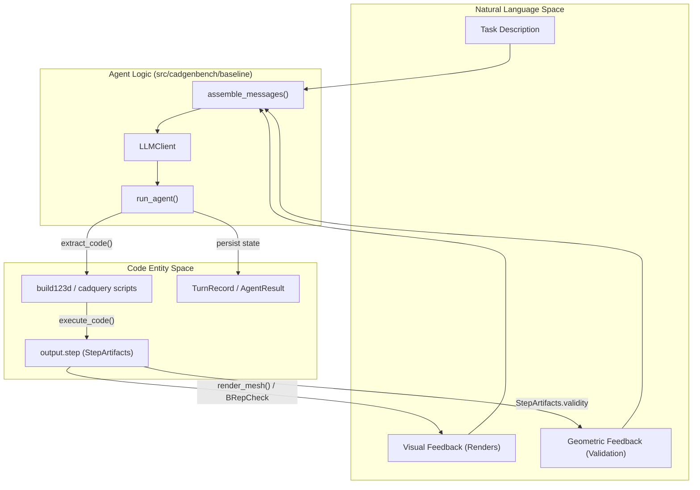
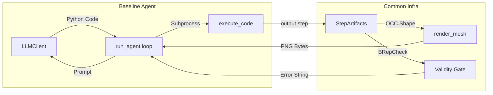

<!-- source: DeepWiki mcp.deepwiki.com · repo huggingface/cadgenbench · page 4 Reference Baseline Agent · fetched 2026-10-26 -->

# Reference Baseline Agent

Relevant source files

The following files were used as context for generating this wiki page:

- [README.md](README.md)
- [src/cadgenbench/baseline/agent.py](src/cadgenbench/baseline/agent.py)
- [src/cadgenbench/baseline/llm.py](src/cadgenbench/baseline/llm.py)
- [src/cadgenbench/baseline/prompt.py](src/cadgenbench/baseline/prompt.py)
- [src/cadgenbench/eval/report/__init__.py](src/cadgenbench/eval/report/__init__.py)
- [tests/baseline/test_agent.py](tests/baseline/test_agent.py)
- [tests/baseline/test_llm.py](tests/baseline/test_llm.py)

The reference baseline agent is an iterative, LLM-driven system designed to solve CAD generation and editing tasks. It follows a "code-act-observe" loop: generating Python CAD code (using `build123d` or `cadquery`), executing it to produce a STEP file, and using automated visual and geometric feedback to refine the model until it meets the requirements.

### System Architecture

The agent bridges the gap between natural language requirements and valid B-Rep geometry by treating CAD construction as a stateful programming task. It maintains a persistent working directory across turns, allowing it to build upon previous attempts or load existing `input.step` files for editing tasks [src/cadgenbench/baseline/agent.py:15-26]().

#### Space Mapping: Language to Code Entity
The following diagram illustrates how the agent maps high-level task concepts to specific code components and file artifacts.

**Sources:** [src/cadgenbench/baseline/agent.py:15-54](), [src/cadgenbench/baseline/prompt.py:54-88](), [src/cadgenbench/baseline/types.py:45-51]()

---

### Core Components

#### 1. The Iterative Loop
The `run_agent` function manages the lifecycle of a single task. It handles the transition between turns, manages the wall-clock budget via `_WallClockAlarm`, and enforces "hard gates" (e.g., the agent cannot signal `[DONE]` unless an `output.step` has been successfully produced) [src/cadgenbench/baseline/agent.py:66-152]().
For details, see [Agent Loop and Prompt Engineering](#4.1).

#### 2. LLM Communication
The `LLMClient` provides a unified interface to various model providers via `litellm`. It includes specialized reliability features such as exponential backoff for rate limits, history pruning to stay within image-count limits, and streaming reconstruction to prevent timeouts on long reasoning chains [src/cadgenbench/baseline/llm.py:15-46]().
For details, see [LLM Client and Reliability](#4.2).

#### 3. Execution and Feedback
Code execution happens in a sub-process via `execute_code`. After execution, the system automatically triggers `_auto_validate_and_render`, which uses the same geometric kernels as the [Scoring Engine](#2) to provide the agent with professional-grade feedback:
*   **Validity:** Watertightness and B-Rep integrity checks.
*   **Visuals:** Headless renders of the `output.step` from multiple angles.
*   **Logs:** Captured `stdout` and `stderr` from the CAD script.

#### 4. Result Persistence and Packaging
Every turn is recorded as a `TurnRecord`, and the final state is saved as an `AgentResult`. This data is structured to allow for easy inspection via the [HTML Reporting](#5) system and can be bundled into a ZIP file for leaderboard submission using the `baseline package` command [src/cadgenbench/baseline/types.py:45-51]().
For details, see [Agent Configuration and Result Persistence](#4.3) and [Submission Packaging](#4.4).

### Data Flow and Integration
The agent integrates with the core `cadgenbench` infrastructure to ensure that the feedback it receives during the loop is consistent with the final evaluation metrics.

**Sources:** [src/cadgenbench/baseline/agent.py:201-240](), [src/cadgenbench/common/artifacts.py:1-50](), [src/cadgenbench/common/viewer.py:1-30]()

### Supported Backends
The baseline currently supports two Python-based CAD backends, defined via `_BackendSpec` [src/cadgenbench/baseline/agent.py:85-99]():
| Backend | Language | Artifact | Description |
| :--- | :--- | :--- | :--- |
| `build123d` | Python | `output.step` | Modern, functional-style CAD API (Default). |
| `cadquery` | Python | `output.step` | Fluent, chainable CAD API. |

---

### Child Pages
*   **[Agent Loop and Prompt Engineering](#4.1)** — Turn management, completion markers, and system prompt construction.
*   **[LLM Client and Reliability](#4.2)** — Provider abstraction, retries, and history management.
*   **[Agent Configuration and Result Persistence](#4.3)** — Config schemas and the `results/` directory layout.
*   **[Submission Packaging](#4.4)** — Creating `submission.zip` and the `meta.json` contract.

---

