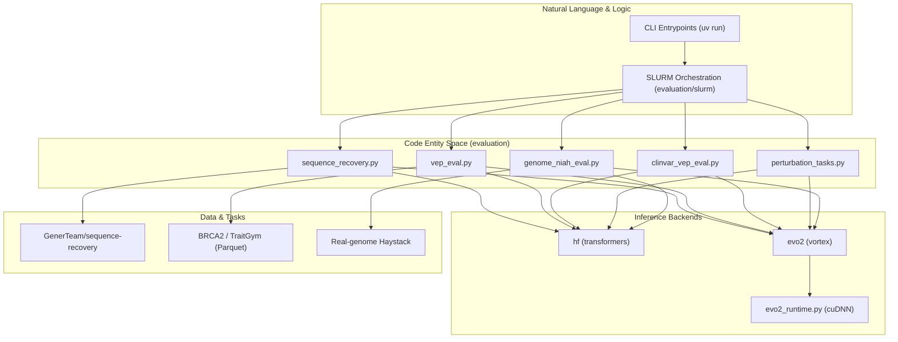
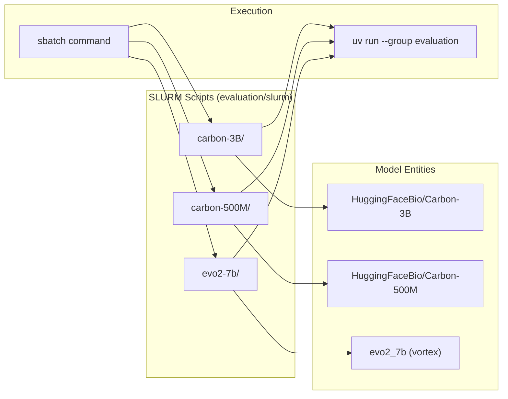

<!-- source: DeepWiki mcp.deepwiki.com · repo huggingface/carbon · page 2 Evaluation Suite · fetched 2026-10-26 -->

# Evaluation Suite

Relevant source files

The following files were used as context for generating this wiki page:

- [evaluation/README.md](evaluation/README.md)
- [evaluation/evo2_runtime.py](evaluation/evo2_runtime.py)

The Carbon evaluation suite provides a standardized **zero-shot** benchmarking framework for genomic foundation models. It supports multiple model families, including Carbon (500M, 3B, 8B), GENERator, and Evo2, through a unified interface. The suite is designed to evaluate models across diverse biological tasks ranging from variant effect prediction to long-context retrieval.

### Core Evaluation Architecture

The suite is organized around five primary evaluation scripts located in `evaluation/`. These scripts utilize a multi-backend design to accommodate different model architectures and inference requirements.

#### Multi-Backend Support
The evaluation framework supports two primary backends via the `--backend` flag [evaluation/README.md:40]():
*   **`hf` (Hugging Face)**: Uses `transformers.AutoModelForCausalLM`. This is the default backend for Carbon and GENERator models and supports automatic multi-GPU sharding [evaluation/README.md:42-44]().
*   **`evo2`**: Interfaces with the official `evo2` inference library. This is required for Arc Institute's Evo2 checkpoints, which are not compatible with standard Hugging Face `AutoModel` classes [evaluation/README.md:45-48](). It uses `evaluation/evo2_runtime.py` to preload necessary cuDNN libraries like `libcudnn.so.9` [evaluation/evo2_runtime.py:6-34]().

#### Hybrid Tokenization Handling
For Carbon models, which use a hybrid BPE+6-mer tokenizer, the `--add_dna_tag` flag must be used. This prepends the `<dna>` tag to inputs, signaling the model to switch from BPE (text) to 6-mer (DNA) tokenization mode [evaluation/README.md:52-59]().

### System Architecture: From Code to Task

The following diagram illustrates how the evaluation scripts interact with different backends and datasets to produce metrics.

**Evaluation Framework Overview**

**Sources:** [evaluation/README.md:16-48](), [evaluation/evo2_runtime.py:19-34]()

---

### Task Categories

The suite is divided into several specialized biological and generative tasks.

#### 2.1 Variant Effect Prediction (VEP)
VEP measures a model's ability to distinguish between pathogenic and benign genetic variants. The suite implements two distinct scoring methodologies:
*   **Centered 8kb Window**: Used for BRCA2 and TraitGym datasets in `vep_eval.py`. It calculates the full log-likelihood delta between reference and variant sequences [evaluation/README.md:131-137]().
*   **Right-end Next-token**: Used for ClinVar in `clinvar_vep_eval.py`, following the GENERator recipe [evaluation/README.md:35-36]().

For details, see [Variant Effect Prediction (VEP)](#2.1).

#### 2.2 Sequence Recovery
A generative evaluation in `sequence_recovery.py` that tests a model's ability to predict the next 30 base pairs of a DNA sequence given a preceding context. Results are reported as per-base accuracy across `eukaryote`, `bacteria`, and `others` splits [evaluation/README.md:70-74]().

For details, see [Sequence Recovery](#2.2).

#### 2.3 Perturbation Tasks
The `perturbation_tasks.py` script involves discriminating between natural DNA sequences and synthetically perturbed versions using pairwise discrimination accuracy [evaluation/README.md:23](). Supported tasks include:
*   `motif_human`: CAG repeat insertions.
*   `syn_human` / `syn_mouse`: Synonymous codon substitutions.
*   `promoter_revcomp`: Promoter sequence reverse-complementation.

For details, see [Perturbation Tasks](#2.3).

#### 2.4 Genome Needle-In-A-Haystack (NIAH)
Implemented in `genome_niah_eval.py`, this is a long-context retrieval benchmark where a specific sequence (the "needle") is inserted into a large genomic "haystack." The model must retrieve the needle at context lengths up to 786 kbp [evaluation/README.md:14-14]().

For details, see [Genome Needle-In-A-Haystack (NIAH)](#2.4).

### Orchestration and Infrastructure

The following diagram maps the SLURM orchestration layer to the specific model configurations used during evaluation.

**SLURM Orchestration Layer**

**Sources:** [evaluation/README.md:79-92](), [evaluation/slurm/README.md:15-34]()

#### 2.5 Inference Backends and Serving Benchmarks
This section covers the technical implementation of the `hf` and `evo2` backends, including the `preload_cudnn_libraries` utility in `evo2_runtime.py` and serving benchmarks found in `scripts/` [evaluation/evo2_runtime.py:19-34](), [evaluation/README.md:40-49]().

For details, see [Inference Backends and Serving Benchmarks](#2.5).

#### 2.6 SLURM Orchestration for Evaluation
The `evaluation/slurm/` directory contains reference scripts for launching the entire suite on high-performance computing clusters. These scripts utilize `uv run --group evaluation` to ensure a consistent environment across tasks [evaluation/README.md:30-31]().

For details, see [SLURM Orchestration for Evaluation](#2.6).

**Sources:**
*   [evaluation/README.md:1-152]()
*   [evaluation/evo2_runtime.py:1-35]()

---

