# Page: Carbon: Genomic Foundation Model — Overview

# Carbon: Genomic Foundation Model — Overview

<details>
<summary>Relevant source files</summary>

The following files were used as context for generating this wiki page:

- [.gitignore](.gitignore)
- [LICENSE](LICENSE)
- [README.md](README.md)
- [pyproject.toml](pyproject.toml)
- [tech-report.pdf](tech-report.pdf)
- [uv.lock](uv.lock)

</details>


Carbon is a family of genomic foundation models developed by Hugging Face, designed to serve as a backbone for DNA and RNA sequence analysis. Trained on approximately **1 trillion tokens (6 trillion base pairs)** [README.md:4-5](), Carbon utilizes a hybrid architecture to bridge natural language processing capabilities with high-resolution genomic modeling.

The project provides a comprehensive ecosystem including pretraining data mixtures, a multi-task zero-shot evaluation suite, and fine-tuning recipes for specialized biological tasks [README.md:8-15]().

### Model Family

The Carbon family consists of three model scales tailored for different computational budgets and use cases [README.md:28-32](). All models utilize a `LlamaDecoderLayer` backbone and are compatible with the Hugging Face `transformers` library via `trust_remote_code=True` [README.md:61-70]().

| Model | Params | Notes |
|---|---|---|
| [`HuggingFaceBio/Carbon-500M`](https://huggingface.co/HuggingFaceBio/Carbon-500M) | 500M | Draft model for speculative decoding. |
| **[`HuggingFaceBio/Carbon-3B`](https://huggingface.co/HuggingFaceBio/Carbon-3B)** | 3B | **Flagship.** Matches or beats Evo2 7B. |
| [`HuggingFaceBio/Carbon-8B`](https://huggingface.co/HuggingFaceBio/Carbon-8B) | 8B | Larger model for more performance. |

For architectural details, routing mechanisms, and loading patterns, see **[Model Family and Architecture](#1.1)**.

**Sources:** [README.md:28-32](), [README.md:61-70]()

### Core Innovations

#### Hybrid Tokenization and DNA Routing
Carbon employs a **hybrid tokenizer** strategy [README.md:34](). It uses Byte Pair Encoding (BPE) for standard English text and a specialized **6-mer** tokenizer for DNA sequences. Switching between these modes is handled by a `<dna>` tag [README.md:35-37](). This allows the model to process metadata or instructions in natural language while maintaining the precise resolution required for genomic data [README.md:72-74]().

#### Pretraining and Hybrid Loss
The models were trained using a specialized fork of Megatron-LM: [huggingface/Megatron-LM-Carbon](https://github.com/huggingface/Megatron-LM-Carbon) [README.md:103-104](). A key technical contribution is the **Hybrid Loss**, which bridges the gap between coarse 6-mer tokenization and single-nucleotide resolution [README.md:107]().

#### Data Mixture
The training corpus is **eukaryote-heavy by design** (90%), focusing on functional genomic regions (RefSeq) and mRNA transcripts (OpenGenome2), while including a 10% prokaryote fraction (GTDB v220 + IMG/PR) to support cross-species generalization [README.md:88-99]().

For a deep dive into the 1T token dataset composition, see **[Pretraining Corpus and Data Mixture](#1.2)**.

### Repository Structure

The repository is organized to support the full lifecycle of genomic model development, from environment setup to downstream application.

#### High-Level System Map
The following diagram illustrates the relationship between the core components of the Carbon ecosystem.

```mermaid
graph TD
    subgraph "Data_&_Training"
        [carbon-pretraining-corpus] --> [Megatron-LM-Carbon]
        [Megatron-LM-Carbon] --> [Checkpoints_500M_3B_8B]
    end

    subgraph "Inference_Logic"
        [Checkpoints_500M_3B_8B] --> [AutoTokenizer]
        [Checkpoints_500M_3B_8B] --> [AutoModelForCausalLM]
        [AutoTokenizer] -- "routes_via_<dna>_tag" --> [6-mer_DNA_Space]
        [AutoTokenizer] -- "default" --> [BPE_Text_Space]
    end

    subgraph "Applications"
        [AutoModelForCausalLM] --> [evaluation_suite]
        [AutoModelForCausalLM] --> [finetuning_recipes]
    end
```
**Sources:** [README.md:1-24](), [README.md:34-37](), [README.md:85-106]()

### Getting Started

Carbon requires **Python 3.12** [pyproject.toml:9]() and uses `uv` for environment management [README.md:41-45](). The repository defines several dependency groups to manage the complex requirements of genomic backends:

*   **Core**: Basic runtime including `vllm==0.19.1`, `accelerate`, and `datasets` [pyproject.toml:11-17]().
*   **Evaluation**: Tools for benchmarking, adding `pandas` [pyproject.toml:26-28]().
*   **Evo2**: Integration with the Evo2 framework, including `flash-attn` and `transformer-engine` [pyproject.toml:29-34]().

For installation steps and quick-start inference examples, see **[Getting Started: Installation and Environment](#1.3)**.

### Evaluation and Fine-Tuning

Carbon includes a standardized suite of seven zero-shot evaluations [README.md:112-113](). These scripts allow for direct comparison across model families like GENERator and Evo2 using a single backend flag [README.md:127-129]().

*   **Variant Effect Prediction (VEP):** BRCA2, TraitGym, and ClinVar [README.md:136-138]().
*   **Generative Tasks:** Sequence recovery [README.md:133]().
*   **Perturbation Tasks:** CAG repeat insertion and synonymous codon substitution [README.md:134-135]().
*   **Long-context:** Genome-NIAH (up to 786 kbp) [README.md:139]().

#### Component Interaction Diagram
This diagram shows how the `evaluation/` and `finetuning/` scripts interact with the model backends.

```mermaid
graph LR
    subgraph "Backends"
        [transformers_AutoModel]
        [vortex_evo2_runtime]
    end

    subgraph "Evaluation_Scripts"
        [vep_eval_py]
        [sequence_recovery_py]
        [genome_niah_eval_py]
        [perturbation_tasks_py]
    end

    subgraph "Fine-Tuning_Recipes"
        [finetuning_deepstarr]
        [finetune_promoter_py]
    end

    [vep_eval_py] -- "Inference" --> [transformers_AutoModel]
    [sequence_recovery_py] -- "Inference" --> [transformers_AutoModel]
    [sequence_recovery_py] -- "Inference" --> [vortex_evo2_runtime]
    [finetuning_deepstarr] -- "FSDP2_Training" --> [transformers_AutoModel]
    [finetune_promoter_py] -- "Trainer" --> [transformers_AutoModel]
```
**Sources:** [README.md:124-142](), [pyproject.toml:26-34]()

---

### Child Pages
*   **[Model Family and Architecture](#1.1)**: Details on the 500M/3B/8B models, 6-mer tokenization, and routing.
*   **[Pretraining Corpus and Data Mixture](#1.2)**: Breakdown of RefSeq, OpenGenome2, and GTDB data sources.
*   **[Getting Started: Installation and Environment](#1.3)**: Environment setup with `uv` and basic inference examples.

---

# Page: Model Family and Architecture

# Model Family and Architecture

<details>
<summary>Relevant source files</summary>

The following files were used as context for generating this wiki page:

- [.gitignore](.gitignore)
- [LICENSE](LICENSE)
- [README.md](README.md)
- [clustering/README.md](clustering/README.md)
- [finetuning/finetune_sft.py](finetuning/finetune_sft.py)
- [finetuning/fns_trainer.py](finetuning/fns_trainer.py)
- [pyproject.toml](pyproject.toml)
- [uv.lock](uv.lock)

</details>


This page provides a detailed technical description of the Carbon model family, including its architectural components, the hybrid tokenization system, and the specialized loss functions used during pretraining and fine-tuning.

## Model Family Scales

Carbon is a family of causal language models trained on 1T tokens (approximately 6T DNA base pairs) [README.md:85-86](). The family consists of three distinct scales designed for different computational requirements and performance targets.

| Model | Params | Role / Performance |
|---|---|---|
| `HuggingFaceBio/Carbon-500M` | 500M | Optimized as a draft model for speculative decoding [README.md:30](). |
| `HuggingFaceBio/Carbon-3B` | 3B | **Flagship.** Matches or beats Evo2 7B performance [README.md:31](). |
| `HuggingFaceBio/Carbon-8B` | 8B | Largest variant for maximum performance on complex tasks [README.md:32](). |

Sources: [README.md:28-32]()

## Architectural Backbone

The Carbon models utilize the `LlamaDecoderLayer` as their fundamental building block [README.md:15](). This architecture follows the standard transformer-based causal language modeling paradigm.

### Hybrid Tokenizer and Routing
Carbon employs a **hybrid tokenizer** that allows the model to process both natural language (English) and genomic data (DNA) within the same sequence [README.md:34-35]().

*   **BPE Mode:** Standard Byte-Pair Encoding for English text [README.md:34]().
*   **6-mer Mode:** Fixed-length 6-mer tokenization for DNA sequences [README.md:34-35]().

The transition between these modes is handled by a **`<dna>` tag routing mechanism**. When the tokenizer encounters a `<dna>` tag, it switches into 6-mer mode for the subsequent genomic input [README.md:72-74](). During fine-tuning or inference, sequences are typically wrapped as `<dna>{sequence}</dna>` [finetuning/finetune_sft.py:88-89]().

### Data Flow: Tokenization and Model Input
The following diagram illustrates how the `AutoTokenizer` and model components interact to process genomic data.

**Diagram: Carbon Tokenization and Input Flow**
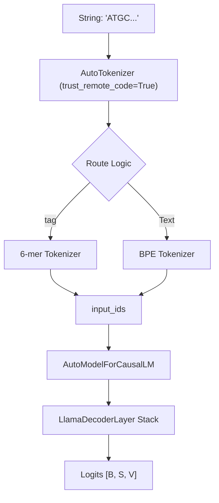
Sources: [README.md:34-37](), [README.md:61-75](), [finetuning/finetune_sft.py:88-93]()

## Pretraining and Hybrid Loss

Carbon was trained using a specialized fork: `huggingface/Megatron-LM-Carbon` [README.md:103-104](). To bridge the gap between coarse 6-mer tokenization and single-nucleotide resolution, the models utilize a **Hybrid Loss** [README.md:107]().

### FNSTrainer and Base-Pair Level Loss
During fine-tuning, the `FNSTrainer` class implements this logic by calculating loss at the nucleotide level rather than the token level for DNA segments [finetuning/fns_trainer.py:6-7]().

1.  **Token Classification:** The trainer identifies tokens as DNA k-mers, DNA special tokens (`<dna>`, `</dna>`), or BPE tokens [finetuning/fns_trainer.py:38-42]().
2.  **Marginal BP Loss:** For 6-mer tokens, it calculates a marginal base-pair loss by summing the probabilities of all 6-mer tokens that contain a specific nucleotide at a given position [finetuning/fns_trainer.py:129-153]().
3.  **Weighted Combination:** The final loss is a weighted average of the base-pair level loss (for k-mers) and standard cross-entropy loss (for BPE and special tokens) [finetuning/fns_trainer.py:68-75]().

**Diagram: Loss Computation in FNSTrainer**
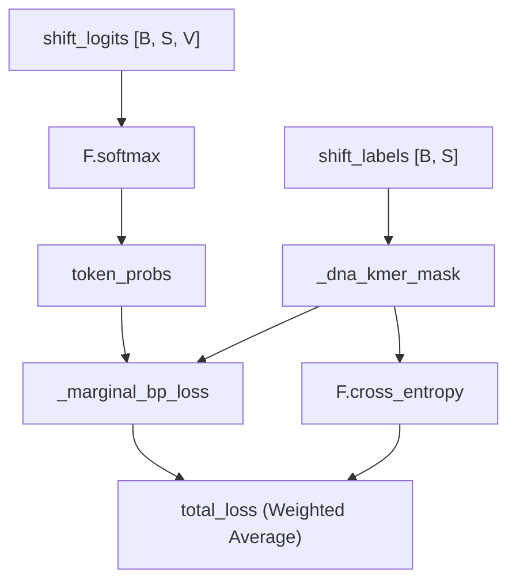
Sources: [finetuning/fns_trainer.py:19-82](), [finetuning/fns_trainer.py:129-155]()

## Loading and Inference Patterns

Carbon models require `trust_remote_code=True` to initialize the custom hybrid tokenizer and configurations [README.md:65-68]().

### Hugging Face Loading Example
```python
from transformers import AutoModelForCausalLM, AutoTokenizer

model_id = "HuggingFaceBio/Carbon-3B"
tok = AutoTokenizer.from_pretrained(model_id, trust_remote_code=True)
model = AutoModelForCausalLM.from_pretrained(
  model_id, 
  trust_remote_code=True,
  torch_dtype="bfloat16"
).to("cuda")
```
Sources: [README.md:61-70]()

### Embedding Representation
Carbon-3B organizes sequences into biologically meaningful structures in its hidden states.
*   **Separator Embeddings:** Extracted from the `</dna>` token; captures genome-level and taxonomic structure [clustering/README.md:11-13]().
*   **Content-Token Embeddings:** Extracted from the final DNA 6-mer; captures local state such as **strand orientation** and **codon phase** [clustering/README.md:11-14]().

Sources: [clustering/README.md:9-16]()

## Technical Requirements
*   **Python:** `==3.12.*` [uv.lock:3](), [pyproject.toml:9]().
*   **Environment Management:** Uses `uv` for dependency resolution [README.md:41-50]().
*   **Core Dependencies:** `vllm==0.19.1`, `transformers`, `accelerate>=1.13.0` [pyproject.toml:11-17]().
*   **Hardware:** Optimized for `bfloat16` precision on NVIDIA GPUs [README.md:69]().

Sources: [pyproject.toml:9-17](), [uv.lock:3](), [README.md:41-50]()

---

# Page: Pretraining Corpus and Data Mixture

# Pretraining Corpus and Data Mixture

<details>
<summary>Relevant source files</summary>

The following files were used as context for generating this wiki page:

- [.gitignore](.gitignore)
- [LICENSE](LICENSE)
- [README.md](README.md)
- [pyproject.toml](pyproject.toml)
- [uv.lock](uv.lock)

</details>


This page documents the composition, rationale, and technical framework behind the **Carbon Pretraining Corpus**, a ~1 trillion token dataset (approximately 6 trillion DNA base pairs) used to train the Carbon family of genomic foundation models [README.md:4-6]().

## Dataset Composition

The Carbon models are trained on a curated mixture of DNA and RNA sequences designed to maximize performance on eukaryotic downstream tasks while maintaining broad biological coverage. The corpus is hosted as the [Carbon Pretraining Corpus](https://huggingface.co/datasets/HuggingFaceBio/carbon-pretraining-corpus) [README.md:88-89]().

### Data Sources and Domains

The mixture consists of three primary biological components:

| Component | Source | Description |
| :--- | :--- | :--- |
| **Eukaryote Genes** | RefSeq (via GENERator mix) | Functional genomic regions including animals, plants, fungi, and protists [README.md:91](). |
| **mRNA Transcripts** | OpenGenome2 | Processed, spliced mRNA sequences representing the expressed transcriptome [README.md:92](). |
| **Prokaryote Genomes** | GTDB v220 + IMG/PR | Long chromosomal chunks from bacteria and archaea [README.md:93-94](). |

### Mixture Rationale: The 90/10 Split

The pretraining mixture is **eukaryote-heavy by design** [README.md:97]().
*   **Eukaryote (90%)**: The primary target use case for Carbon is eukaryotic biology (e.g., human variant effect prediction, enhancer activity). This includes the Eukaryote gene and mRNA transcript components [README.md:97-98]().
*   **Prokaryote (10%)**: Included as a smaller fraction (~10%) to provide the model with a "base" of prokaryotic understanding. This share allows the model to be efficiently continually pretrained on specific prokaryotic species if required for specialized tasks [README.md:94-99]().

### Data Flow and Source Mapping

The following diagram bridges the biological data sources to the training infrastructure and code entities.

**Corpus-to-Training Mapping**
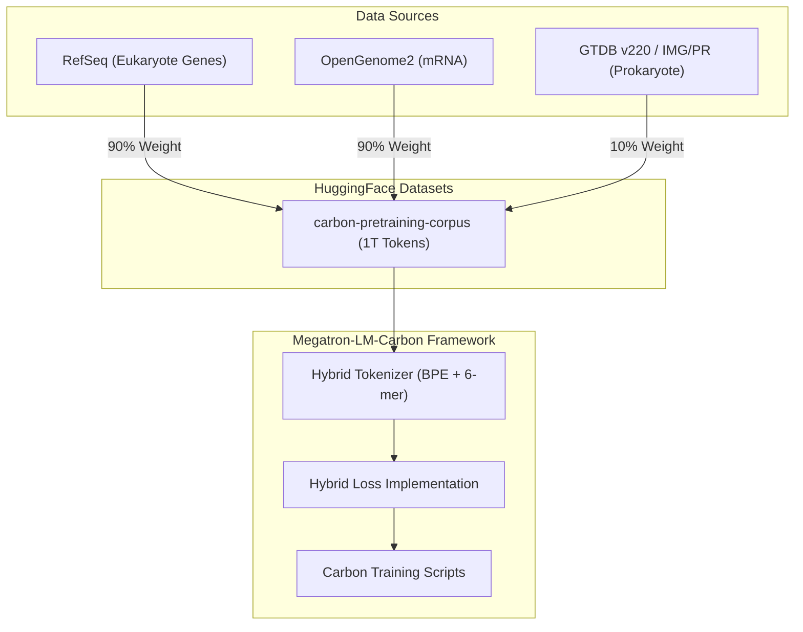
**Sources:** [README.md:88-108]()

## Megatron-LM-Carbon Framework

Carbon was trained using a specialized fork of Megatron-LM located at [huggingface/Megatron-LM-Carbon](https://github.com/huggingface/Megatron-LM-Carbon) [README.md:103-104]().

### Hybrid Loss Mechanism
The framework introduces a **Hybrid Loss** to bridge the gap between different resolutions in the sequence [README.md:107]():
1.  **Coarse 6-mer Tokenization**: Standard next-token prediction on the 6-mer tokens.
2.  **Single-Nucleotide Resolution**: Specialized loss components to ensure the model understands fine-grained genomic variations even when processing larger k-mer blocks [README.md:107]().

### DNA Routing and Tokenization
The pretraining data is processed using a hybrid tokenizer that switches modes based on special tags. During pretraining and subsequent inference, DNA sequences are wrapped in `<dna>` tags [README.md:34-37]().

*   **BPE Mode**: Used for any English text metadata (if present).
*   **6-mer Mode**: Activated by the `<dna>` tag to process genomic sequences [README.md:72-74]().

**Tokenizer Routing Logic**
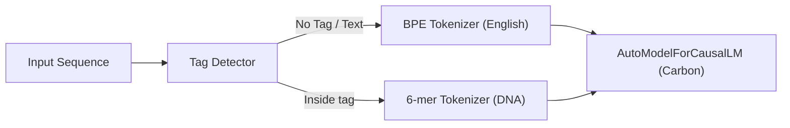
**Sources:** [README.md:34-37](), [README.md:61-75]()

## Training Specifications

The pretraining process utilizes several architectural optimizations to handle the 1T token scale:

*   **Context Length Support**: The model is trained to handle long-range dependencies, as evidenced by evaluations like `Genome-NIAH` which test context lengths up to 786 kbp [README.md:124-125]().
*   **Model Scales**: The corpus was used to train the 500M (draft), 3B (flagship), and 8B parameter variants [README.md:28-32]().
*   **Environment**: Pretraining and evaluation require a Python 3.12+ environment with specific pins for `vllm==0.19.1` and `accelerate>=1.13.0` [pyproject.toml:9-17]().
*   **Precision**: Training and inference typically utilize `torch_dtype="bfloat16"` [README.md:69]().

**Sources:** [README.md:28-32](), [README.md:69-70](), [README.md:124-125](), [pyproject.toml:9-17]()

---

# Page: Getting Started: Installation and Environment

# Getting Started: Installation and Environment

<details>
<summary>Relevant source files</summary>

The following files were used as context for generating this wiki page:

- [.gitignore](.gitignore)
- [LICENSE](LICENSE)
- [README.md](README.md)
- [pyproject.toml](pyproject.toml)
- [uv.lock](uv.lock)

</details>


This page provides a comprehensive guide to setting up the Carbon development environment. It covers the mandatory Python 3.12 requirement, environment management using `uv`, dependency groups for specific tasks (evaluation, Evo2), and initial inference patterns using the Hugging Face `transformers` library.

## Environment Requirements

The Carbon project strictly requires **Python 3.12** [uv.lock:3-3]() [pyproject.toml:9-9](). Environment management is handled via `uv` to ensure reproducible builds and efficient dependency resolution.

### Core Dependencies
The base installation includes essential libraries for model execution and basic data handling:
* **vLLM (0.19.1)**: Pinned for optimized inference serving [pyproject.toml:12-12]().
* **Accelerate (>=1.13.0)**: For distributed training and FSDP2 support [pyproject.toml:14-14]().
* **Datasets (>=4.8.5)**: For handling the Carbon Pretraining Corpus and evaluation benchmarks [pyproject.toml:13-13]().
* **Scikit-learn (>=1.8.0)**: Used in embedding analysis and clustering tasks [pyproject.toml:16-16]().

## Installation Steps

Installation is modularized into dependency groups defined in `pyproject.toml` [pyproject.toml:25-34]().

### 1. Basic Setup
To install only the core runtime dependencies:
```bash
uv sync
```
*Sources: [README.md:41-45]()*

### 2. Evaluation Group
To run the zero-shot DNA evaluation suite (e.g., Sequence Recovery, VEP), you must include the `evaluation` group, which adds `pandas` [pyproject.toml:26-28]():
```bash
uv sync --group evaluation
```
*Sources: [README.md:47-51]()*

### 3. Evo2 and Hardware Optimization
For benchmarking against Evo2 or using high-performance kernels like `flash-attn`, the `evo2` group is required. This group includes `flash-attn` (pinned to `2.8.0.post2`), `transformer-engine`, and `onnx` [pyproject.toml:29-34]().
```bash
uv sync --group evaluation --group evo2
```
*Sources: [README.md:53-57]()*

## Data Flow: Environment to Execution

The following diagram illustrates how the `pyproject.toml` configuration translates into functional environments for different codebase tasks.

**Environment Dependency Mapping**
```mermaid
graph TD
    subgraph "Project_Root"
        A["pyproject.toml"]
        B["uv.lock"]
    end

    subgraph "Dependency_Groups"
        C["Core"]
        D["evaluation"]
        E["evo2"]
    end

    subgraph "Code_Entities"
        F["vllm==0.19.1"]
        G["accelerate"]
        H["pandas"]
        I["flash-attn"]
        J["evo2_runtime.py"]
    end

    A --> C
    A --> D
    A --> E
    
    C --> F
    C --> G
    D --> H
    E --> I
    E --> J

    F -.-> "Inference / Serving"
    G -.-> "Finetuning / FSDP2"
    H -.-> "vep_eval.py / clinvar_vep_eval.py"
    I -.-> "Vortex / Evo2 Backends"
```
*Sources: [pyproject.toml:11-34](), [README.md:124-126]()*

## Hugging Face Authentication and Loading

Carbon models are hosted on the Hugging Face Hub. To access them, ensure you are authenticated:
```bash
huggingface-cli login
```

### Remote Code Execution
Carbon models utilize a custom architecture and a **hybrid tokenizer** (BPE + 6-mer) [README.md:34-37](). Because the model logic is not part of the core `transformers` library, you must set `trust_remote_code=True` when loading both the tokenizer and the model [README.md:65-68]().

## Quick-Start Inference

The Carbon checkpoints require a specific input format to trigger the DNA routing mechanism. DNA sequences must be wrapped in `<dna>` tags so the tokenizer switches to 6-mer mode [README.md:72-74]().

### Python Example
```python
from transformers import AutoModelForCausalLM, AutoTokenizer

model_id = "HuggingFaceBio/Carbon-3B"
# trust_remote_code is mandatory for the hybrid tokenizer
tok = AutoTokenizer.from_pretrained(model_id, trust_remote_code=True)
model = AutoModelForCausalLM.from_pretrained(
  model_id, 
  trust_remote_code=True,
  torch_dtype="bfloat16"
).to("cuda")

# DNA sequences must be prefixed with <dna>
context = "ATGGCCTCGAGCAGCAGCAGCAGCAGCAGCAGCAGCAGCAGCAGCAG"
prompt = f"<dna>{context}"
inputs = tok(prompt, return_tensors="pt", add_special_tokens=False).to("cuda")

out = model.generate(**inputs, max_new_tokens=10, do_sample=False)
print(tok.decode(out[0]))
```
*Sources: [README.md:61-79]()*

## Component Architecture

The diagram below shows the relationship between the installed environment and the primary execution entry points in the repository.

**System Entry Points and Code Entities**
```mermaid
graph LR
    subgraph "User_Interface"
        CLI["uv run"]
        Script["Python Script"]
    end

    subgraph "Inference_Logic"
        HF["AutoModelForCausalLM"]
        TOK["AutoTokenizer"]
        TRC["trust_remote_code=True"]
    end

    subgraph "Repository_Structure"
        EVAL["evaluation/"]
        FINE["finetuning/"]
        CLUS["clustering/"]
    end

    CLI --> EVAL
    CLI --> FINE
    Script --> HF
    HF --> TRC
    TOK --> TRC
    
    EVAL --> "vep_eval.py"
    EVAL --> "sequence_recovery.py"
    FINE --> "deepstarr/"
    CLUS --> "extract_separator_embeddings.py"
```
*Sources: [README.md:8-15](), [README.md:131-139]()*

## Troubleshooting
* **Python Version**: If `uv sync` fails, verify `python --version` returns 3.12.x.
* **Flash Attention**: The `evo2` group requires a compatible CUDA toolkit for `flash-attn` installation [pyproject.toml:23-23]().
* **VLLM Pinning**: The project uses `vllm==0.19.1` [pyproject.toml:12-12](). Avoid upgrading this manually to prevent compatibility issues with the serving benchmarks.

Sources: [README.md:39-79](), [pyproject.toml:1-35](), [uv.lock:1-3]()

---

# Page: Evaluation Suite

# Evaluation Suite

<details>
<summary>Relevant source files</summary>

The following files were used as context for generating this wiki page:

- [evaluation/README.md](evaluation/README.md)
- [evaluation/evo2_runtime.py](evaluation/evo2_runtime.py)

</details>


The Carbon evaluation suite provides a standardized **zero-shot** benchmarking framework for genomic foundation models. It supports multiple model families, including Carbon (500M, 3B, 8B), GENERator, and Evo2, through a unified interface. The suite is designed to evaluate models across diverse biological tasks ranging from variant effect prediction to long-context retrieval.

### Core Evaluation Architecture

The suite is organized around five primary evaluation scripts located in `evaluation/`. These scripts utilize a multi-backend design to accommodate different model architectures and inference requirements.

#### Multi-Backend Support
The evaluation framework supports two primary backends via the `--backend` flag [evaluation/README.md:40]():
*   **`hf` (Hugging Face)**: Uses `transformers.AutoModelForCausalLM`. This is the default backend for Carbon and GENERator models and supports automatic multi-GPU sharding [evaluation/README.md:42-44]().
*   **`evo2`**: Interfaces with the official `evo2` inference library. This is required for Arc Institute's Evo2 checkpoints, which are not compatible with standard Hugging Face `AutoModel` classes [evaluation/README.md:45-48](). It uses `evaluation/evo2_runtime.py` to preload necessary cuDNN libraries like `libcudnn.so.9` [evaluation/evo2_runtime.py:6-34]().

#### Hybrid Tokenization Handling
For Carbon models, which use a hybrid BPE+6-mer tokenizer, the `--add_dna_tag` flag must be used. This prepends the `<dna>` tag to inputs, signaling the model to switch from BPE (text) to 6-mer (DNA) tokenization mode [evaluation/README.md:52-59]().

### System Architecture: From Code to Task

The following diagram illustrates how the evaluation scripts interact with different backends and datasets to produce metrics.

**Evaluation Framework Overview**
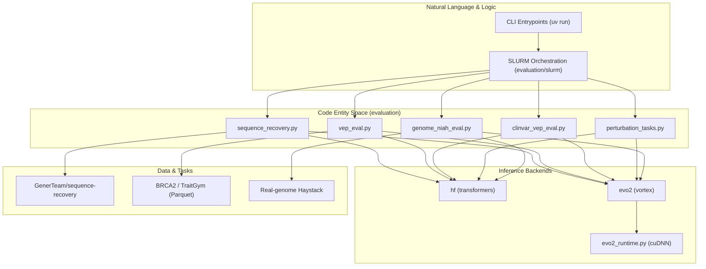
**Sources:** [evaluation/README.md:16-48](), [evaluation/evo2_runtime.py:19-34]()

---

### Task Categories

The suite is divided into several specialized biological and generative tasks.

#### 2.1 Variant Effect Prediction (VEP)
VEP measures a model's ability to distinguish between pathogenic and benign genetic variants. The suite implements two distinct scoring methodologies:
*   **Centered 8kb Window**: Used for BRCA2 and TraitGym datasets in `vep_eval.py`. It calculates the full log-likelihood delta between reference and variant sequences [evaluation/README.md:131-137]().
*   **Right-end Next-token**: Used for ClinVar in `clinvar_vep_eval.py`, following the GENERator recipe [evaluation/README.md:35-36]().

For details, see [Variant Effect Prediction (VEP)](#2.1).

#### 2.2 Sequence Recovery
A generative evaluation in `sequence_recovery.py` that tests a model's ability to predict the next 30 base pairs of a DNA sequence given a preceding context. Results are reported as per-base accuracy across `eukaryote`, `bacteria`, and `others` splits [evaluation/README.md:70-74]().

For details, see [Sequence Recovery](#2.2).

#### 2.3 Perturbation Tasks
The `perturbation_tasks.py` script involves discriminating between natural DNA sequences and synthetically perturbed versions using pairwise discrimination accuracy [evaluation/README.md:23](). Supported tasks include:
*   `motif_human`: CAG repeat insertions.
*   `syn_human` / `syn_mouse`: Synonymous codon substitutions.
*   `promoter_revcomp`: Promoter sequence reverse-complementation.

For details, see [Perturbation Tasks](#2.3).

#### 2.4 Genome Needle-In-A-Haystack (NIAH)
Implemented in `genome_niah_eval.py`, this is a long-context retrieval benchmark where a specific sequence (the "needle") is inserted into a large genomic "haystack." The model must retrieve the needle at context lengths up to 786 kbp [evaluation/README.md:14-14]().

For details, see [Genome Needle-In-A-Haystack (NIAH)](#2.4).

### Orchestration and Infrastructure

The following diagram maps the SLURM orchestration layer to the specific model configurations used during evaluation.

**SLURM Orchestration Layer**
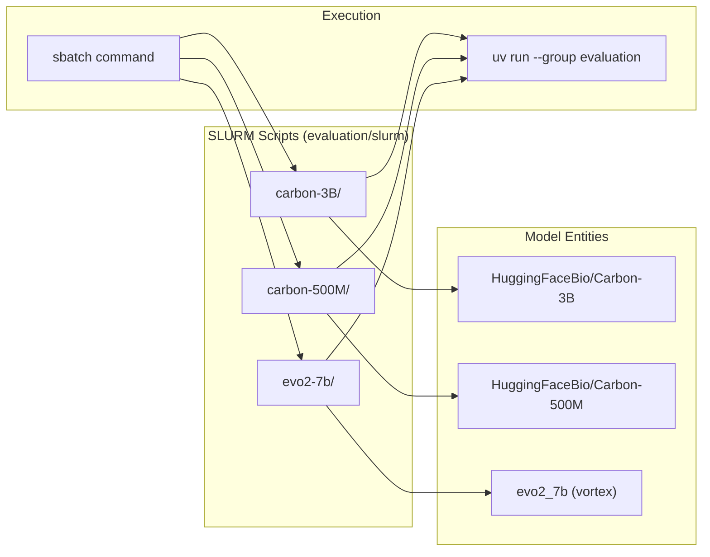
**Sources:** [evaluation/README.md:79-92](), [evaluation/slurm/README.md:15-34]()

#### 2.5 Inference Backends and Serving Benchmarks
This section covers the technical implementation of the `hf` and `evo2` backends, including the `preload_cudnn_libraries` utility in `evo2_runtime.py` and serving benchmarks found in `scripts/` [evaluation/evo2_runtime.py:19-34](), [evaluation/README.md:40-49]().

For details, see [Inference Backends and Serving Benchmarks](#2.5).

#### 2.6 SLURM Orchestration for Evaluation
The `evaluation/slurm/` directory contains reference scripts for launching the entire suite on high-performance computing clusters. These scripts utilize `uv run --group evaluation` to ensure a consistent environment across tasks [evaluation/README.md:30-31]().

For details, see [SLURM Orchestration for Evaluation](#2.6).

**Sources:**
*   [evaluation/README.md:1-152]()
*   [evaluation/evo2_runtime.py:1-35]()

---

# Page: Variant Effect Prediction (VEP)

# Variant Effect Prediction (VEP)

<details>
<summary>Relevant source files</summary>

The following files were used as context for generating this wiki page:

- [evaluation/clinvar_vep_eval.py](evaluation/clinvar_vep_eval.py)
- [evaluation/slurm/carbon-3B/clinvar.sbatch](evaluation/slurm/carbon-3B/clinvar.sbatch)
- [evaluation/slurm/carbon-3B/vep_brca2.sbatch](evaluation/slurm/carbon-3B/vep_brca2.sbatch)
- [evaluation/slurm/carbon-3B/vep_traitgym.sbatch](evaluation/slurm/carbon-3B/vep_traitgym.sbatch)
- [evaluation/slurm/evo2-1b/vep_brca2.sbatch](evaluation/slurm/evo2-1b/vep_brca2.sbatch)
- [evaluation/slurm/evo2-7b/clinvar.sbatch](evaluation/slurm/evo2-7b/clinvar.sbatch)
- [evaluation/slurm/evo2-7b/perturbation_tasks.sbatch](evaluation/slurm/evo2-7b/perturbation_tasks.sbatch)
- [evaluation/slurm/evo2-7b/vep_brca2.sbatch](evaluation/slurm/evo2-7b/vep_brca2.sbatch)
- [evaluation/slurm/evo2-7b/vep_traitgym.sbatch](evaluation/slurm/evo2-7b/vep_traitgym.sbatch)
- [evaluation/slurm/generator-v2-3b/vep_brca2.sbatch](evaluation/slurm/generator-v2-3b/vep_brca2.sbatch)
- [evaluation/vep_eval.py](evaluation/vep_eval.py)

</details>


Variant Effect Prediction (VEP) in the Carbon repository is a zero-shot evaluation framework designed to assess how well genomic foundation models can distinguish between benign and pathogenic Single Nucleotide Variants (SNVs). The framework supports two distinct scoring methodologies tailored to different biological contexts and dataset conventions: centered full-sequence log-likelihood deltas and right-end next-token marginalization.

### Core Evaluation Approaches

The system is split into two primary scripts based on the scoring recipe:

1.  **Full-Sequence Log-Likelihood Delta (`vep_eval.py`):** Used for BRCA2 and TraitGym. It calculates the difference in log-likelihood (LL) between a sequence containing the reference allele and one containing the variant allele, typically within an 8,192 bp window [evaluation/vep_eval.py:4-7]().
2.  **Next-Token Probability Marginalization (`clinvar_vep_eval.py`):** Used for ClinVar. It places the variant at the immediate right end of a long left-context (up to 48kb) and calculates the log-ratio of the probabilities for the reference vs. variant nucleotides [evaluation/clinvar_vep_eval.py:4-18]().

### VEP System Architecture

The following diagram illustrates how the evaluation scripts interact with the model backends and datasets.

**VEP Execution Flow**
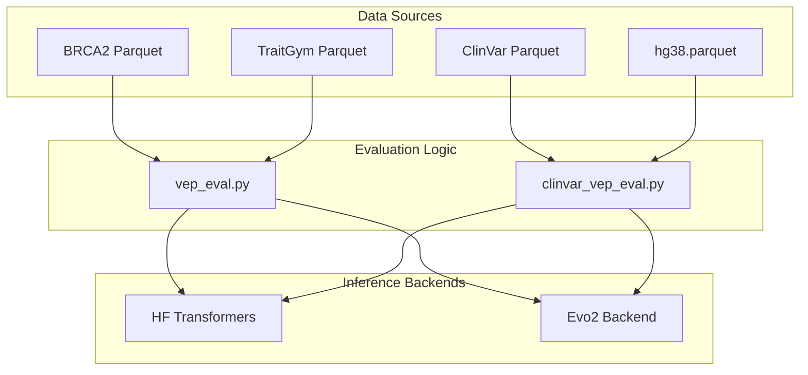
Sources: [evaluation/vep_eval.py:9-17](), [evaluation/clinvar_vep_eval.py:68-74]()

---

### Centered Window Scoring (BRCA2, TraitGym)

The `vep_eval.py` script handles datasets where variants are evaluated within a fixed-width window (default 8,192 bp). It supports multi-GPU sharding via `_shard_worker` [evaluation/vep_eval.py:90-92]().

*   **Delta Scoring:** The score is defined as $\Delta = LL(\text{variant}) - LL(\text{reference})$ [evaluation/vep_eval.py:5]().
*   **Strand-Symmetric Averaging:** For datasets like TraitGym where the causal strand may be unknown, the `--rev_comp_avg` flag enables scoring both the forward and reverse-complement sequences, averaging the resulting deltas [evaluation/vep_eval.py:75-79]().
*   **Metrics:** The script reports AUROC (against Loss-of-Function labels) and Spearman correlation (against continuous functional scores) [evaluation/vep_eval.py:6-7]().

**Scoring Implementation Detail**
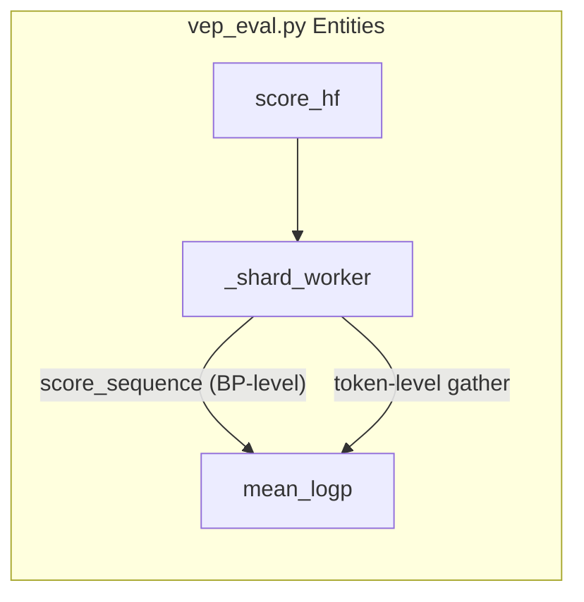
Sources: [evaluation/vep_eval.py:104-107](), [evaluation/vep_eval.py:135-146](), [evaluation/vep_eval.py:148-166]()

---

### Right-End Next-Token Scoring (ClinVar)

The `clinvar_vep_eval.py` script implements the "production recipe" used for Carbon's ClinVar benchmarks [evaluation/clinvar_vep_eval.py:2-5]().

*   **Context Alignment:** The script extracts a left-context window and trims it to a multiple of 6. This ensures the tokenizer boundary aligns exactly with the variant position for 6-mer tokenizers like Carbon's [evaluation/clinvar_vep_eval.py:112-118]().
*   **Marginalization:** Since the model predicts 6-mer tokens, the probability of a single nucleotide (e.g., 'A') is calculated by summing the probabilities of all 6-mer tokens in the vocabulary that start with that nucleotide [evaluation/clinvar_vep_eval.py:15-16]().
*   **Weighting:** Results are often calculated separately for `coding` and `non_coding` variants to provide a granular view of model performance [evaluation/slurm/carbon-3B/clinvar.sbatch:26-38]().

**ClinVar Marginalization Flow**
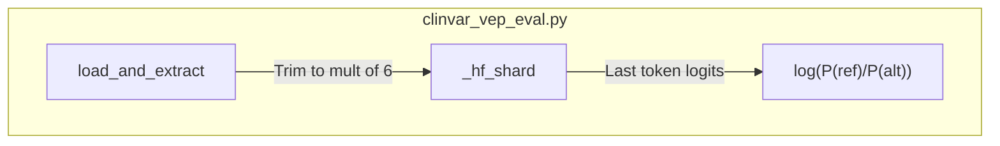
Sources: [evaluation/clinvar_vep_eval.py:93-125](), [evaluation/clinvar_vep_eval.py:128-158](), [evaluation/clinvar_vep_eval.py:15-18]()

---

### Dataset Preparation and Schemas

Both evaluation scripts rely on preprocessed Parquet files. While `vep_eval.py` expects a schema containing `ref_seq` and `var_seq` columns [evaluation/vep_eval.py:9-10](), `clinvar_vep_eval.py` dynamically extracts context from an `hg38.parquet` reference based on the variant's chromosome and position [evaluation/clinvar_vep_eval.py:93-111]().

For details on how these datasets are generated and the specific sourcing of BRCA2, TraitGym, and ClinVar data, see **[VEP Dataset Preparation](#2.1.1)**.

### Orchestration via SLURM

Evaluation is typically executed via SLURM scripts located in `evaluation/slurm/`. These scripts handle environment setup using `uv run --group evaluation` and manage multi-GPU resource allocation [evaluation/slurm/carbon-3B/vep_brca2.sbatch:15-28]().

| Task | Script | Default Context | GPUs |
| :--- | :--- | :--- | :--- |
| BRCA2 | `vep_brca2.sbatch` | 8,192 bp (centered) | 8 |
| TraitGym | `vep_traitgym.sbatch` | 8,192 bp (centered) | 8 |
| ClinVar | `clinvar.sbatch` | 24,000 bp (left) | 8 |

Sources: [evaluation/slurm/carbon-3B/vep_brca2.sbatch](), [evaluation/slurm/carbon-3B/vep_traitgym.sbatch](), [evaluation/slurm/carbon-3B/clinvar.sbatch]()

---

# Page: VEP Dataset Preparation

# VEP Dataset Preparation

<details>
<summary>Relevant source files</summary>

The following files were used as context for generating this wiki page:

- [evaluation/data_prep/README.md](evaluation/data_prep/README.md)
- [evaluation/data_prep/prep_brca2.py](evaluation/data_prep/prep_brca2.py)
- [evaluation/data_prep/prep_traitgym.py](evaluation/data_prep/prep_traitgym.py)

</details>


The `evaluation/data_prep/` directory contains scripts used to reconstruct Variant Effect Prediction (VEP) datasets from primary biological sources. While the evaluation suite defaults to pre-built parquets hosted on the Hugging Face Hub, these scripts provide transparency into the filtering, windowing, and labeling logic used to create the benchmarks [evaluation/data_prep/README.md:3-7]().

### Core Objective and Shared Schema

The primary goal of the preparation scripts is to transform raw variant tables (from Excel supplements or other dataset repositories) into a standardized Parquet format compatible with the `vep_eval.py` scoring engine [evaluation/data_prep/README.md:13-15]().

| Column | Description |
| :--- | :--- |
| `chrom` | Chromosome identifier (e.g., "13", "chr13"). |
| `pos` | 1-based genomic position of the variant. |
| `ref` | Reference nucleotide (single base for SNVs). |
| `alt` | Alternative nucleotide (single base for SNVs). |
| `score` | Continuous value (e.g., mean functional score or PIP). |
| `class` | Binary categorical label: `LOF` (Loss of Function) or `FUNC/INT` (Functional/Interesting). |
| `ref_seq` | The 8,192 bp genomic window centered on the variant from the reference genome. |
| `var_seq` | The same 8,192 bp window with the center base replaced by the `alt` allele. |

Sources: [evaluation/data_prep/prep_brca2.py:12-13](), [evaluation/data_prep/prep_traitgym.py:14-16](), [evaluation/data_prep/README.md:13-15]()

### BRCA2 Dataset Construction (`prep_brca2.py`)

The BRCA2 benchmark is derived from Huang et al. (2025) and focuses on DNA Binding Domain (DBD) Single Nucleotide Variants (SNVs) [evaluation/data_prep/prep_brca2.py:2-6]().

#### Data Flow and Processing
1.  **Source Retrieval**: Downloads the Nature 2025 supplementary Excel (Table S3) and the `hg19` chr13 reference from UCSC [evaluation/data_prep/prep_brca2.py:84-87]().
2.  **Filtering**: Filters variants based on ACMG-style functional classes. It keeps "Strong", "Moderate", and "Supporting" evidence for both Pathogenic (P) and Benign (B) labels, while dropping Variants of Uncertain Significance (VUS) [evaluation/data_prep/prep_brca2.py:100-103]().
3.  **Label Mapping**: Collapses classes into a binary format: P* becomes `LOF` and B* becomes `FUNC/INT` [evaluation/data_prep/prep_brca2.py:105-105]().
4.  **Sequence Extraction**: Uses the `window` function to slice an 8,192 bp window centered on the variant position [evaluation/data_prep/prep_brca2.py:68-77](). It performs a safety check to ensure the reference base in the FASTA matches the `ref` column in the metadata [evaluation/data_prep/prep_brca2.py:75-76]().

#### BRCA2 Preparation Logic
The following diagram illustrates the transformation from raw Excel data to the final evaluation-ready Parquet.

**BRCA2 Data Preparation Pipeline**
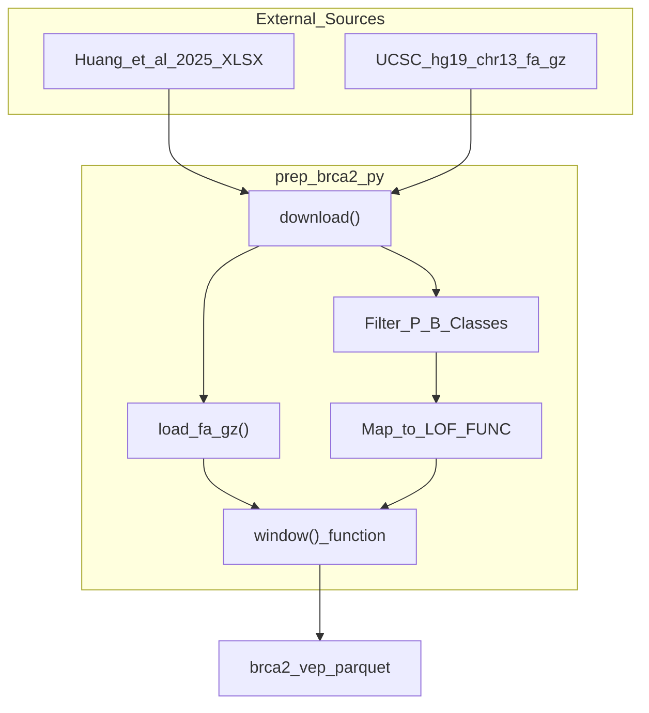
Sources: [evaluation/data_prep/prep_brca2.py:49-77](), [evaluation/data_prep/prep_brca2.py:84-130]()

### TraitGym Dataset Construction (`prep_traitgym.py`)

The TraitGym preparation script handles two distinct configurations: `mendelian_traits` (monogenic regulatory variants) and `complex_traits` (polygenic fine-mapped variants) [evaluation/data_prep/prep_traitgym.py:4-9]().

#### Implementation Details
*   **Reference Genome**: Unlike BRCA2, TraitGym uses `hg38`. The script dynamically downloads the required chromosome FASTA files from UCSC based on the variants present in the source [evaluation/data_prep/prep_traitgym.py:100-104]().
*   **PIP Scores**: For `complex_traits`, the Posterior Inclusion Probability (PIP) is preserved in the `score` column [evaluation/data_prep/prep_traitgym.py:121-121]().
*   **SNV Filtering**: Explicitly ensures only single-base substitutions are processed [evaluation/data_prep/prep_traitgym.py:94-96]().
*   **Windowing**: Uses a 8,192 bp window. If the variant is too close to the chromosome edge to fulfill the window size, the variant is dropped [evaluation/data_prep/prep_traitgym.py:77-78]().

**TraitGym Configuration Mapping**
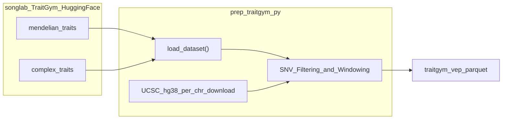
Sources: [evaluation/data_prep/prep_traitgym.py:36-37](), [evaluation/data_prep/prep_traitgym.py:88-108](), [evaluation/data_prep/prep_traitgym.py:112-124]()

### ClinVar Sourcing Strategy

Unlike BRCA2 and TraitGym, ClinVar does not have a local preparation script in `data_prep/`. Instead, the production evaluation script `clinvar_vep_eval.py` directly pulls a curated dataset: `HuggingFaceBio/clinvar-vep-final` [evaluation/data_prep/README.md:22-24]().

This dataset is a composite of:
1.  **GenerTeam ClinVar Release**: Primarily covering coding variants [evaluation/data_prep/README.md:25-26]().
2.  **Carbon-curated Noncoding Split**: Augmented data specifically targeting non-coding regions to test the foundation model's regulatory understanding [evaluation/data_prep/README.md:26-27]().

### Key Functions and Utilities

| Function | File | Role |
| :--- | :--- | :--- |
| `download(url, dst)` | `prep_brca2.py` / `prep_traitgym.py` | Handles cached retrieval of large genomic files and supplements [evaluation/data_prep/prep_brca2.py:49-57](). |
| `load_fa_gz(path)` | `prep_brca2.py` / `prep_traitgym.py` | Decompresses and parses `.fa.gz` files into a single uppercase string [evaluation/data_prep/prep_brca2.py:59-66](). |
| `window(chrom_seq, pos, ...)` | `prep_brca2.py` / `prep_traitgym.py` | Extracts centered genomic context and generates the mutated `var_seq` [evaluation/data_prep/prep_brca2.py:68-77](). |

Sources: [evaluation/data_prep/prep_brca2.py:49-77](), [evaluation/data_prep/prep_traitgym.py:53-80]()

---

# Page: Sequence Recovery

# Sequence Recovery

<details>
<summary>Relevant source files</summary>

The following files were used as context for generating this wiki page:

- [evaluation/scripts/benchmark_sequence_recovery_gen_len.py](evaluation/scripts/benchmark_sequence_recovery_gen_len.py)
- [evaluation/scripts/plot_sequence_recovery_sweep.py](evaluation/scripts/plot_sequence_recovery_sweep.py)
- [evaluation/sequence_recovery.py](evaluation/sequence_recovery.py)
- [evaluation/sequence_recovery_eval.py](evaluation/sequence_recovery_eval.py)
- [evaluation/sequence_recovery_eval.slurm](evaluation/sequence_recovery_eval.slurm)
- [evaluation/slurm/carbon-3B/sequence_recovery.sbatch](evaluation/slurm/carbon-3B/sequence_recovery.sbatch)
- [evaluation/slurm/carbon-500M/sequence_recovery.sbatch](evaluation/slurm/carbon-500M/sequence_recovery.sbatch)
- [evaluation/slurm/carbon-8B/sequence_recovery.sbatch](evaluation/slurm/carbon-8B/sequence_recovery.sbatch)
- [evaluation/slurm/evo2-1b/sequence_recovery.sbatch](evaluation/slurm/evo2-1b/sequence_recovery.sbatch)
- [evaluation/slurm/evo2-20b/sequence_recovery.sbatch](evaluation/slurm/evo2-20b/sequence_recovery.sbatch)
- [evaluation/slurm/evo2-40b/sequence_recovery.sbatch](evaluation/slurm/evo2-40b/sequence_recovery.sbatch)
- [evaluation/slurm/evo2-7b/sequence_recovery.sbatch](evaluation/slurm/evo2-7b/sequence_recovery.sbatch)
- [evaluation/slurm/generator-v2-1.2b/sequence_recovery.sbatch](evaluation/slurm/generator-v2-1.2b/sequence_recovery.sbatch)
- [evaluation/slurm/generator-v2-3b/sequence_recovery.sbatch](evaluation/slurm/generator-v2-3b/sequence_recovery.sbatch)
- [evaluation/submit_sequence_recovery_gen_len_sweep.sh](evaluation/submit_sequence_recovery_gen_len_sweep.sh)

</details>


Sequence Recovery is a zero-shot generative evaluation task designed to measure a genomic model's ability to accurately predict downstream DNA sequences given a preceding context. The model is provided with a fixed-length DNA sequence and tasked with generating the next $N$ tokens (or $M$ base pairs). Accuracy is calculated by comparing the generated nucleotides against the actual held-out sequence from the dataset on a per-base basis.

## Evaluation Methodology

The evaluation focuses on "exact-base recovery accuracy." For a given prompt, the model generates a continuation, and the accuracy is defined as the fraction of matching nucleotides at each position within the evaluation window (typically 30 bp).

### Key Metrics
*   **Per-Base Accuracy**: The sum of matching bases divided by the total length of the evaluation window `min(len(label), len(pred), seq_len)` [[evaluation/sequence_recovery.py:93-98]]().
*   **Overall Accuracy**: The mean accuracy across all samples in a dataset split [[evaluation/scripts/plot_sequence_recovery_sweep.py:94-94]]().
*   **By-Type Accuracy**: Accuracy broken down by taxonomic or genomic categories (e.g., fungi, invertebrate, plant, vertebrate_mammalian) [[evaluation/scripts/plot_sequence_recovery_sweep.py:182-192]]().

### Dataset Splits
The evaluation uses the `GenerTeam/sequence-recovery` dataset, which is partitioned into three primary splits [[evaluation/sequence_recovery.py:53-54]]():
1.  **Eukaryote**: High-complexity genomic data from eukaryotic organisms.
2.  **Bacteria**: Prokaryotic genomic sequences.
3.  **Others**: Additional genomic sequences not covered by the primary categories.

## Implementation Details

The suite consists of a production script for standard benchmarks and an extended evaluation script for long-rollout analysis.

### System Architecture and Data Flow

The following diagram illustrates the flow from raw DNA sequences in the dataset to the final accuracy metrics using the `hf` (HuggingFace) backend.

**Sequence Recovery Data Flow (HF Backend)**
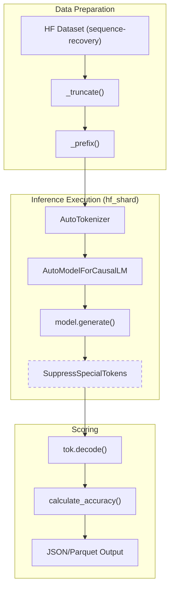
**Sources:** [[evaluation/sequence_recovery.py:87-90]](), [[evaluation/sequence_recovery.py:101-144]]()

### Model Backends
The evaluation supports two primary inference backends [[evaluation/sequence_recovery.py:52-52]]():
1.  **HF (HuggingFace)**: Standard `transformers` implementation used for Carbon and GENERator models. It supports `add_dna_tag` for Carbon's hybrid architecture and `add_bos` for pure DNA models [[evaluation/sequence_recovery.py:79-84]]().
2.  **Evo2**: Uses the official `evo2` inference library via `evo2_runtime.py` [[evaluation/sequence_recovery.py:166-173]]().

### Token Management
To ensure valid DNA generation, the `SuppressSpecialTokens` class is used as a `LogitsProcessor`. It sets the scores of all special tokens (like `<pad>`, `<s>`, or `</dna>`) to `-inf` during the generation loop, forcing the model to only output content tokens [[evaluation/sequence_recovery.py:69-76]]().

## Script Components

### 1. `sequence_recovery.py` (Production)
The primary script for running standard 30 bp recovery benchmarks. It uses `ProcessPoolExecutor` to shard the workload across all available GPUs on a node [[evaluation/sequence_recovery.py:148-163]]().

**Key Functions:**
*   `hf_shard`: Manages the model loading, tokenization, and generation for a specific GPU shard [[evaluation/sequence_recovery.py:101-107]]().
*   `_truncate`: Ensures the input context is truncated from the left to fit `max_seq_len` while maintaining 6-mer alignment for Carbon's tokenizer [[evaluation/sequence_recovery.py:87-90]]().

### 2. `sequence_recovery_eval.py` (Extended/Legacy)
An advanced version of the script supporting "Long-rollout" scoring. It allows for sweeps across different generation lengths to analyze how model accuracy decays over long sequences [[evaluation/sequence_recovery_eval.py:17-30]](). It also introduces support for `vLLM` and `continuous` batching via `ContinuousBatchingConfig` [[evaluation/sequence_recovery_eval.py:138-153]]() [[evaluation/sequence_recovery_eval.py:172-178]]().

**Accuracy Modes:**
*   `fixed_bp`: Standard evaluation against a fixed window (e.g., 30 bp) [[evaluation/sequence_recovery_eval.py:3-15]]().
*   `prediction_length`: Derives a tail label from the generated window to score longer sequences [[evaluation/sequence_recovery_eval.py:17-30]]().

### 3. Generation-Length Sweeps
Tooling is provided to automate the study of recovery accuracy vs. generation length (e.g., 5, 10, 20... 2560 tokens).

*   **`submit_sequence_recovery_gen_len_sweep.sh`**: Orchestrates SLURM jobs across a range of `GEN_LENS`.
*   **`plot_sequence_recovery_sweep.py`**: Aggregates the resulting JSON summaries and generates performance curves [[evaluation/scripts/plot_sequence_recovery_sweep.py:1-20]](). It distinguishes between labels sourced from the dataset versus those derived from the sequence tail [[evaluation/scripts/plot_sequence_recovery_sweep.py:155-158]]().

## SLURM Orchestration

Standardized SBATCH scripts are provided for Carbon model scales. These scripts typically use 8 GPUs on a single node and utilize the `uv` environment manager.

| Model | Script Path |
| :--- | :--- |
| Carbon-500M | `evaluation/slurm/carbon-500M/sequence_recovery.sbatch` [[evaluation/slurm/carbon-500M/sequence_recovery.sbatch:1-30]]() |
| Carbon-3B | `evaluation/slurm/carbon-3B/sequence_recovery.sbatch` [[evaluation/slurm/carbon-3B/sequence_recovery.sbatch:1-30]]() |
| Carbon-8B | `evaluation/slurm/carbon-8B/sequence_recovery.sbatch` [[evaluation/slurm/carbon-8B/sequence_recovery.sbatch:1-30]]() |
| Evo2 (1B/7B/20B/40B) | `evaluation/slurm/evo2-*/sequence_recovery.sbatch` [[evaluation/slurm/evo2-40b/sequence_recovery.sbatch:1-30]]() |

**Execution Mapping**
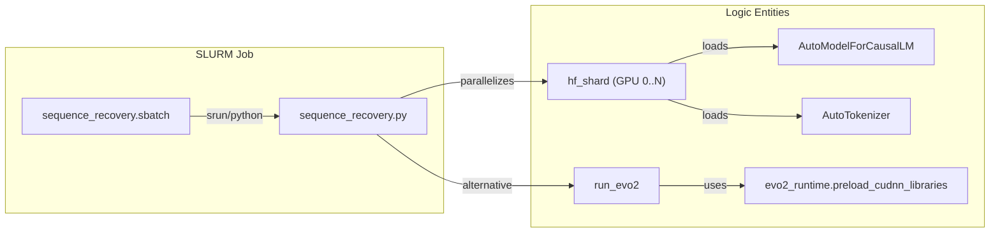
**Sources:** [[evaluation/slurm/carbon-3B/sequence_recovery.sbatch:24-29]](), [[evaluation/sequence_recovery.py:101-114]](), [[evaluation/sequence_recovery.py:166-173]]()

## Configuration Parameters

| Parameter | Description |
| :--- | :--- |
| `--max_seq_len` | Context length in base pairs (default: 6144) [[evaluation/sequence_recovery.py:56-56]](). |
| `--gen_len` | Number of tokens to generate for HF models (default: 5, approx 30 bp) [[evaluation/sequence_recovery.py:57-57]](). |
| `--gen_len_bp` | Number of base pairs to generate for Evo2 models (default: 30) [[evaluation/sequence_recovery.py:58-58]](). |
| `--add_dna_tag` | Prepends the `<dna>` tag required for Carbon hybrid models [[evaluation/sequence_recovery.py:61-61]](). |
| `--add_bos` | Prepends the `<s>` tag for pure DNA models like GENERator [[evaluation/sequence_recovery.py:62-62]](). |
| `--shard_idx` / `--n_shards` | Allows manual sharding of the dataset across multiple nodes [[evaluation/sequence_recovery.py:64-65]](). |

**Sources:** [[evaluation/sequence_recovery.py:48-66]](), [[evaluation/sequence_recovery_eval.py:52-112]]()

---

# Page: Perturbation Tasks

# Perturbation Tasks

<details>
<summary>Relevant source files</summary>

The following files were used as context for generating this wiki page:

- [evaluation/perturbation_tasks.py](evaluation/perturbation_tasks.py)
- [evaluation/slurm/carbon-3B/perturbation_tasks.sbatch](evaluation/slurm/carbon-3B/perturbation_tasks.sbatch)
- [evaluation/slurm/carbon-8B/clinvar.sbatch](evaluation/slurm/carbon-8B/clinvar.sbatch)
- [evaluation/slurm/carbon-8B/genome_niah.sbatch](evaluation/slurm/carbon-8B/genome_niah.sbatch)
- [evaluation/slurm/carbon-8B/perturbation_tasks.sbatch](evaluation/slurm/carbon-8B/perturbation_tasks.sbatch)
- [evaluation/slurm/evo2-1b/clinvar.sbatch](evaluation/slurm/evo2-1b/clinvar.sbatch)
- [evaluation/slurm/evo2-1b/perturbation_tasks.sbatch](evaluation/slurm/evo2-1b/perturbation_tasks.sbatch)
- [evaluation/slurm/evo2-1b/vep_traitgym.sbatch](evaluation/slurm/evo2-1b/vep_traitgym.sbatch)
- [evaluation/slurm/evo2-20b/clinvar.sbatch](evaluation/slurm/evo2-20b/clinvar.sbatch)
- [evaluation/slurm/evo2-20b/perturbation_tasks.sbatch](evaluation/slurm/evo2-20b/perturbation_tasks.sbatch)
- [evaluation/slurm/evo2-40b/clinvar.sbatch](evaluation/slurm/evo2-40b/clinvar.sbatch)
- [evaluation/slurm/evo2-40b/perturbation_tasks.sbatch](evaluation/slurm/evo2-40b/perturbation_tasks.sbatch)
- [evaluation/slurm/generator-v2-3b/perturbation_tasks.sbatch](evaluation/slurm/generator-v2-3b/perturbation_tasks.sbatch)

</details>


The perturbation tasks evaluation, implemented in `evaluation/perturbation_tasks.py`, assesses a model's ability to discriminate between natural biological sequences and synthetically perturbed variants [evaluation/perturbation_tasks.py:1-6](). Unlike Variant Effect Prediction (VEP), which focuses on single-nucleotide substitutions, these tasks involve structural or multi-codon changes [evaluation/perturbation_tasks.py:4-6]().

## Overview of Tasks

The evaluation suite utilizes the `HuggingFaceBio/carbon-perturbation-bench` dataset and includes four primary tasks defined in the `TASKS` dictionary [evaluation/perturbation_tasks.py:18-19, 57-62]().

| Task Name | Biological Context | Perturbation Method |
| :--- | :--- | :--- |
| `motif_human` | Human Coding Sequence (CDS) | Insertion of a tiled CAG repeat (10 consecutive CAG codons), creating a synthetic polyglutamine expansion [evaluation/perturbation_tasks.py:9-12](). |
| `syn_human` | Human CDS | Synonymous codon substitution: replacing codons with synonyms encoding the same amino acid [evaluation/perturbation_tasks.py:14-16](). |
| `syn_mouse` | Mouse CDS | Synonymous codon substitution using mouse-specific genomic contexts [evaluation/perturbation_tasks.py:14-16, 60](). |
| `promoter_revcomp` | Human Promoters | Reverse-complementing the promoter sequence [evaluation/perturbation_tasks.py:38, 61](). |

The primary metric for these tasks is **pairwise discrimination accuracy**, calculated as the mean frequency with which the model assigns a higher log-likelihood (LL) to the original sequence compared to the perturbed version [evaluation/perturbation_tasks.py:20]().

## System Architecture and Data Flow

The evaluation pipeline supports multiple backends and utilizes multi-GPU sharding via `multiprocessing` to accelerate scoring across large datasets [evaluation/perturbation_tasks.py:45, 178-185]().

### Data Flow Diagram
This diagram illustrates the transition from high-level task definitions to the specific code entities responsible for processing and scoring.

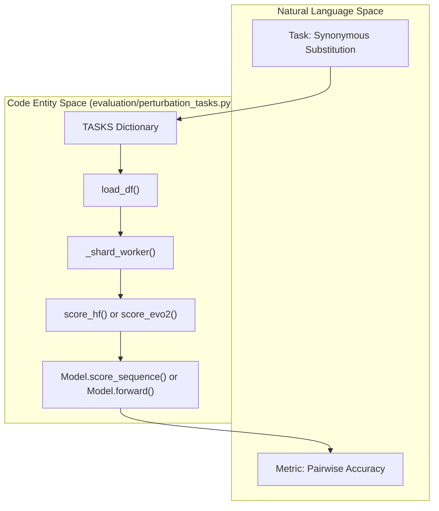
Sources: [evaluation/perturbation_tasks.py:57-62](), [evaluation/perturbation_tasks.py:85-89](), [evaluation/perturbation_tasks.py:91-93](), [evaluation/perturbation_tasks.py:174-176]()

### Execution Logic and Multi-GPU Sharding

The script uses `multiprocessing` to shard the dataset across available GPUs. Each worker process initializes its own model instance on a dedicated CUDA device [evaluation/perturbation_tasks.py:91-103]().

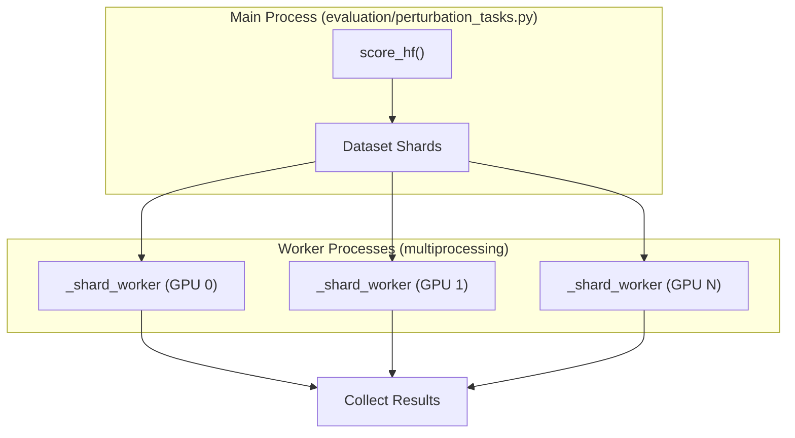
Sources: [evaluation/perturbation_tasks.py:91-95](), [evaluation/perturbation_tasks.py:174-188]()

## Scoring Methodologies

The evaluation dynamically selects between two scoring strategies based on the model's capabilities:

### 1. BP-level Scoring
If the model object possesses a `score_sequence` method, the script uses it for base-pair (BP) level scoring [evaluation/perturbation_tasks.py:105-107](). This is typical for models like Carbon that handle their own tokenization and log-prob aggregation internally. The script computes the mean log-probability per base by taking the mean of the log-transformed probabilities returned by `m.score_sequence(seqs)` [evaluation/perturbation_tasks.py:136-147]().

### 2. Token-level Scoring
For standard HuggingFace causal language models (e.g., GENERator), the script performs manual token-level scoring [evaluation/perturbation_tasks.py:109-110, 149-150]().
*   **Preprocessing**: Sequences are truncated to multiples of the k-mer size (6 for Carbon and GENERator) and prefixed with a BOS token (`<dna>` for Carbon, `<s>` for GENERator) [evaluation/perturbation_tasks.py:112-117, 130-133]().
*   **Computation**: The script calculates `log_softmax` on logits from `m(input_ids=ids, attention_mask=attn).logits`, gathers the log-probs for target tokens, and computes the masked mean log-prob per token [evaluation/perturbation_tasks.py:155-164]().

Sources: [evaluation/perturbation_tasks.py:105-167]()

## SLURM Orchestration

Evaluations are typically orchestrated via SLURM sbatch scripts located in `evaluation/slurm/`. These scripts chain multiple tasks together and handle environment setup using `uv run --group evaluation` [evaluation/slurm/carbon-3B/perturbation_tasks.sbatch:15, 29-40]().

### Configuration Patterns
*   **Carbon Models**: Use the `hf` backend on 8 GPUs, typically with `bf16` precision [evaluation/slurm/carbon-3B/perturbation_tasks.sbatch:8, 34-39]().
*   **Evo2 Models**: Use the `evo2` backend. Larger variants like `evo2_40b` use a single model-parallel instance across all 8 GPUs with `batch_size 1`, whereas smaller variants like `evo2_1b` use independent shards [evaluation/slurm/evo2-40b/perturbation_tasks.sbatch:36-39](), [evaluation/slurm/evo2-1b/perturbation_tasks.sbatch:8, 35-39]().
*   **GENERator Models**: Use the `hf` backend and follow the same multi-GPU chaining logic as Carbon [evaluation/slurm/generator-v2-3b/perturbation_tasks.sbatch:20, 34-40]().

Sources: [evaluation/slurm/carbon-3B/perturbation_tasks.sbatch:1-41](), [evaluation/slurm/evo2-40b/perturbation_tasks.sbatch:1-41](), [evaluation/slurm/generator-v2-3b/perturbation_tasks.sbatch:1-41]()

---

# Page: Genome Needle-In-A-Haystack (NIAH)

# Genome Needle-In-A-Haystack (NIAH)

<details>
<summary>Relevant source files</summary>

The following files were used as context for generating this wiki page:

- [evaluation/genome_niah_eval.py](evaluation/genome_niah_eval.py)
- [evaluation/slurm/carbon-3B/genome_niah.sbatch](evaluation/slurm/carbon-3B/genome_niah.sbatch)
- [evaluation/slurm/carbon-500M/clinvar.sbatch](evaluation/slurm/carbon-500M/clinvar.sbatch)
- [evaluation/slurm/carbon-500M/genome_niah.sbatch](evaluation/slurm/carbon-500M/genome_niah.sbatch)
- [evaluation/slurm/evo2-1b/genome_niah.sbatch](evaluation/slurm/evo2-1b/genome_niah.sbatch)
- [evaluation/slurm/evo2-20b/genome_niah.sbatch](evaluation/slurm/evo2-20b/genome_niah.sbatch)
- [evaluation/slurm/evo2-40b/genome_niah.sbatch](evaluation/slurm/evo2-40b/genome_niah.sbatch)
- [evaluation/slurm/evo2-7b/genome_niah.sbatch](evaluation/slurm/evo2-7b/genome_niah.sbatch)
- [evaluation/slurm/generator-v2-1.2b/clinvar.sbatch](evaluation/slurm/generator-v2-1.2b/clinvar.sbatch)
- [evaluation/slurm/generator-v2-1.2b/genome_niah.sbatch](evaluation/slurm/generator-v2-1.2b/genome_niah.sbatch)
- [evaluation/slurm/generator-v2-1.2b/perturbation_tasks.sbatch](evaluation/slurm/generator-v2-1.2b/perturbation_tasks.sbatch)
- [evaluation/slurm/generator-v2-1.2b/vep_brca2.sbatch](evaluation/slurm/generator-v2-1.2b/vep_brca2.sbatch)
- [evaluation/slurm/generator-v2-1.2b/vep_traitgym.sbatch](evaluation/slurm/generator-v2-1.2b/vep_traitgym.sbatch)
- [evaluation/slurm/generator-v2-3b/clinvar.sbatch](evaluation/slurm/generator-v2-3b/clinvar.sbatch)
- [evaluation/slurm/generator-v2-3b/genome_niah.sbatch](evaluation/slurm/generator-v2-3b/genome_niah.sbatch)

</details>


The Genome Needle-In-A-Haystack (NIAH) evaluation measures a model's ability to retrieve specific information from extremely long DNA contexts. It simulates a "key-value" retrieval task where a 24 bp "needle" (the value) is hidden within a "haystack" of real genomic sequence. The model is prompted with the haystack followed by a specific 24 bp "key", and it must correctly generate the associated value.

### System Architecture and Data Flow

The evaluation is implemented in `evaluation/genome_niah_eval.py` [evaluation/genome_niah_eval.py:1-54](). It supports two primary inference backends: `hf` (HuggingFace Transformers) for Carbon and GENERator models, and `evo2` (using the official `vortex` library) for Arc Institute models [evaluation/genome_niah_eval.py:17-26]().

#### Data Retrieval and Sharding
The benchmark processes datasets hosted on the HuggingFace Hub (`HuggingFaceBio/genome-niah`) or local parquet files [evaluation/genome_niah_eval.py:82-83](). Because long-context evaluation (up to 128k tokens or 786 kbp) is computationally expensive, the script implements a sharding mechanism via `apply_sharding` to distribute a single (task, context-length) cell across multiple compute nodes [evaluation/genome_niah_eval.py:158-167]().

Title: Genome NIAH Evaluation Data Flow
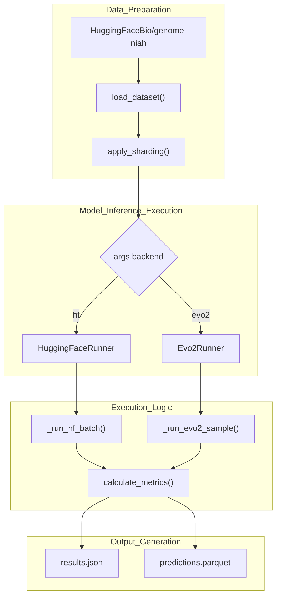
Sources: [evaluation/genome_niah_eval.py:141-155](), [evaluation/genome_niah_eval.py:158-175]()

### Task Definitions and Difficulty

The benchmark defines four tasks that increase in difficulty by introducing "near-duplicate" distractors. These distractors are sequences similar to the "key" but associated with different values, testing the model's precision in high-entropy long-context scenarios [evaluation/genome_niah_eval.py:8-12]().

| Task Name | Distractors | Key Identity | Difficulty |
| :--- | :--- | :--- | :--- |
| `niah` | 0 | N/A | Baseline retrieval |
| `neardup_d4` | 8 | 83% (Δ=4 bp) | Moderate |
| `neardup_d2` | 8 | 92% (Δ=2 bp) | High |
| `neardup_d1` | 8 | 96% (Δ=1 bp) | Discriminator level |

The context lengths (`--ctx`) are measured in Carbon tokens (6 bp per token), ranging from 4,096 tokens (24.5 kbp) up to 131,072 tokens (786.4 kbp) [evaluation/genome_niah_eval.py:14-15](), [evaluation/genome_niah_eval.py:86-88]().

Sources: [evaluation/genome_niah_eval.py:8-15](), [evaluation/genome_niah_eval.py:125-139]()

### Implementation Details

#### Haystack Construction and Scaling
The haystack is constructed by taking real genomic sequences and inserting the needle at controlled depths. For Carbon models, the `--add_dna_tag` flag prepends the `<dna>` routing tag [evaluation/genome_niah_eval.py:93-94](). To handle lengths beyond the 32k training window, the `--with_yarn` flag enables YaRN (Yet another RoPE extension) rope scaling for contexts up to 128k tokens [evaluation/genome_niah_eval.py:91-92]().

#### Metrics
The evaluation tracks four primary metrics [evaluation/genome_niah_eval.py:32-37]():
1.  **`gen_exact_match`**: Boolean indicating if the greedy-decoded 24 bp value exactly matches the ground truth label.
2.  **`gen_base_accuracy`**: Per-base accuracy of the decoded sequence.
3.  **`ll_correct`**: (HF backend only) Binary check if the log-likelihood of the correct sequence is higher than an incorrect sequence.
4.  **`ll_margin`**: The difference in log-likelihood between the positive and negative sequences.

Sources: [evaluation/genome_niah_eval.py:32-37](), [evaluation/genome_niah_eval.py:91-95]()

### Inference Backends

The codebase abstracts model interaction through a `Runner` pattern, specifically `HuggingFaceRunner` and `Evo2Runner`.

Title: NIAH Backend Abstraction
```mermaid
classDiagram
    class genome_niah_eval {
        +main()
        +load_dataset()
        +apply_sharding()
    }
    class HuggingFaceRunner {
        +model: AutoModelForCausalLM
        +tokenizer: AutoTokenizer
        +run_batch(batch)
        +restrict_to_dna_tokens: bool
    }
    class Evo2Runner {
        +model: Evo2
        +prefill_chars: int
        +run_sample(row)
    }
    genome_niah_eval --> HuggingFaceRunner : "instantiates if --backend hf"
    genome_niah_eval --> Evo2Runner : "instantiates if --backend evo2"
```

*   **HF Backend**: Uses `transformers` with support for `flash_attention_2` and `sdpa` [evaluation/genome_niah_eval.py:100-101](). It includes a specialized `--restrict_to_dna_tokens` flag for Carbon hybrid models to mask non-DNA tokens during generation using the model's `dna_config.json` [evaluation/genome_niah_eval.py:96-99]().
*   **Evo2 Backend**: Utilizes the `vortex` library for distributed inference across multiple GPUs [evaluation/genome_niah_eval.py:20-21](). It implements a `prefill_chars` strategy where the haystack is processed in chunks before switching to 1-by-1 decoding [evaluation/genome_niah_eval.py:104-105]().

Sources: [evaluation/genome_niah_eval.py:77-105](), [evaluation/genome_niah_eval.py:17-26]()

### SLURM Orchestration

Due to the extreme latency of long-context retrieval (e.g., a 128k context sample can take up to 14 hours on Evo2), the repository provides SLURM `.sbatch` templates for sharding the workload [evaluation/slurm/evo2-7b/genome_niah.sbatch:14-15]().

| Model | Batch Script | Default Backend | Context Limits |
| :--- | :--- | :--- | :--- |
| Carbon-3B | `evaluation/slurm/carbon-3B/genome_niah.sbatch` | `hf` | Up to 128k (with YaRN) |
| Carbon-500M | `evaluation/slurm/carbon-500M/genome_niah.sbatch` | `hf` | Up to 128k (with YaRN) |
| GENERator-v2 | `evaluation/slurm/generator-v2-3b/genome_niah.sbatch` | `hf` | Native 16k |
| Evo2-7B | `evaluation/slurm/evo2-7b/genome_niah.sbatch` | `evo2` | Up to 128k |
| Evo2-40B | `evaluation/slurm/evo2-40b/genome_niah.sbatch` | `evo2` | Up to 128k |

Example command for a full sweep at 32k context using 6 shards on Evo2-7B:
```bash
for SHARD in 0 1 2 3 4 5; do
  SHARD=$SHARD NSHARDS=6 CTX=32768 sbatch evaluation/slurm/evo2-7b/genome_niah.sbatch
done
```

Sources: [evaluation/slurm/evo2-7b/genome_niah.sbatch:26-29](), [evaluation/slurm/carbon-3B/genome_niah.sbatch:11-22](), [evaluation/slurm/generator-v2-3b/genome_niah.sbatch:11-16]()

---

# Page: Inference Backends and Serving Benchmarks

# Inference Backends and Serving Benchmarks

<details>
<summary>Relevant source files</summary>

The following files were used as context for generating this wiki page:

- [evaluation/evo2_runtime.py](evaluation/evo2_runtime.py)
- [evaluation/scripts/benchmark_evo2_serving.py](evaluation/scripts/benchmark_evo2_serving.py)
- [evaluation/scripts/benchmark_generator_transformers_serving.py](evaluation/scripts/benchmark_generator_transformers_serving.py)
- [evaluation/scripts/run_serving_benchmarks.py](evaluation/scripts/run_serving_benchmarks.py)

</details>


The Carbon project supports multiple inference backends to facilitate both high-throughput production serving and comparative benchmarking against existing genomic foundation models like Evo2 and GENERator. The codebase includes specialized orchestration scripts to measure serving metrics such as Time To First Token (TTFT), Inter-Token Latency (ITL), and total throughput across different hardware configurations and model scales.

## Inference Backends

Carbon supports two primary execution paths for inference, depending on the model architecture and the desired serving framework.

### Hugging Face & vLLM (Carbon / GENERator)
Carbon models are built on the `LlamaDecoderLayer` architecture [evaluation/scripts/run_serving_benchmarks.py:26-26](), making them natively compatible with the **vLLM** engine. This backend is used for production serving and speculative decoding.
*   **Architecture Override:** When serving via vLLM, the `LlamaForCausalLM` architecture is often forced to avoid attention-name collisions in speculative decoding [evaluation/scripts/run_serving_benchmarks.py:129-137]().
*   **Speculative Decoding:** Carbon-3B or Carbon-8B can be served with **Carbon-500M** as a draft model to accelerate generation [evaluation/scripts/run_serving_benchmarks.py:24-25]().

### Vortex / Evo2 Backend
Models from the Evo2 family utilize the **Vortex** inference engine.
*   **Evo2 Runtime:** To ensure compatibility with CUDA environments, the helper `preload_cudnn_libraries` in `evo2_runtime.py` explicitly loads cuDNN shared objects (e.g., `libcudnn_ops.so.9`, `libcudnn_cnn.so.9`) into the global symbol table using `ctypes.CDLL` [evaluation/evo2_runtime.py:6-34]().
*   **Vortex Generation:** The `benchmark_evo2_serving.py` script interfaces with `vortex.model.generation.Generator` to perform inference [evaluation/scripts/benchmark_evo2_serving.py:167-178]().

### Backend Comparison Data Flow
The following diagram illustrates how different model families are routed to their respective inference engines within the benchmarking suite.

**Model to Backend Routing**
```mermaid
graph TD
    subgraph "Model Input"
        Carbon["Carbon-3B/8B"]
        CarbonDraft["Carbon-500M (Draft)"]
        Evo2["Evo2-7B/40B"]
        GEN["GENERator-v2"]
    end

    subgraph "Inference Engines"
        VLLM["vLLM Engine"]
        Vortex["Vortex Engine"]
        HF["Transformers Backend"]
    end

    Carbon --> VLLM
    CarbonDraft -.->|"Speculative"| VLLM
    Evo2 --> Vortex
    GEN --> HF
    GEN --> VLLM

    VLLM --> Metrics["Serving Metrics (TTFT, ITL, TPS)"]
    Vortex --> Metrics
    HF --> Metrics

    style VLLM stroke-width:2px
    style Vortex stroke-width:2px
```
**Sources:** [evaluation/scripts/run_serving_benchmarks.py:60-77](), [evaluation/scripts/benchmark_evo2_serving.py:166-180](), [evaluation/scripts/benchmark_generator_transformers_serving.py:212-229]()

---

## Serving Benchmarks

The repository provides a suite of scripts in `evaluation/scripts/` to measure real-world serving performance. These tools simulate a production environment by calculating latencies and throughputs.

### Core Benchmarking Tools
1.  **`run_serving_benchmarks.py`**: The primary orchestrator. It manages the lifecycle of vLLM servers, handles GPU allocation, and executes requests against the served endpoints [evaluation/scripts/run_serving_benchmarks.py:1-202]().
2.  **`benchmark_evo2_serving.py`**: A specialized script for the Evo2/Vortex backend that mimics vLLM's metric reporting (TTFT, ITL) for fair comparison [evaluation/scripts/benchmark_evo2_serving.py:19-91]().
3.  **`benchmark_generator_transformers_serving.py`**: Benchmarks the GENERator model using the native Hugging Face Transformers library [evaluation/scripts/benchmark_generator_transformers_serving.py:46-87]().

### Key Metrics Tracked
The benchmarking suite records the following fields for every run [evaluation/scripts/run_serving_benchmarks.py:29-57]():
*   **TTFT (Time To First Token):** Latency from request to the first generated token.
*   **TPOT (Time Per Output Token):** Average time for each subsequent token.
*   **ITL (Inter-Token Latency):** The time delta between consecutive tokens [evaluation/scripts/benchmark_evo2_serving.py:207-210]().
*   **Throughput:** Requests per second and tokens per second.

### Speculative Decoding Configuration
The system supports speculative decoding, which uses a smaller "draft" model to predict multiple tokens that the larger "target" model then verifies in parallel.
*   **Draft Model:** Defaults to `HuggingFaceBio/Carbon-500M` [evaluation/scripts/run_serving_benchmarks.py:25-25]().
*   **Speculative Tokens:** Configurable via `--carbon-speculative-tokens`, typically testing 2, 4, or 8 tokens [evaluation/scripts/run_serving_benchmarks.py:139-143]().

**Inference Benchmarking Class Interaction**
```mermaid
classDiagram
    class RunSpec {
        +str name
        +str backend
        +str model
        +str draft_model
        +int num_speculative_tokens
        +list server_extra_args
    }
    class benchmark_evo2_serving {
        +load_evo2_model()
        +run_one_request()
        +synchronize_cuda()
    }
    class run_serving_benchmarks {
        +parse_args()
        +launch_vllm_server()
        +collect_metrics()
    }
    class KmerTokenizer {
        +encode(text)
        +decode(token_ids)
    }

    run_serving_benchmarks ..> RunSpec : "creates"
    benchmark_evo2_serving ..> KmerTokenizer : "uses for GENERator"
    benchmark_evo2_serving --> "vortex.model.generation.Generator" : "calls generate()"
```
**Sources:** [evaluation/scripts/run_serving_benchmarks.py:60-77](), [evaluation/scripts/benchmark_evo2_serving.py:152-163](), [evaluation/scripts/benchmark_generator_transformers_serving.py:148-175](), [evaluation/scripts/benchmark_evo2_serving.py:167-178]()

---

## Implementation Details

### Evo2 Runtime Initialization
Because Evo2 relies on specific cuDNN versions, the `evo2_runtime.py` script provides a preloading mechanism. It locates the `nvidia.cudnn` package and manually loads the `.so` files into the global process space using `ctypes.CDLL` with `RTLD_GLOBAL` to prevent runtime link errors during Vortex execution [evaluation/evo2_runtime.py:19-34]().

### K-mer Tokenization for Benchmarking
For models like GENERator that use fixed k-mer tokenization, a custom `KmerTokenizer` is implemented in the benchmarking scripts. It supports a vocabulary of 4^k combinations (e.g., 4096 for 6-mers) plus special tokens like `<dna>`, `<cds>`, and taxonomic tags [evaluation/scripts/benchmark_generator_transformers_serving.py:10-43](), [evaluation/scripts/benchmark_generator_transformers_serving.py:148-175]().

### Benchmark Execution Flow
1.  **Preparation:** Prompts are sampled from the `GenerTeam/sequence-recovery` dataset [evaluation/scripts/run_serving_benchmarks.py:93-94]().
2.  **Server Launch:** For vLLM, a subprocess is spawned with the specified model, revision, and GPU ID [evaluation/scripts/run_serving_benchmarks.py:101-116]().
3.  **Request Dispatch:** Requests are sent via `urllib.request` to the local server [evaluation/scripts/run_serving_benchmarks.py:13-14]().
4.  **Metric Calculation:** The system calculates P99 latencies and mean throughputs, outputting a summary CSV [evaluation/scripts/run_serving_benchmarks.py:29-57]().

**Sources:** [evaluation/evo2_runtime.py:1-35](), [evaluation/scripts/run_serving_benchmarks.py:21-57](), [evaluation/scripts/benchmark_evo2_serving.py:180-210](), [evaluation/scripts/benchmark_generator_transformers_serving.py:176-210]()

---

# Page: SLURM Orchestration for Evaluation

# SLURM Orchestration for Evaluation

<details>
<summary>Relevant source files</summary>

The following files were used as context for generating this wiki page:

- [evaluation/slurm/README.md](evaluation/slurm/README.md)
- [evaluation/slurm/carbon-3B/perturbation_tasks.sbatch](evaluation/slurm/carbon-3B/perturbation_tasks.sbatch)
- [evaluation/slurm/carbon-500M/perturbation_tasks.sbatch](evaluation/slurm/carbon-500M/perturbation_tasks.sbatch)
- [evaluation/slurm/carbon-500M/vep_brca2.sbatch](evaluation/slurm/carbon-500M/vep_brca2.sbatch)
- [evaluation/slurm/carbon-500M/vep_traitgym.sbatch](evaluation/slurm/carbon-500M/vep_traitgym.sbatch)
- [evaluation/slurm/carbon-8B/vep_brca2.sbatch](evaluation/slurm/carbon-8B/vep_brca2.sbatch)
- [evaluation/slurm/carbon-8B/vep_traitgym.sbatch](evaluation/slurm/carbon-8B/vep_traitgym.sbatch)
- [evaluation/slurm/evo2-1b/genome_niah.sbatch](evaluation/slurm/evo2-1b/genome_niah.sbatch)
- [evaluation/slurm/evo2-20b/genome_niah.sbatch](evaluation/slurm/evo2-20b/genome_niah.sbatch)
- [evaluation/slurm/evo2-40b/genome_niah.sbatch](evaluation/slurm/evo2-40b/genome_niah.sbatch)
- [evaluation/slurm/evo2-7b/genome_niah.sbatch](evaluation/slurm/evo2-7b/genome_niah.sbatch)
- [evaluation/slurm/generator-v2-3b/perturbation_tasks.sbatch](evaluation/slurm/generator-v2-3b/perturbation_tasks.sbatch)
- [evaluation/slurm/generator-v2-3b/vep_traitgym.sbatch](evaluation/slurm/generator-v2-3b/vep_traitgym.sbatch)
- [logs/.gitkeep](logs/.gitkeep)

</details>


This page documents the SLURM-based orchestration layer used to execute the Carbon evaluation suite at scale. The system is designed to provide reproducible, version-controlled benchmarking across multiple model families (Carbon, GENERator, and Evo2) by leveraging structured directory hierarchies, environment-isolated execution via `uv`, and standardized output versioning.

## Directory Structure and Model Families

The orchestration logic is located in `evaluation/slurm/`, organized into subdirectories based on model families [evaluation/slurm/README.md:1-25](). Each subdirectory contains a standardized set of `.sbatch` scripts tailored to the specific architectural requirements of that model family (e.g., GPU counts, memory limits, and inference backends).

| Model Family | Subdirectory | Target Checkpoint Example |
| :--- | :--- | :--- |
| **Carbon 500M** | `carbon-500M/` | `HuggingFaceBio/Carbon-500M` |
| **Carbon 3B** | `carbon-3B/` | `HuggingFaceBio/Carbon-3B` |
| **Carbon 8B** | `carbon-8B/` | `HuggingFaceBio/Carbon-8B` |
| **GENERator v2** | `generator-v2-1.2b/`, `generator-v2-3b/` | `GenerTeam/GENERator-v2-eukaryote-3b-base` |
| **Evo2** | `evo2-1b/`, `evo2-7b/`, `evo2-20b/`, `evo2-40b/` | `arcinstitute/evo2_7b` |

### Core Evaluation Scripts
Each model directory typically includes the following sbatch templates [evaluation/slurm/README.md:27-34]():
*   `sequence_recovery.sbatch`: Generative next-token accuracy.
*   `vep_brca2.sbatch`: Variant effect prediction on BRCA2.
*   `vep_traitgym.sbatch`: Mendelian trait VEP with reverse-complement averaging.
*   `clinvar.sbatch`: ClinVar coding and non-coding tasks (supports context length overrides).
*   `perturbation_tasks.sbatch`: Motif insertion and synonymous codon substitution tasks.
*   `genome_niah.sbatch`: Long-context "Needle-In-A-Haystack" retrieval.

**Sources:** [evaluation/slurm/README.md:1-34]()

## Execution Pattern and Environment

The orchestration layer uses `uv` for environment management, ensuring that evaluation-only dependencies do not pollute the core training environment.

### The `uv run` Pattern
Scripts execute using the following command structure:
`uv run --no-sync --group evaluation [--group evo2] python evaluation/<script>.py` [evaluation/slurm/evo2-7b/genome_niah.sbatch:32]()

*   `--group evaluation`: Includes core evaluation dependencies [evaluation/slurm/carbon-3B/perturbation_tasks.sbatch:15]().
*   `--group evo2`: Required specifically for the Evo2 backend to load the `vortex` inference library [evaluation/slurm/evo2-7b/genome_niah.sbatch:32]().

### Versioning with `RUN_SHA`
To ensure reproducibility, the orchestration layer uses the current Git commit hash to version results [evaluation/slurm/carbon-3B/perturbation_tasks.sbatch:16-17]():
1.  **`RUN_SHA`**: Captured via `git rev-parse --short=12 HEAD`.
2.  **`OUT_ROOT`**: Results are stored in `results/$RUN_SHA/`, preventing accidental overwrites of previous benchmark runs.

### Orchestration Data Flow

The following diagram illustrates how a SLURM job transitions from a shell command to a versioned result using the `uv` environment.

**Job Submission and Execution Flow**
```mermaid
graph TD
    subgraph "User_Space"
        A["sbatch evaluation/slurm/carbon-3B/perturbation_tasks.sbatch"]
    end

    subgraph "SLURM_Node"
        B["source ~/.bashrc"] --> C["Set RUN_SHA=$(git rev-parse)"]
        C --> D["Set OUT_ROOT=results/$RUN_SHA"]
        D --> E["uv run --group evaluation"]
        E --> F["python evaluation/perturbation_tasks.py"]
    end

    subgraph "Execution_Logic"
        F --> G{"Backend Check"}
        G -- "Carbon/Gen Models" --> H["transformers.AutoModelForCausalLM"]
        G -- "Evo2 Models" --> I["evo2_vortex_backend"]
        H --> J["Compute Metrics"]
        I --> J
    end

    subgraph "Storage"
        J --> K["$OUT_ROOT/perturbation_tasks/summary.json"]
    end
```
**Sources:** [evaluation/slurm/carbon-3B/perturbation_tasks.sbatch:13-40](), [evaluation/slurm/evo2-7b/genome_niah.sbatch:30-57]()

## Implementation Details

### VEP Task Configuration
The VEP scripts implement different scoring recipes based on the benchmark. `vep_brca2.sbatch` and `vep_traitgym.sbatch` utilize the `vep_eval.py` script. For example, `vep_traitgym.sbatch` enables `--rev_comp_avg` for strand-symmetric scoring [evaluation/slurm/carbon-500M/vep_traitgym.sbatch:25]().

### Long-Context NIAH Sweeps
The `genome_niah.sbatch` script is designed for parameterized sweeps. Users can override the task and context length via environment variables during submission [evaluation/slurm/README.md:45-52](). For Evo2 models, it supports sharding to split a (task, ctx) cell across multiple jobs, which is critical for long contexts (e.g., 128k) where per-row time can grow significantly [evaluation/slurm/evo2-7b/genome_niah.sbatch:13-22]().

```bash
# Example: Sweep across context lengths for Carbon-3B
for TASK in niah neardup_d4; do
  for CTX in 4096 8192 16384 32768; do
    TASK=$TASK CTX=$CTX sbatch evaluation/slurm/carbon-3B/genome_niah.sbatch
  done
done
```

### Perturbation Task Iteration
The `perturbation_tasks.sbatch` script iterates through a `TASK_SPECS` array, executing multiple sub-tasks (motif_human, syn_human, syn_mouse, promoter_revcomp) within a single job allocation [evaluation/slurm/carbon-3B/perturbation_tasks.sbatch:22-40]().

**Entity Mapping: SLURM to Code**
```mermaid
graph LR
    subgraph "SLURM_Entity"
        S1["vep_brca2.sbatch"]
        S2["vep_traitgym.sbatch"]
        S3["perturbation_tasks.sbatch"]
        S4["genome_niah.sbatch"]
    end

    subgraph "Python_Script_Entity"
        P1["vep_eval.py"]
        P3["perturbation_tasks.py"]
        P4["genome_niah_eval.py"]
    end

    subgraph "Metric_Logic"
        M1["Log-Likelihood Delta"]
        M2["gen_exact_match"]
        M3["Pairwise Discrimination Accuracy"]
    end

    S1 --> P1
    S2 --> P1
    S3 --> P3
    S4 --> P4

    P1 --> M1
    P3 --> M3
    P4 --> M2
```
**Sources:** [evaluation/slurm/README.md:27-34](), [evaluation/slurm/carbon-3B/perturbation_tasks.sbatch:34](), [evaluation/slurm/evo2-7b/genome_niah.sbatch:51]()

## Monitoring and Resource Management

### Hardware Requirements
*   **Standard Carbon Models**: Typically run on 8 GPUs to leverage data parallelism or multi-task chaining [evaluation/slurm/carbon-3B/perturbation_tasks.sbatch:8-11]().
*   **Evo2 Models**: Utilize the `vortex` backend. Larger variants (20B/40B) require 8 GPUs with model-parallel loading [evaluation/slurm/README.md:36-38](). 40B NIAH jobs request up to 1024G of RAM and 72 hours walltime [evaluation/slurm/evo2-40b/genome_niah.sbatch:10-11]().

### Logging
Standard output and error logs are redirected to the `logs/` directory using SLURM job names (`%x`) and IDs (`%j`) [evaluation/slurm/carbon-3B/perturbation_tasks.sbatch:3-4]().

**Sources:** [evaluation/slurm/README.md:36-38](), [evaluation/slurm/evo2-40b/genome_niah.sbatch:1-11]()

---

# Page: Fine-Tuning Recipes

# Fine-Tuning Recipes

<details>
<summary>Relevant source files</summary>

The following files were used as context for generating this wiki page:

- [finetuning/README.md](finetuning/README.md)
- [finetuning/deepstarr/fsdp2_carbon.yaml](finetuning/deepstarr/fsdp2_carbon.yaml)

</details>


The `finetuning/` directory provides standardized recipes for adapting Carbon models to specific biological downstream tasks. These recipes cover three primary training paradigms: **Regression** (for predicting continuous biological activity), **Classification** (for categorical tasks like promoter detection), and **Supervised Fine-Tuning (SFT)** (for generative sequence modeling).

The recipes are designed to scale from the **Carbon-500M** to the **Carbon-8B** models, utilizing advanced distributed training techniques like **FSDP2** to manage the memory requirements of genomic foundation models.

## Training Paradigms

Carbon fine-tuning is split into three distinct architectural approaches based on the task objective:

### 1. Regression via Accelerate + FSDP2
For continuous value prediction, the repository uses custom training loops built on `accelerate`. This allows for specialized loss functions (like Pearson Correlation) and the use of **FSDP2 (Fully Sharded Data Parallel)** via `torch.distributed.device_mesh` for efficient sharding of large models.

*   **Key Files**: `finetuning/deepstarr/deepstarr_train.py` [finetuning/README.md:36-39](), `finetuning/promoter_activity/promoter_activity_train.py` [finetuning/README.md:55-57](), `finetuning/malinois/malinois_train.py` [finetuning/README.md:73-75]().
*   **Infrastructure**: Uses `fsdp2_carbon.yaml` which specifies `LlamaDecoderLayer` for `fsdp_transformer_layer_cls_to_wrap` [finetuning/deepstarr/fsdp2_carbon.yaml:15]().

### 2. Classification via Hugging Face Trainer
For categorical tasks, the repository provides a streamlined approach using the standard `transformers.Trainer`. This is ideal for GUE (Genomic Understanding Evaluation) benchmarks.

*   **Key File**: `finetuning/finetune_promoter.py` [finetuning/README.md:107-111]().
*   **Model Class**: `AutoModelForSequenceClassification` [finetuning/README.md:131-132]().

### 3. Generative SFT via FNSTrainer
For base-pair level supervision, the `finetune_sft.py` script uses **Factorized Nucleotide Supervision (FNS)**. This marginalizes k-mer token probabilities to nucleotide-level probabilities, providing k× more supervision signal [finetuning/README.md:150-161]().

*   **Key File**: `finetuning/finetune_sft.py` [finetuning/README.md:168-172]().
*   **Trainer**: `FNSTrainer` [finetuning/README.md:145]().

---

## Technical Patterns and Configuration

### DNA Tag Routing
Carbon models use a hybrid tokenizer. For fine-tuning on DNA-specific tasks, the `--add_dna_tag` flag must be used for hybrid models (e.g., Carbon-3B/8B) [finetuning/README.md:125-127](). This ensures the input is wrapped in `<dna>...</dna>` tags, routing the hidden states through the 6-mer DNA processing path [finetuning/README.md:199]().

### SLURM and Execution
Training is orchestrated through SLURM launch templates located within each recipe sub-directory. These templates are configured for single-node execution by default but can be adapted for multi-node setups by modifying the `accelerate` configuration [finetuning/README.md:22-24]().

### Common Patterns
| Feature | Implementation |
| :--- | :--- |
| **Gradient Checkpointing** | Enabled to fit long genomic sequences in VRAM. |
| **Hybrid Loss** | Pearson-Huber setup for regression to handle outliers while maximizing correlation [finetuning/README.md:46-47](). |
| **Distributed Metrics** | Pearson correlation is computed globally across all ranks by gathering predictions and labels [finetuning/README.md:47-49](). |
| **FNS Loss** | Marginalizes token-level predictions to nucleotide-level cross-entropy [finetuning/README.md:150-157](). |

---

## Code Entity Map: Training Infrastructure

The following diagram illustrates the relationship between the training launch scripts and the underlying Carbon model components.

```mermaid
graph TD
    subgraph "User_Interface_Scripts"
        A["finetune_promoter.py"]
        B["deepstarr_train.py"]
        C["finetune_sft.py"]
    end

    subgraph "Training_Engines"
        D["Hugging_Face_Trainer"]
        E["Accelerate_FSDP2"]
        F["FNSTrainer"]
    end

    subgraph "Code_Entities"
        G["AutoModelForSequenceClassification"]
        H["LlamaDecoderLayer"]
        I["dna_tag_routing"]
        J["FNS_Loss_Marginalization"]
    end

    A --> D
    B --> E
    C --> F
    D --> G
    E --> H
    F --> J
    A -.->|"--add_dna_tag"| I
    B -.->|"--add_dna_tag"| I
    C -.->|"--add_dna_tag"| I
    G --> H
```
**Sources:** [finetuning/README.md:33-39](), [finetuning/README.md:107-111](), [finetuning/README.md:125-127](), [finetuning/README.md:150-161](), [finetuning/deepstarr/fsdp2_carbon.yaml:15]()

---

## Recipe Overview and Child Pages

### [DeepSTARR Enhancer Activity Regression](#3.1)
Focused on predicting enhancer activity in *Drosophila*. This recipe uses a Pearson correlation loss and FSDP2 to fine-tune the Carbon-3B model.
*   **Task**: Regression (PCC / log PCC) [finetuning/README.md:7]().
*   **Key Detail**: Uses `fsdp2_carbon.yaml` and `LlamaDecoderLayer` wrapping [finetuning/deepstarr/fsdp2_carbon.yaml:15]().
*   **For details, see [DeepSTARR Enhancer Activity Regression](#3.1)**.

### [Promoter Activity Regression](#3.2)
Addresses the Random Promoter DREAM 2022 challenge. It utilizes a hybrid Pearson-Huber loss to optimize for correlation across distributed ranks.
*   **Task**: Regression (PCC / Spearman) [finetuning/README.md:8]().
*   **Key Detail**: Default model is `Carbon-500M-remote` [finetuning/README.md:46]().
*   **For details, see [Promoter Activity Regression](#3.2)**.

### [Malinois MPRA Regression](#3.3)
Fine-tunes models on the Gosai et al. MPRA dataset across three cell types (K562, HepG2, SK-N-SH) using MSE loss on z-scored labels.
*   **Task**: Regression (PCC / Spearman) [finetuning/README.md:9]().
*   **Key Detail**: Implements benchmark chromosome holdout splits [finetuning/README.md:67]().
*   **For details, see [Malinois MPRA Regression](#3.3)**.

### [Promoter Classification (GUE Tasks)](#3.4)
A classification recipe for binary TSS (Transcription Start Site) detection using the Nucleotide Transformer downstream tasks dataset.
*   **Task**: Binary Classification (Accuracy, F1, MCC) [finetuning/README.md:10]().
*   **Key Detail**: Demonstrates the use of `AutoModelForSequenceClassification` [finetuning/README.md:132]().
*   **For details, see [Promoter Classification (GUE Tasks)](#3.4)**.

---

## Workflow: From Data to Fine-Tuned Model

The following diagram maps the high-level fine-tuning workflow to specific code entities and configurations.

```mermaid
flowchart LR
    subgraph "Data_Input"
        DATA["DNA_Sequences"]
        TAGS["add_dna_tag"]
    end

    subgraph "Launch_Configuration"
        ACCEL["accelerate_launch"]
        YAML["fsdp2_carbon.yaml"]
    end

    subgraph "Training_Logic"
        LOSS["Pearson_Huber_Loss"]
        FNS["FNSTrainer_Marginalization"]
    end

    DATA --> TAGS
    TAGS --> ACCEL
    ACCEL --> YAML
    YAML --> LOSS
    YAML --> FNS
```
**Sources:** [finetuning/README.md:33-39](), [finetuning/README.md:125-127](), [finetuning/README.md:150-161](), [finetuning/deepstarr/fsdp2_carbon.yaml:1-20]()

**Sources:**
- [finetuning/README.md:1-211]()
- [finetuning/deepstarr/fsdp2_carbon.yaml:1-28]()

---

# Page: DeepSTARR Enhancer Activity Regression

# DeepSTARR Enhancer Activity Regression

<details>
<summary>Relevant source files</summary>

The following files were used as context for generating this wiki page:

- [finetuning/deepstarr/README.md](finetuning/deepstarr/README.md)
- [finetuning/deepstarr/deepstarr_regression.slurm](finetuning/deepstarr/deepstarr_regression.slurm)
- [finetuning/deepstarr/deepstarr_train.py](finetuning/deepstarr/deepstarr_train.py)
- [finetuning/deepstarr/fsdp2_carbon.yaml](finetuning/deepstarr/fsdp2_carbon.yaml)

</details>


This page provides a technical deep dive into the fine-tuning recipe for the DeepSTARR enhancer activity regression task. The implementation is located in `finetuning/deepstarr/` and is designed to adapt Carbon models to predict quantitative enhancer activity across two distinct targets: developmental (dev) and housekeeping (hk) enhancers.

## Overview and Purpose

The DeepSTARR fine-tuning pipeline adapts the Carbon foundation model to perform multi-task regression on the `GenerTeam/DeepSTARR-enhancer-activity` dataset [finetuning/deepstarr/deepstarr_train.py:23-23](). The goal is to predict the log2 enrichment values for enhancer sequences, specifically targeting the `Dev_log2_enrichment_scaled` and `Hk_log2_enrichment_scaled` columns [finetuning/deepstarr/deepstarr_train.py:26-26]().

### Key Components
*   **Loss Function**: A custom Pearson correlation-based loss.
*   **Trainer**: A specialized `PearsonRegressionTrainer` that overrides the standard Hugging Face `Trainer` loss calculation.
*   **Preprocessing**: DNA sequence trimming to maintain 6-mer alignment.
*   **Optimization**: Support for FSDP2 (Fully Sharded Data Parallel) and `reduce_lr_on_plateau` scheduling.

## Data Flow and Preprocessing

The pipeline consumes raw DNA sequences and targets from the DeepSTARR dataset. Before tokenization, sequences undergo a specific "trim-to-multiple-of-6" step to ensure compatibility with Carbon's hybrid tokenizer, which uses 6-mer content tokens.

### Preprocessing Logic
1.  **DNA Tagging**: Sequences are wrapped with `<dna>` and `</dna>` tags based on the `--dna_mode` (defaulting to `auto_dna_tags`) [finetuning/deepstarr/deepstarr_train.py:65-69]().
2.  **Length Alignment**: Sequences are truncated to a multiple of 6 using the `--truncate_to_multiple_of` argument (default 6) [finetuning/deepstarr/deepstarr_train.py:71-75](). This prevents partial 6-mer tokens at the sequence boundaries.
3.  **Tokenization**: The `AutoTokenizer` processes the tagged and trimmed strings [finetuning/deepstarr/deepstarr_train.py:17-17]().

### System Data Flow
The following diagram bridges the biological data space with the code entities responsible for processing it.

**Diagram: DeepSTARR Data Processing Pipeline**
```mermaid
graph TD
    subgraph "Natural Language & Bio Space"
        A["DeepSTARR Dataset (GenerTeam)"]
        B["DNA Sequence (ATGC...)"]
        C["Dev/Hk Enrichment Labels"]
    end

    subgraph "Code Entity Space"
        D["deepstarr_train.py"]
        E["truncate_to_multiple_of_six()"]
        F["AutoTokenizer (Carbon)"]
        G["PearsonRegressionTrainer"]
    end

    A -->|Fetch| D
    B -->|Preprocess| E
    E -->|Clean DNA| F
    C -->|Ground Truth| G
    F -->|Input IDs| G
    G -->|Compute PCC Loss| H["Model Weights"]
```
Sources: [finetuning/deepstarr/deepstarr_train.py:23-27](), [finetuning/deepstarr/deepstarr_train.py:71-75](), [finetuning/deepstarr/deepstarr_train.py:18-20]()

## Implementation Details

### Pearson Correlation Loss
Unlike standard MSE regression, this task utilizes a Pearson-based loss function. This focuses the model on capturing the linear correlation between predictions and experimental enrichment values rather than absolute error.

The `pearson_loss` function:
1.  Centers both `logits` and `labels` by subtracting their means [finetuning/deepstarr/deepstarr_train.py:177-178]().
2.  Calculates the numerator as the dot product of centered vectors [finetuning/deepstarr/deepstarr_train.py:179-179]().
3.  Normalizes by the product of the standard deviations (clamped by `eps`) [finetuning/deepstarr/deepstarr_train.py:180-182]().
4.  Returns `1.0 - mean_correlation` to be minimized [finetuning/deepstarr/deepstarr_train.py:183-183]().

### PearsonRegressionTrainer
The `PearsonRegressionTrainer` class inherits from the Hugging Face `Trainer` [finetuning/deepstarr/deepstarr_train.py:19-19](). It overrides `compute_loss` to invoke the `pearson_loss` function instead of the default `LlamaForSequenceClassification` loss (which is typically MSE for regression tasks).

### Training Configuration
The default optimization settings include:
*   **Optimizer**: AdamW with $\beta_2 = 0.95$ [finetuning/deepstarr/README.md:55-57]().
*   **Scheduler**: `reduce_lr_on_plateau` [finetuning/deepstarr/deepstarr_train.py:50-50](). This scheduler reduces the learning rate by a factor of 0.5 when the validation `pcc_mean` fails to improve for 2 epochs [finetuning/deepstarr/deepstarr_train.py:121-123]().
*   **Metric**: Checkpoints are selected based on the mean Pearson Correlation Coefficient (`pcc_mean`) of the Dev and Hk targets [finetuning/deepstarr/README.md:4-5]().

Sources: [finetuning/deepstarr/deepstarr_train.py:172-183](), [finetuning/deepstarr/deepstarr_train.py:121-123](), [finetuning/deepstarr/README.md:99-103]()

## FSDP2 and Model Architecture

To handle the 3B and 8B parameter variants of Carbon, the recipe uses **FSDP2** (Fully Sharded Data Parallel version 2) via Accelerate.

### Configuration (`fsdp2_carbon.yaml`)
The FSDP2 configuration is optimized for the Llama-based architecture of Carbon:
*   **Transformer Layer Wrapping**: `fsdp_transformer_layer_cls_to_wrap` is set to `LlamaDecoderLayer` [finetuning/deepstarr/fsdp2_carbon.yaml:15-15]().
*   **Sharding Strategy**: `fsdp_reshard_after_forward: true` to minimize GPU memory footprint [finetuning/deepstarr/fsdp2_carbon.yaml:13-13]().
*   **State Dict**: `FULL_STATE_DICT` is used for saving checkpoints [finetuning/deepstarr/fsdp2_carbon.yaml:14-14]().

### Model Integration
The following diagram illustrates how the FSDP2 configuration wraps the Carbon architecture for regression.

**Diagram: FSDP2 Wrapping of Carbon Architecture**
```mermaid
graph TD
    subgraph "Distributed Framework"
        A["Accelerate Launch"]
        B["fsdp2_carbon.yaml"]
    end

    subgraph "Model: LlamaForSequenceClassification"
        C["Carbon Backbone"]
        D["LlamaDecoderLayer (Wrapped)"]
        E["Classification Head (num_labels=2)"]
    end

    subgraph "Loss Computation"
        F["PearsonRegressionTrainer.compute_loss()"]
        G["pearson_loss()"]
    end

    A -->|Reads| B
    B -->|Directs Wrapping| D
    C --> D
    D --> E
    E -->|Logits| F
    F --> G
```
Sources: [finetuning/deepstarr/fsdp2_carbon.yaml:1-16](), [finetuning/deepstarr/deepstarr_train.py:16-16]()

## Execution and Slurm Integration

Training is typically launched via the `deepstarr_regression.slurm` script, which provides a template for single-node multi-GPU runs [finetuning/deepstarr/deepstarr_regression.slurm:3-5]().

### Slurm Wrapper Features
*   **Port Management**: Automatically calculates a `MAIN_PROCESS_PORT` based on the `SLURM_JOB_ID` to avoid collisions on shared login nodes [finetuning/deepstarr/deepstarr_regression.slurm:21-27]().
*   **Hyperparameters**: Defaults to a learning rate of `2e-5`, `bfloat16` precision, and `gradient_checkpointing` enabled [finetuning/deepstarr/deepstarr_regression.slurm:69-82]().
*   **Attention Implementation**: Defaults to `flash-attn3` (kernels-community) for high-performance training on compatible hardware [finetuning/deepstarr/deepstarr_regression.slurm:83-83]().

### Key Output Files
Upon completion, the trainer generates:
*   `validation_metrics.json`: PCC scores for `dev` and `hk` targets on the validation set [finetuning/deepstarr/README.md:97-97]().
*   `test_metrics.json`: Final performance on the DeepSTARR test split [finetuning/deepstarr/README.md:98-98]().
*   `best_model/`: A standalone copy of the model with the highest `pcc_mean` [finetuning/deepstarr/README.md:100-100]().

Sources: [finetuning/deepstarr/deepstarr_regression.slurm:1-85](), [finetuning/deepstarr/README.md:93-104]()

---

# Page: Promoter Activity Regression

# Promoter Activity Regression

<details>
<summary>Relevant source files</summary>

The following files were used as context for generating this wiki page:

- [finetuning/promoter_activity/README.md](finetuning/promoter_activity/README.md)
- [finetuning/promoter_activity/promoter_activity_regression.slurm](finetuning/promoter_activity/promoter_activity_regression.slurm)
- [finetuning/promoter_activity/promoter_activity_train.py](finetuning/promoter_activity/promoter_activity_train.py)

</details>


The promoter activity regression task fine-tunes the Carbon-500M model to predict gene expression levels from DNA sequences, specifically targeting the **Random Promoter DREAM Challenge 2022**. This task utilizes a hybrid objective combining Pearson correlation and Huber loss to optimize for both linear correlation and point-wise accuracy across distributed ranks.

## Task Overview: Random Promoter DREAM 2022

The goal of this task is to map synthetic promoter sequences to their measured expression activity. The implementation uses a specific validated setup for the Carbon-500M model to achieve high correlation metrics.

*   **Dataset**: `HuggingFaceBio/random-promoter-dream-2022` [finetuning/promoter_activity/promoter_activity_train.py:27-29]().
*   **Revision Pinning**: The dataset is pinned to revision `5b18e5067fd20e589f698a4406ca6e4f2344d68f` because the supervised train/validation/test split configuration is not available on the Hub's `main` branch [finetuning/promoter_activity/README.md:97-98]().
*   **Default Model**: `HuggingFaceBio/Carbon-500M-remote` [finetuning/promoter_activity/promoter_activity_train.py:30]().
*   **Performance**: Reaches a Pearson Correlation Coefficient (PCC) of `0.807` and Spearman correlation of `0.806` on the labeled test set (71,103 sequences) [finetuning/promoter_activity/README.md:13-15]().

Sources: [finetuning/promoter_activity/README.md:1-15](), [finetuning/promoter_activity/promoter_activity_train.py:27-30]()

## Implementation Architecture

The training logic is encapsulated in `promoter_activity_train.py`, which utilizes the Hugging Face `Trainer` API extended with a custom loss function.

### Data Flow and Tokenization
The system supports three DNA processing modes via the `--dna_mode` argument: `auto_dna_tags`, `dna_tags`, and `plain` [finetuning/promoter_activity/promoter_activity_train.py:74-78](). By default, it uses `auto_dna_tags` to ensure the hybrid tokenizer correctly routes DNA sequences through the Carbon architecture using `<dna>` and `</dna>` tags.

### Pearson-Huber Hybrid Loss
To optimize for regression, the model employs a specialized loss function defined in a custom trainer class. The objective minimizes:
$$Loss = (1 - \text{Pearson } r) + (w \cdot \text{Huber})$$

The default weights and parameters are:
*   **Huber Delta**: 1.0 [finetuning/promoter_activity/promoter_activity_train.py:85-89]().
*   **Huber Loss Weight ($w$)**: 0.2 [finetuning/promoter_activity/promoter_activity_train.py:90-95]().

### Code Entity Space: Training Components

The following diagram maps the high-level training logic to the specific classes and functions in the implementation.

**Diagram: Promoter Training Architecture**
```mermaid
graph TD
    subgraph "Data Pipeline"
        A["load_dataset()"] --> B["tokenize_function()"]
        B --> C["DataCollatorWithPadding"]
    end

    subgraph "Model & Loss"
        D["AutoModelForSequenceClassification"] --> E["PearsonHuberRegressionTrainer"]
        F["compute_loss()"] --> G["dist_nn.all_gather"]
        G --> H["Pearson Correlation"]
        F --> I["F.huber_loss"]
    end

    subgraph "Execution"
        J["promoter_activity_regression.slurm"] --> K["accelerate launch"]
        K --> L["promoter_activity_train.py"]
    end

    C -.-> E
    E --> F
    L --> D
```
Sources: [finetuning/promoter_activity/promoter_activity_train.py:20-24](), [finetuning/promoter_activity/promoter_activity_regression.slurm:67-71]()

## Distributed Pearson Computation

A critical feature of this implementation is the cross-rank distributed Pearson computation. Standard Pearson correlation is poorly conditioned on small per-device microbatches [finetuning/promoter_activity/README.md:66-67]().

To solve this, the trainer's `compute_loss` performs the following:
1.  **Gathering**: It uses `torch.distributed.nn.functional.all_gather` to collect predictions and labels from all GPU ranks [finetuning/promoter_activity/README.md:17-19]().
2.  **Global Correlation**: It computes the Pearson correlation on the global microbatch rather than local per-rank subsets.
3.  **Stability**: This ensures the optimizer sees a representative correlation signal even when `per_device_train_batch_size` is small.

Sources: [finetuning/promoter_activity/README.md:17-19](), [finetuning/promoter_activity/README.md:66-67]()

## Training Configuration

The training process uses a Cosine learning rate schedule with a warmup period.

| Parameter | Default Value | Source |
| :--- | :--- | :--- |
| Optimizer | AdamW (Trainer default) | [finetuning/promoter_activity/promoter_activity_train.py:23]() |
| Learning Rate | `2e-5` | [finetuning/promoter_activity/promoter_activity_train.py:56]() |
| LR Schedule | `cosine` | [finetuning/promoter_activity/promoter_activity_train.py:59]() |
| Warmup Ratio | `0.05` | [finetuning/promoter_activity/promoter_activity_train.py:58]() |
| Precision | `bf16` | [finetuning/promoter_activity/promoter_activity_train.py:101]() |
| Gradient Checkpointing | Enabled | [finetuning/promoter_activity/promoter_activity_train.py:104-107]() |

### SLURM Orchestration
Training is typically launched via `promoter_activity_regression.slurm`. This script handles single-node multi-GPU setups using `accelerate` and sets `MAIN_PROCESS_PORT` based on the SLURM Job ID to avoid collisions [finetuning/promoter_activity/promoter_activity_regression.slurm:21-27]().

**Diagram: SLURM to Python Execution Flow**
```mermaid
graph LR
    subgraph "Shell Environment"
        S["promoter_activity_regression.slurm"] -- "exports" --> ENV["ACCELERATE_CONFIG"]
    end

    subgraph "Distributed Launch"
        ENV --> AL["accelerate launch"]
        AL -- "--num_processes" --> NP["NUM_PROCESSES"]
    end

    subgraph "Python Script"
        NP --> PY["promoter_activity_train.py"]
        PY --> T["PearsonHuberRegressionTrainer"]
        T -- "writes" --> OUT["scratch/promoter_activity/"]
    end
```
Sources: [finetuning/promoter_activity/promoter_activity_regression.slurm:13-30](), [finetuning/promoter_activity/promoter_activity_regression.slurm:67-93]()

## Output and Evaluation

The trainer generates several artifacts in the `output_dir`:
1.  **Metrics**: `train_results.json` and `eval_results.json` containing PCC and Spearman scores.
2.  **Predictions**: If `--save_predictions` is enabled, it writes TSV files containing raw-scale labels and model predictions for validation and test sets [finetuning/promoter_activity/README.md:102-104]().
3.  **Model**: Checkpoints are saved based on `--save_model` and `--save_total_limit` [finetuning/promoter_activity/promoter_activity_train.py:69, 118]().

Sources: [finetuning/promoter_activity/README.md:100-104](), [finetuning/promoter_activity/promoter_activity_train.py:116-118]()

---

# Page: Malinois MPRA Regression

# Malinois MPRA Regression

<details>
<summary>Relevant source files</summary>

The following files were used as context for generating this wiki page:

- [finetuning/malinois/README.md](finetuning/malinois/README.md)
- [finetuning/malinois/malinois_regression.slurm](finetuning/malinois/malinois_regression.slurm)
- [finetuning/malinois/malinois_train.py](finetuning/malinois/malinois_train.py)

</details>


The Malinois MPRA regression task involves fine-tuning Carbon models on the Massively Parallel Reporter Assay (MPRA) dataset from Gosai et al. (2024). The objective is to predict log2 fold-change (log2FC) activity targets across three specific cell types: **K562**, **HepG2**, and **SK-N-SH** [finetuning/malinois/README.md:1-6]().

## Task Specification

The model is trained as a multi-target regression head on top of the Carbon backbone. It maps genomic sequences to three continuous activity values corresponding to the cell-type targets [finetuning/malinois/malinois_train.py:29-30]().

### Dataset and Splits
The dataset is sourced from the Gosai et al. MPRA table [finetuning/malinois/malinois_train.py:23-27](). Splits are defined by chromosome holdouts to ensure genomic independence between sets:
*   **Validation**: Chromosomes 19, 21, and X [finetuning/malinois/malinois_train.py:32]().
*   **Test**: Chromosomes 7 and 13 [finetuning/malinois/malinois_train.py:33]().
*   **Training**: All remaining chromosomes in the dataset.

### Label Preprocessing
*   **Z-Scoring**: Labels are z-scored based on the training set statistics [finetuning/malinois/README.md:15-16]().
*   **Filtering**: Rows can be filtered based on Standard Error (SE) thresholds (default `metric_se_threshold=1.0`) to remove noisy measurements [finetuning/malinois/malinois_train.py:86-87]().

### Data Augmentation Strategies
The implementation employs two primary data augmentation techniques to improve regression performance:
1.  **Reverse-Complement (RC) Duplication**: During training, both the forward and reverse-complement versions of a sequence are added to the training set [finetuning/malinois/README.md:16-17]().
2.  **High-Activity Row Duplication**: Sequences with activity above a specific threshold (default `0.5`) are duplicated to over-represent high-signal regulatory elements [finetuning/malinois/malinois_train.py:93-97]().

**Sources:** [finetuning/malinois/README.md:1-20](), [finetuning/malinois/malinois_train.py:23-35]().

## Implementation Details

### Model Architecture
The task uses `AutoModelForSequenceClassification` with `num_labels=3` [finetuning/malinois/malinois_train.py:16](). The default backbone is `Carbon-3B`, though `Carbon-500M-remote` and `Carbon-8B` are also supported [finetuning/malinois/README.md:69-82]().

### Training Logic
The fine-tuning script `malinois_train.py` utilizes the Hugging Face `Trainer` API with the following configuration:
*   **Loss Function**: Mean Squared Error (MSE) on z-scored log2FC labels [finetuning/malinois/README.md:15-16]().
*   **Optimization**: Learning rate of `1e-5`, no weight decay, and a warmup ratio of `0.05` [finetuning/malinois/malinois_regression.slurm:92-94]().
*   **Scheduler**: `reduce_lr_on_plateau` is used by default to adjust the learning rate based on validation performance [finetuning/malinois/malinois_train.py:66](). The default configuration uses a factor of `0.5` and a patience of `2` [finetuning/malinois/malinois_train.py:149]().

### DNA Tokenization and Tagging
The script supports different `dna_mode` settings to handle the hybrid nature of Carbon (which accepts both DNA and natural language tokens):
*   `auto_dna_tags`: Automatically wraps sequences in `<dna>` and `</dna>` tags [finetuning/malinois/malinois_train.py:81-83]().

### Evaluation Metrics
The primary metric for model selection is the **mean Pearson Correlation Coefficient (PCC)** across the three cell-type targets [finetuning/malinois/README.md:95-96](). During evaluation, if `rc_eval_average` is enabled, the model's predictions for the forward and reverse-complement strands are averaged before calculating metrics [finetuning/malinois/README.md:17-18]().

**Sources:** [finetuning/malinois/malinois_train.py:39-143](), [finetuning/malinois/malinois_regression.slurm:84-108]().

## Data Flow and Logic

### Data Preparation Pipeline
The following diagram illustrates the flow from the raw Gosai et al. table to the training-ready tensors.

**Figure 1: Malinois Data Preparation and Training Flow**
```mermaid
graph TD
    subgraph "Data Loading"
        URL["SOURCE_URL"] --> DL["datasets.load_dataset"]
        DL --> RAW["Raw MPRA Table"]
    end

    subgraph "Preprocessing (malinois_train.py)"
        RAW --> FILT["Filter by --metric_se_threshold"]
        FILT --> SPLIT["Split by VALIDATION_CHROMS / TEST_CHROMS"]
        SPLIT --> ZSC["Z-score TARGET_COLUMNS"]
        ZSC --> AUG["RC Duplication & High-Activity Duplication"]
    end

    subgraph "Model Execution"
        AUG --> TOK["AutoTokenizer (Carbon)"]
        TOK --> TAG["Add DNA Tags (dna_mode)"]
        TAG --> MODEL["AutoModelForSequenceClassification"]
        MODEL --> MSE["MSE Loss Calculation"]
    end

    subgraph "Evaluation"
        MODEL --> PRED["Predictions"]
        PRED --> RCA["RC Averaging (rc_eval_average)"]
        RCA --> PCC["pearson_corr (K562, HepG2, SKNSH)"]
    end
```
**Sources:** [finetuning/malinois/malinois_train.py:23-35](), [finetuning/malinois/malinois_train.py:86-102](), [finetuning/malinois/malinois_train.py:185-195](), [finetuning/malinois/README.md:15-18]().

### System Orchestration
The fine-tuning is typically orchestrated via SLURM using `malinois_regression.slurm`, which configures the `accelerate` environment for multi-GPU execution using FSDP2.

**Figure 2: Orchestration and Training Components**
```mermaid
graph LR
    subgraph "Environment (malinois_regression.slurm)"
        SLURM["malinois_regression.slurm"] --> ACC["accelerate launch"]
        ACC --> FSDP["fsdp2_carbon.yaml"]
    end

    subgraph "Core Script (malinois_train.py)"
        FSDP --> TRAINER["transformers.Trainer"]
        TRAINER --> COLL["DataCollatorWithPadding"]
        TRAINER --> OPT["Optimizer / LR Scheduler"]
        TRAINER --> OUT["Output JSON Metrics"]
    end

    subgraph "Storage"
        OUT --> RJ["run_config.json"]
        OUT --> TM["test_metrics.json"]
        OUT --> VM["validation_metrics.json"]
        OUT --> TR["train_results.json"]
    end
```
**Sources:** [finetuning/malinois/malinois_regression.slurm:1-108](), [finetuning/malinois/README.md:84-97]().

## Execution

### Single-Node SLURM Launch
The default SLURM wrapper is configured for an 8-GPU node using FSDP2 [finetuning/malinois/README.md:11]().

```bash
RUN_NAME=carbon-3b-malinois-mse \
sbatch finetuning/malinois/malinois_regression.slurm
```
[finetuning/malinois/README.md:64-67]()

### Key Configuration Parameters
| Parameter | Default | Description |
| :--- | :--- | :--- |
| `--model` | `Carbon-3B` | Model repository or local path [finetuning/malinois/malinois_train.py:41](). |
| `--learning_rate` | `1e-5` | Training learning rate [finetuning/malinois/malinois_train.py:63](). |
| `--dna_mode` | `auto_dna_tags` | Tokenization wrapping strategy [finetuning/malinois/malinois_train.py:81-83](). |
| `--high_activity_threshold` | `0.5` | Threshold for row duplication [finetuning/malinois/malinois_train.py:97](). |
| `--metric_se_threshold` | `1.0` | Filter for label standard error [finetuning/malinois/malinois_train.py:86](). |
| `--attn_implementation` | `flash-attn3` | Attention backend; defaults to community flash-attn3 [finetuning/malinois/malinois_train.py:121](). |

**Sources:** [finetuning/malinois/malinois_train.py:39-130](), [finetuning/malinois/malinois_regression.slurm:84-108]().

---

# Page: Promoter Classification (GUE Tasks)

# Promoter Classification (GUE Tasks)

<details>
<summary>Relevant source files</summary>

The following files were used as context for generating this wiki page:

- [clustering/README.md](clustering/README.md)
- [finetuning/README.md](finetuning/README.md)
- [finetuning/finetune_promoter.py](finetuning/finetune_promoter.py)
- [finetuning/finetune_sft.py](finetuning/finetune_sft.py)
- [finetuning/fns_trainer.py](finetuning/fns_trainer.py)

</details>


The `finetune_promoter.py` script provides a streamlined implementation for fine-tuning Carbon models on genomic sequence classification tasks. While its primary focus is binary promoter detection—identifying Transcription Start Sites (TSS) in 300 bp human DNA segments—it serves as a general-purpose template for the Genomic Understanding Evaluation (GUE) benchmark suite [finetuning/finetune_promoter.py:1-7](). In addition to classification, the directory includes `finetune_sft.py` and the `FNSTrainer` class for Supervised Fine-Tuning using base-pair level supervision [finetuning/README.md:142-149]().

## Implementation Overview

The classification pipeline utilizes the Hugging Face `Trainer` API combined with `AutoModelForSequenceClassification` [finetuning/finetune_promoter.py:42-48](). This approach allows the Carbon backbone to be coupled with a task-specific linear head that is automatically initialized by the `transformers` library [finetuning/finetune_promoter.py:14-16]().

### Model and Tokenizer Configuration
The script initializes the model and tokenizer with `trust_remote_code=True` to support Carbon's custom architecture and hybrid tokenizer [finetuning/finetune_promoter.py:92-102](). 

Key configuration steps include:
- **Padding**: If the tokenizer lacks a pad token, it is set to the `eos_token` [finetuning/finetune_promoter.py:93-94]().
- **Label Inference**: The `num_labels` parameter is explicitly set (defaulting to 2 for binary classification) which determines the output dimension of the classification head [finetuning/finetune_promoter.py:100]().
- **Precision**: Training defaults to `bf16` for efficient memory usage on modern GPUs [finetuning/finetune_promoter.py:68, 101]().

### Data Flow and Hybrid Routing
For Carbon hybrid models (e.g., `carbon-3B-hybrid`), the script implements a routing mechanism via the `--add_dna_tag` argument. This ensures the sequence is processed by the 6-mer DNA tokenizer rather than the natural language BPE tokenizer [finetuning/finetune_promoter.py:18-20, 106]().

**Sequence Processing Logic:**
1. **Tagging**: If `--add_dna_tag` is active, the `<dna>` prefix is prepended to every sequence [finetuning/finetune_promoter.py:109]().
2. **Tokenization**: Sequences are tokenized with a default `max_length` of 320, providing overhead for the DNA tag and special tokens [finetuning/finetune_promoter.py:58-59, 110]().
3. **Collation**: `DataCollatorWithPadding` dynamically pads sequences within a batch to the length of the longest sequence [finetuning/finetune_promoter.py:146]().

**Entity Association: Finetuning Architecture**

```mermaid
graph TD
    subgraph "Natural Language & Logic Space"
        A["User Command Line"] -- "defines --add_dna_tag" --> B["Routing Logic"]
        C["GUE Dataset"] -- "provides 'sequence'" --> D["Mapping Function"]
    end

    subgraph "Code Entity Space (finetune_promoter.py)"
        B --> E["tokenize() function"]
        D --> E
        E -- "prefix = '<dna>'" --> F["AutoTokenizer"]
        F --> G["Trainer"]
        H["AutoModelForSequenceClassification"] --> G
        G -- "executes" --> I["trainer.train()"]
    end
    
    subgraph "Output Space"
        I --> J["Best Model Checkpoint"]
        I --> K["MCC/Accuracy Metrics"]
    end
```
Sources: [finetuning/finetune_promoter.py:106-114](), [finetuning/finetune_promoter.py:140-150]()

## Dataset and Tasks

The script defaults to the `promoter_all` configuration of the `InstaDeepAI/nucleotide_transformer_downstream_tasks` dataset [finetuning/finetune_promoter.py:55-56]().

| Task Config | Sequences | Sequence Length | Description |
| :--- | :--- | :--- | :--- |
| `promoter_all` | ~59k total | 300 bp | Human TSS promoter vs. non-promoter |
| `enhancers` | Variable | Variable | Strong/Weak enhancer classification |
| `H3K4me3` | Variable | Variable | Histone modification site prediction |
| `splice_sites_all` | Variable | Variable | Donor/Acceptor/Non-site classification |

Sources: [finetuning/finetune_promoter.py:9-12](), [finetuning/finetune_promoter.py:132-133]()

## Supervised Fine-Tuning (SFT) with FNS

For tasks requiring generative alignment or refined DNA modeling, Carbon provides `finetune_sft.py` which utilizes the `FNSTrainer` [finetuning/finetune_sft.py:4-6]().

### Factorized Nucleotide Supervision (FNS)
The `FNSTrainer` implements a hybrid loss function that applies different supervision signals based on token type [finetuning/fns_trainer.py:38-41]():
- **DNA k-mer Tokens**: Marginalized base-pair level loss.
- **BPE and Special Tokens**: Standard token-level cross-entropy loss.

The `_marginal_bp_loss` function computes the probability of each nucleotide within a k-mer by summing the probabilities of all tokens that contain that nucleotide at the specific position [finetuning/fns_trainer.py:133-142](). This provides $k \times$ more supervision signal per token than standard causal language modeling [finetuning/README.md:159-161]().

**Entity Association: SFT Loss Pipeline**

```mermaid
graph TD
    subgraph "Token Classification Logic"
        T["Input Token"] --> SM["_dna_kmer_mask"]
        SM -- "True" --> BP["_marginal_bp_loss()"]
        SM -- "False" --> CE["F.cross_entropy()"]
    end

    subgraph "FNS Computation (FNSTrainer)"
        BP --> MP["Compute Marginal Probs"]
        MP --> NLL["F.nll_loss() at Nucleotide Level"]
        CE --> TL["Token Level Loss"]
    end

    subgraph "Aggregation"
        NLL --> WL["Weighted Combine"]
        TL --> WL
        WL --> FL["Final Training Loss"]
    end
```
Sources: [finetuning/fns_trainer.py:19-82](), [finetuning/fns_trainer.py:129-155]()

## Evaluation Metrics

For classification tasks, the script uses Matthews Correlation Coefficient (MCC) as the primary metric for model selection (`metric_for_best_model="mcc"`) [finetuning/finetune_promoter.py:132-134]().

The `compute_metrics` function calculates:
- **Accuracy**: General correctness [finetuning/finetune_promoter.py:78]().
- **F1 Score**: Harmonic mean of precision and recall [finetuning/finetune_promoter.py:79]().
- **MCC**: Quality of binary classifications [finetuning/finetune_promoter.py:80]().
- **AUROC**: Area under the receiver operating characteristic curve using softmax probabilities [finetuning/finetune_promoter.py:76, 81]().

Sources: [finetuning/finetune_promoter.py:73-82]()

## Execution Patterns

### Launch Examples
- **Promoter Classification**: `python finetune_promoter.py --model HuggingFaceBio/Carbon-3B --add_dna_tag --output_dir ./outputs/` [finetuning/finetune_promoter.py:23-26]().
- **SFT with FNS**: `python finetune_sft.py --model HuggingFaceBio/Carbon-3B --dataset your/dataset --add_dna_tag` [finetuning/finetune_sft.py:168-172]().
- **DNA-Only SFT**: Use `--dna_loss_only` to ignore BPE tokens during loss calculation [finetuning/finetune_sft.py:188-194]().

### Distributed Training
Both scripts support multi-GPU execution via `torchrun`. For `finetune_promoter.py`, this is invoked as:
`torchrun --nproc_per_node=8 finetune_promoter.py --model HuggingFaceBio/Carbon-3B --add_dna_tag --batch_size 4 --grad_accum 4` [finetuning/finetune_promoter.py:29-32]().

Sources: [finetuning/finetune_promoter.py:22-33](), [finetuning/finetune_sft.py:11-23](), [finetuning/README.md:163-184]()

---

# Page: Embedding Analysis and Clustering

# Embedding Analysis and Clustering

<details>
<summary>Relevant source files</summary>

The following files were used as context for generating this wiki page:

- [clustering/README.md](clustering/README.md)
- [clustering/figures/carbon_last_token_nn100_row.png](clustering/figures/carbon_last_token_nn100_row.png)
- [clustering/figures/round2_left_umap12_svm2d.png](clustering/figures/round2_left_umap12_svm2d.png)
- [clustering/figures/round2_right_umap12_svm2d.png](clustering/figures/round2_right_umap12_svm2d.png)
- [clustering/figures/umap12_cluster_stats_svm2d.png](clustering/figures/umap12_cluster_stats_svm2d.png)
- [clustering/figures/umap12_clusters_overlay_svm2d.png](clustering/figures/umap12_clusters_overlay_svm2d.png)
- [finetuning/finetune_sft.py](finetuning/finetune_sft.py)
- [finetuning/fns_trainer.py](finetuning/fns_trainer.py)

</details>


The `clustering/` subsystem provides a suite of training-free probes designed to analyze the internal representations learned by Carbon models. By extracting hidden states from specific token positions, this analysis demonstrates how the model organizes genomic sequences according to biological hierarchies, including taxonomic classification, strand orientation, and codon periodicity.

The pipeline transitions from high-dimensional hidden states to interpretable 2D and 3D visualizations, using dimensionality reduction and linear classification to validate the emergent structure of the "Code Entity Space" (the model's internal vector space).

### System Architecture: Analysis Pipeline

The following diagram illustrates the flow from raw genomic data through the model's hidden layers to the final clustering visualizations.

**Figure 1: Embedding Extraction and Analysis Flow**
```mermaid
graph TD
    subgraph "Data Input"
        D1["test_new.parquet"] --> |"CDS-centered"| P1["Preprocessing"]
        P1 --> |"truncate_to_multiple_of_six"| M1["Carbon Model"]
    end

    subgraph "Code Entity Space (Hidden States)"
        M1 --> |"LlamaDecoderLayer (last)"| E1["Separator Embeddings"]
        M1 --> |"LlamaDecoderLayer (last)"| E2["Content-token Embeddings"]
    end

    subgraph "Analysis Subsystem"
        E1 --> |"extract_separator_embeddings.py"| A1["Taxonomy/Context Analysis"]
        E2 --> |"extract_content_token_embeddings.py"| A2["Strand/Phase Analysis"]
        
        A1 --> |"UMAP + KNN/ARI"| V1["plot_context_length_ablation.py"]
        A2 --> |"3D UMAP + LinearSVM"| V2["plot_content_token_umap_svm.py"]
        V2 --> |"Round-2 UMAP"| V3["plot_svm_cluster_grid.py"]
    end

    subgraph "Visual Outputs"
        V1 --> O1["Taxonomic Separation Plot"]
        V3 --> O2["Strand & Phase Clusters"]
    end
```
**Sources:** [clustering/README.md:37-50](), [clustering/embedding_extraction/extract_content_token_embeddings.py:1-40]()

---

### Embedding Types

The analysis distinguishes between two types of embeddings extracted from adjacent positions at the end of a DNA sequence. Despite their proximity, they specialize in different biological signals [clustering/README.md:9-16]().

| Embedding Type | Token Position | Primary Signal Captured |
| :--- | :--- | :--- |
| **Separator** | `</dna>` (last token) | Genome-level and taxonomic structure (GC content, repeat density, gene architecture). |
| **Content-token** | Final DNA 6-mer | Local sequence state: strand orientation, codon phase, and local sequence grammar. |

**Codon Phase Definition:** In the context of Carbon's 6-mer tokenization, phase is defined as the offset (0, +1, or +2) between the 6-mer tokenization boundary and the canonical codon frame [clustering/README.md:18-18]().

---

### Analysis Subsystems

#### 1. Taxonomic and Context-Length Analysis
This pipeline investigates how the model's ability to cluster sequences by taxonomy (e.g., Mammals vs. Fungi) improves as the input context length increases. The separator embeddings are evaluated using KNN, Adjusted Rand Index (ARI), and Normalized Mutual Information (NMI) [clustering/README.md:99-103]().

*   **Extraction:** Uses `extract_separator_embeddings.py` to sweep context lengths (8k, 16k, 48k bp) [clustering/README.md:83-85]().
*   **Key Finding:** Taxonomic groups resolve into distinct regions more clearly at 48k bp (ARI 0.380) compared to 8k bp (ARI 0.274), suggesting the model integrates global genomic signatures over long ranges [clustering/README.md:97-103]().

For details on the extraction process, see [Embedding Extraction](#4.1).

#### 2. Strand and Codon Phase Analysis
This pipeline probes the "Content-token" embeddings to determine if the model understands reading frames despite using a fixed 6-mer tokenizer.

**Figure 2: Content-token Clustering Logic**
```mermaid
graph LR
    subgraph "Representation Processing"
        HS["content_embeddings.npy"] --> UMAP3["UMAP 3D"]
        UMAP3 --> SVM["LinearSVM (C=1.0)"]
    end

    subgraph "Cluster Resolution"
        SVM --> L["Left Cluster (73.5%)"]
        SVM --> R["Right Cluster (26.5%)"]
        L --> UMAP_L["Round-2 UMAP"]
        R --> UMAP_R["Round-2 UMAP"]
    end

    subgraph "Biological Features"
        UMAP_L --> F1["Strand Orientation"]
        UMAP_L --> F2["Codon Phase (0, 1, 2)"]
        UMAP_R --> F1
        UMAP_R --> F2
    end
```
**Sources:** [clustering/README.md:109-121](), [clustering/plots/plot_content_token_umap_svm.py:1-50]()

*   **Extraction:** Uses `extract_content_token_embeddings.py` on CDS-centered eukaryotic data [clustering/README.md:42-42]().
*   **Analysis:** A Linear SVM is used to bisect the primary UMAP projection (U1, U2 plane). Within the resulting clusters, the model reveals a clear 3-phase periodic structure corresponding to the triplet genetic code, demonstrating that 6-mer tokenization does not prevent the model from representing nucleotide-level reading-frame information [clustering/README.md:111-123]().

For details on the SVM methodology and quality metrics, see [UMAP, SVM Analysis, and Visualization](#4.2).

---

### Data Sources
The clustering subsystem utilizes held-out sets from the `GenerTeam/sequence-recovery` dataset.
*   **Taxonomy Analysis:** 30,000 sequences across six taxonomic groups (fungi, plants, invertebrates, protozoa, vertebrate (other), vertebrate (mammalian)) [clustering/README.md:26-29]().
*   **Strand/Phase Analysis:** 29,411 sequences from `eukaryote/test_new.parquet`, centered on Coding Sequences (CDS) to ensure well-defined ground truth for strand and phase [clustering/README.md:27-31]().

**Sources:** [clustering/README.md:22-35]()

---

# Page: Embedding Extraction

# Embedding Extraction

<details>
<summary>Relevant source files</summary>

The following files were used as context for generating this wiki page:

- [clustering/README.md](clustering/README.md)
- [clustering/embedding_extraction/extract_content_token_embeddings.py](clustering/embedding_extraction/extract_content_token_embeddings.py)
- [clustering/embedding_extraction/extract_separator_embeddings.py](clustering/embedding_extraction/extract_separator_embeddings.py)
- [clustering/plots/plot_cluster_stats.py](clustering/plots/plot_cluster_stats.py)
- [clustering/plots/plot_content_token_umap_svm.py](clustering/plots/plot_content_token_umap_svm.py)
- [clustering/plots/plot_context_length_ablation.py](clustering/plots/plot_context_length_ablation.py)
- [clustering/plots/plot_svm_cluster_grid.py](clustering/plots/plot_svm_cluster_grid.py)
- [finetuning/finetune_sft.py](finetuning/finetune_sft.py)
- [finetuning/fns_trainer.py](finetuning/fns_trainer.py)

</details>


The Carbon-3B model learns structured internal representations of genomic sequences that organize data according to biological factors such as taxonomy, strand orientation, and codon phase [clustering/README.md:1-4](). This page details the technical implementation of extracting these representations using two distinct scripts that target different token positions within the model's hidden states.

## Overview of Extraction Targets

The extraction process focuses on two adjacent hidden states at the end of a DNA sequence. Despite their proximity, they capture different scales of biological information [clustering/README.md:9-16]().

| Embedding Type | Token Position | Biological Signal | Script |
| :--- | :--- | :--- | :--- |
| **Separator** | `</dna>` (Final token) | Taxonomic background, genome-level regularities | `extract_separator_embeddings.py` |
| **Content-token** | Final DNA 6-mer | Strand orientation, codon phase | `extract_content_token_embeddings.py` |

### Data Preparation and Preprocessing
Both scripts utilize a held-out eukaryotic dataset centered on CDS (Coding Sequence) annotations to ensure strand and phase are well-defined [clustering/README.md:27-31]().

*   **Dataset:** `eukaryote/test_new.parquet` [clustering/README.md:27]().
*   **Preprocessing:** Sequences are truncated using `truncate_to_multiple_of_six` to ensure they align with the 6-mer tokenizer boundaries [clustering/embedding_extraction/extract_content_token_embeddings.py:35-37]().
*   **Species Mapping:** Taxonomic tags (e.g., `<fng>`, `<pln>`) are mapped to human-readable labels (fungi, plant, etc.) [clustering/embedding_extraction/extract_content_token_embeddings.py:28-31]().

### Code Entity Space: Extraction Workflow
The following diagram maps the logical extraction steps to the specific code implementations within the `clustering/embedding_extraction/` directory.

```mermaid
graph TD
    subgraph "Data Preparation"
        A["test_new.parquet"] --> B["truncate_to_multiple_of_six()"]
        B --> C["SPECIES_MAP"]
    end

    subgraph "Model Inference [AutoModelForCausalLM]"
        C --> D["AutoTokenizer.from_pretrained()"]
        D --> E["model.forward(output_hidden_states=True)"]
    end

    subgraph "Hidden State Selection"
        E --> F["outputs.hidden_states[-1]"]
        F --> G{"Target Position?"}
        G -- "idx_sep = mask.sum(dim=1) - 1" --> H["Separator Embedding (last_token_embeddings.npy)"]
        G -- "content_pos = idx_sep - 1" --> I["Content-Token Embedding (content_embeddings.npy)"]
    end

    style H stroke-width:2px
    style I stroke-width:2px
```
Sources: [clustering/embedding_extraction/extract_content_token_embeddings.py:35-94](), [clustering/embedding_extraction/extract_separator_embeddings.py:85-115]()

---

## Separator Embedding Extraction

The `extract_separator_embeddings.py` script is designed to probe how context length affects the model's ability to cluster sequences by taxonomy [clustering/README.md:80-85]().

### Implementation Details
*   **Slicing:** The script takes the *last* window of the sequence based on the requested length: `s[-args.max_length:]` [clustering/embedding_extraction/extract_separator_embeddings.py:95]().
*   **Tokenization:** Sequences are wrapped in `<dna>...</dna>` tags to route them to the 6-mer tokenizer mode [clustering/embedding_extraction/extract_separator_embeddings.py:95-96]().
*   **Extraction Logic:** It identifies the position of the `</dna>` token using the sum of the `attention_mask` [clustering/embedding_extraction/extract_separator_embeddings.py:109-112]().
*   **Metrics:** After extraction, `compute_metrics` calculates kNN accuracy, Adjusted Rand Index (ARI), and Normalized Mutual Information (NMI) using `KMeans(n_clusters=6)` [clustering/embedding_extraction/extract_separator_embeddings.py:36-53]().

### Context-Length Sweep
The extraction is typically run at three scales to observe monotonic improvement in taxonomic resolution:
1.  **8k bp:** Partially overlapping taxonomic clouds.
2.  **16k bp:** Increasing compactness.
3.  **48k bp:** High-resolution separation, particularly for mammalian vertebrates [clustering/README.md:97-103]().

Sources: [clustering/embedding_extraction/extract_separator_embeddings.py:8-10](), [clustering/embedding_extraction/extract_separator_embeddings.py:109-115](), [clustering/README.md:99-103]()

---

## Content-Token Embedding Extraction

The `extract_content_token_embeddings.py` script extracts the hidden state of the final 6-mer DNA token (the token immediately preceding the `</dna>` separator) [clustering/embedding_extraction/extract_content_token_embeddings.py:6-9]().

### Implementation Details
*   **Slicing:** Uses a 16,384 bp window centered on CDS annotations, specifically `seq[96000 - 16384 : 96000]` [clustering/embedding_extraction/extract_content_token_embeddings.py:8-24]().
*   **Positioning:** The script calculates the content position as `idx_sep[j].item() - 1` [clustering/embedding_extraction/extract_content_token_embeddings.py:89]().
*   **Codon Phase Calculation:** It computes the ground-truth codon phase as the offset between the start of the slice and the CDS start: `(df['start'] - SLICE_START) % 3` [clustering/embedding_extraction/extract_content_token_embeddings.py:45]().

### Data Flow: Content Extraction
The diagram below illustrates the precise indexing logic used to separate content from separators in the hidden state tensor.

```mermaid
sequenceDiagram
    participant D as Dataset (test_new.parquet)
    participant T as AutoTokenizer
    participant M as AutoModelForCausalLM
    participant E as Embedding Collector

    D->>T: Slice seq[79616:96000]
    T->>M: Tensor: ["<dna>", "6mer_1", ..., "6mer_N", "</dna>"]
    M->>M: Forward Pass (output_hidden_states=True)
    M->>E: hs = out.hidden_states[-1]
    Note over E: idx_sep = mask.sum(dim=1) - 1
    Note over E: content_pos = idx_sep - 1
    E->>E: Store hs[j, content_pos]
    E->>D: Map to strand_label & codon_phase
```
Sources: [clustering/embedding_extraction/extract_content_token_embeddings.py:43-92](), [clustering/README.md:31]()

### Emergent Structure
The content-token geometry is used to demonstrate that the model recovers 3-phase codon information and strand orientation even when using a 6-mer tokenizer [clustering/README.md:121-123](). 

*   **Phase 0:** Codon-aligned.
*   **Phase +1/+2:** Shifted by 1 or 2 bases [clustering/README.md:18]().

Sources: [clustering/embedding_extraction/extract_content_token_embeddings.py:45](), [clustering/README.md:123]()

---

## Analysis Pipeline Integration

Once extracted, these `.npy` files serve as the input for the visualization and clustering suite [clustering/README.md:54-63]().

1.  **UMAP Projection:** 3D UMAP (`n_neighbors=100`, cosine metric) is computed on the raw embeddings [clustering/plots/plot_content_token_umap_svm.py:77-81]().
2.  **SVM Boundary:** A `LinearSVM(C=1.0)` is fit on the (U1, U2) plane to partition the data into "left" and "right" clusters [clustering/plots/plot_content_token_umap_svm.py:96-106]().
3.  **Round-2 Analysis:** Each cluster is re-embedded independently to reveal the internal strand and phase organization [clustering/plots/plot_content_token_umap_svm.py:117]().

Sources: [clustering/plots/plot_content_token_umap_svm.py:77-117](), [clustering/README.md:113-117]()

---

# Page: UMAP, SVM Analysis, and Visualization

# UMAP, SVM Analysis, and Visualization

<details>
<summary>Relevant source files</summary>

The following files were used as context for generating this wiki page:

- [clustering/README.md](clustering/README.md)
- [clustering/embedding_extraction/extract_content_token_embeddings.py](clustering/embedding_extraction/extract_content_token_embeddings.py)
- [clustering/embedding_extraction/extract_separator_embeddings.py](clustering/embedding_extraction/extract_separator_embeddings.py)
- [clustering/figures/carbon_last_token_nn100_row.png](clustering/figures/carbon_last_token_nn100_row.png)
- [clustering/figures/round2_left_umap12_svm2d.png](clustering/figures/round2_left_umap12_svm2d.png)
- [clustering/figures/round2_right_umap12_svm2d.png](clustering/figures/round2_right_umap12_svm2d.png)
- [clustering/figures/umap12_cluster_stats_svm2d.png](clustering/figures/umap12_cluster_stats_svm2d.png)
- [clustering/figures/umap12_clusters_overlay_svm2d.png](clustering/figures/umap12_clusters_overlay_svm2d.png)
- [clustering/plots/plot_cluster_stats.py](clustering/plots/plot_cluster_stats.py)
- [clustering/plots/plot_content_token_umap_svm.py](clustering/plots/plot_content_token_umap_svm.py)
- [clustering/plots/plot_context_length_ablation.py](clustering/plots/plot_context_length_ablation.py)
- [clustering/plots/plot_svm_cluster_grid.py](clustering/plots/plot_svm_cluster_grid.py)
- [finetuning/finetune_sft.py](finetuning/finetune_sft.py)
- [finetuning/fns_trainer.py](finetuning/fns_trainer.py)

</details>


This page covers the post-extraction analysis pipeline for genomic embeddings in the Carbon project. The pipeline utilizes 3D UMAP projections to identify global structures, Linear Support Vector Machines (SVM) to define cluster boundaries, and iterative Round-2 UMAPs to resolve fine-grained biological features like strand orientation and codon phase.

## Analysis Pipeline Overview

The analysis follows a multi-stage workflow designed to probe the internal representations of the Carbon-3B model. The process transitions from high-dimensional hidden states to interpretable 2D/3D visualizations and quantitative quality metrics.

### Data Flow and Implementation

1.  **3D UMAP Projection**: High-dimensional embeddings (e.g., shape 29411 × D) are projected into 3D space using `umap-learn` with a cosine metric and `n_neighbors=100` [clustering/plots/plot_content_token_umap_svm.py:70-81]().
2.  **Linear SVM Separation**: The first two UMAP dimensions (U1, U2) are standardized using `StandardScaler`. A `LinearSVC(C=1.0)` is fitted on labels initialized via `KMeans(n_clusters=2)` to find the optimal linear boundary separating the two primary data clouds [clustering/plots/plot_content_token_umap_svm.py:88-102]().
3.  **Round-2 UMAP**: Data points are split into "left" and "right" clusters based on the SVM boundary. Each cluster is then re-embedded independently using 2D UMAP to reveal local organization that was previously compressed or obscured [clustering/plots/plot_content_token_umap_svm.py:183-200]().
4.  **Metric Calculation**: Quality of the representation is measured using K-Nearest Neighbors (KNN) accuracy, Adjusted Rand Index (ARI), and Normalized Mutual Information (NMI) [clustering/README.md:99-103]().

### System Component Interaction

The following diagram illustrates how the extraction scripts feed into the visualization and analysis suite, utilizing the `test_new.parquet` dataset.

**Diagram: Embedding Analysis Workflow**
```mermaid
graph TD
    subgraph "Data Sources"
        DS1["test_new.parquet"]
    end

    subgraph "Extraction Layer"
        EX1["extract_content_token_embeddings.py"]
        EX2["extract_separator_embeddings.py"]
    end

    subgraph "Analysis & Cache"
        SVM["LinearSVC (C=1.0)"]
        UMAP["UMAP (n_neighbors=100)"]
        CACHE1["content_umap3d_nn100.npy"]
        CACHE2["left_cluster_umap2d_svm2d_u12.npy"]
    end

    subgraph "Visualization Suite"
        P1["plot_content_token_umap_svm.py"]
        P2["plot_svm_cluster_grid.py"]
        P3["plot_cluster_stats.py"]
        P4["plot_context_length_ablation.py"]
    end

    DS1 --> EX1
    DS1 --> EX2
    EX1 --> UMAP
    UMAP --> CACHE1
    CACHE1 --> SVM
    SVM --> CACHE2
    CACHE2 --> P1
    CACHE2 --> P2
    EX2 --> P4
    P1 --> P3
```
**Sources:** [clustering/README.md:40-50](), [clustering/plots/plot_content_token_umap_svm.py:19-25](), [clustering/embedding_extraction/extract_content_token_embeddings.py:18-24]()

---

## Content-Token Embedding Analysis

Content-token embeddings are extracted from the final DNA 6-mer hidden state, which is the token immediately preceding the `</dna>` separator [clustering/embedding_extraction/extract_content_token_embeddings.py:6-9]().

### Emergent Biological Structure
Analysis reveals that while the primary UMAP axis (U1) captures an unresolved source of variation (possibly broad compositional or phylogenetic factors), the local geometry within clusters is dominated by:
*   **Strand Orientation**: Separation between forward (+) and reverse (-) strands [clustering/README.md:121-122]().
*   **Codon Phase**: The offset (0, 1, or 2) between the 6-mer tokenization boundary and the canonical codon frame. Carbon-3B recovers this 3-phase structure despite using non-overlapping 6-mer tokens [clustering/README.md:15-18](), [clustering/README.md:123]().

### SVM and Cluster Visualization
The script `plot_content_token_umap_svm.py` generates the primary 3D to 2D mapping and SVM boundary plots.

| Script | Output File | Purpose |
| :--- | :--- | :--- |
| `plot_content_token_umap_svm.py` | `umap12_clusters_overlay_svm2d.pdf` | Shows global U1/U2 with SVM boundary overlay [clustering/plots/plot_content_token_umap_svm.py:136-178](). |
| `plot_svm_cluster_grid.py` | `merged_svm_grid.pdf` | A 2×3 grid comparing strand/phase across global and per-cluster views [clustering/plots/plot_svm_cluster_grid.py:107-161](). |
| `plot_cluster_stats.py` | `umap12_cluster_stats_svm2d.png` | Bar charts showing the % breakdown of species, strand, and phase per cluster [clustering/plots/plot_cluster_stats.py:86-111](). |

**Sources:** [clustering/README.md:68-79](), [clustering/plots/plot_content_token_umap_svm.py:2-7](), [clustering/README.md:121-125]()

---

## Separator Embedding and Context Ablation

Separator embeddings are extracted from the `</dna>` token position [clustering/README.md:13](). These embeddings specialize in capturing genome-level and taxonomic structures.

### Context-Length Sweep
The script `plot_context_length_ablation.py` visualizes how taxonomic separation improves as the model sees more context (8 kb vs 16 kb vs 48 kb). Metrics improve monotonically with length, with mammalian vertebrates forming a compact isolated region at 48 kb [clustering/README.md:97-98]().

**Metric Improvements with Context:**
| Context Length | KNN Acc | ARI | NMI |
| :--- | :--- | :--- | :--- |
| 8 kb | 0.985 | 0.274 | 0.377 |
| 16 kb | 0.990 | 0.316 | 0.415 |
| 48 kb | 0.995 | 0.380 | 0.474 |

**Sources:** [clustering/README.md:99-103](), [clustering/README.md:95-98]()

---

## Implementation Details: Code Entity Mapping

The following diagram maps the high-level analysis concepts to specific classes and functions in the `clustering/` directory.

**Diagram: Analysis Implementation Map**
```mermaid
classDiagram
    class EmbeddingExtractor {
        truncate_to_multiple_of_six()
        extract_content_token_embeddings()
        extract_separator_embeddings()
    }
    class ProjectionEngine {
        umap_lib.UMAP(n_components=3, metric="cosine")
        StandardScaler()
        KMeans(n_clusters=2)
        SVC(kernel="linear", C=1.0)
    }
    class PlottingSuite {
        style_ax()
        draw_boundary()
        plot_svm_cluster_grid.py
        plot_cluster_stats.py
    }

    EmbeddingExtractor --> ProjectionEngine : .npy embeddings
    ProjectionEngine --> PlottingSuite : proj3d / svm_labels
```
**Sources:** [clustering/embedding_extraction/extract_content_token_embeddings.py:35-37](), [clustering/plots/plot_content_token_umap_svm.py:77-80](), [clustering/plots/plot_content_token_umap_svm.py:89-102](), [clustering/plots/plot_svm_cluster_grid.py:52-57]()

### Key Variables and Constants
*   `NN = 100`: The number of neighbors used for UMAP manifold construction [clustering/plots/plot_content_token_umap_svm.py:23]().
*   `SLICE_START = 96000 - 16384`: Defines the genomic window (79,616 to 96,000) centered on CDS annotations for eukaryotic analysis [clustering/embedding_extraction/extract_content_token_embeddings.py:24]().
*   `SPECIES_MAP`: Maps token tags (e.g., `<mam>`, `<fng>`) to human-readable taxonomic groups like `vertebrate_mammalian` or `fungi` [clustering/plots/plot_content_token_umap_svm.py:26-29]().
*   `PHASE_CLR`: Consistent color palette for codon phases (0: Dark Green, 1: Yellow, 2: Brown) [clustering/plots/plot_content_token_umap_svm.py:42]().
*   `STRAND_CLR`: Color mapping for strand orientation (Forward: Dark Green, Reverse: Yellow) [clustering/plots/plot_svm_cluster_grid.py:36]().

**Sources:** [clustering/plots/plot_content_token_umap_svm.py:26-43](), [clustering/embedding_extraction/extract_content_token_embeddings.py:24-31](), [clustering/plots/plot_svm_cluster_grid.py:36-37]()

---

# Page: Glossary

# Glossary

<details>
<summary>Relevant source files</summary>

The following files were used as context for generating this wiki page:

- [.gitignore](.gitignore)
- [LICENSE](LICENSE)
- [README.md](README.md)
- [clustering/README.md](clustering/README.md)
- [evaluation/README.md](evaluation/README.md)
- [finetuning/README.md](finetuning/README.md)
- [finetuning/finetune_sft.py](finetuning/finetune_sft.py)
- [finetuning/fns_trainer.py](finetuning/fns_trainer.py)
- [pyproject.toml](pyproject.toml)
- [uv.lock](uv.lock)

</details>


This glossary defines the technical terminology, biological concepts, and architectural jargon specific to the Carbon codebase. It serves as a reference for onboarding engineers to understand how biological data maps to model implementation.

## 1. Model & Architecture Terms

### Hybrid Tokenizer
Carbon uses a dual-mode tokenizer that routes between standard natural language (BPE) and genomic sequences (6-mer).
*   **`<dna>` tag**: A special control token used to signal the transition from natural language processing to DNA processing. When the tokenizer encounters this tag, it switches to 6-mer mode [README.md:34-37](), [evaluation/README.md:52-55]().
*   **6-mer**: The fundamental unit of DNA tokenization in Carbon, where 6 nucleotides (e.g., `ATGGCG`) are treated as a single token. This reduces sequence length by a factor of 6 compared to single-nucleotide tokenization [README.md:104-104](), [evaluation/README.md:52-55]().

### Hybrid Loss
A specialized objective function used during pretraining to bridge the gap between coarse 6-mer tokenization and the need for single-nucleotide resolution in genomic tasks [README.md:104-104]().

### Factorized Nucleotide Supervision (FNS)
A fine-tuning technique that provides base-pair level loss for DNA k-mer tokens while maintaining standard token-level loss for BPE tokens. It marginalizes token-level predictions to nucleotide-level probabilities to provide finer-grained supervision [finetuning/README.md:144-161]().
*   **`FNSTrainer`**: The custom implementation of the Transformers `Trainer` that calculates the marginalized nucleotide cross-entropy loss [finetuning/fns_trainer.py:6-11]().

### DNA Tag Routing
The mechanism by which the model is prompted to use its DNA-specific weights and tokenization logic. In code, this is implemented by prepending the `<dna>` string to input sequences [README.md:69-72](), [evaluation/README.md:57-59]().

**Natural Language Space to Code Entity Space: Tokenization Routing**
```mermaid
graph TD
    subgraph "Natural Language Space"
        ["User DNA Prompt"] --> B["'ATGGC...'"]
    end

    subgraph "Code Entity Space"
        B --> C["evaluation/README.md"]
        C -- "add_dna_tag flag" --> D["<dna>ATGGC..."]
        D --> E["AutoTokenizer"]
        E -- "Routes to 6-mer" --> F["Model Hidden States"]
    end
```
Sources: [README.md:34-37](), [README.md:69-72](), [evaluation/README.md:52-59](), [finetuning/finetune_sft.py:87-90]().

---

## 2. Biological Concepts in Code

### CDS (Coding Sequence)
Portions of the genome that are translated into proteins. In the `clustering/` subsystem, sequences are often centered around CDS annotations to analyze how the model represents protein-coding information [clustering/README.md:31-31]().

### Codon Phase
The offset (0, +1, or +2) between the 6-mer tokenization boundary and the biological codon frame (triplets).
*   **Phase 0**: The 6-mer token is perfectly aligned with two codons.
*   **Phases 1/2**: The 6-mer token is shifted by 1 or 2 nucleotides relative to the codon start [clustering/README.md:18-19]().

### Strand Orientation
DNA is double-stranded (Forward and Reverse). The model must represent which strand a sequence belongs to.
*   **`rev_comp_avg`**: A technique used in `vep_eval.py` where a variant is scored on both the forward window and its reverse-complement, with the results averaged to ensure strand-symmetric scoring [evaluation/vep_eval.py:75-79]().

### SNV (Single Nucleotide Variant)
A variation in a single DNA base pair. This is the primary unit of analysis for Variant Effect Prediction (VEP) tasks [evaluation/vep_eval.py:4-7]().

---

## 3. Evaluation Metrics & Logic

### VEP (Variant Effect Prediction)
Predicting the functional impact of a genetic mutation.
*   **Full-LL Delta**: A scoring method where the log-likelihood (LL) of the entire sequence window is calculated for both the reference (`ref`) and variant (`var`) sequences. The score is `LL(var) - LL(ref)` [evaluation/vep_eval.py:4-5](), [evaluation/README.md:133-137]().
*   **Next-Token Scoring**: An alternative VEP method (used for ClinVar) where the model predicts the likelihood of the specific variant nucleotide given the preceding left-context [evaluation/clinvar_vep_eval.py:15-17](), [evaluation/README.md:33-36]().

### Sequence Recovery
A generative task measuring the model's ability to predict the next $N$ base pairs (usually 30 bp) of a held-out genomic sequence [README.md:130-130](), [evaluation/sequence_recovery.py:20-20]().

### Genome-NIAH (Needle-In-A-Haystack)
A long-context retrieval benchmark. A specific "needle" (a key-value DNA pair) is hidden inside a "haystack" (a long genomic sequence). The model is tested on its ability to retrieve the value when prompted with the key [evaluation/genome_niah_eval.py:4-6](), [evaluation/README.md:14-14]().

**System Logic: VEP Scoring Pipeline**
```mermaid
graph LR
    subgraph "Data Space"
        DATA["Parquet: ref_seq, var_seq"]
    end

    subgraph "Code Execution: evaluation/vep_eval.py"
        LOAD["load_df()"] --> WORKER["_shard_worker()"]
        WORKER --> SCORE["score_hf()"]
        SCORE --> LL["m.score_sequence()"]
    end

    subgraph "Metric Space"
        LL --> DELTA["LL(var) - LL(ref)"]
        DELTA --> FINAL["AUROC / AUPRC"]
    end
```
Sources: [evaluation/vep_eval.py:4-17](), [evaluation/vep_eval.py:90-106](), [evaluation/vep_eval.py:172-174]().

---

## 4. Architectural Components

| Term | Implementation File | Description |
| :--- | :--- | :--- |
| **`score_sequence`** | Model Remote Code | A custom method in Carbon models that provides base-pair level log-probabilities, bypassing standard token-level constraints [evaluation/vep_eval.py:104-107](). |
| **`FNSTrainer`** | `finetuning/fns_trainer.py` | A specialized trainer that computes `_marginal_bp_loss` by summing token probabilities into 4-class nucleotide probabilities [finetuning/fns_trainer.py:129-154](). |
| **`vortex`** | `evo2` dependency | A model-parallel loading library used for the Evo2 backend to distribute large models (20B/40B) across multiple GPUs [evaluation/slurm/README.md:36-38](). |
| **`YaRN`** | `evaluation/genome_niah_eval.py` | Yet another RoPE extensioN; a technique for scaling the context window of the model (e.g., up to 128k tokens) [evaluation/genome_niah_eval.py:91-92](). |
| **`Separator Embedding`** | `clustering/embedding_extraction/` | The hidden state extracted at the `</dna>` token. It captures taxonomic and genome-level structure [clustering/README.md:11-13](). |
| **`Content-Token Embedding`** | `clustering/embedding_extraction/` | The hidden state of the final DNA 6-mer token. It captures local features like strand and codon phase [clustering/README.md:14-14](). |

Sources: [evaluation/vep_eval.py:104-107](), [finetuning/fns_trainer.py:129-154](), [evaluation/slurm/README.md:36-38](), [evaluation/genome_niah_eval.py:91-92](), [clustering/README.md:9-16]().