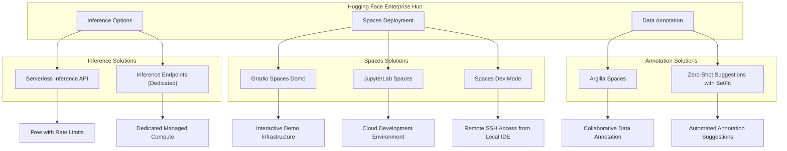
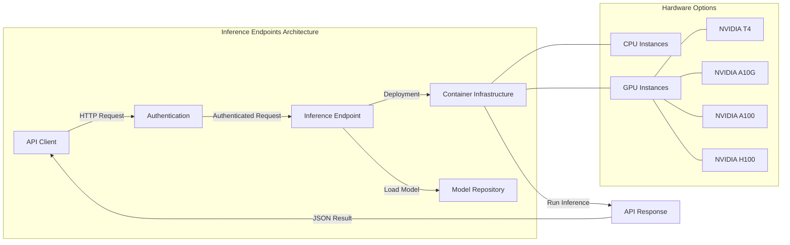
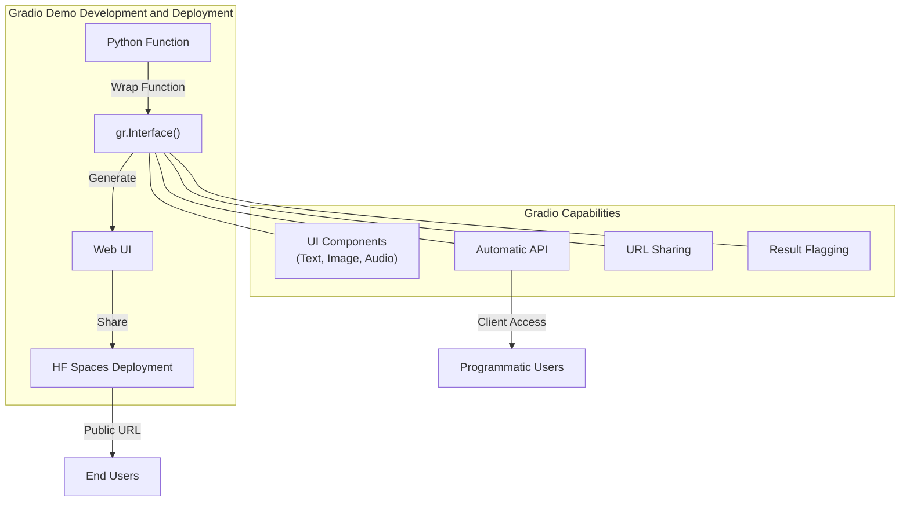
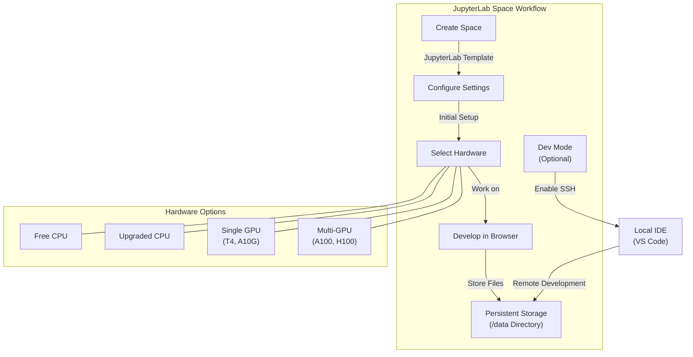
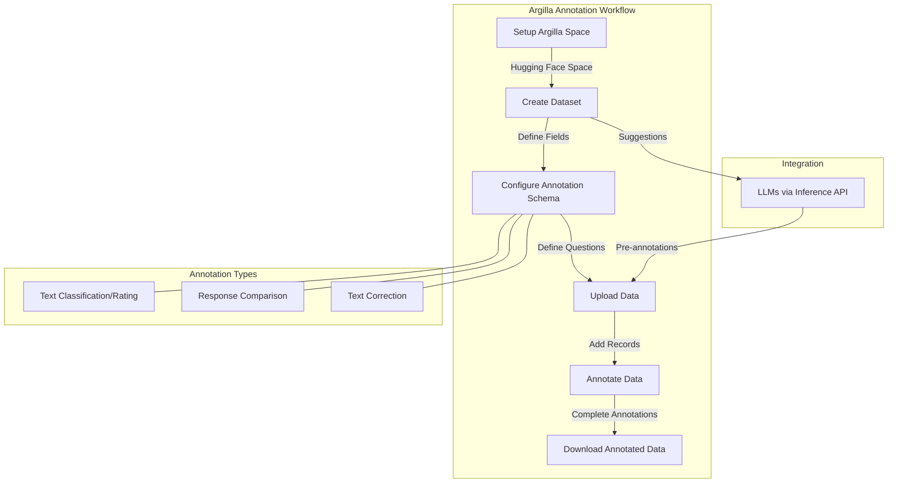
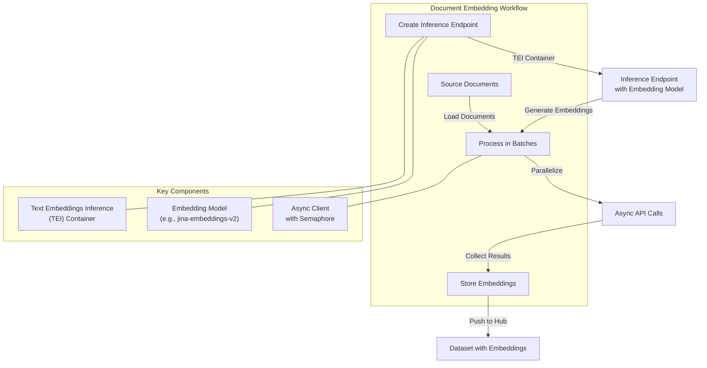
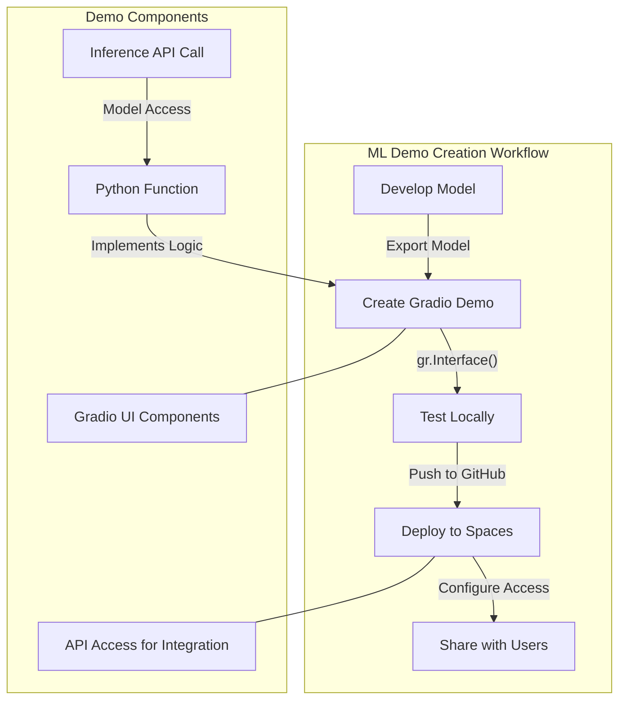
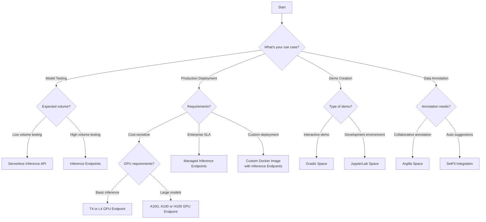

<!-- source: DeepWiki mcp.deepwiki.com · repo huggingface/cookbook · page 5 Enterprise Hub and Deployment · fetched 2026-10-26 -->

# Enterprise Hub and Deployment

<details>
<summary>Relevant source files</summary>

The following files were used as context for generating this wiki page:

- [notebooks/en/_toctree.yml](notebooks/en/_toctree.yml)
- [notebooks/en/automatic_embedding_tei_inference_endpoints.ipynb](notebooks/en/automatic_embedding_tei_inference_endpoints.ipynb)
- [notebooks/en/enterprise_cookbook_argilla.ipynb](notebooks/en/enterprise_cookbook_argilla.ipynb)
- [notebooks/en/enterprise_cookbook_dev_spaces.md](notebooks/en/enterprise_cookbook_dev_spaces.md)
- [notebooks/en/enterprise_cookbook_gradio.ipynb](notebooks/en/enterprise_cookbook_gradio.ipynb)
- [notebooks/en/enterprise_cookbook_overview.md](notebooks/en/enterprise_cookbook_overview.md)
- [notebooks/en/enterprise_dedicated_endpoints.ipynb](notebooks/en/enterprise_dedicated_endpoints.ipynb)
- [notebooks/en/enterprise_hub_serverless_inference_api.ipynb](notebooks/en/enterprise_hub_serverless_inference_api.ipynb)

</details>


## Purpose and Scope

This document provides an overview of enterprise features and deployment options in the Hugging Face ecosystem. It covers the various ways to deploy models, create interactive demos, develop in the cloud, and set up data annotation workflows. Whether you're deploying models for inference, building interactive demos to showcase your AI applications, or collaborating on data annotation, the Enterprise Hub offers a suite of tools and services to streamline your workflow.

For model fine-tuning techniques, see [Model Fine-tuning Techniques](#4), and for evaluation approaches, see [Evaluation and Testing](#6).

Sources: [notebooks/en/enterprise_cookbook_overview.md:1-51]()

## Enterprise Deployment Architecture



Sources: [notebooks/en/enterprise_cookbook_overview.md:1-51](), [notebooks/en/_toctree.yml:148-163]()

## Inference Options

Hugging Face provides two main deployment options for inference: the Serverless Inference API and dedicated Inference Endpoints. These solutions cater to different needs, from simple testing to production-grade deployments.

### Serverless Inference API

The Serverless Inference API allows users to quickly test and evaluate thousands of publicly accessible (or privately permissioned) machine learning models with simple API calls for free. This service is rate-limited and meant for testing or low-volume usage.

Key characteristics:
- Free to use with rate limits (few hundred requests per hour)
- No infrastructure to manage
- Access to thousands of models
- Higher rate limits available with PRO subscriptions

The Serverless Inference API uses a simple HTTP endpoint structure:
```
https://api-inference.huggingface.co/models/<MODEL_ID>
```

Here's how to query the API:

```python
# Using the requests library
import requests
headers = {"Authorization": f"Bearer {API_TOKEN}"}
API_URL = "https://api-inference.huggingface.co/models/model-id"
def query(payload):
    response = requests.post(API_URL, headers=headers, json=payload)
    return response.json()
```

Alternatively, you can use the `huggingface_hub` Python library:

```python
# Using InferenceClient from huggingface_hub
from huggingface_hub import InferenceClient
client = InferenceClient()
response = client.text_generation(
    prompt="Your prompt text",
    model="model-id",
    temperature=0.7
)
```

Sources: [notebooks/en/enterprise_hub_serverless_inference_api.ipynb:14-27](), [notebooks/en/enterprise_hub_serverless_inference_api.ipynb:95-101](), [notebooks/en/enterprise_hub_serverless_inference_api.ipynb:135-148](), [notebooks/en/enterprise_hub_serverless_inference_api.ipynb:169-208]()

### Dedicated Inference Endpoints

Inference Endpoints provide dedicated, production-ready model deployments with configurable hardware and resource allocation. They offer more control, higher throughput, and better reliability than the Serverless Inference API.

Key characteristics:
- Production-ready infrastructure
- Wide range of hardware options (CPUs, GPUs including T4, A10G, A100, H100)
- Cost based on provisioned hardware (hourly billing)
- Custom Docker image support
- Scalability options
- Private network isolation



Example of creating an Inference Endpoint for text embeddings:

```python
from huggingface_hub import create_inference_endpoint

endpoint = create_inference_endpoint(
    "my-embedding-endpoint",
    repository="jinaai/jina-embeddings-v2-base-en",
    task="sentence-embeddings",
    framework="pytorch",
    accelerator="gpu",
    instance_size="x1",
    instance_type="nvidia-a10g",
    region="us-east-1",
    vendor="aws",
    custom_image={
        "health_route": "/health",
        "env": {
            "MAX_BATCH_TOKENS": "4096",
            "MAX_CONCURRENT_REQUESTS": "512",
            "MODEL_ID": "/repository"
        },
        "url": "ghcr.io/huggingface/text-embeddings-inference:0.5.0",
    },
    type="protected",
)
```

Sources: [notebooks/en/automatic_embedding_tei_inference_endpoints.ipynb:122-143](), [notebooks/en/automatic_embedding_tei_inference_endpoints.ipynb:329-352]()

### Comparison of Inference Options

| Feature | Serverless Inference API | Inference Endpoints |
|---------|--------------------------|---------------------|
| Cost | Free (rate-limited), PRO for higher limits | Pay per hour based on hardware |
| Use case | Testing, prototyping, low-volume | Production, high-volume, SLA requirements |
| Hardware | Shared infrastructure | Dedicated hardware (various CPU/GPU options) |
| Setup | Instant access | Minutes to deploy |
| Rate limits | Yes (higher for PRO) | Limited only by hardware capacity |
| Custom Docker images | No | Yes |
| Scalability | Limited | Configurable |
| API access | REST API, Python SDK | REST API, Python SDK |
| Security | Token authentication | Token authentication, private networking |

Sources: [notebooks/en/enterprise_cookbook_overview.md:14-19](), [notebooks/en/enterprise_cookbook_overview.md:20-24](), [notebooks/en/automatic_embedding_tei_inference_endpoints.ipynb:117-146]()

## Spaces Deployment

Hugging Face Spaces provide a platform for deploying interactive applications, development environments, and annotation tools. They offer a way to share your work with collaborators or the public, all within the Hugging Face ecosystem.

### Building ML Demos with Gradio and Spaces

Gradio is a Python library that allows you to quickly create customizable web interfaces for your machine learning models. Combined with Hugging Face Spaces, it provides an easy way to deploy and share your models with others.



Creating a basic Gradio interface:

```python
import gradio as gr

def greet(name, intensity):
    return "Hello, " + name + "!" * intensity

demo = gr.Interface(
    fn=greet,
    inputs=["text", "slider"],
    outputs=["text"],
)

demo.launch()
```

To deploy to Spaces:
1. Create a new Space at https://huggingface.co/new-space
2. Select "Gradio" as the SDK
3. Add your Gradio code in the `app.py` file
4. Update `requirements.txt` with needed dependencies

Gradio includes features like:
- Automatic API generation (accessible via "Use via API" link)
- Sharing via temporary public URLs
- Flagging mechanism for user feedback

Sources: [notebooks/en/enterprise_cookbook_gradio.ipynb:9-29](), [notebooks/en/enterprise_cookbook_gradio.ipynb:75-82](), [notebooks/en/enterprise_cookbook_gradio.ipynb:142-146](), [notebooks/en/enterprise_cookbook_gradio.ipynb:667-683](), [notebooks/en/enterprise_cookbook_gradio.ipynb:739-744]()

### Interactive Development with JupyterLab Spaces

JupyterLab Spaces provide cloud-based Jupyter notebook environments that can be used for development, experimentation, and analysis. They offer more stability and flexibility than services like Google Colab.

Key features:
- On-demand hardware selection (CPUs, various GPUs)
- Persistent storage
- Stable, reliable infrastructure
- Interactive development in your browser
- Connection to local IDEs via Dev Mode



To create a JupyterLab Space:
1. Go to https://huggingface.co/new-space?template=SpacesExamples%2Fjupyterlab and select Docker > JupyterLab
2. Choose hardware (start with CPU and switch to GPU when needed)
3. Configure persistent storage (critical for saving your work)
4. Set a strong password with the `JUPYTER_TOKEN` Space secret

With Dev Mode (for Enterprise Hub subscribers):
1. Activate Dev Mode in Space settings
2. Install the VS Code Remote - SSH extension locally
3. Add your SSH key to your HF Profile
4. Connect to your Space from VS Code

Sources: [notebooks/en/enterprise_cookbook_dev_spaces.md:1-34](), [notebooks/en/enterprise_cookbook_dev_spaces.md:58-67](), [notebooks/en/enterprise_cookbook_dev_spaces.md:84-105]()

### Data Annotation with Argilla Spaces

Argilla is an open-source data annotation tool that helps create high-quality datasets for machine learning. By setting up Argilla on Hugging Face Spaces, you can create collaborative annotation workflows for text, image, or audio data.



The Argilla workflow typically involves:
1. Creating an Argilla Space following the [Argilla docs](https://docs.argilla.io/latest/getting_started/quickstart)
2. Defining your annotation schema (fields, questions, guidelines)
3. Uploading data for annotation (possibly with LLM-generated suggestions)
4. Distributing the annotation task to collaborators
5. Downloading the annotated data for model training or evaluation

Example of connecting to Argilla and configuring a dataset:

```python
import argilla as rg

# Connect to Argilla
client = rg.Argilla(
    api_url="https://username-spacename.hf.space",  
    api_key="your-apikey",
    headers={"Authorization": f"Bearer {huggingface_hub.get_token()}"},
)

# Configure dataset
settings = rg.Settings(
    guidelines="Annotation guidelines here",
    fields=[
        rg.TextField(
            name="instruction", title="Instruction:", use_markdown=True
        ),
        rg.TextField(
            name="generation_1",
            title="Response model 1:",
            use_markdown=True,
        ),
    ],
    questions=[
        rg.RatingQuestion(
            name="score_response_1",
            title="Your score for the response:",
            values=[0, 1, 2, 3, 4, 5],
            required=True,
        ),
    ],
)

# Create dataset
dataset_argilla = rg.Dataset(
    name="my-dataset",
    settings=settings,
    workspace="argilla",
).create()
```

Sources: [notebooks/en/enterprise_cookbook_argilla.ipynb:7-29](), [notebooks/en/enterprise_cookbook_argilla.ipynb:550-633](), [notebooks/en/enterprise_cookbook_overview.md:28-32]()

## Enterprise Workflows

Enterprise users typically combine multiple Hugging Face services to create end-to-end workflows. Here are some common enterprise workflows:

### Document Embedding with Inference Endpoints



Example workflow:
1. Create an Inference Endpoint with an embedding model using Text Embeddings Inference
2. Load your documents from a dataset
3. Process the documents in batches using asynchronous API calls
4. Store the resulting embeddings in a dataset
5. Push the dataset to the Hugging Face Hub

The Text Embeddings Inference container offers advantages like:
- Token-based dynamic batching
- Optimized transformers code using Flash Attention, Candle and cuBLASLt
- Fast boot times and small docker images
- Safetensors weight loading
- Production-ready with distributed tracing and metrics

Sources: [notebooks/en/automatic_embedding_tei_inference_endpoints.ipynb:15-26](), [notebooks/en/automatic_embedding_tei_inference_endpoints.ipynb:524-539]()

### Creating and Sharing ML Demos



For more complex demos, you can create a modular application with multiple components:

```python
# Part 1: Audio-to-text conversion
def transcribe(audio_input):
    # Use a model to convert audio to text
    return text_output

# Part 2: Text processing with an LLM
def organize_text(meeting_transcript):
    # Use an LLM to organize/summarize the text
    return organized_text

# Combined application
def meeting_transcript_tool(audio_input):
    meeting_text = transcribe(audio_input)
    organized_text = organize_text(meeting_text)
    return organized_text

# Create Gradio interface
full_demo = gr.Interface(
    fn=meeting_transcript_tool,
    inputs=gr.Audio(type="filepath"),
    outputs=gr.Textbox(show_copy_button=True),
    title="The Complete Meeting Transcription Tool",
)
```

Sources: [notebooks/en/enterprise_cookbook_gradio.ipynb:130-179](), [notebooks/en/enterprise_cookbook_gradio.ipynb:386-414](), [notebooks/en/enterprise_cookbook_gradio.ipynb:542-595](), [notebooks/en/enterprise_cookbook_gradio.ipynb:634-647]()

### Enterprise Deployment Decision Tree



Sources: [notebooks/en/enterprise_cookbook_overview.md:1-51]()

## Enterprise Hub Integration Options

The Hugging Face Enterprise Hub provides several ways to integrate with your existing systems:

1. **API Integration**: All services (Inference API, Inference Endpoints, Spaces) provide REST APIs

2. **Python SDK Integration**: The `huggingface_hub` library provides programmatic access to all services:
   ```python
   # Authentication
   from huggingface_hub import login
   login()
   
   # Inference
   from huggingface_hub import InferenceClient
   client = InferenceClient()
   
   # Endpoint management
   from huggingface_hub import (create_inference_endpoint, 
                               list_inference_endpoints)
   ```

3. **Dev Mode for Local IDE Integration**: Connect your local IDE (e.g., VS Code) to cloud resources

4. **GitHub Integration**: Connect Spaces to GitHub repositories for CI/CD workflows

5. **Data Format Integration**: Use standard formats (CSV, JSON, Parquet) for easy export/import with Argilla

Sources: [notebooks/en/enterprise_cookbook_dev_spaces.md:84-105](), [notebooks/en/automatic_embedding_tei_inference_endpoints.ipynb:75-89](), [notebooks/en/enterprise_hub_serverless_inference_api.ipynb:60-66]()

## Conclusion

The Hugging Face Enterprise Hub provides a comprehensive set of tools for deploying, sharing, and collaborating on machine learning projects. From serverless APIs for quick testing to production-ready Inference Endpoints, from interactive Gradio demos to collaborative data annotation with Argilla, the ecosystem offers solutions for all stages of the ML lifecycle.

By combining these tools, enterprise users can create efficient workflows that leverage the best of Hugging Face's infrastructure while maintaining control over costs, performance, and security.

Sources: [notebooks/en/enterprise_cookbook_overview.md:1-51]()

---

