# Page: Open-Source AI Cookbook Overview

# Open-Source AI Cookbook Overview

<details>
<summary>Relevant source files</summary>

The following files were used as context for generating this wiki page:

- [.github/pull_request_template.md](.github/pull_request_template.md)
- [.gitignore](.gitignore)
- [README.md](README.md)
- [notebooks/en/_toctree.yml](notebooks/en/_toctree.yml)
- [notebooks/en/automatic_embedding_tei_inference_endpoints.ipynb](notebooks/en/automatic_embedding_tei_inference_endpoints.ipynb)
- [notebooks/en/index.md](notebooks/en/index.md)
- [notebooks/en/rag_with_hugging_face_gemma_mongodb.ipynb](notebooks/en/rag_with_hugging_face_gemma_mongodb.ipynb)
- [notebooks/en/structured_generation_vision_language_models.ipynb](notebooks/en/structured_generation_vision_language_models.ipynb)
- [notebooks/en/vector_search_with_hub_as_backend.ipynb](notebooks/en/vector_search_with_hub_as_backend.ipynb)

</details>


The Open-Source AI Cookbook is a comprehensive collection of Jupyter notebooks that demonstrate practical implementations of AI techniques using open-source tools and models. It serves as a hands-on reference for developers, researchers, and practitioners looking to build AI applications across various domains. This page provides an overview of the cookbook's content, structure, and purpose.

For information about contributing to the cookbook, see [Contributing to the Cookbook](#1.2).

Sources: [notebooks/en/index.md:1-16](), [README.md:1-5]()

## Repository Purpose and Scope

The Open-Source AI Cookbook aims to:

1. Provide practical, end-to-end examples of AI implementations
2. Showcase best practices for working with open-source AI tools and models
3. Cover a wide range of AI domains including LLMs, computer vision, multimodal systems, and more
4. Make advanced AI techniques accessible to developers with varying levels of expertise
5. Demonstrate enterprise deployment options for AI applications

All examples prioritize open-source tools, models available under permissive licenses, and implementations that can run on consumer hardware or affordable cloud options.

Sources: [notebooks/en/index.md:3-4](), [README.md:3-4](), [README.md:25-28]()

## Repository Structure and Organization

The cookbook is organized by technology domain, with notebooks covering specialized implementations within each area. The structure allows users to quickly find relevant examples for their specific use cases.

### Cookbook Structure Diagram

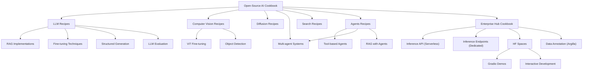

Sources: [notebooks/en/_toctree.yml:1-163]()

The notebooks are primarily organized by language, with English (`en`) being the main language. Translations into other languages are stored in their respective language subdirectories.

Sources: [README.md:46-64]()

## Key Components and Systems

### Retrieval-Augmented Generation (RAG) Systems

The cookbook provides extensive coverage of RAG implementations, which enhance language models with external knowledge retrieval. These implementations range from basic pipelines to advanced architectures.

#### RAG Systems Diagram

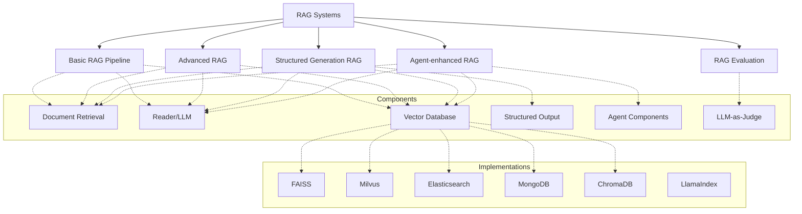

Example implementations include:
- Basic RAG with Zephyr and LangChain
- Advanced RAG on Hugging Face documentation
- MongoDB-based RAG with Gemma models
- Elasticsearch-based RAG systems
- RAG with source highlighting using structured generation
- RAG evaluation techniques

Sources: [notebooks/en/_toctree.yml:21-54](), [notebooks/en/rag_with_hugging_face_gemma_mongodb.ipynb:7-28]()

### Model Fine-tuning Techniques

The cookbook covers various approaches for fine-tuning pre-trained models, with a focus on parameter-efficient methods that can be implemented on consumer hardware.

#### Fine-tuning Techniques Diagram

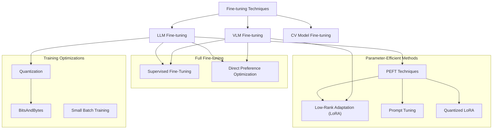

Example notebooks include:
- Fine-tuning Code LLMs on custom code
- Prompt tuning with PEFT
- Fine-tuning Vision Transformers on custom datasets
- Fine-tuning Vision Language Models like Qwen2-VL and SmolVLM
- Post-training LLMs for reasoning with GRPO

Sources: [notebooks/en/_toctree.yml:25-28](), [notebooks/en/_toctree.yml:85-90](), [notebooks/en/_toctree.yml:107-120]()

### Vector Search and Embedding Services

The cookbook demonstrates various approaches to embedding and vector search, which are fundamental to many AI applications.

#### Text Embeddings Inference System Diagram

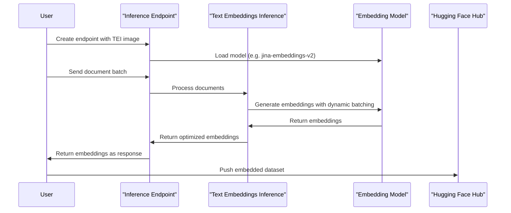

Implementations include:
- Automatic embeddings with TEI through Inference Endpoints
- Vector search on the Hugging Face Hub using DuckDB
- Using FAISS with HF datasets and CLIP for multimodal embedding
- Semantic reranking with Elasticsearch

Sources: [notebooks/en/automatic_embedding_tei_inference_endpoints.ipynb:8-26](), [notebooks/en/vector_search_with_hub_as_backend.ipynb:7-9](), [notebooks/en/_toctree.yml:103-104](), [notebooks/en/_toctree.yml:125-128]()

### Structured Generation and Multimodal Systems

The cookbook includes examples of structured information extraction from different sources using vision-language models and specialized structured generation techniques.

Example notebooks demonstrate:
- Structured generation from images using Vision Language Models
- RAG with source highlighting using structured generation
- Extracting structured information from documents
- Information extraction with Haystack and NuExtract

Sources: [notebooks/en/structured_generation_vision_language_models.ipynb:7-12](), [notebooks/en/_toctree.yml:52-52](), [notebooks/en/_toctree.yml:118-118]()

### Agent-based Systems

The cookbook covers agent-based systems that combine language models with tools to perform complex tasks through planning and execution.

Agent implementations include:
- Building agents with tool-calling capabilities
- Agentic RAG with query reformulation
- Text-to-SQL agents with error correction
- Data analyst agents for insights extraction
- Multi-agent systems for collaboration

Sources: [notebooks/en/_toctree.yml:133-146]()

### Enterprise Deployment

The Enterprise Hub Cookbook section provides guidance on deploying AI applications in production environments.

Deployment options include:
- Serverless inference using the Hugging Face Inference API
- Dedicated inference using Inference Endpoints
- Interactive development with JupyterLab Spaces
- Creating demos with Gradio and Spaces
- Data annotation workflows with Argilla

Sources: [notebooks/en/_toctree.yml:148-162]()

## Notebook Structure and Organization

Each notebook in the cookbook typically follows a consistent structure:

1. Clear title and author information
2. Statement of the problem or task
3. Installation of required dependencies
4. Step-by-step implementation with detailed explanations
5. Results and evaluation
6. Potential extensions or improvements

This standardized format makes it easy to understand the examples and apply them to similar problems.

Sources: [notebooks/en/automatic_embedding_tei_inference_endpoints.ipynb:7-26](), [notebooks/en/structured_generation_vision_language_models.ipynb:7-15](), [README.md:25-30]()

## Conclusion

The Open-Source AI Cookbook provides a valuable resource for developers, researchers, and practitioners looking to implement AI solutions using open-source tools and models. By covering a wide range of AI domains and techniques, the cookbook helps bridge the gap between theoretical understanding and practical application.

To get started, explore the different categories in the cookbook navigation or check out the recently added notebooks on the [cookbook index page](notebooks/en/index.md).

Sources: [notebooks/en/index.md:1-16](), [README.md:1-5]()

---

# Page: Repository Structure and Organization

# Repository Structure and Organization

<details>
<summary>Relevant source files</summary>

The following files were used as context for generating this wiki page:

- [notebooks/en/_toctree.yml](notebooks/en/_toctree.yml)
- [notebooks/en/automatic_embedding_tei_inference_endpoints.ipynb](notebooks/en/automatic_embedding_tei_inference_endpoints.ipynb)
- [notebooks/ko/_toctree.yml](notebooks/ko/_toctree.yml)
- [notebooks/ko/index.md](notebooks/ko/index.md)
- [notebooks/tr/_toctree.yml](notebooks/tr/_toctree.yml)
- [notebooks/tr/agent_data_analyst.ipynb](notebooks/tr/agent_data_analyst.ipynb)
- [notebooks/tr/agents.ipynb](notebooks/tr/agents.ipynb)
- [notebooks/tr/fine_tuning_code_llm_on_single_gpu.ipynb](notebooks/tr/fine_tuning_code_llm_on_single_gpu.ipynb)
- [notebooks/tr/fine_tuning_detr_custom_dataset.ipynb](notebooks/tr/fine_tuning_detr_custom_dataset.ipynb)
- [notebooks/tr/fine_tuning_vit_custom_dataset.ipynb](notebooks/tr/fine_tuning_vit_custom_dataset.ipynb)
- [notebooks/zh-CN/_toctree.yml](notebooks/zh-CN/_toctree.yml)
- [notebooks/zh-CN/enterprise_cookbook_overview.md](notebooks/zh-CN/enterprise_cookbook_overview.md)
- [notebooks/zh-CN/rag_with_hugging_face_gemma_elasticsearch.ipynb](notebooks/zh-CN/rag_with_hugging_face_gemma_elasticsearch.ipynb)
- [notebooks/zh-CN/rag_with_unstructured_data.ipynb](notebooks/zh-CN/rag_with_unstructured_data.ipynb)
- [notebooks/zh-CN/structured_generation.ipynb](notebooks/zh-CN/structured_generation.ipynb)

</details>


This document describes the overall structure and organization of the Hugging Face Cookbook repository, which contains example notebooks demonstrating AI techniques across multiple domains. It explains how the repository is organized, what directories contain which types of content, and how to navigate the repository to find specific examples. For information about contributing new examples to the cookbook, see [Contributing to the Cookbook](#1.2).

## Repository Overview

The Hugging Face Cookbook is organized as a collection of Jupyter notebooks, categorized by domain and available in multiple languages. The repository follows a consistent structure that makes it easy to navigate and find examples for specific use cases.

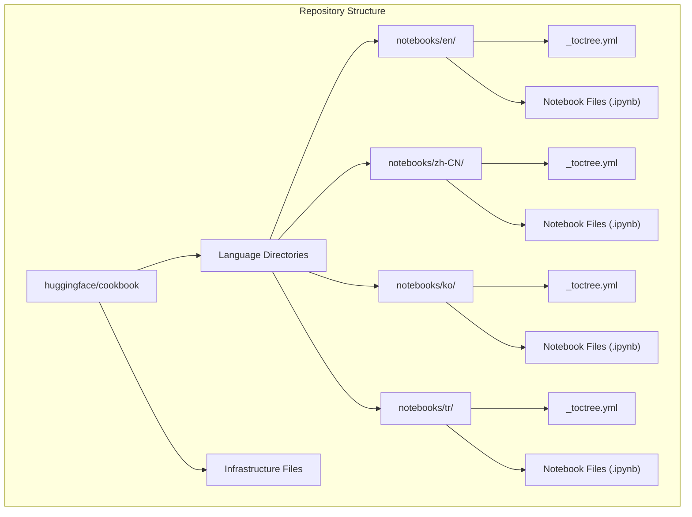

Sources: [notebooks/en/_toctree.yml](), [notebooks/zh-CN/_toctree.yml](), [notebooks/ko/_toctree.yml](), [notebooks/tr/_toctree.yml]()

The repository is primarily organized by language, with each language having its own directory under the `notebooks/` folder. Within each language directory, you'll find:

1. A `_toctree.yml` file that defines the structure and categorization of notebooks
2. The actual notebook files (`.ipynb`)
3. Supporting resources for those notebooks

## Content Categories and Organization

The notebooks are organized into several main categories, each focusing on a specific domain or technology within the AI ecosystem.

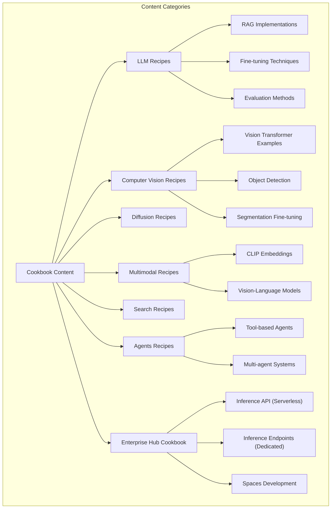

Sources: [notebooks/en/_toctree.yml](), [notebooks/zh-CN/_toctree.yml](), [notebooks/ko/_toctree.yml](), [notebooks/tr/_toctree.yml]()

### Main Categories

Looking at the English toctree file, we can identify the following main categories:

1. **MLOps Recipes**: Examples focusing on deployment and ML operations
2. **LLM Recipes**: Large language model examples, including RAG, fine-tuning, embeddings, etc.
3. **Computer Vision Recipes**: Image processing, object detection, etc.
4. **Diffusion Recipes**: Stable diffusion and other generative image models
5. **Multimodal Recipes**: Examples combining text, images, and other modalities
6. **Search Recipes**: Semantic search and vector search examples
7. **Agents Recipes**: AI agent implementations
8. **Enterprise Hub Cookbook**: Enterprise-focused examples for deployment and integration

Each main category contains multiple notebooks demonstrating specific techniques, architectures, or use cases.

## Navigation Structure

The cookbook's navigation is defined in the `_toctree.yml` files, which map to the structure seen on the Hugging Face website. Here's how the toctree is structured:

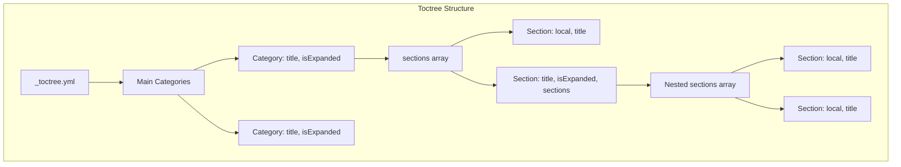

Sources: [notebooks/en/_toctree.yml:1-147]()

The toctree structure uses:
- `title`: Displayed name of the category or notebook
- `isExpanded`: Whether the section is expanded by default in the navigation
- `sections`: Array of child sections or notebooks
- `local`: Path to the notebook file (without extension)

## Language-Specific Organization

While the English notebooks provide the most comprehensive set of examples, many notebooks are also available in other languages. Each language has its own toctree file that defines which notebooks are available.

| Language | Directory | Main Categories |
|----------|-----------|-----------------|
| English | notebooks/en/ | All categories (most comprehensive) |
| Chinese | notebooks/zh-CN/ | LLM, Diffusion, Multimodal, LLM+RAG with Other Libraries, Computer Vision, Agents, Enterprise |
| Korean | notebooks/ko/ | LLM, Agents, Multimodal |
| Turkish | notebooks/tr/ | LLM, Computer Vision, Agents, Agent Applications |

Sources: [notebooks/en/_toctree.yml](), [notebooks/zh-CN/_toctree.yml](), [notebooks/ko/_toctree.yml](), [notebooks/tr/_toctree.yml]()

## Notebook Naming Convention

Notebooks follow a consistent naming convention that reflects their category and focus. For example:

- `rag_with_hf_and_milvus.ipynb`: RAG implementation using Hugging Face and Milvus
- `fine_tuning_vit_custom_dataset.ipynb`: Fine-tuning Vision Transformer on a custom dataset
- `agent_data_analyst.ipynb`: Agent for data analysis

This naming helps in identifying the content of a notebook at a glance.

## Accessing the Repository

You can access the Hugging Face Cookbook repository in multiple ways:

1. **GitHub**: Browse or clone the repository at https://github.com/huggingface/cookbook
2. **Hugging Face Website**: View the rendered notebooks directly on the Hugging Face website

## Navigating between Languages

If you're looking for examples in a specific language, navigate to the corresponding language directory:

```
notebooks/
├── en/          # English notebooks
├── zh-CN/       # Chinese notebooks
├── ko/          # Korean notebooks
└── tr/          # Turkish notebooks
```

Each language directory contains its own `_toctree.yml` file that defines the structure of the documentation for that language.

## Finding Examples

To find specific examples, you can:

1. Browse the repository structure and look at notebook names
2. Check the `_toctree.yml` file for your language to see the categorization
3. Use GitHub search to find notebooks mentioning specific techniques or models

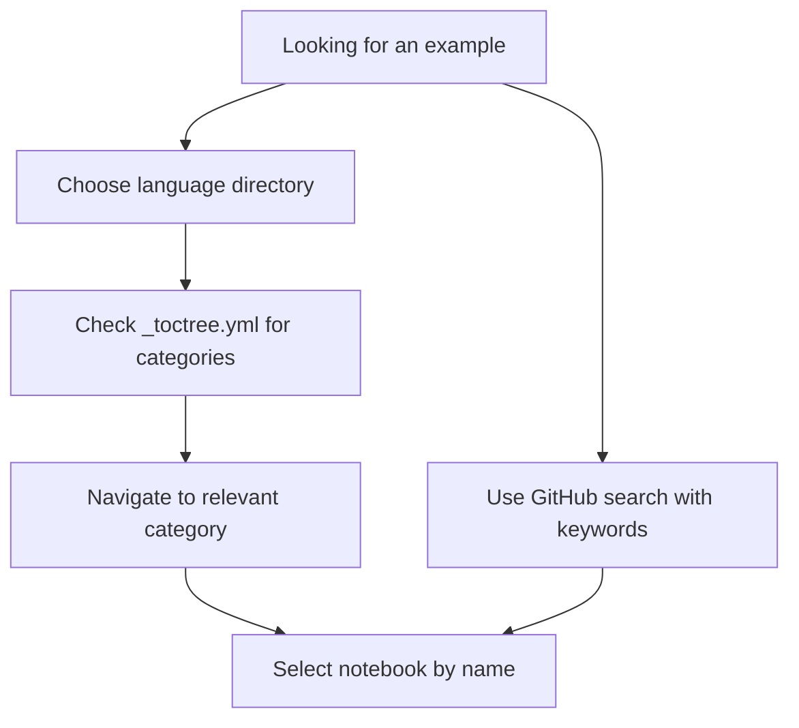

## Example Toctree Structure

Here's an excerpt from the English toctree file showing the structure for LLM Recipes:

```
- title: LLM Recipes
  isExpanded: false
  sections:
    - local: automatic_embedding_tei_inference_endpoints
      title: Automatic Embeddings with TEI through Inference Endpoints
    - local: tgi_messages_api_demo
      title: Migrating from OpenAI to Open LLMs Using TGI's Messages API
    - local: advanced_rag
      title: Advanced RAG on HuggingFace documentation using LangChain
    ...
```

This structure defines a category "LLM Recipes" with multiple notebook examples, each with a path and display title.

Sources: [notebooks/en/_toctree.yml:14-81]()

## Related Infrastructure

The repository includes more than just notebooks - it also contains infrastructure for rendering the documentation on the Hugging Face website and other supporting files. However, as a user or contributor, you'll primarily interact with the notebook files and the toctree structure.

---

# Page: Contributing to the Cookbook

# Contributing to the Cookbook

<details>
<summary>Relevant source files</summary>

The following files were used as context for generating this wiki page:

- [.github/pull_request_template.md](.github/pull_request_template.md)
- [.github/workflows/build_documentation.yml](.github/workflows/build_documentation.yml)
- [.github/workflows/build_pr_documentation.yml](.github/workflows/build_pr_documentation.yml)
- [.github/workflows/upload_pr_documentation.yml](.github/workflows/upload_pr_documentation.yml)
- [.gitignore](.gitignore)
- [README.md](README.md)

</details>


This page explains how to contribute new notebooks or improvements to the Open-Source AI Cookbook repository. It covers the contribution process, notebook requirements, pull request creation, and translation guidelines. For an overview of the repository structure and organization, see [Repository Structure and Organization](#1.1).

## Overview of the Contribution Process

The Open-Source AI Cookbook welcomes contributions from everyone in the community. There are multiple ways to contribute:

1. **Submit ideas** for new examples or guides via GitHub Issues
2. **Contribute new notebooks** with practical AI examples
3. **Improve existing examples** by fixing issues or typos
4. **Translate notebooks** into different languages

The contribution process follows these general steps:

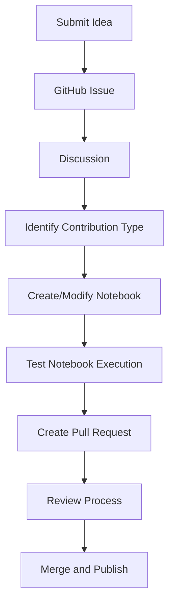

Sources: [README.md:6-19]()

## Notebook Requirements

To ensure consistency and quality, notebooks contributed to the Cookbook should meet specific requirements.

### What Makes a Good Cookbook Notebook

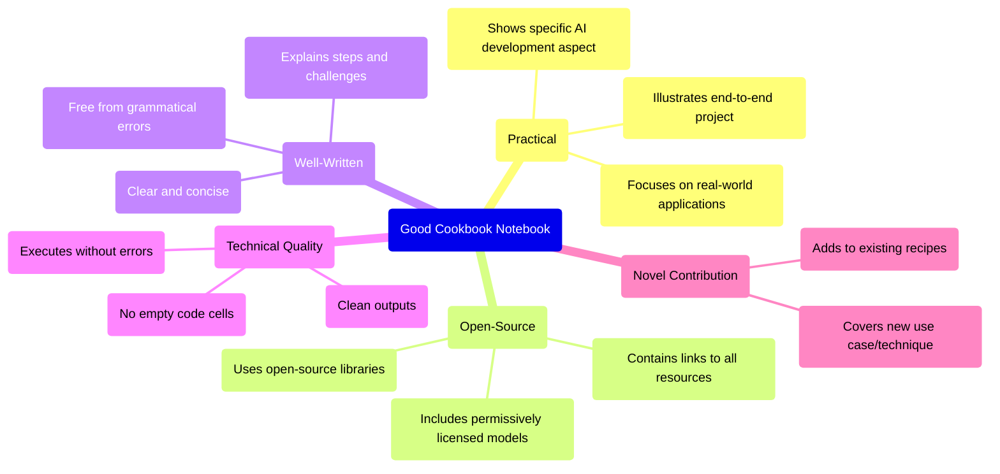

A high-quality notebook should be:

1. **Practical**: Provides an illustration of an end-to-end project or specific aspect of AI development, focusing on real-world applications.
2. **Built with open-source tools and models**: Uses open-source libraries, datasets, and pre-trained models available under permissive licenses.
3. **Clearly written**: Has clear, concise writing that's free from grammatical errors and maintains a friendly tone.
4. **Executes without errors**: The notebook should run without runtime errors.
5. **Adds to existing "recipes"**: Covers a subject that hasn't been addressed in existing notebooks.

Sources: [README.md:21-30]()

## Contributing a New Notebook

### Preparing Your Notebook

When creating a new notebook for contribution, ensure the following:

1. Use **lowercase filenames** for your notebook
2. Add a clear title and description of what the notebook covers
3. Include yourself as an author by adding this line after the first header:
   ```
   _Authored by: [Your Name](https://huggingface.co/your-username)_
   ```
4. Remove non-informative code cell outputs (e.g., from `pip install` commands)
5. Make sure there are no empty code cells
6. Test that the notebook runs completely without errors

### Handling Images

If your notebook includes images:

1. Upload them to the [huggingface/cookbook-images](https://huggingface.co/datasets/huggingface/cookbook-images) dataset
2. Reference them in markdown using the format:
   ```
   
   ```

Sources: [README.md:32-44]()

## Creating a Pull Request

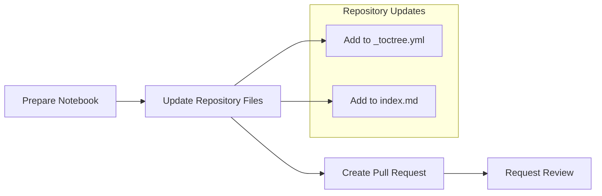

To contribute your notebook:

1. **Fork the repository** and create a branch for your contribution
2. **Add your notebook** to the appropriate directory
3. **Update the navigation files**:
   - Add your notebook to `_toctree.yml`
   - Add your notebook to `index.md`
4. **Create a pull request** and tag the maintainers (@merveenoyan and @stevhliu)
5. **Address any feedback** during the review process

The pull request will trigger an automated documentation build process that checks if your notebook can be properly converted to documentation.

Sources: [README.md:32-45](), [.github/workflows/build_pr_documentation.yml:1-25](), [.github/pull_request_template.md:1-23]()

## Documentation Build Process

When you submit a pull request, an automated workflow builds the documentation to verify your notebook can be properly converted. This process helps catch any issues before merging.

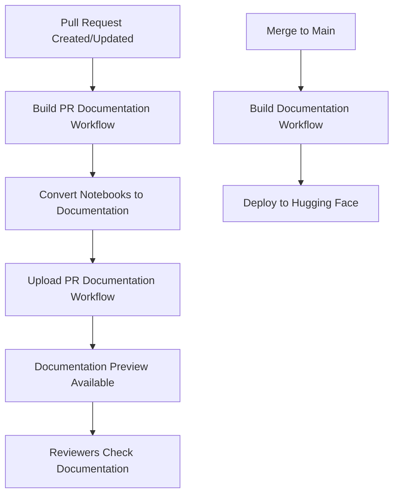

The build process:
1. Is triggered when files in the `notebooks/` directory are changed
2. Converts Jupyter notebooks to documentation format
3. Builds documentation for all supported languages
4. Makes a preview available for review
5. Once merged, automatically deploys to the official Cookbook site

Sources: [.github/workflows/build_pr_documentation.yml:1-25](), [.github/workflows/build_documentation.yml:1-24](), [.github/workflows/upload_pr_documentation.yml:1-16]()

## Translating the Cookbook

The Cookbook aims to be available in multiple languages. Currently supported languages include English (en), Chinese (zh-CN), Korean (ko), Turkish (tr), and French (fr).

### Translation Process

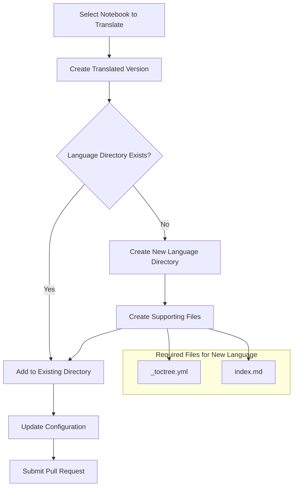

To translate notebooks:

1. **For existing language directories**:
   - Add your translated notebook to `notebooks/LANG-ID/`
   - Update `notebooks/LANG-ID/_toctree.yml` and `notebooks/LANG-ID/index.md`

2. **For new languages**:
   - Create a directory under `notebooks/` using the appropriate language code (ISO 639-1)
   - Create required files (`_toctree.yml` and `index.md`)
   - Add your translated notebook
   - Update the GitHub workflow files to include the new language code

The language code should be either:
- Two lowercase letters (e.g., `en` for English)
- Two lowercase letters followed by hyphen and two uppercase letters (e.g., `zh-CN` for Chinese)

Sources: [README.md:47-64](), [.github/workflows/build_documentation.yml:20](), [.github/workflows/build_pr_documentation.yml:23]()

## Benefits of Contributing

After your contribution is merged, you can:

1. Be recognized as an author in the Cookbook
2. Request to join the [huggingcooks organization](https://huggingface.co/huggingcooks) to claim the contributor badge
3. Help expand the collection of AI examples available to the community
4. Showcase your expertise in specific AI domains

Your contributed notebook will appear in the [Open-Source AI Cookbook](https://huggingface.co/learn/cookbook/index), making it accessible to developers worldwide.

Sources: [README.md:19](), [README.md:45-46]()

---

# Page: Retrieval-Augmented Generation (RAG) Systems

# Retrieval-Augmented Generation (RAG) Systems

<details>
<summary>Relevant source files</summary>

The following files were used as context for generating this wiki page:

- [.github/workflows/check_notebooks_lowercase.yml](.github/workflows/check_notebooks_lowercase.yml)
- [notebooks/en/advanced_rag.ipynb](notebooks/en/advanced_rag.ipynb)
- [notebooks/en/faiss_with_hf_datasets_and_clip.ipynb](notebooks/en/faiss_with_hf_datasets_and_clip.ipynb)
- [notebooks/en/fine_tuning_code_llm_on_single_gpu.ipynb](notebooks/en/fine_tuning_code_llm_on_single_gpu.ipynb)
- [notebooks/en/rag_evaluation.ipynb](notebooks/en/rag_evaluation.ipynb)
- [notebooks/en/rag_zephyr_langchain.ipynb](notebooks/en/rag_zephyr_langchain.ipynb)
- [notebooks/ko/advanced_ko_rag.ipynb](notebooks/ko/advanced_ko_rag.ipynb)
- [notebooks/ko/structured_generation.ipynb](notebooks/ko/structured_generation.ipynb)

</details>


This page provides an overview of Retrieval-Augmented Generation (RAG) systems, their components, implementation approaches, and evaluation methods. The document explains the core principles of RAG and covers various implementation techniques present in the cookbook, including basic RAG, advanced techniques, structured generation, vector database integrations, and evaluation strategies.

For information about agent-enhanced RAG systems, see [RAG with Agents](#3.4).

## What are RAG Systems?

Retrieval-Augmented Generation (RAG) is a technique that enhances language models by incorporating external knowledge sources. RAG systems retrieve relevant information from a knowledge base to augment the context provided to a language model, enabling more accurate, factual, and contextually relevant responses.

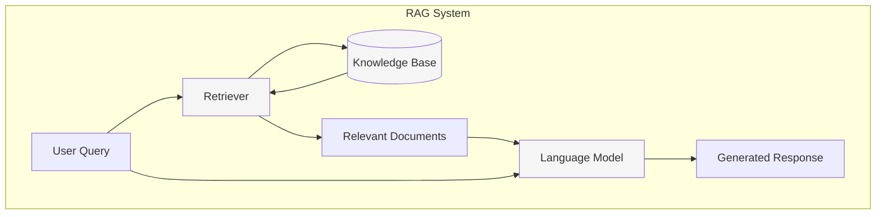

**Key benefits of RAG systems:**

- Augments LLM knowledge with up-to-date or domain-specific information
- Reduces hallucinations by grounding responses in factual sources
- Enables citation and attribution of information sources
- More cost-effective than fine-tuning for knowledge updates
- Allows customization to specific domains or document collections

Sources: [notebooks/en/rag_zephyr_langchain.ipynb:9-33](), [notebooks/en/advanced_rag.ipynb:19-31]()

## RAG System Components and Architecture

RAG systems typically consist of four main components that work together to augment LLM responses with relevant retrieved information.

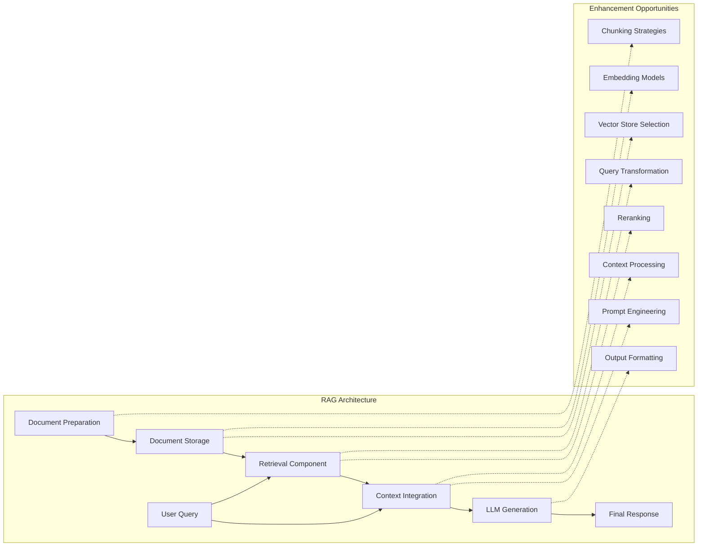

### 1. Document Preparation
Documents are processed and split into manageable chunks that can be effectively retrieved and used as context.

### 2. Document Storage
Processed documents are embedded and stored in a vector database that enables semantic search.

### 3. Retrieval Component
Takes user queries, transforms them if needed, and retrieves the most relevant document chunks.

### 4. Context Integration
Combines retrieved documents with the user's query into a prompt for the language model.

### 5. LLM Generation
The language model generates a response based on the query and retrieved context.

Sources: [notebooks/en/advanced_rag.ipynb:24-31](), [notebooks/en/rag_zephyr_langchain.ipynb:25-32]()

## Basic RAG Implementations

Basic RAG implementations follow a straightforward pipeline where documents are chunked, embedded, stored, and then retrieved based on query similarity.

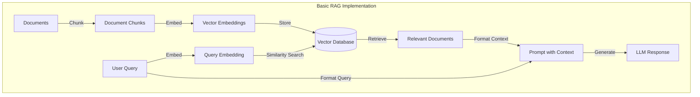

In a basic implementation, you can use LangChain and Hugging Face tools to:

1. Load and split documents into chunks
2. Create embeddings using models like `BAAI/bge-base-en-v1.5`
3. Store embeddings in a vector database like FAISS
4. Create a retriever that performs similarity search
5. Build an LLM chain that combines the retriever with a language model

Example implementation components:

```python
# Document loading and chunking
from langchain.text_splitter import RecursiveCharacterTextSplitter
text_splitter = RecursiveCharacterTextSplitter(chunk_size=512, chunk_overlap=30)
chunked_docs = text_splitter.split_documents(docs)

# Creating embeddings and vector store
from langchain.vectorstores import FAISS
from langchain.embeddings import HuggingFaceEmbeddings
db = FAISS.from_documents(chunked_docs, HuggingFaceEmbeddings(model_name='BAAI/bge-base-en-v1.5'))
retriever = db.as_retriever(search_type="similarity", search_kwargs={'k': 4})

# Creating LLM chain
from langchain.llms import HuggingFacePipeline
llm_chain = prompt | llm | StrOutputParser()
rag_chain = {"context": retriever, "question": RunnablePassthrough()} | llm_chain
```

Sources: [notebooks/en/rag_zephyr_langchain.ipynb:42-379]()

## Advanced RAG Techniques

Advanced RAG techniques improve upon basic implementations by optimizing each stage of the pipeline for better performance.

### Optimized Document Chunking

Different chunking strategies can significantly impact retrieval quality:

| Chunking Strategy | Description | Best Use Case |
|-------------------|-------------|---------------|
| Fixed-size chunks | Split documents into chunks of consistent size | General purpose |
| Semantic chunking | Split based on semantic boundaries | Preserving meaning |
| Recursive chunking | Split hierarchically using different separators | Structured documents |
| Sentence-based | Split at sentence boundaries | Preserving sentences |

For example, recursive chunking with different separators:

```python
MARKDOWN_SEPARATORS = [
    "\n#{1,6} ",
    "```\n",
    "\n\\\*\\\*\\\*+\n",
    "\n---+\n",
    "\n___+\n",
    "\n\n",
    "\n",
    " ",
    "",
]
text_splitter = RecursiveCharacterTextSplitter(
    chunk_size=1000, 
    chunk_overlap=100,
    separators=MARKDOWN_SEPARATORS,
)
```

### Enhanced Retrieval Methods

Advanced RAG techniques improve retrieval through:

1. **Query Transformation**: Rewriting the original query to make it more effective for retrieval
2. **Hybrid Search**: Combining dense (semantic) and sparse (keyword) retrieval
3. **Re-ranking**: Applying a second-stage ranking to initial results 
4. **Multi-query Retrieval**: Generating multiple queries from the original and combining results

### Context Processing

Sophisticated processing of retrieved context:

1. **Context Compression**: Removing redundant or irrelevant information
2. **Context Reordering**: Sorting retrieved documents by relevance
3. **Context Weighting**: Giving different weights to retrieved documents

Sources: [notebooks/en/advanced_rag.ipynb:108-201](), [notebooks/en/advanced_rag.ipynb:222-356]()

## Structured Generation for RAG

Structured generation enables RAG systems to produce outputs in specific formats, making the responses more useful for downstream processing.

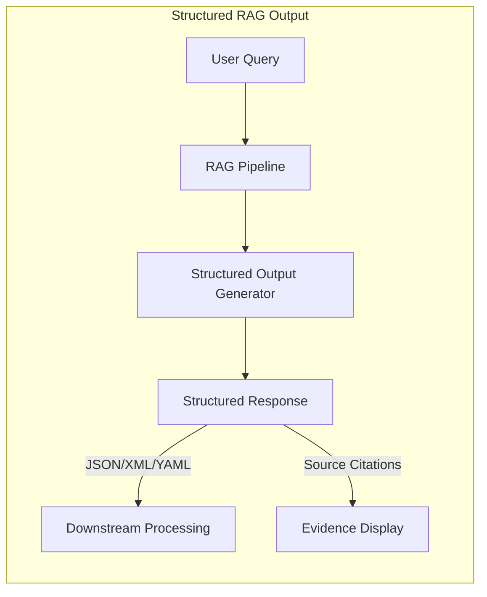

There are two main approaches to structured generation in RAG:

### 1. Prompt-Based Structured Generation

Uses carefully crafted prompts to instruct the LLM to generate responses in a specific format:

```python
RAG_PROMPT_TEMPLATE_JSON = """
Answer based on the documents. Format your response as JSON with:
{
  "answer": Your comprehensive answer,
  "confidence_score": A number between 0 and 1,
  "source_snippets": ["snippet1", "snippet2", ...]
}
Context: {context}
Question: {user_query}
"""
```

While simple to implement, this approach may not be reliable with all models or complex output structures.

### 2. Constrained Decoding

Forces the LLM to generate outputs following a specific grammar or structure:

```python
from pydantic import BaseModel, confloat, StringConstraints
from typing import List, Annotated

class AnswerWithSnippets(BaseModel):
    answer: Annotated[str, StringConstraints(min_length=10, max_length=100)]
    confidence: Annotated[float, confloat(ge=0.0, le=1.0)]
    source_snippets: List[Annotated[str, StringConstraints(max_length=30)]]

# Using the schema with constrained decoding
grammar = {"type": "json", "value": AnswerWithSnippets.schema()}
answer = llm_client.text_generation(
    prompt,
    grammar=grammar,
    max_new_tokens=250,
)
```

Constrained decoding is more reliable but requires additional libraries like Outlines for local inference.

Benefits of structured generation in RAG:
- Source attribution with evidence highlighting
- Consistent response formatting
- Easier integration with downstream systems
- Confidence scoring for answers
- Structured data extraction from unstructured text

Sources: [notebooks/ko/structured_generation.ipynb:7-26](), [notebooks/ko/structured_generation.ipynb:87-147](), [notebooks/ko/structured_generation.ipynb:299-368]()

## RAG with Different Vector Databases

Vector databases are a crucial component in RAG systems, storing document embeddings for efficient similarity search. The choice of vector database affects performance, scalability, and deployment options.

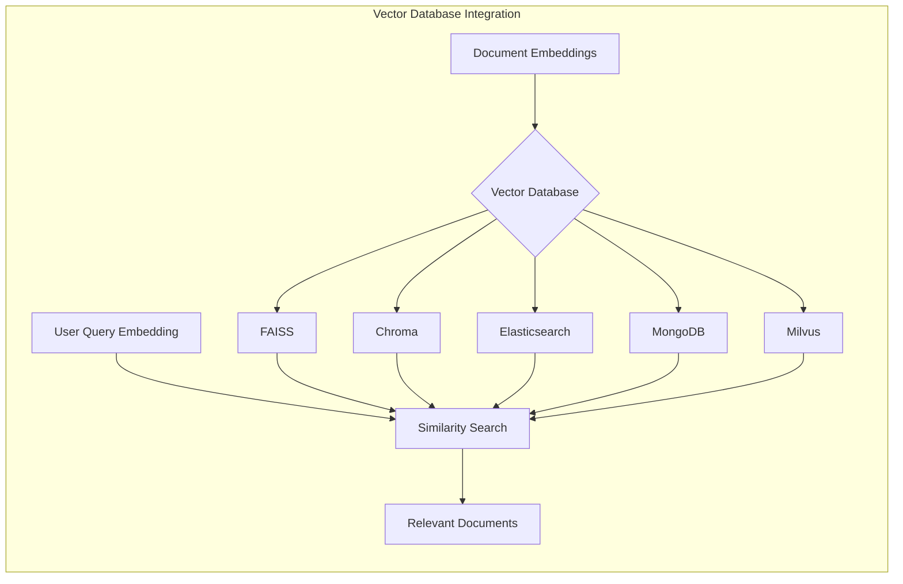

### Common Vector Databases in RAG Systems

| Database | Type | Key Features | Best For |
|----------|------|-------------|----------|
| FAISS | In-memory/File | Fast similarity search, optimized for dense vectors | Single-machine deployments, research |
| ChromaDB | Embedded/Client-server | Simple API, persistent storage, metadata filtering | Prototyping, small-medium datasets |
| Elasticsearch | Distributed | Hybrid search, scaling, production-ready | Enterprise, large-scale deployments |
| MongoDB Atlas | Distributed | Document-oriented, familiar query language | Teams already using MongoDB |
| Milvus | Distributed | Cloud-native, high throughput | Large-scale vector search |

### Integration Examples

#### FAISS Integration

```python
from langchain.vectorstores import FAISS
from langchain.embeddings import HuggingFaceEmbeddings

# Create embeddings and FAISS vectorstore
embeddings = HuggingFaceEmbeddings(model_name='BAAI/bge-base-en-v1.5')
db = FAISS.from_documents(chunked_docs, embeddings)

# Create retriever with search parameters
retriever = db.as_retriever(
    search_type="similarity",
    search_kwargs={'k': 4}
)
```

#### Other Database Integrations

Similar patterns apply to other vector databases with specific client libraries:

```python
# ChromaDB example
from langchain.vectorstores import Chroma
db = Chroma.from_documents(chunked_docs, embeddings)

# Elasticsearch example
from langchain.vectorstores import ElasticsearchStore
db = ElasticsearchStore.from_documents(
    chunked_docs, 
    embeddings,
    es_url="http://localhost:9200",
    index_name="rag-documents"
)
```

When choosing a vector database, consider:
- Dataset size and expected growth
- Query performance requirements
- Deployment environment (local, cloud, on-premises)
- Integration with existing systems
- Need for additional features like filtering and hybrid search

Sources: [notebooks/en/rag_zephyr_langchain.ipynb:187-223](), [notebooks/en/faiss_with_hf_datasets_and_clip.ipynb:179-198](), [notebooks/en/advanced_rag.ipynb:163-188]()

## Evaluating RAG Systems

Evaluating RAG systems is essential to measure their effectiveness and identify areas for improvement. The cookbook provides methods for building synthetic evaluation datasets and using LLM-as-a-judge to compute the accuracy of RAG systems.


### Creating Synthetic Evaluation Datasets

1. Generate question-answer pairs from the knowledge base:
   ```python
   QA_generation_prompt = """
   Your task is to write a factoid question and an answer given a context.
   Your factoid question should be answerable with a specific, concise piece 
   of factual information from the context.
   
   Output:::
   Factoid question: (your factoid question)
   Answer: (your answer to the factoid question)
   
   Context: {context}
   Output:::
   """
   
   for sampled_context in random.sample(docs_processed, N_GENERATIONS):
       output_QA_couple = call_llm(llm_client, QA_generation_prompt.format(
           context=sampled_context.page_content))
   ```

2. Filter out low-quality questions using critique agents:
   - Questions that can be answered without context
   - Questions that reference the source directly
   - Questions with vague or subjective answers

### LLM-as-Judge Evaluation

Using an LLM to evaluate RAG system outputs:

```python
judge_prompt = """
You are evaluating a question-answering system.

You are given:
1. A question
2. The ground truth answer
3. The system's answer

Evaluate if the system's answer is correct, giving a score:
- 1: The answer is correct and complete
- 0.5: The answer is partially correct or incomplete
- 0: The answer is incorrect

Question: {question}
Ground Truth: {ground_truth}
System Answer: {answer}

Score:
"""
```

### Key Evaluation Metrics

| Metric | Description | Calculation |
|--------|-------------|-------------|
| Retrieval Precision | Proportion of retrieved docs that are relevant | relevant_docs / retrieved_docs |
| Retrieval Recall | Proportion of relevant docs that are retrieved | retrieved_docs / total_relevant_docs |
| Answer Accuracy | Correctness of generated answers | correct_answers / total_questions |
| Answer Completeness | Completeness of generated answers | complete_answers / total_questions |
| Hallucination Rate | Rate of fabricated information | hallucinated_answers / total_questions |

### Iterative Improvement

Based on evaluation results, you can improve RAG system components:
1. Chunking strategy: Adjust chunk size and overlap
2. Embedding model: Try different models or fine-tune on domain data
3. Retrieval parameters: Tune k value, similarity threshold
4. Prompt engineering: Refine system prompts for better context utilization
5. LLM selection: Compare different models for generation quality

Sources: [notebooks/en/rag_evaluation.ipynb:9-36](), [notebooks/en/rag_evaluation.ipynb:115-285](), [notebooks/en/rag_evaluation.ipynb:509-571]()

## Challenges and Best Practices

### Common Challenges in RAG Systems

1. **Context Length Limitations**: LLMs have token limits, restricting how much retrieved content can be used
2. **Information Dilution**: Irrelevant retrieved documents can dilute the useful information
3. **Lost-in-the-middle Effect**: Important information placed in the middle of context may be overlooked
4. **Computational Overhead**: Large-scale retrieval can introduce latency
5. **Domain Adaptation**: General-purpose embeddings may not work well for specialized domains

### Best Practices

1. **Chunking Strategy**: Choose appropriate chunking methods based on document structure
   ```python
   # Example of recursive chunking with domain-specific separators
   domain_separators = ["\n\n", "\n", ".", ";", ",", " "]
   text_splitter = RecursiveCharacterTextSplitter(
       chunk_size=800,  # Smaller for more precise retrieval
       chunk_overlap=150,  # Higher overlap to prevent context loss
       separators=domain_separators,
   )
   ```

2. **Embedding Model Selection**: Choose models that perform well on your domain
   - Use MTEB leaderboard to find strong general models
   - Consider fine-tuning embeddings on domain data for specialized use cases

3. **Hybrid Retrieval**: Combine dense and sparse retrievers for better coverage
   ```python
   # Combine BM25 and embedding retrieval
   from langchain.retrievers import BM25Retriever, EnsembleRetriever
   
   bm25_retriever = BM25Retriever.from_documents(docs)
   embedding_retriever = vector_db.as_retriever()
   
   ensemble_retriever = EnsembleRetriever(
       retrievers=[bm25_retriever, embedding_retriever],
       weights=[0.3, 0.7]
   )
   ```

4. **Retrieval Augmentation**:
   - Query reformulation: Transform queries for better retrieval
   - Document re-ranking: Apply a second stage ranking model
   - Metadata filtering: Use document metadata to filter results

5. **Evaluation and Monitoring**:
   - Regularly evaluate using synthetic or human-annotated benchmarks
   - Monitor retrieval quality in production
   - Collect user feedback to identify failure cases

Sources: [notebooks/en/advanced_rag.ipynb:100-124](), [notebooks/en/rag_zephyr_langchain.ipynb:176-184](), [notebooks/en/rag_evaluation.ipynb:32-36]()

## Conclusion

Retrieval-Augmented Generation systems provide a powerful approach to enhance LLM capabilities with external knowledge sources. By combining effective retrieval methods with language generation, RAG systems deliver more accurate, factual, and contextually relevant responses.

The cookbook provides implementations ranging from basic RAG setups to advanced techniques, including structured generation, different vector database integrations, and evaluation methods. By understanding the components and their interactions, you can build and optimize RAG systems for various use cases and domains.

---

# Page: Basic RAG Implementations

# Basic RAG Implementations

<details>
<summary>Relevant source files</summary>

The following files were used as context for generating this wiki page:

- [.github/workflows/check_notebooks_lowercase.yml](.github/workflows/check_notebooks_lowercase.yml)
- [notebooks/en/faiss_with_hf_datasets_and_clip.ipynb](notebooks/en/faiss_with_hf_datasets_and_clip.ipynb)
- [notebooks/en/fine_tuning_code_llm_on_single_gpu.ipynb](notebooks/en/fine_tuning_code_llm_on_single_gpu.ipynb)
- [notebooks/en/rag_llamaindex_librarian.ipynb](notebooks/en/rag_llamaindex_librarian.ipynb)
- [notebooks/en/rag_with_hf_and_milvus.ipynb](notebooks/en/rag_with_hf_and_milvus.ipynb)
- [notebooks/en/rag_zephyr_langchain.ipynb](notebooks/en/rag_zephyr_langchain.ipynb)
- [notebooks/zh-CN/index.md](notebooks/zh-CN/index.md)
- [notebooks/zh-CN/prompt_tuning_peft.ipynb](notebooks/zh-CN/prompt_tuning_peft.ipynb)
- [notebooks/zh-CN/rag_with_hf_and_milvus.ipynb](notebooks/zh-CN/rag_with_hf_and_milvus.ipynb)

</details>


This document provides an overview of fundamental RAG (Retrieval-Augmented Generation) implementations using various frameworks and tools available in the Hugging Face ecosystem. It covers the essential components and workflows for building basic RAG systems, with practical examples using LangChain, LlamaIndex, and vector databases.

For more advanced RAG techniques including reranking, context refinement, and advanced prompting, see [Advanced RAG Techniques](#2.2). For information about structured output generation with RAG, see [Structured Generation for RAG](#2.3).

## What is RAG?

Retrieval-Augmented Generation (RAG) is a technique that enhances Large Language Models (LLMs) by retrieving relevant information from external knowledge sources before generating responses. This approach addresses limitations of LLMs by providing them with up-to-date, domain-specific information that may not be present in their training data.

### Basic RAG Architecture

The standard RAG pipeline consists of these key components:

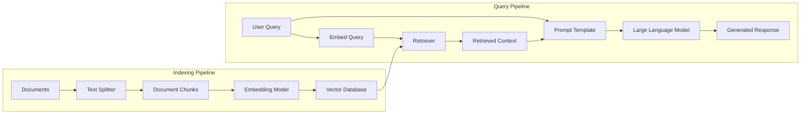

Sources: [notebooks/en/rag_zephyr_langchain.ipynb:16-32](), [notebooks/en/rag_llamaindex_librarian.ipynb:16-49]()

## RAG Implementation with LangChain and Zephyr

LangChain provides a flexible framework for building RAG applications. The following example shows a basic implementation using Zephyr, a small but powerful open-source LLM.

### Data Preparation and Embedding

```mermaid
flowchart TB
    githubIssues[("GitHub Issues")] --> loader["GitHubIssuesLoader"]
    loader --> rawDocs["Raw Documents"]
    rawDocs --> splitter["RecursiveCharacterTextSplitter"]
    splitter --> chunks["Document Chunks<br>chunk_size=512<br>chunk_overlap=30"]
    chunks --> embeddings["HuggingFaceEmbeddings<br>(BAAI/bge-base-en-v1.5)"]
    embeddings --> vectorDB["FAISS Vector Database"]
    vectorDB --> retriever["Similarity Retriever<br>k=4"]
```

The implementation follows these steps:

1. **Document Loading**: Use `GitHubIssuesLoader` to fetch issues from a specific repository
2. **Text Chunking**: Split documents into smaller chunks using `RecursiveCharacterTextSplitter`
3. **Embedding Generation**: Create vector embeddings using the `bge-base-en-v1.5` model
4. **Vector Storage**: Store embeddings in a FAISS database for efficient similarity search
5. **Retriever Setup**: Configure a retriever that returns the top k most similar documents

Sources: [notebooks/en/rag_zephyr_langchain.ipynb:122-152](), [notebooks/en/rag_zephyr_langchain.ipynb:184-223]()

### Language Model Configuration and RAG Chain

```mermaid
flowchart TB
    queryText["User Query"] --> inputFormatter["Tokenizer"]
    inputFormatter --> embeddedQuery["Embedded Query"]
    embeddedQuery --> retriever["Retriever"]
    vectorDB["FAISS Vector DB"] --> retriever
    retriever --> context["Retrieved Context"]
    
    context --> promptTemplate["Prompt Template<br>System + Context + Query"]
    queryText --> promptTemplate
    
    promptTemplate --> formattedPrompt["Formatted Prompt"]
    formattedPrompt --> pipeline["Text Generation Pipeline<br>(Zephyr-7b-beta)"]
    pipeline --> llmChain["LLM Chain"]
    llmChain --> response["Generated Response"]
    
    subgraph "RAG Chain"
        inputMap["Input Mapping:<br>{context: retriever, question: query}"]
        ragProcessor["RunnablePassthrough"]
        inputMap --> ragProcessor
        ragProcessor --> llmChain
    end
```

The RAG chain implementation involves:

1. **LLM Configuration**: Load and configure the Zephyr model with appropriate parameters
2. **Prompt Template**: Create a template that combines system instructions, context, and user query
3. **Chain Creation**: Assemble a pipeline that connects the retriever with the LLM
4. **Response Generation**: Generate contextualized responses using the retrieved documents

Sources: [notebooks/en/rag_zephyr_langchain.ipynb:264-279](), [notebooks/en/rag_zephyr_langchain.ipynb:310-378]()

## RAG Implementation with LlamaIndex

LlamaIndex provides a data framework specifically designed for RAG applications, with simpler abstractions for document loading, indexing, and querying.

### Data Loading and Indexing

```mermaid
flowchart TB
    ebooks[("Local eBooks (.epub)")] --> loader["SimpleDirectoryReader<br>recursive=True"]
    loader --> rawDocs["Raw Documents"]
    
    embedModel["HuggingFaceEmbedding<br>(bge-small-en-v1.5)"] --> indexer
    rawDocs --> indexer["VectorStoreIndex"]
    
    indexer --> inMemoryVectorStore["In-Memory Vector Store"]
```

This implementation:

1. **Document Loading**: Uses `SimpleDirectoryReader` to load ebook files recursively
2. **Vector Index Creation**: Creates an in-memory vector index for document retrieval
3. **Embedding Generation**: Utilizes the `bge-small-en-v1.5` model for embeddings

Sources: [notebooks/en/rag_llamaindex_librarian.ipynb:194-229](), [notebooks/en/rag_llamaindex_librarian.ipynb:247-291]()

### Query Engine and Response Generation

```mermaid
flowchart TB
    query["User Query"] --> queryEngine["Query Engine"]
    
    vectorIndex["VectorStoreIndex"] --> queryEngine
    ollamaLLM["Ollama LLM Client<br>(llama2)"] --> queryEngine
    
    queryEngine --> embeddedQuery["Embedded Query"]
    embeddedQuery --> retrieval["Similarity Search"]
    retrieval --> context["Retrieved Context"]
    
    context --> promptFormat["Internal Prompt Formatting"]
    query --> promptFormat
    
    promptFormat --> llmGeneration["LLM Generation"]
    llmGeneration --> response["Generated Response"]
```

The query process involves:

1. **Query Engine Setup**: Configure a query engine with the vector index and LLM
2. **Query Processing**: Process user queries to retrieve relevant context
3. **Response Generation**: Generate responses using the Llama2 model via Ollama

Sources: [notebooks/en/rag_llamaindex_librarian.ipynb:315-330](), [notebooks/en/rag_llamaindex_librarian.ipynb:336-381]()

## Framework Comparison

Each framework offers different advantages for implementing RAG systems:

| Framework | Vector Store Options | Key Features | Ideal Use Cases |
|-----------|---------------------|--------------|-----------------|
| LangChain | FAISS, Chroma, Pinecone, etc. | Flexible chains and agents, many integrations | Complex workflows, multiple data sources |
| LlamaIndex | In-memory, Chroma, Pinecone, etc. | RAG-specific abstractions, simpler API | Quick prototyping, document-focused applications |
| Direct Implementation | Milvus, FAISS, etc. | Full control, lower abstraction | Custom requirements, performance optimization |

Sources: [notebooks/en/rag_zephyr_langchain.ipynb:35-47](), [notebooks/en/rag_llamaindex_librarian.ipynb:35-49]()

## Implementation Considerations

When building a RAG system, several factors affect performance and accuracy:

### Chunking Strategy

The way documents are split affects retrieval quality:
- **Chunk Size**: Smaller chunks (e.g., 512 tokens) provide more specific context but may miss broader information
- **Chunk Overlap**: Overlapping chunks (e.g., 30-200 tokens) help preserve context across chunk boundaries

Sources: [notebooks/en/rag_zephyr_langchain.ipynb:142-159](), [notebooks/en/rag_llamaindex_librarian.ipynb:245-251]()

### Embedding Model Selection

The embedding model significantly impacts retrieval quality:
- **Model Size**: Larger models generally provide better semantic understanding but require more resources
- **Domain Alignment**: Models trained on domain-specific data often perform better for specialized content
- **Performance**: The [MTEB Leaderboard](https://huggingface.co/spaces/mteb/leaderboard) is a good reference for model selection

Sources: [notebooks/en/rag_zephyr_langchain.ipynb:178-183](), [notebooks/en/rag_llamaindex_librarian.ipynb:252-271]()

### Prompt Engineering

Effective prompt templates should:
- Clearly separate context from instructions
- Guide the model on how to use the retrieved information
- Include specific instructions for handling missing information

Example prompt template:
```
<|system|>
Answer the question based on your knowledge. Use the following context to help:

{context}

</s>
<|user|>
{question}
</s>
<|assistant|>
```

Sources: [notebooks/en/rag_zephyr_langchain.ipynb:329-348]()

## Conclusion

Basic RAG implementations provide a solid foundation for enhancing LLM capabilities with external knowledge. By following the patterns shown in this document, you can build RAG systems that deliver more accurate, up-to-date, and contextually relevant responses.

For more advanced techniques or specialized implementations, explore the additional notebooks in the cookbook repository and the related wiki pages.

---

# Page: Advanced RAG Techniques

# Advanced RAG Techniques

<details>
<summary>Relevant source files</summary>

The following files were used as context for generating this wiki page:

- [notebooks/en/advanced_rag.ipynb](notebooks/en/advanced_rag.ipynb)
- [notebooks/en/rag_evaluation.ipynb](notebooks/en/rag_evaluation.ipynb)
- [notebooks/ko/_toctree.yml](notebooks/ko/_toctree.yml)
- [notebooks/ko/index.md](notebooks/ko/index.md)

</details>


This page covers advanced techniques for enhancing Retrieval Augmented Generation (RAG) systems beyond basic implementations. While [Basic RAG Implementations](#2.1) covers the fundamentals of setting up RAG pipelines, this document focuses on optimization techniques that can significantly improve retrieval quality, relevance, and overall response accuracy.

RAG systems are complex with many moving parts that can be tuned for performance gains. This document explores techniques including improved embedding models, optimized chunking strategies, reranking methods, query transformation approaches, and context handling enhancements.

## RAG System Architecture Overview

```mermaid
flowchart TD
    User["User Query"] --> QueryProcess["Query Processing"]
    
    subgraph "Advanced RAG Pipeline"
        QueryProcess -->|"Transformed Query"| QueryExp["Query Expansion/HyDE"]
        QueryExp -->|"Enhanced Query"| Retriever["Retriever"]
        
        Retriever -->|"Initial Results"| Reranker["Reranking"]
        
        subgraph "Knowledge Base"
            VectorDB[("Vector Database")]
            Documents["Document Collection"]
            Documents -->|"Optimal Chunking"| Chunks["Document Chunks"]
            Chunks -->|"Quality Embeddings"| VectorDB
        end
        
        Reranker -->|"Reranked Results"| ContextProcess["Context Processing"]
        VectorDB -->|"Retrieved Chunks"| Retriever
        
        ContextProcess -->|"Optimized Context"| Reader["Reader/LLM"]
        
        Reader -->|"Generated Response"| PostProcess["Post-Processing"]
    end
    
    PostProcess --> Response["Response to User"]
```

Sources: [notebooks/en/advanced_rag.ipynb:19-31]()

## Retriever Optimizations

The retriever is the component that fetches relevant context from the knowledge base. Several optimization techniques can enhance retrieval quality.

### Embedding Model Selection

The choice of embedding model significantly impacts retrieval performance. Advanced RAG systems often use state-of-the-art embedding models that better capture semantic meaning.

Popular embedding models for advanced RAG include:

| Model | Dimensions | Context Length | Special Features |
|-------|------------|----------------|------------------|
| GTE models | 768-1024 | 512 | Optimized for retrieval tasks |
| E5 models | 1024 | 512 | Strong multilingual support |
| BGE models | 768-1024 | 512 | Good balance of speed/performance |
| Instructor models | 768 | 512 | Can be guided with instructions |

The embedding model selection depends on your specific use case, language requirements, and computational constraints.

Sources: [notebooks/en/advanced_rag.ipynb:242-255]()

### Optimized Chunking Strategies

Advanced RAG implementations pay careful attention to how documents are chunked:

```mermaid
flowchart LR
    subgraph "Document Chunking Process"
        Doc["Original Document"] --> Splitter["Text Splitter"]
        Splitter --> ChunkSize["Chunk Size Tuning"]
        Splitter --> ChunkOverlap["Chunk Overlap Tuning"]
        Splitter --> SplitMethod["Split Method Selection"]
        
        ChunkSize --> Chunks["Optimized Chunks"]
        ChunkOverlap --> Chunks
        SplitMethod --> Chunks
        
        Chunks --> Embeddings["Generate Embeddings"]
        Embeddings --> VectorDB[("Vector Database")]
    end
```

Key chunking optimizations include:

1. **Token-based chunking**: Rather than using a character count, advanced implementations use the tokenizer from the embedding model to ensure chunks respect token limits.

2. **Recursive chunking with semantic separators**: Using a hierarchical list of separators (paragraphs, sentences, etc.) to preserve the semantic structure of content.

3. **Optimal chunk size determination**: Finding the right balance - too small fragments important concepts, too large dilutes relevance.

4. **Strategic overlap**: Ensuring that contextual continuity is maintained between chunks.

Sources: [notebooks/en/advanced_rag.ipynb:147-204]()

## Query Transformation Techniques

Advanced RAG systems often transform the user query to improve retrieval quality.

### Query Expansion

Query expansion enriches the original query with additional relevant terms to increase the likelihood of matching relevant documents.

```mermaid
flowchart TD
    Query["Original Query"] --> LLM["Query Expansion LLM"]
    LLM --> ExpandedQuery["Expanded Query"]
    ExpandedQuery --> Retriever["Retriever"]
    
    subgraph "Example"
        OQ["'How to fine-tune a model?'"] --> EQ["'How to fine-tune a model? \n training custom model parameters \n PEFT LoRA adapters adjustment'"]
    end
```

Implementation typically involves:
1. Passing the original query to an LLM
2. Asking the LLM to generate additional relevant search terms
3. Expanding the original query with these terms
4. Performing retrieval with the expanded query

Sources: [notebooks/en/advanced_rag.ipynb:500-550]()

### Hypothetical Document Embeddings (HyDE)

HyDE uses a language model to generate a hypothetical ideal document that would answer the query, then uses the embedding of that document for retrieval.

```mermaid
flowchart LR
    Query["User Query"] --> GenLLM["Generation LLM"]
    GenLLM --> HypDoc["Hypothetical Document"]
    HypDoc --> Embedder["Embedding Model"]
    Embedder --> DocEmbed["Document Embedding"]
    DocEmbed --> Retriever["Similarity Search"]
    Retriever --> Results["Retrieved Documents"]
```

This technique is especially effective for complex, inferential queries where the user query terms might not directly match the relevant documents.

Sources: [notebooks/en/advanced_rag.ipynb:600-650]()

## Reranking Techniques

Reranking adds a second stage of relevance assessment after initial retrieval to improve precision.

### Cross-Encoder Reranking

While the initial retrieval typically uses bi-encoders (separate embeddings for query and documents), cross-encoders process the query and document together for more accurate relevance scoring.

```mermaid
flowchart TD
    Query["User Query"] --> Retriever["Initial Retriever"]
    KB[("Knowledge Base")] --> Retriever
    
    Retriever -->|"Top-k Results"| CrossEnc["Cross-Encoder Reranker"]
    Query --> CrossEnc
    
    CrossEnc -->|"Reranked Results"| FinalRes["Final Results"]
```

Cross-encoders:
- Process query and document jointly rather than independently
- Provide more accurate relevance scoring
- Are computationally more expensive (only applied to top-k results)
- Can significantly improve precision at the top positions

Sources: [notebooks/en/advanced_rag.ipynb:700-750]()

### Reciprocal Rank Fusion (RRF)

RRF combines multiple ranking methods to create a more robust final ranking.

```mermaid
flowchart TD
    Query["User Query"] --> Retriever1["Retriever Method 1"]
    Query --> Retriever2["Retriever Method 2"]
    Query --> Retriever3["Retriever Method 3"]
    
    KB[("Knowledge Base")] --> Retriever1
    KB --> Retriever2
    KB --> Retriever3
    
    Retriever1 -->|"Ranking 1"| RRF["Reciprocal Rank Fusion"]
    Retriever2 -->|"Ranking 2"| RRF
    Retriever3 -->|"Ranking 3"| RRF
    
    RRF --> FinalRanking["Final Ranking"]
```

RRF can combine rankings from different retrieval methods, embedding models, or even hybrid neural-lexical approaches for more robust retrieval.

Sources: [notebooks/en/advanced_rag.ipynb:800-850]()

## Enhanced Context Handling

Once documents are retrieved, advanced RAG techniques optimize how context is presented to the language model.

### Maximum Marginal Relevance (MMR)

MMR balances relevance with diversity in the retrieval set to reduce redundancy and increase information coverage.

```mermaid
flowchart LR
    Query["Query"] --> VectorSearch["Initial Vector Search"]
    VectorSearch -->|"Candidates"| MMRMethod["MMR Selection"]
    
    subgraph "MMR Algorithm"
        MMRMethod --> RelScore["Relevance Scoring"]
        MMRMethod --> DivScore["Diversity Scoring"]
        RelScore --> MMRCalc["MMR Calculation"]
        DivScore --> MMRCalc
        MMRCalc -->|"Select Next Document"| Selected["Selected Documents"]
    end
```

The MMR algorithm iteratively selects documents by balancing:
- Relevance to the query
- Diversity compared to already selected documents

This approach ensures broader coverage of relevant information while minimizing redundancy.

Sources: [notebooks/en/advanced_rag.ipynb:900-950]()

### Context Compression

Context compression techniques reduce the size of retrieved documents while preserving essential information:

1. **Map-Reduce Summarization**: Each document is summarized independently, then combined

2. **LLM-based extraction**: Using an LLM to extract only the portions directly relevant to the query

3. **Adaptive retrieval**: Dynamically adjusting the number of retrieved documents based on query complexity

4. **Document re-assembly**: Extracting and re-organizing key information from retrieved documents

These compression techniques help overcome context window limitations of LLMs and improve focus on relevant information.

Sources: [notebooks/en/advanced_rag.ipynb:1000-1050]()

## Output Processing Enhancements

Advanced RAG systems often include post-processing steps for improved responses.

### Source Attribution and Citation

Implementing mechanisms to track and attribute specific claims to source documents:

```mermaid
flowchart TD
    Query["User Query"] --> RetrievalGen["RAG System"]
    KB[("Knowledge Base")] --> RetrievalGen
    
    RetrievalGen -->|"Response + Source Tracking"| Citation["Citation Processing"]
    
    Citation --> FormattedResp["Response with Citations"]
    Citation --> Metadata["Source Metadata"]
```

Techniques include:
- Passage-level source tracking
- Attribution markers in prompts
- Post-processing to format citations
- Structured output with source references

Sources: [notebooks/en/advanced_rag.ipynb:1100-1150]()

### Self-Verification and Fact-Checking

Advanced RAG systems may implement self-verification mechanisms:

1. **Confidence scoring**: Having the LLM assess its confidence in different parts of the response

2. **Verification step**: Using a separate prompt to check factual accuracy against retrieved content

3. **Uncertainty highlighting**: Explicitly marking uncertain information in responses

4. **Hallucination detection**: Post-processing to identify likely hallucinations

These techniques reduce the likelihood of hallucinated content in the final response.

Sources: [notebooks/en/advanced_rag.ipynb:1150-1200]()

## Evaluation and Monitoring

Implementing robust evaluation frameworks is critical for advanced RAG systems.

### Synthetic Dataset Generation

Creating synthetic question-answer pairs from the knowledge base for automated testing:

```mermaid
flowchart TD
    KB[("Knowledge Base")] --> Sampler["Document Sampler"]
    Sampler -->|"Sample Documents"| QAGen["QA Pair Generator LLM"]
    QAGen -->|"Initial QA Pairs"| Filter["Quality Filters"]
    Filter -->|"Curated QA Pairs"| TestSet["Evaluation Dataset"]
    
    TestSet --> Evaluator["Evaluator"]
    RAGSystem["RAG System"] --> Evaluator
    Evaluator --> Metrics["Performance Metrics"]
```

The generated dataset can be used to automatically assess system performance across various metrics.

Sources: [notebooks/rag_evaluation.ipynb:115-126]()

### LLM-as-Judge Evaluation

Using a separate LLM to evaluate the quality of RAG responses:

1. **Answer relevance**: Assessing if the response addresses the question

2. **Factual accuracy**: Verifying if information is consistent with retrieved documents

3. **Groundedness**: Ensuring all claims can be traced to source documents

4. **Context utilization**: Evaluating how well the system used the retrieved context

This approach provides more nuanced evaluation than simple exact-match metrics.

Sources: [notebooks/rag_evaluation.ipynb:20-35]()

## Implementation Considerations for Advanced RAG

When implementing advanced RAG techniques, consider:

1. **Modular architecture**: Design your system to easily swap out different components (embedders, retrievers, rerankers)

2. **Latency vs. quality tradeoffs**: More sophisticated techniques often increase latency, which may not be acceptable for all applications

3. **Monitoring and logging**: Implement comprehensive tracking to identify which techniques provide the most benefit

4. **A/B testing**: Test different combinations of techniques on real user queries to optimize for actual use cases

5. **Continuous improvement**: Set up mechanisms to collect feedback and continuously refine the system

Sources: [notebooks/en/advanced_rag.ipynb:1250-1300]()

## Practical Example of Advanced RAG Implementation

Here's a high-level architecture of an advanced RAG implementation:

```mermaid
flowchart TD
    Query["User Query"] --> QueryExp["Query Expansion"]
    QueryExp --> Retriever["Initial Retrieval"]
    Retriever --> KnowledgeDB[("Vector Database")]
    
    Retriever -->|"Top-k Documents"| Reranker["Cross-Encoder Reranker"]
    Reranker -->|"Reranked Documents"| MMR["MMR Diversification"]
    MMR -->|"Diversified Documents"| Compression["Context Compression"]
    
    Compression -->|"Processed Context"| Prompt["Prompt Construction"]
    Prompt --> LLM["Language Model"]
    
    LLM -->|"Draft Response"| PostProcess["Post-Processing"]
    PostProcess -->|"Final Response"| User["User"]
    
    subgraph "Knowledge Base Preparation"
        RawDocs["Raw Documents"] --> Chunker["Token-Based Chunker"]
        Chunker -->|"Optimized Chunks"| Embedder["State-of-the-Art Embedder"]
        Embedder --> KnowledgeDB
    end
```

This architecture incorporates multiple advanced techniques in a pipeline that can be adapted based on specific requirements and constraints.

Sources: [notebooks/en/advanced_rag.ipynb:19-31](), [notebooks/en/advanced_rag.ipynb:147-204]()

## Conclusion

Advanced RAG techniques represent a significant improvement over basic implementations. By incorporating optimized embedding models, sophisticated chunking strategies, query transformation, reranking, and enhanced context handling, RAG systems can deliver more accurate, relevant, and comprehensive responses.

The field of RAG is rapidly evolving, with new techniques being developed regularly. For evaluation methods to assess the impact of these techniques, see [RAG Evaluation](#2.5), and for structured output generation in RAG systems, see [Structured Generation for RAG](#2.3).

---

# Page: Structured Generation for RAG

# Structured Generation for RAG

<details>
<summary>Relevant source files</summary>

The following files were used as context for generating this wiki page:

- [notebooks/en/llm_judge.ipynb](notebooks/en/llm_judge.ipynb)
- [notebooks/en/structured_generation.ipynb](notebooks/en/structured_generation.ipynb)
- [notebooks/ko/advanced_ko_rag.ipynb](notebooks/ko/advanced_ko_rag.ipynb)
- [notebooks/ko/structured_generation.ipynb](notebooks/ko/structured_generation.ipynb)

</details>


Structured Generation for RAG is a technique that forces Language Model (LLM) outputs to follow specific formats or patterns within Retrieval-Augmented Generation (RAG) systems. This approach ensures that responses contain not only the answer derived from retrieved documents but also additional structured information such as source attributions, confidence scores, and other metadata in a consistent, machine-readable format.

This document focuses specifically on implementing structured generation techniques to enhance RAG systems, with particular emphasis on source highlighting and constrained output generation. For general RAG implementation information, see [Retrieval-Augmented Generation (RAG) Systems](#2) and [Advanced RAG Techniques](#2.2).

## Overview of Structured Generation

Structured generation addresses several challenges in RAG implementations:

1. Ensuring consistent output formats for downstream processing
2. Providing explicit attribution of generated content to source documents
3. Including metadata like confidence scores
4. Enabling source highlighting for improved transparency and trust

```mermaid
flowchart LR
    Query["User Query"] --> Retriever["Document Retriever"]
    Retriever --> Documents["Retrieved Documents"]
    Documents --> PromptBuilder["Prompt Constructor"]
    Query --> PromptBuilder
    PromptBuilder --> LLM["LLM"]
    LLM --> OutputProcessor["Structured Output Processor"]
    OutputProcessor --> StructuredResult["JSON with answer, confidence, and source snippets"]
    StructuredResult --> UI["Presentation Layer with Source Highlighting"]
```

Sources: [notebooks/en/structured_generation.ipynb:7-27]()

## Implementation Approaches

There are two primary methods for implementing structured generation in RAG systems:

### Prompt-Based Structured Generation

The simplest approach uses carefully crafted prompts that instruct the LLM to generate responses in a specific format. This method works reasonably well with capable models but has limitations with less powerful LLMs or when using high temperature settings.

Example prompt template for JSON-structured output:

```
Answer the user query based on the source documents.

Here are the source documents: {context}

You should provide your answer as a JSON blob, and also provide all relevant short 
source snippets from the documents on which you directly based your answer, 
and a confidence score as a float between 0 and 1.

Your answer should be built as follows:
{
  "answer": your_answer,
  "confidence_score": your_confidence_score,
  "source_snippets": ["snippet_1", "snippet_2", ...]
}

Here is the user question: {user_query}.
```

#### Limitations of Prompt-Only Approach

While prompting works with capable models, it has several drawbacks:

- Output format may be inconsistent or malformed with less capable models
- High temperature settings can produce unusable outputs
- No guarantee the model will follow the requested format
- Parsing errors may occur if the output doesn't strictly adhere to the expected structure

Sources: [notebooks/en/structured_generation.ipynb:80-93](), [notebooks/ko/structured_generation.ipynb:293-304]()

### Constrained Decoding Approach

Constrained decoding enforces output formats by only allowing the model to generate tokens that conform to a predefined grammar or schema. This technique ensures valid outputs regardless of the model's capabilities or temperature settings.

```mermaid
flowchart TD
    subgraph "Traditional RAG"
        Query1["User Query"] --> Retriever1["Retriever"]
        Retriever1 --> Context1["Context"]
        Context1 --> Prompt1["Prompt Engineering"]
        Prompt1 --> LLM1["LLM"]
        LLM1 --> Output1["Unstructured Output"]
    end

    subgraph "Structured Generation RAG"
        Query2["User Query"] --> Retriever2["Retriever"]
        Retriever2 --> Context2["Context"]
        Context2 --> Prompt2["Prompt Engineering"]
        Prompt2 --> LLM2["LLM"]
        LLM2 --> Grammar["Grammar/Schema Definition"]
        Grammar --> Decoder["Constrained Decoder"]
        Decoder --> Output2["Structured Output (JSON)"]
        Output2 --> SourceHighlighter["Source Highlighter"]
        SourceHighlighter --> AnnotatedResponse["Answer with Highlighted Sources"]
    end
```

Constrained decoding works by applying a bias to the model's logits to force selection of only the tokens that conform to the defined constraints. This ensures the output is always valid according to the specified schema.

Sources: [notebooks/en/structured_generation.ipynb:339-346](), [notebooks/ko/structured_generation.ipynb:350-356]()

## Implementing Source Highlighting with Structured Generation

One of the most valuable applications of structured generation in RAG is highlighting source snippets that support the generated answer, improving transparency and verifiability.

### Defining the Output Schema

The first step is to define a schema that captures the required output structure:

```python
from pydantic import BaseModel, confloat, StringConstraints
from typing import List, Annotated

class AnswerWithSnippets(BaseModel):
    answer: Annotated[str, StringConstraints(min_length=10, max_length=100)]
    confidence: Annotated[float, confloat(ge=0.0, le=1.0)]
    source_snippets: List[Annotated[str, StringConstraints(max_length=30)]]
```

This Pydantic model defines:
- An answer string with length constraints
- A confidence score between 0 and 1
- A list of source snippets, each with a maximum length

Sources: [notebooks/en/structured_generation.ipynb:354-361](), [notebooks/ko/structured_generation.ipynb:367-374]()

### Implementing Constrained Decoding

The Hugging Face Inference API supports constrained decoding through its grammar parameter:

```python
# Using the InferenceClient
answer = llm_client.text_generation(
    prompt,
    grammar={"type": "json", "value": AnswerWithSnippets.schema()},
    max_new_tokens=250,
    temperature=1.6,
)
```

The grammar parameter ensures that the output conforms to the specified schema, even with high temperature settings, forcing the model to produce valid JSON that matches the defined structure.

Sources: [notebooks/en/structured_generation.ipynb:428-437](), [notebooks/ko/structured_generation.ipynb:430-439]()

### Processing and Visualizing Highlighted Snippets

Once the structured output is generated, the source snippets can be highlighted in the original context:

```python
def highlight(s):
    return "\x1b[1;32m" + s + "\x1b[0m"

def print_results(answer, source_text, highlight_snippets):
    print("Answer:", highlight(answer))
    print("\n\n", "=" * 10 + " Source documents " + "=" * 10)
    for snippet in highlight_snippets:
        source_text = source_text.replace(snippet.strip(), highlight(snippet.strip()))
    print(source_text)
```

This creates a visual representation showing exactly which parts of the source documents support the generated answer.

Sources: [notebooks/en/structured_generation.ipynb:262-271](), [notebooks/ko/structured_generation.ipynb:278-287]()

## Tools and Libraries for Structured Generation

Several tools and libraries support structured generation for RAG systems:

### Outlines Library

Outlines is a structured text generation library that can be used locally or through the Hugging Face Inference API. It provides fine-grained control over output generation to ensure adherence to defined schemas.

```mermaid
flowchart LR
    subgraph "OutlinesStructuredGeneration"
        Prompt["RAG Prompt"] --> Model["LLM Model"]
        Schema["Schema Definition"] --> Generator["outlines.generate.json()"]
        Model --> Generator
        Generator --> StructuredOutput["Structured JSON Output"]
    end
```

Implementation example:

```python
import outlines
import json

# Load model locally
model = outlines.models.transformers(repo_id)

# Convert schema to string
schema_as_str = json.dumps(AnswerWithSnippets.schema())

# Create generator with schema
generator = outlines.generate.json(model, schema_as_str)

# Generate structured output
result = generator(prompt)
```

Outlines works by applying a bias to the model's logits, ensuring only tokens that conform to the constraints are selected during generation.

Sources: [notebooks/en/structured_generation.ipynb:479-491](), [notebooks/ko/structured_generation.ipynb:496-499]()

### Hugging Face Inference API

The Hugging Face Inference API provides built-in support for constrained decoding:

```python
from huggingface_hub import InferenceClient

llm_client = InferenceClient(model=repo_id)

# Using grammar constraint
data = {
    "inputs": prompt,
    "parameters": {
        "temperature": 1.0,
        "return_full_text": False,
        "grammar": {"type": "json", "value": AnswerWithSnippets.schema()},
        "max_new_tokens": 250,
    },
}
answer = json.loads(llm_client.post(json=data))[0]["generated_text"]
```

Sources: [notebooks/en/structured_generation.ipynb:438-450](), [notebooks/ko/structured_generation.ipynb:470-479]()

### Text-Generation-Inference (TGI)

For self-hosted deployments, Text-Generation-Inference supports constrained generation through its API, offering the same capabilities as the Hugging Face Inference API but in a self-hosted environment.

## Advanced Use Cases and Extensions

Structured generation extends beyond source highlighting in RAG:

```mermaid
flowchart TD
    StructGen["Structured Generation"] --> RAG["RAG with Source Highlighting"]
    StructGen --> Eval["LLM-as-Judge Evaluation"]
    StructGen --> SQL["SQL Query Generation"]
    StructGen --> Agent["Agent Tool Calling"]
    
    subgraph "LLMEvaluationExample"
        Input["System & User Response"] --> EvalPrompt["Evaluation Prompt"]
        EvalPrompt --> JudgeLLM["Judge LLM"]
        Schema["Score Schema"] --> ConstrainedDecoder["Constrained Decoder"]
        JudgeLLM --> ConstrainedDecoder
        ConstrainedDecoder --> EvalOutput["Structured Evaluation\n{score: 4, rationale: '...'}"]
    end
```

### LLM-as-a-Judge Evaluation

Structured generation is valuable for LLM evaluation frameworks, where it can be used to ensure consistent output formats for scores and rationales.

Example schema for LLM judge output:
```python
class JudgeOutput(BaseModel):
    score: int  # Score from 1-4
    rationale: str  # Explanation for the score
    confidence_level: float  # Confidence in the assessment
```

Sources: [notebooks/en/llm_judge.ipynb:452-480](), [notebooks/ko/structured_generation.ipynb:554-560]()

### Other Applications

Structured generation can be applied to various other scenarios:
- SQL query generation with validated syntax
- Agent frameworks with structured tool calls
- Form generation with specific fields
- Table creation with defined columns and data types

## Implementation Considerations

When implementing structured generation for RAG systems:

1. **Schema complexity**: Balance between overly rigid and overly flexible schemas
2. **Model selection**: More capable models generally follow structured formats better
3. **Error handling**: Plan for error cases even with constrained decoding
4. **Performance impact**: Constrained decoding may affect generation speed
5. **User experience**: Consider how to effectively present highlighted sources to end users

## Conclusion

Structured generation significantly enhances RAG systems by providing:
- Consistent output formats for downstream processing
- Improved transparency through source highlighting
- Additional metadata like confidence scores
- Better control over output format regardless of model capability

By combining effective prompting with constrained decoding techniques, developers can build more reliable and transparent RAG systems that clearly show how generated answers relate to source documents, enhancing user trust and system reliability.

Sources: [notebooks/en/structured_generation.ipynb:498-511](), [notebooks/ko/structured_generation.ipynb:553-569]()

---

# Page: RAG with Different Vector Databases

# RAG with Different Vector Databases

<details>
<summary>Relevant source files</summary>

The following files were used as context for generating this wiki page:

- [notebooks/en/rag_llamaindex_librarian.ipynb](notebooks/en/rag_llamaindex_librarian.ipynb)
- [notebooks/en/rag_with_hf_and_milvus.ipynb](notebooks/en/rag_with_hf_and_milvus.ipynb)
- [notebooks/zh-CN/index.md](notebooks/zh-CN/index.md)
- [notebooks/zh-CN/prompt_tuning_peft.ipynb](notebooks/zh-CN/prompt_tuning_peft.ipynb)
- [notebooks/zh-CN/rag_with_hf_and_milvus.ipynb](notebooks/zh-CN/rag_with_hf_and_milvus.ipynb)

</details>


This document provides a comprehensive overview of implementing Retrieval-Augmented Generation (RAG) systems using various vector database options. We'll cover the integration of popular vector databases including FAISS, Milvus, Elasticsearch, MongoDB, and ChromaDB within RAG architectures, with practical examples. For more information about advanced RAG techniques or structured outputs, see [Advanced RAG Techniques](#2.2) or [Structured Generation for RAG](#2.3).

## Introduction to Vector Databases in RAG

Vector databases are specialized storage systems optimized for managing high-dimensional vector embeddings and performing efficient similarity searches. In RAG systems, they serve as the retrieval component that stores document embeddings and quickly fetches the most relevant context based on similarity to the query.

```mermaid
flowchart TD
    subgraph "RAG Architecture with Vector Databases"
        User["User Query"] --> Embed["Embedding Generation"]
        Embed --> Search["Vector Search"]
        Search --> Context["Context Retrieval"]
        Context --> Response["LLM Response Generation"]
        
        VectorDB["Vector Database"] <--> Search
        Documents["Document Corpus"] --> Index["Indexing Pipeline"]
        Index --> VectorDB
    end
```

Sources: [notebooks/en/rag_llamaindex_librarian.ipynb:174-293](), [notebooks/en/rag_with_hf_and_milvus.ipynb:212-292]()

## Common Vector Database Options

There are several vector database options available for implementing RAG systems, each with its own strengths and characteristics:

| Database | Type | Key Features | Best For |
|----------|------|--------------|----------|
| FAISS | In-memory/file-based | Efficient similarity search, compact index | Small-medium datasets, local deployment |
| Milvus | Distributed vector DB | Highly scalable, rich query capabilities | Large-scale production, complex queries |
| Elasticsearch | Search engine with vector support | Full-text + vector search, mature ecosystem | Hybrid search (text + semantic) |
| MongoDB | Document DB with vector support | Document-oriented storage with vector fields | Existing MongoDB users |
| ChromaDB | Embedded vector DB | Easy setup, persistence options | Quick prototyping, simple applications |
| LlamaIndex | Abstraction layer | Works with multiple vector stores | Flexibility, easy switching between DBs |

Sources: [notebooks/en/rag_llamaindex_librarian.ipynb:26-45](), [notebooks/en/rag_with_hf_and_milvus.ipynb:7-14]()

## Vector Database Integration Architecture

The following diagram illustrates how different vector databases integrate into the RAG pipeline:

```mermaid
flowchart LR
    subgraph "Document Processing"
        Doc["Documents"] --> Split["Text Splitter"]
        Split --> Chunks["Document Chunks"]
        Chunks --> EmbedGen["Embedding Generation"]
    end

    subgraph "Vector Database Options"
        EmbedGen --> FAISS["FAISS Index"]
        EmbedGen --> Milvus["Milvus Collection"]
        EmbedGen --> ES["Elasticsearch Index"]
        EmbedGen --> Mongo["MongoDB Collection"]
        EmbedGen --> Chroma["ChromaDB Collection"]
    end

    subgraph "Query Processing"
        Query["User Query"] --> QEmbed["Query Embedding"]
        QEmbed --> Retrieval["Similar Document Retrieval"]
        FAISS --> Retrieval
        Milvus --> Retrieval
        ES --> Retrieval
        Mongo --> Retrieval
        Chroma --> Retrieval
        Retrieval --> Context["Retrieved Context"]
        Context --> LLM["Language Model"]
        Query --> LLM
        LLM --> Answer["Generated Answer"]
    end
```

Sources: [notebooks/en/rag_with_hf_and_milvus.ipynb:342-365](), [notebooks/en/rag_llamaindex_librarian.ipynb:174-203]()

## Implementation with Milvus

Milvus is a powerful vector database designed specifically for similarity search and AI applications. Here's how to implement RAG with Milvus:

```mermaid
flowchart TD
    subgraph "Milvus RAG Implementation"
        Load["PyPDFLoader"] --> Split["RecursiveCharacterTextSplitter"]
        Split --> Chunks["Text Chunks"]
        Chunks --> Embed["SentenceTransformer: bge-small-en-v1.5"]
        Embed --> Vector["Document Vectors"]
        
        MilvusDB["MilvusClient: Collection Creation
        - dimension: embedding size
        - metric_type: IP (Inner Product)
        - consistency_level: Strong"] <-- "Insert" --> Vector
        
        Query["User Question"] --> QEmbed["Query Embedding"]
        QEmbed --> Search["Milvus Search
        - limit: 3 results
        - metric_type: IP"]
        MilvusDB --> Search
        Search --> Context["Retrieved Text Context"]
        Context --> Prompt["Prompt Construction"]
        Query --> Prompt
        Prompt --> LLM["Mixtral-8x7B-Instruct"]
        LLM --> Answer["Generated Answer"]
    end
```

Sources: [notebooks/en/rag_with_hf_and_milvus.ipynb:231-291](), [notebooks/en/rag_with_hf_and_milvus.ipynb:371-408]()

### Code Example: Setting up Milvus for RAG

```python
from pymilvus import MilvusClient
from sentence_transformers import SentenceTransformer

# 1. Initialize embedding model
embedding_model = SentenceTransformer("BAAI/bge-small-en-v1.5")
embedding_dim = len(embedding_model.encode(["This is a test"])[0])

# 2. Create Milvus collection
milvus_client = MilvusClient(uri="./milvus_data.db")  # Local file-based storage
collection_name = "rag_collection"

milvus_client.create_collection(
    collection_name=collection_name,
    dimension=embedding_dim,
    metric_type="IP",  # Inner product distance
    consistency_level="Strong"
)

# 3. Insert data
for i, text in enumerate(text_chunks):
    vector = embedding_model.encode([text])[0].tolist()
    milvus_client.insert(
        collection_name=collection_name, 
        data={"id": i, "vector": vector, "text": text}
    )

# 4. Search for similar documents
query_vector = embedding_model.encode([query])[0].tolist()
search_results = milvus_client.search(
    collection_name=collection_name,
    data=[query_vector],
    limit=3,  # Return top 3 results
    search_params={"metric_type": "IP", "params": {}},
    output_fields=["text"]
)
```

Sources: [notebooks/en/rag_with_hf_and_milvus.ipynb:230-236](), [notebooks/en/rag_with_hf_and_milvus.ipynb:285-290](), [notebooks/en/rag_with_hf_and_milvus.ipynb:371-379]()

## Implementation with LlamaIndex

LlamaIndex provides a higher-level abstraction over multiple vector stores, making it easier to build RAG systems without worrying about the details of specific vector databases.

```mermaid
flowchart TD
    subgraph "LlamaIndex RAG Architecture"
        Dir["SimpleDirectoryReader: Load .epub files"] --> Docs["Document Objects"]
        Docs --> Index["VectorStoreIndex Creation"]
        
        EmbedModel["HuggingFaceEmbedding: bge-small-en-v1.5"] --> Index
        
        Index --> Storage["In-memory Vector Store (Default)"]
        
        Query["User Query"] --> QueryEngine["QueryEngine"]
        Storage --> QueryEngine
        Ollama["Ollama LLM: llama2"] --> QueryEngine
        QueryEngine --> Answer["Generated Answer"]
    end
```

Sources: [notebooks/en/rag_llamaindex_librarian.ipynb:211-219](), [notebooks/en/rag_llamaindex_librarian.ipynb:264-271](), [notebooks/en/rag_llamaindex_librarian.ipynb:325-329]()

### Code Example: LlamaIndex with Custom Embedding Model

```python
from llama_index.core import SimpleDirectoryReader, VectorStoreIndex
from llama_index.embeddings.huggingface import HuggingFaceEmbedding
from llama_index.llms.ollama import Ollama

# 1. Load documents
loader = SimpleDirectoryReader(
    input_dir="./library/",
    recursive=True,
    required_exts=[".epub"],
)
documents = loader.load_data()

# 2. Set up embedding model
embedding_model = HuggingFaceEmbedding(model_name="BAAI/bge-small-en-v1.5")

# 3. Create vector index
index = VectorStoreIndex.from_documents(
    documents,
    embed_model=embedding_model,
)

# 4. Set up LLM and query engine
llm = Ollama(
    model="llama2",
    request_timeout=40.0,
)
query_engine = index.as_query_engine(llm=llm)

# 5. Query
response = query_engine.query("What are the titles of all the books available?")
```

Sources: [notebooks/en/rag_llamaindex_librarian.ipynb:211-219](), [notebooks/en/rag_llamaindex_librarian.ipynb:264-291](), [notebooks/en/rag_llamaindex_librarian.ipynb:325-329]()

## Implementation with Other Vector Databases

### FAISS (Facebook AI Similarity Search)

FAISS is an efficient library for similarity search developed by Facebook AI Research, particularly useful for in-memory vector storage and search.

```mermaid
flowchart TD
    subgraph "FAISS RAG Implementation"
        Text["Text Data"] --> Chunks["Document Chunks"]
        Chunks --> Embeddings["Document Embeddings"]
        Embeddings --> FAISSIndex["FAISS Index Creation
        - faiss.IndexFlatIP (Exact Search)
        - faiss.IndexIVFFlat (Approximate)"]
        
        Query["Query Text"] --> QueryVec["Query Vector"]
        QueryVec --> Search["FAISS Search
        - index.search(query_vector, k=top_k)"]
        FAISSIndex --> Search
        Search --> Results["Similar Document IDs + Distances"]
        Results --> Context["Retrieved Context"]
    end
```

### MongoDB Atlas Vector Search

MongoDB offers vector search capabilities that can be integrated with RAG systems.

```mermaid
flowchart TD
    subgraph "MongoDB RAG Implementation"
        Docs["Documents"] --> Chunks["Text Chunks"]
        Chunks --> Embeddings["Embeddings Generation"]
        
        Embeddings --> Collection["MongoDB Collection
        - documents with embedding fields
        - vector search index"]
        
        Query["User Query"] --> QueryEmbed["Query Embedding"]
        QueryEmbed --> VectorSearch["MongoDB $vectorSearch Operator
        - path: embedding field
        - queryVector: query embedding
        - numCandidates: pre-filter results
        - limit: final results count"]
        Collection --> VectorSearch
        VectorSearch --> Results["Similar Documents"]
    end
```

### Elasticsearch

Elasticsearch provides powerful vector search capabilities combined with traditional search features.

```mermaid
flowchart TD
    subgraph "Elasticsearch RAG Implementation"
        Docs["Documents"] --> Chunks["Text Chunks"] 
        Chunks --> Embeddings["Document Embeddings"]
        
        Embeddings --> ESIndex["Elasticsearch Index
        - mappings: dense_vector field type
        - settings: vector similarity algorithm"]
        
        Query["User Query"] --> QueryEmbed["Query Embedding"]
        QueryEmbed --> KNN["knn Search Query
        - field: embedding field
        - query_vector: query embedding
        - k: number of results
        - similarity: cosine/dot_product"]
        ESIndex --> KNN
        KNN --> Results["Similar Documents"]
    end
```

### ChromaDB

ChromaDB is a simple, lightweight vector database designed specifically for embeddings.

```mermaid
flowchart TD
    subgraph "ChromaDB RAG Implementation"
        Docs["Documents"] --> Chunks["Text Chunks"]
        Chunks --> ChromaCol["Chroma Collection
        - add(ids, embeddings, metadatas, documents)"]
        
        EmbedModel["Embedding Model"] --> ChromaCol
        
        Query["User Query"] --> QueryEmbed["Query Embedding"]
        QueryEmbed --> Search["collection.query(
        - query_embeddings
        - n_results
        - where filter (optional))"]
        ChromaCol --> Search
        Search --> Results["Similar Documents + Metadata"]
    end
```

## Vector Database Selection Considerations

When choosing a vector database for your RAG application, consider these key factors:

1. **Scale of data**: 
   - Small datasets (< 1M vectors): FAISS or ChromaDB
   - Medium datasets (1-10M vectors): Milvus Lite or MongoDB
   - Large datasets (>10M vectors): Milvus, Elasticsearch, or cloud-hosted options

2. **Deployment environment**:
   - Local/offline use: FAISS, ChromaDB, LlamaIndex with local storage
   - Production/cloud: Milvus, Elasticsearch, MongoDB Atlas

3. **Query complexity**:
   - Simple vector search: Any option
   - Hybrid search (text + vector): Elasticsearch, Milvus
   - Complex filtering + vector search: Milvus, MongoDB, Elasticsearch

4. **Integration requirements**:
   - Tight integration with existing MongoDB: MongoDB Vector Search
   - Existing Elasticsearch deployment: Elasticsearch vector search
   - Framework flexibility: LlamaIndex for easy switching between stores

5. **Performance considerations**:
   - Highest throughput: FAISS (in-memory)
   - Best scalability: Milvus, Elasticsearch
   - Lowest latency for small-scale: ChromaDB, FAISS

Sources: [notebooks/en/rag_llamaindex_librarian.ipynb:26-49](), [notebooks/en/rag_with_hf_and_milvus.ipynb:238-251]()

## Best Practices for Vector Databases in RAG

1. **Embedding consistency**: Use the same embedding model for indexing and querying

2. **Chunk size optimization**: 
   - Too small: Insufficient context for relevance
   - Too large: Diluted relevance signals
   - Typically 512-1024 tokens works well for most use cases

3. **Overlap strategy**: Use chunk overlap (typically 10-20% of chunk size) to prevent context fragmentation

4. **Index selection**:
   - Exact search (FAISS IndexFlatIP): Best quality, slower search
   - Approximate search (FAISS IndexIVFFlat): Faster search, slight quality tradeoff
   - Quantized indices: Smaller memory footprint, faster search, more quality tradeoff

5. **Filtering strategies**: Implement metadata filters to narrow search space before vector similarity

6. **Storage considerations**:
   - Persist indices to avoid recomputation
   - Consider incremental updates for evolving document collections

Sources: [notebooks/en/rag_llamaindex_librarian.ipynb:246-251](), [notebooks/en/rag_llamaindex_librarian.ipynb:387-405]()

## Conclusion

Vector databases are a critical component of effective RAG systems, enabling efficient storage and retrieval of document embeddings for context-relevant generation. The choice of vector database depends on your specific requirements for scale, deployment, query complexity, and integration needs.

For smaller projects or quick prototyping, FAISS or ChromaDB may be sufficient. For production deployments with larger datasets, Milvus, Elasticsearch, or MongoDB provide better scalability and feature sets. LlamaIndex offers a convenient abstraction layer that works with multiple vector stores, allowing for flexibility and easy experimentation.

When implementing RAG systems with any vector database, following best practices for embedding consistency, chunk size optimization, and index selection will help ensure optimal performance and relevance.

---

# Page: Evaluating RAG Systems

# Evaluating RAG Systems

<details>
<summary>Relevant source files</summary>

The following files were used as context for generating this wiki page:

- [notebooks/en/advanced_rag.ipynb](notebooks/en/advanced_rag.ipynb)
- [notebooks/en/llm_judge.ipynb](notebooks/en/llm_judge.ipynb)
- [notebooks/en/rag_evaluation.ipynb](notebooks/en/rag_evaluation.ipynb)
- [notebooks/en/structured_generation.ipynb](notebooks/en/structured_generation.ipynb)
- [notebooks/zh-CN/advanced_rag.ipynb](notebooks/zh-CN/advanced_rag.ipynb)
- [notebooks/zh-CN/automatic_embedding_tei_inference_endpoints.ipynb](notebooks/zh-CN/automatic_embedding_tei_inference_endpoints.ipynb)
- [notebooks/zh-CN/faiss_with_hf_datasets_and_clip.ipynb](notebooks/zh-CN/faiss_with_hf_datasets_and_clip.ipynb)
- [notebooks/zh-CN/fine_tuning_code_llm_on_single_gpu.ipynb](notebooks/zh-CN/fine_tuning_code_llm_on_single_gpu.ipynb)
- [notebooks/zh-CN/rag_evaluation.ipynb](notebooks/zh-CN/rag_evaluation.ipynb)
- [notebooks/zh-CN/rag_zephyr_langchain.ipynb](notebooks/zh-CN/rag_zephyr_langchain.ipynb)

</details>


This page documents approaches and methods for evaluating Retrieval-Augmented Generation (RAG) systems. While implementing RAG is relatively straightforward, measuring its effectiveness requires deliberate evaluation strategies to ensure the system is performing as expected. For information about implementing basic RAG systems, see [Basic RAG Implementations](#2.1), and for advanced techniques, see [Advanced RAG Techniques](#2.2).

## Overview of RAG Evaluation

Evaluating RAG systems presents unique challenges because there are multiple components to assess:

1. The retrieval component: How well does the system retrieve relevant information?
2. The generation component: Does the model produce accurate, helpful answers based on the retrieved information?
3. The end-to-end system: Does the combined system satisfy user queries correctly?

For effective RAG evaluation, we need to assess both individual components and the full system against benchmarks or ground truth data.

```mermaid
flowchart TD
    subgraph "RAG System Components"
        direction TB
        Retriever["Retriever Component"]
        Generator["Generator/LLM Component"]
        RAGSystem["Combined RAG System"]
    end

    subgraph "Evaluation Methods"
        direction TB
        RetrievalMetrics["Retrieval Metrics<br>- Precision/Recall<br>- NDCG<br>- MRR"]
        GenerationMetrics["Generation Metrics<br>- LLM-as-Judge<br>- ROUGE/BLEU<br>- Human Evaluation"]
        E2EMetrics["End-to-End Metrics<br>- Accuracy<br>- Helpfulness<br>- Relevance"]
    end

    Retriever --> RetrievalMetrics
    Generator --> GenerationMetrics
    RAGSystem --> E2EMetrics
```

Sources: [notebooks/en/llm_judge.ipynb](notebooks/en/llm_judge.ipynb), [notebooks/en/rag_evaluation.ipynb](notebooks/en/rag_evaluation.ipynb)

## Creating Evaluation Datasets

Before evaluating a RAG system, you need appropriate datasets. For RAG evaluation, you need:

1. A collection of questions that can be answered using your knowledge base
2. Ground truth answers for comparison
3. The source documents that contain the answers

### Synthetic Dataset Generation

One effective approach is to generate synthetic evaluation datasets using LLMs, which can create question-answer pairs from your knowledge base.

```mermaid
flowchart LR
    subgraph "Synthetic Dataset Generation Process"
        direction LR
        KB["Knowledge Base"] --> Split["Text Splitter"]
        Split --> TextChunks["Text Chunks"]
        TextChunks --> QAGen["QA Generation<br>LLM"]
        QAGen --> RawQA["Raw QA Pairs"]
        RawQA --> Filter["Quality Filters"]
        Filter --> FinalQA["Evaluation Dataset"]
    end
```

This process can be implemented using the following components:

1. **Document Preparation**: Start with chunks from your knowledge base
2. **Question Generation**: Use an LLM to generate questions based on document content
3. **Quality Filtering**: Apply filters to ensure questions are high-quality
4. **Dataset Compilation**: Assemble the final evaluation dataset

The code for creating a synthetic dataset:

```python
# Load your knowledge base
docs_processed = text_splitter.split_documents(knowledge_base)

# Generate QA pairs using LLM
for sampled_context in random.sample(docs_processed, N_GENERATIONS):
    # Generate QA couple with LLM
    output_QA_couple = call_llm(llm_client, QA_generation_prompt.format(context=sampled_context.page_content))
    # Extract question and answer
    question = output_QA_couple.split("Factoid question: ")[-1].split("Answer: ")[0]
    answer = output_QA_couple.split("Answer: ")[-1]
    # Store with metadata
    outputs.append({
        "context": sampled_context.page_content,
        "question": question,
        "answer": answer,
        "source_doc": sampled_context.metadata["source"]
    })
```

Sources: [notebooks/en/rag_evaluation.ipynb:100-150](notebooks/en/rag_evaluation.ipynb:100-150)

### Quality Filtering

Not all generated questions are suitable for evaluation. Use critique agents to filter questions based on:

1. **Groundedness**: Can the question be answered from the context?
2. **Relevance**: Is the question useful for users?
3. **Stand-alone**: Is the question understandable without additional context?

```mermaid
flowchart TD
    subgraph "Quality Filtering Pipeline"
        direction TB
        RawQA["Raw QA Pairs"] --> G_Filter["Groundedness Filter"]
        G_Filter --> R_Filter["Relevance Filter"]
        R_Filter --> S_Filter["Stand-alone Filter"]
        S_Filter --> FinalQA["Final QA Pairs"]
    end

    subgraph "Filter Implementation"
        direction LR
        QA["Question-Answer Pair"] --> Prompt["Critiquing Prompt"]
        Prompt --> LLM["LLM Critic"]
        LLM --> Score["Quality Score<br>(1-5)"]
        Score --> Decision["Accept/Reject"]
    end
```

Each filter uses specialized prompts to assess different quality aspects.

Sources: [notebooks/en/rag_evaluation.ipynb:363-463](notebooks/en/rag_evaluation.ipynb:363-463)

## LLM-as-a-Judge Evaluation

A powerful approach for evaluating RAG system outputs is to use an LLM as a judge. This method was introduced in the paper "Judging LLM-as-a-Judge with MT-Bench and Chatbot Arena" and offers a flexible way to assess outputs without human intervention.

### Setting Up LLM Judges

The process involves:

1. Creating a specialized prompt for the LLM to act as a judge
2. Running your RAG system to generate answers
3. Having the LLM evaluate the answers against reference answers or criteria

```mermaid
flowchart LR
    subgraph "LLM-as-Judge Implementation"
        UserQ["User Question"] --> RAG["RAG System"]
        RAG --> RAGAnswer["Generated Answer"]
        
        UserQ --> JudgePrompt["Judge Prompt"]
        RAGAnswer --> JudgePrompt
        Context["Context Documents"] --> JudgePrompt
        
        JudgePrompt --> Judge["LLM Judge"]
        Judge --> Evaluation["Evaluation Score<br>& Rationale"]
    end
```

Sources: [notebooks/en/llm_judge.ipynb:25-35](notebooks/en/llm_judge.ipynb:25-35)

### Creating Effective Judge Prompts

The effectiveness of LLM-as-a-judge heavily depends on the prompt design. Based on empirical testing, effective prompts should:

1. Clearly define the task
2. Specify the scale and criteria
3. Ask for a rationale before the final score
4. Use a small, discrete scale (e.g., 1-4) rather than continuous scales

Example of a basic judge prompt:

```
You will be given a user_question and system_answer couple.
Your task is to provide a 'total rating' scoring how well the system_answer answers the user concerns expressed in the user_question.
Give your answer on a scale of 1 to 4, where 1 means that the system_answer is not helpful at all, and 4 means that the system_answer completely and helpfully addresses the user_question.

Here is the scale you should use to build your answer:
1: The system_answer is terrible: completely irrelevant to the question asked, or very partial
2: The system_answer is mostly not helpful: misses some key aspects of the question
3: The system_answer is mostly helpful: provides support, but still could be improved
4: The system_answer is excellent: relevant, direct, detailed, and addresses all the concerns raised in the question

Provide your feedback as follows:

Feedback:::
Evaluation: (your rationale for the rating, as a text)
Total rating: (your rating, as a number between 1 and 4)
```

Sources: [notebooks/en/llm_judge.ipynb:432-480](notebooks/en/llm_judge.ipynb:432-480)

### Evaluating Specific RAG Aspects

LLM judges can evaluate multiple aspects of RAG system performance:

1. **Answer Correctness**: Is the generated answer factually correct?
2. **Answer Completeness**: Does the answer address all parts of the question?
3. **Retrieval Quality**: Are the retrieved documents relevant to the question?
4. **Hallucination Detection**: Does the answer contain information not in the retrieved documents?

Each aspect requires a specialized prompt tailored to that specific criterion.

Sources: [notebooks/en/llm_judge.ipynb:86-105](notebooks/en/llm_judge.ipynb:86-105)

## Retrieval Evaluation Metrics

Evaluating the retrieval component of RAG systems focuses on measuring how effectively relevant documents are retrieved for a given query.

### Common Retrieval Metrics

1. **Precision@k**: Proportion of retrieved documents that are relevant
2. **Recall@k**: Proportion of relevant documents that are retrieved
3. **Mean Reciprocal Rank (MRR)**: Average of reciprocal ranks of the first relevant document
4. **Normalized Discounted Cumulative Gain (NDCG)**: Measures ranking quality with relevance grading

```mermaid
flowchart TD
    subgraph "Retrieval Evaluation Process"
        Query["User Query"] --> Retriever["Retriever Component"]
        Retriever --> RetrievedDocs["Retrieved Documents"]
        RetrievedDocs --> Evaluator["Retrieval Evaluator"]
        RelevantDocs["Ground Truth Relevant Docs"] --> Evaluator
        Evaluator --> Metrics["Metrics:<br>Precision, Recall, MRR, NDCG"]
    end
```

Sources: [notebooks/en/advanced_rag.ipynb:108-124](notebooks/en/advanced_rag.ipynb:108-124)

### Implementing Retrieval Evaluation

To evaluate retrieval quality:

1. Create a test set with queries and known relevant documents
2. Run the retriever on each query
3. Compare retrieved documents with relevant documents using metrics
4. Analyze results and fine-tune the retriever as needed

This is often implemented as a separate evaluation pipeline from the end-to-end evaluation.

Sources: [notebooks/en/advanced_rag.ipynb:595-650](notebooks/en/advanced_rag.ipynb:595-650)

## End-to-End RAG Evaluation

End-to-end evaluation assesses the complete RAG pipeline from query to final answer. This provides the most realistic assessment of system performance.

### Implementation Steps

1. Prepare evaluation dataset with questions and reference answers
2. Process each question through your RAG system
3. Evaluate generated answers against reference answers
4. Compute aggregate metrics

```mermaid
flowchart LR
    subgraph "End-to-End RAG Evaluation"
        EvalDS["Evaluation Dataset<br>Q&A Pairs"] --> RAGP["RAG Pipeline"]
        RAGP --> GenAnswers["Generated Answers"]
        
        GenAnswers --> Comp["Comparison"]
        RefAnswers["Reference Answers"] --> Comp
        
        Comp --> Metrics["Evaluation Metrics"]
        Metrics --> Analysis["Performance Analysis"]
    end
```

Sources: [notebooks/en/rag_evaluation.ipynb:568-590](notebooks/en/rag_evaluation.ipynb:568-590)

### Human Evaluation vs. Automated Evaluation

Both approaches have strengths:

| Method | Strengths | Weaknesses |
|--------|-----------|------------|
| Human Evaluation | More nuanced assessment | Expensive, time-consuming, subjective |
| LLM-as-Judge | Scalable, consistent, lower cost | Less nuanced than humans, potential biases |
| Automated Metrics | Fast, reproducible | Limited to specific aspects of quality |

For most practical applications, a combination of automated metrics and LLM-as-judge evaluation provides a good balance.

Sources: [notebooks/en/llm_judge.ipynb:86-105](notebooks/en/llm_judge.ipynb:86-105)

## Implementing Evaluation Pipelines

Below is a practical implementation of an evaluation pipeline using LLM-as-a-judge:

```python
# 1. Define Judge Prompt
IMPROVED_JUDGE_PROMPT = """
You will be given a user_question and system_answer couple.
Your task is to provide a 'total rating' scoring how well the system_answer answers the user concerns.
Give your answer on a scale of 1 to 4, where 1 means the answer is not helpful, and 4 means it completely addresses the question.

Here is the scale:
1: Terrible - completely irrelevant or incorrect
2: Mostly not helpful - misses key aspects
3: Mostly helpful - provides support but needs improvement
4: Excellent - relevant, direct, and addresses all concerns

Provide your feedback as follows:

Feedback:::
Evaluation: (your rationale)
Total rating: (your rating, as a number between 1 and 4)
"""

# 2. Run the evaluation
for query, ground_truth in evaluation_dataset:
    # Get RAG system answer
    rag_answer = rag_system.query(query)
    
    # Prepare prompt for the judge
    judge_prompt = IMPROVED_JUDGE_PROMPT.format(
        question=query,
        answer=rag_answer
    )
    
    # Get judgment
    judgment = llm_client.text_generation(judge_prompt)
    
    # Extract score
    score = extract_judge_score(judgment)
    
    # Store results
    evaluation_results.append({
        "query": query,
        "ground_truth": ground_truth,
        "rag_answer": rag_answer,
        "score": score,
        "judgment": judgment
    })

# 3. Analyze results
average_score = sum(r["score"] for r in evaluation_results) / len(evaluation_results)
```

Sources: [notebooks/en/llm_judge.ipynb:399-424](notebooks/en/llm_judge.ipynb:399-424)

## Improving Evaluation Reliability

Several techniques can improve LLM-as-judge reliability:

1. **Multiple Judges**: Use multiple LLMs and average scores
2. **Staged Evaluation**: Break complex evaluations into steps
3. **Calibration**: Compare LLM judge scores with human ratings to calibrate
4. **Chain-of-Thought Prompting**: Ask the LLM to explain its reasoning
5. **Few-Shot Examples**: Provide examples of good/bad answers and ratings

Example of implementing multiple judges:

```python
def evaluate_with_multiple_judges(query, answer, judge_models):
    scores = []
    for judge_model in judge_models:
        judge_client = InferenceClient(model=judge_model)
        judgment = judge_client.text_generation(
            JUDGE_PROMPT.format(question=query, answer=answer)
        )
        score = extract_judge_score(judgment)
        scores.append(score)
    
    # Return average and std dev
    return {
        "average_score": sum(scores) / len(scores),
        "std_deviation": statistics.stdev(scores) if len(scores) > 1 else 0,
        "individual_scores": scores
    }
```

Sources: [notebooks/en/llm_judge.ipynb:425-480](notebooks/en/llm_judge.ipynb:425-480)

## Best Practices for RAG Evaluation

Based on the implementation details in the codebase, here are key best practices:

1. **Comprehensive Evaluation**: Assess both retrieval and generation components, as well as end-to-end performance
2. **Diverse Test Sets**: Include various query types and difficulty levels in evaluation datasets
3. **Multiple Metrics**: Don't rely on a single metric; use a combination for a holistic view
4. **Regular Re-evaluation**: As your knowledge base or model changes, re-evaluate performance
5. **Ground Truth Validation**: Ensure your reference answers are accurate and comprehensive
6. **Continuous Improvement**: Use evaluation results to iteratively improve your RAG system

### Example Evaluation Workflow

```mermaid
flowchart TD
    subgraph "RAG Evaluation Workflow"
        PrepDS["Prepare Evaluation Dataset"] --> EvalRet["Evaluate Retrieval Component"]
        EvalRet --> EvalGen["Evaluate Generation Component"]
        EvalGen --> EvalE2E["Perform End-to-End Evaluation"]
        EvalE2E --> AnalyzeR["Analyze Results"]
        AnalyzeR --> Improve["Improve System"]
        Improve --> EvalRet
    end
```

Sources: [notebooks/en/rag_evaluation.ipynb:115-135](notebooks/en/rag_evaluation.ipynb:115-135), [notebooks/en/advanced_rag.ipynb:108-124](notebooks/en/advanced_rag.ipynb:108-124)

## Structured Output Evaluation

For RAG systems that generate structured outputs (like JSON or highlighted sources), special evaluation methods are needed.

```mermaid
flowchart LR
    subgraph "Structured RAG Evaluation"
        Query["User Query"] --> SRAG["Structured RAG System"]
        SRAG --> Output["Structured Output<br>(e.g., JSON with sources)"]
        Output --> Validate["Structure Validator"]
        Output --> ContentEval["Content Evaluator"]
        Validate --> Results["Evaluation Results"]
        ContentEval --> Results
    end
```

For source-highlighted RAG systems, evaluation should check both the answer quality and whether the highlighted sources are actually relevant to the answer.

Sources: [notebooks/en/structured_generation.ipynb:69-100](notebooks/en/structured_generation.ipynb:69-100)

## Conclusion

Evaluating RAG systems requires a multi-faceted approach that addresses both retrieval quality and answer generation. By using a combination of automated metrics, LLM-as-judge evaluation, and potentially human feedback, you can comprehensively assess and improve your RAG system's performance.

The examples and methods outlined in this document provide a framework for building robust evaluation pipelines that can guide your RAG system development and ensure it meets user needs effectively.

---

# Page: Agent Systems

# Agent Systems

<details>
<summary>Relevant source files</summary>

The following files were used as context for generating this wiki page:

- [notebooks/en/agent_data_analyst.ipynb](notebooks/en/agent_data_analyst.ipynb)
- [notebooks/en/agents.ipynb](notebooks/en/agents.ipynb)
- [notebooks/en/multiagent_web_assistant.ipynb](notebooks/en/multiagent_web_assistant.ipynb)
- [notebooks/zh-CN/agent_rag.ipynb](notebooks/zh-CN/agent_rag.ipynb)
- [notebooks/zh-CN/agents.ipynb](notebooks/zh-CN/agents.ipynb)

</details>


This page provides a comprehensive overview of agent systems within the Hugging Face Cookbook. Agent systems are LLM-powered applications that can use tools to achieve specific goals, allowing large language models to interact with external systems, execute code, retrieve information, and perform complex reasoning tasks. For information about Retrieval-Augmented Generation (RAG) systems, see [RAG Systems](#2).

## What Are Agent Systems?

Agent systems are AI applications that leverage large language models (LLMs) and equip them with tools to solve specific tasks. These systems use careful prompting and output parsing to allow LLMs to interact with external resources, such as web search tools, databases, image generators, or code execution environments.

In the Hugging Face ecosystem, agents are primarily implemented using the `smolagents` library, which provides building blocks for creating various types of agents.

```mermaid
graph TD
    subgraph "Agent System"
        LLM["LLM Engine"]
        Tools["Tools/Functions"]
        Controller["Agent Controller"]
        
        LLM <--> Controller
        Controller <--> Tools
    end
    
    User["User Query"] --> Controller
    Controller --> Response["Response"]
```

Sources: [notebooks/en/agents.ipynb:7-19]()

## Agent Architecture

At its core, an agent system consists of three main components: a language model, a set of tools, and an orchestration layer that manages the communication between them.

```mermaid
flowchart TB
    subgraph "Agent Architecture"
        direction TB
        
        subgraph "Language Model"
            LLM["LLM Engine"]
        end
        
        subgraph "Agent Controller"
            Prompting["Prompt Management"]
            Parser["Output Parser"]
            Orchestrator["Orchestration Logic"]
        end
        
        subgraph "Tools"
            Tool1["RetrievalTool"]
            Tool2["WebSearchTool"]
            Tool3["VisitWebpageTool"]
            Tool4["CodeExecutionTool"]
            Tool5["CustomTools..."]
        end
        
        Input["User Input"] --> Prompting
        Prompting --> LLM
        LLM --> Parser
        Parser --> Orchestrator
        Orchestrator --> |"Tool Call"| Tools
        Tools --> |"Tool Result"| Orchestrator
        Orchestrator --> |"Final Answer"| Output["Response to User"]
    end
```

Sources: [notebooks/en/agents.ipynb:20-30](), [notebooks/en/multiagent_web_assistant.ipynb:7-36]()

## Types of Agents

The Hugging Face Cookbook implements several types of agents, each specializing in different tasks:

### Tool-Calling Agents

Tool-calling agents (`ToolCallingAgent`) focus on using external tools based on user queries. They can perform operations like web searches, visiting webpages, or generating images.

```mermaid
flowchart LR
    subgraph "ToolCallingAgent"
        direction TB
        ModelTC["HfApiModel"] --> AgentTC["ToolCallingAgent"]
        AgentTC --> |"uses"| ToolsTC["WebSearch/ImageGen Tools"]
    end
    
    User --> |"Query"| ToolCallingAgent
    ToolCallingAgent --> |"Response"| User
```

Sources: [notebooks/en/agents.ipynb:49-62]()

### Code Agents

Code agents (`CodeAgent`) can execute Python code to perform data analysis, calculations, or other programmatic tasks. They have access to specific libraries and run in a secure execution environment.

```mermaid
flowchart LR
    subgraph "CodeAgent"
        direction TB
        ModelCA["HfApiModel"] --> AgentCA["CodeAgent"]
        AgentCA --> |"executes"| CodeEnv["Python Environment"]
    end
    
    User --> |"Query"| CodeAgent
    CodeAgent --> |"Results with Code + Analysis"| User
```

Sources: [notebooks/en/agent_data_analyst.ipynb:40-62]()

### Multi-Agent Systems

Multi-agent systems combine multiple agents in a hierarchical structure, where one agent (the manager) coordinates the activities of other agents (the managed agents).

```mermaid
flowchart TD
    subgraph "Multi-Agent System"
        Manager["ManagerAgent (CodeAgent)"]
        MA["ManagedAgent"]
        MA --> |"wraps"| WebAgent["WebAgent (ToolCallingAgent)"]
        WebAgent --> WebSearch["DuckDuckGoSearchTool"]
        WebAgent --> WebVisit["VisitWebpageTool"]
        
        Manager --> |"delegates tasks"| MA
        Manager --> |"uses"| CodeInt["Code Interpreter"]
    end
    
    User --> |"Complex Query"| Manager
    Manager --> |"Comprehensive Response"| User
```

Sources: [notebooks/en/multiagent_web_assistant.ipynb:183-246]()

### RAG Agents

RAG Agents combine retrieval-augmented generation with the reasoning capabilities of agents. They can dynamically formulate retrieval queries, evaluate retrieved information, and decide when to retrieve more context.

```mermaid
flowchart TD
    subgraph "RAG Agent"
        RagAgent["ToolCallingAgent"]
        RagAgent --> |"uses"| RetrieverTool["RetrieverTool"]
        RetrieverTool --> |"retrieves from"| VectorDB["Vector Database (FAISS)"]
    end
    
    User --> |"Question"| RagAgent
    RagAgent --> |"Information-grounded Response"| User
```

Sources: [notebooks/zh-CN/agent_rag.ipynb:165-198](), [notebooks/zh-CN/agent_rag.ipynb:222-231]()

## Agent Execution Flow

The typical execution flow of an agent involves the following steps:

```mermaid
sequenceDiagram
    participant User
    participant Agent
    participant LLM
    participant Tool

    User->>Agent: Submit query
    Agent->>LLM: Format prompt with query
    LLM->>Agent: Generate reasoning & tool calls
    loop Until final answer
        Agent->>Tool: Execute tool call
        Tool->>Agent: Return tool results
        Agent->>LLM: Update with tool results
        LLM->>Agent: Generate next step or final answer
    end
    Agent->>User: Provide final answer
```

Sources: [notebooks/en/agents.ipynb:90-146]()

## Building Blocks

### Tools

Tools are the core components that agents use to interact with external systems or perform specific functions. Each tool is defined with a name, description, inputs, and output type.

#### Example Tool Definition

```mermaid
classDiagram
    class Tool {
        +String name
        +String description
        +Dict inputs
        +String output_type
        +forward(args) output
    }
    
    class TextToImageTool {
        +name = "image_generator"
        +description = "Creates an image according to prompt"
        +inputs = {"prompt": {...}}
        +output_type = "image"
        +forward(prompt) image
    }
    
    class RetrieverTool {
        +name = "retriever"
        +description = "Retrieves documents from knowledge base"
        +inputs = {"query": {...}}
        +output_type = "text"
        +forward(query) documents
    }
    
    class VisitWebpageTool {
        +name = "visit_webpage"
        +description = "Visits webpage and returns content"
        +inputs = {"url": {...}}
        +output_type = "text"
        +forward(url) content
    }
    
    Tool <|-- TextToImageTool
    Tool <|-- RetrieverTool
    Tool <|-- VisitWebpageTool
```

Sources: [notebooks/en/agents.ipynb:65-88](), [notebooks/en/multiagent_web_assistant.ipynb:102-137](), [notebooks/zh-CN/agent_rag.ipynb:165-198]()

### Models

Agents are powered by language models, which can be accessed through the `HfApiModel` class for using Hugging Face's Inference API or other custom model interfaces.

```mermaid
classDiagram
    class HfApiModel {
        +model_id: String
        +chat(messages, stop_sequences) String
    }
    
    class CodeAgent {
        +tools: List[Tool]
        +model: HfApiModel
        +additional_authorized_imports: List[String]
        +max_iterations: int
        +run(query) String
    }
    
    class ToolCallingAgent {
        +tools: List[Tool]
        +model: HfApiModel
        +max_iterations: int
        +run(query) String
    }
    
    HfApiModel <-- CodeAgent: uses
    HfApiModel <-- ToolCallingAgent: uses
```

Sources: [notebooks/en/agent_data_analyst.ipynb:49-62](), [notebooks/en/multiagent_web_assistant.ipynb:207-214]()

## Agent Applications

### Web Browsing Assistant

A web browsing assistant allows users to search for information on the web and obtain relevant results. It combines search capabilities with the ability to visit and extract content from webpages.

```mermaid
flowchart LR
    subgraph "Web Browsing Assistant"
        WebAgent["ToolCallingAgent"]
        WebAgent --> |"uses"| SearchTool["DuckDuckGoSearchTool"]
        WebAgent --> |"uses"| VisitTool["VisitWebpageTool"]
    end
    
    User --> |"Search Query"| WebAgent
    WebAgent --> |"Search Results + Content"| User
```

Sources: [notebooks/en/multiagent_web_assistant.ipynb:86-95](), [notebooks/en/multiagent_web_assistant.ipynb:199-214]()

### Data Analysis Agent

A data analysis agent can load datasets, perform statistical analysis, generate visualizations, and interpret patterns in the data.

```mermaid
flowchart LR
    subgraph "Data Analysis Agent"
        DataAgent["CodeAgent"]
        DataAgent --> |"imports"| DataLibs["pandas, matplotlib, seaborn"]
        DataAgent --> |"loads"| Dataset["Dataset (e.g., Titanic)"]
        DataAgent --> |"generates"| Plots["Visualizations"]
        DataAgent --> |"performs"| Analysis["Statistical Analysis"]
    end
    
    User --> |"Analysis Query"| DataAgent
    DataAgent --> |"Insights + Visualizations"| User
```

Sources: [notebooks/en/agent_data_analyst.ipynb:7-18](), [notebooks/en/agent_data_analyst.ipynb:33-62]()

### Multi-Agent Web Assistant

A multi-agent web assistant uses a hierarchical structure where a manager agent coordinates with a web search agent to solve complex tasks.

```mermaid
flowchart TD
    subgraph "Multi-Agent Web Assistant"
        Manager["Manager (CodeAgent)"]
        WebSearchAgent["ManagedAgent(WebAgent)"]
        WebSearchAgent --> |"uses"| SearchTool["DuckDuckGoSearchTool"] 
        WebSearchAgent --> |"uses"| VisitTool["VisitWebpageTool"]
        
        Manager --> |"delegates search"| WebSearchAgent
    end
    
    User --> |"Complex Query"| Manager
    Manager --> |"Comprehensive Response"| User
```

Sources: [notebooks/en/multiagent_web_assistant.ipynb:7-32](), [notebooks/en/multiagent_web_assistant.ipynb:227-246]()

### Agent-Enhanced RAG

Agent-enhanced RAG systems improve upon traditional RAG by allowing dynamic query reformulation and multiple retrieval steps.

```mermaid
flowchart TD
    subgraph "Agent RAG System"
        RagAgent["ToolCallingAgent"]
        RagAgent --> |"Step 1: Initial Query"| RetrieverTool["RetrieverTool"]
        RagAgent --> |"Step 2: Reformulate Query"| RetrieverTool
        RagAgent --> |"Step 3: Final Synthesis"| FinalAnswer["Final Answer Tool"]
        
        RetrieverTool --> VectorDB["FAISS Vector Database"]
    end
    
    User --> |"Question"| RagAgent
    RagAgent --> |"Comprehensive Response"| User
```

Sources: [notebooks/zh-CN/agent_rag.ipynb:7-31](), [notebooks/zh-CN/agent_rag.ipynb:223-243]()

## Usage Patterns

### Creating an Agent

Agents are typically created by specifying a model, tools, and other configuration parameters.

```python
# Example of creating a tool-calling agent
from smolagents import HfApiModel, ToolCallingAgent
from smolagents import DuckDuckGoSearchTool

model = HfApiModel("CohereForAI/c4ai-command-r-plus")
web_agent = ToolCallingAgent(
    tools=[DuckDuckGoSearchTool(), visit_webpage],
    model=model,
    max_iterations=10,
)
```

Sources: [notebooks/en/multiagent_web_assistant.ipynb:198-214]()

### Running an Agent

Agents are executed by calling their `run` method with a user query.

```python
# Example of running an agent
response = agent.run("How can I push a model to the Hub?")
print(response)
```

Sources: [notebooks/zh-CN/agent_rag.ipynb:539-542]()

### Creating Multi-Agent Systems

Multi-agent systems involve creating managed agents and a manager agent that coordinates them.

```python
# Example of creating a multi-agent system
managed_web_agent = ManagedAgent(
    agent=web_agent,
    name="search_agent",
    description="Runs web searches for you. Give it your query as an argument.",
)

manager_agent = CodeAgent(
    tools=[],
    model=model,
    managed_agents=[managed_web_agent],
    additional_authorized_imports=["time", "datetime"],
)
```

Sources: [notebooks/en/multiagent_web_assistant.ipynb:229-258]()

## Summary

Agent systems in the Hugging Face Cookbook provide a powerful framework for building AI applications that can use external tools, execute code, and reason about complex tasks. The modular architecture allows for creating specialized agents for specific use cases, from web browsing and data analysis to enhanced RAG systems. By understanding the components and patterns described in this document, you can create sophisticated agent-based applications that leverage the capabilities of large language models.

---

# Page: Tool-Based Agents

# Tool-Based Agents

<details>
<summary>Relevant source files</summary>

The following files were used as context for generating this wiki page:

- [notebooks/en/agent_data_analyst.ipynb](notebooks/en/agent_data_analyst.ipynb)
- [notebooks/en/agent_text_to_sql.ipynb](notebooks/en/agent_text_to_sql.ipynb)
- [notebooks/en/agents.ipynb](notebooks/en/agents.ipynb)
- [notebooks/zh-CN/agent_rag.ipynb](notebooks/zh-CN/agent_rag.ipynb)
- [notebooks/zh-CN/agents.ipynb](notebooks/zh-CN/agents.ipynb)

</details>


Tool-Based Agents are systems that extend the capabilities of Large Language Models (LLMs) by enabling them to use specialized external tools to solve tasks. This page describes the implementation of tool-based agents in the cookbook, their architecture, and common use cases.

For information about multi-agent systems with multiple collaborating agents, see [Multi-Agent Architectures](#3.2). For information about specific applications of agents, see [Agent Applications](#3.3). For details on how agents can enhance RAG systems, see [RAG with Agents](#3.4).

## Core Concepts

Tool-based agents combine LLMs with specialized tools to perform tasks that would be difficult or impossible for the LLM alone. The system works by having the LLM decide which tools to call, with what parameters, and how to interpret their results to solve a given task.

```mermaid
graph TD
    User["User"] --> |"Request"| Agent["Agent"]
    Agent --> |"Reasoning"| LLM["LLM Engine"]
    LLM --> |"Tool call decision"| Agent
    Agent --> |"Call"| Tools["Tools"]
    Tools --> |"Results"| Agent
    Agent --> |"Final answer"| User
```
**Diagram: Tool-Based Agent Workflow**

Sources:
- [notebooks/en/agents.ipynb:7-20]()
- [notebooks/en/agent_data_analyst.ipynb:7-14]()

## Agent Architecture

The cookbook implements two main types of agents: `CodeAgent` and `ToolCallingAgent`. Both are built on the `smolagents` library.

```mermaid
classDiagram
    class Tool {
        +description: str
        +name: str
        +inputs: dict
        +output_type: str
        +forward(input): Any
    }
    
    class Agent {
        +tools: List[Tool]
        +model: LLMModel
        +max_iterations: int
        +run(query: str): str
    }
    
    class CodeAgent {
        +additional_authorized_imports: List[str]
    }
    
    class ToolCallingAgent {
        +verbose: int
    }
    
    Agent <|-- CodeAgent
    Agent <|-- ToolCallingAgent
    Agent o-- Tool : uses
```
**Diagram: Agent Class Hierarchy**

Sources:
- [notebooks/en/agent_data_analyst.ipynb:35-41]()
- [notebooks/zh-CN/agent_rag.ipynb:223-230]()
- [notebooks/en/agent_text_to_sql.ipynb:163-177]()

### CodeAgent

`CodeAgent` generates and executes Python code to accomplish tasks. It's particularly well-suited for data analysis, where the agent can write code to process data, generate visualizations, and extract insights.

Key features:
- Executes Python code safely within a controlled environment
- Can be given access to specific external libraries
- Can iterate on its solutions based on execution results

Example initialization:
```python
agent = CodeAgent(
    tools=[sql_engine],
    model=HfApiModel("meta-llama/Meta-Llama-3-8B-Instruct"),
    additional_authorized_imports=["numpy", "pandas", "matplotlib.pyplot"],
    max_iterations=10
)
```

Sources:
- [notebooks/en/agent_data_analyst.ipynb:49-62]()
- [notebooks/en/agent_text_to_sql.ipynb:174-177]()

### ToolCallingAgent

`ToolCallingAgent` generates JSON-formatted tool calls and manages the conversation flow. It's designed for scenarios where structured tool calling is needed.

Key features:
- Generates tool calls in JSON format
- Parses tool results and feeds them back into the conversation
- Decides when to make a final answer instead of more tool calls

Example initialization:
```python
agent = ToolCallingAgent(
    tools=[retriever_tool], 
    model=model, 
    max_iterations=4, 
    verbose=2
)
```

Sources:
- [notebooks/zh-CN/agent_rag.ipynb:223-230]()
- [notebooks/zh-CN/agent_rag.ipynb:237-240]()

## Tools System

Tools are the functions that extend an LLM's capabilities. Each tool has a specific purpose, input parameters, and output format.

```mermaid
graph TD
    subgraph "Tool Types"
        RetrieverTool["RetrieverTool"]
        SQLEngine["SQLEngine"]
        TextToImageTool["TextToImageTool"]
        WebSearchTool["WebSearchTool"]
    end
    
    subgraph "Tool Components"
        Description["Tool Description"]
        InputSchema["Input Schema"]
        OutputType["Output Type"]
        Implementation["Implementation"]
    end
    
    RetrieverTool --> Description
    RetrieverTool --> InputSchema
    RetrieverTool --> OutputType
    RetrieverTool --> Implementation
```
**Diagram: Tool Components and Types**

Sources:
- [notebooks/en/agents.ipynb:63-88]()
- [notebooks/zh-CN/agent_rag.ipynb:166-198]()
- [notebooks/en/agent_text_to_sql.ipynb:130-152]()

### Creating Tools

Tools can be created in two ways:

1. **Class-based approach** - Creating a subclass of `Tool`:

```python
class RetrieverTool(Tool):
    name = "retriever"
    description = "Using semantic similarity, retrieves documents from the knowledge base"
    inputs = {
        "query": {
            "type": "text",
            "description": "The query to perform."
        }
    }
    output_type = "text"

    def forward(self, query: str) -> str:
        # Implementation here
        return results
```

2. **Decorator-based approach** - Using the `@tool` decorator:

```python
@tool
def sql_engine(query: str) -> str:
    """
    Allows you to perform SQL queries on the table.
    
    Args:
        query: The query to perform. This should be correct SQL.
    """
    # Implementation here
    return output
```

Sources:
- [notebooks/zh-CN/agent_rag.ipynb:166-198]()
- [notebooks/en/agent_text_to_sql.ipynb:130-152]()

## LLM Engine

The LLM engine is the language model that powers the agent's reasoning. The cookbook uses the `HfApiModel` class to connect to models on the Hugging Face Hub via the Inference API.

```mermaid
graph TD
    LLMEngine["LLM Engine"] --> HfApiModel["HfApiModel"]
    HfApiModel --> |"Access"| HuggingFaceHub["Hugging Face Hub"]
    HuggingFaceHub --> |"Uses"| Model1["meta-llama/Llama-3-70B-Instruct"]
    HuggingFaceHub --> |"Uses"| Model2["Qwen/Qwen2.5-72B-Instruct"]
    HuggingFaceHub --> |"Uses"| Model3["CohereForAI/c4ai-command-r-plus"]
```
**Diagram: LLM Engine Architecture**

Example initialization:
```python
from smolagents import HfApiModel
model = HfApiModel("meta-llama/Llama-3-70B-Instruct")
```

Sources:
- [notebooks/en/agent_data_analyst.ipynb:49-55]()
- [notebooks/zh-CN/agent_rag.ipynb:225]()
- [notebooks/en/agent_text_to_sql.ipynb:174-176]()

## Use Cases

### Data Analysis Agent

The Data Analysis Agent uses `CodeAgent` with data science libraries to analyze datasets, extract insights, and create visualizations.

```mermaid
graph TD
    User["User"] --> |"Data question"| DataAnalysisAgent["Data Analysis Agent"]
    DataAnalysisAgent --> |"Load"| Dataset["Dataset"]
    DataAnalysisAgent --> |"Process with"| Libraries["pandas/numpy/matplotlib"]
    DataAnalysisAgent --> |"Generate"| Insights["Insights"]
    DataAnalysisAgent --> |"Create"| Visualizations["Visualizations"]
    Insights --> |"Presents"| User
    Visualizations --> |"Shows"| User
```
**Diagram: Data Analysis Agent Workflow**

Example task:
```
"Analyze the Titanic dataset and identify three key factors correlated with survival rate."
```

Sources:
- [notebooks/en/agent_data_analyst.ipynb:7-14]()
- [notebooks/en/agent_data_analyst.ipynb:87-116]()

### Retrieval-Augmented Generation Agent

The RAG Agent enhances standard RAG by giving the agent control over query formulation and multiple retrievals.

```mermaid
graph TD
    User["User"] --> |"Question"| RAGAgent["RAG Agent"]
    RAGAgent --> |"Formulates query"| RetrieverTool["RetrieverTool"]
    RetrieverTool --> |"Searches"| VectorDB["Vector Database"]
    VectorDB --> |"Returns"| Documents["Relevant Documents"]
    Documents --> RAGAgent
    RAGAgent --> |"Decides to"| Decision{"Need more info?"}
    Decision -- "Yes" --> |"Reformulates query"| RetrieverTool
    Decision -- "No" --> |"Synthesizes"| Answer["Final Answer"]
    Answer --> User
```
**Diagram: RAG Agent Workflow**

Advantages over standard RAG:
- Can reformulate queries for better retrieval
- Makes multiple retrieval attempts with different queries
- Intelligently synthesizes information from multiple sources

Sources:
- [notebooks/zh-CN/agent_rag.ipynb:11-27]()
- [notebooks/zh-CN/agent_rag.ipynb:157-158]()

### Text-to-SQL Agent

The Text-to-SQL Agent converts natural language questions into SQL queries and validates the results.

```mermaid
graph TD
    User["User"] --> |"Natural language question"| SQLAgent["Text-to-SQL Agent"]
    SQLAgent --> |"Generates"| SQLQuery["SQL Query"]
    SQLQuery --> SQLEngine["SQL Engine Tool"]
    SQLEngine --> |"Executes on"| Database["Database"]
    Database --> |"Returns"| Results["Query Results"]
    Results --> SQLAgent
    SQLAgent --> |"Evaluates"| Evaluation{"Valid results?"}
    Evaluation -- "No" --> |"Corrects"| SQLQuery
    Evaluation -- "Yes" --> |"Formats"| Answer["Final Answer"]
    Answer --> User
```
**Diagram: Text-to-SQL Agent Workflow**

Example:
```
"Which waiter got more total money from tips?"
```

Sources:
- [notebooks/en/agent_text_to_sql.ipynb:7-18]()
- [notebooks/en/agent_text_to_sql.ipynb:393-534]()

## Implementation Example

Let's see a complete example of implementing a tool-based agent:

1. Create a tool:
```python
@tool
def sql_engine(query: str) -> str:
    """
    Allows you to perform SQL queries on the database.
    The 'receipts' table contains: receipt_id, customer_name, price, tip
    
    Args:
        query: The query to perform. This should be correct SQL.
    """
    # Implementation
    return output
```

2. Initialize the agent:
```python
agent = CodeAgent(
    tools=[sql_engine],
    model=HfApiModel("meta-llama/Meta-Llama-3-8B-Instruct"),
    max_iterations=3
)
```

3. Run the agent:
```python
result = agent.run("Can you give me the name of the client who got the most expensive receipt?")
```

Sources:
- [notebooks/en/agent_text_to_sql.ipynb:130-152]()
- [notebooks/en/agent_text_to_sql.ipynb:174-177]()
- [notebooks/en/agent_text_to_sql.ipynb:288-289]()

## Execution Flow

```mermaid
sequenceDiagram
    participant User
    participant Agent
    participant LLM
    participant Tool
    
    User->>Agent: run("Task description")
    loop Until final answer or max iterations
        Agent->>LLM: Generate next step
        LLM-->>Agent: Tool call or final answer
        
        alt Tool Call
            Agent->>Tool: Execute tool
            Tool-->>Agent: Tool result
        else Final Answer
            Agent-->>User: Return final answer
        end
    end
```
**Diagram: Agent Execution Flow**

The execution of a tool-based agent follows these steps:

1. User submits a task to the agent
2. Agent sends the task to the LLM
3. LLM decides whether to call a tool or provide a final answer
4. If calling a tool, the agent executes it and feeds the result back to the LLM
5. Steps 3-4 repeat until the LLM provides a final answer or reaches max iterations
6. Agent returns the final answer to the user

Sources:
- [notebooks/en/agents.ipynb:29-47]()
- [notebooks/zh-CN/agent_rag.ipynb:237-240]()

## Common Tools

Here's a reference for common tools used in the cookbook:

| Tool Name | Description | Input Parameters | Output Type |
|-----------|-------------|------------------|-------------|
| RetrieverTool | Retrieves documents from a vector database | `query`: Text query | Text (Documents) |
| TextToImageTool | Generates images from text descriptions | `prompt`: Text description | Image |
| SQLEngineTool | Executes SQL queries on a database | `query`: SQL query | Text (Results) |
| WebSearchTool | Searches the web for information | `query`: Search query | Text (Search results) |

Sources:
- [notebooks/en/agents.ipynb:63-88]()
- [notebooks/zh-CN/agent_rag.ipynb:166-198]()
- [notebooks/en/agent_text_to_sql.ipynb:130-152]()

## Best Practices

When working with tool-based agents, consider these best practices:

1. **Clear tool descriptions**: Provide detailed descriptions of what each tool does and what inputs it expects
2. **Appropriate iteration limits**: Set `max_iterations` to prevent infinite loops while allowing complex tasks to complete
3. **Tool error handling**: Ensure tools handle errors gracefully and return informative error messages
4. **LLM selection**: Choose an LLM with strong reasoning capabilities for better tool usage
5. **Task specificity**: Frame your task clearly and specifically to guide the agent

Sources:
- [notebooks/en/agent_data_analyst.ipynb:57-62]()
- [notebooks/zh-CN/agent_rag.ipynb:228-230]()
- [notebooks/en/agent_text_to_sql.ipynb:174-177]()

## Advanced Features

### Customizing Agent Behavior

You can customize agent behavior by:
- Setting the `max_iterations` parameter to control how many steps the agent can take
- Using `verbose` parameter (for `ToolCallingAgent`) to control logging detail
- Specifying `additional_authorized_imports` (for `CodeAgent`) to control which libraries can be used

### Tool Design Patterns

Effective tool design patterns include:
- Single-responsibility tools that do one thing well
- Detailed documentation in tool descriptions
- Clear input parameter specifications with types and descriptions
- Appropriate error handling and informative error messages

Sources:
- [notebooks/en/agent_data_analyst.ipynb:57-62]()
- [notebooks/zh-CN/agent_rag.ipynb:173-177]()

## Conclusion

Tool-Based Agents provide a powerful pattern for extending LLMs with specialized capabilities. By combining LLM reasoning with purpose-built tools, these agents can solve complex, multi-step tasks that require external information or specialized processing.

The cookbook demonstrates various applications including data analysis, retrieval-augmented generation, and text-to-SQL conversion, showcasing the flexibility and effectiveness of this approach.

---

# Page: Multi-Agent Architectures

# Multi-Agent Architectures

<details>
<summary>Relevant source files</summary>

The following files were used as context for generating this wiki page:

- [notebooks/en/fine_tuning_smol_vlm_sft_trl.ipynb](notebooks/en/fine_tuning_smol_vlm_sft_trl.ipynb)
- [notebooks/en/fine_tuning_vlm_dpo_smolvlm_instruct.ipynb](notebooks/en/fine_tuning_vlm_dpo_smolvlm_instruct.ipynb)
- [notebooks/en/multiagent_rag_system.ipynb](notebooks/en/multiagent_rag_system.ipynb)
- [notebooks/en/multiagent_web_assistant.ipynb](notebooks/en/multiagent_web_assistant.ipynb)

</details>


This page provides an overview of multi-agent architectures implemented in the Hugging Face Cookbook. Multi-agent architectures involve multiple AI agents working together to solve complex tasks by leveraging their specialized capabilities. This document covers the design patterns, components, and implementation details for building systems where multiple agents collaborate effectively.

For information about individual agents and their capabilities, see [Agent Systems](#3).

## Introduction to Multi-Agent Architectures

Multi-agent architectures enable complex problem-solving by orchestrating multiple specialized agents to collaborate toward a common goal. These architectures distribute tasks among different agents based on their specialized capabilities, allowing the system to handle more complex workflows than single agents can manage.

The key benefits of multi-agent architectures include:

1. **Task decomposition** - Breaking down complex tasks into subtasks that specialized agents can handle
2. **Specialization** - Using agents optimized for specific subtasks
3. **Scalability** - Adding more agents to handle additional tasks or domains
4. **Resilience** - System can continue functioning even if some agents fail
5. **Emergent behavior** - The collective capabilities of the system can exceed the sum of individual agents

Sources:
- [notebooks/en/multiagent_rag_system.ipynb:21-27]()
- [notebooks/en/multiagent_web_assistant.ipynb:6-35]()

## Types of Multi-Agent Architectures

The most common multi-agent architectures are hierarchical and collaborative systems.

### Hierarchical (Manager-Worker) Architecture

The hierarchical architecture, also known as the manager-worker pattern, involves a manager agent that coordinates one or more worker agents. The manager is responsible for planning, task decomposition, and delegating subtasks to appropriate worker agents.

```mermaid
flowchart TD
    subgraph HierarchicalArchitecture["Hierarchical Multi-Agent Architecture"]
        Manager["Manager Agent"]
        Worker1["Worker Agent 1"]
        Worker2["Worker Agent 2"]
        Worker3["Worker Agent 3"]
        
        Manager -->|"delegates subtask"| Worker1
        Manager -->|"delegates subtask"| Worker2
        Manager -->|"delegates subtask"| Worker3
        
        Worker1 -->|"returns result"| Manager
        Worker2 -->|"returns result"| Manager
        Worker3 -->|"returns result"| Manager
    end
```

In this architecture:

1. The manager agent receives the user query
2. The manager decomposes the task into subtasks
3. The manager delegates subtasks to appropriate worker agents
4. Worker agents execute their specialized tasks and return results
5. The manager synthesizes the results into a coherent response

Sources:
- [notebooks/en/multiagent_web_assistant.ipynb:6-35]()
- [notebooks/en/multiagent_web_assistant.ipynb:243-246]()

### Collaborative (Peer-to-Peer) Architecture

In a collaborative architecture, agents operate as peers without a central coordinator. Each agent has specialized capabilities and can communicate directly with other agents to solve complex problems collectively.

```mermaid
flowchart TD
    subgraph CollaborativeArchitecture["Collaborative Multi-Agent Architecture"]
        Agent1["Agent 1"]
        Agent2["Agent 2"]
        Agent3["Agent 3"]
        
        Agent1 <-->|"exchange information"| Agent2
        Agent2 <-->|"exchange information"| Agent3
        Agent3 <-->|"exchange information"| Agent1
    end
```

Collaborative architectures are particularly useful for complex tasks where the optimal sequence of operations is not known in advance, allowing agents to dynamically coordinate their actions.

Sources:
- [notebooks/en/multiagent_rag_system.ipynb:17-27]()

## Components of Multi-Agent Systems

### Agents

Agents are the fundamental building blocks of multi-agent systems. Each agent is designed to perform specific tasks using its reasoning capabilities and assigned tools.

The main types of agents commonly used in multi-agent systems include:

| Agent Type | Description | Common Use Cases |
|------------|-------------|------------------|
| `CodeAgent` | Uses code execution for complex reasoning and data manipulation | Manager agents, data analysis |
| `ToolCallingAgent` | Uses JSON-mode tool calling for sequential tasks | Specialized workers like web search |
| `ReactCodeAgent` | Combines ReAct prompting with code execution | Complex reasoning tasks |
| `ManagedAgent` | Wrapper that makes agents callable by other agents | Worker agents in hierarchical systems |

Sources:
- [notebooks/en/multiagent_web_assistant.ipynb:199-205]()
- [notebooks/en/multiagent_web_assistant.ipynb:229-233]()

### Tools

Tools provide agents with specific capabilities to interact with external systems or perform specialized functions. Commonly used tools in multi-agent systems include:

| Tool | Description |
|------|-------------|
| `DuckDuckGoSearchTool` | Searches the web using DuckDuckGo |
| `VisitWebpageTool` | Fetches and converts webpage content to markdown |
| Code interpreter | Executes Python code for data analysis and manipulation |

Sources:
- [notebooks/en/multiagent_web_assistant.ipynb:89-136]()
- [notebooks/en/multiagent_web_assistant.ipynb:199-205]()

### Communication Mechanisms

In multi-agent systems, agents need mechanisms to communicate with each other. The main communication patterns are:

1. **Direct function calls** - In hierarchical systems, the manager directly calls worker agents
2. **Message passing** - Agents exchange structured messages containing information and requests
3. **Shared memory** - Agents write to and read from a common data store

Sources:
- [notebooks/en/multiagent_web_assistant.ipynb:229-233]()
- [notebooks/en/multiagent_web_assistant.ipynb:249-258]()

## Implementing Multi-Agent Systems

### Using ManagedAgent for Hierarchical Systems

The `ManagedAgent` class is a key component for implementing hierarchical multi-agent systems. It wraps a worker agent and makes it callable by the manager agent.

```mermaid
classDiagram
    class ManagedAgent {
        +agent: Agent
        +name: string
        +description: string
        +__call__(request): string
    }
    
    class Agent {
        +tools: list
        +model: Model
        +run(prompt): string
    }
    
    class ManagerAgent {
        +managed_agents: list[ManagedAgent]
        +run(user_query): string
    }
    
    ManagedAgent o-- Agent
    ManagerAgent o-- ManagedAgent
```

To create a hierarchical multi-agent system:

1. Initialize specialized worker agents with appropriate tools
2. Wrap worker agents with `ManagedAgent`
3. Create a manager agent and provide the managed agents during initialization
4. The manager can then delegate tasks to the managed agents through function calls

Sources:
- [notebooks/en/multiagent_web_assistant.ipynb:226-233]()
- [notebooks/en/multiagent_web_assistant.ipynb:249-258]()

### Multi-Agent Web Assistant Example

The multi-agent web assistant is a hierarchical system that combines a manager agent with a specialized web search agent:

```mermaid
flowchart TD
    subgraph "Multi-Agent Web Assistant"
        ManagerAgent["Manager Agent\n(CodeAgent)"]
        WebAgentWrapper["Managed Web Agent\n(ManagedAgent)"]
        WebAgent["Web Search Agent\n(ToolCallingAgent)"]
        SearchTool["DuckDuckGoSearchTool"]
        WebpageTool["VisitWebpageTool"]
        CodeTool["Code Interpreter Tool"]
        
        ManagerAgent -->|"uses"| CodeTool
        ManagerAgent -->|"calls"| WebAgentWrapper
        WebAgentWrapper -->|"wraps"| WebAgent
        WebAgent -->|"uses"| SearchTool
        WebAgent -->|"uses"| WebpageTool
    end
```

Implementation steps:

1. Initialize tools for web searching and webpage visiting
2. Create a web search agent with these tools
3. Wrap the web search agent with `ManagedAgent`
4. Create a manager agent with code execution capabilities and provide the managed web agent
5. The manager can now delegate web search tasks to the specialized agent while focusing on higher-level planning

Sources:
- [notebooks/en/multiagent_web_assistant.ipynb:16-31]()
- [notebooks/en/multiagent_web_assistant.ipynb:207-214]()
- [notebooks/en/multiagent_web_assistant.ipynb:226-233]()
- [notebooks/en/multiagent_web_assistant.ipynb:249-258]()

### Multi-Agent RAG System Example

The multi-agent RAG (Retrieval-Augmented Generation) system is designed to enhance information retrieval and synthesis:

```mermaid
flowchart TD
    subgraph "Multi-Agent RAG System"
        ManagerAgent["Manager Agent"]
        RetrievalAgent["Retrieval Agent"]
        GenerativeAgent["Generative Agent"]
        
        ManagerAgent -->|"delegates search"| RetrievalAgent
        ManagerAgent -->|"delegates synthesis"| GenerativeAgent
        
        RetrievalAgent -->|"returns documents"| ManagerAgent
        GenerativeAgent -->|"returns response"| ManagerAgent
        
        RetrievalAgent -->|"provides context"| GenerativeAgent
    end
```

In this system:

1. The manager agent evaluates the user query and determines the appropriate agent to handle it
2. The retrieval agent searches for relevant documents when information lookup is needed
3. The generative agent synthesizes information into coherent responses
4. The manager coordinates between the agents to produce the final response

Sources:
- [notebooks/en/multiagent_rag_system.ipynb:17-27]()
- [notebooks/en/multiagent_rag_system.ipynb:21-27]()

## Best Practices for Multi-Agent Architectures

When designing and implementing multi-agent systems, consider the following best practices:

1. **Clear agent specialization** - Each agent should have well-defined responsibilities and capabilities
2. **Appropriate task decomposition** - Break down complex tasks into subtasks that align with agent specializations
3. **Efficient communication** - Minimize the amount of information exchanged between agents
4. **Error handling** - Implement mechanisms to handle agent failures and unexpected outputs
5. **Model selection** - Choose appropriate models for different agents based on their specific requirements

Sources:
- [notebooks/en/multiagent_web_assistant.ipynb:186-191]()
- [notebooks/en/multiagent_web_assistant.ipynb:243-246]()

## Conclusion

Multi-agent architectures provide a powerful framework for building complex AI systems that can leverage specialized capabilities of different agents. By carefully designing the system architecture, selecting appropriate agents and tools, and implementing effective communication mechanisms, developers can create multi-agent systems that can handle a wide range of complex tasks.

The examples covered in this document demonstrate different approaches to multi-agent architecture, from hierarchical systems with manager-worker relationships to collaborative systems with peer-to-peer interactions. These patterns can be adapted and extended to suit specific application requirements.

---

# Page: Agent Applications

# Agent Applications

<details>
<summary>Relevant source files</summary>

The following files were used as context for generating this wiki page:

- [notebooks/en/agent_data_analyst.ipynb](notebooks/en/agent_data_analyst.ipynb)
- [notebooks/en/agent_text_to_sql.ipynb](notebooks/en/agent_text_to_sql.ipynb)
- [notebooks/en/multiagent_web_assistant.ipynb](notebooks/en/multiagent_web_assistant.ipynb)
- [notebooks/zh-CN/agent_rag.ipynb](notebooks/zh-CN/agent_rag.ipynb)
- [notebooks/zh-CN/agents.ipynb](notebooks/zh-CN/agents.ipynb)

</details>


This document provides an overview of specialized agent implementations designed for specific use cases in the Hugging Face cookbook. These applications demonstrate how intelligent agents can be configured and deployed to solve particular classes of problems, showcasing the versatility of agent-based approaches. For general information about agent architectures, see [Tool-Based Agents](#3.1) and [Multi-Agent Architectures](#3.2).

## Introduction to Agent Applications

Agent applications are specialized implementations of the general agent framework, tailored to solve specific categories of problems. The applications covered in this document include:

1. **Web Browsing Agents**: Autonomous systems for navigating and extracting information from the web
2. **Data Analysis Agents**: Specialized agents for data exploration, visualization, and insight extraction
3. **Text-to-SQL Agents**: Agents that translate natural language questions into SQL queries with error correction capabilities
4. **RAG-Enhanced Agents**: Retrieval-augmented generation systems with agent capabilities for query refinement

These applications build on the common agent architecture while adding domain-specific tools, prompting strategies, and error handling mechanisms.

Sources: [notebooks/en/multiagent_web_assistant.ipynb:1-37](), [notebooks/en/agent_data_analyst.ipynb:1-19](), [notebooks/en/agent_text_to_sql.ipynb:1-19](), [notebooks/zh-CN/agent_rag.ipynb:1-32]()

## Web Browsing Agents

Web browsing agents leverage internet search capabilities and web page content extraction to find information and answer questions. They can navigate search results, visit web pages, and synthesize information across multiple sources.

### Multi-Agent Web Browser Architecture

Web browsing agents often employ a hierarchical multi-agent structure to separate the planning/reasoning layer from the search execution layer. The following diagram illustrates this architecture:

```mermaid
flowchart TD
    subgraph "Manager Agent"
        MA["Manager - ReactCodeAgent"]
        CI["CodeInterpreter Tool"]
    end
    
    subgraph "Managed Agent"
        MWA["ManagedAgent wrapper"]
        WSA["Web Search Agent - ToolCallingAgent"]
        subgraph "Web Tools"
            WST["DuckDuckGoSearchTool"]
            VWT["VisitWebpageTool"]
        end
    end
    
    MA --> CI
    MA --> MWA
    MWA --> WSA
    WSA --> WST
    WSA --> VWT
```

In this architecture:

1. The Manager Agent (typically a `CodeAgent`) coordinates the overall strategy and makes high-level decisions
2. The Web Search Agent is wrapped as a `ManagedAgent` and operates search tools
3. Two key tools enable web browsing: `DuckDuckGoSearchTool` for searching and `VisitWebpageTool` for extracting content from web pages

This hierarchical structure allows for specialization while maintaining coherent reasoning across the system.

Sources: [notebooks/en/multiagent_web_assistant.ipynb:1-37](), [notebooks/en/multiagent_web_assistant.ipynb:93-137](), [notebooks/en/multiagent_web_assistant.ipynb:175-216]()

### Web Browsing Agent Implementation

The web browsing agent requires two main components:

1. **Web Search Tool**: Performs internet searches (typically using DuckDuckGo API)
2. **Web Content Extraction Tool**: Visits web pages and converts HTML to readable text

The following code pattern demonstrates the creation of these agents:

```python
# Create managed web agent
web_agent = ToolCallingAgent(
    tools=[DuckDuckGoSearchTool(), visit_webpage],
    model=model,
    max_iterations=10,
)

# Wrap as managed agent
managed_web_agent = ManagedAgent(
    agent=web_agent,
    name="search_agent",
    description="Runs web searches for you. Give it your query as an argument.",
)

# Create manager agent
manager_agent = CodeAgent(
    tools=[],
    model=model,
    managed_agents=[managed_web_agent],
    additional_authorized_imports=["time", "datetime"],
)
```

This setup allows the manager agent to use the web search agent as a tool, creating a hierarchical decision-making structure.

Sources: [notebooks/en/multiagent_web_assistant.ipynb:199-235](), [notebooks/en/multiagent_web_assistant.ipynb:247-258]()

## Data Analysis Agents

Data analysis agents specialize in exploring datasets, generating visualizations, and extracting insights. They combine the capabilities of LLMs with data science libraries to perform comprehensive analyses.

### Data Analysis Agent Architecture

The data analysis agent operates as a `CodeAgent` with access to data science libraries. It loads, transforms, and visualizes data to answer analytical questions.

```mermaid
flowchart LR
    subgraph "Data Analysis Agent"
        CA["CodeAgent"]
        subgraph "Authorized Imports"
            PD["pandas"]
            NP["numpy"]
            MPL["matplotlib.pyplot"]
            SNS["seaborn"]
        end
    end
    
    subgraph "Data Sources"
        CSV["CSV Files"]
    end
    
    subgraph "Outputs"
        FIGS["Visualization Figures"]
        INSIGHTS["Statistical Insights"]
    end
    
    CSV --> CA
    CA --> PD & NP & MPL & SNS
    MPL & SNS --> FIGS
    PD & NP --> INSIGHTS
```

The data analysis agent doesn't require external tools since it works with the standard Python data analysis libraries directly. It leverages the code execution capabilities of `CodeAgent` to perform complex analytical tasks.

Sources: [notebooks/en/agent_data_analyst.ipynb:34-62]()

### Data Analysis Agent Implementation

The data analysis agent is initialized with access to data science libraries through the `additional_authorized_imports` parameter:

```python
agent = CodeAgent(
    tools=[],
    model=model,
    additional_authorized_imports=["numpy", "pandas", "matplotlib.pyplot", "seaborn"],
    max_iterations=10,
)
```

The agent can then read data files, perform statistical analysis, create visualizations, and summarize findings. This approach is particularly powerful for exploratory data analysis tasks where the specific operations needed aren't known in advance.

Sources: [notebooks/en/agent_data_analyst.ipynb:48-62](), [notebooks/en/agent_data_analyst.ipynb:86-116]()

## Text-to-SQL Agents

Text-to-SQL agents translate natural language questions into SQL queries and handle potential errors in those queries. They excel at making database information accessible through natural language interfaces.

### Text-to-SQL Agent Architecture

The text-to-SQL agent operates with a SQL execution tool that connects to a database. It uses a `CodeAgent` to generate, execute, and if necessary, modify SQL queries based on execution results.

```mermaid
flowchart TD
    subgraph "Text-to-SQL Agent"
        CA["CodeAgent"]
        ST["sql_engine Tool"]
    end
    
    subgraph "Database"
        SQLITE["SQLite Database"]
        TABLES["Database Tables"]
    end
    
    Q["Natural Language Query"] --> CA
    CA --> ST
    ST --> SQLITE
    SQLITE --> TABLES
    TABLES --> SQLITE
    SQLITE --> ST
    ST --> CA
    CA --> A["Response"]
```

The key advantage of this approach is the agent's ability to handle errors and iterate on the SQL query until it produces the desired result.

Sources: [notebooks/en/agent_text_to_sql.ipynb:119-122](), [notebooks/en/agent_text_to_sql.ipynb:129-153]()

### Text-to-SQL Agent Implementation

The text-to-SQL agent requires two main components:

1. A SQL execution tool that connects to the database
2. A `CodeAgent` that can generate and modify SQL queries

The SQL execution tool is implemented as follows:

```python
@tool
def sql_engine(query: str) -> str:
    """
    Allows you to perform SQL queries on the table. Returns a string representation of the result.
    
    Args:
        query: The query to perform. This should be correct SQL.
    """
    output = ""
    with engine.connect() as con:
        rows = con.execute(text(query))
        for row in rows:
            output += "\n" + str(row)
    return output
```

The agent is then initialized with this tool:

```python
agent = CodeAgent(
    tools=[sql_engine],
    model=HfApiModel("model_id"),
)
```

This setup allows the agent to translate natural language questions into SQL queries and handle errors through its iteration capabilities.

Sources: [notebooks/en/agent_text_to_sql.ipynb:129-153](), [notebooks/en/agent_text_to_sql.ipynb:164-177]()

## RAG-Enhanced Agents

RAG-enhanced agents combine retrieval-augmented generation with agent capabilities for improved information retrieval and synthesis. They can reformulate queries, explore multiple retrieval strategies, and self-correct when information is insufficient.

### RAG Agent Architecture

The RAG agent architecture combines a vector database retriever with agent-based query planning and reformulation.

```mermaid
flowchart TD
    subgraph "RAG Agent"
        TA["ToolCallingAgent"]
        RT["RetrieverTool"]
    end
    
    subgraph "Vector Database"
        FAISS["FAISS Vector Store"]
        EM["Embedding Model"]
        DOCS["Document Chunks"]
    end
    
    Q["User Query"] --> TA
    TA --> RT
    RT --> FAISS
    FAISS --> EM
    EM --> FAISS
    DOCS --> EM
    FAISS --> RT
    RT --> TA
    TA --> A["Response"]
```

The key advantages of this approach include:
- Query reformulation to better match document content
- Multiple retrieval attempts with different queries
- Self-correction when initial retrievals are insufficient

Sources: [notebooks/zh-CN/agent_rag.ipynb:156-158](), [notebooks/zh-CN/agent_rag.ipynb:169-199]()

### RAG Agent Implementation

The RAG agent requires a vector database retriever tool that interfaces with the document store:

```python
class RetrieverTool(Tool):
    name = "retriever"
    description = "Using semantic similarity, retrieves some documents from the knowledge base."
    inputs = {
        "query": {
            "type": "text",
            "description": "The query to perform. This should be semantically close to your target documents."
        }
    }
    output_type = "text"

    def __init__(self, vectordb: VectorStore, **kwargs):
        super().__init__(**kwargs)
        self.vectordb = vectordb

    def forward(self, query: str) -> str:
        docs = self.vectordb.similarity_search(query, k=7)
        return "\nRetrieved documents:\n" + "".join([
            f"===== Document {str(i)} =====\n" + doc.page_content
            for i, doc in enumerate(docs)
        ])
```

The agent is then initialized with this tool:

```python
retriever_tool = RetrieverTool(vectordb)
agent = ToolCallingAgent(
    tools=[retriever_tool], 
    model=model,
    max_iterations=4
)
```

This setup allows the agent to intelligently retrieve and synthesize information from the document store.

Sources: [notebooks/zh-CN/agent_rag.ipynb:169-199](), [notebooks/zh-CN/agent_rag.ipynb:222-230]()

## Agent Application Performance Considerations

Different agent applications have different performance characteristics based on their architectures and requirements.

### Memory and Computational Requirements

| Agent Application | Memory Requirements | Computation | Context Window Needs |
|-------------------|---------------------|-------------|---------------------|
| Web Browsing      | Medium              | Medium      | High (web content)  |
| Data Analysis     | High (datasets)     | High        | Medium              |
| Text-to-SQL       | Low                 | Low         | Low                 |
| RAG-Enhanced      | High (vector DB)    | Medium      | High (documents)    |

### Model Selection Guidelines

Agent applications may require different model capabilities:

| Agent Application | Reasoning Complexity | Domain Knowledge | Tool Usage Skill |
|-------------------|---------------------|------------------|------------------|
| Web Browsing      | High                | General          | High             |
| Data Analysis     | High                | Statistics       | High             |
| Text-to-SQL       | Medium              | SQL Syntax       | Medium           |
| RAG-Enhanced      | Medium              | Search Strategy  | Medium           |

For complex applications like data analysis or web browsing, larger models (>30B parameters) typically perform better due to their superior reasoning capabilities and tool usage skills.

Sources: [notebooks/en/agent_data_analyst.ipynb:48-56](), [notebooks/en/multiagent_web_assistant.ipynb:66-73](), [notebooks/zh-CN/agent_rag.ipynb:211-215]()

## Best Practices for Agent Applications

### Common Implementation Patterns

1. **Tool Encapsulation**: Create specialized tools that handle complexity internally rather than requiring the agent to manage it
2. **Hierarchical Design**: Use manager-managed patterns for complex tasks that benefit from specialization
3. **Iteration Limits**: Set appropriate `max_iterations` based on task complexity:
   - Simple tasks: 2-3 iterations
   - Complex reasoning: 5-10 iterations
4. **Error Handling**: Design tools to return informative error messages rather than failing silently

### Model Selection

For most agent applications, models with the following characteristics perform best:

1. Strong reasoning abilities
2. Good tool usage capabilities
3. Appropriate context window for the task
4. Support for the necessary agent protocol (JSON/Function calling)

Popular model choices include:
- Llama 3.1 (8B-70B)
- Qwen 2.5 (7B-72B)
- Command-R and Command-R+

Sources: [notebooks/en/agent_data_analyst.ipynb:48-56](), [notebooks/en/multiagent_web_assistant.ipynb:66-80](), [notebooks/zh-CN/agent_rag.ipynb:211-215]()

---

# Page: RAG with Agents

# RAG with Agents

<details>
<summary>Relevant source files</summary>

The following files were used as context for generating this wiki page:

- [notebooks/en/agent_rag.ipynb](notebooks/en/agent_rag.ipynb)
- [notebooks/en/fine_tuning_smol_vlm_sft_trl.ipynb](notebooks/en/fine_tuning_smol_vlm_sft_trl.ipynb)
- [notebooks/en/fine_tuning_vlm_dpo_smolvlm_instruct.ipynb](notebooks/en/fine_tuning_vlm_dpo_smolvlm_instruct.ipynb)
- [notebooks/en/multiagent_rag_system.ipynb](notebooks/en/multiagent_rag_system.ipynb)

</details>


This document explains how to enhance Retrieval-Augmented Generation (RAG) systems using agents. For more basic RAG implementations, see [Basic RAG Implementations](#2.1) or for advanced techniques not involving agents, see [Advanced RAG Techniques](#2.2).

## Introduction

Traditional RAG systems have limitations that can significantly impact their effectiveness. The two main limitations are:

1. **Single retrieval step**: Conventional RAG performs only one retrieval operation. If this retrieval yields poor results, the final generation will be compromised.

2. **Query-based similarity**: Semantic similarity is computed using the original user query as the reference point. This can be problematic since user queries are often phrased as questions, while the documents containing the answers might be in affirmative form, potentially resulting in lower similarity scores.

RAG with Agents addresses these limitations by employing an agent-based approach where an LLM agent is equipped with retrieval capabilities. This agent can:

- **Reformulate queries** to better match the expected document structure
- **Critique retrieved results** and perform additional retrievals if necessary
- **Synthesize information** from multiple retrieval steps

Sources: [notebooks/en/agent_rag.ipynb:6-27](), [notebooks/en/multiagent_rag_system.ipynb:16-27]()

## System Architecture

```mermaid
flowchart TD
    User["User Query"] --> Agent["RAG Agent"]
    Agent --> QueryFormulation["Query Formulation"]
    QueryFormulation --> Retriever["Retriever Tool"]
    Retriever --> VectorDB[("Vector Database")]
    VectorDB --> Results["Retrieved Results"]
    Results --> Evaluation["Result Evaluation"]
    Evaluation -->|"Sufficient"| Answer["Generate Answer"]
    Evaluation -->|"Insufficient"| ReformulateQuery["Reformulate Query"]
    ReformulateQuery --> QueryFormulation
    Answer --> User
```

The architecture of a RAG with Agents system consists of several key components:

1. **Agent**: The core component that orchestrates the entire process, typically powered by an LLM.
2. **Retriever Tool**: A tool the agent can use to retrieve information from a knowledge base.
3. **Vector Database**: Stores document embeddings for semantic search.
4. **Query Formulation**: The agent formulates effective retrieval queries.
5. **Result Evaluation**: The agent evaluates retrieval results and decides if additional retrieval is needed.

Sources: [notebooks/en/agent_rag.ipynb:180-209](), [notebooks/en/multiagent_rag.ipynb:20-31]()

## Implementation Components

### RetrieverTool

The `RetrieverTool` class is the core component that enables the agent to perform retrieval operations:

```mermaid
classDiagram
    class RetrieverTool {
        +name: "retriever"
        +description: String
        +inputs: Dict
        +output_type: "string"
        +vectordb: VectorStore
        +forward(query: String): String
    }
    
    class Tool {
        +name: String
        +description: String
        +inputs: Dict
        +output_type: String
    }
    
    class VectorStore {
        +similarity_search(query, k): Documents
    }
    
    Tool <|-- RetrieverTool
    RetrieverTool o-- VectorStore
```

The `RetrieverTool` is implemented as a subclass of `Tool`, with a `vectordb` attribute that stores an instance of a vector database. The tool has a `forward` method that takes a query string as input and returns retrieved documents as a formatted string.

Sources: [notebooks/en/agent_rag.ipynb:180-209]()

### Agent Setup

```mermaid
flowchart LR
    Model["LLM Engine"] --> Agent["ToolCallingAgent"]
    Tools["RetrieverTool"] --> Agent
    Agent -->|"Run"| ExecutionEngine["Execution Loop"]
    ExecutionEngine -->|"Generate"| Model
    ExecutionEngine -->|"Parse Tool Calls"| Tools
    ExecutionEngine -->|"Final Answer"| Output["Response to User"]
```

The agent is set up using:

1. **Model**: An LLM engine that can process messages and generate text (e.g., HfApiModel using Llama-3.1-70B-Instruct).
2. **Tools**: List of tools the agent can use (primarily the RetrieverTool).
3. **Execution Loop**: When the agent's `run()` method is called, it enters a loop that generates tool calls, executes them, and continues until a final answer is produced.

Sources: [notebooks/en/agent_rag.ipynb:235-242](), [notebooks/en/agent_rag.ipynb:249-251]()

## Agentic RAG Techniques

### Query Reformulation

The agent improves upon traditional RAG by reformulating the user's original query before retrieval. This is similar to techniques like Hypothetical Document Embedding (HyDE), but done within the agent's reasoning process.

The agent can:
1. Convert questions to statements
2. Add context and specificity
3. Use domain-specific terminology
4. Remove ambiguity

For example, a user query "How can I push a model to the Hub?" might be reformulated to "Push a model to Hugging Face Hub using push_to_hub function" to better match relevant documentation.

Sources: [notebooks/en/agent_rag.ipynb:18-24]()

### Self-Query and Iterative Retrieval

The agent can analyze the quality of retrieved documents and decide to perform additional retrievals with refined queries. This creates an iterative retrieval process that improves result quality.

The steps include:
1. Evaluate retrieved documents
2. Identify missing information
3. Formulate a more specific query
4. Retrieve additional documents
5. Synthesize information from all retrievals

Sources: [notebooks/en/agent_rag.ipynb:18-24]()

## Multi-Agent RAG System

For more complex scenarios, a multi-agent RAG system can be implemented where different agents perform specialized roles:

```mermaid
flowchart TD
    User["User"] --> ManagerAgent["Manager Agent"]
    ManagerAgent --> RetrievalAgent["Retrieval Agent"]
    ManagerAgent --> GenerationAgent["Generation Agent"]
    RetrievalAgent --> Retriever["Retriever Tool"]
    Retriever --> VectorDB[("Vector Database")]
    VectorDB --> RetrievalAgent
    RetrievalAgent --> ManagerAgent
    ManagerAgent --> GenerationAgent
    GenerationAgent --> Answer["Final Answer"]
    Answer --> User
```

In this architecture:
- **Manager Agent**: Orchestrates the overall process and delegates tasks
- **Retrieval Agent**: Specializes in formulating queries and analyzing retrieved documents
- **Generation Agent**: Focuses on synthesizing information and generating the final answer

This approach enables more sophisticated reasoning and higher quality responses.

Sources: [notebooks/en/multiagent_rag_system.ipynb:25-32]()

## Use Cases

RAG with Agents is particularly useful for:

1. **Complex queries**: When information needs to be gathered from multiple sources
2. **Domain-specific knowledge retrieval**: When terminology and phrasing differ between queries and documents
3. **Ambiguous questions**: When the query requires clarification or reformulation
4. **Fact verification**: When multiple retrievals are needed to verify information

Sources: [notebooks/en/agent_rag.ipynb:16-27]()

## Implementation Steps

To implement a RAG with Agents system:

1. **Prepare knowledge base**:
   - Process documents (splitting, cleaning)
   - Generate embeddings
   - Create a vector database

2. **Create retriever tool**:
   - Implement a tool class that interfaces with the vector database
   - Define input schema and output format

3. **Set up agent**:
   - Choose an appropriate LLM
   - Configure agent with tools
   - Define agent behavior through system prompt

4. **Run agent**:
   - Pass user query to agent
   - Agent handles query formulation, retrieval, and answer generation

Sources: [notebooks/en/agent_rag.ipynb:123-157](), [notebooks/en/agent_rag.ipynb:180-209](), [notebooks/en/agent_rag.ipynb:235-242]()

## Advantages and Limitations

### Advantages

- Improves retrieval quality through better query formulation
- Enables iterative refinement of retrieved information
- Combines language understanding with strategic retrieval
- Reduces the likelihood of hallucinations through multiple verification steps

### Limitations

- Higher computational cost due to multiple LLM calls
- Increased latency from multiple retrieval steps
- Requires careful prompt engineering for agent guidance
- More complex implementation compared to traditional RAG

Sources: [notebooks/en/agent_rag.ipynb:16-27]()

## Conclusion

RAG with Agents represents a significant improvement over traditional RAG implementations by addressing key limitations. By giving an LLM agent the ability to reformulate queries and perform multiple retrievals, this approach yields more accurate and comprehensive responses, particularly for complex queries.

The implementation requires setting up a retrieval tool, configuring an agent with appropriate reasoning capabilities, and integrating these components into a cohesive system. While more complex than basic RAG, the improvements in result quality make it a valuable approach for advanced information retrieval and generation tasks.

---

# Page: Model Fine-tuning Techniques

# Model Fine-tuning Techniques

<details>
<summary>Relevant source files</summary>

The following files were used as context for generating this wiki page:

- [notebooks/en/fine_tuning_smol_vlm_sft_trl.ipynb](notebooks/en/fine_tuning_smol_vlm_sft_trl.ipynb)
- [notebooks/en/fine_tuning_vit_custom_dataset.ipynb](notebooks/en/fine_tuning_vit_custom_dataset.ipynb)
- [notebooks/en/fine_tuning_vlm_dpo_smolvlm_instruct.ipynb](notebooks/en/fine_tuning_vlm_dpo_smolvlm_instruct.ipynb)
- [notebooks/en/multiagent_rag_system.ipynb](notebooks/en/multiagent_rag_system.ipynb)
- [notebooks/tr/_toctree.yml](notebooks/tr/_toctree.yml)
- [notebooks/tr/agent_data_analyst.ipynb](notebooks/tr/agent_data_analyst.ipynb)
- [notebooks/tr/agents.ipynb](notebooks/tr/agents.ipynb)
- [notebooks/tr/fine_tuning_code_llm_on_single_gpu.ipynb](notebooks/tr/fine_tuning_code_llm_on_single_gpu.ipynb)
- [notebooks/tr/fine_tuning_detr_custom_dataset.ipynb](notebooks/tr/fine_tuning_detr_custom_dataset.ipynb)
- [notebooks/tr/fine_tuning_vit_custom_dataset.ipynb](notebooks/tr/fine_tuning_vit_custom_dataset.ipynb)

</details>


This document provides an overview of modern fine-tuning techniques for language, vision, and multimodal models using the Hugging Face ecosystem. It covers parameter-efficient methods, optimization strategies, and practical implementation approaches for adapting pre-trained models to specific tasks and domains. For information about evaluating fine-tuned models, see [Evaluation and Testing](#6).

## 1. Introduction to Model Fine-tuning

Fine-tuning is the process of taking a pre-trained model and adapting it to a specific task or domain by continuing training on a smaller, task-specific dataset. This approach leverages the knowledge captured in large pre-trained models while tailoring their capabilities to particular applications, often with significantly reduced computational resources compared to pre-training from scratch.

```mermaid
flowchart TD
    A["Pre-trained Model"]
    B["Task-specific Dataset"]
    C["Fine-tuning Process"]
    D["Adapted Model"]
    
    A -->|"Base knowledge"| C
    B -->|"Domain-specific examples"| C
    C --> D
    
    style A fill:white,stroke:black
    style B fill:white,stroke:black
    style C fill:white,stroke:black
    style D fill:white,stroke:black
```

The fine-tuning process can be applied to various model types:
- Language models (e.g., code generation models)
- Vision models (e.g., image classification, object detection)
- Vision-language models (multimodal models that process both images and text)

Sources: [notebooks/en/fine_tuning_smol_vlm_sft_trl.ipynb](), [notebooks/en/fine_tuning_vit_custom_dataset.ipynb](), [notebooks/tr/fine_tuning_code_llm_on_single_gpu.ipynb]()

## 2. Types of Fine-tuning Approaches

### 2.1 Full Fine-tuning

Full fine-tuning involves updating all parameters of a pre-trained model. While effective, this approach:
- Requires significant computational resources
- May lead to catastrophic forgetting of pre-trained knowledge
- Results in a new model of the same size as the original

```mermaid
flowchart LR
    A["Pre-trained Model\n(All Parameters)"]
    B["Fine-tuned Model\n(All Parameters Updated)"]
    
    A -->|"Update all weights"| B
    
    style A fill:white,stroke:black
    style B fill:white,stroke:black
```

Sources: [notebooks/en/fine_tuning_vit_custom_dataset.ipynb]()

### 2.2 Parameter-Efficient Fine-tuning (PEFT)

PEFT methods update only a small subset of parameters or introduce a small number of new trainable parameters while keeping most of the pre-trained model frozen.

#### 2.2.1 Low-Rank Adaptation (LoRA)

LoRA adds low-rank decomposition matrices to the model's weight matrices, significantly reducing the number of trainable parameters.

```mermaid
flowchart TD
    Original["Original Weight Matrix\n(Frozen)"]
    LoRA_A["LoRA A Matrix\n(Trainable)"]
    LoRA_B["LoRA B Matrix\n(Trainable)"]
    Output["Effective Weight Matrix"]
    
    Original --> Output
    LoRA_A --> |"Low-rank\nadaptation"| LoRA_AB
    LoRA_B --> |"Low-rank\nadaptation"| LoRA_AB
    LoRA_AB --> Output
    
    subgraph "Training Process"
        LoRA_AB["A × B\n(Small Update)"]
    end
    
    style Original fill:white,stroke:black
    style LoRA_A fill:white,stroke:black
    style LoRA_B fill:white,stroke:black
    style LoRA_AB fill:white,stroke:black
    style Output fill:white,stroke:black
```

Key configuration parameters for LoRA include:
- `r`: Rank of the decomposition matrices (typically 8-64)
- `alpha`: Scaling factor for the LoRA contribution
- `target_modules`: Which weight matrices to apply LoRA to

Example configuration from code example:
```
LORA_R=8
LORA_ALPHA=32  
LORA_DROPOUT=0.0
LORA_TARGET_MODULES="c_proj,c_attn,q_attn,c_fc,c_proj"
```

Sources: [notebooks/tr/fine_tuning_code_llm_on_single_gpu.ipynb:112-113]()

#### 2.2.2 Quantized LoRA (QLoRA)

QLoRA combines quantization with LoRA to further reduce memory requirements:
- The base model is loaded in a quantized format (e.g., 4-bit quantization)
- LoRA adapters are applied to the quantized model
- Updates are computed in higher precision (e.g., bfloat16)

```mermaid
flowchart LR
    A["Pre-trained Model\n(Quantized to 4-bit)"]
    B["LoRA Adapters\n(BF16 Precision)"]
    C["Fine-tuned Model"]
    
    A -->|"Frozen"| C
    B -->|"Trainable\nlow-rank updates"| C
    
    style A fill:white,stroke:black
    style B fill:white,stroke:black
    style C fill:white,stroke:black
```

Example configuration parameters:
```
USE_NESTED_QUANT=True
BNB_4BIT_COMPUTE_DTYPE="bfloat16"
```

Sources: [notebooks/tr/fine_tuning_code_llm_on_single_gpu.ipynb:116-117]()

#### 2.2.3 Prompt Tuning

Prompt tuning adds trainable embedding vectors (virtual tokens) to the input sequence while keeping the model parameters fixed.

```mermaid
flowchart LR
    A["Input Tokens"]
    B["Soft Prompt\n(Trainable)"]
    C["Combined Input"]
    D["Frozen Pre-trained Model"]
    E["Output"]
    
    A --> C
    B -->|"Prepend/Append"| C
    C --> D
    D --> E
    
    style A fill:white,stroke:black
    style B fill:white,stroke:black
    style C fill:white,stroke:black
    style D fill:white,stroke:black
    style E fill:white,stroke:black
```

Sources: [notebooks/en/fine_tuning_smol_vlm_sft_trl.ipynb]()

## 3. Optimization Techniques for Resource-Constrained Fine-tuning

### 3.1 Quantization and Bit Manipulation

Quantization reduces the precision of model weights to save memory:

- 8-bit quantization (INT8)
- 4-bit quantization (INT4/NF4)
- Binary and ternary quantization

```mermaid
flowchart TD
    A["32-bit Float Weights"]
    B["Quantized Weights (4/8-bit)"]
    C["Dequantized for Computation"]
    D["Quantized for Storage"]
    
    A -->|"Quantize"| B
    B -->|"Training Loop"| C
    C -->|"Forward/Backward Pass"| D
    D --> B
    
    style A fill:white,stroke:black
    style B fill:white,stroke:black
    style C fill:white,stroke:black
    style D fill:white,stroke:black
```

### 3.2 Mixed Precision Training

Using lower precision formats (e.g., bfloat16) for certain operations while maintaining higher precision for others:

```
BF16=True
FP16=False
```

Sources: [notebooks/tr/fine_tuning_code_llm_on_single_gpu.ipynb:102-103]()

### 3.3. Memory Optimization Techniques

Additional techniques to make fine-tuning possible on consumer hardware:

- Gradient accumulation: Update weights after accumulating gradients from multiple batches
- Gradient checkpointing: Trade computation for memory by recomputing activations during backward pass
- Flash attention: Efficient attention mechanism that reduces memory footprint

```mermaid
flowchart LR
    A["Small Batch"]
    B["Compute Gradients"]
    C["Accumulate Gradients"]
    D["Update Weights"]
    
    A --> B
    B --> C
    C -->|"After n steps"| D
    D -->|"Next epoch"| A
    
    style A fill:white,stroke:black
    style B fill:white,stroke:black
    style C fill:white,stroke:black
    style D fill:white,stroke:black
```

Example configuration:
```
BATCH_SIZE=16
GR_ACC_STEPS=1
```

Sources: [notebooks/tr/fine_tuning_code_llm_on_single_gpu.ipynb:92-93](), [notebooks/en/fine_tuning_smol_vlm_sft_trl.ipynb:69-71]()

## 4. Fine-tuning Methodologies

### 4.1 Supervised Fine-tuning (SFT)

SFT involves training a model with labeled examples to minimize the difference between model predictions and ground truth labels.

```mermaid
flowchart TD
    A["Task-specific Dataset\nwith Labels"]
    B["Pre-trained Model"]
    C["Compute Loss\n(Prediction vs Label)"]
    D["Update Parameters"]
    E["Fine-tuned Model"]
    
    A --> C
    B --> C
    C --> D
    D --> B
    D -->|"After training"| E
    
    style A fill:white,stroke:black
    style B fill:white,stroke:black
    style C fill:white,stroke:black
    style D fill:white,stroke:black
    style E fill:white,stroke:black
```

Sources: [notebooks/en/fine_tuning_vit_custom_dataset.ipynb](), [notebooks/tr/fine_tuning_code_llm_on_single_gpu.ipynb]()

### 4.2 Direct Preference Optimization (DPO)

DPO fine-tunes models based on human preferences between pairs of model outputs.

```mermaid
flowchart TD
    A["Prompt"]
    B["SFT Model"]
    CPair["Generate Response Pairs"]
    D["Human Preference Labels"]
    E["DPO Training"]
    F["DPO Fine-tuned Model"]
    
    A --> B
    B --> CPair
    CPair --> E
    D --> E
    E --> F
    
    style A fill:white,stroke:black
    style B fill:white,stroke:black
    style CPair fill:white,stroke:black
    style D fill:white,stroke:black
    style E fill:white,stroke:black
    style F fill:white,stroke:black
```

The process involves:
1. Starting with an SFT model
2. Using pairs of model outputs (chosen/rejected)
3. Training to increase the likelihood of chosen outputs relative to rejected ones

Sources: [notebooks/en/fine_tuning_vlm_dpo_smolvlm_instruct.ipynb:18-26]()

## 5. Fine-tuning Different Model Types

### 5.1 Fine-tuning Language Models for Code

Code language models like StarCoder can be fine-tuned to better understand specific programming languages, coding styles, or internal libraries.

```mermaid
flowchart LR
    A["Pre-trained Code LLM\n(e.g., StarCoderBase)"]
    B["Repository Code Corpus"]
    C["Fine-tuned Code Model"]
    D["Code Completion"]
    E["Documentation Generation"]
    F["Code Translation"]
    
    A --> C
    B --> C
    C --> D
    C --> E
    C --> F
    
    style A fill:white,stroke:black
    style B fill:white,stroke:black
    style C fill:white,stroke:black
    style D fill:white,stroke:black
    style E fill:white,stroke:black
    style F fill:white,stroke:black
```

Key techniques for code model fine-tuning:
- FIM (Fill-in-the-Middle) training to handle code context
- LoRA for parameter-efficient updates
- 4-bit quantization to reduce memory requirements

Example configuration:
```
FIM_RATE=0.5
FIM_SPM_RATE=0.5
```

Sources: [notebooks/tr/fine_tuning_code_llm_on_single_gpu.ipynb:106-107]()

### 5.2 Fine-tuning Vision Models

Vision models like Vision Transformers (ViT) can be fine-tuned for specific visual domains.

```mermaid
flowchart TD
    A["Pre-trained ViT Model"]
    B["Domain-specific Image Dataset"]
    C["Fine-tuning Process"]
    D["Domain-adapted ViT"]
    E["Classification"]
    F["Feature Extraction"]
    
    A --> C
    B --> C
    C --> D
    D --> E
    D --> F
    
    style A fill:white,stroke:black
    style B fill:white,stroke:black
    style C fill:white,stroke:black
    style D fill:white,stroke:black
    style E fill:white,stroke:black
    style F fill:white,stroke:black
```

Example process:
1. Load a pre-trained ViT model 
2. Replace the classification head for the target number of classes
3. Apply data augmentation for training examples
4. Train with appropriate learning rate scheduling

Sources: [notebooks/en/fine_tuning_vit_custom_dataset.ipynb]()

### 5.3 Fine-tuning Object Detection Models

Object detection models like DETR can be fine-tuned for specific types of objects.

```mermaid
flowchart TD
    A["Pre-trained DETR Model"]
    B["Annotated Object Dataset\n(with Bounding Boxes)"]
    C["Fine-tuning Process"]
    D["Domain-specific Object Detector"]
    
    A --> C
    B --> C
    C --> D
    
    style A fill:white,stroke:black
    style B fill:white,stroke:black
    style C fill:white,stroke:black
    style D fill:white,stroke:black
```

Key considerations:
- Properly formatted bounding box annotations
- Balancing localization and classification losses
- Appropriate data augmentation for object detection

Sources: [notebooks/tr/fine_tuning_detr_custom_dataset.ipynb]()

### 5.4 Fine-tuning Vision-Language Models (VLMs)

VLMs like SmolVLM can be fine-tuned for multimodal understanding tasks.

```mermaid
flowchart TD
    A["Pre-trained VLM"]
    B["Image-Text Pairs Dataset"]
    C["Fine-tuning Process"]
    D["Task-specific VLM"]
    E["Visual Question Answering"]
    F["Image Captioning"]
    G["Visual Reasoning"]
    
    A --> C
    B --> C
    C --> D
    D --> E
    D --> F
    D --> G
    
    style A fill:white,stroke:black
    style B fill:white,stroke:black
    style C fill:white,stroke:black
    style D fill:white,stroke:black
    style E fill:white,stroke:black
    style F fill:white,stroke:black
    style G fill:white,stroke:black
```

The data formatting typically follows a specific structure to handle both image and text inputs:

```python
[
    {"role": "system", "content": [{"type": "text", "text": system_message}]},
    {"role": "user", "content": [
        {"type": "image", "image": image},
        {"type": "text", "text": query}
    ]},
    {"role": "assistant", "content": [{"type": "text", "text": response}]}
]
```

Sources: [notebooks/en/fine_tuning_smol_vlm_sft_trl.ipynb:159-192]()

## 6. Practical Implementation with Hugging Face

### 6.1 Dataset Preparation

Proper dataset preparation is crucial for effective fine-tuning:

```mermaid
flowchart LR
    A["Raw Data"]
    B["Preprocessing"]
    C["Tokenization/Encoding"]
    D["Data Collation"]
    E["DataLoader"]
    
    A --> B
    B --> C
    C --> D
    D --> E
    
    style A fill:white,stroke:black
    style B fill:white,stroke:black
    style C fill:white,stroke:black
    style D fill:white,stroke:black
    style E fill:white,stroke:black
```

Key components:
- Dataset class implementation 
- Tokenization for text
- Image transformations for vision
- Appropriate formatting for model requirements
- Train/validation/test splits

Sources: [notebooks/en/fine_tuning_vit_custom_dataset.ipynb:127-165](), [notebooks/en/fine_tuning_smol_vlm_sft_trl.ipynb:159-192]()

### 6.2 Training Configuration

Properly configured training arguments are essential for successful fine-tuning:

| Parameter | Purpose | Typical Values |
|-----------|---------|----------------|
| Learning rate | Controls update magnitude | 1e-5 to 5e-4 |
| Batch size | Examples per update | 4-32 (GPU-dependent) |
| Training steps | Total updates | 1000-10000 |
| Warmup steps | Gradual LR increase | 5-10% of total steps |
| Weight decay | Regularization | 0.01-0.1 |
| LoRA rank | Size of LoRA adapters | 8-64 |
| LoRA alpha | LoRA scaling factor | 16-32 |

Example configuration:
```
MAX_STEPS=2000
BATCH_SIZE=16
GR_ACC_STEPS=1
LR=5e-4
LR_SCHEDULER_TYPE="cosine"
WEIGHT_DECAY=0.01
NUM_WARMUP_STEPS=30
```

Sources: [notebooks/tr/fine_tuning_code_llm_on_single_gpu.ipynb:88-102]()

### 6.3 Model Saving and Loading

After fine-tuning, models can be saved and loaded for inference:

```mermaid
flowchart LR
    A["Fine-tuned Model"]
    B["Save Model/Adapter"]
    C["Load for Inference"]
    D["Push to HF Hub"]
    E["Load from HF Hub"]
    
    A --> B
    B --> C
    B --> D
    D --> E
    
    style A fill:white,stroke:black
    style B fill:white,stroke:black
    style C fill:white,stroke:black
    style D fill:white,stroke:black
    style E fill:white,stroke:black
```

For PEFT models, you typically save just the adapter weights:
```python
peft_model.save_pretrained("path/to/adapter")
```

For full models:
```python
model.save_pretrained("path/to/model")
tokenizer.save_pretrained("path/to/model")
```

Sources: [notebooks/en/fine_tuning_smol_vlm_sft_trl.ipynb](), [notebooks/tr/fine_tuning_code_llm_on_single_gpu.ipynb]()

## 7. Case Studies of Fine-tuning Applications

### 7.1 Code Completion and Generation

Fine-tuning code models on repository-specific code enables:
- Improved completion suggestions aligned with internal coding standards
- Generation of boilerplate code following repository patterns
- Better understanding of custom libraries and APIs

### 7.2 Medical Image Analysis

Fine-tuning vision models for medical imaging:
- Adapting pre-trained models to specific imaging modalities (X-ray, MRI, ultrasound)
- Tailoring models for specific diagnostic tasks
- Handling domain-specific characteristics of medical images

### 7.3 Visual Question Answering

Fine-tuning VLMs for domain-specific visual QA:
- Answering questions about charts and graphs (data analysis)
- Providing information about fashion items in images
- Detailed explanations of technical diagrams or scientific visualizations

Sources: [notebooks/en/fine_tuning_smol_vlm_sft_trl.ipynb:20-27](), [notebooks/en/fine_tuning_vlm_dpo_smolvlm_instruct.ipynb:19-26]()

## 8. Hardware Considerations

Different fine-tuning approaches have varying hardware requirements:

| Fine-tuning Method | Memory Requirements | GPU VRAM Needed | Training Time |
|--------------------|---------------------|-----------------|---------------|
| Full fine-tuning | Very high | 24GB+ | Longest |
| LoRA | Moderate | 8-16GB | Medium |
| QLoRA | Low | 8GB or less | Medium |
| Prompt tuning | Very low | <8GB | Shortest |

The notebook examples demonstrate how to fine-tune:
- A 1B parameter code model on a single GPU using QLoRA
- A vision transformer model with standard fine-tuning
- A DETR object detection model for custom objects
- A SmolVLM model using optimized training procedures

Sources: [notebooks/en/fine_tuning_smol_vlm_sft_trl.ipynb:35-39](), [notebooks/tr/fine_tuning_code_llm_on_single_gpu.ipynb:46-52]()

---

# Page: Fine-tuning Language Models

# Fine-tuning Language Models

<details>
<summary>Relevant source files</summary>

The following files were used as context for generating this wiki page:

- [.github/workflows/check_notebooks_lowercase.yml](.github/workflows/check_notebooks_lowercase.yml)
- [notebooks/en/faiss_with_hf_datasets_and_clip.ipynb](notebooks/en/faiss_with_hf_datasets_and_clip.ipynb)
- [notebooks/en/fine_tuning_code_llm_on_single_gpu.ipynb](notebooks/en/fine_tuning_code_llm_on_single_gpu.ipynb)
- [notebooks/en/rag_with_hf_and_milvus.ipynb](notebooks/en/rag_with_hf_and_milvus.ipynb)
- [notebooks/en/rag_zephyr_langchain.ipynb](notebooks/en/rag_zephyr_langchain.ipynb)
- [notebooks/tr/_toctree.yml](notebooks/tr/_toctree.yml)
- [notebooks/tr/agent_data_analyst.ipynb](notebooks/tr/agent_data_analyst.ipynb)
- [notebooks/tr/agents.ipynb](notebooks/tr/agents.ipynb)
- [notebooks/tr/fine_tuning_code_llm_on_single_gpu.ipynb](notebooks/tr/fine_tuning_code_llm_on_single_gpu.ipynb)
- [notebooks/tr/fine_tuning_detr_custom_dataset.ipynb](notebooks/tr/fine_tuning_detr_custom_dataset.ipynb)
- [notebooks/tr/fine_tuning_vit_custom_dataset.ipynb](notebooks/tr/fine_tuning_vit_custom_dataset.ipynb)
- [notebooks/zh-CN/index.md](notebooks/zh-CN/index.md)
- [notebooks/zh-CN/prompt_tuning_peft.ipynb](notebooks/zh-CN/prompt_tuning_peft.ipynb)
- [notebooks/zh-CN/rag_with_hf_and_milvus.ipynb](notebooks/zh-CN/rag_with_hf_and_milvus.ipynb)

</details>


This page explains how to fine-tune language models (LLMs) using techniques available in the Hugging Face ecosystem. Fine-tuning allows adapting pre-trained models to specific domains, styles, or tasks while minimizing computational resources. For information about fine-tuning Vision Models, see [Fine-tuning Vision Models](#4.2), and for fine-tuning Vision-Language Models, see [Fine-tuning Vision-Language Models](#4.3).

## Introduction to Language Model Fine-tuning

Language model fine-tuning adapts pre-trained models to specific domains or tasks by continuing training on specialized datasets. This process leverages the knowledge embedded in models while customizing them for your specific requirements. In the context of code models, for example, fine-tuning helps adapt general programming knowledge to match organization-specific coding conventions and libraries.

```mermaid
graph TD
    subgraph "Fine-tuning Process Flow"
        A["Pre-trained Model"] --> B["Data Preparation"]
        B --> C["Fine-tuning Configuration"]
        C --> D["Training Process"] 
        D --> E["Evaluation"]
        E --> F["Deployment"]
    end
    
    subgraph "Benefits"
        B1["Domain Adaptation"]
        B2["Resource Efficiency"]
        B3["Customization"]
        B4["Performance Improvement"]
    end
```

Sources: [notebooks/en/fine_tuning_code_llm_on_single_gpu.ipynb:23-41]()

## Types of Fine-tuning Approaches

There are several approaches to fine-tuning language models, each with different trade-offs in terms of computational resources, performance, and flexibility:

### Full Fine-tuning

Full fine-tuning updates all parameters of a pre-trained model, requiring significant computational resources but potentially yielding the best performance. However, this approach typically requires multiple GPUs with large memory capacity.

### Parameter-Efficient Fine-tuning (PEFT)

Parameter-Efficient Fine-Tuning methods update only a small subset of parameters, drastically reducing memory requirements while still achieving comparable performance to full fine-tuning. Common PEFT methods include:

1. **LoRA (Low-Rank Adaptation)**: Adds small, trainable rank decomposition matrices to existing weights
2. **QLoRA**: Combines quantization with LoRA to further reduce memory requirements
3. **Prompt Tuning**: Adds trainable virtual tokens to the input prompt
4. **Prefix Tuning**: Prepends trainable vectors to key and value vectors in attention layers

```mermaid
graph TD
    subgraph "PEFT Methods Comparison"
        FT["Full Fine-tuning"] --> FTP["All Parameters Trainable"]
        LR["LoRA"] --> LRP["Low-rank Matrices Only"]
        PT["Prompt Tuning"] --> PTP["Virtual Token Embeddings Only"]
        QR["QLoRA"] --> QRP["Quantized Weights + Low-rank Matrices"]
    end
    
    subgraph "Memory Requirements"
        H["High"] --- FTP
        M["Medium"] --- LRP
        L["Low"] --- PTP
        VL["Very Low"] --- QRP
    end
```

Sources: [notebooks/en/fine_tuning_code_llm_on_single_gpu.ipynb:61-65](), [notebooks/zh-CN/prompt_tuning_peft.ipynb:28-41]()

## LoRA Fine-tuning Architecture

LoRA is one of the most popular PEFT methods. It works by adding small, trainable rank decomposition matrices to existing weights, allowing for efficient fine-tuning without modifying the original model weights.

```mermaid
graph TD
    subgraph "LoRA Architecture"
        OW["Original Weight Matrix W"] --> OUT["Model Output"]
        
        LA["LoRA Adapter"] --> AB["A × B"]
        AB --> SCALE["Scale by α/r"]
        SCALE --> OUT
        
        subgraph "LoRA Components"
            A["Matrix A (d × r)"]
            B["Matrix B (r × d)"]
            A --> AB
            B --> AB
        end
    end
    
    subgraph "Parameters"
        P1["r = Rank (e.g., 8)"]
        P2["α = Scaling Factor (e.g., 32)"]
        P3["Target Modules (e.g., attention layers)"]
    end
```

In the Hugging Face implementation, LoRA configuration is set up as follows:

Sources: [notebooks/en/fine_tuning_code_llm_on_single_gpu.ipynb:115-126](), [notebooks/en/fine_tuning_code_llm_on_single_gpu.ipynb:354-362]()

## Prompt Tuning Architecture

Prompt tuning is another PEFT method that adds trainable virtual token embeddings to the input prompt. These virtual tokens are optimized during training but can't be directly translated to natural language.

```mermaid
graph LR
    subgraph "Prompt Tuning Architecture"
        I["Input Tokens"] --> C["Concatenate"]
        V["Virtual Tokens (Trainable)"] --> C
        C --> E["Embedding Layer"]
        E --> T["Transformer Layers (Frozen)"]
        T --> O["Output Layer"]
    end
    
    subgraph "Configuration"
        P1["num_virtual_tokens = 4"]
        P2["task_type = CAUSAL_LM"]
    end
```

The key advantage of prompt tuning is that it preserves the original model's knowledge while adding task-specific capabilities through the virtual tokens.

Sources: [notebooks/zh-CN/prompt_tuning_peft.ipynb:35-41](), [notebooks/zh-CN/prompt_tuning_peft.ipynb:196-200]()

## Fine-tuning Process for Code Language Models

The fine-tuning process for code language models involves several steps, from data preparation to model deployment. The following sections detail this process using a code LLM (StarCoderBase) as an example.

### Data Preparation

1. **Dataset Selection**: Choose an appropriate dataset for fine-tuning. For code models, this typically involves a collection of code files in the target programming languages.

2. **Data Loading**: Load the dataset using the Hugging Face `datasets` library.

3. **Tokenization**: Convert text to token IDs using the model's tokenizer.

4. **Chunking**: Split text into fixed-length chunks for efficient processing.

5. **Optional Transformations**: Apply transformations like FIM (Fill in the Middle) to help the model learn specific patterns.

```mermaid
graph TD
    subgraph "Data Preparation Pipeline"
        D1["Load Dataset: load_dataset()"] --> D2["Initialize Tokenizer: AutoTokenizer"]
        D2 --> D3["Estimate Tokens per Character"]
        D3 --> D4["Setup FIM Transformations"]
        D4 --> D5["Create Training Dataset"]
        D5 --> D6["Create Validation Dataset"]
    end
```

The FIM (Fill in the Middle) transformation is particularly useful for code models, as it helps the model learn to fill in code snippets in the middle of existing code, not just generate code from left to right.

Sources: [notebooks/en/fine_tuning_code_llm_on_single_gpu.ipynb:159-171](), [notebooks/en/fine_tuning_code_llm_on_single_gpu.ipynb:177-203](), [notebooks/en/fine_tuning_code_llm_on_single_gpu.ipynb:276-293]()

### Model Configuration

1. **Load Pre-trained Model**: Load the base model using `AutoModelForCausalLM`.

2. **Apply Quantization**: Use BitsAndBytes config for 4-bit quantization to reduce memory usage.

3. **Setup PEFT Configuration**: Configure LoRA or other PEFT methods.

4. **Get PEFT Model**: Apply the PEFT configuration to the model.

```python
# BitsAndBytes Configuration for Quantization
bnb_config = BitsAndBytesConfig(
    load_in_4bit=True,
    bnb_4bit_quant_type="nf4",
    bnb_4bit_compute_dtype=compute_dtype,
    bnb_4bit_use_double_quant=USE_NESTED_QUANT,
)

# LoRA Configuration
peft_config = LoraConfig(
    lora_alpha=LORA_ALPHA,
    lora_dropout=LORA_DROPOUT,
    r=LORA_R,
    bias="none",
    task_type="CAUSAL_LM",
    target_modules=LORA_TARGET_MODULES.split(","),
)
```

Sources: [notebooks/en/fine_tuning_code_llm_on_single_gpu.ipynb:344-362]()

### Training Setup and Execution

1. **Configure Training Arguments**: Set up parameters like learning rate, batch size, number of steps, etc.

2. **Initialize Trainer**: Set up the Hugging Face Trainer with model, data, and training arguments.

3. **Run Training**: Start the training process.

4. **Monitor Progress**: Track loss and other metrics during training.

```python
# Training Arguments Configuration
training_args = TrainingArguments(
    output_dir=OUTPUT_DIR,
    max_steps=MAX_STEPS,
    per_device_train_batch_size=BATCH_SIZE,
    learning_rate=LR,
    weight_decay=WEIGHT_DECAY,
    bf16=BF16,
    optim="adamw_torch",
    lr_scheduler_type=LR_SCHEDULER_TYPE,
    warmup_steps=NUM_WARMUP_STEPS,
)

# Initialize and Run Trainer
trainer = Trainer(
    model=model,
    args=training_args,
    train_dataset=train_dataset,
    eval_dataset=eval_dataset,
    data_collator=default_data_collator,
    tokenizer=tokenizer,
)

trainer.train()
```

Sources: [notebooks/en/fine_tuning_code_llm_on_single_gpu.ipynb:364-385](), [notebooks/en/fine_tuning_code_llm_on_single_gpu.ipynb:387-394](), [notebooks/en/fine_tuning_code_llm_on_single_gpu.ipynb:396]()

### Evaluation and Deployment

1. **Evaluate Model**: Assess the model's performance using metrics like perplexity.

2. **Save Model**: Save the fine-tuned model locally or push to Hugging Face Hub.

3. **Deploy Model**: Make the model available for inference.

```python
# Push to Hugging Face Hub
model.push_to_hub("your-username/fine-tuned-model-name")
tokenizer.push_to_hub("your-username/fine-tuned-model-name")
```

The fine-tuned model can then be loaded and used for inference just like any other Hugging Face model.

Sources: [notebooks/en/fine_tuning_code_llm_on_single_gpu.ipynb:402-406]()

## Optimization Techniques for Resource-Constrained Environments

Fine-tuning large language models can be resource-intensive. Various optimization techniques can help fit the process on limited hardware like a single GPU:

```mermaid
graph TD
    subgraph "Memory Optimization Techniques"
        Q["4-bit Quantization<br>(BitsAndBytesConfig)"] --> PE["Parameter-Efficient<br>Fine-tuning (PEFT)"]
        PE --> MP["Mixed Precision<br>(bf16=True)"]
    end
    
    subgraph "Speed Optimization Techniques"
        FA["Flash Attention<br>(flash-attn library)"] --> GA["Gradient Accumulation<br>(accumulation_steps)"]
        GA --> GL["Group by Length<br>(group_by_length=True)"]
    end
    
    MP --> RO["Reduced Resource<br>Requirements"]
    GL --> RO
```

### 4-bit Quantization

Using 4-bit quantization via BitsAndBytes significantly reduces the model's memory footprint, allowing larger models to fit on a single GPU.

### Parameter-Efficient Fine-tuning

PEFT methods like LoRA drastically reduce the number of trainable parameters, further reducing memory requirements.

### Mixed Precision Training

Using BF16 or FP16 mixed precision training accelerates computation and reduces memory usage.

### Flash Attention

The `flash-attn` library provides an optimized attention implementation that reduces memory usage and increases speed.

### Gradient Accumulation

Accumulating gradients across multiple batches allows training with larger effective batch sizes than would fit in memory.

Sources: [notebooks/en/fine_tuning_code_llm_on_single_gpu.ipynb:61-64](), [notebooks/en/fine_tuning_code_llm_on_single_gpu.ipynb:77](), [notebooks/en/fine_tuning_code_llm_on_single_gpu.ipynb:115-126]()

## Example Configurations and Hyperparameters

Here are some example configurations for fine-tuning a code language model (specifically StarCoderBase-1B) on a single GPU:

```python
# Model and Data
MODEL = "bigcode/starcoderbase-1b"
DATASET = "smangrul/hf-stack-v1"
SEQ_LENGTH = 2048

# Training Parameters
MAX_STEPS = 2000
BATCH_SIZE = 16
LR = 5e-4
LR_SCHEDULER_TYPE = "cosine"
WEIGHT_DECAY = 0.01
NUM_WARMUP_STEPS = 30
BF16 = True

# LoRA Parameters
LORA_R = 8
LORA_ALPHA = 32
LORA_DROPOUT = 0.0
LORA_TARGET_MODULES = "c_proj,c_attn,q_attn,c_fc,c_proj"

# Quantization Parameters
USE_NESTED_QUANT = True
BNB_4BIT_COMPUTE_DTYPE = "bfloat16"
```

These hyperparameters can serve as a starting point for your own fine-tuning projects, but you may need to adjust them based on your specific model, dataset, and hardware constraints.

Sources: [notebooks/en/fine_tuning_code_llm_on_single_gpu.ipynb:91-126]()

## Conclusion

Fine-tuning language models, particularly with parameter-efficient methods like LoRA and prompt tuning, allows for customizing pre-trained models to specific domains and tasks without requiring extensive computational resources. By following the process outlined in this page and utilizing optimization techniques like quantization and flash attention, you can effectively fine-tune large language models even on a single GPU.

The Hugging Face ecosystem provides comprehensive tools for the entire fine-tuning pipeline, from data preparation to model deployment, making the process accessible and streamlined.

---

# Page: Fine-tuning Vision Models

# Fine-tuning Vision Models

<details>
<summary>Relevant source files</summary>

The following files were used as context for generating this wiki page:

- [notebooks/en/fine_tuning_vit_custom_dataset.ipynb](notebooks/en/fine_tuning_vit_custom_dataset.ipynb)
- [notebooks/tr/_toctree.yml](notebooks/tr/_toctree.yml)
- [notebooks/tr/agent_data_analyst.ipynb](notebooks/tr/agent_data_analyst.ipynb)
- [notebooks/tr/agents.ipynb](notebooks/tr/agents.ipynb)
- [notebooks/tr/fine_tuning_code_llm_on_single_gpu.ipynb](notebooks/tr/fine_tuning_code_llm_on_single_gpu.ipynb)
- [notebooks/tr/fine_tuning_detr_custom_dataset.ipynb](notebooks/tr/fine_tuning_detr_custom_dataset.ipynb)
- [notebooks/tr/fine_tuning_vit_custom_dataset.ipynb](notebooks/tr/fine_tuning_vit_custom_dataset.ipynb)

</details>


This page explains how to fine-tune pre-trained vision models on custom datasets using Hugging Face Transformers. Fine-tuning allows you to adapt powerful vision models to your specific tasks by leveraging transfer learning techniques. For fine-tuning language models, see [Fine-tuning Language Models](#4.1). For fine-tuning multimodal vision-language models, see [Fine-tuning Vision-Language Models](#4.3).

## Overview of Vision Model Fine-tuning

Fine-tuning a vision model involves taking a pre-trained model (trained on a large dataset like ImageNet) and adapting it to a more specific task or dataset. This process typically requires less data and computational resources than training from scratch while achieving comparable or better performance.

```mermaid
flowchart TD
    PretrainedModel["Pre-trained Vision Model"]
    CustomDataset["Custom Dataset"]
    DataPrep["Data Preparation"]
    FinetuneConfig["Fine-tuning Configuration"]
    FinetuneProcess["Fine-tuning Process"]
    EvalModel["Evaluation"]
    DeployModel["Deployment"]

    PretrainedModel --> FinetuneProcess
    CustomDataset --> DataPrep
    DataPrep --> FinetuneProcess
    FinetuneConfig --> FinetuneProcess
    FinetuneProcess --> EvalModel
    EvalModel --> DeployModel
```

**Diagram: Vision Model Fine-tuning Process**

Sources: [notebooks/en/fine_tuning_vit_custom_dataset.ipynb](), [notebooks/tr/fine_tuning_detr_custom_dataset.ipynb]()

## Supported Vision Models

The Hugging Face ecosystem supports fine-tuning various vision models, including:

- **Vision Transformers (ViT)**: For image classification tasks
- **DETR (DEtection TRansformer)**: For object detection tasks 
- **Semantic Segmentation models**: For pixel-level segmentation tasks

```mermaid
graph TD
    subgraph "Vision Models"
        ViT["Vision Transformer (ViT)"]
        DETR["DETR"]
        SegModel["Segmentation Models"]
    end

    subgraph "Primary Tasks"
        Classification["Image Classification"]
        Detection["Object Detection"]
        Segmentation["Semantic Segmentation"]
    end

    ViT --> Classification
    DETR --> Detection
    SegModel --> Segmentation
```

**Diagram: Vision Models and Their Tasks**

Sources: [notebooks/en/fine_tuning_vit_custom_dataset.ipynb](), [notebooks/tr/fine_tuning_detr_custom_dataset.ipynb]()

## Vision Transformer (ViT) Fine-tuning

### ViT Architecture Overview

The Vision Transformer divides an image into fixed-size patches, linearly embeds each patch, adds position embeddings, and feeds the resulting sequence of vectors to a standard Transformer encoder.

```mermaid
flowchart LR
    Image["Input Image"]
    Patches["Image Patches"]
    Embeddings["Patch Embeddings"]
    Encoder["Transformer Encoder"]
    HeadFC["Classification Head"]
    Output["Output"]

    Image --> Patches
    Patches --> Embeddings
    Embeddings --> Encoder
    Encoder --> HeadFC
    HeadFC --> Output
```

**Diagram: Vision Transformer Architecture**

Sources: [notebooks/en/fine_tuning_vit_custom_dataset.ipynb]()

### Dataset Preparation for ViT

When fine-tuning a Vision Transformer, you need to prepare your dataset properly. The example below demonstrates how to prepare a custom biomedical dataset:

1. **Load the dataset**:
```python
from datasets import load_dataset
dataset = load_dataset('your_custom_dataset') 
```

2. **Split the dataset** into training, validation, and test sets:
```python
train_ds = dataset['train']
val_ds = dataset['validation']
test_ds = dataset['test']
```

3. **Create transformations** for image preprocessing:
```python
from torchvision import transforms
transform = transforms.Compose([
    transforms.Resize((224, 224)),
    transforms.ToTensor(),
    transforms.Normalize([0.5, 0.5, 0.5], [0.5, 0.5, 0.5])
])
```

Sources: [notebooks/en/fine_tuning_vit_custom_dataset.ipynb:88-212]()

### Fine-tuning ViT

The fine-tuning process for a Vision Transformer involves:

1. **Load a pre-trained ViT model**:
```python
from transformers import ViTForImageClassification, ViTConfig
model = ViTForImageClassification.from_pretrained('google/vit-base-patch16-224')
```

2. **Configure the model** for your classification task:
```python
# Replace the classification head with a new one for your classes
model.classifier = torch.nn.Linear(model.config.hidden_size, num_classes)
```

3. **Define training arguments**:
```python
from transformers import TrainingArguments
training_args = TrainingArguments(
    output_dir="./results",
    per_device_train_batch_size=16,
    evaluation_strategy="steps",
    num_train_epochs=3,
    save_steps=500,
    eval_steps=100,
    logging_dir="./logs",
)
```

4. **Create trainer and train the model**:
```python
from transformers import Trainer
trainer = Trainer(
    model=model,
    args=training_args,
    train_dataset=train_dataset,
    eval_dataset=val_dataset,
)
trainer.train()
```

Sources: [notebooks/en/fine_tuning_vit_custom_dataset.ipynb:500-800]()

## DETR Fine-tuning for Object Detection

### DETR Architecture Overview

DETR (DEtection TRansformer) is an end-to-end object detection system that uses a Transformer architecture for direct set prediction.

```mermaid
flowchart TD
    Image["Input Image"]
    CNN["CNN Backbone"]
    Features["Feature Maps"]
    Transformer["Transformer Encoder-Decoder"]
    ObjQueries["Object Queries"]
    Predictions["Predictions"]
    BBoxes["Bounding Boxes"]
    Classes["Class Labels"]

    Image --> CNN
    CNN --> Features
    Features --> Transformer
    ObjQueries --> Transformer
    Transformer --> Predictions
    Predictions --> BBoxes
    Predictions --> Classes
```

**Diagram: DETR Architecture**

Sources: [notebooks/tr/fine_tuning_detr_custom_dataset.ipynb]()

### Dataset Preparation for DETR

When fine-tuning DETR, you need to prepare a dataset with bounding box annotations:

1. **Load the dataset**:
```python
from datasets import load_dataset
dataset = load_dataset('detection-datasets/fashionpedia')
```

2. **Inspect and process annotations**:
```python
# Example annotation format
"""
{
  'image_id': 23,
  'image': <PIL.Image>,
  'width': 682,
  'height': 1024,
  'objects': {
    'bbox_id': [150311, 150312, 150313, 150314],
    'category': [23, 23, 33, 10],
    'bbox': [[445.0, 910.0, 505.0, 983.0], ...],
    'area': [1422, 843, 373, 56375]
  }
}
"""
```

3. **Create label mappings**:
```python
id2label = {
    0: 'shirt, blouse', 1: 'top, t-shirt, sweatshirt', ...
}
label2id = {v: k for k, v in id2label.items()}
```

Sources: [notebooks/tr/fine_tuning_detr_custom_dataset.ipynb:88-293]()

### Fine-tuning DETR

The fine-tuning process for DETR involves:

1. **Load a pre-trained DETR model**:
```python
from transformers import DetrForObjectDetection
model = DetrForObjectDetection.from_pretrained("facebook/detr-resnet-50")
```

2. **Update model configuration** for your task:
```python
model.config.num_labels = len(id2label)
model.config.id2label = id2label
model.config.label2id = label2id
```

3. **Define training arguments and train**:
```python
training_args = TrainingArguments(
    output_dir="./results",
    per_device_train_batch_size=8,
    num_train_epochs=100,
    save_steps=1000,
    learning_rate=1e-5,
)

trainer = Trainer(
    model=model,
    args=training_args,
    train_dataset=train_dataset,
    data_collator=collate_fn,
)
trainer.train()
```

Sources: [notebooks/tr/fine_tuning_detr_custom_dataset.ipynb:400-600]()

## Case Study: Fine-tuning ViT on Biomedical Data

This case study demonstrates fine-tuning a Vision Transformer on a biomedical dataset (breast cancer ultrasound images) with three classes: benign, malignant, and normal.

```mermaid
flowchart LR
    subgraph "Data Preparation"
        LoadData["Load Dataset"]
        SplitData["Train/Val/Test Split"]
        CreateTransform["Create Transformations"]
    end
    
    subgraph "Model Preparation"
        LoadViT["Load Pre-trained ViT"]
        ConfigHead["Configure Classification Head"]
    end
    
    subgraph "Training Process"
        SetupOptimizer["Setup Optimizer"]
        TrainLoop["Training Loop"]
        Evaluation["Evaluate on Validation"]
    end
    
    subgraph "Final Steps"
        TestEval["Test Set Evaluation"]
        SaveModel["Save Fine-tuned Model"]
    end
    
    LoadData --> SplitData --> CreateTransform
    CreateTransform --> TrainLoop
    LoadViT --> ConfigHead --> TrainLoop
    SetupOptimizer --> TrainLoop
    TrainLoop --> Evaluation
    Evaluation --> TrainLoop
    Evaluation --> TestEval
    TestEval --> SaveModel
```

**Diagram: ViT Fine-tuning Workflow on Biomedical Data**

Sources: [notebooks/en/fine_tuning_vit_custom_dataset.ipynb]()

Key implementation details:

1. **Dataset Characteristics**:
   - 780 ultrasound images
   - 3 classes: benign, malignant, normal
   - Dataset split: 80% training, 20% validation/test

2. **Model Configuration**:
   - Pre-trained model: `google/vit-large-patch16-224`
   - Originally trained on ImageNet-21k (14M images)
   - Fine-tuned to classify breast cancer ultrasound images

3. **Training Configuration**:
   - Learning rate: 3e-4
   - Batch size: 16
   - Epochs: 10
   - Image size: 224x224

4. **Performance**:
   - Validation accuracy: ~90%
   - Class-specific precision and recall available in the notebook

Sources: [notebooks/en/fine_tuning_vit_custom_dataset.ipynb:9-21](), [notebooks/en/fine_tuning_vit_custom_dataset.ipynb:500-1000]()

## Case Study: Fine-tuning DETR on Fashion Data

This case study demonstrates fine-tuning a DETR model on the Fashionpedia dataset for fashion object detection.

```mermaid
flowchart TD
    subgraph "Data Preparation"
        LoadFashion["Load Fashionpedia Dataset"]
        PrepAnnotations["Process Bounding Box Annotations"]
        LabelMapping["Create Label Mappings"]
    end
    
    subgraph "Model Setup"
        LoadDETR["Load Pre-trained DETR"]
        ConfigBBoxHead["Configure Object Detection Head"]
    end
    
    subgraph "Training Loop"
        TrainBatches["Process Training Batches"]
        ComputeLoss["Compute Loss"]
        UpdateWeights["Update Model Weights"]
        ValidateModel["Validate Model"]
    end
    
    subgraph "Deployment"
        EvaluateMetrics["Evaluate mAP Metrics"]
        SaveModel["Save Model"]
        DeployModel["Deploy as Gradio Demo"]
    end
    
    LoadFashion --> PrepAnnotations --> LabelMapping
    LabelMapping --> TrainBatches
    LoadDETR --> ConfigBBoxHead --> TrainBatches
    TrainBatches --> ComputeLoss --> UpdateWeights --> ValidateModel
    ValidateModel --> TrainBatches
    ValidateModel --> EvaluateMetrics --> SaveModel --> DeployModel
```

**Diagram: DETR Fine-tuning Workflow on Fashion Data**

Sources: [notebooks/tr/fine_tuning_detr_custom_dataset.ipynb]()

Key implementation details:

1. **Dataset Characteristics**:
   - Fashionpedia: 46,781 images
   - 342,182 bounding boxes
   - 46 fashion-related categories (clothing items, accessories, etc.)

2. **Model Configuration**:
   - Pre-trained model: `facebook/detr-resnet-50`
   - Modified to detect fashion objects across 46 categories

3. **Training Configuration**:
   - Learning rate: 1e-5
   - Batch size: 8
   - Training iterations: Limited to fit in memory

4. **Deployment**:
   - Deployed as a Gradio demo on Hugging Face Spaces
   - Accessible via API for integration with applications

Sources: [notebooks/tr/fine_tuning_detr_custom_dataset.ipynb:30-47](), [notebooks/tr/fine_tuning_detr_custom_dataset.ipynb:400-700]()

## Best Practices for Vision Model Fine-tuning

When fine-tuning vision models, consider these best practices for optimal results:

### Data Preparation
- Use appropriate data augmentation techniques (random crops, flips, rotations)
- Ensure class balance in your dataset to prevent biased learning
- Normalize images using mean and standard deviation from the pre-training dataset

### Model Configuration
- For smaller datasets, consider freezing the backbone and only fine-tuning the head
- Use a smaller learning rate than when training from scratch (typically 1e-4 to 1e-6)
- Apply learning rate schedules (like cosine decay) for stable training

### Optimization
- For large models (like ViT-Large), consider using:
  - Mixed precision training (FP16 or BF16)
  - Gradient accumulation for larger effective batch sizes
  - Parameter-efficient fine-tuning methods like LoRA when applicable

### Evaluation
- Use appropriate metrics (accuracy for classification, mAP for object detection)
- Monitor validation performance to prevent overfitting
- Use early stopping based on validation performance

Sources: [notebooks/en/fine_tuning_vit_custom_dataset.ipynb](), [notebooks/tr/fine_tuning_detr_custom_dataset.ipynb]()

## Conclusion

Fine-tuning vision models allows you to leverage powerful pre-trained models for specific downstream tasks with less data and computational resources than training from scratch. The Hugging Face ecosystem provides tools and workflows for fine-tuning various vision models, including ViT for classification tasks and DETR for object detection tasks. By following the best practices and workflows outlined in this document, you can effectively adapt these models to your specific use cases.

---

# Page: Fine-tuning Vision-Language Models

# Fine-tuning Vision-Language Models

<details>
<summary>Relevant source files</summary>

The following files were used as context for generating this wiki page:

- [notebooks/en/fine_tuning_smol_vlm_sft_trl.ipynb](notebooks/en/fine_tuning_smol_vlm_sft_trl.ipynb)
- [notebooks/en/fine_tuning_vlm_dpo_smolvlm_instruct.ipynb](notebooks/en/fine_tuning_vlm_dpo_smolvlm_instruct.ipynb)
- [notebooks/en/multiagent_rag_system.ipynb](notebooks/en/multiagent_rag_system.ipynb)
- [notebooks/en/rag_with_hf_and_milvus.ipynb](notebooks/en/rag_with_hf_and_milvus.ipynb)
- [notebooks/zh-CN/index.md](notebooks/zh-CN/index.md)
- [notebooks/zh-CN/prompt_tuning_peft.ipynb](notebooks/zh-CN/prompt_tuning_peft.ipynb)
- [notebooks/zh-CN/rag_with_hf_and_milvus.ipynb](notebooks/zh-CN/rag_with_hf_and_milvus.ipynb)

</details>


This document provides a comprehensive guide on fine-tuning Vision-Language Models (VLMs), focusing specifically on techniques and implementations using the Hugging Face ecosystem. It covers Supervised Fine-Tuning (SFT) and Direct Preference Optimization (DPO) approaches for customizing VLMs for specific visual understanding tasks.

For information about general model fine-tuning techniques, see [Model Fine-tuning Techniques](#4), and for vision model-specific fine-tuning, see [Fine-tuning Vision Models](#4.2).

## 1. Introduction to Vision-Language Models

Vision-Language Models (VLMs) are multimodal AI models that can process and understand both visual and textual inputs. These models establish connections between images and text, enabling them to perform tasks such as:

- Visual question answering (VQA)
- Image captioning
- Visual reasoning
- Multimodal chat interfaces

Fine-tuning these models allows you to adapt pre-trained VLMs for specific downstream tasks or domains, enhancing their performance on targeted applications.

Sources: [notebooks/en/fine_tuning_smol_vlm_sft_trl.ipynb:19-38]()

## 2. Fine-tuning Techniques for VLMs

There are two primary approaches for fine-tuning Vision-Language Models:

### 2.1 Supervised Fine-Tuning (SFT)

SFT involves training the model on pairs of inputs (images + text prompts) and desired outputs (text responses). The model learns to generate appropriate responses to visual-textual prompts through supervised learning.

### 2.2 Direct Preference Optimization (DPO)

DPO fine-tunes VLMs using preference data, where the model learns from pairs of responses (chosen vs. rejected) for each input. This approach helps align the model with human preferences and reduce hallucinations.

Sources: [notebooks/en/fine_tuning_vlm_dpo_smolvlm_instruct.ipynb:20-26](), [notebooks/en/fine_tuning_smol_vlm_sft_trl.ipynb:44-57]()

## 3. Architecture and Components

### VLM Fine-tuning Architecture

```mermaid
flowchart TB
    subgraph "Components"
        PT["Pre-trained VLM"] --> FT["Fine-tuning Process"]
        TD["Task-specific Dataset"] --> FT
        FT --> CT["Custom-tuned VLM"]
    end
    
    subgraph "Libraries"
        TRL["Transformers RL (TRL)"]
        PEFT["Parameter-Efficient Fine-Tuning (PEFT)"]
        BNB["BitsAndBytes (Quantization)"]
    end
    
    TRL --> FT
    PEFT --> FT
    BNB --> FT
```

The fine-tuning workflow typically involves:

1. **Pre-trained VLM**: Start with a foundation model that has already been trained on large datasets
2. **Task-specific Dataset**: Prepare a dataset relevant to your target application
3. **Fine-tuning Process**: Apply techniques like SFT or DPO using libraries such as TRL
4. **Custom-tuned VLM**: The resulting model customized for your specific task

Sources: [notebooks/en/fine_tuning_smol_vlm_sft_trl.ipynb:56-61](), [notebooks/en/fine_tuning_vlm_dpo_smolvlm_instruct.ipynb:32-35]()

## 4. Fine-tuning SmolVLM with TRL

[SmolVLM](https://huggingface.co/blog/smolvlm) is a highly performant and memory-efficient vision-language model that can be fine-tuned on consumer GPUs. This section details the process of fine-tuning SmolVLM using the Transformer Reinforcement Learning (TRL) library.

### 4.1 SmolVLM Fine-tuning Workflow

```mermaid
flowchart TD
    subgraph "Setup"
        I["Install Dependencies"] --> L["Load Libraries"]
        L --> A["Authenticate with HF Hub"]
    end
    
    subgraph "Data Preparation"
        D["Load Dataset (e.g., ChartQA)"]
        F["Format Data in Chat Structure"]
        D --> F
    end
    
    subgraph "Model Preparation"
        M["Load SmolVLM Model"]
        T["Configure Trainer"]
        M --> T
    end
    
    subgraph "Training"
        SFT["Supervised Fine-Tuning"]
        T --> SFT
        F --> SFT
    end
    
    SFT --> S["Save Fine-tuned Model"]
    
    A --> D
    A --> M
```

### 4.2 Implementation Details

The fine-tuning process involves several key steps:

1. **Install Dependencies**: Set up required libraries including `transformers`, `trl`, `datasets`, `bitsandbytes`, `peft`, and `accelerate`.

2. **Load Dataset**: Use the Hugging Face `datasets` library to load an appropriate dataset (e.g., ChartQA for chart analysis training).

3. **Format Data**: Structure the data in a chat format with system message, user input (including images), and assistant responses.

4. **Configure Training**: Set up the TRL `SFTTrainer` with appropriate parameters:

```python
trainer = SFTTrainer(
    model=model,
    tokenizer=tokenizer,
    train_dataset=train_dataset,
    max_seq_length=max_seq_length,
    dataset_text_field="text",
    packing=packing
)
```

5. **Train and Save**: Fine-tune the model and save the results to the Hugging Face Hub.

Sources: [notebooks/en/fine_tuning_smol_vlm_sft_trl.ipynb:67-82](), [notebooks/en/fine_tuning_smol_vlm_sft_trl.ipynb:123-200](), [notebooks/en/fine_tuning_smol_vlm_sft_trl.ipynb:212-263]()

## 5. Fine-tuning with Direct Preference Optimization (DPO)

DPO is an advanced technique for aligning VLMs with human preferences. It uses pairs of responses (chosen vs. rejected) to guide the model toward generating more desirable outputs.

### 5.1 DPO Fine-tuning Process

```mermaid
flowchart TD
    subgraph "Setup"
        I["Install Dependencies"] --> L["Load Libraries"]
        L --> A["Authenticate with HF Hub"]
    end
    
    subgraph "Data Preparation"
        D["Load Preference Dataset"]
        F["Format Data with Chosen/Rejected Pairs"]
        D --> F
    end
    
    subgraph "Model Setup"
        M["Load SFT-trained Model"] --> R["Create Reference Model"]
        M --> T["Create DPO Trainer"]
    end
    
    F --> T
    R --> T
    
    T --> TR["Train with DPO"]
    TR --> S["Save DPO-tuned Model"]
```

### 5.2 DPO Training Configuration

The DPO training is configured using the `DPOTrainer` from the TRL library:

```python
dpo_trainer = DPOTrainer(
    model=model,
    ref_model=ref_model,
    tokenizer=tokenizer,
    train_dataset=train_dataset,
    beta=beta,
    max_length=max_length,
    max_prompt_length=max_prompt_length
)
```

### 5.3 Dataset Structure for DPO

The preference dataset needs to include:
- Input prompts with images
- Chosen responses (preferred model outputs)
- Rejected responses (undesired model outputs)

This structure helps the model learn to distinguish between good and bad responses.

Sources: [notebooks/en/fine_tuning_vlm_dpo_smolvlm_instruct.ipynb:20-26](), [notebooks/en/fine_tuning_vlm_dpo_smolvlm_instruct.ipynb:32-33]()

## 6. Technical Considerations and Best Practices

### 6.1 Hardware Requirements

Fine-tuning VLMs can be resource-intensive. Here are typical requirements and optimization techniques:

| Model Size | GPU Memory | Optimization Techniques |
|------------|------------|-------------------------|
| Small (1-3B params) | 8-16GB | QLoRA, 8-bit quantization |
| Medium (7-13B params) | 24-32GB | 4-bit quantization, gradient checkpointing |
| Large (>30B params) | 40GB+ | DeepSpeed, multi-GPU training |

SmolVLM (2B parameters) can be fine-tuned on consumer GPUs like the NVIDIA L4 with appropriate optimizations.

### 6.2 Input Formatting

VLMs require careful formatting of multimodal inputs. A typical example for SmolVLM:

```python
def format_data(sample):
    return [
        {
            "role": "system",
            "content": [{"type": "text", "text": system_message}]
        },
        {
            "role": "user",
            "content": [
                {"type": "image", "image": sample["image"]},
                {"type": "text", "text": sample['query']}
            ]
        },
        {
            "role": "assistant",
            "content": [{"type": "text", "text": sample["label"][0]}]
        }
    ]
```

### 6.3 Fine-tuning Parameters

Key parameters to consider when configuring your training:

| Parameter | Typical Value | Description |
|-----------|---------------|-------------|
| Learning Rate | 1e-5 to 2e-6 | Lower for larger models |
| Batch Size | 1-8 | Limited by GPU memory |
| Training Epochs | 3-10 | Depends on dataset size |
| Max Sequence Length | 512-2048 | Affects context window |
| LoRA Rank | 8-64 | Trade-off between parameters and quality |
| LoRA Alpha | 16-32 | Scaling factor for LoRA updates |

Sources: [notebooks/en/fine_tuning_smol_vlm_sft_trl.ipynb:159-193](), [notebooks/en/fine_tuning_smol_vlm_sft_trl.ipynb:277-317]()

## 7. Evaluation and Deployment

### 7.1 Evaluation Metrics

Common metrics for evaluating fine-tuned VLMs:

- **Visual Question Answering (VQA)**: Accuracy, F1 score
- **Image Captioning**: BLEU, ROUGE, CIDEr, SPICE
- **User Satisfaction**: Human evaluation, preference studies
- **Hallucination Rate**: Factual consistency measures

### 7.2 Deployment Options

Once fine-tuned, you have several deployment options:

1. **Hugging Face Hub**: Push your model to the Hub for community sharing
2. **Inference Endpoints**: Deploy on Hugging Face Inference Endpoints for API access
3. **Local Deployment**: Run locally with frameworks like FastAPI or Gradio
4. **Edge Deployment**: Optimize with techniques like quantization for edge devices

Sources: [notebooks/en/fine_tuning_smol_vlm_sft_trl.ipynb:350-375]()

## 8. Practical Applications

Fine-tuned VLMs can be applied to various domains:

1. **Visual Assistance**: Help visually impaired users understand images
2. **Data Visualization Analysis**: Interpret charts, graphs, and other visualizations
3. **Educational Tools**: Create interactive visual explanatory systems
4. **Content Moderation**: Identify problematic or unsafe visual content
5. **Medical Image Analysis**: Assist in interpreting medical images
6. **E-commerce**: Improve product search and recommendations based on visual queries

Sources: [notebooks/en/fine_tuning_smol_vlm_sft_trl.ipynb:19-26]()

## 9. Limitations and Future Directions

While fine-tuning VLMs is powerful, there are important limitations to consider:

- **Computational Resources**: Fine-tuning larger models requires significant compute
- **Data Requirements**: Quality multimodal datasets are essential but can be scarce
- **Bias and Fairness**: Models can inherit or amplify biases in training data
- **Evaluation Challenges**: Assessing multimodal understanding remains difficult

Future directions include:
- More parameter-efficient fine-tuning methods
- Improved techniques for aligning VLMs with human values
- Multi-task fine-tuning across diverse visual understanding skills
- Reducing hallucinations in visual reasoning tasks

Sources: [notebooks/en/fine_tuning_smol_vlm_sft_trl.ipynb:37-38](), [notebooks/en/fine_tuning_vlm_dpo_smolvlm_instruct.ipynb:24-26]()

---

# Page: Parameter-Efficient Fine-tuning

# Parameter-Efficient Fine-tuning

<details>
<summary>Relevant source files</summary>

The following files were used as context for generating this wiki page:

- [notebooks/en/fine_tuning_smol_vlm_sft_trl.ipynb](notebooks/en/fine_tuning_smol_vlm_sft_trl.ipynb)
- [notebooks/en/fine_tuning_vlm_dpo_smolvlm_instruct.ipynb](notebooks/en/fine_tuning_vlm_dpo_smolvlm_instruct.ipynb)
- [notebooks/en/multiagent_rag_system.ipynb](notebooks/en/multiagent_rag_system.ipynb)
- [notebooks/en/rag_with_hf_and_milvus.ipynb](notebooks/en/rag_with_hf_and_milvus.ipynb)
- [notebooks/tr/_toctree.yml](notebooks/tr/_toctree.yml)
- [notebooks/tr/agent_data_analyst.ipynb](notebooks/tr/agent_data_analyst.ipynb)
- [notebooks/tr/agents.ipynb](notebooks/tr/agents.ipynb)
- [notebooks/tr/fine_tuning_code_llm_on_single_gpu.ipynb](notebooks/tr/fine_tuning_code_llm_on_single_gpu.ipynb)
- [notebooks/tr/fine_tuning_detr_custom_dataset.ipynb](notebooks/tr/fine_tuning_detr_custom_dataset.ipynb)
- [notebooks/tr/fine_tuning_vit_custom_dataset.ipynb](notebooks/tr/fine_tuning_vit_custom_dataset.ipynb)
- [notebooks/zh-CN/index.md](notebooks/zh-CN/index.md)
- [notebooks/zh-CN/prompt_tuning_peft.ipynb](notebooks/zh-CN/prompt_tuning_peft.ipynb)
- [notebooks/zh-CN/rag_with_hf_and_milvus.ipynb](notebooks/zh-CN/rag_with_hf_and_milvus.ipynb)

</details>


Parameter-efficient fine-tuning (PEFT) refers to a collection of techniques that allow you to adapt pre-trained models to specific tasks while updating only a small subset of parameters. These methods significantly reduce computational requirements compared to traditional fine-tuning, making it feasible to adapt large models on consumer hardware. This page covers key PEFT techniques, their implementation, and practical examples in the Hugging Face ecosystem.

For larger topics such as RAG systems or multimodal applications that may incorporate PEFT, see [Retrieval-Augmented Generation (RAG) Systems](#2) and [Model Fine-tuning Techniques](#4).

## Overview of Parameter-Efficient Fine-tuning

Traditional fine-tuning updates all parameters of a pre-trained model, which becomes increasingly resource-intensive as models grow larger. Parameter-efficient fine-tuning addresses this challenge by modifying only a small subset of parameters or introducing a small number of new trainable parameters, while keeping most of the pre-trained model frozen.

```mermaid
flowchart TD
    A["Traditional Fine-tuning"] --> B["Updates all parameters
    (High memory & computation)"]
    C["Parameter-Efficient
    Fine-tuning"] --> D["Updates small subset
    of parameters
    (Low memory & computation)"]
    
    style A fill:white
    style B fill:white
    style C fill:white
    style D fill:white
```

Sources: 
- notebooks/en/fine_tuning_smol_vlm_sft_trl.ipynb
- notebooks/tr/fine_tuning_code_llm_on_single_gpu.ipynb

### Benefits of Parameter-Efficient Fine-tuning

PEFT techniques offer several advantages over traditional fine-tuning:

| Benefit | Description |
|---------|-------------|
| **Lower memory requirements** | Requires significantly less GPU memory since most parameters are frozen |
| **Faster training** | Fewer parameters to update means faster training times |
| **Reduced storage** | Only need to store the small set of fine-tuned parameters instead of the entire model |
| **Mitigates catastrophic forgetting** | Preserves general knowledge from pre-training by keeping most parameters frozen |
| **Consumer hardware compatible** | Enables fine-tuning of large models on consumer GPUs |

Sources:
- notebooks/en/fine_tuning_smol_vlm_sft_trl.ipynb
- notebooks/en/fine_tuning_vlm_dpo_smolvlm_instruct.ipynb

## Key Parameter-Efficient Fine-tuning Techniques

### Low-Rank Adaptation (LoRA)

LoRA is one of the most popular PEFT techniques. It approximates weight updates using low-rank decomposition matrices, drastically reducing the number of trainable parameters.

```mermaid
flowchart LR
    X["Input"] --> |"Original Path"| W["Frozen Weights (W)"]
    X --> |"LoRA Path"| A["Low-rank Matrix A"]
    A --> B["Low-rank Matrix B"]
    B --> D["ΔW = BA"]
    W --> E["Output"]
    D --> E
    
    style X fill:white
    style W fill:white
    style A fill:white
    style B fill:white
    style D fill:white
    style E fill:white
```

**Key LoRA parameters:**
- `r`: Rank dimension (smaller r means fewer parameters)
- `alpha`: Scaling factor to control update magnitude
- `dropout`: Dropout probability applied to LoRA layers
- `target_modules`: Specific layers to apply LoRA to

Sources:
- notebooks/tr/fine_tuning_code_llm_on_single_gpu.ipynb
- notebooks/en/fine_tuning_smol_vlm_sft_trl.ipynb

### Quantized LoRA (QLoRA)

QLoRA combines quantization with LoRA, further reducing memory requirements by quantizing the base model (typically to 4-bit or 8-bit precision) while applying LoRA for fine-tuning.

```mermaid
flowchart TD
    A["Pre-trained Model"] --> B["Quantized Model
    (4-bit/8-bit)"]
    B --> C["Frozen Quantized 
    Parameters"]
    B --> D["LoRA Adapters
    (Full Precision)"]
    C --> E["Fine-tuned Model"]
    D --> E
    
    style A fill:white
    style B fill:white
    style C fill:white
    style D fill:white
    style E fill:white
```

Sources:
- notebooks/tr/fine_tuning_code_llm_on_single_gpu.ipynb
- notebooks/en/fine_tuning_smol_vlm_sft_trl.ipynb

### Prompt Tuning

Prompt tuning adds trainable tokens to the input prompt while keeping the model frozen. These "soft prompts" are optimized during training to improve performance on specific tasks.

```mermaid
flowchart LR
    A["Trainable Soft
    Prompt Embeddings"] --> C["Concatenated
    Embeddings"]
    B["Text Input
    Embeddings"] --> C
    C --> D["Frozen LLM"]
    D --> E["Output"]
    
    style A fill:white
    style B fill:white
    style C fill:white
    style D fill:white
    style E fill:white
```

Sources:
- notebooks/zh-CN/prompt_tuning_peft.ipynb

## PEFT Implementation with Hugging Face

The Hugging Face ecosystem provides comprehensive support for parameter-efficient fine-tuning through the PEFT library and integration with other libraries like Transformers and TRL (Transformer Reinforcement Learning).

### PEFT Library Integration

```mermaid
flowchart TD
    A["Pre-trained Model
    (transformers)"] --> B["PeftModel Configuration
    (LoRA, Prompt Tuning, etc)"]
    B --> C["PeftModel"]
    C --> D["Fine-tuning"]
    D --> E["PEFT Weights Only"]
    
    style A fill:white
    style B fill:white
    style C fill:white
    style D fill:white
    style E fill:white
```

Sources:
- notebooks/zh-CN/prompt_tuning_peft.ipynb

### Example Implementation for LoRA Fine-tuning

The basic pattern for implementing LoRA fine-tuning involves:
1. Loading a pre-trained model
2. Configuring LoRA parameters
3. Converting the model to a PEFT model
4. Fine-tuning with regular PyTorch/Hugging Face training loops

Sample implementation outline:

```python
from transformers import AutoModelForCausalLM, AutoTokenizer
from peft import LoraConfig, get_peft_model

# 1. Load pre-trained model
model = AutoModelForCausalLM.from_pretrained("model_name")
tokenizer = AutoTokenizer.from_pretrained("model_name")

# 2. Configure LoRA
lora_config = LoraConfig(
    r=8,                    # Rank
    lora_alpha=32,          # Alpha parameter
    lora_dropout=0.05,      # Dropout probability
    target_modules=["q_proj", "v_proj"],  # Target layers for LoRA
    bias="none"
)

# 3. Convert to PEFT model
peft_model = get_peft_model(model, lora_config)

# 4. Train as usual
# ...regular training loop...
```

Sources:
- notebooks/tr/fine_tuning_code_llm_on_single_gpu.ipynb

## Applications and Examples

### Fine-tuning Vision Language Models

Fine-tuning vision-language models (VLMs) like SmolVLM using parameter-efficient methods allows adaptation to specific visual tasks while maintaining reasonable computational requirements.

```mermaid
flowchart TD
    A["Pretrained VLM Model"] --> B["BitsAndBytes
    Quantization"]
    B --> C["LoRA Configuration"]
    C --> D["PEFT Model Creation"]
    D --> E["SFTTrainer
    Fine-tuning"]
    
    style A fill:white
    style B fill:white
    style C fill:white
    style D fill:white
    style E fill:white
```

Example workflow for fine-tuning SmolVLM:

1. Install dependencies and prepare the environment
2. Load the VLM model and tokenizer
3. Configure quantization using BitsAndBytes
4. Set up LoRA configuration
5. Create PEFT model and fine-tune using SFTTrainer

Sources:
- notebooks/en/fine_tuning_smol_vlm_sft_trl.ipynb
- notebooks/en/fine_tuning_vlm_dpo_smolvlm_instruct.ipynb

### Fine-tuning Code Models

Parameter-efficient fine-tuning is particularly useful for code models, allowing for adaptation to specific programming styles, frameworks, or internal code patterns.

Example workflow for fine-tuning StarCoder on a custom codebase:

```mermaid
flowchart LR
    A["Custom Code Repository"] --> B["Dataset Preparation"]
    B --> C["Model Loading
    (StarCoder)"]
    C --> D["QLoRA Configuration"]
    D --> E["SFTTrainer
    Fine-tuning"]
    
    style A fill:white
    style B fill:white
    style C fill:white
    style D fill:white
    style E fill:white
```

Sources:
- notebooks/tr/fine_tuning_code_llm_on_single_gpu.ipynb

## Training Configuration

### Memory Optimization Techniques

When fine-tuning large models, several memory optimization techniques can be combined with PEFT:

1. **Quantization**: Using libraries like BitsAndBytes to load models in lower precision (4-bit or 8-bit)
2. **Gradient Checkpointing**: Trading computation for memory by recomputing activations during backpropagation
3. **Flash Attention**: Efficient attention implementation that reduces memory usage
4. **Mixed Precision Training**: Using lower precision for certain operations to save memory

Example configuration:

```python
# Quantization configuration
bnb_config = BitsAndBytesConfig(
    load_in_4bit=True,
    bnb_4bit_use_double_quant=True,
    bnb_4bit_quant_type="nf4",
    bnb_4bit_compute_dtype=torch.bfloat16
)

# Load model with quantization
model = AutoModelForCausalLM.from_pretrained(
    model_name,
    quantization_config=bnb_config,
    device_map="auto"
)

# Enable gradient checkpointing
model.gradient_checkpointing_enable()
```

Sources:
- notebooks/tr/fine_tuning_code_llm_on_single_gpu.ipynb
- notebooks/en/fine_tuning_smol_vlm_sft_trl.ipynb

### Training Parameters

Key training parameters for parameter-efficient fine-tuning:

| Parameter | Description | Typical Values |
|-----------|-------------|----------------|
| Learning rate | Controls update step size | 1e-4 to 5e-4 |
| Batch size | Number of samples per batch | 1-16 (GPU dependent) |
| Gradient accumulation steps | Effective batch size multiplier | 1-16 |
| Training epochs | Number of passes through the dataset | 1-5 |
| LoRA rank (r) | Dimension of low-rank matrices | 8, 16, 32, 64 |
| LoRA alpha | Scaling factor for LoRA update | 16, 32 |
| Target modules | Layers to apply LoRA to | Model-specific |

Sources:
- notebooks/tr/fine_tuning_code_llm_on_single_gpu.ipynb
- notebooks/en/fine_tuning_smol_vlm_sft_trl.ipynb

## End-to-End PEFT Workflow

The complete workflow for parameter-efficient fine-tuning combines model preparation, PEFT configuration, training setup, and evaluation.

```mermaid
flowchart TD
    A["Dataset Preparation"] --> B["Data Preprocessing"]
    B --> C["Load Pretrained Model
    with Quantization"]
    C --> D["PEFT Configuration
    (LoRA, Prompt Tuning)"]
    D --> E["Create PEFT Model"]
    E --> F["Training Configuration
    (learning rate, batch size, etc.)"]
    F --> G["Fine-tuning"]
    G --> H["Evaluation"]
    H --> I["Save PEFT Weights"]
    I --> J["Model Deployment"]
    
    style A fill:white
    style B fill:white
    style C fill:white
    style D fill:white
    style E fill:white
    style F fill:white
    style G fill:white
    style H fill:white
    style I fill:white
    style J fill:white
```

Sources:
- notebooks/en/fine_tuning_smol_vlm_sft_trl.ipynb
- notebooks/tr/fine_tuning_code_llm_on_single_gpu.ipynb
- notebooks/en/fine_tuning_vlm_dpo_smolvlm_instruct.ipynb

## Advanced PEFT Techniques

### Direct Preference Optimization (DPO)

DPO is a technique used with PEFT to align models with human preferences by learning from paired examples (preferred vs. non-preferred outputs).

```mermaid
flowchart LR
    A["Preference Dataset
    (chosen/rejected pairs)"] --> B["PEFT Model
    (LoRA)"]
    B --> C["DPOTrainer"]
    C --> D["Preference-aligned
    Model"]
    
    style A fill:white
    style B fill:white
    style C fill:white
    style D fill:white
```

Sources:
- notebooks/en/fine_tuning_vlm_dpo_smolvlm_instruct.ipynb

### Fine-tuning Language and Vision Transformers

Parameter-efficient fine-tuning can be applied to different model architectures including Vision Transformers (ViT) and language models.

```mermaid
flowchart TD
    subgraph "Vision Models"
        A1["ViT"]
        A2["SmolVLM"]
    end
    
    subgraph "Language Models"
        B1["StarCoder"]
        B2["Bloom"]
    end
    
    subgraph "PEFT Techniques"
        C1["LoRA"]
        C2["QLoRA"]
        C3["Prompt Tuning"]
    end
    
    A1 --> C1
    A1 --> C2
    A2 --> C1
    A2 --> C2
    B1 --> C1
    B1 --> C2
    B2 --> C1
    B2 --> C3
    
    style A1 fill:white
    style A2 fill:white
    style B1 fill:white
    style B2 fill:white
    style C1 fill:white
    style C2 fill:white
    style C3 fill:white
```

Sources:
- notebooks/tr/fine_tuning_vit_custom_dataset.ipynb
- notebooks/en/fine_tuning_smol_vlm_sft_trl.ipynb
- notebooks/tr/fine_tuning_code_llm_on_single_gpu.ipynb
- notebooks/zh-CN/prompt_tuning_peft.ipynb

## Conclusion

Parameter-efficient fine-tuning techniques have revolutionized how we adapt large pre-trained models to specific tasks. By updating only a small subset of parameters, PEFT methods like LoRA, QLoRA, and prompt tuning make it feasible to fine-tune large language and vision models on consumer hardware, while maintaining performance comparable to full fine-tuning.

The Hugging Face ecosystem provides comprehensive support for these techniques through libraries like PEFT, Transformers, and TRL, making them accessible to a wide range of users. As models continue to grow in size and complexity, parameter-efficient fine-tuning will become increasingly important for adapting these models to specific applications.

Sources:
- notebooks/en/fine_tuning_smol_vlm_sft_trl.ipynb
- notebooks/en/fine_tuning_vlm_dpo_smolvlm_instruct.ipynb
- notebooks/tr/fine_tuning_code_llm_on_single_gpu.ipynb
- notebooks/zh-CN/prompt_tuning_peft.ipynb
- notebooks/tr/fine_tuning_vit_custom_dataset.ipynb

---

# Page: Enterprise Hub and Deployment

# Enterprise Hub and Deployment

<details>
<summary>Relevant source files</summary>

The following files were used as context for generating this wiki page:

- [notebooks/en/_toctree.yml](notebooks/en/_toctree.yml)
- [notebooks/en/automatic_embedding_tei_inference_endpoints.ipynb](notebooks/en/automatic_embedding_tei_inference_endpoints.ipynb)
- [notebooks/en/enterprise_cookbook_argilla.ipynb](notebooks/en/enterprise_cookbook_argilla.ipynb)
- [notebooks/en/enterprise_cookbook_dev_spaces.md](notebooks/en/enterprise_cookbook_dev_spaces.md)
- [notebooks/en/enterprise_cookbook_gradio.ipynb](notebooks/en/enterprise_cookbook_gradio.ipynb)
- [notebooks/en/enterprise_cookbook_overview.md](notebooks/en/enterprise_cookbook_overview.md)
- [notebooks/en/enterprise_dedicated_endpoints.ipynb](notebooks/en/enterprise_dedicated_endpoints.ipynb)
- [notebooks/en/enterprise_hub_serverless_inference_api.ipynb](notebooks/en/enterprise_hub_serverless_inference_api.ipynb)

</details>


## Purpose and Scope

This document provides an overview of enterprise features and deployment options in the Hugging Face ecosystem. It covers the various ways to deploy models, create interactive demos, develop in the cloud, and set up data annotation workflows. Whether you're deploying models for inference, building interactive demos to showcase your AI applications, or collaborating on data annotation, the Enterprise Hub offers a suite of tools and services to streamline your workflow.

For model fine-tuning techniques, see [Model Fine-tuning Techniques](#4), and for evaluation approaches, see [Evaluation and Testing](#6).

Sources: [notebooks/en/enterprise_cookbook_overview.md:1-51]()

## Enterprise Deployment Architecture

```mermaid
flowchart TD
    subgraph "Hugging Face Enterprise Hub"
        InferenceOptions["Inference Options"]
        SpacesDeployment["Spaces Deployment"]
        DataAnnotation["Data Annotation"]
    end
    
    subgraph "Inference Solutions"
        InferenceOptions --> ServerlessAPI["Serverless Inference API"]
        InferenceOptions --> DedicatedEndpoints["Inference Endpoints (Dedicated)"]
    end
    
    subgraph "Spaces Solutions"
        SpacesDeployment --> GradioSpaces["Gradio Spaces Demo"]
        SpacesDeployment --> JupyterSpaces["JupyterLab Spaces"]
        SpacesDeployment --> DevMode["Spaces Dev Mode"]
    end
    
    subgraph "Annotation Solutions"
        DataAnnotation --> ArgillaSpaces["Argilla Spaces"]
        DataAnnotation --> SetFit["Zero-Shot Suggestions with SetFit"]
    end
    
    ServerlessAPI --> FreeUsage["Free with Rate Limits"]
    DedicatedEndpoints --> ManagedCompute["Dedicated Managed Compute"]
    
    GradioSpaces --> DemoInfra["Interactive Demo Infrastructure"]
    JupyterSpaces --> DevInfra["Cloud Development Environment"]
    DevMode --> RemoteDev["Remote SSH Access from Local IDE"]
    
    ArgillaSpaces --> CollabAnnotation["Collaborative Data Annotation"]
    SetFit --> AutoAnnotation["Automated Annotation Suggestions"]
```

Sources: [notebooks/en/enterprise_cookbook_overview.md:1-51](), [notebooks/en/_toctree.yml:148-163]()

## Inference Options

Hugging Face provides two main deployment options for inference: the Serverless Inference API and dedicated Inference Endpoints. These solutions cater to different needs, from simple testing to production-grade deployments.

### Serverless Inference API

The Serverless Inference API allows users to quickly test and evaluate thousands of publicly accessible (or privately permissioned) machine learning models with simple API calls for free. This service is rate-limited and meant for testing or low-volume usage.

Key characteristics:
- Free to use with rate limits (few hundred requests per hour)
- No infrastructure to manage
- Access to thousands of models
- Higher rate limits available with PRO subscriptions

The Serverless Inference API uses a simple HTTP endpoint structure:
```
https://api-inference.huggingface.co/models/<MODEL_ID>
```

Here's how to query the API:

```python
# Using the requests library
import requests
headers = {"Authorization": f"Bearer {API_TOKEN}"}
API_URL = "https://api-inference.huggingface.co/models/model-id"
def query(payload):
    response = requests.post(API_URL, headers=headers, json=payload)
    return response.json()
```

Alternatively, you can use the `huggingface_hub` Python library:

```python
# Using InferenceClient from huggingface_hub
from huggingface_hub import InferenceClient
client = InferenceClient()
response = client.text_generation(
    prompt="Your prompt text",
    model="model-id",
    temperature=0.7
)
```

Sources: [notebooks/en/enterprise_hub_serverless_inference_api.ipynb:14-27](), [notebooks/en/enterprise_hub_serverless_inference_api.ipynb:95-101](), [notebooks/en/enterprise_hub_serverless_inference_api.ipynb:135-148](), [notebooks/en/enterprise_hub_serverless_inference_api.ipynb:169-208]()

### Dedicated Inference Endpoints

Inference Endpoints provide dedicated, production-ready model deployments with configurable hardware and resource allocation. They offer more control, higher throughput, and better reliability than the Serverless Inference API.

Key characteristics:
- Production-ready infrastructure
- Wide range of hardware options (CPUs, GPUs including T4, A10G, A100, H100)
- Cost based on provisioned hardware (hourly billing)
- Custom Docker image support
- Scalability options
- Private network isolation

```mermaid
flowchart LR
    subgraph "Inference Endpoints Architecture"
        User["API Client"]
        Auth["Authentication"]
        Endpoint["Inference Endpoint"]
        Container["Container Infrastructure"]
        Model["Model Repository"]
    end
    
    User -->|"HTTP Request"| Auth
    Auth -->|"Authenticated Request"| Endpoint
    Endpoint -->|"Load Model"| Model
    Endpoint -->|"Deployment"| Container
    Container -->|"Run Inference"| Response["API Response"]
    Response -->|"JSON Result"| User
    
    subgraph "Hardware Options"
        Container --- CPUInstance["CPU Instances"]
        Container --- GPUInstance["GPU Instances"]
        GPUInstance --- NVIDIAT4["NVIDIA T4"]
        GPUInstance --- NVIDIAA10G["NVIDIA A10G"]
        GPUInstance --- NVIDIAA100["NVIDIA A100"]
        GPUInstance --- NVIDIAH100["NVIDIA H100"]
    end
```

Example of creating an Inference Endpoint for text embeddings:

```python
from huggingface_hub import create_inference_endpoint

endpoint = create_inference_endpoint(
    "my-embedding-endpoint",
    repository="jinaai/jina-embeddings-v2-base-en",
    task="sentence-embeddings",
    framework="pytorch",
    accelerator="gpu",
    instance_size="x1",
    instance_type="nvidia-a10g",
    region="us-east-1",
    vendor="aws",
    custom_image={
        "health_route": "/health",
        "env": {
            "MAX_BATCH_TOKENS": "4096",
            "MAX_CONCURRENT_REQUESTS": "512",
            "MODEL_ID": "/repository"
        },
        "url": "ghcr.io/huggingface/text-embeddings-inference:0.5.0",
    },
    type="protected",
)
```

Sources: [notebooks/en/automatic_embedding_tei_inference_endpoints.ipynb:122-143](), [notebooks/en/automatic_embedding_tei_inference_endpoints.ipynb:329-352]()

### Comparison of Inference Options

| Feature | Serverless Inference API | Inference Endpoints |
|---------|--------------------------|---------------------|
| Cost | Free (rate-limited), PRO for higher limits | Pay per hour based on hardware |
| Use case | Testing, prototyping, low-volume | Production, high-volume, SLA requirements |
| Hardware | Shared infrastructure | Dedicated hardware (various CPU/GPU options) |
| Setup | Instant access | Minutes to deploy |
| Rate limits | Yes (higher for PRO) | Limited only by hardware capacity |
| Custom Docker images | No | Yes |
| Scalability | Limited | Configurable |
| API access | REST API, Python SDK | REST API, Python SDK |
| Security | Token authentication | Token authentication, private networking |

Sources: [notebooks/en/enterprise_cookbook_overview.md:14-19](), [notebooks/en/enterprise_cookbook_overview.md:20-24](), [notebooks/en/automatic_embedding_tei_inference_endpoints.ipynb:117-146]()

## Spaces Deployment

Hugging Face Spaces provide a platform for deploying interactive applications, development environments, and annotation tools. They offer a way to share your work with collaborators or the public, all within the Hugging Face ecosystem.

### Building ML Demos with Gradio and Spaces

Gradio is a Python library that allows you to quickly create customizable web interfaces for your machine learning models. Combined with Hugging Face Spaces, it provides an easy way to deploy and share your models with others.

```mermaid
flowchart TD
    subgraph "Gradio Demo Development and Deployment"
        PythonFunction["Python Function"]
        GradioInterface["gr.Interface()"]
        GradioUI["Web UI"]
        SpacesDeployment["HF Spaces Deployment"]
    end
    
    PythonFunction -->|"Wrap Function"| GradioInterface
    GradioInterface -->|"Generate"| GradioUI
    GradioUI -->|"Share"| SpacesDeployment
    
    subgraph "Gradio Capabilities"
        GradioInterface --- Components["UI Components\n(Text, Image, Audio)"]
        GradioInterface --- API["Automatic API"]
        GradioInterface --- Sharing["URL Sharing"]
        GradioInterface --- Flagging["Result Flagging"]
    end
    
    SpacesDeployment -->|"Public URL"| Users["End Users"]
    API -->|"Client Access"| ProgrammaticUsers["Programmatic Users"]
```

Creating a basic Gradio interface:

```python
import gradio as gr

def greet(name, intensity):
    return "Hello, " + name + "!" * intensity

demo = gr.Interface(
    fn=greet,
    inputs=["text", "slider"],
    outputs=["text"],
)

demo.launch()
```

To deploy to Spaces:
1. Create a new Space at https://huggingface.co/new-space
2. Select "Gradio" as the SDK
3. Add your Gradio code in the `app.py` file
4. Update `requirements.txt` with needed dependencies

Gradio includes features like:
- Automatic API generation (accessible via "Use via API" link)
- Sharing via temporary public URLs
- Flagging mechanism for user feedback

Sources: [notebooks/en/enterprise_cookbook_gradio.ipynb:9-29](), [notebooks/en/enterprise_cookbook_gradio.ipynb:75-82](), [notebooks/en/enterprise_cookbook_gradio.ipynb:142-146](), [notebooks/en/enterprise_cookbook_gradio.ipynb:667-683](), [notebooks/en/enterprise_cookbook_gradio.ipynb:739-744]()

### Interactive Development with JupyterLab Spaces

JupyterLab Spaces provide cloud-based Jupyter notebook environments that can be used for development, experimentation, and analysis. They offer more stability and flexibility than services like Google Colab.

Key features:
- On-demand hardware selection (CPUs, various GPUs)
- Persistent storage
- Stable, reliable infrastructure
- Interactive development in your browser
- Connection to local IDEs via Dev Mode

```mermaid
flowchart TD
    subgraph "JupyterLab Space Workflow"
        Creation["Create Space"]
        Config["Configure Settings"]
        Hardware["Select Hardware"]
        Development["Develop in Browser"]
        Storage["Persistent Storage\n(/data Directory)"]
        DevMode["Dev Mode\n(Optional)"]
    end
    
    Creation -->|"JupyterLab Template"| Config
    Config -->|"Initial Setup"| Hardware
    Hardware -->|"Work on"| Development
    Development -->|"Store Files"| Storage
    DevMode -->|"Enable SSH"| LocalIDE["Local IDE\n(VS Code)"]
    LocalIDE -->|"Remote Development"| Storage
    
    subgraph "Hardware Options"
        Hardware --- FreeCPU["Free CPU"]
        Hardware --- PaidCPU["Upgraded CPU"]
        Hardware --- SingleGPU["Single GPU\n(T4, A10G)"]
        Hardware --- MultiGPU["Multi-GPU\n(A100, H100)"]
    end
```

To create a JupyterLab Space:
1. Go to https://huggingface.co/new-space?template=SpacesExamples%2Fjupyterlab and select Docker > JupyterLab
2. Choose hardware (start with CPU and switch to GPU when needed)
3. Configure persistent storage (critical for saving your work)
4. Set a strong password with the `JUPYTER_TOKEN` Space secret

With Dev Mode (for Enterprise Hub subscribers):
1. Activate Dev Mode in Space settings
2. Install the VS Code Remote - SSH extension locally
3. Add your SSH key to your HF Profile
4. Connect to your Space from VS Code

Sources: [notebooks/en/enterprise_cookbook_dev_spaces.md:1-34](), [notebooks/en/enterprise_cookbook_dev_spaces.md:58-67](), [notebooks/en/enterprise_cookbook_dev_spaces.md:84-105]()

### Data Annotation with Argilla Spaces

Argilla is an open-source data annotation tool that helps create high-quality datasets for machine learning. By setting up Argilla on Hugging Face Spaces, you can create collaborative annotation workflows for text, image, or audio data.

```mermaid
flowchart TD
    subgraph "Argilla Annotation Workflow"
        Setup["Setup Argilla Space"]
        Dataset["Create Dataset"]
        Configuration["Configure Annotation Schema"]
        Upload["Upload Data"]
        Annotate["Annotate Data"]
        Download["Download Annotated Data"]
    end
    
    Setup -->|"Hugging Face Space"| Dataset
    Dataset -->|"Define Fields"| Configuration
    Configuration -->|"Define Questions"| Upload
    Upload -->|"Add Records"| Annotate
    Annotate -->|"Complete Annotations"| Download
    
    subgraph "Annotation Types"
        Configuration --- TextAnnotation["Text Classification/Rating"]
        Configuration --- ComparisonAnnotation["Response Comparison"]
        Configuration --- CorrectionAnnotation["Text Correction"]
    end
    
    subgraph "Integration"
        LLM["LLMs via Inference API"]
        Dataset -->|"Suggestions"| LLM
        LLM -->|"Pre-annotations"| Upload
    end
```

The Argilla workflow typically involves:
1. Creating an Argilla Space following the [Argilla docs](https://docs.argilla.io/latest/getting_started/quickstart)
2. Defining your annotation schema (fields, questions, guidelines)
3. Uploading data for annotation (possibly with LLM-generated suggestions)
4. Distributing the annotation task to collaborators
5. Downloading the annotated data for model training or evaluation

Example of connecting to Argilla and configuring a dataset:

```python
import argilla as rg

# Connect to Argilla
client = rg.Argilla(
    api_url="https://username-spacename.hf.space",  
    api_key="your-apikey",
    headers={"Authorization": f"Bearer {huggingface_hub.get_token()}"},
)

# Configure dataset
settings = rg.Settings(
    guidelines="Annotation guidelines here",
    fields=[
        rg.TextField(
            name="instruction", title="Instruction:", use_markdown=True
        ),
        rg.TextField(
            name="generation_1",
            title="Response model 1:",
            use_markdown=True,
        ),
    ],
    questions=[
        rg.RatingQuestion(
            name="score_response_1",
            title="Your score for the response:",
            values=[0, 1, 2, 3, 4, 5],
            required=True,
        ),
    ],
)

# Create dataset
dataset_argilla = rg.Dataset(
    name="my-dataset",
    settings=settings,
    workspace="argilla",
).create()
```

Sources: [notebooks/en/enterprise_cookbook_argilla.ipynb:7-29](), [notebooks/en/enterprise_cookbook_argilla.ipynb:550-633](), [notebooks/en/enterprise_cookbook_overview.md:28-32]()

## Enterprise Workflows

Enterprise users typically combine multiple Hugging Face services to create end-to-end workflows. Here are some common enterprise workflows:

### Document Embedding with Inference Endpoints

```mermaid
flowchart TD
    subgraph "Document Embedding Workflow"
        Dataset["Source Documents"]
        EndpointCreation["Create Inference Endpoint"]
        BatchProcess["Process in Batches"]
        Store["Store Embeddings"]
    end
    
    Dataset -->|"Load Documents"| BatchProcess
    EndpointCreation -->|"TEI Container"| InferenceEndpoint["Inference Endpoint\nwith Embedding Model"]
    InferenceEndpoint -->|"Generate Embeddings"| BatchProcess
    BatchProcess -->|"Parallelize"| AsyncRequests["Async API Calls"]
    AsyncRequests -->|"Collect Results"| Store
    Store -->|"Push to Hub"| EmbeddingDataset["Dataset with Embeddings"]
    
    subgraph "Key Components"
        TEI["Text Embeddings Inference\n(TEI) Container"]
        EmbModel["Embedding Model\n(e.g., jina-embeddings-v2)"]
        AsyncClient["Async Client\nwith Semaphore"]
    end
    
    EndpointCreation --- TEI
    EndpointCreation --- EmbModel
    BatchProcess --- AsyncClient
```

Example workflow:
1. Create an Inference Endpoint with an embedding model using Text Embeddings Inference
2. Load your documents from a dataset
3. Process the documents in batches using asynchronous API calls
4. Store the resulting embeddings in a dataset
5. Push the dataset to the Hugging Face Hub

The Text Embeddings Inference container offers advantages like:
- Token-based dynamic batching
- Optimized transformers code using Flash Attention, Candle and cuBLASLt
- Fast boot times and small docker images
- Safetensors weight loading
- Production-ready with distributed tracing and metrics

Sources: [notebooks/en/automatic_embedding_tei_inference_endpoints.ipynb:15-26](), [notebooks/en/automatic_embedding_tei_inference_endpoints.ipynb:524-539]()

### Creating and Sharing ML Demos

```mermaid
flowchart TD
    subgraph "ML Demo Creation Workflow"
        DevModel["Develop Model"]
        CreateDemo["Create Gradio Demo"]
        TestLocal["Test Locally"]
        DeploySpace["Deploy to Spaces"]
        Share["Share with Users"]
    end
    
    DevModel -->|"Export Model"| CreateDemo
    CreateDemo -->|"gr.Interface()"| TestLocal
    TestLocal -->|"Push to GitHub"| DeploySpace
    DeploySpace -->|"Configure Access"| Share
    
    subgraph "Demo Components"
        PyFunc["Python Function"]
        InferenceAPI["Inference API Call"]
        GradioUI["Gradio UI Components"]
        ApiAccess["API Access for Integration"]
    end
    
    PyFunc -->|"Implements Logic"| CreateDemo
    InferenceAPI -->|"Model Access"| PyFunc
    CreateDemo --- GradioUI
    DeploySpace --- ApiAccess
```

For more complex demos, you can create a modular application with multiple components:

```python
# Part 1: Audio-to-text conversion
def transcribe(audio_input):
    # Use a model to convert audio to text
    return text_output

# Part 2: Text processing with an LLM
def organize_text(meeting_transcript):
    # Use an LLM to organize/summarize the text
    return organized_text

# Combined application
def meeting_transcript_tool(audio_input):
    meeting_text = transcribe(audio_input)
    organized_text = organize_text(meeting_text)
    return organized_text

# Create Gradio interface
full_demo = gr.Interface(
    fn=meeting_transcript_tool,
    inputs=gr.Audio(type="filepath"),
    outputs=gr.Textbox(show_copy_button=True),
    title="The Complete Meeting Transcription Tool",
)
```

Sources: [notebooks/en/enterprise_cookbook_gradio.ipynb:130-179](), [notebooks/en/enterprise_cookbook_gradio.ipynb:386-414](), [notebooks/en/enterprise_cookbook_gradio.ipynb:542-595](), [notebooks/en/enterprise_cookbook_gradio.ipynb:634-647]()

### Enterprise Deployment Decision Tree

```mermaid
flowchart TD
    Start["Start"] --> UseCase{"What's your use case?"}
    
    UseCase -->|"Model Testing"| TestVolume{"Expected volume?"}
    UseCase -->|"Production Deployment"| ProdReqs{"Requirements?"}
    UseCase -->|"Demo Creation"| DemoType{"Type of demo?"}
    UseCase -->|"Data Annotation"| AnnotationType{"Annotation needs?"}
    
    TestVolume -->|"Low volume testing"| ServerlessAPI["Serverless Inference API"]
    TestVolume -->|"High volume testing"| InfEndpoint["Inference Endpoints"]
    
    ProdReqs -->|"Cost-sensitive"| GPUType{"GPU requirements?"}
    ProdReqs -->|"Enterprise SLA"| ManagedInf["Managed Inference Endpoints"]
    ProdReqs -->|"Custom deployment"| CustomDocker["Custom Docker Image\nwith Inference Endpoints"]
    
    GPUType -->|"Basic inference"| SmallGPU["T4 or L4 GPU Endpoint"]
    GPUType -->|"Large models"| LargeGPU["A10G, A100 or H100 GPU Endpoint"]
    
    DemoType -->|"Interactive demo"| GradioSpace["Gradio Space"]
    DemoType -->|"Development environment"| JupyterSpace["JupyterLab Space"]
    
    AnnotationType -->|"Collaborative annotation"| ArgillaSpace["Argilla Space"]
    AnnotationType -->|"Auto-suggestions"| SetFitInt["SetFit Integration"]
```

Sources: [notebooks/en/enterprise_cookbook_overview.md:1-51]()

## Enterprise Hub Integration Options

The Hugging Face Enterprise Hub provides several ways to integrate with your existing systems:

1. **API Integration**: All services (Inference API, Inference Endpoints, Spaces) provide REST APIs

2. **Python SDK Integration**: The `huggingface_hub` library provides programmatic access to all services:
   ```python
   # Authentication
   from huggingface_hub import login
   login()
   
   # Inference
   from huggingface_hub import InferenceClient
   client = InferenceClient()
   
   # Endpoint management
   from huggingface_hub import (create_inference_endpoint, 
                               list_inference_endpoints)
   ```

3. **Dev Mode for Local IDE Integration**: Connect your local IDE (e.g., VS Code) to cloud resources

4. **GitHub Integration**: Connect Spaces to GitHub repositories for CI/CD workflows

5. **Data Format Integration**: Use standard formats (CSV, JSON, Parquet) for easy export/import with Argilla

Sources: [notebooks/en/enterprise_cookbook_dev_spaces.md:84-105](), [notebooks/en/automatic_embedding_tei_inference_endpoints.ipynb:75-89](), [notebooks/en/enterprise_hub_serverless_inference_api.ipynb:60-66]()

## Conclusion

The Hugging Face Enterprise Hub provides a comprehensive set of tools for deploying, sharing, and collaborating on machine learning projects. From serverless APIs for quick testing to production-ready Inference Endpoints, from interactive Gradio demos to collaborative data annotation with Argilla, the ecosystem offers solutions for all stages of the ML lifecycle.

By combining these tools, enterprise users can create efficient workflows that leverage the best of Hugging Face's infrastructure while maintaining control over costs, performance, and security.

Sources: [notebooks/en/enterprise_cookbook_overview.md:1-51]()

---

# Page: Inference Options

# Inference Options

<details>
<summary>Relevant source files</summary>

The following files were used as context for generating this wiki page:

- [notebooks/en/_toctree.yml](notebooks/en/_toctree.yml)
- [notebooks/en/automatic_embedding_tei_inference_endpoints.ipynb](notebooks/en/automatic_embedding_tei_inference_endpoints.ipynb)
- [notebooks/en/enterprise_cookbook_argilla.ipynb](notebooks/en/enterprise_cookbook_argilla.ipynb)
- [notebooks/en/enterprise_cookbook_dev_spaces.md](notebooks/en/enterprise_cookbook_dev_spaces.md)
- [notebooks/en/enterprise_dedicated_endpoints.ipynb](notebooks/en/enterprise_dedicated_endpoints.ipynb)
- [notebooks/en/enterprise_hub_serverless_inference_api.ipynb](notebooks/en/enterprise_hub_serverless_inference_api.ipynb)

</details>


This document describes the different inference options available in the Hugging Face ecosystem for deploying and running machine learning models. We focus specifically on comparing the Serverless Inference API (for quick testing and smaller workloads) and Dedicated Inference Endpoints (for production deployments). For information about embedding generation with Inference Endpoints, see [Automatic Embeddings with Inference Endpoints](#5.2).

## Overview of Inference Options

Hugging Face offers two main options for model inference:

1. **Serverless Inference API**: A free service for quickly testing and evaluating models with simple API calls. Suitable for development and lower-volume usage.

2. **Dedicated Inference Endpoints**: A paid service that provides dedicated compute resources for running models with consistent performance, scaling, and reliability. Suitable for production deployments.

### Comparison at a Glance

| Feature | Serverless Inference API | Dedicated Inference Endpoints |
| ------- | ------------------------ | ----------------------------- |
| Cost | Free (with rate limits) | Pay per hour (based on hardware) |
| Rate limits | Yes (~few hundred requests/hour) | No (limited only by hardware) |
| Setup | None required | Create and configure endpoint |
| Hardware | Shared resources | Dedicated GPUs/CPUs |
| Use cases | Testing, development, low volume | Production, high volume |
| Performance | Variable (shared resources) | Consistent (dedicated resources) |
| API customization | Limited | Full control |
| Models | Public or your private models | Custom container options |

Sources: [notebooks/en/enterprise_hub_serverless_inference_api.ipynb:15-28](), [notebooks/en/automatic_embedding_tei_inference_endpoints.ipynb:15-26]()

## Inference Options Architecture

```mermaid
flowchart TD
    User["User/Application"]
    
    subgraph "Serverless Inference API"
        SIA["API Gateway"]
        SMQ["Request Queue"]
        SSI["Shared Infrastructure"]
    end
    
    subgraph "Dedicated Inference Endpoints"
        DIE["Dedicated Instance"]
        DIEMod["Custom Model Container"]
        DIEHW["Dedicated Hardware"]
    end
    
    User --> |"Free with rate limits"| SIA
    SIA --> SMQ
    SMQ --> SSI
    SSI --> |"Response"| User
    
    User --> |"Pay per hour"| DIE
    DIE --> DIEMod
    DIEMod --> DIEHW
    DIEHW --> |"Response"| User
    
    style User fill:white,stroke:black
    style SIA fill:white,stroke:black
    style SMQ fill:white,stroke:black
    style SSI fill:white,stroke:black
    style DIE fill:white,stroke:black
    style DIEMod fill:white,stroke:black
    style DIEHW fill:white,stroke:black
```

Sources: [notebooks/en/enterprise_hub_serverless_inference_api.ipynb:96-104](), [notebooks/en/automatic_embedding_tei_inference_endpoints.ipynb:312-321]()

## Serverless Inference API

The Serverless Inference API provides a straightforward way to test models without any setup or infrastructure management. It's available for free with rate limits for regular users, and higher rate limits for PRO users.

### How It Works

```mermaid
sequenceDiagram
    participant Client as "Client Application"
    participant API as "Inference API Gateway"
    participant Queue as "Model Load Queue"
    participant Model as "Model Server"
    
    Client->>API: POST https://api-inference.huggingface.co/models/<MODEL_ID>
    Note over API: Authenticate request
    API->>Queue: Check if model is loaded
    alt Model not loaded
        Queue->>Client: 503 - Model loading
        Client->>API: Retry after delay
    else Model loaded
        Queue->>Model: Forward request
        Model->>API: Process inference
        API->>Client: Return results
    end
```

Sources: [notebooks/en/enterprise_hub_serverless_inference_api.ipynb:96-104](), [notebooks/en/enterprise_hub_serverless_inference_api.ipynb:155-163]()

### Usage Examples

You can use the Serverless Inference API in two main ways:

#### 1. Direct HTTP Requests

```python
import requests

API_URL = "https://api-inference.huggingface.co/models/codellama/CodeLlama-7b-hf"
HEADERS = {"Authorization": f"Bearer {token}"}

def query(payload):
    response = requests.post(API_URL, headers=HEADERS, json=payload)
    return response.json()

output = query({
    "inputs": "A HTTP POST request is used to ",
    "parameters": {"temperature": 0.8, "max_new_tokens": 50, "seed": 42},
})
```

Sources: [notebooks/en/enterprise_hub_serverless_inference_api.ipynb:129-148]()

#### 2. Using the `huggingface_hub` Python Library

```python
from huggingface_hub import InferenceClient

client = InferenceClient()
response = client.text_generation(
    prompt="A HTTP POST request is used to ",
    model="codellama/CodeLlama-7b-hf",
    temperature=0.8,
    max_new_tokens=50,
    seed=42,
    return_full_text=True,
)
```

Sources: [notebooks/en/enterprise_hub_serverless_inference_api.ipynb:195-207]()

### Limitations and Considerations

- **Rate Limits**: Regular users are limited to a few hundred requests per hour. PRO accounts ($9/month) get higher rate limits.
- **Model Loading**: If a model isn't already loaded, the API initially returns a 503 response. You need to retry after waiting for the model to load.
- **Variable Performance**: Since resources are shared, performance can vary based on overall load.
- **Best Practices**: For LLMs, it's important to use the correct chat templates for each model. The `InferenceClient` simplifies this with methods like `chat_completion()`.

Sources: [notebooks/en/enterprise_hub_serverless_inference_api.ipynb:26-27](), [notebooks/en/enterprise_hub_serverless_inference_api.ipynb:155-163](), [notebooks/en/enterprise_hub_serverless_inference_api.ipynb:359-371]()

## Dedicated Inference Endpoints

Dedicated Inference Endpoints provide production-grade infrastructure for deploying machine learning models with consistent performance, reliability, and scaling options.

### Architecture and Components

```mermaid
flowchart TD
    Client["Client Application"]
    API["Inference Endpoint API"]
    Container["Model Container"]
    GPU["Dedicated GPU"]
    
    Client -->|"Request"| API
    API -->|"Forward"| Container
    Container -->|"Compute"| GPU
    GPU -->|"Results"| Container
    Container -->|"Response"| API
    API -->|"Return"| Client
    
    subgraph "Inference Endpoint"
        API
        Container
        GPU
    end
    
    style Client fill:white,stroke:black
    style API fill:white,stroke:black
    style Container fill:white,stroke:black
    style GPU fill:white,stroke:black
```

Sources: [notebooks/en/automatic_embedding_tei_inference_endpoints.ipynb:312-321]()

### Available Hardware Options

Hugging Face offers a wide range of hardware options for Inference Endpoints, allowing you to choose the right balance of performance and cost for your specific needs.

| Provider | Instance Type | Size | GPUs | Memory | Hourly Rate |
|----------|--------------|------|------|--------|-------------|
| aws      | nvidia-a10g  | x1   | 1    | 24GB   | $1.00       |
| aws      | nvidia-t4    | x1   | 1    | 14GB   | $0.50       |
| aws      | nvidia-t4    | x4   | 4    | 56GB   | $3.00       |
| aws      | nvidia-a100  | x1   | 1    | 80GB   | $4.00       |
| aws      | nvidia-a100  | x4   | 4    | 320GB  | $16.00      |
| gcp      | nvidia-l4    | x1   | 1    | 24GB   | $0.80       |
| gcp      | nvidia-a100  | x1   | 1    | 80GB   | $6.00       |
| gcp      | nvidia-h100  | x1   | 1    | 80GB   | $12.50      |

*Note: This is a subset of available options. See documentation for the complete list.*

Sources: [notebooks/en/automatic_embedding_tei_inference_endpoints.ipynb:116-146]()

### Creating an Inference Endpoint

You can create an Inference Endpoint programmatically using the `huggingface_hub` Python library:

```python
from huggingface_hub import create_inference_endpoint

endpoint = create_inference_endpoint(
    "my-endpoint-name",
    repository="model-name/model-id",
    task="text-generation",
    framework="pytorch",
    accelerator="gpu",
    instance_size="x1",
    instance_type="nvidia-a10g",
    region="us-east-1",
    vendor="aws",
    type="protected",
)

# Wait for the endpoint to be ready
endpoint.wait()
```

Sources: [notebooks/en/automatic_embedding_tei_inference_endpoints.ipynb:330-356](), [notebooks/en/automatic_embedding_tei_inference_endpoints.ipynb:411-412]()

### Using a Custom Container Image

For specialized use cases, you can use custom container images with your Inference Endpoint:

```python
endpoint = create_inference_endpoint(
    "my-tei-endpoint",
    repository="model-name/model-id",
    task="sentence-embeddings",
    framework="pytorch",
    accelerator="gpu",
    instance_size="x1",
    instance_type="nvidia-a10g",
    region="us-east-1",
    vendor="aws",
    custom_image={
        "health_route": "/health",
        "env": {
            "MAX_BATCH_TOKENS": "4096",
            "MAX_CONCURRENT_REQUESTS": "512",
            "MODEL_ID": "/repository"
        },
        "url": "ghcr.io/huggingface/text-embeddings-inference:0.5.0",
    },
    type="protected",
)
```

Sources: [notebooks/en/automatic_embedding_tei_inference_endpoints.ipynb:330-356]()

### Making Requests to an Inference Endpoint

Once your endpoint is running, you can make inference requests:

```python
response = endpoint.client.post(
    json={"inputs": "Your input text", "parameters": {"temperature": 0.7}},
    task="text-generation"
)
```

For streaming responses:

```python
for token in endpoint.client.post(
    json={"inputs": "Your input text", "parameters": {"temperature": 0.7}},
    task="text-generation",
    stream=True
):
    print(token.choices[0].delta.content, end="")
```

Sources: [notebooks/en/automatic_embedding_tei_inference_endpoints.ipynb:446-448](), [notebooks/en/enterprise_hub_serverless_inference_api.ipynb:455-458]()

### Managing Endpoint Lifecycle

You can manage the lifecycle of your endpoint programmatically:

```python
# Pause the endpoint (stop billing)
endpoint = endpoint.pause()

# Resume a paused endpoint
endpoint = endpoint.resume()

# Delete an endpoint when no longer needed
endpoint = endpoint.delete()
```

Sources: [notebooks/en/automatic_embedding_tei_inference_endpoints.ipynb:618-620](), [notebooks/en/automatic_embedding_tei_inference_endpoints.ipynb:809-813]()

## Specialized Inference Options

### Text Embeddings Inference (TEI)

For embedding generation tasks, Hugging Face offers a specialized Text Embeddings Inference (TEI) container that provides optimized performance:

```mermaid
flowchart LR
    subgraph "TEI Container Benefits"
        NoCompilation["No model graph compilation"]
        SmallImages["Small docker images & fast boot"]
        TokenBatching["Token-based dynamic batching"]
        OptimizedCode["Optimized code with Flash Attention"]
        SafeTensors["Safetensors weight loading"]
        Production["Production-ready observability"]
    end

    TEI["Text Embeddings Inference Container"] --> NoCompilation
    TEI --> SmallImages
    TEI --> TokenBatching
    TEI --> OptimizedCode
    TEI --> SafeTensors
    TEI --> Production
    
    style TEI fill:white,stroke:black
    style NoCompilation fill:white,stroke:black
    style SmallImages fill:white,stroke:black
    style TokenBatching fill:white,stroke:black
    style OptimizedCode fill:white,stroke:black
    style SafeTensors fill:white,stroke:black
    style Production fill:white,stroke:black
```

Sources: [notebooks/en/automatic_embedding_tei_inference_endpoints.ipynb:15-26]()

## Decision Guide: Which Inference Option to Choose?

```mermaid
flowchart TD
    Start["I need to deploy a model"]
    IsProduction{"Is this for production?"}
    IsBudget{"Is budget a constraint?"}
    IsFrequent{"High request volume?"}
    IsCustom{"Need custom containers?"}
    
    UseServerless["Use Serverless Inference API"]
    UseDedicated["Use Dedicated Inference Endpoints"]
    UseUpgrade["Consider PRO upgrade for higher limits"]
    
    Start --> IsProduction
    IsProduction -->|"No, just testing"| UseServerless
    IsProduction -->|"Yes"| IsBudget
    
    IsBudget -->|"Yes"| IsFrequent
    IsBudget -->|"No"| UseDedicated
    
    IsFrequent -->|"No"| UseServerless
    IsFrequent -->|"Yes"| UseUpgrade
    
    UseUpgrade --> IsCustom
    IsCustom -->|"No"| UseUpgrade
    IsCustom -->|"Yes"| UseDedicated
    
    style Start fill:white,stroke:black
    style IsProduction fill:white,stroke:black
    style IsBudget fill:white,stroke:black
    style IsFrequent fill:white,stroke:black
    style IsCustom fill:white,stroke:black
    style UseServerless fill:white,stroke:black
    style UseDedicated fill:white,stroke:black
    style UseUpgrade fill:white,stroke:black
```

Sources: [notebooks/en/enterprise_hub_serverless_inference_api.ipynb:26-27](), [notebooks/en/automatic_embedding_tei_inference_endpoints.ipynb:771-791]()

## Integration with Other Hugging Face Services

### JupyterLab Spaces

Hugging Face JupyterLab Spaces can be used alongside Inference Options for development and testing:

- Create models and evaluate them using the Serverless Inference API
- Develop code that will be deployed to Dedicated Inference Endpoints
- Scale your compute resources dynamically for training and testing
- Connect to cloud resources with your preferred local IDE via SSH

Sources: [notebooks/en/enterprise_cookbook_dev_spaces.md:6-16](), [notebooks/en/enterprise_cookbook_dev_spaces.md:57-66]()

### Data Annotation with Argilla

You can use Hugging Face Inference options with Argilla for data annotation workflows:

1. Use Inference API to generate candidate responses
2. Upload these responses to Argilla for evaluation and annotation
3. Download the annotated data for model improvement
4. Deploy improved models on Inference Endpoints

Sources: [notebooks/en/enterprise_cookbook_argilla.ipynb:16-29](), [notebooks/en/enterprise_cookbook_argilla.ipynb:775-780]()

## Conclusion

Hugging Face provides flexible inference options to match different needs and stages of the model lifecycle:

- **Serverless Inference API** is ideal for development, testing, and low-volume applications where ease of use and cost are primary concerns.
- **Dedicated Inference Endpoints** provide the reliability, control, and performance needed for production deployments and high-volume applications.

As your needs evolve, you can easily transition from Serverless to Dedicated options, leveraging the same API patterns and code structure across both.

---

# Page: Automatic Embeddings with Inference Endpoints

# Automatic Embeddings with Inference Endpoints

<details>
<summary>Relevant source files</summary>

The following files were used as context for generating this wiki page:

- [notebooks/en/_toctree.yml](notebooks/en/_toctree.yml)
- [notebooks/en/automatic_embedding_tei_inference_endpoints.ipynb](notebooks/en/automatic_embedding_tei_inference_endpoints.ipynb)
- [notebooks/zh-CN/advanced_rag.ipynb](notebooks/zh-CN/advanced_rag.ipynb)
- [notebooks/zh-CN/automatic_embedding_tei_inference_endpoints.ipynb](notebooks/zh-CN/automatic_embedding_tei_inference_endpoints.ipynb)
- [notebooks/zh-CN/faiss_with_hf_datasets_and_clip.ipynb](notebooks/zh-CN/faiss_with_hf_datasets_and_clip.ipynb)
- [notebooks/zh-CN/fine_tuning_code_llm_on_single_gpu.ipynb](notebooks/zh-CN/fine_tuning_code_llm_on_single_gpu.ipynb)
- [notebooks/zh-CN/rag_evaluation.ipynb](notebooks/zh-CN/rag_evaluation.ipynb)
- [notebooks/zh-CN/rag_zephyr_langchain.ipynb](notebooks/zh-CN/rag_zephyr_langchain.ipynb)

</details>


## Purpose and Scope

This document explains how to efficiently generate text embeddings at scale using Hugging Face Inference Endpoints. Text embeddings convert raw text into dense vector representations, which are essential for semantic search, retrieval-augmented generation (RAG), and other NLP tasks. This approach is particularly valuable when you need to process large document collections while minimizing costs and infrastructure management. For information about using RAG with different vector databases, see [RAG with Different Vector Databases](#2.4).

Sources: [notebooks/en/automatic_embedding_tei_inference_endpoints.ipynb:8-26]()

## Overview of Embedding with Inference Endpoints

Inference Endpoints provide a serverless or dedicated infrastructure option for running inference on Hugging Face models. By combining them with Text Embeddings Inference (TEI) - an optimized inference solution for embedding models - you can create a high-performance, cost-effective embedding pipeline.

The workflow consists of three main steps:
1. Creating and configuring a dedicated Inference Endpoint with TEI
2. Processing documents in parallel through asynchronous requests
3. Saving the resulting embeddings into a dataset

```mermaid
flowchart LR
    A["Source Documents"] --> B["Inference Endpoint\nwith TEI"]
    B --> C["Embedded Documents"]
    
    subgraph "Embedding Process"
    B
    end
    
    style A fill:#f9f9f9,stroke:#666
    style B fill:#f9f9f9,stroke:#666
    style C fill:#f9f9f9,stroke:#666
```

Sources: [notebooks/en/automatic_embedding_tei_inference_endpoints.ipynb:16-26](), [notebooks/en/automatic_embedding_tei_inference_endpoints.ipynb:312-319]()

## Advantages of Text Embeddings Inference (TEI)

Text Embeddings Inference offers several optimizations that make it ideal for embedding large document collections:

- No model graph compilation step
- Small Docker images and fast boot times
- Token-based dynamic batching
- Optimized transformers code using Flash Attention, Candle, and cuBLASLt
- Safetensors weight loading
- Production-ready monitoring (Open Telemetry, Prometheus metrics)

These optimizations result in significant performance improvements compared to standard inference approaches.

```mermaid
flowchart TB
    subgraph "Text Embeddings Inference Benefits"
        A["No Compilation\nStep"] 
        B["Fast Boot Time"]
        C["Dynamic Batching"]
        D["Optimized\nTransformers"]
        E["Production\nMonitoring"]
    end
    
    subgraph "Performance Impact"
        F["Faster Setup"]
        G["Lower Latency"]
        H["Higher Throughput"]
        I["Cost Efficiency"]
    end
    
    A --> F
    B --> F
    C --> G & H
    D --> G & H
    E --> I
    
    style A fill:#f9f9f9,stroke:#666
    style B fill:#f9f9f9,stroke:#666
    style C fill:#f9f9f9,stroke:#666
    style D fill:#f9f9f9,stroke:#666
    style E fill:#f9f9f9,stroke:#666
    style F fill:#f9f9f9,stroke:#666
    style G fill:#f9f9f9,stroke:#666
    style H fill:#f9f9f9,stroke:#666
    style I fill:#f9f9f9,stroke:#666
```

Sources: [notebooks/en/automatic_embedding_tei_inference_endpoints.ipynb:19-26]()

## Setting Up an Inference Endpoint

### Required APIs and Dependencies

To interact with Inference Endpoints, you'll need:

```python
# Required packages
aiohttp      # For async HTTP requests
datasets     # For dataset handling
huggingface_hub  # For Inference Endpoints API
numpy        # For array operations
pandas       # For data manipulation
```

Sources: [notebooks/en/automatic_embedding_tei_inference_endpoints.ipynb:48-49](), [notebooks/en/automatic_embedding_tei_inference_endpoints.ipynb:65-82]()

### Configuration Parameters

Several key parameters need to be defined:

| Parameter | Description | Example |
|-----------|-------------|---------|
| `DATASET_IN` | Source dataset path on Hugging Face | 'username/dataset-name' |
| `DATASET_OUT` | Destination for embedded dataset | 'processed-dataset-name' |
| `ENDPOINT_NAME` | Name for your Inference Endpoint | 'my-embedding-endpoint' |
| `MAX_WORKERS` | Number of parallel embedding workers | 5 |
| `VENDOR` | Cloud provider | 'aws' |
| `REGION` | Deployment region | 'us-east-1' |
| `INSTANCE_SIZE` | Size tier | 'medium' |
| `INSTANCE_TYPE` | Hardware configuration | 'g5.2xlarge' |

Sources: [notebooks/en/automatic_embedding_tei_inference_endpoints.ipynb:103-112](), [notebooks/en/automatic_embedding_tei_inference_endpoints.ipynb:142-146]()

### Available GPU Options

Inference Endpoints offers a variety of GPU options to match your performance and budget requirements:

| Provider | Instance Type | Instance Size | Hourly rate | GPUs | Memory | Architecture |
|:--------:|:-------------:|:-------------:|:-----------:|:----:|:------:|:------------:|
| aws      | nvidia-a10g   | x1            | $1          | 1    | 24GB   | NVIDIA A10G  |
| aws      | nvidia-t4     | x1            | $0.5        | 1    | 14GB   | NVIDIA T4    |
| aws      | nvidia-t4     | x4            | $3          | 4    | 56GB   | NVIDIA T4    |
| gcp      | nvidia-l4     | x1            | $0.8        | 1    | 24GB   | NVIDIA L4    |
| gcp      | nvidia-l4     | x4            | $3.8        | 4    | 96GB   | NVIDIA L4    |
| aws      | nvidia-a100   | x1            | $4          | 1    | 80GB   | NVIDIA A100  |
| aws      | nvidia-a10g   | x4            | $5          | 4    | 96GB   | NVIDIA A10G  |

This is a subset of the available options. For memory-intensive embedding models like `jina-embeddings-v2` with 8k context length, an A10G or larger GPU is recommended.

Sources: [notebooks/en/automatic_embedding_tei_inference_endpoints.ipynb:116-146]()

### Creating the Endpoint

The endpoint can be created programmatically using the Hugging Face Hub API:

```python
endpoint = create_inference_endpoint(
    ENDPOINT_NAME,
    repository="jinaai/jina-embeddings-v2-base-en",  # Or your embedding model
    task="sentence-embeddings",
    accelerator="gpu",
    instance_size=INSTANCE_SIZE,
    instance_type=INSTANCE_TYPE,
    region=REGION,
    vendor=VENDOR,
    namespace=namespace,
    custom_image={
        "health_route": "/health",
        "env": {
            "MAX_BATCH_TOKENS": str(MAX_WORKERS * 2048),
            "MAX_CONCURRENT_REQUESTS": "512",
            "MODEL_ID": "/repository"
        },
        "url": "ghcr.io/huggingface/text-embeddings-inference:0.5.0",
    },
    type="protected",
)
```

The key configuration elements include:
- **Model selection**: Choose an appropriate embedding model
- **Hardware configuration**: Select GPU type and size based on your needs
- **TEI configuration**: Tune batching parameters through environment variables
- **Security**: Use the `protected` type for authenticated access

Sources: [notebooks/en/automatic_embedding_tei_inference_endpoints.ipynb:316-343]()

## Embedding Document Collections

### Loading Source Data

First, load the dataset you want to embed:

```python
dataset = load_dataset(DATASET_IN)
documents = dataset['train'].to_pandas().to_dict('records')[:ROW_COUNT]
```

Sources: [notebooks/en/automatic_embedding_tei_inference_endpoints.ipynb:254-256](), [notebooks/en/automatic_embedding_tei_inference_endpoints.ipynb:288-289]()

### Parallel Processing with Async Requests

For efficient processing, implement an asynchronous request pattern:

```mermaid
sequenceDiagram
    participant Client as "Client"
    participant Semaphore as "Semaphore<br/>(Rate Limiting)"
    participant Tasks as "Async Tasks"
    participant Endpoint as "Inference Endpoint"
    
    Client->>Tasks: Create tasks for documents
    Client->>Semaphore: Initialize (MAX_WORKERS)
    
    loop For each document
        Tasks->>Semaphore: Acquire semaphore
        Semaphore-->>Tasks: Grant access
        Tasks->>Endpoint: Send embedding request
        Endpoint-->>Tasks: Return embedding
        Tasks->>Tasks: Update document
        Tasks->>Semaphore: Release semaphore
    end
    
    Tasks-->>Client: Return embedded documents
```

The implementation uses Python's `asyncio` library with a bounded semaphore to control concurrency:

```python
async def request(document, semaphore):
    async with semaphore:  # Rate limit requests
        result = await endpoint.async_client.post(
            json={"inputs": document['content'], 'truncate': True}, 
            task="feature-extraction"
        )
        result = np.array(json.loads(result.decode()))
        document['embedding'] = result[0]
        return document

async def main(documents):
    semaphore = asyncio.BoundedSemaphore(MAX_WORKERS)
    tasks = [request(document, semaphore) for document in documents]
    
    for f in tqdm(asyncio.as_completed(tasks), total=len(documents)):
        await f
```

This pattern allows for controlled parallelization of embedding requests, ensuring optimal throughput without overwhelming the endpoint.

Sources: [notebooks/en/automatic_embedding_tei_inference_endpoints.ipynb:507-525](), [notebooks/en/automatic_embedding_tei_inference_endpoints.ipynb:560-562]()

### Handling Long Documents

For documents that exceed the model's context length, use truncation:

```python
# Handle long documents with truncation
response = endpoint.client.post(
    json={"inputs": document_text, 'truncate': True}, 
    task="feature-extraction"
)
```

This ensures that documents are processed without errors, even if they exceed the model's maximum sequence length.

Sources: [notebooks/en/automatic_embedding_tei_inference_endpoints.ipynb:432-435](), [notebooks/en/automatic_embedding_tei_inference_endpoints.ipynb:475-479]()

## Managing Cost and Resources

### Pausing the Endpoint

To avoid unnecessary charges, pause the endpoint when not in use:

```python
endpoint = endpoint.pause()
```

Sources: [notebooks/en/automatic_embedding_tei_inference_endpoints.ipynb:605-607]()

### Cost Analysis

The cost-efficiency of this approach comes from:
1. Only paying for the time the endpoint is active
2. Using optimized TEI containers for faster processing
3. Selecting appropriate hardware for your workload

For reference, embedding 100 documents with a Jina embeddings model on a single A10G GPU typically costs less than $0.05.

Sources: [notebooks/en/automatic_embedding_tei_inference_endpoints.ipynb:777]()

### Resource Cleanup

When you're completely finished, delete the endpoint:

```python
endpoint = endpoint.delete()
```

Sources: [notebooks/en/automatic_embedding_tei_inference_endpoints.ipynb:809-813]()

## Saving and Using Embedded Documents

### Creating a Dataset with Embeddings

Convert your embedded documents back to a dataset format:

```python
df = pd.DataFrame(documents)
dd = DatasetDict({'train': Dataset.from_pandas(df)})
dd.push_to_hub(repo_id=DATASET_OUT)
```

This creates a new dataset on the Hugging Face Hub with your embedded documents, ready for use in downstream tasks.

Sources: [notebooks/en/automatic_embedding_tei_inference_endpoints.ipynb:641-642](), [notebooks/en/automatic_embedding_tei_inference_endpoints.ipynb:691]()

## Complete System Architecture

The complete embedding pipeline integrates several components:

```mermaid
flowchart TD
    subgraph "Client System"
        A["Source Dataset"] --> B["Document Preparation"]
        B --> C["Async Request Manager"]
        C --> G["Result Processing"]
        G --> H["Embedded Dataset"]
    end
    
    subgraph "Hugging Face Inference Endpoints"
        D["Load Balancer"]
        E["TEI Container"]
        F["Embedding Model"]
        
        D --> E
        E --> F
    end
    
    C --"Parallel Requests"--> D
    D --"Responses"--> G
    
    style A fill:#f9f9f9,stroke:#666
    style B fill:#f9f9f9,stroke:#666
    style C fill:#f9f9f9,stroke:#666
    style D fill:#f9f9f9,stroke:#666
    style E fill:#f9f9f9,stroke:#666
    style F fill:#f9f9f9,stroke:#666
    style G fill:#f9f9f9,stroke:#666
    style H fill:#f9f9f9,stroke:#666
```

This architecture provides:
- Efficient parallel processing of documents
- Controlled resource utilization
- Optimized inference performance
- Cost-effective scaling for large document collections

Sources: [notebooks/en/automatic_embedding_tei_inference_endpoints.ipynb:507-525](), [notebooks/en/automatic_embedding_tei_inference_endpoints.ipynb:316-343]()

## Conclusion

Using Inference Endpoints with Text Embeddings Inference provides an efficient, scalable approach to embedding document collections. This approach offers:

1. **Performance**: Optimized containers and hardware acceleration
2. **Cost-efficiency**: Pay only for what you use
3. **Simplicity**: No infrastructure management
4. **Scalability**: Scale up or down based on your needs

For larger production workloads, consider fine-tuning the batch size, concurrency, and instance type to optimize performance and cost.

Sources: [notebooks/en/automatic_embedding_tei_inference_endpoints.ipynb:19-26](), [notebooks/en/automatic_embedding_tei_inference_endpoints.ipynb:789-790]()

---

# Page: Building ML Demos with Gradio and Spaces

# Building ML Demos with Gradio and Spaces

<details>
<summary>Relevant source files</summary>

The following files were used as context for generating this wiki page:

- [notebooks/en/enterprise_cookbook_argilla.ipynb](notebooks/en/enterprise_cookbook_argilla.ipynb)
- [notebooks/en/enterprise_cookbook_dev_spaces.md](notebooks/en/enterprise_cookbook_dev_spaces.md)
- [notebooks/en/enterprise_cookbook_gradio.ipynb](notebooks/en/enterprise_cookbook_gradio.ipynb)
- [notebooks/en/enterprise_cookbook_overview.md](notebooks/en/enterprise_cookbook_overview.md)
- [notebooks/en/enterprise_dedicated_endpoints.ipynb](notebooks/en/enterprise_dedicated_endpoints.ipynb)
- [notebooks/en/enterprise_hub_serverless_inference_api.ipynb](notebooks/en/enterprise_hub_serverless_inference_api.ipynb)

</details>


This document details how to create interactive machine learning demos using Gradio and deploy them on Hugging Face Spaces. Gradio allows you to quickly transform any Python function into a web interface, while Spaces provides hosting and sharing capabilities for these demos with easy integration into the Hugging Face ecosystem.

For information about serverless inference options, see [Inference Options](#5.1). For interactive development environments using JupyterLab, see [Interactive Development with JupyterLab Spaces](#5.4).

## Core Concepts of Gradio

Gradio's fundamental purpose is to transform Python functions into web interfaces. The basic workflow involves:

1. Creating a Python function that performs your ML task
2. Wrapping it with a Gradio Interface that defines inputs and outputs
3. Launching the interface locally or deploying it to Spaces

### Gradio Architecture

```mermaid
flowchart LR
    A["Python Function"] --> B["Gradio Interface"]
    B --> C["Web UI"]
    
    subgraph "Key Components"
    D["Input Components: text, image, audio, etc."]
    E["Output Components: text, image, label, etc."]
    F["Interface Class: connects function to components"]
    end
```

Sources: [notebooks/en/enterprise_cookbook_gradio.ipynb:66-67](), [notebooks/en/enterprise_cookbook_gradio.ipynb:142-147]()

### Basic Example: Hello World Demo

Here's a simple example that demonstrates the basics of Gradio:

```python
def greet(name, intensity):
    return "Hello, " + name + "!" * int(intensity)

demo = gr.Interface(
    fn=greet,
    inputs=["text", "slider"],
    outputs=["text"],
)

demo.launch()
```

This creates a web interface with:
- A text box for entering a name
- A slider for selecting intensity
- A text output area for displaying the greeting

When you call `demo.launch()`, Gradio starts a local web server and opens the interface in your browser.

Sources: [notebooks/en/enterprise_cookbook_gradio.ipynb:89-175]()

## Building a Real-World ML Demo

The notebook demonstrates a more complex application: a meeting transcription tool that combines two ML models:

### Meeting Transcription Tool Architecture

```mermaid
flowchart TD
    A["Audio Input"] --> B["Speech Recognition Model"]
    B --> C["Raw Transcript Text"]
    C --> D["Text Organization Model (LLM)"]
    D --> E["Organized Transcript"]
    
    subgraph "Part 1: Audio-to-Text"
    B["distil-whisper/distil-large-v3"]
    C
    end
    
    subgraph "Part 2: Text Organization"
    D["microsoft/Phi-3-mini-4k-instruct"]
    E
    end
    
    F["meeting_transcript_tool() Function"] --> G["Audio Input"]
    G --> H["transcribe() Function"]
    H --> I["organize_text() Function"]
    I --> J["Final Organized Text"]
```

Sources: [notebooks/en/enterprise_cookbook_gradio.ipynb:184-196](), [notebooks/en/enterprise_cookbook_gradio.ipynb:348-382](), [notebooks/en/enterprise_cookbook_gradio.ipynb:536-564]()

### Audio Transcription Component

The first component converts audio to text using the `distil-whisper/distil-large-v3` model:

```python
def transcribe(audio_input):
    if audio_input is None:
        raise gr.Error("No audio file submitted!")

    output = pipe(
        audio_input,
        batch_size=BATCH_SIZE,
        generate_kwargs={"task": "transcribe"},
        return_timestamps=True
    )
    return output["text"]
```

This function is wrapped with a Gradio interface:

```python
part_1_demo = gr.Interface(
    fn=transcribe,
    inputs=gr.Audio(type="filepath"),
    outputs=gr.Textbox(show_copy_button=True),
    title="Transcribe Audio to Text",
)
```

Sources: [notebooks/en/enterprise_cookbook_gradio.ipynb:348-382](), [notebooks/en/enterprise_cookbook_gradio.ipynb:406-413]()

### Text Organization Component

The second component structures the text using the `microsoft/Phi-3-mini-4k-instruct` model via the Hugging Face Inference API:

```python
def organize_text(meeting_transcript):
    messages = build_messages(meeting_transcript)
    response = client.chat_completion(
        messages, model=TEXT_MODEL_NAME, max_tokens=250, seed=430
    )
    return response.choices[0].message.content
```

This function is also wrapped with a Gradio interface:

```python
part_2_demo = gr.Interface(
    fn=organize_text,
    inputs=gr.Textbox(value=sample_transcript),
    outputs=gr.Textbox(show_copy_button=True),
    title="Clean Up Transcript Text",
)
```

Sources: [notebooks/en/enterprise_cookbook_gradio.ipynb:536-564](), [notebooks/en/enterprise_cookbook_gradio.ipynb:588-595]()

### Combined Interface

These components are then combined into a single interface:

```python
def meeting_transcript_tool(audio_input):
    meeting_text = transcribe(audio_input)
    organized_text = organize_text(meeting_text)
    return organized_text

full_demo = gr.Interface(
    fn=meeting_transcript_tool,
    inputs=gr.Audio(type="filepath"),
    outputs=gr.Textbox(show_copy_button=True),
    title="The Complete Meeting Transcription Tool",
)
```

Sources: [notebooks/en/enterprise_cookbook_gradio.ipynb:635-647]()

## Deploying to Hugging Face Spaces

### Deployment Flow

```mermaid
flowchart LR
    A["Local Gradio Demo"] --> B["Create Space"]
    B --> C["Configure Files"]
    C --> D["Commit Changes"]
    D --> E["Deployed Demo"]
    
    subgraph "Creation Steps"
    B1["Visit huggingface.co/new-space"]
    B2["Select Gradio Template"]
    B3["Choose Space Settings"]
    B1 --> B2 --> B3
    end
    
    subgraph "Required Files"
    C1["app.py - Main application code"]
    C2["requirements.txt - Dependencies"]
    end
```

Sources: [notebooks/en/enterprise_cookbook_gradio.ipynb:666-674]()

### Creating a New Space

1. Go to https://huggingface.co/new-space
2. Select "Gradio" from the templates
3. Configure basic options (name, visibility, etc.)

Sources: [notebooks/en/enterprise_cookbook_gradio.ipynb:671-674]()

### Required Files

You need to create or edit two main files:

1. **app.py** - Contains your Gradio application code:
   ```python
   # outline of app.py:
   def meeting_transcript_tool(...):
      ...
   def transcribe(...):
      ...
   def organize_text(...):
      ...
   ```

2. **requirements.txt** - Lists the required Python libraries:
   ```
   # contents of requirements.txt:
   torch
   transformers
   ```

Sources: [notebooks/en/enterprise_cookbook_gradio.ipynb:684-707]()

## Advanced Gradio Features

### API Access

Every Gradio demo automatically generates an API endpoint. This allows programmatic access to your demo:

```python
from gradio_client import Client, handle_file

client = Client("username/space-name")
result = client.predict(
    audio_input=handle_file('path/to/audio.wav'),
    api_name="/predict"
)
```

This makes it easy to integrate your demo into other applications or workflows.

Sources: [notebooks/en/enterprise_cookbook_gradio.ipynb:739-835]()

### Sharing via Public URL

During development, you can generate a temporary public URL to share your demo:

```python
demo.launch(share=True)
```

This creates a public link that remains active as long as your local session is running.

### Flagging for Feedback

Gradio includes a built-in mechanism for collecting user feedback:

```python
demo = gr.Interface(
    fn=my_function,
    inputs=...,
    outputs=...,
    allow_flagging="manual"
)
```

This adds a "Flag" button to your interface, allowing users to provide feedback on outputs.

Sources: [notebooks/en/enterprise_cookbook_gradio.ipynb:715-754]()

## Integration with Hugging Face Ecosystem

### Components Integration

```mermaid
flowchart TD
    A["Gradio Interface"] --> B["HF Inference Client"]
    B --> C["HF Model Repositories"]
    A --> D["HF Spaces Deployment"]
    
    subgraph "Hugging Face Components"
    C["Models (e.g., distil-whisper, Phi-3)"]
    E["Inference API"]
    F["Spaces"]
    end
    
    G["User"] --> D
    D --> H["Public Web Access"]
    D --> I["API Access"]
    
    B <--> E
    E <--> C
```

Sources: [notebooks/en/enterprise_cookbook_gradio.ipynb:459-462](), [notebooks/en/enterprise_cookbook_gradio.ipynb:536-547]()

Gradio demos can be integrated with other Hugging Face Hub components:

- **Models**: Connect directly to models via the Inference API
- **Datasets**: Showcase model performance on datasets
- **Spaces**: Deploy and share your demos with others

## Best Practices

### Component Customization

Gradio components can be customized with various parameters:

```python
inputs = gr.Audio(type="filepath")
outputs = gr.Textbox(show_copy_button=True)
```

Sources: [notebooks/en/enterprise_cookbook_gradio.ipynb:406-410]()

### Error Handling

Implement proper error handling to provide a good user experience:

```python
def my_function(input):
    if not valid_input(input):
        raise gr.Error("Invalid input provided")
    # Process input...
```

Sources: [notebooks/en/enterprise_cookbook_gradio.ipynb:372-374]()

### Performance Considerations

- **Model Loading**: Load models only once at startup, not on each function call
- **Caching**: Use caching mechanisms for expensive operations
- **Asynchronous Processing**: For long-running tasks, consider using Gradio's async support

### Security Best Practices

- **Input Validation**: Always validate user inputs
- **Access Control**: Use Spaces' privacy settings to control access to your demo
- **API Tokens**: Be careful with API tokens and secrets in your code

Sources: [notebooks/en/enterprise_cookbook_gradio.ipynb:493-499]()

## Conclusion

Gradio and Spaces provide a powerful combination for creating and sharing ML demos with minimal effort. The key advantages include:

1. Rapid development of web interfaces for ML models
2. Easy deployment to Hugging Face Spaces
3. Automatic API generation
4. Integration with the broader Hugging Face ecosystem

By following the patterns and practices outlined in this document, you can quickly build interactive demos for your machine learning models and deploy them to the web.

---

# Page: Interactive Development with JupyterLab Spaces

# Interactive Development with JupyterLab Spaces

<details>
<summary>Relevant source files</summary>

The following files were used as context for generating this wiki page:

- [notebooks/en/enterprise_cookbook_argilla.ipynb](notebooks/en/enterprise_cookbook_argilla.ipynb)
- [notebooks/en/enterprise_cookbook_dev_spaces.md](notebooks/en/enterprise_cookbook_dev_spaces.md)
- [notebooks/en/enterprise_cookbook_gradio.ipynb](notebooks/en/enterprise_cookbook_gradio.ipynb)
- [notebooks/en/enterprise_cookbook_overview.md](notebooks/en/enterprise_cookbook_overview.md)
- [notebooks/en/enterprise_dedicated_endpoints.ipynb](notebooks/en/enterprise_dedicated_endpoints.ipynb)
- [notebooks/en/enterprise_hub_serverless_inference_api.ipynb](notebooks/en/enterprise_hub_serverless_inference_api.ipynb)

</details>


## Overview

JupyterLab Spaces provides an interactive development environment in the Hugging Face ecosystem, allowing users to spin up cloud-based JupyterLab instances with various CPU and GPU options. This wiki page covers setting up, configuring, and using JupyterLab Spaces for development work, including how to connect to cloud resources from your local IDE using Dev Mode.

For information about creating interactive demos with Gradio on Spaces, see [Building ML Demos with Gradio and Spaces](#5.3). For data annotation workflows, see [Data Annotation with Argilla](#5.5).

Sources: [notebooks/en/enterprise_cookbook_overview.md:8-11](), [notebooks/en/enterprise_cookbook_dev_spaces.md:1-16]()

## Advantages of JupyterLab Spaces

JupyterLab Spaces offers several advantages over other notebook services like Google Colab or Kaggle Notebooks:

- **Reliable hardware**: GPUs are stable and won't cancel your jobs before completion
- **Hardware flexibility**: Access to a wide range of GPU options (including A100s and multi-GPU setups)
- **Local development integration**: Native support for connecting from your local IDE via SSH
- **Persistent storage**: All files are saved even when the Space is paused
- **Hardware switching**: Dynamically switch between CPUs and GPUs without losing work
- **Customizable environment**: Full control over the underlying Docker container

Sources: [notebooks/en/enterprise_cookbook_dev_spaces.md:1-16](), [notebooks/en/enterprise_cookbook_overview.md:8-11]()

```mermaid
flowchart TD
    subgraph "HF Spaces Platform"
        GradioSpaces["Gradio Spaces\n(Interactive Demos)"]
        JupyterSpaces["JupyterLab Spaces\n(Interactive Development)"]
        ArgillaSpaces["Argilla Spaces\n(Data Annotation)"]
        DevMode["Dev Mode\n(SSH Access)"]
    end

    subgraph "Hardware Options"
        CPU["CPU Options\n(Free & Paid)"]
        SingleGPU["Single GPU\nOptions"]
        MultiGPU["Multi-GPU\nOptions"]
    end

    subgraph "Development Methods"
        BrowserDev["Browser-based\nDevelopment"]
        LocalIDEDev["Local IDE\nDevelopment"]
    end

    JupyterSpaces --> CPU
    JupyterSpaces --> SingleGPU
    JupyterSpaces --> MultiGPU
    JupyterSpaces --> BrowserDev
    JupyterSpaces --> DevMode
    DevMode --> LocalIDEDev
```

## Creating a JupyterLab Space

To create a JupyterLab Space, navigate to the Space creation page and select Docker > JupyterLab. The process involves several important configuration steps.

Sources: [notebooks/en/enterprise_cookbook_dev_spaces.md:22-41]()

### Configuration Options

#### Owner Selection
- For individual use: Select your personal account
- For enterprise use: Select your organization's name to bill compute costs to the organization

#### Access Control
- **Public access**: Available to everyone (default)
- **Limited access**: Restrict to specific Resource Groups
- **Private Space**: Only specified users can see the Space

#### Hardware Selection
- **Initial setup**: Start with free CPU for configuration
- **Production use**: Switch to paid hardware when needed
- **Available options**: Range from free CPUs to high-end GPUs like A100s

#### Storage Configuration
- **Persistent storage**: Attach storage to save work when Space is paused/reset
- **Storage location**: All persistent data is stored in the `/data` directory
- **Storage expansion**: Increase disk space in settings as needed

#### Security Settings
- **Password protection**: Set `JUPYTER_TOKEN` Space secret (default is "huggingface")
- **Dev Mode**: Enable SSH access for connecting from local IDE (Enterprise subscribers)

```mermaid
flowchart TD
    Start["Start"] --> CreateSpace["Navigate to Space\nCreation Page"]
    CreateSpace --> SelectTemplate["Select Docker >\nJupyterLab Template"]
    SelectTemplate --> ConfigureOptions["Configure Space Options"]
    
    subgraph "Configuration"
        ConfigureOptions --> Owner["Select Owner\n(Personal or Organization)"]
        ConfigureOptions --> Access["Set Access Control\n(Public/Limited/Private)"]
        ConfigureOptions --> Hardware["Choose Hardware\n(CPU/GPU)"]
        ConfigureOptions --> Storage["Configure Storage\n(/data directory)"]
        ConfigureOptions --> Security["Set Security\n(JUPYTER_TOKEN)"]
        ConfigureOptions --> DevMode["Enable/Disable\nDev Mode"]
    end
    
    ConfigureOptions --> CreateButton["Click 'Create Space'\nButton"]
    CreateButton --> Building["Space Building\n(Docker Container Setup)"]
    Building --> Login["JupyterLab Login\nScreen"]
    Login --> Ready["JupyterLab Space Ready\nfor Development"]
```

Sources: [notebooks/en/enterprise_cookbook_dev_spaces.md:22-41]()

## Using Your JupyterLab Space

Once your JupyterLab Space is created, you can begin working with it through the browser interface or connect from your local IDE.

Sources: [notebooks/en/enterprise_cookbook_dev_spaces.md:48-54]()

### Working in the Browser

- Use the JupyterLab interface to create notebooks, scripts, and other files
- Store files in the `/data` directory for persistence
- Access standard JupyterLab tools (terminal, text editor, etc.)
- Install packages using the terminal or requirements.txt

### Switching Hardware Dynamically

JupyterLab Spaces allows you to change hardware while preserving your work:

1. Start initial development on free or lower-cost CPU
2. When ready for intensive computation, click Settings in the top right
3. Select from available hardware options (CPUs to various GPUs)
4. Set sleep time to control when Space turns off due to inactivity
5. Manually pause spaces to stop billing when not in use

When switching hardware:
- The Space restarts with a clean environment
- All saved files in `/data` directory remain available
- Environment variables are reset (similar to Google Colab)

```mermaid
sequenceDiagram
    participant User
    participant JupyterSpace as "JupyterLab Space"
    participant Storage as "Persistent Storage (/data)"
    
    User->>JupyterSpace: Create and log into Space
    User->>JupyterSpace: Develop code on CPU
    User->>Storage: Save work to /data
    
    User->>JupyterSpace: Click Settings
    User->>JupyterSpace: Select GPU hardware
    JupyterSpace-->>JupyterSpace: Restart with new hardware
    Storage-->>JupyterSpace: Restore saved work
    
    User->>JupyterSpace: Run compute-intensive code
    User->>Storage: Save results to /data
    
    User->>JupyterSpace: Click Settings
    User->>JupyterSpace: Revert to CPU or pause
```

Sources: [notebooks/en/enterprise_cookbook_dev_spaces.md:58-71]()

### Customizing Your Environment

JupyterLab Spaces are Docker containers that can be customized:

- Edit `requirements.txt` to add Python packages
- Modify the `Dockerfile` to change the base image or install system dependencies
- Access container files at `/home/user/app`
- Keep persistent data in `/data` directory

Sources: [notebooks/en/enterprise_cookbook_dev_spaces.md:73-81]()

## Dev Mode: Remote Development from Local IDE

Dev Mode is an Enterprise Hub feature that enables SSH access to your JupyterLab Space, allowing you to develop using your preferred local IDE.

### Setting Up Dev Mode

1. Activate Dev Mode in your Space's settings
2. Install the VS Code Remote - SSH extension locally
3. Add your SSH key to your Hugging Face profile
4. Click "Connect with VS Code" in the Space interface
5. VS Code will establish a remote connection to your Space

### Working with Dev Mode

When connected via SSH:
- Default directory is `/app` (initially empty)
- Navigate to `/data` to access persistent files
- Container configuration files are in `/home/user/app`

```mermaid
flowchart LR
    subgraph "Local Computer"
        VSCode["VS Code"]
        SSHClient["SSH Client"]
        SSHKey["SSH Key"]
    end
    
    subgraph "Hugging Face Platform"
        DevMode["Dev Mode"]
        JupyterSpace["JupyterLab Space"]
        
        subgraph "Space Container"
            AppDir["/app Directory\n(Default SSH Path)"]
            DataDir["/data Directory\n(Persistent Storage)"]
            ConfigDir["/home/user/app\n(Docker Files)"]
        end
    end
    
    SSHKey -->|"Added to"| HFProfile["HF User Profile"]
    VSCode -->|"Installed\nExtension"| SSHClient
    SSHClient -->|"SSH Connection"| DevMode
    DevMode -->|"Provides Access"| JupyterSpace
    JupyterSpace --- AppDir
    JupyterSpace --- DataDir
    JupyterSpace --- ConfigDir
```

Sources: [notebooks/en/enterprise_cookbook_dev_spaces.md:84-98]()

## Best Practices and Tips

### Storage Management
- Make regular backups of important files
- Files in the `/data` directory are persistent but not automatically backed up
- Factory reset the Space to clear storage cache if you receive "storage full" warnings

### Hardware Optimization
- Use free/cheaper CPU for setup, data preparation, and API testing
- Switch to GPU only when needed for intensive computations
- Set appropriate sleep times to balance availability with cost
- Manually pause Spaces when not in use to avoid unnecessary charges

### Environment Management
- Use `requirements.txt` for Python dependencies
- Customize the Docker container for specialized environments
- Store credentials securely using Space Secrets
- For long-running jobs, increase or disable the sleep timeout

Sources: [notebooks/en/enterprise_cookbook_dev_spaces.md:67-71](), [notebooks/en/enterprise_cookbook_dev_spaces.md:98-106]()

## Comparing JupyterLab Spaces and Other Notebook Services

| Feature | JupyterLab Spaces | Google Colab | Kaggle Notebooks |
|---------|-------------------|--------------|------------------|
| **Hardware Stability** | Stable, no unexpected terminations | May terminate long-running jobs | May terminate long-running jobs |
| **Hardware Options** | Broad selection (CPU to multi-GPU) | Limited GPU options | Limited GPU options |
| **Local IDE Integration** | Yes, via Dev Mode (SSH) | Limited (e.g., via extensions) | No |
| **Persistent Storage** | Yes (`/data` directory) | Google Drive integration | Limited |
| **Environment Customization** | Full Docker customization | Limited to package installation | Limited |
| **Sleep Controls** | Configurable, can prevent sleep | Disconnects after inactivity | Disconnects after inactivity |
| **Cost Model** | Pay-as-you-go for hardware | Free tier with limitations | Free |

Sources: [notebooks/en/enterprise_cookbook_dev_spaces.md:1-14](), [notebooks/en/enterprise_cookbook_overview.md:8-11]()

---

# Page: Data Annotation with Argilla

# Data Annotation with Argilla

<details>
<summary>Relevant source files</summary>

The following files were used as context for generating this wiki page:

- [notebooks/en/enterprise_cookbook_argilla.ipynb](notebooks/en/enterprise_cookbook_argilla.ipynb)
- [notebooks/en/enterprise_cookbook_dev_spaces.md](notebooks/en/enterprise_cookbook_dev_spaces.md)
- [notebooks/en/enterprise_dedicated_endpoints.ipynb](notebooks/en/enterprise_dedicated_endpoints.ipynb)
- [notebooks/en/enterprise_hub_serverless_inference_api.ipynb](notebooks/en/enterprise_hub_serverless_inference_api.ipynb)
- [notebooks/en/labelling_feedback_setfit.ipynb](notebooks/en/labelling_feedback_setfit.ipynb)

</details>


Argilla is a collaboration tool for AI engineers and domain experts to build high-quality datasets through systematic annotation processes. This page covers how to set up Argilla on Hugging Face Spaces, create annotation projects, streamline annotation with model-generated suggestions, and download annotated data for further use in model development.

For information about deploying models using Inference Endpoints, see [Inference Options](#5.1).

## Overview of Argilla for Data Annotation

Argilla enables teams to create, annotate, and evaluate datasets collaboratively. In the context of Hugging Face's Enterprise Hub, Argilla Spaces provides a hosted solution for data annotation that seamlessly integrates with the broader Hugging Face ecosystem.

Key capabilities include:
- Creating custom annotation interfaces with various question types
- Providing annotation suggestions to accelerate the labeling process
- Collaborating with multiple annotators on the same dataset
- Evaluating LLM outputs systematically
- Exporting annotated data for model training and evaluation

```mermaid
flowchart TD
    subgraph "Data Annotation Workflow"
        A["Task Definition"] --> B["Data Preparation"]
        B --> C["Annotation Interface Setup"]
        C --> D["Optional: Generate Suggestions"]
        D --> E["Annotation Process"]
        E --> F["Quality Assurance"]
        F --> G["Export Annotated Data"]
        G --> H["Model Training/Evaluation"]
    end

    subgraph "Integration Points"
        I["HuggingFace Hub"] -.-> B
        J["Inference API"] -.-> D
        K["Argilla Space"] -.-> C
        K -.-> E
        L["Models (SetFit, LLMs)"] -.-> D
        M["Datasets Library"] -.-> G
    end
```

Sources: [notebooks/en/enterprise_cookbook_argilla.ipynb:8-28](), [notebooks/en/labelling_feedback_setfit.ipynb:8-24]()

## Setting Up Argilla

Argilla can be deployed on Hugging Face Spaces with a few clicks, providing a hosted solution for data annotation.

### Creating an Argilla Space

1. Navigate to [Hugging Face Spaces](https://huggingface.co/spaces) and create a new Space
2. Select the Argilla template from the available options
3. Configure your Space settings (visibility, hardware, etc.)
4. Launch your Argilla Space

### Connecting to Argilla

Once your Argilla Space is up and running, you can connect to it programmatically:

```python
import argilla as rg
from huggingface_hub import login

# Login to HF Hub first
login()

# Connect to Argilla Space
client = rg.Argilla(
    api_url="https://username-spacename.hf.space",
    api_key="your-api-key",  # Found in "My Settings > API key" in Argilla UI
    headers={"Authorization": f"Bearer {huggingface_hub.get_token()}"},  # For private spaces
)
```

Sources: [notebooks/en/enterprise_cookbook_argilla.ipynb:39-68](), [notebooks/en/labelling_feedback_setfit.ipynb:31-92]()

## Creating Annotation Projects

Argilla allows you to create customized annotation projects with various field types and question formats.

### Configuring Dataset Settings

Each annotation project in Argilla is defined by a set of fields (what data to annotate) and questions (what annotators should answer):

```python
settings = rg.Settings(
    guidelines="Your detailed annotation guidelines here",
    fields=[
        rg.TextField(name="text", title="Input Text", use_markdown=True)
    ],
    questions=[
        rg.LabelQuestion(
            name="sentiment", 
            title="What is the sentiment?",
            labels=["positive", "neutral", "negative"]
        ),
        rg.MultiLabelQuestion(
            name="topics",
            title="Select all relevant topics",
            labels=["business", "technology", "health", "politics"]
        ),
        rg.TextQuestion(
            name="correction",
            title="Corrected Text",
            use_markdown=True,
            required=False
        )
    ]
)

dataset = rg.Dataset(
    name="your_dataset_name",
    settings=settings,
    workspace="workspace_name"
)
dataset.create()
```

The example above creates an annotation interface with:
- A text field to display content for annotation
- A single-label question for sentiment analysis
- A multi-label question for topic classification
- A text field for annotators to provide corrected versions

Sources: [notebooks/en/enterprise_cookbook_argilla.ipynb:523-634](), [notebooks/en/labelling_feedback_setfit.ipynb:126-164]()

## Generating Annotation Suggestions

One powerful feature of Argilla is the ability to provide annotators with initial suggestions, speeding up the annotation process. There are two main approaches covered in the cookbook:

### Using LLMs for Response Generation

For tasks like code generation or text summarization, you can use LLMs to generate candidate responses:

```mermaid
sequenceDiagram
    participant User as "User"
    participant HF as "HuggingFace Hub"
    participant API as "Inference API"
    participant Argilla as "Argilla Dataset"
    
    User->>HF: Load task data 
    User->>API: Format prompts with chat templates
    User->>API: Send prompts to multiple LLMs
    API-->>User: Return model responses
    User->>User: Prepare records with model outputs
    User->>Argilla: Log records with responses as fields
    User->>Argilla: Annotate by comparing and rating responses
    Argilla-->>User: Export annotated data
```

This approach is demonstrated in the code generation example, where:
1. Task instructions from a dataset are loaded
2. Two different LLMs (e.g., Meta-Llama-3 and Mixtral) are prompted
3. The responses are uploaded to Argilla for human evaluation and comparison

Sources: [notebooks/en/enterprise_cookbook_argilla.ipynb:75-420]()

### Using SetFit for Zero-Shot Classification Suggestions

For classification tasks, SetFit can provide zero-shot suggestions without any labeled examples:

```mermaid
flowchart TD
    A["Load Unlabeled Data"] --> B["Define Annotation Schema"]
    B --> C["Train SetFit Models"]
    C --> D["Generate Suggestions"]
    D --> E["Create Records with Suggestions"]
    E --> F["Upload to Argilla"]
    
    subgraph "SetFitTraining"
        G["get_templated_dataset"] --> H["SetFitModel.from_pretrained"]
        H --> I["Trainer"]
        I --> J["trainer.train()"]
    end
    
    subgraph "SuggestionGeneration"
        K["model.predict_proba"] --> L["Format as Suggestions"]
        L --> M["rg.Suggestion objects"]
    end
    
    C -.-> G
    J -.-> K
    M -.-> E
```

The key components are:
1. Define a template and candidate labels
2. Train a SetFit model with minimal examples
3. Generate predictions for unlabeled data
4. Convert predictions to Argilla suggestions

For classification tasks, you'll typically use a threshold to determine whether to suggest a label:

```python
# For LabelQuestion (single-label classification)
sentiment = max(record["sentiment"], key=lambda x: x["score"])["label"]
suggestions.append(rg.Suggestion(question_name="sentiment", value=sentiment))

# For MultiLabelQuestion (multi-label classification)
threshold = 2 / len(labels)  # Adaptive threshold based on number of labels
topics = [label["label"] for label in record["topics"] if label["score"] >= threshold]
if topics:
    suggestions.append(rg.Suggestion(question_name="topics", value=topics))
```

Sources: [notebooks/en/labelling_feedback_setfit.ipynb:179-525]()

## Writing Effective Annotation Guidelines

Good annotation guidelines are crucial for consistent, high-quality annotations. They should be:

1. **Simple and clear**: Easy to understand for people unfamiliar with the task
2. **Reproducible and explicit**: Contain all information needed for the annotation task
3. **Comprehensive yet concise**: As short as possible while including all necessary information

Example annotation guidelines for code evaluation:

```
Your task is to evaluate the responses of two LLMs to code generation tasks. 

First, you need to score each response on a scale from 0 to 7. Add points to your final score based on the following criteria:
- Add up to +2 points if the code is properly commented, with inline comments and doc strings for functions.
- Add up to +2 points if the code contains a good example for testing. 
- Add up to +3 points if the code runs and works correctly. Copy the code into an IDE and test it with at least two different inputs. Attribute one point if the code is overall correct but has some issues. Attribute three points if the code is fully correct and robust against different scenarios. 

Your resulting final score can be any value between 0 to 7. 

If both responses have a final score of <= 4, select one response and correct it manually in the text field. 
The corrected response must fulfill all criteria from above.
```

> **Note**: Creating annotator guidelines is an iterative process. Try doing a few dozen annotations yourself and refining the guidelines before assigning the task to others.

Sources: [notebooks/en/enterprise_cookbook_argilla.ipynb:487-522]()

## Uploading Data to Argilla

Once you've defined your dataset and prepared your data (with or without suggestions), you can upload it to Argilla:

```python
# Create records with fields and optional suggestions
records = [
    rg.Record(
        fields={"text": example["text"]},
        suggestions=[
            rg.Suggestion(question_name="sentiment", value="positive"),
            rg.Suggestion(question_name="topics", value=["technology", "business"])
        ],
        metadata={"source": "example_dataset"}
    )
    for example in data
]

# Upload records to Argilla
dataset.records.log(records)
```

Sources: [notebooks/en/enterprise_cookbook_argilla.ipynb:655-694](), [notebooks/en/labelling_feedback_setfit.ipynb:492-544]()

## Argilla Annotation Interface

After uploading your data, annotators can access the Argilla interface through your Hugging Face Space. The interface shows:

- The content to be annotated
- Questions to be answered
- Model-generated suggestions (if provided)
- Guidelines for annotation

Suggestions appear with a sparkle icon and can be accepted or modified by annotators.


Sources: [notebooks/en/enterprise_cookbook_argilla.ipynb:701-704](), [notebooks/en/labelling_feedback_setfit.ipynb:552-554]()

## Downloading Annotated Data

Once annotation is complete, you can download the data for further processing:

```python
# Get the dataset with annotations
annotated_dataset = client.datasets("dataset_name", workspace="workspace_name")

# Convert to a Hugging Face dataset
hf_dataset = annotated_dataset.records.to_datasets()

# Export to various formats
hf_dataset.to_pandas()  # Convert to pandas DataFrame
hf_dataset.to_csv("annotations.csv")  # Save as CSV
hf_dataset.to_json("annotations.json")  # Save as JSON
hf_dataset.save_to_disk("annotations")  # Save as a datasets.Dataset
```

Sources: [notebooks/en/enterprise_cookbook_argilla.ipynb:732-763]()

## Example Workflows

### LLM Output Evaluation

One common workflow is using Argilla to evaluate outputs from different LLM models:

1. Generate responses from multiple models for the same prompts
2. Upload the prompts and responses to Argilla
3. Define evaluation criteria (e.g., correctness, helpfulness, creativity)
4. Have human annotators rate and compare the responses
5. Analyze the results to determine which model performs better

This allows for systematic comparison of different models on specific tasks.

### Supervised Fine-tuning Data Creation

Argilla can also be used to create high-quality training data for fine-tuning:

1. Generate initial responses with existing models
2. Have annotators correct or improve the responses
3. Export the corrected responses
4. Use the prompt-response pairs for supervised fine-tuning

### Classification Dataset Annotation

For classification tasks, the workflow typically involves:

1. Collect unlabeled data
2. Generate label suggestions using models like SetFit
3. Have annotators verify and correct the suggestions
4. Export the labeled dataset for model training

Sources: [notebooks/en/enterprise_cookbook_argilla.ipynb:766-780]()

## Best Practices

- **Start small**: Begin with a small test set to refine your guidelines and interface
- **Provide clear examples**: Include examples of good annotations in your guidelines
- **Use suggestions wisely**: Model suggestions can speed up annotation but may bias annotators
- **Monitor annotation quality**: Regularly review annotations to catch issues early
- **Iterate on guidelines**: Update guidelines based on annotator feedback and edge cases
- **Consider annotator agreement**: For subjective tasks, have multiple annotators label the same data

Sources: [notebooks/en/enterprise_cookbook_argilla.ipynb:487-522]()

## Integration with the Hugging Face Ecosystem

Argilla integrates seamlessly with the Hugging Face ecosystem:

```mermaid
flowchart LR
    subgraph "HuggingFace Ecosystem"
        A["HF Hub"] --> B["Models"]
        A --> C["Datasets"]
        A --> D["Spaces"]
    end
    
    subgraph "Argilla Components"
        E["Argilla Spaces"] --> F["Argilla Dataset"]
        F --> G["Annotations"]
        G --> H["Export"]
    end
    
    subgraph "Model Integration"
        I["Inference API"] --> J["Suggestion Generation"]
        K["SetFit"] --> J
        L["LLMs"] --> J
    end
    
    D --> E
    B --> I
    J --> F
    H --> C
```

- **Hugging Face Spaces**: Hosts Argilla for easy deployment
- **Models & Inference API**: Generate suggestions for annotations
- **Datasets**: Import data for annotation and export annotated data
- **SetFit**: Create zero-shot classification suggestions

Sources: [notebooks/en/enterprise_cookbook_argilla.ipynb:39-68](), [notebooks/en/labelling_feedback_setfit.ipynb:77-92]()

## Conclusion

Argilla on Hugging Face Spaces provides a powerful platform for data annotation, enabling teams to:

1. Create customized annotation interfaces
2. Accelerate annotation with model-generated suggestions
3. Collaborate on data curation and evaluation
4. Export high-quality annotated data for model development

This systematic approach to data annotation is crucial for developing high-performing AI models across various applications, from evaluating LLM outputs to creating training data for fine-tuning.

---

# Page: Evaluation and Testing

# Evaluation and Testing

<details>
<summary>Relevant source files</summary>

The following files were used as context for generating this wiki page:

- [notebooks/en/advanced_rag.ipynb](notebooks/en/advanced_rag.ipynb)
- [notebooks/en/llm_judge.ipynb](notebooks/en/llm_judge.ipynb)
- [notebooks/en/rag_evaluation.ipynb](notebooks/en/rag_evaluation.ipynb)
- [notebooks/en/structured_generation.ipynb](notebooks/en/structured_generation.ipynb)
- [notebooks/zh-CN/advanced_rag.ipynb](notebooks/zh-CN/advanced_rag.ipynb)
- [notebooks/zh-CN/automatic_embedding_tei_inference_endpoints.ipynb](notebooks/zh-CN/automatic_embedding_tei_inference_endpoints.ipynb)
- [notebooks/zh-CN/faiss_with_hf_datasets_and_clip.ipynb](notebooks/zh-CN/faiss_with_hf_datasets_and_clip.ipynb)
- [notebooks/zh-CN/fine_tuning_code_llm_on_single_gpu.ipynb](notebooks/zh-CN/fine_tuning_code_llm_on_single_gpu.ipynb)
- [notebooks/zh-CN/rag_evaluation.ipynb](notebooks/zh-CN/rag_evaluation.ipynb)
- [notebooks/zh-CN/rag_zephyr_langchain.ipynb](notebooks/zh-CN/rag_zephyr_langchain.ipynb)

</details>


This page provides an overview of the evaluation and testing approaches used in the Hugging Face Cookbook repository. It covers methods for assessing the performance of AI systems, with a particular focus on Large Language Model (LLM) outputs and Retrieval-Augmented Generation (RAG) systems. For implementation details of RAG systems, see [Retrieval-Augmented Generation (RAG) Systems](#2).

## Overview of Evaluation Approaches

Evaluating AI systems, particularly LLMs, presents unique challenges as traditional metrics like BLEU or ROUGE often fail to capture the quality of generated text. The Cookbook demonstrates two primary evaluation approaches:

1. **LLM-as-a-Judge**: Using an LLM to evaluate the outputs of other AI systems
2. **Structured Evaluation**: Using defined metrics and synthetic data generation for systematic assessment

```mermaid
flowchart TD
    A["AI System Output"] --> B["Evaluation System"]
    B --> C1["LLM-as-a-Judge"]
    B --> C2["Structured Evaluation"]
    
    C1 --> D1["Evaluation Results"]
    C2 --> D2["Metrics & Scores"]
    
    C1 --> E1["Prompt Engineering"]
    C1 --> E2["Human Evaluation Correlation"]
    
    C2 --> F1["Synthetic Data Generation"]
    C2 --> F2["Task-Specific Metrics"]
```

Sources:
- notebooks/en/llm_judge.ipynb
- notebooks/en/rag_evaluation.ipynb

## LLM-as-a-Judge Evaluation

The LLM-as-a-judge approach uses large language models to evaluate the outputs of other AI systems. This method is particularly useful for tasks where traditional metrics fall short, such as open-ended text generation, RAG systems, or when evaluation requires understanding context and nuance.

### The LLM-as-a-Judge Pipeline

```mermaid
flowchart LR
    A["System Output"] --> B["LLM Judge"]
    C["Reference Data/Ground Truth"] --> B
    D["Evaluation Prompt"] --> B
    B --> E["Quality Score"]
    B --> F["Explanatory Feedback"]
    
    subgraph "Implementation Details"
        G["InferenceClient"]
        H["Prompt Engineering"]
        I["Score Extraction"]
    end
    
    B -.-> G
    B -.-> H
    E -.-> I
```

Sources:
- notebooks/en/llm_judge.ipynb

### Implementation Steps

1. **Setup an LLM Client**: Use `InferenceClient` from Hugging Face Hub to access the judge model.
2. **Design Evaluation Prompts**: Create prompts that instruct the LLM to evaluate outputs based on specific criteria.
3. **Extract Scores**: Parse the LLM's response to extract numerical scores and feedback.
4. **Validate Against Human Judgments**: Compare LLM evaluations with human judgments to ensure correlation.

### Best Practices for LLM-as-a-Judge

Based on experiments in the Cookbook, the following practices improve judge reliability:

1. **Discrete Scales**: Use small integer scales (1-4 or 1-5) rather than continuous ranges
2. **Force Rationale**: Request the LLM to provide reasoning before giving a score
3. **Clear Criteria**: Define specific evaluation criteria in the prompt
4. **Consistency Checks**: Compare against human ratings where possible

```python
IMPROVED_JUDGE_PROMPT = """
You will be given a user_question and system_answer couple.
Your task is to provide a 'total rating' scoring how well the system_answer answers the user concerns expressed in the user_question.
Give your answer on a scale of 1 to 4, where 1 means that the system_answer is not helpful at all, and 4 means that the system_answer completely and helpfully addresses the user_question.

Here is the scale you should use to build your answer:
1: The system_answer is terrible: completely irrelevant to the question asked, or very partial
2: The system_answer is mostly not helpful: misses some key aspects of the question
3: The system_answer is mostly helpful: provides support, but still could be improved
4: The system_answer is excellent: relevant, direct, detailed, and addresses all the concerns raised in the question

Provide your feedback as follows:

Feedback:::
Evaluation: (your rationale for the rating, as a text)
Total rating: (your rating, as a number between 1 and 4)
"""
```

Sources:
- notebooks/en/llm_judge.ipynb

## Creating Synthetic Evaluation Datasets

For comprehensive evaluation, particularly of RAG systems, the Cookbook demonstrates how to create synthetic evaluation datasets with LLMs. This approach allows for large-scale automated evaluation without requiring human-annotated data.

### Synthetic Dataset Generation Pipeline

```mermaid
flowchart TD
    A["Knowledge Base Documents"] --> B["Document Chunking"]
    B --> C["QA Pair Generation with LLM"]
    C --> D["Quality Filtering"]
    D --> D1["Groundedness Check"]
    D --> D2["Relevance Check"]
    D --> D3["Standalone Question Check"]
    D1 & D2 & D3 --> E["Final Evaluation Dataset"]
    
    subgraph "Implementation Details"
        F["RecursiveCharacterTextSplitter"]
        G["LLM Prompting for Questions"]
        H["Critique Agents"]
    end
    
    B -.-> F
    C -.-> G
    D -.-> H
```

Sources:
- notebooks/en/rag_evaluation.ipynb

### Generation Process

1. **Prepare Source Documents**: Split knowledge base documents into manageable chunks.
2. **Generate QA Pairs**: Use an LLM to create question-answer pairs based on document content.
3. **Quality Filtering**: Use critique agents to filter QA pairs based on:
   - **Groundedness**: Answers must be supported by document content
   - **Relevance**: Questions must be relevant to the domain
   - **Standalone**: Questions should be understandable without context

### Example QA Generation Prompt

```
Your task is to write a factoid question and an answer given a context.
Your factoid question should be answerable with a specific, concise piece of factual information from the context.
Your factoid question should be formulated in the same style as questions users could ask in a search engine.
This means that your factoid question MUST NOT mention something like "according to the passage" or "context".

Provide your answer as follows:

Output:::
Factoid question: (your factoid question)
Answer: (your answer to the factoid question)
```

Sources:
- notebooks/en/rag_evaluation.ipynb

## Evaluating RAG Systems

The Cookbook emphasizes special considerations for evaluating RAG (Retrieval-Augmented Generation) systems due to their multi-component nature.

### RAG Evaluation Dimensions

1. **Retrieval Quality**: Assessing the relevance of retrieved documents
2. **Generation Accuracy**: Measuring correctness of the generated answers
3. **Groundedness**: Ensuring answers are supported by retrieved documents
4. **Source Highlighting**: Identifying specific sources for generated content

```mermaid
flowchart TD
    A["RAG System"] --> B["Retrieval Evaluation"]
    A --> C["Generation Evaluation"]
    A --> D["End-to-End Evaluation"]
    
    B --> B1["Precision/Recall"]
    B --> B2["Document Relevance"]
    
    C --> C1["Answer Correctness"]
    C --> C2["Groundedness"]
    
    D --> D1["LLM-as-Judge"]
    D --> D2["Source Highlighting"]
    
    subgraph "Metrics & Implementation"
        E["RAGAS Metrics"]
        F["LLM-Judge Scoring"]
        G["Structured Generation"]
    end
    
    B1 & B2 -.-> E
    C1 & C2 -.-> E
    D1 -.-> F
    D2 -.-> G
```

Sources:
- notebooks/en/rag_evaluation.ipynb
- notebooks/en/advanced_rag.ipynb
- notebooks/en/structured_generation.ipynb

### Source Highlighting in RAG Evaluation

A novel approach shown in the Cookbook is using structured generation to highlight the sources that informed the RAG output. This provides transparency and aids in evaluating groundedness.

Example implementation using constrained decoding:

```python
from pydantic import BaseModel, confloat, StringConstraints
from typing import List, Annotated

class AnswerWithSnippets(BaseModel):
    answer: Annotated[str, StringConstraints(min_length=10, max_length=100)]
    confidence: Annotated[float, confloat(ge=0.0, le=1.0)]
    source_snippets: List[Annotated[str, StringConstraints(max_length=30)]]
```

Sources:
- notebooks/en/structured_generation.ipynb

## Structured Evaluation Approaches

Beyond LLM-as-a-judge, the Cookbook demonstrates structured evaluation approaches for systematic assessment.

### Evaluation of RAG Components

The Cookbook shows how to evaluate individual components of a RAG system:

1. **Embeddings Quality**: Using visualization techniques to assess embedding quality
2. **Retriever Performance**: Measuring precision, recall, and relevance of retrieved documents
3. **Generation Quality**: Assessing the final generated output's quality

```mermaid
flowchart TD
    A["Complete Evaluation"] --> B["Component Evaluation"]
    A --> C["End-to-End Evaluation"]
    
    B --> B1["Embedding Quality"]
    B --> B2["Retriever Metrics"]
    B --> B3["Generator Metrics"]
    
    B1 --> D1["Vector Space Visualization"]
    B1 --> D2["Nearest Neighbor Analysis"]
    
    B2 --> E1["Precision/Recall"]
    B2 --> E2["Retrieval Latency"]
    
    B3 --> F1["Groundedness"]
    B3 --> F2["Generation Quality"]
    
    C --> G1["User-Focused Metrics"]
    C --> G2["Task Completion Rate"]
```

Sources:
- notebooks/en/advanced_rag.ipynb
- notebooks/en/rag_evaluation.ipynb

### Metrics and Benchmarks

The structured evaluation approaches include:

1. **Automatic Metrics**: Quantitative measures like precision, recall, F1 score
2. **Qualitative Assessment**: Human evaluation of generated outputs
3. **Task-Specific Metrics**: Custom metrics for specific applications

A typical evaluation flow includes:

1. Generate a test dataset (synthetic or curated)
2. Run the system on the test dataset
3. Apply automatic metrics for quantitative assessment
4. Use LLM-as-a-judge for qualitative evaluation
5. Analyze results to identify improvement areas

## Summary and Best Practices

Based on the approaches in the Cookbook, here are key recommendations for AI system evaluation:

1. **Multi-faceted Evaluation**: Use both automated metrics and qualitative assessments
2. **Component-level Testing**: Evaluate individual components before end-to-end testing
3. **Synthetic Test Data**: Generate diverse test cases with LLMs
4. **Continuous Evaluation**: Build evaluation into the development process
5. **Human-in-the-loop**: Periodically validate automated evaluation with human judgment

```mermaid
flowchart LR
    A["AI System Development"] --> B["Continuous Evaluation"]
    B --> C["Automated Metrics"]
    B --> D["LLM-as-Judge"]
    B --> E["Human Validation"]
    C & D & E --> F["System Improvement"]
    F --> A
```

Sources:
- notebooks/en/llm_judge.ipynb
- notebooks/en/rag_evaluation.ipynb
- notebooks/en/advanced_rag.ipynb

This page provides an overview of evaluation approaches demonstrated in the Cookbook. For implementation details, refer to the specific notebooks linked in each section.

---

# Page: LLM-as-a-Judge Evaluation

# LLM-as-a-Judge Evaluation

<details>
<summary>Relevant source files</summary>

The following files were used as context for generating this wiki page:

- [notebooks/en/advanced_rag.ipynb](notebooks/en/advanced_rag.ipynb)
- [notebooks/en/llm_judge.ipynb](notebooks/en/llm_judge.ipynb)
- [notebooks/en/rag_evaluation.ipynb](notebooks/en/rag_evaluation.ipynb)
- [notebooks/en/structured_generation.ipynb](notebooks/en/structured_generation.ipynb)

</details>


LLM-as-a-Judge is a powerful technique for evaluating the outputs of AI systems, particularly large language models (LLMs), using another LLM as an evaluator. This document explains how to implement and use LLM-as-a-Judge for evaluation purposes in the Hugging Face ecosystem. For information about general evaluation metrics and approaches, see [Evaluation and Testing](#6.2).

## Overview

Evaluating large language models is challenging due to their broad capabilities and the subjective nature of their outputs. Traditional metrics like ROUGE or BLEU often fail to capture nuanced aspects of quality such as factual accuracy, coherence, usefulness, and style.

LLM-as-a-Judge addresses this by leveraging an LLM's own understanding capabilities to assess outputs based on multiple criteria. While human evaluation remains the gold standard, LLM-as-a-Judge provides an automated, scalable alternative that correlates well with human judgments when properly implemented.

Sources: [notebooks/en/llm_judge.ipynb:5-25]()

## When to Use LLM-as-a-Judge

LLM-as-a-Judge is particularly useful in scenarios where:

1. You need to evaluate open-ended responses with multiple quality dimensions
2. Traditional metrics fail to capture important aspects of the output
3. Human evaluation is too time-consuming or expensive
4. You're developing and tuning a RAG (Retrieval-Augmented Generation) system
5. You want to compare different variations of prompts or system architectures

Sources: [notebooks/en/llm_judge.ipynb:87-100](), [notebooks/en/rag_evaluation.ipynb:9-35]()

## Components of an LLM Judge System

```mermaid
flowchart TD
    subgraph "LLM-as-a-Judge System"
        direction TB
        A["Input Collection"] --> B["Judge LLM"]
        B --> C["Score Extraction"]
        C --> D["Analysis"]
        
        subgraph "Input Collection"
            A1["System Output"]
            A2["Reference Answer (Optional)"]
            A3["User Query/Context"]
        end
        
        subgraph "Judge LLM Configuration"
            B1["Judge Prompt Template"]
            B2["Evaluation Criteria"]
            B3["Scoring Scale"]
        end
        
        subgraph "Score Extraction"
            C1["extract_judge_score()"]
            C2["Rationale Parsing"]
        end
        
        subgraph "Analysis"
            D1["Correlation Analysis"]
            D2["Error Analysis"]
        end
    end
```

The diagram shows the main components of an LLM-as-a-Judge system. The process begins with collecting inputs, including the system output to be evaluated, user query/context, and optionally a reference answer. A judge LLM is configured with a prompt template, evaluation criteria, and scoring scale. The judge then produces an evaluation, and scores are extracted using functions like `extract_judge_score()`. Finally, analysis can be performed to assess the judge's reliability.

Sources: [notebooks/en/llm_judge.ipynb:27-42](), [notebooks/en/llm_judge.ipynb:346-396]()

## Setting Up an LLM Judge

### Judge Selection

When selecting an LLM to serve as a judge:

- Choose a model with sufficient capabilities to understand the domain
- Preferably use a model more capable than the system being evaluated
- Consider using models that perform well on reasoning benchmarks
- For RAG evaluation, use models that can assess factuality well

In the examples, Mixtral-8x7B-Instruct is used as a judge, which performs well on various benchmarks.

Sources: [notebooks/en/llm_judge.ipynb:71-80](), [notebooks/en/rag_evaluation.ipynb:165-170]()

### Basic Judge Prompt

A basic judge prompt includes:

- Task description
- Scale definition (minimum, maximum, value types)
- Output format specification
- Example answer structure

Here's the structure of a basic judge prompt:

```
You will be given a user_question and system_answer couple.
Your task is to provide a 'total rating' scoring how well the system_answer answers the user concerns expressed in the user_question.
Give your answer as a float on a scale of 0 to 10, where 0 means that the system_answer is not helpful at all, and 10 means that the answer completely and helpfully addresses the question.

Provide your feedback as follows:

Feedback:::
Total rating: (your rating, as a float between 0 and 10)

Now here are the question and answer.

Question: {question}
Answer: {answer}

Feedback:::
Total rating: 
```

Sources: [notebooks/en/llm_judge.ipynb:346-362]()

### Improved Judge Prompt

The basic prompt can be enhanced with several techniques:

1. **Leave more time for thought** - Add an "Evaluation" field before the final answer
2. **Use a small integer scale** - Use scales like 1-4 or 1-5 instead of continuous ranges
3. **Provide clear scale guidance** - Define what each point on the scale means
4. **Include a motivational element** - Add a reward prompt to encourage accuracy

```
You will be given a user_question and system_answer couple.
Your task is to provide a 'total rating' scoring how well the system_answer answers the user concerns expressed in the user_question.
Give your answer on a scale of 1 to 4, where 1 means that the system_answer is not helpful at all, and 4 means that the system_answer completely and helpfully addresses the user_question.

Here is the scale you should use to build your answer:
1: The system_answer is terrible: completely irrelevant to the question asked, or very partial
2: The system_answer is mostly not helpful: misses some key aspects of the question
3: The system_answer is mostly helpful: provides support, but still could be improved
4: The system_answer is excellent: relevant, direct, detailed, and addresses all the concerns raised in the question

Provide your feedback as follows:

Feedback:::
Evaluation: (your rationale for the rating, as a text)
Total rating: (your rating, as a number between 1 and 4)

You MUST provide values for 'Evaluation:' and 'Total rating:' in your answer.

Now here are the question and answer.

Question: {question}
Answer: {answer}

Provide your feedback. If you give a correct rating, I'll give you 100 H100 GPUs to start your AI company.
Feedback:::
Evaluation: 
```

Sources: [notebooks/en/llm_judge.ipynb:438-480]()

### Score Extraction

After the judge LLM generates its evaluation, the score needs to be extracted. The `extract_judge_score` function handles this:

```python
def extract_judge_score(answer: str, split_str: str = "Total rating:") -> int:
    try:
        if split_str in answer:
            rating = answer.split(split_str)[1]
        else:
            rating = answer
        digit_groups = [el.strip() for el in re.findall(r"\d+(?:\.\d+)?", rating)]
        return float(digit_groups[0])
    except Exception as e:
        print(e)
        return None
```

This function extracts the numerical rating from the judge's output, handling different formats and potential errors.

Sources: [notebooks/en/llm_judge.ipynb:386-401]()

## Validating Judge Performance

To ensure your LLM judge is reliable, validate it against human judgments:

```mermaid
flowchart LR
    subgraph "Judge Validation Process"
        A["Create Small Human-Evaluated Dataset"] --> B["Apply LLM Judge"]
        B --> C["Calculate Correlation"]
        C --> D{"Acceptable\nCorrelation?"}
        D -->|Yes| E["Use for Full Evaluation"]
        D -->|No| F["Refine Judge Prompt"]
        F --> B
    end
```

This diagram shows the process for validating an LLM judge. First, create a small dataset with human evaluations. Then apply the LLM judge to the same examples and calculate the correlation between human and LLM scores. If the correlation is acceptable, proceed with using the judge for full evaluation; otherwise, refine the judge prompt and try again.

In the examples, correlation improved from 0.567 to 0.843 after applying the prompt improvements mentioned earlier.

Sources: [notebooks/en/llm_judge.ipynb:403-423](), [notebooks/en/llm_judge.ipynb:504-517]()

## Creating Synthetic Evaluation Datasets

For evaluating RAG systems, you often need a dataset of question-answer pairs with supporting contexts. LLMs can help generate these synthetically:

```mermaid
flowchart TD
    subgraph "Synthetic Dataset Creation"
        A["Knowledge Base"] --> B["Document Splitter"]
        B --> C["Sample Document Chunks"]
        C --> D["QA Generation LLM"]
        D --> E["Generated QA Pairs"]
        E --> F["Quality Filter LLMs"]
        F --> G["Final Evaluation Dataset"]
        
        subgraph "Quality Filters"
            F1["Groundedness Critique"]
            F2["Relevance Critique"]
            F3["Standalone Critique"]
        end
    end
```

This diagram shows the process for creating a synthetic evaluation dataset. Starting with a knowledge base, documents are split into chunks, which are then sampled. A QA generation LLM creates question-answer pairs based on these chunks. The generated pairs go through quality filters that assess groundedness, relevance, and standalone quality before becoming part of the final evaluation dataset.

Sources: [notebooks/en/rag_evaluation.ipynb:111-136](), [notebooks/en/rag_evaluation.ipynb:165-194](), [notebooks/en/rag_evaluation.ipynb:359-499]()

### QA Generation Prompt

To generate question-answer pairs:

```
Your task is to write a factoid question and an answer given a context.
Your factoid question should be answerable with a specific, concise piece of factual information from the context.
Your factoid question should be formulated in the same style as questions users could ask in a search engine.
This means that your factoid question MUST NOT mention something like "according to the passage" or "context".

Provide your answer as follows:

Output:::
Factoid question: (your factoid question)
Answer: (your answer to the factoid question)

Now here is the context.

Context: {context}

Output:::
```

Sources: [notebooks/en/rag_evaluation.ipynb:222-237]()

### Quality Filter Prompts

After generating QA pairs, use critique agents to filter out low-quality questions. Here are the three main critique prompts:

1. **Groundedness Critique**: Assesses if the question can be answered from the context
2. **Relevance Critique**: Checks if the question is useful to users
3. **Standalone Critique**: Verifies the question makes sense without additional context

Each critique agent produces a score, and questions with low scores on any dimension are filtered out.

Sources: [notebooks/en/rag_evaluation.ipynb:390-447](), [notebooks/en/rag_evaluation.ipynb:498-515]()

## Structured Output from LLM Judges

For consistent and easily parseable evaluation outputs, you can use structured generation techniques:

```mermaid
flowchart LR
    subgraph "Structured Judge Output"
        A["Judge Prompt"] --> B["Structured Schema"]
        A --> C["Judge LLM"]
        B --> C
        C --> D["Structured Output"]
        D --> E["Parse and Process"]
        
        subgraph "Schema Definition"
            B1["Pydantic Model"]
            B2["JSON Schema"]
        end
    end
```

This diagram shows how to obtain structured outputs from an LLM judge. A judge prompt and structured schema (defined using Pydantic or JSON Schema) are provided to the judge LLM. The LLM generates a structured output conforming to the schema, which can then be parsed and processed.

For example, you can define a Pydantic model for your judge's output:

```python
class AnswerWithSnippets(BaseModel):
    answer: Annotated[str, StringConstraints(min_length=10, max_length=100)]
    confidence: Annotated[float, confloat(ge=0.0, le=1.0)]
    source_snippets: List[Annotated[str, StringConstraints(max_length=30)]]
```

This ensures your judge outputs are consistently structured for automated processing.

Sources: [notebooks/en/structured_generation.ipynb:354-361](), [notebooks/en/structured_generation.ipynb:377-399]()

## Implementing LLM-as-a-Judge for RAG Evaluation

Here's a complete workflow for evaluating a RAG system with LLM-as-a-Judge:

```mermaid
flowchart TD
    subgraph "RAG Evaluation Workflow"
        A["Create Synthetic Dataset"] --> B["Run RAG System on Dataset"]
        B --> C["Apply LLM Judge"]
        C --> D["Analyze Results"]
        
        subgraph "Judge Configuration"
            C1["Define Evaluation Criteria"]
            C2["Set Up Judge Prompt"]
            C3["Extract and Normalize Scores"]
        end
        
        subgraph "Result Analysis"
            D1["Overall Performance"]
            D2["Error Analysis"]
            D3["Improvement Opportunities"]
        end
    end
```

This diagram outlines the complete workflow for evaluating a RAG system with LLM-as-a-Judge. First, create a synthetic dataset of questions and answers. Then run your RAG system on this dataset to generate responses. Apply the LLM judge to evaluate the responses based on defined criteria using a carefully crafted prompt. Finally, analyze the results to understand overall performance, identify errors, and discover opportunities for improvement.

Sources: [notebooks/en/rag_evaluation.ipynb:12-35](), [notebooks/en/llm_judge.ipynb:87-100]()

## Best Practices for LLM-as-a-Judge

1. **Start simple**: Begin with a basic prompt and refine as needed
2. **Validate thoroughly**: Always compare against human judgments first
3. **Use appropriate scales**: Small integer scales (1-5) work better than continuous ranges
4. **Include rationales**: Ask for reasoning before scores to improve quality
5. **Structured outputs**: Use constrained generation for consistent outputs
6. **Multiple dimensions**: Evaluate on several relevant criteria rather than just overall quality
7. **Control for bias**: Be aware that LLM judges may have biases similar to the systems they evaluate

Sources: [notebooks/en/llm_judge.ipynb:438-447](), [notebooks/en/llm_judge.ipynb:519-527]()

## Limitations and Considerations

While LLM-as-a-Judge is powerful, it has limitations:

- **Judge competence**: The judge LLM must be capable of evaluating the specific domain
- **Potential biases**: LLM judges may inherit biases from their training data
- **Self-reinforcement**: When LLMs evaluate other LLMs, they may share blind spots
- **Need for validation**: Always validate judge performance against human ratings
- **Not a replacement**: Human evaluation is still necessary for high-stakes applications

Sources: [notebooks/en/llm_judge.ipynb:429-431]()

## Conclusion

LLM-as-a-Judge provides a powerful, flexible, and scalable approach to evaluating LLM outputs, particularly for RAG systems. By carefully designing judge prompts, validating performance, and using structured outputs, you can create reliable automated evaluation systems that correlate well with human judgments.

For more information on broader evaluation approaches and metrics, see [Structured Evaluation Approaches](#6.2).

---

# Page: Structured Evaluation Approaches

# Structured Evaluation Approaches

<details>
<summary>Relevant source files</summary>

The following files were used as context for generating this wiki page:

- [notebooks/en/llm_judge.ipynb](notebooks/en/llm_judge.ipynb)
- [notebooks/en/structured_generation.ipynb](notebooks/en/structured_generation.ipynb)
- [notebooks/ko/advanced_ko_rag.ipynb](notebooks/ko/advanced_ko_rag.ipynb)
- [notebooks/ko/structured_generation.ipynb](notebooks/ko/structured_generation.ipynb)
- [notebooks/zh-CN/advanced_rag.ipynb](notebooks/zh-CN/advanced_rag.ipynb)
- [notebooks/zh-CN/automatic_embedding_tei_inference_endpoints.ipynb](notebooks/zh-CN/automatic_embedding_tei_inference_endpoints.ipynb)
- [notebooks/zh-CN/faiss_with_hf_datasets_and_clip.ipynb](notebooks/zh-CN/faiss_with_hf_datasets_and_clip.ipynb)
- [notebooks/zh-CN/fine_tuning_code_llm_on_single_gpu.ipynb](notebooks/zh-CN/fine_tuning_code_llm_on_single_gpu.ipynb)
- [notebooks/zh-CN/rag_evaluation.ipynb](notebooks/zh-CN/rag_evaluation.ipynb)
- [notebooks/zh-CN/rag_zephyr_langchain.ipynb](notebooks/zh-CN/rag_zephyr_langchain.ipynb)

</details>


This document covers systematic methods for evaluating AI model outputs using well-defined structures, metrics, and automation tools. Structured evaluation approaches help ensure consistent, reproducible assessments of model performance across different tasks and domains. For LLM-as-a-judge evaluation methods specifically, see [LLM-as-a-Judge Evaluation](#6.1).

## Overview of Structured Evaluation

Structured evaluation approaches focus on using well-defined formats, schemas, and methodologies to assess model outputs more rigorously than free-form human evaluation alone. These approaches enable more consistent, scalable, and reproducible evaluation processes.

Key benefits of structured evaluation:

- **Reproducibility**: Well-defined structures enable consistent evaluation across runs
- **Scalability**: Automated processes can evaluate large quantities of outputs
- **Comparability**: Standardized metrics allow comparison between different models
- **Traceability**: Structured outputs provide documentation of evaluation decisions

Sources: [notebooks/en/llm_judge.ipynb:7-26](), [notebooks/en/structured_generation.ipynb:7-28](), [notebooks/zh-CN/rag_evaluation.ipynb:9-36]()

## Types of Structured Evaluation

```mermaid
flowchart LR
    A["Structured Evaluation Approaches"] --> B["Schema-Based Evaluation"]
    A --> C["Constrained Output Evaluation"]
    A --> D["LLM-as-Judge Evaluation"]
    A --> E["Synthetic Dataset Evaluation"]
    
    B --> B1["JSON Schema Validation"]
    B --> B2["Pydantic Model Validation"]
    
    C --> C1["Grammar-Constrained Generation"]
    C --> C2["Format Enforcement"]
    
    D --> D1["Criteria-Based Scoring"]
    D --> D2["Reference-Based Comparison"]
    
    E --> E1["Synthetic QA Generation"]
    E --> E2["Ground Truth Construction"]
```

Sources: [notebooks/en/structured_generation.ipynb:28-60](), [notebooks/en/llm_judge.ipynb:87-156](), [notebooks/zh-CN/rag_evaluation.ipynb:115-148]()

### Schema-Based Evaluation

Schema-based evaluation approaches use predefined data structures to validate model outputs. This ensures that responses follow specific formats, making them easier to automatically process and evaluate.

#### Example: Using Pydantic for Schema Definition

```python
from pydantic import BaseModel, confloat, StringConstraints
from typing import List, Annotated

class AnswerWithSnippets(BaseModel):
    answer: Annotated[str, StringConstraints(min_length=10, max_length=100)]
    confidence: Annotated[float, confloat(ge=0.0, le=1.0)]
    source_snippets: List[Annotated[str, StringConstraints(max_length=30)]]
```

This schema definition ensures that:
- The answer is between 10-100 characters
- Confidence is a float between 0-1
- Source snippets are each less than 30 characters

Sources: [notebooks/en/structured_generation.ipynb:354-374](), [notebooks/ko/structured_generation.ipynb:367-387]()

### Constrained Output Evaluation

Constrained output evaluation forces model outputs to follow specific patterns or formats, making evaluation more systematic. This is particularly useful when evaluating factuality, consistency, or other structured aspects of model outputs.

```mermaid
flowchart TD
    subgraph "Constrained Output Process"
    A["User Query"] --> B["LLM"]
    C["Output Schema/Grammar"] --> D["Constrained Decoder"]
    B --> D
    D --> E["Schema-Conforming Output"]
    E --> F["Automated Evaluation"]
    end
    
    subgraph "Evaluation Components"
    F --> G["Format Validation"]
    F --> H["Content Metrics"]
    F --> I["Consistency Checks"]
    end
```

Sources: [notebooks/en/structured_generation.ipynb:338-460](), [notebooks/ko/structured_generation.ipynb:351-473]()

## Implementation Approaches

### Using Outlines for Grammar-Constrained Generation

The `outlines` library enables constrained decoding by applying a bias to logits, ensuring the model only outputs text conforming to predefined structures.

```python
import outlines
import json

# Define schema as JSON
schema_as_str = json.dumps(AnswerWithSnippets.schema())

# Setup constrained generator
model = outlines.models.transformers(model_name)
generator = outlines.generate.json(model, schema_as_str)

# Generate constrained output
result = generator(prompt)
```

This approach is particularly valuable for evaluation as it guarantees outputs will conform to expected structures, allowing automated evaluation systems to reliably parse and analyze them.

Sources: [notebooks/en/structured_generation.ipynb:474-492](), [notebooks/ko/structured_generation.ipynb:487-506]()

### LLM-as-Judge Approach

The LLM-as-Judge approach uses an LLM to evaluate outputs from other AI systems, producing structured assessments.

```mermaid
flowchart LR
    A["Model Output"] --> C["LLM-as-Judge"]
    B["Evaluation Criteria"] --> C
    D["Reference Answer/Ground Truth"] --> C
    C --> E["Structured Evaluation\n(Scores, Feedback)"]
    E --> F["Metrics Extraction"]
    F --> G["Performance Analysis"]
```

Key components for implementing an LLM-as-Judge evaluation:

1. **Judge prompt construction**: Clearly defined evaluation criteria and output format
2. **Scoring system**: Numerical or categorical ratings with justifications
3. **Correlation validation**: Comparison with human judgments to establish judge reliability

Sources: [notebooks/en/llm_judge.ipynb:85-150]()

#### Example Judge Prompt Structure

```
You will be given a user_question and system_answer couple.
Your task is to provide a 'total rating' scoring how well the system_answer 
addresses the user_question.

Give your answer as a float on a scale of 0 to 10, where:
- 0 means the system_answer is not helpful at all
- 10 means the answer completely and helpfully addresses the question

Provide your feedback as follows:

Feedback:::
Total rating: (your rating, as a float between 0 and 10)

Question: {question}
Answer: {answer}
```

Sources: [notebooks/en/llm_judge.ipynb:346-359]()

### Synthetic Data Generation for Evaluation

Creating synthetic evaluation datasets allows for controlled testing environments with known ground truths. This is particularly valuable for RAG system evaluation.

```mermaid
flowchart TD
    A["Knowledge Base"] --> B["Data Selection"]
    B --> C["LLM Data Generator"]
    C --> D["Generated QA Pairs"]
    D --> E["Quality Filtering"]
    E --> F["Synthetic Evaluation Dataset"]
    F --> G["System Evaluation"]
```

The synthetic data generation process typically involves:

1. Selecting representative documents from the knowledge base
2. Creating prompts for an LLM to generate questions based on document content
3. Filtering and refining the generated QA pairs
4. Using the dataset to evaluate system performance against known answers

Sources: [notebooks/zh-CN/rag_evaluation.ipynb:115-147](), [notebooks/zh-CN/rag_evaluation.ipynb:170-203]()

#### Example QA Generation Prompt

```
Your task is to write a factoid question and an answer given a context.
Your factoid question should be answerable with a specific, concise piece 
of factual information from the context.
Your factoid question should be formulated in the same style as questions 
users could ask in a search engine.

Provide your answer as follows:

Output:::
Factoid question: (your factoid question)
Answer: (your answer to the factoid question)

Context: {context}
Output:::
```

Sources: [notebooks/zh-CN/rag_evaluation.ipynb:212-227]()

## Combining Approaches for Comprehensive Evaluation

The most robust evaluation systems often combine multiple structured approaches. Below is an architecture showing how different methods can work together:

```mermaid
flowchart TD
    A["Evaluation Request"] --> B["StructuredEvaluator"]
    
    subgraph "Schema Definition"
    C1["Pydantic Models"] --> C2["JSON Schema"]
    C2 --> C3["Grammar Definitions"]
    end
    
    subgraph "Evaluation Components"
    D1["Constrained Generation"] 
    D2["LLM-as-Judge"]
    D3["Metric Calculators"]
    end
    
    B --> D1 & D2 & D3
    C3 --> D1
    
    D1 & D2 & D3 --> E["Structured Evaluation Results"]
    E --> F["Visualization & Analysis"]
```

### RAG System Evaluation Example

For evaluating RAG (Retrieval Augmented Generation) systems, a comprehensive approach might include:

1. **Generating synthetic QA pairs** from the knowledge base
2. **Enforcing structured outputs** using constrained decoding
3. **Using LLM-as-judge** to assess answer quality
4. **Extracting source snippets** to verify attribution and support

```mermaid
flowchart LR
    A["User Query"] --> B["RAG System"]
    B --> C["Structured Output\n(JSON with source snippets)"]
    
    subgraph "Structured Evaluation"
    C --> D["Format Validation"]
    C --> E["LLM-as-Judge\nQuality Assessment"]
    C --> F["Source Attribution\nVerification"]
    end
    
    D & E & F --> G["Combined Evaluation Metrics"]
```

Sources: [notebooks/en/structured_generation.ipynb:86-102](), [notebooks/ko/structured_generation.ipynb:102-109](), [notebooks/zh-CN/rag_evaluation.ipynb:26-34]()

## Best Practices

When implementing structured evaluation approaches:

1. **Define clear metrics**: Establish specific, measurable criteria before starting evaluation
2. **Use diverse test sets**: Include a variety of examples across different difficulty levels
3. **Combine automated and human evaluation**: Use structured approaches to scale, but validate with human review
4. **Document evaluation methodology**: Include details on prompts, schemas, and filtering criteria
5. **Consider baseline comparisons**: Evaluate results against simpler models or approaches
6. **Test for evaluation robustness**: Validate that your structured evaluation approach itself is consistent and reliable

Sources: [notebooks/en/llm_judge.ipynb:85-150](), [notebooks/zh-CN/rag_evaluation.ipynb:26-35]()

## Limitations and Considerations

While structured evaluation offers many advantages, it's important to be aware of its limitations:

- **Schema rigidity**: Overly restrictive schemas might miss valuable but non-conforming responses
- **Judge reliability**: LLM judges may have biases or limitations in their evaluation capabilities
- **Synthetic data gaps**: Generated evaluation datasets might not fully represent real-world queries
- **Metric focus**: Focusing too heavily on metrics can miss qualitative aspects of performance

To mitigate these limitations, consider:
- Using multiple evaluation approaches
- Combining automated and human evaluation
- Regularly reviewing and updating evaluation criteria
- Testing evaluation approaches themselves for consistency

Sources: [notebooks/en/llm_judge.ipynb:156-165](), [notebooks/zh-CN/rag_evaluation.ipynb:32-35]()

## Example Implementation: Structured RAG Evaluation

This section presents a complete example of structured evaluation for a RAG system using both constrained generation and automated assessment.

The end-to-end process includes:

1. Setting up a schema for the RAG output
2. Implementing constrained generation
3. Parsing and evaluating the structured outputs
4. Visualizing evaluation results

```mermaid
flowchart TD
    A["RAG Query"] --> B["RAG System"]
    B --> C["Constrained Generation\n(using AnswerWithSnippets schema)"]
    
    C --> D["Structured Output"]
    D --> E["literal_eval Parser"]
    E --> F["highlight Function"]
    F --> G["print_results Function"]
    
    D --> H["Automated Metrics"]
    H --> I["Evaluation Dashboard"]
    G --> I
```

The code components involved include:

- `AnswerWithSnippets` Pydantic model definition
- `outlines.generate.json` for constrained generation
- `literal_eval` for parsing structured outputs
- `highlight` and `print_results` functions for visualization

Sources: [notebooks/en/structured_generation.ipynb:354-410](), [notebooks/ko/structured_generation.ipynb:367-423](), [notebooks/en/structured_generation.ipynb:473-510]()

## Conclusion

Structured evaluation approaches provide systematic, reproducible methods for assessing AI model outputs. By combining schema-based validation, constrained generation, LLM-as-judge assessments, and synthetic data evaluation, you can create comprehensive evaluation pipelines that scale efficiently while maintaining consistency.

These approaches are particularly valuable for complex systems like RAG, where multiple aspects of performance (retrieval accuracy, answer quality, source attribution) need to be evaluated together.