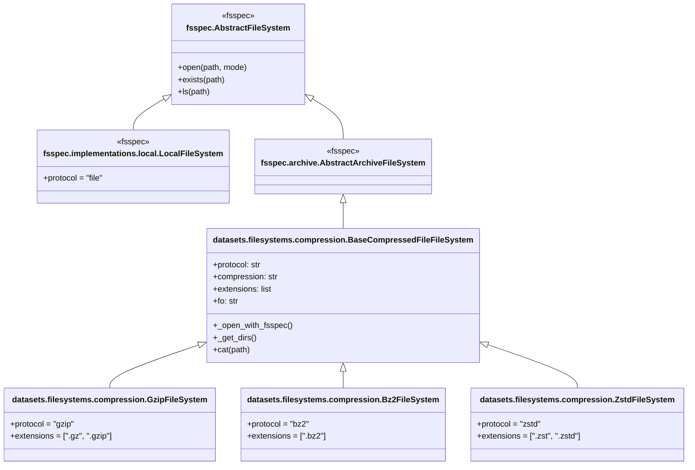
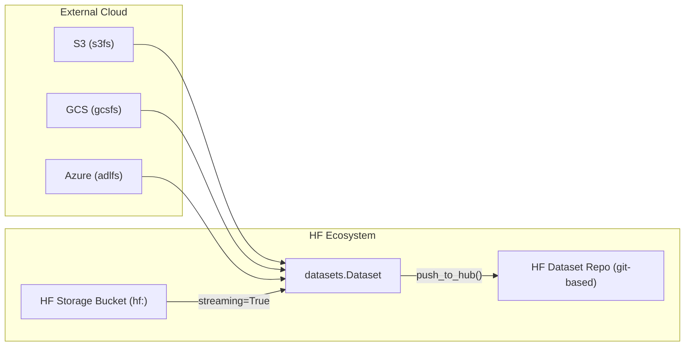

<!-- source: DeepWiki mcp.deepwiki.com · repo huggingface/datasets · page 8.3 Filesystem Support · fetched 2026-10-26 -->

# Filesystem Support

Relevant source files

The following files were used as context for generating this wiki page:

- [docs/source/filesystems.mdx](docs/source/filesystems.mdx)
- [src/datasets/filesystems/__init__.py](src/datasets/filesystems/__init__.py)
- [src/datasets/filesystems/compression.py](src/datasets/filesystems/compression.py)
- [tests/fixtures/fsspec.py](tests/fixtures/fsspec.py)
- [tests/test_filesystem.py](tests/test_filesystem.py)

The `datasets` library provides comprehensive filesystem abstraction through [fsspec](https://filesystem-spec.readthedocs.io) integration, enabling unified access to local files, remote storage (S3, GCS, Azure, HF Hub), and compressed archives. This system allows the library to treat various storage backends and compression formats as standard filesystems, which is critical for both local processing and high-performance streaming.

## Filesystem Architecture Overview

The library extends `fsspec.AbstractFileSystem` to provide a unified interface across storage backends. This abstraction allows the same code to interact with local paths, `s3://` buckets, or `hf://` repositories.

### Filesystem Class Hierarchy

The following diagram maps the relationship between `fsspec` base classes and the specialized compression filesystems implemented in `datasets`.

Title: **Filesystem Type Hierarchy and Code Entities**

The `COMPRESSION_FILESYSTEMS` list defines all supported compression filesystem classes [src/datasets/filesystems/__init__.py:14-20](). These are registered into the global `fsspec` registry during module initialization, allowing them to be used via standard fsspec URLs (e.g., `gzip://...`) [src/datasets/filesystems/__init__.py:24-27]().

**Sources:** [src/datasets/filesystems/__init__.py:14-31](), [src/datasets/filesystems/compression.py:9-128]()

## Cloud Storage and Hub Integration

Hugging Face Datasets supports a wide range of cloud storage providers through their respective `fsspec` implementations. This enables users to load data from S3, GCS, or Azure directly into a dataset or to migrate data from these providers to the Hugging Face Hub [docs/source/filesystems.mdx:15-28]().

### Hugging Face Storage Buckets
The Hub also provides "Storage Buckets", which are non-versioned, mutable S3-like object storage powered by the Xet backend [docs/source/filesystems.mdx:11-13](). These are accessible via the `hf://` protocol and are designed for fast storage of logs, intermediate artifacts, or raw data files [docs/source/filesystems.mdx:84-85]().

Title: **Cloud Storage Data Flow to Hub**

**Sources:** [docs/source/filesystems.mdx:11-104]()

## Compression Filesystems Implementation

The library provides specialized `fsspec` implementations for single-file compression formats in `src/datasets/filesystems/compression.py`. Unlike standard archives (like ZIP or TAR), these formats typically wrap a single file.

### BaseCompressedFileFileSystem
This class treats a compressed file as a filesystem containing exactly one file (the uncompressed version). The single file inside the filesystem is named after the compressed file, minus the extension [src/datasets/filesystems/compression.py:26-28]().

- **Initialization**: Sets up a `partial` call to `fsspec.open` that includes specific client configurations like proxy environment variable support (`trust_env=True`) and redirect handling [src/datasets/filesystems/compression.py:38-50]().
- **Directory Structure**: The `_get_dirs` method informs `fsspec` about the virtual uncompressed file by mapping the uncompressed name to the metadata of the original compressed file [src/datasets/filesystems/compression.py:64-67]().
- **File Access**: The `_open` and `cat` methods proxy requests to the underlying compressed stream opened via `fsspec` with the appropriate compression codec [src/datasets/filesystems/compression.py:69-85]().

**Supported Protocols:**
- `bz2`: `Bz2FileSystem` [src/datasets/filesystems/compression.py:88-93]()
- `gzip`: `GzipFileSystem` [src/datasets/filesystems/compression.py:96-101]()
- `lz4`: `Lz4FileSystem` [src/datasets/filesystems/compression.py:104-109]()
- `xz`: `XzFileSystem` [src/datasets/filesystems/compression.py:112-117]()
- `zstd`: `ZstdFileSystem` [src/datasets/filesystems/compression.py:120-127]()

**Sources:** [src/datasets/filesystems/compression.py:9-128](), [tests/test_filesystem.py:33-50]()

## Utility Functions and Testing

The library provides helper functions to manage filesystem interactions generically:

- `is_remote_filesystem(fs)`: Checks if a filesystem instance is remote. It returns `True` if the instance is not a `LocalFileSystem` [src/datasets/filesystems/__init__.py:33-41]().
- `rename(fs, src, dst)`: Performs a file move operation. For `LocalFileSystem`, it uses `shutil.move` for efficiency; for remote filesystems, it calls the filesystem's `mv` method [src/datasets/filesystems/__init__.py:44-52]().

### Testing Infrastructure
Filesystem support is validated using a `MockFileSystem` and `TmpDirFileSystem` that simulate remote behavior using local temporary directories [tests/fixtures/fsspec.py:10-91](). These mocks are registered in the `fsspec` registry during tests to verify that `is_remote_filesystem` and other utilities correctly identify non-local protocols [tests/test_filesystem.py:23-31]().

**Sources:** [src/datasets/filesystems/__init__.py:33-52](), [tests/fixtures/fsspec.py:1-114](), [tests/test_filesystem.py:1-61]()

---

