# Page: Overview

# Overview

<details>
<summary>Relevant source files</summary>

The following files were used as context for generating this wiki page:

- [.github/workflows/ci.yml](.github/workflows/ci.yml)
- [.zenodo.json](.zenodo.json)
- [CONTRIBUTING.md](CONTRIBUTING.md)
- [README.md](README.md)
- [docs/source/access.mdx](docs/source/access.mdx)
- [docs/source/dataset_card.mdx](docs/source/dataset_card.mdx)
- [docs/source/faiss_es.mdx](docs/source/faiss_es.mdx)
- [docs/source/index.mdx](docs/source/index.mdx)
- [docs/source/load_hub.mdx](docs/source/load_hub.mdx)
- [docs/source/quickstart.mdx](docs/source/quickstart.mdx)
- [docs/source/use_dataset.mdx](docs/source/use_dataset.mdx)
- [setup.py](setup.py)
- [src/datasets/__init__.py](src/datasets/__init__.py)
- [tests/utils.py](tests/utils.py)

</details>


The Hugging Face Datasets library is a lightweight library designed to provide one-line dataloaders for thousands of public datasets and efficient data pre-processing for various modalities including text, image, audio, video, and 3D medical images (NIfTI). [README.md:21-24]()

Built on **Apache Arrow**, it enables memory-efficient data handling through zero-serialization cost memory-mapping, allowing users to work with datasets that exceed their RAM capacity by leveraging disk-backed storage. [README.md:44-47](), [setup.py:114]()

## Core Architecture

The architecture is divided into three functional layers: the User Interface (API), the Storage Layer (Arrow-based), and the I/O Layer (Data acquisition and Hub integration).

### System Data Flow

The following diagram illustrates how data flows from various sources (Hub, local files) into the library's core entities and out to machine learning frameworks.

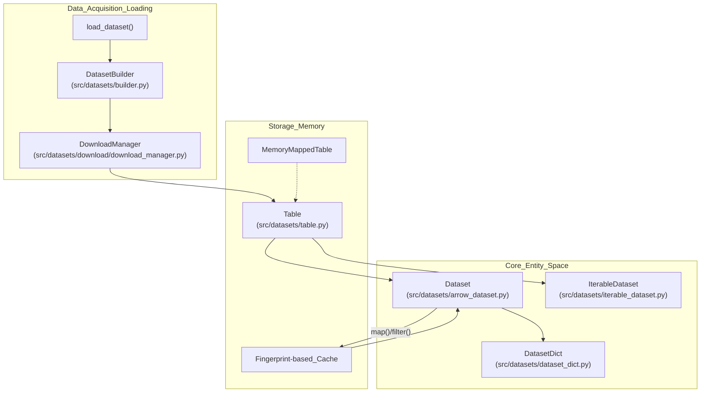

Sources: [src/datasets/load.py:34](), [src/datasets/builder.py:19](), [src/datasets/__init__.py:17-47](), [README.md:94-102]()

### Code Entity Relationships

The library uses a mixin-based architecture to provide functionality like metadata management and framework integration.

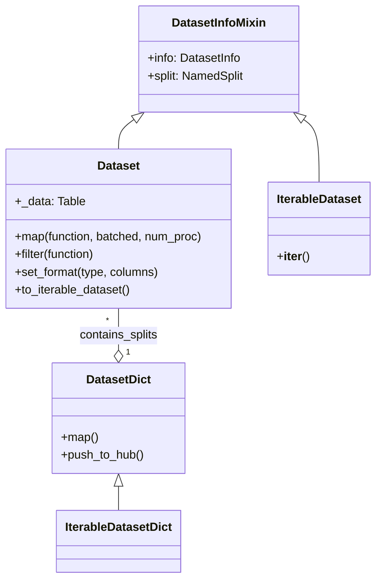

Sources: [src/datasets/arrow_dataset.py:17](), [src/datasets/iterable_dataset.py:33](), [src/datasets/dataset_dict.py:21](), [src/datasets/info.py:25]()

## Dataset Representation

Datasets are primarily represented by two paradigms depending on the access pattern and size requirements:

### 1. Map-style Datasets (`Dataset`)
The `Dataset` class is the standard implementation for datasets that fit on disk. [src/datasets/arrow_dataset.py:17]()
- **Random Access**: Supports fast random access to rows via indexing (e.g., `dataset[0]`). [docs/source/access.mdx:21-28]()
- **Memory Mapping**: Backed by Apache Arrow, it uses memory-mapping to keep RAM usage low even for large datasets. [README.md:44-45]()
- **Caching**: Operations like `map` and `filter` use deterministic fingerprinting to cache results. If a transformation is repeated, the library reuses the cached Arrow files. [README.md:45](), [src/datasets/fingerprint.py:24]()

### 2. Streaming Datasets (`IterableDataset`)
For datasets that are too large to fit on disk or when immediate access is needed without waiting for a full download, `IterableDataset` provides a lazy-loading interface. [docs/source/access.mdx:3](), [src/datasets/iterable_dataset.py:33]()
- **Lazy Evaluation**: Data is fetched and decoded on-the-fly during iteration. [docs/source/access.mdx:118-123]()
- **Streaming Mode**: Enabled by passing `streaming=True` to `load_dataset`. [docs/source/access.mdx:97-102]()

Sources: [src/datasets/arrow_dataset.py:17](), [src/datasets/iterable_dataset.py:33](), [docs/source/access.mdx:3-158]()

## Data Loading System

The primary entry point is the `load_dataset` function, which handles local files (CSV, JSON, Parquet, etc.) and Hub-hosted datasets. [src/datasets/load.py:34](), [README.md:38-39]()

| Component | Role | Reference |
| :--- | :--- | :--- |
| `load_dataset` | High-level API to load a `Dataset` or `DatasetDict`. | [src/datasets/load.py:34]() |
| `DatasetBuilder` | Abstract base class defining data generation logic. | [src/datasets/builder.py:19]() |
| `DatasetInfo` | Container for metadata (description, features, size). | [src/datasets/info.py:25]() |
| `DownloadManager` | Utility for downloading and extracting remote assets. | [src/datasets/download/__init__.py:22]() |

Sources: [src/datasets/load.py:34](), [src/datasets/builder.py:19](), [README.md:94-102]()

## Features and Type System

The `Features` system defines the internal schema and handles the conversion between raw data and Python-friendly objects. [src/datasets/features/__init__.py:23]()

- **Specialized Media**: 
    - `Audio`: Handles decoding and resampling of audio signals. [docs/source/use_dataset.mdx:102-127]()
    - `Image`: Handles image decoding (via Pillow). [setup.py:144-146]()
- **Structured Data**: Supports nested structures via `Sequence` and `Struct`. [README.md:49-50]()

Sources: [src/datasets/features/__init__.py:23](), [docs/source/use_dataset.mdx:98-138]()

## Data Processing & Transformations

The library provides powerful methods for cleaning and preparing data for models:

- **map()**: Applies a function to every example or batch. Supports multi-processing via `num_proc`. [README.md:47](), [docs/source/use_dataset.mdx:55-62]()
- **filter()**: Filters the dataset based on a condition.
- **cast_column()**: Changes the feature type of a column (e.g., changing audio sampling rate). [docs/source/use_dataset.mdx:124-127]()
- **set_format()**: Configures the `__getitem__` output to be compatible with PyTorch, TensorFlow, NumPy, or Pandas. [docs/source/use_dataset.mdx:68-74]()

Sources: [src/datasets/arrow_dataset.py:17](), [docs/source/use_dataset.mdx:1-138]()

## Framework Interoperability

`datasets` is designed to be framework-agnostic, supporting:
- **PyTorch**: Integration via `set_format(type="torch")`. [docs/source/use_dataset.mdx:68-76]()
- **TensorFlow**: Integration via `to_tf_dataset()`. [docs/source/use_dataset.mdx:77-91]()
- **JAX/NumPy/Pandas/Polars**: Native conversion support. [README.md:46]()

Sources: [docs/source/use_dataset.mdx:64-94](), [setup.py:107-137]()

---

# Page: Core Dataset Types

# Core Dataset Types

<details>
<summary>Relevant source files</summary>

The following files were used as context for generating this wiki page:

- [docs/source/about_mapstyle_vs_iterable.mdx](docs/source/about_mapstyle_vs_iterable.mdx)
- [docs/source/package_reference/main_classes.mdx](docs/source/package_reference/main_classes.mdx)
- [docs/source/process.mdx](docs/source/process.mdx)
- [docs/source/stream.mdx](docs/source/stream.mdx)
- [src/datasets/arrow_dataset.py](src/datasets/arrow_dataset.py)
- [src/datasets/combine.py](src/datasets/combine.py)
- [src/datasets/dataset_dict.py](src/datasets/dataset_dict.py)
- [src/datasets/iterable_dataset.py](src/datasets/iterable_dataset.py)
- [tests/test_arrow_dataset.py](tests/test_arrow_dataset.py)
- [tests/test_dataset_dict.py](tests/test_dataset_dict.py)
- [tests/test_iterable_dataset.py](tests/test_iterable_dataset.py)

</details>


The Hugging Face Datasets library provides two fundamental dataset paradigms: **map-style datasets** and **streaming datasets**. These two approaches serve different use cases and have distinct characteristics in terms of memory usage, access patterns, and performance.

## Overview of Dataset Paradigms

The library's architecture is built around two core abstractions:

*   **Map-Style Datasets (`Dataset`)**: Provide random access to examples with full caching. Backed by Apache Arrow tables stored on disk or in memory. Ideal for datasets that fit on disk and require multiple passes or random access patterns. [src/datasets/arrow_dataset.py:704]()
*   **Streaming Datasets (`IterableDataset`)**: Provide sequential access to examples without downloading the entire dataset. Process examples on-the-fly as they're iterated over. Ideal for very large datasets or when you only need to process data once. [src/datasets/iterable_dataset.py:1285]()

### Dataset Type Hierarchy

This diagram maps the natural language concepts of "Map-Style" and "Streaming" to the specific code entities that implement them.

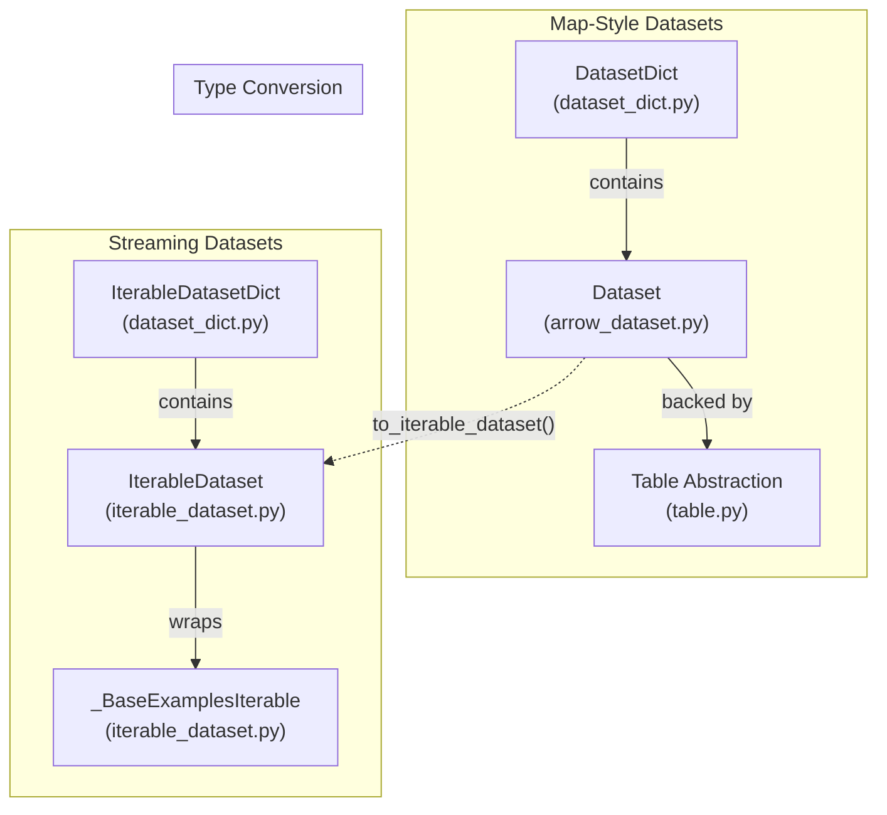

Sources: [src/datasets/arrow_dataset.py:704](), [src/datasets/iterable_dataset.py:1285](), [src/datasets/dataset_dict.py:63-64](), [src/datasets/dataset_dict.py:1120]()

## Map-Style Datasets (Dataset)

The `Dataset` class is the primary map-style dataset type, providing random access to examples through indexing. It is defined in `src/datasets/arrow_dataset.py`.

### Key Characteristics

- **Random Access**: Access any example by index or slice via `__getitem__`. [src/datasets/arrow_dataset.py:2555-2565]()
- **Arrow-Backed Storage**: Data is stored in Apache Arrow format, utilizing the `Table` abstraction layer which supports memory-mapping for zero-copy reads. [src/datasets/arrow_dataset.py:16-17](), [src/datasets/table.py:112-115]()
- **Caching**: Transformations like `map()` and `filter()` cache their results to disk by default, identified by a unique `_fingerprint`. [src/datasets/arrow_dataset.py:94-105](), [src/datasets/arrow_dataset.py:756]()
- **Indexing Support**: Supports specialized indexing for search (Faiss, Elasticsearch) via `IndexableMixin`. [src/datasets/arrow_dataset.py:704](), [src/datasets/search.py:110]()

For details on the primary map-style class, see [Dataset and DatasetDict Classes](#2.1). For information on the underlying storage, see [Arrow-based Storage System](#2.3).

### Dataset Class Structure

The following diagram bridges the code implementation (Mixins and Classes) to the functional capabilities of the Map-Style system.

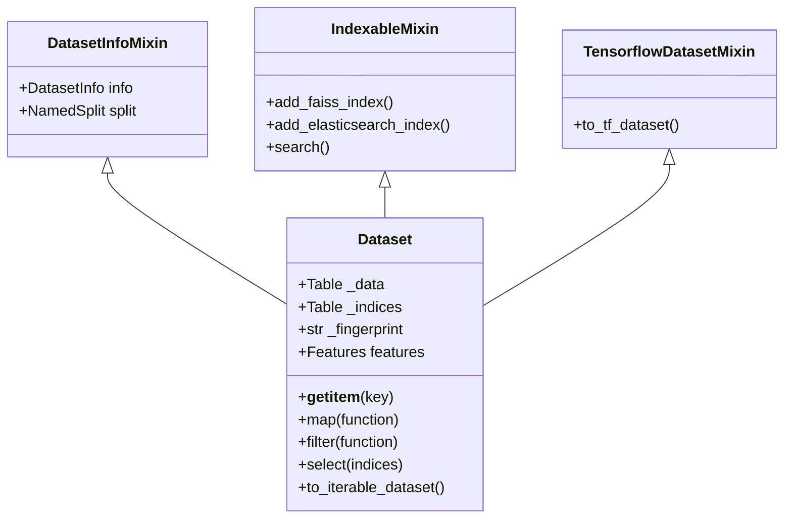

Sources: [src/datasets/arrow_dataset.py:704](), [src/datasets/arrow_dataset.py:172](), [src/datasets/search.py:110](), [src/datasets/arrow_dataset.py:244]()

## Streaming Datasets (IterableDataset)

The `IterableDataset` class provides streaming access to datasets without downloading all data upfront. It is defined in `src/datasets/iterable_dataset.py`.

### Key Characteristics

- **Sequential Access**: Iterate through examples one by one using standard Python iteration. [src/datasets/iterable_dataset.py:1367]()
- **Lazy Evaluation**: Transformations like `map` and `filter` are chained within `_BaseExamplesIterable` subclasses and only applied when data is requested. [src/datasets/iterable_dataset.py:700-750](), [src/datasets/iterable_dataset.py:202]()
- **State Management**: Supports `state_dict` and `load_state_dict` for resuming mid-stream, crucial for large-scale training. [src/datasets/iterable_dataset.py:1644-1678]()

For details on streaming behavior and lazy evaluation, see [IterableDataset and Streaming](#2.2).

## Comparison: Dataset vs IterableDataset

| Feature | Dataset (Map-style) | IterableDataset (Streaming) |
|---------|---------|-----------------|
| **Access Pattern** | Random (indexing) [src/datasets/arrow_dataset.py:2555]() | Sequential (iteration) [src/datasets/iterable_dataset.py:1367]() |
| **Storage** | Arrow table on disk/memory [src/datasets/arrow_dataset.py:16]() | No local storage required [docs/source/stream.mdx:3]() |
| **Memory Usage** | Memory-mapped [src/datasets/table.py:114]() | Only current batch [src/datasets/iterable_dataset.py:141]() |
| **Download** | Full dataset downloaded [docs/source/about_mapstyle_vs_iterable.mdx:10]() | On-the-fly streaming [docs/source/stream.mdx:16]() |
| **Caching** | Persistent on disk [src/datasets/arrow_dataset.py:94]() | Not applicable (lazy) [docs/source/about_mapstyle_vs_iterable.mdx:99]() |

## Internal Abstractions

The library relies on several internal layers to manage data efficiently:

*   **Table Abstraction**: A wrapper around Arrow tables (`Table`, `InMemoryTable`, `MemoryMappedTable`) that handles data access and replay of transformations. [src/datasets/table.py:112-115](). For details, see [Table Abstraction Layer](#2.4).
*   **Caching & Fingerprinting**: A deterministic system using `xxhash` to identify dataset states and reuse computed results. [src/datasets/fingerprint.py:94-105](). For details, see [Caching and Fingerprinting](#2.5).

## Converting Between Types

A map-style `Dataset` can be converted into an `IterableDataset` using the `to_iterable_dataset` method. [src/datasets/arrow_dataset.py:4440-4450](). This enables streaming APIs on locally stored Arrow data.

## Summary of Sub-pages

- [Dataset and DatasetDict Classes](#2.1) — Detailed documentation of the `Dataset` class and its multi-split manager `DatasetDict`.
- [IterableDataset and Streaming](#2.2) — Documentation of `IterableDataset` for lazy evaluation and streaming.
- [Arrow-based Storage System](#2.3) — Explanation of Apache Arrow integration and memory-mapping.
- [Table Abstraction Layer](#2.4) — Documentation of the `Table` hierarchy and the replay mechanism.
- [Caching and Fingerprinting](#2.5) — Explanation of the deterministic caching system and fingerprint generation.

---

# Page: Dataset and DatasetDict Classes

# Dataset and DatasetDict Classes

<details>
<summary>Relevant source files</summary>

The following files were used as context for generating this wiki page:

- [src/datasets/arrow_dataset.py](src/datasets/arrow_dataset.py)
- [src/datasets/dataset_dict.py](src/datasets/dataset_dict.py)
- [src/datasets/inspect.py](src/datasets/inspect.py)
- [tests/test_arrow_dataset.py](tests/test_arrow_dataset.py)
- [tests/test_dataset_dict.py](tests/test_dataset_dict.py)
- [tests/test_inspect.py](tests/test_inspect.py)
- [tests/test_offline_util.py](tests/test_offline_util.py)

</details>


The `Dataset` and `DatasetDict` classes are the core data structures in the `datasets` library. They serve as the primary interfaces for loading, manipulating, and transforming datasets for machine learning applications.

## Overview

The library uses Apache Arrow as its underlying data structure for efficient memory usage and fast data access. The `Dataset` class wraps an Arrow table and provides a rich API for data manipulation, while the `DatasetDict` class serves as a container for multiple datasets, typically representing different splits (train, validation, test).

Title: Dataset Architecture and Data Flow
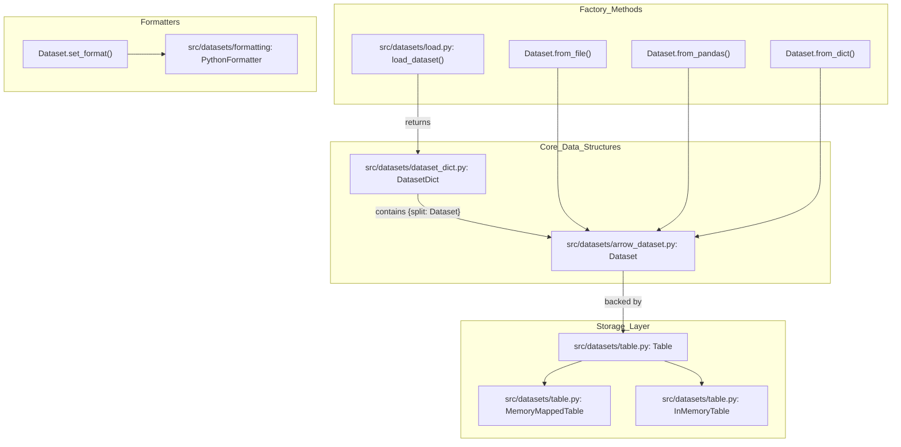
Sources: [src/datasets/arrow_dataset.py:628-694](), [src/datasets/dataset_dict.py:63-94](), [src/datasets/table.py:112-124]()

## Dataset Class

### Class Hierarchy and Mixins

The `Dataset` class inherits from several mixins that provide specialized functionality:

Title: Dataset Class Composition
```mermaid
classDiagram
    class DatasetInfoMixin {
        +info: DatasetInfo
        +features: Features
        +split: NamedSplit
    }
    
    class IndexableMixin {
        +add_faiss_index()
        +add_elasticsearch_index()
        +get_nearest_examples()
    }
    
    class TensorflowDatasetMixin {
        +to_tf_dataset()
    }
    
    class Dataset {
        +_data: Table
        +_indices: Table
        +map()
        +filter()
        +select()
        +set_format()
        +save_to_disk()
    }

    DatasetInfoMixin <|-- Dataset : src/datasets/arrow_dataset.py:172
    IndexableMixin <|-- Dataset : src/datasets/search.py:110
    TensorflowDatasetMixin <|-- Dataset : src/datasets/arrow_dataset.py:244
```
Sources: [src/datasets/arrow_dataset.py:172-241](), [src/datasets/arrow_dataset.py:244-532](), [src/datasets/arrow_dataset.py:628-694](), [src/datasets/search.py:110-110]()

### Creating a Dataset

The `Dataset` class provides multiple static factory methods to instantiate datasets:

| Method | Source | Description |
| :--- | :--- | :--- |
| `from_file` | [src/datasets/arrow_dataset.py:1124-1212]() | Load a dataset from an Arrow file on disk. |
| `from_buffer` | [src/datasets/arrow_dataset.py:1214-1262]() | Load from a byte buffer containing Arrow data. |
| `from_pandas` | [src/datasets/arrow_dataset.py:1264-1384]() | Convert a Pandas DataFrame to a Dataset. |
| `from_dict` | [src/datasets/arrow_dataset.py:1386-1469]() | Convert a Python dictionary to a Dataset. |
| `from_generator` | [src/datasets/arrow_dataset.py:1471-1634]() | Create a dataset from a Python generator. |
| `from_spark` | [src/datasets/arrow_dataset.py:1636-1738]() | Create a dataset from a PySpark DataFrame. |

### Core Properties

- `info`: Access metadata via `DatasetInfo` [src/datasets/arrow_dataset.py:182-184]().
- `features`: The schema defined by `Features` [src/datasets/arrow_dataset.py:220-222]().
- `data`: The underlying Apache Arrow `Table` [src/datasets/arrow_dataset.py:1010-1013]().
- `num_rows`: Number of examples in the dataset [src/datasets/arrow_dataset.py:946-949]().

## Data Transformation Methods

The `Dataset` class implements a suite of transformation methods, most of which leverage deterministic caching and fingerprinting.

### Map and Filter

The `map` method is the primary tool for data transformation. It can operate on single examples or batches.

- **`map`**: Applies a function to the dataset. Supports multiprocessing via `num_proc`, batched execution, and custom fingerprinting [src/datasets/arrow_dataset.py:2493-2845]().
- **`filter`**: Returns a subset of the dataset where the provided function returns `True`. It creates a new `Dataset` backed by an indices mapping [src/datasets/arrow_dataset.py:2847-3024]().

### Index-based Operations

- **`select`**: Creates a new dataset using a list of indices. It creates an `_indices` mapping rather than copying the data [src/datasets/arrow_dataset.py:3825-3914]().
- **`shuffle`**: Randomly reorders the dataset indices using a seed. Supports stratified shuffling [src/datasets/arrow_dataset.py:3983-4084]().
- **`sort`**: Sorts the dataset based on the values of one or more columns [src/datasets/arrow_dataset.py:3916-3981]().

Sources: [src/datasets/arrow_dataset.py:2493-4195]()

## DatasetDict Class

`DatasetDict` is a subclass of `dict` [src/datasets/dataset_dict.py:63]() specifically for managing `Dataset` objects mapped to split names (e.g., "train", "test").

### Key Functionalities

- **Shared Operations**: Methods like `map`, `filter`, `sort`, and `shuffle` are implemented to apply the operation to every split in the dictionary simultaneously [src/datasets/dataset_dict.py:534-1212]().
- **Feature Consistency**: The `_check_values_features` method ensures that all datasets within the dictionary share the same schema [src/datasets/dataset_dict.py:71-77]().
- **Serialization**: Supports `save_to_disk` [src/datasets/dataset_dict.py:1214-1314]() and `push_to_hub` [src/datasets/dataset_dict.py:1316-1523]() for the entire collection of splits.

Sources: [src/datasets/dataset_dict.py:63-1523]()

## Format Conversion and Framework Integration

The `set_format` method [src/datasets/arrow_dataset.py:3075-3162]() changes how data is returned when accessing the dataset (e.g., via `__getitem__`).

| Format Type | Description |
| :--- | :--- |
| `numpy` | Returns NumPy arrays. |
| `torch` | Returns PyTorch tensors. |
| `tensorflow` | Returns TensorFlow tensors. |
| `pandas` | Returns Pandas DataFrames. |
| `jax` | Returns JAX arrays. |

The `to_tf_dataset` method [src/datasets/arrow_dataset.py:326-532]() provides deep integration with TensorFlow's `tf.data.Dataset` API, supporting batching, shuffling, and multiprocessing.

Sources: [src/datasets/arrow_dataset.py:3075-3162](), [src/datasets/arrow_dataset.py:326-532]()

## Serialization and Persistence

Datasets can be saved locally or pushed to the Hugging Face Hub.

### Local Persistence
- **`save_to_disk`**: Saves the dataset as Arrow files. It also saves the `DatasetInfo` and state metadata [src/datasets/arrow_dataset.py:4196-4354]().
- **`load_from_disk`**: Static method to reload a saved dataset or `DatasetDict` [src/datasets/load.py:1145-1215]().

### Hub Integration
- **`push_to_hub`**: Uploads the dataset to the Hugging Face Hub. It handles Parquet conversion, repository management, and metadata updates [src/datasets/arrow_dataset.py:4486-5196]().

Sources: [src/datasets/arrow_dataset.py:4196-5196](), [src/datasets/load.py:1145-1215]()

---

# Page: IterableDataset and Streaming

# IterableDataset and Streaming

<details>
<summary>Relevant source files</summary>

The following files were used as context for generating this wiki page:

- [docs/source/about_mapstyle_vs_iterable.mdx](docs/source/about_mapstyle_vs_iterable.mdx)
- [docs/source/package_reference/main_classes.mdx](docs/source/package_reference/main_classes.mdx)
- [docs/source/process.mdx](docs/source/process.mdx)
- [docs/source/stream.mdx](docs/source/stream.mdx)
- [src/datasets/combine.py](src/datasets/combine.py)
- [src/datasets/download/streaming_download_manager.py](src/datasets/download/streaming_download_manager.py)
- [src/datasets/iterable_dataset.py](src/datasets/iterable_dataset.py)
- [src/datasets/streaming.py](src/datasets/streaming.py)
- [src/datasets/utils/patching.py](src/datasets/utils/patching.py)
- [tests/test_iterable_dataset.py](tests/test_iterable_dataset.py)
- [tests/test_patching.py](tests/test_patching.py)
- [tests/test_streaming_download_manager.py](tests/test_streaming_download_manager.py)

</details>


This page details the streaming and iteration functionality in the Hugging Face Datasets library, focusing on the `IterableDataset` class and related components for efficiently working with large datasets. Streaming allows you to work with datasets without downloading them entirely or processing all examples at once.

## Core Concepts

Datasets provides two main approaches for working with data:

1.  **Random-access datasets**: `Dataset` objects that load data into memory using memory-mapping [src/datasets/arrow_dataset.py:16-17]().
2.  **Streaming datasets**: `IterableDataset` objects that process data on-the-fly as you iterate through it [src/datasets/iterable_dataset.py:161-163]().

Streaming is particularly useful when working with datasets too large to fit in memory or to avoid lengthy download and preprocessing times [docs/source/stream.mdx:5-9]().

### Relationship Between Dataset and IterableDataset

The following diagram illustrates the relationship between the random-access `Dataset` and the sequential `IterableDataset`.

**Data Access Paradigms**
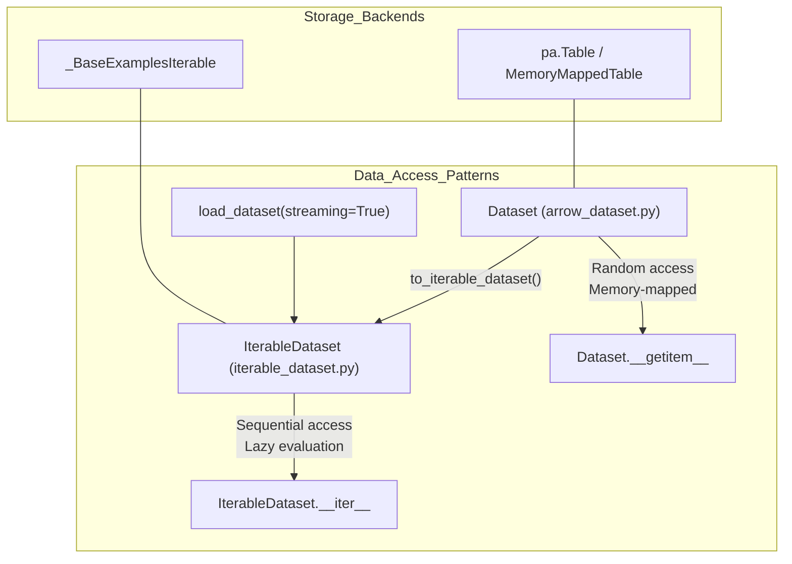
Sources: [src/datasets/arrow_dataset.py:16-53](), [src/datasets/iterable_dataset.py:161-163](), [src/datasets/iterable_dataset.py:202-205](), [docs/source/stream.mdx:79-81]()

## Creating an IterableDataset

There are several ways to create an `IterableDataset`:

### 1. From a regular Dataset
The `to_iterable_dataset` method converts a map-style dataset into a streaming one. It supports sharding, which is useful for parallel loading [src/datasets/arrow_dataset.py:420-430]().

### 2. Directly with streaming=True
When calling `load_dataset`, setting `streaming=True` returns an `IterableDataset` or `IterableDatasetDict` [docs/source/stream.mdx:16-20](). This bypasses the full download and extraction phase.

### 3. From a generator function
The `IterableDataset.from_generator` method allows creating a stream from any Python generator [src/datasets/iterable_dataset.py:417-430]().

### 4. From other formats
`IterableDataset` provides static methods like `from_dict`, `from_pandas`, and `from_list` which wrap the input data in a generator-based iterable [src/datasets/iterable_dataset.py:350-410]().

Sources: [src/datasets/arrow_dataset.py:420-430](), [src/datasets/iterable_dataset.py:417-430](), [src/datasets/iterable_dataset.py:350-410](), [docs/source/stream.mdx:16-20]()

## IterableDataset Architecture

The `IterableDataset` does not hold data; it wraps an internal iterable object that implements the `_BaseExamplesIterable` interface [src/datasets/iterable_dataset.py:202-205]().

**Iterable Implementation Hierarchy**
```mermaid
graph TD
    subgraph "Core_Iterables"
        BaseExIter["_BaseExamplesIterable"]
        ExamplesIter["ExamplesIterable"]
        ArrowExIter["ArrowExamplesIterable"]
        
        BaseExIter --> ExamplesIter
        BaseExIter --> ArrowExIter
    end
    
    subgraph "Transformation_Iterables"
        MapIter["MappedExamplesIterable"]
        FilterIter["FilteredExamplesIterable"]
        BufferShuffleIter["BufferShuffledExamplesIterable"]
        SkipIter["SkipExamplesIterable"]
        TakeIter["TakeExamplesIterable"]
        
        BaseExIter --> MapIter
        BaseExIter --> FilterIter
        BaseExIter --> BufferShuffleIter
        BaseExIter --> SkipIter
        BaseExIter --> TakeIter
    end
    
    IterableDataset["IterableDataset"] o-- BaseExIter
```
Sources: [src/datasets/iterable_dataset.py:202-205](), [src/datasets/iterable_dataset.py:613-615](), [src/datasets/iterable_dataset.py:702-705](), [src/datasets/iterable_dataset.py:821-825](), [src/datasets/iterable_dataset.py:924-927]()

## Streaming Data Processing

`IterableDataset` implements lazy versions of common transformation methods.

### Shuffling
Unlike `Dataset.shuffle`, which reorders indices, `IterableDataset.shuffle` uses a buffer-based approach [src/datasets/iterable_dataset.py:1026-1040](). It first shuffles the list of shards (if available) and then maintains a `buffer_size` window of examples to provide local randomization [src/datasets/iterable_dataset.py:821-825]().

### Taking and Skipping
*   `take(n)`: Wraps the iterable in a `TakeExamplesIterable` to yield only the first `n` items [src/datasets/iterable_dataset.py:1218-1233]().
*   `skip(n)`: Wraps the iterable in a `SkipExamplesIterable` to discard the first `n` items [src/datasets/iterable_dataset.py:1235-1250]().

### Mapping and Filtering
Transformations are applied lazily. When `map` is called, it returns a new `IterableDataset` wrapping a `MappedExamplesIterable` [src/datasets/iterable_dataset.py:1063-1100](). Filtering uses `FilteredExamplesIterable` to skip items that do not meet the predicate [src/datasets/iterable_dataset.py:1157-1177]().

Sources: [src/datasets/iterable_dataset.py:821-825](), [src/datasets/iterable_dataset.py:1026-1040](), [src/datasets/iterable_dataset.py:1063-1100](), [src/datasets/iterable_dataset.py:1157-1177](), [src/datasets/iterable_dataset.py:1218-1250]()

## Streaming Download Manager

Streaming is powered by `StreamingDownloadManager`, which handles virtual file paths using the `::` separator to navigate compressed archives [src/datasets/download/streaming_download_manager.py:47-53]().

**Streaming File Flow**
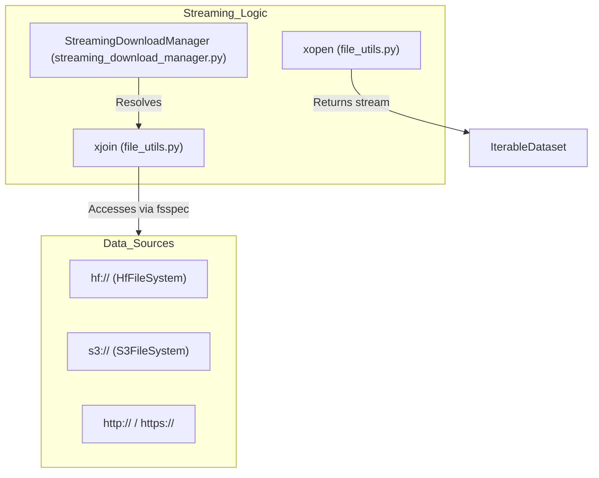
Sources: [src/datasets/download/streaming_download_manager.py:47-53](), [src/datasets/download/streaming_download_manager.py:102-122](), [src/datasets/streaming.py:42-59]()

### Module Extension for Streaming
To support streaming in dataset builders, the library patches standard Python I/O functions (like `open`, `os.path.join`) within the builder's module using `extend_module_for_streaming` [src/datasets/streaming.py:42-59](). This allows builders to work with remote streamed files as if they were local [src/datasets/streaming.py:78-95]().

## Combining Iterable Datasets

Multiple streaming datasets can be merged using `interleave_datasets` [src/datasets/combine.py:18-27](). This function supports:
*   **Cycling**: Alternating between datasets [src/datasets/combine.py:34-35]().
*   **Probabilistic Sampling**: Sampling from datasets based on provided weights [src/datasets/combine.py:35-36]().
*   **Stopping Strategies**: Determining when iteration ends (`first_exhausted`, `all_exhausted`, etc.) [src/datasets/combine.py:61-68]().

Sources: [src/datasets/combine.py:18-68](), [src/datasets/iterable_dataset.py:1653-1670]()

## State Management

`IterableDataset` supports state management to resume training. It tracks the progress through the underlying iterables.

*   `state_dict()`: Captures the current state of the iterable, including the number of examples yielded and shard information [src/datasets/iterable_dataset.py:1418-1436]().
*   `load_state_dict(state_dict)`: Restores the dataset to a previously saved state [src/datasets/iterable_dataset.py:1438-1456]().

This is implemented by the `_BaseExamplesIterable` and its subclasses which maintain an internal `_state_dict` [src/datasets/iterable_dataset.py:202-205]().

Sources: [src/datasets/iterable_dataset.py:202-205](), [src/datasets/iterable_dataset.py:1418-1456]()

## Performance Considerations

*   **Batching**: Use `batched=True` in `map` to process multiple examples at once, reducing the overhead of the Python loop [src/datasets/iterable_dataset.py:1075-1080]().
*   **Parallelism**: When using PyTorch `DataLoader`, `IterableDataset` automatically handles sharding across workers if the dataset is sharded [docs/source/stream.mdx:99-102]().
*   **Prefetching**: Shuffling with a large `buffer_size` effectively prefetches data from the source [docs/source/stream.mdx:107-109]().
*   **Column Indexing**: `IterableDataset` supports column indexing to iterate over specific fields without loading the entire row [docs/source/stream.mdx:69-75]().

Sources: [src/datasets/iterable_dataset.py:1075-1080](), [docs/source/stream.mdx:69-75](), [docs/source/stream.mdx:99-109]()

---

# Page: Arrow-based Storage System

# Arrow-based Storage System

<details>
<summary>Relevant source files</summary>

The following files were used as context for generating this wiki page:

- [docs/source/about_arrow.md](docs/source/about_arrow.md)
- [src/datasets/table.py](src/datasets/table.py)
- [tests/test_table.py](tests/test_table.py)

</details>


## Purpose and Scope

This document explains the Arrow-based storage architecture in the `datasets` library, focusing on how Apache Arrow tables provide efficient, memory-mapped data access. It covers the core Table implementations (`InMemoryTable`, `MemoryMappedTable`, `ConcatenationTable`) and how they enable working with datasets larger than RAM.

For information about how datasets are loaded and written to Arrow format, see [ArrowWriter and Data Serialization](#5.3). For details on the `Dataset` and `DatasetDict` classes that wrap these tables, see [Dataset and DatasetDict Classes](#2.1).

## Apache Arrow as the Storage Backend

The `datasets` library uses Apache Arrow as its core storage format. Arrow provides:

- **Zero-copy reads**: Data can be accessed without deserialization.
- **Memory mapping**: Large datasets can be loaded from disk without consuming RAM.
- **Columnar storage**: Efficient for analytical workloads common in ML.
- **Type safety**: Rich type system with metadata preservation.

All dataset data is stored as PyArrow tables (`pa.Table`) on disk in Arrow IPC (Inter-Process Communication) format. The library provides specialized wrapper classes around these tables to add functionality like efficient slicing, indexing, and concatenation.

**Sources**: [docs/source/about_arrow.md:5-16](), [src/datasets/table.py:161-168]()

## Table Class Hierarchy

The library defines an abstract `Table` base class with three concrete implementations. These classes wrap `pyarrow.Table` to provide extended functionality like replays for pickling and optimized slicing.

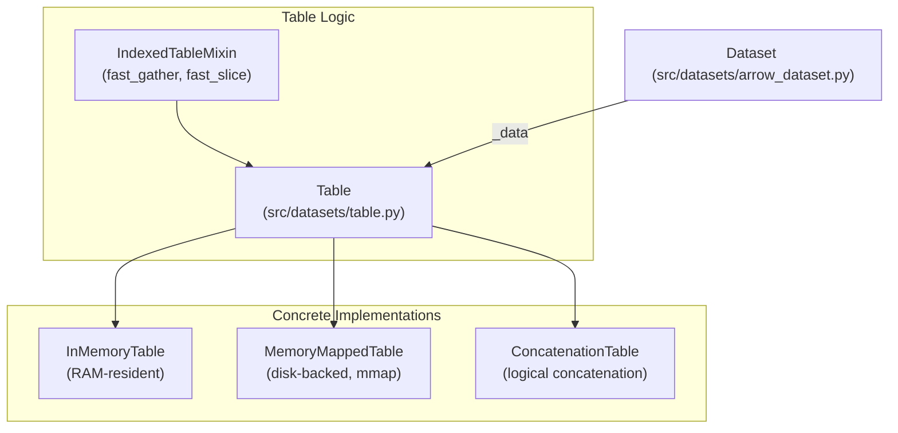

**Diagram**: Table class hierarchy and relationship to Dataset.

| Class | Storage Location | Use Case | Memory Overhead |
|-------|-----------------|----------|-----------------|
| `InMemoryTable` | RAM | Small datasets, temporary transformations | Full dataset size |
| `MemoryMappedTable` | Disk (memory-mapped) | Large datasets, cache files | Minimal (OS manages pages) |
| `ConcatenationTable` | Multiple tables | Logical unions, multi-file datasets | Sum of constituent tables |

**Sources**: [src/datasets/table.py:458-460](), [src/datasets/table.py:539-543](), [src/datasets/table.py:679-682]()

## IndexedTableMixin: Fast Operations

All Table implementations inherit from `IndexedTableMixin`, which provides optimized slicing and gathering operations by maintaining internal indices and offsets.

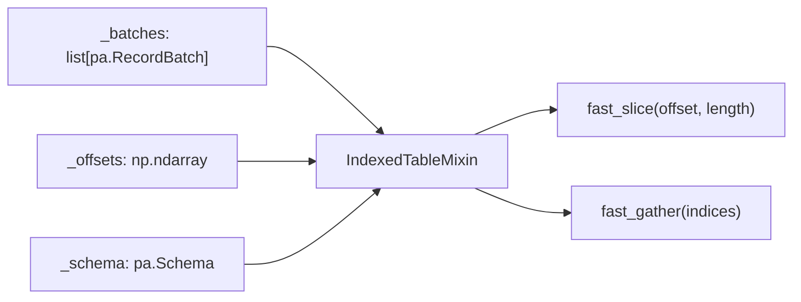

**Diagram**: `IndexedTableMixin` internal structure and core methods.

The mixin stores:
- `_batches`: List of PyArrow `RecordBatch` objects (each batch contains a chunk of rows) [src/datasets/table.py:164-166]().
- `_offsets`: Cumulative offsets for each batch (enables O(log n) lookup via binary search) [src/datasets/table.py:167]().
- `_schema`: PyArrow schema describing column types [src/datasets/table.py:163]().

**Key methods**:

- **`fast_slice(offset, length)`**: Uses binary search on `_offsets` to find relevant batches and slices them without copying the entire table [src/datasets/table.py:186-218]().
- **`fast_gather(indices)`**: Gathers specific rows by computing batch indices via `np.searchsorted` and slicing individual batches [src/datasets/table.py:169-184]().

**Sources**: [src/datasets/table.py:161-218]()

## InMemoryTable

`InMemoryTable` wraps a PyArrow table that resides entirely in RAM. It is used for small datasets created via `Dataset.from_dict()` or temporary transformations where `keep_in_memory=True` is set.

**Key characteristics**:
- Full memory footprint equal to dataset size.
- Fast random access (no disk I/O).
- Created using methods like `from_pydict`, `from_pandas`, or `from_batches`.

**Creation example**:
```python
# Create an in-memory table from a dictionary
table = InMemoryTable.from_pydict({"col1": [1, 2, 3]})
```

**Sources**: [src/datasets/table.py:458-537]()

## MemoryMappedTable

`MemoryMappedTable` is the core storage mechanism for large datasets. It uses `pa.memory_map()` to access Arrow files on disk without loading the entire dataset into RAM.

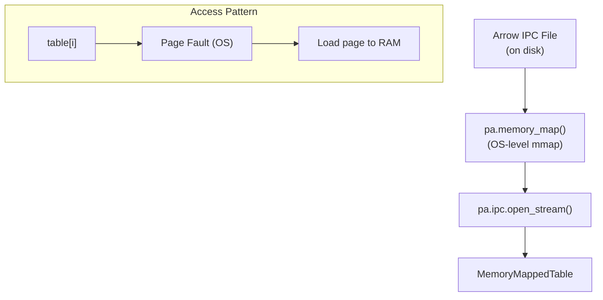

**Diagram**: Memory-mapped table architecture using `pa.memory_map` and `pa.ipc.open_stream`.

### Replays Mechanism

`MemoryMappedTable` maintains a list of `replays` (slices or selections). This enables efficient pickling: instead of serializing the data, the library serializes the file path and the sequence of operations to re-apply upon unpickling.

- **`path`**: File path to the Arrow file on disk [src/datasets/table.py:545]().
- **`replays`**: List of operations (e.g., slices) to replay when reloading [src/datasets/table.py:546]().

**Sources**: [src/datasets/table.py:539-656](), [src/datasets/table.py:47-49](), [src/datasets/table.py:119-122]()

## ConcatenationTable

`ConcatenationTable` provides a logical view over multiple tables without physically merging them. This is essential for datasets split across multiple shards or files.

### Internal Structure

A `ConcatenationTable` maintains a list of constituent Table objects. It implements logical concatenation by aggregating batches from all underlying tables.

- **`tables`**: List of constituent Table objects [src/datasets/table.py:684]().
- **`_batches`**: Flattened list of all batches from all constituent tables [src/datasets/table.py:716]().

**Sources**: [src/datasets/table.py:679-746]()

## Storage Efficiency and Memory Management

### Zero-Copy Operations

The table implementations prioritize zero-copy operations. Slicing a table returns a new view referencing the same underlying memory buffers. Methods like `_memory_mapped_arrow_table_from_file` ensure that opening a file on disk doesn't increase RAM usage [src/datasets/table.py:119-122]().

### Table Casting

The `table_cast()` function is used to align a table's schema with a target `Features` definition. It attempts to perform zero-copy casting when types are compatible and only copies data when necessary [src/datasets/table.py:1893-2067]().

### Embedding Storage

For specific serialization needs, `embed_table_storage()` allows moving the data from a memory-mapped file directly into the table's metadata as a buffer, making the table self-contained [src/datasets/table.py:2138-2168]().

**Sources**: [src/datasets/table.py:1893-2067](), [src/datasets/table.py:2138-2168]()

## Integration with Dataset Class

The `Dataset` class wraps a `Table` object in its `_data` attribute.

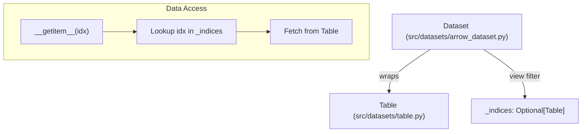

**Diagram**: `Dataset` integration with `Table` abstraction and `_indices` for lazy operations.

### Lazy Operations and Indices

A `Dataset` can have an optional `_indices` table. This is used for "lazy" operations like `filter()` or `shuffle()`. Instead of creating a new data table, the library creates a new `_indices` table that maps the virtual index to the original row index in `_data`.

### Summary of Benefits

| Feature | Implementation | Benefit |
|-----------|---------|-------------|
| **Memory Mapping** | `MemoryMappedTable` | Scale to TB-sized datasets on standard hardware [docs/source/about_arrow.md:15-35](). |
| **Lazy Views** | `_indices` | Instant filtering and shuffling without data duplication. |
| **Replays** | `Table.replays` | Transparent pickling for multi-processing and caching [src/datasets/table.py:575-609](). |
| **Columnar Format** | Apache Arrow | Optimized for batch processing and ML feature extraction [docs/source/about_arrow.md:5-10](). |

**Sources**: [src/datasets/table.py:161-168](), [docs/source/about_arrow.md:1-51]()

---

# Page: Table Abstraction Layer

# Table Abstraction Layer

<details>
<summary>Relevant source files</summary>

The following files were used as context for generating this wiki page:

- [src/datasets/table.py](src/datasets/table.py)
- [tests/test_table.py](tests/test_table.py)

</details>


## Purpose and Scope

The Table Abstraction Layer provides a unified interface for working with Apache Arrow tables across different storage modes. It wraps PyArrow's `pa.Table` to support both in-memory and memory-mapped data access, enabling efficient handling of datasets that may exceed available RAM. This layer is the foundation for the `Dataset` class's storage backend and provides optimized indexing and slicing mechanisms.

## Architecture Overview

The table abstraction uses composition to wrap PyArrow tables and provides implementations optimized for different use cases. It leverages a mixin pattern to provide fast indexing capabilities to all table types.

### Code Entity Space to System Architecture

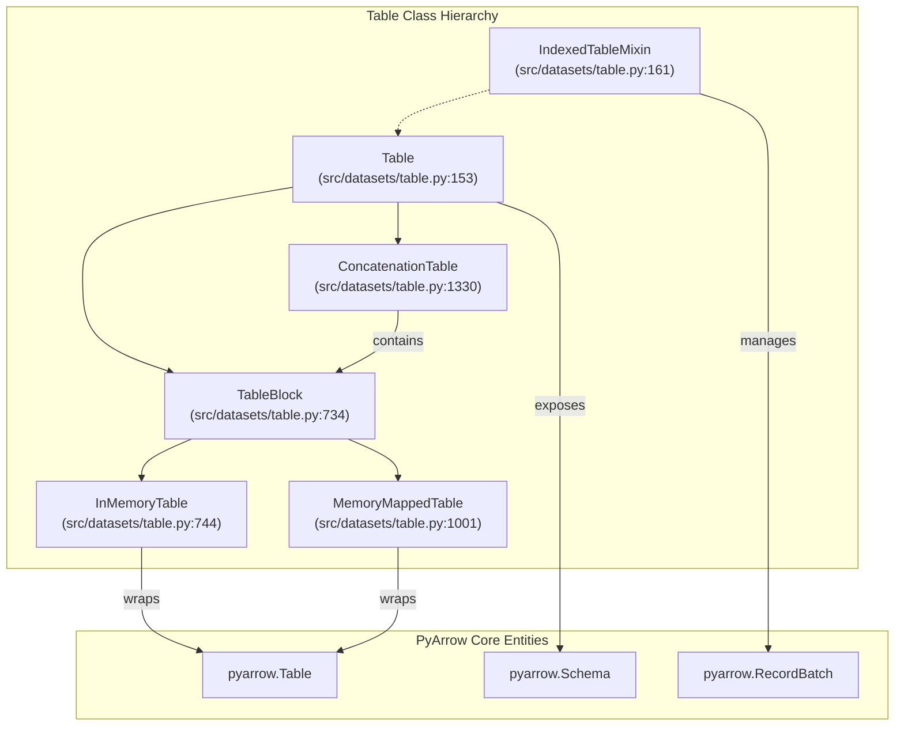

**Sources:** [src/datasets/table.py:153-159](), [src/datasets/table.py:161-168](), [src/datasets/table.py:734-742](), [src/datasets/table.py:744-746](), [src/datasets/table.py:1001-1003](), [src/datasets/table.py:1330-1332]()

## Core Classes

### IndexedTableMixin

The `IndexedTableMixin` provides optimized slicing and gathering operations. It pre-calculates row offsets for all record batches in a table, allowing for binary search-based access.

**Key Components:**
- `_batches`: A list of non-empty `pa.RecordBatch` objects extracted from the table [src/datasets/table.py:164-166]().
- `_offsets`: A `np.ndarray` of cumulative row counts used for fast lookup [src/datasets/table.py:167]().
- `fast_slice()`: Uses `_interpolation_search` to find batch boundaries for a slice, avoiding PyArrow's default linear scan [src/datasets/table.py:186-207]().
- `fast_gather()`: Uses `np.searchsorted` to map arbitrary indices to specific record batches efficiently [src/datasets/table.py:169-184]().

**Sources:** [src/datasets/table.py:161-207](), [src/datasets/table.py:135-158]()

### Table (Base Class)

The `Table` class wraps a `pa.Table` and implements the standard PyArrow Table API (schema, columns, num_rows, etc.) by delegating to the underlying object [src/datasets/table.py:222-282](). It handles deepcopying by ensuring the immutable PyArrow table is not unnecessarily duplicated [src/datasets/table.py:226-233]().

**Sources:** [src/datasets/table.py:153-282]()

## InMemoryTable

`InMemoryTable` is used when the dataset is small enough to fit in RAM. It provides constructors for various data formats.

### Creation Workflow

| Method | Logic | Source |
| :--- | :--- | :--- |
| `from_file()` | Uses `pa.ipc.open_stream` to read all data into memory | [src/datasets/table.py:759-762]() |
| `from_pandas()` | Converts DataFrame to Arrow, handling specific schema requirements | [src/datasets/table.py:769-825]() |
| `from_pydict()` | Wraps `pa.Table.from_pydict` | [src/datasets/table.py:847-863]() |
| `from_batches()` | Constructs from a list of `pa.RecordBatch` | [src/datasets/table.py:883-897]() |

**Sources:** [src/datasets/table.py:744-897]()

## MemoryMappedTable and Replay Mechanism

`MemoryMappedTable` enables working with datasets larger than RAM by mapping Arrow files on disk. It implements a **lazy replay mechanism** to handle table transformations without immediate materialization.

### Replay Mechanism Data Flow

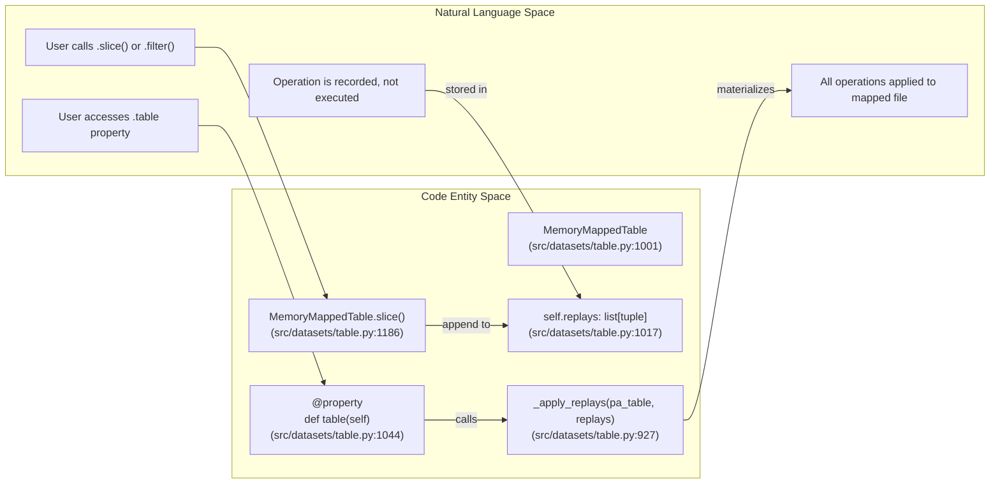

**Implementation Details:**
- **Storage:** The table stores the file path and a list of `replays` (method name, args, kwargs) [src/datasets/table.py:1014-1018]().
- **Transformation:** Methods like `slice`, `filter`, `flatten`, and `cast` return a new `MemoryMappedTable` with the new operation appended to the `replays` list [src/datasets/table.py:1186-1238]().
- **Materialization:** When the `.table` property is accessed, `_memory_mapped_arrow_table_from_file` is called if no table is cached, and `_apply_replays` executes the transformation chain [src/datasets/table.py:1044-1054]().
- **Serialization:** The `__getstate__` method ensures only the file path and replay list are pickled, preventing data from being pulled into memory during serialization [src/datasets/table.py:1121-1136]().

**Sources:** [src/datasets/table.py:1001-1136](), [src/datasets/table.py:1186-1238](), [src/datasets/table.py:927-944]()

## ConcatenationTable

`ConcatenationTable` provides a zero-copy way to treat multiple `TableBlock` objects (In-Memory or Memory-Mapped) as a single table.

**Internal Structure:**
- **Blocks:** Data is stored in `self._blocks`, which is a `list[list[TableBlock]]` [src/datasets/table.py:1334](). This structure supports row-wise (outer list) and column-wise (inner list) concatenation.
- **Slicing:** The `slice()` method is optimized to only slice the specific blocks that overlap with the requested range using cumulative `_offsets` [src/datasets/table.py:1578-1633]().
- **Materialization:** Accessing the `.table` property triggers `pa.concat_tables` across all blocks, which is then cached [src/datasets/table.py:1368-1374]().

**Sources:** [src/datasets/table.py:1330-1374](), [src/datasets/table.py:1578-1633]()

## Utility Functions for Table Operations

The module provides several low-level utilities for manipulating Arrow tables and arrays, often used by the higher-level `Dataset` operations:

- **`cast_table_to_schema`**: Recursively casts a table to a target schema, handling nested structures and extension types [src/datasets/table.py:536-559]().
- **`embed_table_storage`**: Converts file-based features (like `Image` or `Audio`) into embedded data within the Arrow table [src/datasets/table.py:613-625]().
- **`concat_tables`**: A wrapper around `pa.concat_tables` that specifically handles `Table` abstraction instances, preserving their underlying types when possible [src/datasets/table.py:1787-1823]().

**Sources:** [src/datasets/table.py:536-559](), [src/datasets/table.py:613-625](), [src/datasets/table.py:1787-1823]()

---

# Page: Caching and Fingerprinting

# Caching and Fingerprinting

<details>
<summary>Relevant source files</summary>

The following files were used as context for generating this wiki page:

- [docs/source/cache.mdx](docs/source/cache.mdx)
- [src/datasets/fingerprint.py](src/datasets/fingerprint.py)
- [src/datasets/search.py](src/datasets/search.py)
- [src/datasets/utils/_dill.py](src/datasets/utils/_dill.py)
- [tests/test_fingerprint.py](tests/test_fingerprint.py)
- [tests/test_fingerprint_tokenizer_stability.py](tests/test_fingerprint_tokenizer_stability.py)
- [tests/test_search.py](tests/test_search.py)

</details>


## Purpose and Scope

This document explains the deterministic caching system and fingerprint generation mechanism in the `datasets` library. Fingerprinting enables datasets to track their transformation history through cryptographic hashes, while caching allows the library to reuse previously computed results instead of recomputing transformations.

The system ensures that dataset transformations are reproducible and efficient. Each dataset maintains a unique fingerprint (a 64-character hexadecimal hash) that changes deterministically whenever transformations are applied. This fingerprint serves as the cache key, allowing the library to determine if a transformation has already been computed.

---

## Overview

The caching and fingerprinting system is integrated directly into the `Dataset` class and its transformation methods.

### Key Benefits

| Benefit | Description |
|---------|-------------|
| **Reproducibility** | Same transformations always produce the same fingerprint [src/datasets/fingerprint.py:27-30]() |
| **Efficiency** | Avoid recomputing expensive operations by reusing cached results [src/datasets/fingerprint.py:32-34]() |
| **Automatic Management** | Cache files are automatically discovered and reused without user intervention [src/datasets/fingerprint.py:120-127]() |
| **Persistence** | Cache files are named using the dataset fingerprint, enabling cross-session reloading [src/datasets/fingerprint.py:125-127]() |

---

## System Architecture

### High-Level Flow

The following diagram illustrates the lifecycle of a dataset transformation and how it interacts with the fingerprinting and caching subsystems.

**Dataset Transformation Flow**

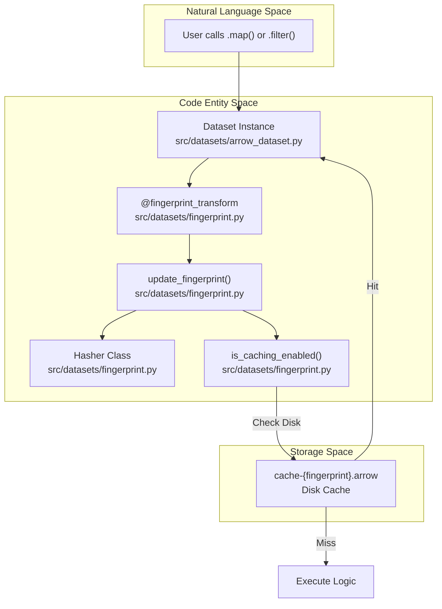

**Sources:** [src/datasets/fingerprint.py:27-34](), [src/datasets/fingerprint.py:120-136]()

---

## Core Components

### The Hasher Class

The `Hasher` class provides the low-level hashing functionality using `xxhash`, a fast non-cryptographic hash algorithm. It uses a custom pickling layer based on `dill` to produce consistent dumps across different environments and to handle complex Python objects.

**Hasher Implementation**

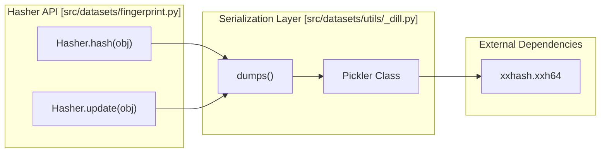

**Implementation Details:**
- **Deterministic Serialization**: The `Pickler` in `_dill.py` is extended to support consistent hashing of `pyarrow.Table` (chunk-independent), `torch.Tensor`, and `transformers` tokenizers [src/datasets/utils/_dill.py:28-71]().
- **Consistent Ordering**: Dictionaries and sets are sorted before hashing to ensure that key/element order does not change the fingerprint [src/datasets/utils/_dill.py:73-82](), [src/datasets/utils/_dill.py:135-148]().
- **Tokenizers Stability**: Special logic ensures tokenizers have stable hashes even after being called (which often mutates internal state) [tests/test_fingerprint_tokenizer_stability.py:18-23]().

**Sources:** [src/datasets/fingerprint.py:11-13](), [src/datasets/utils/_dill.py:28-89](), [src/datasets/utils/_dill.py:150-179]()

---

## Fingerprint Generation

### Transform Fingerprints

When a transformation is applied, the new fingerprint is derived from the previous fingerprint and the metadata of the transformation itself.

**Logic in `update_fingerprint`:**
- Captures the function's source code or `__qualname__` [src/datasets/fingerprint.py:1-2]().
- Captures all arguments passed to the transformation method.
- Includes the library version and transform version to invalidate cache if logic changes.

**Sources:** [src/datasets/fingerprint.py:27-30](), [src/datasets/fingerprint.py:125-127]()

### The fingerprint_transform Decorator

This decorator is applied to `Dataset` methods. It wraps the transformation logic to manage fingerprint updates and cache lookups automatically.

**Key Responsibilities:**
- **Cache Lookup**: Before execution, it computes the target fingerprint and checks if a corresponding cache file already exists [src/datasets/fingerprint.py:120-127]().
- **In-place management**: Handles whether the fingerprint update should be applied to the existing object or a new copy.

**Sources:** [src/datasets/fingerprint.py:7-9](), [tests/test_fingerprint.py:42-50]()

---

## Cache Management

### Caching Control API

Users can control caching behavior globally through the following functions:

| Function | File Pointer | Description |
|----------|--------------|-------------|
| `enable_caching()` | [src/datasets/fingerprint.py:120-139]() | Enables deterministic caching and reloading from disk. |
| `disable_caching()` | [src/datasets/fingerprint.py:141-160]() | Forces recreation of cache files in temporary directories. |
| `is_caching_enabled()` | [src/datasets/fingerprint.py:162-181]() | Returns the current global caching state. |

**Sources:** [src/datasets/fingerprint.py:120-181]()

### Temporary Cache Directory

When caching is disabled or a session-only cache is required, the library uses the `_TempCacheDir` class.

**Implementation Details:**
- **Class**: `_TempCacheDir` [src/datasets/fingerprint.py:45-95]()
- **Environment**: Respects `TMPDIR`, `TEMP`, or `TMP` environment variables [src/datasets/fingerprint.py:53-54]().
- **Cleanup**: Uses `weakref.finalize` to ensure the directory is deleted only after all references to the Arrow files (which are memory-mapped) are closed, preventing permission errors on Windows [src/datasets/fingerprint.py:79-90]().

**Sources:** [src/datasets/fingerprint.py:45-95](), [src/datasets/fingerprint.py:97-114]()

---

## Search and Indexing Caching

The caching system extends to search indices (FAISS and Elasticsearch). While dataset transformations are cached as Arrow files, search indices are managed through the `BaseIndex` abstraction.

**Index Caching Logic:**
- **FAISS**: Indices can be serialized to disk using `save()` and reloaded via `load()` [src/datasets/search.py:88-95]().
- **Elasticsearch**: The system uses unique index names (e.g., `huggingface_datasets_{random_id}`) if not specified, but supports persistent index names for reuse [src/datasets/search.py:129-133]().

**Sources:** [src/datasets/search.py:60-95](), [src/datasets/search.py:108-144]()

---

## Data Flow and Integration

### Mapping System to Code Entities

The following diagram maps the logical steps of the caching system to specific functions and classes in the codebase.

**Fingerprint & Cache Entity Mapping**

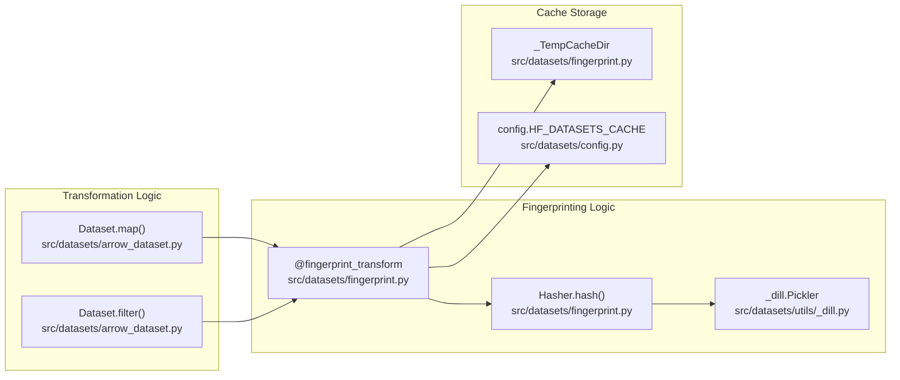

**Sources:** [src/datasets/fingerprint.py:19-24](), [src/datasets/utils/_dill.py:28-32](), [src/datasets/fingerprint.py:45-51]()

### Cache Directory Configuration

The location of the cache is determined by environment variables and configuration settings:
1. `HF_DATASETS_CACHE` environment variable [docs/source/cache.mdx:29-30]().
2. `HF_HOME` environment variable [docs/source/cache.mdx:20-23]().
3. Default: `~/.cache/huggingface/datasets` [docs/source/cache.mdx:20]().

**Sources:** [docs/source/cache.mdx:18-50]()

---

# Page: Data Loading System

# Data Loading System

<details>
<summary>Relevant source files</summary>

The following files were used as context for generating this wiki page:

- [docs/source/_toctree.yml](docs/source/_toctree.yml)
- [docs/source/how_to.md](docs/source/how_to.md)
- [docs/source/loading.mdx](docs/source/loading.mdx)
- [docs/source/package_reference/loading_methods.mdx](docs/source/package_reference/loading_methods.mdx)
- [docs/source/tabular_load.mdx](docs/source/tabular_load.mdx)
- [src/datasets/load.py](src/datasets/load.py)
- [src/datasets/packaged_modules/__init__.py](src/datasets/packaged_modules/__init__.py)
- [tests/test_load.py](tests/test_load.py)

</details>


The Data Loading System is the entry point for bringing data into the Hugging Face `datasets` ecosystem. It abstractly handles data acquisition from the Hugging Face Hub, local filesystems, and remote cloud storage (S3, GCS), converting diverse raw formats into a unified internal representation based on Apache Arrow.

## Overview

The system is architected around the `load_dataset` API, which orchestrates the discovery of data, the selection of an appropriate `DatasetBuilder`, and the execution of the download and generation pipeline.

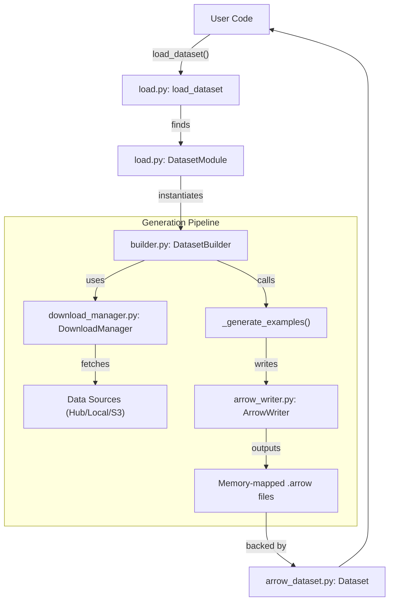

Sources: [src/datasets/load.py:16-93](), [src/datasets/builder.py:1-62](), [src/datasets/arrow_writer.py:1-46]()

## Core Components

The loading system is composed of several specialized subsystems that handle different stages of the data lifecycle:

### [load_dataset API](#3.1)
The primary functional interface for users. It performs module resolution by identifying whether a dataset is a Hub repository, a local directory, a packaged format (like CSV/JSON), or a community loading script. It uses `DatasetModuleFactory` subclasses to resolve the correct code to execute.
- **Key Entity**: `datasets.load.load_dataset`
- **Source**: [src/datasets/load.py:2554-2615]()

### [DatasetBuilder Framework](#3.2)
The abstract base class logic that defines how a dataset is downloaded, split, and generated. It manages the creation of the local cache directory and coordinates the conversion of raw data into Arrow tables.
- **Key Entity**: `datasets.builder.DatasetBuilder`
- **Source**: [src/datasets/builder.py:315-450]()

### [Packaged Modules](#3.3)
Built-in implementations of `DatasetBuilder` designed to handle common file formats without requiring a custom loading script. This includes support for `json`, `csv`, `parquet`, `arrow`, `text`, and specialized "Folder" builders for vision and audio.
- **Key Entity**: `datasets.packaged_modules._PACKAGED_DATASETS_MODULES`
- **Source**: [src/datasets/packaged_modules/__init__.py:45-66]()

### [Download Managers](#3.4)
Utilities that handle the physical movement of data. The `DownloadManager` handles standard file downloads and extraction, while the `StreamingDownloadManager` enables lazy access to remote files without full local caching.
- **Key Entities**: `datasets.download.download_manager.DownloadManager`, `datasets.download.streaming_download_manager.StreamingDownloadManager`
- **Source**: [src/datasets/download/download_manager.py:1-50](), [src/datasets/download/streaming_download_manager.py:61-100]()

### [Data Files and Pattern Matching](#3.5)
The logic responsible for resolving file paths and URLs. It supports glob patterns (e.g., `data/*.json`) and automatically maps files to dataset splits (train, test, validation) based on filename keywords or directory structures.
- **Key Entity**: `datasets.data_files.DataFilesDict`
- **Source**: [src/datasets/data_files.py:50-57](), [src/datasets/load.py:50-57]()

## Data Flow: From Source to Dataset

The transition from "Natural Language Space" (files and URLs) to "Code Entity Space" (Arrow Tables and Dataset objects) follows a structured sequence managed by the `DatasetBuilder`.

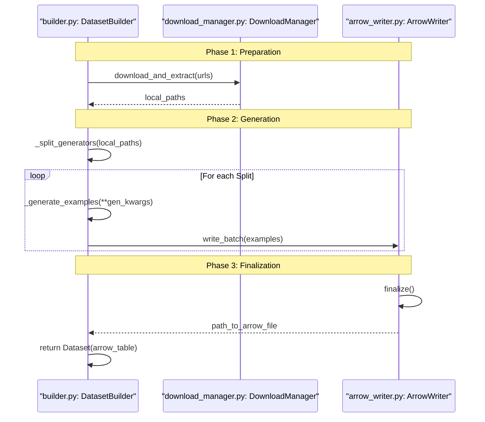

Sources: [src/datasets/builder.py:950-1050](), [src/datasets/arrow_writer.py:173-250]()

## Key Code Entities

| System Concept | Code Class / Function | File Path |
| :--- | :--- | :--- |
| **Main Entry Point** | `load_dataset` | [src/datasets/load.py:2554]() |
| **Base Logic** | `DatasetBuilder` | [src/datasets/builder.py:315]() |
| **Data Writing** | `ArrowWriter` | [src/datasets/arrow_writer.py:173]() |
| **File Resolution** | `DataFilesDict` | [src/datasets/data_files.py:654]() |
| **Module Factory** | `HubDatasetModuleFactory` | [src/datasets/load.py:1722]() |

Sources: [src/datasets/load.py:2554](), [src/datasets/builder.py:315](), [src/datasets/arrow_writer.py:173](), [src/datasets/data_files.py:654](), [src/datasets/load.py:1722]()

---

## Child Pages
- [load_dataset API](#3.1) — Comprehensive documentation of the main `load_dataset` function and its parameters.
- [DatasetBuilder Framework](#3.2) — Documentation of the `DatasetBuilder` abstract class and how custom builders are implemented.
- [Packaged Modules](#3.3) — Documentation of built-in dataset builders for common formats (JSON, CSV, Parquet, ImageFolder, etc.).
- [Download Managers](#3.4) — Explanation of `DownloadManager` and `StreamingDownloadManager` for data acquisition.
- [Data Files and Pattern Matching](#3.5) — Documentation of data file discovery, glob patterns, and archive iteration.

---

# Page: load_dataset API

# load_dataset API

<details>
<summary>Relevant source files</summary>

The following files were used as context for generating this wiki page:

- [src/datasets/inspect.py](src/datasets/inspect.py)
- [src/datasets/load.py](src/datasets/load.py)
- [tests/test_inspect.py](tests/test_inspect.py)
- [tests/test_load.py](tests/test_load.py)
- [tests/test_offline_util.py](tests/test_offline_util.py)

</details>


## Purpose and Scope

The `load_dataset` API is the central entry point for the `datasets` library. It provides a unified interface to load datasets from the Hugging Face Hub, local files (CSV, JSON, Parquet, Arrow, etc.), or local loading scripts. This page documents the `load_dataset` function, its parameters, and the underlying module factory system that orchestrates dataset construction.

---

## Loading Pipeline Overview

The loading process is a multi-stage pipeline that resolves the dataset source, identifies the appropriate `DatasetBuilder`, and executes the build process to produce a memory-mapped Apache Arrow table or an iterable stream.

**Natural Language to Code Entity Space: Loading Flow**

```mermaid
graph TB
    User["User calls load_dataset()"]
    Factory["datasets.load.dataset_module_factory()"]
    
    subgraph "Module Selection Space"
        HubFactory["datasets.load.HubDatasetModuleFactory"]
        LocalFactory["datasets.load.LocalDatasetModuleFactory"]
        PackagedFactory["datasets.load.PackagedDatasetModuleFactory"]
    end
    
    BuilderClass["datasets.load.get_dataset_builder_class()"]
    BuilderInstance["datasets.builder.DatasetBuilder instance"]
    
    subgraph "Execution Space"
        Prepare["builder.download_and_prepare()"]
        SplitGen["builder._split_generators()"]
        Generate["builder._generate_examples()"]
        Writer["datasets.arrow_writer.ArrowWriter"]
    end
    
    Output["Dataset or DatasetDict"]
    
    User --> Factory
    Factory --> HubFactory
    Factory --> LocalFactory
    Factory --> PackagedFactory
    
    HubFactory --> BuilderClass
    LocalFactory --> BuilderClass
    PackagedFactory --> BuilderClass
    
    BuilderClass --> BuilderInstance
    BuilderInstance --> Prepare
    Prepare --> SplitGen
    SplitGen --> Generate
    Generate --> Writer
    Writer --> Output
```

Sources: [src/datasets/load.py:161-194](), [src/datasets/load.py:1725-1820](), [src/datasets/load.py:2100-2180]()

---

## The load_dataset() Function

Defined in `src/datasets/load.py`, `load_dataset` handles the high-level logic of choosing between a standard `Dataset` (map-style) and an `IterableDataset` (streaming).

### Key Parameters

| Parameter | Type | Description |
|-----------|------|-------------|
| `path` | `str` | Path or name of the dataset. Can be a Hub ID, a local directory, or a format like `"csv"`. [src/datasets/load.py:2100-2110]() |
| `name` | `str` | Defining the name of the dataset configuration (e.g., `"en"` for GLUE). [src/datasets/load.py:2112-2115]() |
| `data_files` | `str/list/dict` | Explicit paths to source data files. [src/datasets/load.py:2117-2125]() |
| `split` | `str/Split` | Which split to load (e.g., `train`, `test`). Supports slicing like `train[:10%]`. [src/datasets/load.py:2127-2135]() |
| `cache_dir` | `str` | Directory to read/write cached datasets. [src/datasets/load.py:2137-2140]() |
| `streaming` | `bool` | If `True`, returns an `IterableDataset` instead of downloading everything. [src/datasets/load.py:2160-2165]() |
| `num_proc` | `int` | Number of processes to use for parallel loading (if supported). [src/datasets/load.py:2175-2178]() |

### Implementation Logic
1. **Module Resolution**: It calls `dataset_module_factory` to find the dataset's logic and configuration [src/datasets/load.py:2185-2200]().
2. **Builder Initialization**: It fetches the `DatasetBuilder` class via `get_dataset_builder_class` [src/datasets/load.py:180-194]() and instantiates it [src/datasets/load.py:2210-2225]().
3. **Execution**:
    - **Standard loading**: Calls `builder.download_and_prepare()` to process and cache the data [src/datasets/load.py:2240-2255]().
    - **Streaming**: Returns an `IterableDataset` (or `IterableDatasetDict`) which allows lazy evaluation [src/datasets/load.py:2230-2238]().

Sources: [src/datasets/load.py:2100-2350]()

---

## Module Factory System

The factory system abstracts the complexity of where a dataset "lives". It returns a `DatasetModule` containing the path to the python code and the configuration parameters.

**Code Entity Association: Factory Resolution**

| Code Entity | Logic | Source |
| :--- | :--- | :--- |
| `LocalDatasetModuleFactory` | Checks if `path` is a local directory containing a loading script or data files. | [src/datasets/load.py:1416-1554]() |
| `PackagedDatasetModuleFactory` | Used when `path` is one of the built-in types: `csv`, `json`, `parquet`, `text`, etc. | [src/datasets/load.py:1557-1614]() |
| `HubDatasetModuleFactory` | Queries the Hugging Face Hub for a repository matching the `path`. | [src/datasets/load.py:1617-1723]() |
| `CachedDatasetModuleFactory` | Retrieves a previously used loading module from the local cache. | [src/datasets/load.py:1367-1413]() |

### Packaged Modules Inference
If a user provides a local directory or a list of files without a script, `infer_module_for_data_files_list` is used to guess the format (e.g., a folder full of `.parquet` files defaults to the `parquet` packaged module) [src/datasets/load.py:221-318]().

Sources: [src/datasets/load.py:1310-1723](), [src/datasets/load.py:221-318]()

---

## Dynamic Builder Configuration

The library supports dynamically creating builder classes, particularly for datasets defined via YAML metadata in Hub READMEs.

### configure_builder_class
This function dynamically creates a subclass of a `DatasetBuilder` and sets its `BUILDER_CONFIGS` class variable [src/datasets/load.py:123-160](). This is essential for "scriptless" datasets where configurations are parsed from the `MetadataConfigs` found in the YAML frontmatter of the dataset card [src/datasets/load.py:105-121]().

### Pickle Support
To ensure these dynamically created classes can be used in multiprocessing (e.g., via `num_proc`), they implement a custom `__reduce__` method using `_InitializeConfiguredDatasetBuilder` [src/datasets/load.py:105-121](), [src/datasets/load.py:140-151]().

Sources: [src/datasets/load.py:105-160]()

---

## Inspection Utilities

Before loading a full dataset, several utilities allow users to inspect metadata and available configurations.

- **`get_dataset_infos`**: Returns a dictionary mapping configuration names to `DatasetInfo` objects, containing descriptions and features [src/datasets/inspect.py:42-106]().
- **`get_dataset_config_names`**: Retrieves the list of available configurations for a given path [src/datasets/inspect.py:109-173]().
- **`get_dataset_default_config_name`**: Determines which configuration will be used if the user does not specify one [src/datasets/inspect.py:175-212]().

Sources: [src/datasets/inspect.py:42-212]()

---

## Data File Pattern Matching

The `data_files` parameter supports glob patterns and automatic split inference. The logic in `src/datasets/data_files.py` uses predefined patterns to automatically categorize files into splits (e.g., `train`, `test`, `validation`) if the user doesn't provide an explicit mapping.

| Pattern Category | Examples |
| :--- | :--- |
| **Train** | `train`, `training`, `training_data` |
| **Test** | `test`, `testing`, `evaluation` |
| **Validation** | `val`, `validation`, `dev` |

Sources: [src/datasets/data_files.py:50-90](), [src/datasets/load.py:55-57]()

---

# Page: DatasetBuilder Framework

# DatasetBuilder Framework

<details>
<summary>Relevant source files</summary>

The following files were used as context for generating this wiki page:

- [src/datasets/arrow_reader.py](src/datasets/arrow_reader.py)
- [src/datasets/builder.py](src/datasets/builder.py)
- [src/datasets/commands/test.py](src/datasets/commands/test.py)
- [src/datasets/download/download_manager.py](src/datasets/download/download_manager.py)
- [src/datasets/info.py](src/datasets/info.py)
- [src/datasets/naming.py](src/datasets/naming.py)
- [src/datasets/splits.py](src/datasets/splits.py)
- [tests/commands/test_test.py](tests/commands/test_test.py)
- [tests/test_arrow_reader.py](tests/test_arrow_reader.py)
- [tests/test_builder.py](tests/test_builder.py)

</details>


## Purpose and Scope

This document describes the `DatasetBuilder` abstract class and the framework for implementing dataset loading logic. The `DatasetBuilder` is the core abstraction that defines how datasets are downloaded, processed, and converted into Arrow tables. This page covers the builder lifecycle, configuration system, and implementation patterns for creating custom dataset builders.

For information about invoking builders through the public API, see [load_dataset API](#3.1). For documentation of the built-in packaged builders (CSV, JSON, Parquet, etc.), see [Packaged Modules](#3.3).

---

## DatasetBuilder Class Hierarchy

The `DatasetBuilder` class serves as the abstract base class that all dataset implementations must extend. The framework provides several specialized subclasses for common patterns.

```mermaid
graph TB
    DatasetBuilder["DatasetBuilder<br/>(Abstract Base Class)"]
    GeneratorBasedBuilder["GeneratorBasedBuilder<br/>(Generator Pattern)"]
    ArrowBasedBuilder["ArrowBasedBuilder<br/>(Arrow-native)"]
    FolderBasedBuilder["FolderBasedBuilder<br/>(File Discovery)"]
    
    CustomBuilder["Custom Dataset Scripts"]
    CSV["CSV Builder"]
    JSON["JSON Builder"]
    Parquet["Parquet Builder"]
    ImageFolder["ImageFolder Builder"]
    AudioFolder["AudioFolder Builder"]
    
    DatasetBuilder --> GeneratorBasedBuilder
    DatasetBuilder --> ArrowBasedBuilder
    GeneratorBasedBuilder --> CustomBuilder
    ArrowBasedBuilder --> Parquet
    FolderBasedBuilder --> ImageFolder
    FolderBasedBuilder --> AudioFolder
    GeneratorBasedBuilder --> CSV
    GeneratorBasedBuilder --> JSON
    
    style DatasetBuilder stroke-dasharray: 5 5
    style GeneratorBasedBuilder stroke-dasharray: 5 5
```

**Diagram: DatasetBuilder Class Hierarchy**

The hierarchy reflects different strategies for loading data:
- `GeneratorBasedBuilder`: Uses Python generators to yield examples one at a time [src/datasets/builder.py:1625-1626]().
- `ArrowBasedBuilder`: Works directly with Arrow tables for maximum efficiency [src/datasets/builder.py:1808-1809]().
- `FolderBasedBuilder`: Discovers files based on folder structure and naming patterns.

Sources: [src/datasets/builder.py:209-280](), [src/datasets/builder.py:1625-1806](), [src/datasets/builder.py:1808-1937]()

---

## Core Components

### DatasetBuilder Abstract Class

The `DatasetBuilder` class defines the contract that all dataset implementations must fulfill. Key attributes and methods include:

| Component | Type | Purpose |
|-----------|------|---------|
| `VERSION` | `Optional[Version]` | Dataset version for cache management [src/datasets/builder.py:284-285]() |
| `BUILDER_CONFIG_CLASS` | `Type[BuilderConfig]` | Configuration class for this builder [src/datasets/builder.py:287-287]() |
| `BUILDER_CONFIGS` | `List[BuilderConfig]` | Pre-defined configuration options [src/datasets/builder.py:288-289]() |
| `DEFAULT_CONFIG_NAME` | `Optional[str]` | Default configuration to use [src/datasets/builder.py:291-292]() |
| `DEFAULT_WRITER_BATCH_SIZE` | `Optional[int]` | Arrow writer batch size [src/datasets/builder.py:294-295]() |
| `info` | `DatasetInfo` | Metadata about the dataset [src/datasets/builder.py:302-302]() |
| `config` | `BuilderConfig` | Active configuration instance [src/datasets/builder.py:304-304]() |

**Table: DatasetBuilder Class Attributes**

The constructor accepts numerous parameters for customization, including `cache_dir`, `config_name`, and `data_files` [src/datasets/builder.py:348-421]().

Sources: [src/datasets/builder.py:209-348]()

### BuilderConfig Dataclass

The `BuilderConfig` class allows datasets to expose multiple variants or configurations. Each configuration can have different data files, preprocessing options, or features.

| Attribute | Type | Description |
|-----------|------|-------------|
| `name` | `str` | Configuration name (used in cache paths) [src/datasets/builder.py:120-120]() |
| `version` | `Version \| str` | Configuration version [src/datasets/builder.py:121-121]() |
| `data_dir` | `Optional[str]` | Directory containing source data [src/datasets/builder.py:122-122]() |
| `data_files` | `Optional[DataFilesDict]` | Explicit data file paths [src/datasets/builder.py:123-123]() |
| `description` | `Optional[str]` | Human-readable description [src/datasets/builder.py:124-124]() |

**Table: BuilderConfig Attributes**

The `create_config_id()` method generates a unique identifier that combines the config name with a hash of custom parameters like `data_files` or `features`, ensuring proper cache isolation [src/datasets/builder.py:144-160]().

Sources: [src/datasets/builder.py:101-207]()

---

## Builder Lifecycle and Execution Flow

```mermaid
sequenceDiagram
    participant User
    participant LoadAPI as "load_dataset()"
    participant Factory as "DatasetModuleFactory"
    participant Builder as "DatasetBuilder"
    participant DLMgr as "DownloadManager"
    participant Writer as "ArrowWriter"
    participant Dataset
    
    User->>LoadAPI: load_dataset("dataset_name")
    LoadAPI->>Factory: get_module()
    Factory-->>LoadAPI: DatasetModule
    LoadAPI->>Builder: __init__(config, cache_dir, ...)
    Builder->>Builder: _create_builder_config()
    Builder->>Builder: _info()
    
    LoadAPI->>Builder: download_and_prepare()
    Builder->>Builder: _download_and_prepare()
    Builder->>DLMgr: download resources
    DLMgr-->>Builder: local paths
    Builder->>Builder: _split_generators()
    
    loop For each split
        Builder->>Builder: _prepare_split()
        loop For each example
            Builder->>Builder: _generate_examples()
            Builder->>Writer: write_batch()
        end
        Writer-->>Builder: Arrow file
    end
    
    LoadAPI->>Builder: as_dataset()
    Builder->>Dataset: Dataset.from_file()
    Dataset-->>User: Dataset instance
```

**Diagram: DatasetBuilder Lifecycle Sequence**

The execution follows three main phases:

1. **Initialization Phase**: Builder is instantiated with configuration and `DatasetInfo` is initialized via `_info()` [src/datasets/builder.py:348-462]().
2. **Download and Prepare Phase**: Data is acquired via `DownloadManager` and processed into Arrow files through `_download_and_prepare()` [src/datasets/builder.py:934-954]().
3. **Dataset Construction Phase**: Arrow files are wrapped in `Dataset` objects via `as_dataset()` [src/datasets/builder.py:1165-1215]().

Sources: [src/datasets/builder.py:651-745](), [src/datasets/builder.py:746-922](), [src/datasets/builder.py:1165-1215]()

---

## Abstract Methods and Implementation Contract

Every `DatasetBuilder` subclass must implement three abstract methods:

### 1. _info() Method
Returns a `DatasetInfo` object containing dataset metadata [src/datasets/builder.py:1391-1393](). The `features` field defines the schema using the `Features` type system [src/datasets/info.py:142-142]().

Sources: [src/datasets/builder.py:1391-1450](), [src/datasets/info.py:92-157]()

### 2. _split_generators() Method
Returns a list of `SplitGenerator` objects that define how to create each split [src/datasets/builder.py:1452-1454](). This method typically uses the `DownloadManager` to acquire data [src/datasets/builder.py:1516-1518]().

Sources: [src/datasets/builder.py:1452-1553](), [src/datasets/splits.py:31-67]()

### 3. _generate_examples() Method
Yields tuples of `(key, example)` for each data instance [src/datasets/builder.py:1555-1557](). The example dict must match the schema defined in `_info()`.

Sources: [src/datasets/builder.py:1555-1623]()

---

## Builder Configuration System

```mermaid
graph TB
    subgraph "Configuration Sources"
        DefaultConfigs["BUILDER_CONFIGS<br/>class attribute"]
        MetadataYAML["README.md configs<br/>YAML frontmatter"]
        RuntimeParams["Runtime parameters<br/>config_name, **kwargs"]
    end
    
    subgraph "Configuration Resolution"
        ConfigFactory["_create_builder_config()"]
        SelectConfig["Select by config_name"]
        MergeKwargs["Merge config_kwargs"]
        CreateID["create_config_id()"]
    end
    
    subgraph "Result"
        ConfigInstance["BuilderConfig instance"]
        ConfigID["config_id<br/>(for cache path)"]
    end
    
    DefaultConfigs --> SelectConfig
    MetadataYAML --> SelectConfig
    RuntimeParams --> SelectConfig
    
    SelectConfig --> ConfigFactory
    RuntimeParams --> MergeKwargs
    ConfigFactory --> MergeKwargs
    MergeKwargs --> ConfigInstance
    ConfigInstance --> CreateID
    CreateID --> ConfigID
```

**Diagram: Builder Configuration Resolution**

### Static Configuration via BUILDER_CONFIGS
Builders can define pre-configured variants as a class attribute `BUILDER_CONFIGS` [src/datasets/builder.py:288-289]().

### Runtime Configuration
Users can override configuration parameters when calling `load_dataset()`. The `_create_builder_config()` method merges provided `config_name` and `kwargs` with existing configs [src/datasets/builder.py:464-558]().

Sources: [src/datasets/builder.py:464-558](), [src/datasets/builder.py:144-201]()

---

## Cache Directory Structure

The builder uses a hierarchical cache structure to isolate different configurations and versions [src/datasets/builder.py:559-648]():

```
~/.cache/huggingface/datasets/
└── {dataset_name}/
    └── {config_name}/
        └── {version}/
            └── {hash}/
                ├── dataset_info.json
                ├── {dataset_name}-train.arrow
                └── ...
```

The `hash` (config ID) is generated to ensure cache isolation when custom parameters are used [src/datasets/builder.py:144-160]().

Sources: [src/datasets/builder.py:559-648](), [src/datasets/builder.py:144-201]()

---

## Download and Prepare Process

```mermaid
graph TB
    subgraph "Initialization"
        CheckCache["Check if cache exists<br/>_cache_dir"]
        LoadInfo["Load dataset_info.json"]
        CreateDLMgr["Create DownloadManager"]
    end
    
    subgraph "Split Generation"
        CallSplitGen["_split_generators(dl_manager)"]
        GetGenKwargs["Extract gen_kwargs<br/>per split"]
    end
    
    subgraph "Data Processing"
        PrepSplit["_prepare_split()"]
        CreateWriter["Create ArrowWriter"]
        GenLoop["Loop: _generate_examples()"]
        WriteBatch["Write batches to Arrow"]
        Finalize["Finalize Arrow file"]
    end
    
    subgraph "Metadata"
        WriteInfo["Write dataset_info.json"]
        ComputeStats["Compute split statistics"]
    end
    
    CheckCache --> |"Not cached"| CreateDLMgr
    CheckCache --> |"Cached"| LoadInfo
    CreateDLMgr --> CallSplitGen
    CallSplitGen --> GetGenKwargs
    
    GetGenKwargs --> PrepSplit
    PrepSplit --> CreateWriter
    CreateWriter --> GenLoop
    GenLoop --> WriteBatch
    WriteBatch --> |"Batch complete"| GenLoop
    GenLoop --> |"All examples"| Finalize
    
    Finalize --> ComputeStats
    ComputeStats --> WriteInfo
```

**Diagram: Download and Prepare Workflow**

### Download Manager
The `DownloadManager` handles resource acquisition [src/datasets/download/download_manager.py:71-72](). It manages `download()` and recording of checksums [src/datasets/download/download_manager.py:131-180]().

Sources: [src/datasets/download/download_manager.py:71-180](), [src/datasets/builder.py:934-954]()

### ArrowWriter and Batch Processing
The `ArrowWriter` handles conversion of Python dictionaries to Arrow format [src/datasets/builder.py:1244-1246](). The `writer_batch_size` parameter controls the Arrow RecordBatch size [src/datasets/builder.py:1255-1256]().

Sources: [src/datasets/builder.py:1244-1347](), [src/datasets/arrow_writer.py:46-47]()

---

## Verification and Summary

### VerificationMode
Controls data integrity checks, such as `ALL_CHECKS` (verifying checksums and split sizes) or `NO_CHECKS` [src/datasets/utils/info_utils.py:74-74]().

Sources: [src/datasets/builder.py:651-745](), [src/datasets/commands/test.py:150-158]()

### Key Classes and Roles

| Class | Module | Role |
|-------|--------|------|
| `DatasetBuilder` | [src/datasets/builder.py:209]() | Abstract base class for all builders |
| `BuilderConfig` | [src/datasets/builder.py:101]() | Configuration dataclass |
| `GeneratorBasedBuilder` | [src/datasets/builder.py:1625]() | Generator-pattern implementation |
| `ArrowBasedBuilder` | [src/datasets/builder.py:1808]() | Arrow-native implementation |
| `DownloadManager` | [src/datasets/download/download_manager.py:71]() | Resource acquisition manager |
| `DatasetInfo` | [src/datasets/info.py:92]() | Dataset metadata container |

Sources: [src/datasets/builder.py](), [src/datasets/download/download_manager.py](), [src/datasets/info.py]()

---

# Page: Packaged Modules

# Packaged Modules

<details>
<summary>Relevant source files</summary>

The following files were used as context for generating this wiki page:

- [docs/source/about_dataset_load.mdx](docs/source/about_dataset_load.mdx)
- [docs/source/tsfile_load.mdx](docs/source/tsfile_load.mdx)
- [docs/source/use_with_spark.mdx](docs/source/use_with_spark.mdx)
- [src/datasets/download/download_config.py](src/datasets/download/download_config.py)
- [src/datasets/io/spark.py](src/datasets/io/spark.py)
- [src/datasets/packaged_modules/arrow/__init__.py](src/datasets/packaged_modules/arrow/__init__.py)
- [src/datasets/packaged_modules/arrow/arrow.py](src/datasets/packaged_modules/arrow/arrow.py)
- [src/datasets/packaged_modules/audiofolder/audiofolder.py](src/datasets/packaged_modules/audiofolder/audiofolder.py)
- [src/datasets/packaged_modules/conll/__init__.py](src/datasets/packaged_modules/conll/__init__.py)
- [src/datasets/packaged_modules/conll/conll.py](src/datasets/packaged_modules/conll/conll.py)
- [src/datasets/packaged_modules/csv/csv.py](src/datasets/packaged_modules/csv/csv.py)
- [src/datasets/packaged_modules/folder_based_builder/folder_based_builder.py](src/datasets/packaged_modules/folder_based_builder/folder_based_builder.py)
- [src/datasets/packaged_modules/hdf5/__init__.py](src/datasets/packaged_modules/hdf5/__init__.py)
- [src/datasets/packaged_modules/hdf5/hdf5.py](src/datasets/packaged_modules/hdf5/hdf5.py)
- [src/datasets/packaged_modules/iceberg/__init__.py](src/datasets/packaged_modules/iceberg/__init__.py)
- [src/datasets/packaged_modules/iceberg/iceberg.py](src/datasets/packaged_modules/iceberg/iceberg.py)
- [src/datasets/packaged_modules/json/json.py](src/datasets/packaged_modules/json/json.py)
- [src/datasets/packaged_modules/lance/__init__.py](src/datasets/packaged_modules/lance/__init__.py)
- [src/datasets/packaged_modules/lance/lance.py](src/datasets/packaged_modules/lance/lance.py)
- [src/datasets/packaged_modules/pandas/pandas.py](src/datasets/packaged_modules/pandas/pandas.py)
- [src/datasets/packaged_modules/parquet/parquet.py](src/datasets/packaged_modules/parquet/parquet.py)
- [src/datasets/packaged_modules/spark/spark.py](src/datasets/packaged_modules/spark/spark.py)
- [src/datasets/packaged_modules/text/text.py](src/datasets/packaged_modules/text/text.py)
- [src/datasets/packaged_modules/tsfile/__init__.py](src/datasets/packaged_modules/tsfile/__init__.py)
- [src/datasets/packaged_modules/tsfile/tsfile.py](src/datasets/packaged_modules/tsfile/tsfile.py)
- [src/datasets/packaged_modules/webdataset/webdataset.py](src/datasets/packaged_modules/webdataset/webdataset.py)
- [src/datasets/packaged_modules/xml/__init__.py](src/datasets/packaged_modules/xml/__init__.py)
- [src/datasets/packaged_modules/xml/xml.py](src/datasets/packaged_modules/xml/xml.py)
- [src/datasets/utils/json.py](src/datasets/utils/json.py)
- [tests/fixtures/files.py](tests/fixtures/files.py)
- [tests/io/test_parquet.py](tests/io/test_parquet.py)
- [tests/io/test_sql.py](tests/io/test_sql.py)
- [tests/packaged_modules/test_arrow.py](tests/packaged_modules/test_arrow.py)
- [tests/packaged_modules/test_conll.py](tests/packaged_modules/test_conll.py)
- [tests/packaged_modules/test_csv.py](tests/packaged_modules/test_csv.py)
- [tests/packaged_modules/test_folder_based_builder.py](tests/packaged_modules/test_folder_based_builder.py)
- [tests/packaged_modules/test_hdf5.py](tests/packaged_modules/test_hdf5.py)
- [tests/packaged_modules/test_iceberg.py](tests/packaged_modules/test_iceberg.py)
- [tests/packaged_modules/test_json.py](tests/packaged_modules/test_json.py)
- [tests/packaged_modules/test_lance.py](tests/packaged_modules/test_lance.py)
- [tests/packaged_modules/test_parquet.py](tests/packaged_modules/test_parquet.py)
- [tests/packaged_modules/test_spark.py](tests/packaged_modules/test_spark.py)
- [tests/packaged_modules/test_text.py](tests/packaged_modules/test_text.py)
- [tests/packaged_modules/test_tsfile.py](tests/packaged_modules/test_tsfile.py)
- [tests/packaged_modules/test_webdataset.py](tests/packaged_modules/test_webdataset.py)

</details>


Packaged modules are built-in dataset builders located in `src/datasets/packaged_modules/` that provide no-code solutions for loading datasets from common file formats and directory structures. These builders are automatically selected by `load_dataset` based on file extensions or directory patterns, eliminating the need for custom loading scripts in most cases.

The packaged modules include:

**File Format Builders**:
- `json` - JSON and JSON Lines files
- `csv` - CSV and TSV files  
- `parquet` - Apache Parquet files
- `text` - Plain text files
- `arrow` - Arrow IPC files
- `pandas` - Pickle files from pandas
- `sql` - SQL databases (SQLite, etc.)
- `lance` - Lance columnar format
- `spark` - Spark DataFrames
- `hdf5` - HDF5 files
- `xml` - XML files

**Folder-Based Builders**:
- `imagefolder` - Image files organized in directories
- `audiofolder` - Audio files organized in directories
- `videofolder` - Video files organized in directories
- `pdffolder` - PDF files organized in directories

**Archive-Based Builders**:
- `webdataset` - TAR archives following WebDataset format

For information about the general dataset loading system and how these builders are selected, see [load_dataset API]() and [DatasetBuilder Framework](). For media feature types these builders produce, see [Media Features]().

---

## Builder Hierarchy

Packaged modules inherit from the core `DatasetBuilder` infrastructure, with two main architectural patterns: `ArrowBasedBuilder` for file formats and `GeneratorBasedBuilder` for more complex data sources.

**Packaged Module Hierarchy**
```mermaid
graph TB
    subgraph "Core Builder Classes"
        DatasetBuilder["DatasetBuilder<br/>(abstract base)"]
        ArrowBased["ArrowBasedBuilder<br/>(_generate_tables)"]
        GeneratorBased["GeneratorBasedBuilder<br/>(_generate_examples)"]
    end
    
    subgraph "File Format Builders"
        Json["Json<br/>json.py"]
        Csv["Csv<br/>csv.py"]
        Parquet["Parquet<br/>parquet.py"]
        Text["Text<br/>text.py"]
        Arrow["Arrow<br/>arrow.py"]
        Pandas["Pandas<br/>pandas.py"]
        Lance["Lance<br/>lance.py"]
        Spark["Spark<br/>spark.py"]
    end
    
    subgraph "Folder-Based Builders"
        FolderBased["FolderBasedBuilder<br/>(abstract base)"]
        ImageFolder["ImageFolder<br/>imagefolder.py"]
        AudioFolder["AudioFolder<br/>audiofolder.py"]
    end
    
    subgraph "Archive-Based"
        WebDataset["WebDataset<br/>webdataset.py"]
    end
    
    DatasetBuilder --> ArrowBased
    DatasetBuilder --> GeneratorBased
    
    ArrowBased --> Json
    ArrowBased --> Csv
    ArrowBased --> Parquet
    ArrowBased --> Text
    ArrowBased --> Pandas
    
    GeneratorBased --> FolderBased
    GeneratorBased --> WebDataset
    GeneratorBased --> Lance
    GeneratorBased --> Spark
    
    FolderBased --> ImageFolder
    FolderBased --> AudioFolder
```

**Key Distinctions**:
- **ArrowBasedBuilder**: Implements `_generate_tables()` to yield PyArrow tables directly. Used for structured file formats.
- **GeneratorBasedBuilder**: Implements `_generate_examples()` to yield individual examples. Used for folder structures and archives.

**Sources**: [src/datasets/packaged_modules/json/json.py:64-65](), [src/datasets/packaged_modules/csv/csv.py:145-146](), [src/datasets/packaged_modules/parquet/parquet.py:93-94](), [src/datasets/packaged_modules/folder_based_builder/folder_based_builder.py:42-53](), [src/datasets/packaged_modules/webdataset/webdataset.py:20-21](), [src/datasets/packaged_modules/lance/lance.py:92-93](), [src/datasets/packaged_modules/spark/spark.py:16-17]()

## File Format Builders

File format builders inherit from `ArrowBasedBuilder` and provide automatic loading for common structured data formats. They all follow a similar pattern: accept file paths via `data_files`, yield PyArrow tables in chunks, and support features specification.

### JSON Builder

The `Json` builder loads JSON and JSON Lines (`.jsonl`) files. It supports both:
- **JSON Lines format**: One JSON object per line (most common)
- **Single JSON object**: The entire file is one JSON object, with optional field extraction

**Configuration Class**: `JsonConfig` at [src/datasets/packaged_modules/json/json.py:46-59]()

| Parameter | Type | Default | Description |
|-----------|------|---------|-------------|
| `features` | `Features` | `None` | Schema to cast data to |
| `encoding` | `str` | `"utf-8"` | File encoding |
| `field` | `str` | `None` | Extract data from this field in a JSON object |
| `chunksize` | `int` | `10 << 20` | Chunk size in bytes (10MB default) |

**Loading Process**:
1. For single JSON objects with a specific `field`, it reads the whole file and extracts the field at [src/datasets/packaged_modules/json/json.py:158-165]().
2. For JSON Lines, it reads in chunks using `chunksize` at [src/datasets/packaged_modules/json/json.py:171-178]().
3. It uses `pyarrow.json.read_json` for efficient parsing of batches at [src/datasets/packaged_modules/json/json.py:178-185]().
4. It performs a table cast to the target features via `_cast_table` at [src/datasets/packaged_modules/json/json.py:109-137]().

**Sources**: [src/datasets/packaged_modules/json/json.py:1-200]()

### CSV Builder

The `Csv` builder loads CSV and TSV files using pandas under the hood, with extensive configuration options matching `pandas.read_csv()`.

**Configuration Class**: `CsvConfig` at [src/datasets/packaged_modules/csv/csv.py:25-69]()

**Processing Pipeline**:
1. Builds `pd_read_csv_kwargs` dict from config at [src/datasets/packaged_modules/csv/csv.py:78-142]().
2. Uses `pd.read_csv` with the specified `chunksize` (default 10,000) at [src/datasets/packaged_modules/csv/csv.py:189-190]().
3. Iterates through pandas chunks and converts them to `pa.Table` at [src/datasets/packaged_modules/csv/csv.py:191-196]().
4. Applies `table_cast` to align with `features` if provided at [src/datasets/packaged_modules/csv/csv.py:169-175]().

**Sources**: [src/datasets/packaged_modules/csv/csv.py:1-200]()

### Parquet Builder

The `Parquet` builder loads Apache Parquet files using PyArrow's dataset API, supporting advanced features like column selection and predicate pushdown.

**Configuration Class**: `ParquetConfig` at [src/datasets/packaged_modules/parquet/parquet.py:20-88]()

**Loading Process**:
1. Infers features from the Parquet schema at [src/datasets/packaged_modules/parquet/parquet.py:123-128]().
2. Uses `pyarrow.dataset.ParquetFileFormat` to handle fragments at [src/datasets/packaged_modules/parquet/parquet.py:180-182]().
3. Supports `filters` for predicate pushdown (e.g., skipping row groups based on statistics) at [src/datasets/packaged_modules/parquet/parquet.py:85]().
4. Yields tables in `_generate_tables` using the dataset scanner at [src/datasets/packaged_modules/parquet/parquet.py:184-191]().

**Sources**: [src/datasets/packaged_modules/parquet/parquet.py:1-191]()

---

## Folder-Based Builders

Folder-based builders (`ImageFolder`, `AudioFolder`, etc.) automatically load media datasets organized in directory structures. They share a common base class `FolderBasedBuilder` and support automatic label inference and metadata integration.

### FolderBasedBuilder Logic

The `FolderBasedBuilder` implements the core logic for scanning directories and archives.

**Implementation Flow**:
1. `_split_generators` scans the data files to identify labels and metadata files at [src/datasets/packaged_modules/folder_based_builder/folder_based_builder.py:71-122]().
2. If `drop_labels` is False, it treats subdirectory names as `ClassLabel` values at [src/datasets/packaged_modules/folder_based_builder/folder_based_builder.py:144-150]().
3. It identifies metadata files (e.g., `metadata.csv`, `metadata.jsonl`) to augment features at [src/datasets/packaged_modules/folder_based_builder/folder_based_builder.py:60]().
4. `_generate_examples` iterates through files, yielding the media object (Image/Audio) along with its metadata and label at [src/datasets/packaged_modules/folder_based_builder/folder_based_builder.py:355-456]().

**Sources**: [src/datasets/packaged_modules/folder_based_builder/folder_based_builder.py:1-456]()

---

## WebDataset Builder

`WebDataset` loads datasets stored in TAR archives where examples are grouped by a shared prefix (the "key").

**Processing Pipeline**:
1. `_get_pipeline_from_tar` iterates through a TAR archive, grouping files with the same base name into a single example at [src/datasets/packaged_modules/webdataset/webdataset.py:30-56]().
2. It automatically decodes common extensions (e.g., `.jpg` to `Image`, `.json` to dict) using the `DECODERS` map at [src/datasets/packaged_modules/webdataset/webdataset.py:53-54]().
3. It handles nested compression (e.g., `.txt.gz` inside a TAR) at [src/datasets/packaged_modules/webdataset/webdataset.py:45-52]().
4. `_split_generators` performs feature inference by looking at the first few examples at [src/datasets/packaged_modules/webdataset/webdataset.py:75-105]().

**Sources**: [src/datasets/packaged_modules/webdataset/webdataset.py:1-150]()

---

## Special Purpose Builders

### Spark and Lance Builders

These builders facilitate integration with modern data engineering stacks.

- **Spark**: Loads from a Spark DataFrame by iterating through partitions at [src/datasets/packaged_modules/spark/spark.py:40-47]().
- **Lance**: Loads from Lance datasets using the `lance` library, supporting efficient random access and vector search formats. It can resolve dataset URIs from a list of files at [src/datasets/packaged_modules/lance/lance.py:62-69]().

**Sources**: [src/datasets/packaged_modules/spark/spark.py:1-47](), [src/datasets/packaged_modules/lance/lance.py:1-120]()

### HDF5 Builder

The `HDF5` builder reads data from HDF5 files. It maps HDF5 datasets to Arrow columns. It can read entire datasets into memory or stream them.

**Sources**: [src/datasets/packaged_modules/hdf5/hdf5.py:1-74]()

---

## Entity Mapping: Builder Data Flow

This diagram maps the logical flow of data from raw files to Arrow tables, associating them with specific class methods.

```mermaid
graph LR
    subgraph "Natural Language Space"
        RawFiles["Raw Data Files<br/>(CSV, JSON, Parquet)"]
        Splits["Dataset Splits<br/>(train, test)"]
        Rows["Individual Examples"]
    end

    subgraph "Code Entity Space"
        RawFiles --> DM["DownloadManager<br/>download()"]
        DM --> SG["_split_generators()"]
        SG --> GT["_generate_tables()<br/>(ArrowBasedBuilder)"]
        SG --> GE["_generate_examples()<br/>(GeneratorBasedBuilder)"]
        
        GT --> PA["pyarrow.Table"]
        GE --> Dict["Python dict"]
        
        PA --> DS["Dataset"]
        Dict --> DS
    end
```

**Sources**: [src/datasets/packaged_modules/json/json.py:79-107](), [src/datasets/packaged_modules/csv/csv.py:151-167](), [src/datasets/packaged_modules/parquet/parquet.py:114-150]()

## Media Feature Interaction

The interaction between builders and media features during the loading process.

```mermaid
graph TD
    subgraph "Builder Layer"
        FB["FolderBasedBuilder"]
        WD["WebDataset"]
    end

    subgraph "Feature Layer"
        FB -- "Yields path/bytes" --> AF["Audio.encode_example()"]
        WD -- "Yields bytes" --> IF["Image.encode_example()"]
        WD -- "Yields bytes" --> VF["Video.encode_example()"]
    end

    subgraph "Storage Layer"
        AF --> Arrow["Arrow Binary Storage<br/>(path, bytes)"]
        IF --> Arrow
        VF --> Arrow
    end
```

**Sources**: [src/datasets/packaged_modules/webdataset/webdataset.py:112-137](), [src/datasets/packaged_modules/folder_based_builder/folder_based_builder.py:355-456]()

---

# Page: Download Managers

# Download Managers

<details>
<summary>Relevant source files</summary>

The following files were used as context for generating this wiki page:

- [src/datasets/arrow_reader.py](src/datasets/arrow_reader.py)
- [src/datasets/download/download_manager.py](src/datasets/download/download_manager.py)
- [src/datasets/download/streaming_download_manager.py](src/datasets/download/streaming_download_manager.py)
- [src/datasets/naming.py](src/datasets/naming.py)
- [src/datasets/splits.py](src/datasets/splits.py)
- [src/datasets/streaming.py](src/datasets/streaming.py)
- [src/datasets/utils/extract.py](src/datasets/utils/extract.py)
- [src/datasets/utils/file_utils.py](src/datasets/utils/file_utils.py)
- [src/datasets/utils/patching.py](src/datasets/utils/patching.py)
- [tests/test_arrow_reader.py](tests/test_arrow_reader.py)
- [tests/test_extract.py](tests/test_extract.py)
- [tests/test_file_utils.py](tests/test_file_utils.py)
- [tests/test_patching.py](tests/test_patching.py)
- [tests/test_streaming_download_manager.py](tests/test_streaming_download_manager.py)

</details>


## Purpose and Scope

Download managers are responsible for data acquisition in the `datasets` library, handling the retrieval and extraction of dataset files. The library provides two primary implementations tailored for different execution models:

- **`DownloadManager`**: Implements an eager approach. It downloads files to a local disk cache and extracts archives to local directories. This is the default manager for standard dataset loading where data fits on disk. [src/datasets/download/download_manager.py:71-72]()
- **`StreamingDownloadManager`**: Implements a lazy approach. Instead of downloading, it returns URLs or paths decorated with protocol prefixes (e.g., `gzip://`) that allow `fsspec` to stream data on-the-fly. This is used for `IterableDataset` and large-scale data processing. [src/datasets/download/streaming_download_manager.py:47-55]()

This page details the implementation, data flow, and configuration of these managers, as well as their integration with the underlying filesystem layer.

---

## Download Manager Architecture

### Class Hierarchy and Execution Models

The architecture bridges high-level data requests from a `DatasetBuilder` to low-level filesystem operations.

```mermaid
graph TB
    subgraph "Configuration Space"
        DownloadConfig["DownloadConfig<br/>(cache_dir, token, storage_options)"]
    end
    
    subgraph "Code Entity Space: Managers"
        DM["DownloadManager<br/>is_streaming = False"]
        SDM["StreamingDownloadManager<br/>is_streaming = True"]
    end
    
    subgraph "Functional Interface"
        DL["download(url_or_urls)"]
        EXT["extract(path_or_paths)"]
        DLE["download_and_extract(url_or_urls)"]
        IA["iter_archive(path_or_buf)"]
    end
    
    subgraph "Execution Layer"
        Eager["Eager Execution<br/>(Local Cache Storage)"]
        Lazy["Lazy Execution<br/>(fsspec Virtual Filesystems)"]
    end
    
    DownloadConfig --> DM
    DownloadConfig --> SDM
    
    DM --> DL
    DM --> EXT
    SDM --> DL
    SDM --> EXT
    
    DL --> Eager
    DL --> Lazy
    
    subgraph "Internal Utilities"
        CP["cached_path()"]
        XO["xopen()"]
        XJ["xjoin()"]
    end
    
    Eager --> CP
    Lazy --> XO
    Lazy --> XJ
```

**Diagram: Mapping of Manager Classes to Execution Models**

Sources: [src/datasets/download/download_manager.py:71-108](), [src/datasets/download/streaming_download_manager.py:47-67](), [src/datasets/streaming.py:42-59]()

---

## DownloadManager (Eager Mode)

### Implementation Detail

`DownloadManager` handles the physical movement of data. When `download()` is invoked, it uses `cached_path()` to fetch remote resources, verifying integrity via ETags and recording metadata. [src/datasets/download/download_manager.py:131-179]()

**Key Features:**
- **Parallelism**: Uses `thread_map` for batch downloads if `num_proc` is configured in `DownloadConfig`. [src/datasets/download/download_manager.py:158-167]()
- **Checksums**: Automatically computes file sizes and SHA256 checksums, storing them in `_recorded_sizes_checksums` for dataset verification. [src/datasets/download/download_manager.py:118-130]()
- **Tracking**: Returns `tracked_str` objects that carry origin URL metadata throughout the pipeline. [src/datasets/download/download_manager.py:43-43](), [src/datasets/download/download_manager.py:224-232]()

### Download and Extract Flow

```mermaid
graph LR
    URL["Input URL/Path"] --> Normalize["_download_single()"]
    Normalize --> CacheCheck{"cached_path()"}
    CacheCheck -->|Exists| ReturnPath["Return Cached Path"]
    CacheCheck -->|Missing| NetReq["HTTP/S3/HF Request"]
    NetReq --> WriteCache["Write to Cache Dir"]
    WriteCache --> Checksum["_record_sizes_checksums()"]
    Checksum --> ReturnPath
    
    ReturnPath --> Extract["extract()"]
    Extract --> Decompress["ExtractManager.extract()"]
    Decompress --> ExtractedPath["Return Directory Path"]
```

**Diagram: Eager Data Flow in DownloadManager**

Sources: [src/datasets/download/download_manager.py:131-180](), [src/datasets/download/download_manager.py:278-308](), [src/datasets/utils/extract.py:27-54]()

---

## StreamingDownloadManager (Lazy Mode)

### Implementation Detail

`StreamingDownloadManager` performs path transformation rather than data transfer. It prepares "chained URLs" that leverage `fsspec`'s ability to pipe protocols. For example, extracting a GZIP file returns a path like `gzip://inner_file::https://domain.com/file.gz`. [src/datasets/download/streaming_download_manager.py:143-149]()

### Protocol Transformation Logic

The `_extract` method determines the correct `fsspec` protocol based on file extensions using `_get_extraction_protocol`. [src/datasets/download/streaming_download_manager.py:124-149]()

| Extension | Protocol | Logic |
|-----------|----------|-------|
| `.gz`, `.gzip` | `gzip://` | Prepends protocol and strips extension for inner name. [src/datasets/download/streaming_download_manager.py:143-147]() |
| `.zip` | `zip://` | Uses `zip://::url` syntax for archive navigation. [src/datasets/download/streaming_download_manager.py:149-149]() |
| `.tar*` | N/A | Raises `NotImplementedError`; requires `iter_archive`. [src/datasets/download/streaming_download_manager.py:130-139]() |

**Note on TAR Archives**: Streaming mode does not support standard extraction for TAR files because they are not seekable in a way that allows a flat filesystem view. Users must use `iter_archive()` to yield file objects sequentially. [src/datasets/download/streaming_download_manager.py:130-139]()

### Module Patching

To enable streaming within user-defined `DatasetBuilder` scripts, the library patches standard Python I/O functions. The `extend_module_for_streaming` function replaces `open`, `os.path.join`, and others with "X-versions" (e.g., `xopen`, `xjoin`) defined in `src/datasets/utils/file_utils.py` that understand the `::` separator and remote protocols. [src/datasets/streaming.py:42-107]()

```mermaid
graph TD
    subgraph "Standard Library Entities"
        SOpen["open()"]
        SJoin["os.path.join()"]
        SList["os.listdir()"]
    end

    subgraph "Datasets Streaming Wrappers"
        XOpen["xopen()"]
        XJoin["xjoin()"]
        XList["xlistdir()"]
    end

    subgraph "Patching Logic"
        PS["patch_submodule()"]
        EMFS["extend_module_for_streaming()"]
    end

    EMFS --> PS
    PS -- "replaces" --> SOpen
    PS -- "with" --> XOpen
    PS -- "replaces" --> SJoin
    PS -- "with" --> XJoin
    PS -- "replaces" --> SList
    PS -- "with" --> XList
```

**Diagram: Patching Mechanism for Streaming Support**

Sources: [src/datasets/streaming.py:79-103](), [src/datasets/download/streaming_download_manager.py:6-38](), [src/datasets/utils/patching.py:21-36]()

---

## DownloadConfig

The `DownloadConfig` dataclass encapsulates all parameters governing the download process. [src/datasets/download/download_config.py:10-52]()

| Attribute | Type | Purpose |
|-----------|------|---------|
| `cache_dir` | `str/Path` | Location for downloaded/extracted files. |
| `force_download` | `bool` | Bypass cache and re-fetch. |
| `num_proc` | `int` | Processes for parallel downloads. |
| `token` | `str/bool` | Authentication for Hugging Face Hub. |
| `storage_options` | `dict` | Parameters passed to `fsspec` filesystems (e.g., S3 credentials). |

Sources: [src/datasets/download/download_config.py:54-71]()

---

## Extraction Layer

The library uses an `ExtractManager` and a hierarchy of `BaseExtractor` classes to handle various archive formats during eager downloading. [src/datasets/utils/extract.py:27-54]()

### Extractor Hierarchy

| Extractor Class | Supported Format / Magic Numbers |
| :--- | :--- |
| `TarExtractor` | TAR archives (with CVE-2007-4559 safety checks). [src/datasets/utils/extract.py:86-132]() |
| `GzipExtractor` | `b"\x1f\x8b"` (GZIP). [src/datasets/utils/extract.py:135-143]() |
| `ZipExtractor` | `b"PK\x03\x04"`, `b"PK\x05\x06"`, `b"PK\x07\x08"`. [src/datasets/utils/extract.py:145-150]() |
| `XzExtractor` | `b"\xfd7zXZ\x00"` (XZ). [src/datasets/utils/extract.py:195-201]() |

Sources: [src/datasets/utils/extract.py:57-210]()

---

## Summary of Key Functions

### Archive Iteration
Both managers support `iter_archive(urlpath_or_buf)`, which returns an `ArchiveIterable`. This allows processing archives (ZIP, TAR) without full extraction to disk, yielding `(path_within_archive, file_obj)` tuples. [src/datasets/download/download_manager.py:234-257](), [src/datasets/download/streaming_download_manager.py:171-194]()

### File Discovery
`iter_files(urlpaths)` provides a recursive iterator over file paths in a directory, filtering out hidden files and handling both local and remote storage via `FilesIterable`. [src/datasets/download/download_manager.py:259-276](), [src/datasets/download/streaming_download_manager.py:196-213]()

### Comparison Table

| Feature | `DownloadManager` | `StreamingDownloadManager` |
| :--- | :--- | :--- |
| **Storage** | Local Disk Cache | Memory/Network Stream |
| **I/O Function** | Standard `open()` | Patched `xopen()` |
| **Path Format** | Local absolute paths | URLs with protocols (`zip://...`) |
| **Parallelism** | Multi-process downloads | N/A (Sequential stream) |
| **Verification** | Checksum/Size recorded | None |

Sources: [src/datasets/download/download_manager.py:71-72](), [src/datasets/download/streaming_download_manager.py:47-55]()

---

# Page: Data Files and Pattern Matching

# Data Files and Pattern Matching

<details>
<summary>Relevant source files</summary>

The following files were used as context for generating this wiki page:

- [src/datasets/data_files.py](src/datasets/data_files.py)
- [src/datasets/utils/file_utils.py](src/datasets/utils/file_utils.py)
- [tests/test_data_files.py](tests/test_data_files.py)
- [tests/test_file_utils.py](tests/test_file_utils.py)

</details>


The Hugging Face Datasets library provides a robust system for discovering, filtering, and iterating over data files. This system abstracts file operations to work seamlessly across local filesystems, remote URLs (HTTP/S3/GCS), and compressed archives (ZIP/TAR/GZ). It underpins both standard cached loading and high-performance streaming.

## Data File Discovery and Patterns

When a dataset is loaded without an explicit file list, the library uses a hierarchical pattern matching system to identify splits (train, test, validation).

### Discovery Logic Flow

```mermaid
flowchart TD
    Start["Start Discovery"] --> CheckUser["Check 'data_files' parameter"]
    CheckUser -- "Provided" --> Sanitize["sanitize_patterns()"]
    CheckUser -- "None" --> GetPatterns["get_data_patterns()"]
    
    GetPatterns --> AllPatterns["ALL_DEFAULT_PATTERNS\n(Logs, DirName, FileName, All)"]
    AllPatterns --> MatchFiles["Match against Filesystem/Hub"]
    
    MatchFiles --> FilterSpecial["Filter Hidden/Special Files\n(_is_unrequested_hidden_file_...)"]
    FilterSpecial --> ResolveSplits["Resolve to SplitDict"]
    
    Sanitize --> DataFilesDict["DataFilesDict / DataFilesList"]
    ResolveSplits --> DataFilesDict
```

Sources: [src/datasets/data_files.py:121-159](), [src/datasets/data_files.py:93-105]()

### Key Pattern Constants
The library defines several default patterns to automatically detect splits based on file or directory names:
- **Sharded Patterns**: `data/{split}-[0-9][0-9][0-9][0-9][0-9]-of-[0-9][0-9][0-9][0-9][0-9]*.*` [src/datasets/data_files.py:41-41]()
- **Split Keywords**: Supports variations like `train`, `training`, `valid`, `dev`, `test`, `eval`. [src/datasets/data_files.py:43-47]()
- **Ignored Files**: Automatically skips metadata files like `README.md`, `dataset_info.json`, and `config.json`. [src/datasets/data_files.py:107-114]()

### Pattern Sanitization
The `sanitize_patterns` function standardizes user input into a mapping of split names to file patterns. If a string or list is provided without keys, it defaults to the `train` split. [src/datasets/data_files.py:121-159]()

## Archive and File Iteration

To support streaming large datasets without full extraction, the library provides specialized iterables that wrap archives and directory structures.

### Archive Iteration Architecture

```mermaid
flowchart TD
    Path["Archive Path/URL"] --> DM["DownloadManager / StreamingDownloadManager"]
    DM --> iter_archive["iter_archive()"]
    iter_archive --> ArchIter["ArchiveIterable"]
    
    ArchIter -- "TAR" --> TarHandler["tarfile.open()"]
    ArchIter -- "ZIP" --> ZipHandler["zipfile.ZipFile()"]
    
    TarHandler --> Yield["Yield (filename, file_obj)"]
    ZipHandler --> Yield
```

Sources: [src/datasets/utils/file_utils.py:16-19](), [src/datasets/utils/file_utils.py:134-195]()

### Filesystem Abstraction
The library extends standard filesystem operations to handle the various protocols and local/remote paths consistently.

- **`xglob`**: Performs glob matching across local and remote filesystems. [src/datasets/utils/file_utils.py:23-23]()
- **`xwalk`**: Recursively traverses directories while respecting the library's filtering rules for hidden files and special directories (like `__pycache__`). [src/datasets/utils/file_utils.py:34-34](), [src/datasets/data_files.py:162-192]()
- **`_is_inside_unrequested_special_dir`**: Checks if a path is inside a directory starting with `__` that wasn't explicitly requested in the glob pattern. [src/datasets/data_files.py:162-192]()

## Code Entity Mapping: Natural Language to Code

| Concept | Code Entity | File Reference |
| :--- | :--- | :--- |
| **Local Path Check** | `is_local_path` | [src/datasets/utils/file_utils.py:79-83]() |
| **Remote URL Check** | `is_remote_url` | [src/datasets/utils/file_utils.py:75-76]() |
| **Path Joining** | `url_or_path_join` | [src/datasets/utils/file_utils.py:96-100]() |
| **Pattern Resolution** | `resolve_pattern` | [src/datasets/data_files.py:21-21]() |
| **Cached Path Retrieval** | `cached_path` | [src/datasets/utils/file_utils.py:134-195]() |

### File Discovery Mechanism

```mermaid
sequenceDiagram
    participant User as load_dataset
    participant DF as data_files.py
    participant FU as file_utils.py
    participant FS as fsspec/HfFileSystem
    
    User->>DF: resolve_pattern(pattern, base_path)
    DF->>FU: _prepare_path_and_storage_options(base_path)
    FU-->>DF: fs, path_in_fs
    DF->>FS: fs.glob(full_pattern)
    FS-->>DF: List of matched files
    DF->>DF: Filter hidden files & special dirs
    DF-->>User: List of resolved DataFiles
```

Sources: [src/datasets/data_files.py:195-210](), [src/datasets/utils/file_utils.py:171-180]()

## Path Manipulation Utilities

Specialized path utilities handle the complex strings generated by remote storage and local file resolution.

| Function | Logic |
| :--- | :--- |
| `url_or_path_parent` | Returns the parent directory, handling both `/` for URLs and `os.path.sep` for local paths. [src/datasets/utils/file_utils.py:103-107]() |
| `url_or_path_join` | Joins base names with pathnames, handling both remote URLs (posix-style) and local paths. [src/datasets/utils/file_utils.py:96-100]() |
| `hash_url_to_filename` | Converts a URL and optional ETag into a repeatable hashed filename for caching. [src/datasets/utils/file_utils.py:110-131]() |
| `contains_wildcards` | Checks if a string contains glob characters (`*`, `[`, `]`). [src/datasets/data_files.py:117-118]() |

Sources: [src/datasets/utils/file_utils.py:96-131](), [src/datasets/data_files.py:117-118]()

## Repository Structure Detection

For datasets hosted on the Hugging Face Hub, the library attempts to detect data files automatically if no `data_files` are specified. It looks for files matching split patterns in the repository.

### Resolution Priority
1. **Split Keywords in Filenames**: Files containing `train`, `valid`, `test`, etc., matched via `DEFAULT_PATTERNS_SPLIT_IN_FILENAME`. [src/datasets/data_files.py:75-82]()
2. **Split Keywords in Directory Names**: Folders named `train/`, `test/`, etc., matched via `DEFAULT_PATTERNS_SPLIT_IN_DIR_NAME`. [src/datasets/data_files.py:83-90]()
3. **Catch-all Pattern**: If no specific splits are found, all files are assigned to the `train` split via `DEFAULT_PATTERNS_ALL`. [src/datasets/data_files.py:93-95]()

Sources: [src/datasets/data_files.py:74-105]()

---

# Page: Feature Types and Data Representation

# Feature Types and Data Representation

<details>
<summary>Relevant source files</summary>

The following files were used as context for generating this wiki page:

- [src/datasets/features/__init__.py](src/datasets/features/__init__.py)
- [src/datasets/features/features.py](src/datasets/features/features.py)
- [tests/features/test_array_xd.py](tests/features/test_array_xd.py)
- [tests/features/test_features.py](tests/features/test_features.py)

</details>


This page provides an overview of the type system in the Hugging Face Datasets library. The feature system defines schemas for datasets, specifying the data types of each column and how data should be stored in Apache Arrow format.

The type system serves three main purposes:
1. **Schema Definition**: Declare the structure and types of dataset columns [src/datasets/features/features.py:16-17]().
2. **Type Safety**: Ensure data consistency through encoding/decoding [src/datasets/features/features.py:1850-2185]().
3. **Storage Mapping**: Define how Python objects map to Arrow columnar storage [src/datasets/features/features.py:125-138]().

**Navigation**:
- [Feature Type System](#4.1) — Documentation of `Features` class, `Value` types, `ClassLabel`, and structured types (`Sequence`, `Array2D`, `Translation`).
- [Media Features](#4.2) — Documentation of `Image`, `Audio`, `Video`, `Pdf`, and `NIfTI` feature types with encoding/decoding.
- [Type Encoding and Decoding](#4.3) — Explanation of the encode/decode pipeline, cast operations, and storage format conversions.

## 1. Type System Architecture

The datasets library uses a layered type system to transform Python objects into Arrow columnar storage. It relies on a mapping between dataset-specific types and `pyarrow.DataType` [src/datasets/features/features.py:56-123]().

**Type System Data Flow**

```mermaid
graph TB
    subgraph "Python Layer"
        PyInput["Python Objects<br/>dict, list, str, int,<br/>PIL.Image, np.ndarray"]
    end
    
    subgraph "Type Definition Layer"
        Features["Features Class<br/>src/datasets/features/features.py"]
        FeatureTypes["Feature Types:<br/>Value, ClassLabel, Sequence,<br/>Image, Audio, Array2D, etc."]
    end
    
    subgraph "Encoding Layer"
        EncodeExample["encode_example()<br/>Python → Arrow-compatible"]
        CastToPython["cast_to_python_objects()<br/>Normalize Input Types"]
    end
    
    subgraph "Arrow Storage Layer"
        ArrowSchema["pa.Schema<br/>Type definitions"]
        ArrowTable["pa.Table / Table Abstraction<br/>src/datasets/table.py"]
        ArrowTypes["Arrow Types:<br/>pa.int64(), pa.string(),<br/>pa.struct(), pa.list_()"]
    end
    
    subgraph "Decoding Layer"
        DecodeExample["decode_example()<br/>Arrow → Python objects"]
        MediaDecoding["Media decoding:<br/>bytes → PIL.Image,<br/>bytes → AudioDecoder"]
    end
    
    PyInput --> CastToPython
    CastToPython --> EncodeExample
    Features --> FeatureTypes
    FeatureTypes --> EncodeExample
    EncodeExample --> ArrowTypes
    ArrowTypes --> ArrowSchema
    ArrowSchema --> ArrowTable
    ArrowTable --> DecodeExample
    DecodeExample --> MediaDecoding
    MediaDecoding --> PyInput
```

Sources: [src/datasets/features/features.py:464-486](), [src/datasets/features/features.py:968-1211](), [src/datasets/features/features.py:1850-1921](), [src/datasets/features/features.py:2054-2115]()

## 2. Features Class and Schema Definition

The `Features` class ([src/datasets/features/features.py:968-1211]()) is the core schema definition object. It acts as a specialized mapping between column names and feature types, providing the logic to generate a `pyarrow.Schema` [src/datasets/features/features.py:1162-1165]().

**Features Class Architecture**

```mermaid
classDiagram
    class Features {
        <<dict~str, FeatureType~>>
        +arrow_schema pa.Schema
        +type pa.StructType
        +from_arrow_schema(schema) Features
        +from_dict(dict) Features
        +encode_example(example) dict
        +decode_example(example) dict
        +flatten() dict
    }
    
    class FeatureType {
        <<interface>>
        +dtype str
        +pa_type pa.DataType
        +encode_example(value) Any
        +decode_example(value) Any
    }
    
    class Value {
        +dtype str
        +pa_type pa.DataType
    }
    
    class ClassLabel {
        +names list~str~
        +num_classes int
        +str2int(label) int
        +int2str(id) str
    }
    
    class Sequence {
        +feature FeatureType
        +length int
    }
    
    class _ArrayXD {
        +shape tuple
        +dtype str
    }
    
    class Image {
        +decode bool
    }
    
    class Audio {
        +sampling_rate int
        +decode bool
    }
    
    Features --* FeatureType
    FeatureType <|-- Value
    FeatureType <|-- ClassLabel
    FeatureType <|-- Sequence
    FeatureType <|-- _ArrayXD
    _ArrayXD <|-- Array2D
    FeatureType <|-- Image
    FeatureType <|-- Audio
```

**Key Capabilities**:
- **Type Conversion**: Converts between string representations and Arrow types using `string_to_arrow` [src/datasets/features/features.py:126-180]().
- **Alignment**: Ensures features from different sources can be aligned or cast [src/datasets/features/features.py:1481-1555]().
- **Serialization**: Can be serialized to/from dictionaries for storage in `DatasetInfo` [src/datasets/features/features.py:1044-1081]().

Sources: [src/datasets/features/features.py:968-1211](), [src/datasets/features/features.py:126-180](), [src/datasets/features/features.py:1850-2185]()

## 3. Feature Type Categories

Feature types are organized into categories based on their data structure and decoding requirements. For details, see the child pages.

### Basic and Structured Types (see [Feature Type System](#4.1))

| Feature Type | Purpose | File Pointer |
|--------------|---------|--------------|
| `Value` | Primitive types (int, float, string, etc.) | [src/datasets/features/features.py:489-572]() |
| `ClassLabel` | Categorical labels with mapping | [src/datasets/features/features.py:1214-1461]() |
| `Sequence` | Variable or fixed-length lists | [src/datasets/features/features.py:1603-1722]() |
| `Array2D` to `Array5D` | Multi-dimensional arrays (tensors) | [src/datasets/features/features.py:586-646]() |
| `Translation` | Language translation pairs | [src/datasets/features/translation.py:11-46]() |

### Media Types (see [Media Features](#4.2))

Media features often involve a `decode` step where raw bytes are converted into specialized objects (like `PIL.Image` or `numpy` arrays).

| Feature Type | Storage Format (Arrow) | File Pointer |
|--------------|------------------------|--------------|
| `Image` | `struct<bytes: binary, path: string>` | [src/datasets/features/image.py:46-96]() |
| `Audio` | `struct<bytes: binary, path: string, ...>` | [src/datasets/features/audio.py:23-87]() |
| `Video` | `struct<bytes: binary, path: string>` | [src/datasets/features/video.py:28-102]() |
| `Pdf` | `struct<bytes: binary, path: string>` | [src/datasets/features/pdf.py:16-55]() |
| `Nifti` | `struct<bytes: binary, path: string>` | [src/datasets/features/nifti.py:17-57]() |

## 4. Arrow Storage Representation

Feature types map to PyArrow types for efficient columnar storage. The library implements several Arrow Extension Types to handle complex structures like multi-dimensional arrays [src/datasets/features/features.py:734-897]().

**Feature to Arrow Mapping**

```mermaid
graph LR
    subgraph "Datasets Features"
        F_Value["Value"]
        F_ClassLabel["ClassLabel"]
        F_Sequence["Sequence"]
        F_ArrayXD["ArrayXD (2D-5D)"]
        F_Image["Image/Audio"]
    end
    
    subgraph "PyArrow Implementation"
        A_Primitive["pa.int64(), pa.string(), etc."]
        A_Dictionary["pa.dictionary() / pa.int64()"]
        A_List["pa.list_()"]
        A_Extension["pa.ExtensionType<br/>(e.g. Array2DExtensionType)"]
        A_Struct["pa.struct()"]
    end
    
    F_Value --> A_Primitive
    F_ClassLabel --> A_Dictionary
    F_Sequence --> A_List
    F_ArrayXD --> A_Extension
    F_Image --> A_Struct
```

Sources: [src/datasets/features/features.py:56-123](), [src/datasets/features/features.py:734-897](), [src/datasets/features/image.py:92]()

## 5. Type Encoding and Decoding

Features provide bidirectional conversion between Python objects and Arrow storage. For details, see [Type Encoding and Decoding](#4.3).

- **Encoding**: `encode_example()` converts Python types (like a PIL Image or a list of strings) into a format that can be written to an Arrow table [src/datasets/features/features.py:1850-1921]().
- **Decoding**: `decode_example()` converts the stored Arrow data back into usable Python objects (like opening an image file or converting bytes to a waveform) [src/datasets/features/features.py:2054-2115]().

### Utility Functions
- `cast_to_python_objects()`: Normalizes various input types (e.g., NumPy arrays, PyTorch tensors) into standard Python/NumPy types before encoding [src/datasets/features/features.py:464-486]().
- `get_nested_type()`: Resolves the underlying Arrow type for any nested feature structure [src/datasets/features/features.py:182-251]().

Sources: [src/datasets/features/features.py:464-486](), [src/datasets/features/features.py:1850-2185]()

---

# Page: Feature Type System

# Feature Type System

<details>
<summary>Relevant source files</summary>

The following files were used as context for generating this wiki page:

- [src/datasets/features/__init__.py](src/datasets/features/__init__.py)
- [src/datasets/features/features.py](src/datasets/features/features.py)
- [src/datasets/features/translation.py](src/datasets/features/translation.py)
- [tests/features/test_array_xd.py](tests/features/test_array_xd.py)
- [tests/features/test_features.py](tests/features/test_features.py)

</details>


The feature types system in the Hugging Face Datasets library provides a structured way to define, validate, and manipulate dataset schemas. Feature types define how data is represented, stored, and processed, acting as a high-level abstraction over the underlying **Apache Arrow** storage.

## Overview of the Feature System

The feature system manages the lifecycle of data from raw Python objects to serialized Arrow buffers and back to framework-specific tensors (PyTorch, TensorFlow, JAX).

### Bridge: Natural Language Space to Code Entity Space

The following diagram maps high-level data concepts to the specific classes and functions in the `datasets.features` module.

```mermaid
graph TD
    subgraph "Logic Space (datasets.features)"
        Features["Features (Class)"]
        Features -->|"contains"| Value["Value (Primitive)"]
        Features -->|"contains"| ClassLabel["ClassLabel (Categorical)"]
        Features -->|"contains"| Complex["Complex Types"]
        
        Complex --> Sequence["Sequence / List"]
        Complex --> ArrayXD["_ArrayXD / Array2D / Array3D"]
        Complex --> Media["Media (Image, Audio, Video, Mesh, Pdf, Nifti)"]
    end

    subgraph "Storage Space (pyarrow)"
        PA_Schema["pa.Schema"]
        PA_Type["pa.DataType"]
        PA_Ext["pa.ExtensionType"]
    end

    Features -.->|"get_nested_type()"| PA_Schema
    Value -.->|"string_to_arrow()"| PA_Type
    ArrayXD -.->|"_ArrayXDExtensionType"| PA_Ext
    _arrow_to_datasets_dtype["_arrow_to_datasets_dtype()"] -.->|"reverses"| Value
```

Sources: [src/datasets/features/features.py:56-123](), [src/datasets/features/features.py:126-139](), [src/datasets/features/features.py:608-647](), [src/datasets/features/features.py:1550-1683]()

## Core Feature Classes

### Features
The `Features` class is a dictionary subclass that holds the configuration of all columns in a dataset. It is responsible for converting between Python dictionaries and Arrow schemas.

- **Key Method**: `Features.from_arrow_schema(pa_schema)` reconstructs the feature hierarchy from Arrow metadata [src/datasets/features/features.py:1045-1052]().
- **Key Method**: `Features.encode_batch(batch)` prepares Python data for the `ArrowWriter` [src/datasets/features/features.py:1435-1440]().
- **Alignment**: `_align_features` ensures that data matches the expected schema during processing [src/datasets/features/features.py:1770-1785]().

### Value
The `Value` feature handles primitive types. It stores a `dtype` string which is mapped to `pyarrow` types via `string_to_arrow`.

| Category | Example dtypes | Arrow Mapping |
| :--- | :--- | :--- |
| **Numeric** | `int64`, `float32`, `uint8` | `pa.int64()`, `pa.float32()`, etc. |
| **String** | `string`, `large_string`, `string_view` | `pa.string()`, `pa.large_string()`, `pa.string_view()` |
| **Temporal** | `timestamp[ns]`, `date32`, `time64[us]` | `pa.timestamp()`, `pa.date32()`, `pa.time64()` |
| **Binary** | `binary`, `large_binary`, `binary_view` | `pa.binary()`, `pa.large_binary()`, `pa.binary_view()` |
| **Other** | `bool`, `null`, `decimal128(p,s)` | `pa.bool_()`, `pa.null()`, `pa.decimal128()` |

Sources: [src/datasets/features/features.py:56-123](), [src/datasets/features/features.py:126-170](), [src/datasets/features/features.py:284-335]()

### ClassLabel
`ClassLabel` provides an integer-to-string mapping for categorical labels. It supports internal lookup tables and can be initialized with `names` or `num_classes`.

- **Internal Storage**: Always stored as `pa.int64()` in Arrow [src/datasets/features/features.py:1200-1210]().
- **Transformation**: The `str2int` and `int2str` methods allow manual conversion [src/datasets/features/features.py:1165-1175]().
- **Validation**: If initialized with `names=[]`, it can still be reloaded and validated [tests/features/test_features.py:133-138]().

Sources: [src/datasets/features/features.py:1119-1231]()

## Structured and Nested Types

### Sequence
The `Sequence` type represents a list of features. It can wrap any other feature, including nested `Sequence` or `Struct` types.

- **Storage**: Maps to `pa.list_(...)` or `pa.large_list_(...)` [src/datasets/features/features.py:1373-1430]().
- **Special Case**: If a `Sequence` wraps a dictionary of features, it is often represented as a "list of structs" in Arrow but can be flattened/unflattened by the library [src/datasets/features/features.py:1385-1395]().

### ArrayXD (Array2D, Array3D, Array4D, Array5D)
These types are used for fixed-shape numerical data (e.g., embeddings or tensors). They are implemented using **Arrow Extension Types** (e.g., `Array2DExtensionType`) to preserve multidimensional shape information that standard Arrow lists lose.

- **Base Class**: `_ArrayXD` provides the common logic for shape validation and conversion to `numpy` [src/datasets/features/features.py:1550-1600]().
- **Indexing**: When indexed, these features return `np.ndarray` objects [tests/features/test_array_xd.py:113-126]().

Sources: [src/datasets/features/features.py:1550-1683](), [tests/features/test_array_xd.py:143-152]()

### Translation & TranslationVariableLanguages
Specialized types for parallel corpora, primarily for compatibility with TFDS.
- `Translation`: A struct with fixed keys for language codes [src/datasets/features/translation.py:12-42]().
- `TranslationVariableLanguages`: A struct containing two lists: `language` and `translation`, allowing variable language pairs per row [src/datasets/features/translation.py:52-97]().

Sources: [src/datasets/features/translation.py:12-130]()

## Data Flow: Encoding and Decoding

The feature system governs the transition between "Natural Language/Python Space" and "Storage/Arrow Space".

```mermaid
sequenceDiagram
    participant User as User Code
    participant DM as Dataset/DatasetBuilder
    participant FT as Features System
    participant AW as ArrowWriter
    participant PA as PyArrow/Disk

    User->>DM: load_dataset / from_dict
    DM->>FT: encode_example(python_dict)
    Note over FT: encode_nested_example()
    Note over FT: Validation & Cast (e.g., str -> int for ClassLabel)
    FT->>AW: write_batch(encoded_data)
    AW->>PA: Serialize to .parquet / .arrow
    
    PA->>DM: Read Table
    DM->>FT: decode_nested_example(pa_table)
    Note over FT: Decoding (e.g., bytes -> PIL.Image)
    FT->>User: Yield Python Dict / Tensors
```

Sources: [src/datasets/features/features.py:1924-1950](), [src/datasets/features/features.py:2050-2070](), [tests/features/test_features.py:44-53]()

## Implementation Details

### Type Mapping Functions
- `_arrow_to_datasets_dtype`: Converts a `pa.DataType` back to a string representation used by `Value` [src/datasets/features/features.py:56-122]().
- `string_to_arrow`: Converts a string dtype (e.g., `"int32"`) into a `pa.DataType` [src/datasets/features/features.py:126-180]().
- `get_nested_type`: Recursively resolves a feature hierarchy into a `pa.DataType` or `pa.Schema` [src/datasets/features/features.py:608-647]().

### Serialization and Metadata
Features are often serialized to JSON for storage in dataset metadata.
- `Features.to_dict()`: Converts the feature hierarchy into a JSON-serializable dictionary [src/datasets/features/features.py:1010-1020]().
- `Features.from_dict()`: Reconstructs the `Features` object from a dictionary [src/datasets/features/features.py:945-960]().

Sources: [src/datasets/features/features.py:945-1020](), [tests/features/test_features.py:121-124]()

---

# Page: Media Features

# Media Features

<details>
<summary>Relevant source files</summary>

The following files were used as context for generating this wiki page:

- [docs/source/about_dataset_features.mdx](docs/source/about_dataset_features.mdx)
- [docs/source/create_dataset.mdx](docs/source/create_dataset.mdx)
- [docs/source/installation.md](docs/source/installation.md)
- [docs/source/mesh_dataset.mdx](docs/source/mesh_dataset.mdx)
- [docs/source/mesh_load.mdx](docs/source/mesh_load.mdx)
- [src/datasets/features/audio.py](src/datasets/features/audio.py)
- [src/datasets/features/image.py](src/datasets/features/image.py)
- [src/datasets/features/mesh.py](src/datasets/features/mesh.py)
- [src/datasets/features/nifti.py](src/datasets/features/nifti.py)
- [src/datasets/features/pdf.py](src/datasets/features/pdf.py)
- [src/datasets/features/video.py](src/datasets/features/video.py)
- [tests/features/test_audio.py](tests/features/test_audio.py)
- [tests/features/test_image.py](tests/features/test_image.py)
- [tests/features/test_mesh.py](tests/features/test_mesh.py)
- [tests/features/test_nifti.py](tests/features/test_nifti.py)
- [tests/test_download_manager.py](tests/test_download_manager.py)

</details>


Media features provide specialized handling for multimedia data types (images, audio, video, PDF documents, and NIfTI files) in the `datasets` library. They enable efficient storage, lazy loading, and automatic decoding of media files while supporting various input formats and on-the-fly transformations.

## Overview

The `datasets` library provides five primary media feature types:

| Feature Type | Storage Format | Decoded Output | Dependencies |
|-------------|----------------|----------------|--------------|
| `Image` | bytes + path | `PIL.Image.Image` | Pillow |
| `Audio` | bytes + path | `torchcodec.decoders.AudioDecoder` | torchcodec |
| `Video` | bytes + path | `torchcodec.decoders.VideoDecoder` | torchcodec |
| `Pdf` | bytes + path | `pdfplumber.pdf.PDF` | pdfplumber |
| `Nifti` | bytes + path | `nibabel.nifti1.Nifti1Image` | nibabel |

All media features share a common architecture:
- Store data as Arrow structs containing `bytes` (binary data) and `path` (string) [src/datasets/features/image.py:92]().
- Support lazy decoding via the `decode` parameter [src/datasets/features/audio.py:84]().
- Accept multiple input formats (paths, bytes, native objects) [src/datasets/features/video.py:33-43]().
- Provide `encode_example` and `decode_example` methods for bidirectional conversion [src/datasets/features/image.py:98-139]().

**Sources:** [src/datasets/features/image.py:46-93](), [src/datasets/features/audio.py:23-86](), [src/datasets/features/video.py:28-102](), [src/datasets/features/pdf.py:30-77](), [src/datasets/features/nifti.py:64-106]()

## Storage Architecture

### Arrow Storage Format

All media features use a consistent PyArrow storage schema:

```python
pa_type = pa.struct({"bytes": pa.binary(), "path": pa.string()})
```

This dual representation allows for:
- **Path-only storage**: `{"bytes": None, "path": "/path/to/file.jpg"}` - avoids data duplication for local files [src/datasets/features/image.py:117]().
- **Bytes-only storage**: `{"bytes": <binary_data>, "path": None}` - embeds data for archives or Parquet files [src/datasets/features/audio.py:126]().
- **Both fields**: `{"bytes": <binary_data>, "path": "image.jpg"}` - the path is used to infer the file extension and format [src/datasets/features/video.py:144]().

**Sources:** [src/datasets/features/image.py:92](), [src/datasets/features/audio.py:90](), [src/datasets/features/video.py:99](), [src/datasets/features/pdf.py:72]()

### Media Feature Data Flow

The following diagram illustrates how raw data is transformed into Arrow storage and then decoded back into Python objects.

```mermaid
graph TB
    subgraph "Natural Language Space"
        Input["User Media Data<br/>(File Path, Raw Bytes, NumPy Array)"]
        Output["Decoded Object<br/>(PIL Image, Audio Decoder)"]
    end

    subgraph "Code Entity Space: Encoding"
        FeatureClass["Feature Class<br/>(Image, Audio, Video)"]
        EncodeMethod["encode_example()"]
        NpEncoder["encode_np_array()"]
        PilEncoder["encode_pil_image()"]
    end

    subgraph "Code Entity Space: Storage"
        ArrowStruct["pa.struct({<br/>'bytes': pa.binary(),<br/>'path': pa.string()<br/>})"]
    end

    subgraph "Code Entity Space: Decoding"
        DecodeMethod["decode_example()"]
        XOpen["utils.file_utils.xopen()"]
        Auth["token_per_repo_id"]
    end

    Input --> EncodeMethod
    EncodeMethod --> NpEncoder
    EncodeMethod --> PilEncoder
    NpEncoder --> ArrowStruct
    PilEncoder --> ArrowStruct
    
    ArrowStruct --> DecodeMethod
    DecodeMethod --> XOpen
    XOpen --> Auth
    Auth --> Output
```

**Sources:** [src/datasets/features/image.py:98-139](), [src/datasets/features/audio.py:96-162](), [src/datasets/features/video.py:105-151](), [src/datasets/features/image.py:323-381]()

## Image Feature

The `Image` feature handles image data with support for various formats and lazy transformations.

### Class Definition

```python
@dataclass
class Image:
    mode: Optional[str] = None  # Target PIL mode (e.g., "RGB", "L")
    decode: bool = True          # Whether to decode on access
    id: Optional[str] = None
```

**Sources:** [src/datasets/features/image.py:46-93]()

### Encoding Process

The `encode_example` method normalizes various inputs into the standard `{"bytes": ..., "path": ...}` dictionary:
- **Paths**: Stores the absolute path [src/datasets/features/image.py:117-119]().
- **NumPy Arrays**: Converts the array to PNG or TIFF bytes using `encode_np_array` [src/datasets/features/image.py:122-124]().
- **PIL Images**: Converts the PIL object to bytes using `encode_pil_image` [src/datasets/features/image.py:125-127]().

### Decoding and Transformations

When `decode=True`, `decode_example` performs the following:
1. **Source Selection**: Prefers `bytes` if available; otherwise, opens the file at `path` [src/datasets/features/image.py:170-175]().
2. **Remote Access**: Uses `xopen` to handle remote URLs and Hub authentication [src/datasets/features/image.py:183-195]().
3. **EXIF Correction**: Automatically applies `PIL.ImageOps.exif_transpose` to fix image orientation [src/datasets/features/image.py:202-203]().
4. **Mode Conversion**: Converts the image to the specified `mode` (e.g., "RGB") if provided [src/datasets/features/image.py:205-207]().

**Sources:** [src/datasets/features/image.py:139-211]()

## Audio Feature

The `Audio` feature manages audio data, supporting resampling and channel conversion via `torchcodec`.

### Parameters

- `sampling_rate`: Target sampling rate for resampling [src/datasets/features/audio.py:83]().
- `num_channels`: Desired number of channels (1 for mono, 2 for stereo) [src/datasets/features/audio.py:85]().
- `decode`: If `False`, returns raw bytes and path [src/datasets/features/audio.py:84]().

### PCM Encoding

Raw PCM files lack headers. If a `.pcm` file is provided, `Audio` requires a `sampling_rate` to convert the raw bytes into a valid WAV-formatted byte stream using `AudioEncoder` [src/datasets/features/audio.py:138-153]().

### Audio Decoding Flow

```mermaid
graph LR
    subgraph "Input Space"
        StoredData["Arrow Storage<br/>(bytes/path)"]
    end

    subgraph "Code Entity Space: Audio Feature"
        DecodeAudio["Audio.decode_example()"]
        TorchCodec["torchcodec.decoders.AudioDecoder"]
        Resample["Resampling<br/>(target sampling_rate)"]
        Channels["Channel Conversion<br/>(num_channels)"]
    end

    StoredData --> DecodeAudio
    DecodeAudio --> TorchCodec
    TorchCodec --> Resample
    Resample --> Channels
    Channels --> FinalOutput["Audio Samples<br/>(Tensor)"]
```

**Sources:** [src/datasets/features/audio.py:164-221](), [src/datasets/features/audio.py:23-81]()

## Video Feature

The `Video` feature handles video decoding with configurable performance settings.

### Configuration

- `dimension_order`: Supports "NCHW" or "NHWC" [src/datasets/features/video.py:92]().
- `seek_mode`: "exact" (guarantees frame accuracy) or "approximate" (faster) [src/datasets/features/video.py:95]().
- `num_ffmpeg_threads`: Controls decoding parallelism [src/datasets/features/video.py:93]().

### Video Decoding

The decoded output is a `torchcodec.decoders.VideoDecoder` object [src/datasets/features/video.py:98](). Users can access frames using `get_frames_in_range` or `get_frame_at` [src/datasets/features/video.py:77-83]().

**Sources:** [src/datasets/features/video.py:28-102](), [src/datasets/features/video.py:153-224]()

## PDF Feature

The `Pdf` feature provides experimental support for document processing.

- **Storage**: Uses the standard `bytes`/`path` struct [src/datasets/features/pdf.py:72]().
- **Decoding**: Returns a `pdfplumber.pdf.PDF` object [src/datasets/features/pdf.py:71]().
- **Encoding**: Converts `pdfplumber` objects back to bytes using `pdf_to_bytes` [src/datasets/features/pdf.py:22-27]().

**Sources:** [src/datasets/features/pdf.py:30-77](), [src/datasets/features/pdf.py:113-171]()

## NIfTI Feature

The `Nifti` feature provides experimental support for neuroimaging data.

- **Storage**: Uses the standard `bytes`/`path` struct [src/datasets/features/nifti.py:104]().
- **Decoding**: Returns a `nibabel.nifti1.Nifti1Image` object (wrapped in `Nifti1ImageWrapper` for enhanced visualization in notebooks) [src/datasets/features/nifti.py:103, 150]().
- **Lazy Loading**: When decoding from a local path, it utilizes `nibabel`'s lazy loading (ArrayProxy) to avoid loading the entire volume into memory until accessed [src/datasets/features/nifti.py:183-186]().

**Sources:** [src/datasets/features/nifti.py:64-106](), [src/datasets/features/nifti.py:150-195]()

## Summary of Media Feature Classes

| Class | Key Method | Role |
|-------|------------|------|
| `Image` | `decode_example` | Converts bytes/path to PIL Image; handles EXIF and mode conversion. |
| `Audio` | `encode_example` | Converts arrays or PCM files to WAV bytes; handles resampling. |
| `Video` | `decode_example` | Initializes `VideoDecoder` with specific seek modes and dimension orders. |
| `Pdf` | `cast_storage` | Casts Arrow string/binary arrays into the PDF storage struct. |
| `Nifti` | `encode_example` | Manages neuroimaging data using `nibabel`. |

**Sources:** [src/datasets/features/image.py:47](), [src/datasets/features/audio.py:24](), [src/datasets/features/video.py:29](), [src/datasets/features/pdf.py:31](), [src/datasets/features/nifti.py:64]()

---

# Page: Type Encoding and Decoding

# Type Encoding and Decoding

<details>
<summary>Relevant source files</summary>

The following files were used as context for generating this wiki page:

- [src/datasets/arrow_writer.py](src/datasets/arrow_writer.py)
- [src/datasets/features/__init__.py](src/datasets/features/__init__.py)
- [src/datasets/features/features.py](src/datasets/features/features.py)
- [src/datasets/utils/py_utils.py](src/datasets/utils/py_utils.py)
- [tests/features/test_array_xd.py](tests/features/test_array_xd.py)
- [tests/features/test_features.py](tests/features/test_features.py)
- [tests/test_arrow_writer.py](tests/test_arrow_writer.py)
- [tests/test_py_utils.py](tests/test_py_utils.py)

</details>


This page explains the mechanisms for converting data between Python objects and Apache Arrow storage format in the `datasets` library. It covers the encoding pipeline (Python → Arrow), the decoding pipeline (Arrow → Python), type casting operations, and storage format conversions.

## Overview

The `datasets` library manages bidirectional conversion between Python objects and Apache Arrow columnar storage. This conversion is essential because:

- **Arrow storage** provides efficient columnar representation for disk caching and memory mapping. [src/datasets/features/features.py:136-138]()
- **Python objects** provide the natural interface for data manipulation and framework integration. [src/datasets/features/features.py:36-37]()
- **Type safety** ensures data integrity through explicit schemas defined by `Features`. [src/datasets/features/features.py:16-17]()

The conversion process involves multiple stages depending on the data type and source format.

**Sources:** [src/datasets/features/features.py:16-138]()

## Encoding and Decoding Pipeline

The data flow bridges the gap between high-level Python/Framework objects and the low-level Arrow storage layer.

### Pipeline Data Flow

```mermaid
graph TB
    subgraph "Input Sources (Natural Language Space)"
        PythonObj["Python Objects<br/>(dict, list, primitives)"]
        FrameworkTensor["Framework Tensors<br/>(torch, tf, jax, numpy)"]
        MediaFiles["Media Files<br/>(Image, Audio, Video, PDF)"]
    end
    
    subgraph "Encoding Pipeline (Code Entity Space)"
        CastToPython["cast_to_python_objects()<br/>Normalize to Python primitives"]
        EncodeExample["Features.encode_example()<br/>Convert to Arrow-compatible format"]
        ArrowWrite["ArrowWriter<br/>Write to pa.Table"]
    end
    
    subgraph "Arrow Storage"
        ArrowTable["pa.Table<br/>Columnar storage"]
        StorageType["pa.DataType / ExtensionType<br/>Physical Layout"]
    end
    
    subgraph "Decoding Pipeline (Code Entity Space)"
        DecodeNested["decode_nested_example()<br/>Convert to rich objects"]
        MediaDecode["PIL.Image.open() / AudioDecoder<br/>Lazy Decoding"]
    end
    
    subgraph "Output Objects"
        DecodedPython["Python Objects<br/>(dict, list, primitives)"]
        DecodedMedia["Media Objects<br/>(PIL.Image, etc.)"]
    end
    
    FrameworkTensor --> CastToPython
    PythonObj --> CastToPython
    MediaFiles --> EncodeExample
    CastToPython --> EncodeExample
    EncodeExample --> ArrowWrite
    ArrowWrite --> ArrowTable
    ArrowTable --> StorageType
    StorageType --> DecodeNested
    DecodeNested --> DecodedPython
    DecodeNested --> MediaDecode
    MediaDecode --> DecodedMedia
```

**Sources:** [src/datasets/features/features.py:36-37](), [src/datasets/arrow_writer.py:31-43](), [src/datasets/features/features.py:126-138]()

## Encoding Pipeline: Python to Arrow

### The encode_example Method

Every feature type implements logic to convert Python objects into a format suitable for Arrow storage. This is typically orchestrated via `Features.encode_example`.

**For media types (Image, Audio, Video):**
Media features often use a unified struct storage format with fields like `bytes` and `path`.

```mermaid
graph LR
    subgraph "Input Formats"
        StrPath["str / Path"]
        RawBytes["bytes"]
        NPArray["np.ndarray"]
        MediaObj["PIL.Image.Image"]
    end
    
    subgraph "Encoding Logic (encode_example)"
        ImgEnc["encode_pil_image()"]
        PdfEnc["encode_pdfplumber_pdf()"]
        NiftiEnc["encode_nibabel_image()"]
    end
    
    subgraph "Storage Format"
        ArrowStruct["pa.struct({bytes, path})"]
    end
    
    StrPath --> ArrowStruct
    RawBytes --> ArrowStruct
    NPArray --> ImgEnc
    MediaObj --> ImgEnc
    ImgEnc --> ArrowStruct
    PdfEnc --> ArrowStruct
    NiftiEnc --> ArrowStruct
```

- **Image**: Can encode from `PIL.Image` or `np.ndarray` using `encode_pil_image`. [src/datasets/features/features.py:45]()
- **PDF**: Uses `encode_pdfplumber_pdf` for serialization. [src/datasets/features/features.py:48]()
- **NIfTI**: Uses `encode_nibabel_image` for medical imaging data. [src/datasets/features/features.py:47]()

**Sources:** [src/datasets/features/features.py:44-50](), [src/datasets/arrow_writer.py:30-43]()

## Decoding Pipeline: Arrow to Python

### Nested Example Decoding

The decoding process is handled by `decode_nested_example`, which traverses the schema and converts Arrow-compatible structures back into rich Python objects. [tests/features/test_features.py:22-23]()

- **Lazy Decoding**: For media features, the library supports lazy decoding. The data is only loaded from disk or bytes when accessed. [tests/features/test_features.py:27]()
- **Casting to Python**: `cast_to_python_objects` is used to ensure that the output of the decoding pipeline matches the expected Python types (e.g., converting Arrow scalars to Python ints/floats). [src/datasets/features/features.py:36]()

**Sources:** [src/datasets/features/features.py:36](), [tests/features/test_features.py:13-31]()

## Type Casting Operations

Type casting converts Arrow arrays or tables between schemas. This is critical when aligning data loaded from generic formats (like JSON or CSV) with a specific `Features` definition.

### Table and Array Casting

| Function | Purpose | Location |
| :--- | :--- | :--- |
| `table_cast` | Casts a `pa.Table` to a target schema defined by `Features`. | [src/datasets/arrow_writer.py:46]() |
| `array_cast` | Casts a `pa.Array` to a specific Arrow `DataType`. | [src/datasets/features/features.py:40]() |
| `cast_array_to_feature` | Aligns an Arrow array with a specific `Feature` type (e.g., `Audio`, `Image`). | [src/datasets/arrow_writer.py:46]() |

**Sources:** [src/datasets/features/features.py:40](), [src/datasets/arrow_writer.py:46]()

### Storage Conversions

The library handles conversion between Arrow's native types and `datasets` string representations.

```mermaid
graph TD
    subgraph "Code Entity Space"
        S2A["string_to_arrow()"]
        A2D["_arrow_to_datasets_dtype()"]
    end
    
    subgraph "Type Representations"
        D_STR["datasets_dtype (e.g., 'int32')"]
        A_TYPE["pa.DataType (e.g., pa.int32())"]
    end

    D_STR -- "string_to_arrow" --> A_TYPE
    A_TYPE -- "_arrow_to_datasets_dtype" --> D_STR
```

- **String to Arrow**: `string_to_arrow` converts a string like `"timestamp[ns, tz=UTC]"` into its corresponding `pa.DataType`. [src/datasets/features/features.py:126-167]()
- **Arrow to String**: `_arrow_to_datasets_dtype` performs the inverse, mapping Arrow types back to the library's internal string identifiers. [src/datasets/features/features.py:56-123]()

**Sources:** [src/datasets/features/features.py:56-167]()

## Implementation Details: ArrowWriter

The `ArrowWriter` class is the primary interface for serializing Python data to Arrow/Parquet format. [src/datasets/arrow_writer.py:102]()

### Batch Size Management
The writer batch size is dynamically determined based on the features to avoid memory overflows, especially for heavy media data.
- **Image/Audio**: Default batch sizes are optimized (e.g., 100). [src/datasets/arrow_writer.py:66-90]()
- **Video**: Default batch size is smaller (e.g., 10). [src/datasets/arrow_writer.py:91-92]()
- **Data Size Based**: `get_writer_batch_size_from_data_size` calculates batch size to aim for ~100MB row groups in Parquet. [src/datasets/arrow_writer.py:145-166]()

### Typed Sequences
`TypedSequence` and `OptimizedTypedSequence` are used to wrap Python sequences with explicit type information before passing them to PyArrow. This ensures that extension types (like `Array2D`) are correctly preserved during serialization. [src/datasets/arrow_writer.py:173-180]()

**Sources:** [src/datasets/arrow_writer.py:66-180]()

---

# Page: Data Processing and Transformation

# Data Processing and Transformation

<details>
<summary>Relevant source files</summary>

The following files were used as context for generating this wiki page:

- [docs/source/about_mapstyle_vs_iterable.mdx](docs/source/about_mapstyle_vs_iterable.mdx)
- [docs/source/package_reference/main_classes.mdx](docs/source/package_reference/main_classes.mdx)
- [docs/source/process.mdx](docs/source/process.mdx)
- [docs/source/stream.mdx](docs/source/stream.mdx)
- [src/datasets/arrow_dataset.py](src/datasets/arrow_dataset.py)
- [src/datasets/combine.py](src/datasets/combine.py)
- [src/datasets/dataset_dict.py](src/datasets/dataset_dict.py)
- [src/datasets/iterable_dataset.py](src/datasets/iterable_dataset.py)
- [tests/test_arrow_dataset.py](tests/test_arrow_dataset.py)
- [tests/test_dataset_dict.py](tests/test_dataset_dict.py)
- [tests/test_iterable_dataset.py](tests/test_iterable_dataset.py)

</details>


## Purpose and Scope

This document provides an overview of the data processing and transformation capabilities in the `datasets` library. It covers the mechanisms for applying functions to datasets, formatting data for different machine learning frameworks, and serializing processed data.

**Related documentation:**
- For detailed information on `map`, `filter`, and `select` operations, see [Map, Filter, and Select Operations](#5.1)
- For framework-specific formatters (PyTorch, TensorFlow, JAX, etc.), see [Formatters and Framework Integration](#5.2)
- For writing transformed data to disk, see [ArrowWriter and Data Serialization](#5.3)
- For dataset loading, see [Data Loading System](#3)
- For the underlying storage architecture, see [Arrow-based Storage System](#2.3)

---

## System Architecture Overview

The data processing system is built around the `Dataset` class in [src/datasets/arrow_dataset.py:777-1643]() and the `IterableDataset` class in [src/datasets/iterable_dataset.py:1145-1216](). It consists of three primary subsystems:

### Data Transformation Space Mapping

The following diagram bridges the natural language concepts of data transformation to the specific code entities that implement them.

```mermaid
graph TB
    subgraph "Natural Language Space"
        Transform["Data Transformation"]
        Framework["Framework Interop"]
        Persistence["Data Persistence"]
    end

    subgraph "Code Entity Space"
        DatasetClass["Dataset (arrow_dataset.py)"]
        IterableClass["IterableDataset (iterable_dataset.py)"]
        MapFn["Dataset.map()"]
        SetFmt["Dataset.set_format()"]
        ToTF["Dataset.to_tf_dataset()"]
        Writer["ArrowWriter (arrow_writer.py)"]
        Hasher["Hasher (fingerprint.py)"]
    end

    Transform -.-> DatasetClass
    Transform -.-> IterableClass
    Transform -.-> MapFn
    Framework -.-> SetFmt
    Framework -.-> ToTF
    Persistence -.-> Writer
    Persistence -.-> Hasher

    DatasetClass --- MapFn
    IterableClass --- MapFn
    MapFn --- Hasher
    Hasher --- Writer
```

**Sources:** [src/datasets/arrow_dataset.py:777-1643](), [src/datasets/iterable_dataset.py:1145-1216](), [src/datasets/arrow_writer.py:161-180](), [src/datasets/fingerprint.py:1-105]()

---

## Core Transformation Operations

The library provides several methods for transforming data. These operations behave differently depending on whether the dataset is a map-style `Dataset` or a streaming `IterableDataset`.

### Row-wise and Column-wise Transformations

| Method | `Dataset` (Map-style) | `IterableDataset` (Streaming) |
|--------|-----------------------|-------------------------------|
| `map()` | Eagerly processed and cached [src/datasets/arrow_dataset.py:1779-1800]() | Lazily applied on-the-fly [src/datasets/iterable_dataset.py:1636-1662]() |
| `filter()` | Predicate-based row removal [src/datasets/arrow_dataset.py:2567-2590]() | Wrapped in `FilteredExamplesIterable` [src/datasets/iterable_dataset.py:1722-1740]() |
| `shuffle()` | Indices-based exact shuffling [src/datasets/arrow_dataset.py:2791-2820]() | Buffer-based approximate shuffling [src/datasets/iterable_dataset.py:1754-1778]() |
| `rename_column()` | Metadata-level column renaming [src/datasets/arrow_dataset.py:2415-2435]() | Functional renaming via `MappedExamplesIterable` [src/datasets/iterable_dataset.py:1615-1634]() |
| `cast()` | Feature type conversion [src/datasets/arrow_dataset.py:2491-2515]() | On-the-fly casting during iteration [src/datasets/iterable_dataset.py:1578-1600]() |

### Dataset Structure and Combining
Methods like `concatenate_datasets` and `interleave_datasets` allow merging multiple sources. `interleave_datasets` supports both map-style and streaming datasets, construction being stopped based on a `stopping_strategy` (e.g., `first_exhausted`) [src/datasets/combine.py:18-65]().

**Sources:** [src/datasets/arrow_dataset.py:1779-2820](), [src/datasets/iterable_dataset.py:1578-1778](), [src/datasets/combine.py:18-65]()

---

## Transformation Execution Model

### Map Operation Architecture

The `map()` method is the primary transformation tool. For `Dataset`, it generates a unique fingerprint to manage caching.

```mermaid
graph LR
    subgraph "Processing Pipeline"
        Input["Dataset Input"]
        Fingerprint["Generate Fingerprint<br/>(Hasher)"]
        CacheCheck{{"Cache Hit?"}}
        Execute["Execute Function<br/>(Single or Batched)"]
        Write["Write to Disk<br/>(ArrowWriter)"]
        Result["New Dataset"]
    end
    
    Input --> Fingerprint
    Fingerprint --> CacheCheck
    CacheCheck -->|Yes| Result
    CacheCheck -->|No| Execute
    Execute --> Write
    Write --> Result
```

**Key implementation details:**
1. **Batched processing**: Enabled via `batched=True`, allowing functions to receive a dictionary of lists [src/datasets/arrow_dataset.py:1800-1812]().
2. **Parallelism**: Uses `multiprocess` to shard the dataset and run `map` across multiple CPU cores via `num_proc` [src/datasets/arrow_dataset.py:1886-1935]().
3. **Lazy Execution**: For `IterableDataset`, `map` returns a new instance wrapping the original with a `MappedExamplesIterable` [src/datasets/iterable_dataset.py:1636-1662]().

For details, see [Map, Filter, and Select Operations](#5.1).

**Sources:** [src/datasets/arrow_dataset.py:1779-2160](), [src/datasets/iterable_dataset.py:1636-1662](), [src/datasets/fingerprint.py:92-162]()

---

## Data Formatting System

The formatting system abstracts the underlying Arrow storage to present data in formats compatible with ML frameworks.

### Formatter Class Architecture

The following diagram maps the logical framework formatters to their implementation classes.

```mermaid
graph TB
    subgraph "Formatter Registry"
        Base["Formatter (formatting.py)"]
        Torch["TorchFormatter (torch_formatter.py)"]
        TF["TFFormatter (tf_formatter.py)"]
        Jax["JaxFormatter (jax_formatter.py)"]
        Pandas["PandasFormatter (pandas_formatter.py)"]
        Numpy["NumpyFormatter (numpy_formatter.py)"]
    end

    Base --> Torch
    Base --> TF
    Base --> Jax
    Base --> Pandas
    Base --> Numpy

    Dataset["Dataset"] -- "set_format()" --> Base
    Dataset -- "to_tf_dataset()" --> TFCollate["minimal_tf_collate_fn"]
```

### Persistence vs. On-the-fly
- **`set_format()`**: Sets a persistent format (e.g., "torch", "numpy") for the dataset instance [src/datasets/arrow_dataset.py:2891-3083]().
- **`set_transform()`**: Registers a custom function to be applied every time an item is retrieved, useful for dynamic preprocessing like tokenization [src/datasets/arrow_dataset.py:3085-3141]().

For details, see [Formatters and Framework Integration](#5.2).

**Sources:** [src/datasets/arrow_dataset.py:2891-3141](), [src/datasets/formatting/formatting.py:102-193](), [src/datasets/utils/tf_utils.py:141-160]()

---

## Data Serialization and Writing

Transformed datasets often need to be saved to disk. The `ArrowWriter` class is the core engine for this process.

- **`ArrowWriter`**: Handles the conversion of Python objects/batches into Arrow `RecordBatch` and writes them to a file [src/datasets/arrow_writer.py:161-180]().
- **Caching**: Results of `map` and `filter` are written to a cache directory (usually `~/.cache/huggingface/datasets`) using the generated fingerprint as part of the filename [src/datasets/fingerprint.py:100-105]().
- **Exporting**: High-level methods like `to_parquet()`, `to_json()`, and `to_csv()` wrap the writer logic to export data to common formats [src/datasets/arrow_dataset.py:1465-1540]().

For details, see [ArrowWriter and Data Serialization](#5.3).

**Sources:** [src/datasets/arrow_writer.py:161-180](), [src/datasets/arrow_dataset.py:1465-1540](), [src/datasets/fingerprint.py:100-105]()

---

# Page: Map, Filter, and Select Operations

# Map, Filter, and Select Operations

<details>
<summary>Relevant source files</summary>

The following files were used as context for generating this wiki page:

- [docs/source/about_map_batch.mdx](docs/source/about_map_batch.mdx)
- [src/datasets/arrow_dataset.py](src/datasets/arrow_dataset.py)
- [src/datasets/dataset_dict.py](src/datasets/dataset_dict.py)
- [tests/test_arrow_dataset.py](tests/test_arrow_dataset.py)
- [tests/test_dataset_dict.py](tests/test_dataset_dict.py)

</details>


This page documents the core data transformation operations available on the `Dataset` class: `map()`, `filter()`, and `select()`. These operations enable efficient data processing, cleaning, and subsetting of datasets while leveraging Apache Arrow's columnar storage and the library's fingerprint-based caching system.

For information about formatting operations that change how data is returned (e.g., PyTorch tensors, NumPy arrays), see [Formatters and Framework Integration](#5.2). For operations on streaming datasets, see [IterableDataset and Streaming](#2.2).

## Overview

The transformation operations follow a consistent design pattern:

- **Immutable**: All operations return new `Dataset` instances rather than modifying in place [src/datasets/arrow_dataset.py:1884-2183]().
- **Cached**: Results are cached on disk based on deterministic fingerprints [src/datasets/fingerprint.py:360-429]().
- **Eager**: Operations execute immediately (unlike `IterableDataset` which is lazy) [src/datasets/arrow_dataset.py:1884-2183]().
- **Chainable**: Operations can be combined in sequence.

### Transformation Architecture

```mermaid
graph TB
    Dataset["Dataset<br/>(Arrow Table)"]
    Map["map()<br/>Transform examples"]
    Filter["filter()<br/>Keep matching examples"]
    Select["select()<br/>Pick by indices"]
    SelectColumns["select_columns()<br/>Pick columns"]
    
    Dataset --> Map
    Dataset --> Filter
    Dataset --> Select
    Dataset --> SelectColumns
    
    Map --> NewDataset1["New Dataset<br/>(cached)"]
    Filter --> NewDataset2["New Dataset<br/>(cached)"]
    Select --> NewDataset3["New Dataset<br/>(indices table)"]
    SelectColumns --> NewDataset4["New Dataset<br/>(column subset)"]
    
    NewDataset1 --> Map
    NewDataset2 --> Filter
```

**Core Operations Summary**

| Operation | Purpose | Returns | Modifies Rows | Modifies Columns |
|-----------|---------|---------|---------------|------------------|
| `map()` | Transform examples | New Dataset | Can add/remove | Can add/remove |
| `filter()` | Keep matching rows | New Dataset | Yes (removes) | No |
| `select()` | Select by indices | New Dataset | Yes (subsets) | No |
| `select_columns()` | Select columns | New Dataset | No | Yes (subsets) |
| `shuffle()` | Randomize order | New Dataset | Yes (reorders) | No |
| `sort()` | Sort by column | New Dataset | Yes (reorders) | No |

Sources: [src/datasets/arrow_dataset.py:1884-2929](), [src/datasets/arrow_dataset.py:2473-2637](), [src/datasets/arrow_dataset.py:2675-2733](), [src/datasets/arrow_dataset.py:2859-2929]()

## Map Operation

The `map()` method applies a function to every example or batch of examples in the dataset. It is the most versatile transformation operation, enabling data cleaning, feature engineering, tokenization, and complex transformations.

### Method Signature and Parameters

The `map()` method is defined at [src/datasets/arrow_dataset.py:1884-2183]() with the following key parameters:

| Parameter | Type | Description |
|-----------|------|-------------|
| `function` | `Callable` | Function to apply to each example or batch |
| `with_indices` | `bool` | Pass example indices to the function |
| `with_rank` | `bool` | Pass process rank (for multiprocessing) |
| `input_columns` | `list[str]` | Columns to pass to function (None = all) |
| `batched` | `bool` | Process in batches instead of single examples |
| `batch_size` | `int` | Batch size when `batched=True` (default: 1000) |
| `remove_columns` | `list[str]` | Columns to remove from output |
| `keep_in_memory` | `bool` | Keep result in memory vs. cache to disk |
| `load_from_cache_file` | `bool` | Use cached result if available |
| `cache_file_name` | `str` | Custom cache file path |
| `num_proc` | `int` | Number of processes for parallel execution |
| `features` | `Features` | Explicit output features schema |
| `fn_kwargs` | `dict` | Additional keyword arguments for function |

### Map Execution Flow

The internal logic branches based on whether multiprocessing (`num_proc > 1`) or batching is requested.

```mermaid
graph TB
    Start["map() called"]
    CheckCache{"Cache file<br/>exists?"}
    LoadCache["Load from cache"]
    PrepareFunc["Prepare function<br/>with decorators"]
    
    SingleProc{"num_proc<br/>== 1?"}
    MapSingle["_map_single()"]
    MapMulti["_map_batched()<br/>with Pool"]
    
    Batched{"batched<br/>== True?"}
    ProcessBatch["Process in batches<br/>(batch_size rows)"]
    ProcessSingle["Process one example<br/>at a time"]
    
    Write["ArrowWriter.write()"]
    Finalize["Finalize and update<br/>fingerprint"]
    Return["Return new Dataset"]
    
    Start --> CheckCache
    CheckCache -->|Yes| LoadCache
    CheckCache -->|No| PrepareFunc
    LoadCache --> Return
    
    PrepareFunc --> SingleProc
    SingleProc -->|Yes| MapSingle
    SingleProc -->|No| MapMulti
    
    MapSingle --> Batched
    Batched -->|Yes| ProcessBatch
    Batched -->|No| ProcessSingle
    
    ProcessBatch --> Write
    ProcessSingle --> Write
    MapMulti --> Write
    
    Write --> Finalize
    Finalize --> Return
```

Sources: [src/datasets/arrow_dataset.py:1884-2183](), [src/datasets/arrow_dataset.py:2184-2330]()

### Processing Modes

- **Single Example**: Processes one dictionary at a time.
- **Batched**: Receives a dictionary of lists (columnar format). This is implemented at [src/datasets/arrow_dataset.py:2048-2144]() and uses `query_table()` from the formatting module to extract batches efficiently.
- **Input size != output size**: In batched mode, the function can return a batch of a different size `M` than the input size `N`. This allows for data augmentation or chunking [docs/source/about_map_batch.mdx:9-18](). However, all columns in the output batch must have the same length `M` [docs/source/about_map_batch.mdx:20-22]().
- **Multiprocessing**: Uses `multiprocess.Pool` at [src/datasets/arrow_dataset.py:2334-2471](). The dataset is sharded across workers, each processing a portion independently and writing to separate cache files before concatenation via `concat_tables` [src/datasets/table.py:118]().

Sources: [src/datasets/arrow_dataset.py:1884-2183](), [src/datasets/arrow_dataset.py:2334-2471](), [src/datasets/table.py:118](), [docs/source/about_map_batch.mdx:9-22]()

## Filter Operation

The `filter()` method keeps only examples that match a condition. It returns a new dataset containing the subset of rows for which the filter function returns `True`.

### Filter Implementation Details

The filter operation internally uses `map()` with special handling:

1. Applies the filter function to get a boolean mask.
2. Uses `select()` with filtered indices to create the new dataset.
3. Caches the result based on a fingerprint.

The implementation at [src/datasets/arrow_dataset.py:2473-2637]() delegates to `_map_single()` with `format_type="arrow"` to avoid decoding overhead, then selects rows where the filter function returned `True`.

```mermaid
graph LR
    Input["Dataset<br/>(N rows)"]
    FilterFunc["Apply filter function<br/>get boolean mask"]
    Indices["Extract indices<br/>where mask is True"]
    Select["select(indices)"]
    Output["Filtered Dataset<br/>(M rows, M ≤ N)"]
    
    Input --> FilterFunc
    FilterFunc --> Indices
    Indices --> Select
    Select --> Output
```

Sources: [src/datasets/arrow_dataset.py:2473-2637](), [tests/test_arrow_dataset.py:121-123]()

## Select Operations

### Row Selection by Indices

The `select()` method [src/datasets/arrow_dataset.py:2675-2733]() creates a new dataset containing only specified rows. 

### Indices Table Mechanism

Select operations use an **indices table** for efficient row selection without copying the underlying data. The indices table is a small Arrow table containing unsigned integers that point to rows in the main data table. This is checked during data access at [src/datasets/arrow_dataset.py:1658-1675]().

```mermaid
graph TB
    subgraph "Original Dataset"
        DataTable["Data Table<br/>(1M rows, many columns)"]
        NoIndices["indices = None"]
    end
    
    subgraph "After select([0, 100, 200, ...])"
        DataTableRef["Same Data Table<br/>(shared reference)"]
        IndicesTable["Indices Table<br/>uint64: [0, 100, 200, ...]"]
    end
    
    subgraph "Data Access"
        GetItem["dataset[i]"]
        LookupIndex["indices[i] → row_idx"]
        FetchRow["data[row_idx]"]
    end
    
    DataTable --> DataTableRef
    DataTableRef --> GetItem
    IndicesTable --> LookupIndex
    GetItem --> LookupIndex
    LookupIndex --> FetchRow
    FetchRow --> Return["Return row"]
```

Sources: [src/datasets/arrow_dataset.py:2675-2733](), [src/datasets/arrow_dataset.py:1658-1675]()

### Column Selection

The `select_columns()` method [src/datasets/arrow_dataset.py:2859-2929]() creates a new dataset with only the specified columns. It is a zero-copy operation using PyArrow's `table.select()`.

Complementary operations:
- `remove_columns()` [src/datasets/arrow_dataset.py:2931-3021]()
- `rename_column()` [src/datasets/arrow_dataset.py:3023-3088]()

Sources: [src/datasets/arrow_dataset.py:2859-2929](), [src/datasets/arrow_dataset.py:2931-3021]()

## Caching and Fingerprinting

All transformation operations use a deterministic fingerprinting system to enable caching.

### Fingerprint Generation

The `@fingerprint_transform` decorator at [src/datasets/fingerprint.py:360-429]() wraps transformation methods. The fingerprint is a hash of the dataset's current state, the function's code (serialized via `dill`), and the parameters.

```mermaid
graph TB
    Transform["Transformation<br/>(map/filter/select)"]
    
    subgraph "Fingerprint Inputs"
        CurrentFP["Current dataset<br/>fingerprint"]
        FuncCode["Function code<br/>(via dill)"]
        Params["Parameters<br/>(batch_size, etc.)"]
        NewCols["new_fingerprint<br/>parameter"]
    end
    
    Hash["Hasher.hash()<br/>(xxhash)"]
    NewFP["New fingerprint"]
    
    CacheCheck{"Cache file with<br/>fingerprint exists?"}
    LoadCache["Load cached<br/>result"]
    Execute["Execute<br/>transformation"]
    WriteCache["Write result<br/>to cache"]
    
    Transform --> CurrentFP
    Transform --> FuncCode
    Transform --> Params
    Transform --> NewCols
    
    CurrentFP --> Hash
    FuncCode --> Hash
    Params --> Hash
    NewCols --> Hash
    
    Hash --> NewFP
    NewFP --> CacheCheck
    
    CacheCheck -->|Yes| LoadCache
    CacheCheck -->|No| Execute
    Execute --> WriteCache
```

Sources: [src/datasets/fingerprint.py:360-429](), [src/datasets/fingerprint.py:133-139](), [src/datasets/fingerprint.py:94-105]()

## Related Operations

- **Shuffle**: Creates a random permutation of indices and uses `select()` internally [src/datasets/arrow_dataset.py:2735-2793](). It can also perform stratified shuffling if `stratify_by_column` is provided [src/datasets/arrow_dataset.py:2743-2751]().
- **Sort**: Uses PyArrow's `pc.sort_indices()` to compute the sorted order, then applies it via `select()` [src/datasets/arrow_dataset.py:2795-2858]().
- **Flatten**: Flattens nested structures in the dataset schema, such as `Struct` types [src/datasets/arrow_dataset.py:3133-3174]().

Sources: [src/datasets/arrow_dataset.py:2735-2793](), [src/datasets/arrow_dataset.py:2795-2858](), [src/datasets/arrow_dataset.py:3133-3174]()

---

# Page: Formatters and Framework Integration

# Formatters and Framework Integration

<details>
<summary>Relevant source files</summary>

The following files were used as context for generating this wiki page:

- [docs/source/use_with_jax.mdx](docs/source/use_with_jax.mdx)
- [docs/source/use_with_numpy.mdx](docs/source/use_with_numpy.mdx)
- [docs/source/use_with_pytorch.mdx](docs/source/use_with_pytorch.mdx)
- [docs/source/use_with_tensorflow.mdx](docs/source/use_with_tensorflow.mdx)
- [src/datasets/distributed.py](src/datasets/distributed.py)
- [src/datasets/formatting/__init__.py](src/datasets/formatting/__init__.py)
- [src/datasets/formatting/formatting.py](src/datasets/formatting/formatting.py)
- [src/datasets/formatting/jax_formatter.py](src/datasets/formatting/jax_formatter.py)
- [src/datasets/formatting/np_formatter.py](src/datasets/formatting/np_formatter.py)
- [src/datasets/formatting/tf_formatter.py](src/datasets/formatting/tf_formatter.py)
- [src/datasets/formatting/torch_formatter.py](src/datasets/formatting/torch_formatter.py)
- [src/datasets/utils/tf_utils.py](src/datasets/utils/tf_utils.py)
- [tests/test_distributed.py](tests/test_distributed.py)
- [tests/test_formatting.py](tests/test_formatting.py)

</details>


## Purpose and Scope

This document describes the formatter system in the `datasets` library, which controls how data is extracted from Apache Arrow storage and transformed into different output formats like Python dictionaries, NumPy arrays, PyTorch tensors, TensorFlow tensors, JAX arrays, and Pandas DataFrames. Formatters enable seamless integration with machine learning frameworks while maintaining efficient Arrow-based storage.

For information about the underlying Feature types that formatters decode, see **Section 4.1: Feature Type System**. For information about media-specific features (Image, Audio, Video, Pdf), see **Section 4.2: Media Features**.

## System Overview

The formatter system provides a unified interface for converting Arrow table data into framework-specific formats. When a user accesses dataset items through indexing (e.g., `dataset[0]` or `dataset[:10]`), the active formatter intercepts the Arrow data and transforms it according to the requested output format.

### High-Level Architecture

The diagram below maps the conceptual data flow to the code entities responsible for extraction and transformation.

**Figure 1: Data Flow from Arrow Storage to Framework Tensors**
```mermaid
graph TB
    subgraph "Dataset Access Layer"
        GetItem["dataset[key]<br/>__getitem__"]
        GetSlice["dataset[start:end]"]
        GetColumn["dataset['column']"]
    end
    
    subgraph "Query Resolution [formatting.py]"
        QueryTable["_query_table()<br/>Extract Arrow subtable"]
    end
    
    subgraph "Formatter System [formatting.py]"
        Formatter["Formatter<br/>Base class"]
        FormatRow["format_row()"]
        FormatColumn["format_column()"]
        FormatBatch["format_batch()"]
    end
    
    subgraph "Arrow Extraction [formatting.py]"
        Extractor["BaseArrowExtractor"]
        ExtractRow["extract_row()"]
        ExtractColumn["extract_column()"]
        ExtractBatch["extract_batch()"]
    end
    
    subgraph "Feature Decoding [formatting.py]"
        Decoder["PythonFeaturesDecoder<br/>PandasFeaturesDecoder"]
        DecodeMedia["decode_example()<br/>Image/Audio/Video"]
    end
    
    subgraph "Output Formats"
        Python["dict/list<br/>Python objects"]
        NumPy["np.ndarray"]
        PyTorch["torch.Tensor"]
        TensorFlow["tf.Tensor"]
        JAX["jax.Array"]
        Pandas["pd.DataFrame/Series"]
        Arrow["pa.Table/Array"]
    end
    
    GetItem --> QueryTable
    GetSlice --> QueryTable
    GetColumn --> QueryTable
    
    QueryTable --> Formatter
    Formatter --> FormatRow
    Formatter --> FormatColumn
    Formatter --> FormatBatch
    
    FormatRow --> Extractor
    FormatColumn --> Extractor
    FormatBatch --> Extractor
    
    Extractor --> ExtractRow
    Extractor --> ExtractColumn
    Extractor --> ExtractBatch
    
    ExtractRow --> Decoder
    ExtractColumn --> Decoder
    ExtractBatch --> Decoder
    
    Decoder --> DecodeMedia
    
    DecodeMedia --> Python
    DecodeMedia --> NumPy
    DecodeMedia --> PyTorch
    DecodeMedia --> TensorFlow
    DecodeMedia --> JAX
    DecodeMedia --> Pandas
    DecodeMedia --> Arrow
```
Sources: [src/datasets/formatting/formatting.py:50-102](), [src/datasets/formatting/formatting.py:109-124](), [src/datasets/formatting/formatting.py:388-425]()

## Base Formatter Architecture

### The Formatter Class Hierarchy

The formatter system is built around a class hierarchy that separates concerns between extraction and transformation.

**Figure 2: Formatter Class Specialization**
```mermaid
graph TB
    Formatter["Formatter[RowFormat, ColumnFormat, BatchFormat]<br/>Base class with format_row/column/batch"]
    
    TensorFormatter["TensorFormatter<br/>For tensor outputs<br/>adds recursive_tensorize()"]
    TableFormatter["TableFormatter<br/>For table outputs<br/>defines table_type and column_type"]
    
    ArrowFormatter["ArrowFormatter<br/>Output: pa.Table/pa.Array"]
    PythonFormatter["PythonFormatter<br/>Output: dict/list"]
    PandasFormatter["PandasFormatter<br/>Output: pd.DataFrame/Series"]
    NumpyFormatter["NumpyFormatter<br/>Output: dict with np.ndarray"]
    TorchFormatter["TorchFormatter<br/>Output: dict with torch.Tensor"]
    TFFormatter["TFFormatter<br/>Output: dict with tf.Tensor"]
    JAXFormatter["JAXFormatter<br/>Output: dict with jax.Array"]
    CustomFormatter["CustomFormatter<br/>User-defined transform function"]
    
    Formatter --> TensorFormatter
    Formatter --> TableFormatter
    
    TableFormatter --> ArrowFormatter
    TableFormatter --> PandasFormatter
    
    TensorFormatter --> NumpyFormatter
    TensorFormatter --> TorchFormatter
    TensorFormatter --> TFFormatter
    TensorFormatter --> JAXFormatter
    
    Formatter --> PythonFormatter
    Formatter --> CustomFormatter
```
Sources: [src/datasets/formatting/formatting.py:388-425](), [src/datasets/formatting/formatting.py:427-434](), [src/datasets/formatting/__init__.py:76-112]()

### Generic Type Parameters

Each formatter class uses three generic type parameters to specify its output types:

| Type Parameter | Description | Example (`PythonFormatter`) | Example (`NumpyFormatter`) |
|----------------|-------------|---------------------------|--------------------------|
| `RowFormat` | Type returned by `format_row()` | `Mapping` (dict) | `dict` |
| `ColumnFormat` | Type returned by `format_column()` | `list` | `np.ndarray` |
| `BatchFormat` | Type returned by `format_batch()` | `Mapping` (dict) | `dict` |

Sources: [src/datasets/formatting/formatting.py:33-37](), [src/datasets/formatting/formatting.py:388-425]()

## Arrow Extractors

Extractors are responsible for converting PyArrow tables into intermediate representations before feature decoding.

### Extractor Implementations

#### `SimpleArrowExtractor`
Returns Arrow objects directly without conversion.
- **`extract_row`**: Returns single-row `pa.Table`.
- **`extract_column`**: Returns `pa.Array`.
- **`extract_batch`**: Returns multi-row `pa.Table`.

#### `PythonArrowExtractor`
Converts Arrow data to Python native types using `.to_pydict()` and `.to_pylist()`.
- **`extract_row`**: Uses `_unnest(pa_table.to_pydict())`.
- **`extract_column`**: Uses `pa_table.column(0).to_pylist()`.
- **`extract_batch`**: Uses `pa_table.to_pydict()`.

#### `NumpyArrowExtractor`
Converts Arrow data to NumPy arrays with special handling for:
- **Zero-copy optimization**: Uses `zero_copy_only` parameter in `to_numpy()` based on dtype [src/datasets/formatting/formatting.py:170-180]().
- **Extension types**: Handles `_ArrayXDExtensionType` for multi-dimensional arrays [src/datasets/formatting/formatting.py:168-174]().
- **Null handling**: Detects arrays with nulls via `_is_array_with_nulls` to disable zero-copy [src/datasets/formatting/formatting.py:105-106]().

Sources: [src/datasets/formatting/formatting.py:131-202]()

## Framework Integrations

### PyTorch Integration (`TorchFormatter`)
Returns data as dictionaries with PyTorch tensors for values.

**Key Features**:
- **Consolidation**: The `_consolidate()` method stacks tensors into a single batch if shapes and dtypes match [src/datasets/formatting/torch_formatter.py:38-47]().
- **Dtype Handling**: Defaults to `torch.int64` for integers and `torch.float32` for floats [src/datasets/formatting/torch_formatter.py:60-68]().
- **Image Support**: Automatically converts `PIL.Image` to CHW format (Channels, Height, Width) [src/datasets/formatting/torch_formatter.py:70-78]().
- **Media Pass-through**: Passes through `AudioDecoder` and `VideoDecoder` objects from `torchcodec` [src/datasets/formatting/torch_formatter.py:87-91]().

Sources: [src/datasets/formatting/torch_formatter.py:32-130](), [docs/source/use_with_pytorch.mdx:11-36]()

### TensorFlow Integration (`TFFormatter`)
Returns data as TensorFlow tensors or `RaggedTensor` objects.

**Key Features**:
- **Ragged Tensors**: Automatically stacks variable-length 1-D tensors into a `tf.RaggedTensor` [src/datasets/formatting/tf_formatter.py:46-51]().
- **Dtype Mapping**: Maps NumPy integers to `tf.int64` and floats to `tf.float32` [src/datasets/formatting/tf_formatter.py:63-66]().
- **Keras Support**: Provides `to_tf_dataset()` for streaming to `model.fit()` [docs/source/use_with_tensorflow.mdx:172-186]().

Sources: [src/datasets/formatting/tf_formatter.py:32-130](), [src/datasets/utils/tf_utils.py:118-185]()

### JAX Integration (`JaxFormatter`)
Returns JAX arrays (`jax.Array`).

**Key Features**:
- **Device Management**: Allows specifying the execution device via string identifier [src/datasets/formatting/jax_formatter.py:51-63]().
- **Precision Handling**: Respects `jax_enable_x64` configuration for integer precision [src/datasets/formatting/jax_formatter.py:97-100]().
- **Zero-copy Warning**: Notes that `jnp.array` on `np.ndarray` performs a copy [src/datasets/formatting/jax_formatter.py:130-132]().

Sources: [src/datasets/formatting/jax_formatter.py:38-168](), [docs/source/use_with_jax.mdx:15-69]()

### Pandas Integration (`PandasFormatter`)
Returns data as Pandas DataFrames and Series.
- Uses `pandas_types_mapper` to preserve Arrow extension types [src/datasets/formatting/formatting.py:28]().
- Uses `PandasFeaturesDecoder` to apply nested decoding via `df.transform()` [src/datasets/formatting/formatting.py:237-267]().

Sources: [src/datasets/formatting/formatting.py:476-494]()

## Lazy Evaluation

The `PythonFormatter` supports lazy evaluation through `LazyRow` and `LazyBatch` classes, which defer formatting until individual columns are accessed.

**Figure 3: Lazy Evaluation Sequence**
```mermaid
graph TB
    Access["Access row/batch<br/>dataset[0] or dataset[:10]"]
    
    LazyObject["LazyRow or LazyBatch<br/>Stores pa.Table + Formatter"]
    
    KeyAccess["Access specific key<br/>lazy_row['column']"]
    
    CheckFormatted{"Key already<br/>formatted?"}
    
    FormatKey["Call formatter.format_column()<br/>on pa_table.select([key])"]
    
    Cache["Store formatted value<br/>Remove key from keys_to_format"]
    
    Return["Return formatted value"]
    
    Access --> LazyObject
    LazyObject --> KeyAccess
    KeyAccess --> CheckFormatted
    
    CheckFormatted -->|No| FormatKey
    CheckFormatted -->|Yes| Return
    
    FormatKey --> Cache
    Cache --> Return
```
Sources: [src/datasets/formatting/formatting.py:269-386]()

### `LazyDict` Base Class
Both `LazyRow` and `LazyBatch` inherit from `LazyDict`, which implements the `MutableMapping` interface. It maintains a set of `keys_to_format` and a `data` cache for already formatted values [src/datasets/formatting/formatting.py:269-285]().

## Distributed Training Support

The library provides utilities for distributed training, ensuring that datasets are correctly sharded across multiple processes and nodes.

### Distributed Utilities
- **`split_dataset_by_node`**: Shards a dataset based on `rank` and `world_size`. It handles both map-style `Dataset` and `IterableDataset` [src/datasets/distributed.py]().
- **Iterable Sharding**: For `IterableDataset`, it can split by node and further split by worker when using a `DataLoader` with `num_workers > 0` [tests/test_distributed.py:58-76]().

Sources: [src/datasets/distributed.py](), [tests/test_distributed.py:13-56]()

## Summary of Framework Integration

| Framework | Formatter Class | Primary Output Type | Batched Output |
|-----------|-----------------|---------------------|----------------|
| PyTorch | `TorchFormatter` | `torch.Tensor` | `torch.Tensor` (stacked) |
| TensorFlow | `TFFormatter` | `tf.Tensor` | `tf.Tensor` or `tf.RaggedTensor` |
| JAX | `JaxFormatter` | `jax.Array` | `jax.Array` (stacked) |
| NumPy | `NumpyFormatter` | `np.ndarray` | `np.ndarray` |
| Pandas | `PandasFormatter` | `pd.Series` | `pd.DataFrame` |

Sources: [src/datasets/formatting/torch_formatter.py:32](), [src/datasets/formatting/tf_formatter.py:32](), [src/datasets/formatting/jax_formatter.py:38](), [src/datasets/formatting/np_formatter.py:26](), [src/datasets/formatting/formatting.py:476]()

---

# Page: ArrowWriter and Data Serialization

# ArrowWriter and Data Serialization

<details>
<summary>Relevant source files</summary>

The following files were used as context for generating this wiki page:

- [src/datasets/arrow_writer.py](src/datasets/arrow_writer.py)
- [src/datasets/io/csv.py](src/datasets/io/csv.py)
- [src/datasets/io/generator.py](src/datasets/io/generator.py)
- [src/datasets/io/json.py](src/datasets/io/json.py)
- [src/datasets/io/parquet.py](src/datasets/io/parquet.py)
- [src/datasets/io/sql.py](src/datasets/io/sql.py)
- [src/datasets/io/text.py](src/datasets/io/text.py)
- [src/datasets/utils/py_utils.py](src/datasets/utils/py_utils.py)
- [tests/io/test_csv.py](tests/io/test_csv.py)
- [tests/io/test_json.py](tests/io/test_json.py)
- [tests/io/test_text.py](tests/io/test_text.py)
- [tests/test_arrow_writer.py](tests/test_arrow_writer.py)
- [tests/test_py_utils.py](tests/test_py_utils.py)

</details>


## Purpose and Scope

This page documents the data writing and serialization system in the `datasets` library, which handles the conversion of Python objects into Apache Arrow format and their persistence to disk. This system is responsible for:

- Converting Python data structures (dicts, lists, numpy arrays, PIL images) into Arrow arrays [src/datasets/arrow_writer.py:173-180]().
- Type inference and schema generation from raw data [src/datasets/arrow_writer.py:498-510]().
- Writing data to Arrow IPC files and Parquet files [src/datasets/arrow_writer.py:14-15]().
- Batch processing and memory-efficient serialization [src/datasets/arrow_writer.py:654-665]().
- Encoding special feature types such as Image, Audio, Video, and PDF [src/datasets/arrow_writer.py:30-31]().

The core of this system is the `ArrowWriter` class, which abstracts the complexities of the Apache Arrow IPC format and provides a high-level API for dataset creation.

Sources: [src/datasets/arrow_writer.py:1-40](), [src/datasets/arrow_writer.py:406-415]()

---

## Core Writer Classes

The library provides two primary writer classes for persisting datasets to disk in Apache Arrow-based formats.

### ArrowWriter

The `ArrowWriter` class writes data to Arrow IPC (Inter-Process Communication) stream format. It supports streaming writes with configurable batch sizes and automatic schema inference [src/datasets/arrow_writer.py:406-430]().

**Key responsibilities:**
- Write examples or batches to Arrow IPC files [src/datasets/arrow_writer.py:550-560]().
- Infer schema from data if not provided [src/datasets/arrow_writer.py:498-505]().
- Handle duplicate key detection (optional) [src/datasets/arrow_writer.py:604-615]().
- Manage write batching for memory efficiency [src/datasets/arrow_writer.py:66-79]().
- Embed metadata (features, fingerprint) in Arrow schema [src/datasets/arrow_writer.py:470-485]().

**Main methods:**
- `write(example, key)` - Write a single example [src/datasets/arrow_writer.py:550-575]().
- `write_batch(batch_examples)` - Write a batch of examples [src/datasets/arrow_writer.py:654-680]().
- `write_table(pa_table)` - Write a PyArrow table directly [src/datasets/arrow_writer.py:581-595]().
- `finalize()` - Flush remaining data and close the writer [src/datasets/arrow_writer.py:722-741]().

Sources: [src/datasets/arrow_writer.py:406-741]()

### ParquetWriter

The `ParquetWriter` class extends `ArrowWriter` to write data in Parquet format [src/datasets/arrow_writer.py:744-750](). Parquet is used for persistent storage, providing better compression and optimized analytics queries [src/datasets/arrow_writer.py:14-15]().

**Additional features:**
- Content-defined chunking for better compression [src/datasets/arrow_writer.py:755-770]().
- Page index writing for optimized random access [src/datasets/arrow_writer.py:775-785]().
- Configurable row group sizes [src/datasets/arrow_writer.py:105-120]().
- Integration with `pyarrow.parquet.ParquetWriter` [src/datasets/arrow_writer.py:810-830]().

Sources: [src/datasets/arrow_writer.py:744-851](), [src/datasets/arrow_writer.py:14-15]()

### Writer Class Hierarchy

```mermaid
graph TB
    subgraph "Writer Classes"
        ArrowWriter["ArrowWriter<br/>IPC Stream Format"]
        ParquetWriter["ParquetWriter<br/>Parquet Format"]
        
        ParquetWriter -->|extends| ArrowWriter
    end
    
    subgraph "Core Methods"
        write["write(example, key)"]
        write_batch["write_batch(batch_examples)"]
        write_table["write_table(pa_table)"]
        finalize["finalize()"]
    end
    
    subgraph "Output Files"
        ArrowFile["Arrow IPC File<br/>.arrow"]
        ParquetFile["Parquet File<br/>.parquet"]
    end
    
    ArrowWriter --> write
    ArrowWriter --> write_batch
    ArrowWriter --> write_table
    ArrowWriter --> finalize
    
    ArrowWriter --> ArrowFile
    ParquetWriter --> ParquetFile
```

Sources: [src/datasets/arrow_writer.py:406-851]()

---

## Type Inference and Conversion System

The library uses specialized sequence classes to handle type inference and conversion from Python objects to Arrow arrays.

### TypedSequence

`TypedSequence` is the core class for type-aware conversion of Python iterables to Arrow arrays [src/datasets/arrow_writer.py:173-180](). It provides three modes of operation:

1. **Explicit Type Mode** (`type` parameter): Force data to a specific feature type [src/datasets/arrow_writer.py:182-185]().
2. **Try Type Mode** (`try_type` parameter): Attempt to use a type, fall back if incompatible [src/datasets/arrow_writer.py:186-189]().
3. **Auto-Inference Mode**: Automatically infer the appropriate type from data [src/datasets/arrow_writer.py:190-195]().

**Key features:**
- Automatic type inference for custom objects (PIL images, PDF objects) [src/datasets/arrow_writer.py:237-250]().
- Support for Arrow extension types (Array2D, Array3D, etc.) [src/datasets/arrow_writer.py:177-180]().
- Efficient conversion from numpy arrays [src/datasets/arrow_writer.py:334-345]().
- Overflow protection and error handling [src/datasets/arrow_writer.py:367-370]().

Sources: [src/datasets/arrow_writer.py:161-382]()

### OptimizedTypedSequence

`OptimizedTypedSequence` extends `TypedSequence` with column-specific integer type optimization [src/datasets/arrow_writer.py:384-390](). It automatically uses smaller integer types for common dataset columns to reduce memory usage [src/datasets/arrow_writer.py:395-404]().

**Optimizations:**
- `attention_mask` → `int8` [src/datasets/arrow_writer.py:396-397]().
- `special_tokens_mask` → `int8` [src/datasets/arrow_writer.py:398-399]().
- `token_type_ids` → `int8` [src/datasets/arrow_writer.py:400-401]().
- `input_ids` → `int32` [src/datasets/arrow_writer.py:402-404]().

Sources: [src/datasets/arrow_writer.py:384-404]()

### Type Conversion Pipeline

```mermaid
graph TB
    subgraph "Input Data"
        PythonData["Python Objects<br/>dicts, lists, arrays"]
        PIL["PIL Images"]
        NumPy["NumPy Arrays"]
        PDF["PDF Objects"]
    end
    
    subgraph "TypedSequence Processing"
        TypeInference["_infer_custom_type_and_encode()<br/>Detect and encode media"]
        GetNestedType["get_nested_type()<br/>Convert Feature to Arrow type"]
        CastToPython["cast_to_python_objects()<br/>Normalize Python types"]
    end
    
    subgraph "Arrow Conversion"
        ExtensionType["Extension Type?<br/>Array2D/3D/4D/5D"]
        NumpyConvert["numpy_to_pyarrow_listarray()<br/>Efficient numpy conversion"]
        StandardArray["pa.array()<br/>Standard conversion"]
    end
    
    subgraph "Post-Processing"
        IntOpt["Integer Optimization<br/>int64 → int8/int32"]
        TypeCast["cast_array_to_feature()<br/>Apply target type"]
    end
    
    subgraph "Output"
        ArrowArray["PyArrow Array<br/>Typed, Validated"]
    end
    
    PythonData --> TypeInference
    PIL --> TypeInference
    PDF --> TypeInference
    NumPy --> NumpyConvert
    
    TypeInference --> GetNestedType
    GetNestedType --> ExtensionType
    
    ExtensionType -->|Yes| ExtensionType
    ExtensionType -->|No| CastToPython
    
    CastToPython --> NumpyConvert
    CastToPython --> StandardArray
    NumpyConvert --> IntOpt
    StandardArray --> IntOpt
    
    IntOpt --> TypeCast
    TypeCast --> ArrowArray
```

Sources: [src/datasets/arrow_writer.py:161-404](), [src/datasets/features/features.py:31-43]()

---

## Data Writing Pipeline

The complete pipeline from Python data to persisted Arrow files involves multiple stages of transformation and validation.

### Single Example Writing

```mermaid
graph TB
    subgraph "1. Input Stage"
        Example["example: dict"]
        Key["key: str/int/bytes"]
    end
    
    subgraph "2. Buffering Stage"
        Buffer["current_examples list<br/>(example, hash) tuples"]
        DupCheck["check_duplicate_keys()"]
    end
    
    subgraph "3. Batch Assembly"
        BatchDict["batch_examples: dict<br/>{'col': [values]}"]
        Concat["Concatenate Arrow arrays<br/>or collect Python values"]
    end
    
    subgraph "4. Schema Stage"
        SchemaExist{"Schema exists?"}
        InferSchema["_build_schema()<br/>Infer from data"]
        UseSchema["Use existing schema"]
    end
    
    subgraph "5. Conversion Stage"
        TypedSeq["OptimizedTypedSequence<br/>per column"]
        ArrowArrays["pa.array() per column"]
    end
    
    subgraph "6. Table Assembly"
        Table["pa.Table.from_arrays()"]
        TableCast["table_cast()<br/>Match target schema"]
        EmbedFiles["embed_table_storage()<br/>Embed local files"]
    end
    
    subgraph "7. Writing Stage"
        Writer["pa.RecordBatchStreamWriter"]
        Metadata["Add metadata<br/>features, fingerprint"]
    end
    
    Example --> Buffer
    Key --> Buffer
    Buffer -->|Batch size reached| DupCheck
    DupCheck --> BatchDict
    Concat --> BatchDict
    
    BatchDict --> SchemaExist
    SchemaExist -->|No| InferSchema
    SchemaExist -->|Yes| UseSchema
    
    InferSchema --> TypedSeq
    UseSchema --> TypedSeq
    TypedSeq --> ArrowArrays
    
    ArrowArrays --> Table
    Table --> TableCast
    TableCast --> EmbedFiles
    
    EmbedFiles --> Writer
    Metadata --> Writer
```

Sources: [src/datasets/arrow_writer.py:550-720]()

### Batch Writing Workflow

The `write_batch()` method processes multiple examples efficiently [src/datasets/arrow_writer.py:654-660]():

| Step | Method | Purpose |
|------|--------|---------|
| 1 | `write_batch()` | Entry point with batch dict [src/datasets/arrow_writer.py:654]() |
| 2 | Column iteration | Process each column independently [src/datasets/arrow_writer.py:670]() |
| 3 | `OptimizedTypedSequence()` | Create typed sequence per column [src/datasets/arrow_writer.py:685]() |
| 4 | `pa.array()` | Convert to Arrow array [src/datasets/arrow_writer.py:690]() |
| 5 | `pa.Table.from_arrays()` | Assemble table from columns [src/datasets/arrow_writer.py:695]() |
| 6 | `write_table()` | Write table to file [src/datasets/arrow_writer.py:702]() |

Sources: [src/datasets/arrow_writer.py:654-702]()

---

## Schema Management

Schema management ensures that data written to Arrow files maintains consistent types and structure.

### Schema Inference Process

```mermaid
graph TB
    subgraph "Input"
        Features["Features<br/>(user-provided)"]
        InferredSchema["Inferred Schema<br/>(from data)"]
    end
    
    subgraph "Schema Building"
        HasFeatures{"Has Features?"}
        UpdateMode{"update_features?"}
        MatchFields["Match fields<br/>by name"]
        UseInferred["Use inferred<br/>features"]
    end
    
    subgraph "Field Processing"
        DisableNull{"disable_nullable?"}
        SetNullable["Set nullable=False<br/>for all fields"]
        KeepNullable["Keep nullable=True"]
    end
    
    subgraph "Metadata"
        WithMeta{"with_metadata?"}
        BuildMeta["_build_metadata()<br/>features + fingerprint"]
        NoMeta["Empty metadata"]
    end
    
    subgraph "Output"
        FinalSchema["pa.Schema<br/>with metadata"]
    end
    
    Features --> HasFeatures
    InferredSchema --> HasFeatures
    
    HasFeatures -->|Yes| UpdateMode
    HasFeatures -->|No| UseInferred
    
    UpdateMode -->|Yes| MatchFields
    UpdateMode -->|No| Features
    
    MatchFields --> DisableNull
    UseInferred --> DisableNull
    Features --> DisableNull
    
    DisableNull -->|Yes| SetNullable
    DisableNull -->|No| KeepNullable
    
    SetNullable --> WithMeta
    KeepNullable --> WithMeta
    
    WithMeta -->|Yes| BuildMeta
    WithMeta -->|No| NoMeta
    
    BuildMeta --> FinalSchema
    NoMeta --> FinalSchema
```

Sources: [src/datasets/arrow_writer.py:498-523]()

### Schema Features

The schema building process (`_build_schema()`) handles several key scenarios [src/datasets/arrow_writer.py:498-500]():

1. **No Features Provided**: Infer entirely from data [src/datasets/arrow_writer.py:502-505]().
2. **Features with Update Mode**: Keep matching features, infer new ones [src/datasets/arrow_writer.py:510-515]().
3. **Strict Features**: Cast data to match provided schema exactly [src/datasets/arrow_writer.py:518-520]().
4. **Nullable Control**: Optionally force all fields to be non-nullable [src/datasets/arrow_writer.py:530-535]().
5. **Metadata Embedding**: Include features definition and fingerprint in Arrow metadata [src/datasets/arrow_writer.py:470-485]().

Sources: [src/datasets/arrow_writer.py:498-548]()

---

## Batch Writing and Memory Optimization

Efficient batch writing is critical for handling large datasets without exhausting memory.

### Writer Batch Size Configuration

The `writer_batch_size` parameter controls how many examples are accumulated before writing to disk [src/datasets/arrow_writer.py:66-70]().

| Function | Purpose | Default Behavior |
|----------|---------|------------------|
| `get_arrow_writer_batch_size_from_features()` | Batch size for Arrow IPC | 100 for images/audio, 10 for video [src/datasets/arrow_writer.py:66-102]() |
| `get_writer_batch_size_from_features()` | Row group size for Parquet | Configuration based [src/datasets/arrow_writer.py:105-142]() |
| `get_writer_batch_size_from_data_size()` | Dynamic calculation | Target 100MB row groups [src/datasets/arrow_writer.py:145-166]() |

Sources: [src/datasets/arrow_writer.py:54-166]()

### Memory Optimization Strategies

```mermaid
graph TB
    subgraph "Input Size Estimation"
        Features["Dataset Features"]
        CheckMedia{"Has Media?<br/>Image/Audio/Video"}
        SetBatch["Set batch_size<br/>10-100 examples"]
        UseLarge["Use large batch_size<br/>1000+ examples"]
    end
    
    subgraph "During Writing"
        AccumExamples["Accumulate examples"]
        CheckSize{"Size >= batch_size?"}
        WriteNow["write_examples_on_file()<br/>or write_rows_on_file()"]
        Continue["Continue accumulating"]
    end
    
    subgraph "Arrow Array Handling"
        Chunked{"Already Arrow?"}
        Concat["pa.concat_arrays()"]
        Convert["Convert to Arrow"]
    end
    
    subgraph "Integer Optimization"
        OptSeq["OptimizedTypedSequence"]
        CheckRange{"Value in range?"}
        UseSmall["Use int8/int32"]
        UseInt64["Use int64"]
    end
    
    Features --> CheckMedia
    CheckMedia -->|Yes| SetBatch
    CheckMedia -->|No| UseLarge
    
    SetBatch --> AccumExamples
    UseLarge --> AccumExamples
    AccumExamples --> CheckSize
    
    CheckSize -->|Yes| WriteNow
    CheckSize -->|No| Continue
    
    WriteNow --> Chunked
    Chunked -->|Yes| Concat
    Chunked -->|No| Convert
    
    Convert --> OptSeq
    OptSeq --> CheckRange
    CheckRange -->|Yes| UseSmall
    CheckRange -->|No| UseInt64
```

Sources: [src/datasets/arrow_writer.py:54-155](), [src/datasets/arrow_writer.py:384-404]()

---

## Format-Specific Writers

The library provides writer implementations for various file formats through specialized classes in the `io` module.

### Format Writer Overview

| Format | Writer Class | Output Format | Key Features |
|--------|--------------|---------------|--------------|
| **JSON** | `JsonDatasetWriter` | JSONL/JSON | Streaming, multiprocessing support [src/datasets/io/json.py:72-100]() |
| **CSV** | `CsvDatasetWriter` | CSV | Pandas-based, header control [src/datasets/io/csv.py:69-90]() |
| **Parquet** | `ParquetDatasetWriter` | Parquet | CDC support, page indexing [src/datasets/io/parquet.py:74-110]() |
| **SQL** | `SqlDatasetWriter` | SQL Database | SQLAlchemy/SQLite integration [src/datasets/io/sql.py:54-73]() |

Sources: [src/datasets/io/json.py:72-174](), [src/datasets/io/csv.py:69-146](), [src/datasets/io/parquet.py:74-151](), [src/datasets/io/sql.py:54-123]()

### Parquet Writer Features

The `ParquetDatasetWriter` includes advanced Parquet-specific optimizations [src/datasets/io/parquet.py:74-85]():

**Content-Defined Chunking (CDC)**:
- Analyzes data content to determine chunk boundaries [src/datasets/io/parquet.py:93-95]().
- Uses `config.DEFAULT_CDC_OPTIONS` for chunking logic [src/datasets/io/parquet.py:94]().

**Page Index Writing**:
- Enables efficient row-level filtering by writing page indexes [src/datasets/io/parquet.py:81]().

Sources: [src/datasets/io/parquet.py:74-151](), [src/datasets/arrow_writer.py:744-851]()

---

## Key Implementation Details

### Duplicate Key Detection

When `check_duplicates=True`, the writer verifies key uniqueness [src/datasets/arrow_writer.py:604-610]():

1. Keys are hashed using `KeyHasher` [src/datasets/arrow_writer.py:612-615]().
2. `check_duplicate_keys()` verifies uniqueness before flushing [src/datasets/arrow_writer.py:630-635]().
3. Raises `DuplicatedKeysError` if duplicates are found [src/datasets/arrow_writer.py:638-639]().

Sources: [src/datasets/arrow_writer.py:604-639]()

### Overflow Protection

`TypedSequence.__arrow_array__()` includes overflow protection [src/datasets/arrow_writer.py:367]():
- Catches `pa.lib.ArrowInvalid` with "overflow" message [src/datasets/arrow_writer.py:368]().
- Suggests reducing `writer_batch_size` to stay under the 2GB Arrow limit per array chunk [src/datasets/arrow_writer.py:369-370]().

Sources: [src/datasets/arrow_writer.py:367-370]()

---

# Page: Search and Indexing

# Search and Indexing

<details>
<summary>Relevant source files</summary>

The following files were used as context for generating this wiki page:

- [src/datasets/fingerprint.py](src/datasets/fingerprint.py)
- [src/datasets/search.py](src/datasets/search.py)
- [src/datasets/utils/_dill.py](src/datasets/utils/_dill.py)
- [tests/test_fingerprint.py](tests/test_fingerprint.py)
- [tests/test_fingerprint_tokenizer_stability.py](tests/test_fingerprint_tokenizer_stability.py)
- [tests/test_search.py](tests/test_search.py)

</details>


## Purpose and Scope

This document describes the search and indexing capabilities of the `datasets` library, which enable efficient nearest-neighbor search and retrieval operations on datasets. The search system supports two primary paradigms: **dense vector indexes** using Faiss for similarity search on embeddings, and **sparse text indexes** using Elasticsearch for keyword-based retrieval.

This is a **parent page** providing a high-level overview. For deep technical details on specific components, see the following child pages:
- [Indexing System Architecture](#6.1) — Detailed documentation of `BaseIndex`, `IndexableMixin`, and index management logic.
- [Faiss and Elasticsearch Integration](#6.2) — Implementation details for `FaissIndex` and `ElasticSearchIndex`.

For information about the core `Dataset` class that consumes these search capabilities, see [Dataset and DatasetDict Classes](#2.1).

---

## Architecture Overview

The search system is implemented as a modular framework that separates index implementations from the `Dataset` integration layer. The core design uses an abstract base class pattern with concrete implementations for different retrieval backends.

### System Component Architecture

The following diagram illustrates how the search components relate to the core `Dataset` class and external libraries.

```mermaid
graph TB
    subgraph "Dataset Integration (arrow_dataset.py / search.py)"
        Dataset["Dataset Class"]
        IndexableMixin["IndexableMixin<br/>(search.py:417-786)"]
    end
    
    subgraph "Index Interface (search.py)"
        BaseIndex["BaseIndex<br/>(search.py:60-96)"]
    end
    
    subgraph "Dense Vector Indexing"
        FaissIndex["FaissIndex<br/>(search.py:215-414)"]
        FaissLib["faiss library<br/>(external)"]
    end
    
    subgraph "Sparse Text Indexing"
        ESIndex["ElasticSearchIndex<br/>(search.py:98-213)"]
        ESClient["elasticsearch-py<br/>(external)"]
    end
    
    subgraph "Result Structures"
        SearchResults["SearchResults<br/>(search.py:40-43)"]
        NearestExamplesResults["NearestExamplesResults<br/>(search.py:50-53)"]
    end
    
    Dataset -.mixes in.-> IndexableMixin
    IndexableMixin -->|"_indexes: dict[str, BaseIndex]"| BaseIndex
    
    BaseIndex <|-- FaissIndex
    BaseIndex <|-- ESIndex
    
    FaissIndex --> FaissLib
    ESIndex --> ESClient
    
    FaissIndex -->|returns| SearchResults
    ESIndex -->|returns| SearchResults
    IndexableMixin -->|returns| NearestExamplesResults
```

**Sources:** [src/datasets/search.py:1-786]()

The architecture consists of three main layers:
1.  **Index Interface Layer**: The `BaseIndex` class [src/datasets/search.py:60-96]() defines the contract (search, save, load) for all backends.
2.  **Index Implementations**: `FaissIndex` [src/datasets/search.py:215-414]() for vector similarity and `ElasticSearchIndex` [src/datasets/search.py:98-213]() for BM25 retrieval.
3.  **Dataset Integration**: The `IndexableMixin` [src/datasets/search.py:417-786]() provides the `Dataset` class with methods like `add_faiss_index` [src/datasets/search.py:454-493]() and `get_nearest_examples` [src/datasets/search.py:735-757]().

---

## Base Index Interface

The `BaseIndex` class defines the core interface that all index implementations must follow. It ensures a consistent API regardless of whether the underlying technology is a local vector store or a remote search engine.

| Method | Purpose | Code Reference |
| :--- | :--- | :--- |
| `search` | Find $k$ nearest examples to a single query. | [src/datasets/search.py:63-68]() |
| `search_batch` | Find $k$ nearest examples for multiple queries. | [src/datasets/search.py:70-86]() |
| `save` | Serialize the index to disk. | [src/datasets/search.py:88-90]() |
| `load` | Deserialize the index from disk. | [src/datasets/search.py:92-95]() |

For details on the base class and mixin logic, see [Indexing System Architecture](#6.1).

---

## FaissIndex: Dense Vector Search

The `FaissIndex` class wraps the Faiss library to provide efficient similarity search over dense vector embeddings. It supports various index types (e.g., Flat, IVF, LSH) and can leverage GPU acceleration.

```mermaid
graph LR
    subgraph "FaissIndex Workflow"
        Init["FaissIndex.__init__<br/>(search.py:225)"]
        Add["FaissIndex.add_vectors<br/>(search.py:255)"]
        Search["FaissIndex.search<br/>(search.py:349)"]
        Device["FaissIndex._faiss_index_to_device<br/>(search.py:316)"]
    end

    Init --> Add
    Add --> Device
    Device --> Search
```

**Key Features:**
*   **Flexible Factory**: Supports Faiss string factories like `"Flat"` or `"IVF100,Flat"` [src/datasets/search.py:225-253]().
*   **GPU Support**: The `device` parameter allows running searches on one or more GPUs [src/datasets/search.py:316-347]().
*   **External Arrays**: Can be initialized from arrays not currently in the dataset via `add_faiss_index_from_external_arrays` [src/datasets/search.py:495-533]().

For implementation details and GPU configuration, see [Faiss and Elasticsearch Integration](#6.2).

---

## ElasticSearchIndex: Text Search

The `ElasticSearchIndex` class provides sparse text retrieval using the BM25 similarity algorithm. It requires an active Elasticsearch cluster.

**Key Components:**
*   **Client Management**: Connects via `elasticsearch-py` using host/port or a pre-configured client [src/datasets/search.py:108-128]().
*   **Bulk Indexing**: Uses `streaming_bulk` to efficiently upload dataset columns to the ES cluster [src/datasets/search.py:169-173]().
*   **Concurrent Search**: Implements `search_batch` using a `ThreadPoolExecutor` to perform multiple queries in parallel [src/datasets/search.py:201-212]().

For details on configuration and index mappings, see [Faiss and Elasticsearch Integration](#6.2).

---

## IndexableMixin: Dataset Integration

`IndexableMixin` is the bridge between the raw `BaseIndex` objects and the `Dataset` user API. It maintains a dictionary of initialized indexes in `_indexes` [src/datasets/search.py:418]() and provides high-level retrieval methods.

### Retrieval API

When a user calls `get_nearest_examples`, the following internal flow occurs:

1.  **Index Lookup**: The mixin retrieves the `BaseIndex` associated with the requested `index_name` [src/datasets/search.py:741]().
2.  **Search Execution**: It calls `index.search()` to get integer indices and similarity scores [src/datasets/search.py:742]().
3.  **Data Hydration**: It uses the returned indices to slice the `Dataset` (Arrow table) and return the actual row data [src/datasets/search.py:743-744]().

**Sources:** [src/datasets/search.py:735-757]()

---

## Persistence and Serialization

Indexes can be saved and loaded independently of the dataset files. This is particularly useful for large Faiss indexes that take significant time to build.

*   **Faiss**: Uses `faiss.write_index` and `faiss.read_index` [src/datasets/search.py:387-414]().
*   **Remote Filesystems**: Supports `fsspec` for saving/loading indexes to S3, GCS, etc. [src/datasets/search.py:390-395]().
*   **Integration**: `Dataset` provides helper methods like `save_faiss_index` [src/datasets/search.py:535-557]() and `load_faiss_index` [src/datasets/search.py:559-583]() to manage these files alongside the dataset.

For details on index management and persistence, see [Indexing System Architecture](#6.1).

---

## Summary of Search Methods

| Method | Input | Output | Description |
| :--- | :--- | :--- | :--- |
| `search` | Query (str/array) | `SearchResults` | Returns raw row pointers and scores. [src/datasets/search.py:693-711]() |
| `search_batch` | List of Queries | `BatchedSearchResults` | Batched version of `search`. [src/datasets/search.py:713-733]() |
| `get_nearest_examples` | Query (str/array) | `NearestExamplesResults` | Returns scores and the actual row content. [src/datasets/search.py:735-757]() |
| `get_nearest_examples_batch` | List of Queries | `BatchedNearestExamplesResults` | Batched version of `get_nearest_examples`. [src/datasets/search.py:759-785]() |

**Sources:** [src/datasets/search.py:693-785]()

---

# Page: Indexing System Architecture

# Indexing System Architecture

<details>
<summary>Relevant source files</summary>

The following files were used as context for generating this wiki page:

- [src/datasets/fingerprint.py](src/datasets/fingerprint.py)
- [src/datasets/search.py](src/datasets/search.py)
- [src/datasets/utils/_dill.py](src/datasets/utils/_dill.py)
- [tests/test_fingerprint.py](tests/test_fingerprint.py)
- [tests/test_fingerprint_tokenizer_stability.py](tests/test_fingerprint_tokenizer_stability.py)
- [tests/test_search.py](tests/test_search.py)

</details>


## Purpose and Scope

This document describes the architecture of the indexing system in the `datasets` library, which enables fast similarity search over dataset contents. The indexing system provides an abstraction layer (`BaseIndex`) and a mixin pattern (`IndexableMixin`) that allows `Dataset` objects to maintain multiple named indexes for efficient retrieval operations.

The system is designed to be extensible, supporting both dense vector search (via Faiss) and sparse text search (via Elasticsearch).

---

## Core Architecture

The indexing system is built around three fundamental components:

1.  **BaseIndex**: Abstract base class defining the index interface [src/datasets/search.py:60-96]().
2.  **IndexableMixin**: Mixin class that adds indexing capabilities to datasets [src/datasets/search.py:417-786]().
3.  **Index Implementations**: Concrete implementations such as `FaissIndex` [src/datasets/search.py:215-414]() and `ElasticSearchIndex` [src/datasets/search.py:98-213]().

### System Component Diagram

```mermaid
graph TB
    subgraph "Dataset Integration"
        Dataset["Dataset<br/>(arrow_dataset.py)"]
        IndexableMixin["IndexableMixin<br/>(search.py:417-786)"]
    end
    
    subgraph "Index Management"
        IndexDict["_indexes: dict[str, BaseIndex]"]
        AddMethods["add_faiss_index()<br/>add_elasticsearch_index()"]
        SearchMethods["search()<br/>search_batch()<br/>get_nearest_examples()"]
        StorageMethods["save_faiss_index()<br/>load_faiss_index()"]
    end
    
    subgraph "Index Abstraction"
        BaseIndex["BaseIndex<br/>(search.py:60-96)"]
        SearchInterface["search(query, k)<br/>search_batch(queries, k)"]
        PersistInterface["save(file)<br/>load(file)"]
    end
    
    subgraph "Concrete Implementations"
        FaissIndex["FaissIndex<br/>(search.py:215-414)"]
        ElasticSearchIndex["ElasticSearchIndex<br/>(search.py:98-213)"]
    end
    
    subgraph "Result Types"
        SearchResults["SearchResults<br/>(scores, indices)"]
        BatchedSearchResults["BatchedSearchResults<br/>(total_scores, total_indices)"]
        NearestExamplesResults["NearestExamplesResults<br/>(scores, examples)"]
    end
    
    Dataset --> IndexableMixin
    IndexableMixin --> IndexDict
    IndexableMixin --> AddMethods
    IndexableMixin --> SearchMethods
    IndexableMixin --> StorageMethods
    
    AddMethods --> FaissIndex
    AddMethods --> ElasticSearchIndex
    
    FaissIndex --> BaseIndex
    ElasticSearchIndex --> BaseIndex
    
    BaseIndex --> SearchInterface
    BaseIndex --> PersistInterface
    
    SearchMethods --> SearchResults
    SearchMethods --> BatchedSearchResults
    SearchMethods --> NearestExamplesResults
    
    IndexDict -.contains.-> FaissIndex
    IndexDict -.contains.-> ElasticSearchIndex
```

**Sources**: [src/datasets/search.py:1-786](), [src/datasets/arrow_dataset.py:15-17]()

---

## BaseIndex Abstract Class

The `BaseIndex` class defines the interface that all index implementations must follow. It is an abstract base class with methods for searching and persistence [src/datasets/search.py:60-96]().

### BaseIndex Interface

```mermaid
classDiagram
    class BaseIndex {
        <<abstract>>
        +search(query, k=10) SearchResults
        +search_batch(queries, k=10) BatchedSearchResults
        +save(file)
        +load(file) BaseIndex
    }
    
    class SearchResults {
        +scores: list[float]
        +indices: list[int]
    }
    
    class BatchedSearchResults {
        +total_scores: list[list[float]]
        +total_indices: list[list[int]]
    }
    
    BaseIndex --> SearchResults : returns
    BaseIndex --> BatchedSearchResults : returns
```

**Sources**: [src/datasets/search.py:60-96](), [src/datasets/search.py:40-48]()

### Key Methods

| Method | Purpose | Return Type |
|--------|---------|-------------|
| `search(query, k)` | Find k nearest examples to a single query | `SearchResults` [src/datasets/search.py:63-68]() |
| `search_batch(queries, k)` | Find k nearest examples for multiple queries | `BatchedSearchResults` [src/datasets/search.py:70-86]() |
| `save(file)` | Serialize index to disk | None [src/datasets/search.py:88-90]() |
| `load(file)` | Deserialize index from disk | `BaseIndex` [src/datasets/search.py:92-95]() |

The default implementation of `search_batch()` iterates over queries and calls `search()` for each [src/datasets/search.py:81-86](), but implementations can override this for better performance (e.g., `ElasticSearchIndex` uses a thread pool [src/datasets/search.py:201-213]()).

**Sources**: [src/datasets/search.py:60-96](), [src/datasets/search.py:201-213]()

### Result Named Tuples

The indexing system uses strongly-typed named tuples for return values:

*   `SearchResults`: Contains `scores` and `indices` [src/datasets/search.py:40-43]().
*   `BatchedSearchResults`: Contains `total_scores` and `total_indices` [src/datasets/search.py:45-48]().
*   `NearestExamplesResults`: Contains `scores` and actual dataset `examples` [src/datasets/search.py:50-53]().
*   `BatchedNearestExamplesResults`: Contains `total_scores` and `total_examples` [src/datasets/search.py:55-58]().

**Sources**: [src/datasets/search.py:40-58]()

---

## IndexableMixin Pattern

The `IndexableMixin` class adds indexing capabilities to `Dataset` objects through composition. It maintains a dictionary of named indexes and provides methods to create, manage, and query them [src/datasets/search.py:417-786]().

### Index Management Architecture

```mermaid
graph LR
    subgraph "IndexableMixin State"
        IndexDict["_indexes: dict[str, BaseIndex]"]
    end
    
    subgraph "Index Creation"
        AddFaiss["add_faiss_index(column, index_name)"]
        AddFaissExternal["add_faiss_index_from_external_arrays()"]
        AddES["add_elasticsearch_index(column, index_name)"]
    end
    
    subgraph "Index Retrieval"
        ListIndexes["list_indexes() → list[str]"]
        GetIndex["get_index(index_name) → BaseIndex"]
        IsInitialized["is_index_initialized(index_name) → bool"]
    end
    
    subgraph "Index Operations"
        Search["search(index_name, query, k)"]
        SearchBatch["search_batch(index_name, queries, k)"]
        GetNearest["get_nearest_examples(index_name, query, k)"]
        GetNearestBatch["get_nearest_examples_batch(index_name, queries, k)"]
    end
    
    subgraph "Persistence"
        SaveFaiss["save_faiss_index(index_name, file)"]
        LoadFaiss["load_faiss_index(index_name, file)"]
        LoadES["load_elasticsearch_index(index_name, es_index_name)"]
        DropIndex["drop_index(index_name)"]
    end
    
    AddFaiss --> IndexDict
    AddFaissExternal --> IndexDict
    AddES --> IndexDict
    
    IndexDict --> GetIndex
    IndexDict --> Search
    IndexDict --> SaveFaiss
    
    Search --> GetIndex
    GetNearest --> Search
```

**Sources**: [src/datasets/search.py:417-786]()

### Index Naming and Storage

Indexes are stored in the `_indexes` dictionary [src/datasets/search.py:421]().

*   **Default naming**: If no `index_name` is provided, the column name is used [src/datasets/search.py:475]().
*   **Custom naming**: Users can specify any name for an index [src/datasets/search.py:456]().
*   **Multiple indexes**: A dataset can have multiple indexes with different names.
*   **Index lookup**: All operations reference indexes by name [src/datasets/search.py:444-447]().

**Sources**: [src/datasets/search.py:421](), [src/datasets/search.py:429-441]()

### Index Creation Flow

```mermaid
sequenceDiagram
    participant User
    participant Dataset
    participant IndexableMixin
    participant FaissIndex
    participant Dataset_Column as "Dataset Column<br/>(vectors)"
    
    User->>Dataset: add_faiss_index("embeddings", index_name="emb_idx")
    Dataset->>IndexableMixin: add_faiss_index(...)
    IndexableMixin->>FaissIndex: FaissIndex(device, string_factory, ...)
    IndexableMixin->>FaissIndex: add_vectors(dataset, column="embeddings")
    FaissIndex->>Dataset_Column: Extract vectors from column
    FaissIndex->>FaissIndex: Build Faiss index
    IndexableMixin->>IndexableMixin: _indexes["emb_idx"] = faiss_index
    IndexableMixin-->>User: Index added
```

**Sources**: [src/datasets/search.py:454-493]()

---

## Index Creation Methods

The `IndexableMixin` provides multiple methods for creating indexes:

### Faiss Index Methods

| Method | Purpose |
|--------|---------|
| `add_faiss_index(column, index_name, ...)` | Create index from dataset column containing vectors [src/datasets/search.py:454-493]() |
| `add_faiss_index_from_external_arrays(external_arrays, index_name, ...)` | Create index from external numpy arrays [src/datasets/search.py:495-533]() |

Both methods accept parameters for `device`, `string_factory`, `metric_type`, and `custom_index` [src/datasets/search.py:455-465]().

**Sources**: [src/datasets/search.py:454-533]()

### Elasticsearch Index Methods

| Method | Purpose |
|--------|---------|
| `add_elasticsearch_index(column, index_name, ...)` | Create text index from dataset column [src/datasets/search.py:585-635]() |
| `load_elasticsearch_index(index_name, es_index_name, ...)` | Load existing Elasticsearch index [src/datasets/search.py:637-683]() |

**Sources**: [src/datasets/search.py:585-683]()

### Column Requirements

For Faiss indexes, the column must contain vectors. If a column has an incompatible feature type, a `ValueError` is raised [tests/test_search.py:41-42]().

**Sources**: [tests/test_search.py:37-42]()

---

## Search Operations

The `IndexableMixin` provides four main search methods that delegate to the underlying index implementations:

### Search Method Hierarchy

```mermaid
graph TB
    subgraph "High-Level Methods"
        GetNearest["get_nearest_examples()<br/>Returns: (scores, examples)"]
        GetNearestBatch["get_nearest_examples_batch()<br/>Returns: (total_scores, total_examples)"]
    end
    
    subgraph "Low-Level Methods"
        Search["search()<br/>Returns: (scores, indices)"]
        SearchBatch["search_batch()<br/>Returns: (total_scores, total_indices)"]
    end
    
    subgraph "Index Implementation"
        BaseIndexSearch["BaseIndex.search()"]
        BaseIndexSearchBatch["BaseIndex.search_batch()"]
    end
    
    subgraph "Dataset Access"
        GetItem["Dataset.__getitem__(indices)"]
    end
    
    GetNearest --> Search
    GetNearestBatch --> SearchBatch
    
    Search --> BaseIndexSearch
    SearchBatch --> BaseIndexSearchBatch
    
    GetNearest --> GetItem
    GetNearestBatch --> GetItem
```

**Sources**: [src/datasets/search.py:693-785]()

### Method Comparison

| Method | Input | Returns | Use Case |
|--------|-------|---------|----------|
| `search(index_name, query, k)` | Single query | `SearchResults` | Get indices only [src/datasets/search.py:693-709]() |
| `search_batch(index_name, queries, k)` | Multiple queries | `BatchedSearchResults` | Batch indices only [src/datasets/search.py:711-727]() |
| `get_nearest_examples(index_name, query, k)` | Single query | `NearestExamplesResults` | Get full examples [src/datasets/search.py:735-757]() |
| `get_nearest_examples_batch(index_name, queries, k)` | Multiple queries | `BatchedNearestExamplesResults` | Batch full examples [src/datasets/search.py:759-785]() |

**Sources**: [src/datasets/search.py:693-785]()

### Negative Index Filtering

The search methods filter out negative indices returned by the index (which indicate missing results in Faiss) before retrieving examples from the dataset [src/datasets/search.py:754-757]().

**Sources**: [src/datasets/search.py:754-757]()

---

## Index Persistence

### Faiss Index Persistence

Faiss indexes can be saved to and loaded from disk using `fsspec` for remote URI support [src/datasets/search.py:387-414](). `IndexableMixin` provides convenience methods `save_faiss_index` [src/datasets/search.py:535-555]() and `load_faiss_index` [src/datasets/search.py:557-583]().

**Sources**: [src/datasets/search.py:535-583]()

### GPU Index Handling

When saving a Faiss index that is on GPU, it is automatically transferred to CPU first using `faiss.index_gpu_to_cpu` [src/datasets/search.py:387-391]().

**Sources**: [src/datasets/search.py:387-397]()

### Validation on Load

When loading an index, the system validates that the index size matches the dataset size to ensure consistency [src/datasets/search.py:577-582]().

**Sources**: [src/datasets/search.py:577-582]()

---

## Index Management Operations

### Checking Index Status

| Method | Purpose | Behavior |
|--------|---------|----------|
| `is_index_initialized(index_name)` | Check if index exists | Returns boolean [src/datasets/search.py:429-430]() |
| `list_indexes()` | Get all index names | Returns list of strings [src/datasets/search.py:441-442]() |
| `get_index(index_name)` | Retrieve index object | Raises `MissingIndex` if not found [src/datasets/search.py:444-447]() |
| `drop_index(index_name)` | Remove index from dataset | Deletes from `_indexes` dict [src/datasets/search.py:449-452]() |

**Sources**: [src/datasets/search.py:429-452]()

### MissingIndex Exception

All search operations check that the index is initialized before use via `_check_index_is_initialized` [src/datasets/search.py:432-436](). If not found, a `MissingIndex` exception is raised [src/datasets/search.py:36-37]().

**Sources**: [src/datasets/search.py:36-37](), [src/datasets/search.py:432-436]()

---

## Error Handling

The indexing system includes several validation mechanisms:

*   **Import Checks**: Faiss and Elasticsearch are optional dependencies; the system checks availability before use [src/datasets/search.py:29-30]().
*   **Parameter Validation**: `FaissIndex` validates that `string_factory` and `custom_index` are not both provided [src/datasets/search.py:237-238]().
*   **Index Type Validation**: `save_faiss_index` verifies the index is actually a `FaissIndex` [src/datasets/search.py:547-550]().

**Sources**: [src/datasets/search.py:29-30](), [src/datasets/search.py:237-243](), [src/datasets/search.py:547-550]()

---

# Page: Faiss and Elasticsearch Integration

# Faiss and Elasticsearch Integration

<details>
<summary>Relevant source files</summary>

The following files were used as context for generating this wiki page:

- [.zenodo.json](.zenodo.json)
- [CONTRIBUTING.md](CONTRIBUTING.md)
- [README.md](README.md)
- [docs/source/dataset_card.mdx](docs/source/dataset_card.mdx)
- [docs/source/faiss_es.mdx](docs/source/faiss_es.mdx)
- [src/datasets/fingerprint.py](src/datasets/fingerprint.py)
- [src/datasets/search.py](src/datasets/search.py)
- [src/datasets/utils/_dill.py](src/datasets/utils/_dill.py)
- [tests/test_fingerprint.py](tests/test_fingerprint.py)
- [tests/test_fingerprint_tokenizer_stability.py](tests/test_fingerprint_tokenizer_stability.py)
- [tests/test_search.py](tests/test_search.py)

</details>


## Purpose and Scope

This document describes the implementation of the `FaissIndex` and `ElasticSearchIndex` classes, which provide dense vector search and sparse text search capabilities for datasets. These classes implement the `BaseIndex` interface and enable efficient nearest neighbor retrieval for embedding-based search (Faiss) and keyword-based search (Elasticsearch).

For information about the base indexing architecture and the `IndexableMixin` that integrates these indexes with Dataset objects, see [Indexing System Architecture](#6.1).

---

## System Architecture

The search integration system consists of specialized index implementations that plug into the `BaseIndex` interface. These indexes are attached to `Dataset` objects through the `IndexableMixin` mixin class.

### Component Overview

```mermaid
graph TB
    subgraph "Index Implementations"
        FaissIndex["FaissIndex<br/>Dense Vector Search"]
        ElasticSearchIndex["ElasticSearchIndex<br/>Sparse Text Search"]
    end
    
    subgraph "External Libraries"
        FaissLib["faiss library<br/>GPU/CPU support"]
        ESLib["elasticsearch library<br/>BM25 scoring"]
        ESServer["Elasticsearch Server<br/>localhost:9200"]
    end
    
    subgraph "Dataset Integration"
        IndexableMixin["IndexableMixin<br/>_indexes dict"]
        Dataset["Dataset<br/>Arrow Table"]
    end
    
    subgraph "Search Operations"
        Search["search()<br/>Single query"]
        SearchBatch["search_batch()<br/>Multiple queries"]
        GetNearest["get_nearest_examples()<br/>Returns examples"]
    end
    
    FaissIndex --> FaissLib
    ElasticSearchIndex --> ESLib
    ESLib --> ESServer
    
    IndexableMixin --> FaissIndex
    IndexableMixin --> ElasticSearchIndex
    Dataset --> IndexableMixin
    
    IndexableMixin --> Search
    IndexableMixin --> SearchBatch
    IndexableMixin --> GetNearest
    
    Search --> FaissIndex
    Search --> ElasticSearchIndex
```

**Sources:** [src/datasets/search.py:60-96](), [src/datasets/search.py:98-213](), [src/datasets/search.py:215-415]()

---

## FaissIndex Implementation

The `FaissIndex` class provides dense vector similarity search using the Faiss library. It supports multiple index types, GPU acceleration, and custom metric types.

### Class Structure and Initialization

The `FaissIndex` constructor accepts several mutually exclusive configuration options for index creation [src/datasets/search.py:225-254]().

| Parameter | Type | Description |
|-----------|------|-------------|
| `device` | `Optional[Union[int, List[int]]]` | GPU device(s) to use. Positive int = GPU id, negative int = all GPUs, list = specific GPUs, `None` = CPU [src/datasets/search.py:227-230]() |
| `string_factory` | `Optional[str]` | Faiss index factory string (e.g., `"Flat"`, `"IVF100,Flat"`) [src/datasets/search.py:231]() |
| `metric_type` | `Optional[int]` | Metric type constant (e.g., `faiss.METRIC_INNER_PRODUCT`) [src/datasets/search.py:232]() |
| `custom_index` | `Optional[faiss.Index]` | Pre-configured Faiss index instance [src/datasets/search.py:233]() |

```mermaid
graph LR
    subgraph "Initialization Options"
        StringFactory["string_factory<br/>+ metric_type"]
        CustomIndex["custom_index<br/>Pre-configured"]
        Default["Default:<br/>IndexFlat"]
    end
    
    subgraph "Index Creation"
        FactoryMethod["faiss.index_factory(size, string_factory, metric_type)"]
        FlatIndex["faiss.IndexFlat(size, metric_type)"]
        UserIndex["User-provided index"]
    end
    
    subgraph "Device Transfer"
        CPUIndex["CPU Index"]
        GPUTransfer["_faiss_index_to_device()"]
        GPUIndex["GPU Index"]
    end
    
    StringFactory --> FactoryMethod
    CustomIndex --> UserIndex
    Default --> FlatIndex
    
    FactoryMethod --> CPUIndex
    FlatIndex --> CPUIndex
    UserIndex --> CPUIndex
    
    CPUIndex --> GPUTransfer
    GPUTransfer --> GPUIndex
```

**Sources:** [src/datasets/search.py:225-254](), [src/datasets/search.py:275-289](), [src/datasets/search.py:316-347]()

### Adding Vectors to the Index

The `add_vectors()` method populates the index with embeddings from a dataset or numpy array [src/datasets/search.py:255-314]().

```mermaid
graph TB
    Input["add_vectors(vectors, column, batch_size, train_size)"]
    
    subgraph "Index Creation"
        CheckIndex{"faiss_index<br/>exists?"}
        CreateIndex["Create index using<br/>string_factory or IndexFlat"]
        TransferGPU["Transfer to GPU<br/>if device specified"]
    end
    
    subgraph "Training Phase"
        CheckTrain{"train_size<br/>specified?"}
        ExtractTrain["Extract first train_size vectors"]
        TrainIndex["faiss_index.train(train_vecs)"]
    end
    
    subgraph "Adding Phase"
        BatchLoop["Loop in batches<br/>of batch_size"]
        ExtractVecs["Extract vectors from column<br/>or use array directly"]
        AddBatch["faiss_index.add(vecs)"]
    end
    
    Input --> CheckIndex
    CheckIndex -->|No| CreateIndex
    CheckIndex -->|Yes| CheckTrain
    CreateIndex --> TransferGPU
    TransferGPU --> CheckTrain
    
    CheckTrain -->|Yes| ExtractTrain
    CheckTrain -->|No| BatchLoop
    ExtractTrain --> TrainIndex
    TrainIndex --> BatchLoop
    
    BatchLoop --> ExtractVecs
    ExtractVecs --> AddBatch
    AddBatch --> BatchLoop
```

The method validates that the column contains the correct feature type and handles both `Dataset` objects and raw numpy arrays [src/datasets/search.py:269-272]().

**Sources:** [src/datasets/search.py:255-314]()

### Search Operations

The `FaissIndex` provides search methods for single and batched queries.

#### Single Query Search

```mermaid
graph LR
    Query["search(query, k)"]
    Validate["Validate shape:<br/>1D or 2D (1, N)"]
    Reshape["Reshape to (1, N)"]
    Contiguous["Ensure C-contiguous"]
    FaissSearch["faiss_index.search(queries, k)"]
    Results["SearchResults(scores[0], indices[0])"]
    
    Query --> Validate
    Validate --> Reshape
    Reshape --> Contiguous
    Contiguous --> FaissSearch
    FaissSearch --> Results
```

**Sources:** [src/datasets/search.py:349-367]()

### Serialization

The `FaissIndex` supports saving and loading using `fsspec` for local and remote storage compatibility [src/datasets/search.py:387-414]().

```mermaid
graph TB
    subgraph "Save Operation"
        SaveInput["save(file, storage_options)"]
        CheckGPU{"Index on GPU?"}
        TransferCPU["faiss.index_gpu_to_cpu()"]
        OpenFile["fsspec.open(file, 'wb')"]
        WriteIndex["faiss.write_index()<br/>via BufferedIOWriter"]
    end
    
    subgraph "Load Operation"
        LoadInput["load(file, device, storage_options)"]
        OpenRead["fsspec.open(file, 'rb')"]
        ReadIndex["faiss.read_index()<br/>via BufferedIOReader"]
        TransferDevice["_faiss_index_to_device()"]
        ReturnInstance["Return FaissIndex instance"]
    end
    
    SaveInput --> CheckGPU
    CheckGPU -->|Yes| TransferCPU
    CheckGPU -->|No| OpenFile
    TransferCPU --> OpenFile
    OpenFile --> WriteIndex
    
    LoadInput --> OpenRead
    OpenRead --> ReadIndex
    ReadIndex --> TransferDevice
    TransferDevice --> ReturnInstance
```

**Sources:** [src/datasets/search.py:387-414]()

---

## ElasticSearchIndex Implementation

The `ElasticSearchIndex` class provides sparse text search using Elasticsearch with BM25 scoring [src/datasets/search.py:98-213]().

### Initialization and Configuration

```mermaid
graph TB
    Init["ElasticSearchIndex(host, port, es_client, es_index_name, es_index_config)"]
    
    subgraph "Client Creation"
        CheckClient{"es_client<br/>provided?"}
        UseProvided["Use provided client"]
        CreateClient["Elasticsearch([host:port])"]
    end
    
    subgraph "Index Configuration"
        CheckName{"es_index_name<br/>provided?"}
        UseName["Use provided name"]
        GenerateName["Generate:<br/>huggingface_datasets_<random>"]
    end
    
    subgraph "Schema Configuration"
        CheckConfig{"es_index_config<br/>provided?"}
        UseConfig["Use provided config"]
        DefaultConfig["Default config:<br/>BM25, standard analyzer"]
    end
    
    Init --> CheckClient
    CheckClient -->|No| CreateClient
    CheckClient -->|Yes| UseProvided
    
    Init --> CheckName
    CheckName -->|No| GenerateName
    CheckName -->|Yes| UseName
    
    Init --> CheckConfig
    CheckConfig -->|No| DefaultConfig
    CheckConfig -->|Yes| UseConfig
```

The default index configuration uses BM25 similarity and a standard analyzer with English stopwords [src/datasets/search.py:134-143]().

**Sources:** [src/datasets/search.py:108-144]()

### Adding Documents

The `add_documents()` method indexes text documents using Elasticsearch's bulk API [src/datasets/search.py:146-180]().

```mermaid
graph TB
    Input["add_documents(documents, column)"]
    CreateIndex["es_client.indices.create()<br/>with index config"]
    
    subgraph "Document Generator"
        CheckColumn{"column<br/>specified?"}
        ExtractColumn["Extract from<br/>example[column]"]
        UseDirectly["Use example directly"]
        YieldDoc["yield {text, _id}"]
    end
    
    subgraph "Bulk Indexing"
        StreamBulk["es.helpers.streaming_bulk()"]
        Progress["Update progress bar"]
        CountSuccess["Count successes"]
    end
    
    Input --> CreateIndex
    CreateIndex --> CheckColumn
    CheckColumn -->|Yes| ExtractColumn
    CheckColumn -->|No| UseDirectly
    ExtractColumn --> YieldDoc
    UseDirectly --> YieldDoc
    
    YieldDoc --> StreamBulk
    StreamBulk --> Progress
    Progress --> CountSuccess
```

**Sources:** [src/datasets/search.py:146-180]()

### Batch Search with Threading

The `search_batch()` method uses `ThreadPoolExecutor` to process multiple queries in parallel, which is essential for network-bound Elasticsearch requests [src/datasets/search.py:201-212]().

```mermaid
graph TB
    Input["search_batch(queries, k, max_workers)"]
    CreateExecutor["ThreadPoolExecutor(max_workers)"]
    
    subgraph "Submit Tasks"
        SubmitLoop["For each query"]
        SubmitSearch["Submit search(query, k) to executor"]
        MapFuture["Map future to query index"]
    end
    
    subgraph "Collect Results"
        WaitCompletion["as_completed(futures)"]
        GetResult["Get SearchResults from future"]
        StoreResult["Store at correct index"]
    end
    
    Output["BatchedSearchResults(total_scores, total_indices)"]
    
    Input --> CreateExecutor
    CreateExecutor --> SubmitLoop
    SubmitLoop --> SubmitSearch
    SubmitSearch --> MapFuture
    MapFuture --> WaitCompletion
    WaitCompletion --> GetResult
    GetResult --> StoreResult
    StoreResult --> Output
```

**Sources:** [src/datasets/search.py:201-212]()

---

## Integration with Dataset via IndexableMixin

The `IndexableMixin` class provides methods that integrate `FaissIndex` and `ElasticSearchIndex` with `Dataset` objects [src/datasets/search.py:417-786]().

### Search to Examples Flow

The `get_nearest_examples()` method combines index search with dataset indexing to return actual data rows [src/datasets/search.py:693-757]().

```mermaid
graph TB
    GetNearest["get_nearest_examples(index_name, query, k)"]
    CallSearch["self.search(index_name, query, k)"]
    SearchResults["scores, indices = SearchResults"]
    FilterNegative["Filter out negative indices:<br/>top_indices = [i for i in indices if i >= 0]"]
    GetExamples["self[top_indices]<br/>Dataset indexing"]
    Return["NearestExamplesResults(scores, examples)"]
    
    GetNearest --> CallSearch
    CallSearch --> SearchResults
    SearchResults --> FilterNegative
    FilterNegative --> GetExamples
    GetExamples --> Return
```

**Sources:** [src/datasets/search.py:693-757](), [src/datasets/search.py:759-785]()

---

## Return Types

The search system uses `NamedTuple` types for structured return values [src/datasets/search.py:40-58]().

| Type | Fields | Usage |
|------|--------|-------|
| `SearchResults` | `scores: List[float]`, `indices: List[int]` | Single query search |
| `BatchedSearchResults` | `total_scores: List[List[float]]`, `total_indices: List[List[int]]` | Batch query search |
| `NearestExamplesResults` | `scores: List[float]`, `examples: dict` | Single query with examples |
| `BatchedNearestExamplesResults` | `total_scores: List[List[float]]`, `total_examples: List[dict]` | Batch query with examples |

**Sources:** [src/datasets/search.py:40-58]()

---

## Error Handling

### Missing Index Error

The `MissingIndex` exception is raised when attempting to use an index that hasn't been initialized [src/datasets/search.py:36-37]().

```mermaid
graph LR
    Operation["search() or<br/>get_nearest_examples()"]
    CheckInit["_check_index_is_initialized()"]
    CheckDict{"index_name<br/>in _indexes?"}
    RaiseError["Raise MissingIndex:<br/>'not initialized yet'"]
    Proceed["Continue with operation"]
    
    Operation --> CheckInit
    CheckInit --> CheckDict
    CheckDict -->|No| RaiseError
    CheckDict -->|Yes| Proceed
```

**Sources:** [src/datasets/search.py:36-37](), [src/datasets/search.py:432-436]()

### Import Errors

Both index implementations check for the availability of their respective libraries and raise informative `ImportError` messages [src/datasets/search.py:29-30]().

- **Faiss**: Checks for `faiss` library [src/datasets/search.py:248-253]().
- **Elasticsearch**: Checks for `elasticsearch` library [src/datasets/search.py:116-119]().

**Sources:** [src/datasets/search.py:29-30](), [src/datasets/search.py:116-119](), [src/datasets/search.py:248-253]()

---

# Page: Metadata and Splits

# Metadata and Splits

<details>
<summary>Relevant source files</summary>

The following files were used as context for generating this wiki page:

- [src/datasets/builder.py](src/datasets/builder.py)
- [src/datasets/commands/test.py](src/datasets/commands/test.py)
- [src/datasets/info.py](src/datasets/info.py)
- [src/datasets/utils/metadata.py](src/datasets/utils/metadata.py)
- [tests/commands/test_test.py](tests/commands/test_test.py)
- [tests/test_builder.py](tests/test_builder.py)
- [tests/test_metadata_util.py](tests/test_metadata_util.py)

</details>


## Purpose and Scope

This document provides an overview of how the `datasets` library manages dataset metadata and split definitions. Metadata describes dataset configurations, schemas, and data file locations, while splits define logical partitions of data (e.g., train, validation, test). Together, these systems enable flexible dataset organization and loading from various sources, particularly the Hugging Face Hub.

For detailed information about specific subsystems:
- For the `MetadataConfigs` class and structured metadata storage, see [Metadata System](#7.1)
- For dataset card structure and README requirements, see [Dataset Cards and Documentation](#7.2)  
- For split definitions and read instructions, see [Splits and ReadInstructions](#7.3)

## Metadata System Overview

Metadata in the datasets library serves as a declarative configuration system that describes dataset properties, structure, and content. The primary metadata container is the `MetadataConfigs` class, which stores configuration-specific parameters in a dictionary format where keys are configuration names and values are parameter dictionaries.

### Core Components

```mermaid
graph TB
    subgraph "Storage Layer"
        README["README.md<br/>(Dataset Card)"]
        YAMLBlock["YAML Frontmatter<br/>(--- delimited)"]
    end
    
    subgraph "Parsing Layer"
        DatasetCard["huggingface_hub.DatasetCard"]
        DatasetCardData["huggingface_hub.DatasetCardData"]
    end
    
    subgraph "Datasets Library Layer"
        MetadataConfigs["datasets.utils.metadata.MetadataConfigs"]
        METADATA_CONFIGS_FIELD["'configs' field key"]
        DatasetInfo["datasets.info.DatasetInfo"]
    end
    
    subgraph "Dataset Loading"
        LoadDataset["load_dataset()"]
        DatasetBuilder["DatasetBuilder"]
        BuilderConfig["BuilderConfig"]
    end
    
    README --> YAMLBlock
    YAMLBlock --> DatasetCard
    DatasetCard --> DatasetCardData
    DatasetCardData --> METADATA_CONFIGS_FIELD
    METADATA_CONFIGS_FIELD --> MetadataConfigs
    MetadataConfigs --> LoadDataset
    LoadDataset --> DatasetBuilder
    MetadataConfigs --> BuilderConfig
    DatasetInfo --> README
```

**Diagram: Metadata Flow from README to Dataset Loading**

The metadata system follows a clear pipeline:

1. **README.md files** contain YAML frontmatter delimited by `---` markers [src/datasets/utils/metadata.py:36-43]().
2. **huggingface_hub** parses the YAML into `DatasetCardData` objects [src/datasets/utils/metadata.py:9]().
3. **MetadataConfigs** extracts the `configs` field (defined by `METADATA_CONFIGS_FIELD`) [src/datasets/utils/metadata.py:49-50]().
4. **load_dataset** uses this metadata to configure dataset builders.

Sources: [src/datasets/utils/metadata.py:1-164](), [src/datasets/info.py:92-165](), [src/datasets/config.py]()

### Metadata Configuration Structure

Each configuration in `MetadataConfigs` can contain parameters such as:

| Parameter | Type | Purpose |
|-----------|------|---------|
| `data_files` | str, list, or list of dicts | Specifies data file locations or split-to-file mappings [src/datasets/utils/metadata.py:52-101]() |
| `data_dir` | str | Base directory for data files [src/datasets/builder.py:122]() |
| `features` | `Features` | Schema definition for the dataset [src/datasets/utils/metadata.py:157]() |
| `version` | str | Configuration version string [src/datasets/utils/metadata.py:121]() |

Sources: [src/datasets/utils/metadata.py:52-101](), [src/datasets/builder.py:101-125](), [tests/test_metadata_util.py:112-127]()

## Splits Overview

Splits are logical partitions of a dataset that separate data for different purposes (training, validation, testing). In the metadata system, splits are defined within the `data_files` parameter using a structured format.

### Split Definition Formats

The `data_files` field supports multiple formats for defining splits:

**Format 1: Simple string (single file, auto-detected split)**
```yaml
configs:
  - config_name: default
    data_files: data.csv
```

**Format 2: List of paths (multiple files, single split)**
```yaml
configs:
  - config_name: default
    data_files:
      - part0/*
      - part1/*
```

**Format 3: Split-to-path mappings (explicit splits)**
```yaml
configs:
  - config_name: default
    data_files:
      - split: train
        path: train/*
      - split: test
        path: test/*
```

Sources: [src/datasets/utils/metadata.py:55-84](), [tests/test_metadata_util.py:60-109]()

### Split Naming Constraints

Split names must match the regular expression defined in `_split_re` from the naming module. This ensures compatibility with file system constraints [src/datasets/utils/metadata.py:96]().

Sources: [src/datasets/utils/metadata.py:14](), [src/datasets/naming.py]()

## Metadata and Split Integration

The integration between metadata and splits occurs primarily through the `data_files` parameter within `MetadataConfigs`. This design allows each configuration to define its own split structure and data file locations.

```mermaid
graph LR
    subgraph "MetadataConfigs Structure"
        MC["MetadataConfigs<br/>{config_name: {...}}"]
        ConfigV1["'v1' config"]
        ConfigV2["'v2' config"]
    end
    
    subgraph "Config V1 Contents"
        V1DataFiles["data_files: [...]"]
        V1Split1["split: 'train'<br/>path: 'v1/train/*'"]
        V1Split2["split: 'test'<br/>path: 'v1/test/*'"]
    end
    
    subgraph "Config V2 Contents"
        V2DataFiles["data_files: [...]"]
        V2Split1["split: 'train'<br/>path: 'v2/train/*'"]
        V2Split2["split: 'validation'<br/>path: 'v2/val/*'"]
    end
    
    MC --> ConfigV1
    MC --> ConfigV2
    ConfigV1 --> V1DataFiles
    V1DataFiles --> V1Split1
    V1DataFiles --> V1Split2
    ConfigV2 --> V2DataFiles
    V2DataFiles --> V2Split1
    V2DataFiles --> V2Split2
```

**Diagram: Multiple Configurations with Different Split Structures**

Sources: [src/datasets/utils/metadata.py:103-139](), [tests/test_metadata_util.py:70-95]()

## MetadataConfigs Class Architecture

The `MetadataConfigs` class is a dictionary subclass that provides specialized methods for metadata management. It serves as the primary interface between dataset cards and the loading system.

```mermaid
graph TB
    subgraph "MetadataConfigs Class"
        MC["datasets.utils.metadata.MetadataConfigs"]
        FromDCD["from_dataset_card_data()"]
        ToDCD["to_dataset_card_data()"]
        FromExported["_from_exported_parquet_files_and_dataset_infos()"]
        Validate["_raise_if_data_files_field_not_valid()"]
    end
    
    subgraph "External Dependencies"
        DCD["huggingface_hub.DatasetCardData"]
        DatasetInfos["datasets.info.DatasetInfosDict"]
    end
    
    DCD --> FromDCD
    FromDCD --> MC
    MC --> ToDCD
    ToDCD --> DCD
    
    DatasetInfos --> FromExported
    FromExported --> MC
    
    FromDCD --> Validate
    ToDCD --> Validate
```

**Diagram: MetadataConfigs Class Structure and Methods**

Sources: [src/datasets/utils/metadata.py:46-172]()

### Key Methods

**`from_dataset_card_data(cls, dataset_card_data: DatasetCardData) -> MetadataConfigs`**
Extracts configuration metadata from a `DatasetCardData` object, validating structure and converting features from YAML to `Features` objects [src/datasets/utils/metadata.py:142-164]().

**`to_dataset_card_data(self, dataset_card_data: DatasetCardData) -> None`**
Writes configuration metadata back to a `DatasetCardData` object, merging with existing configs and sorting them alphabetically [src/datasets/utils/metadata.py:166-172]().

**`_from_exported_parquet_files_and_dataset_infos(...)`**
Creates metadata configurations from exported Parquet files on the Hub, preserving split order from `DatasetInfosDict` [src/datasets/utils/metadata.py:103-139]().

## Dataset Information Storage (`DatasetInfo`)

The `DatasetInfo` class stores static information about a dataset that is either known before loading or computed during processing.

### Core Attributes
- **`description`**, **`citation`**, **`homepage`**, **`license`**: Basic metadata [src/datasets/info.py:138-141]().
- **`features`**: Column types defined as a `Features` object [src/datasets/info.py:142]().
- **`splits`**: A `SplitDict` mapping split names to metadata like example counts [src/datasets/info.py:152]().
- **`dataset_size`**: Combined size of Arrow tables [src/datasets/info.py:156]().

### Serialization
`DatasetInfo` supports YAML conversion for embedding in README files, focusing on specific fields defined in `_INCLUDED_INFO_IN_YAML` [src/datasets/info.py:159-165](). It is used by the `test` CLI command to save dataset statistics into the dataset card [src/datasets/commands/test.py:164-168]().

Sources: [src/datasets/info.py:92-180](), [src/datasets/commands/test.py:150-168]()

## YAML Format and Validation

The metadata system uses YAML frontmatter in README.md files with strict validation rules.

### Validation Rules
The `_raise_if_data_files_field_not_valid` method enforces:
1. **Type constraints**: `data_files` must be string, list of strings, or list of dicts [src/datasets/utils/metadata.py:86-87]().
2. **Dict structure**: Split dicts must have `split` and `path` keys [src/datasets/utils/metadata.py:94-95]().
3. **Split naming**: Split names must match the `_split_re` pattern [src/datasets/utils/metadata.py:96]().

### Duplicate Key Prevention
The `_NoDuplicateSafeLoader` class ensures that YAML files do not contain duplicate keys, raising a `TypeError` if found during parsing [src/datasets/utils/metadata.py:21-33]().

Sources: [src/datasets/utils/metadata.py:21-101](), [tests/test_metadata_util.py:170-245]()

## Summary

The metadata and splits system provides a robust framework for:
1. **Self-describing datasets**: All configuration lives in the README.
2. **Schema persistence**: `Features` and `DatasetInfo` ensure data consistency.
3. **Split flexibility**: Support for complex file patterns and logical partitioning.
4. **Validation**: Automated checks for YAML structure and split naming.

Sources: [src/datasets/utils/metadata.py:1-172](), [src/datasets/info.py:1-180](), [tests/test_metadata_util.py:1-127]()

---

# Page: Metadata System

# Metadata System

<details>
<summary>Relevant source files</summary>

The following files were used as context for generating this wiki page:

- [src/datasets/builder.py](src/datasets/builder.py)
- [src/datasets/commands/test.py](src/datasets/commands/test.py)
- [src/datasets/info.py](src/datasets/info.py)
- [src/datasets/utils/metadata.py](src/datasets/utils/metadata.py)
- [tests/commands/test_test.py](tests/commands/test_test.py)
- [tests/test_builder.py](tests/test_builder.py)
- [tests/test_info.py](tests/test_info.py)
- [tests/test_metadata_util.py](tests/test_metadata_util.py)

</details>


## Purpose and Scope

The Metadata System manages structured configuration information for datasets stored in `README.md` dataset cards. It provides mechanisms for parsing, validating, and manipulating metadata that describes dataset configurations, data file locations, features schemas, and other parameters. This system enables dataset discovery, configuration selection, and automated dataset loading from the Hugging Face Hub.

The core of the system resides in the `MetadataConfigs` class, which bridges the gap between YAML frontmatter in dataset cards and the internal `DatasetInfo` and `DatasetBuilder` entities.

**Sources:** [src/datasets/utils/metadata.py:1-234](), [src/datasets/info.py:16-29]()

## System Architecture

The Metadata System operates at the intersection of dataset cards (README.md files), YAML parsing, and the dataset loading pipeline. It extracts configuration metadata from YAML frontmatter and provides it to the dataset loading system.

### Data Flow Diagram
Title: Metadata Extraction and Validation Flow
```mermaid
graph TB
    subgraph "Dataset_Card"
        README["README.md"]
        YAML["YAML Frontmatter"]
        Markdown["Markdown Content"]
    end
    
    subgraph "Metadata_System"
        Parser["_split_yaml_from_readme"]
        Loader["_NoDuplicateSafeLoader"]
        MetadataConfigs["MetadataConfigs"]
        Validator["_raise_if_data_files_field_not_valid"]
    end
    
    subgraph "Hub_Integration"
        DatasetCardData["DatasetCardData<br/>(huggingface_hub)"]
        HubAPI["Hub API"]
    end
    
    subgraph "Dataset_Loading"
        LoadDataset["load_dataset"]
        DatasetBuilder["DatasetBuilder"]
        DatasetInfo["DatasetInfo"]
    end
    
    README --> Parser
    Parser --> YAML
    Parser --> Markdown
    YAML --> Loader
    Loader --> DatasetCardData
    DatasetCardData --> MetadataConfigs
    MetadataConfigs --> Validator
    MetadataConfigs --> LoadDataset
    MetadataConfigs --> DatasetBuilder
    MetadataConfigs --> DatasetInfo
    HubAPI --> DatasetCardData
```
**Sources:** [src/datasets/utils/metadata.py:36-43](), [src/datasets/utils/metadata.py:21-33](), [src/datasets/utils/metadata.py:46-190](), [src/datasets/info.py:92-135]()

## MetadataConfigs Class

The `MetadataConfigs` class is a specialized dictionary subclass that manages configuration metadata. It stores configuration parameters indexed by configuration name.

### Class Definition and Structure
`MetadataConfigs` extends Python's `dict` class with the type signature `dict[str, dict[str, Any]]`, where each key is a configuration name and each value is a dictionary of configuration parameters [src/datasets/utils/metadata.py:46-49]().

Title: MetadataConfigs Internal Structure
```mermaid
graph LR
    subgraph "MetadataConfigs_Entity"
        MC["MetadataConfigs<br/>dict[str, dict[str, Any]]"]
        Config1["'default'<br/>{...params...}"]
        Config2["'v1'<br/>{...params...}"]
        Config3["'custom'<br/>{...params...}"]
    end
    
    subgraph "Configuration_Parameters"
        DataFiles["data_files<br/>str | list"]
        Version["version<br/>str"]
        Features["features<br/>Features"]
        DataDir["data_dir<br/>str"]
        DefaultFlag["default<br/>bool"]
        Custom["...custom params..."]
    end
    
    MC --> Config1
    MC --> Config2
    MC --> Config3
    Config1 --> DataFiles
    Config1 --> Version
    Config1 --> Features
    Config2 --> DataDir
    Config2 --> DefaultFlag
    Config2 --> Custom
```
**Sources:** [src/datasets/utils/metadata.py:46-49](), [src/datasets/info.py:159-165]()

### Key Methods

| Method | Purpose | Input | Output |
|--------|---------|-------|--------|
| `from_dataset_card_data` | Parse metadata from DatasetCardData | `DatasetCardData` | `MetadataConfigs` |
| `to_dataset_card_data` | Write metadata back to DatasetCardData | `DatasetCardData` | None (modifies in-place) |
| `get_default_config_name` | Determine default configuration | None | `Optional[str]` |
| `_from_exported_parquet_files_and_dataset_infos` | Create from Parquet export info | parquet files, dataset infos | `MetadataConfigs` |
| `_raise_if_data_files_field_not_valid` | Validate data_files structure | config dict | None (raises on error) |

**Sources:** [src/datasets/utils/metadata.py:52-190]()

## YAML Parsing and Structure

The system parses YAML frontmatter from README.md files using a custom YAML loader that prevents duplicate keys.

### YAML Frontmatter Extraction
The function `_split_yaml_from_readme` identifies the YAML block between `---` separators at the start of the file [src/datasets/utils/metadata.py:36-43]().

Title: README.md YAML Extraction Logic
```mermaid
graph TB
    Input["README.md Content"]
    Check{"Starts with<br/>'---'?"}
    FindEnd{"Find second<br/>'---'?"}
    Extract["Extract YAML Block<br/>(lines 1 to sep_idx)"]
    ParseYAML["Parse with<br/>_NoDuplicateSafeLoader"]
    NoYAML["No YAML<br/>Return (None, content)"]
    ReturnBoth["Return<br/>(yaml_str, markdown)"]
    
    Input --> Check
    Check -->|Yes| FindEnd
    Check -->|No| NoYAML
    FindEnd -->|Yes| Extract
    FindEnd -->|No| NoYAML
    Extract --> ParseYAML
    ParseYAML --> ReturnBoth
```
**Sources:** [src/datasets/utils/metadata.py:36-43]()

### Custom SafeLoader
The `_NoDuplicateSafeLoader` class extends `yaml.SafeLoader` to detect and reject duplicate keys in YAML mappings [src/datasets/utils/metadata.py:21-33]().

**Sources:** [src/datasets/utils/metadata.py:21-33]()

## data_files Field Validation

The `data_files` field supports multiple formats and undergoes strict validation to ensure correct structure for the `DownloadManager`.

### Supported Formats
Validation is performed by `_raise_if_data_files_field_not_valid`, which checks for string paths, glob patterns, or structured split dictionaries [src/datasets/utils/metadata.py:52-101]().

Title: data_files Validation and Pattern Logic
```mermaid
graph TB
    DataFiles["data_files"]
    
    Format1["Simple String<br/>'data.csv'"]
    Format2["Glob Pattern<br/>'data/*.parquet'"]
    Format3["List of Strings<br/>['part0/*', 'part1/*']"]
    Format4["List of Split Dicts<br/>[{split: 'train', path: 'train/*'}]"]
    Format5["Mixed Paths<br/>[{split: 'train', path: ['part1/*', 'part2/*']}]"]
    
    DataFiles --> Format1
    DataFiles --> Format2
    DataFiles --> Format3
    DataFiles --> Format4
    DataFiles --> Format5
    
    Validation["_raise_if_data_files_field_not_valid"]
    Format1 --> Validation
    Format2 --> Validation
    Format3 --> Validation
    Format4 --> Validation
    Format5 --> Validation
    
    Validation --> SplitNameCheck["Validate split name<br/>matches _split_re pattern"]
    Validation --> TypeCheck["Validate types<br/>(str, list, dict)"]
    Validation --> StructureCheck["Validate dict structure<br/>(split + path keys)"]
```
**Sources:** [src/datasets/utils/metadata.py:52-101](), [src/datasets/naming.py:14]()

## DatasetInfo Integration

Metadata extracted via `MetadataConfigs` eventually populates `DatasetInfo` objects. `DatasetInfo` acts as the runtime container for this metadata [src/datasets/info.py:92-135]().

### Runtime Entity Mapping
Title: Metadata to DatasetInfo Runtime Mapping
```mermaid
graph LR
    subgraph "Code_Entity_Space"
        MC["MetadataConfigs"]
        DI["DatasetInfo"]
        F["Features"]
        SD["SplitDict"]
        V["Version"]
    end

    subgraph "Natural_Language_Space"
        ConfigName["'config_name'"]
        DataFiles["'data_files'"]
        FeaturesList["'features'"]
        VerStr["'version'"]
    end

    ConfigName -.-> DI
    DataFiles -.-> SD
    FeaturesList -.-> F
    VerStr -.-> V
    
    F --> DI
    SD --> DI
    V --> DI
```
**Sources:** [src/datasets/info.py:92-135](), [src/datasets/utils/metadata.py:155-163]()

### Included YAML Fields
Only a subset of `DatasetInfo` attributes are serialized into the YAML metadata in dataset cards, defined by `_INCLUDED_INFO_IN_YAML` [src/datasets/info.py:159-165]().

| Attribute | Type | Serialization Key |
|-----------|------|-------------------|
| `config_name` | `str` | `config_name` |
| `download_size` | `int` | `download_size` |
| `dataset_size` | `int` | `dataset_size` |
| `features` | `Features` | `features` |
| `splits` | `SplitDict` | `splits` |

**Sources:** [src/datasets/info.py:159-165]()

## Parquet Export Integration

The `_from_exported_parquet_files_and_dataset_infos` method creates metadata from Hub-side Parquet conversions. It transforms Hub URLs and preserves split/config ordering from existing `DatasetInfo` [src/datasets/utils/metadata.py:103-139]().

### URL Transformation Logic
Exported Parquet files initially reference a temporary location (`refs%2Fconvert%2Fparquet`). This method replaces that with the actual `parquet_commit_hash` to create stable URLs [src/datasets/utils/metadata.py:115]().

**Sources:** [src/datasets/utils/metadata.py:103-139]()

## Default Configuration Selection

The `get_default_config_name` method implements priority rules to resolve which configuration to load if the user does not specify one [src/datasets/utils/metadata.py:179-189]().

1. **Uniqueness**: If only one configuration exists, it is the default.
2. **Explicit Name**: If a configuration is named `"default"`, it is selected.
3. **Explicit Flag**: If a configuration has the parameter `default: true`, it is selected.
4. **Conflict Resolution**: If multiple configurations match rules 2 or 3, a `ValueError` is raised.

**Sources:** [src/datasets/utils/metadata.py:179-189]()

## Error Handling and Validation

The system implements strict validation to prevent corrupted metadata from entering the loading pipeline.

| Scenario | Logic Site | Error Type |
|----------|------------|------------|
| Duplicate YAML Keys | `_NoDuplicateSafeLoader._check_no_duplicates_on_constructed_node` | `TypeError` |
| Invalid `data_files` Structure | `MetadataConfigs._raise_if_data_files_field_not_valid` | `ValueError` |
| Invalid Split Name | `MetadataConfigs._raise_if_data_files_field_not_valid` (regex match) | `ValueError` |
| Missing `config_name` | `MetadataConfigs.from_dataset_card_data` | `ValueError` |

**Sources:** [src/datasets/utils/metadata.py:22-28](), [src/datasets/utils/metadata.py:52-101](), [src/datasets/utils/metadata.py:148-152]()

---

# Page: Dataset Cards and Documentation

# Dataset Cards and Documentation

<details>
<summary>Relevant source files</summary>

The following files were used as context for generating this wiki page:

- [.zenodo.json](.zenodo.json)
- [CONTRIBUTING.md](CONTRIBUTING.md)
- [README.md](README.md)
- [docs/source/dataset_card.mdx](docs/source/dataset_card.mdx)
- [docs/source/faiss_es.mdx](docs/source/faiss_es.mdx)
- [src/datasets/utils/resources/readme_structure.yaml](src/datasets/utils/resources/readme_structure.yaml)
- [templates/README.md](templates/README.md)
- [templates/README_guide.md](templates/README_guide.md)

</details>


This document describes the dataset card system in the `datasets` library, including the `README.md` file structure, YAML frontmatter format, metadata configuration embedding, and validation rules. Dataset cards provide human-readable documentation and machine-readable metadata for datasets published on the Hugging Face Hub.

For information about the underlying metadata system and the `MetadataConfigs` class, see [Metadata System (7.1)](). For information about dataset splits and configuration, see [Splits and ReadInstructions (7.3)]().

## Overview

Dataset cards are `README.md` files that serve dual purposes:
1.  **Human Documentation**: Markdown content describing the dataset, its creation, usage, and considerations.
2.  **Machine-Readable Metadata**: YAML frontmatter containing structured information about configurations, data files, features, and other properties.

The library uses dataset cards to:
- Provide discoverable metadata for datasets on the Hugging Face Hub [docs/source/dataset_card.mdx:11-16]().
- Define dataset configurations and data file locations [docs/source/dataset_card.mdx:25]().
- Specify features schemas for datasets.
- Enable automated dataset loading and viewer functionality via `load_dataset` [README.md:23-24]().

**Sources:** [docs/source/dataset_card.mdx:1-28](), [README.md:21-43]()

## README.md File Structure

### YAML Frontmatter and Markdown Content

A dataset `README.md` file consists of two parts:
1.  **YAML Frontmatter**: Enclosed between `---` markers at the beginning of the file [templates/README_guide.md:1-4]().
2.  **Markdown Content**: The rest of the file containing the dataset card documentation [templates/README.md:5-30]().

**Diagram: README Parsing Flow**
```mermaid
graph LR
    READMEFile["README.md File"]
    Parser["_split_yaml_from_readme()"]
    YAMLBlock["YAML Frontmatter<br/>(Optional[str])"]
    MarkdownContent["Markdown Content<br/>(str)"]
    
    READMEFile --> Parser
    Parser --> YAMLBlock
    Parser --> MarkdownContent
    
    YAMLBlock --> DatasetCardData["DatasetCardData<br/>(huggingface_hub)"]
    MarkdownContent --> HubUI["Hub Dataset Viewer<br/>Rendering"]
```

The parsing logic in `src/datasets/utils/metadata.py` checks if the file starts with `---` and contains a closing `---` marker. If both are present, the content between them is treated as YAML; otherwise, the entire file is markdown content [src/datasets/utils/metadata.py:36-43]().

### Duplicate Key Detection

The library uses a custom YAML loader `_NoDuplicateSafeLoader` to prevent duplicate keys in the YAML frontmatter, ensuring data integrity:

**Diagram: Metadata Validation Architecture**
```mermaid
graph TB
    YAMLContent["YAML Content"]
    SafeLoader["yaml.SafeLoader"]
    CustomLoader["_NoDuplicateSafeLoader"]
    CheckDuplicates["_check_no_duplicates_<br/>on_constructed_node()"]
    
    YAMLContent --> CustomLoader
    CustomLoader -.inherits.-> SafeLoader
    CustomLoader --> CheckDuplicates
    CheckDuplicates --> |"Duplicates Found"| RaiseError["TypeError"]
    CheckDuplicates --> |"No Duplicates"| Mapping["dict mapping"]
```

This loader [src/datasets/utils/metadata.py:21-33]() counts occurrences of each key and raises a `TypeError` if any key appears multiple times.

**Sources:** [src/datasets/utils/metadata.py:21-43](), [src/datasets/utils/py_utils.py:181-189]()

## YAML Frontmatter Format

### Standard Metadata Fields

The YAML frontmatter supports various metadata fields from `DatasetCardData` (provided by `huggingface_hub`). These tags help users discover datasets on the Hub [docs/source/dataset_card.mdx:11-16]().

| Field | Type | Description |
|-------|------|-------------|
| `language` | `list[str]` | Languages in the dataset (e.g., `["en", "zh"]`) |
| `task_categories` | `list[str]` | High-level task categories (e.g., `text-classification`) |
| `size_categories` | `list[str]` | Size range (e.g., `"10K<n<100K"`) |
| `license` | `str` or `list[str]` | License information (e.g., `apache-2.0`) |
| `pretty_name` | `str` | Display name for the dataset |
| `multilinguality` | `str` | Type of multilinguality (optional) |

Valid values for these fields are enforced using resource files:
- `creators.json`: [src/datasets/utils/resources/creators.json:1-18]()
- `multilingualities.json`: [src/datasets/utils/resources/multilingualities.json:1-6]()
- `size_categories.json`: [src/datasets/utils/resources/size_categories.json:1-14]()

### Dataset Configurations Field

The special `configs` field (defined by `METADATA_CONFIGS_FIELD`) embeds dataset configuration information [src/datasets/utils/metadata.py:46-49](). This allows customizing loading without writing Python code [docs/source/dataset_card.mdx:25]().

```yaml
---
configs:
  - config_name: default
    data_files: data.csv
  - config_name: v2
    data_files: v2/*.parquet
    default: true
---
```

**Sources:** [src/datasets/utils/metadata.py:46-49](), [docs/source/dataset_card.mdx:25](), [src/datasets/config.py:11]()

## Dataset Card Sections and Structure

### Required Structure

The library defines an expected structure for dataset cards in `readme_structure.yaml`. This is used to validate that contributors provide necessary documentation [src/datasets/utils/resources/readme_structure.yaml:1-117]().

**Diagram: Dataset Card Content Hierarchy**
```mermaid
graph TB
    Root["Dataset Card (README.md)"]
    
    Description["Dataset Description"]
    Structure["Dataset Structure"]
    Creation["Dataset Creation"]
    Considerations["Considerations"]
    
    Root --> Description
    Root --> Structure
    Root --> Creation
    Root --> Considerations
    
    Description --> Summary["Dataset Summary (Required)"]
    Description --> Languages["Languages"]
    
    Structure --> Instances["Data Instances (Required)"]
    Structure --> Fields["Data Fields (Required)"]
    Structure --> Splits["Data Splits (Required)"]
    
    Creation --> Curation["Curation Rationale"]
    Creation --> Annotations["Annotations"]
```

### Section Requirements

Critical required sections (must exist with content):
- **Dataset Summary**: Briefly summarizes the dataset and its intended use [templates/README_guide.md:46-48]().
- **Data Instances**: Provides a JSON-formatted example [templates/README_guide.md:64-75]().
- **Data Fields**: Lists and describes the fields present in the dataset [templates/README_guide.md:77-83]().
- **Data Splits**: Describes and names the splits (train, validation, test) [templates/README_guide.md:85-97]().
- **Citation Information**: Provides the BibTeX citation for the dataset [templates/README_guide.md:144-147]().

**Sources:** [src/datasets/utils/resources/readme_structure.yaml:1-117](), [templates/README_guide.md:1-155](), [CONTRIBUTING.md:109-124]()

## Metadata Management

### MetadataConfigs Class

The `MetadataConfigs` class reads configuration information from the `configs` field. Each configuration must include a `config_name` field and can contain additional parameters like `data_files` or `features` [src/datasets/utils/metadata.py:142-164]().

Validation steps in `from_dataset_card_data()`:
1. Verifies `configs` is a list [src/datasets/utils/metadata.py:146]().
2. Verifies each config has a `config_name` [src/datasets/utils/metadata.py:149]().
3. Validates `data_files` field format [src/datasets/utils/metadata.py:153]().

### Writing and Merging Metadata

The `to_dataset_card_data()` method writes `MetadataConfigs` back to a `DatasetCardData` object [src/datasets/utils/metadata.py:166-177](). It merges existing configs from the card with the current instance, where new configs override existing ones with the same name.

**Sources:** [src/datasets/utils/metadata.py:142-189](), [src/datasets/inspect.py:175-180]()

## Hub Integration

### Parquet Conversion Metadata

When datasets are converted to Parquet on the Hub, metadata is generated using `_from_exported_parquet_files_and_dataset_infos()` [src/datasets/utils/metadata.py:103-139](). This function groups exported Parquet files by `config` and `split`, replacing temporary Hub URLs with permanent commit-based URLs [src/datasets/utils/metadata.py:121-125]().

### Validation Errors

| Error Type | Cause | Code Reference |
|------------|-------|----------------|
| `TypeError` | Duplicate keys found in YAML frontmatter. | [src/datasets/utils/metadata.py:28]() |
| `ValueError` | `configs` field is not a list. | [src/datasets/utils/metadata.py:146]() |
| `ValueError` | Config entry missing `config_name`. | [src/datasets/utils/metadata.py:149]() |
| `ValueError` | Multiple configurations marked as default. | [src/datasets/utils/metadata.py:186]() |

**Sources:** [src/datasets/utils/metadata.py:21-189](), [src/datasets/inspect.py:38-40]()

---

# Page: Splits and ReadInstructions

# Splits and ReadInstructions

<details>
<summary>Relevant source files</summary>

The following files were used as context for generating this wiki page:

- [src/datasets/arrow_reader.py](src/datasets/arrow_reader.py)
- [src/datasets/download/download_manager.py](src/datasets/download/download_manager.py)
- [src/datasets/naming.py](src/datasets/naming.py)
- [src/datasets/splits.py](src/datasets/splits.py)
- [tests/test_arrow_reader.py](tests/test_arrow_reader.py)

</details>


This document explains the split system and data reading infrastructure in the `datasets` library. It covers how datasets are divided into splits (train, test, validation), how to specify which portions of data to read using `ReadInstruction` and slicing syntax, and how the readers translate these instructions into actual file read operations.

## Split System Overview

Datasets are typically divided into **splits** - distinct subsets used at different stages of machine learning workflows. The library provides a flexible split system that allows:
- Standard named splits (`Split.TRAIN`, `Split.TEST`, `Split.VALIDATION`) [src/datasets/splits.py:314-318]().
- Custom split names using `NamedSplit` [src/datasets/splits.py:321-322]().
- Split composition (merging splits using the `+` operator) [src/datasets/splits.py:149-151]().
- Split slicing (selecting portions of splits using percent or absolute indices) [src/datasets/splits.py:153-169]().

**Split System Architecture**

The following diagram bridges the user's natural language intent (e.g., "Give me half of the training data") to the internal code entities that process it.

**Natural Language to Code Entity Space**

```mermaid
graph TB
    subgraph "Natural Language Space"
        UserIntent["'train[:50%]'"]
        MergeIntent["'train+test'"]
    end
    
    subgraph "Code Entity Space (Naming & Specification)"
        NamedSplit["NamedSplit (str)"]
        SplitEnum["Split (Enum-like)"]
        SubSplitInfo["SubSplitInfo"]
    end

    subgraph "Code Entity Space (Processing)"
        ReadInstruction["ReadInstruction.from_spec()"]
        SplitDict["SplitDict"]
        SplitInfo["SplitInfo"]
        FileInstructions["FileInstructions"]
    end

    UserIntent --> ReadInstruction
    MergeIntent --> ReadInstruction
    SplitEnum --> NamedSplit
    ReadInstruction --> SplitDict
    SplitDict --> SplitInfo
    SplitInfo --> FileInstructions
```

**Sources:** [src/datasets/splits.py:31-81](), [src/datasets/splits.py:314-452](), [src/datasets/arrow_reader.py:77-164]()

## Split Classes

### SplitInfo

`SplitInfo` is a dataclass that stores metadata about a single split, including the number of examples, size in bytes, and optional shard information for distributed datasets [src/datasets/splits.py:31-45]().

| Field | Type | Description |
|-------|------|-------------|
| `name` | `str` | Split name (e.g., "train") |
| `num_examples` | `int` | Total number of examples in the split |
| `num_bytes` | `int` | Total size in bytes |
| `shard_lengths` | `list[int]` | Number of examples per shard (if sharded) |

The `file_instructions` property converts the split metadata into file read instructions using `make_file_instructions()` [src/datasets/splits.py:47-56]().

**Sources:** [src/datasets/splits.py:31-56](), [src/datasets/arrow_reader.py:92-164]()

### SplitDict

`SplitDict` is a dictionary container that manages all splits in a dataset [src/datasets/splits.py:519-599](). It extends `NonMutableDict` and validates that keys match split names. It supports complex access patterns, such as returning a `SubSplitInfo` when a slice string (e.g., `train[10:20]`) is passed as a key [src/datasets/splits.py:545-560]().

**Sources:** [src/datasets/splits.py:519-599]()

## ReadInstruction System

`ReadInstruction` is the core class for specifying what data to read from splits. It bridges user-friendly split specifications to concrete file operations [src/datasets/arrow_reader.py:456-457]().

### Internal Resolution Flow

The diagram below shows how a string specification like `train[:50%]` is resolved into absolute file offsets.

**Instruction Resolution Flow**

```mermaid
graph LR
    Spec["String Spec<br/>'train[:50%]'"] --> RI["ReadInstruction.from_spec()"]
    RI --> Rel["_RelativeInstruction<br/>(split='train', to=50, unit='%')"]
    Rel --> AbsProc["to_absolute(name2len)"]
    Name2Len["name2len dict<br/>(train=1000)"] --> AbsProc
    AbsProc --> AbsInstr["_AbsoluteInstruction<br/>(split='train', from=0, to=500)"]
    AbsInstr --> MFI["make_file_instructions()"]
    MFI --> Final["FileInstructions<br/>(filename, skip, take)"]
```

**Sources:** [src/datasets/arrow_reader.py:456-566](), [src/datasets/arrow_reader.py:92-164](), [src/datasets/arrow_reader.py:363-454]()

### FileInstructions

`FileInstructions` represents the concrete file-level operations needed to read data [src/datasets/arrow_reader.py:77-90]().

- `num_examples`: Total examples to read across all files [src/datasets/arrow_reader.py:88]().
- `file_instructions`: A list of dictionaries, where each dictionary contains `filename`, `skip` (number of examples to skip), and `take` (number of examples to read, -1 for all) [src/datasets/arrow_reader.py:89]().

**Sources:** [src/datasets/arrow_reader.py:77-90]()

## Reader Implementation

The reader classes execute the `FileInstructions` to load data into Arrow tables.

### BaseReader and ArrowReader

`BaseReader` provides the foundation for reading files [src/datasets/arrow_reader.py:167-182](). Its `read_files` method iterates through the `file_instructions`, potentially using `thread_map` for parallel loading if multiple files are involved [src/datasets/arrow_reader.py:187-217]().

`ArrowReader` specializes this for Apache Arrow files [src/datasets/arrow_reader.py:285-286](). It can load tables as `MemoryMappedTable` (default) or `InMemoryTable` depending on the `in_memory` flag [src/datasets/arrow_reader.py:309-328]().

**Sources:** [src/datasets/arrow_reader.py:167-330]()

### Sharded File Mapping

When a split is sharded (stored in multiple files), `make_file_instructions` calculates the correct `skip` and `take` values for each individual file by tracking the global index across `shard_lengths` [src/datasets/arrow_reader.py:148-160](). It uses `filenames_for_dataset_split` from `naming.py` to resolve the actual file paths on disk based on the split name and shard count [src/datasets/naming.py:70-84]().

**Sources:** [src/datasets/arrow_reader.py:148-160](), [src/datasets/naming.py:70-84]()

## DownloadManager Interactions

The `DownloadManager` handles the acquisition of raw data files before they are processed into splits. It tracks downloaded and extracted paths to ensure that the dataset builder can access the required resources [src/datasets/download/download_manager.py:71-108]().

- `download()`: Downloads URLs and records sizes and checksums [src/datasets/download/download_manager.py:131-179]().
- `DownloadMode`: Controls whether to reuse existing data or force a fresh download/generation [src/datasets/download/download_manager.py:50-68]().

**Sources:** [src/datasets/download/download_manager.py:50-179]()

## SplitGenerator for Builders

During the dataset creation phase, implementations of `DatasetBuilder` define their splits using `SplitGenerator` [src/datasets/splits.py:601-636]().

- `name`: The name of the split (e.g., `Split.TRAIN`) [src/datasets/splits.py:605]().
- `gen_kwargs`: A dictionary of arguments passed to the builder's generation method (e.g., `_generate_examples`) [src/datasets/splits.py:606]().

**Sources:** [src/datasets/splits.py:601-636]()

---

# Page: Hugging Face Hub Integration

# Hugging Face Hub Integration

<details>
<summary>Relevant source files</summary>

The following files were used as context for generating this wiki page:

- [docs/source/cli.mdx](docs/source/cli.mdx)
- [src/datasets/commands/datasets_cli.py](src/datasets/commands/datasets_cli.py)
- [src/datasets/hub.py](src/datasets/hub.py)
- [src/datasets/utils/hub.py](src/datasets/utils/hub.py)
- [tests/fixtures/hub.py](tests/fixtures/hub.py)
- [tests/test_hub.py](tests/test_hub.py)
- [tests/test_upstream_hub.py](tests/test_upstream_hub.py)

</details>


This document covers the integration between 🤗 Datasets and the Hugging Face Hub, which serves as a centralized platform for hosting, discovering, and sharing datasets. Hub integration enables dataset versioning, collaborative development, automatic data viewing, and seamless loading of datasets from the community.

For information about the actual `Dataset` and `DatasetDict` classes themselves, see [Dataset and DatasetDict Classes](#2.1). For details on repository structure conventions, see [Repository Structure and Workflow](#8.2). For filesystem operations with cloud storage, see [Filesystem Support](#8.3).

## Hub as a Dataset Platform

The Hugging Face Hub provides a Git-based repository system for datasets with additional features optimized for machine learning workflows. Each dataset repository can contain data files in various formats (CSV, JSON, Parquet, image, audio), metadata configuration, and documentation.

Key Hub features for datasets:
- **Versioning**: Git-based version control for dataset revisions using the `revision` parameter.
- **Dataset Viewer**: Automatic web-based preview of dataset contents.
- **Metadata**: Structured YAML frontmatter for discoverability, often stored in `README.md`.
- **Access Control**: Public and private datasets with gated access options.
- **Collaboration**: Community contributions via pull requests (PRs).

Sources: [tests/test_upstream_hub.py:107-113](), [src/datasets/hub.py:92-94](), [src/datasets/hub.py:48-50]()

## Loading Datasets from the Hub

### Basic Loading Pattern

The `load_dataset()` function serves as the primary interface for loading datasets from the Hub. The function automatically resolves dataset identifiers and downloads required files.

```mermaid
graph TB
    User["User Code"] --> LoadDataset["load_dataset(path, name, ...)"]
    LoadDataset --> Factory["dataset_module_factory(path)"]
    Factory --> HubAuth["Check Auth (token)"]
    HubAuth --> ResolveRepo["Resolve Repository on Hub"]
    ResolveRepo --> CheckCache["Check Local Cache"]
    CheckCache --> |"Not Cached"| Download["Download Files via huggingface_hub"]
    CheckCache --> |"Cached"| LoadCached["Load from Cache"]
    Download --> SelectBuilder["get_dataset_builder_class()"]
    LoadCached --> SelectBuilder
    SelectBuilder --> BuildDataset["DatasetBuilder.download_and_prepare()"]
    BuildDataset --> ReturnDataset["Return Dataset/DatasetDict"]
    
    style LoadDataset fill:#90EE90
    style BuildDataset fill:#87CEEB
```

**Diagram: Dataset Loading Pipeline from Hub**

Sources: [tests/test_upstream_hub.py:27-29](), [tests/test_upstream_hub.py:66-66](), [src/datasets/hub.py:42-42]()

### Load Function Signatures

The main loading pattern uses repository identifiers in the format `username/dataset-name`:

```python
from datasets import load_dataset

# Load entire dataset
dataset = load_dataset("rajpurkar/squad")

# Load specific configuration/subset
dataset = load_dataset("nyu-mll/glue", "cola")

# Stream without downloading
dataset = load_dataset("timm/imagenet-1k-wds", streaming=True)
```

Sources: [tests/test_upstream_hub.py:66-66](), [tests/test_upstream_hub.py:114-114]()

### Authentication and Private Datasets

Private datasets require authentication tokens. The library handles tokens via the `token` parameter in loading and maintenance functions.

```python
from datasets import load_dataset

# Load a private dataset
ds = load_dataset("org/private-ds", token="hf_xxxxx")
```

Sources: [tests/test_upstream_hub.py:113-114](), [src/datasets/hub.py:25-26]()

## Uploading Datasets to the Hub

### Programmatic Upload

The `push_to_hub` method (available on `Dataset` and `DatasetDict`) provides the programmatic interface for sharing datasets. This method typically handles repository creation, conversion of local data to Parquet, and metadata updates.

For details, see [Hub Operations](#8.1).

Sources: [tests/test_upstream_hub.py:65-65](), [tests/test_upstream_hub.py:130-130]()

### CLI for Testing and Maintenance

The `datasets-cli` tool provides commands to verify and manage Hub datasets.

```bash
# Test loading a dataset
datasets-cli test path/to/dataset

# Delete a specific configuration from a repository
datasets-cli delete_from_hub USERNAME/DATASET_NAME CONFIG_NAME
```

Sources: [docs/source/cli.mdx:11-15](), [docs/source/cli.mdx:27-31](), [src/datasets/commands/datasets_cli.py:22-24]()

## Hub Operations API

### delete_from_hub Function

The `delete_from_hub()` function allows for the removal of specific configurations or data files from a Hub repository by creating a commit that deletes the associated files and updates the `README.md` metadata.

```mermaid
graph TB
    DeleteCall["delete_from_hub(repo_id, config_name)"] --> Auth["Validate Token"]
    Auth --> FetchBuilder["load_dataset_builder(repo_id, config_name)"]
    FetchBuilder --> ResolveFiles["HfFileSystem.resolve_path(data_files)"]
    ResolveFiles --> UpdateMetadata["Update MetadataConfigs/DatasetInfosDict"]
    UpdateMetadata --> Commit["HfApi.create_commit(operations)"]
    Commit --> Result["PR or Direct Commit"]
    
    style DeleteCall fill:#FFB6C1
    style Commit fill:#87CEEB
```

**Diagram: delete_from_hub Operation Flow**

Sources: [src/datasets/hub.py:21-95](), [tests/test_hub.py:23-66]()

### Hub URL Construction

The library uses standardized URL patterns to access raw files on the Hub, often interacting with `huggingface_hub` to resolve specific revisions or branches.

Sources: [src/datasets/utils/hub.py:6-7](), [tests/test_hub.py:18-20]()

## Dataset Cards and Metadata

### README.md Structure

Dataset repositories must include a `README.md` file serving as the dataset card. This file contains a YAML frontmatter section that defines the dataset's schema, splits, and other metadata used by the Hub's Dataset Viewer. The `METADATA_CONFIGS_FIELD` constant refers to the key in this YAML where configuration details are stored.

Sources: [src/datasets/hub.py:48-63](), [tests/test_hub.py:10-10](), [tests/test_hub.py:45-54]()

### Metadata Extraction

The library programmatically extracts metadata from the Hub using `DatasetCard` and `MetadataConfigs` to handle configuration names and split info without needing to download the full data files.

Sources: [src/datasets/hub.py:48-53](), [src/datasets/hub.py:65-67]()

## Key Implementation Entities

| Entity | Role | Source |
| :--- | :--- | :--- |
| `push_to_hub` | Method on `Dataset`/`DatasetDict` to upload data to the Hub. | [tests/test_upstream_hub.py:65]() |
| `delete_from_hub` | Utility to remove a configuration and its files from a Hub repo. | [src/datasets/hub.py:21]() |
| `hf_dataset_url` | Helper to generate Hub URLs for dataset files. | [src/datasets/utils/hub.py:6]() |
| `DeleteFromHubCommand` | CLI wrapper for the `delete_from_hub` functionality. | [src/datasets/commands/datasets_cli.py:4]() |
| `HfApi` | The core client from `huggingface_hub` used for Hub interactions. | [src/datasets/hub.py:10]() |

Sources: [src/datasets/hub.py:21-95](), [src/datasets/utils/hub.py:6-7](), [src/datasets/commands/datasets_cli.py:4-24]()

---

# Page: Hub Operations

# Hub Operations

<details>
<summary>Relevant source files</summary>

The following files were used as context for generating this wiki page:

- [docs/source/cli.mdx](docs/source/cli.mdx)
- [src/datasets/commands/datasets_cli.py](src/datasets/commands/datasets_cli.py)
- [src/datasets/hub.py](src/datasets/hub.py)
- [src/datasets/utils/hub.py](src/datasets/utils/hub.py)
- [tests/fixtures/hub.py](tests/fixtures/hub.py)
- [tests/test_hub.py](tests/test_hub.py)
- [tests/test_upstream_hub.py](tests/test_upstream_hub.py)

</details>


This page documents the technical implementation of interactions between the `datasets` library and the Hugging Face Hub. It covers the mechanisms for uploading data via `push_to_hub`, managing repository configurations, and the API layers that facilitate these operations.

## Overview of Hub Interactions

The library interacts with the Hugging Face Hub primarily through the `huggingface_hub` SDK. Key operations include uploading Arrow tables as Parquet files, managing dataset metadata in `README.md` YAML frontmatter, and performing repository maintenance like deleting configurations.

```mermaid
graph TD
    subgraph "Local Environment"
        DS["Dataset / DatasetDict"]
        IDS["IterableDataset"]
        API_Client["HfApi (huggingface_hub)"]
        HFS["HfFileSystem"]
    end

    subgraph "Hugging Face Hub"
        Repo["Dataset Repository"]
        Parquet["Data Files (.parquet)"]
        Metadata["README.md (YAML)"]
    end

    DS -->|"push_to_hub()"| API_Client
    IDS -->|"push_to_hub()"| API_Client
    API_Client -->|"CommitOperationAdd"| Repo
    Repo -->|"Storage"| Parquet
    Repo -->|"Configuration"| Metadata
    HFS -->|"Filesystem API"| Repo
```

Sources:
- [src/datasets/hub.py:4-12]()
- [src/datasets/utils/hub.py:1-7]()

## Pushing Datasets to the Hub

The `push_to_hub` method is implemented for both `Dataset` and `DatasetDict`. It involves several stages: schema validation, Parquet conversion, shard generation, and metadata synchronization.

### Data Flow: Dataset.push_to_hub

When `push_to_hub` is called, the library follows a specific sequence to ensure the dataset is correctly represented on the Hub.

1.  **Repository Preparation**: It identifies or creates the target repository using `huggingface_hub.HfApi.create_repo`.
2.  **Format Conversion**: Arrow tables are serialized to Parquet.
3.  **Sharding**: If the dataset is large, it is automatically sharded into multiple Parquet files. The default pattern often follows `data/{split}-{index:05d}-of-{total:05d}.parquet`.
4.  **Metadata Update**: The `README.md` is updated or created to include `dataset_info` (features, split sizes, etc.) and `configs` (data file patterns).

```mermaid
sequenceDiagram
    participant User as "User Code"
    participant DS as "Dataset / DatasetDict"
    participant API as "huggingface_hub.HfApi"
    participant Hub as "Hugging Face Hub"

    User->>DS: push_to_hub("repo_id")
    DS->>API: create_repo(repo_id, repo_type="dataset")
    Note over DS, API: Convert Arrow to Parquet shards
    DS->>API: create_commit(operations=[CommitOperationAdd])
    API->>Hub: Upload Parquet Files
    DS->>API: create_commit(operations=[CommitOperationAdd(README.md)])
    API->>Hub: Update YAML Metadata
```

Sources:
- [tests/test_upstream_hub.py:59-75]()
- [tests/test_upstream_hub.py:141-158]()

### Implementation Details

The library ensures that pushed datasets are compatible with the Hub's "Dataset Viewer" by generating a `README.md` with appropriate YAML frontmatter.

| Feature | Implementation Detail |
| :--- | :--- |
| **Private Repos** | Controlled via the `private` boolean argument in `push_to_hub`. |
| **Pull Requests** | If `create_pr=True` is passed, changes are pushed to a PR branch instead of `main`. |
| **Revision Control** | Supports pushing to specific branches using the `revision` parameter. |

Sources:
- [tests/test_upstream_hub.py:107-123]()
- [tests/test_upstream_hub.py:141-158]()
- [tests/test_upstream_hub.py:160-172]()

## Deleting from Hub

The library provides a specialized `delete_from_hub` function to remove specific configurations from a dataset repository without deleting the entire repository. This is particularly useful for "data-only" datasets where multiple configurations share a single repository.

### Technical Workflow: delete_from_hub

The `delete_from_hub` function in `src/datasets/hub.py` performs the following steps:

1.  **File Resolution**: It uses `huggingface_hub.HfFileSystem` to resolve the paths of all data files associated with the specific `config_name`.
2.  **Operation Queueing**: It creates a list of `CommitOperationDelete` for every data file found.
3.  **Metadata Cleanup**:
    *   Loads the existing `README.md` as a `DatasetCard`.
    *   Removes the configuration from the `config_names` list.
    *   Uses `MetadataConfigs` and `DatasetInfosDict` to remove entries from the YAML frontmatter.
4.  **Atomic Commit**: Sends a single commit to the Hub containing all deletions and the updated `README.md`.

```mermaid
graph LR
    subgraph "datasets.hub.delete_from_hub"
        Resolve["HfFileSystem.resolve_path()"]
        Card["DatasetCard.load()"]
        Meta["MetadataConfigs.pop()"]
        Info["DatasetInfosDict.pop()"]
        Commit["HfApi.create_commit()"]
    end

    Resolve -->|"Identify Files"| Commit
    Card --> Meta
    Meta --> Info
    Info -->|"Updated README"| Commit
```

Sources:
- [src/datasets/hub.py:21-95]()
- [tests/test_hub.py:23-66]()

## CLI Integration

The Hub operations are also exposed via the `datasets-cli`. The `delete_from_hub` command allows users to perform repository maintenance directly from the terminal.

| CLI Command | Internal Function | Purpose |
| :--- | :--- | :--- |
| `datasets-cli delete_from_hub` | `datasets.hub.delete_from_hub` | Deletes a dataset configuration and its associated files. |

Sources:
- [src/datasets/commands/datasets_cli.py:24-35]()
- [docs/source/cli.mdx:21-42]()

## Hub Utilities

The library includes internal utilities for generating Hub-specific URLs and managing authentication.

*   **URL Generation**: `hf_dataset_url` is a partial function of `huggingface_hub.hf_hub_url` with `repo_type="dataset"` pre-configured.
*   **API Client**: The `HfApi` client is initialized with the `library_name="datasets"` and the current version to ensure proper user-agent tracking on the Hub.

Sources:
- [src/datasets/utils/hub.py:1-7]()
- [src/datasets/hub.py:78-83]()
- [tests/test_hub.py:15-20]()

---

# Page: Repository Structure and Workflow

# Repository Structure and Workflow

<details>
<summary>Relevant source files</summary>

The following files were used as context for generating this wiki page:

- [ADD_NEW_DATASET.md](ADD_NEW_DATASET.md)
- [docs/source/audio_dataset.mdx](docs/source/audio_dataset.mdx)
- [docs/source/image_dataset.mdx](docs/source/image_dataset.mdx)
- [docs/source/repository_structure.mdx](docs/source/repository_structure.mdx)
- [docs/source/share.mdx](docs/source/share.mdx)
- [docs/source/troubleshoot.mdx](docs/source/troubleshoot.mdx)
- [docs/source/upload_dataset.mdx](docs/source/upload_dataset.mdx)

</details>


## Purpose and Scope

This page documents the structure and organization of dataset repositories on the Hugging Face Hub. It covers file layouts, metadata conventions, split definitions, and how the repository structure enables automatic dataset loading and visualization. This section also details the implementation of folder-based builders and the workflow for managing configurations via the CLI and Hub API.

## Basic Repository Structure

A dataset repository on the Hugging Face Hub follows a standardized structure that enables automatic loading via `load_dataset`. The simplest valid repository contains data files and a dataset card:

```
my_dataset_repository/
├── README.md
├── train.csv
└── test.csv
```

The `README.md` file serves as the dataset card and contains YAML metadata in its frontmatter. Data files can be in any supported format: `.txt`, `.csv`, `.json`, `.jsonl`, `.parquet`, `.arrow`, `.mp3`, `.wav`, `.jpg`, `.png`, `.zip`, and others [docs/source/share.mdx:23-27](). When `load_dataset("username/my_dataset")` is called, the library automatically infers the appropriate `DatasetBuilder` based on file extensions [docs/source/repository_structure.mdx:6-7]().

Sources: [docs/source/repository_structure.mdx:1-22](), [docs/source/share.mdx:23-27]()

### Repository Components

| Component | Purpose | Required |
|-----------|---------|----------|
| `README.md` | Dataset card with YAML metadata [docs/source/upload_dataset.mdx:48-52]() | Yes |
| Data files | Actual dataset content [docs/source/share.mdx:59-62]() | Yes |
| `metadata.csv/jsonl/parquet` | Additional column metadata for media [docs/source/image_dataset.mdx:58-65]() | No |
| `.gitattributes` | Git LFS tracking configuration [docs/source/upload_dataset.mdx:26-27]() | Auto-generated |

The Hub automatically converts uploaded datasets to Parquet format for efficient streaming and viewing [docs/source/share.mdx:11-12](). Original files are preserved alongside the converted Parquet files [docs/source/upload_dataset.mdx:38-42]().

Sources: [docs/source/upload_dataset.mdx:8-42](), [docs/source/share.mdx:23-29](), [docs/source/image_dataset.mdx:58-65]()

## YAML Metadata Configuration

The `README.md` file contains a YAML header defining dataset structure through the `configs` field. This configuration controls how `load_dataset` interprets the repository without requiring custom code [docs/source/repository_structure.mdx:23-51]().

### Diagram: YAML Configuration Flow

```mermaid
graph TB
    README["README.md<br/>(YAML frontmatter)"]
    ConfigsField["configs"]
    ConfigName["config_name"]
    DataFiles["data_files"]
    SplitDef["split definitions"]
    BuilderParams["builder parameters"]
    LoadDataset["load_dataset()"]
    
    README --> ConfigsField
    ConfigsField --> ConfigName
    ConfigsField --> DataFiles
    DataFiles --> SplitDef
    ConfigsField --> BuilderParams
    
    ConfigName --> LoadDataset
    SplitDef --> LoadDataset
    BuilderParams --> LoadDataset
    
    LoadDataset --> Train["train split"]
    LoadDataset --> Test["test split"]
    LoadDataset --> Val["validation split"]
```

Sources: [docs/source/repository_structure.mdx:23-51](), [docs/source/repository_structure.mdx:126-142]()

### Split Definition

Splits are defined in the YAML `configs` field [docs/source/repository_structure.mdx:38-91]():

```yaml
---
configs:
- config_name: default
  data_files:
  - split: train
    path: "data/*.csv"
  - split: test
    path: "holdout/*.csv"
---
```

The `path` field supports single file paths, lists of files, or glob patterns [docs/source/repository_structure.mdx:38-91]().

## Automatic Split Detection

When no YAML configuration is provided, the library automatically infers splits using pattern matching. The detection follows a priority hierarchy [docs/source/repository_structure.mdx:153-216]():

### Diagram: Split Detection Hierarchy

```mermaid
graph TD
    Start["Repository without<br/>YAML configs"]
    CheckCustom["Check custom<br/>filename split format"]
    CheckFilename["Check filename<br/>split keywords"]
    CheckDir["Check directory<br/>names"]
    SingleSplit["Treat all as<br/>single train split"]
    
    CustomFormat["data/train-00000-of-00003.csv"]
    FilenameKeyword["train.csv, test.csv"]
    DirName["train/, test/ dirs"]
    
    Start --> CheckCustom
    CheckCustom -->|Found| CustomFormat
    CheckCustom -->|Not found| CheckFilename
    CheckFilename -->|Found| FilenameKeyword
    CheckFilename -->|Not found| CheckDir
    CheckDir -->|Found| DirName
    CheckDir -->|Not found| SingleSplit
```

Sources: [docs/source/repository_structure.mdx:153-216]()

### Detection Methods

1.  **Custom Filename Split**: Format `data/<split_name>-xxxxx-of-xxxxx.csv`. Supports custom split names [docs/source/repository_structure.mdx:195-213]().
2.  **Filename Keywords**: Split names delimited by non-word characters (e.g., `train`, `val`, `test`). Supported delimiters include underscores, dashes, spaces, dots, and numbers [docs/source/repository_structure.mdx:175-193]().
3.  **Directory Names**: Split inferred from top-level directory structure (e.g., `train/`, `test/`, `validation/`) [docs/source/repository_structure.mdx:158-172]().

## Metadata System for Folder-Based Builders

Folder-based builders like `ImageFolder` and `AudioFolder` support metadata files (CSV, JSONL, or Parquet) to add extra columns (captions, bounding boxes, etc.) [docs/source/image_dataset.mdx:58-65](), [docs/source/audio_dataset.mdx:90-97]().

### Diagram: Folder-Based Builder Workflow

```mermaid
graph LR
    subgraph "Code Entity Space"
        LB["load_dataset"]
        IF["ImageFolder"]
        AF["AudioFolder"]
        WD["WebDataset"]
    end

    subgraph "Natural Language Space"
        MD["Metadata Files<br/>(metadata.csv)"]
        DIR["Label Inference<br/>(Directory Names)"]
        TAR["TAR Archives<br/>(WebDataset format)"]
    end

    MD --> IF
    MD --> AF
    DIR --> IF
    DIR --> AF
    TAR --> WD
    IF --> LB
    AF --> LB
    WD --> LB
```

Sources: [docs/source/image_dataset.mdx:12-119](), [docs/source/audio_dataset.mdx:45-141](), [docs/source/audio_dataset.mdx:143-178]()

### Metadata Implementation Details

*   **Label Inference**: Builders like `ImageFolder` automatically infer class labels based on directory names [docs/source/image_dataset.mdx:19-29]().
*   **Metadata Linking**: Metadata files must contain a `file_name` or `*_file_name` field which links media files with their metadata [docs/source/image_dataset.mdx:75-82]().
*   **WebDataset**: A format based on TAR archives suitable for large datasets. Examples are grouped by files sharing the same prefix within the archive [docs/source/image_dataset.mdx:162-177](), [docs/source/audio_dataset.mdx:143-166]().

Sources: [docs/source/image_dataset.mdx:75-119](), [docs/source/audio_dataset.mdx:107-141](), [docs/source/audio_dataset.mdx:143-178]()

## Hub Operations and Workflow

### Parquet Conversion and Viewer

The Hugging Face Hub automatically converts supported datasets to Parquet shards. This enables the **Dataset Viewer**, which allows users to preview rows and statistics without downloading the full dataset [docs/source/share.mdx:11-12]().

### CLI and Hub Management

The library provides utilities to manage repositories directly from the Hub.

*   **`huggingface-cli upload`**: Used to upload files or entire folders to the Hub [docs/source/share.mdx:64-87]().
*   **`Dataset.push_to_hub`**: Programmatic way to upload a processed dataset to the Hub [docs/source/upload_dataset.mdx:90-98]().
*   **Revision Management**: Files can be uploaded to specific branches or PRs using the `--revision` and `--create-pr` flags [docs/source/share.mdx:141-162]().

### Diagram: Hub Upload Workflow

```mermaid
graph TD
    Data["Local Data Files"]
    CLI["huggingface-cli upload"]
    PTH["Dataset.push_to_hub()"]
    HubAPI["HfApi (Internal)"]
    Repo["Hub Repository"]
    Parquet["Parquet Conversion"]
    Viewer["Dataset Viewer"]

    Data --> CLI
    Data --> PTH
    CLI --> HubAPI
    PTH --> HubAPI
    HubAPI --> Repo
    Repo --> Parquet
    Parquet --> Viewer
```

Sources: [docs/source/share.mdx:64-105](), [docs/source/upload_dataset.mdx:90-107](), [docs/source/share.mdx:11-12]()

## Troubleshooting Hub Operations

*   **Authentication**: Requires a token with **write** permission [docs/source/troubleshoot.mdx:11-14]().
*   **Connection Issues**: Large dataset uploads may encounter HTTP 500 errors or connection timeouts; re-running `push_to_hub` allows the Hub to check existing SHAs and resume [docs/source/troubleshoot.mdx:19-27]().
*   **Rate Limiting**: Uploading many shards can trigger `429 Too Many Requests`; upgrading the `datasets` library to `2.15.0` or later is recommended [docs/source/troubleshoot.mdx:29-38]().

Sources: [docs/source/troubleshoot.mdx:7-38]()

---

# Page: Filesystem Support

# Filesystem Support

<details>
<summary>Relevant source files</summary>

The following files were used as context for generating this wiki page:

- [docs/source/filesystems.mdx](docs/source/filesystems.mdx)
- [src/datasets/filesystems/__init__.py](src/datasets/filesystems/__init__.py)
- [src/datasets/filesystems/compression.py](src/datasets/filesystems/compression.py)
- [tests/fixtures/fsspec.py](tests/fixtures/fsspec.py)
- [tests/test_filesystem.py](tests/test_filesystem.py)

</details>


The `datasets` library provides comprehensive filesystem abstraction through [fsspec](https://filesystem-spec.readthedocs.io) integration, enabling unified access to local files, remote storage (S3, GCS, Azure, HF Hub), and compressed archives. This system allows the library to treat various storage backends and compression formats as standard filesystems, which is critical for both local processing and high-performance streaming.

## Filesystem Architecture Overview

The library extends `fsspec.AbstractFileSystem` to provide a unified interface across storage backends. This abstraction allows the same code to interact with local paths, `s3://` buckets, or `hf://` repositories.

### Filesystem Class Hierarchy

The following diagram maps the relationship between `fsspec` base classes and the specialized compression filesystems implemented in `datasets`.

Title: **Filesystem Type Hierarchy and Code Entities**

```mermaid
classDiagram
    class AbstractFileSystem["fsspec.AbstractFileSystem"] {
        <<fsspec>>
        +open(path, mode)
        +exists(path)
        +ls(path)
    }
    
    class LocalFileSystem["fsspec.implementations.local.LocalFileSystem"] {
        <<fsspec>>
        +protocol = "file"
    }
    
    class AbstractArchiveFileSystem["fsspec.archive.AbstractArchiveFileSystem"] {
        <<fsspec>>
    }

    class BaseCompressedFileFileSystem["datasets.filesystems.compression.BaseCompressedFileFileSystem"] {
        +protocol: str
        +compression: str
        +extensions: list
        +fo: str
        +_open_with_fsspec()
        +_get_dirs()
        +cat(path)
    }
    
    class GzipFileSystem["datasets.filesystems.compression.GzipFileSystem"] {
        +protocol = "gzip"
        +extensions = [".gz", ".gzip"]
    }
    
    class Bz2FileSystem["datasets.filesystems.compression.Bz2FileSystem"] {
        +protocol = "bz2"
        +extensions = [".bz2"]
    }
    
    class ZstdFileSystem["datasets.filesystems.compression.ZstdFileSystem"] {
        +protocol = "zstd"
        +extensions = [".zst", ".zstd"]
    }

    AbstractFileSystem <|-- LocalFileSystem
    AbstractFileSystem <|-- AbstractArchiveFileSystem
    AbstractArchiveFileSystem <|-- BaseCompressedFileFileSystem
    BaseCompressedFileFileSystem <|-- GzipFileSystem
    BaseCompressedFileFileSystem <|-- Bz2FileSystem
    BaseCompressedFileFileSystem <|-- ZstdFileSystem
```

The `COMPRESSION_FILESYSTEMS` list defines all supported compression filesystem classes [src/datasets/filesystems/__init__.py:14-20](). These are registered into the global `fsspec` registry during module initialization, allowing them to be used via standard fsspec URLs (e.g., `gzip://...`) [src/datasets/filesystems/__init__.py:24-27]().

**Sources:** [src/datasets/filesystems/__init__.py:14-31](), [src/datasets/filesystems/compression.py:9-128]()

## Cloud Storage and Hub Integration

Hugging Face Datasets supports a wide range of cloud storage providers through their respective `fsspec` implementations. This enables users to load data from S3, GCS, or Azure directly into a dataset or to migrate data from these providers to the Hugging Face Hub [docs/source/filesystems.mdx:15-28]().

### Hugging Face Storage Buckets
The Hub also provides "Storage Buckets", which are non-versioned, mutable S3-like object storage powered by the Xet backend [docs/source/filesystems.mdx:11-13](). These are accessible via the `hf://` protocol and are designed for fast storage of logs, intermediate artifacts, or raw data files [docs/source/filesystems.mdx:84-85]().

Title: **Cloud Storage Data Flow to Hub**

```mermaid
graph LR
    subgraph "External Cloud"
        S3["S3 (s3fs)"]
        GCS["GCS (gcsfs)"]
        Azure["Azure (adlfs)"]
    end

    subgraph "HF Ecosystem"
        Bucket["HF Storage Bucket (hf:)"]
        Repo["HF Dataset Repo (git-based)"]
        DS["datasets.Dataset"]
    end

    S3 --> DS
    GCS --> DS
    Azure --> DS
    DS -- "push_to_hub()" --> Repo
    Bucket -- "streaming=True" --> DS
```

**Sources:** [docs/source/filesystems.mdx:11-104]()

## Compression Filesystems Implementation

The library provides specialized `fsspec` implementations for single-file compression formats in `src/datasets/filesystems/compression.py`. Unlike standard archives (like ZIP or TAR), these formats typically wrap a single file.

### BaseCompressedFileFileSystem
This class treats a compressed file as a filesystem containing exactly one file (the uncompressed version). The single file inside the filesystem is named after the compressed file, minus the extension [src/datasets/filesystems/compression.py:26-28]().

- **Initialization**: Sets up a `partial` call to `fsspec.open` that includes specific client configurations like proxy environment variable support (`trust_env=True`) and redirect handling [src/datasets/filesystems/compression.py:38-50]().
- **Directory Structure**: The `_get_dirs` method informs `fsspec` about the virtual uncompressed file by mapping the uncompressed name to the metadata of the original compressed file [src/datasets/filesystems/compression.py:64-67]().
- **File Access**: The `_open` and `cat` methods proxy requests to the underlying compressed stream opened via `fsspec` with the appropriate compression codec [src/datasets/filesystems/compression.py:69-85]().

**Supported Protocols:**
- `bz2`: `Bz2FileSystem` [src/datasets/filesystems/compression.py:88-93]()
- `gzip`: `GzipFileSystem` [src/datasets/filesystems/compression.py:96-101]()
- `lz4`: `Lz4FileSystem` [src/datasets/filesystems/compression.py:104-109]()
- `xz`: `XzFileSystem` [src/datasets/filesystems/compression.py:112-117]()
- `zstd`: `ZstdFileSystem` [src/datasets/filesystems/compression.py:120-127]()

**Sources:** [src/datasets/filesystems/compression.py:9-128](), [tests/test_filesystem.py:33-50]()

## Utility Functions and Testing

The library provides helper functions to manage filesystem interactions generically:

- `is_remote_filesystem(fs)`: Checks if a filesystem instance is remote. It returns `True` if the instance is not a `LocalFileSystem` [src/datasets/filesystems/__init__.py:33-41]().
- `rename(fs, src, dst)`: Performs a file move operation. For `LocalFileSystem`, it uses `shutil.move` for efficiency; for remote filesystems, it calls the filesystem's `mv` method [src/datasets/filesystems/__init__.py:44-52]().

### Testing Infrastructure
Filesystem support is validated using a `MockFileSystem` and `TmpDirFileSystem` that simulate remote behavior using local temporary directories [tests/fixtures/fsspec.py:10-91](). These mocks are registered in the `fsspec` registry during tests to verify that `is_remote_filesystem` and other utilities correctly identify non-local protocols [tests/test_filesystem.py:23-31]().

**Sources:** [src/datasets/filesystems/__init__.py:33-52](), [tests/fixtures/fsspec.py:1-114](), [tests/test_filesystem.py:1-61]()

---

# Page: Command-Line Interface

# Command-Line Interface

<details>
<summary>Relevant source files</summary>

The following files were used as context for generating this wiki page:

- [.github/workflows/ci.yml](.github/workflows/ci.yml)
- [docs/source/cli.mdx](docs/source/cli.mdx)
- [setup.py](setup.py)
- [src/datasets/__init__.py](src/datasets/__init__.py)
- [src/datasets/commands/datasets_cli.py](src/datasets/commands/datasets_cli.py)
- [src/datasets/hub.py](src/datasets/hub.py)
- [tests/test_hub.py](tests/test_hub.py)
- [tests/utils.py](tests/utils.py)

</details>


This document provides an overview of the `datasets-cli` command-line interface tool. The CLI provides shell commands for dataset operations including environment diagnostics, dataset loading tests, and Hub repository management.

For detailed documentation of individual CLI commands, see [CLI Commands Reference](#9.1). For programmatic Hub operations, see [Hub Operations](#8.1).

## Overview

The `datasets-cli` tool is a command-line interface for interacting with datasets. It is implemented as a Python entry point that provides multiple subcommands for different operations.

**Basic Usage:**
```bash
datasets-cli <command> [<args>]
```

The CLI follows a command pattern architecture where each subcommand is implemented as a separate command class that registers itself with the main argument parser.

Sources: [src/datasets/commands/datasets_cli.py:14-36](), [docs/source/cli.mdx:1-19]()

## Architecture

The CLI uses Python's `argparse` library with a command pattern where each subcommand registers itself and provides a factory function for instantiation.

Title: CLI Architecture and Command Registration
```mermaid
graph TB
    CLI["datasets-cli entry point<br/>src/datasets/commands/datasets_cli.py::main()"]
    Parser["'ArgumentParser'<br/>usage: 'datasets-cli <command> [<args>]'"]
    
    subgraph "Command Classes"
        EnvCmd["'EnvironmentCommand'<br/>src/datasets/commands/env.py"]
        TestCmd["'TestCommand'<br/>src/datasets/commands/test.py"]
        DeleteCmd["'DeleteFromHubCommand'<br/>src/datasets/commands/delete_from_hub.py"]
    end
    
    subgraph "Registration Pattern"
        RegisterMethod["'register_subcommand(parser)'<br/>static method"]
        AddSubparser["'add_parser(command_name)'"]
        SetFactory["'set_defaults(func=_command_factory)'"]
    end
    
    subgraph "Execution"
        ParseArgs["'parse_known_args()'"]
        Factory["'_command_factory(args)'"]
        Instance["Command Instance"]
        RunMethod["'run()' method"]
    end
    
    CLI --> Parser
    Parser --> EnvCmd
    Parser --> TestCmd
    Parser --> DeleteCmd
    
    EnvCmd --> RegisterMethod
    TestCmd --> RegisterMethod
    DeleteCmd --> RegisterMethod
    
    RegisterMethod --> AddSubparser
    AddSubparser --> SetFactory
    
    Parser --> ParseArgs
    ParseArgs --> Factory
    Factory --> Instance
    Instance --> RunMethod
```

Sources: [src/datasets/commands/datasets_cli.py:1-40](), [docs/source/cli.mdx:7-19]()

## Entry Point

The main entry point is implemented in [src/datasets/commands/datasets_cli.py:14-36](). The `main()` function performs the following operations:

1. Creates an `ArgumentParser` with usage pattern `"datasets-cli <command> [<args>]"` [src/datasets/commands/datasets_cli.py:15-17]().
2. Configures logging verbosity to info level via `set_verbosity_info()` [src/datasets/commands/datasets_cli.py:19]().
3. Registers all subcommands (`env`, `test`, `delete_from_hub`) by calling their `register_subcommand()` static methods [src/datasets/commands/datasets_cli.py:22-24]().
4. Parses known and unknown arguments [src/datasets/commands/datasets_cli.py:27]().
5. Instantiates the selected command via its factory function [src/datasets/commands/datasets_cli.py:34]().
6. Executes the command by calling its `run()` method [src/datasets/commands/datasets_cli.py:35]().

| Step | Function | Purpose |
|------|----------|---------|
| Argument parsing | `parser.parse_known_args()` | Separates known CLI args from command-specific args |
| Unknown args | `parse_unknown_args()` | Converts remaining args to kwargs dictionary [src/datasets/commands/datasets_cli.py:10-11]() |
| Instantiation | `args.func(args, **kwargs)` | Creates command instance via factory function |
| Execution | `service.run()` | Runs the command's main logic |

Sources: [src/datasets/commands/datasets_cli.py:10-36]()

## Command Pattern

Each CLI command follows a consistent structure defined by `BaseDatasetsCLICommand`. For example, the `delete_from_hub` command implements this by defining a `DeleteFromHubCommand` class.

Title: Command Implementation Pattern
```mermaid
graph LR
    subgraph "Command Class Pattern"
        Class["'Command Class'<br/>e.g., 'DeleteFromHubCommand'"]
        Register["'register_subcommand(parser)'<br/>@staticmethod"]
        Factory["'_command_factory(args)'"]
        Init["'__init__(...)'"]
        Run["'run()'"]
    end
    
    subgraph "Registration Steps"
        AddParser["'parser.add_parser(cmd_name)'"]
        AddArgs["'parser.add_argument(...)'"]
        SetDefault["'parser.set_defaults(func=factory)'"]
    end
    
    Register --> AddParser
    AddParser --> AddArgs
    AddArgs --> SetDefault
    SetDefault --> Factory
    Factory --> Init
    Init --> Run
```

**Implementation Requirements:**

1. **Static registration method:** `register_subcommand(parser)` adds the command and its specific arguments (like `--token` or `--revision`) to the argument parser [docs/source/cli.mdx:26-37]().
2. **Factory function:** `_command_factory(args)` creates command instances from parsed arguments.
3. **Constructor:** `__init__()` stores command parameters.
4. **Execution method:** `run()` implements the command logic, often calling core library functions like `datasets.hub.delete_from_hub` [src/datasets/hub.py:21-95]().

Sources: [src/datasets/commands/datasets_cli.py:22-24](), [docs/source/cli.mdx:21-42]()

## Available Commands

The CLI provides several subcommands for managing datasets:

| Command | Purpose | Documentation |
|---------|---------|---------------|
| `test` | Test dataset loading, checksums, and configurations | See [CLI Commands Reference](#9.1) |
| `delete_from_hub` | Delete specific dataset configurations from the Hub | See [CLI Commands Reference](#9.1) |
| `env` | Print system environment and dependency information | See [CLI Commands Reference](#9.1) |

**Example Usage:**

```bash
# Print environment info for debugging
datasets-cli env

# Delete a config from a Hub repository
datasets-cli delete_from_hub USERNAME/DATASET_NAME CONFIG_NAME
```

For details, see [CLI Commands Reference](#9.1).

Sources: [src/datasets/commands/datasets_cli.py:22-24](), [docs/source/cli.mdx:11-15]()

## Command Implementation Layers

CLI commands are implemented as a thin wrapper over core library functionality. This allows the logic to be shared between the CLI and the Python API.

Title: Two-Layer Command Architecture
```mermaid
graph TB
    subgraph "Command Layer"
        CmdClass["'DeleteFromHubCommand'<br/>src/datasets/commands/delete_from_hub.py"]
        CmdRun["'run()' - Orchestrate execution"]
    end
    
    subgraph "Core Logic Layer"
        DeleteFunc["'delete_from_hub()'<br/>src/datasets/hub.py"]
        HfApi["'huggingface_hub.HfApi'"]
        DatasetCard["'huggingface_hub.DatasetCard'"]
    end
    
    CLI["'datasets-cli delete_from_hub'"] --> CmdClass
    CmdClass --> CmdRun
    CmdRun --> DeleteFunc
    DeleteFunc --> HfApi
    DeleteFunc --> DatasetCard
```

For example, the `delete_from_hub` CLI command is a wrapper around the `datasets.hub.delete_from_hub` function [src/datasets/hub.py:21](), which uses `HfApi` to perform Git-based commits on the Hub [src/datasets/hub.py:78-93]().

Sources: [src/datasets/hub.py:21-95](), [src/datasets/commands/datasets_cli.py:24]()

## Integration with Library Components

The CLI integrates with the following major systems:

| Component | Purpose | Used By |
|-----------|---------|---------|
| `DatasetBuilder` | Core logic for loading and preparing data | `test` |
| `HfApi` | Hub API interactions for deletion and updates | `delete_from_hub` [src/datasets/hub.py:78-83]() |
| `DatasetCard` | Metadata management in README.md | `delete_from_hub` [src/datasets/hub.py:48]() |
| `MetadataConfigs` | Parsing and updating YAML metadata | `delete_from_hub` [src/datasets/hub.py:53-57]() |

Sources: [src/datasets/hub.py:4-18](), [src/datasets/commands/datasets_cli.py:4-6]()

## Utility Functions

### parse_unknown_args

The CLI includes a utility function in [src/datasets/commands/datasets_cli.py:10-11]() to parse extra command-line arguments not defined in the argparse schema. This allows passing arbitrary `kwargs` to builders or functions.

### Verbosity Configuration

The main CLI entry point sets the logging verbosity to info level via `set_verbosity_info()` [src/datasets/commands/datasets_cli.py:19](). This ensures that users see relevant progress and status updates during command execution.

Sources: [src/datasets/commands/datasets_cli.py:7-19]()

---

# Page: CLI Commands Reference

# CLI Commands Reference

<details>
<summary>Relevant source files</summary>

The following files were used as context for generating this wiki page:

- [docs/source/cli.mdx](docs/source/cli.mdx)
- [src/datasets/builder.py](src/datasets/builder.py)
- [src/datasets/commands/datasets_cli.py](src/datasets/commands/datasets_cli.py)
- [src/datasets/commands/env.py](src/datasets/commands/env.py)
- [src/datasets/commands/test.py](src/datasets/commands/test.py)
- [src/datasets/hub.py](src/datasets/hub.py)
- [src/datasets/info.py](src/datasets/info.py)
- [tests/commands/test_test.py](tests/commands/test_test.py)
- [tests/test_builder.py](tests/test_builder.py)
- [tests/test_hub.py](tests/test_hub.py)

</details>


This page documents the command-line interface (CLI) provided by the `datasets-cli` tool. The CLI offers shell commands for common dataset operations such as testing dataset loading, managing Hub configurations, and displaying environment information. For general Hub integration including Python API methods like `push_to_hub()`, see [Hub Operations](#8.1).

## Overview

The `datasets-cli` tool provides a unified command-line interface for interacting with datasets. The CLI is implemented using Python's `argparse` module and follows a subcommand pattern where each command is registered as a separate subcommand with its own arguments and handler.

```bash
datasets-cli <command> [<args>]
```

Sources: [src/datasets/commands/datasets_cli.py:1-40](), [docs/source/cli.mdx:1-49]()

## CLI Architecture

The following diagram shows the structure of the CLI system and how commands are registered and executed:

Title: CLI Command Architecture
```mermaid
graph TB
    CLI["datasets-cli<br/>(main entry point)"]
    Parser["ArgumentParser<br/>datasets_cli.py"]
    
    subgraph "Command Registration"
        EnvCmd["EnvironmentCommand"]
        TestCmd["TestCommand"]
        DeleteCmd["DeleteFromHubCommand"]
    end
    
    subgraph "Command Implementations"
        EnvRun["env.py<br/>run()"]
        TestRun["test.py<br/>run()"]
        DeleteRun["delete_from_hub.py<br/>run()"]
    end
    
    subgraph "Backend Entities"
        DeleteFunc["hub.py<br/>delete_from_hub()"]
        HfApi["huggingface_hub.HfApi"]
        Builder["DatasetBuilder"]
        DLM["DownloadManager"]
    end
    
    CLI --> Parser
    Parser --> EnvCmd
    Parser --> TestCmd
    Parser --> DeleteCmd
    
    EnvCmd --> EnvRun
    TestCmd --> TestRun
    DeleteCmd --> DeleteRun
    
    DeleteRun --> DeleteFunc
    TestRun --> Builder
    Builder --> DLM
```

**CLI Command Flow**

The CLI uses the following execution flow:

1.  **Entry Point**: The `main()` function in `datasets_cli.py` creates an `ArgumentParser` [src/datasets/commands/datasets_cli.py:14-17]().
2.  **Command Registration**: Each command class registers itself as a subcommand using `register_subcommand()` [src/datasets/commands/datasets_cli.py:22-24]().
3.  **Argument Parsing**: The parser processes command-line arguments and invokes the appropriate command factory [src/datasets/commands/datasets_cli.py:27-31]().
4.  **Execution**: The command's `run()` method is called to execute the operation [src/datasets/commands/datasets_cli.py:34-35]().

Sources: [src/datasets/commands/datasets_cli.py:14-40]()

## Available Commands

### env Command
Displays relevant system environment information including Python version, platform details, and installed package versions.

**Usage:**
```bash
datasets-cli env
```

**Implementation:**
The `EnvironmentCommand` collects versions for `datasets`, `huggingface_hub`, `pyarrow`, `pandas`, and `fsspec` [src/datasets/commands/env.py:24-32](). It formats these into a markdown list for easy inclusion in GitHub issues [src/datasets/commands/env.py:34-41]().

Sources: [docs/source/cli.mdx:13](), [src/datasets/commands/env.py:1-42]()

### test Command
Tests dataset loading functionality. This command validates that a dataset can be loaded, processed, and (optionally) that its metadata can be updated.

**Usage:**
```bash
datasets-cli test <dataset_name> [arguments]
```

**Implementation Details:**
The `TestCommand` uses `dataset_module_factory` and `get_dataset_builder_class` to instantiate the appropriate `DatasetBuilder` [src/datasets/commands/test.py:114-115](). It then executes the standard loading pipeline:
1.  **Download and Prepare**: Calls `builder.download_and_prepare()` [src/datasets/commands/test.py:150-158]().
2.  **Load**: Calls `builder.as_dataset()` to verify the Arrow table generation [src/datasets/commands/test.py:159]().
3.  **Metadata Update**: If `--save_info` is used, it writes `DatasetInfosDict` to the directory, typically updating the YAML block in `README.md` [src/datasets/commands/test.py:164-168]().

Title: Test Command Loading Flow
```mermaid
sequenceDiagram
    participant CLI as TestCommand
    participant Factory as dataset_module_factory
    participant Builder as DatasetBuilder
    participant DLM as DownloadManager
    participant Disk as Local Storage

    CLI->>Factory: Get module for dataset
    Factory-->>CLI: Module info
    CLI->>Builder: builder.download_and_prepare()
    Builder->>DLM: download_and_extract(urls)
    DLM->>Disk: Cache raw files
    Builder->>Disk: Write .arrow shards
    CLI->>Builder: builder.as_dataset()
    Builder-->>CLI: Dataset instance
```

Sources: [src/datasets/commands/test.py:1-168](), [src/datasets/builder.py:946-1025]()

### delete_from_hub Command
Deletes a dataset configuration from a data-only dataset repository on the Hugging Face Hub.

**Usage:**
```bash
datasets-cli delete_from_hub <dataset_id> <config_name> [options]
```

**Arguments:**
*   `dataset_id`: Repository ID (e.g., `org/dataset`).
*   `config_name`: The specific configuration to remove.
*   `--revision`: Target branch (defaults to `main`).

Sources: [src/datasets/commands/delete_from_hub.py:19-43](), [docs/source/cli.mdx:21-49]()

## delete_from_hub Implementation Details

The `delete_from_hub` command performs several operations to cleanly remove a dataset configuration from the Hub:

Title: delete_from_hub Backend Logic
```mermaid
graph TB
    Start["delete_from_hub()<br/>src/datasets/hub.py"]
    
    subgraph "Phase 1: File Discovery"
        LoadBuilder["load_dataset_builder()"]
        DataFiles["Iterate config.data_files"]
    end
    
    subgraph "Phase 2: Metadata Update"
        LoadCard["DatasetCard.load()"]
        UpdateMeta["Update metadata_configs"]
        UpdateInfo["Update dataset_info"]
    end
    
    subgraph "Phase 3: Hub Commit"
        Ops["CommitOperationDelete (files)<br/>CommitOperationAdd (README)"]
        Commit["HfApi.create_commit()"]
    end
    
    Start --> LoadBuilder
    LoadBuilder --> DataFiles
    DataFiles --> LoadCard
    LoadCard --> UpdateMeta
    UpdateMeta --> UpdateInfo
    UpdateInfo --> Ops
    Ops --> Commit
```

**Deletion Process:**
1.  **Data File Resolution**: Identifies files associated with the config using the builder's `data_files` [src/datasets/hub.py:40-45](). It uses `HfFileSystem` to resolve paths within the repository [src/datasets/hub.py:41-44]().
2.  **Metadata Updates**: Loads the `README.md` via `DatasetCard.load()`. It removes the configuration from `config_names`, `metadata_configs` (using `MetadataConfigs.from_dataset_card_data`), and `dataset_info` (using `DatasetInfosDict.from_dataset_card_data`) [src/datasets/hub.py:47-73]().
3.  **Commit Creation**: Aggregates `CommitOperationDelete` for data files and a `CommitOperationAdd` for the modified `README.md` [src/datasets/hub.py:75-77](). It then calls `HfApi.create_commit(create_pr=True)` to open a PR on the Hub [src/datasets/hub.py:84-92]().

Sources: [src/datasets/hub.py:21-95](), [tests/test_hub.py:23-86]()

## Command Class Structure

All CLI commands follow a standardized inheritance pattern.

Title: CLI Class Hierarchy
```mermaid
classDiagram
    class BaseDatasetsCLICommand {
        <<abstract>>
        +register_subcommand(parser)*
        +run()*
    }
    
    class TestCommand {
        -_dataset: str
        -_all_configs: bool
        +register_subcommand(parser)
        +run()
    }
    
    class DeleteFromHubCommand {
        -_dataset_id: str
        -_config_name: str
        +register_subcommand(parser)
        +run()
    }
    
    BaseDatasetsCLICommand <|-- TestCommand
    BaseDatasetsCLICommand <|-- DeleteFromHubCommand
```

Each command class implements:
1.  **Factory Function**: `_test_command_factory` or `_delete_from_hub_command_factory` to map CLI arguments to class initialization [src/datasets/commands/test.py:20-32]().
2.  **Registration**: `register_subcommand` to define the CLI interface via `ArgumentParser` [src/datasets/commands/test.py:39-73]().
3.  **Execution**: `run()` containing the main logic [src/datasets/commands/test.py:108-168]().

Sources: [src/datasets/commands/test.py:35-168](), [src/datasets/commands/delete_from_hub.py:17-43]()

## Authentication and Hub Interaction

Commands interacting with the Hub (like `delete_from_hub`) utilize the `huggingface_hub` library. 

*   **Token Management**: Tokens can be passed explicitly via `--token` or retrieved from the environment/cache via `HfApi` [src/datasets/hub.py:78-83]().
*   **PR Workflow**: By default, Hub-modifying commands create a Pull Request rather than committing directly to the main branch, allowing for review [src/datasets/hub.py:92]().

Sources: [src/datasets/hub.py:21-95](), [tests/test_hub.py:64-68]()

---

# Page: Installation and Configuration

# Installation and Configuration

<details>
<summary>Relevant source files</summary>

The following files were used as context for generating this wiki page:

- [.github/workflows/ci.yml](.github/workflows/ci.yml)
- [setup.py](setup.py)
- [src/datasets/__init__.py](src/datasets/__init__.py)
- [src/datasets/config.py](src/datasets/config.py)
- [tests/conftest.py](tests/conftest.py)
- [tests/utils.py](tests/utils.py)

</details>


## Purpose and Scope

This page provides an overview of how to install the `datasets` library and configure its runtime behavior. It covers the available installation methods, dependency requirements, and the configuration system that controls caching, logging, and other operational parameters.

For detailed installation instructions with examples, see [Installation Guide](#10.1). For information about the logging system and debugging utilities, see [Logging and Debugging](#10.2).

## Installation Methods

The `datasets` library can be installed through multiple package managers, each suited to different workflows and environments.

```mermaid
graph TB
    User["User Installation Decision"]
    
    subgraph "Package Managers"
        Pip["pip install"]
        Conda["conda install"]
        Source["git clone + pip install -e"]
    end
    
    subgraph "Installation Targets"
        BaseInstall["Base Package<br/>setup.py:107-137"]
        AudioExtra["Audio Extra<br/>setup.py:139-142"]
        VisionExtra["Vision Extra<br/>setup.py:144-146"]
        TestsExtra["Tests Extra<br/>setup.py:158-201"]
    end
    
    User --> Pip
    User --> Conda
    User --> Source
    
    Pip --> BaseInstall
    Pip --> AudioExtra
    Pip --> VisionExtra
    Pip --> TestsExtra
    
    Conda --> BaseInstall
    Source --> BaseInstall
```

**Installation Method Overview:**

Sources: [setup.py:107-201](), [.github/workflows/ci.yml:68-83]()

### pip Installation

The standard installation method uses `pip` to install from PyPI:

```bash
pip install datasets
```

Optional feature dependencies can be installed using extras syntax defined in `setup.py`:

```bash
pip install datasets[audio]          # Audio feature support
pip install datasets[vision]         # Image feature support
pip install datasets[audio,vision]   # Multiple extras
```

Sources: [setup.py:139-146]()

### Source Installation

Development installations from source enable editable installs. The CI environment frequently uses this method to test the `main` branch:

```bash
git clone https://github.com/huggingface/datasets.git
cd datasets
pip install -e .
```

Sources: [setup.py:10-31](), [.github/workflows/ci.yml:72]()

## Dependency Structure

The library has a tiered dependency structure with required core packages and optional extras for specific data modalities.

```mermaid
graph TB
    subgraph "Core Dependencies (REQUIRED_PKGS)"
        FileSync["filelock<br/>File locking"]
        Numpy["numpy>=1.17<br/>Array operations"]
        Arrow["pyarrow>=21.0.0<br/>Storage backend"]
        Dill["dill>=0.3.0,<0.4.2<br/>Serialization"]
        Pandas["pandas<br/>Performance"]
        Network["requests>=2.32.2<br/>httpx<1.0.0<br/>Network operations"]
        Progress["tqdm>=4.66.3<br/>Progress bars"]
        Hash["xxhash<br/>Fast hashing"]
        Multi["multiprocess<0.70.20<br/>Multiprocessing"]
        FS["fsspec[http]>=2023.1.0<br/>Filesystem abstraction"]
        Hub["huggingface-hub>=0.25.0<br/>Hub integration"]
        Utils["packaging<br/>pyyaml>=5.1<br/>Utilities"]
    end
    
    subgraph "Optional Extras"
        Audio["AUDIO_REQUIRE<br/>torchcodec>=0.6.0<br/>torch>=2.8.0"]
        Vision["VISION_REQUIRE<br/>Pillow>=9.4.0"]
    end
    
    Dataset["datasets Package"]
    
    Dataset --> FileSync
    Dataset --> Numpy
    Dataset --> Arrow
    Dataset --> Dill
    Dataset --> Pandas
    Dataset --> Network
    Dataset --> Progress
    Dataset --> Hash
    Dataset --> Multi
    Dataset --> FS
    Dataset --> Hub
    Dataset --> Utils
    
    Dataset -.optional.-> Audio
    Dataset -.optional.-> Vision
```

**Core Dependencies Table:**

| Dependency | Version Constraint | Purpose |
|------------|-------------------|---------|
| `filelock` | (any) | Thread-safe file locking for cache management [setup.py:109]() |
| `numpy` | `>=1.17` | Array operations and dataset shuffling [setup.py:111]() |
| `pyarrow` | `>=21.0.0` | Columnar storage backend with Parquet support [setup.py:114]() |
| `dill` | `>=0.3.0,<0.4.2` | Enhanced serialization for deterministic caching [setup.py:116]() |
| `pandas` | (any) | Performance gains with Apache Arrow [setup.py:118]() |
| `requests` | `>=2.32.2` | Downloading datasets over HTTPS [setup.py:120]() |
| `httpx` | `<1.0.0` | Async HTTP operations [setup.py:121]() |
| `tqdm` | `>=4.66.3` | Progress bars in downloads and data operations [setup.py:123]() |
| `xxhash` | (any) | Fast hashing for fingerprinting [setup.py:125]() |
| `multiprocess` | `<0.70.20` | Better multiprocessing support [setup.py:127]() |
| `fsspec[http]` | `>=2023.1.0,<=2026.6.0` | Saving datasets locally or on any filesystem [setup.py:130]() |
| `huggingface-hub` | `>=0.25.0,<2.0` | Hub integration and authentication [setup.py:132]() |
| `packaging` | (any) | Version comparison utilities [setup.py:134]() |
| `pyyaml` | `>=5.1` | YAML metadata parsing from dataset cards [setup.py:136]() |

Sources: [setup.py:107-137]()

**Optional Extras Table:**

| Extra | Dependencies | Purpose |
|-------|-------------|---------|
| `audio` | `torchcodec>=0.6.0`, `torch>=2.8.0` | Audio feature support and decoding [setup.py:139-142]() |
| `vision` | `Pillow>=9.4.0` | Image feature support with EXIF tags [setup.py:144-146]() |
| `mesh` | `trimesh>=4.10.0` | 3D mesh data support [setup.py:148-150]() |
| `tests` | Multiple packages | Full test suite dependencies [setup.py:158-201]() |

Sources: [setup.py:139-201]()

### Python Version Requirements

The library is tested on **Python 3.10** and **Python 3.14** in the CI pipeline.

Sources: [.github/workflows/ci.yml:55](), [.github/workflows/ci.yml:106]()

## Configuration System

The `datasets` library uses a combination of environment variables and runtime settings to control its behavior.

```mermaid
graph LR
    subgraph "Environment Variables (config.py)"
        HF_HOME["HF_HOME<br/>Base cache directory"]
        HF_DATASETS_CACHE["HF_DATASETS_CACHE<br/>Dataset storage"]
        USE_TORCH["USE_TORCH<br/>Framework preference"]
        USE_TF["USE_TF<br/>Framework preference"]
    end
    
    subgraph "Runtime Utilities"
        EnableCache["enable_caching()<br/>fingerprint.py"]
        DisableCache["disable_caching()<br/>fingerprint.py"]
        SetVerbosity["logging.set_verbosity()<br/>utils/logging.py"]
    end
    
    subgraph "System State"
        Config["datasets.config"]
        Logging["datasets.utils.logging"]
        Caching["datasets.fingerprint"]
    end
    
    HF_HOME --> Config
    HF_DATASETS_CACHE --> Config
    USE_TORCH --> Config
    USE_TF --> Config
    
    EnableCache --> Caching
    DisableCache --> Caching
    SetVerbosity --> Logging
```

Sources: [src/datasets/config.py:1-181](), [src/datasets/fingerprint.py:120-141](), [src/datasets/__init__.py:24-47]()

### Cache Locations

The library stores downloaded data and processed datasets in specific cache directories, which can be overridden via environment variables:

*   **`HF_HOME`**: The base directory for all Hugging Face related data (defaults to `~/.cache/huggingface`) [src/datasets/config.py:155-156]().
*   **`HF_DATASETS_CACHE`**: Specific directory for dataset files (defaults to `$HF_HOME/datasets`) [src/datasets/config.py:158-159]().
*   **`HF_MODULES_CACHE`**: Directory for downloaded dataset scripts [src/datasets/config.py:161-162]().

### Framework Integration

The library automatically detects available deep learning frameworks (`torch`, `tensorflow`, `jax`). Users can force or disable specific frameworks using:
*   `USE_TORCH`: Set to `TRUE`, `FALSE`, or `AUTO` [src/datasets/config.py:43]().
*   `USE_TF`: Set to `TRUE`, `FALSE`, or `AUTO` [src/datasets/config.py:42]().

Sources: [src/datasets/config.py:42-130]()

### Caching Configuration

Caching can be toggled at runtime using functions exported in the main namespace:

```python
import datasets

# Check caching status
print(datasets.is_caching_enabled())

# Disable caching
datasets.disable_caching()

# Re-enable caching
datasets.enable_caching()
```

Sources: [src/datasets/fingerprint.py:120-163](), [src/datasets/__init__.py:24]()

## Version Management

The library version is defined in two synchronized locations:

1. **`setup.py`**: Used for package distribution.
2. **`src/datasets/__init__.py`**: Used for runtime version checks.
   ```python
   __version__ = "5.0.1.dev0"  # Line 15
   ```

Sources: [src/datasets/__init__.py:15](), [setup.py:33-35]()

## Verification and Testing

After installation, the library can be verified by loading a small dataset. The test suite uses `pytest` and relies on environment flags like `RUN_SLOW` or `RUN_REMOTE` to control test execution depth.

Sources: [tests/utils.py:25-44](), [tests/conftest.py:11-17]()

## Configuration Best Practices

1. **Virtual Environment**: Install in a dedicated environment to manage specific versions of `pyarrow` and `dill` [setup.py:114-116]().
2. **Cache Management**: Monitor `HF_DATASETS_CACHE` size, as processed datasets can consume significant disk space [src/datasets/config.py:159]().
3. **Framework Selection**: If using both PyTorch and TensorFlow, use `USE_TORCH` or `USE_TF` environment variables to avoid ambiguity in formatters [src/datasets/config.py:42-49]().

Sources: [src/datasets/config.py:42-159](), [setup.py:114-116]()

---

# Page: Installation Guide

# Installation Guide

<details>
<summary>Relevant source files</summary>

The following files were used as context for generating this wiki page:

- [.github/conda/build.sh](.github/conda/build.sh)
- [.github/conda/meta.yaml](.github/conda/meta.yaml)
- [.github/workflows/ci.yml](.github/workflows/ci.yml)
- [.github/workflows/release-conda.yml](.github/workflows/release-conda.yml)
- [docs/source/about_dataset_features.mdx](docs/source/about_dataset_features.mdx)
- [docs/source/create_dataset.mdx](docs/source/create_dataset.mdx)
- [docs/source/installation.md](docs/source/installation.md)
- [docs/source/mesh_dataset.mdx](docs/source/mesh_dataset.mdx)
- [docs/source/mesh_load.mdx](docs/source/mesh_load.mdx)
- [setup.py](setup.py)
- [src/datasets/__init__.py](src/datasets/__init__.py)
- [src/datasets/features/mesh.py](src/datasets/features/mesh.py)
- [tests/features/test_mesh.py](tests/features/test_mesh.py)
- [tests/utils.py](tests/utils.py)

</details>


## Purpose and Scope

This page documents the installation methods, dependencies, and configuration requirements for the Hugging Face Datasets library. It covers basic installation via `pip` and `conda`, optional extras for audio, vision, and mesh processing, and installation from source. The library is tested on **Python 3.10+** [docs/source/installation.md:3](). For information about configuring logging and debugging after installation, see [Logging and Debugging](#10.2).

## Prerequisites

The Datasets library requires **Python 3.10 or higher** [docs/source/installation.md:3](). The library is built on Apache Arrow for columnar data storage and memory-mapping capabilities. Key mandatory dependencies include `pyarrow>=21.0.0`, `numpy>=1.17`, and `huggingface-hub>=0.25.0` [setup.py:107-137]().

## Installation Methods Overview

The following diagram maps user installation choices to the internal package structure and dependency groups defined in `setup.py`.

**Installation Decision to Code Entity Map**
```mermaid
graph TB
    User["User Installation Choice"]
    
    subgraph "Installation Methods (setup.py)"
        PipBasic["pip install datasets"]
        PipAudio["pip install datasets[audio]"]
        PipVision["pip install datasets[vision]"]
        PipMesh["pip install datasets[mesh]"]
        PipSource["pip install -e . (source)"]
        Conda["conda install datasets"]
    end
    
    subgraph "Core Code Entities (src/datasets)"
        CorePkg["__init__.py<br/>__version__"]
        DatasetClass["arrow_dataset.py<br/>class Dataset"]
        LoadAPI["load.py<br/>load_dataset()"]
    end
    
    subgraph "Dependency Groups (setup.py)"
        REQUIRED_PKGS["REQUIRED_PKGS<br/>pyarrow, numpy, dill, fsspec"]
        AUDIO_REQUIRE["AUDIO_REQUIRE<br/>torch, torchcodec"]
        VISION_REQUIRE["VISION_REQUIRE<br/>Pillow"]
        MESH_REQUIRE["MESH_REQUIRE<br/>trimesh"]
    end
    
    User --> PipBasic
    User --> PipAudio
    User --> PipVision
    User --> PipMesh
    User --> PipSource
    User --> Conda
    
    PipBasic --> REQUIRED_PKGS
    PipAudio --> AUDIO_REQUIRE
    PipVision --> VISION_REQUIRE
    PipMesh --> MESH_REQUIRE
    
    REQUIRED_PKGS --> CorePkg
    AUDIO_REQUIRE --> CorePkg
    VISION_REQUIRE --> CorePkg
    MESH_REQUIRE --> CorePkg
    
    CorePkg --> DatasetClass
    CorePkg --> LoadAPI
```
**Sources:** [setup.py:107-151](), [src/datasets/__init__.py:15-34](), [docs/source/installation.md:1-104]()

## Virtual Environment Setup

It is strongly recommended to install the Datasets library in a virtual environment to avoid dependency conflicts. The library integrates with multiple frameworks (PyTorch, TensorFlow, JAX) and file systems (S3, GCS), which can have complex dependency trees.

### Creating a Virtual Environment

```bash
# Create project directory
mkdir ~/my-project
cd ~/my-project

# Create virtual environment
python -m venv .env

# Activate virtual environment (Linux/macOS)
source .env/bin/activate

# Activate virtual environment (Windows)
.env\Scripts\activate
```
**Sources:** [docs/source/installation.md:8-35]()

## Installation via pip

### Basic Installation

The standard installation includes core dependencies for loading, caching, and processing datasets:

```bash
pip install datasets
```

This installs the requirements defined in `REQUIRED_PKGS` [setup.py:107-137]():
- `pyarrow>=21.0.0`: Backend and serialization [setup.py:114]().
- `dill>=0.3.0,<0.4.2`: For smart caching and function serialization [setup.py:116]().
- `huggingface-hub>=0.25.0,<2.0`: To fetch datasets from the Hub [setup.py:132]().
- `fsspec[http]>=2023.1.0,<=2026.6.0`: For filesystem abstraction [setup.py:130]().

### Verification

After installation, verify the library is working correctly:

```bash
python -c "from datasets import load_dataset; print(load_dataset('rajpurkar/squad', split='train')[0])"
```

This command calls `load_dataset` from [src/datasets/load.py:34](), which downloads the SQuAD dataset, caches it via Arrow, and returns the first training example [docs/source/installation.md:48-55]().

**Sources:** [setup.py:107-137](), [docs/source/installation.md:37-55]()

## Optional Dependencies (Extras)

### Audio Processing

To work with audio datasets using the `Audio` feature type, install the audio extra:

```bash
pip install datasets[audio]
```

This triggers the `AUDIO_REQUIRE` group in `setup.py` [setup.py:139-142]():
- `torch>=2.8.0`
- `torchcodec>=0.6.0`

### Vision Processing

To work with image datasets using the `Image` feature type, install the vision extra:

```bash
pip install datasets[vision]
```

This triggers the `VISION_REQUIRE` group [setup.py:144-146]():
- `Pillow>=9.4.0`: Required for handling image metadata and ExifTags.

### Mesh Processing

To work with 3D mesh datasets using the `Mesh` feature type, install the mesh extra:

```bash
pip install datasets[mesh]
```

This triggers the `MESH_REQUIRE` group [setup.py:148-150]():
- `trimesh>=4.10.0`: Used for decoding `.glb`, `.ply`, and `.stl` files in `Mesh.decode_example` [src/datasets/features/mesh.py:112-127]().

**Sources:** [setup.py:139-150](), [docs/source/installation.md:57-80](), [src/datasets/features/mesh.py:23-45]()

## Framework Integration

The Datasets library integrates with deep learning frameworks but does not install them by default to avoid bloat [docs/source/installation.md:6]().

| Framework | Installation Command | Code Integration |
|-----------|---------------------|-------------------|
| PyTorch | `pip install torch` | `TorchFormatter` in `src/datasets/formatting/` |
| TensorFlow | `pip install tensorflow` | `TensorFlowFormatter`, `to_tf_dataset()` |
| JAX | `pip install jax jaxlib` | `JAXFormatter` |

**Sources:** [docs/source/installation.md:6](), [setup.py:185-189](), [tests/utils.py:144-203]()

## Installation from Source

Installing from source is preferred for developers using the latest `main` branch:

```bash
git clone https://github.com/huggingface/datasets.git
cd datasets
pip install -e .
```

The `-e` flag performs an editable install, linking the source directory directly to your site-packages [docs/source/installation.md:81-89]().

**Sources:** [docs/source/installation.md:81-96]()

## Installation via conda

Datasets is available on the `huggingface` and `conda-forge` channels:

```bash
conda install -c huggingface -c conda-forge datasets
```

The conda recipe is defined in `.github/conda/meta.yaml` and includes requirements such as `python-xxhash`, `dill`, and `pandas` [.github/conda/meta.yaml:13-45]().

**Sources:** [docs/source/installation.md:97-104](), [.github/conda/meta.yaml:1-56]()

## Dependency Architecture and Data Flow

The following diagram illustrates how core classes rely on specific dependencies for functionality.

**Dependency to Logic Flow**
```mermaid
graph LR
    subgraph "Core Logic"
        Load["load_dataset()"]
        Fingerprint["Hasher.hash()"]
        Map["Dataset.map()"]
        DiskIO["Dataset.save_to_disk()"]
    end

    subgraph "Dependency Layer"
        HFHub["huggingface-hub"]
        XXHash["xxhash"]
        Dill["dill"]
        PyArrow["pyarrow"]
        Fsspec["fsspec"]
    end

    Load --> HFHub
    Fingerprint --> XXHash
    Map --> Dill
    DiskIO --> PyArrow
    DiskIO --> Fsspec
```
**Sources:** [setup.py:107-137](), [src/datasets/__init__.py:17-47]()

### Key Dependency Roles

| Dependency | Purpose | Code Reference |
|------------|---------|----------------|
| `pyarrow` | Columnar storage and memory-mapping | [setup.py:114](), [src/datasets/arrow_dataset.py:17]() |
| `xxhash` | Fast hashing for dataset fingerprinting | [setup.py:125](), [src/datasets/fingerprint.py:24]() |
| `dill` | Serialization of Python functions for multiprocessing | [setup.py:116](), [src/datasets/fingerprint.py:24]() |
| `fsspec` | Abstraction for local and remote filesystems | [setup.py:130](), [src/datasets/download/download_manager.py]() |
| `huggingface-hub` | Interaction with the HF Datasets Hub | [setup.py:132](), [src/datasets/load.py:34]() |

**Sources:** [setup.py:107-137](), [src/datasets/__init__.py:17-47]()

---

# Page: Logging and Debugging

# Logging and Debugging

<details>
<summary>Relevant source files</summary>

The following files were used as context for generating this wiki page:

- [src/datasets/config.py](src/datasets/config.py)
- [src/datasets/exceptions.py](src/datasets/exceptions.py)
- [src/datasets/utils/logging.py](src/datasets/utils/logging.py)
- [src/datasets/utils/track.py](src/datasets/utils/track.py)
- [tests/conftest.py](tests/conftest.py)
- [tests/test_exceptions.py](tests/test_exceptions.py)

</details>


## Overview

This document explains the logging system, exception hierarchy, and debugging utilities in the `datasets` library. It covers how to control log verbosity, manage progress bars, handle specific error types, and track data generation issues.

For information about caching and fingerprinting mechanisms, see [2.5 Caching and Fingerprinting](). For installation troubleshooting, see [10.1 Installation Guide]().

---

## Logging Architecture

The `datasets` library uses Python's standard `logging` module with a centralized configuration system. All library loggers are children of the root logger named `"datasets"`, which is configured automatically when the logging module is imported.

### Logging System Entity Map

```mermaid
graph TB
    subgraph "Module Initialization"
        Import["import datasets.utils.logging"]
        Configure["_configure_library_root_logger()"]
        EnvCheck["_get_default_logging_level()"]
        CheckEnv{"DATASETS_VERBOSITY<br/>env var set?"}
    end
    
    subgraph "Root Logger Setup"
        RootLogger["datasets root logger"]
        StreamHandler["logging.StreamHandler"]
        DefaultLevel["_default_log_level: WARNING"]
        EnvLevel["Level from log_levels dict"]
    end
    
    subgraph "Child Loggers"
        BuilderLogger["get_logger(name)"]
        ConfigLogger["datasets.config logger"]
    end
    
    subgraph "User Controls"
        SetVerbosity["set_verbosity(level)"]
        SetInfo["set_verbosity_info()"]
        SetWarning["set_verbosity_warning()"]
        SetDebug["set_verbosity_debug()"]
        SetError["set_verbosity_error()"]
        GetVerbosity["get_verbosity()"]
    end
    
    Import --> Configure
    Configure --> EnvCheck
    EnvCheck --> CheckEnv
    CheckEnv -->|"Yes"| EnvLevel
    CheckEnv -->|"No"| DefaultLevel
    
    EnvLevel --> RootLogger
    DefaultLevel --> RootLogger
    RootLogger --> StreamHandler
    
    RootLogger --> BuilderLogger
    RootLogger --> ConfigLogger
    
    SetVerbosity --> RootLogger
    SetInfo --> SetVerbosity
    SetWarning --> SetVerbosity
    SetDebug --> SetVerbosity
    SetError --> SetVerbosity
    GetVerbosity --> RootLogger
```

**Sources:** [src/datasets/utils/logging.py:73-78](), [src/datasets/utils/logging.py:49-62](), [src/datasets/utils/logging.py:65-70](), [src/datasets/config.py:13-13]()

The root logger is configured with:
- A `StreamHandler` that outputs to stderr [src/datasets/utils/logging.py:76]().
- A default level of `WARNING` [src/datasets/utils/logging.py:46]() or the level specified by the `DATASETS_VERBOSITY` environment variable [src/datasets/utils/logging.py:54]().
- Automatic initialization when the module is imported [src/datasets/utils/logging.py:175-175]().

---

## Log Levels and Verbosity

The library supports standard Python logging levels, re-exported in `datasets.utils.logging` [src/datasets/utils/logging.py:18-27]().

### Available Levels

| Level | Numeric Value | Use Case |
|-------|---------------|----------|
| `DEBUG` | 10 | Detailed diagnostic information for development [src/datasets/utils/logging.py:20]() |
| `INFO` | 20 | General progress and informational messages [src/datasets/utils/logging.py:23]() |
| `WARNING` | 30 | Potential issues (Default) [src/datasets/utils/logging.py:26]() |
| `ERROR` | 40 | Errors affecting specific operations [src/datasets/utils/logging.py:21]() |
| `CRITICAL` | 50 | Severe errors that may halt execution [src/datasets/utils/logging.py:19]() |

### Programmatic Control

Users can modify the logging behavior at runtime using several convenience functions:

*   `set_verbosity(verbosity: int)`: Sets the library root logger to a specific level [src/datasets/utils/logging.py:110-116]().
*   `set_verbosity_info()`: Shortcut for `INFO` level [src/datasets/utils/logging.py:119-126]().
*   `set_verbosity_debug()`: Shortcut for `DEBUG` level [src/datasets/utils/logging.py:139-146]().
*   `set_verbosity_warning()`: Shortcut for `WARNING` level [src/datasets/utils/logging.py:129-136]().
*   `set_verbosity_error()`: Shortcut for `ERROR` level [src/datasets/utils/logging.py:149-156]().

### Environment Variables

The `DATASETS_VERBOSITY` environment variable allows setting the default level without changing code [src/datasets/utils/logging.py:54](). Valid values include `"debug"`, `"info"`, `"warning"`, `"error"`, and `"critical"` [src/datasets/utils/logging.py:38-44]().

**Sources:** [src/datasets/utils/logging.py:38-62](), [src/datasets/utils/logging.py:110-156]()

---

## Progress Bar Management

The library uses `tqdm` for progress bars. These can be toggled globally via the logging module [src/datasets/utils/logging.py:30-35]().

| Function | Description |
|----------|-------------|
| `disable_progress_bar()` | Globally disables all library progress bars [src/datasets/utils/logging.py:31]() |
| `enable_progress_bar()` | Globally enables all library progress bars [src/datasets/utils/logging.py:32]() |
| `is_progress_bar_enabled()` | Returns a boolean indicating the current state [src/datasets/utils/logging.py:33]() |

**Sources:** [src/datasets/utils/logging.py:30-35](), [tests/conftest.py:40-41]()

---

## Exception System

The library defines a hierarchy of exceptions in `src/datasets/exceptions.py` to handle various failure modes during dataset loading, generation, and verification.

### Exception Hierarchy Entity Map

```mermaid
classDiagram
    class DatasetsError {
        <<Base>>
    }
    class DatasetNotFoundError {
        +FileNotFoundError
    }
    class DatasetBuildError
    class DatasetGenerationError
    class DatasetGenerationCastError {
        +from_cast_error()
    }
    class ChecksumVerificationError
    class NonMatchingChecksumError
    class SplitsVerificationError

    DatasetsError <|-- DatasetNotFoundError
    DatasetsError <|-- DatasetBuildError
    DatasetsError <|-- ChecksumVerificationError
    DatasetsError <|-- SplitsVerificationError
    DatasetBuildError <|-- DatasetGenerationError
    DatasetGenerationError <|-- DatasetGenerationCastError
    ChecksumVerificationError <|-- NonMatchingChecksumError
    
    DatasetsError : Base class for all library exceptions [src/datasets/exceptions.py:12]
    DatasetGenerationCastError : Detailed error for schema mismatches [src/datasets/exceptions.py:53]
    DatasetNotFoundError : Raised for missing or gated datasets [src/datasets/exceptions.py:28]
```

### Key Exception Types

*   **`DatasetsError`**: The base class for all library-specific exceptions [src/datasets/exceptions.py:12-13]().
*   **`DatasetNotFoundError`**: Raised when a dataset cannot be found on the Hub or locally [src/datasets/exceptions.py:28-34]().
*   **`DatasetGenerationCastError`**: A specialized error raised when data files have inconsistent schemas. It provides a detailed explanation including which columns mismatched and the specific file or generator item that caused the failure [src/datasets/exceptions.py:53-87]().
*   **Verification Errors**:
    *   `ChecksumVerificationError`: Base for checksum failures [src/datasets/exceptions.py:90-91]().
    *   `NonMatchingChecksumError`: Raised when a downloaded file's SHA256 does not match the metadata [src/datasets/exceptions.py:102-103]().
    *   `SplitsVerificationError`: Base for split-level failures (e.g., wrong number of examples) [src/datasets/exceptions.py:106-107]().

**Sources:** [src/datasets/exceptions.py:12-120](), [tests/test_exceptions.py:6-15]()

---

## Debugging Utilities

### Data Tracking
To help debug complex generation errors, the library uses "tracked" objects that preserve the origin of a string or the current state of an iterator.

*   **`tracked_str`**: A string subclass that stores its "origin" (e.g., the URL or file path it came from) [src/datasets/utils/track.py:4-18]().
*   **`tracked_list`**: A list that tracks the `last_item` yielded during iteration [src/datasets/utils/track.py:21-36]().
*   **`TrackedIterableFromGenerator`**: Wraps a generator to track the last yielded item, allowing `DatasetGenerationCastError` to report exactly which row caused a schema mismatch [src/datasets/utils/track.py:39-61]().

### Configuration Debugging
The `src/datasets/config.py` module maintains state for environment-based settings:
*   **Library Availability**: Tracks if optional dependencies like `torch`, `tensorflow`, or `jax` are available and logs their versions [src/datasets/config.py:47-130]().
*   **Path Tracking**: Stores default and environment-overridden paths for `HF_DATASETS_CACHE`, `DOWNLOADED_DATASETS_PATH`, and `EXTRACTED_DATASETS_PATH` [src/datasets/config.py:158-170]().

**Sources:** [src/datasets/utils/track.py:4-61](), [src/datasets/config.py:42-170]()

---

## Example: Debugging Schema Mismatches

When a `DatasetGenerationCastError` occurs, the library uses tracked metadata to produce a helpful error message. It iterates through `gen_kwargs` to find tracked origins:

```python
# From src/datasets/exceptions.py:53-87
if isinstance(gen_kwarg, tracked_str):
    gen_kwarg = gen_kwarg.get_origin()
```

If the error occurs while streaming from the Hub, it uses `HfFileSystem` to resolve the path and revision [src/datasets/exceptions.py:75-82](). This ensures that instead of a generic "Cast Error", the user sees:
`"This happened while the [builder_name] dataset builder was generating data using [file_path_or_url]"` [src/datasets/exceptions.py:84-85]().

**Sources:** [src/datasets/exceptions.py:53-87](), [src/datasets/utils/track.py:11-12]()

---

# Page: Contributing and Development

# Contributing and Development

<details>
<summary>Relevant source files</summary>

The following files were used as context for generating this wiki page:

- [.pre-commit-config.yaml](.pre-commit-config.yaml)
- [ADD_NEW_DATASET.md](ADD_NEW_DATASET.md)
- [Makefile](Makefile)
- [docs/source/share.mdx](docs/source/share.mdx)
- [docs/source/troubleshoot.mdx](docs/source/troubleshoot.mdx)
- [docs/source/upload_dataset.mdx](docs/source/upload_dataset.mdx)
- [pyproject.toml](pyproject.toml)

</details>


This guide covers how to contribute to the 🤗 Datasets library, set up a development environment, write tests, add new datasets, and follow code quality standards. It is intended for developers who want to contribute bug fixes, new features, dataset builders, or documentation improvements.

For information about adding datasets to the Hugging Face Hub (without code contributions), see [Hugging Face Hub Integration](#8). For guidance on writing dataset documentation, see [Dataset Cards and Documentation](#7.2).

## Purpose and Scope

This page documents:
- Development environment setup and contribution workflow.
- Code formatting, testing, and quality standards.
- The builder framework for creating custom dataset loaders.
- Guidelines for writing dataset cards and documentation.
- Troubleshooting common development issues like pickling or authentication.

---

## Development Environment Setup

### Installation for Development

To contribute code to 🤗 Datasets, you need to install the library in editable mode with development dependencies.

**Basic Setup (formatting and linting only)**
```bash
pip install -e ".[quality]"
```

**Full Development Setup (all optional dependencies and testing tools)**
```bash
pip install -e ".[dev]"
```

The `quality` extra includes `ruff` for code linting and formatting. The `dev` extra includes all testing dependencies (`pytest`, `absl-py`), optional format support (audio, vision), and integration tools.

Sources: [Makefile:7-15](), [pyproject.toml:1-18]()

### System Architecture Overview

The following diagram maps high-level development concepts to the specific code entities in the repository.

**Code Entity Map: Development & Build System**

```mermaid
graph TD
    subgraph "Build & Dependency Management"
        Setup["setup.py"]
        Init["__init__.py"]
    end

    subgraph "Quality & CI"
        PreCommit[".pre-commit-config.yaml"]
        Makefile["Makefile"]
        RuffConfig["pyproject.toml [tool.ruff]"]
    end

    subgraph "Core Components"
        Builder["builder.py<br/>(DatasetBuilder)"]
        Load["load.py<br/>(load_dataset)"]
    end

    Makefile -->|"Triggers Quality"| Quality["ruff check"]
    Makefile -->|"Triggers Style"| Style["ruff format"]
    PreCommit -->|"Hooks"| RuffHook["ruff-format"]
    RuffConfig -->|"Configures"| Quality
    RuffConfig -->|"Configures"| Style
```

Sources: [Makefile:1-21](), [pyproject.toml:1-15](), [.pre-commit-config.yaml:1-10]()

---

## Contribution Workflow

### Code Quality and Formatting

The project uses `ruff` for both linting and formatting. You can run these checks via the `Makefile`:

| Command | Action | Entity Involved |
| :--- | :--- | :--- |
| `make style` | Formats code and fixes linting errors | `ruff format`, `ruff check --fix` |
| `make quality` | Checks for linting and formatting violations | `ruff check`, `ruff format --check` |

The linter configuration ignores specific rules like line length (`E501`) and function complexity (`C901`) to maintain a balance between strictness and developer velocity.

Sources: [Makefile:7-15](), [pyproject.toml:5-10]()

### Syncing and Committing

Before committing, it is recommended to use `pre-commit` to ensure all files meet the project's standards.

```bash
pip install pre-commit
pre-commit install
```

Sources: [.pre-commit-config.yaml:1-10]()

---

## Testing Framework

### Testing Infrastructure

The testing suite is powered by `pytest`. The configuration in `pyproject.toml` ensures that `FutureWarning` from `huggingface_hub` is treated as an error to catch regressions early.

**Test Categories:**
- `unit`: Isolated tests for specific functions or classes.
- `integration`: Tests that interact with external services or the Hub.

Sources: [pyproject.toml:19-27](), [Makefile:19-21]()

### Running Tests

Tests are located in the `tests/` directory. You can run them using the Makefile or directly via pytest:
```bash
make test
# OR
python -m pytest -n auto --dist=loadfile -s -v ./tests/
```

Sources: [Makefile:19-21]()

---

## Adding New Datasets

### Hub-First Approach

Most datasets should be uploaded directly to the Hugging Face Hub. This allows users to load them using `load_dataset("username/dataset_name")` without needing a local script.

- **CLI Upload**: Use `huggingface-cli upload [repo_id] [local_path] --repo-type dataset`.
- **Metadata**: Define splits and file patterns in the `README.md` YAML frontmatter.

**Code Entity Map: Hub Upload Workflow**

```mermaid
graph TD
    subgraph "Natural Language Space"
        LocalFiles["Local Data<br/>(.csv, .json, .parquet)"]
        Repo["Hub Repository"]
    end

    subgraph "Code Entity Space"
        CLI["huggingface-cli upload"]
        PushToHub["Dataset.push_to_hub()"]
        LoadDataset["load_dataset()"]
    end

    LocalFiles -->|"Uploaded via"| CLI
    LocalFiles -->|"Uploaded via"| PushToHub
    CLI -->|"Creates/Updates"| Repo
    PushToHub -->|"Creates/Updates"| Repo
    Repo -->|"Accessed by"| LoadDataset
```

For details, see [Adding New Datasets](#11.1).

Sources: [ADD_NEW_DATASET.md:1-9](), [docs/source/share.mdx:64-87](), [docs/source/upload_dataset.mdx:90-98]()

---

## Troubleshooting

Common issues encountered during development and data contribution:

- **Authentication**: Ensure `huggingface-cli login` is performed with a **write** token when using `push_to_hub`.
- **Pickling**: When using `Dataset.from_generator` or `Dataset.map` with multiprocessing, all objects must be picklable. If you encounter `TypeError: cannot pickle 'generator' object`, ensure you are passing a generator function, not a generator instance.
- **Large Uploads**: If `push_to_hub` fails due to connection issues or "Too Many Requests" (HTTP 429), verify you are on `datasets >= 2.15.0` which includes improved sharding and retry logic.

Sources: [docs/source/troubleshoot.mdx:9-15](), [docs/source/troubleshoot.mdx:31-38](), [docs/source/troubleshoot.mdx:55-65]()

---

## Child Pages

- [Adding New Datasets](#11.1) — Detailed guide for custom dataset builders and Hub uploads.
- [Dataset Card Guidelines](#11.2) — Standards for documenting datasets and metadata.
- [Testing Framework](#11.3) — In-depth look at the testing infrastructure and benchmarking utilities.

---

# Page: Adding New Datasets

# Adding New Datasets

<details>
<summary>Relevant source files</summary>

The following files were used as context for generating this wiki page:

- [ADD_NEW_DATASET.md](ADD_NEW_DATASET.md)
- [docs/source/share.mdx](docs/source/share.mdx)
- [docs/source/troubleshoot.mdx](docs/source/troubleshoot.mdx)
- [docs/source/upload_dataset.mdx](docs/source/upload_dataset.mdx)
- [src/datasets/builder.py](src/datasets/builder.py)
- [src/datasets/commands/test.py](src/datasets/commands/test.py)
- [src/datasets/info.py](src/datasets/info.py)
- [templates/README.md](templates/README.md)
- [templates/README_guide.md](templates/README_guide.md)
- [tests/commands/test_test.py](tests/commands/test_test.py)
- [tests/test_builder.py](tests/test_builder.py)

</details>


This document provides a technical guide for adding new datasets to the Hugging Face Hub. It covers the implementation of custom dataset builders, the use of packaged modules, and the integration of streaming capabilities for large-scale data.

---

## Overview of Dataset Addition Methods

There are three primary methods for adding datasets, ranging from no-code Hub uploads to full Python implementation via the `DatasetBuilder` framework.

| Method | Use Case | Implementation Entity | Flexibility |
|--------|----------|-----------------------|-------------|
| **Direct Hub Upload** | Standard file formats (CSV, JSON, Parquet) | Automatic inference | Low |
| **Packaged Builders** | Specialized folder structures or archives | `packaged_modules` | Medium |
| **Custom Builders** | Complex logic or unique formats | `DatasetBuilder` subclass | High |

**Sources:** [ADD_NEW_DATASET.md:1-9](), [docs/source/upload_dataset.mdx:7-105](), [docs/source/share.mdx:18-31]()

---

## The DatasetBuilder Framework

The `DatasetBuilder` is the core abstract class for all dataset loading logic. It manages the lifecycle of a dataset: downloading, processing into Arrow format, and loading as a `Dataset` object.

### Class Hierarchy and Core Methods

```mermaid
graph TD
    subgraph "Base Classes"
        DB["DatasetBuilder (Abstract)"]
        GBB["GeneratorBasedBuilder"]
        ABB["ArrowBasedBuilder"]
    end

    subgraph "Core Interface Methods"
        Info["_info() -> DatasetInfo"]
        SplitGen["_split_generators(dl_manager) -> List[SplitGenerator]"]
        GenEx["_generate_examples(**kwargs) -> Generator"]
        GenTab["_generate_tables(**kwargs) -> Generator"]
    end

    DB --> GBB
    DB --> ABB
    
    GBB -.-> Info
    GBB -.-> SplitGen
    GBB -.-> GenEx
    
    ABB -.-> Info
    ABB -.-> SplitGen
    ABB -.-> GenTab

    subgraph "Concrete Implementations"
        CSV["CSVBuilder"]
        JSON["JSONBuilder"]
        Parquet["ParquetBuilder"]
    end

    GBB --> CSV
    GBB --> JSON
    ABB --> Parquet
```

**Builder Framework Architecture:** This diagram maps the relationship between abstract base classes and the required implementation methods for custom builders.

**Sources:** [src/datasets/builder.py:101-180](), [tests/test_builder.py:45-100]()

### Key Implementation Details

1.  **`_info()`**: Defines the `Features` (schema), description, and citation. It returns a `DatasetInfo` object [tests/test_builder.py:46-47]().
2.  **`_split_generators()`**: Uses a `DownloadManager` to acquire files and returns a list of `SplitGenerator` instances [tests/test_builder.py:49-50]().
3.  **`_generate_examples()`**: (For `GeneratorBasedBuilder`) Yields a tuple of `(key, example_dict)`. The `key` is used for deterministic shuffling and deduplication [tests/test_builder.py:68-70]().
4.  **`_generate_tables()`**: (For `ArrowBasedBuilder`) Yields a tuple of `(key, pa.Table)`. This is more efficient for data already in columnar formats [tests/test_builder.py:95-97]().

### Configuration Management
Custom builders can define multiple configurations using `BuilderConfig`. This allows a single script to support different subsets or versions of a dataset [src/datasets/builder.py:101-125]().
*   **`BUILDER_CONFIGS`**: A list of `BuilderConfig` instances [tests/test_builder.py:134-137]().
*   **`DEFAULT_CONFIG_NAME`**: Specifies which config to load if none is provided [tests/test_builder.py:141]().

**Sources:** [src/datasets/builder.py:101-180](), [tests/test_builder.py:112-141]()

---

## Packaged Modules and Hub Integration

The library includes built-in builders for common data patterns. Users can also push processed datasets directly to the Hub using the Python API.

### Hub Upload Workflow

```mermaid
graph LR
    subgraph "Natural Language Space (Local/User)"
        DF["Data Files (CSV/JSON)"]
        RM["README.md (Dataset Card)"]
    end

    subgraph "Code Entity Space (API/CLI)"
        CLI["huggingface-cli upload"]
        PTH["Dataset.push_to_hub()"]
        HHA["huggingface_hub library"]
    end

    DF --> CLI
    RM --> CLI
    DF --> PTH
    PTH --> HHA
    CLI --> HHA
    HHA -->|"Git LFS / S3"| HUB["HF Hub Repository"]
```

**Upload Mapping:** Shows how local files and Python objects are transferred to the Hub.

**Sources:** [docs/source/share.mdx:64-120](), [docs/source/upload_dataset.mdx:90-104]()

### Dataset Cards
A `README.md` file serves as the dataset card. It must contain YAML metadata at the top for discoverability on the Hub, including tags for tasks, languages, and licenses [templates/README.md:1-30](), [templates/README_guide.md:1-44]().

---

## Streaming and Download Management

The library provides two types of download managers to handle data acquisition: `DownloadManager` for standard loading and `StreamingDownloadManager` for lazy access.

### Streaming Architecture

Streaming works by patching standard Python/OS functions with "x-versions" that understand remote filesystems and nested archives via `fsspec`.

```mermaid
graph TD
    subgraph "Streaming Logic"
        ES["extend_dataset_builder_for_streaming()"]
        SM["StreamingDownloadManager"]
    end

    subgraph "Patched Functions"
        XO["xopen"]
        XJ["xjoin"]
    end

    subgraph "Data Flow"
        URL["Remote URL"]
        FS["fsspec Filesystem"]
        EX["Examples Generator"]
    end

    ES --> SM
    SM --> XO
    SM --> XJ
    XO --> FS
    FS --> URL
    EX --> SM
```

**Streaming Patching Mechanism:** Illustrates how the library intercepts standard I/O calls to enable transparent streaming.

**Sources:** [src/datasets/builder.py:50-51](), [src/datasets/streaming.py:68]()

---

## Testing and Verification

New datasets should be verified using the `datasets-cli test` command or the `TestCommand` class.

### Verification Workflow

1.  **Load Builder**: `get_dataset_builder_class` is used to instantiate the builder from a local script or Hub path [src/datasets/commands/test.py:114-115]().
2.  **Download and Prepare**: `builder.download_and_prepare()` is called to trigger the full processing pipeline [src/datasets/commands/test.py:150-158]().
3.  **Check Integrity**: `VerificationMode.ALL_CHECKS` ensures checksums and split sizes match metadata [src/datasets/commands/test.py:156]().
4.  **Save Metadata**: Use `--save_info` to generate or update the `DatasetInfo` stored in the README YAML [src/datasets/commands/test.py:164-168]().

**Sources:** [src/datasets/commands/test.py:35-168](), [tests/commands/test_test.py:34-83]()

### CLI Usage
```bash
datasets-cli test path/to/dataset_script.py --name my_config --save_info
```

**Sources:** [src/datasets/commands/test.py:39-73]()

---

# Page: Dataset Card Guidelines

# Dataset Card Guidelines

<details>
<summary>Relevant source files</summary>

The following files were used as context for generating this wiki page:

- [.zenodo.json](.zenodo.json)
- [CONTRIBUTING.md](CONTRIBUTING.md)
- [README.md](README.md)
- [docs/source/dataset_card.mdx](docs/source/dataset_card.mdx)
- [docs/source/faiss_es.mdx](docs/source/faiss_es.mdx)
- [src/datasets/utils/resources/readme_structure.yaml](src/datasets/utils/resources/readme_structure.yaml)
- [templates/README.md](templates/README.md)
- [templates/README_guide.md](templates/README_guide.md)

</details>


This document provides technical guidelines for creating dataset cards (`README.md` files) for datasets in the Hugging Face ecosystem. Dataset cards are standardized documentation files that describe datasets, their structure, provenance, and usage considerations [docs/source/dataset_card.mdx:1-6](). This page covers the required structure, metadata format, and validation rules.

## Dataset Card Structure

A dataset card is a `README.md` file consisting of two main components:
1.  **YAML Frontmatter**: Structured metadata enclosed between `---` delimiters at the beginning of the file [templates/README_guide.md:1-4]().
2.  **Markdown Content**: Human-readable documentation following a standardized template [templates/README.md:5-30]().

The relationship between the physical file and the code entities used for validation and parsing is shown below:

### README Processing Architecture
```mermaid
graph TB
    subgraph "Natural Language Space (README.md)"
        File["README.md"]
        YAMLBlock["YAML Frontmatter<br/>(Between ---)"]
        MarkdownContent["Markdown Content<br/>(Structured Sections)"]
        File --> YAMLBlock
        File --> MarkdownContent
    end
    
    subgraph "Code Entity Space"
        MetadataUI["Metadata UI (Hub)"]
        TemplateLink["Import Template Link"]
        YAMLBlock -.-> MetadataUI
        MarkdownContent -.-> TemplateLink
    end
    
    subgraph "Validation & Schema (datasets library)"
        StructureFile["src/datasets/utils/resources/readme_structure.yaml"]
        MarkdownContent --> StructureFile
        
        MetadataConfigs["MetadataConfigs (Python Class)"]
        YAMLBlock --> MetadataConfigs
    end
```
**Sources:** [docs/source/dataset_card.mdx:9-21](), [src/datasets/utils/resources/readme_structure.yaml:1-117](), [templates/README.md:1-3]()

---

## YAML Frontmatter and Metadata

The YAML frontmatter contains structured tags that facilitate dataset discovery on the Hugging Face Hub. Users are encouraged to use the **Metadata UI** on the Hub to generate these tags [docs/source/dataset_card.mdx:11-16]().

### Key Metadata Fields
| Field | Description | Source |
| :--- | :--- | :--- |
| `license` | The legal license under which the data is shared (e.g., `apache-2.0`). | [docs/source/dataset_card.mdx:11]() |
| `task_categories` | High-level categories like `text-classification` or `question-answering`. | [docs/source/dataset_card.mdx:11]() |
| `language` | BCP-47 codes representing the languages in the dataset. | [templates/README_guide.md:60]() |
| `pretty_name` | A human-readable title for the dataset. | [docs/source/dataset_card.mdx:11]() |
| `size_categories` | Estimated number of examples (e.g., `10K<n<100K`). | [docs/source/dataset_card.mdx:11]() |
| `configs` | Defines YAML-based configurations and splits without code. | [docs/source/dataset_card.mdx:25]() |

**Sources:** [docs/source/dataset_card.mdx:11-25](), [templates/README_guide.md:1-4]()

---

## Markdown Section Guidelines

The human-readable portion of the dataset card is governed by a strict hierarchy defined in `readme_structure.yaml` [src/datasets/utils/resources/readme_structure.yaml:1-5]().

### Required Sections Hierarchy
The library expects the following section structure in the `README.md`:

```mermaid
graph TD
    Root["# Dataset Card for [Name]"] --> Desc["## Dataset Description"]
    Root --> Struct["## Dataset Structure"]
    Root --> Creation["## Dataset Creation"]
    Root --> Considerations["## Considerations for Using the Data"]
    Root --> AddInfo["## Additional Information"]

    Desc --> Sum["### Dataset Summary"]
    Desc --> Tasks["### Supported Tasks"]
    Desc --> Lang["### Languages"]

    Struct --> Inst["### Data Instances"]
    Struct --> Fields["### Data Fields"]
    Struct --> Splits["### Data Splits"]

    Creation --> Rationale["### Curation Rationale"]
    Creation --> Source["### Source Data"]
    Creation --> Ann["### Annotations"]
    Creation --> Privacy["### Personal and Sensitive Information"]
```

### Section Validation Rules
The `readme_structure.yaml` file defines whether sections can be empty:
- **Mandatory (No Empty Text)**: `Dataset Summary`, `Table of Contents`, `Contributions`. [src/datasets/utils/resources/readme_structure.yaml:11-19, 115]()
- **Flexible (Allow Empty Text)**: `Data Fields`, `Data Splits`, `Curation Rationale`, `Licensing Information`. [src/datasets/utils/resources/readme_structure.yaml:39-51, 107]()

**Sources:** [src/datasets/utils/resources/readme_structure.yaml:1-117](), [templates/README.md:7-30]()

---

## Content Best Practices

### Dataset Summary and Rationale
The summary should describe the domain, topic, and intended use of the dataset [templates/README_guide.md:48](). The **Curation Rationale** should explain the motivation behind the dataset's creation and major design choices [templates/README_guide.md:100-102]().

### Data Fields and Instances
- **Data Instances**: Provide a JSON-formatted example of a typical record [templates/README_guide.md:66-73]().
- **Data Fields**: List every field, its type, and its role (input/output) [templates/README_guide.md:77-81]().

### Social Impact and Biases
To promote responsible AI, dataset cards must address:
- **Social Impact**: How the dataset might affect society [templates/README_guide.md:144]().
- **Discussion of Biases**: Known biases in the source data or annotation process [templates/README_guide.md:151]().
- **Limitations**: Scenarios where the dataset should not be used [templates/README_guide.md:158]().

**Sources:** [templates/README_guide.md:46-158](), [docs/source/dataset_card.mdx:3-5]()

---

## Technical Integration

Dataset cards are not just documentation; they are functional components of the `datasets` library:

1.  **Code-free Loading**: The `configs` and `splits` defined in the YAML frontmatter allow `load_dataset` to function without a Python loading script [docs/source/dataset_card.mdx:25]().
2.  **Metadata Discovery**: The Hub uses the YAML tags to power the [Dataset Viewer](https://huggingface.co/datasets) and search filters [docs/source/dataset_card.mdx:11]().
3.  **Automatic Templates**: The library provides a template to ensure all relevant fields are present [templates/README.md:1-127]().

**Sources:** [docs/source/dataset_card.mdx:9-25](), [README.md:38-40]()

---

# Page: Testing Framework

# Testing Framework

<details>
<summary>Relevant source files</summary>

The following files were used as context for generating this wiki page:

- [.github/workflows/ci.yml](.github/workflows/ci.yml)
- [.gitignore](.gitignore)
- [.pre-commit-config.yaml](.pre-commit-config.yaml)
- [Makefile](Makefile)
- [benchmarks/benchmark_iterating.py](benchmarks/benchmark_iterating.py)
- [benchmarks/results/benchmark_array_xd.json](benchmarks/results/benchmark_array_xd.json)
- [benchmarks/results/benchmark_indices_mapping.json](benchmarks/results/benchmark_indices_mapping.json)
- [benchmarks/results/benchmark_iterating.json](benchmarks/results/benchmark_iterating.json)
- [benchmarks/results/benchmark_map_filter.json](benchmarks/results/benchmark_map_filter.json)
- [benchmarks/utils.py](benchmarks/utils.py)
- [pyproject.toml](pyproject.toml)
- [setup.py](setup.py)
- [src/datasets/__init__.py](src/datasets/__init__.py)
- [src/datasets/utils/info_utils.py](src/datasets/utils/info_utils.py)
- [tests/test_info_utils.py](tests/test_info_utils.py)
- [tests/utils.py](tests/utils.py)

</details>


This document outlines the testing framework used in the Hugging Face `datasets` library. It describes the organization of tests, implementation of specialized test utilities, data flow for test fixtures, and performance benchmarking infrastructure.

## Overview

The `datasets` library utilizes `pytest` as its primary testing engine, augmented by `absl-py` for parameterized testing. The framework is designed to validate the integrity of Apache Arrow-backed data structures, dataset transformation logic (map/filter), and integration with the Hugging Face Hub and various ML frameworks (PyTorch, TensorFlow, JAX).

## Test Organization and Entity Mapping

The testing suite is divided into functional areas that map directly to core library components.

### Natural Language to Code Entity Space

| Component | Test File / Class | Core Entity Tested |
| :--- | :--- | :--- |
| **Arrow Storage** | `tests/test_arrow_dataset.py` | `datasets.arrow_dataset.Dataset` [src/datasets/__init__.py:17]() |
| **Data Loading** | `tests/test_load.py` | `datasets.load.load_dataset` [src/datasets/__init__.py:34]() |
| **Streaming** | `tests/test_iterable_dataset.py` | `datasets.iterable_dataset.IterableDataset` [src/datasets/__init__.py:33]() |
| **Features** | `tests/features/test_features.py` | `datasets.features.Features` [src/datasets/__init__.py:23]() |
| **Verification Logic** | `tests/test_info_utils.py` [tests/test_info_utils.py:1-23]() | `datasets.utils.info_utils.VerificationMode` [src/datasets/utils/info_utils.py:22-41]() |

### CI Execution Flow

The CI infrastructure uses environment flags parsed via `parse_flag_from_env` [tests/utils.py:25-38]() to toggle test depth.

```mermaid
graph TD
    subgraph "Environment Controls [tests/utils.py]"
        RUN_SLOW["RUN_SLOW"]
        RUN_REMOTE["RUN_REMOTE"]
        RUN_LOCAL["RUN_LOCAL"]
        RUN_PACKAGED["RUN_PACKAGED"]
    end

    subgraph "Test Execution [pytest]"
        Entry["pytest command"] --> Filter["Marker Filtering"]
        Filter --> Unit["Unit Tests"]
        Filter --> Integration["Integration Tests"]
        Filter --> Slow["Slow Tests (@slow)"]
    end

    RUN_SLOW -->|Flag| Slow
    RUN_REMOTE -->|Flag| Integration
    RUN_LOCAL -->|Flag| Unit
    RUN_PACKAGED -->|Flag| Unit
```

Sources: [tests/utils.py:41-44](), [.github/workflows/ci.yml:81-83](), [Makefile:19-20]()

## Test Utilities and Decorators

To manage the extensive list of optional dependencies (Audio, Vision, ML Frameworks), the framework uses a suite of "Requirement Decorators" defined in `tests/utils.py`. These utilities rely on `datasets.config` to detect the environment state.

### Dependency Requirements
These decorators check for the presence of packages or specific versions before executing a test case.

*   **ML Frameworks**: `require_torch` [tests/utils.py:144-153](), `require_tf` [tests/utils.py:182-191](), `require_jax` [tests/utils.py:194-203]().
*   **Media Support**: `require_pil` [tests/utils.py:206-215](), `require_torchcodec` [tests/utils.py:230-239](), `require_torchvision` [tests/utils.py:218-227]().
*   **Storage & Formats**: `require_zstandard` [tests/utils.py:49](), `require_sqlalchemy` [tests/utils.py:116-127](), `require_polars` [tests/utils.py:170-179]().
*   **Search**: `require_faiss` [tests/utils.py:64](), `require_elasticsearch` [tests/utils.py:102-113]().

### Environment Simulation
The testing framework often mocks external interactions. For example, `require_moto` [tests/utils.py:65]() is used for S3-related tests, and `require_buckets_support_in_huggingface_hub` [tests/utils.py:74-85]() ensures Hub compatibility.

Sources: [tests/utils.py:46-247](), [setup.py:158-193]()

## Implementation of Dataset Fixtures

Tests frequently require dummy datasets that exist either in-memory or as memory-mapped files on disk. 

### Dummy Dataset Generation Flow

```mermaid
graph LR
    subgraph "Input Generation [benchmarks/utils.py]"
        FEAT["datasets.Features"]
        GEN_EX["generate_examples"]
    end

    subgraph "Code Entities [src/datasets/arrow_writer.py]"
        AW["ArrowWriter"]
    end

    subgraph "Storage State"
        InMem["In-Memory Table"]
        OnDisk["Memory-Mapped .arrow"]
    end

    FEAT --> GEN_EX
    GEN_EX --> AW
    AW -->|finalize| OnDisk
    OnDisk -->|"Dataset.from_file"| DS_Obj["Dataset Object"]
```

**Key Implementation Details:**
*   **`generate_examples`**: Programmatically creates dummy data based on a `Features` dictionary, handling `_ArrayXD`, `Value`, and `Sequence` types [benchmarks/utils.py:22-44]().
*   **`generate_example_dataset`**: Uses `ArrowWriter` to serialize the generated examples to a local path and returns a `Dataset` object [benchmarks/utils.py:47-64]().
*   **`is_small_dataset`**: Utility used in tests to determine if a dataset should be loaded in-memory based on `config.IN_MEMORY_MAX_SIZE` [src/datasets/utils/info_utils.py:93-106]().

Sources: [benchmarks/utils.py:22-64](), [src/datasets/utils/info_utils.py:93-106](), [tests/test_info_utils.py:9-22]()

## Performance and Memory Benchmarking

The library includes a `benchmarks/` directory for tracking performance regressions, specifically for IO and transformation operations.

### Performance Utilities
*   **`get_duration`**: A decorator that uses `timeit.default_timer()` to measure the execution time of a function [benchmarks/utils.py:10-19]().
*   **Array Benchmarks**: Specialized benchmarks for `ArrayXD` features track write speeds and read speeds across different formats (unformatted, NumPy, batch) [benchmarks/results/benchmark_array_xd.json:1-1]() .

### Benchmark Dependencies
The `BENCHMARKS_REQUIRE` extra in `setup.py` defines a fixed environment to ensure benchmarks are comparable across runs [setup.py:152-156]().

Sources: [benchmarks/utils.py:10-19](), [setup.py:152-156](), [benchmarks/results/benchmark_array_xd.json:1-1]()

## Running Tests

### Standard Command
The `Makefile` provides a shorthand for running tests using `pytest-xdist` for parallelism [Makefile:19-20]().
```bash
make test
```

### CI-Specific Execution
In the GitHub Actions environment, tests are run with specific flags for verbosity and distribution across multiple OS targets (Ubuntu, Windows) and Python versions (3.10, 3.14) [.github/workflows/ci.yml:34-131]().
*   `-rfExX`: Report failures, errors, and skipped tests [.github/workflows/ci.yml:83]().
*   `--dist loadfile`: Distribute tests across processes by file to minimize overhead [.github/workflows/ci.yml:83]().
*   **Dependency Matrices**: Tests are executed against both `deps-latest` and `deps-minimum` to ensure backward compatibility [.github/workflows/ci.yml:73-78]().

Sources: [.github/workflows/ci.yml:34-131](), [Makefile:19-20](), [setup.py:158-193]()

---

# Page: Glossary

# Glossary

<details>
<summary>Relevant source files</summary>

The following files were used as context for generating this wiki page:

- [.zenodo.json](.zenodo.json)
- [CONTRIBUTING.md](CONTRIBUTING.md)
- [README.md](README.md)
- [docs/source/about_mapstyle_vs_iterable.mdx](docs/source/about_mapstyle_vs_iterable.mdx)
- [docs/source/dataset_card.mdx](docs/source/dataset_card.mdx)
- [docs/source/faiss_es.mdx](docs/source/faiss_es.mdx)
- [docs/source/package_reference/main_classes.mdx](docs/source/package_reference/main_classes.mdx)
- [docs/source/process.mdx](docs/source/process.mdx)
- [docs/source/stream.mdx](docs/source/stream.mdx)
- [src/datasets/arrow_dataset.py](src/datasets/arrow_dataset.py)
- [src/datasets/builder.py](src/datasets/builder.py)
- [src/datasets/combine.py](src/datasets/combine.py)
- [src/datasets/commands/test.py](src/datasets/commands/test.py)
- [src/datasets/dataset_dict.py](src/datasets/dataset_dict.py)
- [src/datasets/features/__init__.py](src/datasets/features/__init__.py)
- [src/datasets/features/features.py](src/datasets/features/features.py)
- [src/datasets/fingerprint.py](src/datasets/fingerprint.py)
- [src/datasets/info.py](src/datasets/info.py)
- [src/datasets/iterable_dataset.py](src/datasets/iterable_dataset.py)
- [src/datasets/load.py](src/datasets/load.py)
- [src/datasets/search.py](src/datasets/search.py)
- [src/datasets/table.py](src/datasets/table.py)
- [src/datasets/utils/_dill.py](src/datasets/utils/_dill.py)
- [tests/commands/test_test.py](tests/commands/test_test.py)
- [tests/features/test_array_xd.py](tests/features/test_array_xd.py)
- [tests/features/test_features.py](tests/features/test_features.py)
- [tests/test_arrow_dataset.py](tests/test_arrow_dataset.py)
- [tests/test_builder.py](tests/test_builder.py)
- [tests/test_dataset_dict.py](tests/test_dataset_dict.py)
- [tests/test_fingerprint.py](tests/test_fingerprint.py)
- [tests/test_fingerprint_tokenizer_stability.py](tests/test_fingerprint_tokenizer_stability.py)
- [tests/test_iterable_dataset.py](tests/test_iterable_dataset.py)
- [tests/test_load.py](tests/test_load.py)
- [tests/test_search.py](tests/test_search.py)
- [tests/test_table.py](tests/test_table.py)

</details>


This page provides definitions for codebase-specific terms, jargon, and domain concepts used throughout the `datasets` library.

## Core Concepts

### Dataset
The primary container for data. It can be either "map-style" (backed by Apache Arrow) or "streaming" (iterable).
*   **Map-style Dataset**: Represented by the `Dataset` class. It allows for random access and is memory-mapped from disk using Apache Arrow [src/datasets/arrow_dataset.py:1652-1656]().
*   **Iterable Dataset**: Represented by the `IterableDataset` class. It is used for streaming data without downloading the entire dataset to disk [src/datasets/iterable_dataset.py:821-825]().

### DatasetDict
A dictionary-like container that maps split names (e.g., "train", "test") to `Dataset` objects [src/datasets/dataset_dict.py:63-65](). It provides helper methods to apply transformations (like `map` or `filter`) to all splits simultaneously [src/datasets/dataset_dict.py:1026-1030]().

### Features
The internal type system defining the schema of a dataset. It maps column names to their types, such as `Value`, `ClassLabel`, `Audio`, or `Image` [src/datasets/features/features.py:183-187]().
*   **Source**: [src/datasets/features/features.py:183-187]()

---

## Data Loading & Building

### DatasetBuilder
The abstract base class responsible for defining how to download data, split it, and generate the final Arrow tables [src/datasets/builder.py:321-325]().
*   **GeneratorBasedBuilder**: A common subclass that generates data row-by-row via a Python generator [src/datasets/builder.py:1120-1124]().
*   **ArrowBasedBuilder**: A subclass for datasets already in Arrow format [src/datasets/builder.py:1101-1105]().

### BuilderConfig
A configuration object for a `DatasetBuilder`. It allows a single dataset script to support multiple versions or subsets (e.g., different languages or task configurations) [src/datasets/builder.py:101-106]().

### DownloadManager
A utility used by `DatasetBuilder` to handle the downloading and extraction of source files [src/datasets/download/download_manager.py:270-275](). In streaming mode, this is replaced by `StreamingDownloadManager` [src/datasets/download/streaming_download_manager.py:465-470]().

### Data Flow: From Source to Arrow
The following diagram illustrates how a `DatasetBuilder` transforms raw source data into a `Dataset`.

**Builder Data Flow**
```mermaid
graph TD
    subgraph "Natural Language Space"
        URL["Dataset URL / Hub ID"]
        CONFIG["Config Name (e.g. 'en')"]
    end

    subgraph "Code Entity Space"
        LOAD["load_dataset()"]
        BUILDER_CLS["DatasetBuilder Class"]
        DL_MAN["DownloadManager"]
        GEN_SPLIT["_split_generators()"]
        GEN_EX["_generate_examples()"]
        WRITER["ArrowWriter"]
        ARROW_FILE["Local .arrow file"]
    end

    URL --> LOAD
    CONFIG --> LOAD
    LOAD --> BUILDER_CLS
    BUILDER_CLS --> GEN_SPLIT
    GEN_SPLIT --> DL_MAN
    DL_MAN --> GEN_EX
    GEN_EX --> WRITER
    WRITER --> ARROW_FILE
```
**Sources**: [src/datasets/load.py:2145-2150](), [src/datasets/builder.py:945-950](), [src/datasets/builder.py:1010-1015]()

---

## Storage & Performance

### Apache Arrow
The underlying columnar memory format used for `Dataset`. It enables high-performance data access and zero-copy memory mapping [src/datasets/arrow_dataset.py:16-17]().

### Memory Mapping
A technique where the dataset is mapped directly from the `.arrow` file on disk into the process's virtual memory address space. This allows the OS to handle caching and enables working with datasets larger than RAM [src/datasets/table.py:119-122]().

### Fingerprinting
A deterministic hash (SHA-256) calculated based on the dataset state and the transformation applied (e.g., a `map` function). It is used to uniquely identify cache files [src/datasets/fingerprint.py:480-485]().
*   **Source**: [src/datasets/fingerprint.py:480-485]()

---

## Technical Jargon & Abbreviations

| Term | Definition | Code Pointer |
| :--- | :--- | :--- |
| **fsspec** | Filesystem Specification; a project used to provide a unified interface to different filesystems (S3, GCS, HF Hub). | [src/datasets/filesystems.py:15-20]() |
| **Split** | A subset of a dataset, such as `train`, `test`, or `validation`. | [src/datasets/splits.py:67-70]() |
| **Mapping** | The process of applying a function to every element in a dataset via `.map()`. | [src/datasets/arrow_dataset.py:2900-2905]() |
| **Streaming** | Accessing data row-by-row without a full local download. | [src/datasets/iterable_dataset.py:821-825]() |
| **Sharding** | Dividing a dataset into multiple smaller files (shards) for parallel processing. | [src/datasets/arrow_dataset.py:4150-4155]() |

---

## System Architecture

The interaction between the user-facing API and the internal storage abstractions is shown below.

**System Entity Mapping**
```mermaid
graph LR
    subgraph "User Space"
        USER_CODE["ds.map(my_func)"]
    end

    subgraph "Logic Layer"
        DS_OBJ["datasets.Dataset"]
        FINGERPRINT["Fingerprint Generator"]
    end

    subgraph "Storage Layer"
        TABLE_ABS["datasets.table.Table"]
        PA_TABLE["pyarrow.Table"]
        MEM_MAP["MemoryMappedTable"]
    end

    USER_CODE --> DS_OBJ
    DS_OBJ --> FINGERPRINT
    DS_OBJ --> TABLE_ABS
    TABLE_ABS --> PA_TABLE
    PA_TABLE --> MEM_MAP
```
**Sources**: [src/datasets/arrow_dataset.py:2900-2905](), [src/datasets/table.py:112-115](), [src/datasets/fingerprint.py:480-485]()

### Table Abstraction Layer
The `Table` class acts as a wrapper around `pyarrow.Table`. It handles "replay" mechanisms where operations like column removal or concatenation are stored as a sequence of instructions rather than immediately modifying the underlying Arrow data [src/datasets/table.py:112-115]().
*   **InMemoryTable**: A table where data resides entirely in RAM [src/datasets/table.py:33-37]().
*   **MemoryMappedTable**: A table backed by a memory-mapped file on disk [src/datasets/table.py:119-122]().

**Sources**: [src/datasets/table.py:112-115](), [src/datasets/table.py:33-37](), [src/datasets/table.py:119-122]()