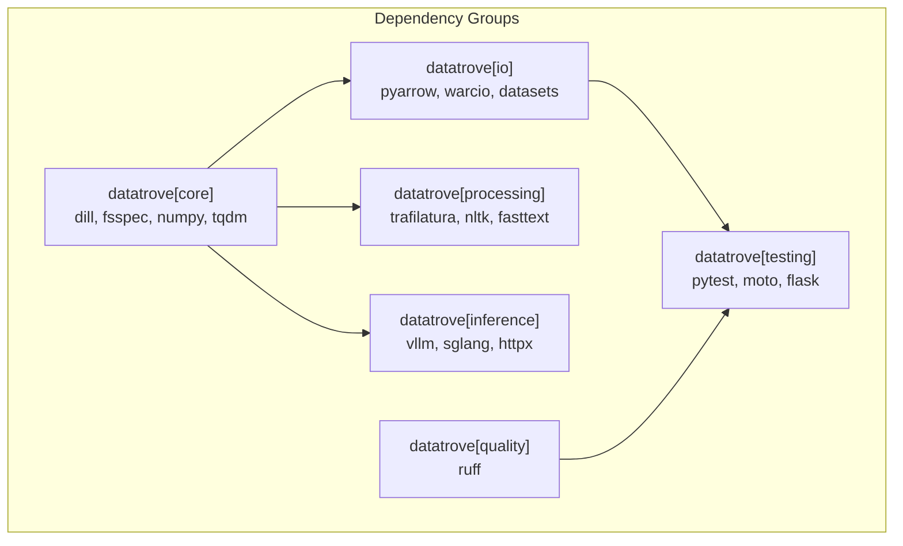
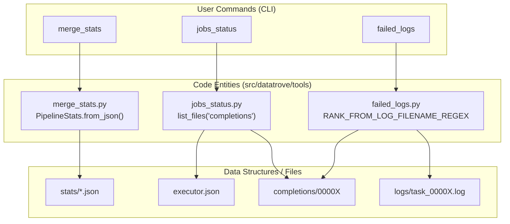

<!-- source: DeepWiki mcp.deepwiki.com · repo huggingface/datatrove · page 10 Development and Testing · fetched 2026-10-26 -->

# Development and Testing

Relevant source files

The following files were used as context for generating this wiki page:

- [.github/workflows/pypi-release.yml](.github/workflows/pypi-release.yml)
- [.github/workflows/testing.yml](.github/workflows/testing.yml)
- [.github/workflows/trufflehog.yml](.github/workflows/trufflehog.yml)
- [.pre-commit-config.yaml](.pre-commit-config.yaml)
- [LICENSE](LICENSE)
- [Makefile](Makefile)
- [examples/tokenize_from_hf_to_s3.py](examples/tokenize_from_hf_to_s3.py)
- [src/datatrove/pipeline/filters/sampler_filter.py](src/datatrove/pipeline/filters/sampler_filter.py)
- [src/datatrove/pipeline/filters/unigram_log_probs.py](src/datatrove/pipeline/filters/unigram_log_probs.py)
- [src/datatrove/pipeline/filters/url_filter.py](src/datatrove/pipeline/filters/url_filter.py)
- [src/datatrove/tools/failed_logs.py](src/datatrove/tools/failed_logs.py)
- [src/datatrove/tools/jobs_status.py](src/datatrove/tools/jobs_status.py)
- [src/datatrove/tools/launch_pickled_pipeline.py](src/datatrove/tools/launch_pickled_pipeline.py)
- [src/datatrove/tools/merge_stats.py](src/datatrove/tools/merge_stats.py)

## Purpose and Scope

This document covers the development environment setup, testing infrastructure, dependency management, code quality tools, and debugging utilities for DataTrove. It provides guidance for contributors and developers working on the codebase itself. 

For detailed information on specific subsystems, see:
- [CI/CD and Release Process](#10.1) — Documenting GitHub Actions, linting, and PyPI release workflows.
- [CLI Tools and Utilities](#10.2) — Detailed documentation of entrypoints like `check_dataset`, `merge_stats`, and `jobs_status`.

---

## Development Environment Setup

### Installation and Dependencies

DataTrove uses a modular dependency structure defined in `pyproject.toml`. The project requires Python 3.10+ [pyproject.toml:23](). Development and testing typically require the `[dev]` or `[testing]` extras.

**Sources:** [pyproject.toml:24-126]()

---

## Testing Infrastructure

### Test Framework

DataTrove uses `pytest` for its test suite. The configuration includes a global 2-minute timeout per test to prevent CI hangs [pyproject.toml:176-177]().

**Testing Utilities:**
- **Moto**: Used for mocking S3 services in unit tests [pyproject.toml:118]().
- **Flask**: Used for mocking HTTP server responses [pyproject.toml:113]().
- **NLTK**: The `punkt` tokenizer is often downloaded during test setup [ .github/workflows/testing.yml:50]().

### CI/CD Integration

The project uses GitHub Actions for automated quality checks and testing.
- **Testing Workflow**: Runs a matrix across Python versions 3.10 through 3.13 [ .github/workflows/testing.yml:38]().
- **Quality Workflow**: Executes `ruff check` and `ruff format --check` to ensure style consistency [ .github/workflows/testing.yml:29-30]().
- **Security**: Uses `trufflehog` to scan for credential leaks [ .github/workflows/trufflehog.yml:15]().

For details, see [CI/CD and Release Process](#10.1).

**Sources:** [ .github/workflows/testing.yml:1-58](), [ .github/workflows/trufflehog.yml:1-18]()

---

## Code Quality and Style

DataTrove enforces strict code quality using `ruff`. The configuration is maintained in `pyproject.toml` [pyproject.toml:150-174]().

### Developer Tools
- **Makefile**: Provides shortcuts for `quality` (linting changed files), `style` (auto-fixing), and `test` [Makefile:1-32]().
- **Pre-commit**: Hooks are available to run `ruff` and `ruff-format` automatically before commits [ .pre-commit-config.yaml:1-10]().

**Sources:** [Makefile:1-32](), [ .pre-commit-config.yaml:1-10]()

---

## CLI Tools and Utilities

DataTrove includes a suite of CLI tools located in `src/datatrove/tools/` to assist in debugging and dataset management.

### Monitoring and Debugging Tools

| Tool | Code Entity | Purpose |
| :--- | :--- | :--- |
| `merge_stats` | `merge_stats.py` | Combines `PipelineStats` from multiple tasks into one JSON [src/datatrove/tools/merge_stats.py:26-44]() |
| `jobs_status` | `jobs_status.py` | Scans `completions` folders to report job progress [src/datatrove/tools/jobs_status.py:28-97]() |
| `failed_logs` | `failed_logs.py` | Identifies and displays logs for incomplete ranks [src/datatrove/tools/failed_logs.py:27-75]() |
| `launch_pickled_pipeline` | `launch_pickled_pipeline.py` | Runs a pipeline stored in a `.pickle` file |

### Natural Language to Code Mapping

The following diagram bridges user-facing CLI commands to their underlying logic and file structures.

For details, see [CLI Tools and Utilities](#10.2).

**Sources:** [src/datatrove/tools/merge_stats.py:9](), [src/datatrove/tools/jobs_status.py:71](), [src/datatrove/tools/failed_logs.py:24]()

---

## Component-Specific Development

### Filter Development

When developing filters (e.g., `URLFilter`, `UnigramLogProbFilter`), developers must handle asset management for external data.
- **Asset Caching**: Use `cached_assets_path` from `huggingface_hub` to manage blacklists or frequency tables [src/datatrove/pipeline/filters/url_filter.py:83](), [src/datatrove/pipeline/filters/unigram_log_probs.py:44]().
- **Dependency Checks**: Use `_requires_dependencies` to ensure users have necessary libraries (like `pyahocorasick` for URL filtering) [src/datatrove/pipeline/filters/url_filter.py:46]().

### Pipeline Debugging

Pipelines can be executed locally for testing using the `LocalPipelineExecutor` or via CLI tools. A common pattern for debugging is tokenizing a small sample from HuggingFace to a local path before scaling to S3/Slurm [examples/tokenize_from_hf_to_s3.py:65-108]().

**Sources:** [src/datatrove/pipeline/filters/url_filter.py:46-92](), [src/datatrove/pipeline/filters/unigram_log_probs.py:43-60](), [examples/tokenize_from_hf_to_s3.py:65-108]()

---

