# Page: Overview

# Overview

<details>
<summary>Relevant source files</summary>

The following files were used as context for generating this wiki page:

- [.gitignore](.gitignore)
- [README.md](README.md)
- [examples/inference/README.md](examples/inference/README.md)
- [pyproject.toml](pyproject.toml)
- [src/datatrove/__init__.py](src/datatrove/__init__.py)
- [src/datatrove/data.py](src/datatrove/data.py)
- [src/datatrove/pipeline/__init__.py](src/datatrove/pipeline/__init__.py)
- [src/datatrove/utils/__init__.py](src/datatrove/utils/__init__.py)
- [src/datatrove/utils/_import_utils.py](src/datatrove/utils/_import_utils.py)
- [src/datatrove/utils/dataset.py](src/datatrove/utils/dataset.py)
- [tests/pipeline/writers/test_disk_writer.py](tests/pipeline/writers/test_disk_writer.py)
- [uv.lock](uv.lock)

</details>


DataTrove is a Python library for processing, filtering, and deduplicating large-scale text data. It provides prebuilt processing blocks with a modular framework for custom functionality, designed for preparing high-quality training data for large language models.

## Purpose and Scope

DataTrove processes massive text datasets with relatively low memory usage through its multi-step pipeline design. Key capabilities include:

- **Data Ingestion**: Format-specific readers (`WarcReader`, `JsonlReader`, `CsvReader`, `ParquetReader`, `HuggingFaceDatasetReader`)
- **Content Extraction**: HTML-to-text conversion (`Trafilatura`, `ReadabilityInscriptis`)
- **Quality Filtering**: Multiple filter implementations (`GopherQualityFilter`, `C4QualityFilter`, `FineWebQualityFilter`, `LanguageFilter`)
- **Deduplication**: Three-level deduplication (`MinhashDedup`, `SentenceDedup`, `ExactDedup`)
- **Synthetic Data Generation**: LLM-powered inference system (`InferenceRunner` with vLLM/SGLang backends)
- **Tokenization**: Training-ready data preparation (`DocumentTokenizer`)
- **Cross-Platform Execution**: Platform-agnostic pipelines (`LocalPipelineExecutor`, `SlurmPipelineExecutor`, `RayPipelineExecutor`)
- **File System Abstraction**: Unified I/O (`DataFolder` with fsspec for local/S3/GCS/HuggingFace Hub)

Sources: [README.md:1-7](), [pyproject.toml:2-4](), [README.md:10-62]()

## Core Concepts

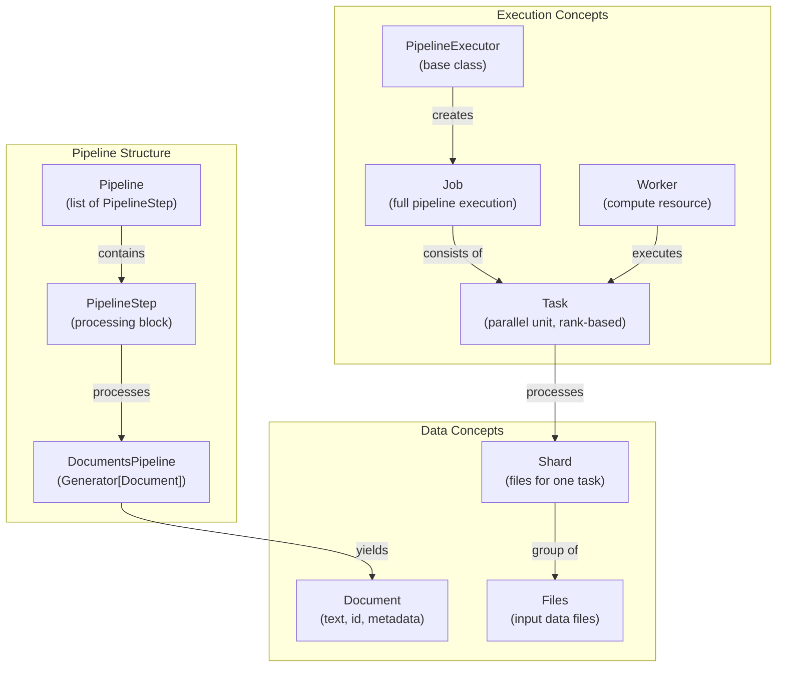

**Execution Model:**
- **Pipeline**: List of `PipelineStep` instances that process data sequentially [README.md:80-80]().
- **PipelineExecutor**: Abstract base class that orchestrates pipeline execution on specific platforms [README.md:81-81]().
- **Job**: Complete execution of a pipeline, managed by an executor [README.md:82-82]().
- **Task**: Individual parallel unit of work with unique rank (0 to `tasks-1`) [README.md:83-83]().
- **Worker**: Compute resource (CPU core, cluster node) that executes tasks [README.md:88-88]().
- **Shard**: Subset of input files assigned to a specific task based on rank [README.md:87-87]().

**Data Model:**
- **Document**: Core data structure with `text` (str), `id` (str), and `metadata` (dict) fields [src/datatrove/data.py:38-55]().
- **DocumentsPipeline**: Type alias for `Generator[Document, None, None]` - the data flow between steps [src/datatrove/data.py:58-58]().
- **Files**: Input data files distributed across tasks via modulo-based sharding [README.md:84-86]().

Sources: [README.md:79-91](), [src/datatrove/data.py:38-58]()

## Layered Architecture

DataTrove follows a layered architecture with clear separation of concerns:

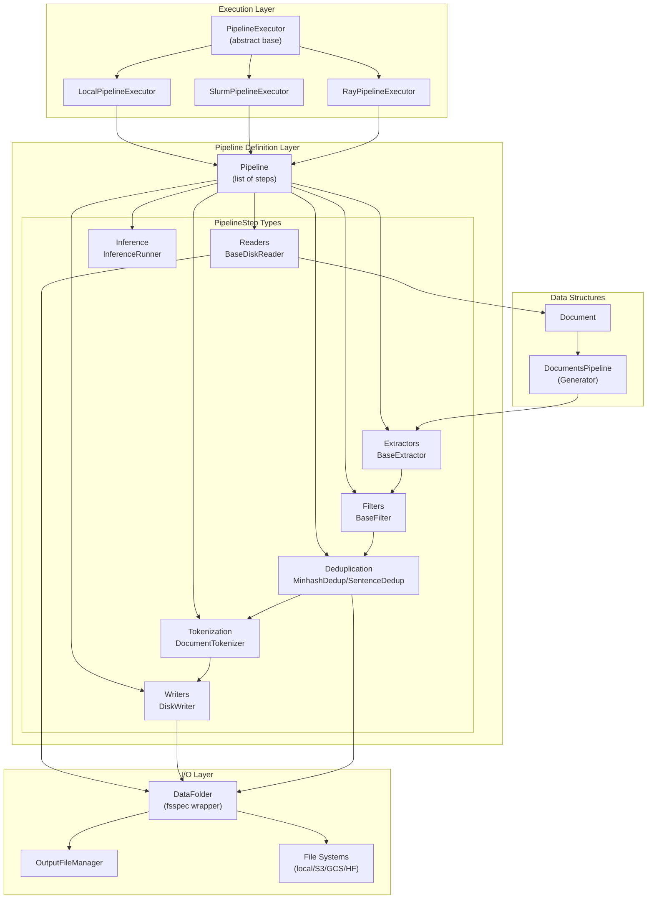

**Execution Layer**:
- `PipelineExecutor` (abstract): Defines interface for running pipelines [README.md:81-81]().
- `LocalPipelineExecutor`: Multiprocessing-based execution on single machine [README.md:21-21]().
- `SlurmPipelineExecutor`: HPC cluster execution via sbatch job arrays [README.md:22-22]().
- `RayPipelineExecutor`: Distributed execution on Ray clusters [README.md:23-23]().

**Pipeline Definition Layer**:
- `Pipeline`: Python list of `PipelineStep` instances [README.md:80-80]().
- Specialized step types include readers, extractors, filters, deduplicators, tokenizers, and inference runners [README.md:106-113]().

**I/O Layer**:
- `DataFolder`: Wraps fsspec for storage backend abstraction [README.md:26-26]().
- Supports local, S3, and HuggingFace Hub [README.md:7-7]().

**Data Structures**:
- `Document`: Core data class with `text`, `id`, `metadata` fields [src/datatrove/data.py:38-55]().
- `DocumentsPipeline`: Type alias for document generator stream [src/datatrove/data.py:58-58]().

Sources: [README.md:20-26](), [src/datatrove/data.py:38-58]()

## Pipeline Processing Flow

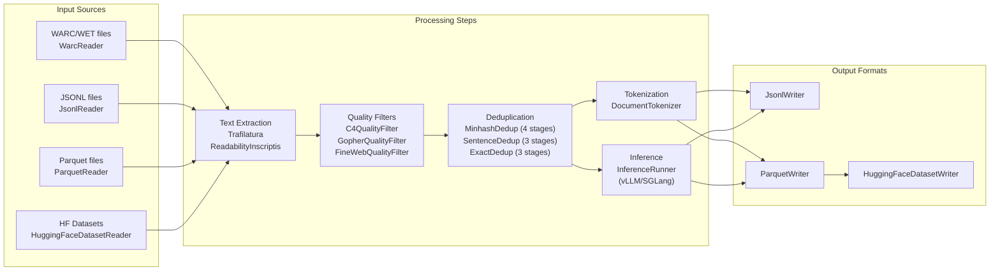

**Data Flow Pattern:**
Each pipeline block takes a generator of `Document` as input and returns another generator of `Document` [README.md:107-107]().

| Stage | Classes | Purpose |
|-------|---------|---------|
| **Reading** | `BaseReader`, `JsonlReader`, `ParquetReader` | Load files and create `Document` objects [README.md:108-108](). |
| **Extraction** | `BaseExtractor`, `Trafilatura` | Extract text from HTML/raw formats [README.md:110-110](). |
| **Filtering** | `BaseFilter`, `C4QualityFilter` | Remove low-quality documents [README.md:111-111](). |
| **Deduplication** | `MinhashDedup`, `SentenceDedup` | Remove duplicate content [README.md:112-112](). |
| **Tokenization** | `DocumentTokenizer` | Convert text to training-ready tokens [pyproject.toml:59-59](). |
| **Inference** | `InferenceRunner` | Generate synthetic data using LLMs [examples/inference/README.md:27-27](). |
| **Writing** | `DiskWriter`, `JsonlWriter` | Save processed documents [README.md:109-109](). |

Sources: [README.md:107-113](), [examples/inference/README.md:27-27]()

## Document Data Structure

The `Document` class is the atomic unit of data flowing through pipelines:

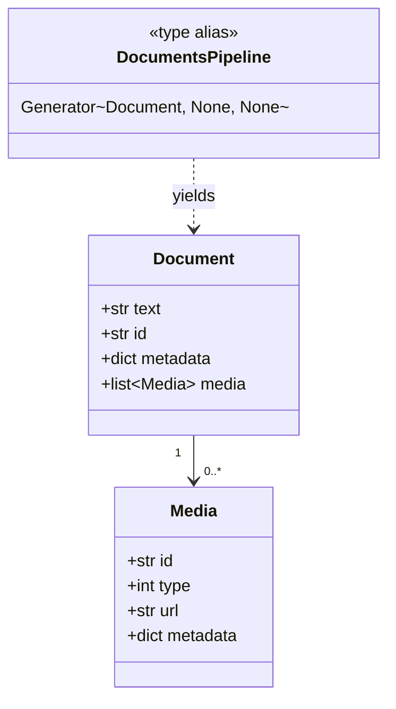

**Core Fields:**

| Field | Type | Description |
|-------|------|-------------|
| `text` | `str` | Main text content of the document [src/datatrove/data.py:52-52](). |
| `id` | `str` | Unique identifier [src/datatrove/data.py:53-53](). |
| `metadata` | `dict` | Extensible storage for source info, statistics, flags [src/datatrove/data.py:55-55](). |
| `media` | `list[Media]` | Associated images or media objects [src/datatrove/data.py:54-54](). |

Sources: [src/datatrove/data.py:38-58]()

## Inference System

DataTrove includes a sophisticated inference system for synthetic data generation using LLMs:

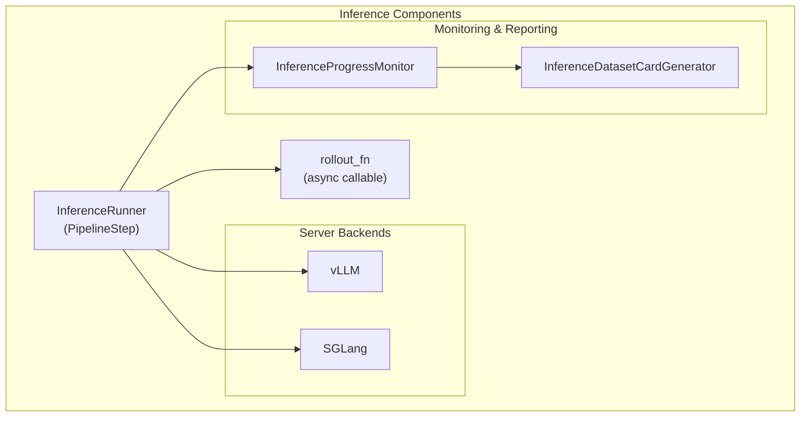

**Key Features:**
- **Local & Distributed**: Run on single machines or Slurm clusters [examples/inference/README.md:24-25]().
- **Fault Tolerance**: Automatic chunking and checkpoint recovery [examples/inference/README.md:27-27]().
- **Async Processing**: Uses async rollouts for efficient batching [examples/inference/README.md:14-14]().
- **Live Monitoring**: Lightweight monitor jobs update dataset cards with live progress and ETA [examples/inference/README.md:56-56]().

Sources: [examples/inference/README.md:12-77]()

## Task Orchestration and Completion Tracking

DataTrove implements robust task management with automatic resume capabilities:

**Completion Tracking:**
- DataTrove keeps track of which tasks have completed [README.md:83-83]().
- When relaunching a job, only incomplete tasks will run [README.md:83-83]().
- Task parallelization is achieved by assigning each task a different non-overlapping `shard` of data [README.md:87-87]().

**HF Hub Reliability:**
- When writing to `hf://` paths, the system handles transient Hub errors (e.g., `429 Too Many Requests`) with exponential backoff [examples/inference/README.md:79-80]().
- Transient open errors are retried by the `DiskWriter` [tests/pipeline/writers/test_disk_writer.py:200-200]().

Sources: [README.md:83-87](), [examples/inference/README.md:79-80](), [tests/pipeline/writers/test_disk_writer.py:200-200]()

## Advanced Features

### Deduplication Systems

DataTrove implements three sophisticated deduplication approaches:

1. **MinHash deduplication**: Document-level deduplication using locality-sensitive hashing [README.md:74-74]().
2. **Sentence deduplication**: Identifying and removing duplicate sentences [README.md:75-75]().
3. **Exact substring deduplication**: Removing texts that are substrings of others [README.md:76-76]().

### Tokenization and Data Preparation

DataTrove supports efficient tokenization for large datasets:
- **DocumentTokenizer**: Converts documents into tokenized binary formats [pyproject.toml:59-59]().
- **DatatroveFileDataset**: Optimized PyTorch dataset for sequential reads of tokenized files [src/datatrove/utils/dataset.py:25-41]().
- Supports position tracking and EOS-based position resetting [src/datatrove/utils/dataset.py:48-50]().

Sources: [README.md:74-76](), [src/datatrove/utils/dataset.py:25-50]()

---

# Page: Pipeline Execution Architecture

# Pipeline Execution Architecture

<details>
<summary>Relevant source files</summary>

The following files were used as context for generating this wiki page:

- [src/datatrove/executor/base.py](src/datatrove/executor/base.py)
- [src/datatrove/executor/local.py](src/datatrove/executor/local.py)
- [src/datatrove/executor/slurm.py](src/datatrove/executor/slurm.py)
- [src/datatrove/pipeline/base.py](src/datatrove/pipeline/base.py)
- [src/datatrove/pipeline/filters/base_filter.py](src/datatrove/pipeline/filters/base_filter.py)
- [src/datatrove/pipeline/inference/distributed/__init__.py](src/datatrove/pipeline/inference/distributed/__init__.py)
- [src/datatrove/utils/logging.py](src/datatrove/utils/logging.py)
- [src/datatrove/utils/stats.py](src/datatrove/utils/stats.py)

</details>


## Purpose and Scope

The Pipeline Execution Architecture is the foundation of DataTrove's ability to process data at scale. It defines how data processing pipelines are executed, whether locally on a single machine or distributed across a Slurm or Ray cluster. This architecture provides a consistent interface while abstracting away the complexities of parallel and distributed execution.

This document covers the overall design of the execution framework, the different executor implementations, and how tasks are managed throughout the execution lifecycle. For details on specific executor implementations, see:
- [Local Pipeline Execution](#2.1)
- [Slurm Cluster Execution](#2.2)
- [Ray Distributed Execution](#2.3)

Sources: [src/datatrove/executor/base.py:37-47](), [src/datatrove/executor/local.py:15-34](), [src/datatrove/executor/slurm.py:48-106]()

## Core Architecture

The Pipeline Execution Architecture follows a hierarchical design with a common abstract base class and specialized implementations for different execution environments.

### Executor Class Hierarchy

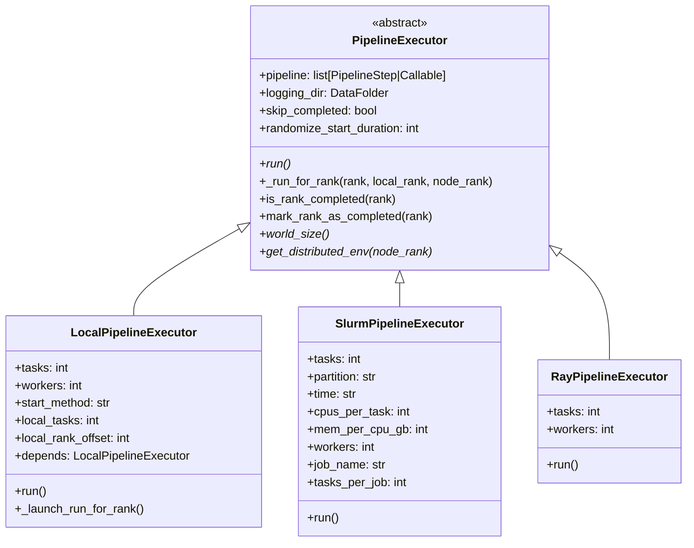

Sources: [src/datatrove/executor/base.py:37-91](), [src/datatrove/executor/local.py:15-60](), [src/datatrove/executor/slurm.py:48-166]()

### Key Components

The architecture consists of an abstract base and specialized implementations:

1.  **`PipelineExecutor`**: The `ABC` defining the interface for all executors [src/datatrove/executor/base.py:37](). It manages the common logic for logging setup, statistics collection, and completion tracking.
2.  **`LocalPipelineExecutor`**: Uses `multiprocess` to run pipelines on a single machine [src/datatrove/executor/local.py:15]().
3.  **`SlurmPipelineExecutor`**: Generates and submits `sbatch` scripts for cluster execution [src/datatrove/executor/slurm.py:48]().
4.  **`RayPipelineExecutor`**: Leverages Ray for distributed task management across nodes.

Sources: [src/datatrove/executor/base.py:37-68](), [src/datatrove/executor/local.py:15-34](), [src/datatrove/executor/slurm.py:48-106]()

## Execution Model

DataTrove's execution model is built around the concept of **tasks**, which are the unit of parallelism.

### Task Execution Flow

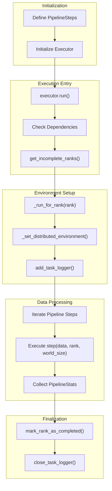

Sources: [src/datatrove/executor/base.py:102-154](), [src/datatrove/executor/local.py:84-152](), [src/datatrove/executor/slurm.py:48-52]()

### Distributed Environment
The `PipelineExecutor` provides a standard way to propagate environment variables to workers via `get_distributed_env` [src/datatrove/executor/base.py:79-91](). These variables include node IPs, CPU/Memory limits, and the executor type [src/datatrove/executor/base.py:24-34]().

## Task Management

### Task Tracking and Resumability
Resumability is handled via "completion markers". The executor checks for the existence of a file in `logging_dir/completions/{rank:05d}` [src/datatrove/executor/base.py:165]().
- **`is_rank_completed(rank)`**: Returns `True` if the marker exists and `skip_completed` is enabled [src/datatrove/executor/base.py:156-165]().
- **`mark_rank_as_completed(rank)`**: Creates the empty marker file after a successful run [src/datatrove/executor/base.py:167-173]().

### Parallel Execution Strategy
- **Local**: Uses `multiprocess.Pool` with a configurable `start_method` (default: `forkserver`) [src/datatrove/executor/local.py:27, 134-135]().
- **Slurm**: Uses Slurm Job Arrays. A single Slurm job can handle multiple DataTrove tasks via `tasks_per_job` to minimize scheduler overhead [src/datatrove/executor/slurm.py:105, 142]().

## Pipeline Step Execution

The `_run_for_rank` method handles the lifecycle of a single task [src/datatrove/executor/base.py:102](). It pipes data from one step to the next:

1.  **Logging**: Initializes a `task_XXXXX.log` file [src/datatrove/executor/base.py:122]().
2.  **Step Execution**: Loops through `self.pipeline`. If a step is a `callable`, it is invoked with `(data, rank, world_size)` [src/datatrove/executor/base.py:130-132]().
3.  **Consumption**: If the final step returns a generator, it is exhausted using `deque(pipelined_data, maxlen=0)` [src/datatrove/executor/base.py:137-138]().
4.  **Stats**: `PipelineStats` are gathered from all steps and saved to disk [src/datatrove/executor/base.py:143-146]().

Sources: [src/datatrove/executor/base.py:102-154](), [src/datatrove/pipeline/base.py:9-130]()

## Logging and Statistics

### Statistics Infrastructure
DataTrove uses a tiered stats system:
- **`MetricStats`**: Tracks individual metrics (mean, min, max, variance) using Welford's online algorithm [src/datatrove/utils/stats.py:204-248]().
- **`Stats`**: A collection of `MetricStats` and `TimingStats` for a single `PipelineStep` [src/datatrove/utils/stats.py:55-67]().
- **`PipelineStats`**: Aggregates `Stats` across the entire pipeline for a specific rank [src/datatrove/utils/stats.py:132-139]().

Executors merge these stats at the end of a run to produce a global `stats.json` [src/datatrove/executor/local.py:148-150]().

### Logging Infrastructure
The `add_task_logger` function configures `loguru` to output to both `sys.stderr` and a task-specific log file [src/datatrove/utils/logging.py:40-77](). In distributed settings, logs are prefixed with `[NODE X]` to aid debugging [src/datatrove/utils/logging.py:61]().

Sources: [src/datatrove/utils/stats.py:132-201](), [src/datatrove/utils/logging.py:40-77]()

## Implementation Overviews

### LocalPipelineExecutor
For details, see [Local Pipeline Execution](#2.1).
It manages a `multiprocess.Manager` to handle a queue of available ranks and track completion across worker processes [src/datatrove/executor/local.py:113-118]().

### SlurmPipelineExecutor
For details, see [Slurm Cluster Execution](#2.2).
It handles the generation of complex `sbatch` scripts, including environment activation (conda/venv) and signal handling for job requeueing [src/datatrove/executor/slurm.py:41-45, 121-124]().

### RayPipelineExecutor
For details, see [Ray Distributed Execution](#2.3).
It maps DataTrove tasks to Ray remote functions, providing a middle ground between local multiprocessing and heavy Slurm clusters.

Sources: [src/datatrove/executor/local.py:15-48](), [src/datatrove/executor/slurm.py:48-144]()

---

# Page: Local Pipeline Execution

# Local Pipeline Execution

<details>
<summary>Relevant source files</summary>

The following files were used as context for generating this wiki page:

- [examples/filter_hf_dataset_jobs.py](examples/filter_hf_dataset_jobs.py)
- [examples/minhash_deduplication_jobs.py](examples/minhash_deduplication_jobs.py)
- [examples/tokenize_hf_dataset_jobs.py](examples/tokenize_hf_dataset_jobs.py)
- [src/datatrove/executor/__init__.py](src/datatrove/executor/__init__.py)
- [src/datatrove/executor/base.py](src/datatrove/executor/base.py)
- [src/datatrove/executor/jobs.py](src/datatrove/executor/jobs.py)
- [src/datatrove/executor/local.py](src/datatrove/executor/local.py)
- [src/datatrove/executor/slurm.py](src/datatrove/executor/slurm.py)
- [tests/executor/test_jobs.py](tests/executor/test_jobs.py)

</details>


This document covers the `LocalPipelineExecutor` implementation for running data processing pipelines on local machines with multiprocessing support. The `LocalPipelineExecutor` provides a concrete implementation of the abstract `PipelineExecutor` base class specifically designed for local execution environments.

For information about distributed cluster execution, see [Slurm Cluster Execution](2.2) and [Ray Distributed Execution](2.3). For the overall pipeline execution framework, see [Pipeline Execution Architecture](2).

## Architecture Overview

The `LocalPipelineExecutor` extends the base `PipelineExecutor` class to provide local multiprocessing capabilities for pipeline execution. It manages task distribution across multiple worker processes while maintaining task completion tracking and dependency management.

**LocalPipelineExecutor Architecture**
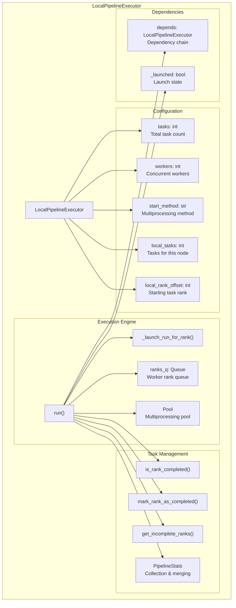

Sources: [src/datatrove/executor/local.py:15-61](), [src/datatrove/executor/base.py:37-63]()

## Core Components

### LocalPipelineExecutor Class

The `LocalPipelineExecutor` class is the main implementation located in [src/datatrove/executor/local.py:15-161](). It inherits from the abstract `PipelineExecutor` base class and provides the following key functionality:

| Component | Purpose | Key Methods |
|-----------|---------|-------------|
| Task Execution | Runs pipeline steps for each task | `run()`, `_launch_run_for_rank()` |
| Worker Management | Manages multiprocessing workers | Queue-based rank assignment |
| Completion Tracking | Tracks and resumes completed tasks | `is_rank_completed()`, `mark_rank_as_completed()` |
| Statistics Collection | Aggregates performance metrics | `PipelineStats` merging |
| Dependency Management | Handles executor dependencies | `depends` parameter processing |

Sources: [src/datatrove/executor/local.py:15-35](), [src/datatrove/executor/base.py:63-112]()

### Multiprocessing Architecture

The executor uses Python's `multiprocess` library to enable parallel task execution. The multiprocessing implementation includes:

**Multiprocessing Execution Flow**
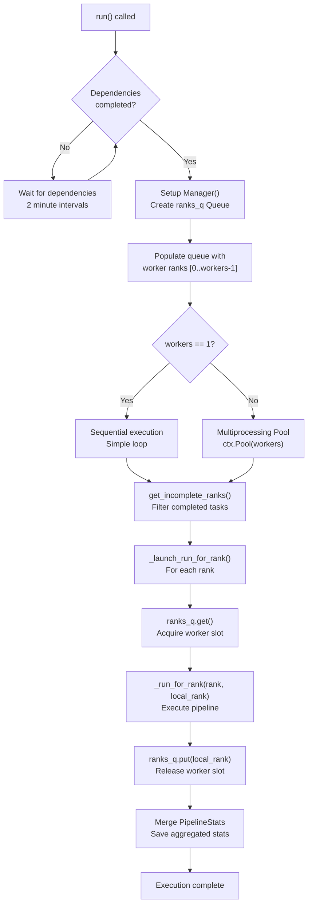

Sources: [src/datatrove/executor/local.py:84-152](), [src/datatrove/executor/local.py:62-82]()

## Configuration Parameters

The `LocalPipelineExecutor` constructor accepts several configuration parameters for customizing execution behavior:

| Parameter | Type | Default | Description |
|-----------|------|---------|-------------|
| `pipeline` | `list[PipelineStep \| Callable]` | Required | Pipeline steps to execute |
| `tasks` | `int` | `1` | Total number of tasks |
| `workers` | `int` | `-1` | Concurrent workers (-1 = tasks) |
| `logging_dir` | `DataFolderLike` | `None` | Log output directory |
| `depends` | `LocalPipelineExecutor` | `None` | Dependency executor |
| `skip_completed` | `bool` | `True` | Skip already completed tasks |
| `start_method` | `str` | `"forkserver"` | Multiprocessing start method |
| `local_tasks` | `int` | `-1` | Tasks for this node (-1 = all) |
| `local_rank_offset` | `int` | `0` | Starting task rank |
| `randomize_start_duration` | `int` | `0` | Random start delay (seconds) |

Sources: [src/datatrove/executor/local.py:36-60](), [src/datatrove/executor/base.py:50-60]()

## Task Management and Completion Tracking

The executor implements task management to support resumable execution and completion tracking. Ranks that have successfully completed are marked by an empty file in the `completions/` directory within the `logging_dir`.

**Task Completion Tracking System**
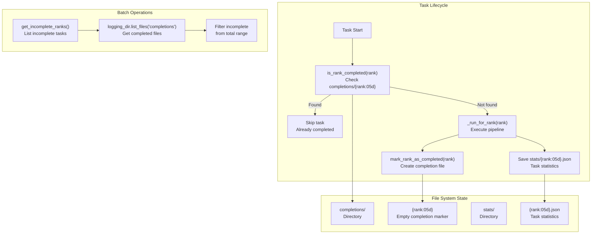

Sources: [src/datatrove/executor/base.py:116-154](), [src/datatrove/executor/base.py:156-178](), [src/datatrove/executor/local.py:119-121]()

## Multi-Node Execution Support

The `LocalPipelineExecutor` supports coordinated execution across multiple nodes through the `local_tasks` and `local_rank_offset` parameters. This allows a user to manually shard a large job across several machines.

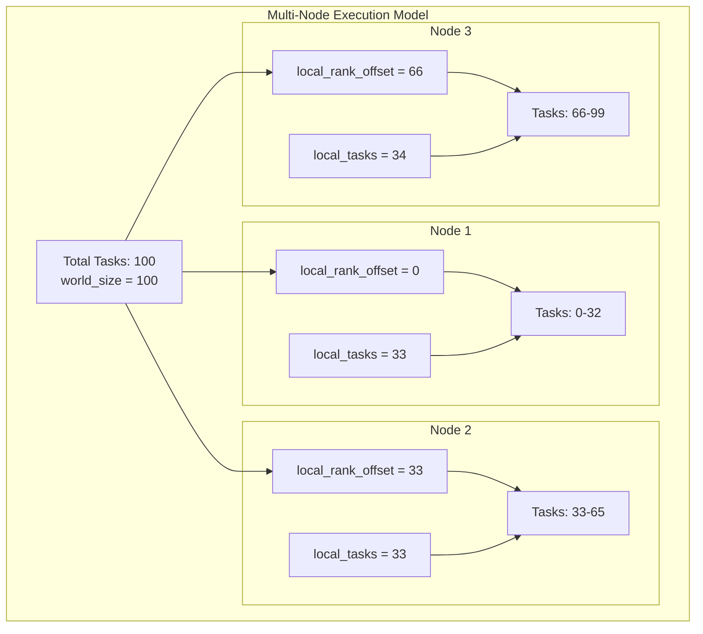

The validation logic ensures that `local_rank_offset + local_tasks <= tasks` to prevent task range overlap between nodes [src/datatrove/executor/local.py:56-59]().

Sources: [src/datatrove/executor/local.py:45-46](), [src/datatrove/executor/local.py:53-59]()

## Dependency Management

The executor supports chaining multiple `LocalPipelineExecutor` instances through the `depends` parameter. The dependency system ensures that dependent executors complete before starting the current executor by polling for incomplete ranks [src/datatrove/executor/local.py:101-105]().

```python
# Dependency resolution in run() method
if self.depends:
    # take care of launching any unlaunched dependencies
    if not self.depends._launched:
        logger.info(f'Launching dependency job "{self.depends}"')
        self.depends.run()
    while (
        incomplete := len(self.depends.get_incomplete_ranks(skip_completed=True))
    ) > 0:  # set skip_completed=True to get *real* incomplete task count
        logger.info(f"Dependency job still has {incomplete}/{self.depends.world_size} tasks. Waiting...")
        time.sleep(2 * 60)
```

Sources: [src/datatrove/executor/local.py:93-106]()

## Statistics and Logging

The executor collects and aggregates statistics from all tasks using the `PipelineStats` system. Individual task statistics are saved to `stats/{rank:05d}.json` files [src/datatrove/executor/base.py:145-146](), and a merged summary is saved to `stats.json` in the `logging_dir` [src/datatrove/executor/local.py:149-150]().

Logging is handled through the base executor's logging infrastructure, which creates per-task log files using `add_task_logger` [src/datatrove/executor/base.py:122]().

Sources: [src/datatrove/executor/local.py:147-152](), [src/datatrove/executor/base.py:122-123](), [src/datatrove/executor/base.py:143-147]()

---

# Page: Slurm Cluster Execution

# Slurm Cluster Execution

<details>
<summary>Relevant source files</summary>

The following files were used as context for generating this wiki page:

- [examples/filter_hf_dataset_jobs.py](examples/filter_hf_dataset_jobs.py)
- [examples/minhash_deduplication_jobs.py](examples/minhash_deduplication_jobs.py)
- [examples/tokenize_hf_dataset_jobs.py](examples/tokenize_hf_dataset_jobs.py)
- [src/datatrove/executor/__init__.py](src/datatrove/executor/__init__.py)
- [src/datatrove/executor/base.py](src/datatrove/executor/base.py)
- [src/datatrove/executor/jobs.py](src/datatrove/executor/jobs.py)
- [src/datatrove/executor/local.py](src/datatrove/executor/local.py)
- [src/datatrove/executor/slurm.py](src/datatrove/executor/slurm.py)
- [src/datatrove/tools/launch_pickled_pipeline.py](src/datatrove/tools/launch_pickled_pipeline.py)
- [src/datatrove/tools/merge_stats.py](src/datatrove/tools/merge_stats.py)
- [tests/executor/test_jobs.py](tests/executor/test_jobs.py)

</details>


This document describes the Slurm Cluster Execution system within DataTrove, which enables distribution of processing pipelines across computing clusters running the Slurm Workload Manager. For information about running pipelines on a single machine, see [Local Pipeline Execution](#2.1).

## 1. Overview

The Slurm Cluster Execution system allows DataTrove pipelines to scale beyond a single machine by distributing tasks across a Slurm-managed computing cluster. It handles job submission, task distribution, environment setup, and completion tracking.

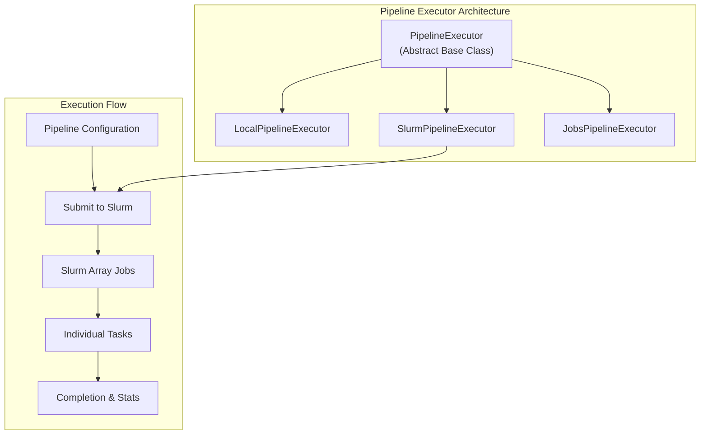

Sources: [src/datatrove/executor/slurm.py:32-165](), [src/datatrove/executor/base.py:37-58](), [src/datatrove/executor/jobs.py:32-120]()

## 2. SlurmPipelineExecutor

The `SlurmPipelineExecutor` class is the main component responsible for executing pipelines on a Slurm cluster. It extends the abstract `PipelineExecutor` class and implements its interface for distributed execution.

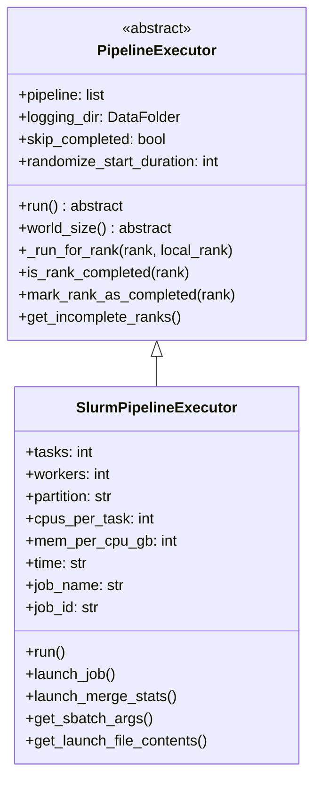

Sources: [src/datatrove/executor/slurm.py:48-165](), [src/datatrove/executor/base.py:37-101]()

### 2.1 Key Parameters

The `SlurmPipelineExecutor` accepts numerous parameters to configure Slurm job execution:

| Parameter | Type | Default | Description |
|-----------|------|---------|-------------|
| pipeline | list | - | List of pipeline steps to execute |
| tasks | int | - | Total number of DataTrove tasks to run |
| time | str | - | Time limit for each job (Slurm format: "HH:MM:SS") |
| partition | str | - | Slurm partition to use |
| cpus_per_task | int | 1 | CPUs allocated per task |
| mem_per_cpu_gb | int | 2 | Memory per CPU in GB |
| gpus_per_task | int | 0 | GPUs allocated per task |
| nodes_per_task | int | 1 | Number of nodes to allocate per task (for multi-node jobs) |
| workers | int | -1 | Number of concurrent tasks (-1 for no limit) |
| job_name | str | "data_processing" | Name for Slurm job |
| qos | str | "normal" | Quality of Service for Slurm job |
| depends | SlurmPipelineExecutor | None | Another executor job that must complete first |
| depends_job_id | str | None | Direct Slurm job ID to depend on |
| max_array_size | int | 1001 | Maximum size of a Slurm array job (cluster-dependent) |
| tasks_per_job | int | 1 | Number of DataTrove tasks per Slurm array task |
| with_srun | bool | True | Whether to use srun for launching tasks |
| srun_args | dict | None | Additional arguments to pass to srun |
| sbatch_args | dict | None | Additional arguments to pass to sbatch |
| max_array_launch_parallel | bool | False | Launch multiple job arrays in parallel if needed |
| stagger_max_array_jobs | int | 0 | Seconds to wait between launching parallel job arrays |
| run_on_dependency_fail | bool | False | Start even if dependency job fails |
| randomize_start_duration | int | 0 | Maximum seconds to randomly delay task start |
| requeue_signals | tuple | ("SIGUSR1",) | Signals that trigger job requeuing (None to disable) |
| mail_type | str | "ALL" | Email notification types (NONE, BEGIN, END, FAIL, REQUEUE, ALL) |
| mail_user | str | None | Email address to send notifications to |
| requeue | bool | True | Whether to requeue jobs that fail |
| slurm_logs_folder | str | None | Where to store raw Slurm log files (local path) |

Sources: [src/datatrove/executor/slurm.py:108-144]()

### 2.2 Environment Configuration

The executor supports various methods for activating Python environments within Slurm jobs:

| Parameter | Description | Priority |
|-----------|-------------|----------|
| env_command | Custom command to activate an environment | Highest (if set) |
| condaenv | Name of conda environment to activate | Medium |
| venv_path | Path to a Python virtual environment to activate | Lowest |

The environment activation is handled in `get_launch_file_contents()`, which generates the appropriate activation command based on which parameter is provided.

Sources: [src/datatrove/executor/slurm.py:121-123](), [src/datatrove/executor/slurm.py:378-388]()

## 3. Execution Workflow

The Slurm execution process involves several distinct phases:

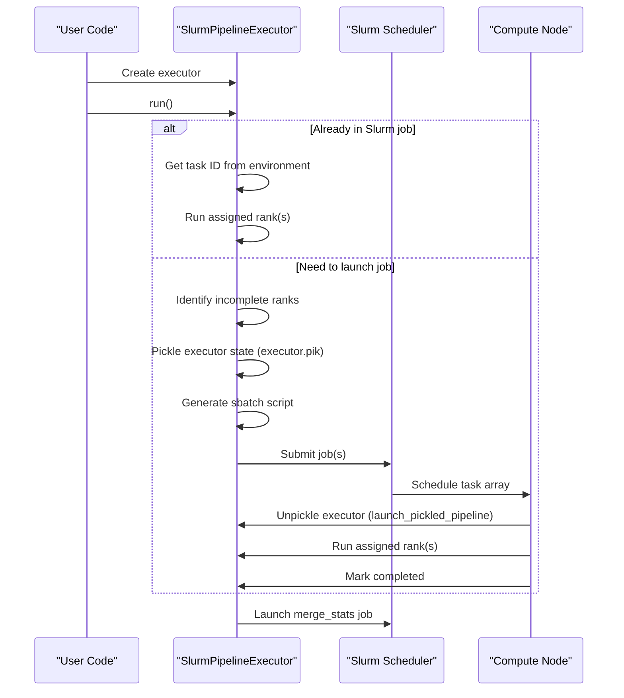

Sources: [src/datatrove/executor/slurm.py:167-198](), [src/datatrove/executor/slurm.py:233-298](), [src/datatrove/tools/launch_pickled_pipeline.py:9-18]()

### 3.1 Job Submission Process

When the `run()` method is called, the executor first checks if it's already running inside a Slurm job by looking for the `SLURM_ARRAY_TASK_ID` environment variable:

**Already Inside Slurm Job:**
1. Calculate `slurm_rank` from `SLURM_ARRAY_TASK_ID` and `RUN_OFFSET`.
2. Determine which DataTrove ranks to process based on `tasks_per_job`.
3. Load the list of ranks to run from `ranks_to_run.json`.
4. Register signal handlers for `requeue_signals` if configured.
5. Execute `_run_for_rank()` for each assigned rank.

**Not Inside Slurm Job (Submission Phase):**
1. Call `launch_job()` to submit work to the cluster.

The `launch_job()` method performs these steps:
1. Resolve dependencies by launching dependent jobs if needed.
2. Get incomplete ranks via `get_incomplete_ranks()`.
3. Serialize the executor state using `dill.dump()` to `executor.pik` with `CONTENTS_FMODE`.
4. Save executor configuration as JSON via `save_executor_as_json()`.
5. Save list of incomplete ranks to `ranks_to_run.json` to avoid race conditions.
6. Calculate number of Slurm jobs needed: `ceil(len(ranks_to_run) / tasks_per_job)`.
7. Generate sbatch script using `get_launch_file_contents()`.
8. Submit job(s) via `launch_slurm_job()` helper.
9. Launch statistics merger job via `launch_merge_stats()`.

Sources: [src/datatrove/executor/slurm.py:191-228](), [src/datatrove/executor/slurm.py:263-330]()

### 3.2 Job Arrays and Scaling

For large pipelines, the executor uses Slurm's job array functionality to distribute work efficiently. The relationship between Slurm jobs and DataTrove tasks is controlled by two key parameters:

**Rank Calculation Formulas:**
```
slurm_rank = SLURM_ARRAY_TASK_ID + max_array_size * RUN_OFFSET
datatrove_ranks = range(slurm_rank * tasks_per_job, (slurm_rank + 1) * tasks_per_job)
```

**Job Array and Task Distribution:**

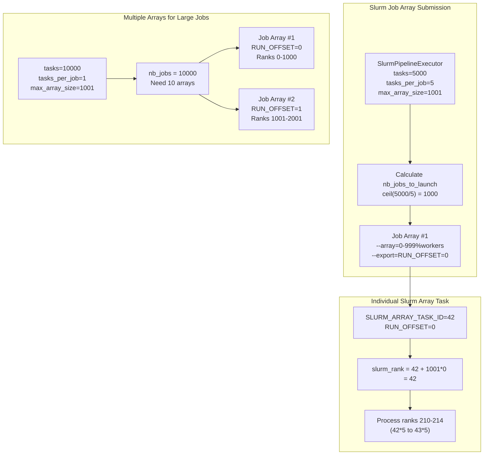

Sources: [src/datatrove/executor/slurm.py:199-208](), [src/datatrove/executor/slurm.py:298-330]()

### 3.3 Job Dependencies

The executor supports job dependencies through the `dependency` property:

**Dependency Sources:**
1. `depends` parameter: Takes another `SlurmPipelineExecutor` instance.
2. `depends_job_id` parameter: Takes a raw Slurm job ID string directly.
3. Multi-array dependencies: When `max_array_launch_parallel=False`, each subsequent array depends on the previous one.

**Dependency Types:**
- `afterok:<job_id>`: Wait for successful completion (default).
- `afterany:<job_id>`: Wait for completion regardless of success (if `run_on_dependency_fail=True`).

Sources: [src/datatrove/executor/slurm.py:249-261](), [src/datatrove/executor/slurm.py:269-279](), [src/datatrove/executor/slurm.py:325-326]()

## 4. SBATCH Script Generation

The executor generates Slurm job scripts programmatically through two key methods:

**Script Generation Flow:**

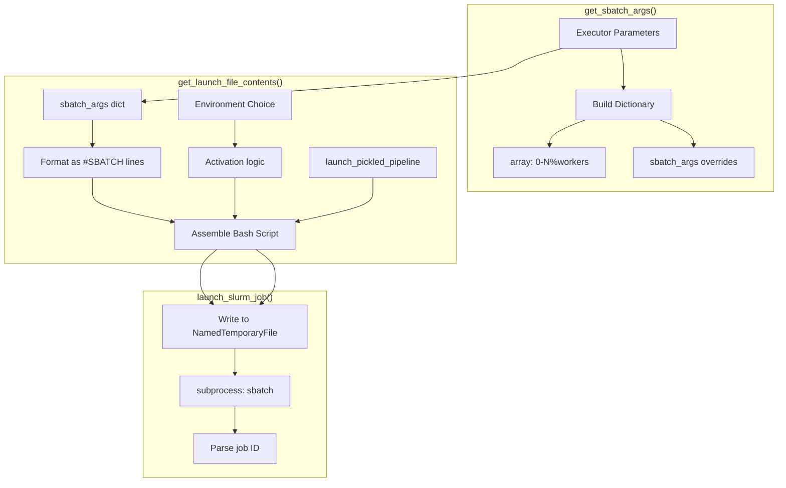

Sources: [src/datatrove/executor/slurm.py:332-364](), [src/datatrove/executor/slurm.py:366-402](), [src/datatrove/executor/slurm.py:420-435]()

### 4.1 Signal Handling and Job Recovery

The executor implements specialized signal handling for job recovery in preemptible environments through the `requeue_handler()` function:

```python
def requeue_handler(signum, _frame):
    signame = signal.Signals(signum).name
    logger.warning(f"Received signal {signum} ({signame}). Requeueing and exiting...")
    subprocess.run(["scontrol", "requeue", os.environ.get("SLURM_JOB_ID")])
    sys.exit(15)
```

Sources: [src/datatrove/executor/slurm.py:41-45](), [src/datatrove/executor/slurm.py:210-211]()

## 5. Multi-Node Execution and Distributed Environment

The Slurm executor supports multi-node execution through the `nodes_per_task` parameter.

**Node List Expansion:**

The `expand_slurm_nodelist()` function expands Slurm's compressed node list format using `scontrol show hostnames`.

**Distributed Environment Variables:**

The `get_distributed_env()` method populates environment variables for distributed execution:

```python
def get_distributed_env(self, node_rank: int = -1) -> DistributedEnvVars:
    node_hosts = expand_slurm_nodelist(os.environ["SLURM_NODELIST"])
    return DistributedEnvVars(
        datatrove_node_ips=",".join(node_hosts),
        datatrove_cpus_per_task=str(self.cpus_per_task),
        datatrove_mem_per_cpu=str(self.mem_per_cpu_gb),
        datatrove_gpus_on_node=str(self.gpus_per_task),
        datatrove_executor="SLURM",
    )
```

Sources: [src/datatrove/executor/slurm.py:25-38](), [src/datatrove/executor/slurm.py:404-413](), [src/datatrove/executor/base.py:93-101]()

## 6. Completion Tracking and Statistics

The Slurm executor inherits completion tracking and statistics collection from the `PipelineExecutor` base class.

**Completion Tracking Flow:**

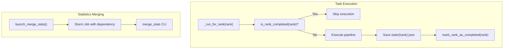

Sources: [src/datatrove/executor/slurm.py:229-247](), [src/datatrove/executor/base.py:102-154](), [src/datatrove/tools/merge_stats.py:26-40]()

## 7. Example Usage

```python
from datatrove.executor.slurm import SlurmPipelineExecutor

executor = SlurmPipelineExecutor(
    pipeline=pipeline,
    tasks=1000,
    time="24:00:00",
    partition="compute",
    cpus_per_task=4,
    mem_per_cpu_gb=8,
    workers=100,
    job_name="datatrove_job",
    condaenv="datatrove",
    logging_dir="s3://my-bucket/logs/my_job"
)

executor.run()
```

Sources: [src/datatrove/executor/slurm.py:48-144](), [examples/filter_hf_dataset_jobs.py:62-81]()

---

# Page: Ray Distributed Execution

# Ray Distributed Execution

<details>
<summary>Relevant source files</summary>

The following files were used as context for generating this wiki page:

- [examples/filter_hf_dataset_jobs.py](examples/filter_hf_dataset_jobs.py)
- [examples/minhash_deduplication_jobs.py](examples/minhash_deduplication_jobs.py)
- [examples/tokenize_hf_dataset_jobs.py](examples/tokenize_hf_dataset_jobs.py)
- [src/datatrove/executor/__init__.py](src/datatrove/executor/__init__.py)
- [src/datatrove/executor/jobs.py](src/datatrove/executor/jobs.py)
- [src/datatrove/executor/ray.py](src/datatrove/executor/ray.py)
- [tests/executor/test_jobs.py](tests/executor/test_jobs.py)
- [tests/executor/test_ray.py](tests/executor/test_ray.py)

</details>


This page documents the `RayPipelineExecutor`, which enables distributed pipeline execution using Ray clusters. It covers task management, placement group coordination for multi-node execution, timeout handling, error recovery mechanisms, and resource cleanup.

For local multiprocessing execution, see [Local Pipeline Execution](#2.1). For SLURM cluster execution, see [Slurm Cluster Execution](#2.2). For the base executor abstraction and task sharding concepts, see [Pipeline Execution Architecture](#2).

---

## Architecture Overview

The Ray executor provides distributed execution across Ray clusters with support for multi-node tasks, automatic retries, and resource management.

### System Architecture and Code Entities
The following diagram maps high-level system components to specific classes and functions within the `datatrove` codebase.

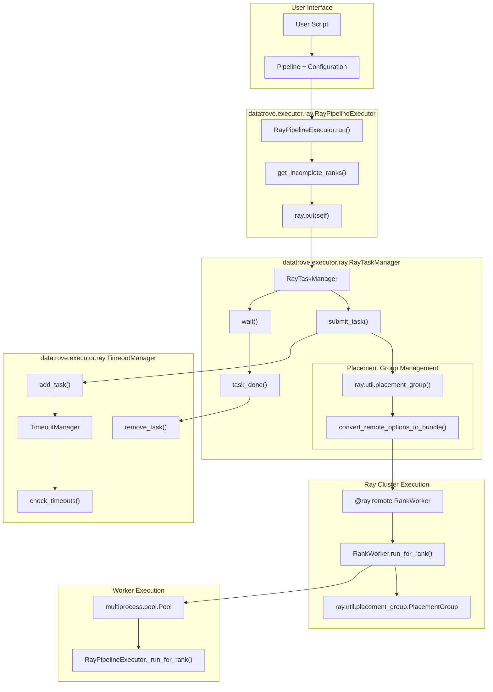
**Sources:** [src/datatrove/executor/ray.py:29-44](), [src/datatrove/executor/ray.py:139-157](), [src/datatrove/executor/ray.py:110-118]()

---

## RayPipelineExecutor Configuration

The `RayPipelineExecutor` class extends `PipelineExecutor` and provides Ray-specific configuration for distributed execution. It is defined in `src/datatrove/executor/ray.py`.

### Core Parameters

| Parameter | Type | Default | Description |
|-----------|------|---------|-------------|
| `pipeline` | `list[PipelineStep \| Callable]` | Required | List of pipeline steps to execute |
| `tasks` | `int` | Required | Total number of tasks (determines `world_size`) |
| `workers` | `int` | `-1` | Number of concurrent tasks. `-1` means no limit |
| `logging_dir` | `DataFolderLike` | Auto-generated | Directory for logs, stats, and checkpoints |
| `nodes_per_task` | `int` | `1` | Number of nodes per task (enables placement groups when > 1) |
| `depends` | `RayPipelineExecutor` | `None` | Another executor that must complete first |

### Resource Allocation
Resource requirements are passed to Ray via `remote_options` in `submit_task` [src/datatrove/executor/ray.py:158-160]().

| Parameter | Type | Default | Description |
|-----------|------|---------|-------------|
| `cpus_per_task` | `int` | `1` | CPUs allocated per task |
| `gpus_per_task` | `int` | `0` | GPUs allocated per task |
| `mem_per_task_gb` | `int` | `2` | Memory in GB per task |

**Sources:** [src/datatrove/executor/ray.py:86-97](), [src/datatrove/executor/ray.py:168-179]()

---

## Task Submission and Management

The `RayTaskManager` class handles task lifecycle, including submission, monitoring, completion tracking, and cleanup.

### Task Lifecycle Flow
The following diagram describes how `RayTaskManager` interacts with Ray primitives to manage task execution.

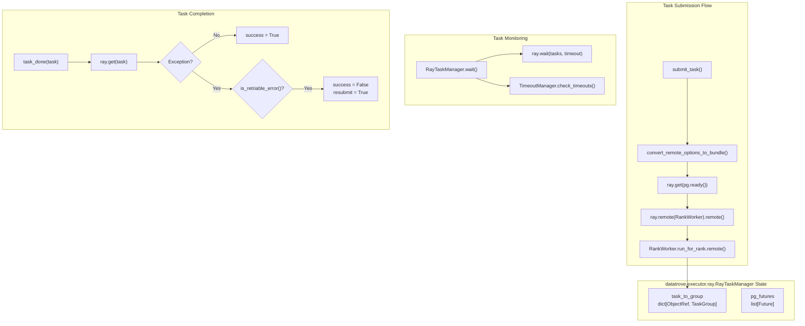
**Sources:** [src/datatrove/executor/ray.py:158-202](), [src/datatrove/executor/ray.py:101-109]()

### TaskGroup Data Structure
The `RayTaskManager` maintains a `TaskGroup` [src/datatrove/executor/ray.py:101-107]() for each submitted batch of tasks:
- `tasks`: List of Ray `ObjectRef` returned by `run_for_rank.remote()` [src/datatrove/executor/ray.py:102]().
- `workers`: List of `ActorHandle` for `RankWorker` [src/datatrove/executor/ray.py:103]().
- `placement_group`: The `PlacementGroup` used for multi-node coordination [src/datatrove/executor/ray.py:104]().
- `ranks`: The specific pipeline ranks being processed by this group [src/datatrove/executor/ray.py:105]().

### Retriable vs Non-Retriable Errors
The task manager identifies retriable errors (like `WorkerCrashedError`) to determine if ranks should be resubmitted. This logic is typically handled during the `ray.get(task)` call in `task_done` or within the main execution loop.

**Sources:** [src/datatrove/executor/ray.py:101-109](), [tests/executor/test_ray.py:161-164]()

---

## Placement Groups for Multi-Node Tasks

When `nodes_per_task > 1`, the Ray executor creates placement groups via `ray.util.placement_group` [src/datatrove/executor/ray.py:168](). This ensures that the required resources are co-located or distributed according to the strategy (defaulting to bundles for each node).

### Placement Group Creation
The `convert_remote_options_to_bundle` function [src/datatrove/executor/ray.py:86-97]() maps executor resources to Ray resource bundles:
- `num_cpus` -> `CPU`
- `memory` -> `memory`
- `num_gpus` -> `GPU`

### Environment Coordination
Within `RankWorker.run_for_rank`, the executor sets environment variables for distributed coordination:
- `RAY_NODELIST`: Comma-separated list of node IPs [src/datatrove/executor/ray.py:63]().
- `RAY_NODEID`: The index of the current node in the group [src/datatrove/executor/ray.py:64]().

**Sources:** [src/datatrove/executor/ray.py:38-68](), [src/datatrove/executor/ray.py:86-97]()

---

## Timeout Management

The `TimeoutManager` class [src/datatrove/executor/ray.py:110-137]() tracks task start times and identifies tasks that exceed the configured duration.

### Timeout Behavior
1. **Task Registration**: When a task is submitted, `add_task(task)` [src/datatrove/executor/ray.py:119-120]() records `time.time()`.
2. **Periodic Checks**: `check_timeouts()` [src/datatrove/executor/ray.py:125-136]() iterates through `task_start_times` and returns tasks where `elapsed > timeout_seconds`.
3. **Cleanup**: Once a task is finished or cancelled, `remove_task(task)` [src/datatrove/executor/ray.py:122-123]() removes it from tracking.

**Sources:** [src/datatrove/executor/ray.py:110-137]()

---

## Cleanup and Resource Management

The `RayTaskManager` implements cleanup to prevent resource leaks.

### Cleanup Operations
When `RayTaskManager` exits (as a context manager) or when tasks finish:
1. **Placement Groups**: Placement groups are tracked and can be removed via `ray.util.remove_placement_group`.
2. **Actors**: `RankWorker` actors are terminated.
3. **Tasks**: Pending tasks are cancelled if necessary.

**Sources:** [src/datatrove/executor/ray.py:139-202](), [tests/executor/test_ray.py:244-250]()

---

## Usage Example

The following example demonstrates setting up a `RayPipelineExecutor` for a standard processing task.

```python
from datatrove.executor.ray import RayPipelineExecutor
from datatrove.pipeline.readers import JsonlReader
from datatrove.pipeline.writers import JsonlWriter

executor = RayPipelineExecutor(
    pipeline=[
        JsonlReader("s3://my-bucket/input/"),
        # ... steps ...
        JsonlWriter("s3://my-bucket/output/"),
    ],
    tasks=100,
    workers=20,
    logging_dir="s3://my-bucket/logs/",
    nodes_per_task=1
)

executor.run()
```

**Sources:** [tests/executor/test_ray.py:54-60](), [src/datatrove/executor/ray.py:13-18]()

---

# Page: Inference and Synthetic Data Generation

# Inference and Synthetic Data Generation

<details>
<summary>Relevant source files</summary>

The following files were used as context for generating this wiki page:

- [.gitignore](.gitignore)
- [README.md](README.md)
- [examples/inference/README.md](examples/inference/README.md)
- [examples/inference/benchmark/README.md](examples/inference/benchmark/README.md)
- [examples/inference/benchmark/analyze_results.py](examples/inference/benchmark/analyze_results.py)
- [examples/inference/benchmark/launch_experiments.py](examples/inference/benchmark/launch_experiments.py)
- [examples/inference/benchmark/sample_benchmark_config.yaml](examples/inference/benchmark/sample_benchmark_config.yaml)
- [examples/inference/generate_data.py](examples/inference/generate_data.py)
- [examples/inference/utils.py](examples/inference/utils.py)
- [src/datatrove/pipeline/inference/checkpointing.py](src/datatrove/pipeline/inference/checkpointing.py)
- [src/datatrove/pipeline/inference/run_inference.py](src/datatrove/pipeline/inference/run_inference.py)
- [src/datatrove/pipeline/inference/servers/base.py](src/datatrove/pipeline/inference/servers/base.py)
- [src/datatrove/pipeline/inference/servers/dummy_server.py](src/datatrove/pipeline/inference/servers/dummy_server.py)

</details>


## Purpose and Scope

This section covers DataTrove's inference system for generating synthetic datasets using large language models. The system enables scalable LLM inference on document collections, supporting batch processing from thousands to millions of examples with automatic checkpointing, request caching, and progress tracking.

The inference system handles:
- **Synthetic data generation** at scale (data augmentation, rewriting, translation, summarization)
- **Multi-server backends** (vLLM, SGLang, custom HTTP endpoints)
- **Fault tolerance** through chunk-based checkpointing and request-level caching
- **Distributed execution** across multiple GPUs and nodes
- **Progress monitoring** with live dataset card updates

For general pipeline execution concepts, see [Pipeline Execution Architecture](#2). For writing output data, see [Data Writers and Output Management](#7). For tokenization of generated data for training, see [Tokenization and Data Preparation](#6).

**Sources:** [README.md:331-362](), [examples/inference/generate_data.py:1-58](), [src/datatrove/pipeline/inference/run_inference.py:1-11]()

---

## System Architecture

The inference system consists of four main layers working together to process documents through LLM inference:

### Component Overview

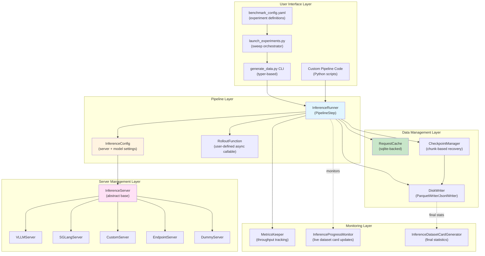

**Sources:** [src/datatrove/pipeline/inference/run_inference.py:100-161](), [examples/inference/generate_data.py:95-157](), [src/datatrove/pipeline/inference/servers/__init__.py:1-9]()

---

## Core Concepts

### Rollout Functions

A **rollout function** is an async callable that orchestrates one or more generation requests for a single document. The function signature is defined by `RolloutFunction` [src/datatrove/pipeline/inference/types.py:34-34]():

```python
async def rollout_fn(
    document: Document,
    generate: Callable[[dict], Awaitable[InferenceResult]],
    **shared_context
) -> InferenceResult | dict | list | str | None
```

The `generate` callback sends a single request to the inference server and returns an `InferenceResult`. The rollout can call `generate` multiple times (sequentially or in parallel) to implement complex patterns like chunked processing or multi-turn conversations.

**Return value handling:**
- `InferenceResult`: Stored as-is in `document.metadata[metadata_key]` [src/datatrove/pipeline/inference/run_inference.py:145-145]().
- Other JSON-serializable values (dict, list, str, int, float, bool): Stored directly.
- `None`: Document is excluded from output (all rollouts must return `None` to exclude).

For details, see [InferenceRunner Core](#3.1).

**Sources:** [src/datatrove/pipeline/inference/run_inference.py:125-161](), [src/datatrove/pipeline/inference/types.py:34-34](), [examples/inference/README.md:12-19]()

---

### Request Caching and Checkpointing

The inference system provides two levels of fault tolerance:

#### Request-Level Caching

The `RequestCache` [src/datatrove/pipeline/inference/checkpointing.py:38-38]() is an `aiosqlite`-backed cache used to store individual request results. It deduplicates requests using a payload hash generated via `xxhash` [src/datatrove/pipeline/inference/checkpointing.py:105-109]().

**Sources:** [src/datatrove/pipeline/inference/checkpointing.py:38-120](), [src/datatrove/pipeline/inference/run_inference.py:143-143]()

#### Chunk-Based Checkpointing

The `CheckpointManager` [src/datatrove/pipeline/inference/checkpointing.py:123-123]() (detailed in child pages) manages document persistence in local chunks. If a task fails, it resumes from the last completed chunk identified by `last_chunk/<rank>.txt`.

**Sources:** [src/datatrove/pipeline/inference/checkpointing.py:123-250](), [examples/inference/README.md:82-87]()

---

## Inference Execution Flow

### End-to-End Processing Pipeline

```mermaid
graph TB
    subgraph "Input Stage"
        READER["Reader<br/>(HuggingFaceDatasetReader)"]
        DOCS["Document Stream"]
    end
    
    subgraph "InferenceRunner Initialization"
        INIT_SERVER["Initialize Server<br/>_init_server()"]
        INIT_CACHE["Initialize Cache<br/>request_cache.initialize()"]
        INIT_METRICS["Start Metrics Reporter<br/>metrics_reporter()"]
    end
    
    subgraph "Document Processing Loop"
        PARSE_CHECKPOINT["Parse Checkpoints<br/>checkpoint_manager.parse_existing_checkpoints()"]
        ASYNC_GEN["Convert to Async<br/>_async_data_gen()"]
        HANDLE_DOC["Handle Document<br/>_handle_record()"]
        
        subgraph "Per-Document Processing"
            ROLLOUT_TASKS["Create Rollout Tasks<br/>(rollouts_per_document times)"]
            GEN_CALLBACK["Generate Callback<br/>_cached_request()"]
            CHECK_CACHE["Check Cache<br/>request_cache.get_cached_response()"]
            SEND_REQ["Send Request<br/>_send_request()"]
            STORE_CACHE["Store Result<br/>request_cache.store_result()"]
            GATHER["Gather Results<br/>asyncio.gather()"]
            SAVE["Save Document<br/>_save_document()"]
        end
        
        CHECKPOINT_WRITE["Write to Checkpoint<br/>checkpoint_manager.write_document()"]
        UPLOAD["Upload via Writer<br/>output_writer"]
    end
    
    subgraph "Completion & Cleanup"
        CLEANUP_CHUNK["Cleanup Last Chunk<br/>checkpoint_manager.cleanup_last_chunk()"]
        CLOSE_CACHE["Close Cache<br/>request_cache.close()"]
        STOP_SERVER["Stop Server<br/>server.__aexit__()"]
    end
    
    READER --> DOCS
    DOCS --> INIT_SERVER
    INIT_SERVER --> INIT_CACHE
    INIT_CACHE --> INIT_METRICS
    
    INIT_METRICS --> PARSE_CHECKPOINT
    PARSE_CHECKPOINT --> ASYNC_GEN
    ASYNC_GEN --> HANDLE_DOC
    
    HANDLE_DOC --> ROLLOUT_TASKS
    ROLLOUT_TASKS --> GEN_CALLBACK
    GEN_CALLBACK --> CHECK_CACHE
    CHECK_CACHE -->|"Cache Miss"| SEND_REQ
    CHECK_CACHE -->|"Cache Hit"| GATHER
    SEND_REQ --> STORE_CACHE
    STORE_CACHE --> GATHER
    GATHER --> SAVE
    
    SAVE --> CHECKPOINT_WRITE
    CHECKPOINT_WRITE --> UPLOAD
    
    UPLOAD -->|"More Docs"| ASYNC_GEN
    UPLOAD -->|"Done"| CLEANUP_CHUNK
    CLEANUP_CHUNK --> CLOSE_CACHE
    CLOSE_CACHE --> STOP_SERVER
    
    style HANDLE_DOC fill:#e1f5ff
    style CHECK_CACHE fill:#c8e6c9
    style CHECKPOINT_WRITE fill:#fff4e1
```

**Sources:** [src/datatrove/pipeline/inference/run_inference.py:483-571](), [src/datatrove/pipeline/inference/run_inference.py:416-479]()

---

## Server Backend Architecture

All server backends inherit from the `InferenceServer` [src/datatrove/pipeline/inference/servers/base.py:121-121]() abstract base class. This class provides the infrastructure for managing server processes, including port selection via `_find_available_port` [src/datatrove/pipeline/inference/servers/base.py:74-74]() and health monitoring.

### Server Lifecycle Management

```mermaid
stateDiagram-v2
    [*] --> Initialization
    
    Initialization --> Starting: start_server()
    Starting --> HealthMonitoring: Server process created
    
    state HealthMonitoring {
        [*] --> ReadingLogs
        ReadingLogs --> CheckingHealth: Parse log line
        CheckingHealth --> ReadingLogs: Server healthy
        CheckingHealth --> ServerError: Error detected
        CheckingHealth --> ReadySignal: "ready" message
    }
    
    ReadySignal --> WaitingForReady: Await /health endpoint
    WaitingForReady --> Ready: Health check passes
    WaitingForReady --> Timeout: Health check timeout
    
    Ready --> AcceptingRequests
    
    state AcceptingRequests {
        [*] --> Idle
        Idle --> ProcessingRequest: make_request()
        ProcessingRequest --> Idle: Response received
        ProcessingRequest --> RequestError: Request fails
    }
    
    ServerError --> [*]: Exception raised
    Timeout --> [*]: Exception raised
    RequestError --> AcceptingRequests: Retry or fail
    AcceptingRequests --> Shutdown: server_cleanup()
    Shutdown --> [*]: Server stopped
```

For details on specific implementations like `VLLMServer` or `SGLangServer`, see [Server Backends and Configuration](#3.3).

**Sources:** [src/datatrove/pipeline/inference/servers/base.py:121-174](), [src/datatrove/pipeline/inference/servers/vllm_server.py:14-14](), [src/datatrove/pipeline/inference/servers/dummy_server.py:81-81]()

---

## Benchmarking System

The benchmark system uses `launch_experiments.py` [examples/inference/benchmark/launch_experiments.py:62-62]() to orchestrate parameter sweeps defined in YAML. It follows a tiered approach to optimize throughput by sweeping parameters like `tp`, `max-num-seqs`, and `speculative-config`.

Key metrics are analyzed using `analyze_results.py` [examples/inference/benchmark/analyze_results.py:1-22](), which parses server logs to extract `avg_prompt_throughput` and `avg_generation_throughput` [examples/inference/benchmark/analyze_results.py:128-129]().

For details, see [Benchmark System and Experiment Management](#3.2).

**Sources:** [examples/inference/benchmark/sample_benchmark_config.yaml:5-14](), [examples/inference/benchmark/launch_experiments.py:1-27](), [examples/inference/benchmark/analyze_results.py:68-134]()

---

## Progress Monitoring and Dataset Cards

The system provides real-time visibility into large-scale generation jobs:

- **Progress Monitoring**: The `InferenceProgressMonitor` (detailed in child pages) tracks completion rates and calculates ETAs.
- **Dataset Cards**: `InferenceDatasetCardGenerator` [src/datatrove/pipeline/inference/dataset_card_generator.py:33-33]() automatically produces a `README.md` for the generated Hugging Face dataset, including model metadata and token statistics.

For details, see [Progress Monitoring and Dataset Cards](#3.4).

**Sources:** [examples/inference/generate_data.py:69-72](), [examples/inference/README.md:51-57]()

---

# Page: InferenceRunner Core

# InferenceRunner Core

<details>
<summary>Relevant source files</summary>

The following files were used as context for generating this wiki page:

- [src/datatrove/pipeline/inference/__init__.py](src/datatrove/pipeline/inference/__init__.py)
- [src/datatrove/pipeline/inference/checkpointing.py](src/datatrove/pipeline/inference/checkpointing.py)
- [src/datatrove/pipeline/inference/metrics.py](src/datatrove/pipeline/inference/metrics.py)
- [src/datatrove/pipeline/inference/run_inference.py](src/datatrove/pipeline/inference/run_inference.py)
- [src/datatrove/pipeline/inference/servers/base.py](src/datatrove/pipeline/inference/servers/base.py)
- [src/datatrove/pipeline/inference/servers/dummy_server.py](src/datatrove/pipeline/inference/servers/dummy_server.py)
- [src/datatrove/pipeline/inference/types.py](src/datatrove/pipeline/inference/types.py)
- [tests/pipeline/inference/test_inference.py](tests/pipeline/inference/test_inference.py)
- [tests/pipeline/text/test_request_cache.py](tests/pipeline/text/test_request_cache.py)

</details>


## Purpose and Scope

This document covers the `InferenceRunner` class, which is the primary pipeline step for executing inference workloads on documents using large language models. `InferenceRunner` orchestrates asynchronous request processing, manages concurrency, handles checkpointing and request caching, and integrates with various inference server backends.

For information about inference server implementations (vLLM, SGLang, etc.), see [Server Backends and Configuration](#3.3). For experiment management and benchmarking infrastructure, see [Benchmark System and Experiment Management](#3.2). For progress tracking and dataset card generation, see [Progress Monitoring and Dataset Cards](#3.4).

---

## Architecture Overview

The `InferenceRunner` implements a multi-layered asynchronous processing pipeline that coordinates document ingestion, request generation, server communication, and result persistence.

### Component Interaction Diagram

```mermaid
graph TB
    subgraph "InferenceRunner [run_inference.py:125-614]"
        CONFIG["InferenceConfig<br/>[run_inference.py:42-121]"]
        RUNNER["InferenceRunner<br/>PipelineStep"]
        
        subgraph "Processing Loop [run_async:483-571]"
            DOCS_GEN["_async_data_gen<br/>[run_inference.py:362-391]"]
            HANDLE["_handle_record<br/>[run_inference.py:416-478]"]
            ROLLOUT["rollout_fn<br/>user-defined"]
        end
        
        subgraph "Request Management"
            CACHED["_cached_request<br/>[run_inference.py:289-341]"]
            SEND["_send_request<br/>[run_inference.py:206-287]"]
            SEMAPHORE["asyncio.Semaphore<br/>concurrency control"]
        end
        
        subgraph "Persistence Layer"
            CACHE["RequestCache<br/>[checkpointing.py:38-204]"]
            CHECKPOINT["CheckpointManager<br/>[checkpointing.py:207-333]"]
            SAVE["_save_document<br/>[run_inference.py:343-360]"]
        end
    end
    
    subgraph "External Components"
        SERVER["InferenceServer<br/>[servers/base.py:121-364]"]
        WRITER["DiskWriter<br/>[writers/disk_base.py]"]
    end
    
    CONFIG --> RUNNER
    RUNNER --> DOCS_GEN
    DOCS_GEN --> HANDLE
    HANDLE --> ROLLOUT
    ROLLOUT --> CACHED
    CACHED --> SEND
    SEND --> SEMAPHORE
    SEMAPHORE --> SERVER
    
    CACHED --> CACHE
    HANDLE --> CHECKPOINT
    HANDLE --> SAVE
    SAVE --> WRITER
    CHECKPOINT --> WRITER
    
    style RUNNER fill:#e1f5ff
    style ROLLOUT fill:#fff4e1
    style CACHE fill:#c8e6c9
```

**Sources:** [src/datatrove/pipeline/inference/run_inference.py:42-614](), [src/datatrove/pipeline/inference/checkpointing.py:38-333](), [src/datatrove/pipeline/inference/servers/base.py:121-364]()

---

## Configuration System

The `InferenceConfig` dataclass centralizes all inference-related configuration parameters.

### InferenceConfig Parameters

| Parameter | Type | Default | Description |
|-----------|------|---------|-------------|
| `server_type` | `Literal` | Required | Type of inference server: `"sglang"`, `"vllm"`, `"dummy"`, `"custom"`, `"endpoint"` |
| `model_name_or_path` | `str` | Required | Model identifier or path |
| `model_max_context` | `int` | `8192` | Maximum context length for the model |
| `use_chat` | `bool` | `True` | Use chat endpoint (`/v1/chat/completions`) vs completion endpoint |
| `endpoint_url` | `str \| None` | `None` | Required when `server_type="endpoint"` |
| `api_key` | `str \| None` | `None` | API key for endpoint authentication (Bearer token) |
| `metric_interval` | `int` | `120` | Metrics reporting interval in seconds |
| `tp` | `int` | `1` | Tensor parallelism size (GPUs per model replica) |
| `dp` | `int` | `1` | Data parallelism size (number of model replicas) |
| `pp` | `int` | `1` | Pipeline parallelism size |
| `default_generation_params` | `dict` | `{}` | Default parameters merged into all generation requests |
| `rollouts_per_document` | `int` | `1` | Number of rollouts to perform per document |
| `max_concurrent_generations` | `int` | `500` | Maximum concurrent requests to the inference server |
| `max_concurrent_documents` | `int \| None` | Auto-calculated | Maximum documents being processed concurrently |
| `request_timeout` | `float \| None` | `None` | HTTP request timeout in seconds |
| `model_kwargs` | `dict \| None` | `None` | Additional kwargs passed to server initialization |
| `server_log_folder` | `str \| None` | `None` | Directory for server logs (one per rank) |
| `master_port` | `int` | `9810` | Master node port for distributed settings |
| `server_start_timeout_sec` | `float` | `60.0` | Timeout for launching the server process |

**Auto-calculated values:**
- When `max_concurrent_documents` is `None`, it defaults to `max(1, self.max_concurrent_generations // self.rollouts_per_document)` [src/datatrove/pipeline/inference/run_inference.py:118-119]()

**Sources:** [src/datatrove/pipeline/inference/run_inference.py:42-121]()

---

## Rollout Functions

Rollout functions define the inference logic applied to each document. They are user-provided async functions that receive a document and a generation callback.

### Rollout Function Signature

The `RolloutFunction` protocol defines the interface for these functions [src/datatrove/pipeline/inference/types.py:68-85]().

```python
async def rollout_fn(
    document: Document,
    generate: GenerateFunction,
    **kwargs: Any,
) -> RolloutResult
```

### Execution Model

```mermaid
graph LR
    DOC["Document"]
    ROLLOUT["rollout_fn<br/>user-defined"]
    
    subgraph "Rollout Execution [_handle_record:416-478]"
        TASKS["Create rollouts_per_document tasks<br/>[run_inference.py:440-451]"]
        GATHER["asyncio.gather<br/>[run_inference.py:452]"]
        RESULTS["Collect results<br/>[run_inference.py:457-459]"]
    end
    
    GENERATE["generate callback<br/>_cached_request"]
    SERVER["InferenceServer.make_request"]
    
    DOC --> ROLLOUT
    ROLLOUT --> TASKS
    TASKS --> GATHER
    GATHER --> RESULTS
    
    ROLLOUT --> GENERATE
    GENERATE --> SERVER
    
    style ROLLOUT fill:#fff4e1
    style GENERATE fill:#e1f5ff
```

### Common Rollout Patterns

**Simple Rollout:**
```python
async def simple_rollout(document, generate):
    result = await generate({
        "messages": [{"role": "user", "content": document.text}],
        "max_tokens": 100
    })
    return {"text": result.text, "usage": result.usage}
```

**Returning None to Skip:**
When all rollouts for a document return `None`, the document is marked for removal and not written to output [src/datatrove/pipeline/inference/run_inference.py:467-468]().

**Sources:** [src/datatrove/pipeline/inference/run_inference.py:137-147](), [src/datatrove/pipeline/inference/types.py:68-85](), [tests/pipeline/inference/test_inference.py:46-73]()

---

## Asynchronous Processing Pipeline

### Document Flow Through the System

```mermaid
sequenceDiagram
    participant Data as "data_gen<br/>Iterable[Document]"
    participant AsyncGen as "_async_data_gen<br/>[362-391]"
    participant Pool as "tasks_pool<br/>set[asyncio.Task]"
    participant Handle as "_handle_record<br/>[416-478]"
    participant Rollout as "rollout_fn<br/>user-defined"
    participant Generate as "_cached_request<br/>[289-341]"
    participant Server as "InferenceServer"
    participant Save as "_save_document<br/>[343-360]"
    participant Writer as "DiskWriter"
    
    loop "For each document"
        Data->>AsyncGen: "next(document)"
        AsyncGen->>Pool: "Check size vs max_concurrent_documents"
        alt "Pool full"
            Pool->>Pool: "await FIRST_COMPLETED"
        end
        Pool->>Handle: "create_task"
        
        par "For each rollout (rollouts_per_document)"
            Handle->>Rollout: "rollout_fn(doc, generate_callback)"
            Rollout->>Generate: "await generate(payload)"
            Generate->>Server: "make_request(payload)"
            Server-->>Generate: "InferenceResult"
            Generate-->>Rollout: "InferenceResult"
            Rollout-->>Handle: "rollout result"
        end
        
        Handle->>Save: "Save document with rollout_results"
        Save->>Writer: "write document"
    end
    
    Pool->>Pool: "await gather(*tasks_pool)"
```

### Core Processing Loop

The main processing loop is implemented in `run_async` [src/datatrove/pipeline/inference/run_inference.py:483-571]():

1. **Initialization** [src/datatrove/pipeline/inference/run_inference.py:495-507]():
   - Initialize inference server.
   - Create semaphore with `max_concurrent_generations` limit.
   - Initialize request cache and metrics reporting task.

2. **Checkpoint Recovery** [src/datatrove/pipeline/inference/run_inference.py:519-526]():
   - Parse existing checkpoints using `CheckpointManager`.
   - Upload cached documents to output writer.

3. **Document Processing** [src/datatrove/pipeline/inference/run_inference.py:527-562]():
   - Convert synchronous data generator to async via `_async_data_gen`.
   - Throttle based on `max_concurrent_documents`.
   - Create task for each document via `_handle_record`.

4. **Cleanup** [src/datatrove/pipeline/inference/run_inference.py:571-595]():
   - Cancel pending tasks and close request cache.

**Sources:** [src/datatrove/pipeline/inference/run_inference.py:483-595]()

---

## Concurrency Control

`InferenceRunner` uses two levels of concurrency control:

### Two-Level Throttling

```mermaid
graph TB
    subgraph "Document-Level Throttling"
        DOCS["max_concurrent_documents<br/>Task Pool Size"]
        DOCS_DESC["Controls memory usage<br/>Limits documents in-flight"]
    end
    
    subgraph "Request-Level Throttling"
        REQS["max_concurrent_generations<br/>asyncio.Semaphore"]
        REQS_DESC["Controls server load<br/>Limits concurrent API calls"]
    end
    
    DOC_STREAM["Document Stream"]
    TASK_POOL["tasks_pool: set[asyncio.Task]<br/>[run_inference.py:510]"]
    ROLLOUTS["rollouts_per_document<br/>requests per document"]
    SEMAPHORE["semaphore: asyncio.Semaphore<br/>[run_inference.py:503]"]
    SERVER["Inference Server"]
    
    DOC_STREAM --> DOCS
    DOCS --> TASK_POOL
    TASK_POOL --> ROLLOUTS
    ROLLOUTS --> REQS
    REQS --> SEMAPHORE
    SEMAPHORE --> SERVER
    
    style DOCS fill:#e1f5ff
    style REQS fill:#fff4e1
```

### Task Pool Management

**Throttling Logic** [src/datatrove/pipeline/inference/run_inference.py:544-548]():
```python
while len(tasks_pool) >= self.config.max_concurrent_documents:
    done, tasks_pool = await asyncio.wait(tasks_pool, return_when=asyncio.FIRST_COMPLETED)
    for task in done:
        await task  # Re-raises exceptions
```

**Sources:** [src/datatrove/pipeline/inference/run_inference.py:229-231](), [src/datatrove/pipeline/inference/run_inference.py:544-562]()

---

## Request Caching and Checkpointing

### RequestCache: Deduplication and Replay

The `RequestCache` class provides a lightweight `aiosqlite` backed cache to store individual request results [src/datatrove/pipeline/inference/checkpointing.py:38-204]().

**Key Features:**
- **Payload Hashing**: Uses `xxhash` to generate unique keys for request payloads [src/datatrove/pipeline/inference/checkpointing.py:105-109]().
- **Persistence**: Results and errors are stored in `replay.sqlite3` within the checkpoint directory [src/datatrove/pipeline/inference/checkpointing.py:59-60]().
- **Async Writer**: Uses a background queue and task to write to SQLite without blocking the main loop [src/datatrove/pipeline/inference/checkpointing.py:111-140]().

### CheckpointManager

The `CheckpointManager` handles high-level document-level checkpointing [src/datatrove/pipeline/inference/checkpointing.py:207-333](). It saves documents to local JSONL files in chunks to ensure progress is not lost if a job is interrupted.

**Sources:** [src/datatrove/pipeline/inference/checkpointing.py:38-333](), [src/datatrove/pipeline/inference/run_inference.py:289-341]()

---

## Shared Context Feature

The `shared_context` parameter allows injection of resources into rollout functions.

### Supported Types

`InferenceRunner` resolves the context via `get_shared_context_cm` [src/datatrove/pipeline/inference/run_inference.py:393-414]():

1. **`dict`**: Static values.
2. **`Callable[[], dict]`**: Factory function.
3. **`ContextManager[dict]`**: Resource manager (e.g., `multiprocessing.Pool`).

**Sources:** [src/datatrove/pipeline/inference/run_inference.py:393-414]()

---

## Metrics and Monitoring

### Tracked Metrics

- **Request Metrics**: `tokens_input`, `tokens_output`, `requests`, `successful_requests`, `failed_requests` [src/datatrove/pipeline/inference/run_inference.py:161]().
- **Queue Metrics**: `waiting_requests`, `running_requests` [src/datatrove/pipeline/inference/run_inference.py:162]().

The `metrics_reporter` task logs these values at regular intervals [src/datatrove/pipeline/inference/run_inference.py:164-176]().

**Sources:** [src/datatrove/pipeline/inference/run_inference.py:161-176](), [src/datatrove/pipeline/inference/metrics.py:6-132]()

---

## Error Handling and Retry Logic

### Request-Level Backoff

The `_send_request` method implements exponential backoff for transient errors like `ConnectionError` or `TimeoutError` [src/datatrove/pipeline/inference/run_inference.py:206-287]().

**Retry Flow:**
1. **Transient Errors**: Retries up to 6 times with `5 * (2**attempt)` seconds delay [src/datatrove/pipeline/inference/run_inference.py:264]().
2. **Unrecoverable Errors**: `ServerError` or `asyncio.CancelledError` stop the pipeline immediately [src/datatrove/pipeline/inference/run_inference.py:249-255]().

**Sources:** [src/datatrove/pipeline/inference/run_inference.py:206-287](), [src/datatrove/pipeline/inference/types.py:25-56]()

---

# Page: Benchmark System and Experiment Management

# Benchmark System and Experiment Management

<details>
<summary>Relevant source files</summary>

The following files were used as context for generating this wiki page:

- [examples/inference/benchmark/README.md](examples/inference/benchmark/README.md)
- [examples/inference/benchmark/analyze_results.py](examples/inference/benchmark/analyze_results.py)
- [examples/inference/benchmark/launch_experiments.py](examples/inference/benchmark/launch_experiments.py)
- [examples/inference/benchmark/sample_benchmark_config.yaml](examples/inference/benchmark/sample_benchmark_config.yaml)
- [examples/inference/generate_data.py](examples/inference/generate_data.py)
- [examples/inference/utils.py](examples/inference/utils.py)

</details>


## Purpose and Scope

This document describes DataTrove's benchmark system for systematically evaluating inference configurations across models, parallelization strategies, and optimization techniques. The system automates the process of defining parameter sweeps, launching experiments as SLURM jobs, and analyzing throughput metrics to identify optimal configurations.

For information about the core inference execution logic, see [InferenceRunner Core](3.1). For details on server backends and configuration, see [Server Backends and Configuration](3.3). For progress monitoring during execution, see [Progress Monitoring and Dataset Cards](3.4).

Sources: [examples/inference/benchmark/README.md:1-23]()

## Overview

The benchmark system consists of three main components:

1.  **Configuration System**: YAML-based experiment definitions with support for parameter sweeps [examples/inference/benchmark/sample_benchmark_config.yaml:1-55]().
2.  **Experiment Launcher**: Expands configurations and submits SLURM jobs with automatic retry and failure detection [examples/inference/benchmark/launch_experiments.py:62-95]().
3.  **Results Analyzer**: Parses logs, computes throughput metrics, and generates CSV summaries [examples/inference/benchmark/analyze_results.py:2-10]().

The system is designed around a **tiered optimization strategy** where experiments are run sequentially, with each tier building on optimal settings from previous tiers to efficiently explore the configuration space [examples/inference/benchmark/sample_benchmark_config.yaml:1-8]().

Sources: [examples/inference/benchmark/README.md:1-12](), [examples/inference/benchmark/launch_experiments.py:1-27]()

## Configuration System

### YAML Structure

Benchmark experiments are defined in YAML configuration files with the following top-level structure:

| Key | Type | Description |
| :--- | :--- | :--- |
| `script` | string | Path to the inference script (typically `examples/inference/generate_data.py`) [examples/inference/benchmark/sample_benchmark_config.yaml:22-22]() |
| `continue_on_failure` | boolean | Whether to continue launching jobs if one fails [examples/inference/benchmark/sample_benchmark_config.yaml:23-23]() |
| `fixed_args` | dict | Arguments applied to all experiments [examples/inference/benchmark/sample_benchmark_config.yaml:26-54]() |
| `experiments` | list | List of experiment configurations [examples/inference/benchmark/sample_benchmark_config.yaml:66-66]() |

Each experiment in the `experiments` list contains a `name` and an `args` dictionary where list values trigger cartesian product expansion [examples/inference/benchmark/launch_experiments.py:117-134]().

Sources: [examples/inference/benchmark/launch_experiments.py:89-134](), [examples/inference/benchmark/sample_benchmark_config.yaml:22-66]()

### Parameter Sweep Expansion

When an argument value is a list, the launcher generates the cartesian product of all list-valued arguments, creating multiple runs [examples/inference/benchmark/launch_experiments.py:387-404]().

**Configuration Flow from YAML to Job Submission**

```mermaid
graph TB
    YAML["benchmark_config.yaml"]
    LOAD["ExperimentLauncher._load_config()"]
    VALIDATE["ExperimentLauncher._validate_config()"]
    
    subgraph "Experiment Expansion"
        EXPAND["_expand_experiment()"]
        SWEEP_DETECT["Detect list-valued args"]
        PRODUCT["itertools.product()"]
        DERIVE_NAME["_derive_run_name()"]
    end
    
    subgraph "Run Execution"
        BUILD_KWARGS["_build_kwargs()"]
        MERGE["Merge fixed_args + run args"]
        CHECK_DONE["_is_already_completed()"]
        CHECK_OOM["_has_oom_failure()"]
        EXECUTE["_execute_direct()"]
        GENERATE_MAIN["generate_data_main()"]
    end
    
    OUTPUT["SLURM Job Submission"]
    
    YAML --> LOAD
    LOAD --> VALIDATE
    VALIDATE --> EXPAND
    
    EXPAND --> SWEEP_DETECT
    SWEEP_DETECT --> PRODUCT
    PRODUCT --> DERIVE_NAME
    DERIVE_NAME --> BUILD_KWARGS
    
    BUILD_KWARGS --> MERGE
    MERGE --> CHECK_DONE
    CHECK_DONE -->|"Completed"| OUTPUT
    CHECK_DONE -->|"Not Found"| CHECK_OOM
    CHECK_OOM -->|"OOM detected"| OUTPUT
    CHECK_OOM -->|"No OOM"| EXECUTE
    
    EXECUTE --> GENERATE_MAIN
    GENERATE_MAIN --> OUTPUT
```

Sources: [examples/inference/benchmark/launch_experiments.py:314-404](), [examples/inference/benchmark/launch_experiments.py:152-193]()

### Run Name Derivation

Run names are automatically derived from non-default configuration values following the canonical output path order. The `ExperimentLauncher._derive_run_name()` method constructs names by concatenating configuration segments that differ from defaults [examples/inference/benchmark/launch_experiments.py:152-193]():

1.  `prompt_template_name` (if specified as `[name, template]`)
2.  `model_name_or_path` (organization prefix stripped via `model_name_safe`)
3.  Parallelism: `tp`, `pp`, `dp` (if not 1)
4.  Batching: `mns` (if not 256), `mnbt` (if not 8192)
5.  Memory: `gmu` (if not 0.9)
6.  KV cache: `bs` (if not 16), `kvc` (if not auto)
7.  Optimizations: `spec` (if specified), `quant` (if specified)

Sources: [examples/inference/benchmark/launch_experiments.py:152-193](), [examples/inference/utils.py:127-156]()

## Experiment Launcher

The `ExperimentLauncher` class orchestrates the entire benchmark workflow:

**ExperimentLauncher Class Structure**

```mermaid
graph TB
    subgraph "ExperimentLauncher"
        INIT["__init__(config_path, dry_run)"]
        LOAD["_load_config()"]
        VALIDATE["_validate_config()"]
        EXPAND["_expand_experiment()"]
        DERIVE["_derive_run_name()"]
        BUILD["_build_kwargs()"]
        CHECK_DONE["_is_already_completed()"]
        CHECK_OOM["_has_oom_failure()"]
        EXECUTE["_execute_direct()"]
        LAUNCH["launch()"]
    end
    
    subgraph "Utilities (utils.py)"
        BUILD_PATH["build_run_path()"]
        DETECT_FAIL["detect_failure_reason()"]
        MODEL_SAFE["model_name_safe()"]
        ENCODE_FUNCS["encode_*_segment_for_log_dir()"]
        NORMALIZE["normalize_*()"]
    end
    
    subgraph "Generate Data"
        GEN_MAIN["generate_data_main()"]
    end
    
    INIT --> LOAD
    INIT --> VALIDATE
    LAUNCH --> EXPAND
    EXPAND --> DERIVE
    EXPAND --> BUILD
    LAUNCH --> CHECK_DONE
    LAUNCH --> CHECK_OOM
    CHECK_OOM --> DETECT_FAIL
    LAUNCH --> EXECUTE
    EXECUTE --> GEN_MAIN
    
    DERIVE --> MODEL_SAFE
    DERIVE --> ENCODE_FUNCS
    BUILD_PATH --> NORMALIZE
```

Sources: [examples/inference/benchmark/launch_experiments.py:62-404](), [examples/inference/utils.py:15-64]()

### Skip Logic

The launcher implements smart skip logic to avoid rerunning experiments based on their status:

1.  **Completion Check**: `_is_already_completed()` checks for `stats.json` existence at the run path [examples/inference/benchmark/launch_experiments.py:343-355]().
2.  **Failure Detection**: `detect_failure_reason()` scans log files for patterns like `OOM`, `timeout`, or `server_fail` [examples/inference/utils.py:32-64]().
3.  **Configurable Skipping**: Users can control which failure reasons trigger a skip via `--skip-failure-reasons` [examples/inference/benchmark/launch_experiments.py:85-87]().

Sources: [examples/inference/benchmark/launch_experiments.py:343-366](), [examples/inference/utils.py:15-29]()

## Tiered Optimization Strategy

The benchmark system implements a **sequential tiered approach** where each tier optimizes a different aspect of inference performance [examples/inference/benchmark/sample_benchmark_config.yaml:3-8]().

| Tier | Parameters | Goal |
| :--- | :--- | :--- |
| **0** | `tp`, `mns`, `mnbt` | **Parallelism & Batching** - Find optimal parallelism and batch sizes [examples/inference/benchmark/sample_benchmark_config.yaml:57-65](). |
| **1** | `spec`, `gmu` | **SpecDec & GMU** - Lossless speedup via speculative decoding and memory tuning [examples/inference/benchmark/sample_benchmark_config.yaml:118-129](). |

Sources: [examples/inference/benchmark/sample_benchmark_config.yaml:1-129](), [examples/inference/benchmark/README.md:107-116]()

## Output Directory Structure

The launcher creates a hierarchical output directory structure that encodes configuration parameters in the path [examples/inference/benchmark/README.md:89-92]().

**Output Path Construction**

```mermaid
graph LR
    ROOT["output_dir"]
    EXP["{experiment}"]
    PROMPT["{prompt}"]
    MODEL["{model}"]
    PARALLEL["tp{TP}-pp{PP}-dp{DP}"]
    MNS["mns_{N}"]
    MNBT["mnbt_{M}"]
    GMU["gmu_{P}"]
    BS["bs_{B}"]
    KVC["kvc_{...}"]
    SPEC["spec_{...}"]
    QUANT["quant_{...}"]
    LOGS["inference_logs/"]
    
    ROOT --> EXP
    EXP --> PROMPT
    PROMPT --> MODEL
    MODEL --> PARALLEL
    PARALLEL --> MNS
    MNS --> MNBT
    MNBT --> GMU
    GMU --> BS
    BS --> KVC
    KVC --> SPEC
    SPEC --> QUANT
    QUANT --> LOGS
```

Sources: [examples/inference/benchmark/README.md:89-92](), [examples/inference/utils.py:391-427]()

## Results Analysis System

The `analyze_results.py` script processes completed benchmark runs to extract metrics and generate comprehensive CSV summaries [examples/inference/benchmark/analyze_results.py:2-10]().

### Data Sources

The analyzer extracts data from:
1.  **Path Fields**: Configuration parameters parsed from the directory structure via `parse_path_fields()` [examples/inference/benchmark/analyze_results.py:137-219]().
2.  **stats.json**: End-to-end metrics (token counts, request counts, total time) via `parse_stats_json()` [examples/inference/benchmark/analyze_results.py:221-266]().
3.  **Server Logs**: Steady-state throughput metrics (prompt/generation throughput, KV cache usage) via `parse_server_logs()` [examples/inference/benchmark/analyze_results.py:68-135]().

Sources: [examples/inference/benchmark/analyze_results.py:63-266]()

### Metrics Computation

The analyzer computes several derived metrics to evaluate hardware efficiency:

*   **Throughput**: `avg_generation_throughput` (engine total) and `output_tps_per_gpu` [examples/inference/benchmark/analyze_results.py:73-75]().
*   **Efficiency**: `gpu_days_to_process_1b_tokens` and `gpus_for_1b_tokens_per_hour` [examples/inference/benchmark/analyze_results.py:373-381]().
*   **Memory**: `avg_gpu_kvc_usage` and `avg_prefix_cache_hit_rate` [examples/inference/benchmark/analyze_results.py:127-134]().

Sources: [examples/inference/benchmark/analyze_results.py:355-381](), [examples/inference/benchmark/README.md:118-134]()

### Failure Detection

The analyzer uses `detect_failure_reason` to identify why specific configurations failed, allowing researchers to see the "OOM boundary" for different models [examples/inference/benchmark/analyze_results.py:330-342]().

Sources: [examples/inference/utils.py:15-64](), [examples/inference/benchmark/analyze_results.py:43-44]()

---

# Page: Server Backends and Configuration

# Server Backends and Configuration

<details>
<summary>Relevant source files</summary>

The following files were used as context for generating this wiki page:

- [src/datatrove/pipeline/dedup/exact_dedup.py](src/datatrove/pipeline/dedup/exact_dedup.py)
- [src/datatrove/pipeline/inference/distributed/ray.py](src/datatrove/pipeline/inference/distributed/ray.py)
- [src/datatrove/pipeline/inference/distributed/utils.py](src/datatrove/pipeline/inference/distributed/utils.py)
- [src/datatrove/pipeline/inference/servers/__init__.py](src/datatrove/pipeline/inference/servers/__init__.py)
- [src/datatrove/pipeline/inference/servers/compile_lock.py](src/datatrove/pipeline/inference/servers/compile_lock.py)
- [src/datatrove/pipeline/inference/servers/custom_server.py](src/datatrove/pipeline/inference/servers/custom_server.py)
- [src/datatrove/pipeline/inference/servers/endpoint_server.py](src/datatrove/pipeline/inference/servers/endpoint_server.py)
- [src/datatrove/pipeline/inference/servers/sglang_server.py](src/datatrove/pipeline/inference/servers/sglang_server.py)
- [src/datatrove/pipeline/inference/servers/vllm_server.py](src/datatrove/pipeline/inference/servers/vllm_server.py)
- [tests/pipeline/inference/test_vllm_compile_lock.py](tests/pipeline/inference/test_vllm_compile_lock.py)

</details>


This document describes the server backend abstraction layer that enables DataTrove's inference system to work with multiple inference frameworks. It covers the `InferenceServer` base class, concrete server implementations (vLLM, SGLang, Custom, Endpoint, Dummy), the `InferenceConfig` configuration system, and server lifecycle management including subprocess spawning, health monitoring, and distributed coordination.

For information about how servers are used within the inference pipeline, see [InferenceRunner Core](#3.1). For benchmark experiment configuration, see [Benchmark System and Experiment Management](#3.2).

## Configuration System

### InferenceConfig

The `InferenceConfig` dataclass [src/datatrove/pipeline/inference/run_inference.py:41-95]() provides a unified configuration interface for all server backends. It separates platform-agnostic parameters from backend-specific settings.

#### InferenceConfig Architecture

```mermaid
graph TB
    subgraph "User Configuration"
        USER["User specifies<br/>InferenceConfig"]
    end
    
    subgraph "InferenceConfig Fields"
        BASIC["Basic Settings<br/>- server_type<br/>- model_name_or_path<br/>- model_max_context<br/>- use_chat"]
        PARALLEL["Parallelism<br/>- tp (tensor)<br/>- pp (pipeline)<br/>- dp (data)"]
        GENERATION["Generation<br/>- rollouts_per_document<br/>- default_generation_params<br/>- request_timeout"]
        CONCURRENCY["Concurrency<br/>- max_concurrent_generations<br/>- max_concurrent_documents"]
        BACKEND["Backend-Specific<br/>- model_kwargs<br/>- server_log_folder<br/>- master_port"]
        METRICS["Metrics<br/>- metric_interval"]
    end
    
    subgraph "Server Initialization"
        INIT["InferenceRunner._init_server()"]
        FACTORY["Server selection:<br/>sglang → SGLangServer<br/>vllm → VLLMServer<br/>custom → CustomServer<br/>endpoint → EndpointServer<br/>dummy → DummyServer"]
        SERVER["InferenceServer instance"]
    end
    
    USER --> BASIC
    USER --> PARALLEL
    USER --> GENERATION
    USER --> CONCURRENCY
    USER --> BACKEND
    USER --> METRICS
    
    BASIC --> INIT
    PARALLEL --> INIT
    GENERATION --> INIT
    CONCURRENCY --> INIT
    BACKEND --> INIT
    METRICS --> INIT
    
    INIT --> FACTORY
    FACTORY --> SERVER
```

**Sources:** [src/datatrove/pipeline/inference/run_inference.py:41-95](), [src/datatrove/pipeline/inference/run_inference.py:181-204]()

#### Key Configuration Fields

| Field | Type | Default | Description |
|-------|------|---------|-------------|
| `server_type` | `Literal["sglang", "vllm", "dummy", "custom", "endpoint"]` | Required | Backend selection |
| `model_name_or_path` | `str` | Required | Model identifier or path |
| `model_max_context` | `int` | `8192` | Maximum context window |
| `use_chat` | `bool` | `True` | Use `/v1/chat/completions` vs `/v1/completions` |
| `tp` | `int` | `1` | Tensor parallelism size (GPUs per replica) |
| `pp` | `int` | `1` | Pipeline parallelism stages |
| `dp` | `int` | `1` | Data parallelism (number of replicas) |
| `rollouts_per_document` | `int` | `1` | Generations per document |
| `max_concurrent_generations` | `int` | `500` | Concurrent request limit |
| `max_concurrent_documents` | `int \| None` | Auto-computed | Concurrent document processing limit |
| `model_kwargs` | `dict \| None` | `None` | Backend-specific parameters |
| `server_log_folder` | `str \| None` | `None` | Directory for per-rank server logs |
| `master_port` | `int` | `9810` | Distributed coordination port |
| `request_timeout` | `float \| None` | `None` | HTTP request timeout (seconds) |

**Sources:** [src/datatrove/pipeline/inference/run_inference.py:41-95]()

#### Auto-Computation of Concurrency Limits

The `__post_init__` method automatically computes `max_concurrent_documents` when not provided:

```python
max_concurrent_documents = max(1, max_concurrent_generations // rollouts_per_document)
```

This ensures documents are processed at an appropriate rate relative to the generation capacity. For example, with `max_concurrent_generations=500` and `rollouts_per_document=3`, the system processes up to `166` documents concurrently (each spawning 3 generations).

**Sources:** [src/datatrove/pipeline/inference/run_inference.py:92-94]()

## Server Abstraction Layer

### InferenceServer Base Class

The `InferenceServer` abstract base class [src/datatrove/pipeline/inference/servers/base.py:18-268]() defines the contract that all server implementations must fulfill. It manages server lifecycle, port allocation, distributed coordination, and standardized request/response handling.

#### InferenceServer Class Hierarchy

```mermaid
graph TB
    BASE["InferenceServer<br/>(Abstract Base Class)"]
    
    VLLM["VLLMServer<br/>vLLM subprocess"]
    SGLANG["SGLangServer<br/>SGLang subprocess"]
    CUSTOM["CustomServer<br/>Custom script subprocess"]
    ENDPOINT["EndpointServer<br/>External HTTP endpoint"]
    DUMMY["DummyServer<br/>Testing/development"]
    
    BASE --> VLLM
    BASE --> SGLANG
    BASE --> CUSTOM
    BASE --> ENDPOINT
    BASE --> DUMMY
    
    subgraph "Abstract Methods"
        START["start_server()<br/>→ Process | None"]
        MONITOR["monitor_health()<br/>→ None"]
    end
    
    subgraph "Concrete Methods"
        ENTER["__aenter__()<br/>Context manager entry"]
        EXIT["__aexit__()<br/>Cleanup and shutdown"]
        REQUEST["make_request(payload)<br/>→ dict"]
        RETRY["_make_request_with_retry()<br/>Exponential backoff"]
    end
    
    BASE --> START
    BASE --> MONITOR
    BASE --> ENTER
    BASE --> EXIT
    BASE --> REQUEST
    BASE --> RETRY
```

**Sources:** [src/datatrove/pipeline/inference/servers/base.py:18-268](), [src/datatrove/pipeline/inference/servers/__init__.py:1-10]()

#### Core Abstract Methods

Each server implementation must provide:

1. **`start_server()`** [src/datatrove/pipeline/inference/servers/base.py:53-58](): Launches the server process and returns an `asyncio.subprocess.Process` or `None` (for worker ranks in distributed setups).

2. **`monitor_health()`** [src/datatrove/pipeline/inference/servers/base.py:60-65](): Continuously monitors server health, logging output and detecting failures. Raises exceptions on critical errors.

**Sources:** [src/datatrove/pipeline/inference/servers/base.py:53-65]()

#### Port Allocation Strategy

The base class implements deterministic port allocation [src/datatrove/pipeline/inference/servers/base.py:36-43]():

```
_port = 8000 + rank
```

Each rank receives a unique port, enabling multiple servers on the same node. For distributed setups, `master_addr` and `master_port` coordinate worker discovery.

**Sources:** [src/datatrove/pipeline/inference/servers/base.py:36-43]()

## Server Implementations

### VLLMServer

`VLLMServer` [src/datatrove/pipeline/inference/servers/vllm_server.py:29-281]() launches vLLM as a subprocess. It includes sophisticated mechanisms for distributed setup and compilation locking.

#### Compilation Locking

To prevent concurrent `torch.compile` corruption when multiple jobs start simultaneously on a shared filesystem, `VLLMServer` uses a `CompileLockManager` [src/datatrove/pipeline/inference/servers/compile_lock.py:21-93](). 

1. **Hash Generation**: A deterministic 12-character hash is computed based on vLLM version, model path, parallelism (tp, pp, dp), context length, and model kwargs [src/datatrove/pipeline/inference/servers/compile_lock.py:105-145]().
2. **Lock Acquisition**: Before starting, the server attempts to `acquire()` a file-based lock [src/datatrove/pipeline/inference/servers/vllm_server.py:113]().
3. **Cache Check**: If a `.done` marker file exists for the config hash, the lock is skipped [src/datatrove/pipeline/inference/servers/compile_lock.py:65-67]().
4. **Completion**: Once the server prints a ready message, the marker is created and the lock released [src/datatrove/pipeline/inference/servers/vllm_server.py:169-172]().

**Sources:** [src/datatrove/pipeline/inference/servers/vllm_server.py:44-56](), [src/datatrove/pipeline/inference/servers/compile_lock.py:1-145]()

#### Multi-Node Coordination via Ray

For multi-node setups, `VLLMServer` utilizes Ray cluster management [src/datatrove/pipeline/inference/distributed/ray.py:1-216]():

- **Master Node**: Initializes the Ray head node using `init_ray_master` [src/datatrove/pipeline/inference/distributed/ray.py:176-211]() and waits for workers to join [src/datatrove/pipeline/inference/distributed/ray.py:134-174]().
- **Worker Nodes**: Connect to the master using `init_ray_worker` [src/datatrove/pipeline/inference/distributed/ray.py:212-253]().
- **Object Store**: Memory is automatically calculated as the minimum of 30% available RAM, `/dev/shm` size, or a 200GB cap [src/datatrove/pipeline/inference/distributed/ray.py:25-50]().

**Sources:** [src/datatrove/pipeline/inference/servers/vllm_server.py:114-143](), [src/datatrove/pipeline/inference/distributed/ray.py:1-253]()

### SGLangServer

`SGLangServer` [src/datatrove/pipeline/inference/servers/sglang_server.py:19-147]() launches the SGLang runtime using `sglang.launch_server`.

- **Distributed Setup**: Uses `get_master_node_host()` and `get_node_rank()` to configure `--nnodes`, `--node-rank`, and `--dist-init-addr` for multi-node execution [src/datatrove/pipeline/inference/servers/sglang_server.py:39-43]().
- **Command Construction**: Maps `InferenceConfig` parallelism settings to SGLang flags like `--tp-size`, `--dp-size`, and `--pp-size` [src/datatrove/pipeline/inference/servers/sglang_server.py:68-74]().
- **Health Monitoring**: Watches for `"The server is fired up and ready to roll!"` to signal readiness [src/datatrove/pipeline/inference/servers/sglang_server.py:109-111]().

**Sources:** [src/datatrove/pipeline/inference/servers/sglang_server.py:45-91](), [src/datatrove/pipeline/inference/distributed/utils.py:34-57]()

### CustomServer

`CustomServer` [src/datatrove/pipeline/inference/servers/custom_server.py:14-117]() allows running a user-defined server script.

- **Initialization**: Requires `server_script` to be provided in `model_kwargs` [src/datatrove/pipeline/inference/servers/custom_server.py:26-29]().
- **Command**: Executes the script using `sys.executable` and passes `--port` along with any other `model_kwargs` as command-line arguments [src/datatrove/pipeline/inference/servers/custom_server.py:35-50]().
- **Error Detection**: Specifically monitors for `CUDA out of memory`, `ImportError`, and `ModuleNotFoundError` in the subprocess output [src/datatrove/pipeline/inference/servers/custom_server.py:81-87]().

**Sources:** [src/datatrove/pipeline/inference/servers/custom_server.py:14-117]()

### EndpointServer

`EndpointServer` [src/datatrove/pipeline/inference/servers/endpoint_server.py:12-152]() targets external OpenAI-compatible APIs.

- **Client Selection**: For `localhost` endpoints, it uses the base class's raw HTTP implementation. For external endpoints, it uses `openai.AsyncOpenAI` [src/datatrove/pipeline/inference/servers/endpoint_server.py:29-45]().
- **Request Logic**: Overrides `_make_request` to use the OpenAI client, handling specific exceptions like `RateLimitError`, `AuthenticationError`, and `APITimeoutError` by mapping them to DataTrove's `InferenceError` or standard retryable exceptions [src/datatrove/pipeline/inference/servers/endpoint_server.py:64-151]().

**Sources:** [src/datatrove/pipeline/inference/servers/endpoint_server.py:12-152]()

## Distributed Environment Utilities

The `distributed/utils.py` module provides environment-aware helpers used by all server backends to resolve node roles and resource availability.

| Function | Source | Description |
|----------|--------|-------------|
| `get_node_rank()` | [src/datatrove/pipeline/inference/distributed/utils.py:34-36]() | Returns `DATATROVE_NODE_RANK` (0 for master). |
| `is_master_node()` | [src/datatrove/pipeline/inference/distributed/utils.py:39-41]() | Boolean check for rank <= 0. |
| `get_node_hosts()` | [src/datatrove/pipeline/inference/distributed/utils.py:44-46]() | Parses `DATATROVE_NODE_IPS` into a list. |
| `get_distributed_environment()` | [src/datatrove/pipeline/inference/distributed/utils.py:49-51]() | Returns `SLURM`, `RAY`, or `LOCAL`. |
| `get_available_gpus_per_node()` | [src/datatrove/pipeline/inference/distributed/utils.py:27-31]() | Returns `DATATROVE_GPUS_ON_NODE`. |

**Sources:** [src/datatrove/pipeline/inference/distributed/utils.py:1-57]()

## Lifecycle Management Summary

```mermaid
graph TD
    subgraph "Server Lifecycle (InferenceServer)"
        INIT["__init__(config, rank)"]
        ENTER["__aenter__()"]
        START["start_server()"]
        WAIT["_wait_until_ready()"]
        MONITOR["monitor_health() (Background)"]
        EXIT["__aexit__()"]
        CLEAN["cleanup()"]
    end

    INIT --> ENTER
    ENTER --> START
    START --> WAIT
    WAIT --> MONITOR
    MONITOR --> EXIT
    EXIT --> CLEAN
    
    subgraph "Process Monitoring"
        READY["READY: 'startup complete'"]
        ERR["ERROR: 'CUDA OOM' / 'RuntimeError'"]
        KILL["KILL: SIGTERM -> SIGKILL"]
    end
    
    MONITOR -.-> READY
    MONITOR -.-> ERR
    EXIT -.-> KILL
```

**Sources:** [src/datatrove/pipeline/inference/servers/base.py:18-130](), [src/datatrove/pipeline/inference/servers/vllm_server.py:145-227]()

---

# Page: Progress Monitoring and Dataset Cards

# Progress Monitoring and Dataset Cards

<details>
<summary>Relevant source files</summary>

The following files were used as context for generating this wiki page:

- [examples/inference/progress_monitoring.py](examples/inference/progress_monitoring.py)
- [src/datatrove/pipeline/inference/dataset_card_generator.py](src/datatrove/pipeline/inference/dataset_card_generator.py)
- [src/datatrove/pipeline/inference/dataset_card_template.md](src/datatrove/pipeline/inference/dataset_card_template.md)
- [src/datatrove/pipeline/inference/progress_monitor.py](src/datatrove/pipeline/inference/progress_monitor.py)
- [tests/pipeline/inference/test_dataset_card_generator.py](tests/pipeline/inference/test_dataset_card_generator.py)
- [tests/pipeline/inference/test_progress_monitor.py](tests/pipeline/inference/test_progress_monitor.py)

</details>


## Purpose and Scope

This document covers the progress monitoring and dataset card generation systems for long-running inference jobs. These components provide real-time progress tracking with ETA estimates and automatically generate comprehensive HuggingFace dataset cards with statistics and metadata.

The system is designed to handle massive scale by polling metadata rather than downloading data, and it integrates deeply with the HuggingFace Hub and Slurm scheduling systems.

## System Overview

The progress monitoring system consists of two primary components:

1.  **`InferenceProgressMonitor`**: A lightweight monitoring process that periodically polls the output repository, calculates progress metrics, and updates the dataset card with a live progress bar and ETA. [src/datatrove/pipeline/inference/progress_monitor.py:13-32]()
2.  **`InferenceDatasetCardGenerator`**: A final pipeline step that runs after inference completes to generate a comprehensive dataset card with complete statistics, token counts, and metadata. [src/datatrove/pipeline/inference/dataset_card_generator.py:44-73]()

Both components share configuration through `InferenceDatasetCardParams` [src/datatrove/pipeline/inference/dataset_card_generator.py:24-41]() and use a template-based rendering system [src/datatrove/pipeline/inference/dataset_card_template.md:1-52]() to generate consistent, informative dataset cards.

**Sources:** [src/datatrove/pipeline/inference/progress_monitor.py:1-8](), [src/datatrove/pipeline/inference/dataset_card_generator.py:1-51]()

## Three-Job Architecture

When running on Slurm, the system orchestrates three separate jobs with inter-dependencies to ensure monitoring doesn't consume GPU resources and final cards are only generated upon success.

```mermaid
graph TB
    subgraph "Slurm Job Architecture"
        INFERENCE["InferenceRunner<br/>(GPU Array Job)"]
        MONITOR["InferenceProgressMonitor<br/>(CPU Job)"]
        DATACARD["InferenceDatasetCardGenerator<br/>(CPU Job)"]
    end
    
    subgraph "Output Artifacts (HF Hub)"
        PARQUET["*.parquet files<br/>(Incremental)"]
        STATS["stats.json<br/>(Final)"]
        README["README.md<br/>(Dataset Card)"]
    end
    
    INFERENCE -->|"writes incrementally"| PARQUET
    INFERENCE -->|"writes on completion"| STATS
    
    MONITOR -->|"polls metadata"| PARQUET
    MONITOR -->|"checks completion"| STATS
    MONITOR -->|"updates progress"| README
    
    DATACARD -->|"depends=afterok:INFERENCE"| INFERENCE
    DATACARD -->|"reads"| STATS
    DATACARD -->|"uploads final"| README
```

**Workflow:**
1.  **Inference job**: Processes data in parallel, writing parquet shards directly to HuggingFace Hub. On successful completion, it generates a `stats.json` file. [examples/inference/progress_monitoring.py:158-183]()
2.  **Monitor job**: Runs concurrently (often on a CPU partition), polling the repository every `update_interval`. It stops when `stats.json` appears (success) or the inference job disappears from the queue (failure). [src/datatrove/pipeline/inference/progress_monitor.py:291-345]()
3.  **Datacard job**: Runs only after the inference job completes successfully (Slurm `afterok`), reading the final `stats.json` to generate the definitive card. [examples/inference/progress_monitoring.py:246-267]()

**Sources:** [examples/inference/progress_monitoring.py:104-267](), [src/datatrove/pipeline/inference/progress_monitor.py:280-345]()

## Component Details

### InferenceDatasetCardParams

A dataclass encapsulating all parameters needed for generation. This ensures that the monitor (which has limited info) and the generator (which has full stats) use identical metadata.

| Field | Type | Purpose |
| :--- | :--- | :--- |
| `output_repo_id` | `str` | Target HF Hub repository [src/datatrove/pipeline/inference/dataset_card_generator.py:28]() |
| `input_dataset_name` | `str` | Name of source dataset [src/datatrove/pipeline/inference/dataset_card_generator.py:29]() |
| `prompt_column` | `str` | Source column used for generation [src/datatrove/pipeline/inference/dataset_card_generator.py:32]() |
| `model_name` | `str` | LLM used for inference [src/datatrove/pipeline/inference/dataset_card_generator.py:36]() |
| `generation_kwargs` | `dict` | Sampling params (temperature, top_p, etc.) [src/datatrove/pipeline/inference/dataset_card_generator.py:38]() |
| `stats_path` | `str` | Path to the `stats.json` file [src/datatrove/pipeline/inference/dataset_card_generator.py:40]() |

**Sources:** [src/datatrove/pipeline/inference/dataset_card_generator.py:24-41]()

### InferenceProgressMonitor

The `InferenceProgressMonitor` handles real-time feedback.

```mermaid
graph TB
    subgraph "Progress Calculation"
        START["Monitor.run()"]
        TOTAL["get_total_expected_documents()"]
        LOOP["Polling Loop"]
        COUNT["count_documents_in_repo()"]
        ETA["calculate_eta()"]
        RENDER["render_progress_bar()"]
        UPLOAD["upload_dataset_readme()"]
    end

    subgraph "Metadata Space"
        HF_FS["HfFileSystem"]
        PQ_META["Parquet Metadata<br/>(num_rows)"]
    end

    START --> TOTAL
    TOTAL --> LOOP
    LOOP --> COUNT
    COUNT --> HF_FS
    HF_FS --> PQ_META
    COUNT --> ETA
    ETA --> RENDER
    RENDER --> UPLOAD
    UPLOAD --> LOOP
```

**Key Implementation Details:**
*   **Efficient Counting**: `count_documents_in_repo` uses `HfFileSystem` to glob parquet files and `pyarrow.parquet.ParquetFile.metadata` to read the row count from the file header only. It does **not** download the data. [src/datatrove/pipeline/inference/progress_monitor.py:93-137]()
*   **Cache Invalidation**: It explicitly calls `fs.invalidate_cache()` on the repository directory to ensure it sees new files uploaded by parallel workers. [src/datatrove/pipeline/inference/progress_monitor.py:109-127]()
*   **ETA Logic**: `calculate_eta` computes the throughput since the start of the job and extrapolates the remaining time for the total expected documents. [src/datatrove/pipeline/inference/progress_monitor.py:189-216]()

**Sources:** [src/datatrove/pipeline/inference/progress_monitor.py:93-137, 189-216, 291-345]()

### InferenceDatasetCardGenerator

This `PipelineStep` is responsible for the final "polished" card. It waits for the inference job to write its final statistics.

**Key Functions:**
*   **`load_job_stats`**: Polls the filesystem for `stats.json` with a timeout (default 5 mins). It parses the DataTrove stats format to extract `prompt_tokens`, `completion_tokens`, and `mean_doc_len`. [src/datatrove/pipeline/inference/dataset_card_generator.py:85-138]()
*   **`fetch_source_dataset_metadata`**: Uses `huggingface_hub.dataset_info` to inherit tags, license, and language information from the source dataset. [src/datatrove/pipeline/inference/dataset_card_generator.py:141-152]()
*   **`build_and_upload_dataset_card`**: The orchestrator that merges the template, parameters, and stats into a final `README.md`. [src/datatrove/pipeline/inference/dataset_card_generator.py:210-330]()

**Sources:** [src/datatrove/pipeline/inference/dataset_card_generator.py:52-152, 210-330]()

## Dataset Card Template System

The system uses a markdown template [src/datatrove/pipeline/inference/dataset_card_template.md:1-52]() with a custom tag format `[[tag_name]]`.

### Progressive vs Final Rendering
The monitor and generator use the same underlying rendering logic but fill different sections:

| Feature | `InferenceProgressMonitor` | `InferenceDatasetCardGenerator` |
| :--- | :--- | :--- |
| **Progress Section** | Renders `## 🔄 Generation Progress` with a dot-bar [src/datatrove/pipeline/inference/progress_monitor.py:244-252]() | Empty string (removes the bar) [src/datatrove/pipeline/inference/dataset_card_generator.py:68]() |
| **Stats Table** | Shows "Job statistics could not be collected" [src/datatrove/pipeline/inference/dataset_card_generator.py:170-171]() | Renders full markdown table with token counts [src/datatrove/pipeline/inference/dataset_card_generator.py:173-186]() |
| **Configs Block** | Updates YAML metadata for the specific config being run [src/datatrove/pipeline/inference/progress_monitor.py:321-322]() | Finalizes all dataset configurations in the YAML header [src/datatrove/pipeline/inference/dataset_card_generator.py:284-289]() |

**Sources:** [src/datatrove/pipeline/inference/progress_monitor.py:244-277](), [src/datatrove/pipeline/inference/dataset_card_generator.py:169-188, 210-330](), [src/datatrove/pipeline/inference/dataset_card_template.md:1-52]()

## Progress Bar Format

The progress bar is rendered as a string using dots (●) and circles (○).

**Example Output:**
`**default**: [●●●●●●●●●●○○○○○○○○○○] 50% • 500/1,000 docs<br>⏱️ 5m remaining • 📅 Feb 15, 21:00 UTC`

*   **`render_progress_bar`**: Handles the ASCII bar logic and clamps values to ensure they don't exceed 100% due to race conditions in file counting. [src/datatrove/pipeline/inference/progress_monitor.py:203-235]()
*   **`format_time_remaining`**: Converts seconds into the two largest units (e.g., "1h 30m" or "1d 4h"). [src/datatrove/pipeline/inference/progress_monitor.py:39-73]()

**Sources:** [src/datatrove/pipeline/inference/progress_monitor.py:39-73, 203-235](), [tests/pipeline/inference/test_progress_monitor.py:85-150]()

## Multi-Config Management

The system supports datasets with multiple configurations (e.g., a "math" config and a "coding" config).

1.  **Config Discovery**: `_extract_config_names` parses existing `README.md` files to find previously generated configs. [src/datatrove/pipeline/inference/progress_monitor.py:348-353]()
2.  **Config Patching**: `patch_readme_configs` and `patch_readme_progress` allow updating the progress or YAML metadata for one config without overwriting the others. [src/datatrove/pipeline/inference/dataset_card_generator.py:361-382](), [src/datatrove/pipeline/inference/progress_monitor.py:356-382]()
3.  **The "all" Config**: If multiple named configs exist, the generator automatically adds an "all" configuration to the YAML header that points to the union of all data files. [src/datatrove/pipeline/inference/dataset_card_generator.py:440-466]()

**Sources:** [src/datatrove/pipeline/inference/progress_monitor.py:348-382](), [src/datatrove/pipeline/inference/dataset_card_generator.py:361-466](), [tests/pipeline/inference/test_dataset_card_generator.py:112-156]()

---

# Page: Document Processing Pipeline

# Document Processing Pipeline

<details>
<summary>Relevant source files</summary>

The following files were used as context for generating this wiki page:

- [src/datatrove/data.py](src/datatrove/data.py)
- [src/datatrove/pipeline/base.py](src/datatrove/pipeline/base.py)
- [src/datatrove/pipeline/filters/base_filter.py](src/datatrove/pipeline/filters/base_filter.py)
- [src/datatrove/utils/stats.py](src/datatrove/utils/stats.py)

</details>


The Document Processing Pipeline is the core workflow system in DataTrove that enables comprehensive text data processing at scale. This document explains the pipeline architecture, the `Document` data structure that flows through it, and the `DocumentsPipeline` abstraction. For information about executing these pipelines, see [Pipeline Execution Architecture](#2).

## Overview

The Document Processing Pipeline provides a modular framework for processing text data through a series of operations. Each pipeline consists of interconnected blocks (subclasses of `PipelineStep`) that perform specific functions like reading data, extracting content, filtering, deduplication, tokenization, and writing output. [src/datatrove/pipeline/base.py:9-21]()

### Pipeline Abstraction and Data Flow

The data flow is based on Python generators. The `DocumentsPipeline` type is a type alias for a generator of `Document` objects. [src/datatrove/data.py:58-58]()

```mermaid
flowchart LR
    subgraph "DocumentsPipeline Flow (Generator-based)"
        Input["Raw Data"] --> Reader["Reader (PipelineStep)"]
        Reader -- "yields Document" --> Extractor["Extractor (PipelineStep)"]
        Extractor -- "yields Document" --> Filter["Filter (PipelineStep)"]
        Filter -- "yields Document" --> Writer["Writer (PipelineStep)"]
        Writer --> Output["Processed Data"]
    end

    classDef step fill:#f9f9f9,stroke:#333,stroke-width:1px
    class Reader,Extractor,Filter,Writer step
```
Sources: [src/datatrove/pipeline/base.py:99-115](), [src/datatrove/data.py:58-58]()

## Document Data Structure

The `Document` class is the fundamental data unit. It carries text content and associated metadata between pipeline components. [src/datatrove/data.py:38-56]()

```mermaid
classDiagram
    class Document {
        +str text
        +str id
        +list~Media~ media
        +dict~str, Any~ metadata
    }
    
    class Media {
        +str id
        +int type
        +str url
        +str alt
        +bytes media_bytes
        +dict metadata
    }
    
    Document "1" --> "*" Media: media list
```

### Document Fields
- **text**: The actual text content for each sample. [src/datatrove/data.py:52-52]()
- **id**: A unique identifier string for this sample. [src/datatrove/data.py:53-53]()
- **metadata**: A dictionary where any additional info (e.g., source URL, language score, token count) is stored. [src/datatrove/data.py:55-55]()
- **media**: A list of `Media` objects (currently reserved for future multimodal functionality). [src/datatrove/data.py:54-54]()

Sources: [src/datatrove/data.py:20-56]()

## PipelineStep Abstraction

All processing blocks inherit from `PipelineStep`. This base class handles dependency checks, statistics tracking, and timing. [src/datatrove/pipeline/base.py:9-36]()

### Component Interface
Every pipeline component implements the `run` method:
1. **Input**: A `DocumentsPipeline` (generator of `Document`). [src/datatrove/pipeline/base.py:106-106]()
2. **Output**: A `DocumentsPipeline` (generator of `Document`). [src/datatrove/pipeline/base.py:113-114]()
3. **Context**: Receives `rank` and `world_size` for data sharding. [src/datatrove/pipeline/base.py:107-108]()

### Statistics Tracking
Each `PipelineStep` maintains a `Stats` object. [src/datatrove/pipeline/base.py:36-36]()
- `stat_update()`: Increments counters or updates metrics (min/max/mean/variance) for a specific label. [src/datatrove/pipeline/base.py:38-54]()
- `track_time()`: Context manager for measuring execution time of code blocks within the step. [src/datatrove/pipeline/base.py:81-93]()
- `update_doc_stats()`: Automatically tracks document length and token counts. [src/datatrove/pipeline/base.py:67-80]()

Sources: [src/datatrove/pipeline/base.py:9-130](), [src/datatrove/utils/stats.py:55-98]()

## Core Pipeline Stages

The pipeline is categorized into several specialized types of steps:

### 1. Data Readers
Readers are the entry point. They ingest raw formats (JSONL, Parquet, WARC, etc.) and yield `Document` objects. They handle file sharding based on the worker's `rank`.
- **For details, see [Data Readers](#4.1)**.

### 2. Content Extractors
Extractors process raw content (like HTML) to extract clean text. They often use external libraries like `trafilatura`.
- **For details, see [Content Extractors](#4.2)**.

### 3. Document Filters
Filters decide whether to keep or drop a document. `BaseFilter` provides a `filter` method that returns a boolean. If a document is dropped, it can optionally be saved by an `exclusion_writer`. [src/datatrove/pipeline/filters/base_filter.py:29-48]()
- **For details, see [Document Filters](#4.3)**.

### 4. Writers
Writers (subclasses of `DiskWriter`) are usually the terminal steps, saving the processed `Document` stream to disk or cloud storage.
- **For details, see [Data Writers and Output Management](#7)**.

## Building and Running a Pipeline

A pipeline is typically a list of `PipelineStep` instances passed to an `Executor`.

```python
pipeline = [
    JsonlReader(data_folder="s3://input-bucket/data"),
    LanguageFilter(languages=["en"]),
    JsonlWriter(output_folder="s3://output-bucket/processed")
]
```

### Execution Flow
When the pipeline runs, the executor calls the `__call__` or `run` method of the first step, passing the output to the next. Because it uses generators, documents are processed one-by-one (or in batches), minimizing memory overhead for large datasets. [src/datatrove/pipeline/base.py:116-130]()

```mermaid
flowchart TD
    subgraph "Code Entity Mapping"
        DocObj["Document (datatrove.data)"]
        Step["PipelineStep (datatrove.pipeline.base)"]
        Gen["DocumentsPipeline (Generator[Document])"]
        
        Step -- "run(data: Gen)" --> NextStep["Next PipelineStep"]
        NextStep -- "yields" --> DocObj
    end
```

Sources: [src/datatrove/pipeline/base.py:99-130](), [src/datatrove/data.py:58-58]()

---

# Page: Data Readers

# Data Readers

<details>
<summary>Relevant source files</summary>

The following files were used as context for generating this wiki page:

- [src/datatrove/pipeline/readers/__init__.py](src/datatrove/pipeline/readers/__init__.py)
- [src/datatrove/pipeline/readers/base.py](src/datatrove/pipeline/readers/base.py)
- [src/datatrove/pipeline/readers/csv.py](src/datatrove/pipeline/readers/csv.py)
- [src/datatrove/pipeline/readers/huggingface.py](src/datatrove/pipeline/readers/huggingface.py)
- [src/datatrove/pipeline/readers/ipc.py](src/datatrove/pipeline/readers/ipc.py)
- [src/datatrove/pipeline/readers/jsonl.py](src/datatrove/pipeline/readers/jsonl.py)
- [src/datatrove/pipeline/readers/parquet.py](src/datatrove/pipeline/readers/parquet.py)
- [src/datatrove/pipeline/readers/warc.py](src/datatrove/pipeline/readers/warc.py)
- [tests/pipeline/readers/__init__.py](tests/pipeline/readers/__init__.py)
- [tests/utils.py](tests/utils.py)

</details>


Data readers are the entry point components in datatrove pipelines responsible for ingesting data from various sources and converting them into standardized `Document` objects. Readers typically serve as the first step in a processing pipeline, taking raw data from files, datasets, or other sources and producing a stream of documents for downstream processing.

For information about the pipeline execution framework that orchestrates readers, see [Pipeline Execution Architecture](#2). For details about content extraction from raw formats like HTML, see [Content Extractors](#4.2).

## Architecture Overview

The reader system is built around a hierarchical class structure with abstract base classes providing common functionality and concrete implementations for specific data formats.

### Reader Class Hierarchy

```mermaid
classDiagram
    class BaseReader {
        +type: "📖 - READER"
        +limit: int
        +skip: int
        +adapter: Callable
        +text_key: str
        +id_key: str
        +default_metadata: dict
        +_default_adapter(data, path, id_in_file)
        +get_document_from_dict(data, source_file, id_in_file)
        +run(data, rank, world_size)*
    }
    
    class BaseDiskReader {
        +data_folder: DataFolder
        +paths_file: DataFileLike
        +recursive: bool
        +glob_pattern: str
        +shuffle_files: bool
        +file_progress: bool
        +doc_progress: bool
        +read_file(filepath)*
        +read_files_shard(files)
        +run(data, rank, world_size)
    }
    
    class WarcReader {
        +name: "🕷 Warc"
        +compression: str
        +_requires_dependencies: list
        +read_file(filepath)
    }
    
    class JsonlReader {
        +name: "🐿 Jsonl"
        +compression: str
        +_requires_dependencies: list
        +read_file(filepath)
    }
    
    class ParquetReader {
        +name: "📒 Parquet"
        +batch_size: int
        +read_metadata: bool
        +read_file(filepath)
    }
    
    class HuggingFaceDatasetReader {
        +name: "🤗 HuggingFace"
        +dataset: str
        +dataset_options: dict
        +streaming: bool
        +batch_size: int
        +_get_dataset_shard(dst, rank, world_size)
        +run(data, rank, world_size)
    }
    
    BaseReader <|-- BaseDiskReader
    BaseReader <|-- HuggingFaceDatasetReader
    BaseDiskReader <|-- WarcReader
    BaseDiskReader <|-- JsonlReader
    BaseDiskReader <|-- ParquetReader
    BaseDiskReader <|-- CsvReader
    BaseDiskReader <|-- IpcReader
```

Sources: [src/datatrove/pipeline/readers/base.py:14-110](), [src/datatrove/pipeline/readers/base.py:113-248](), [src/datatrove/pipeline/readers/warc.py:11-85](), [src/datatrove/pipeline/readers/jsonl.py:9-95](), [src/datatrove/pipeline/readers/parquet.py:7-88](), [src/datatrove/pipeline/readers/huggingface.py:10-136]()

## Base Reader Classes

### BaseReader

The `BaseReader` class provides the foundational interface for all reader implementations [src/datatrove/pipeline/readers/base.py:14-27](). It defines the contract for converting raw data into `Document` objects and handles common configuration options like `limit` and `skip` [src/datatrove/pipeline/readers/base.py:41-42]().

| Parameter | Type | Description |
|-----------|------|-------------|
| `limit` | `int` | Maximum number of documents to read (-1 for unlimited) [src/datatrove/pipeline/readers/base.py:33]() |
| `skip` | `int` | Number of documents to skip at the beginning [src/datatrove/pipeline/readers/base.py:34]() |
| `adapter` | `Callable` | Custom function to transform raw data into Document format [src/datatrove/pipeline/readers/base.py:35]() |
| `text_key` | `str` | Key name for text content in source data (default: "text") [src/datatrove/pipeline/readers/base.py:36]() |
| `id_key` | `str` | Key name for document ID in source data (default: "id") [src/datatrove/pipeline/readers/base.py:37]() |
| `default_metadata` | `dict` | Metadata to add to all documents [src/datatrove/pipeline/readers/base.py:38]() |

The `_default_adapter` method handles the standard transformation from raw dictionaries to Document-compatible format, extracting text, ID, media, and metadata fields [src/datatrove/pipeline/readers/base.py:49-76]().

Sources: [src/datatrove/pipeline/readers/base.py:31-48](), [src/datatrove/pipeline/readers/base.py:49-76]()

### BaseDiskReader

The `BaseDiskReader` extends `BaseReader` with functionality for reading from file systems, supporting both local and remote storage through `DataFolder` [src/datatrove/pipeline/readers/base.py:113-134](). It provides file discovery, sharding, and progress tracking capabilities.

The class implements automatic file sharding for distributed processing through the `get_shard` method on `DataFolder` objects [src/datatrove/pipeline/readers/base.py:219-247](), ensuring each worker processes a distinct subset of files based on its `rank` and `world_size`.

Sources: [src/datatrove/pipeline/readers/base.py:135-164](), [src/datatrove/pipeline/readers/base.py:219-247]()

## Concrete Reader Implementations

### WarcReader

The `WarcReader` processes Web ARChive (WARC) files [src/datatrove/pipeline/readers/warc.py:11-33](). It extracts HTML content, URLs, timestamps, and other metadata from WARC records.

The `process_record` function handles MIME type filtering (e.g., `text/html`, `application/xhtml+xml`), character encoding detection using `cchardet`, and metadata extraction including `WARC-Record-ID`, `WARC-Target-URI`, and `WARC-Date` headers [src/datatrove/pipeline/readers/warc.py:87-140]().

Sources: [src/datatrove/pipeline/readers/warc.py:35-36](), [src/datatrove/pipeline/readers/warc.py:72-84](), [src/datatrove/pipeline/readers/warc.py:87-140]()

### JsonlReader

The `JsonlReader` processes JSON Lines files where each line contains a separate JSON document [src/datatrove/pipeline/readers/jsonl.py:9-32](). It uses the `orjson` library for high-performance JSON parsing [src/datatrove/pipeline/readers/jsonl.py:74]().

Key features:
- Supports compression formats (gzip, zstd) with automatic detection [src/datatrove/pipeline/readers/jsonl.py:41]().
- Graceful error handling for malformed JSON or encoding issues [src/datatrove/pipeline/readers/jsonl.py:89-94]().
- Base64 decoding for media bytes if present [src/datatrove/pipeline/readers/jsonl.py:83-85]().

Sources: [src/datatrove/pipeline/readers/jsonl.py:33-34](), [src/datatrove/pipeline/readers/jsonl.py:73-95]()

### ParquetReader and IpcReader

The `ParquetReader` uses `pyarrow.parquet` to read data in batches [src/datatrove/pipeline/readers/parquet.py:7-30](). It can optionally read only specific columns (`text_key` and `id_key`) to save memory if `read_metadata` is False [src/datatrove/pipeline/readers/parquet.py:77]().

Similarly, the `IpcReader` handles Apache Arrow IPC files, supporting both standard file access and streaming modes via `pa.ipc.open_file` and `pa.ipc.open_stream` [src/datatrove/pipeline/readers/ipc.py:7-65]().

Sources: [src/datatrove/pipeline/readers/parquet.py:71-87](), [src/datatrove/pipeline/readers/ipc.py:68-96]()

### HuggingFaceDatasetReader

The `HuggingFaceDatasetReader` integrates with the HuggingFace Datasets library [src/datatrove/pipeline/readers/huggingface.py:10-31](). It supports both streaming and non-streaming modes with automatic sharding for distributed processing.

The reader implements intelligent sharding in `_get_dataset_shard` [src/datatrove/pipeline/readers/huggingface.py:72-90]():
- For `Dataset` objects: Uses `shard()` method for non-contiguous sharding [src/datatrove/pipeline/readers/huggingface.py:77]().
- For `IterableDataset` with multiple shards: Shards at file level [src/datatrove/pipeline/readers/huggingface.py:87]().
- For single-shard datasets: Uses `split_dataset_by_node` for inter-file sharding [src/datatrove/pipeline/readers/huggingface.py:90]().

Sources: [src/datatrove/pipeline/readers/huggingface.py:33-59](), [src/datatrove/pipeline/readers/huggingface.py:72-90](), [src/datatrove/pipeline/readers/huggingface.py:92-135]()

## Data Flow and Logic

The following diagram maps the logical data flow to specific class methods:

```mermaid
flowchart TD
    subgraph "Execution Context"
        EXE["Executor"] -- "calls" --> RUN["BaseDiskReader.run(rank, world_size)"]
    end

    subgraph "File Discovery & Sharding"
        RUN -- "shards files" --> GS["DataFolder.get_shard(rank, world_size)"]
        GS -- "yields" --> RF["BaseDiskReader.read_file(filepath)"]
    end

    subgraph "Format Specific Parsing"
        RF -- "e.g. JsonlReader" --> ORJ["orjson.loads(line)"]
        RF -- "e.g. ParquetReader" --> PQF["pqf.iter_batches()"]
        ORJ & PQF --> GDFD["BaseReader.get_document_from_dict(data, path, id)"]
    end

    subgraph "Document Creation"
        GDFD -- "applies" --> ADP["BaseReader.adapter"]
        ADP --> DOC["Document Object"]
    end

    DOC -- "yielded to" --> PIPE["PipelineStep.run() generator"]
```

Sources: [src/datatrove/pipeline/readers/base.py:219-247](), [src/datatrove/pipeline/readers/base.py:78-103](), [src/datatrove/pipeline/readers/jsonl.py:73-95](), [src/datatrove/pipeline/readers/parquet.py:71-87]()

## Adapter Pattern

Readers support custom adapter functions to transform source data into the expected `Document` format. The adapter is bound to the reader instance using `MethodType` [src/datatrove/pipeline/readers/base.py:45]().

The adapter receives three parameters: `data` (source dictionary), `path` (file path), and `id_in_file` (position identifier) [src/datatrove/pipeline/readers/base.py:21](). The default adapter preserves extra fields in the `metadata` dictionary [src/datatrove/pipeline/readers/base.py:75]().

Sources: [src/datatrove/pipeline/readers/base.py:45-47](), [src/datatrove/pipeline/readers/base.py:49-76]()

## Progress Tracking and Statistics

Readers integrate with the pipeline statistics system to track processing metrics:
- `input_files`: Number of files processed [src/datatrove/pipeline/readers/base.py:230]().
- `documents`: Number of documents yielded [src/datatrove/pipeline/readers/huggingface.py:132]().
- Processing time tracking through `track_time()` context manager [src/datatrove/pipeline/readers/jsonl.py:80](), [src/datatrove/pipeline/readers/parquet.py:80]().

Sources: [src/datatrove/pipeline/readers/base.py:200-216](), [src/datatrove/pipeline/readers/jsonl.py:80-86](), [src/datatrove/pipeline/readers/huggingface.py:117-135]()

---

# Page: Content Extractors

# Content Extractors

<details>
<summary>Relevant source files</summary>

The following files were used as context for generating this wiki page:

- [src/datatrove/pipeline/extractors/__init__.py](src/datatrove/pipeline/extractors/__init__.py)
- [src/datatrove/pipeline/extractors/base.py](src/datatrove/pipeline/extractors/base.py)
- [src/datatrove/pipeline/extractors/modular.py](src/datatrove/pipeline/extractors/modular.py)
- [src/datatrove/pipeline/extractors/trafilatura.py](src/datatrove/pipeline/extractors/trafilatura.py)
- [tests/pipeline/stats/test_extractors.py](tests/pipeline/stats/test_extractors.py)

</details>


Content extractors are responsible for converting raw content (primarily HTML) into plain text within the datatrove processing pipeline. This module provides a standardized framework for text extraction with built-in safety mechanisms including process isolation and timeout handling.

For information about document filtering and quality control, see [Document Filters](4.3). For data ingestion from various sources, see [Data Readers](4.1).

## Overview

The extractor framework consists of an abstract base class that defines the extraction interface, a sandboxing mechanism for safe execution, and concrete implementations using popular extraction libraries. All extractors operate on individual documents within the pipeline, transforming HTML or other markup into clean plain text.

**Extractor Class Hierarchy**

```mermaid
graph TB
    subgraph "Core Framework"
        BaseExtractor["BaseExtractor<br/>(Abstract)"]
        ExtractorSandbox["ExtractorSandbox<br/>(Process Isolation)"]
    end
    
    subgraph "Concrete Implementations"
        Trafilatura["Trafilatura<br/>(trafilatura library)"]
        ReadabilityInscriptis["ReadabilityInscriptis<br/>(readability + inscriptis)"]
    end
    
    subgraph "Pipeline Integration"
        PipelineStep["PipelineStep<br/>(Base Class)"]
        DocumentsPipeline["DocumentsPipeline<br/>(Data Flow)"]
    end
    
    PipelineStep --> BaseExtractor
    BaseExtractor --> Trafilatura
    BaseExtractor --> ReadabilityInscriptis
    BaseExtractor --> ExtractorSandbox
    DocumentsPipeline --> BaseExtractor
    
    style BaseExtractor fill:#f9f9f9
    style ExtractorSandbox fill:#fff3e0
```

Sources: [src/datatrove/pipeline/extractors/base.py:12-85](), [src/datatrove/pipeline/extractors/trafilatura.py:4-55](), [src/datatrove/pipeline/extractors/modular.py:6-51]()

## BaseExtractor Architecture

The `BaseExtractor` class provides the foundation for all extraction implementations. It extends `PipelineStep` and defines the core extraction workflow with safety mechanisms.

**Key Components:**

| Component | Purpose | Implementation |
|-----------|---------|----------------|
| `extract()` | Abstract method for actual extraction logic | Must be implemented by subclasses [base.py:29-38]() |
| `run()` | Pipeline execution method with error handling | [base.py:40-83]() |
| `timeout` | Configurable timeout per document | Default 1 second [base.py:18-25]() |
| Error Recovery | Handles timeouts, process failures, and exceptions | Continues processing on errors [base.py:58-75]() |

**BaseExtractor Interface**

```mermaid
graph LR
    subgraph "Input Processing"
        Document["Document.text<br/>(HTML/Markup)"]
        ExtractMethod["extract(text: str)<br/>(Abstract Method)"]
    end
    
    subgraph "Safety Layer"
        ExtractorSandbox["ExtractorSandbox<br/>(Process Isolation)"]
        TimeoutHandler["Timeout Handler<br/>(1s default)"]
        ErrorHandler["Error Handler<br/>(Continue on failure)"]
    end
    
    subgraph "Output Processing"
        PlainText["Document.text<br/>(Plain Text)"]
        Statistics["Statistics<br/>(extracted, timeout, errors)"]
    end
    
    Document --> ExtractorSandbox
    ExtractorSandbox --> ExtractMethod
    ExtractMethod --> TimeoutHandler
    TimeoutHandler --> ErrorHandler
    ErrorHandler --> PlainText
    ErrorHandler --> Statistics
```

Sources: [src/datatrove/pipeline/extractors/base.py:12-83]()

## Process Sandboxing

The `ExtractorSandbox` class provides process isolation for extraction operations, protecting against memory leaks, crashes, and runaway processes that could destabilize the pipeline.

**Sandboxing Features:**

- **Process Isolation**: Each extraction runs in a separate `multiprocessing.Process` [base.py:165]().
- **Timeout Protection**: Configurable per-document timeout using `parent_conn.poll(poll_timeout)` [base.py:142]().
- **OOM Protection**: On Linux, the worker process sets `oom_score_adj` to 1000, ensuring it is killed before the main pipeline process if memory runs low [base.py:114-115]().
- **Process Lifecycle**: Automatic cleanup and recreation of failed processes via `_ensure_process` [base.py:159-177]().
- **Exception Handling**: Proper propagation of extraction errors and `EOFError` when a child process dies unexpectedly [base.py:148-150]().

**Sandbox Process Flow**

```mermaid
sequenceDiagram
    participant Main as "BaseExtractor.run"
    participant Sandbox as "ExtractorSandbox"
    participant Worker as "Worker Process (_worker)"
    participant Extractor as "extract_fn"
    
    Main->>Sandbox: process_document(text, extract_fn)
    Sandbox->>Worker: _ensure_process (Create if needed)
    Worker->>Extractor: Warmup call extract("")
    Worker->>Sandbox: Send None (ready signal)
    
    Sandbox->>Worker: conn.send(text)
    Worker->>Extractor: Call extract(text)
    Extractor->>Worker: Return extracted text
    Worker->>Sandbox: conn.send(result)
    
    alt Timeout Exceeded
        Sandbox->>Worker: _cleanup_process (Terminate/Kill)
        Sandbox->>Main: Raise TimeoutError
    else Process Dies (OOM)
        Sandbox->>Main: Raise EOFError  
    else Success
        Sandbox->>Main: Return result
    end
```

Sources: [src/datatrove/pipeline/extractors/base.py:85-177]()

## Available Implementations

### Trafilatura Extractor

The `Trafilatura` class uses the [trafilatura](https://trafilatura.readthedocs.io/en/latest/index.html) library for HTML content extraction, optimized for web content and news articles.

**Configuration Options:**

| Parameter | Type | Default | Description |
|-----------|------|---------|-------------|
| `favour_precision` | bool | True | Prefer accuracy over recall [trafilatura.py:31]() |
| `include_images` | bool | False | Include image alt text (currently raises `NotImplementedError`) [trafilatura.py:35-36]() |
| `deduplicate` | bool | True | Remove duplicate content blocks [trafilatura.py:33]() |
| `timeout` | float | 1.0 | Extraction timeout in seconds [trafilatura.py:26]() |

```python
# Example configuration
extractor = Trafilatura(
    favour_precision=True,
    deduplicate=True,
    timeout=2.0
)
```

Sources: [src/datatrove/pipeline/extractors/trafilatura.py:4-55]()

### ReadabilityInscriptis Extractor

The `ReadabilityInscriptis` class combines Mozilla's readability algorithm (via `readability-lxml`) with `inscriptis` for clean text extraction. It first extracts the main content area using readability and then converts the resulting HTML to text using Inscriptis [modular.py:47-49]().

**Configuration Options:**

| Parameter | Type | Default | Description |
|-----------|------|---------|-------------|
| `max_new_lines` | int | 2 | Maximum consecutive newlines [modular.py:24]() |
| `min_text_length` | int | 25 | Minimum block length threshold for readability [modular.py:29]() |
| `min_text_score` | float | 20 | Minimum quality score threshold for readability [modular.py:30]() |
| `timeout` | float | 0.1 | Extraction timeout in seconds [modular.py:24]() |

**Quality Scoring Formula:**
```
score = sqrt(block_length - min_text_length)
total_score = sum(scores_of_all_blocks)
```

Sources: [src/datatrove/pipeline/extractors/modular.py:6-51]()

## Pipeline Integration

Extractors integrate into the `DocumentsPipeline`, processing documents in sequence and maintaining statistics for monitoring and debugging.

**Extraction Pipeline Flow**

```mermaid
graph LR
    subgraph "Input Stage"
        Reader["BaseReader<br/>(HTML Documents)"]
        InputDoc["Document<br/>{text: '<html>...', metadata}"]
    end
    
    subgraph "Extraction Stage"
        Extractor["BaseExtractor<br/>(Trafilatura/ReadabilityInscriptis)"]
        Sandbox["ExtractorSandbox<br/>(Process Protection)"]
        OutputDoc["Document<br/>{text: 'Plain text...', metadata}"]
    end
    
    subgraph "Output Stage"
        Filter["Document Filter<br/>(Quality Control)"]
        Writer["DiskWriter<br/>(Storage)"]
    end
    
    subgraph "Statistics"
        Stats["Pipeline Statistics<br/>(extracted, timeout, errors, dropped)"]
    end
    
    Reader --> InputDoc
    InputDoc --> Extractor
    Extractor --> Sandbox
    Sandbox --> OutputDoc
    OutputDoc --> Filter
    Filter --> Writer
    
    Extractor --> Stats
```

**Statistics Tracking:**

- `total`: Total documents processed [base.py:53]().
- `extracted`: Successfully extracted documents [base.py:57]().
- `timeout`: Documents that exceeded the time limit [base.py:59]().
- `broken_process`: Process failures (e.g., OOM) requiring a restart [base.py:64]().
- `clean_error`: Generic extraction exceptions [base.py:68]().
- `forwarded`: Documents passed to the next pipeline step [base.py:78]().
- `dropped`: Documents with empty extracted text [base.py:82]().

Sources: [src/datatrove/pipeline/extractors/base.py:40-83](), [tests/pipeline/stats/test_extractors.py:11-22]()

---

# Page: Document Filters

# Document Filters

<details>
<summary>Relevant source files</summary>

The following files were used as context for generating this wiki page:

- [examples/tokenize_from_hf_to_s3.py](examples/tokenize_from_hf_to_s3.py)
- [src/datatrove/pipeline/filters/__init__.py](src/datatrove/pipeline/filters/__init__.py)
- [src/datatrove/pipeline/filters/c4_filters.py](src/datatrove/pipeline/filters/c4_filters.py)
- [src/datatrove/pipeline/filters/fasttext_filter.py](src/datatrove/pipeline/filters/fasttext_filter.py)
- [src/datatrove/pipeline/filters/fineweb_quality_filter.py](src/datatrove/pipeline/filters/fineweb_quality_filter.py)
- [src/datatrove/pipeline/filters/gopher_quality_filter.py](src/datatrove/pipeline/filters/gopher_quality_filter.py)
- [src/datatrove/pipeline/filters/gopher_repetition_filter.py](src/datatrove/pipeline/filters/gopher_repetition_filter.py)
- [src/datatrove/pipeline/filters/lambda_filter.py](src/datatrove/pipeline/filters/lambda_filter.py)
- [src/datatrove/pipeline/filters/language_filter.py](src/datatrove/pipeline/filters/language_filter.py)
- [src/datatrove/pipeline/filters/regex_filter.py](src/datatrove/pipeline/filters/regex_filter.py)
- [src/datatrove/pipeline/filters/unigram_log_probs.py](src/datatrove/pipeline/filters/unigram_log_probs.py)
- [src/datatrove/pipeline/filters/url_filter.py](src/datatrove/pipeline/filters/url_filter.py)
- [src/datatrove/pipeline/formatters/__init__.py](src/datatrove/pipeline/formatters/__init__.py)
- [src/datatrove/pipeline/formatters/base.py](src/datatrove/pipeline/formatters/base.py)
- [src/datatrove/pipeline/formatters/ftfy.py](src/datatrove/pipeline/formatters/ftfy.py)
- [src/datatrove/pipeline/formatters/pii.py](src/datatrove/pipeline/formatters/pii.py)
- [src/datatrove/tools/failed_logs.py](src/datatrove/tools/failed_logs.py)
- [src/datatrove/tools/jobs_status.py](src/datatrove/tools/jobs_status.py)
- [src/datatrove/utils/lid.py](src/datatrove/utils/lid.py)
- [tests/pipeline/filters/test_filters.py](tests/pipeline/filters/test_filters.py)

</details>


Document Filters are a critical component of the DataTrove pipeline, providing mechanisms to remove unwanted content based on various quality criteria. These filters operate on `Document` objects after they have been read and processed by extractors, ensuring that only high-quality content continues through the pipeline.

## Filter Architecture

Document filters in DataTrove follow a common interface derived from the `BaseFilter` class. Each filter implements a `filter` method that receives a `Document` object and returns a boolean value indicating whether the document should be kept (`True`) or filtered out (`False`). Some filters may also return a string reason alongside the boolean result.

### Filter Hierarchy and Key Classes

```mermaid
classDiagram
    class "BaseFilter" {
        +__call__(doc) bool
        +filter(doc) bool
        +stat_update(stat_name)
    }
    
    class "LanguageFilter" {
        +filter(doc) bool
        -model: LID
    }
    
    class "URLFilter" {
        +filter(doc) bool|tuple
        -download_data()
    }
    
    class "GopherQualityFilter" {
        +filter(doc) bool|tuple
    }
    
    class "FineWebQualityFilter" {
        +filter(doc) bool|tuple
    }
    
    class "FastTextClassifierFilter" {
        +filter(doc) bool
    }
    
    class "UnigramLogProbFilter" {
        +filter(doc) bool
        -get_logprob(doc)
    }
    
    class "RegexFilter" {
        +filter(doc) bool
    }
    
    class "LambdaFilter" {
        +filter(doc) bool
        -filter_function: callable
    }
    
    BaseFilter <|-- LanguageFilter
    BaseFilter <|-- URLFilter
    BaseFilter <|-- GopherQualityFilter
    BaseFilter <|-- FineWebQualityFilter
    BaseFilter <|-- FastTextClassifierFilter
    BaseFilter <|-- UnigramLogProbFilter
    BaseFilter <|-- RegexFilter
    BaseFilter <|-- LambdaFilter
```

Sources: [src/datatrove/pipeline/filters/__init__.py:1-12](), [src/datatrove/pipeline/filters/language_filter.py:9-9](), [src/datatrove/pipeline/filters/url_filter.py:33-33](), [src/datatrove/pipeline/filters/fineweb_quality_filter.py:8-8]()

## Language Filtering

The `LanguageFilter` class uses language identification (LID) models to detect the language of documents and filter them based on specific language criteria. It supports `ft176` (FastText) and `glotlid` backends.

```mermaid
flowchart TD
    DOC["Document (doc.text)"] --> LF["LanguageFilter.filter()"]
    LF --> LID_BASE["LID.predict()"]
    LID_BASE --> FT["FT176LID (FastTextLID)"]
    LID_BASE --> GL["GlotLID (FastTextLID)"]
    
    FT --> |"predict"| RES["Best Lang & Scores"]
    GL --> |"predict"| RES
    
    RES --> META["Update doc.metadata['language']"]
    RES --> DEC{"Threshold Match?"}
    
    DEC --> |"True"| KEPT["Keep Document"]
    DEC --> |"False"| FILT["Filter Document"]
    
    subgraph "Code Entities"
        LF
        LID_BASE
        FT
        GL
    end
```

### Implementation Details:
- **Model Loading**: LID models are lazily loaded via `FastTextLID.model` property, which uses `cached_asset_path_or_download` to fetch weights [src/datatrove/utils/lid.py:38-51]().
- **Thresholding**: Documents are kept if the score for a whitelisted language exceeds `language_threshold` [src/datatrove/pipeline/filters/language_filter.py:61-65]().
- **Metadata**: Language labels and scores are added to `doc.metadata` [src/datatrove/pipeline/filters/language_filter.py:55-56]().

Sources: [src/datatrove/pipeline/filters/language_filter.py:9-66](), [src/datatrove/utils/lid.py:1-82]()

## URL Filtering

The `URLFilter` performs multi-stage filtering based on the `url` key in `doc.metadata`. It uses `tldextract` for domain parsing and `pyahocorasick` for efficient substring matching.

### Filtering Logic Flow

```mermaid
flowchart TD
    D["Document"] --> UF["URLFilter.filter()"]
    UF --> URL_META["doc.metadata.get('url')"]
    URL_META --> TLD["tldextractor(url)"]
    
    TLD --> DOM_CHECK{"Domain/FQDN in block_listed_domains?"}
    DOM_CHECK --> |"Yes"| REJ_DOM["Reject: 'domain'/'subdomain'"]
    
    DOM_CHECK --> |"No"| WORD_CHECK{"Banned words in URL?"}
    WORD_CHECK --> |"Yes"| REJ_WORD["Reject: 'hard_blacklisted'"]
    
    WORD_CHECK --> |"No"| SUBW_CHECK{"Aho-Corasick Subword Match?"}
    SUBW_CHECK --> |"Yes"| REJ_SUB["Reject: 'blacklisted_subword'"]
    
    SUBW_CHECK --> |"No"| SOFT_CHECK{"Soft banned word count >= threshold?"}
    SOFT_CHECK --> |"Yes"| REJ_SOFT["Reject: 'soft_blacklisted'"]
    
    SOFT_CHECK --> |"No"| ACC["Accept Document"]
```

### Key Components:
- **Integrated Lists**: Downloads blocklists for domains, URLs, and banned words from Hugging Face assets if `use_integrated_lists` is enabled [src/datatrove/pipeline/filters/url_filter.py:80-102]().
- **Aho-Corasick**: Uses `self.banned_subwords_automaton` to check for forbidden substrings in a single pass over the normalized URL [src/datatrove/pipeline/filters/url_filter.py:128-130]().

Sources: [src/datatrove/pipeline/filters/url_filter.py:33-133]()

## Quality Heuristics (Gopher & FineWeb)

DataTrove implements heuristics from major research papers to identify high-quality text.

### Gopher Filters
The `GopherQualityFilter` and `GopherRepetitionFilter` implement rules from the Gopher paper (DeepMind).

| Filter Rule | Implementation Detail | Source |
| :--- | :--- | :--- |
| **Document Length** | `min_doc_words` and `max_doc_words` [src/datatrove/pipeline/filters/gopher_quality_filter.py:79-82]() |
| **Word Length** | `min_avg_word_length` and `max_avg_word_length` [src/datatrove/pipeline/filters/gopher_quality_filter.py:85-89]() |
| **Symbol Ratio** | `max_symbol_word_ratio` for `#` and `...` [src/datatrove/pipeline/filters/gopher_quality_filter.py:92-95]() |
| **Repetition** | Line/Paragraph fraction and N-gram character fraction [src/datatrove/pipeline/filters/gopher_repetition_filter.py:113-140]() |

### FineWeb Filter
The `FineWebQualityFilter` implements heuristics used for the FineWeb dataset.

- **Line Punctuation**: Rejects if too few lines end with terminal punctuation [src/datatrove/pipeline/filters/fineweb_quality_filter.py:38-40]().
- **Short Line Ratio**: Rejects if too many lines are below a character length threshold [src/datatrove/pipeline/filters/fineweb_quality_filter.py:42-44]().
- **Character Duplication**: Uses `find_duplicates` to calculate the ratio of repeated characters [src/datatrove/pipeline/filters/fineweb_quality_filter.py:46-49]().

Sources: [src/datatrove/pipeline/filters/gopher_quality_filter.py:1-126](), [src/datatrove/pipeline/filters/gopher_repetition_filter.py:1-143](), [src/datatrove/pipeline/filters/fineweb_quality_filter.py:1-57]()

## Specialized Filters

### FastText Classifier Filter
The `FastTextClassifierFilter` allows using custom-trained FastText models for domain-specific filtering (e.g., math, adult content).
- **Filter Modes**: Can filter on `DOCUMENT`, `PARAGRAPH`, or `SENTENCE` level [src/datatrove/pipeline/filters/fasttext_filter.py:48]().
- **Span Filtering**: It can partially filter a document by removing only the spans (paragraphs/sentences) that trigger a `remove_labels` condition [src/datatrove/pipeline/filters/fasttext_filter.py:103-108]().

### Unigram Log-Probability Filter
The `UnigramLogProbFilter` computes the average log probability of words based on a unigram frequency list [src/datatrove/pipeline/filters/unigram_log_probs.py:19-27]().
- **Frequency Data**: Downloads `unigram_freq.csv` from Google 1T corpus [src/datatrove/pipeline/filters/unigram_log_probs.py:43-60]().
- **Logic**: Documents with low average log-probability (indicating "gibberish" or non-natural language) are removed [src/datatrove/pipeline/filters/unigram_log_probs.py:70-79]().

### Regex and Lambda Filters
- **RegexFilter**: Removes documents if a regex match is found [src/datatrove/pipeline/filters/regex_filter.py:22-29]().
- **LambdaFilter**: Wraps a user-provided function for arbitrary logic [src/datatrove/pipeline/filters/lambda_filter.py:11-21]().

Sources: [src/datatrove/pipeline/filters/fasttext_filter.py:12-112](), [src/datatrove/pipeline/filters/unigram_log_probs.py:19-80](), [src/datatrove/pipeline/filters/regex_filter.py:8-30]()

## Pipeline Integration and Monitoring

Filters are standard `PipelineStep` objects. When a document is filtered, the pipeline typically stops processing that document and updates global statistics.

### Monitoring Tools
- **jobs_status.py**: Scans the `completions` directory in the logging folder to track task progress [src/datatrove/tools/jobs_status.py:28-97]().
- **failed_logs.py**: Identifies incomplete tasks by comparing `executor.json` world size with `completions` and displays the corresponding log files [src/datatrove/tools/failed_logs.py:27-71]().

Sources: [src/datatrove/tools/jobs_status.py:1-98](), [src/datatrove/tools/failed_logs.py:1-76]()

---

# Page: Deduplication Subsystems

# Deduplication Subsystems

<details>
<summary>Relevant source files</summary>

The following files were used as context for generating this wiki page:

- [examples/exact_substrings.py](examples/exact_substrings.py)
- [examples/minhash_deduplication.py](examples/minhash_deduplication.py)
- [examples/sentence_deduplication.py](examples/sentence_deduplication.py)
- [examples/url_deduplication.py](examples/url_deduplication.py)
- [src/datatrove/pipeline/dedup/__init__.py](src/datatrove/pipeline/dedup/__init__.py)
- [src/datatrove/pipeline/media/media_readers/warc.py](src/datatrove/pipeline/media/media_readers/warc.py)
- [src/datatrove/pipeline/media/readers/http_fetch.py](src/datatrove/pipeline/media/readers/http_fetch.py)
- [src/datatrove/utils/binaryio.py](src/datatrove/utils/binaryio.py)
- [src/datatrove/utils/hashes/sha1.py](src/datatrove/utils/hashes/sha1.py)
- [src/datatrove/utils/hashes/xxhash.py](src/datatrove/utils/hashes/xxhash.py)
- [src/datatrove/utils/hashing.py](src/datatrove/utils/hashing.py)
- [src/datatrove/utils/media.py](src/datatrove/utils/media.py)

</details>


## Purpose and Scope

This document provides an overview of DataTrove's complementary deduplication systems, their architectural patterns, and shared infrastructure. Deduplication is critical for removing redundant content from large text corpora, improving dataset quality and reducing training costs for language models.

DataTrove implements three primary deduplication strategies:
- **MinHash Near-Duplicate Deduplication** ([MinHash Near-Duplicate Deduplication](#5.1)) - Detects documents with high similarity using locality-sensitive hashing.
- **Sentence-Level Deduplication** ([Sentence-Level Deduplication](#5.2)) - Removes duplicate n-sentence spans within and across documents, following C4-style processing.
- **Exact Hash-Based Deduplication** ([Exact Hash-Based Deduplication](#5.3)) - Identifies documents with identical content or exact substrings.

Each system follows a multi-stage pipeline architecture and shares common infrastructure for hashing, text normalization, and binary I/O. All three support disk-based processing for datasets larger than memory and can build indexes for deduplication against external reference datasets.

**Sources:** [src/datatrove/pipeline/dedup/__init__.py:1-12](), [examples/sentence_deduplication.py:12-25]()

---

## Deduplication Strategies Overview

The strategies address different use cases and operate at different granularities:

| Strategy | Granularity | Detection Method | Use Case | Stages |
|----------|-------------|------------------|----------|--------|
| **Exact Dedup** | Document-level | Content hash (xxhash/sha1) | Remove identical documents | 3 |
| **MinHash Dedup** | Document-level | Locality-sensitive hashing (Buckets × Hashes) | Remove near-duplicate documents (~72% similarity) | 4 |
| **Sentence Dedup** | Sub-document spans | n-sentence span hashing | Remove duplicate sentence sequences (C4-style) | 3 |
| **Exact Substrings** | Byte-level | Suffix Arrays | Remove exact duplicate substrings | 3 |

**Key Differences:**

- **Exact Deduplication** is fastest and most precise but only catches identical documents. It uses `ExactDedupSignature` and `ExactFindDedups` [src/datatrove/pipeline/dedup/__init__.py:2]().
- **MinHash Deduplication** catches near-duplicates (e.g., documents with minor variations) but requires more computation across 4 stages [examples/minhash_deduplication.py:33-108]().
- **Sentence Deduplication** operates at finer granularity, removing specific duplicate spans while preserving unique content in the same document [examples/sentence_deduplication.py:12-25]().
- **Exact Substrings** uses suffix arrays (via external tools) to remove duplicate byte ranges [examples/exact_substrings.py:12-29]().

**Sources:** [src/datatrove/pipeline/dedup/__init__.py:1-12](), [examples/minhash_deduplication.py:17-21](), [examples/sentence_deduplication.py:28-33]()

---

## Multi-Stage Pipeline Architecture

All deduplication systems follow a common multi-stage pattern that enables distributed processing and disk-based computation. This pattern decouples signature generation from duplicate detection and final filtering.

```mermaid
graph TB
    subgraph "Stage 1: Signature Generation"
        S1_IN["JsonlReader / WarcReader"]
        S1_PROC["Compute Signatures<br/>(MinhashDedupSignature / SentenceDedupSignature)"]
        S1_OUT["Sorted Signature Files<br/>(*.sig)"]
        S1_IN --> S1_PROC
        S1_PROC --> S1_OUT
    end
    
    subgraph "Stage 2: Duplicate Detection"
        S2_IN["Read Signature Files"]
        S2_MERGE["Merge Signatures<br/>(Binary Merge / Heap)"]
        S2_MATCH["Find Matches<br/>(MinhashDedupBuckets / SentenceFindDedups)"]
        S2_OUT["Duplicate Pairs / Removal Lists<br/>(*.dups / *.remove)"]
        S2_IN --> S2_MERGE
        S2_MERGE --> S2_MATCH
        S2_MATCH --> S2_OUT
    end
    
    subgraph "Stage 3: Clustering (MinHash Only)"
        S3_IN["Read Duplicate Pairs"]
        S3_UF["MinhashDedupCluster<br/>(Union-Find)"]
        S3_OUT["Final Removal IDs"]
        S3_IN --> S3_UF
        S3_UF --> S3_OUT
    end
    
    subgraph "Stage 4: Filtering"
        S4_IN["Original Documents"]
        S4_LOAD["Load Removal Lists"]
        S4_FILT["MinhashDedupFilter / SentenceDedupFilter"]
        S4_OUT["Deduplicated JsonlWriter"]
        S4_IN --> S4_FILT
        S4_LOAD --> S4_FILT
        S4_FILT --> S4_OUT
    end
    
    S1_OUT -.-> S2_IN
    S2_OUT -.-> S3_IN
    S3_OUT -.-> S4_LOAD
    S2_OUT -.-> S4_LOAD
```

**Diagram: Multi-Stage Deduplication Pipeline Pattern**

### Stage Responsibilities

**Stage 1 (Signature Generation):**
Processes input documents in parallel. Each worker computes signatures (hashes) and writes them to disk-based intermediate files.
- **Classes:** `MinhashDedupSignature`, `SentenceDedupSignature`, `ExactDedupSignature`, `UrlDedupSignature`.
- **Sources:** [src/datatrove/pipeline/dedup/__init__.py:2-12](), [examples/sentence_deduplication.py:39-46]()

**Stage 2 (Duplicate Detection):**
Reads signature files from all Stage 1 workers, merges them in sorted order, and detects matches.
- **Classes:** `MinhashDedupBuckets`, `SentenceFindDedups`, `ExactFindDedups`, `UrlFindDedups`.
- **Sources:** [src/datatrove/pipeline/dedup/__init__.py:2-12](), [examples/sentence_deduplication.py:48]()

**Stage 3 (Clustering / Removal List Generation):**
For MinHash, a single worker processes duplicate pairs to cluster transitive duplicates using union-find. For Sentence/URL dedup, this stage generates the final removal IDs or span markers.
- **Classes:** `MinhashDedupCluster`.
- **Sources:** [src/datatrove/pipeline/dedup/__init__.py:8](), [examples/minhash_deduplication.py:69-87]()

**Stage 4 (Filtering):**
Reads original documents and applies the removal lists generated in previous stages to produce the final dataset.
- **Classes:** `MinhashDedupFilter`, `SentenceDedupFilter`, `ExactDedupFilter`, `UrlDedupFilter`.
- **Sources:** [src/datatrove/pipeline/dedup/__init__.py:2-12](), [examples/sentence_deduplication.py:50-54]()

---

## Common Infrastructure and Components

Deduplication systems share core utilities for hashing and binary I/O to ensure consistency across distributed tasks.

```mermaid
graph LR
    subgraph "Hashing & Config"
        HC["HashConfig<br/>(precision: 32/64)"]
        HF["create_hash_func()"]
        XXH["xxhash32 / xxhash64"]
        SHA["sha1_hash32 / sha1_hash64"]
    end
    
    subgraph "Binary I/O"
        RT["read_tuples_from_file()"]
        RN["read_np_from_file()"]
        SS["seek_to_start()"]
    end
    
    subgraph "Dedup Steps"
        MS["MinhashDedupSignature"]
        SSIG["SentenceDedupSignature"]
    end
    
    MS --> HC
    SSIG --> HC
    HC --> HF
    HF --> XXH
    HF --> SHA
    
    MS --> RT
    SSIG --> RT
    RT --> RN
    RN --> SS
```

**Diagram: Shared Hashing and I/O Infrastructure**

### Hashing Configuration (`HashConfig`)

The `HashConfig` class defines the hashing parameters used across all deduplication steps. It supports `xxhash` and `sha1` with 32-bit or 64-bit precision.
- **Source:** [src/datatrove/utils/hashing.py:11-41]()
- **Function:** `create_hash_func` returns the appropriate hashing callable based on the config [src/datatrove/utils/hashing.py:44-58]().

### Binary I/O Utilities

Deduplication involves reading large volumes of sorted hashes from disk.
- `read_tuples_from_file`: Efficiently parses binary files using `struct` formats [src/datatrove/utils/binaryio.py:10-31]().
- `read_np_from_file`: Reads data directly into NumPy arrays [src/datatrove/utils/binaryio.py:33-52]().
- `seek_to_start`: Performs binary search on sorted binary files to find the starting point for a specific hash [src/datatrove/utils/binaryio.py:54-95]().

---

## Index-Based Deduplication

All systems support building a reference index from one dataset to deduplicate a second dataset against it. This is useful for incremental updates or preventing test-set contamination.

**Workflow:**
1. **Build Index:** Use a specialized builder (e.g., `MinhashBuildIndex`) to process signatures into a optimized index format [src/datatrove/pipeline/dedup/__init__.py:5]().
2. **Apply Index:** In the duplicate detection stage (e.g., `MinhashDedupBuckets`), provide the `index_folder` path. Matches found in the index are treated as duplicates [examples/minhash_deduplication.py:54-58]().

**Sources:** [src/datatrove/pipeline/dedup/__init__.py:5](), [examples/sentence_deduplication.py:31]()

---

## Disk-Based Processing Model

To handle datasets that exceed system memory, DataTrove uses a disk-based merging strategy in Stage 2.
- Signatures are written to disk in Stage 1, partitioned by hash range or bucket.
- Stage 2 workers open multiple signature files simultaneously.
- A priority queue (heap) or sorted merge is used to identify duplicates without loading all signatures into RAM.
- **Sources:** [examples/sentence_deduplication.py:35](), [src/datatrove/utils/binaryio.py:54-95]()

---

## Child Pages

For detailed documentation on specific deduplication approaches, see the following pages:

- [MinHash Near-Duplicate Deduplication](#5.1) — Details on the 4-stage LSH pipeline, signature generation, and union-find clustering.
- [Sentence-Level Deduplication](#5.2) — Details on n-sentence span hashing, duplicate detection, and C4-style span removal.
- [Exact Hash-Based Deduplication](#5.3) — Details on `ExactDedup` stages, URL-based deduplication, and exact substring removal via suffix arrays.

---

# Page: MinHash Near-Duplicate Deduplication

# MinHash Near-Duplicate Deduplication

<details>
<summary>Relevant source files</summary>

The following files were used as context for generating this wiki page:

- [src/datatrove/pipeline/dedup/bloom_filter.py](src/datatrove/pipeline/dedup/bloom_filter.py)
- [src/datatrove/pipeline/dedup/exact_substrings.py](src/datatrove/pipeline/dedup/exact_substrings.py)
- [src/datatrove/pipeline/dedup/minhash.py](src/datatrove/pipeline/dedup/minhash.py)
- [src/datatrove/pipeline/dedup/sentence_dedup.py](src/datatrove/pipeline/dedup/sentence_dedup.py)
- [src/datatrove/tools/fast_mh3/Cargo.lock](src/datatrove/tools/fast_mh3/Cargo.lock)
- [src/datatrove/tools/fast_mh3/Cargo.toml](src/datatrove/tools/fast_mh3/Cargo.toml)
- [src/datatrove/tools/fast_mh3/src/local_union_find.rs](src/datatrove/tools/fast_mh3/src/local_union_find.rs)
- [src/datatrove/tools/fast_mh3/src/s3_union_find.rs](src/datatrove/tools/fast_mh3/src/s3_union_find.rs)
- [src/datatrove/utils/text.py](src/datatrove/utils/text.py)
- [tests/pipeline/dedup/test_minhash.py](tests/pipeline/dedup/test_minhash.py)

</details>


## Purpose and Scope

This document describes the MinHash near-duplicate deduplication system in DataTrove, which detects and removes documents with high content similarity (typically ≥72% Jaccard similarity) using Locality-Sensitive Hashing (LSH). The system implements a 4-stage pipeline that processes datasets larger than memory through disk-based intermediate files.

For exact duplicate removal, see [Exact Hash-Based Deduplication](#5.3). For fine-grained deduplication of text spans within documents, see [Sentence-Level Deduplication](#5.2).

**Sources:** [src/datatrove/pipeline/dedup/minhash.py:1-746]()

## System Overview

MinHash deduplication uses a multi-stage architecture that separates signature generation, comparison, clustering, and filtering into independent pipeline steps. This design enables distributed processing and supports deduplication against reference indexes without reprocessing them.

### Data Flow Diagram

```mermaid
graph TB
    subgraph "Stage 1: MinhashDedupSignature"
        INPUT1["Document Stream"]
        SHINGLE["get_shingles()<br/>n-gram extraction"]
        SIG["get_signature()<br/>14 buckets × 8 hashes"]
        SORT["In-memory sort<br/>by signature"]
        WRITE1["Write *.minhash.sig<br/>per bucket"]
    end
    
    subgraph "Stage 2: MinhashDedupBuckets"
        READ2["read_sigs()<br/>per-bucket files"]
        MERGE["Priority queue merge<br/>heapq"]
        COMPARE["Signature comparison<br/>within buckets"]
        WRITE2["Write *.dups<br/>duplicate pairs"]
        INDEX2["Optional: write<br/>*.minhash.index"]
    end
    
    subgraph "Stage 3: MinhashDedupCluster"
        READ3["Read *.dups files"]
        UNION["Union-find<br/>clustering"]
        WRITE3["Write *.remove<br/>doc indices"]
        META["Optional: *.clusters<br/>*.sizes"]
    end
    
    subgraph "Stage 4: MinhashDedupFilter"
        INPUT4["Document Stream"]
        LOOKUP["Binary search<br/>*.remove file"]
        FILTER["Keep/Drop<br/>decision"]
        OUTPUT4["Filtered Stream"]
        EXCL["Optional:<br/>exclusion_writer"]
    end
    
    INPUT1 --> SHINGLE
    SHINGLE --> SIG
    SIG --> SORT
    SORT --> WRITE1
    
    WRITE1 --> READ2
    READ2 --> MERGE
    MERGE --> COMPARE
    COMPARE --> WRITE2
    COMPARE --> INDEX2
    
    WRITE2 --> READ3
    READ3 --> UNION
    UNION --> WRITE3
    UNION --> META
    
    INPUT4 --> LOOKUP
    WRITE3 --> LOOKUP
    LOOKUP --> FILTER
    FILTER --> OUTPUT4
    FILTER --> EXCL
    META --> FILTER
```

**Key characteristics:**
- **Disk-based:** Intermediate files enable processing datasets larger than memory [src/datatrove/pipeline/dedup/minhash.py:127-128]()
- **Distributable:** Stages 1, 2, and 4 support parallel workers; Stage 3 requires a single worker [src/datatrove/pipeline/dedup/minhash.py:503-506]()
- **Index support:** Can deduplicate against reference datasets without reprocessing [src/datatrove/pipeline/dedup/minhash.py:426-433]()
- **Configurable threshold:** Default parameters target ~72% Jaccard similarity (probability 0.924 for s=0.8) [src/datatrove/pipeline/dedup/minhash.py:30-35]()

**Sources:** [src/datatrove/pipeline/dedup/minhash.py:124-689](), [src/datatrove/pipeline/dedup/minhash.py:30-35]()

## Configuration

The `MinhashConfig` dataclass controls signature generation and comparison behavior:

| Parameter | Default | Description |
|-----------|---------|-------------|
| `n_grams` | 5 | Size of word n-grams used for shingling [src/datatrove/pipeline/dedup/minhash.py:51]() |
| `num_buckets` | 14 | Number of LSH buckets [src/datatrove/pipeline/dedup/minhash.py:52]() |
| `hashes_per_bucket` | 8 | Hashes per bucket (total: 14×8=112 hashes) [src/datatrove/pipeline/dedup/minhash.py:53]() |
| `seed` | 1 | Random seed for hash parameters (must match across workers) [src/datatrove/pipeline/dedup/minhash.py:54]() |
| `norm_config` | `TextNormConfig()` | Text normalization settings [src/datatrove/pipeline/dedup/minhash.py:56]() |
| `hash_config` | `HashConfig()` | Hash function configuration (32-bit or 64-bit) [src/datatrove/pipeline/dedup/minhash.py:57]() |

**Similarity threshold calculation:**

The probability that two documents with Jaccard similarity `s` will be detected as duplicates is approximately:
`P(detection) = 1 - (1 - s^hashes_per_bucket)^num_buckets` [src/datatrove/pipeline/dedup/minhash.py:34-35]()

With default parameters (14 buckets, 8 hashes per bucket):
- Threshold: `(1/14)^(1/8) ≈ 0.72` [src/datatrove/pipeline/dedup/minhash.py:32]()
- For `s=0.8`: `P ≈ 0.924` (92.4% detection rate) [src/datatrove/pipeline/dedup/minhash.py:34]()

**Sources:** [src/datatrove/pipeline/dedup/minhash.py:40-61](), [src/datatrove/pipeline/dedup/minhash.py:30-35]()

## Stage 1: Signature Generation

`MinhashDedupSignature` processes documents to generate MinHash signatures and writes them to disk in sorted order.

### Natural Language to Code Entity Mapping (Stage 1)

```mermaid
graph LR
    subgraph "Natural Language Space"
        TEXT["Document Text"]
        CLEAN["Cleaned Text"]
        SHING["Hashed N-grams"]
        FINAL["Bucket Signatures"]
    end

    subgraph "Code Entity Space (MinhashDedupSignature)"
        DOC["Document.text"]
        SIMP["simplify_text()"]
        SHING_FUNC["get_shingles()"]
        SIG_FUNC["get_signature()"]
        PARAMS["self.parameters"]
    end

    TEXT --- DOC
    CLEAN --- SIMP
    SHING --- SHING_FUNC
    FINAL --- SIG_FUNC
    SIG_FUNC --- PARAMS
```

### Shingling Process

The `get_shingles()` method converts document text into a set of hashed n-grams:

1. **Normalization:** Apply `simplify_text()` with `norm_config` (lowercase, whitespace normalization, punctuation removal) [src/datatrove/pipeline/dedup/minhash.py:204-207]()
2. **Tokenization:** Use language-specific word tokenizer from `load_word_tokenizer(language)` [src/datatrove/pipeline/dedup/minhash.py:205]()
3. **N-gramming:** Generate overlapping n-grams of size `config.n_grams` (default 5) [src/datatrove/pipeline/dedup/minhash.py:206]()
4. **Hashing:** Hash each n-gram using `hash_func` (xxhash or blake2b) [src/datatrove/pipeline/dedup/minhash.py:203]()

**Sources:** [src/datatrove/pipeline/dedup/minhash.py:190-210]()

### Signature Generation

The `get_signature()` method applies MinHash to produce LSH signatures:

1. **Parameter generation:** Create random coefficients `a` and `b` using `np.random.RandomState(seed)` for universal hashing [src/datatrove/pipeline/dedup/minhash.py:165-170]()
2. **Permutation:** Compute `(shingles * a + b) % mersenne_prime` for all hashes [src/datatrove/pipeline/dedup/minhash.py:182]()
3. **MinHash:** Take minimum value per hash position across all shingles [src/datatrove/pipeline/dedup/minhash.py:187]()
4. **Bucketing:** Split hashes into `config.num_buckets` buckets [src/datatrove/pipeline/dedup/minhash.py:187]()

The use of Mersenne prime `2^61 - 1` for 64-bit hashes ensures uniform distribution in the hash space [src/datatrove/pipeline/dedup/minhash.py:28]().

**Sources:** [src/datatrove/pipeline/dedup/minhash.py:154-188](), [src/datatrove/pipeline/dedup/minhash.py:27-28]()

## Stage 2: Bucket Processing

`MinhashDedupBuckets` compares signatures within each bucket to find duplicate pairs, optionally building index files and supporting reference index deduplication.

### Worker Assignment and Hash Ranges

With `world_size` workers and `num_buckets` buckets, workers are assigned as:
- `workers_per_bucket = world_size // num_buckets` [src/datatrove/pipeline/dedup/minhash.py:361]()
- `bucket = rank // workers_per_bucket` [src/datatrove/pipeline/dedup/minhash.py:362]()
- `bucket_worker = rank % workers_per_bucket` [src/datatrove/pipeline/dedup/minhash.py:363]()

Multiple workers per bucket divide the hash space by reading split points from the first signature file [src/datatrove/pipeline/dedup/minhash.py:365-389]().

**Sources:** [src/datatrove/pipeline/dedup/minhash.py:360-389]()

### Signature Merging Algorithm

The core algorithm uses a priority queue (min-heap) to merge sorted signature files:

1. **Initialize:** Open all signature files (dataset + index), create readers using `read_sigs()` [src/datatrove/pipeline/dedup/minhash.py:441-447]()
2. **Populate queue:** Read first signature from each reader, add to `heapq` [src/datatrove/pipeline/dedup/minhash.py:452-456]()
3. **Process loop:**
   - Pop smallest signature `v` from heap [src/datatrove/pipeline/dedup/minhash.py:458]()
   - If `v.sig == last.sig`, write duplicate pair to `.dups` file [src/datatrove/pipeline/dedup/minhash.py:470-479]()
   - Fetch next signature from reader `v.reader_id`, push to heap [src/datatrove/pipeline/dedup/minhash.py:494-497]()

The `HashSig` dataclass implements heap ordering by signature tuple [src/datatrove/pipeline/dedup/minhash.py:63-82]().

**Sources:** [src/datatrove/pipeline/dedup/minhash.py:454-497](), [src/datatrove/pipeline/dedup/minhash.py:63-82]()

## Stage 3: Clustering

`MinhashDedupCluster` groups documents into clusters using union-find, where all duplicate pairs in a cluster collapse to a single representative.

### Natural Language to Code Entity Mapping (Stage 3)

```mermaid
graph LR
    subgraph "Natural Language Space"
        PAIRS["Duplicate Pairs"]
        CLUST["Document Clusters"]
        DEL["Removal List"]
    end

    subgraph "Code Entity Space (MinhashDedupCluster)"
        READ["read_tuples_from_file()"]
        UF["union_set / set_size"]
        FIND["parent()"]
        REM_FILE[".remove file"]
    end

    PAIRS --- READ
    CLUST --- UF
    UF --- FIND
    DEL --- REM_FILE
```

### Union-Find Implementation

The implementation uses path compression and union by size for efficiency:

**`parent(x)` function:**
```python
def parent(x):
    if x not in union_set or union_set[x] == x:
        union_set[x] = x
        return x
    union_set[x] = parent(union_set[x]) # Path Compression
    return union_set[x]
```
[src/datatrove/pipeline/dedup/minhash.py:537-543]()

**`union(a, b)` logic:**
- Finds roots of both elements.
- Attaches smaller tree to larger tree (union by size) [src/datatrove/pipeline/dedup/minhash.py:553-557]().
- Special handling for `SENTINEL` (index matches): always make `SENTINEL` the root [src/datatrove/pipeline/dedup/minhash.py:549-551]().

**Sources:** [src/datatrove/pipeline/dedup/minhash.py:537-558]()

## Stage 4: Filtering

`MinhashDedupFilter` removes documents marked for deletion while optionally enriching metadata with cluster information.

### Removal Logic

The `.remove` file is a binary file containing sorted 32-bit unsigned integers (document indices). The filter reads sequentially and compares against the current document index [src/datatrove/pipeline/dedup/minhash.py:641-648]().

### Metadata Enrichment

When enabled, the filter adds metadata fields to passing documents:
- `doc.metadata["minhash_cluster_id"]`: sequential integer IDs [src/datatrove/pipeline/dedup/minhash.py:663-667]().
- `doc.metadata["minhash_cluster_size"]`: number of documents in the cluster [src/datatrove/pipeline/dedup/minhash.py:673-677]().

**Sources:** [src/datatrove/pipeline/dedup/minhash.py:649-677]()

## Index Building

`MinhashBuildIndex` creates a reference index without performing deduplication, useful for building indexes from clean datasets.

**Key differences from MinhashDedupBuckets:**
- Does not take document input; operates on existing signatures [src/datatrove/pipeline/dedup/minhash.py:691-693]().
- Requires exactly one task per bucket (`world_size == num_buckets`) [src/datatrove/pipeline/dedup/minhash.py:707-709]().
- Deduplicates consecutive identical signatures before writing to index [src/datatrove/pipeline/dedup/minhash.py:738-745]().

**Sources:** [src/datatrove/pipeline/dedup/minhash.py:691-745]()

## Binary I/O Utilities

The `read_sigs()` generator function provides efficient signature reading with binary search capabilities.

**Key features:**
1. **Binary search start:** `seek_to_start()` jumps to the `min_hash` position [src/datatrove/pipeline/dedup/minhash.py:106]().
2. **Buffered reading:** `lines_to_buffer` controls read chunk size [src/datatrove/pipeline/dedup/minhash.py:109]().
3. **Format flexibility:** Handles both `.sig` files (with doc_id) and `.index` files (without doc_id) [src/datatrove/pipeline/dedup/minhash.py:102]().

**Sources:** [src/datatrove/pipeline/dedup/minhash.py:84-121]()

## Performance Considerations

### Worker Allocation

- **Stage 1 & 4:** Standard data sharding parallelization.
- **Stage 2:** `world_size` must be divisible by `num_buckets` [src/datatrove/pipeline/dedup/minhash.py:361]().
- **Stage 3:** **Must use single worker** (world_size=1) due to global union-find [src/datatrove/pipeline/dedup/minhash.py:503-506]().

### Memory and Disk I/O

- **Memory:** Stage 3 requires approximately 32 bytes per duplicate document in the union-find structure.
- **Disk I/O:** `lines_to_buffer` controls the fsspec read buffer size [src/datatrove/pipeline/dedup/minhash.py:109](). Use `skip_existing_sigs=True` in Stage 1 to avoid redundant computation [src/datatrove/pipeline/dedup/minhash.py:212-213]().

**Sources:** [src/datatrove/pipeline/dedup/minhash.py:349-358](), [src/datatrove/pipeline/dedup/minhash.py:406-422](), [src/datatrove/pipeline/dedup/minhash.py:517-526]()

---

# Page: Sentence-Level Deduplication

# Sentence-Level Deduplication

<details>
<summary>Relevant source files</summary>

The following files were used as context for generating this wiki page:

- [examples/exact_substrings.py](examples/exact_substrings.py)
- [examples/minhash_deduplication.py](examples/minhash_deduplication.py)
- [examples/sentence_deduplication.py](examples/sentence_deduplication.py)
- [examples/url_deduplication.py](examples/url_deduplication.py)
- [src/datatrove/pipeline/dedup/__init__.py](src/datatrove/pipeline/dedup/__init__.py)
- [src/datatrove/pipeline/dedup/bloom_filter.py](src/datatrove/pipeline/dedup/bloom_filter.py)
- [src/datatrove/pipeline/dedup/exact_substrings.py](src/datatrove/pipeline/dedup/exact_substrings.py)
- [src/datatrove/pipeline/dedup/minhash.py](src/datatrove/pipeline/dedup/minhash.py)
- [src/datatrove/pipeline/dedup/sentence_dedup.py](src/datatrove/pipeline/dedup/sentence_dedup.py)
- [src/datatrove/utils/binaryio.py](src/datatrove/utils/binaryio.py)
- [src/datatrove/utils/text.py](src/datatrove/utils/text.py)
- [tests/pipeline/dedup/test_sentence_deduplication.py](tests/pipeline/dedup/test_sentence_deduplication.py)

</details>


## Purpose and Scope

Sentence-Level Deduplication is a fine-grained deduplication strategy that removes duplicate n-sentence spans from documents, as described in the C4 dataset paper (Raffel et al., 2020): "To deduplicate the data set, we discarded all but one of any three-sentence span occurring more than once in the data set." [src/datatrove/pipeline/dedup/sentence_dedup.py:1-4](). This approach targets redundant content at a finer granularity than document-level deduplication, making it particularly effective for removing repetitive boilerplate text, repeated disclaimers, and other recurring textual patterns within and across documents.

For document-level exact deduplication, see [Exact Hash-Based Deduplication](#5.3). For near-duplicate document detection using locality-sensitive hashing, see [MinHash Near-Duplicate Deduplication](#5.1).

**Sources:** [src/datatrove/pipeline/dedup/sentence_dedup.py:1-8]()

## Architecture Overview

The sentence deduplication system implements a three-stage pipeline architecture with disk-based intermediate storage to handle datasets larger than available memory. The system operates by hashing overlapping n-sentence spans, finding matching hashes across the dataset, and selectively removing duplicate spans from documents.

### Three-Stage Pipeline

```mermaid
graph TB
    subgraph "Stage 1: SentenceDedupSignature"
        S1_INPUT["Input: DocumentsPipeline"]
        S1_TOKENIZE["Sentence Tokenization<br/>(NLTK or line-split)"]
        S1_NGRAM["N-gram Generation<br/>(default: 3-sentence spans)"]
        S1_HASH["Hash Each Span<br/>(xxhash/blake2b)"]
        S1_SORT["Sort by Hash Value"]
        S1_PARTITION["Partition by finder_workers<br/>(modulo hash space)"]
        S1_OUTPUT["Output: .sig files<br/>(hash, doc_id, sent_id)"]
    end
    
    subgraph "Stage 2: SentenceFindDedups"
        S2_INPUT["Input: .sig files"]
        S2_INDEX["Optional: Index Files<br/>(reference datasets)"]
        S2_PQ["Priority Queue Merge<br/>(heapq-based)"]
        S2_MATCH["Match Identical Hashes"]
        S2_FILTER_LOGIC["Filter by only_dedup_in_index"]
        S2_OUTPUT["Output: .dups files<br/>(doc_id, sent_id pairs)"]
    end
    
    subgraph "Stage 3: SentenceDedupFilter"
        S3_INPUT["Input: DocumentsPipeline<br/>+ .dups files"]
        S3_LOAD["Load Duplicate Indices<br/>(sorted array)"]
        S3_REMOVE["Remove Duplicate Spans<br/>(preserve n_sentences)"]
        S3_VALIDATE["Validate Document<br/>(min_doc_words, min_num_sentences)"]
        S3_OUTPUT["Output: Deduplicated Documents"]
    end
    
    S1_INPUT --> S1_TOKENIZE
    S1_TOKENIZE --> S1_NGRAM
    S1_NGRAM --> S1_HASH
    S1_HASH --> S1_SORT
    S1_SORT --> S1_PARTITION
    S1_PARTITION --> S1_OUTPUT
    
    S1_OUTPUT --> S2_INPUT
    S2_INDEX -.-> S2_PQ
    S2_INPUT --> S2_PQ
    S2_PQ --> S2_MATCH
    S2_MATCH --> S2_FILTER_LOGIC
    S2_FILTER_LOGIC --> S2_OUTPUT
    
    S2_OUTPUT --> S3_INPUT
    S3_INPUT --> S3_LOAD
    S3_LOAD --> S3_REMOVE
    S3_REMOVE --> S3_VALIDATE
    S3_VALIDATE --> S3_OUTPUT
```

**Sources:** [src/datatrove/pipeline/dedup/sentence_dedup.py:68-80](), [src/datatrove/pipeline/dedup/sentence_dedup.py:188-202](), [src/datatrove/pipeline/dedup/sentence_dedup.py:285-305]()

## Core Data Structures

### HashSig

The `HashSig` dataclass represents a single sentence span signature and implements the sorting order for the priority queue merge algorithm.

```mermaid
classDiagram
    class HashSig {
        +int hash_value
        +int doc_id
        +int file_id
        +int sent_id
        +str file_stem
        +is_from_index() bool
    }
    
    class SentDedupConfig {
        +int n_sentences = 3
        +bool split_sentences = True
        +bool only_dedup_in_index = True
        +int min_doc_words = 50
        +int min_num_sentences = 3
        +int min_words_to_remove_span = 0
        +TextNormConfig norm_config
        +HashConfig hash_config
    }
    
    note for HashSig "Sorting order:\n1. hash_value (primary)\n2. doc_id\n3. file_id\nIndex records: doc_id=sent_id=-1"
```

| Field | Type | Purpose |
|-------|------|---------|
| `hash_value` | `int` | Hash of the n-sentence span (primary sort key) |
| `doc_id` | `int` | Document index within file (secondary sort key) |
| `file_id` | `int` | File identifier for signature source |
| `sent_id` | `int` | Sentence position within document |
| `file_stem` | `str` | Original filename for output routing |

The sorting order is critical for the merge algorithm: signatures are sorted first by `hash_value` (to group duplicates), then by `doc_id` (so index records with `doc_id=-1` appear first), enabling efficient duplicate detection [src/datatrove/pipeline/dedup/sentence_dedup.py:53-62]().

**Sources:** [src/datatrove/pipeline/dedup/sentence_dedup.py:53-66]()

### SentDedupConfig

Configuration object controlling deduplication behavior:

| Parameter | Default | Description |
|-----------|---------|-------------|
| `n_sentences` | `3` | Number of sentences per span to hash [src/datatrove/pipeline/dedup/sentence_dedup.py:43]() |
| `split_sentences` | `True` | Use NLTK tokenization vs. line splitting [src/datatrove/pipeline/dedup/sentence_dedup.py:44]() |
| `only_dedup_in_index` | `True` | Only remove spans matching index, not inter-document duplicates [src/datatrove/pipeline/dedup/sentence_dedup.py:45]() |
| `min_doc_words` | `50` | Minimum word count to retain document after filtering [src/datatrove/pipeline/dedup/sentence_dedup.py:46]() |
| `min_num_sentences` | `3` | Minimum sentence count to retain document [src/datatrove/pipeline/dedup/sentence_dedup.py:47]() |
| `min_words_to_remove_span` | `0` | Minimum words in span to actually remove it (0=always remove) [src/datatrove/pipeline/dedup/sentence_dedup.py:48]() |
| `norm_config` | `TextNormConfig()` | Text normalization settings (case, punctuation, etc.) [src/datatrove/pipeline/dedup/sentence_dedup.py:49]() |
| `hash_config` | `HashConfig()` | Hash function configuration (algorithm, size) [src/datatrove/pipeline/dedup/sentence_dedup.py:50]() |

**Sources:** [src/datatrove/pipeline/dedup/sentence_dedup.py:41-51]()

## Stage 1: Signature Generation

The `SentenceDedupSignature` class implements the first stage, which processes documents to create hash signatures for overlapping sentence spans [src/datatrove/pipeline/dedup/sentence_dedup.py:68-76]().

### Workflow

```mermaid
graph LR
    DOC["Document"] --> SENT["Sentence Tokenization"]
    SENT --> CHECK{"len(sentences)<br/>>= n_sentences?"}
    CHECK -->|No| SKIP["Skip Document"]
    CHECK -->|Yes| NORM["Text Normalization<br/>(simplify_text)"]
    NORM --> NGRAM["Generate N-grams<br/>(ngrams function)"]
    NGRAM --> HASH["Hash Each Span<br/>(create_hash_func)"]
    HASH --> COLLECT["Collect Signatures<br/>[(hash, doc_id, sent_id)]"]
    COLLECT --> SORT["Sort by Hash Value<br/>(numpy.sort)"]
    SORT --> PARTITION["Partition by Hash Range<br/>(finder_workers buckets)"]
    PARTITION --> WRITE["Write to Disk<br/>(XXXX/YYYYY.sig)"]
```

### Key Methods

**get_hashes(doc, doc_idx)**

Generates hash signatures for a single document:

1. **Tokenize**: Split text into sentences using language-specific tokenizer or line breaks [src/datatrove/pipeline/dedup/sentence_dedup.py:134]().
2. **Normalize**: Apply text normalization via `simplify_text` [src/datatrove/pipeline/dedup/sentence_dedup.py:138]().
3. **Generate N-grams**: Create overlapping n-sentence spans using `ngrams(sentences_tokens, n_sentences)` [src/datatrove/pipeline/dedup/sentence_dedup.py:139]().
4. **Hash**: Apply hash function `self.hash_fc` to each span [src/datatrove/pipeline/dedup/sentence_dedup.py:141]().
5. **Return**: List of `(hash_value, doc_idx, sentence_idx)` tuples [src/datatrove/pipeline/dedup/sentence_dedup.py:146]().

**Sources:** [src/datatrove/pipeline/dedup/sentence_dedup.py:133-146]()

**save_hashes(rank, signatures)**

Partitions and saves signatures to disk:

1. **Convert**: Create numpy structured array with fields `(hash, doc, sent)` [src/datatrove/pipeline/dedup/sentence_dedup.py:102-104]().
2. **Sort**: Sort array by hash value for efficient merging [src/datatrove/pipeline/dedup/sentence_dedup.py:105]().
3. **Partition**: Divide hash space into `finder_workers` buckets using `searchsorted` [src/datatrove/pipeline/dedup/sentence_dedup.py:109-121]().
4. **Write**: Save each partition to `{hash_bucket:04d}/{rank:05d}.sig` [src/datatrove/pipeline/dedup/sentence_dedup.py:110-112]().

**Sources:** [src/datatrove/pipeline/dedup/sentence_dedup.py:100-131]()

## Stage 2: Duplicate Detection

The `SentenceFindDedups` class implements a heap-based merge algorithm to find duplicate sentence spans across all signature files [src/datatrove/pipeline/dedup/sentence_dedup.py:188-202]().

### Merge Algorithm

```mermaid
graph TB
    INIT["Initialize"] --> FILES["List Signature Files<br/>(by hash bucket)"]
    FILES --> INDEX{"Index Files<br/>Available?"}
    INDEX -->|Yes| LOAD_IDX["Load Index Files<br/>(doc_id=-1, sent_id=-1)"]
    INDEX -->|No| READERS["Create File Readers"]
    LOAD_IDX --> READERS
    
    READERS --> PQ_INIT["Initialize Priority Queue<br/>(heapq)"]
    PQ_INIT --> PQ_LOOP{"PQ Empty?"}
    
    PQ_LOOP -->|No| POP["Pop Minimum HashSig"]
    POP --> COMPARE{"hash_value == last<br/>AND not from_index?"}
    
    COMPARE -->|Yes| CHECK_POLICY{"Policy Check"}
    CHECK_POLICY --> WRITE_DUP["Write Duplicate<br/>(doc_id, sent_id)"]
    
    COMPARE -->|No| UPDATE_LAST["Update last = v"]
    WRITE_DUP --> UPDATE_LAST
    
    UPDATE_LAST --> NEXT["Read Next from File"]
    NEXT --> PUSH{"Next Available?"}
    PUSH -->|Yes| PQ_PUSH["Push to PQ"]
    PUSH -->|No| PQ_LOOP
    PQ_PUSH --> PQ_LOOP
    
    PQ_LOOP -->|Yes| DONE["Done"]
    
    CHECK_POLICY -->|"last.is_from_index() OR<br/>not only_dedup_in_index"| WRITE_DUP
    CHECK_POLICY -->|"only_dedup_in_index AND<br/>last not from index"| UPDATE_LAST
```

### Duplicate Detection Logic

The duplicate matching logic is controlled by three conditions:

1. **Hash Match**: Current signature's `hash_value` equals the previous signature's `hash_value` [src/datatrove/pipeline/dedup/sentence_dedup.py:274]().
2. **Not From Index**: Current signature is not from the reference index (`doc_id != -1`) [src/datatrove/pipeline/dedup/sentence_dedup.py:274]().
3. **Policy Check**:
   - If `last.is_from_index()`: Always record duplicate (matching against reference) [src/datatrove/pipeline/dedup/sentence_dedup.py:275]().
   - If `not only_dedup_in_index`: Record duplicate (matching both within and against index) [src/datatrove/pipeline/dedup/sentence_dedup.py:275]().

**Sources:** [src/datatrove/pipeline/dedup/sentence_dedup.py:274-282]()

### read_sigs Helper Function

The `read_sigs` generator function streams signatures from binary files:

```python
def read_sigs(
    file: AbstractBufferedFile,
    file_id: int,
    config: SentDedupConfig,
    index_file: bool = False,
    lines_to_buffer: int = 5,
) -> Generator[HashSig, None, None]
```

- **Regular files**: Yields `HashSig(hash_value, doc_id, file_id, sent_id, file_stem)` [src/datatrove/pipeline/dedup/sentence_dedup.py:185]().
- **Index files**: Yields `HashSig(hash_value, -1, file_id, -1, file_stem)` with special markers [src/datatrove/pipeline/dedup/sentence_dedup.py:183]().
- **Buffering**: Uses `read_tuples_from_file` with configurable buffer size [src/datatrove/pipeline/dedup/sentence_dedup.py:179]().

**Sources:** [src/datatrove/pipeline/dedup/sentence_dedup.py:168-186]()

## Stage 3: Document Filtering

The `SentenceDedupFilter` class reads the duplicate indices and removes matching sentence spans from documents while preserving document structure [src/datatrove/pipeline/dedup/sentence_dedup.py:285-305]().

### Filtering Process

```mermaid
graph TB
    START["Start"] --> LOAD["Load All .dups Files<br/>(ThreadPoolExecutor)"]
    LOAD --> CONCAT["Concatenate Arrays<br/>(numpy.concatenate)"]
    CONCAT --> SORT["Sort by doc_id<br/>(numpy.sort)"]
    SORT --> UNIQUE["Get doc_starts Indices<br/>(numpy.unique)"]
    
    UNIQUE --> STREAM["Stream Documents"]
    STREAM --> DOC["Next Document"]
    
    DOC --> HAS_DUPS{"Document in<br/>duplicate list?"}
    
    HAS_DUPS -->|No| KEEP["Keep Original Text"]
    HAS_DUPS -->|Yes| REMOVE["remove_dup_sentences()"]
    
    REMOVE --> SPAN_LOOP["For each sentence span"]
    SPAN_LOOP --> IN_DROP{"Span index<br/>in drop range?"}
    
    IN_DROP -->|No| KEEP_SENT["Add to kept_sentences"]
    IN_DROP -->|Yes| DROP_SENT["Add to removed_span"]
    
    KEEP_SENT --> NEXT_SPAN["Next Span"]
    DROP_SENT --> NEXT_SPAN
    NEXT_SPAN --> SPAN_DONE{"All spans<br/>processed?"}
    
    SPAN_DONE -->|No| SPAN_LOOP
    SPAN_DONE -->|Yes| CHECK_MIN_WORDS{"Check<br/>min_words_to_remove_span"}
    
    CHECK_MIN_WORDS -->|"removed_span < min_words"| RESTORE["Keep removed_span"]
    CHECK_MIN_WORDS -->|Otherwise| JOIN["Join kept_sentences"]
    RESTORE --> JOIN
    
    KEEP --> VALIDATE
    JOIN --> VALIDATE
    
    VALIDATE["Validate Document"]
    VALIDATE --> VALID{"Meets criteria?<br/>(min_doc_words,<br/>min_num_sentences)"}
    
    VALID -->|Yes| YIELD["Yield Document"]
    VALID -->|No| EXCLUDE["Write to exclusion_writer"]
    
    YIELD --> MORE{"More<br/>documents?"}
    EXCLUDE --> MORE
    MORE -->|Yes| DOC
    MORE -->|No| END["End"]
```

### remove_dup_sentences Method

This method implements the core span removal logic:

1. **Tokenize**: Get sentence span boundaries using `tokenizer.span_tokenize()` or line splitting [src/datatrove/pipeline/dedup/sentence_dedup.py:330-332]().
2. **Track Duplicates**: Iterate through spans while maintaining a pointer to the duplicate list [src/datatrove/pipeline/dedup/sentence_dedup.py:338-360]().
3. **Drop Ranges**: When a duplicate is found at index `i`, mark spans `[i, i+n_sentences)` for removal [src/datatrove/pipeline/dedup/sentence_dedup.py:349-350]().
4. **Minimum Word Check**: If `min_words_to_remove_span > 0`, restore removed spans with fewer words [src/datatrove/pipeline/dedup/sentence_dedup.py:365-368]().
5. **Format Output**: Return both filtered text and formatted original (with `>>>` and `<<<` markers) [src/datatrove/pipeline/dedup/sentence_dedup.py:378]().

**Sources:** [src/datatrove/pipeline/dedup/sentence_dedup.py:329-378]()

### Document Validation

After span removal, documents are validated against multiple criteria:

| Criterion | Check | Purpose |
|-----------|-------|---------|
| **No Change** | `filtered_text == doc.text` | Unchanged documents always pass [src/datatrove/pipeline/dedup/sentence_dedup.py:426]() |
| **Min Words** | `len(word_tokenize(text)) >= min_doc_words` | Ensure sufficient content remains [src/datatrove/pipeline/dedup/sentence_dedup.py:432]() |
| **Min Sentences** | `len(split_into_sentences(text)) >= min_num_sentences` | Ensure structural integrity [src/datatrove/pipeline/dedup/sentence_dedup.py:438]() |
| **Non-Empty** | `filtered_text != ""` | Reject completely empty documents [src/datatrove/pipeline/dedup/sentence_dedup.py:440]() |

**Sources:** [src/datatrove/pipeline/dedup/sentence_dedup.py:425-451]()

## Index Building

The `SentenceDedupBuildIndex` class creates reference indices for deduplicating new datasets against existing clean datasets [src/datatrove/pipeline/dedup/sentence_dedup.py:454-463]().

### Index Building Process

```mermaid
graph LR
    SIG_FILES["Signature Files<br/>(from previous run)"] --> READ["Read All Signatures<br/>(read_sigs)"]
    READ --> PQ["Priority Queue Merge<br/>(heapq)"]
    PQ --> DEDUP["Deduplicate Hashes<br/>(unique values only)"]
    DEDUP --> WRITE["Write Index File<br/>(hash values only)"]
    
    WRITE --> INDEX_FILE["index_name.index<br/>(binary hash stream)"]
```

**Key Differences from Stage 2:**

1. **No doc_id/sent_id**: Index files store only unique hash values [src/datatrove/pipeline/dedup/sentence_dedup.py:502]().
2. **Single Worker**: Must run with `world_size=1` for global uniqueness [src/datatrove/pipeline/dedup/sentence_dedup.py:481]().
3. **Special Markers**: When loaded in Stage 2, index hashes have `doc_id=sent_id=-1` [src/datatrove/pipeline/dedup/sentence_dedup.py:183]().

**Sources:** [src/datatrove/pipeline/dedup/sentence_dedup.py:454-503]()

## Execution Considerations

| Stage | Parallelization | Critical Parameters |
|-------|----------------|-------------------|
| **Stage 1** | Multiple workers | `finder_workers` determines partitioning [src/datatrove/pipeline/dedup/sentence_dedup.py:109]() |
| **Stage 2** | `finder_workers` tasks | Must match Stage 1 `finder_workers` [src/datatrove/pipeline/dedup/sentence_dedup.py:220]() |
| **Stage 3** | Multiple workers | Can use any number of workers [src/datatrove/pipeline/dedup/sentence_dedup.py:307]() |

**Sources:** [src/datatrove/pipeline/dedup/sentence_dedup.py:82-98](), [src/datatrove/pipeline/dedup/sentence_dedup.py:220-232]()

## Statistics and Monitoring

The system tracks several statistics during execution:

| Statistic | Stage | Description |
|-----------|-------|-------------|
| `total` | 1, 3 | Total documents processed [src/datatrove/pipeline/dedup/sentence_dedup.py:163](), [src/datatrove/pipeline/dedup/sentence_dedup.py:416]() |
| `removed_sentences` | 3 | Number of sentences removed from documents [src/datatrove/pipeline/dedup/sentence_dedup.py:375]() |
| `original_sentences` | 3 | Total number of sentences processed [src/datatrove/pipeline/dedup/sentence_dedup.py:376]() |

**Sources:** [src/datatrove/pipeline/dedup/sentence_dedup.py:163](), [src/datatrove/pipeline/dedup/sentence_dedup.py:375-376](), [src/datatrove/pipeline/dedup/sentence_dedup.py:444]()

---

# Page: Exact Hash-Based Deduplication

# Exact Hash-Based Deduplication

<details>
<summary>Relevant source files</summary>

The following files were used as context for generating this wiki page:

- [src/datatrove/pipeline/dedup/bloom_filter.py](src/datatrove/pipeline/dedup/bloom_filter.py)
- [src/datatrove/pipeline/dedup/exact_dedup.py](src/datatrove/pipeline/dedup/exact_dedup.py)
- [src/datatrove/pipeline/dedup/exact_substrings.py](src/datatrove/pipeline/dedup/exact_substrings.py)
- [src/datatrove/pipeline/dedup/minhash.py](src/datatrove/pipeline/dedup/minhash.py)
- [src/datatrove/pipeline/dedup/sentence_dedup.py](src/datatrove/pipeline/dedup/sentence_dedup.py)
- [src/datatrove/pipeline/inference/servers/__init__.py](src/datatrove/pipeline/inference/servers/__init__.py)
- [src/datatrove/pipeline/inference/servers/custom_server.py](src/datatrove/pipeline/inference/servers/custom_server.py)
- [src/datatrove/utils/text.py](src/datatrove/utils/text.py)
- [tests/pipeline/dedup/test_exact_deduplication.py](tests/pipeline/dedup/test_exact_deduplication.py)
- [tests/pipeline/dedup/test_exact_substrings.py](tests/pipeline/dedup/test_exact_substrings.py)

</details>


## Purpose and Scope

Exact Hash-Based Deduplication identifies and removes documents with identical content using cryptographic hashing. This approach detects only exact matches (byte-for-byte identical text) and uses priority-based selection to determine which duplicate to keep when multiple copies exist. The system implements a three-stage disk-based pipeline to enable processing of datasets larger than available memory.

Additionally, DataTrove supports **Exact Substring Removal** using suffix arrays, which removes specific spans of duplicate text rather than entire documents.

For near-duplicate detection using fuzzy matching, see [MinHash Near-Duplicate Deduplication](#5.1). For removing duplicate text spans at the sentence level, see [Sentence-Level Deduplication](#5.2).

**Sources:** [src/datatrove/pipeline/dedup/exact_dedup.py:1-10](), [src/datatrove/pipeline/dedup/exact_substrings.py:1-15]()

---

## Architecture Overview

The exact deduplication system follows a multi-stage pipeline architecture with three main processing stages and an optional index building stage.

### Three-Stage Pipeline Architecture

```mermaid
graph TB
    subgraph Stage1["Stage 1: Signature Generation"]
        S1_INPUT["Document Pipeline"]
        S1_HASH["Hash Document Content<br/>ExactDedupSignature"]
        S1_PARTITION["Partition by Hash Range<br/>finder_workers buckets"]
        S1_OUTPUT["Signature Files<br/>.sig files per bucket"]
    end
    
    subgraph Stage2["Stage 2: Duplicate Detection"]
        S2_INPUT["Signature Files<br/>from all workers"]
        S2_INDEX["Optional: Index Files<br/>external datasets"]
        S2_MERGE["Priority Queue Merge<br/>ExactFindDedups"]
        S2_PRIORITY["Priority-Based Selection<br/>highest priority wins"]
        S2_OUTPUT1["Duplicate IDs<br/>.dups files"]
        S2_OUTPUT2["Cluster Sizes<br/>.cnt files"]
    end
    
    subgraph Stage3["Stage 3: Filtering"]
        S3_INPUT["Original Documents"]
        S3_DUPS["Load Duplicate IDs"]
        S3_FILTER["Filter Documents<br/>ExactDedupFilter"]
        S3_META["Enrich Metadata<br/>duplicate_count"]
        S3_OUTPUT["Deduplicated Documents"]
        S3_EXCLUSION["Excluded Documents<br/>optional writer"]
    end
    
    S1_INPUT --> S1_HASH
    S1_HASH --> S1_PARTITION
    S1_PARTITION --> S1_OUTPUT
    
    S1_OUTPUT --> S2_INPUT
    S2_INDEX -.-> S2_MERGE
    S2_INPUT --> S2_MERGE
    S2_MERGE --> S2_PRIORITY
    S2_PRIORITY --> S2_OUTPUT1
    S2_PRIORITY --> S2_OUTPUT2
    
    S3_INPUT --> S3_FILTER
    S2_OUTPUT1 --> S3_DUPS
    S2_OUTPUT2 --> S3_DUPS
    S3_DUPS --> S3_FILTER
    S3_FILTER --> S3_META
    S3_META --> S3_OUTPUT
    S3_FILTER -.-> S3_EXCLUSION
```

Each stage can be parallelized across multiple workers, with Stage 2 operating on hash range partitions to avoid data dependencies.

**Sources:** [src/datatrove/pipeline/dedup/exact_dedup.py:69-426]()

---

## Stage 1: Signature Generation

### ExactDedupSignature Class

The `ExactDedupSignature` class computes content hashes for each document and saves them to disk, partitioned by hash range for parallel processing in Stage 2.

```mermaid
graph LR
    DOC["Document"]
    GETTER["content_getter(doc)<br/>extract content"]
    HASH["hash_fc(content)<br/>compute hash"]
    PRIORITY["document_priority(doc)<br/>determine priority"]
    SIG["HashSig<br/>(hash, priority, doc_id)"]
    SORT["Sort by<br/>(hash, -priority, doc_id)"]
    PARTITION["Partition by<br/>hash % finder_workers"]
    FILES["Write to<br/>{bucket}/{rank}.sig"]
    
    DOC --> GETTER
    GETTER --> HASH
    DOC --> PRIORITY
    HASH --> SIG
    PRIORITY --> SIG
    SIG --> SORT
    SORT --> PARTITION
    PARTITION --> FILES
```

**Key Methods:**

| Method | Purpose |
|--------|---------|
| `get_hashes()` | Extracts content via `content_getter`, computes hash and priority [src/datatrove/pipeline/dedup/exact_dedup.py:141-146]() |
| `save_hashes()` | Sorts signatures and partitions into `finder_workers` buckets [src/datatrove/pipeline/dedup/exact_dedup.py:102-139]() |
| `run()` | Main entry point: processes document pipeline and saves signatures [src/datatrove/pipeline/dedup/exact_dedup.py:148-155]() |

### Hash Partitioning Logic

Signatures are partitioned by hash value to enable parallel processing in Stage 2. The hash range `[0, hash_config.max]` is divided into `finder_workers` buckets:

```
bucket_i contains hashes in range:
  [i * hashes_per_worker, (i+1) * hashes_per_worker)
  
where hashes_per_worker = hash_config.max / finder_workers
```

The last bucket includes all remaining hashes to handle the range maximum. This ensures each Stage 2 worker processes a disjoint subset of signatures.

**Sources:** [src/datatrove/pipeline/dedup/exact_dedup.py:118-139]()

### File Format

Signatures are written as binary files with extension `ExtensionHelperSD.stage_1_signature` (`.sig`). Each file contains sorted records of type:

```python
dtype = np.dtype([
    ("hash", hash_config.np_dtype),  # hash value (uint64/uint128)
    ("priority", "<u2"),              # priority (uint16, negated for sort)
    ("doc", "<u4")                    # document ID (uint32)
])
```

Records are sorted by `(hash, -priority, doc_id)` to ensure the highest priority document appears first for each hash.

**Sources:** [src/datatrove/pipeline/dedup/exact_dedup.py:65-67](), [src/datatrove/pipeline/dedup/exact_dedup.py:110-115]()

---

## Stage 2: Duplicate Detection

### ExactFindDedups Class

The `ExactFindDedups` class merges all signature files using a priority queue to identify duplicates. The first occurrence of each hash (with highest priority) is kept, and all subsequent occurrences are marked as duplicates.

```mermaid
graph TB
    subgraph Inputs
        SIG_FILES["Signature Files<br/>*.sig from Stage 1"]
        INDEX_FILES["Index Files<br/>optional external datasets"]
    end
    
    subgraph PriorityQueueMerge["Priority Queue Merge Algorithm"]
        INIT["Initialize PQ<br/>with first sig from each file"]
        POP["Pop minimum<br/>(hash, -priority, doc_id)"]
        CHECK{"Same hash<br/>as last?"}
        MARK_DUP["Mark as duplicate<br/>write doc_id to .dups"]
        COUNT["Increment<br/>cluster size"]
        NEXT["Read next sig<br/>from same file"]
        PUSH["Push to PQ"]
    end
    
    subgraph Outputs
        DUP_FILES["Duplicate IDs<br/>{rank}/{filestem}.dups"]
        COUNT_FILES["Cluster Sizes<br/>{rank}/{filestem}.cnt"]
    end
    
    SIG_FILES --> INIT
    INDEX_FILES --> INIT
    INIT --> POP
    POP --> CHECK
    CHECK -->|Yes| MARK_DUP
    CHECK -->|No| COUNT
    MARK_DUP --> NEXT
    COUNT --> NEXT
    NEXT --> PUSH
    PUSH --> POP
    MARK_DUP --> DUP_FILES
    COUNT --> COUNT_FILES
```

### Priority Queue Merge

The algorithm uses `heapq` to maintain a min-heap of signatures from all files. The `HashSig` class defines comparison to order by `(hash_value, -priority, doc_id)`, ensuring:

1. Signatures are processed in hash order
2. For identical hashes, higher priority documents come first
3. Ties are broken by document ID for determinism

**Sources:** [src/datatrove/pipeline/dedup/exact_dedup.py:184-310](), [src/datatrove/pipeline/dedup/exact_dedup.py:56-62]()

### Index File Support

Index files allow deduplication against external datasets without reprocessing them. Index files contain only hash values (no priority or doc_id) and are treated as having maximum priority (65536) with doc_id -1.

When `config.only_dedup_in_index` is `True`, documents are only marked as duplicates if they match an index entry. This prevents removing duplicates within the current dataset.

**Sources:** [src/datatrove/pipeline/dedup/exact_dedup.py:242-256](), [src/datatrove/pipeline/dedup/exact_dedup.py:280-285]()

---

## Stage 3: Filtering

### ExactDedupFilter Class

The `ExactDedupFilter` class reads the original document pipeline and removes documents marked as duplicates in Stage 2. It also enriches kept documents with duplicate count metadata.

### Loading Strategy

The filter loads all duplicate IDs and cluster sizes into memory using NumPy arrays for efficient lookup:

1. **Parallel File Reading:** Uses `ThreadPoolExecutor` to read multiple files concurrently [src/datatrove/pipeline/dedup/exact_dedup.py:355-373]().
2. **Concatenation:** Combines arrays from all files with `np.concatenate` [src/datatrove/pipeline/dedup/exact_dedup.py:382-383]().
3. **Sorting:** Sorts arrays for sequential access during document processing [src/datatrove/pipeline/dedup/exact_dedup.py:384-386]().

**Sources:** [src/datatrove/pipeline/dedup/exact_dedup.py:346-393]()

---

## Exact Substring Removal

In addition to document-level deduplication, `datatrove` implements exact substring deduplication based on suffix arrays, as suggested by Lee et al. (2021). This removes specific ranges of tokens that appear more than once.

### Substring Pipeline Stages

1.  **`ESDatasetToSequence`**: Tokenizes documents and concatenates them into a single binary sequence file, separated by unique 12-byte markers. It also saves document lengths. [src/datatrove/pipeline/dedup/exact_substrings.py:42-83]()
2.  **`ESMergeSequences`**: Merges sequences from multiple Stage 1 workers into one large global sequence and tracks byte offsets. [src/datatrove/pipeline/dedup/exact_substrings.py:85-131]()
3.  **External Suffix Array Construction**: Uses external tools (e.g., `deduplicate-text-datasets` Rust scripts) to find duplicate ranges. [src/datatrove/pipeline/dedup/exact_substrings.py:1-15]()
4.  **`ESRangeRemover`**: Reads the original sequence and the identified duplicate ranges, removing tokens within those ranges before yielding the final documents. [src/datatrove/pipeline/dedup/exact_substrings.py:149-270]()

### Tokenization and Separators
Documents are prepared for the suffix array by prepending a separator containing the `doc_id` and `rank` followed by tokenized bytes:
```python
b_doc = b"\xff\xff" + struct.pack("<I", doc_id) + b"\xff\xff" + struct.pack("<I", rank) + tokens.tobytes()
```
**Sources:** [src/datatrove/pipeline/dedup/exact_substrings.py:35-39]()

---

## Configuration

### ExactDedupConfig Dataclass

| Field | Type | Purpose |
|-------|------|---------|
| `content_getter` | `Callable` | Extracts content to be hashed from a `Document` [src/datatrove/pipeline/dedup/exact_dedup.py:39]() |
| `document_priority` | `Callable` | Optional function to assign priority (1-65535) [src/datatrove/pipeline/dedup/exact_dedup.py:40]() |
| `hash_config` | `HashConfig` | Specifies hash algorithm and precision [src/datatrove/pipeline/dedup/exact_dedup.py:41]() |
| `only_dedup_in_index` | `bool` | If True, only remove documents matching the index [src/datatrove/pipeline/dedup/exact_dedup.py:42]() |

**Sources:** [src/datatrove/pipeline/dedup/exact_dedup.py:29-43]()

---

## Data Structures and File Formats

### HashSig Data Structure

The `HashSig` dataclass represents a single signature with comparison logic:

| Field | Type | Purpose |
|-------|------|---------|
| `hash_value` | `int` | Content hash |
| `priority` | `int` | Document priority (1-65535, or 65536 for index) |
| `doc_id` | `int` | Document index in pipeline, or -1 for index |
| `file_id` | `int` | Source file identifier |
| `file_stem` | `str` | Source file name (without extension) |

**Comparison Logic:**
The `__lt__` method defines ordering as `(hash_value, -priority, doc_id)`, ensuring signatures are grouped by hash value and higher priority comes first. [src/datatrove/pipeline/dedup/exact_dedup.py:56-62]()

**Sources:** [src/datatrove/pipeline/dedup/exact_dedup.py:45-63]()

### File Extensions (ExtensionHelperSD / ExtensionHelperES)

| Extension | Stage | Format | Description |
|-----------|-------|--------|-------------|
| `.sig` | Stage 1 | Binary | Signature files: `(hash, priority, doc_id)` tuples [src/datatrove/pipeline/dedup/exact_dedup.py:122]() |
| `.dups` | Stage 2 | Binary | Duplicate document IDs: stream of `uint32` [src/datatrove/pipeline/dedup/exact_dedup.py:282]() |
| `.cnt` | Stage 2 | Binary | Cluster sizes: `(doc_id, count)` tuples [src/datatrove/pipeline/dedup/exact_dedup.py:288]() |
| `.index` | Index | Binary | Index files: stream of hash values only [src/datatrove/pipeline/dedup/exact_dedup.py:479]() |
| `.es_sequence` | ES Stage 1 | Binary | Concatenated token sequence [src/datatrove/pipeline/dedup/exact_substrings.py:71]() |
| `.es_sequence_size` | ES Stage 1 | Binary | Byte sizes of each doc in sequence [src/datatrove/pipeline/dedup/exact_substrings.py:66]() |

**Sources:** [src/datatrove/pipeline/dedup/exact_dedup.py:122-479](), [src/datatrove/pipeline/dedup/exact_substrings.py:66-71]()

---

# Page: Tokenization and Data Preparation

# Tokenization and Data Preparation

<details>
<summary>Relevant source files</summary>

The following files were used as context for generating this wiki page:

- [src/datatrove/pipeline/formatters/symbol_lines_remover.py](src/datatrove/pipeline/formatters/symbol_lines_remover.py)
- [src/datatrove/pipeline/tokens/__init__.py](src/datatrove/pipeline/tokens/__init__.py)
- [src/datatrove/pipeline/tokens/context_shuffler.py](src/datatrove/pipeline/tokens/context_shuffler.py)
- [src/datatrove/pipeline/tokens/counter.py](src/datatrove/pipeline/tokens/counter.py)
- [src/datatrove/pipeline/tokens/megatron_tokenizer.py](src/datatrove/pipeline/tokens/megatron_tokenizer.py)
- [src/datatrove/pipeline/tokens/merger.py](src/datatrove/pipeline/tokens/merger.py)
- [src/datatrove/pipeline/tokens/tokenizer.py](src/datatrove/pipeline/tokens/tokenizer.py)
- [src/datatrove/utils/tokenization.py](src/datatrove/utils/tokenization.py)
- [src/datatrove/utils/typeshelper.py](src/datatrove/utils/typeshelper.py)
- [src/datatrove/utils/word_tokenizers.py](src/datatrove/utils/word_tokenizers.py)
- [tests/pipeline/tokens/test_tokenization.py](tests/pipeline/tokens/test_tokenization.py)

</details>


This document covers the tokenization subsystem that converts text documents into ML-ready token sequences. The system provides comprehensive tokenization capabilities with multiple levels of shuffling, efficient binary storage formats, and distributed processing support.

## Overview

The tokenization subsystem transforms `Document` objects containing text into binary token files suitable for machine learning training. The system supports:

- Batch tokenization using HuggingFace tokenizers.
- Multiple shuffling strategies (document-level, chunk-level, context-level).
- Efficient binary storage with index files for document boundaries.
- Loss mask metadata for selective training.
- Distributed processing and file merging.
- Resume capability and progress tracking.

```mermaid
graph TB
    subgraph "Input"
        DOC["Document objects<br/>(datatrove.data.Document)"]
    end
    
    subgraph "Core Components"
        DT["DocumentTokenizer<br/>(tokenizer.py)"]
        TF["TokenizedFile<br/>(tokenizer.py)"]
        DTM["DocumentTokenizerMerger<br/>(merger.py)"]
        DCS["DocumentTokenizerContextShuffler<br/>(context_shuffler.py)"]
    end
    
    subgraph "Storage Format"
        DS[".ds files<br/>(Binary tokens)"]
        IDX[".ds.index files<br/>(uint64 boundaries)"]
        LOSS[".ds.loss files<br/>(bool masks)"]
        META[".ds.metadata files<br/>(Tokenizer info)"]
    end
    
    subgraph "Shuffling Levels"
        DOCSHUFFLE["Document-level<br/>shuffle_documents=True"]
        CHUNKSHUFFLE["Chunk-level<br/>shuffle_chunk_size"]
        CONTEXTSHUFFLE["Context-level<br/>window_size tokens"]
    end
    
    DOC --> DT
    DT --> TF
    TF --> DS
    TF --> IDX
    TF --> LOSS
    TF --> META
    
    DT --> DOCSHUFFLE
    DT --> CHUNKSHUFFLE
    
    DS --> DTM
    IDX --> DTM
    LOSS --> DTM
    
    DS --> DCS
    IDX --> DCS
    
    DTM --> DS
    DCS --> DS
```

**Sources:** [src/datatrove/pipeline/tokens/tokenizer.py:281-355](), [src/datatrove/pipeline/tokens/merger.py:15-73](), [src/datatrove/pipeline/tokens/context_shuffler.py:13-41]()

## Core Tokenization Pipeline

The `DocumentTokenizer` class serves as the main pipeline step for converting documents to tokens. It utilizes `PipelineStepWithTokenizer` to manage the underlying HuggingFace `Tokenizer` instance.

```mermaid
graph LR
    subgraph "DocumentTokenizer.run()"
        INPUT["DocumentsPipeline"]
        BATCH["batched(data, batch_size)"]
        ENCODE["tokenizer.encode_batch()"]
        LOSS["get_loss_values()"]
        WRITE["TokenizedFile.write()"]
        SHUFFLE["DocumentTokenizer.write_shuffled()"]
    end
    
    INPUT --> BATCH
    BATCH --> ENCODE
    ENCODE --> LOSS
    LOSS --> WRITE
    WRITE --> SHUFFLE
```

### Configuration Parameters

| Parameter | Type | Purpose | Default |
|-----------|------|---------|---------|
| `tokenizer_name_or_path` | `str` | HF identifier or local path | Required |
| `eos_token` | `str` | Token to append to each document | `None` |
| `batch_size` | `int` | Documents per tokenization batch | 10000 |
| `shuffle_documents` | `bool` | Enable document-level shuffling | `True` |
| `shuffle_chunk_size` | `int` | Shuffle chunks of tokens instead of docs | `None` |
| `save_loss_metadata` | `bool` | Save loss masks for training | `False` |

**Sources:** [src/datatrove/pipeline/tokens/tokenizer.py:281-355](), [src/datatrove/utils/tokenization.py:39-99](), [src/datatrove/pipeline/tokens/tokenizer.py:378-435]()

## TokenizedFile Format and Storage

The `TokenizedFile` class manages the binary storage format. It handles the writing of tokens, index boundaries, and loss metadata.

### Binary Representation
- **Tokens**: Stored as little-endian integers. The size is determined by the tokenizer's vocabulary size in `PipelineStepWithTokenizer.token_size`.
  - Vocab ≤ 65,536: 2 bytes (`uint16`, format `H`).
  - Vocab > 65,536: 4 bytes (`uint32`, format `I`).
- **Index (`.index`)**: An array of `uint64` values (format `Q`) representing the end position (in tokens) of each document in the `.ds` file.
- **Loss (`.loss`)**: A boolean array (`?`) indicating if a token should be included in loss calculation.

**Sources:** [src/datatrove/pipeline/tokens/tokenizer.py:23-99](), [src/datatrove/utils/tokenization.py:61-76](), [src/datatrove/pipeline/tokens/tokenizer.py:57-58]()

## Shuffling Strategies

### Document and Chunk Shuffling
Shuffling is performed after the initial "unshuffled" write to a temporary working directory.
1. **Document Shuffling**: Documents are reordered based on a random permutation of the `doc_ends` array.
2. **Chunk Shuffling**: Controlled by `shuffle_chunk_size`. Documents are grouped into fixed token-length chunks using `chunk_doc_ends()`, and these chunks are shuffled. This is useful for training on fixed-length sequences that may span multiple documents.

**Sources:** [src/datatrove/pipeline/tokens/tokenizer.py:437-475](), [src/datatrove/utils/tokenization.py:25-36]()

### Global Merging and Shuffling
The `DocumentTokenizerMerger` is a `PipelineStep` that must run with `world_size=1`. It merges tokenized shards from multiple workers into a sequence of larger files.

- **Ordering**: `get_ordering()` generates a global permutation of all documents/chunks across all input files.
- **Interleaved Reading**: It uses `get_data_reader()` to read from multiple `.ds` files in the shuffled order, writing to new shards defined by `max_tokens_per_file`.

**Sources:** [src/datatrove/pipeline/tokens/merger.py:75-100](), [src/datatrove/pipeline/tokens/merger.py:208-245]()

### Context-Level Shuffling
`DocumentTokenizerContextShuffler` provides shuffling at the token window level. It treats the entire `.ds` file as a sequence of windows of size `window_size` and permutes them. It uses `mmap` for efficient random access reading of the input file.

**Sources:** [src/datatrove/pipeline/tokens/context_shuffler.py:13-84]()

## Specialized Tokenizers

### Megatron Format
The `MegatronDocumentTokenizer` and `MegatronTokenizedFile` implement the binary format required by NVIDIA's Megatron-LM/NeMo.
- **`.bin` file**: Contains raw tokens.
- **`.idx` file**: Contains a specific header (`MMIDIDX`), metadata, and arrays for sequence lengths, byte offsets, and document indices.

**Sources:** [src/datatrove/pipeline/tokens/megatron_tokenizer.py:15-106](), [src/datatrove/pipeline/tokens/megatron_tokenizer.py:143-169]()

### Token Counting
- `TokensCounter`: Uses the fast tokenizer to update `document.metadata["token_count"]` without saving binary files.
- `LengthCounter`: Generates a histogram of document lengths in the pipeline statistics.

**Sources:** [src/datatrove/pipeline/tokens/counter.py:7-55](), [src/datatrove/pipeline/tokens/counter.py:58-84]()

## Word-Level Tokenizers
For non-subword processing (e.g., sentence splitting in deduplication), DataTrove provides `WordTokenizer` abstractions in `datatrove.utils.word_tokenizers`.

| Implementation | Purpose | Supported Languages |
|----------------|---------|---------------------|
| `NLTKTokenizer` | Standard sentence/word splitting | Many (via Punkt) |
| `SpaCyTokenizer` | Advanced linguistic splitting | Many (inc. Ja/Zh fixes) |
| `StanzaTokenizer` | High-accuracy splitting | Extensive list |

**Sources:** [src/datatrove/utils/word_tokenizers.py:59-73](), [src/datatrove/utils/word_tokenizers.py:76-103](), [src/datatrove/utils/word_tokenizers.py:106-172]()

---

# Page: Data Writers and Output Management

# Data Writers and Output Management

<details>
<summary>Relevant source files</summary>

The following files were used as context for generating this wiki page:

- [examples/bucket_synthetic_data.py](examples/bucket_synthetic_data.py)
- [src/datatrove/pipeline/writers/__init__.py](src/datatrove/pipeline/writers/__init__.py)
- [src/datatrove/pipeline/writers/disk_base.py](src/datatrove/pipeline/writers/disk_base.py)
- [src/datatrove/pipeline/writers/huggingface.py](src/datatrove/pipeline/writers/huggingface.py)
- [src/datatrove/pipeline/writers/jsonl.py](src/datatrove/pipeline/writers/jsonl.py)
- [src/datatrove/pipeline/writers/parquet.py](src/datatrove/pipeline/writers/parquet.py)
- [src/datatrove/tools/inspect_data.py](src/datatrove/tools/inspect_data.py)
- [tests/manual/README.md](tests/manual/README.md)
- [tests/manual/__init__.py](tests/manual/__init__.py)
- [tests/manual/test_bucket_logging_dir.py](tests/manual/test_bucket_logging_dir.py)
- [tests/manual/test_bucket_slurm_pipeline.py](tests/manual/test_bucket_slurm_pipeline.py)
- [tests/manual/test_bucket_writer_live.py](tests/manual/test_bucket_writer_live.py)
- [tests/pipeline/writers/test_huggingface_bucket.py](tests/pipeline/writers/test_huggingface_bucket.py)

</details>


This document covers the data writer components of DataTrove, which are responsible for saving processed document data to various storage formats. Data writers form the final stage of the document processing pipeline, taking documents that have been read, extracted, filtered, and possibly deduplicated or tokenized, and persisting them to storage.

For information about reading data, see [Data Readers](./4.1.-Data-Readers).

## Architecture Overview

DataTrove implements a hierarchical writer architecture with a common base class and specialized implementations for different output formats. All writers inherit from `DiskWriter`, which in turn inherits from `PipelineStep`.

### Code Entity Relationship

The following diagram maps the logical writer components to their corresponding Python classes in the codebase.

```mermaid
classDiagram
    class PipelineStep {
        <<abstract>>
        [src/datatrove/pipeline/base.py]
        +run(data, rank, world_size)
    }
    class DiskWriter {
        <<abstract>>
        [src/datatrove/pipeline/writers/disk_base.py]
        +output_folder: DataFolder
        +output_filename: Template
        +compression: str
        +expand_metadata: bool
        +max_file_size: int
        +write(document, rank)
        #_write(document, file_handler, filename)*
    }
    class JsonlWriter {
        [src/datatrove/pipeline/writers/jsonl.py]
        +default_output_filename = "${rank}.jsonl"
        #_write(document, file_handler, filename)
    }
    class ParquetWriter {
        [src/datatrove/pipeline/writers/parquet.py]
        +batch_size: int
        +schema: Any
        #_write(document, file_handler, filename)
        #_write_batch(filename)
    }
    class HuggingFaceDatasetWriter {
        [src/datatrove/pipeline/writers/huggingface.py]
        +dataset: str
        +upload_files(*filenames)
        +close(rank)
    }
    class HuggingFaceBucketWriter {
        [src/datatrove/pipeline/writers/huggingface.py]
        +bucket: str
        +prefix: str
        +upload_files(*filenames)
    }
    
    PipelineStep <|-- DiskWriter
    DiskWriter <|-- JsonlWriter
    DiskWriter <|-- ParquetWriter
    ParquetWriter <|-- HuggingFaceDatasetWriter
    ParquetWriter <|-- HuggingFaceBucketWriter
```

Sources: [src/datatrove/pipeline/writers/disk_base.py:31-186](), [src/datatrove/pipeline/writers/jsonl.py:8-51](), [src/datatrove/pipeline/writers/parquet.py:11-127](), [src/datatrove/pipeline/writers/huggingface.py:23-228]()

## Base Writer: DiskWriter

The `DiskWriter` class [src/datatrove/pipeline/writers/disk_base.py:31]() serves as the abstract base class for all writers that save data to storage. It provides common functionality including:

- **Template-based filename generation**: Uses `string.Template` for variable substitution [src/datatrove/pipeline/writers/disk_base.py:124]().
- **Compression handling**: Guesses from filename or uses explicit settings [src/datatrove/pipeline/writers/disk_base.py:112-118]().
- **Document format adaptation**: Transforms `Document` objects into dictionaries [src/datatrove/pipeline/writers/disk_base.py:134-155]().
- **HF Hub Resilience**: Includes retry logic for transient Hugging Face Hub errors (e.g., 429 Rate Limits, 503 Service Unavailable) using exponential backoff [src/datatrove/pipeline/writers/disk_base.py:49-87]().
- **File size limiting**: Automatically splits files when `max_file_size` is reached [src/datatrove/pipeline/writers/disk_base.py:171-186]().

### File Naming and Templating

The `DiskWriter` uses Python's string templating to create output filenames. Templates can include:

- `${rank}`: The worker rank (crucial for parallel workers to avoid overwriting each other) [src/datatrove/pipeline/writers/disk_base.py:125-128]().
- `${id}`: The document's ID [src/datatrove/pipeline/writers/disk_base.py:172]().
- **Metadata**: Any metadata field from the document can be used as a tag `${tag}` [src/datatrove/pipeline/writers/disk_base.py:173]().

Sources: [src/datatrove/pipeline/writers/disk_base.py:124-128](), [src/datatrove/pipeline/writers/disk_base.py:166-175]()

### Document Adaptation

Before writing, documents pass through `self.adapter`. The `_default_adapter` [src/datatrove/pipeline/writers/disk_base.py:134]() converts the `Document` dataclass to a dictionary. If `expand_metadata` is `True`, metadata keys are merged into the top-level dictionary [src/datatrove/pipeline/writers/disk_base.py:144-145]().

Sources: [src/datatrove/pipeline/writers/disk_base.py:130-155]()

## Specific Writer Implementations

### JsonlWriter

The `JsonlWriter` [src/datatrove/pipeline/writers/jsonl.py:8]() writes documents in JSON Lines format. It uses `orjson` for high-performance serialization and handles base64 encoding for media bytes if present [src/datatrove/pipeline/writers/jsonl.py:44-50]().

Sources: [src/datatrove/pipeline/writers/jsonl.py:8-51]()

### ParquetWriter

The `ParquetWriter` [src/datatrove/pipeline/writers/parquet.py:11]() saves documents in Apache Parquet format. Key features:
- **Batching**: Buffers documents until `batch_size` is reached before writing a `pyarrow.RecordBatch` [src/datatrove/pipeline/writers/parquet.py:118-119]().
- **CDC Optimization**: Supports Content-Defined Chunking for better deduplication on the Hugging Face Hub via Xet [src/datatrove/pipeline/writers/parquet.py:74-76]().
- **Schema Management**: Can infer schema from the first document or use a provided `pyarrow.Schema` [src/datatrove/pipeline/writers/parquet.py:112]().

Sources: [src/datatrove/pipeline/writers/parquet.py:11-127]()

### HuggingFaceDatasetWriter

Intended for very large datasets, this writer [src/datatrove/pipeline/writers/huggingface.py:23]() stages files locally in a `local_working_dir` before uploading them to a Git-based HF dataset repository. It uses `preupload_lfs_files` and `create_commit` to manage the upload process [src/datatrove/pipeline/writers/huggingface.py:94-116]().

Sources: [src/datatrove/pipeline/writers/huggingface.py:23-141]()

### HuggingFaceBucketWriter

A high-level writer for Hugging Face storage buckets (S3-like mutable object storage backed by Xet) [src/datatrove/pipeline/writers/huggingface.py:144](). Unlike the Git-based writer, it uses `batch_bucket_files` for direct uploads without commits or revisions [src/datatrove/pipeline/writers/huggingface.py:148-151]().

Sources: [src/datatrove/pipeline/writers/huggingface.py:144-228]()

## Data Flow: Document to Disk

The following diagram illustrates the flow of a `Document` through the writer subsystem.

```mermaid
flowchart TD
    Doc["Document Object"] --> Adapt["adapter()"]
    Adapt --> FlatDict["Dictionary (optionally flattened)"]
    FlatDict --> WriteCall["DiskWriter.write()"]
    
    subgraph InternalLogic["DiskWriter Internal Logic"]
        WriteCall --> Template["_get_output_filename()"]
        Template --> FileCheck{"File Open?"}
        FileCheck -- No --> Open["_get_output_file_with_retry()"]
        Open --> SizeLimit["Check max_file_size"]
        SizeLimit --> WriteImpl["_write() (format specific)"]
    end
    
    WriteImpl --> Jsonl["orjson.dumps()"]
    WriteImpl --> Parquet["pq.ParquetWriter.write_batch()"]
    
    Jsonl --> Final["OutputFileManager / DataFolder"]
    Parquet --> Final
```

Sources: [src/datatrove/pipeline/writers/disk_base.py:166-186](), [src/datatrove/pipeline/writers/jsonl.py:44-50](), [src/datatrove/pipeline/writers/parquet.py:102-120]()

## Advanced Features

### File Size Management
Writers support the `max_file_size` parameter. When a file reaches this limit (checked in binary mode), the writer triggers `_on_file_switch` [src/datatrove/pipeline/writers/disk_base.py:171-186](). The next file will have a numeric prefix (e.g., `000_`, `001_`) prepended to the filename [src/datatrove/pipeline/writers/disk_base.py:183]().

Sources: [src/datatrove/pipeline/writers/disk_base.py:108](), [src/datatrove/pipeline/writers/disk_base.py:171-186]()

### HF Bucket Integration
DataTrove supports direct writing to `hf://buckets/` via `fsspec` integration. The `HuggingFaceBucketWriter` provides a specialized implementation for these buckets, supporting auto-creation and staged uploads [src/datatrove/pipeline/writers/huggingface.py:160-179]().

Sources: [examples/bucket_synthetic_data.py:24-43](), [src/datatrove/pipeline/writers/huggingface.py:144-155]()

### Data Inspection
The `inspect_data.py` tool provides a CLI utility to visualize samples written by these components. It uses the corresponding `Reader` classes to decode the files created by `JsonlWriter`, `ParquetWriter`, and others [src/datatrove/tools/inspect_data.py:53-97]().

Sources: [src/datatrove/tools/inspect_data.py:11-179]()

---

# Page: I/O and File System Abstraction

# I/O and File System Abstraction

<details>
<summary>Relevant source files</summary>

The following files were used as context for generating this wiki page:

- [pyproject.toml](pyproject.toml)
- [src/datatrove/io.py](src/datatrove/io.py)
- [src/datatrove/pipeline/inference/distributed/__init__.py](src/datatrove/pipeline/inference/distributed/__init__.py)
- [src/datatrove/tools/check_dataset.py](src/datatrove/tools/check_dataset.py)
- [src/datatrove/utils/_import_utils.py](src/datatrove/utils/_import_utils.py)
- [src/datatrove/utils/dataset.py](src/datatrove/utils/dataset.py)
- [src/datatrove/utils/logging.py](src/datatrove/utils/logging.py)
- [tests/pipeline/writers/test_disk_writer.py](tests/pipeline/writers/test_disk_writer.py)
- [tests/test_io.py](tests/test_io.py)
- [uv.lock](uv.lock)

</details>


This document covers the file system abstraction layer in `datatrove`, which provides unified access to local and remote storage systems through `fsspec` integration. The system enables seamless reading from and writing to various storage backends including local filesystems, cloud storage (S3, GCS), and Hugging Face Hub repositories.

For information about data reading from specific sources, see [Data Readers](). For data writing and output formatting, see [Data Writers]().

## Purpose and Scope

The I/O abstraction layer serves as the foundation for all file operations in `datatrove` pipelines. It provides:

- Unified interface for local and remote file systems through the `DataFolder` abstraction [src/datatrove/io.py:89-99]()
- Efficient management of multiple output files via `OutputFileManager` [src/datatrove/io.py:17-25]()
- Automatic directory creation and file path resolution [src/datatrove/io.py:105-117]()
- Integration with `fsspec` for supporting diverse storage backends [src/datatrove/io.py:101-116]()
- Thread-safe file operations with locking mechanisms for downloads [src/datatrove/io.py:330-360]()

## Core Abstractions

### DataFolder Class

The `DataFolder` class extends `fsspec`'s `DirFileSystem` to provide a high-level interface for directory-based file operations. It serves as the primary abstraction for handling collections of files in `datatrove` pipelines.

**DataFolder Architecture**
```mermaid
graph TB
    subgraph "DataFolder Architecture"
        DF["DataFolder"]
        DFS["DirFileSystem<br/>(fsspec)"]
        AFS["AbstractFileSystem<br/>(fsspec)"]
        
        DF --> DFS
        DFS --> AFS
    end
    
    subgraph "Supported Filesystems"
        LFS["LocalFileSystem"]
        S3FS["S3FileSystem"]
        HFFS["HfFileSystem"]
        GCSFS["GCSFileSystem"]
    end
    
    subgraph "DataFolder Methods"
        LF["list_files()"]
        GS["get_shard()"]
        RP["resolve_paths()"]
        OF["open()"]
    end
    
    AFS --> LFS
    AFS --> S3FS
    AFS --> HFFS
    AFS --> GCSFS
    
    DF --> LF
    DF --> GS
    DF --> RP
    DF --> OF
```
Sources: [src/datatrove/io.py:89-118]()

Key capabilities include:
- **File Discovery**: The `list_files()` method supports recursive listing with glob patterns and directory filtering [src/datatrove/io.py:119-162]().
- **Sharding**: The `get_shard()` method enables deterministic file distribution across multiple workers by selecting files at indices `rank::world_size` [src/datatrove/io.py:164-180]().
- **Path Resolution**: The `resolve_paths()` method converts relative paths into complete paths including protocols [src/datatrove/io.py:182-194]().
- **Auto-mkdir**: Automatic creation of parent directories when opening files in write mode [src/datatrove/io.py:117](), [src/datatrove/io.py:221-224]().

### OutputFileManager Class

The `OutputFileManager` provides efficient handling of multiple output files with automatic resource cleanup and file caching.

**OutputFileManager Data Flow**
```mermaid
graph LR
    subgraph "OutputFileManager Flow"
        OFM["OutputFileManager"]
        FC["File Cache<br/>_output_files"]
        FS["Filesystem<br/>(fsspec)"]
        
        OFM --> FC
        OFM --> FS
        
        GF["get_file()"]
        WR["write()"]
        POP["pop()"]
        CL["close()"]
        
        OFM --> GF
        OFM --> WR
        OFM --> POP
        OFM --> CL
    end
    
    subgraph "File Operations"
        OPEN["fs.open()"]
        WRITE["file.write()"]
        CLOSE["file.close()"]
    end
    
    GF --> OPEN
    WR --> WRITE
    CL --> CLOSE
```
Sources: [src/datatrove/io.py:17-87]()

The manager operates as a context manager [src/datatrove/io.py:74-75]() and maintains a cache of open file handles in `self._output_files` [src/datatrove/io.py:31]() to avoid repeated file opening operations. It supports compression inference [src/datatrove/io.py:43]() and ensures all files are closed on exit [src/datatrove/io.py:85-86]().

## FileSystem Integration

### fsspec Backend Support

The system leverages `fsspec` to provide transparent access to different storage backends. Protocol detection is handled via `url_to_fs` [src/datatrove/io.py:116]().

**Storage Backend Mapping**
| Protocol | Code Entity / Backend | Source |
|----------|-----------------------|--------|
| `file://` | `LocalFileSystem` | [src/datatrove/io.py:10]() |
| `s3://` | `s3fs.S3FileSystem` | [pyproject.toml:50-52]() |
| `hf://` | `huggingface_hub.HfFileSystem` | [src/datatrove/io.py:11]() |
| `gcs://` | `gcsfs.GCSFileSystem` | [src/datatrove/io.py:101-116]() |

Special optimizations exist for `HfFileSystem` operations, such as setting `expand_info=False` during file listing to improve performance [src/datatrove/io.py:143-144]().

### Caching and Performance

The system includes a helper `_get_true_fs` to unwrap `CachingFileSystem` or `DirFileSystem` wrappers to access the underlying filesystem instance [src/datatrove/io.py:411-416](). This is used to check for specific backend types like `HfFileSystem` [src/datatrove/io.py:143]().

## File Operation Utilities

### Download and Caching System

The system provides robust file downloading with progress tracking and process-safe caching via `safely_create_file` [src/datatrove/io.py:330-360]().

**Download Locking Mechanism**
```mermaid
graph TB
    subgraph "Download Process"
        REQ["Download Request"]
        LOCK["safely_create_file()"]
        DL["download_file()"]
        COMPLETE["Completion Marker"]
        
        REQ --> LOCK
        LOCK --> DL
        DL --> COMPLETE
    end
    
    subgraph "Locking Implementation"
        FASTENERS["fasteners.InterProcessLock"]
        LOCK_FILE[".lock file"]
        COMPLETE_FILE[".completed file"]
        
        LOCK --> FASTENERS
        FASTENERS --> LOCK_FILE
        FASTENERS --> COMPLETE_FILE
    end
```
Sources: [src/datatrove/io.py:330-360](), [src/datatrove/utils/dataset.py:17]()

The system uses `.lock` and `.completed` files to ensure that only one process downloads a specific resource at a time, preventing data corruption or redundant network usage [src/datatrove/io.py:336-357]().

### Shard Management

For distributed processing, the system provides `get_shard_from_paths_file` to read a list of paths from a file (potentially compressed) and distribute them across workers [src/datatrove/io.py:404-408]().

**Shard Distribution Logic**
```mermaid
graph LR
    subgraph "Shard Selection"
        FILE["Paths File (.txt/.gz)"]
        RANK["Rank"]
        WS["World Size"]
        LOGIC["(index - rank) % world_size == 0"]
        
        FILE --> LOGIC
        RANK --> LOGIC
        WS --> LOGIC
        LOGIC --> RESULT["Selected Paths"]
    end
```
Sources: [src/datatrove/io.py:404-408](), [tests/test_io.py:83-123]()

## Type System and Factory Functions

### Type Aliases

The library defines flexible type aliases to allow users to pass strings, tuples with options, or pre-initialized objects:
- `DataFolderLike`: `str | DataFolder | tuple[str, dict] | tuple[str, AbstractFileSystem]` [src/datatrove/io.py:245-248]()
- `DataFileLike`: `str | tuple[str, dict] | tuple[str, AbstractFileSystem]` [src/datatrove/io.py:249-250]()

### Factory Functions

Factory functions normalize these inputs into concrete objects:
- `get_datafolder(data_folder)`: Returns a `DataFolder` instance [src/datatrove/io.py:251-283]().
- `get_fs_with_filepath(file_path)`: Returns a tuple of `(AbstractFileSystem, str)` [src/datatrove/io.py:286-298]().

**Input Normalization Table**
| Input Type | Resulting Code Entity | Source |
|------------|-----------------------|--------|
| `str` | New `DataFolder` or `fs` via `url_to_fs` | [src/datatrove/io.py:277](), [src/datatrove/io.py:295]() |
| `tuple[str, dict]` | `DataFolder` with `storage_options` | [src/datatrove/io.py:273-275]() |
| `tuple[str, fs]` | `DataFolder` using provided `fs` | [src/datatrove/io.py:270-272]() |
| `DataFolder` | Returns object as-is | [src/datatrove/io.py:268-269]() |

Sources: [src/datatrove/io.py:251-298]()

---

# Page: Example Pipelines and Use Cases

# Example Pipelines and Use Cases

<details>
<summary>Relevant source files</summary>

The following files were used as context for generating this wiki page:

- [examples/estimate_tokens.py](examples/estimate_tokens.py)
- [examples/exact_substrings.py](examples/exact_substrings.py)
- [examples/filter_hf_dataset.py](examples/filter_hf_dataset.py)
- [examples/fineweb.py](examples/fineweb.py)
- [examples/inference/finephrase.py](examples/inference/finephrase.py)
- [examples/inference/inference_chunked.py](examples/inference/inference_chunked.py)
- [examples/minhash_deduplication.py](examples/minhash_deduplication.py)
- [examples/process_common_crawl_dump.py](examples/process_common_crawl_dump.py)
- [examples/sentence_deduplication.py](examples/sentence_deduplication.py)
- [examples/smol_data.py](examples/smol_data.py)
- [examples/tokenize_c4.py](examples/tokenize_c4.py)
- [examples/url_deduplication.py](examples/url_deduplication.py)
- [src/datatrove/pipeline/dedup/__init__.py](src/datatrove/pipeline/dedup/__init__.py)
- [src/datatrove/utils/binaryio.py](src/datatrove/utils/binaryio.py)

</details>


This page provides concrete examples of complete DataTrove pipelines for common use cases. Each example demonstrates how to combine readers, processors, filters, and writers to accomplish specific data processing tasks. For detailed information about individual pipeline components, see the respective sections: [Data Readers](#4.1), [Content Extractors](#4.2), [Document Filters](#4.3), [Deduplication Subsystems](#5), and [Data Writers and Output Management](#7).

## Overview of Example Categories

DataTrove includes several production-ready example pipelines organized by use case:

| Use Case | Example Files | Primary Components |
|----------|--------------|-------------------|
| Web Data Processing | `fineweb.py`, `process_common_crawl_dump.py` | `WarcReader`, `Trafilatura`, `C4QualityFilter`, `JsonlWriter` |
| Synthetic Data Generation | `finephrase.py`, `inference_chunked.py` | `HuggingFaceDatasetReader`, `InferenceRunner`, `ParquetWriter` |
| Deduplication | `minhash_deduplication.py`, `sentence_deduplication.py`, `exact_substrings.py` | Dedup signature/filter stages |
| Tokenization | `tokenize_c4.py` | `JsonlReader`, `DocumentTokenizer`, `DocumentTokenizerMerger` |

---

## Web Data Processing Pipeline

The web data processing pipeline demonstrates reading raw web archives, extracting text, applying quality filters, and writing cleaned data.

### FineWeb Reproduction Pipeline

```mermaid
graph TB
    subgraph "Input Stage"
        WARC["WarcReader"]
    end
    
    subgraph "Extraction Stage"
        TRAFI["Trafilatura"]
    end
    
    subgraph "Filtering Stage"
        URLFILT["URLFilter"]
        LANGFILT["LanguageFilter"]
        GOPHER_REP["GopherRepetitionFilter"]
        GOPHER_QUAL["GopherQualityFilter"]
        C4FILT["C4QualityFilter"]
        FWFILT["FineWebQualityFilter"]
    end
    
    subgraph "Output Stage"
        WRITER["JsonlWriter"]
    end
    
    WARC --> URLFILT
    URLFILT --> TRAFI
    TRAFI --> LANGFILT
    LANGFILT --> GOPHER_REP
    GOPHER_REP --> GOPHER_QUAL
    GOPHER_QUAL --> C4FILT
    C4FILT --> FWFILT
    FWFILT --> WRITER
```

**FineWeb Pipeline Configuration Pattern**

The FineWeb example [examples/fineweb.py:28-73]() combines extraction and quality filtering:

1. **Input**: `WarcReader` reads Common Crawl WARC files from S3 [examples/fineweb.py:36-40]().
2. **URL Filtering**: `URLFilter` removes blacklisted URLs [examples/fineweb.py:41]().
3. **Extraction**: `Trafilatura` extracts clean text from HTML with `favour_precision=True` [examples/fineweb.py:42]().
4. **Language**: `LanguageFilter` ensures English content, writing non-English docs to a separate path [examples/fineweb.py:43-49]().
5. **Quality Cascade**: Multiple filters applied sequentially, each with an `exclusion_writer` to track removed data [examples/fineweb.py:50-62]():
   - `GopherRepetitionFilter` - Removes repetitive text.
   - `GopherQualityFilter` - Document-level quality heuristics.
   - `C4QualityFilter` - Line and sentence quality rules.
   - `FineWebQualityFilter` - Advanced filtering used for FineWeb.
6. **Output**: `JsonlWriter` saves the final processed documents [examples/fineweb.py:63]().

Sources: [examples/fineweb.py:28-73](), [examples/process_common_crawl_dump.py:23-51]()

---

## Synthetic Data Generation Pipelines

The inference system enables large-scale synthetic data generation using language models.

### FinePhrase Production Pipeline

```mermaid
graph TB
    subgraph "Data Input"
        HFREADER["HuggingFaceDatasetReader"]
    end
    
    subgraph "Inference Orchestration"
        GEN_MAIN["generate_data.main"]
        INFRUNNER["InferenceRunner"]
    end
    
    subgraph "Execution Parameters"
        MODEL["SmolLM2-1.7B-Instruct"]
        SPEC["SpeculativeConfig: suffix_32"]
        CONC["max_concurrent_generations: 5000"]
    end
    
    HFREADER --> GEN_MAIN
    GEN_MAIN --> INFRUNNER
    MODEL -.-> INFRUNNER
    SPEC -.-> INFRUNNER
    CONC -.-> INFRUNNER
```

**FinePhrase Configuration**

The FinePhrase example [examples/inference/finephrase.py:22-46]() uses a highly optimized configuration for large-scale generation:
- **Input**: `fineweb-edu` (sample-350BT) [examples/inference/finephrase.py:28-29]().
- **Model**: `SmolLM2-1.7B-Instruct` [examples/inference/finephrase.py:25]().
- **Optimization**: Uses speculative decoding (`suffix` method with 32 tokens) and high concurrency (5000 generations) [examples/inference/finephrase.py:35-40]().
- **Templates**: Defines multiple rewrite tasks (math, table, faq, tutorial) to generate varied synthetic data [examples/inference/finephrase.py:48-76]().

Sources: [examples/inference/finephrase.py:1-116]()

---

## Deduplication Pipelines

### MinHash Deduplication Pipeline

MinHash is implemented as a 4-stage pipeline [examples/fineweb.py:102-180]().

| Stage | Class | Purpose |
|-------|-------|---------|
| 1 | `MinhashDedupSignature` | Computes MinHash signatures for each document [examples/fineweb.py:107-109](). |
| 2 | `MinhashDedupBuckets` | Groups signatures into buckets to find potential matches [examples/fineweb.py:123-127](). |
| 3 | `MinhashDedupCluster` | Clusters matches into duplicate sets (runs on 1 task) [examples/fineweb.py:144-148](). |
| 4 | `MinhashDedupFilter` | Reads original data and removes duplicates based on cluster IDs [examples/fineweb.py:166](). |

Sources: [examples/fineweb.py:75-181](), [examples/minhash_deduplication.py:1-112]()

### Sentence Deduplication Pipeline

Sentence-level deduplication follows a 3-stage pattern [examples/sentence_deduplication.py:17-25]():

1. **Signature**: `SentenceDedupSignature` hashes N-sentence spans (default 3) [examples/sentence_deduplication.py:45]().
2. **Find**: `SentenceFindDedups` identifies duplicate spans across the dataset [examples/sentence_deduplication.py:48]().
3. **Filter**: `SentenceDedupFilter` removes the identified duplicate spans from the documents [examples/sentence_deduplication.py:52]().

Sources: [examples/sentence_deduplication.py:1-68]()

### Exact Substring Deduplication

This pipeline integrates with external tools for suffix array construction [examples/exact_substrings.py:13-34]():

1. **Mapping**: `ESDatasetToSequence` maps files into a single sequence with unique separators [examples/exact_substrings.py:44]().
2. **Merging**: `ESMergeSequences` combines sequences into one large file for suffix array building [examples/exact_substrings.py:48-52]().
3. **Removal**: After external duplicate finding, `ESRangeRemover` deletes duplicate byte ranges from the documents [examples/exact_substrings.py:65-67]().

Sources: [examples/exact_substrings.py:1-74]()

---

## Tokenization Pipeline

The tokenization workflow typically involves two stages to ensure efficient data storage and merging.

```mermaid
graph TB
    subgraph "Stage 1: Distributed Tokenization"
        READ["JsonlReader (HF)"] --> TOK["DocumentTokenizer"]
        TOK --> OUT1["TokenizedFile (.ds)"]
    end
    
    subgraph "Stage 2: Merging"
        OUT1 --> MERGE["DocumentTokenizerMerger"]
        MERGE --> OUT2["Final Standard Output"]
    end
```

**Implementation Details**

- **Stage 1**: `DocumentTokenizer` processes raw text from `JsonlReader` (e.g., C4 from HuggingFace) and saves binary `.ds` files [examples/tokenize_c4.py:13-21]().
- **Stage 2**: `DocumentTokenizerMerger` takes the tokenized shards and merges them into a standardized format, often running on a single task to finalize the dataset [examples/tokenize_c4.py:34-38]().
- **Execution**: The merger stage depends on the successful completion of the tokenization stage [examples/tokenize_c4.py:45]().

Sources: [examples/tokenize_c4.py:1-48]()

---

## Data Mixture and Subsampling

DataTrove is used to create specific dataset mixtures (e.g., for the `smol-data` collection).

### Mixture Creation Workflow

The `smol_data.py` script demonstrates how to create a 50-30-20 mixture from multiple sources [examples/smol_data.py:1-15]():

1. **Source Sampling**: `SamplerFilter` is used to subsample individual datasets (e.g., FineWeb, DCLM) to a target token count (e.g., 100B) [examples/smol_data.py:144-151]().
2. **Schema Alignment**: `MIXTURE_SCHEMA` defines the intersection of columns across different sources to ensure compatibility [examples/smol_data.py:65-72]().
3. **Sequential Commits**: Components for a mixture are chained via Slurm dependencies to avoid concurrent write conflicts to the same Hugging Face repository [examples/smol_data.py:168-196]().

Sources: [examples/smol_data.py:1-200]()

---

# Page: Development and Testing

# Development and Testing

<details>
<summary>Relevant source files</summary>

The following files were used as context for generating this wiki page:

- [.github/workflows/pypi-release.yml](.github/workflows/pypi-release.yml)
- [.github/workflows/testing.yml](.github/workflows/testing.yml)
- [.github/workflows/trufflehog.yml](.github/workflows/trufflehog.yml)
- [.pre-commit-config.yaml](.pre-commit-config.yaml)
- [LICENSE](LICENSE)
- [Makefile](Makefile)
- [examples/tokenize_from_hf_to_s3.py](examples/tokenize_from_hf_to_s3.py)
- [src/datatrove/pipeline/filters/sampler_filter.py](src/datatrove/pipeline/filters/sampler_filter.py)
- [src/datatrove/pipeline/filters/unigram_log_probs.py](src/datatrove/pipeline/filters/unigram_log_probs.py)
- [src/datatrove/pipeline/filters/url_filter.py](src/datatrove/pipeline/filters/url_filter.py)
- [src/datatrove/tools/failed_logs.py](src/datatrove/tools/failed_logs.py)
- [src/datatrove/tools/jobs_status.py](src/datatrove/tools/jobs_status.py)
- [src/datatrove/tools/launch_pickled_pipeline.py](src/datatrove/tools/launch_pickled_pipeline.py)
- [src/datatrove/tools/merge_stats.py](src/datatrove/tools/merge_stats.py)

</details>


## Purpose and Scope

This document covers the development environment setup, testing infrastructure, dependency management, code quality tools, and debugging utilities for DataTrove. It provides guidance for contributors and developers working on the codebase itself. 

For detailed information on specific subsystems, see:
- [CI/CD and Release Process](#10.1) — Documenting GitHub Actions, linting, and PyPI release workflows.
- [CLI Tools and Utilities](#10.2) — Detailed documentation of entrypoints like `check_dataset`, `merge_stats`, and `jobs_status`.

---

## Development Environment Setup

### Installation and Dependencies

DataTrove uses a modular dependency structure defined in `pyproject.toml`. The project requires Python 3.10+ [pyproject.toml:23](). Development and testing typically require the `[dev]` or `[testing]` extras.

```mermaid
graph TD
    subgraph "Dependency Groups"
        CORE["datatrove[core]<br/>dill, fsspec, numpy, tqdm"]
        IO["datatrove[io]<br/>pyarrow, warcio, datasets"]
        PROC["datatrove[processing]<br/>trafilatura, nltk, fasttext"]
        INF["datatrove[inference]<br/>vllm, sglang, httpx"]
        TEST["datatrove[testing]<br/>pytest, moto, flask"]
        QUAL["datatrove[quality]<br/>ruff"]
    end

    CORE --> IO
    CORE --> PROC
    CORE --> INF
    IO --> TEST
    QUAL --> TEST
```

**Sources:** [pyproject.toml:24-126]()

---

## Testing Infrastructure

### Test Framework

DataTrove uses `pytest` for its test suite. The configuration includes a global 2-minute timeout per test to prevent CI hangs [pyproject.toml:176-177]().

**Testing Utilities:**
- **Moto**: Used for mocking S3 services in unit tests [pyproject.toml:118]().
- **Flask**: Used for mocking HTTP server responses [pyproject.toml:113]().
- **NLTK**: The `punkt` tokenizer is often downloaded during test setup [ .github/workflows/testing.yml:50]().

### CI/CD Integration

The project uses GitHub Actions for automated quality checks and testing.
- **Testing Workflow**: Runs a matrix across Python versions 3.10 through 3.13 [ .github/workflows/testing.yml:38]().
- **Quality Workflow**: Executes `ruff check` and `ruff format --check` to ensure style consistency [ .github/workflows/testing.yml:29-30]().
- **Security**: Uses `trufflehog` to scan for credential leaks [ .github/workflows/trufflehog.yml:15]().

For details, see [CI/CD and Release Process](#10.1).

**Sources:** [ .github/workflows/testing.yml:1-58](), [ .github/workflows/trufflehog.yml:1-18]()

---

## Code Quality and Style

DataTrove enforces strict code quality using `ruff`. The configuration is maintained in `pyproject.toml` [pyproject.toml:150-174]().

### Developer Tools
- **Makefile**: Provides shortcuts for `quality` (linting changed files), `style` (auto-fixing), and `test` [Makefile:1-32]().
- **Pre-commit**: Hooks are available to run `ruff` and `ruff-format` automatically before commits [ .pre-commit-config.yaml:1-10]().

**Sources:** [Makefile:1-32](), [ .pre-commit-config.yaml:1-10]()

---

## CLI Tools and Utilities

DataTrove includes a suite of CLI tools located in `src/datatrove/tools/` to assist in debugging and dataset management.

### Monitoring and Debugging Tools

| Tool | Code Entity | Purpose |
| :--- | :--- | :--- |
| `merge_stats` | `merge_stats.py` | Combines `PipelineStats` from multiple tasks into one JSON [src/datatrove/tools/merge_stats.py:26-44]() |
| `jobs_status` | `jobs_status.py` | Scans `completions` folders to report job progress [src/datatrove/tools/jobs_status.py:28-97]() |
| `failed_logs` | `failed_logs.py` | Identifies and displays logs for incomplete ranks [src/datatrove/tools/failed_logs.py:27-75]() |
| `launch_pickled_pipeline` | `launch_pickled_pipeline.py` | Runs a pipeline stored in a `.pickle` file |

### Natural Language to Code Mapping

The following diagram bridges user-facing CLI commands to their underlying logic and file structures.

```mermaid
graph TD
    subgraph "User Commands (CLI)"
        CMD_STATS["merge_stats"]
        CMD_STATUS["jobs_status"]
        CMD_LOGS["failed_logs"]
    end

    subgraph "Code Entities (src/datatrove/tools)"
        STATS_LOGIC["merge_stats.py<br/>PipelineStats.from_json()"]
        STATUS_LOGIC["jobs_status.py<br/>list_files('completions')"]
        LOGS_LOGIC["failed_logs.py<br/>RANK_FROM_LOG_FILENAME_REGEX"]
    end

    subgraph "Data Structures / Files"
        STATS_JSON["stats/*.json"]
        COMPLETIONS["completions/0000X"]
        LOG_FILES["logs/task_0000X.log"]
        EXEC_JSON["executor.json"]
    end

    CMD_STATS --> STATS_LOGIC
    CMD_STATUS --> STATUS_LOGIC
    CMD_LOGS --> LOGS_LOGIC

    STATS_LOGIC --> STATS_JSON
    STATUS_LOGIC --> COMPLETIONS
    STATUS_LOGIC --> EXEC_JSON
    LOGS_LOGIC --> LOG_FILES
    LOGS_LOGIC --> COMPLETIONS
```

For details, see [CLI Tools and Utilities](#10.2).

**Sources:** [src/datatrove/tools/merge_stats.py:9](), [src/datatrove/tools/jobs_status.py:71](), [src/datatrove/tools/failed_logs.py:24]()

---

## Component-Specific Development

### Filter Development

When developing filters (e.g., `URLFilter`, `UnigramLogProbFilter`), developers must handle asset management for external data.
- **Asset Caching**: Use `cached_assets_path` from `huggingface_hub` to manage blacklists or frequency tables [src/datatrove/pipeline/filters/url_filter.py:83](), [src/datatrove/pipeline/filters/unigram_log_probs.py:44]().
- **Dependency Checks**: Use `_requires_dependencies` to ensure users have necessary libraries (like `pyahocorasick` for URL filtering) [src/datatrove/pipeline/filters/url_filter.py:46]().

### Pipeline Debugging

Pipelines can be executed locally for testing using the `LocalPipelineExecutor` or via CLI tools. A common pattern for debugging is tokenizing a small sample from HuggingFace to a local path before scaling to S3/Slurm [examples/tokenize_from_hf_to_s3.py:65-108]().

**Sources:** [src/datatrove/pipeline/filters/url_filter.py:46-92](), [src/datatrove/pipeline/filters/unigram_log_probs.py:43-60](), [examples/tokenize_from_hf_to_s3.py:65-108]()

---

# Page: CI/CD and Release Process

# CI/CD and Release Process

<details>
<summary>Relevant source files</summary>

The following files were used as context for generating this wiki page:

- [.github/workflows/pypi-release.yml](.github/workflows/pypi-release.yml)
- [.github/workflows/testing.yml](.github/workflows/testing.yml)
- [.github/workflows/trufflehog.yml](.github/workflows/trufflehog.yml)
- [.pre-commit-config.yaml](.pre-commit-config.yaml)

</details>


DataTrove utilizes GitHub Actions to maintain code quality, automate testing across multiple Python versions, and manage the deployment lifecycle to PyPI. The CI/CD infrastructure is designed to ensure that the distributed processing capabilities (Ray, Slurm, Multiprocessing) remain stable across updates.

## Code Quality and Continuous Integration

The primary CI workflow, defined in `testing.yml`, is triggered on every push and pull request to the `main` branch [ .github/workflows/testing.yml:3-9 ](). It consists of two parallel tracks: linting/formatting and functional testing.

### Linting and Formatting
The project uses `ruff` for both linting and code formatting [ .github/workflows/testing.yml:29-30 ](). This is also enforced locally via `pre-commit` hooks [ .pre-commit-config.yaml:1-10 ](). The CI environment uses `uv` to synchronize dependencies with the `quality` extra [ .github/workflows/testing.yml:26 ]().

### Automated Testing
DataTrove is tested against Python versions 3.10, 3.11, 3.12, and 3.13 [ .github/workflows/testing.yml:38 ](). 

A critical implementation detail in the test suite involves how `pytest` is invoked. The workflow avoids using `uv run` for the final execution because Ray workers (used in `RayPipelineExecutor` tests) inherit the launcher's environment. If `uv run` is used, workers attempt to recreate environments from project metadata, which can drop the `testing` extras and cause import failures [ .github/workflows/testing.yml:55-57 ](). Instead, the tests are run directly via the virtual environment's python binary [ .github/workflows/testing.yml:57 ]().

### Secret Scanning
The `trufflehog.yml` workflow runs on every push to detect potential secret leaks [ .github/workflows/trufflehog.yml:1-4 ](). It uses the `trufflehog` action with the `--only-verified` flag to minimize false positives [ .github/workflows/trufflehog.yml:15-17 ]().

| Job | Tool | Purpose |
| :--- | :--- | :--- |
| `check_code_quality` | `ruff` | Enforces style and static analysis [ .github/workflows/testing.yml:29-30 ]() |
| `test` | `pytest` | Executes unit and integration tests across Python 3.10-3.13 [ .github/workflows/testing.yml:32-58 ]() |
| `trufflehog` | `trufflehog` | Scans for leaked credentials/tokens [ .github/workflows/trufflehog.yml:7-18 ]() |

**Sources:** [ .github/workflows/testing.yml:1-58 ](), [ .github/workflows/trufflehog.yml:1-18 ](), [ .pre-commit-config.yaml:1-10 ]()

## Release Process and PyPI Deployment

The release process is a manual `workflow_dispatch` trigger that automates the transition from source code to a tagged PyPI release [ .github/workflows/pypi-release.yml:3-4 ]().

### Release Workflow Stages

The `pypi-release.yml` workflow implements a multi-stage validation process:

1.  **Testing Prerequisite**: The release job requires the `testing` workflow to pass successfully before proceeding [ .github/workflows/pypi-release.yml:8-10 ]().
2.  **Distribution Build**: The package is built using the `build` module, generating `.whl` and `sdist` files [ .github/workflows/pypi-release.yml:33 ]().
3.  **Test PyPI Upload**: The artifacts are first uploaded to `testpypi` using `twine` [ .github/workflows/pypi-release.yml:38 ]().
4.  **Integration Verification**: The workflow installs the newly uploaded package from `testpypi` into a fresh environment and re-runs the full test suite to ensure the distribution is functional [ .github/workflows/pypi-release.yml:45-52 ]().
5.  **Tagging**: Upon successful verification, the workflow extracts the version from `pyproject.toml` and creates a corresponding Git tag (e.g., `v0.1.0`) [ .github/workflows/pypi-release.yml:40-44 ](), [ .github/workflows/pypi-release.yml:54-63 ]().
6.  **Production PyPI Upload**: The final step publishes the verified artifacts to the production PyPI repository [ .github/workflows/pypi-release.yml:67-70 ]().

### CI/CD to Code Entity Mapping

The following diagram illustrates how GitHub Actions workflows interact with project configuration and external repositories.

**Workflow and Entity Interaction**
```mermaid
graph TD
    subgraph "GitHub Actions"
        TEST["testing.yml"]
        RELEASE["pypi-release.yml"]
        LEAK["trufflehog.yml"]
    end

    subgraph "Project Configuration"
        PYPROJ["pyproject.toml"]
        PRE["pre-commit-config.yaml"]
    end

    subgraph "External Repositories"
        PYPI["PyPI (Production)"]
        TEST_PYPI["Test PyPI"]
    end

    RELEASE -- "reads version from" --> PYPROJ
    RELEASE -- "runs" --> TEST
    RELEASE -- "twine upload" --> TEST_PYPI
    RELEASE -- "twine upload" --> PYPI
    TEST -- "uv sync --extra quality" --> PRE
```
**Sources:** [ .github/workflows/pypi-release.yml:1-71 ](), [ .github/workflows/testing.yml:1-58 ]()

## Secret Management

The CI/CD pipeline relies on several GitHub Secrets for authentication:

*   `TEST_PYPI_TOKEN`: Used for the initial upload to the Test PyPI repository [ .github/workflows/pypi-release.yml:37 ]().
*   `PYPI_TOKEN`: Used for the final production release [ .github/workflows/pypi-release.yml:69 ]().
*   `GITHUB_TOKEN`: Automatically provided by GitHub, used to create Git tags during the release process [ .github/workflows/pypi-release.yml:65 ]().

### Versioning Logic
The release workflow dynamically determines the tag name by parsing the `version` field in `pyproject.toml` using `grep` and `cut` [ .github/workflows/pypi-release.yml:43 ](). This ensures that the Git tag always matches the package version metadata.

**Release Execution Flow**
```mermaid
sequenceDiagram
    participant User
    participant GHA as GitHub Actions (pypi-release)
    participant TP as Test PyPI
    participant P as PyPI
    participant Git as GitHub Repo Tags

    User->>GHA: workflow_dispatch
    GHA->>GHA: Run testing.yml
    GHA->>GHA: python -m build .
    GHA->>TP: twine upload (dist/*)
    GHA->>GHA: uv pip install datatrove[testing] --from TestPyPI
    GHA->>GHA: pytest ./tests/
    GHA->>Git: Create Tag (vMAJOR.MINOR.PATCH)
    GHA->>P: twine upload (dist/*)
```
**Sources:** [ .github/workflows/pypi-release.yml:33-71 ](), [ .github/workflows/testing.yml:57 ]()

---

# Page: CLI Tools and Utilities

# CLI Tools and Utilities

<details>
<summary>Relevant source files</summary>

The following files were used as context for generating this wiki page:

- [src/datatrove/io.py](src/datatrove/io.py)
- [src/datatrove/pipeline/writers/jsonl.py](src/datatrove/pipeline/writers/jsonl.py)
- [src/datatrove/tools/__init__.py](src/datatrove/tools/__init__.py)
- [src/datatrove/tools/check_dataset.py](src/datatrove/tools/check_dataset.py)
- [src/datatrove/tools/inspect_data.py](src/datatrove/tools/inspect_data.py)
- [src/datatrove/tools/launch_pickled_pipeline.py](src/datatrove/tools/launch_pickled_pipeline.py)
- [src/datatrove/tools/merge_stats.py](src/datatrove/tools/merge_stats.py)
- [src/datatrove/tools/track_jobs.py](src/datatrove/tools/track_jobs.py)

</details>


DataTrove provides a suite of command-line interface (CLI) tools designed to manage large-scale data processing workflows. These utilities facilitate dataset validation, statistical analysis, job monitoring, and interactive data inspection. They are built upon the core `datatrove.io` and `datatrove.pipeline` abstractions to ensure consistency across local and distributed environments.

## Overview of CLI Utilities

The following table summarizes the primary CLI entry points available in the `datatrove.tools` package:

| Tool | Purpose | Key Dependencies |
| :--- | :--- | :--- |
| `check_dataset` | Validates `.ds` (tokens) and `.ds.index` (offsets) file integrity. | `numpy`, `tokenizers` |
| `merge_stats` | Aggregates JSON statistics from multiple pipeline tasks into a single summary. | `tqdm` |
| `launch_pickled_pipeline` | Resumes or launches a `PipelineExecutor` serialized via `dill`. | `dill` |
| `inspect_data` | Interactive terminal UI to browse and label document samples. | `rich` |
| `track_jobs` | Real-time monitoring of job completion status across multiple logging directories. | `rich` |

Sources: [src/datatrove/tools/check_dataset.py:18-21](), [src/datatrove/tools/merge_stats.py:12-12](), [src/datatrove/tools/launch_pickled_pipeline.py:9-9](), [src/datatrove/tools/inspect_data.py:16-18](), [src/datatrove/tools/track_jobs.py:20-20]()

## Data Inspection and Labeling (`inspect_data`)

The `inspect_data` utility provides a high-level interface for developers to verify the output of their pipelines. It dynamically selects a `Reader` based on file extensions and uses the `rich` library to render document text and metadata in the terminal.

### Data Flow for Inspection
The tool follows a factory pattern to instantiate the correct reader and optionally applies a `SamplerFilter` to reduce the volume of data displayed.

```mermaid
graph TD
    subgraph "Natural Language Space"
        User["User"]
        Data["Data Files (.jsonl, .parquet, .warc)"]
    end

    subgraph "Code Entity Space"
        CLI["inspect_data.py:main()"]
        DFactory["reader_factory()"]
        RClass["reader_class_from_name()"]
        JWriter["JsonlWriter"]
        Sampler["SamplerFilter"]
    end

    User -- "CLI Arguments" --> CLI
    CLI -- "Path" --> DFactory
    DFactory -- "Extension Match" --> RClass
    RClass -- "Instantiate" --> Reader["JsonlReader / ParquetReader"]
    Reader -- "Yields Documents" --> Sampler
    Sampler -- "Filtered Stream" --> CLI
    CLI -- "Interactive Prompt" --> User
    User -- "Label (g/b)" --> CLI
    CLI -- "Save Labels" --> JWriter
```

**Key Implementation Details:**
- **Reader Selection**: The `reader_factory` function inspects the first file in the target `DataFolder` to guess the format (e.g., `.jsonl.gz`, `.parquet`, `.warc`) [src/datatrove/tools/inspect_data.py:68-97]().
- **Filtering**: Users can provide a Python expression (e.g., `x.metadata['token_count'] > 5000`) which is evaluated via a lambda in `get_filter_expr` [src/datatrove/tools/inspect_data.py:100-109]().
- **Labeling**: Documents can be marked as "good" or "bad" and are saved using `JsonlWriter` to a specified `label_folder` [src/datatrove/tools/inspect_data.py:152-175]().

Sources: [src/datatrove/tools/inspect_data.py:53-66](), [src/datatrove/tools/inspect_data.py:112-177]()

## Dataset Integrity Verification (`check_dataset`)

This tool ensures that tokenized datasets (typically produced by `DocumentTokenizer`) are correctly formatted. It specifically validates the alignment between data files (`.ds`) and their corresponding index files (`.ds.index`).

**Validation Logic:**
1. **File Alignment**: Asserts that every `.ds` file has a matching `.ds.index` and, optionally, a `.ds.loss` file [src/datatrove/tools/check_dataset.py:76-82]().
2. **Document Boundaries**: Loads `uint64` offsets from the index using `numpy.frombuffer` [src/datatrove/tools/check_dataset.py:24-34]().
3. **EOS Check**: Iterates through each document and verifies that the last token matches the `eos_token` provided by the `load_tokenizer` function [src/datatrove/tools/check_dataset.py:95-100]().

Sources: [src/datatrove/tools/check_dataset.py:56-102](), [src/datatrove/tools/check_dataset.py:37-53]()

## Statistics Aggregation (`merge_stats`)

Pipeline executors generate individual JSON statistics files for every task (rank). `merge_stats` consolidates these into a single report.

**Implementation:**
- The tool iterates through all files in the stats directory and deserializes them into `PipelineStats` objects [src/datatrove/tools/merge_stats.py:33-35]().
- It utilizes the `__add__` implementation of `PipelineStats` to sum counters and average timings across all tasks [src/datatrove/tools/merge_stats.py:36-36]().
- The final result is saved to disk and logged to the console [src/datatrove/tools/merge_stats.py:37-40]().

Sources: [src/datatrove/tools/merge_stats.py:26-41]()

## Job Monitoring (`track_jobs`)

`track_jobs` provides a terminal-based dashboard for monitoring distributed processing progress. It is particularly useful for Slurm or Ray executions where hundreds of tasks may be running concurrently.

```mermaid
graph LR
    subgraph "Filesystem (I/O)"
        ExecJSON["executor.json"]
        CompDir["/completions/"]
    end

    subgraph "Logic (track_jobs.py)"
        Finder["find_valid_directories()"]
        Status["get_job_status()"]
        Display["create_display()"]
    end

    Finder -- "Check for executor.json" --> ExecJSON
    Status -- "Read world_size" --> ExecJSON
    Status -- "Count files" --> CompDir
    Status -- "is_complete?" --> Display
    Display -- "Rich Live Update" --> Terminal["User Terminal"]
```

**Key Mechanisms:**
- **Completion Detection**: It calculates progress by comparing the number of files in the `completions` subdirectory against the `world_size` defined in `executor.json` [src/datatrove/tools/track_jobs.py:63-75]().
- **Caching**: To handle large numbers of directories, it maintains an `invalid_dirs_cache` and `completed_jobs_cache` to avoid redundant I/O operations [src/datatrove/tools/track_jobs.py:35-60]().
- **Visualization**: Uses `rich.live.Live` to create a dynamic progress bar that updates at a user-defined interval [src/datatrove/tools/track_jobs.py:87-171]().

Sources: [src/datatrove/tools/track_jobs.py:27-53](), [src/datatrove/tools/track_jobs.py:56-85]()

## Executing Pickled Pipelines (`launch_pickled_pipeline`)

In distributed environments, executors often serialize the entire pipeline state to a `.pik` file to ensure workers have identical configurations.

- **Loading**: The tool uses `dill.load` to reconstruct the `PipelineExecutor` object from the file [src/datatrove/tools/launch_pickled_pipeline.py:16-17]().
- **Execution**: Once loaded, it calls `executor.run()`, which initiates the processing logic specific to that executor (e.g., starting Slurm jobs or local worker processes) [src/datatrove/tools/launch_pickled_pipeline.py:18-18]().

Sources: [src/datatrove/tools/launch_pickled_pipeline.py:14-18]()

---

# Page: Glossary

# Glossary

<details>
<summary>Relevant source files</summary>

The following files were used as context for generating this wiki page:

- [.gitignore](.gitignore)
- [README.md](README.md)
- [examples/inference/README.md](examples/inference/README.md)
- [pyproject.toml](pyproject.toml)
- [src/datatrove/data.py](src/datatrove/data.py)
- [src/datatrove/executor/base.py](src/datatrove/executor/base.py)
- [src/datatrove/executor/local.py](src/datatrove/executor/local.py)
- [src/datatrove/executor/slurm.py](src/datatrove/executor/slurm.py)
- [src/datatrove/pipeline/dedup/bloom_filter.py](src/datatrove/pipeline/dedup/bloom_filter.py)
- [src/datatrove/pipeline/dedup/exact_substrings.py](src/datatrove/pipeline/dedup/exact_substrings.py)
- [src/datatrove/pipeline/dedup/minhash.py](src/datatrove/pipeline/dedup/minhash.py)
- [src/datatrove/pipeline/dedup/sentence_dedup.py](src/datatrove/pipeline/dedup/sentence_dedup.py)
- [src/datatrove/pipeline/inference/checkpointing.py](src/datatrove/pipeline/inference/checkpointing.py)
- [src/datatrove/pipeline/inference/run_inference.py](src/datatrove/pipeline/inference/run_inference.py)
- [src/datatrove/pipeline/inference/servers/base.py](src/datatrove/pipeline/inference/servers/base.py)
- [src/datatrove/pipeline/inference/servers/dummy_server.py](src/datatrove/pipeline/inference/servers/dummy_server.py)
- [src/datatrove/pipeline/tokens/context_shuffler.py](src/datatrove/pipeline/tokens/context_shuffler.py)
- [src/datatrove/pipeline/tokens/megatron_tokenizer.py](src/datatrove/pipeline/tokens/megatron_tokenizer.py)
- [src/datatrove/pipeline/tokens/merger.py](src/datatrove/pipeline/tokens/merger.py)
- [src/datatrove/pipeline/tokens/tokenizer.py](src/datatrove/pipeline/tokens/tokenizer.py)
- [src/datatrove/utils/_import_utils.py](src/datatrove/utils/_import_utils.py)
- [src/datatrove/utils/dataset.py](src/datatrove/utils/dataset.py)
- [src/datatrove/utils/text.py](src/datatrove/utils/text.py)
- [src/datatrove/utils/tokenization.py](src/datatrove/utils/tokenization.py)
- [tests/pipeline/writers/test_disk_writer.py](tests/pipeline/writers/test_disk_writer.py)
- [uv.lock](uv.lock)

</details>


This page provides definitions and technical implementation details for codebase-specific terms, jargon, and domain concepts used throughout DataTrove.

## Core Concepts

### Document
The fundamental unit of data in DataTrove. Every `PipelineStep` consumes and yields `Document` objects.
*   **Implementation**: A dataclass containing `text` (string), `id` (string), and `metadata` (dictionary) [src/datatrove/data.py:101-105]().
*   **Data Flow**: Readers instantiate `Document` objects from raw files; subsequent steps modify the `text` or `metadata` before Writers persist them.

### Pipeline
A sequence of processing steps (readers, filters, writers) that define a data processing workflow [README.md:79-80]().
*   **Implementation**: Typically a `list` of `PipelineStep` instances or custom callables [src/datatrove/executor/base.py:57-58]().

### PipelineStep
The base class for all processing blocks in DataTrove [src/datatrove/pipeline/base.py:21-21]().
*   **Implementation**: Each step implements a `run` method (or acts as a generator) that accepts a `DocumentsPipeline` (a generator of Documents) and yields a `DocumentsPipeline` [README.md:107-107]().

### Executor
A component responsible for launching and managing the execution of a `Pipeline` across different environments (local, Slurm, Ray) [README.md:81-81]().
*   **Implementation**: Inherits from `PipelineExecutor` [src/datatrove/executor/base.py:37-37](). It handles task sharding, logging setup, and completion tracking [src/datatrove/executor/base.py:102-154]().

### Task
A single unit of work within a `Job`. A job is split into multiple tasks to enable parallelization [README.md:83-83]().
*   **Implementation**: Each task is assigned a unique `rank` and processes a specific `shard` of the input data [src/datatrove/executor/base.py:109-110]().

### Worker
A compute resource (e.g., a CPU core or a Slurm job slot) that executes one `Task` at a time [README.md:88-88]().

### Shard
A subset of the total input data assigned to a specific `Task` [README.md:87-87]().

---

## Data Transformation Space

This diagram bridges the conceptual "Natural Language Space" (what a user wants to do) to the "Code Entity Space" (the classes that perform the work).

**Data Transformation Mapping**
```mermaid
graph TD
    subgraph "Natural Language Space"
        A["Read Raw Data"]
        B["Clean/Extract Text"]
        C["Filter Low Quality"]
        D["Save Result"]
    end

    subgraph "Code Entity Space"
        direction LR
        A1["BaseReader"]
        B1["BaseExtractor"]
        C1["BaseFilter"]
        D1["DiskWriter"]
    end

    A -.-> A1
    B -.-> B1
    C -.-> C1
    D -.-> D1

    subgraph "Implementation Classes"
        A1 --> R1["JsonlReader"]
        A1 --> R2["ParquetReader"]
        B1 --> E1["TrafilaturaExtractor"]
        C1 --> F1["LanguageFilter"]
        D1 --> W1["ParquetWriter"]
    end
```
**Sources:** [src/datatrove/pipeline/readers/jsonl.py:14-14](), [src/datatrove/pipeline/writers/disk_base.py:15-15](), [README.md:108-113]().

---

## Execution and Infrastructure

### Slurm Job Array
A mechanism used by `SlurmPipelineExecutor` to launch hundreds or thousands of tasks as a single Slurm job entity [src/datatrove/executor/slurm.py:50-58]().
*   **Code Pointer**: The executor generates an `sbatch` script using `#SBATCH --array=...` to handle task distribution [src/datatrove/executor/slurm.py:50-50]().

### Completion Tracking
A mechanism to ensure idempotency. If a pipeline is interrupted, DataTrove can skip already processed tasks.
*   **Implementation**: The `mark_rank_as_completed` method creates a zero-byte file in a `completions/` subdirectory within the `logging_dir` [src/datatrove/executor/base.py:167-175]().

### Fsspec / DataFolder
An abstraction layer for file I/O that allows DataTrove to treat local paths, S3 buckets, and Hugging Face Hub paths interchangeably.
*   **Implementation**: Managed via `get_datafolder` which returns a `DataFolder` instance [src/datatrove/io.py:11-11]().

---

## Deduplication Jargon

### MinHash
A technique for near-duplicate detection by estimating the Jaccard similarity between documents.
*   **Shingles**: Hashed n-grams used as input for MinHash [src/datatrove/pipeline/dedup/minhash.py:190-200]().
*   **Signatures**: A collection of minimum hash values that represent a document's content [src/datatrove/pipeline/dedup/minhash.py:172-189]().
*   **Buckets**: Used in Locality Sensitive Hashing (LSH) to group similar signatures [src/datatrove/pipeline/dedup/minhash.py:46-47]().

### Sentence Dedup
Exact deduplication at the sentence level, popularized by the C4 dataset processing [src/datatrove/pipeline/dedup/sentence_dedup.py:1-4]().
*   **n-sentence span**: A sequence of `n` sentences that are hashed together to detect duplicates [src/datatrove/pipeline/dedup/sentence_dedup.py:43-43]().

---

## Inference and Synthetic Data

### InferenceRunner
The core pipeline step for calling LLMs to generate data [src/datatrove/pipeline/inference/run_inference.py:125-125]().
*   **Rollout Function**: A user-defined function (`rollout_fn`) that determines how a `Document` is transformed into a model prompt [src/datatrove/pipeline/inference/run_inference.py:139-140]().

### RequestCache
A SQLite-backed cache that stores LLM responses to allow for resuming interrupted inference jobs without re-generating existing results [src/datatrove/pipeline/inference/checkpointing.py:38-41]().
*   **Implementation**: Uses `aiosqlite` to store `payload_hash` and the corresponding `result` [src/datatrove/pipeline/inference/checkpointing.py:64-73]().

**Inference System Architecture**
```mermaid
graph TD
    subgraph "Orchestration"
        IR["InferenceRunner"]
        IC["InferenceConfig"]
    end

    subgraph "Server Backends"
        S1["VLLMServer"]
        S2["SGLangServer"]
        S3["EndpointServer"]
    end

    subgraph "Reliability"
        RC["RequestCache"]
        DB[("replay.sqlite3")]
    end

    IR --> IC
    IR --> S1
    IR --> S2
    IR --> S3
    IR --> RC
    RC --> DB
```
**Sources:** [src/datatrove/pipeline/inference/run_inference.py:26-34](), [src/datatrove/pipeline/inference/checkpointing.py:38-41]().

---

## Tokenization

### TokenizedFile
A binary format for storing tokenized text, optimized for training LLMs [src/datatrove/pipeline/tokens/tokenizer.py:23-23]().
*   **Index File**: A `.index` file containing `uint64` offsets marking the end of each document in the token stream [src/datatrove/pipeline/tokens/tokenizer.py:79-85]().
*   **Loss Metadata**: Optional `.loss` file storing boolean masks for tokens [src/datatrove/pipeline/tokens/tokenizer.py:65-66]().

**Sources:**
*   Executor Base: [src/datatrove/executor/base.py:37-175]()
*   Local Executor: [src/datatrove/executor/local.py:15-152]()
*   Slurm Executor: [src/datatrove/executor/slurm.py:48-168]()
*   Document Data: [src/datatrove/data.py:101-105]()
*   Inference Core: [src/datatrove/pipeline/inference/run_inference.py:42-154]()
*   MinHash: [src/datatrove/pipeline/dedup/minhash.py:40-200]()
*   Sentence Dedup: [src/datatrove/pipeline/dedup/sentence_dedup.py:41-105]()
*   Tokenization: [src/datatrove/pipeline/tokens/tokenizer.py:23-85]()