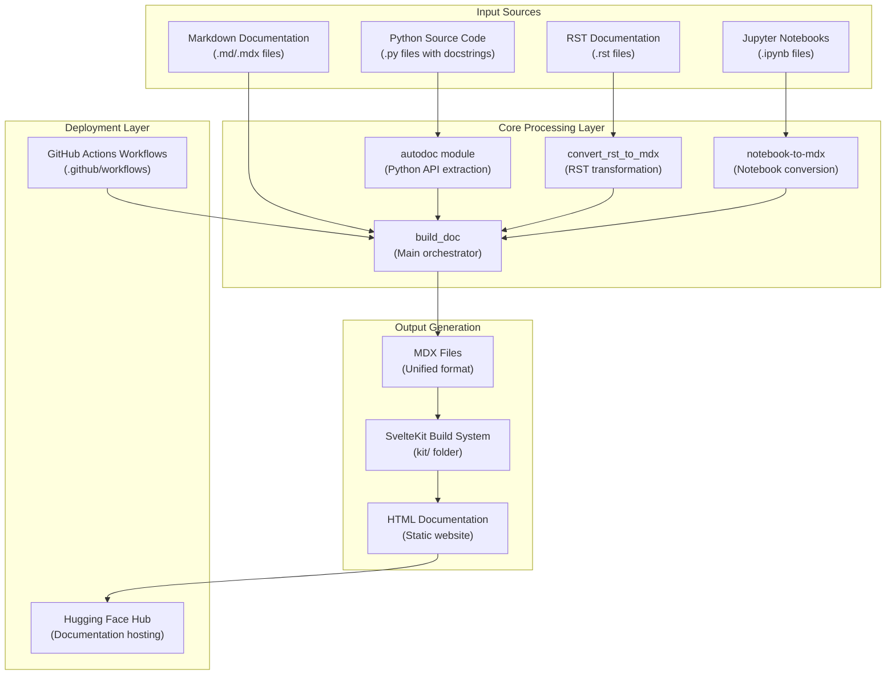
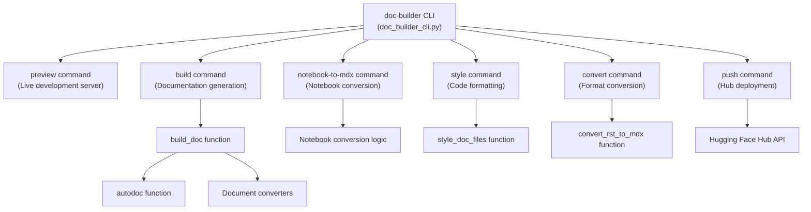
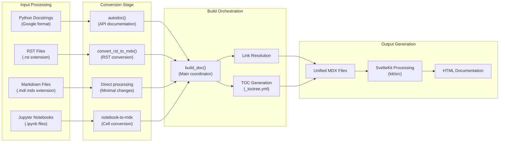
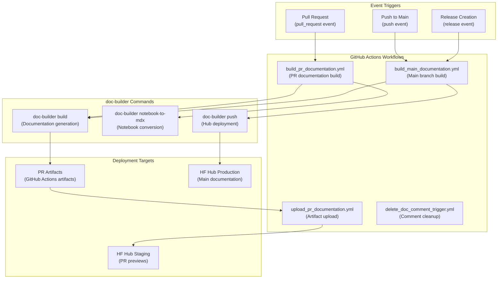
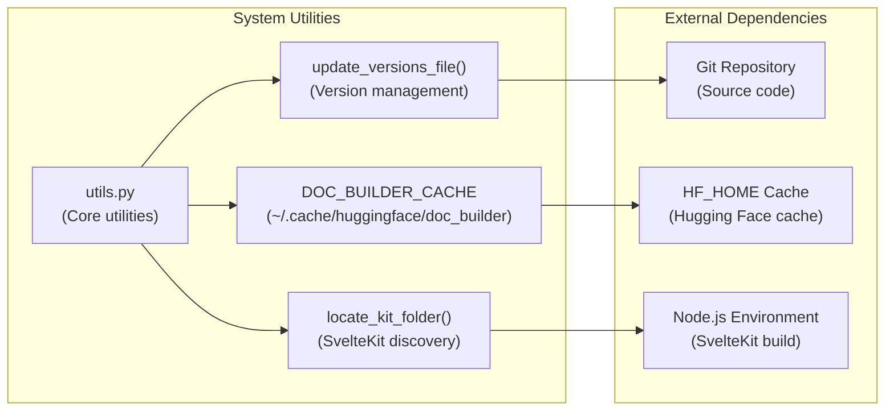

<!-- source: DeepWiki mcp.deepwiki.com · repo huggingface/doc-builder · page 1 Overview · fetched 2026-10-26 -->

# Overview

Relevant source files

The following files were used as context for generating this wiki page:

- [.gitignore](.gitignore)
- [MANIFEST.in](MANIFEST.in)
- [README.md](README.md)
- [setup.py](setup.py)
- [src/doc_builder/__init__.py](src/doc_builder/__init__.py)
- [src/doc_builder/commands/__init__.py](src/doc_builder/commands/__init__.py)
- [src/doc_builder/utils.py](src/doc_builder/utils.py)
- [tests/test_utils.py](tests/test_utils.py)

## Purpose and Scope

The `doc-builder` system is a comprehensive documentation generation and deployment platform designed specifically for Hugging Face repositories. It transforms various documentation formats (Python docstrings, RST files, Markdown files, and Jupyter notebooks) into a unified MDX format and renders them as interactive web documentation using a SvelteKit-based frontend.

This document covers the overall architecture and high-level system interactions. For detailed information about specific subsystems, see [Core Processing Systems](#2) for document conversion engines, [GitHub Actions Integration](#3) for CI/CD workflows, [Command Line Interface](#4) for CLI usage, and [Frontend System Architecture](#5) for the SvelteKit rendering system.

Sources: [README.md:1-39](), [setup.py:21-37](), [src/doc_builder/__init__.py:20-26]()

## System Architecture Overview

The `doc-builder` follows a layered pipeline architecture that processes multiple input formats through conversion engines, builds unified documentation, and deploys it via automated workflows.

### Core System Flow

Sources: [README.md:40-111](), [src/doc_builder/__init__.py:22-26](), [setup.py:36]()

## Command-Line Interface Structure

The system is controlled through the `doc-builder` CLI, which provides commands for different stages of the documentation pipeline.

### CLI Command Architecture

Sources: [setup.py:36](), [README.md:57-111](), [src/doc_builder/__init__.py:22-26]()

## Input Processing and Conversion Pipeline

The system handles multiple input formats through specialized conversion engines that normalize content into MDX format.

| Input Format | Converter Module | Output Format | Key Features |
|--------------|------------------|---------------|--------------|
| Python docstrings | `autodoc` | MDX with API docs | Extracts class/function signatures, handles Google-style docstrings |
| RST files | `convert_rst_to_mdx` | MDX | Converts reStructuredText syntax to Markdown |
| Markdown files | Direct processing | MDX | Minimal transformation, adds MDX components |
| Jupyter notebooks | `notebook-to-mdx` | MDX | Converts cells to markdown, preserves code blocks |

### Document Processing Flow

Sources: [README.md:456-498](), [src/doc_builder/__init__.py:22-25](), [README.md:97-111]()

## GitHub Actions Integration Points

The system integrates deeply with GitHub Actions to provide automated documentation builds for pull requests and releases.

### CI/CD Workflow Architecture

Sources: [README.md:112-142](), [README.md:178-197]()

## Core Dependencies and Integration

The system relies on several key dependencies that define its capabilities and integration points.

| Component | Type | Purpose | Key Files |
|-----------|------|---------|-----------|
| `black` | Python formatter | Code styling and formatting | Used in `style_doc_files` |
| `GitPython` | Git integration | Repository operations | Branch detection, version control |
| `pyyaml` | Configuration | YAML parsing for `_toctree.yml`, `_versions.yml` | Configuration management |
| `huggingface_hub` | Hub integration | Deployment to Hugging Face Hub | Documentation hosting |
| `nbformat` | Notebook processing | Jupyter notebook parsing | Notebook-to-MDX conversion |
| SvelteKit | Frontend framework | Documentation rendering | Located in `kit/` folder |

### System Utilities and Caching

Sources: [setup.py:6](), [src/doc_builder/utils.py:27-31](), [src/doc_builder/utils.py:130-151](), [src/doc_builder/utils.py:55-86]()

## Package Structure and Entry Points

The `hf-doc-builder` package is organized as a modular system with clear separation of concerns between document processing, CLI interface, and utilities.

| Module | Purpose | Key Functions |
|--------|---------|---------------|
| `doc_builder.autodoc` | API documentation generation | `autodoc()` |
| `doc_builder.build_doc` | Main build orchestration | `build_doc()` |
| `doc_builder.convert_rst_to_mdx` | RST conversion | `convert_rst_to_mdx()`, `convert_rst_docstring_to_mdx()` |
| `doc_builder.style_doc` | Code formatting | `style_doc_files()` |
| `doc_builder.utils` | System utilities | `update_versions_file()`, `locate_kit_folder()` |
| `doc_builder.commands.doc_builder_cli` | CLI entry point | `main()` |

The package exports its main functions through `__init__.py` and provides a console script entry point `doc-builder` that maps to the CLI module.

Sources: [src/doc_builder/__init__.py:20-26](), [setup.py:32-36]()

---

