# Page: Overview

# Overview

<details>
<summary>Relevant source files</summary>

The following files were used as context for generating this wiki page:

- [.gitignore](.gitignore)
- [MANIFEST.in](MANIFEST.in)
- [README.md](README.md)
- [setup.py](setup.py)
- [src/doc_builder/__init__.py](src/doc_builder/__init__.py)
- [src/doc_builder/commands/__init__.py](src/doc_builder/commands/__init__.py)
- [src/doc_builder/utils.py](src/doc_builder/utils.py)
- [tests/test_utils.py](tests/test_utils.py)

</details>


## Purpose and Scope

The `doc-builder` system is a comprehensive documentation generation and deployment platform designed specifically for Hugging Face repositories. It transforms various documentation formats (Python docstrings, RST files, Markdown files, and Jupyter notebooks) into a unified MDX format and renders them as interactive web documentation using a SvelteKit-based frontend.

This document covers the overall architecture and high-level system interactions. For detailed information about specific subsystems, see [Core Processing Systems](#2) for document conversion engines, [GitHub Actions Integration](#3) for CI/CD workflows, [Command Line Interface](#4) for CLI usage, and [Frontend System Architecture](#5) for the SvelteKit rendering system.

Sources: [README.md:1-39](), [setup.py:21-37](), [src/doc_builder/__init__.py:20-26]()

## System Architecture Overview

The `doc-builder` follows a layered pipeline architecture that processes multiple input formats through conversion engines, builds unified documentation, and deploys it via automated workflows.

### Core System Flow

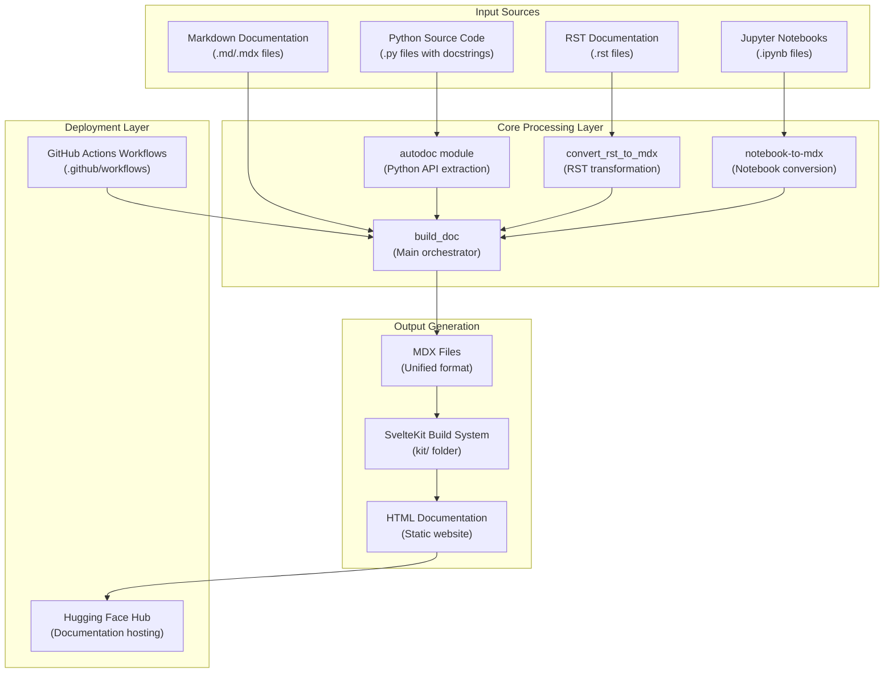

Sources: [README.md:40-111](), [src/doc_builder/__init__.py:22-26](), [setup.py:36]()

## Command-Line Interface Structure

The system is controlled through the `doc-builder` CLI, which provides commands for different stages of the documentation pipeline.

### CLI Command Architecture

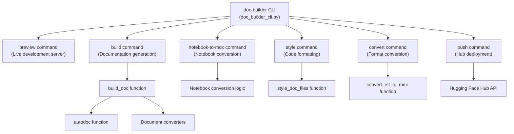

Sources: [setup.py:36](), [README.md:57-111](), [src/doc_builder/__init__.py:22-26]()

## Input Processing and Conversion Pipeline

The system handles multiple input formats through specialized conversion engines that normalize content into MDX format.

| Input Format | Converter Module | Output Format | Key Features |
|--------------|------------------|---------------|--------------|
| Python docstrings | `autodoc` | MDX with API docs | Extracts class/function signatures, handles Google-style docstrings |
| RST files | `convert_rst_to_mdx` | MDX | Converts reStructuredText syntax to Markdown |
| Markdown files | Direct processing | MDX | Minimal transformation, adds MDX components |
| Jupyter notebooks | `notebook-to-mdx` | MDX | Converts cells to markdown, preserves code blocks |

### Document Processing Flow

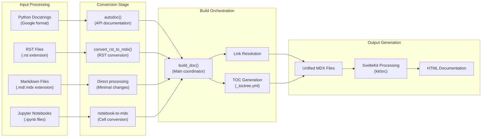

Sources: [README.md:456-498](), [src/doc_builder/__init__.py:22-25](), [README.md:97-111]()

## GitHub Actions Integration Points

The system integrates deeply with GitHub Actions to provide automated documentation builds for pull requests and releases.

### CI/CD Workflow Architecture

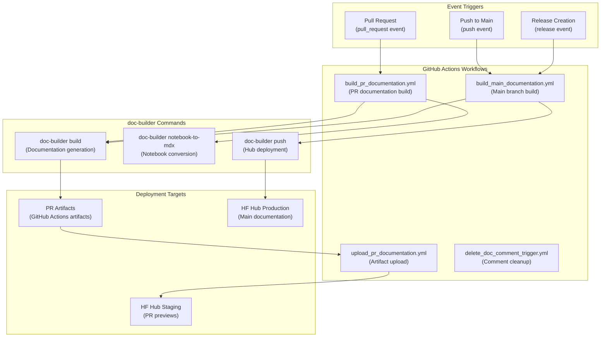

Sources: [README.md:112-142](), [README.md:178-197]()

## Core Dependencies and Integration

The system relies on several key dependencies that define its capabilities and integration points.

| Component | Type | Purpose | Key Files |
|-----------|------|---------|-----------|
| `black` | Python formatter | Code styling and formatting | Used in `style_doc_files` |
| `GitPython` | Git integration | Repository operations | Branch detection, version control |
| `pyyaml` | Configuration | YAML parsing for `_toctree.yml`, `_versions.yml` | Configuration management |
| `huggingface_hub` | Hub integration | Deployment to Hugging Face Hub | Documentation hosting |
| `nbformat` | Notebook processing | Jupyter notebook parsing | Notebook-to-MDX conversion |
| SvelteKit | Frontend framework | Documentation rendering | Located in `kit/` folder |

### System Utilities and Caching

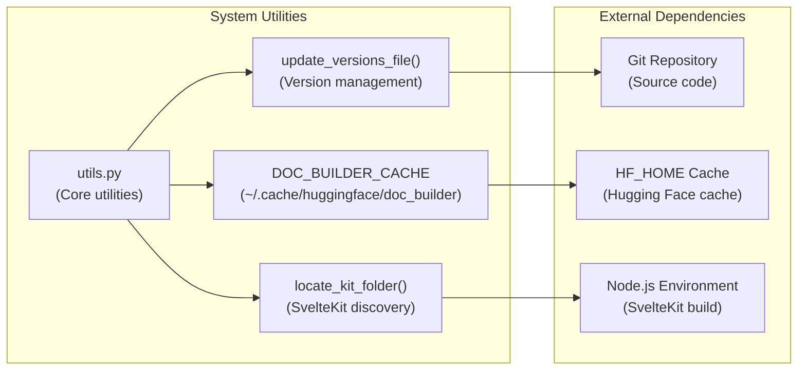

Sources: [setup.py:6](), [src/doc_builder/utils.py:27-31](), [src/doc_builder/utils.py:130-151](), [src/doc_builder/utils.py:55-86]()

## Package Structure and Entry Points

The `hf-doc-builder` package is organized as a modular system with clear separation of concerns between document processing, CLI interface, and utilities.

| Module | Purpose | Key Functions |
|--------|---------|---------------|
| `doc_builder.autodoc` | API documentation generation | `autodoc()` |
| `doc_builder.build_doc` | Main build orchestration | `build_doc()` |
| `doc_builder.convert_rst_to_mdx` | RST conversion | `convert_rst_to_mdx()`, `convert_rst_docstring_to_mdx()` |
| `doc_builder.style_doc` | Code formatting | `style_doc_files()` |
| `doc_builder.utils` | System utilities | `update_versions_file()`, `locate_kit_folder()` |
| `doc_builder.commands.doc_builder_cli` | CLI entry point | `main()` |

The package exports its main functions through `__init__.py` and provides a console script entry point `doc-builder` that maps to the CLI module.

Sources: [src/doc_builder/__init__.py:20-26](), [setup.py:32-36]()

---

# Page: Installation and Setup

# Installation and Setup

<details>
<summary>Relevant source files</summary>

The following files were used as context for generating this wiki page:

- [.gitignore](.gitignore)
- [MANIFEST.in](MANIFEST.in)
- [README.md](README.md)
- [setup.py](setup.py)
- [src/doc_builder/__init__.py](src/doc_builder/__init__.py)
- [src/doc_builder/commands/__init__.py](src/doc_builder/commands/__init__.py)
- [src/doc_builder/utils.py](src/doc_builder/utils.py)
- [tests/test_utils.py](tests/test_utils.py)

</details>


This document covers installing the doc-builder package and configuring it for basic use. It explains the available installation methods, dependencies, and initial configuration steps needed to start building documentation.

For information about using specific CLI commands after installation, see [Command Line Interface](#4). For details about configuring GitHub Actions workflows, see [GitHub Actions Integration](#3).

## Installation Methods

Doc-builder can be installed using two primary methods: from PyPI for standard usage, or from source for development and customization.

### PyPI Installation

The simplest installation method uses pip to install the published package:

```bash
pip install hf-doc-builder
```

This installs the `hf-doc-builder` package with all core dependencies and makes the `doc-builder` command available system-wide.

### Source Installation

For development or to use the latest features, install directly from the GitHub repository:

```bash
git clone https://github.com/huggingface/doc-builder.git
cd doc-builder
pip install -e .
```

The `-e` flag creates an editable installation, allowing modifications to the source code to take effect immediately.

**Installation Flow**

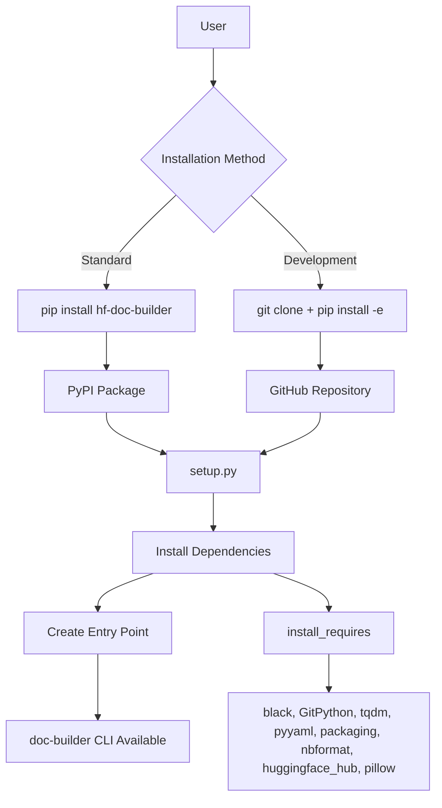

Sources: [README.md:40-53](), [setup.py:21-37]()

## Dependencies and Requirements

The package has several core dependencies that are automatically installed during setup.

### Core Dependencies

| Package | Purpose | 
|---------|---------|
| `black` | Code formatting and styling |
| `GitPython` | Git repository operations |
| `tqdm` | Progress bars for long operations |
| `pyyaml` | YAML configuration file parsing |
| `packaging` | Version parsing and comparison |
| `nbformat` | Jupyter notebook format handling |
| `huggingface_hub` | Integration with Hugging Face Hub |
| `pillow` | Image processing capabilities |

### Optional Dependencies

Additional functionality is available through optional dependency groups:

```bash
# For transformers integration
pip install hf-doc-builder[transformers]

# For testing capabilities  
pip install hf-doc-builder[testing]

# For development tools
pip install hf-doc-builder[dev]
```

**Dependency Architecture**

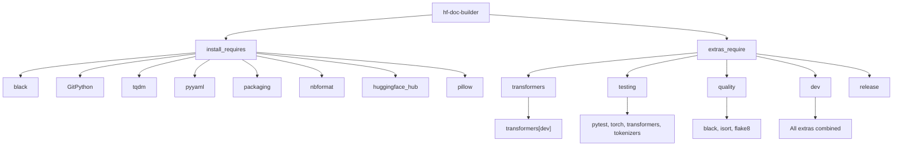

Sources: [setup.py:6-18]()

## Verification

After installation, verify that doc-builder is working correctly by checking the command availability and version.

### Command Availability

The installation creates a console script entry point that should be available in your PATH:

```bash
doc-builder --help
```

This command should display the available subcommands and options without errors.

### Version Check

Verify the installed version matches expectations:

```bash
python -c "import doc_builder; print(doc_builder.__version__)"
```

The current development version is `0.6.0.dev0` as defined in both [src/doc_builder/__init__.py:20]() and [setup.py:23]().

### Import Verification

Test that core modules can be imported successfully:

```bash
python -c "from doc_builder import build_doc, autodoc, convert_rst_to_mdx"
```

Sources: [setup.py:36](), [src/doc_builder/__init__.py:20-26]()

## Configuration and Cache Setup

Doc-builder uses several configuration mechanisms and caching strategies for optimal performance.

### Cache Directory

The package automatically creates a cache directory for storing temporary files and cloned repositories. The cache location follows this priority:

1. `DOC_BUILDER_CACHE` environment variable
2. `$HF_HOME/doc_builder` 
3. `$XDG_CACHE_HOME/huggingface/doc_builder`
4. `~/.cache/huggingface/doc_builder` (default)

### Kit Folder Resolution

For HTML documentation builds, doc-builder needs access to the `kit` folder containing SvelteKit components. The `locate_kit_folder()` function searches for this folder using the following strategy:

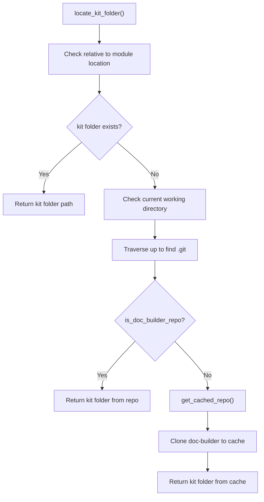

Sources: [src/doc_builder/utils.py:130-151](), [src/doc_builder/utils.py:154-182]()

### Documentation Configuration

Projects can include a `_config.py` file in their documentation source directory to customize doc-builder behavior. This file is executed as a Python module and can define configuration variables like `default_branch_name`.

The configuration is loaded via `read_doc_config()` and accessed through `get_doc_config()`.

Sources: [src/doc_builder/utils.py:91-108]()

## Common Setup Issues

### Windows Compatibility

The preview command has known limitations on Windows systems:

> **`preview` command does not work with Windows.**

For Windows users, use the build command with HTML output instead of the preview functionality.

### Missing Kit Folder

If HTML builds fail with kit folder errors, the system will automatically clone the doc-builder repository to the cache directory. Ensure you have:

- Git installed and available in PATH
- Internet connectivity for cloning
- Write permissions to the cache directory

### Node.js Requirements

HTML output generation requires Node.js version 14 or higher. Install Node.js before attempting HTML builds:

```bash
doc-builder build package_name /path/to/docs --build_dir /output/path --html
```

Sources: [README.md:68-70](), [README.md:86-91]()

---

# Page: Core Processing Systems

# Core Processing Systems

<details>
<summary>Relevant source files</summary>

The following files were used as context for generating this wiki page:

- [src/doc_builder/build_doc.py](src/doc_builder/build_doc.py)
- [src/doc_builder/commands/build.py](src/doc_builder/commands/build.py)
- [tests/test_build_doc.py](tests/test_build_doc.py)

</details>


The core processing systems form the backbone of doc-builder's documentation generation pipeline. These systems handle the conversion of source documentation files into structured MDX format, generate API documentation from Python source code, and orchestrate the entire build process. This document covers the main processing engines that transform raw documentation inputs into the final output format.

For information about the command-line interface that controls these systems, see [Command Line Interface](#4). For details about the document conversion specifics, see [Document Conversion System](#2.1) and [API Documentation Generation](#2.2).

## Build Orchestration System

The primary orchestration system is centered around the `build_doc` function, which coordinates all document processing activities. This system manages the entire documentation build lifecycle from input validation through final output generation.

### Build Flow Architecture

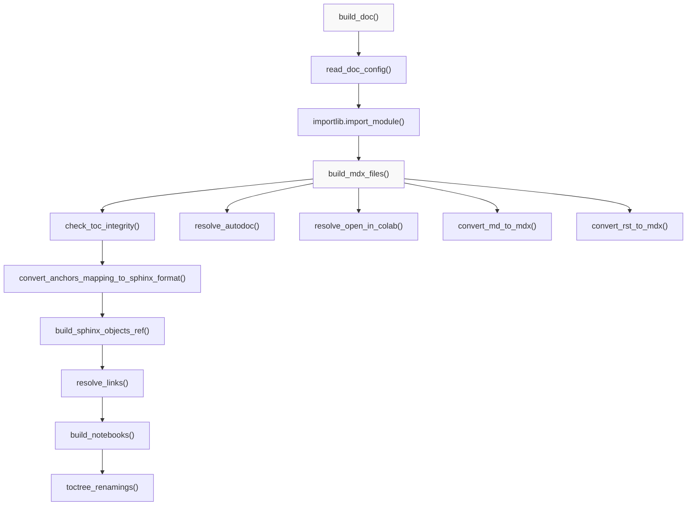

The `build_doc` function accepts multiple configuration parameters including `package_name`, `doc_folder`, `output_dir`, and various version-related settings. It orchestrates the entire build process by sequentially calling specialized processing functions.

Sources: [src/doc_builder/build_doc.py:309-388]()

### Core Processing Parameters

| Parameter | Purpose | Default Value |
|-----------|---------|---------------|
| `package_name` | Target Python package name | Required |
| `doc_folder` | Source documentation directory | Required |
| `output_dir` | Build output directory | Required |
| `version_tag_suffix` | GitHub link suffix | `"src/"` |
| `is_python_module` | Enable Python-specific processing | `False` |
| `watch_mode` | Skip validation for live preview | `False` |

Sources: [src/doc_builder/build_doc.py:324-352]()

## Document Processing Pipeline

The document processing pipeline handles multiple input formats and converts them to a unified MDX output format. The `build_mdx_files` function serves as the main processing coordinator.

### File Processing Flow

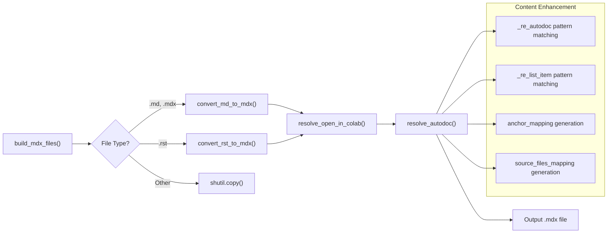

The pipeline processes three main file types:
- **Markdown files** (`.md`, `.mdx`): Processed by `convert_md_to_mdx`
- **reStructuredText files** (`.rst`): Processed by `convert_rst_to_mdx`
- **Other files**: Copied directly to output directory

Sources: [src/doc_builder/build_doc.py:159-251]()

### Pattern Recognition System

The system uses compiled regular expressions to identify special markup patterns:

- `_re_autodoc`: Matches `[[autodoc]] ClassName` patterns for API documentation generation
- `_re_list_item`: Matches `- method_name` patterns for method lists

These patterns enable automatic content expansion and cross-referencing.

Sources: [src/doc_builder/build_doc.py:34-35]()

## Content Resolution and Enhancement

The content resolution system handles special markup patterns and generates enhanced documentation features.

### Autodoc Resolution Process

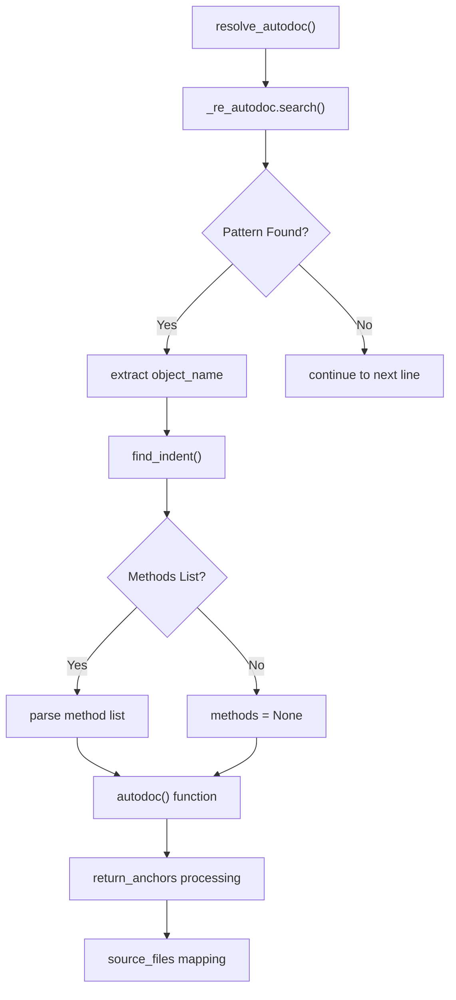

The `resolve_autodoc` function processes `[[autodoc]]` markers by:
1. Extracting the target object name using `_re_autodoc` pattern
2. Determining indentation level with `find_indent`
3. Parsing optional method lists using `_re_list_item` pattern
4. Calling the `autodoc` function to generate documentation
5. Collecting anchors and source file mappings for cross-referencing

Sources: [src/doc_builder/build_doc.py:75-156]()

### Open-in-Colab Enhancement

The `resolve_open_in_colab` function transforms `[[open-in-colab]]` markers into interactive Svelte components:

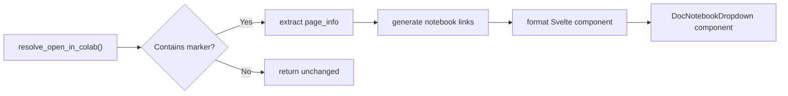

The function generates links for multiple platforms:
- Google Colab (Mixed, PyTorch, TensorFlow variants)
- AWS SageMaker Studio Lab (Mixed, PyTorch, TensorFlow variants)

Sources: [src/doc_builder/build_doc.py:38-72]()

## Build Validation and Output Generation

The validation system ensures documentation integrity and generates auxiliary files for cross-referencing.

### Table of Contents Validation

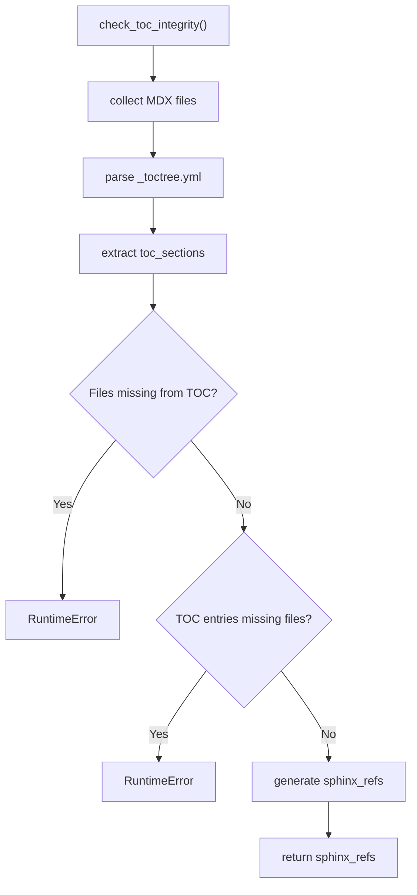

The `check_toc_integrity` function validates that:
- All generated MDX files are referenced in `_toctree.yml`
- All TOC entries correspond to existing files
- Generates Sphinx references for cross-documentation linking

Sources: [src/doc_builder/build_doc.py:436-491]()

### Sphinx Objects Reference Generation

The system generates `objects.inv` files compatible with Sphinx documentation systems:

| Component | Function | Output Format |
|-----------|----------|---------------|
| Class objects | `py:class` | `ClassName py:class 1 page#anchor -` |
| Methods | `py:method` | `method_name py:method 1 page#anchor -` |
| Functions | `py:function` | `function_name py:function 1 page#anchor -` |

The `build_sphinx_objects_ref` function creates compressed inventory files that enable intersphinx linking from other documentation sites.

Sources: [src/doc_builder/build_doc.py:528-551](), [src/doc_builder/build_doc.py:494-525]()

### Link Resolution System

The `resolve_links` function processes all generated MDX files to resolve internal cross-references using the anchor mapping generated during the build process. This ensures that `[ClassName]` references are converted to proper documentation links.

Sources: [src/doc_builder/build_doc.py:253-271]()

---

# Page: Document Conversion System

# Document Conversion System

<details>
<summary>Relevant source files</summary>

The following files were used as context for generating this wiki page:

- [src/doc_builder/convert_md_to_mdx.py](src/doc_builder/convert_md_to_mdx.py)
- [src/doc_builder/convert_rst_to_mdx.py](src/doc_builder/convert_rst_to_mdx.py)
- [tests/test_convert_md_to_mdx.py](tests/test_convert_md_to_mdx.py)
- [tests/test_convert_rst_to_mdx.py](tests/test_convert_rst_to_mdx.py)

</details>


## Purpose and Scope

The Document Conversion System is responsible for transforming various input documentation formats into a unified MDX format that can be processed by the SvelteKit frontend. This system handles the conversion of reStructuredText (RST) and Markdown files, ensuring consistent formatting, proper link resolution, and integration with doc-builder's component ecosystem.

For information about API documentation generation from Python source code, see [API Documentation Generation](#2.2). For details about the SvelteKit frontend that renders the converted MDX files, see [Frontend System Architecture](#5).

## Conversion Pipeline Overview

The document conversion system operates as a two-track pipeline that processes different input formats and outputs standardized MDX files compatible with the SvelteKit frontend.

### High-Level Conversion Flow

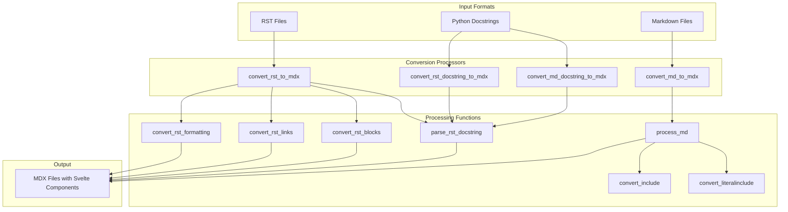

Sources: [src/doc_builder/convert_rst_to_mdx.py:1-706](), [src/doc_builder/convert_md_to_mdx.py:1-242]()

## RST to MDX Conversion

The RST conversion system handles the complex task of transforming reStructuredText markup into MDX format while preserving semantic meaning and integrating with doc-builder's component system.

### RST Conversion Architecture

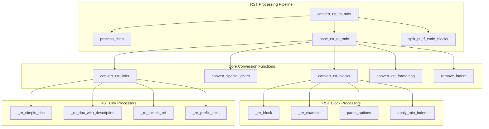

Sources: [src/doc_builder/convert_rst_to_mdx.py:657-706](), [src/doc_builder/convert_rst_to_mdx.py:559-578]()

### RST Formatting Conversion

The `convert_rst_formatting` function handles the transformation of RST-specific markup syntax to Markdown equivalents:

| RST Syntax | Converted Output | Purpose |
|------------|------------------|---------|
| `:obj:\`text\`` | `\`\`text\`\`` | Object references |
| `:class:\`text\`` | `[\`\`text\`\`]` | Class references |
| `:func:\`text\`` | `[\`\`text\`\`]` | Function references |
| `:math:\`formula\`` | `\\\\(formula\\\\)` | Mathematical expressions |
| `\`text\`` | `*text*` | Italic formatting |
| `\`\`text\`\`` | `\`text\`` | Code formatting |

Sources: [src/doc_builder/convert_rst_to_mdx.py:32-71](), [src/doc_builder/convert_rst_to_mdx.py:20-29]()

### RST Block Processing

The system converts various RST directives into corresponding MDX components:

```mermaid
graph LR
    subgraph "RST Blocks"
        A[".. note::"]
        B[".. warning::"]
        C[".. code-block::"]
        D[".. autoclass::"]
        E[".. image::"]
        F["Example::"]
    end
    
    subgraph "MDX Components"
        G["<Tip>"]
        H["<Tip warning={true}>"]
        I["```language"]
        J["[[autodoc]]"]
        K[""]
        L["<ExampleCodeBlock>"]
    end
    
    A --> G
    B --> H
    C --> I
    D --> J
    E --> K
    F --> L
```

Sources: [src/doc_builder/convert_rst_to_mdx.py:216-323](), [src/doc_builder/convert_rst_to_mdx.py:129-135]()

## Markdown to MDX Conversion

The Markdown conversion system transforms standard Markdown into MDX with embedded Svelte components and enhanced functionality.

### MD Conversion Components

The `convert_md_to_mdx` function wraps Markdown content with a comprehensive set of Svelte component imports and processing directives:

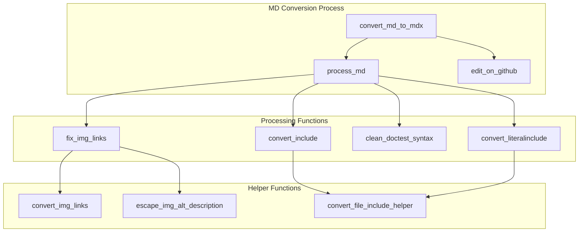

Sources: [src/doc_builder/convert_md_to_mdx.py:27-83](), [src/doc_builder/convert_md_to_mdx.py:229-241]()

### Include Directive Processing

The system supports `<include>` and `<literalinclude>` directives for embedding external file content:

| Feature | Configuration | Purpose |
|---------|---------------|---------|
| `path` | File path relative to current document | Source file location |
| `start-after` | Text marker in source file | Content inclusion start point |
| `end-before` | Text marker in source file | Content inclusion end point |
| `dedent` | Number of characters | Remove leading whitespace |
| `language` | Programming language identifier | Syntax highlighting (literalinclude only) |

Sources: [src/doc_builder/convert_md_to_mdx.py:170-201](), [src/doc_builder/convert_md_to_mdx.py:204-217]()

## Docstring Processing System

Both RST and Markdown conversion systems utilize a sophisticated docstring parser that handles structured documentation within Python docstrings.

### Docstring Parsing Pipeline

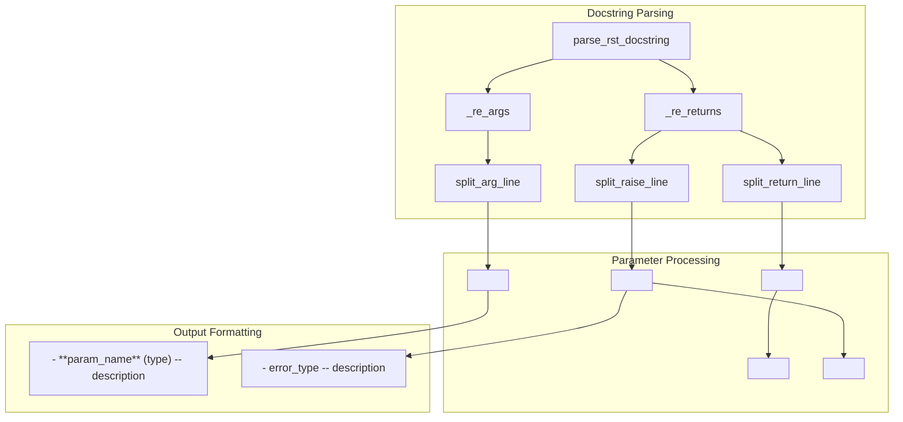

Sources: [src/doc_builder/convert_rst_to_mdx.py:378-471](), [src/doc_builder/convert_rst_to_mdx.py:325-368]()

## Framework-Specific Code Processing

The conversion system includes specialized handling for framework-specific code blocks, particularly for PyTorch and TensorFlow examples.

### Framework Code Block Structure

```mermaid
graph LR
    subgraph "Input Code Block"
        A["```python<br/>common_code<br/>## PYTORCH CODE<br/>pytorch_specific<br/>## TENSORFLOW CODE<br/>tensorflow_specific<br/>```"]
    end
    
    subgraph "Output Structure"
        B["<frameworkcontent><br/><pt><br/>```python<br/>common_code<br/>pytorch_specific<br/>```<br/></pt><br/><tf><br/>```python<br/>common_code<br/>tensorflow_specific<br/>```<br/></tf><br/></frameworkcontent>"]
    end
    
    A --> B
```

Sources: [src/doc_builder/convert_rst_to_mdx.py:613-655]()

## Integration with Build System

The conversion system integrates with the broader doc-builder architecture through standardized page information structures and consistent output formatting.

### Page Information Schema

The conversion functions require a `page_info` dictionary containing:

| Key | Type | Purpose |
|-----|------|---------|
| `package_name` | `str` | Target package identifier |
| `version` | `str` | Documentation version (default: "main") |
| `language` | `str` | Localization language (default: "en") |
| `page` | `str` | Current page path for relative links |
| `path` | `Path` | Source file path for include processing |
| `repo_name` | `str` | GitHub repository name |
| `repo_owner` | `str` | GitHub repository owner |

Sources: [src/doc_builder/convert_rst_to_mdx.py:88-127](), [src/doc_builder/convert_md_to_mdx.py:86-101]()

The Document Conversion System serves as a critical bridge between various documentation formats and the unified MDX output required by the SvelteKit frontend, ensuring consistent formatting, proper component integration, and seamless content processing across the entire doc-builder pipeline.

---

# Page: API Documentation Generation

# API Documentation Generation

<details>
<summary>Relevant source files</summary>

The following files were used as context for generating this wiki page:

- [src/doc_builder/autodoc.py](src/doc_builder/autodoc.py)
- [tests/test_autodoc.py](tests/test_autodoc.py)

</details>


The API Documentation Generation system extracts Python API documentation from source code docstrings and converts it into structured documentation components for web rendering. This system processes Python objects (classes, functions, methods) to automatically generate comprehensive API reference documentation.

For information about converting standalone documentation files, see [Document Conversion System](#2.1). For content processing utilities, see [Content Processing and Styling](#2.3).

## Purpose and Architecture

The autodoc system serves as the bridge between Python source code and the rendered documentation website. It introspects Python packages to extract docstrings, function signatures, and metadata, then transforms this information into structured components that can be rendered by the SvelteKit frontend.

### Core Processing Flow

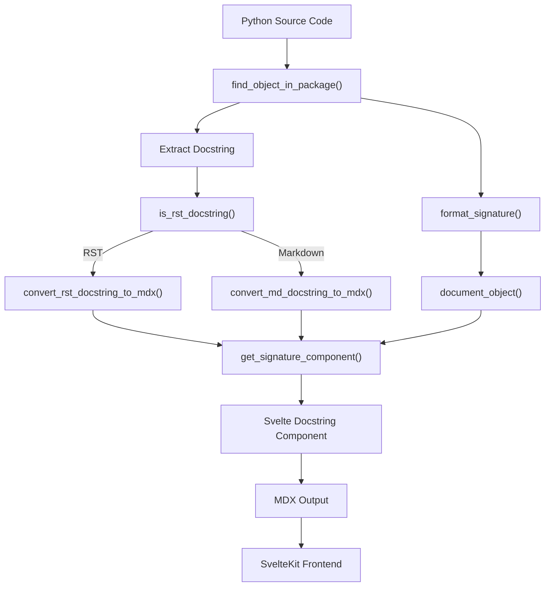

Sources: [src/doc_builder/autodoc.py:358-418](), [src/doc_builder/autodoc.py:449-521]()

### Object Discovery and Resolution

The system uses Python's introspection capabilities to discover and resolve objects within packages:

```mermaid
graph TD
    A["Package Module"] --> B["find_object_in_package()"]
    B --> C["Split object path"]
    C --> D["Traverse module hierarchy"]
    D --> E["Handle import failures"]
    E --> F["getattr() resolution"]
    F --> G["Return object or None"]
    
    H["get_shortest_path()"] --> I["Optimize import path"]
    I --> J["Find shortest valid path"]
    J --> K["Return canonical name"]
    
    G --> L["document_object()"]
    K --> L
```

Sources: [src/doc_builder/autodoc.py:26-54](), [src/doc_builder/autodoc.py:63-87]()

## Core Functions and Classes

### Primary Entry Points

The `autodoc()` function serves as the main entry point for generating documentation. It processes a single object or class with its methods:

| Parameter | Type | Description |
|-----------|------|-------------|
| `object_name` | `str` | Full path to the Python object |
| `package` | `ModuleType` | Package containing the object |
| `methods` | `List[str]` | Methods to document for classes |
| `return_anchors` | `bool` | Whether to return anchor names |
| `page_info` | `Dict` | Metadata about the documentation page |

The function returns either a documentation string or a tuple containing documentation, anchors, and quality check errors.

Sources: [src/doc_builder/autodoc.py:449-521]()

### Object Documentation Pipeline

The `document_object()` function handles individual object processing:

```mermaid
graph TD
    A["Object Input"] --> B["find_object_in_package()"]
    B --> C["Extract __doc__"]
    C --> D["is_dataclass_autodoc()"]
    D -->|Auto-generated| E["Skip docstring"]
    D -->|Manual| F["Process docstring"]
    F --> G["is_rst_docstring()"]
    G -->|RST| H["convert_rst_docstring_to_mdx()"]
    G -->|Markdown| I["convert_md_docstring_to_mdx()"]
    H --> J["quality_check_docstring()"]
    I --> J
    E --> K["format_signature()"]
    J --> K
    K --> L["get_source_link()"]
    L --> M["get_signature_component()"]
    M --> N["Structured Documentation"]
```

Sources: [src/doc_builder/autodoc.py:358-418]()

### Signature Processing

The system extracts and formats function signatures with type annotations:

```mermaid
graph TD
    A["Python Object"] --> B["inspect.signature()"]
    B --> C["Iterate parameters"]
    C --> D["Skip self/cls"]
    D --> E["Handle *args/**kwargs"]
    E --> F["Extract annotations"]
    F --> G["get_type_name()"]
    G --> H["Format defaults"]
    H --> I["Build parameter list"]
    I --> J["JSON signature data"]
```

The `format_signature()` function returns a list of dictionaries with parameter names and their type/default information.

Sources: [src/doc_builder/autodoc.py:99-132]()

## Docstring Processing

### Format Detection and Conversion

The system automatically detects docstring formats and applies appropriate conversion:

| Format | Detection Method | Conversion Function |
|--------|------------------|-------------------|
| RST | `_re_rst_special_words`, `:obj:` patterns | `convert_rst_docstring_to_mdx()` |
| Markdown | Default format | `convert_md_docstring_to_mdx()` |
| NumPy Style | `_re_numpydocstring` pattern | Detected but not specifically handled |

Sources: [src/doc_builder/autodoc.py:248-300]()

### Special Section Processing

The system processes structured docstring sections using regex patterns:

```mermaid
graph TD
    A["Raw Docstring"] --> B["Extract <parameters>"]
    A --> C["Extract <returns>"]
    A --> D["Extract <raises>"]
    A --> E["Extract <yields>"]
    
    B --> F["_re_parameters"]
    C --> G["_re_returns"]
    D --> H["_re_raises"]
    E --> I["_re_yields"]
    
    F --> J["Process parameter groups"]
    G --> K["Format return description"]
    H --> L["Format exception info"]
    I --> M["Format yield info"]
    
    J --> N["Svelte Component Tags"]
    K --> N
    L --> N
    M --> N
```

The regex patterns used include:
- `_re_parameters` for parameter sections
- `_re_returns` for return descriptions
- `_re_raises` for exception documentation
- `_re_parameter_group` for parameter groupings

Sources: [src/doc_builder/autodoc.py:134-143](), [src/doc_builder/autodoc.py:145-238]()

## Component Generation

### Svelte Docstring Components

The `get_signature_component()` function generates structured Svelte components:

```xml
<docstring>
  <name>class transformers.BertModel</name>
  <anchor>transformers.BertModel</anchor>
  <source>https://github.com/huggingface/transformers/blob/main/src/...</source>
  <parameters>[{"name": "config", "val": ""}, ...]</parameters>
  <paramsdesc>Parameter descriptions...</paramsdesc>
  <rettype>Return type</rettype>
  <retdesc>Return description</retdesc>
  <raises>Exception descriptions</raises>
</docstring>
```

Sources: [src/doc_builder/autodoc.py:145-238]()

### Method Documentation for Classes

For class objects, the system automatically discovers and documents public methods:

```mermaid
graph TD
    A["Class Object"] --> B["find_documented_methods()"]
    B --> C["Get public attributes"]
    C --> D["Filter callable methods"]
    D --> E["Check for documentation"]
    E --> F["Compare with superclass docs"]
    F --> G["Return unique methods"]
    
    H["methods parameter"] --> I["Process 'all' keyword"]
    I --> J["Process 'none' keyword"]
    J --> K["Merge with discovered methods"]
    
    G --> L["Document each method"]
    K --> L
    L --> M["Generate method components"]
```

Sources: [src/doc_builder/autodoc.py:420-444](), [src/doc_builder/autodoc.py:489-517]()

## Link Resolution and Cross-References

### Internal Link Processing

The `resolve_links_in_text()` function converts documentation links to proper URLs:

```mermaid
graph TD
    A["Text with [`ObjectName`] links"] --> B["Parse link patterns"]
    B --> C["Extract object name"]
    C --> D["Check external libraries"]
    D -->|External| E["get_external_object_link()"]
    D -->|Internal| F["find_object_in_package()"]
    F --> G["get_shortest_path()"]
    G --> H["Look up in mapping"]
    H --> I["Generate URL with anchor"]
    E --> J["Final linked text"]
    I --> J
```

The system supports several link formats:
- `[`ObjectName`]` - Standard object reference
- `[`~full.path.ObjectName`]` - Shortened display name
- `[`ObjectName#parameter`]` - Link to specific parameter

Sources: [src/doc_builder/autodoc.py:523-588]()

### Source Code Linking

The `get_source_link()` function generates GitHub source links:

| Component | Source | Example |
|-----------|--------|---------|
| Repository | `page_info["repo_owner"]` | `huggingface` |
| Package | `page_info["repo_name"]` | `transformers` |
| Version | `page_info["version_tag"]` | `main` |
| File Path | `inspect.getsourcefile()` | `src/transformers/models/bert/modeling_bert.py` |
| Line Number | `inspect.getsourcelines()` | `#L123` |

Sources: [src/doc_builder/autodoc.py:328-343]()

## Quality Assurance and Error Handling

### Docstring Quality Checks

The `quality_check_docstring()` function validates docstring structure:

```mermaid
graph TD
    A["Input Docstring"] --> B["Split into lines"]
    B --> C["Track code blocks"]
    C --> D["Find Return blocks"]
    D --> E["Check block completeness"]
    E --> F["Validate code block closure"]
    F --> G["Count Return blocks"]
    G --> H["Generate error messages"]
    H --> I["Return validation results"]
```

Common validation errors include:
- Empty Return blocks
- Multiple Return blocks (only one supported)
- Unclosed code blocks
- Malformed parameter sections

Sources: [src/doc_builder/autodoc.py:596-651]()

### Error Accumulation

The autodoc system accumulates quality check errors and returns them alongside documentation, allowing for batch error reporting rather than failing on the first issue encountered.

Sources: [src/doc_builder/autodoc.py:473-480](), [src/doc_builder/autodoc.py:507-509]()

## Integration with Frontend

The generated Svelte components integrate with the frontend documentation system through:

1. **CSS Styling**: Components use predefined CSS classes like `docstring_css_classes`
2. **Anchor Generation**: Each documented object receives a unique anchor for deep linking
3. **Example Code Blocks**: Special handling for example code with `hashlink_example_codeblock()`
4. **Interactive Features**: Integration with framework switchers and inference snippets

The CSS classes applied include: `"docstring border-l-2 border-t-2 pl-4 pt-3.5 border-gray-100 rounded-tl-xl mb-6 mt-8"`

Sources: [src/doc_builder/autodoc.py:446](), [src/doc_builder/autodoc.py:509](), [src/doc_builder/autodoc.py:518]()

---

# Page: Content Processing and Styling

# Content Processing and Styling

<details>
<summary>Relevant source files</summary>

The following files were used as context for generating this wiki page:

- [src/doc_builder/commands/style.py](src/doc_builder/commands/style.py)
- [src/doc_builder/convert_to_notebook.py](src/doc_builder/convert_to_notebook.py)
- [src/doc_builder/style_doc.py](src/doc_builder/style_doc.py)
- [tests/test_convert_to_notebook.py](tests/test_convert_to_notebook.py)
- [tests/test_style_doc.py](tests/test_style_doc.py)

</details>


This section covers the content transformation utilities that handle notebook conversion, code formatting, and styling within the doc-builder system. These components process MDX documentation files and convert them into various output formats while ensuring consistent code style and formatting.

For information about the core document conversion from RST and Markdown to MDX, see [Document Conversion System](#2.1). For API documentation extraction from Python source code, see [API Documentation Generation](#2.2).

## Overview

The content processing and styling system consists of three main components:

1. **Notebook Conversion** - Transforms MDX documentation into Jupyter notebooks with proper cell separation and framework-specific variants
2. **Code Styling** - Formats Python code samples in documentation using Black and enforces consistent docstring styling
3. **Content Transformation** - Handles special content like YouTube embeds, mathematical formulas, and framework-specific content blocks

## Notebook Conversion System

The notebook conversion system transforms MDX documentation files into executable Jupyter notebooks, supporting multiple ML frameworks and interactive content.

### Core Conversion Process

```mermaid
graph TD
    A["MDX File"] --> B["clean_content()"]
    B --> C["split_frameworks()"]
    C --> D["Framework Variants"]
    D --> E["parse_doc_into_cells()"]
    E --> F["Cell Processing"]
    F --> G["create_notebook()"]
    G --> H["Output Notebooks"]
    
    F --> I["markdown_cell()"]
    F --> J["code_cell()"]
    F --> K["youtube_cell()"]
    
    subgraph "Cell Types"
        I
        J
        K
    end
    
    subgraph "Framework Outputs"
        L["Mixed"]
        M["PyTorch"]
        N["TensorFlow"]
        O["JAX"]
    end
    
    H --> L
    H --> M
    H --> N
    H --> O
```

Sources: [src/doc_builder/convert_to_notebook.py:293-320]()

### Content Cleaning and Preprocessing

The `clean_content()` function handles several preprocessing steps:

| Operation | Regex Pattern | Purpose |
|-----------|---------------|---------|
| Copyright removal | `_re_copyright` | Removes copyright headers |
| Colab marker removal | `[[open-in-colab]]` | Removes special markers |
| Math formula conversion | `_re_math_delimiter` | Converts `\\(formula\\)` to `$formula$` |
| Link resolution | `resolve_links_in_text()` | Resolves documentation links |
| Link expansion | `expand_links()` | Expands relative links to full URLs |

Sources: [src/doc_builder/convert_to_notebook.py:67-82]()

### Framework Content Splitting

The `split_frameworks()` function processes `<frameworkcontent>` blocks to generate framework-specific notebook variants:

```mermaid
graph LR
    A["MDX Content"] --> B["split_frameworks()"]
    B --> C["Parse Framework Blocks"]
    C --> D["Extract Content"]
    
    subgraph "Framework Tags"
        E["<pt>"]
        F["<tf>"]
        G["<jax>"]
    end
    
    D --> E
    D --> F
    D --> G
    
    E --> H["PyTorch Content"]
    F --> I["TensorFlow Content"]
    G --> J["JAX Content"]
    
    H --> K["Mixed Content"]
    I --> K
    J --> K
```

Sources: [src/doc_builder/convert_to_notebook.py:85-115]()

### Cell Creation and Parsing

The system creates different cell types based on content structure:

- **Markdown Cells**: Created by `markdown_cell()` for text content and headers
- **Code Cells**: Created by `code_cell()` for Python code blocks, with optional output
- **YouTube Cells**: Created by `youtube_cell()` for embedded videos with iframe HTML

The `parse_input_output()` function handles doctest syntax conversion:

```mermaid
graph TD
    A["Doctest Lines"] --> B["parse_input_output()"]
    B --> C["Identify Prompts"]
    C --> D[">>> and ..."]
    D --> E["Extract Code"]
    E --> F["Extract Output"]
    F --> G["Code/Output Pairs"]
    
    subgraph "Input Patterns"
        H[">>> code"]
        I["... continuation"]
        J["output_line"]
    end
    
    C --> H
    C --> I
    C --> J
```

Sources: [src/doc_builder/convert_to_notebook.py:125-158]()

## Code Styling System

The code styling system ensures consistent formatting of Python code samples and docstrings throughout the documentation.

### Styling Architecture

```mermaid
graph TD
    A["Input Files"] --> B["style_doc_files()"]
    B --> C["File Type Detection"]
    
    C --> D[".py Files"]
    C --> E[".mdx Files"]
    
    D --> F["style_file_docstrings()"]
    E --> G["style_mdx_file()"]
    
    F --> H["style_docstrings_in_code()"]
    G --> I["Parse Code Blocks"]
    
    H --> J["style_docstring()"]
    I --> K["format_code_example()"]
    
    J --> L["format_text()"]
    K --> M["Black Formatting"]
    
    L --> N["Styled Output"]
    M --> N
```

Sources: [src/doc_builder/style_doc.py:491-548]()

### Code Example Formatting

The `format_code_example()` function processes Python code samples:

1. **Parse Structure**: Uses `parse_code_example()` to separate code and output
2. **Black Formatting**: Applies Black code formatter with configurable line length
3. **Doctest Reconstruction**: Rebuilds doctest syntax with proper `>>>` and `...` prompts
4. **Indentation Preservation**: Maintains original indentation levels

Key regex patterns used:

| Pattern | Variable | Purpose |
|---------|----------|---------|
| Code blocks | `_re_code` | Identifies code block boundaries |
| List items | `_re_list` | Detects list formatting |
| Tip blocks | `_re_tip` | Identifies `<Tip>` components |
| Docstyle ignore | `_re_docstyle_ignore` | Skips formatting for marked sections |

Sources: [src/doc_builder/style_doc.py:94-184]()

### Docstring Styling

The `style_docstring()` function formats docstring structure:

```mermaid
graph TD
    A["Raw Docstring"] --> B["Parse Lines"]
    B --> C["Detect Paragraphs"]
    C --> D["Identify Blocks"]
    
    D --> E["Args Blocks"]
    D --> F["Returns Blocks"]
    D --> G["Code Blocks"]
    D --> H["Regular Text"]
    
    E --> I["Parameter Formatting"]
    F --> J["Return Formatting"]
    G --> K["Code Formatting"]
    H --> L["Text Wrapping"]
    
    I --> M["format_text()"]
    J --> M
    K --> N["format_code_example()"]
    L --> M
    
    M --> O["Styled Docstring"]
    N --> O
```

Sources: [src/doc_builder/style_doc.py:227-380]()

## CLI Integration

The styling system integrates with the doc-builder CLI through the `style` command:

### Command Structure

```mermaid
graph LR
    A["doc-builder style"] --> B["style_command()"]
    B --> C["Read Config"]
    C --> D["style_doc_files()"]
    D --> E["Process Files"]
    
    E --> F["Recursive Directory"]
    E --> G["Individual Files"]
    
    F --> H[".py and .mdx Files"]
    G --> H
    
    H --> I["Apply Styling"]
    I --> J["Check Only Mode"]
    I --> K["Write Changes"]
```

Sources: [src/doc_builder/commands/style.py:23-31]()

### Configuration Options

The CLI accepts several parameters:

- `files`: Target files or directories to process
- `--path_to_docs`: Documentation source folder path
- `--max_len`: Maximum line length (default: 119)
- `--check_only`: Validation mode without modifications

Sources: [src/doc_builder/commands/style.py:39-42]()

## Content Processing Pipeline

The complete content processing pipeline integrates notebook conversion and styling:

```mermaid
graph TD
    A["Source MDX"] --> B["Content Cleaning"]
    B --> C["Framework Splitting"]
    C --> D["Cell Generation"]
    D --> E["Code Styling"]
    E --> F["Output Generation"]
    
    subgraph "Cleaning Operations"
        G["clean_content()"]
        H["Copyright Removal"]
        I["Math Conversion"]
        J["Link Resolution"]
    end
    
    subgraph "Framework Processing"
        K["split_frameworks()"]
        L["Extract PT/TF/JAX"]
        M["Generate Variants"]
    end
    
    subgraph "Cell Processing"
        N["parse_doc_into_cells()"]
        O["markdown_cell()"]
        P["code_cell()"]
        Q["youtube_cell()"]
    end
    
    subgraph "Styling Operations"
        R["format_code_example()"]
        S["Black Formatting"]
        T["Doctest Reconstruction"]
    end
    
    B --> G
    C --> K
    D --> N
    E --> R
```

Sources: [src/doc_builder/convert_to_notebook.py:293-320](), [src/doc_builder/style_doc.py:491-548]()

## Error Handling and Validation

The system includes comprehensive error handling:

- **Black Formatting Errors**: Captured and reported when code cannot be formatted
- **Malformed Content**: Validation for unclosed code blocks and invalid syntax
- **Framework Block Validation**: Ensures proper nesting of framework-specific content
- **File Processing Errors**: Graceful handling of file access and parsing issues

The styling system accumulates errors and provides detailed feedback about formatting issues, helping maintain code quality standards across the documentation.

Sources: [src/doc_builder/style_doc.py:540-547](), [src/doc_builder/convert_to_notebook.py:134-141]()

---

# Page: GitHub Actions Integration

# GitHub Actions Integration

<details>
<summary>Relevant source files</summary>

The following files were used as context for generating this wiki page:

- [.github/workflows/build_main_documentation.yml](.github/workflows/build_main_documentation.yml)
- [.github/workflows/build_pr_documentation.yml](.github/workflows/build_pr_documentation.yml)
- [src/doc_builder/commands/doc_builder_cli.py](src/doc_builder/commands/doc_builder_cli.py)
- [src/doc_builder/commands/notebook_to_mdx.py](src/doc_builder/commands/notebook_to_mdx.py)
- [src/doc_builder/commands/push.py](src/doc_builder/commands/push.py)

</details>


The GitHub Actions integration provides automated CI/CD workflows for building, testing, and deploying documentation using the doc-builder system. This integration enables seamless documentation generation for both pull requests and main branch deployments across Hugging Face repositories.

For information about the CLI commands used within these workflows, see [Command Line Interface](#4). For details about the frontend build process, see [Frontend System Architecture](#5).

## Workflow Architecture

The doc-builder GitHub Actions integration consists of two primary reusable workflows that handle different deployment scenarios:

| Workflow | Purpose | Trigger | Output |
|----------|---------|---------|--------|
| `build_pr_documentation.yml` | Generate documentation previews for pull requests | `workflow_call` from PR events | Artifacts for preview deployment |
| `build_main_documentation.yml` | Build and deploy production documentation | `workflow_call` from main branch pushes | Live documentation on Hugging Face Hub |

```mermaid
graph TB
    subgraph "Repository Events"
        A["Pull Request"] 
        B["Main Branch Push"]
    end
    
    subgraph "Workflow Dispatch"
        C["build_pr_documentation.yml"]
        D["build_main_documentation.yml"]
    end
    
    subgraph "Build Process"
        E["Environment Setup"]
        F["notebook-to-mdx Command"]
        G["doc-builder build Command"]
        H["Artifact Generation"]
    end
    
    subgraph "Deployment"
        I["upload-artifact Action"]
        J["doc-builder push Command"]
        K["HfApi Upload"]
        L["Hugging Face Hub"]
    end
    
    A --> C
    B --> D
    
    C --> E
    D --> E
    
    E --> F
    F --> G
    G --> H
    
    C --> I
    H --> I
    I --> L
    
    D --> J
    H --> J
    J --> K
    K --> L
```

Sources: [.github/workflows/build_pr_documentation.yml:1-224](), [.github/workflows/build_main_documentation.yml:1-264]()

## Pull Request Documentation Workflow

The `build_pr_documentation` workflow creates documentation previews for pull requests, enabling reviewers to see documentation changes before merging.

### Workflow Inputs and Configuration

The workflow accepts extensive configuration through inputs:

```mermaid
graph LR
    subgraph "Required Inputs"
        A["commit_sha"]
        B["pr_number"] 
        C["package"]
    end
    
    subgraph "Optional Configuration"
        D["package_name"]
        E["path_to_docs"]
        F["additional_args"]
        G["languages"]
        H["custom_container"]
        I["convert_notebooks"]
    end
    
    subgraph "build_pr_documentation Job"
        J["ubuntu-22.04 Runner"]
        K["Environment Variables"]
        L["Step Execution"]
    end
    
    A --> L
    B --> L
    C --> L
    D --> L
    E --> L
    F --> L
    G --> L
    H --> J
    I --> L
    
    J --> K
    K --> L
```

Sources: [.github/workflows/build_pr_documentation.yml:8-60]()

### Build Process Steps

The workflow executes a standardized build process:

1. **Repository Checkout**: Uses `actions/checkout@v4` to fetch both `huggingface/doc-builder` and the target package repository
2. **Environment Setup**: Configures Node.js, Python virtual environment, and package dependencies
3. **Notebook Conversion**: Optionally runs `doc-builder notebook-to-mdx` command when `convert_notebooks` is enabled
4. **Documentation Build**: Executes `doc-builder build` with PR-specific versioning
5. **Artifact Upload**: Uses `actions/upload-artifact@v4` to store build results

Sources: [.github/workflows/build_pr_documentation.yml:70-224]()

## Main Branch Documentation Workflow  

The `build_main_documentation` workflow handles production documentation builds and deployment to the Hugging Face Hub.

### Enhanced Deployment Pipeline

Unlike the PR workflow, the main branch workflow includes additional deployment capabilities:

```mermaid
graph TB
    subgraph "Build Phase"
        A["Repository Checkout"]
        B["Environment Setup"] 
        C["doc-builder build Command"]
        D["Documentation Generation"]
    end
    
    subgraph "Deployment Phase"
        E["create_zip_name Function"]
        F["subprocess.run zip Command"]
        G["HfApi.upload_folder"]
        H["HfApi.upload_file"]
        I["Hugging Face Hub Storage"]
    end
    
    subgraph "Notebook Integration"
        J["notebooks Repository"]
        K["Git Commit & Push"]
        L["Notebook Synchronization"]
    end
    
    A --> B
    B --> C
    C --> D
    
    D --> E
    E --> F
    F --> G
    F --> H
    G --> I
    H --> I
    
    D --> J
    J --> K
    K --> L
```

Sources: [.github/workflows/build_main_documentation.yml:237-264](), [src/doc_builder/commands/push.py:50-110]()

### Push Command Integration

The main workflow integrates with the `push_command` function to deploy documentation:

| Component | Function | Implementation |
|-----------|----------|----------------|
| Zip Creation | `create_zip_name` | Generates standardized zip file names |
| File Compression | `subprocess.run` | Creates zip archives of documentation builds |
| Hub Upload | `HfApi.upload_folder` / `HfApi.upload_file` | Uploads documentation to `hf-doc-build/doc-build` repository |
| Retry Logic | `push_command_add` | Implements exponential backoff for failed uploads |

Sources: [src/doc_builder/commands/push.py:30-34](), [src/doc_builder/commands/push.py:66-70](), [src/doc_builder/commands/push.py:76-98]()

## Environment Configuration

Both workflows implement sophisticated environment configuration to handle different deployment scenarios:

### Container and Dependency Management

```mermaid
graph TD
    subgraph "Runtime Environment"
        A["custom_container Input"]
        B["ubuntu-22.04 Base"]
        C["Docker Container"]
    end
    
    subgraph "Package Manager Selection"
        D["PIP_OR_UV Environment Variable"]
        E["uv pip Command"]
        F["pip Command"]
    end
    
    subgraph "Dependency Installation"
        G["uv venv Creation"]
        H["doc-builder Installation"]
        I["Package Dependencies"]
    end
    
    A --> B
    A --> C
    
    B --> E
    C --> F
    E --> D
    F --> D
    
    D --> G
    G --> H
    H --> I
```

Sources: [.github/workflows/build_pr_documentation.yml:87-108](), [.github/workflows/build_main_documentation.yml:92-113]()

### Version and Path Configuration

The workflows dynamically configure documentation paths and versioning:

- **Documentation Folder**: Defaults to `{package}/docs/source` or uses `path_to_docs` input
- **Package Name**: Uses repository name or `package_name` input override  
- **Version Tagging**: Applies `version_tag_suffix` for documentation URL structure
- **Language Support**: Processes multiple languages when `languages` input is provided

Sources: [.github/workflows/build_pr_documentation.yml:110-133](), [.github/workflows/build_main_documentation.yml:115-131]()

## CLI Command Integration

The workflows orchestrate multiple CLI commands from the doc-builder system:

### Command Execution Flow

```mermaid
graph LR
    subgraph "Conversion Commands"
        A["notebook-to-mdx"]
        B["--open_notebook_prefix"]
        C["Colab Integration"]
    end
    
    subgraph "Build Commands"  
        D["doc-builder build"]
        E["--build_dir"]
        F["--version"]
        G["--html"]
        H["--language"]
    end
    
    subgraph "Deployment Commands"
        I["doc-builder push"]
        J["--doc_build_repo_id"]  
        K["--token"]
        L["--commit_msg"]
    end
    
    A --> B
    B --> C
    
    D --> E
    D --> F
    D --> G
    D --> H
    
    I --> J
    I --> K
    I --> L
```

Sources: [.github/workflows/build_pr_documentation.yml:180-213](), [.github/workflows/build_main_documentation.yml:196-242](), [src/doc_builder/commands/doc_builder_cli.py:27-47]()

### Notebook Conversion Process

When `convert_notebooks` is enabled, the workflow executes the `notebook_to_mdx_command`:

1. **Source Processing**: Converts `.ipynb` files to `.md` format using `nbformat.read`
2. **Content Transformation**: Applies `format_code_example` styling to code cells
3. **Integration Links**: Adds `DocNotebookDropdown` components with Google Colab links
4. **Output Generation**: Creates MDX-compatible markdown files

Sources: [src/doc_builder/commands/notebook_to_mdx.py:86-106](), [.github/workflows/build_pr_documentation.yml:180-190]()

## Artifact Management and Deployment

### PR Documentation Artifacts

PR workflows generate artifacts containing:

- Built documentation files
- Commit SHA for traceability (`commit_sha` file)
- PR number for identification (`pr_number` file)

These artifacts are consumed by subsequent upload workflows for preview deployment.

Sources: [.github/workflows/build_pr_documentation.yml:215-224]()

### Production Deployment

Main branch deployments use the `push_command_add` function with retry logic:

| Feature | Implementation | Purpose |
|---------|----------------|---------|
| Zip Compression | `subprocess.run(["zip", "-r", zip_file_path, path_docs_built])` | Avoid file corruption issues |
| Upload Retry | `number_of_retries` with exponential backoff | Handle network failures |
| Version Management | `upload_version_yml` flag | Maintain documentation version history |
| Hub Integration | `HfApi.upload_folder` / `HfApi.upload_file` | Deploy to Hugging Face infrastructure |

Sources: [src/doc_builder/commands/push.py:66-110]()

## Error Handling and Reliability

Both workflows implement comprehensive error handling:

### Retry Mechanisms

The push command includes configurable retry logic with exponential backoff:

```python
while number_of_retries:
    try:
        # Upload operation
        break
    except Exception as e:
        number_of_retries -= 1
        if number_of_retries:
            sleep(n_seconds_sleep)
        else:
            raise RuntimeError("push_command_add failed") from e
```

Sources: [src/doc_builder/commands/push.py:76-106]()

### Environment Validation

The workflows validate environment configuration and provide fallbacks:

- Container detection for package manager selection
- Path validation with default fallbacks  
- Dependency resolution with multiple installation strategies

Sources: [.github/workflows/build_pr_documentation.yml:87-133](), [.github/workflows/build_main_documentation.yml:92-131]()

---

# Page: Pull Request Documentation Workflow

# Pull Request Documentation Workflow

<details>
<summary>Relevant source files</summary>

The following files were used as context for generating this wiki page:

- [.github/workflows/accelerate_doc.yml](.github/workflows/accelerate_doc.yml)
- [.github/workflows/build_main_documentation.yml](.github/workflows/build_main_documentation.yml)
- [.github/workflows/build_pr_documentation.yml](.github/workflows/build_pr_documentation.yml)
- [.github/workflows/lint-svelte-kit.yml](.github/workflows/lint-svelte-kit.yml)
- [.github/workflows/quality.yml](.github/workflows/quality.yml)
- [.github/workflows/test.yml](.github/workflows/test.yml)
- [.github/workflows/upload_pr_documentation.yml](.github/workflows/upload_pr_documentation.yml)
- [src/doc_builder/commands/doc_builder_cli.py](src/doc_builder/commands/doc_builder_cli.py)
- [src/doc_builder/commands/notebook_to_mdx.py](src/doc_builder/commands/notebook_to_mdx.py)
- [src/doc_builder/commands/push.py](src/doc_builder/commands/push.py)

</details>


This document describes the automated system that builds, uploads, and provides preview access to documentation changes in pull requests. The workflow ensures that documentation changes can be reviewed in a live environment before being merged to the main branch.

For information about main branch documentation deployment, see [GitHub Actions Integration](#3). For details about the CLI commands used in these workflows, see [Command Line Interface](#4).

## Overview

The Pull Request Documentation Workflow is a two-stage GitHub Actions system that processes documentation changes in pull requests and makes them available for review through temporary preview URLs. The workflow handles multiple input formats, converts them to the appropriate output format, and deploys the results to a staging environment accessible via Hugging Face Hub.

## Workflow Architecture

The PR documentation system consists of two main GitHub Actions workflows that work in sequence:

### PR Documentation Build and Upload Flow

```mermaid
flowchart TD
    A["PR Created/Updated"] --> B["build_pr_documentation.yml"]
    B --> C["Setup Environment"]
    C --> D["Checkout Repositories"]
    D --> E["Install Dependencies"]
    E --> F["notebook_to_mdx_command"]
    F --> G["doc-builder build"]
    G --> H["Save Artifacts"]
    H --> I["upload-artifact@v4"]
    I --> J["upload_pr_documentation.yml"]
    J --> K["download-artifact@v4"]
    K --> L["push_command_add"]
    L --> M["HfApi.upload_file"]
    M --> N["Comment on PR"]
    N --> O["Live Preview URL"]

    style B fill:#f9f9f9
    style J fill:#f9f9f9
    style G fill:#e1f5fe
    style L fill:#fff3e0
```

Sources: [.github/workflows/build_pr_documentation.yml:1-224](), [.github/workflows/upload_pr_documentation.yml:1-122]()

### Key Components and Code Integration

```mermaid
flowchart LR
    subgraph "Build Workflow"
        A["build_pr_documentation"]
        B["doc-builder CLI"]
        C["notebook_to_mdx_command"]
    end
    
    subgraph "Upload Workflow"  
        D["upload_pr_documentation"]
        E["push_command"]
        F["HfApi"]
    end
    
    subgraph "Hub Storage"
        G["hf-doc-build/doc-build-dev"]
        H["moon-ci-docs.huggingface.co"]
    end
    
    A --> D
    B --> E
    C --> B
    E --> F
    F --> G
    G --> H

    style B fill:#e1f5fe
    style E fill:#fff3e0
    style F fill:#f3e5f5
```

Sources: [src/doc_builder/commands/push.py:37-48](), [src/doc_builder/commands/notebook_to_mdx.py:86-106]()

## Build Phase Implementation

The `build_pr_documentation.yml` workflow handles the initial processing of documentation changes. It runs when a pull request is created or updated and processes all documentation source files.

### Environment Setup and Dependencies

The workflow supports both containerized and direct runner execution:

| Configuration | Purpose | Implementation |
|---|---|---|
| `custom_container` | Docker environment for complex builds | [.github/workflows/build_pr_documentation.yml:65-66]() |
| `ROOT_APT_GET` | Package manager selection | [.github/workflows/build_pr_documentation.yml:87-96]() |
| `PIP_OR_UV` | Python package installer selection | [.github/workflows/build_pr_documentation.yml:98-108]() |

### Multi-Repository Checkout Process

The workflow checks out multiple repositories as needed:

```mermaid
flowchart TD
    A["actions/checkout@v4"] --> B["huggingface/doc-builder"]
    A --> C["${inputs.repo_owner}/${inputs.package}"]
    B --> D["Setup doc-builder tools"]
    C --> E["Setup target package"]
    D --> F["Environment Ready"]
    E --> F

    style A fill:#f9f9f9
    style F fill:#e8f5e8
```

Sources: [.github/workflows/build_pr_documentation.yml:71-81]()

### Notebook Conversion Integration  

When `convert_notebooks` is enabled, the workflow uses the `notebook-to-mdx` command:

```mermaid
flowchart LR
    A["inputs.convert_notebooks"] --> B["doc-builder notebook-to-mdx"]
    B --> C["notebook_to_mdx_command"]
    C --> D["nbformat.read"]
    C --> E["notebook_to_mdx"]  
    E --> F["MDX Output Files"]
    D --> E

    style C fill:#e1f5fe
    style E fill:#fff3e0
```

The conversion process includes:
- PNG to JPEG conversion via `png_to_jpeg()` function
- Code formatting through `format_code_example()` 
- Colab link integration when `open_notebook_prefix` is provided

Sources: [.github/workflows/build_pr_documentation.yml:180-190](), [src/doc_builder/commands/notebook_to_mdx.py:28-36](), [src/doc_builder/commands/notebook_to_mdx.py:98-102]()

### Documentation Build Process

The core build process executes the `doc-builder build` command with PR-specific parameters:

```bash
doc-builder build ${package_name} ../${doc_folder} --build_dir ../build_dir --clean --version pr_${pr_number} --html ${additional_args} --repo_owner ${repo_owner} --repo_name ${package} --version_tag_suffix=${version_tag_suffix}
```

Key parameters:
- `--version pr_${pr_number}`: Creates PR-specific versioning
- `--build_dir ../build_dir`: Output directory for built documentation
- `--clean`: Removes existing build artifacts
- `--html`: Generates HTML output format

Sources: [.github/workflows/build_pr_documentation.yml:191-214]()

### Artifact Storage

The workflow saves build outputs and metadata for the upload phase:

```mermaid
flowchart TD
    A["Build Complete"] --> B["Save commit_sha"]
    A --> C["Save pr_number"] 
    B --> D["build_dir/commit_sha"]
    C --> E["build_dir/pr_number"]
    D --> F["actions/upload-artifact@v4"]
    E --> F
    F --> G["doc-build-artifact"]

    style F fill:#f9f9f9
    style G fill:#e8f5e8
```

Sources: [.github/workflows/build_pr_documentation.yml:215-224]()

## Upload Phase Implementation

The `upload_pr_documentation.yml` workflow handles artifact retrieval, processing, and deployment to the preview environment.

### Artifact Retrieval and Validation

The workflow downloads and validates the build artifacts:

```mermaid
flowchart TD
    A["workflow_run.conclusion == 'success'"] --> B["actions/download-artifact@v4"]
    B --> C["Validate commit_sha"]
    C --> D["Validate pr_number"]  
    D --> E["Set hub_docs_url"]
    E --> F["Ready for Upload"]

    style B fill:#f9f9f9
    style F fill:#e8f5e8
```

The validation process uses regex patterns to ensure data integrity:
- `commit_sha`: Must match `^[0-9a-zA-Z]{40}$`
- `pr_number`: Must match `^[0-9]+$`

Sources: [.github/workflows/upload_pr_documentation.yml:48-78]()

### Hub Upload Process

The upload uses the `push_command` from the doc-builder CLI:

```bash
doc-builder push ${package_name} --doc_build_repo_id "hf-doc-build/doc-build-dev" --token "${hf_token}" --commit_msg "Updated with commit ${commit_sha}"
```

### Push Command Implementation

The `push_command_add` function handles the actual upload process:

```mermaid
flowchart TD
    A["push_command_add"] --> B["Create ZIP archive"]
    B --> C["subprocess.run(['zip', '-r', zip_file_path, path_docs_built])"]
    C --> D["HfApi()"]
    D --> E["api.upload_file()"]
    E --> F["Retry Logic"]
    F --> G["Success"] 
    F --> H["Retry on Failure"]
    H --> E

    style A fill:#fff3e0
    style D fill:#f3e5f5
    style F fill:#e1f5fe
```

Key implementation details:
- Uses `subprocess.run` instead of `shutil.make_archive` to avoid corrupted files
- Implements retry logic with configurable `n_retries` parameter
- Uploads to `hf-doc-build/doc-build-dev` repository for staging

Sources: [src/doc_builder/commands/push.py:50-110]()

### Preview URL Generation

The workflow generates preview URLs based on configuration:

| Parameter | Default | Result URL Pattern |
|---|---|---|
| `hub_base_path` | Not provided | `https://moon-ci-docs.huggingface.co/docs/${package_name}/pr_${pr_number}` |
| `hub_base_path` | Custom value | `${hub_base_path}/${package_name}/pr_${pr_number}` |

Sources: [.github/workflows/upload_pr_documentation.yml:81-89]()

### PR Comment Management

The workflow manages PR comments to provide preview links:

```mermaid
flowchart TD
    A["peter-evans/find-comment@v2"] --> B["Check for existing comment"]
    B --> C["Comment exists?"]
    C -->|No| D["thollander/actions-comment-pull-request@v2"]
    C -->|Yes| E["Check if reopened"]
    E -->|Yes| F["peter-evans/create-or-update-comment@v1"]
    E -->|No| G["No action needed"]
    D --> H["Comment added"]
    F --> I["Comment updated"]

    style D fill:#f9f9f9
    style F fill:#f9f9f9
```

The comment template includes:
- Direct link to preview documentation
- Information about 30-day retention policy
- Automatic updates when PR is reopened

Sources: [.github/workflows/upload_pr_documentation.yml:97-122]()

## Integration Points

### CLI Command Integration

The workflow integrates with several doc-builder CLI commands:

| Command | Usage | Purpose |
|---|---|---|
| `doc-builder build` | Main documentation generation | [.github/workflows/build_pr_documentation.yml:204]() |
| `doc-builder notebook-to-mdx` | Notebook conversion | [.github/workflows/build_pr_documentation.yml:189]() |
| `doc-builder push` | Hub upload | [.github/workflows/upload_pr_documentation.yml:95]() |

### Hub Storage Architecture

Documentation artifacts are stored in a hierarchical structure:

```
hf-doc-build/doc-build-dev/
├── ${package_name}/
│   └── pr_${pr_number}.zip
└── _versions.yml
```

The ZIP files contain the complete documentation build with PR-specific versioning.

Sources: [src/doc_builder/commands/push.py:30-34](), [src/doc_builder/commands/push.py:66-70]()

### Error Handling and Retry Logic

The system implements robust error handling:

- **Upload retries**: Configurable retry count with exponential backoff
- **Validation checks**: Strict validation of commit SHA and PR numbers  
- **Artifact verification**: File existence and format validation
- **Hub authentication**: Token-based authentication with error reporting

Sources: [src/doc_builder/commands/push.py:76-106](), [.github/workflows/upload_pr_documentation.yml:62-78]()

---

# Page: Command Line Interface

# Command Line Interface

<details>
<summary>Relevant source files</summary>

The following files were used as context for generating this wiki page:

- [README.md](README.md)
- [src/doc_builder/build_doc.py](src/doc_builder/build_doc.py)
- [src/doc_builder/commands/build.py](src/doc_builder/commands/build.py)
- [tests/test_build_doc.py](tests/test_build_doc.py)

</details>


This document covers the complete command-line interface (CLI) for doc-builder, which serves as the primary entry point for all documentation building, conversion, and deployment operations. The CLI provides commands for building documentation, previewing changes, converting between formats, and deploying to various platforms.

For information about the underlying build processes that the CLI orchestrates, see [Core Processing Systems](#2). For details about GitHub Actions integration that uses these CLI commands, see [GitHub Actions Integration](#3).

## CLI Architecture Overview

The doc-builder CLI is implemented as a main command with multiple subcommands, each handling specific aspects of the documentation workflow:

```mermaid
graph TD
    A["doc-builder CLI"] --> B["build"]
    A --> C["preview"] 
    A --> D["notebook-to-mdx"]
    A --> E["push"]
    A --> F["style"]
    A --> G["convert"]
    
    B --> H["build_command()"]
    C --> I["preview_command()"]
    D --> J["notebook_to_mdx_command()"]
    E --> K["push_command()"]
    F --> L["style_command()"]
    G --> M["convert_command()"]
    
    H --> N["build_doc()"]
    H --> O["HTML Generation"]
    I --> P["Live Server"]
    J --> Q["convert_notebook_to_mdx()"]
    K --> R["Hub Deployment"]
    
    style A fill:#e1f5fe
    style N fill:#f3e5f5
```

**Sources:** [src/doc_builder/commands/build.py:1-237](), [README.md:55-111]()

## Command Execution Flow

This diagram shows how CLI commands flow through the system and interact with core processing functions:

```mermaid
graph LR
    subgraph "CLI Layer"
        A["ArgumentParser"]
        B["build_command_parser()"]
        C["Command Handlers"]
    end
    
    subgraph "Processing Layer"
        D["build_doc()"]
        E["build_mdx_files()"]
        F["resolve_autodoc()"]
        G["convert_rst_to_mdx()"]
        H["convert_md_to_mdx()"]
    end
    
    subgraph "Output Layer"
        I["MDX Files"]
        J["HTML Files"]
        K["Notebooks"]
        L["Hub Deployment"]
    end
    
    A --> B
    B --> C
    C --> D
    D --> E
    E --> F
    E --> G
    E --> H
    F --> I
    G --> I
    H --> I
    I --> J
    I --> K
    I --> L
    
    style D fill:#f3e5f5
    style E fill:#fff3e0
```

**Sources:** [src/doc_builder/commands/build.py:58-185](), [src/doc_builder/build_doc.py:309-388]()

## Build Command

The `build` command is the primary command for generating documentation from source files. It orchestrates the entire documentation build pipeline.

### Basic Usage

```bash
doc-builder build {library_name} {path_to_docs} --build_dir {build_dir}
```

### Command Arguments

| Argument | Type | Required | Default | Description |
|----------|------|----------|---------|-------------|
| `library_name` | str | Yes | - | Name of the library being documented |
| `path_to_docs` | str | Yes | - | Local path to documentation source files |
| `--build_dir` | str | No | `./build/` | Output directory for built documentation |
| `--clean` | flag | No | False | Clean output directory before building |
| `--language` | str | No | `en` | Documentation language |
| `--version` | str | No | auto-detect | Version tag for the documentation |
| `--notebook_dir` | str | No | None | Directory for generated notebooks |
| `--html` | flag | No | False | Generate HTML files instead of MDX |
| `--not_python_module` | flag | No | False | For non-Python projects (e.g., courses) |
| `--version_tag_suffix` | str | No | `src/` | Suffix for GitHub links |
| `--repo_owner` | str | No | `huggingface` | GitHub repository owner |
| `--repo_name` | str | No | {library_name} | GitHub repository name |

### Build Process Flow

```mermaid
graph TD
    A["build_command()"] --> B["check_node_is_available()"]
    B --> C["get_default_branch_name()"]
    C --> D["Version Resolution"]
    D --> E["build_doc()"]
    
    E --> F["build_mdx_files()"]
    F --> G["resolve_autodoc()"]
    F --> H["resolve_links()"]
    
    subgraph "Optional HTML Generation"
        I["HTML Flag Check"]
        J["SvelteKit Build"]
        K["npm ci && npm run build"]
    end
    
    E --> I
    I --> J
    J --> K
    
    style E fill:#f3e5f5
    style F fill:#fff3e0
```

**Sources:** [src/doc_builder/commands/build.py:58-185](), [src/doc_builder/build_doc.py:309-388]()

## Preview Command

The `preview` command provides live preview functionality for documentation development, enabling real-time viewing of changes as they're made.

### Usage

```bash
doc-builder preview {package_name} {path_to_docs}
```

### Limitations and Requirements

- Only works with existing documentation files
- Requires restarting when new files are added to `_toctree.yml`
- Does not work on Windows systems
- Requires Node.js for HTML rendering

**Sources:** [README.md:55-70]()

## Notebook Conversion Command

The `notebook-to-mdx` command converts Jupyter notebooks to MDX format for inclusion in documentation.

### Usage

```bash
doc-builder notebook-to-mdx {path_to_notebook_or_folder}
```

### Functionality

- Converts individual `.ipynb` files or entire directories
- Preserves code cells, markdown cells, and outputs
- Integrates with the broader documentation build process
- Supports automated conversion in CI/CD workflows

**Sources:** [README.md:107-110]()

## Command Integration with Build Pipeline

This diagram shows how CLI commands integrate with the core build pipeline and processing systems:

```mermaid
graph TB
    subgraph "CLI Commands"
        A["build"]
        B["preview"]
        C["notebook-to-mdx"]
        D["push"]
    end
    
    subgraph "Core Processing Functions"
        E["build_doc()"]
        F["build_mdx_files()"]
        G["resolve_autodoc()"]
        H["convert_notebook_to_mdx()"]
        I["resolve_links()"]
    end
    
    subgraph "Output Systems"
        J["MDX Generation"]
        K["HTML Generation"]
        L["Notebook Generation"]
        M["Hub Deployment"]
    end
    
    A --> E
    B --> E
    C --> H
    D --> M
    
    E --> F
    E --> G
    E --> I
    F --> J
    G --> J
    I --> J
    H --> L
    J --> K
    
    style E fill:#f3e5f5
    style F fill:#fff3e0
    style G fill:#e8f5e8
```

**Sources:** [src/doc_builder/build_doc.py:159-251](), [src/doc_builder/commands/build.py:102-115]()

## HTML Generation Process

When the `--html` flag is used with the build command, the system generates static HTML files using SvelteKit:

### HTML Build Steps

1. **Node.js Validation**: Checks for Node.js v14+ availability via `check_node_is_available()`
2. **Kit Folder Location**: Locates the SvelteKit components using `locate_kit_folder()`
3. **Temporary Directory Setup**: Creates isolated build environment
4. **File Preparation**: Copies MDX files and applies SvelteKit routing with `sveltify_file_route()`
5. **Dependency Installation**: Runs `npm ci` to install packages
6. **Build Execution**: Runs `npm run build` with environment variables
7. **Output Collection**: Copies generated HTML files back to build directory

### Environment Variables

| Variable | Source | Purpose |
|----------|--------|---------|
| `DOCS_LIBRARY` | `args.library_name` | Library identifier for build |
| `DOCS_VERSION` | Computed version | Version string for assets |
| `DOCS_LANGUAGE` | `args.language` | Language for localization |

**Sources:** [src/doc_builder/commands/build.py:123-185]()

## Error Handling and Validation

The CLI implements several validation mechanisms:

### Pre-build Validation

- **Node.js Version Check**: Ensures Node.js v14+ for HTML builds
- **Kit Folder Validation**: Verifies SvelteKit components are available
- **Module Import Check**: Validates Python modules can be imported
- **Path Validation**: Confirms documentation paths exist

### Build-time Validation

- **TOC Integrity**: Validates all files are present in `_toctree.yml` via `check_toc_integrity()`
- **Link Resolution**: Ensures internal links resolve correctly
- **Autodoc Validation**: Verifies Python objects can be documented

**Sources:** [src/doc_builder/commands/build.py:35-56](), [src/doc_builder/build_doc.py:436-491]()

---

# Page: Preview and Development Commands

# Preview and Development Commands

<details>
<summary>Relevant source files</summary>

The following files were used as context for generating this wiki page:

- [src/doc_builder/commands/preview.py](src/doc_builder/commands/preview.py)

</details>


This page documents the live preview functionality and development workflow tools provided by the doc-builder CLI. The preview system enables developers to see documentation changes in real-time during development by combining file watching, incremental rebuilds, and a SvelteKit development server.

For information about content conversion commands like `notebook-to-mdx` and format conversion utilities, see [Content Conversion Commands](#4.2). For details about the underlying build system that powers the preview functionality, see [Document Conversion System](#2.1).

## Preview Command Overview

The `preview` command provides a live development environment for documentation authors. It performs an initial build of all documentation files, starts a SvelteKit development server for real-time preview, and watches the source files for changes to trigger incremental rebuilds.

```mermaid
graph TD
    A["preview_command"] --> B["Initial Build"]
    A --> C["SvelteKit Dev Server"]
    A --> D["File Watcher"]
    
    B --> E["build_doc"]
    E --> F["MDX Output"]
    F --> G["SvelteKit Routes"]
    
    C --> H["start_sveltekit_dev"]
    H --> I["npm ci"]
    H --> J["npm run dev"]
    
    D --> K["start_watcher"]
    K --> L["WatchEventHandler"]
    L --> M["Incremental Rebuild"]
    M --> N["Hot Reload"]
    
    style A fill:#f9f9f9
    style E fill:#f9f9f9
    style L fill:#f9f9f9
```

**Preview Command Architecture**

The preview command requires the `watchdog` Python package for file system monitoring and Node.js for running the SvelteKit development server. It creates temporary directories to isolate the development environment and manages the entire preview lifecycle.

Sources: [src/doc_builder/commands/preview.py:154-184]()

## File System Monitoring

The file watching system uses the `WatchEventHandler` class to monitor source files and trigger rebuilds when changes are detected. The handler responds to both file creation and modification events, filtering for relevant documentation files.

| Event Type | Handled Files | Action |
|------------|---------------|--------|
| `on_created` | `.mdx`, `.md`, `.py` (autodoc) | Incremental rebuild |
| `on_modified` | `.mdx`, `.md`, `.py` (autodoc) | Incremental rebuild |

```mermaid
graph LR
    A["File Change"] --> B["WatchEventHandler"]
    B --> C["transform_path"]
    C --> D{"Valid Doc File?"}
    D -->|Yes| E["build"]
    D -->|No| F["Ignore"]
    
    E --> G["tempfile.TemporaryDirectory"]
    G --> H["build_doc"]
    H --> I["sveltify_file_route"]
    I --> J["shutil.move"]
    J --> K["Hot Reload"]
    
    style B fill:#f9f9f9
    style H fill:#f9f9f9
```

**File Change Processing Pipeline**

The `transform_path` method identifies valid documentation files by checking file extensions and mapping Python source files to their corresponding MDX outputs through the `source_files_mapping` dictionary created during initial build.

Sources: [src/doc_builder/commands/preview.py:37-110]()

## SvelteKit Development Integration

The preview system integrates with SvelteKit's development server to provide hot reloading and real-time preview capabilities. It manages the entire SvelteKit setup process including dependency installation and route configuration.

```mermaid
graph TD
    A["start_sveltekit_dev"] --> B["npm ci"]
    B --> C["npm run dev"]
    
    D["kit_folder"] --> E["shutil.copytree"]
    E --> F["tmp_dir/kit"]
    
    G["output_path"] --> H["sveltify_file_route"]
    H --> I["kit_routes_folder"]
    
    J["Environment Variables"] --> K["DOCS_LIBRARY"]
    J --> L["DOCS_VERSION"]
    J --> M["DOCS_LANGUAGE"]
    
    F --> C
    I --> C
    K --> C
    L --> C
    M --> C
    
    style A fill:#f9f9f9
    style E fill:#f9f9f9
    style H fill:#f9f9f9
```

**SvelteKit Integration Architecture**

The system creates a temporary copy of the SvelteKit application, installs dependencies, and configures environment variables to match the documentation being previewed. The `sveltify_file_route` function ensures MDX files are placed in the correct SvelteKit route structure.

Sources: [src/doc_builder/commands/preview.py:128-152](), [src/doc_builder/commands/preview.py:186-219]()

## Development Workflow Process

The complete development workflow orchestrates multiple components to provide a seamless preview experience. The process begins with validation, performs initial setup, and maintains continuous monitoring.

```mermaid
graph TD
    A["preview_command"] --> B["Validate Dependencies"]
    B --> C["check_node_is_available"]
    B --> D["locate_kit_folder"]
    B --> E["is_watchdog_available"]
    
    F["Initial Setup"] --> G["read_doc_config"]
    F --> H["build_doc (initial)"]
    H --> I["source_files_mapping"]
    
    J["Environment Setup"] --> K["tempfile.TemporaryDirectory"]
    K --> L["shutil.copytree (kit)"]
    L --> M["Route Configuration"]
    
    N["Parallel Execution"] --> O["Thread: start_sveltekit_dev"]
    N --> P["Main: start_watcher"]
    
    P --> Q["WatchEventHandler"]
    Q --> R["Incremental Builds"]
    
    style H fill:#f9f9f9
    style Q fill:#f9f9f9
```

**Complete Preview Workflow**

The workflow validates all required dependencies at startup, creates isolated temporary directories for the preview environment, and runs the SvelteKit development server and file watcher in parallel threads to provide real-time updates.

Sources: [src/doc_builder/commands/preview.py:154-224]()

## Command Line Interface

The preview command accepts several arguments to configure the documentation being previewed and the preview environment settings.

| Argument | Type | Required | Default | Description |
|----------|------|----------|---------|-------------|
| `library_name` | string | Yes | - | Name of the library being documented |
| `path_to_docs` | string | Yes | - | Local path to documentation source files |
| `--language` | string | No | `"en"` | Documentation language |
| `--version` | string | No | `"main"` | Documentation version |
| `--not_python_module` | flag | No | `False` | Disable Python module processing |

```mermaid
graph LR
    A["preview_command_parser"] --> B["library_name"]
    A --> C["path_to_docs"]
    A --> D["--language"]
    A --> E["--version"]
    A --> F["--not_python_module"]
    
    G["Arguments"] --> H["preview_command"]
    H --> I["Environment Variables"]
    I --> J["DOCS_LIBRARY"]
    I --> K["DOCS_VERSION"]
    I --> L["DOCS_LANGUAGE"]
    
    style A fill:#f9f9f9
    style H fill:#f9f9f9
```

**Command Line Argument Processing**

The argument parser creates a subcommand under the main doc-builder CLI and configures environment variables that are passed to the SvelteKit development server for proper documentation context.

Sources: [src/doc_builder/commands/preview.py:226-249]()

---

# Page: Content Conversion Commands

# Content Conversion Commands

<details>
<summary>Relevant source files</summary>

The following files were used as context for generating this wiki page:

- [Makefile](Makefile)
- [src/doc_builder/commands/convert_doc_file.py](src/doc_builder/commands/convert_doc_file.py)
- [src/doc_builder/convert_md_to_mdx.py](src/doc_builder/convert_md_to_mdx.py)
- [src/doc_builder/convert_rst_to_mdx.py](src/doc_builder/convert_rst_to_mdx.py)
- [tests/test_convert_doc_file.py](tests/test_convert_doc_file.py)
- [tests/test_convert_md_to_mdx.py](tests/test_convert_md_to_mdx.py)
- [tests/test_convert_rst_to_mdx.py](tests/test_convert_rst_to_mdx.py)

</details>


This document covers the command-line interface for converting documentation files between different formats within the doc-builder system. The conversion commands handle transforming RST (reStructuredText) files, Markdown files, and Python docstrings into the MDX format used by the doc-builder frontend.

For information about the broader build system that orchestrates these conversions, see [Build Process and Deployment](#6.1). For details about the underlying conversion algorithms, see [Document Conversion System](#2.1).

## Overview

The doc-builder provides a `convert` command that can transform documentation files between formats. The primary purpose is to convert legacy RST documentation and Python docstrings into the MDX format required by the SvelteKit frontend.

```bash
doc-builder convert [source_file] [options]
```

The conversion system supports three main transformation paths:
- RST files (`.rst`) → MDX files (`.mdx`)
- Markdown files (`.md`) → MDX files (`.mdx`) 
- Python files (`.py`) → Python files with converted docstrings

## RST to MDX Conversion

### Conversion Process Flow

```mermaid
graph TD
    A["RST File"] --> B["convert_rst_to_mdx()"]
    B --> C["convert_rst_links()"]
    C --> D["convert_special_chars()"]
    D --> E["convert_rst_blocks()"]
    E --> F["convert_rst_formatting()"]
    F --> G["remove_indent()"]
    G --> H["MDX Output"]
    
    I["Python Docstring"] --> J["parse_rst_docstring()"]
    J --> K["base_rst_to_mdx()"]
    K --> C
```

The RST conversion pipeline handles multiple aspects of reStructuredText syntax:

| RST Element | Conversion Target | Handler Function |
|-------------|------------------|------------------|
| `:obj:`content`` | `content` | `convert_rst_formatting()` |
| `:class:`MyClass`` | `[MyClass]` | `convert_rst_formatting()` |
| `:doc:`page`` | `[page](/docs/package/version/page)` | `convert_rst_links()` |
| `.. note::` | `<Tip>content</Tip>` | `convert_rst_blocks()` |
| `.. code-block::` | ```` code blocks | `convert_rst_blocks()` |
| `Example::` | `<example>` blocks | `convert_rst_blocks()` |

Sources: [src/doc_builder/convert_rst_to_mdx.py:32-71](), [src/doc_builder/convert_rst_to_mdx.py:88-127](), [src/doc_builder/convert_rst_to_mdx.py:216-323]()

### Docstring Parameter Parsing

The RST converter includes specialized handling for Python docstrings with parameter sections:

```mermaid
graph TD
    A["RST Docstring"] --> B["parse_rst_docstring()"]
    B --> C["Identify Args: section"]
    B --> D["Identify Returns: section"] 
    B --> E["Identify Raises: section"]
    
    C --> F["<parameters> tags"]
    D --> G["<returns> and <returntype> tags"]
    E --> H["<raises> and <raisederrors> tags"]
    
    F --> I["MDX Docstring"]
    G --> I
    H --> I
```

The parameter parsing converts RST docstring sections into structured MDX tags that the frontend can render with special styling.

Sources: [src/doc_builder/convert_rst_to_mdx.py:378-471]()

## Markdown to MDX Conversion

### MD Processing Pipeline

```mermaid
graph TD
    A["Markdown File"] --> B["convert_md_to_mdx()"]
    B --> C["Add Svelte imports"]
    C --> D["process_md()"]
    D --> E["convert_include()"]
    E --> F["convert_literalinclude()"]
    F --> G["clean_doctest_syntax()"]
    G --> H["fix_img_links()"]
    H --> I["MDX Output"]
```

The Markdown conversion focuses on:
- Adding required Svelte component imports
- Processing include directives for embedding external content
- Cleaning up doctest artifacts
- Converting image paths to doc-builder URL structure

### Include Directive Processing

The system supports two types of content inclusion:

| Directive | Purpose | Output |
|-----------|---------|--------|
| `<include>` | Embed markdown content | Raw markdown text |
| `<literalinclude>` | Embed code examples | Markdown code blocks |

Both directives support JSON configuration for specifying file paths, start/end markers, and dedentation levels.

Sources: [src/doc_builder/convert_md_to_mdx.py:27-83](), [src/doc_builder/convert_md_to_mdx.py:204-217]()

## Command-Line Interface

### Convert Command Structure

The `convert` command is implemented through the `convert_command_parser()` function which creates an argument parser with the following options:

```mermaid
graph TD
    A["convert command"] --> B["source_file (required)"]
    A --> C["--package_name"]
    A --> D["--output_file"]
    A --> E["--doc_folder"]
    
    F["convert_command()"] --> G["Determine file type"]
    G --> H[".rst files"]
    G --> I[".py files"]
    
    H --> J["convert_rst_file()"]
    I --> K["convert_rst_docstrings_in_file()"]
    
    J --> L["MDX output"]
    K --> M["Python with converted docstrings"]
```

### Automatic Parameter Detection

The command includes intelligent defaults:

- **package_name**: Defaults to the root git repository name
- **output_file**: Defaults to source file with `.mdx` extension for RST files
- **doc_folder**: Defaults to `docs/source` relative to git root

Sources: [src/doc_builder/commands/convert_doc_file.py:111-156](), [src/doc_builder/commands/convert_doc_file.py:158-189]()

## Python Docstring Conversion

### In-Place Docstring Processing

For Python files, the converter processes docstrings without changing the overall file structure:

```mermaid
graph TD
    A["Python File"] --> B["Split on triple quotes"]
    B --> C{"Docstring?"}
    C -->|Yes| D["is_rst_docstring()"]
    C -->|No| E["Keep unchanged"]
    
    D -->|RST| F["convert_rst_docstring_to_markdown()"]
    D -->|Not RST| E
    
    F --> G["apply_min_indent()"]
    G --> H["shorten_internal_refs()"]
    H --> I["Reassemble file"]
    E --> I
```

The system preserves original indentation and only converts docstrings that are detected as RST format.

### Internal Reference Shortening

The converter includes logic to shorten internal references:
- `[~transformers.Trainer]` becomes `[Trainer]`
- `[~transformers.PreTrainedModel.generate]` becomes `[~PreTrainedModel.generate]`

Sources: [src/doc_builder/commands/convert_doc_file.py:95-109](), [src/doc_builder/commands/convert_doc_file.py:52-64]()

## Integration with Build System

The conversion commands integrate with the broader doc-builder workflow:

```mermaid
graph LR
    A["Legacy RST/MD"] --> B["convert command"]
    B --> C["MDX files"]
    C --> D["build command"]
    D --> E["SvelteKit frontend"]
    
    F["Python source"] --> G["autodoc system"]
    G --> C
```

The convert command serves as a migration tool for existing documentation, while the main build process handles automated conversion during documentation generation.

Sources: [src/doc_builder/commands/convert_doc_file.py:67-79](), [tests/test_convert_rst_to_mdx.py:347-437](), [tests/test_convert_md_to_mdx.py:124-133]()

---

# Page: Frontend System Architecture

# Frontend System Architecture

<details>
<summary>Relevant source files</summary>

The following files were used as context for generating this wiki page:

- [kit/.eslintrc.cjs](kit/.eslintrc.cjs)
- [kit/.prettierrc](kit/.prettierrc)
- [kit/postcss.config.cjs](kit/postcss.config.cjs)
- [kit/postprocess.js](kit/postprocess.js)
- [kit/src/app.css](kit/src/app.css)
- [kit/src/app.html](kit/src/app.html)
- [kit/src/lib/FrameworkContentBlock.svelte](kit/src/lib/FrameworkContentBlock.svelte)
- [kit/src/lib/pipeline.ts](kit/src/lib/pipeline.ts)
- [kit/src/lib/stores.ts](kit/src/lib/stores.ts)
- [kit/src/lib/tooltip.ts](kit/src/lib/tooltip.ts)
- [kit/src/lib/types.ts](kit/src/lib/types.ts)
- [kit/svelte.config.js](kit/svelte.config.js)
- [kit/vite.config.ts](kit/vite.config.ts)

</details>


This document covers the SvelteKit-based frontend system that transforms processed MDX content into interactive documentation websites. The frontend receives MDX files and static assets from the core processing systems and renders them as a fully-featured documentation experience with interactive components, syntax highlighting, and framework-specific content switching.

For information about the content preprocessing pipeline that prepares content for the frontend, see [Content Preprocessing Pipeline](#5.3). For details about specific UI components and interactive features, see [Core UI Components](#5.1) and [Interactive Documentation Features](#5.2).

## System Overview

The frontend system is a SvelteKit application that serves as the presentation layer for doc-builder. It receives processed MDX content from the build system and transforms it into interactive documentation websites with advanced features like framework switching, inference snippets, and educational components.

### Frontend Architecture Flow

```mermaid
graph TB
    subgraph "Input Layer"
        A["MDX Files"]
        B["Static Assets"]
        C["Configuration"]
    end
    
    subgraph "SvelteKit Configuration"
        D["svelte.config.js"]
        E["Preprocessors Pipeline"]
        F["Adapter Configuration"]
    end
    
    subgraph "Processing Layer"
        G["docstringPreprocess"]
        H["frameworkcontentPreprocess"]
        I["inferenceSnippetPreprocess"]
        J["mdsvexPreprocess"]
        K["vitePreprocess"]
    end
    
    subgraph "Component Layer"
        L["Svelte Components"]
        M["State Management"]
        N["Routing System"]
    end
    
    subgraph "Output Layer"
        O["Static HTML"]
        P["Interactive Features"]
        Q["Styled Documentation"]
    end
    
    A --> D
    B --> D
    C --> D
    
    D --> E
    E --> G
    E --> H
    E --> I
    E --> J
    E --> K
    
    G --> L
    H --> L
    I --> L
    J --> L
    K --> L
    
    L --> M
    L --> N
    
    M --> O
    N --> P
    L --> Q
```

Sources: [kit/svelte.config.js:1-64](), [kit/src/lib/stores.ts:1-36]()

## SvelteKit Configuration System

The frontend system is configured through `svelte.config.js`, which defines the preprocessor pipeline, adapter settings, and build behavior. The configuration orchestrates multiple preprocessors that transform content before it reaches Svelte components.

### Preprocessor Pipeline Architecture

```mermaid
graph LR
    subgraph "Content Input"
        A["Raw MDX Content"]
        B["Component Markup"]
    end
    
    subgraph "Preprocessor Chain"
        C["hashInCodePreprocess"]
        D["docstringPreprocess"]
        E["frameworkcontentPreprocess"]
        F["inferenceSnippetPreprocess"]
        G["tokenizersLangPreprocess"]
        H["hfOptionsPreprocess"]
        I["mdsvexPreprocess"]
        J["vitePreprocess"]
    end
    
    subgraph "Output"
        K["Processed Components"]
        L["Static Site"]
    end
    
    A --> C
    B --> C
    C --> D
    D --> E
    E --> F
    F --> G
    G --> H
    H --> I
    I --> J
    
    J --> K
    K --> L
```

The preprocessor pipeline processes content in a specific order defined in [kit/svelte.config.js:18-27]():

| Preprocessor | Purpose |
|--------------|---------|
| `hashInCodePreprocess` | Processes hash symbols in code blocks |
| `docstringPreprocess` | Transforms Python docstring markup |
| `frameworkcontentPreprocess` | Handles framework-specific content blocks |
| `inferenceSnippetPreprocess` | Processes inference API code snippets |
| `tokenizersLangPreprocess` | Handles tokenizer language switching |
| `hfOptionsPreprocess` | Processes Hugging Face option components |
| `mdsvexPreprocess` | Converts MDX to Svelte components |
| `vitePreprocess` | Final Vite transformations |

Sources: [kit/svelte.config.js:18-27](), [kit/preprocessors/index.js]()

## State Management Architecture

The frontend uses Svelte stores for state management across interactive components. The store system manages framework switching, language selection, quiz answers, and other interactive features.

### Store System Design

```mermaid
graph TB
    subgraph "Group Management"
        A["getGroupStore"]
        B["groups Record"]
        C["Group type"]
    end
    
    subgraph "Framework State"
        D["getFrameworkStore"]
        E["frameworks Record"]
        F["AccordianState enum"]
    end
    
    subgraph "Interactive Features"
        G["answers store"]
        H["selectedInferenceLang"]
        I["selectedTokenizersLang"]
        J["selectedHfOptions"]
    end
    
    subgraph "Components Using Stores"
        K["CodeBlockFw.svelte"]
        L["FrameworkContent.svelte"]
        M["Question.svelte"]
        N["InferenceApi.svelte"]
        O["TokenizersLanguageContent.svelte"]
        P["HfOptions.svelte"]
    end
    
    A --> B
    B --> C
    C --> K
    
    D --> E
    E --> F
    F --> L
    
    G --> M
    H --> N
    I --> O
    J --> P
```

The state management system provides several key stores:

- **Group Stores**: Manage grouped content switching via `getGroupStore(key: string)`
- **Framework Stores**: Handle framework-specific content visibility with `AccordianState` enum
- **Language Selection**: Control inference snippet and tokenizer language preferences
- **Quiz System**: Track user answers and quiz state

Sources: [kit/src/lib/stores.ts:1-36](), [kit/src/lib/types.ts:1-19]()

## Build and Deployment Process

The frontend build process involves SvelteKit compilation, static site generation, and post-processing steps to prepare the final documentation website.

### Build Pipeline Flow

```mermaid
graph TB
    subgraph "Development Mode"
        A["vite dev server"]
        B["Live Reloading"]
        C["Hot Module Replacement"]
    end
    
    subgraph "Production Build"
        D["SvelteKit Build"]
        E["adapter-static"]
        F["Static Site Generation"]
    end
    
    subgraph "Post-Processing"
        G["postprocess.js"]
        H["HTML Metadata Injection"]
        I["HEAD_svelte regex processing"]
    end
    
    subgraph "Deployment Output"
        J["Static HTML Files"]
        K["Asset Bundles"]
        L["Documentation Website"]
    end
    
    A --> B
    B --> C
    
    D --> E
    E --> F
    F --> G
    
    G --> H
    H --> I
    I --> J
    
    J --> K
    K --> L
```

The build process includes several key phases:

1. **Development**: Uses Vite dev server with hot reloading and dynamic base paths
2. **Static Generation**: `adapter-static` converts SvelteKit app to static files with `crawl: false` for flexible routing
3. **Post-Processing**: `postprocess.js` script processes HTML files to inject metadata using regex pattern `REGEX_HF_METADATA`
4. **Path Resolution**: Dynamic base paths support multi-library, multi-version, multi-language documentation

Sources: [kit/svelte.config.js:29-50](), [kit/postprocess.js:1-39](), [kit/vite.config.ts:1-10]()

## Component Integration System

The frontend integrates various specialized components through a unified architecture that supports framework switching, interactive features, and educational content.

### Component Interaction Model

```mermaid
graph TB
    subgraph "Base Components"
        A["FrameworkContentBlock"]
        B["TooltipFromAction"]
        C["Icon Components"]
    end
    
    subgraph "Framework Management"
        D["AccordianState.OPEN"]
        E["AccordianState.CLOSED"] 
        F["AccordianState.HASHASHLINK"]
        G["localStorage persistence"]
    end
    
    subgraph "Interactive Features"
        H["tooltip action"]
        I["mouseOver events"]
        J["hashchange detection"]
    end
    
    subgraph "Styling System"
        K["Tailwind CSS"]
        L["Dark Mode Support"]
        M["Component Classes"]
    end
    
    A --> D
    A --> E
    A --> F
    A --> G
    
    B --> H
    H --> I
    
    A --> J
    
    K --> L
    L --> M
    M --> A
```

The component system provides:

- **Framework Switching**: `FrameworkContentBlock` component manages PyTorch/TensorFlow/JAX content visibility
- **Persistent State**: Framework preferences stored in `localStorage` with key pattern `hf_doc_framework_{framework}_is_hidden`
- **Hash Navigation**: Automatic content expansion when URL hash matches header IDs
- **Tooltip System**: Action-based tooltips using `tooltip(element, txt)` function
- **Responsive Design**: Tailwind CSS with comprehensive dark mode support

Sources: [kit/src/lib/FrameworkContentBlock.svelte:1-99](), [kit/src/lib/tooltip.ts:1-48](), [kit/src/app.css:1-409]()

## Configuration and Tooling

The frontend system includes comprehensive configuration for development tools, build optimization, and code quality.

### Development Environment Configuration

| Tool | Configuration File | Key Features |
|------|-------------------|--------------|
| Prettier | `.prettierrc` | Svelte formatting, Tailwind plugin, tab indentation |
| ESLint | `.eslintrc.cjs` | TypeScript + Svelte rules, strict type checking |
| PostCSS | `postcss.config.cjs` | Tailwind processing, CSS emptying for production |
| Vite | `vite.config.ts` | SvelteKit integration, sourcemap control |

The configuration system supports:

- **Code Quality**: Strict TypeScript rules with `no-explicit-any` and `no-unused-vars` enforcement
- **Build Optimization**: CSS removal during production builds to avoid conflicts with existing Hub styles
- **Development Experience**: Comprehensive formatting and linting with Svelte-specific rules

Sources: [kit/.prettierrc:1-8](), [kit/.eslintrc.cjs:1-44](), [kit/postcss.config.cjs:1-27](), [kit/vite.config.ts:1-10]()

---

# Page: Core UI Components

# Core UI Components

<details>
<summary>Relevant source files</summary>

The following files were used as context for generating this wiki page:

- [kit/src/lib/CodeBlock.svelte](kit/src/lib/CodeBlock.svelte)
- [kit/src/lib/CodeBlockFw.svelte](kit/src/lib/CodeBlockFw.svelte)
- [kit/src/lib/CopyButton.svelte](kit/src/lib/CopyButton.svelte)
- [kit/src/lib/Docstring.svelte](kit/src/lib/Docstring.svelte)
- [kit/src/lib/DropdownEntry.svelte](kit/src/lib/DropdownEntry.svelte)
- [kit/src/lib/ExampleCodeBlock.svelte](kit/src/lib/ExampleCodeBlock.svelte)
- [kit/src/lib/FrameworkSwitch.svelte](kit/src/lib/FrameworkSwitch.svelte)
- [kit/tailwind.config.cjs](kit/tailwind.config.cjs)
- [kit/tsconfig.json](kit/tsconfig.json)

</details>


This document covers the fundamental UI components that render documentation content in the doc-builder frontend system. These components handle the display of API documentation, code examples, and basic interactive elements that form the building blocks of the generated documentation sites.

For information about advanced interactive features like inference snippets and language selectors, see [Interactive Documentation Features](#5.2). For details on how content is preprocessed before reaching these components, see [Content Preprocessing Pipeline](#5.3).

## Component Architecture Overview

The core UI components form a layered architecture where basic rendering components are composed together to create documentation displays:

```mermaid
graph TB
    subgraph "Core Rendering Components"
        A["Docstring.svelte"] --> B["API Documentation Display"]
        C["CodeBlock.svelte"] --> D["Basic Code Display"]
        E["CodeBlockFw.svelte"] --> F["Framework-Aware Code Display"]
        G["ExampleCodeBlock.svelte"] --> H["Anchored Code Examples"]
    end
    
    subgraph "Supporting Components"
        I["CopyButton.svelte"] --> J["Clipboard Functionality"]
        K["FrameworkSwitch.svelte"] --> L["Framework Selection"]
        M["DropdownEntry.svelte"] --> N["Menu Items"]
    end
    
    subgraph "Styling System"
        O["tailwind.config.cjs"] --> P["Theme Configuration"]
        P --> Q["Light/Dark Mode Support"]
        P --> R["Typography Styles"]
    end
    
    A --> I
    C --> I
    E --> I
    E --> K
    
    O --> A
    O --> C
    O --> E
    O --> G
```

**Sources:** [kit/src/lib/Docstring.svelte:1-251](), [kit/src/lib/CodeBlock.svelte:1-33](), [kit/src/lib/CodeBlockFw.svelte:1-55](), [kit/src/lib/ExampleCodeBlock.svelte:1-40](), [kit/tailwind.config.cjs:1-165]()

## Docstring Component System

The `Docstring` component is the most complex core UI component, responsible for rendering Python API documentation extracted by the autodoc system. It handles function signatures, parameters, return values, and exceptions.

### Docstring Component Structure

```mermaid
graph TD
    A["Docstring.svelte"] --> B["highlightSignature()"]
    A --> C["Parameter Display"]
    A --> D["Return Value Display"]
    A --> E["Exception Display"]
    
    B --> F["Class Signature Rendering"]
    B --> G["Function Signature Rendering"] 
    B --> H["Property Signature Rendering"]
    
    C --> I["Individual Parameters"]
    C --> J["Parameter Groups"]
    C --> K["Tooltip Integration"]
    
    I --> L["anchor"]
    I --> M["description"]
    I --> N["Hash Link Support"]
    
    A --> O["IconCopyLink"]
    A --> P["Collapse/Expand Logic"]
```

**Sources:** [kit/src/lib/Docstring.svelte:60-74](), [kit/src/lib/Docstring.svelte:172-194](), [kit/src/lib/Docstring.svelte:195-219]()

### Key Docstring Properties

The `Docstring` component accepts these primary exports for rendering API documentation:

| Property | Type | Purpose |
|----------|------|---------|
| `anchor` | string | Unique identifier for hash linking |
| `name` | string | Function/class name to display |
| `parameters` | Array | Parameter names and default values |
| `parametersDescription` | Array | Detailed parameter documentation |
| `parameterGroups` | Array | Grouped parameter sections |
| `returnDescription` | string | Return value documentation |
| `returnType` | string | Return type annotation |
| `raiseDescription` | string | Exception documentation |
| `source` | string | Link to source code |
| `isGetSetDescriptor` | boolean | Whether this is a property |

**Sources:** [kit/src/lib/Docstring.svelte:12-27]()

### Signature Highlighting Logic

The `highlightSignature()` function [kit/src/lib/Docstring.svelte:60-74]() renders different signature types with distinct visual styling:

- **Class signatures**: Use indigo gradient background with cube icon
- **Property signatures**: Use green gradient background with property icon  
- **Function signatures**: Use blue gradient background with function icon

The function detects signature types by checking for `"class "` prefix or the `isGetSetDescriptor` flag.

**Sources:** [kit/src/lib/Docstring.svelte:60-74]()

## Code Block Components

The system provides three specialized code block components for different rendering scenarios:

### Basic Code Block

The `CodeBlock` component [kit/src/lib/CodeBlock.svelte:1-33]() provides fundamental code display with copy functionality:

```mermaid
graph LR
    A["CodeBlock.svelte"] --> B["code: string"]
    A --> C["highlighted: string"]
    A --> D["wrap: boolean"]
    A --> E["classNames: string"]
    
    A --> F["CopyButton"]
    A --> G["Pre Element"]
    
    F --> H["Show on Hover"]
    G --> I["Syntax Highlighted Content"]
```

**Sources:** [kit/src/lib/CodeBlock.svelte:4-7](), [kit/src/lib/CodeBlock.svelte:17-32]()

### Framework-Aware Code Block

The `CodeBlockFw` component [kit/src/lib/CodeBlockFw.svelte:1-55]() extends basic code blocks with framework switching capability:

```mermaid
graph TD
    A["CodeBlockFw.svelte"] --> B["group1: Framework Object"]
    A --> C["group2: Framework Object"]
    A --> D["getGroupStore()"]
    
    B --> E["id: string"]
    B --> F["code: string"] 
    B --> G["highlighted: string"]
    
    C --> H["id: string"]
    C --> I["code: string"]
    C --> J["highlighted: string"]
    
    D --> K["Store Key Generation"]
    D --> L["State Management"]
    
    A --> M["FrameworkSwitch"]
    A --> N["Conditional Rendering"]
```

**Sources:** [kit/src/lib/CodeBlockFw.svelte:6-12](), [kit/src/lib/CodeBlockFw.svelte:31-53]()

### Example Code Block

The `ExampleCodeBlock` component [kit/src/lib/ExampleCodeBlock.svelte:1-40]() wraps content with hash-linkable anchors and highlighting:

- Provides `anchor` property for URL fragment linking
- Implements hash change detection for scroll-to-element behavior
- Applies highlight styling when matching current URL hash

**Sources:** [kit/src/lib/ExampleCodeBlock.svelte:6](), [kit/src/lib/ExampleCodeBlock.svelte:11-25]()

## Supporting UI Elements

### Copy Button Component

The `CopyButton` component [kit/src/lib/CopyButton.svelte:1-51]() provides clipboard functionality across code blocks and documentation:

```mermaid
graph LR
    A["CopyButton.svelte"] --> B["copyToClipboard()"]
    A --> C["IconCopy"]
    A --> D["Tooltip"]
    
    B --> E["Base64 Decode"]
    B --> F["URI Decode"]
    B --> G["Clipboard API"]
    
    A --> H["Success State"]
    H --> I["1000ms Timeout"]
    
    A --> J["Style Variants"]
    J --> K["text"]
    J --> L["button"]
    J --> M["button-clear"]
```

**Sources:** [kit/src/lib/CopyButton.svelte:23-31](), [kit/src/lib/CopyButton.svelte:10](), [kit/src/lib/CopyButton.svelte:35-50]()

### Framework Switch Component

The `FrameworkSwitch` component [kit/src/lib/FrameworkSwitch.svelte:1-66]() manages framework selection UI with predefined framework configurations:

| Framework ID | Name | Icon | Group |
|--------------|------|------|-------|
| `pt` | Pytorch | `IconPytorch` | group1 |
| `tf` | TensorFlow | `IconTensorflow` | group2 |
| `stringapi` | String API | None | group1 |
| `readinstruction` | ReadInstruction | None | group2 |

**Sources:** [kit/src/lib/FrameworkSwitch.svelte:11-38]()

## Styling and Theme System

The styling system is configured through Tailwind CSS with extensive customizations for documentation-specific needs.

### Theme Configuration Structure

```mermaid
graph TB
    A["tailwind.config.cjs"] --> B["Content Paths"]
    A --> C["Dark Mode Class"]
    A --> D["Extended Colors"]
    A --> E["Typography Plugin"]
    
    D --> F["Custom Gray Scale"]
    D --> G["Additional Color Palette"]
    
    F --> H["gray.350: #b3bcc9"]
    F --> I["gray.850: #141c2e"]
    F --> J["gray.925: #101623"]
    F --> K["gray.950: #0b0f19"]
    
    E --> L["Default Theme"]
    E --> M["Light Theme"]
    
    L --> N["Font Sizes"]
    L --> O["Heading Styles"]
    L --> P["Code Block Styles"]
```

**Sources:** [kit/tailwind.config.cjs:4-7](), [kit/tailwind.config.cjs:23-35](), [kit/tailwind.config.cjs:117-150]()

### Typography System

The typography configuration [kit/tailwind.config.cjs:55-150]() defines two main themes:

- **Default theme**: Light mode with gray-600 base text and custom heading sizes
- **Light theme**: Dark mode variant with adjusted color contrasts

The system uses Source Sans Pro for body text and IBM Plex Mono for code, with Charter for serif elements.

**Sources:** [kit/tailwind.config.cjs:47-50](), [kit/tailwind.config.cjs:117-150]()

### Responsive Design Features

The configuration includes custom screen breakpoints for hover interactions:

- `with-hover`: Targets devices that support hover states
- `no-hover`: Targets touch devices without hover capability

This enables progressive enhancement of interactive elements like copy buttons and tooltips.

**Sources:** [kit/tailwind.config.cjs:40-43]()

---

# Page: Interactive Documentation Features

# Interactive Documentation Features

<details>
<summary>Relevant source files</summary>

The following files were used as context for generating this wiki page:

- [kit/package-lock.json](kit/package-lock.json)
- [kit/package.json](kit/package.json)
- [kit/preprocessors/hfOptions.js](kit/preprocessors/hfOptions.js)
- [kit/src/lib/HfOption.svelte](kit/src/lib/HfOption.svelte)
- [kit/src/lib/HfOptions.svelte](kit/src/lib/HfOptions.svelte)
- [kit/src/lib/InferenceApi.svelte](kit/src/lib/InferenceApi.svelte)
- [kit/src/lib/InferenceSnippet/IconInferenceFeatherless.svelte](kit/src/lib/InferenceSnippet/IconInferenceFeatherless.svelte)
- [kit/src/lib/InferenceSnippet/IconInferenceGroq.svelte](kit/src/lib/InferenceSnippet/IconInferenceGroq.svelte)
- [kit/src/lib/InferenceSnippet/IconInferenceNscale.svelte](kit/src/lib/InferenceSnippet/IconInferenceNscale.svelte)
- [kit/src/lib/InferenceSnippet/InferenceSnippet.svelte](kit/src/lib/InferenceSnippet/InferenceSnippet.svelte)
- [kit/src/lib/TokenizersLanguageContent.svelte](kit/src/lib/TokenizersLanguageContent.svelte)
- [kit/src/lib/utils.ts](kit/src/lib/utils.ts)

</details>


This document covers the interactive components and systems that enable dynamic, user-selectable content within the documentation frontend. These features allow users to customize code examples, switch between programming languages, select inference providers, and interact with documentation content rather than viewing static text.

For information about the underlying UI components and styling, see [Core UI Components](#5.1). For details about content preprocessing and MDX handling, see [Content Preprocessing Pipeline](#5.3).

## Core Interactive Component Architecture

The interactive documentation system is built around several key component types that work together to provide dynamic user experiences:

```mermaid
graph TB
    subgraph "Interactive Components"
        InferenceSnippet["InferenceSnippet.svelte"]
        InferenceApi["InferenceApi.svelte"] 
        TokenizersContent["TokenizersLanguageContent.svelte"]
        HfOptions["HfOptions.svelte"]
        HfOption["HfOption.svelte"]
    end
    
    subgraph "State Management"
        Stores["Svelte Stores"]
        QueryParams["URL Query Parameters"]
        Utils["utils.ts"]
    end
    
    subgraph "Content Processing"
        HfOptionsPreprocessor["hfOptionsPreprocess"]
        MarkdownContent["Markdown Content"]
    end
    
    InferenceSnippet --> Stores
    InferenceApi --> Stores  
    TokenizersContent --> Stores
    HfOptions --> Stores
    
    Stores --> QueryParams
    QueryParams --> Utils
    
    HfOptionsPreprocessor --> MarkdownContent
    MarkdownContent --> HfOptions
    MarkdownContent --> HfOption
    
    Utils --> InferenceSnippet
    Utils --> InferenceApi
    Utils --> TokenizersContent
    Utils --> HfOptions
```

Sources: [kit/src/lib/InferenceSnippet/InferenceSnippet.svelte:1-380](), [kit/src/lib/InferenceApi.svelte:1-78](), [kit/src/lib/TokenizersLanguageContent.svelte:1-76](), [kit/src/lib/HfOptions.svelte:1-41](), [kit/src/lib/utils.ts:1-21]()

## Inference Snippet System

The `InferenceSnippet` component is the most sophisticated interactive feature, providing dynamically generated code snippets for various inference providers and programming languages.

### Provider and Language Selection

The component supports multiple dimensions of user choice:

| Selection Type | Options | Purpose |
|----------------|---------|---------|
| **Languages** | Python, JavaScript, cURL | Programming language for code examples |
| **Clients** | Various HTTP clients per language | Specific library or tool to use |
| **Providers** | 14+ inference providers | Which AI service to target |
| **Settings** | Streaming toggle, token management | Advanced configuration options |

### Provider Configuration

The system supports these inference providers with dedicated icons and configurations:

```mermaid
graph LR
    subgraph "Inference Providers"
        HF["hf-inference"]
        Groq["groq"] 
        Cerebras["cerebras"]
        Cohere["cohere"]
        Replicate["replicate"]
        Together["together"]
        Fireworks["fireworks-ai"]
        BlackForest["black-forest-labs"]
        Hyperbolic["hyperbolic"]
        Nebius["nebius"]
        Novita["novita"]
        Nscale["nscale"]
        SambaNova["sambanova"]
        Featherless["featherless-ai"]
        Fal["fal-ai"]
    end
    
    subgraph "Code Generation"
        SnippetsAPI["@huggingface/inference snippets"]
        ModelData["ModelDataMinimal"]
        TaskPipeline["PipelineType"]
    end
    
    HF --> SnippetsAPI
    Groq --> SnippetsAPI
    Cerebras --> SnippetsAPI
    Cohere --> SnippetsAPI
    
    SnippetsAPI --> ModelData
    ModelData --> TaskPipeline
```

Sources: [kit/src/lib/InferenceSnippet/InferenceSnippet.svelte:97-151](), [kit/src/lib/InferenceSnippet/InferenceSnippet.svelte:36-48]()

### Dynamic Code Generation

The component generates code snippets dynamically using the Hugging Face inference library:

```mermaid
graph TD
    UserSelections["User Selections"] --> SnippetGeneration["snippets.getInferenceSnippets()"]
    
    subgraph "Input Parameters"
        ModelConfig["model: ModelDataMinimal"]
        Provider["selectedProvider"]
        ProviderConfig["hfModelId, providerId, status, task"]
        Options["streaming, other options"]
    end
    
    subgraph "Selection Logic"
        LanguageFilter["Filter by selectedLanguage"]  
        ClientFilter["Filter by selectedClient"]
        ContentExtraction["Extract .content"]
    end
    
    SnippetGeneration --> ModelConfig
    SnippetGeneration --> Provider
    SnippetGeneration --> ProviderConfig
    SnippetGeneration --> Options
    
    SnippetGeneration --> LanguageFilter
    LanguageFilter --> ClientFilter
    ClientFilter --> ContentExtraction
    ContentExtraction --> GeneratedCode["Final Code Snippet"]
```

Sources: [kit/src/lib/InferenceSnippet/InferenceSnippet.svelte:60-95](), [kit/src/lib/InferenceSnippet/InferenceSnippet.svelte:81-95]()

## Language Selector Components

### Basic Inference API Selector

The `InferenceApi` component provides a simplified language selection interface for basic inference examples:

```mermaid
graph LR
    subgraph "Language Options"
        Python["python"]
        JavaScript["js"] 
        Curl["curl"]
    end
    
    subgraph "Component Props"
        PythonProp["python: boolean"]
        JsProp["js: boolean"]
        CurlProp["curl: boolean"]
    end
    
    subgraph "UI Rendering"
        FilteredOptions["Filtered Language Options"]
        SelectedContent["Slot Content"]
    end
    
    Python --> PythonProp
    JavaScript --> JsProp
    Curl --> CurlProp
    
    PythonProp --> FilteredOptions
    JsProp --> FilteredOptions
    CurlProp --> FilteredOptions
    
    FilteredOptions --> SelectedContent
```

Sources: [kit/src/lib/InferenceApi.svelte:10-36](), [kit/src/lib/InferenceApi.svelte:53-77]()

### Tokenizers Language Selector

The `TokenizersLanguageContent` component handles language selection for tokenizer-related documentation:

```mermaid
graph LR
    subgraph "Tokenizers Languages"
        TPython["python"]
        Rust["rust"]
        Node["node"]
    end
    
    subgraph "Language Configuration"  
        PythonIcon["IconPython"]
        RustIcon["IconRust"]
        NodeIcon["IconNode"]
    end
    
    subgraph "State Management"
        TokenizersStore["selectedTokenizersLang"]
        QueryParam["code query parameter"]
    end
    
    TPython --> PythonIcon
    Rust --> RustIcon
    Node --> NodeIcon
    
    PythonIcon --> TokenizersStore
    RustIcon --> TokenizersStore
    NodeIcon --> TokenizersStore
    
    TokenizersStore --> QueryParam
```

Sources: [kit/src/lib/TokenizersLanguageContent.svelte:10-30](), [kit/src/lib/TokenizersLanguageContent.svelte:37-48]()

## Options System

The HfOptions system provides a flexible way to create interactive option selectors that can be embedded in documentation through markdown preprocessing.

### Component Structure

```mermaid
graph TB
    subgraph "Markdown Processing"
        MarkdownHfOptions["<hfoptions id='example'>"]
        MarkdownHfOption["<hfoption value='option1'>"]
        HfOptionsPreprocessor["hfOptionsPreprocess"]
    end
    
    subgraph "Svelte Components"
        HfOptionsComponent["HfOptions.svelte"]
        HfOptionComponent["HfOption.svelte"]
    end
    
    subgraph "State Management"
        SelectedOptions["selectedHfOptions store"]
        OptionId["id string"]
        OptionValue["option string"]
    end
    
    MarkdownHfOptions --> HfOptionsPreprocessor
    MarkdownHfOption --> HfOptionsPreprocessor
    HfOptionsPreprocessor --> HfOptionsComponent
    HfOptionsPreprocessor --> HfOptionComponent
    
    HfOptionsComponent --> SelectedOptions
    HfOptionComponent --> SelectedOptions
    
    SelectedOptions --> OptionId
    SelectedOptions --> OptionValue
```

Sources: [kit/preprocessors/hfOptions.js:3-25](), [kit/src/lib/HfOptions.svelte:1-41](), [kit/src/lib/HfOption.svelte:1-11]()

### Preprocessing Pipeline

The preprocessor converts markdown syntax into interactive Svelte components:

| Input Markdown | Generated Svelte | Purpose |
|----------------|------------------|---------|
| `<hfoptions id="framework">` | `<HfOptions id="framework" options={["opt1","opt2"]}>` | Creates option selector |
| `<hfoption value="pytorch">` | `<HfOption id="framework" option="pytorch">` | Individual option content |
| Content within tags | Slot content | Content shown when option selected |

Sources: [kit/preprocessors/hfOptions.js:7-22]()

## State Management and URL Persistence

### Query Parameter Integration

All interactive components maintain their state through URL query parameters, ensuring user selections persist across page refreshes and can be shared via URLs.

```mermaid
graph TD
    subgraph "User Interactions"
        LanguageClick["Language Selection"]
        ProviderClick["Provider Selection"] 
        OptionClick["Option Selection"]
    end
    
    subgraph "State Updates"
        StoreUpdate["Update Svelte Store"]
        QueryUpdate["updateQueryParamAndReplaceHistory()"]
    end
    
    subgraph "URL Management"
        URLParsing["URL.parse()"]
        SearchParams["URLSearchParams"]
        HistoryReplace["history.replaceState()"]
    end
    
    subgraph "Initialization"
        MountHook["onMount()"]
        QueryRead["getQueryParamValue()"]
        StoreInit["Initialize Store"]
    end
    
    LanguageClick --> StoreUpdate
    ProviderClick --> StoreUpdate
    OptionClick --> StoreUpdate
    
    StoreUpdate --> QueryUpdate
    QueryUpdate --> URLParsing
    URLParsing --> SearchParams
    SearchParams --> HistoryReplace
    
    MountHook --> QueryRead
    QueryRead --> URLParsing
    QueryRead --> StoreInit
```

Sources: [kit/src/lib/utils.ts:1-21](), [kit/src/lib/InferenceApi.svelte:44-50](), [kit/src/lib/HfOptions.svelte:16-21]()

### Store Architecture

The system uses multiple Svelte stores to manage different types of selections:

| Store | Purpose | Query Parameter |
|-------|---------|-----------------|
| `selectedInferenceLang` | Language for inference snippets | `code` |
| `selectedTokenizersLang` | Language for tokenizers examples | `code` |
| `selectedHfOptions` | Generic option selections | Custom per component |

Sources: [kit/src/lib/InferenceApi.svelte:4](), [kit/src/lib/TokenizersLanguageContent.svelte:4](), [kit/src/lib/HfOptions.svelte:3]()

## Integration with Documentation Build

### Component Usage Patterns

Interactive components are typically embedded in documentation through:

1. **Direct Svelte component usage** in `.svelte` files
2. **Markdown preprocessing** that converts special tags to components  
3. **MDX integration** where components can be used directly in markdown

### Icon System

The system includes a comprehensive icon library for visual consistency:

```mermaid
graph LR
    subgraph "Language Icons"
        IconPython["IconPython.svelte"]
        IconJs["IconJs.svelte"] 
        IconCurl["IconCurl.svelte"]
        IconRust["IconRust.svelte"]
        IconNode["IconNode.svelte"]
    end
    
    subgraph "Provider Icons"
        IconHf["IconInferenceHf.svelte"]
        IconGroq["IconInferenceGroq.svelte"]
        IconCerebras["IconInferenceCerebras.svelte"]
        IconCohere["IconInferenceCohere.svelte"]
    end
    
    subgraph "UI Icons"
        IconSettings["IconSettings.svelte"]
        IconExternal["IconLinkExternal.svelte"]
    end
    
    subgraph "Component Integration"
        InferenceSnippetComp["InferenceSnippet"]
        InferenceApiComp["InferenceApi"]
        TokenizersComp["TokenizersLanguageContent"]
    end
    
    IconPython --> InferenceSnippetComp
    IconJs --> InferenceSnippetComp
    IconCurl --> InferenceApiComp
    IconHf --> InferenceSnippetComp
    IconGroq --> InferenceSnippetComp
```

Sources: [kit/src/lib/InferenceSnippet/InferenceSnippet.svelte:12-34](), [kit/src/lib/InferenceSnippet/InferenceSnippet.svelte:123-150]()

---

# Page: Content Preprocessing Pipeline

# Content Preprocessing Pipeline

<details>
<summary>Relevant source files</summary>

The following files were used as context for generating this wiki page:

- [kit/preprocessors/hashInCode.js](kit/preprocessors/hashInCode.js)
- [kit/preprocessors/index.js](kit/preprocessors/index.js)
- [kit/preprocessors/mdsvex/index.js](kit/preprocessors/mdsvex/index.js)
- [kit/preprocessors/utils.js](kit/preprocessors/utils.js)

</details>


## Purpose and Scope

The Content Preprocessing Pipeline transforms raw content (MDX, Markdown, HTML) into Svelte-compatible format before rendering. This system handles syntax highlighting, mathematical expressions, character escaping, and custom component processing to ensure content displays correctly in the SvelteKit frontend.

For information about the core UI components that consume this preprocessed content, see [Core UI Components](#5.1). For details about interactive features that depend on this preprocessing, see [Interactive Documentation Features](#5.2).

## Pipeline Architecture

The preprocessing system consists of multiple specialized preprocessors that work together to transform content. Each preprocessor handles specific aspects of content transformation.

**Preprocessing Pipeline Flow**

```mermaid
graph TD
    A["Raw Content Input"] --> B["hashInCodePreprocess"]
    B --> C["mdsvexPreprocess"]
    C --> D["docstringPreprocess"] 
    D --> E["frameworkcontentPreprocess"]
    E --> F["inferenceSnippetPreprocess"]
    F --> G["tokenizersLangPreprocess"]
    G --> H["hfOptionsPreprocess"]
    H --> I["Processed Svelte Content"]
    
    subgraph "Core Processing"
        C
    end
    
    subgraph "Content-Specific Processing"
        D
        E
        F
        G
        H
    end
    
    subgraph "Character Escaping"
        B
    end
```

Sources: [kit/preprocessors/index.js:1-8]()

## Core Preprocessor Components

### mdsvexPreprocess System

The `mdsvexPreprocess` is the central processing engine that handles MDX content transformation, mathematical expressions, and syntax highlighting.

**mdsvexPreprocess Internal Architecture**

```mermaid
graph TB
    subgraph "Input Processing"
        A["content"] --> B["markKatex"]
        B --> C["escapeSvelteConditionals"] 
        C --> D["_mdsvexPreprocess.markup"]
    end
    
    subgraph "Content Analysis"
        E["markedKatex"] --> F["REGEX_LATEX_DISPLAY"]
        E --> G["REGEX_LATEX_INLINE"]
        H["wrapCodeBlocks"] --> I["WRAP_CODE_BLOCKS_FLAG"]
    end
    
    subgraph "Tree Processing"
        D --> J["treeVisitor"]
        J --> K["visit heading"]
        J --> L["visit text"] 
        J --> M["visit html"]
        J --> N["visit blockquote"]
    end
    
    subgraph "Output Generation" 
        O["renderKatex"] --> P["renderCode"]
        P --> Q["Processed Content"]
    end
    
    D --> O
    E --> O
```

Sources: [kit/preprocessors/mdsvex/index.js:28-45](), [kit/preprocessors/mdsvex/index.js:273-344]()

### Character Escaping and Code Processing

The system includes specialized handling for characters that require escaping in Svelte contexts and code blocks.

| Preprocessor | Function | Target Content |
|--------------|----------|----------------|
| `hashInCodePreprocess` | Converts `#` to `&amp;num;` | Code blocks and inline code |
| `renderSvelteChars` | Renders escaped `<`, `{`, `#` | All processed content |
| `renderCode` | Handles `&amp;` in `<code>` elements | HTML code elements |
| `escapeSvelteConditionals` | Escapes Svelte conditional syntax | MDX content |

Sources: [kit/preprocessors/hashInCode.js:5-22](), [kit/preprocessors/utils.js:31-36](), [kit/preprocessors/mdsvex/index.js:17-23](), [kit/preprocessors/mdsvex/index.js:346-354]()

## Mathematical Expression Processing

The system supports LaTeX mathematical expressions through KaTeX integration with a two-phase processing approach.

**KaTeX Processing Flow**

```mermaid
graph LR
    A["Raw LaTeX"] --> B["markKatex"]
    B --> C["KATEXPARSE{n}MARKER"]
    C --> D["mdsvex processing"] 
    D --> E["renderKatex"]
    E --> F["katex.renderToString"]
    F --> G["{@html katex_output}"]
    
    subgraph "Phase 1: Marking"
        B
        H["REGEX_LATEX_DISPLAY"] --> B
        I["REGEX_LATEX_INLINE"] --> B
    end
    
    subgraph "Phase 2: Rendering"
        E
        F
    end
```

Sources: [kit/preprocessors/mdsvex/index.js:52-69](), [kit/preprocessors/mdsvex/index.js:71-85]()

## Syntax Highlighting System

Code highlighting is handled through `highlight.js` with support for framework-specific code blocks and interactive code filtering.

### Code Block Processing Logic

The highlighting system processes different code block types:

**Standard Code Blocks**: Single language highlighting with optional interactive code filtering
**Framework Split Blocks**: Dual-framework code blocks (PyTorch/TensorFlow or StringAPI/ReadInstruction)

```mermaid
graph TD
    A["Code Block Input"] --> B{"Contains Framework Split?"}
    B -->|Yes| C["REGEX_FRAMEWORKS_SPLIT"]
    B -->|No| D["Standard Processing"]
    
    C --> E["Split into codeGroup1, codeGroup2"]
    E --> F["Highlight Both Groups"]
    F --> G["Generate CodeBlockFw Component"]
    
    D --> H["Single Language Highlight"]
    H --> I{"Contains Interactive Markers?"}
    I -->|Yes| J["Filter REGEX_CODE_INPUT"]
    I -->|No| K["Standard Highlight"]
    J --> L["Generate CodeBlock Component"]  
    K --> L
    
    G --> M["Base64 Encode"]
    L --> M
    M --> N["Escaped HTML Output"]
```

Sources: [kit/preprocessors/mdsvex/index.js:276-344]()

## Content Tree Transformation

The `treeVisitor` function processes the markdown abstract syntax tree to transform content for Svelte compatibility.

### Tree Processing Functions

| Function | Node Type | Purpose |
|----------|-----------|---------|
| `onText` | text | Escape `{` and `<` characters within doc body |
| `onHtml` | html | Validate HTML tags, escape invalid tags |
| `onBlockquote` | blockquote | Convert GitHub-style tips/warnings |
| Heading processor | heading | Generate `<Heading>` components with anchors |

**HTML Tag Validation Process**

```mermaid
graph TD
    A["HTML Node"] --> B["Extract Tag Name"]
    B --> C{"Tag in validTags?"}
    C -->|No| D["Escape < characters"]
    C -->|Yes| E{"Is HTML Tag?"}
    E -->|Yes| F["Process with cheerio"]
    E -->|No| G["Keep as Svelte Component"]
    
    F --> H["Escape { in text nodes"]
    H --> I["Update node value"]
    
    subgraph "Tag Lists"
        J["htmlTags"] --> K["validTags"]
        L["svelteTags"] --> K
    end
```

Sources: [kit/preprocessors/mdsvex/index.js:209-234](), [kit/preprocessors/mdsvex/index.js:87-109]()

## Utility Functions and Helpers

### Async String Processing

The `replaceAsync` function enables asynchronous string replacement operations, essential for complex content transformations.

### Regex Generation Utilities

The system provides utilities for generating regex patterns for custom tag processing:

- `generateTagRegex`: Creates patterns for simple tag matching
- `generateTagRegexWithId`: Creates patterns for tags with ID attributes

Sources: [kit/preprocessors/utils.js:8-24](), [kit/preprocessors/utils.js:46-64]()

## Integration Points

The preprocessing pipeline integrates with several system components:

**SvelteKit Integration**: Preprocessors are registered in the SvelteKit configuration and process content during the build phase.

**Component Generation**: Preprocessors generate Svelte component calls (`<CodeBlock>`, `<CodeBlockFw>`, `<Heading>`, `<Tip>`) that are resolved by the component system.

**Build-Time Processing**: All preprocessing occurs at build time, ensuring runtime performance is optimized by pre-processing all content transformations.

Sources: [kit/preprocessors/mdsvex/index.js:28-45](), [kit/preprocessors/index.js:1-8]()

---

# Page: Course and Educational Components

# Course and Educational Components

<details>
<summary>Relevant source files</summary>

The following files were used as context for generating this wiki page:

- [kit/src/lib/CourseFloatingBanner.svelte](kit/src/lib/CourseFloatingBanner.svelte)
- [kit/src/lib/DocNotebookDropdown.svelte](kit/src/lib/DocNotebookDropdown.svelte)
- [kit/src/lib/FrameworkSwitchCourse.svelte](kit/src/lib/FrameworkSwitchCourse.svelte)
- [kit/src/lib/Question.svelte](kit/src/lib/Question.svelte)

</details>


This document covers the specialized frontend components designed for educational content and course materials in the doc-builder system. These components provide interactive functionality for educational documentation, including notebook integration, quizzes, framework switching, and course-specific UI elements.

For general UI components and document rendering, see [Core UI Components](#5.1). For interactive features outside of educational content, see [Interactive Documentation Features](#5.2).

## Notebook Integration Components

The doc-builder system provides specialized components for integrating educational content with external notebook platforms like Google Colab and AWS Studio Lab.

### DocNotebookDropdown Component

The `DocNotebookDropdown` component handles the display and interaction logic for notebook platform integration buttons. It supports both single and multiple notebook options with dropdown functionality.

```mermaid
graph TD
    A[DocNotebookDropdown] --> B["options: {label, value}[]"]
    A --> C[googleColabOptions]
    A --> D[awsStudioOptions]
    
    C --> E["Single Colab Link"]
    C --> F["Colab Dropdown"]
    D --> G["Single Studio Lab Link"]
    D --> H["Studio Lab Dropdown"]
    
    E --> I["colab.research.google.com"]
    F --> J["Dropdown with DropdownEntry"]
    G --> K["studiolab.sagemaker.aws"]
    H --> L["Dropdown with DropdownEntry"]
    
    J --> M["onClick(url)"]
    L --> M
```

The component filters notebook options by platform and provides appropriate UI elements:

| Platform | Single Option | Multiple Options |
|----------|---------------|------------------|
| Google Colab | Direct link with badge | Dropdown with `Dropdown` and `DropdownEntry` |
| AWS Studio Lab | Direct link with badge | Dropdown with `Dropdown` and `DropdownEntry` |

The component includes responsive layout logic that adjusts positioning based on screen size to prevent overlap with document titles [kit/src/lib/DocNotebookDropdown.svelte:18-40]().

Sources: [kit/src/lib/DocNotebookDropdown.svelte:1-115]()

### CourseFloatingBanner Component

The `CourseFloatingBanner` extends notebook functionality specifically for course content by combining notebook integration with help forum links.

```mermaid
graph LR
    A[CourseFloatingBanner] --> B[DocNotebookDropdown]
    A --> C["askForHelpUrl"]
    A --> D["chapter: number"]
    
    B --> E["notebooks: {label, value}[]"]
    C --> F["discuss.huggingface.co"]
    
    F --> G["Ask a Question badge"]
    E --> H["Notebook platform badges"]
    
    G --> I["alwaysVisible slot"]
    H --> I
```

The component automatically generates help forum URLs based on chapter numbers and provides a consistent interface for course-specific actions.

Sources: [kit/src/lib/CourseFloatingBanner.svelte:1-21]()

## Interactive Question System

The `Question` component provides interactive quiz functionality for educational content with answer tracking and feedback mechanisms.

### Question Component Architecture

```mermaid
graph TD
    A[Question] --> B["choices: Choice[]"]
    B --> C["Choice interface"]
    
    C --> D["text: string"]
    C --> E["explain: string"] 
    C --> F["correct?: boolean"]
    C --> G["selected?: boolean"]
    
    A --> H["State Management"]
    H --> I["selected: number[]"]
    H --> J["submitted: number[]"]
    H --> K["isFalse: boolean"]
    H --> L["isIncomplete: boolean"]
    
    A --> M["Global Store"]
    M --> N["answers store"]
    N --> O["ChapterComplete event"]
```

The component manages quiz state through several key mechanisms:

| State Variable | Purpose | Type |
|----------------|---------|------|
| `selected` | Currently selected answer indices | `number[]` |
| `submitted` | Previously submitted answer indices | `number[]` |
| `isFalse` | Whether any incorrect answers were selected | `boolean` |
| `isIncomplete` | Whether all correct answers were selected | `boolean` |

### Answer Validation Logic

The `checkAnswer()` function implements the validation logic [kit/src/lib/Question.svelte:26-45]():

```mermaid
graph TD
    A["checkAnswer()"] --> B["Reset validation flags"]
    B --> C["Iterate through choices"]
    
    C --> D{"Choice is correct?"}
    D -->|Yes| E{"Selected by user?"}
    D -->|No| F{"Selected by user?"}
    
    E -->|No| G["Set isIncomplete = true"]
    E -->|Yes| H["Continue"]
    
    F -->|Yes| I["Set isFalse = true"]
    F -->|No| J["Continue"]
    
    G --> K["Update submitted state"]
    H --> K
    I --> K
    J --> K
    
    K --> L["Update global answers store"]
    L --> M{"All chapter questions correct?"}
    M -->|Yes| N["Dispatch ChapterComplete event"]
    M -->|No| O["End validation"]
```

Sources: [kit/src/lib/Question.svelte:1-102]()

## Framework Switching for Courses

The `FrameworkSwitchCourse` component provides course-specific framework selection between PyTorch and TensorFlow implementations.

### Framework Configuration

```mermaid
graph LR
    A[FrameworkSwitchCourse] --> B["fw: CourseFramework"]
    B --> C["FRAMEWORKS array"]
    
    C --> D["PyTorch Config"]
    C --> E["TensorFlow Config"]
    
    D --> F["id: 'pt'"]
    D --> G["IconPytorch"]
    D --> H["classNames: red theme"]
    
    E --> I["id: 'tf'"]
    E --> J["IconTensorflow"]
    E --> K["classNames: orange theme"]
    
    F --> L["URL: ?fw=pt"]
    I --> M["URL: ?fw=tf"]
```

The component maintains framework state through URL parameters and provides visual indicators for the active framework:

| Framework | ID | Icon Component | Theme Classes |
|-----------|----|--------------|--------------| 
| PyTorch | `pt` | `IconPytorch` | `bg-red-50 text-red-600` |
| TensorFlow | `tf` | `IconTensorflow` | `bg-orange-50 text-yellow-600` |

Sources: [kit/src/lib/FrameworkSwitchCourse.svelte:1-38]()

## Course-Specific UI Elements

The course components integrate with the broader doc-builder system through several mechanisms:

### Component Integration Pattern

```mermaid
graph TD
    A["Course Page"] --> B[CourseFloatingBanner]
    A --> C[FrameworkSwitchCourse]
    A --> D[Question]
    
    B --> E[DocNotebookDropdown]
    E --> F[Dropdown]
    E --> G[DropdownEntry]
    
    C --> H[IconPytorch]
    C --> I[IconTensorflow]
    
    D --> J["answers store"]
    J --> K["Global state management"]
    
    F --> L["Reusable UI primitives"]
    G --> L
```

### State Management Integration

The course components integrate with Svelte's reactive state management:

| Component | State Mechanism | Global Impact |
|-----------|----------------|---------------|
| `Question` | `answers` store | Tracks chapter completion |
| `FrameworkSwitchCourse` | URL parameters | Affects content rendering |
| `DocNotebookDropdown` | Local component state | Responsive layout |
| `CourseFloatingBanner` | Props-based configuration | Chapter-specific URLs |

The `answers` store tracks question completion status across the entire course, enabling chapter-level completion tracking and progress indicators.

Sources: [kit/src/lib/Question.svelte:22-24](), [kit/src/lib/FrameworkSwitchCourse.svelte:7](), [kit/src/lib/DocNotebookDropdown.svelte:7-9](), [kit/src/lib/CourseFloatingBanner.svelte:4-7]()

---

# Page: Configuration and Customization

# Configuration and Customization

<details>
<summary>Relevant source files</summary>

The following files were used as context for generating this wiki page:

- [.gitignore](.gitignore)
- [MANIFEST.in](MANIFEST.in)
- [kit/src/lib/FrameworkContentBlock.svelte](kit/src/lib/FrameworkContentBlock.svelte)
- [kit/src/lib/stores.ts](kit/src/lib/stores.ts)
- [kit/src/lib/types.ts](kit/src/lib/types.ts)
- [kit/svelte.config.js](kit/svelte.config.js)
- [setup.py](setup.py)
- [src/doc_builder/__init__.py](src/doc_builder/__init__.py)
- [src/doc_builder/commands/__init__.py](src/doc_builder/commands/__init__.py)
- [src/doc_builder/utils.py](src/doc_builder/utils.py)
- [tests/test_utils.py](tests/test_utils.py)

</details>


This document covers how to configure and customize doc-builder for different projects and use cases. It explains the various configuration mechanisms, customization points, and extension options available in the system.

For information about building and deploying documentation, see the [Build Process and Deployment](#6.1) page. For details on extending doc-builder functionality, see the [Development and Extension Guide](#7) page.

## Configuration Architecture

Doc-builder provides multiple configuration layers that work together to customize the documentation generation process. The system follows a hierarchical configuration approach where project-specific settings can override default behaviors.

### Configuration Loading Mechanism

```mermaid
graph TD
    A["doc_folder"] --> B["_config.py"]
    B --> C["read_doc_config()"]
    C --> D["importlib.machinery.SourceFileLoader"]
    D --> E["doc_config module"]
    E --> F["get_doc_config()"]
    
    G["Environment Variables"] --> H["DOC_BUILDER_CACHE"]
    G --> I["HF_HOME"]
    G --> J["XDG_CACHE_HOME"]
    
    K["Git Repository"] --> L["get_default_branch_name()"]
    L --> M["git symbolic-ref"]
    
    F --> N["Global Configuration"]
    H --> O["Cache Configuration"]
    M --> P["Branch Configuration"]
    
    N --> Q["Build Process"]
    O --> Q
    P --> Q
```

The configuration system loads project-specific settings from a `_config.py` file in the documentation source directory. This Python module is executed dynamically to provide flexible configuration options.

**Sources:** [src/doc_builder/utils.py:91-108]()

### Project Configuration File Structure

Doc-builder expects a `_config.py` file in the documentation source directory. This file is loaded as a Python module, allowing for dynamic configuration:

| Configuration Type | Purpose | Code Location |
|-------------------|---------|---------------|
| `default_branch_name` | Git branch configuration | [src/doc_builder/utils.py:36-38]() |
| Custom preprocessors | Content transformation | [kit/svelte.config.js:18-27]() |
| Framework settings | UI framework behavior | [kit/src/lib/types.ts:1-19]() |
| Cache settings | Build cache configuration | [src/doc_builder/utils.py:27-31]() |

**Sources:** [src/doc_builder/utils.py:91-108](), [kit/svelte.config.js:14-64]()

## Frontend Customization System

The SvelteKit frontend provides extensive customization options through preprocessors, stores, and component configuration.

### Preprocessor Configuration Pipeline

```mermaid
graph LR
    A["MDX Content"] --> B["hashInCodePreprocess"]
    B --> C["docstringPreprocess"]
    C --> D["frameworkcontentPreprocess"]
    D --> E["inferenceSnippetPreprocess"]
    E --> F["tokenizersLangPreprocess"]
    F --> G["hfOptionsPreprocess"]
    G --> H["mdsvexPreprocess"]
    H --> I["vitePreprocess"]
    
    I --> J["Processed Content"]
    
    K["svelte.config.js"] --> L["preprocess array"]
    L --> B
    L --> C
    L --> D
    L --> E
    L --> F
    L --> G
    L --> H
    L --> I
```

The preprocessing pipeline transforms content through a series of configurable processors. Each preprocessor handles specific content types and transformations.

**Sources:** [kit/svelte.config.js:18-27]()

### UI Component Configuration

The frontend uses a store-based system for managing UI state and customization:

```mermaid
graph TD
    A["Store System"] --> B["getGroupStore()"]
    A --> C["getFrameworkStore()"]
    A --> D["selectedInferenceLang"]
    A --> E["selectedTokenizersLang"]
    A --> F["selectedHfOptions"]
    
    B --> G["CodeBlockFw.svelte"]
    C --> H["FrameworkContent.svelte"]
    D --> I["InferenceApi.svelte"]
    E --> J["TokenizersLanguageContent.svelte"]
    F --> K["HfOptions.svelte"]
    
    L["AccordianState enum"] --> M["OPEN"]
    L --> N["CLOSED"] 
    L --> O["HASHASHLINK"]
    
    C --> L
    H --> P["Framework switching"]
    H --> Q["Content visibility"]
```

The store system manages component state and user preferences, with persistent storage through `localStorage`.

**Sources:** [kit/src/lib/stores.ts:1-36](), [kit/src/lib/FrameworkContentBlock.svelte:34-42]()

## Environment Configuration

Doc-builder uses environment variables for system-wide configuration:

### Cache and Path Configuration

| Environment Variable | Purpose | Default Value | Code Reference |
|---------------------|---------|---------------|----------------|
| `HF_HOME` | Hugging Face cache home | `~/.cache/huggingface` | [src/doc_builder/utils.py:27-29]() |
| `XDG_CACHE_HOME` | XDG cache directory | `~/.cache` | [src/doc_builder/utils.py:28]() |
| `DOC_BUILDER_CACHE` | Doc-builder cache path | `$HF_HOME/doc_builder` | [src/doc_builder/utils.py:31]() |
| `DOCS_LIBRARY` | Documentation library name | `transformers` | [kit/svelte.config.js:43]() |
| `DOCS_VERSION` | Documentation version | `main` | [kit/svelte.config.js:45]() |
| `DOCS_LANGUAGE` | Documentation language | `en` | [kit/svelte.config.js:47]() |

### SvelteKit Path Configuration

```mermaid
graph LR
    A["process.env"] --> B["DOCS_LIBRARY"]
    A --> C["DOCS_VERSION"]
    A --> D["DOCS_LANGUAGE"]
    
    B --> E["Path Generation"]
    C --> E
    D --> E
    
    E --> F["/docs/library/version/language"]
    
    G["process.argv"] --> H["dev mode check"]
    H --> I["Base Path Decision"]
    
    I -->|dev| J["Empty base path"]
    I -->|build| F
```

The path configuration system dynamically generates URL paths based on environment variables and build mode.

**Sources:** [kit/svelte.config.js:39-49]()

## Package Configuration

### Installation and Dependencies

The package configuration defines installation options and dependencies:

```mermaid
graph TD
    A["setup.py"] --> B["install_requires"]
    A --> C["extras_require"]
    
    B --> D["Core Dependencies"]
    D --> E["black"]
    D --> F["GitPython"]
    D --> G["tqdm"]
    D --> H["pyyaml"]
    D --> I["packaging"]
    D --> J["nbformat"]
    D --> K["huggingface_hub"]
    D --> L["pillow"]
    
    C --> M["Optional Extras"]
    M --> N["transformers"]
    M --> O["testing"]
    M --> P["quality"]
    M --> Q["all"]
    M --> R["dev"]
    M --> S["release"]
    
    T["Console Scripts"] --> U["doc-builder CLI"]
    U --> V["doc_builder.commands.doc_builder_cli:main"]
```

**Sources:** [setup.py:6-37]()

## Version Management Configuration

Doc-builder includes a sophisticated version management system for documentation versions:

### Version File Management

```mermaid
graph TD
    A["update_versions_file()"] --> B["_versions.yml"]
    B --> C["YAML Structure"]
    
    C --> D["Main Version"]
    C --> E["Semantic Versions"]
    
    F["get_default_branch_name()"] --> G["Git Command"]
    G --> H["Default Branch Detection"]
    
    I["Version Comparison"] --> J["package_version.parse()"]
    J --> K["Semantic Version Ordering"]
    
    L["Version Insertion Logic"] --> M["Compare with existing"]
    M --> N["Insert in correct position"]
    M --> O["Skip if duplicate"]
```

The version management system maintains a `_versions.yml` file with proper semantic version ordering.

**Sources:** [src/doc_builder/utils.py:55-86](), [tests/test_utils.py:26-68]()

## Customization Extension Points

### Repository Detection and Caching

Doc-builder provides mechanisms for detecting and caching repository information:

```mermaid
graph TD
    A["is_doc_builder_repo()"] --> B["setup.py check"]
    B --> C["First line validation"]
    
    D["locate_kit_folder()"] --> E["Local search"]
    E --> F["Repository detection"]
    F --> G["Cache fallback"]
    
    H["get_cached_repo()"] --> I["Clone if needed"]
    I --> J["Update if exists"]
    
    K["Repository Locations"] --> L["Module parent"]
    K --> M["Current directory"]
    K --> N["Cached clone"]
```

**Sources:** [src/doc_builder/utils.py:118-183]()

### File Route Transformation

The system includes utilities for transforming file routes between different formats:

```mermaid
graph LR
    A["MDX Files"] --> B["sveltify_file_route()"]
    B --> C["Svelte Routes"]
    
    D["guide.mdx"] --> E["guide/+page.svelte"]
    F["path/to/doc.mdx"] --> G["path/to/doc/+page.svelte"]
    
    H["Route Transformation"] --> I["File Extension Check"]
    I --> J["Path Manipulation"]
    J --> K["Svelte Route Format"]
```

This transformation is essential for integrating generated MDX content with the SvelteKit routing system.

**Sources:** [src/doc_builder/utils.py:185-196](), [tests/test_utils.py:70-84]()

## Framework and UI Type Configuration

Doc-builder defines configurable types for different frameworks and UI components:

| Type | Values | Usage |
|------|--------|--------|
| `Framework` | `pytorch`, `tensorflow`, `jax` | Framework-specific content | 
| `Group` | `group1`, `group2` | Code block grouping |
| `TokenizersLanguage` | `python`, `rust`, `node` | Language-specific tokenizer docs |
| `InferenceSnippetLang` | `python`, `js`, `curl` | API example languages |
| `CourseFramework` | `pt`, `tf` | Course content frameworks |

These types are used throughout the UI components to provide consistent framework switching and content organization.

**Sources:** [kit/src/lib/types.ts:1-19](), [kit/src/lib/stores.ts:1-36]()

---

# Page: Build Process and Deployment

# Build Process and Deployment

<details>
<summary>Relevant source files</summary>

The following files were used as context for generating this wiki page:

- [kit/.eslintrc.cjs](kit/.eslintrc.cjs)
- [kit/.prettierrc](kit/.prettierrc)
- [kit/postbuild.sh](kit/postbuild.sh)
- [kit/postcss.config.cjs](kit/postcss.config.cjs)
- [kit/postprocess.js](kit/postprocess.js)
- [kit/src/app.css](kit/src/app.css)
- [kit/src/app.html](kit/src/app.html)
- [kit/src/lib/pipeline.ts](kit/src/lib/pipeline.ts)
- [kit/src/lib/tooltip.ts](kit/src/lib/tooltip.ts)
- [kit/vite.config.ts](kit/vite.config.ts)
- [src/doc_builder/external.py](src/doc_builder/external.py)

</details>


This document covers the comprehensive build pipeline that transforms doc-builder's source content into deployable documentation websites. It details the multi-stage build process, post-processing steps, external linking mechanisms, and deployment configurations.

For information about the content conversion that feeds into this build process, see [Document Conversion System](#2.1). For details about the CLI commands that orchestrate builds, see [Command Line Interface](#4).

## Build Pipeline Overview

The doc-builder build process consists of several coordinated stages that transform MDX content and SvelteKit components into static HTML documentation sites.

### Build Architecture

```mermaid
graph TD
    A["MDX Content"] --> B["SvelteKit Build"]
    C["Configuration Files"] --> B
    D["Static Assets"] --> B
    
    B --> E["vite build"]
    E --> F["HTML Generation"]
    E --> G["CSS Processing"]
    E --> H["JavaScript Bundling"]
    
    F --> I["postbuild.sh"]
    G --> I
    H --> I
    
    I --> J["postprocess.js"]
    J --> K["Built Documentation Site"]
    
    L["External Links"] --> M["external.py"]
    M --> N["Cross-reference Resolution"]
    N --> K
    
    style B fill:#e1f5fe
    style I fill:#fff3e0
    style J fill:#fff3e0
```

Sources: [kit/vite.config.ts:1-9](), [kit/postbuild.sh:1-15](), [kit/postprocess.js:1-38]()

### Core Build Components

The build system integrates several key technologies:

| Component | Purpose | Configuration |
|-----------|---------|---------------|
| **SvelteKit** | Frontend framework and static site generator | `svelte.config.js` |
| **Vite** | Module bundler and development server | [kit/vite.config.ts:4-8]() |
| **PostCSS** | CSS processing with Tailwind integration | [kit/postcss.config.cjs:11-16]() |
| **ESLint** | JavaScript/TypeScript linting | [kit/.eslintrc.cjs:1-43]() |
| **Prettier** | Code formatting | [kit/.prettierrc:1-7]() |

Sources: [kit/vite.config.ts:1-9](), [kit/postcss.config.cjs:1-26](), [kit/.eslintrc.cjs:1-43](), [kit/.prettierrc:1-7]()

## Post-Build Processing Pipeline

After the initial SvelteKit build completes, a series of post-processing steps modify and enhance the generated files.

### Shell Script Post-Processing

The `postbuild.sh` script performs essential file operations:

```mermaid
graph LR
    A["SvelteKit Build Complete"] --> B["postbuild.sh"]
    
    B --> C["Copy _toctree.yml"]
    B --> D["Copy _redirects.yml"]
    B --> E["Modify HTML Links"]
    
    C --> F["build/_toctree.yml"]
    D --> G["build/_redirects.yml"]
    E --> H["rel=modulepreload"]
    
    F --> I["JavaScript Post-Processing"]
    G --> I
    H --> I
```

The script executes these operations:
- Copies `src/routes/_toctree.yml` to `build/_toctree.yml` for navigation structure
- Conditionally copies `src/routes/_redirects.yml` to `build/_redirects.yml` for URL redirects  
- Modifies all HTML files to change `rel="stylesheet"` attributes to `rel="modulepreload"` for performance optimization

Sources: [kit/postbuild.sh:5-14]()

### JavaScript Metadata Processing

The `postprocess.js` script handles HTML metadata extraction and injection:

```mermaid
graph TD
    A["HTML Files in build/"] --> B["readFiles()"]
    B --> C["processFile()"]
    
    C --> D["Extract HEAD_svelte metadata"]
    C --> E["REGEX_HF_METADATA pattern"]
    
    D --> F["Append to first line"]
    E --> F
    
    F --> G["Write modified HTML"]
    
    style C fill:#fff3e0
    style E fill:#fff3e0
```

The processing workflow:
1. Recursively scans all HTML files in the `build/` directory
2. Uses regex pattern `REGEX_HF_METADATA` to extract Svelte head metadata from HTML comments
3. Appends extracted metadata to the first line of each HTML file
4. Writes the modified content back to the file

Sources: [kit/postprocess.js:7-36]()

## CSS Processing and Optimization

The build system includes sophisticated CSS processing tailored for documentation sites.

### PostCSS Configuration

```mermaid
graph LR
    A["CSS Source"] --> B["tailwindcss()"]
    B --> C["autoprefixer"]
    
    D["process.argv"] --> E{"Build Mode?"}
    E -->|Yes| F["removeAllCss"]
    E -->|No| G["Standard Processing"]
    
    C --> F
    C --> G
    
    F --> H["Empty CSS Output"]
    G --> I["Full CSS Output"]
```

The CSS processing pipeline includes:
- **Tailwind CSS**: Utility-first CSS framework processing
- **Autoprefixer**: Automatic vendor prefix addition
- **Conditional Empty CSS**: During build mode, CSS files are emptied to prevent conflicts with existing Hub Tailwind styles

Sources: [kit/postcss.config.cjs:11-22]()

### Application Styling

The main application styles in `app.css` provide:
- Dark mode support with custom scrollbar styling
- Component-based CSS classes for buttons, tags, and form elements
- Prose-specific styling for documentation content
- Course-specific styling for educational content

Sources: [kit/src/app.css:1-409]()

## External Documentation Linking

The build process includes dynamic resolution of external documentation links through the `external.py` module.

### External Link Resolution System

```mermaid
graph TD
    A["get_external_object_link()"] --> B["Parse object_name"]
    B --> C["Extract package_name"]
    
    C --> D{"Package in HUGGINFACE_LIBS?"}
    D -->|No| E["Return plain code"]
    D -->|Yes| F["Check EXTERNAL_DOC_OBJECTS_CACHE"]
    
    F --> G{"Cache exists?"}
    G -->|No| H["get_objects_map()"]
    G -->|Yes| I["Retrieve from cache"]
    
    H --> J["Download objects.inv"]
    J --> K["post_process_objects_inv()"]
    K --> L["Cache results"]
    
    I --> M["Generate markdown link"]
    L --> M
    
    style H fill:#fff3e0
    style K fill:#fff3e0
```

### Supported External Libraries

The system supports automatic linking to these Hugging Face libraries:

| Library | Repository | Documentation Base |
|---------|------------|-------------------|
| `accelerate` | huggingface/accelerate | `https://huggingface.co/docs/accelerate/` |
| `datasets` | huggingface/datasets | `https://huggingface.co/docs/datasets/` |
| `evaluate` | huggingface/evaluate | `https://huggingface.co/docs/evaluate/` |
| `huggingface_hub` | huggingface/huggingface_hub | `https://huggingface.co/docs/huggingface_hub/` |
| `optimum` | huggingface/optimum | `https://huggingface.co/docs/optimum/` |
| `tokenizers` | huggingface/tokenizers | `https://huggingface.co/docs/tokenizers/` |
| `transformers` | huggingface/transformers | `https://huggingface.co/docs/transformers/` |
| `trl` | huggingface/trl | `https://huggingface.co/docs/trl/` |

Sources: [src/doc_builder/external.py:27-36]()

### Version Resolution Process

```mermaid
graph LR
    A["get_stable_version()"] --> B["git.cmd.Git().ls_remote()"]
    B --> C["Parse version tags"]
    C --> D["Filter valid versions"]
    D --> E["Return latest stable"]
    
    F["get_objects_map()"] --> G{"Version type?"}
    G -->|main/pr_*| H["Use main branch"]
    G -->|release| I["get_stable_version()"]
    
    H --> J["Build documentation URL"]
    I --> J
```

The version resolution logic:
- For `main`, `master`, or `pr_*` versions: links to the main branch documentation
- For release versions: determines the latest stable release using Git remote tags
- Constructs documentation URLs following the pattern: `{HF_DOC_PREFIX}{package_name}/{version}/{language}`

Sources: [src/doc_builder/external.py:58-85](), [src/doc_builder/external.py:88-124]()

## Application Template and Structure

### HTML Template

The minimal HTML template provides the foundation for all generated pages:

```html
<meta charset="utf-8" />%sveltekit.head% %sveltekit.body%
```

This template uses SvelteKit's template variables:
- `%sveltekit.head%`: Injects page-specific head content including metadata, styles, and scripts
- `%sveltekit.body%`: Injects the application body and hydration scripts

Sources: [kit/src/app.html:1-2]()

### Development Configuration

The build system includes development-focused configuration:

#### Vite Configuration
- **Sourcemap Generation**: Controlled by `DOCS_SOURCEMAP` environment variable
- **SvelteKit Integration**: Uses `@sveltejs/kit/vite` plugin for seamless development

#### ESLint Rules
- **TypeScript Integration**: Full TypeScript support with strict rules
- **Svelte Support**: Custom parser configuration for `.svelte` files  
- **Code Quality**: Enforces no-shadow, explicit-any, and unused variable rules

#### Prettier Configuration
- **Svelte Formatting**: Includes `prettier-plugin-svelte` for component formatting
- **Tailwind Integration**: Uses `prettier-plugin-tailwindcss` for CSS class ordering
- **Consistent Styling**: Tab-based indentation with 100-character line width

Sources: [kit/vite.config.ts:6-8](), [kit/.eslintrc.cjs:26-36](), [kit/.prettierrc:2-6]()

## Deployment Considerations

The build output is optimized for static hosting with several deployment-specific features:

### File Structure
- **Navigation Metadata**: `_toctree.yml` provides site navigation structure
- **URL Redirects**: `_redirects.yml` handles legacy URL routing
- **Module Preloading**: HTML link modification improves loading performance

### Performance Optimizations
- **CSS Emptying**: Prevents style conflicts in Hub integration
- **Metadata Injection**: Improves SEO and social media sharing
- **External Link Caching**: Reduces build time through intelligent caching

### Cross-Reference Integration
- **Sphinx Compatibility**: Processes `objects.inv` files for API documentation linking
- **Multi-language Support**: Handles language-specific documentation versions
- **Automatic Fallbacks**: Graceful degradation when external links are unavailable

Sources: [kit/postbuild.sh:5-14](), [kit/postprocess.js:22-35](), [src/doc_builder/external.py:127-153]()

---

# Page: Development and Extension Guide

# Development and Extension Guide

<details>
<summary>Relevant source files</summary>

The following files were used as context for generating this wiki page:

- [.gitignore](.gitignore)
- [MANIFEST.in](MANIFEST.in)
- [kit/preprocessors/hashInCode.js](kit/preprocessors/hashInCode.js)
- [kit/preprocessors/index.js](kit/preprocessors/index.js)
- [kit/preprocessors/mdsvex/index.js](kit/preprocessors/mdsvex/index.js)
- [kit/preprocessors/utils.js](kit/preprocessors/utils.js)
- [setup.py](setup.py)
- [src/doc_builder/__init__.py](src/doc_builder/__init__.py)
- [src/doc_builder/commands/__init__.py](src/doc_builder/commands/__init__.py)
- [src/doc_builder/utils.py](src/doc_builder/utils.py)
- [tests/test_utils.py](tests/test_utils.py)

</details>


This document provides comprehensive guidance for developers who want to contribute to or extend the doc-builder system. It covers development environment setup, architectural patterns, extension points, and contribution workflows.

For general usage information, see [Overview](#1). For configuration details, see [Configuration and Customization](#6). For understanding the build pipeline, see [Build Process and Deployment](#6.1).

## Development Environment Setup

### Prerequisites and Installation

The doc-builder system requires both Python and Node.js environments for development. The Python backend handles document processing, while the Node.js frontend manages the SvelteKit-based rendering system.

Install the development environment using the extras defined in [setup.py:14-15]():

```bash
pip install -e ".[dev]"
```

This installs all dependencies including testing tools (`pytest`, `pytest-xdist`), quality tools (`black`, `isort`, `flake8`), and optional integrations like `transformers` for API documentation generation.

**Development Dependencies**
| Category | Tools | Purpose |
|----------|--------|---------|
| Core | `black`, `GitPython`, `tqdm`, `pyyaml`, `packaging` | Document processing and utilities |
| Testing | `pytest`, `pytest-xdist`, `torch`, `transformers` | Test execution and validation |
| Quality | `black~=22.0`, `isort>=5.5.4`, `flake8>=3.8.3` | Code formatting and linting |
| Release | `twine` | Package publishing |

Sources: [setup.py:6-18]()

### Repository Structure for Development

```mermaid
graph TB
    subgraph "Python Backend"
        A["src/doc_builder/__init__.py"] --> B["autodoc"]
        A --> C["build_doc"] 
        A --> D["convert_rst_to_mdx"]
        A --> E["style_doc_files"]
        F["src/doc_builder/utils.py"] --> G["get_doc_config"]
        F --> H["locate_kit_folder"]
        F --> I["get_cached_repo"]
    end
    
    subgraph "Frontend Kit System"
        J["kit/preprocessors/index.js"] --> K["mdsvexPreprocess"]
        J --> L["docstringPreprocess"] 
        J --> M["frameworkcontentPreprocess"]
        J --> N["inferenceSnippetPreprocess"]
        O["kit/preprocessors/mdsvex/index.js"] --> P["treeVisitor"]
        O --> Q["markKatex"]
        O --> R["renderKatex"]
    end
    
    subgraph "CLI Interface"
        S["src/doc_builder/commands/doc_builder_cli.py"] --> T["main"]
        T --> U["preview_command"]
        T --> V["build_command"]
        T --> W["convert_command"]
    end
    
    A --> S
    F --> J
    
    style A fill:#e1f5fe
    style J fill:#e8f5e8
    style S fill:#fff3e0
```

Sources: [src/doc_builder/__init__.py:22-26](), [kit/preprocessors/index.js:1-8](), [setup.py:36]()

## Architecture Overview for Developers

### Core Processing Pipeline

The doc-builder system follows a layered architecture where content flows through distinct processing stages:

```mermaid
graph LR
    subgraph "Input Layer"
        A["Python Source"] --> AA["autodoc"]
        B["RST Files"] --> BB["convert_rst_to_mdx"]
        C["Markdown Files"] --> CC["convert_md_to_mdx"]
        D["Jupyter Notebooks"] --> DD["notebook_to_mdx"]
    end
    
    subgraph "Processing Layer"
        AA --> E["build_doc"]
        BB --> E
        CC --> E
        DD --> E
        E --> F["Link Resolution"]
        E --> G["TOC Generation"]
        E --> H["Style Processing"]
    end
    
    subgraph "Frontend Layer"
        F --> I["mdsvexPreprocess"]
        G --> I
        H --> I
        I --> J["docstringPreprocess"]
        I --> K["frameworkcontentPreprocess"]
        I --> L["hashInCodePreprocess"]
    end
    
    subgraph "Output Layer"
        J --> M["SvelteKit Build"]
        K --> M
        L --> M
        M --> N["Static Site"]
    end
    
    style E fill:#e1f5fe
    style I fill:#e8f5e8
```

Sources: [src/doc_builder/__init__.py:22-26](), [kit/preprocessors/index.js:1-8]()

### Configuration and Cache Management

The system uses a centralized configuration approach through the `utils.py` module:

**Configuration Loading Process**
```mermaid
graph TD
    A["read_doc_config"] --> B["Load _config.py"]
    B --> C["Execute as Python Module"]
    C --> D["Store in global doc_config"]
    
    E["get_doc_config"] --> F["Return doc_config"]
    
    G["locate_kit_folder"] --> H["Check Module Location"]
    H --> I["Check Current Directory"]
    I --> J["get_cached_repo"]
    J --> K["Clone and Cache Repository"]
    
    style D fill:#e1f5fe
    style K fill:#fff3e0
```

The `DOC_BUILDER_CACHE` environment variable controls where repositories are cached, defaulting to `~/.cache/huggingface/doc_builder` as defined in [src/doc_builder/utils.py:27-31]().

Sources: [src/doc_builder/utils.py:91-108](), [src/doc_builder/utils.py:130-183]()

## Core Extension Points

### Adding New Content Converters

New content converters should follow the pattern established by existing converters in [src/doc_builder/__init__.py:24-25](). Each converter function should:

1. Accept source content and target format parameters
2. Return processed content compatible with the MDX pipeline
3. Handle error cases gracefully
4. Support the doc-builder configuration system

**Converter Integration Pattern**
```mermaid
graph TB
    A["New Converter Function"] --> B["Add to __init__.py imports"]
    B --> C["Register in CLI commands"]
    C --> D["Add to build_doc pipeline"]
    
    E["Input Validation"] --> F["Content Processing"]
    F --> G["MDX Output Generation"]
    G --> H["Error Handling"]
    
    A --> E
    
    style B fill:#e1f5fe
    style D fill:#e8f5e8
```

Sources: [src/doc_builder/__init__.py:22-26]()

### Extending Utility Functions

The `utils.py` module provides core infrastructure that can be extended:

| Function | Purpose | Extension Point |
|----------|---------|-----------------|
| `get_default_branch_name` | Git branch detection | Add new VCS support |
| `update_versions_file` | Version management | Add new version formats |
| `locate_kit_folder` | Asset location | Add new search strategies |
| `sveltify_file_route` | Path transformation | Add new route patterns |

Sources: [src/doc_builder/utils.py:34-196]()

## Adding New Preprocessors

### Preprocessor Architecture

The frontend preprocessing system in the `kit/preprocessors/` directory follows a modular pattern where each preprocessor handles specific content transformations:

```mermaid
graph LR
    subgraph "Content Flow"
        A["Raw MDX Content"] --> B["mdsvexPreprocess"]
        B --> C["docstringPreprocess"]
        C --> D["frameworkcontentPreprocess"]
        D --> E["hashInCodePreprocess"]
        E --> F["Processed Content"]
    end
    
    subgraph "Preprocessor Structure"
        G["markup function"] --> H["Content Analysis"]
        H --> I["Pattern Matching"]
        I --> J["Content Transformation"]
        J --> K["Return {code: content}"]
    end
    
    B --> G
    
    style B fill:#e1f5fe
    style G fill:#fff3e0
```

### Creating a New Preprocessor

Each preprocessor should export an object with a `markup` function that follows the pattern in [kit/preprocessors/hashInCode.js:5-22]():

```javascript
export const newPreprocess = {
    markup: async ({ content, filename }) => {
        // Process content here
        return { code: processedContent };
    },
};
```

**Preprocessor Registration Process**
1. Create the preprocessor file in `kit/preprocessors/`
2. Export it in [kit/preprocessors/index.js:1-8]()
3. Add it to the SvelteKit configuration
4. Test with various content types

### Advanced Preprocessing Features

The `mdsvexPreprocess` system demonstrates advanced preprocessing capabilities:

**Key Processing Features**
| Feature | Implementation | Purpose |
|---------|---------------|---------|
| KaTeX Math | `markKatex`, `renderKatex` | LaTeX equation rendering |
| Code Highlighting | `hljs.highlight` | Syntax highlighting |
| Heading Processing | `treeVisitor` | Table of contents generation |
| Framework Switching | `REGEX_FRAMEWORKS_SPLIT` | Multi-framework code blocks |

Sources: [kit/preprocessors/mdsvex/index.js:28-354](), [kit/preprocessors/hashInCode.js:5-22]()

## Testing and Quality Assurance

### Test Structure

The testing system uses `pytest` with utilities tested in [tests/test_utils.py:25-85]():

**Test Coverage Areas**
```mermaid
graph TB
    A["Unit Tests"] --> B["test_update_versions_file"]
    A --> C["test_sveltify_file_route"]
    
    D["Integration Tests"] --> E["Document Processing"]
    D --> F["CLI Commands"]
    D --> G["Preprocessor Pipeline"]
    
    H["Quality Checks"] --> I["black formatting"]
    H --> J["isort imports"]
    H --> K["flake8 linting"]
    
    style A fill:#e1f5fe
    style H fill:#fff3e0
```

### Running Tests

Execute the test suite using:
```bash
pytest tests/ -v
pytest-xdist  # For parallel execution
```

The test configuration supports various library integrations as defined in [setup.py:11]().

Sources: [tests/test_utils.py:25-85](), [setup.py:11-12]()

### Code Quality Standards

All contributions must pass quality checks:
- **Black**: Code formatting with `black~=22.0`
- **isort**: Import sorting with `isort>=5.5.4`  
- **flake8**: Linting with `flake8>=3.8.3`

Sources: [setup.py:12]()

## Release Process

### Version Management

The release process is documented in [setup.py:39-65]() and follows semantic versioning:

**Release Workflow**
```mermaid
graph TD
    A["Create Release Branch"] --> B["Update Version Numbers"]
    B --> C["Commit Changes"]
    C --> D["Create Git Tag"]
    D --> E["Build Distribution"]
    E --> F["Test on PyPI Test Server"]
    F --> G["Upload to PyPI"]
    G --> H["Update Main Branch"]
    
    I["setup.py version"] --> B
    J["__init__.py version"] --> B
    
    style E fill:#e1f5fe
    style G fill:#fff3e0
```

### Version Locations

Version numbers must be updated in multiple locations:
- [setup.py:23]() - Package version
- [src/doc_builder/__init__.py:20]() - Module version

### Distribution Commands

```bash
# Clean previous builds
rm -rf dist build

# Create distributions
python setup.py bdist_wheel
python setup.py sdist

# Test upload
twine upload dist/* -r testpypi

# Production upload
twine upload dist/* -r pypi
```

Sources: [setup.py:39-65]()

## Contributing Guidelines

### Development Workflow

1. **Environment Setup**: Install with `pip install -e ".[dev]"`
2. **Feature Development**: Create feature branches from main
3. **Testing**: Run full test suite with `pytest`
4. **Quality Checks**: Ensure code passes `black`, `isort`, and `flake8`
5. **Documentation**: Update relevant wiki pages
6. **Pull Request**: Submit with comprehensive description

### Cache Management

The system uses [src/doc_builder/utils.py:27-31]() for cache management. During development, you may need to clear the cache at `$DOC_BUILDER_CACHE` or `~/.cache/huggingface/doc_builder`.

### Extension Guidelines

When extending the system:
- Follow existing patterns in core modules
- Maintain backward compatibility
- Add comprehensive tests
- Update documentation
- Consider performance implications

Sources: [src/doc_builder/utils.py:27-31](), [setup.py:14-15]()