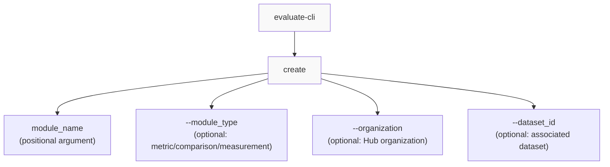
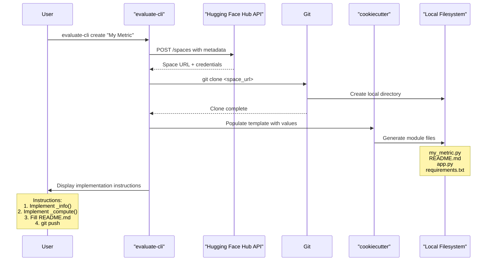
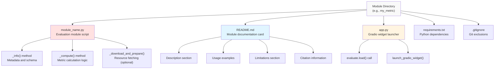
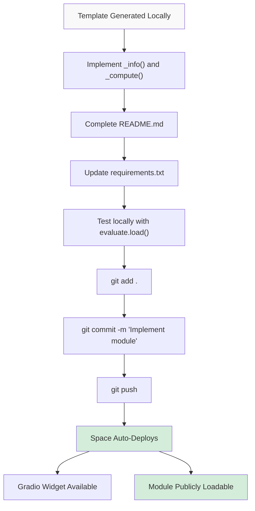
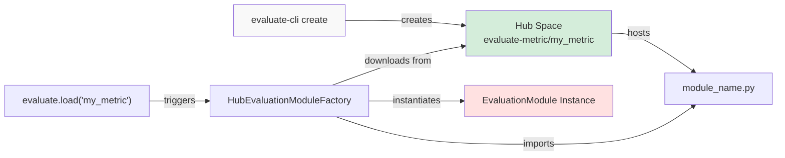

<!-- source: DeepWiki mcp.deepwiki.com · repo huggingface/evaluate · page 9 Command-line Interface · fetched 2026-10-26 -->

# Command-line Interface

<details>
<summary>Relevant source files</summary>

The following files were used as context for generating this wiki page:

- [README.md](README.md)
- [docs/source/creating_and_sharing.mdx](docs/source/creating_and_sharing.mdx)
- [docs/source/transformers_integrations.mdx](docs/source/transformers_integrations.mdx)
- [docs/source/types_of_evaluations.mdx](docs/source/types_of_evaluations.mdx)
- [setup.py](setup.py)

</details>


The `evaluate-cli` command-line tool automates the creation and setup of new evaluation modules. It creates a Hugging Face Space, generates local scaffolding with pre-configured templates, and provides instructions for implementing custom metrics, comparisons, or measurements. This tool eliminates manual setup steps and ensures consistency across community-contributed modules.

For information about implementing the actual evaluation logic within created modules, see [Creating Custom Modules](#10.1). For details on the Python API for loading and using modules, see [Package Structure and Entrypoints](#2).

## Installation

The CLI requires additional template dependencies that are not included in the base `evaluate` installation:

```bash
pip install evaluate[template]
```

This installs two critical dependencies defined in [setup.py:59-64]():
- `cookiecutter`: Populates the module template with user-specified values
- `gradio>=3.0.0`: Generates the interactive widget for the module's Space

Additionally, the CLI requires authentication with the Hugging Face Hub:

```bash
huggingface-cli login
```

Sources: [setup.py:59-64](), [docs/source/creating_and_sharing.mdx:5-15]()

## Entry Point Configuration

The CLI is registered as a console script entry point during package installation. The setup.py configuration maps the `evaluate-cli` command to the main function:

```
evaluate-cli -> evaluate.commands.evaluate_cli:main
```

This registration occurs in [setup.py:140](), making the command globally available after installation. The command delegates to the `main()` function in the `evaluate.commands.evaluate_cli` module, which handles argument parsing and command dispatching.

Sources: [setup.py:140]()

## Command Structure



**Diagram: evaluate-cli Command Structure**

The CLI currently provides one primary command with several configuration options. The module name is a required positional argument, while the module type and organization are specified via optional flags.

Sources: [docs/source/creating_and_sharing.mdx:22-23](), [README.md:76-79]()

## The `create` Command

### Syntax

```bash
evaluate-cli create "Module Name" [--module_type TYPE] [--organization ORG]
```

### Arguments

| Argument | Type | Required | Description |
|----------|------|----------|-------------|
| `module_name` | positional | Yes | Display name for the evaluation module (e.g., "Awesome Metric") |
| `--module_type` | flag | No | Type of module: `"metric"`, `"comparison"`, or `"measurement"`. Defaults to `"metric"` |
| `--organization` | flag | No | Hub organization to create the Space under. Defaults to user's account |
| `--dataset_id` | flag | No | Associate the module with a specific dataset for task-specific evaluation |

### Functionality

The `create` command executes the following operations:

1. **Space Creation**: Calls the Hugging Face Hub API to create a new Space in the specified namespace (user account or organization)
2. **Space Configuration**: Configures the Space as an evaluation module Space with appropriate tags and metadata
3. **Local Cloning**: Uses `git clone` to copy the newly created Space to the local filesystem
4. **Template Population**: Invokes `cookiecutter` to generate the module structure from a template, substituting user-provided values
5. **Instruction Display**: Outputs step-by-step instructions in the terminal for implementing the module

Sources: [docs/source/creating_and_sharing.mdx:19-25](), [README.md:76-79]()

## Module Creation Workflow



**Diagram: Module Creation Sequence**

This sequence shows the automated workflow triggered by the `create` command. The CLI orchestrates interactions between the Hub API (for Space creation), Git (for repository cloning), cookiecutter (for template generation), and the local filesystem (for file placement).

Sources: [docs/source/creating_and_sharing.mdx:19-25]()

## Generated Template Structure

The `create` command generates a complete module structure with all required files:



**Diagram: Template File Structure**

The template provides scaffolding for all essential components. The Python module script contains method stubs with docstrings explaining what to implement. The README follows the Hugging Face evaluation module card format. The app.py file is pre-configured for automatic widget generation.

Sources: [docs/source/creating_and_sharing.mdx:29-102]()

## Module Script Template

The generated `.py` file (e.g., `my_metric.py`) contains the `EvaluationModule` subclass with three key methods:

### `_info()` Method Stub

This method must return an `EvaluationModuleInfo` object with required attributes:

- **`description`**: Brief overview of what the module measures
- **`citation`**: BibTeX citation for the evaluation method
- **`inputs_description`**: Explanation of expected inputs/outputs with examples
- **`features`**: `datasets.Features` schema defining prediction/reference types

The template includes placeholder comments guiding implementation for each field ([docs/source/creating_and_sharing.mdx:35-44]()).

### `_compute()` Method Stub

This method receives predictions and references as arguments and must return a dictionary of metric scores. The template includes a basic skeleton:

```python
def _compute(self, predictions, references):
    # TODO: Implement metric calculation
    return {"metric_name": score}
```

The method signature matches the features defined in `_info()` ([docs/source/creating_and_sharing.mdx:68-77]()).

### `_download_and_prepare()` Method Stub (Optional)

For modules requiring external resources (NLTK data, model checkpoints), this method provides a hook for downloading and caching:

```python
def _download_and_prepare(self, dl_manager):
    # TODO: Download resources if needed
    # Example: nltk.download("punkt_tab")
    # Example: checkpoint = dl_manager.download_and_extract(url)
```

The `dl_manager` argument provides methods for downloading and extracting files with automatic caching ([docs/source/creating_and_sharing.mdx:48-63]()).

Sources: [docs/source/creating_and_sharing.mdx:35-77]()

## README Template

The generated README.md follows a standardized structure for evaluation module documentation:

| Section | Purpose |
|---------|---------|
| **Metric Description** | High-level explanation of what the module measures and when to use it |
| **How to Load** | Code snippet showing `evaluate.load()` usage |
| **Inputs** | Detailed specification of required arguments (types, formats, constraints) |
| **Output Values** | Description of returned dictionary keys and value ranges |
| **Examples** | Working code examples with sample inputs and outputs |
| **Limitations and Bias** | Known issues, edge cases, and fairness considerations |
| **Citation** | BibTeX reference and links to original papers |
| **Further References** | Additional resources and related work |

The template includes placeholder text and instructions for each section ([docs/source/creating_and_sharing.mdx:80-82]()).

Sources: [docs/source/creating_and_sharing.mdx:80-82]()

## App.py Widget Launcher

The generated `app.py` file provides a minimal Gradio interface for testing the module in the Space:

```python
import evaluate
from evaluate.utils import launch_gradio_widget

module = evaluate.load("username/module_name")
launch_gradio_widget(module)
```

The `launch_gradio_widget()` function automatically generates input fields based on the module's `features` schema and displays computed results. This provides an interactive testing interface immediately after pushing to the Hub ([docs/source/creating_and_sharing.mdx:90-101]()).

For custom widget requirements, developers can replace the auto-generated interface with a custom Gradio app.

Sources: [docs/source/creating_and_sharing.mdx:90-101]()

## Requirements File

The `requirements.txt` file follows pip format and initially contains only the base `evaluate` dependency:

```
evaluate
```

Developers must add any additional dependencies their module requires (e.g., `scikit-learn`, `nltk`, `scipy`). These dependencies are automatically installed in the Space environment when the Space builds ([docs/source/creating_and_sharing.mdx:84-87]()).

Sources: [docs/source/creating_and_sharing.mdx:84-87]()

## Post-Creation Workflow

After the CLI generates the template, developers follow a standard Git workflow to implement and deploy the module:



**Diagram: Post-Creation Implementation Workflow**

The development process is intentionally Git-based, leveraging Spaces' automatic deployment. When changes are pushed to the Space repository, the Hub automatically rebuilds the Space, making the updated module immediately available for loading via `evaluate.load()`.

Sources: [docs/source/creating_and_sharing.mdx:103-113]()

## Usage Examples

### Creating a Metric

```bash
evaluate-cli create "Awesome Metric" --module_type "metric"
```

This creates a Space named `awesome_metric` (normalized from display name) under the authenticated user's account. The local directory `awesome_metric/` contains the template files.

Sources: [README.md:76-79]()

### Creating a Comparison

```bash
evaluate-cli create "Statistical Test" --module_type "comparison"
```

The `--module_type` flag changes the template to use comparison-specific documentation and examples. Comparisons typically implement methods that compare two models' predictions rather than measuring against references.

Sources: [docs/source/creating_and_sharing.mdx:22-23]()

### Creating a Measurement

```bash
evaluate-cli create "Dataset Analyzer" --module_type "measurement"
```

Measurement templates guide implementation of modules that analyze datasets or predictions without requiring ground truth references. The template adjusts the `features` schema to not require references.

Sources: [docs/source/creating_and_sharing.mdx:22-23]()

### Creating Under an Organization

```bash
evaluate-cli create "Team Metric" --organization "my-team"
```

This creates the Space at `my-team/team_metric` instead of `username/team_metric`, useful for organizational evaluation modules. The authenticated user must have write permissions to the specified organization.

## Relationship to Hub and Loading System

The CLI creates modules that integrate directly with the module loading system described in [Module Loading System](#3.1):



**Diagram: CLI-to-Loading Integration**

Modules created via the CLI are immediately loadable by any user. The `HubEvaluationModuleFactory` (part of the loading system) handles downloading the module script from the Space, resolving dependencies, and instantiating the module class. This seamless integration enables the "create once, use everywhere" paradigm.

Sources: [docs/source/creating_and_sharing.mdx:19-25]()

## Terminal Output and Instructions

After successful execution, the CLI displays implementation instructions directly in the terminal:

```
✅ Space created: https://huggingface.co/spaces/username/my_metric
✅ Cloned locally to: ./my_metric/

📝 Next steps:
1. cd my_metric
2. Implement your metric in my_metric.py:
   - Fill in _info() method with description, citation, and features
   - Implement _compute() method with your metric logic
3. Complete the README.md with examples and limitations
4. Add dependencies to requirements.txt if needed
5. git add . && git commit -m "Implement metric" && git push

🎉 After pushing, your metric will be available at:
   evaluate.load("username/my_metric")
```

This output provides a clear path from template generation to published module, reducing friction in the contribution process.

## Module Types and Templates

The three module types have slightly different template structures:

| Module Type | Base Class | Required Features | Primary Use Case |
|-------------|------------|-------------------|------------------|
| **metric** | `EvaluationModule` | `predictions` + `references` | Measuring model performance against ground truth |
| **comparison** | `EvaluationModule` | `predictions1` + `predictions2` + `references` | Statistical comparison of two models |
| **measurement** | `EvaluationModule` | `data` or `predictions` (no references required) | Analyzing data or prediction properties |

The template adjusts the feature schema and README guidance based on the specified `--module_type` flag. For detailed information on each module type, see [Metrics](#5), [Comparisons](#6), and [Measurements](#7).

Sources: [docs/source/types_of_evaluations.mdx:7-32]()

---

