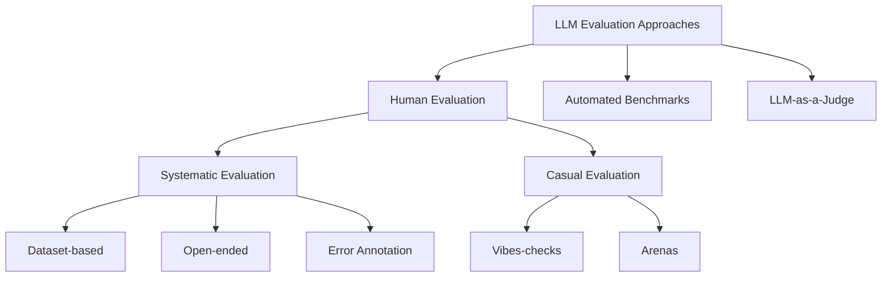
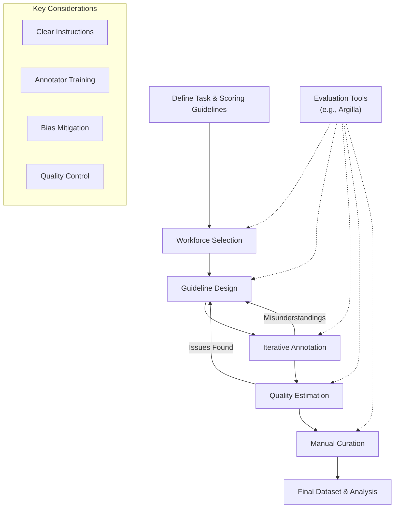
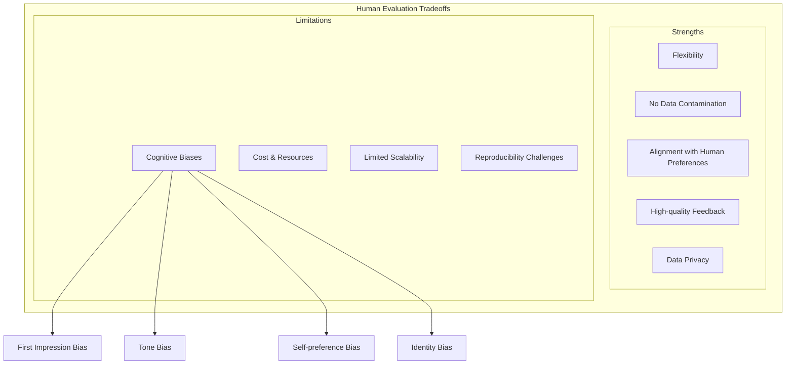
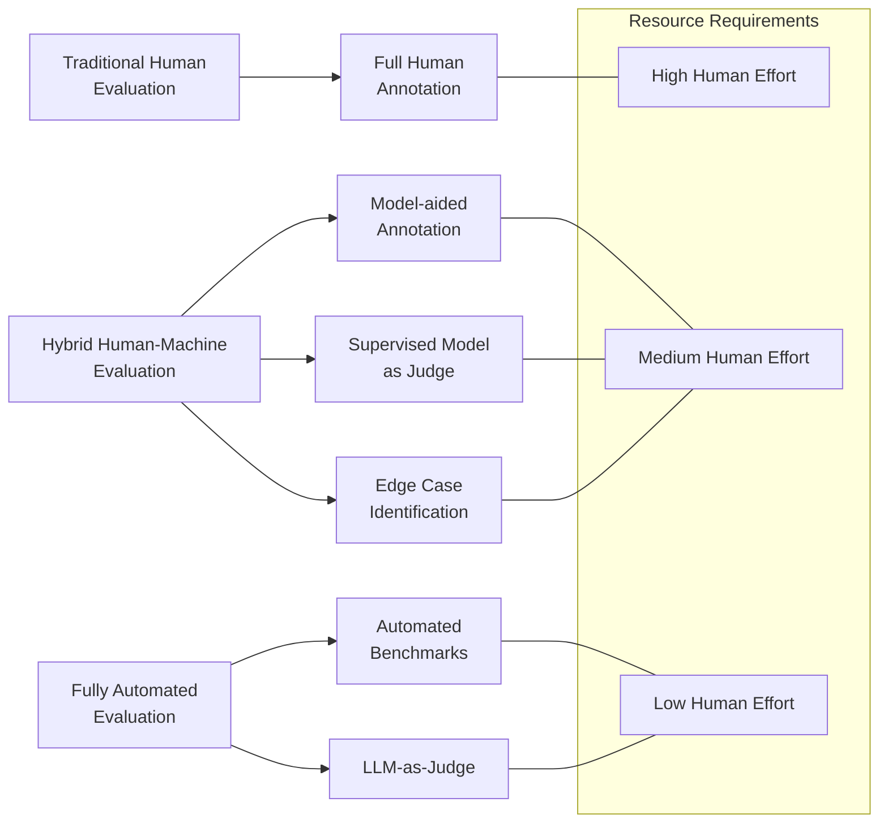
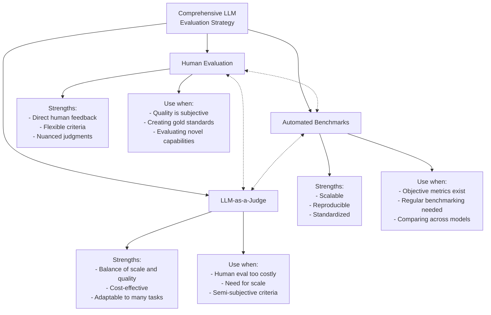

<!-- source: DeepWiki mcp.deepwiki.com · repo huggingface/evaluation-guidebook · page 2.2 Human Evaluation · fetched 2026-10-26 -->

# Human Evaluation

Relevant source files

The following files were used as context for generating this wiki page:

- [README.md](README.md)
- [contents/human-evaluation/basics.md](contents/human-evaluation/basics.md)

This document provides an overview of human evaluation as an approach for assessing LLM performance. It covers fundamental concepts, methodologies, and workflows for implementing human evaluations effectively. For information about automated benchmarks, see [Automated Benchmarks](#2.1), and for using LLMs to evaluate other models, see [LLM-as-a-Judge](#2.3).

## What is Human Evaluation?

Human evaluation involves asking humans to assess LLM outputs according to defined criteria. In the context of this guide, we focus on post-hoc evaluation: evaluating a trained model on specific tasks using human judgment.

Human evaluation plays a crucial role in the LLM evaluation ecosystem by providing direct measures of human preferences and quality assessments that may be difficult to capture through automated metrics alone.

Sources: [contents/human-evaluation/basics.md:1-26]

## Types of Human Evaluation

There are two broad categories of human evaluation approaches: systematic and casual evaluations.

### Systematic Evaluation

Systematic evaluations are structured approaches with clear guidelines and formal annotator selection. There are three main methods:

1. **Open-ended evaluation**: When you don't have a dataset, provide humans with task instructions, scoring guidelines, and access to models for interaction.

2. **Dataset-based evaluation**: When you have a dataset, prompt your model with it, then provide humans with the prompt-response pairs and scoring guidelines.

3. **Error annotation**: When you already have a dataset and scores, humans review your evaluation method by annotating errors.

### Casual Evaluation

Less formal approaches that leverage communities or individual assessments:

1. **Vibes-checks**: Manual evaluations by individuals to get an overall feeling of model performance across use cases. Results are typically shared on social platforms.

2. **Arenas**: Crowdsourced evaluations where users compare models, such as the LMSYS Chatbot Arena, resulting in rankings through aggregated votes.

Sources: [contents/human-evaluation/basics.md:7-26]

## Human Evaluation Workflow

The following diagram illustrates the typical workflow for implementing a systematic human evaluation:

The process begins with defining evaluation objectives and criteria, selecting qualified annotators, developing detailed guidelines, conducting iterative annotation rounds with quality checks, and finally producing a dataset of evaluations for analysis.

Sources: [contents/human-evaluation/tips-and-tricks.md:1-19]

## Advantages and Limitations

Human evaluation offers distinct benefits but also presents important challenges:

### Advantages

- **Flexibility**: Can evaluate almost any aspect of model output with clear definitions
- **Reduced contamination risk**: Human-created evaluation questions are less likely to be in training data
- **Direct preference measurement**: Directly captures human judgments on quality
- **High-quality feedback**: Can provide detailed, context-specific assessments
- **Data privacy**: When using in-house annotators, evaluation data remains private

### Limitations

- **Biases**:
  - **First impression bias**: Evaluators judge based on initial impressions rather than deeper analysis
  - **Tone bias**: Assertive, confident answers may be rated higher regardless of factual accuracy
  - **Self-preference bias**: Humans prefer answers aligned with their own views
  - **Identity bias**: Different demographic groups may have divergent evaluation criteria
- **Resource constraints**:
  - **Cost**: Expensive to implement properly with paid annotators
  - **Scalability**: Difficult to scale compared to automated methods
  - **Reproducibility**: Challenging to reproduce results exactly across different annotator groups

Sources: [contents/human-evaluation/basics.md:27-60]

## Implementation Considerations

### Task Design

- **Simplicity**: Keep tasks as simple as possible to minimize cognitive load
- **Information display**: Show only necessary information to avoid introducing bias
- **Interface efficiency**: Design the interface to minimize scrolling and cognitive burden
- **Pilot testing**: Test the setup on a small sample before full implementation

### During Annotation

- **Independent work**: Annotators should work independently to prevent bias propagation
- **Consistency**: Track guideline changes with version control and metadata
- **Quality control**: Implement measures to ensure annotation quality and reliability

### Hybrid Approaches

To balance quality and efficiency, consider these hybrid human-machine approaches:

1. **Model-aided annotation**: Use model predictions as pre-annotations to speed up the process
2. **Supervised model-as-judge**: Combine LLM judges with human supervision
3. **Edge case identification**: Use multiple models and have humans annotate only cases where models disagree

Sources: [contents/human-evaluation/tips-and-tricks.md:4-28]

## Tools and Resources

Several tools and approaches can facilitate human evaluation:

- **Annotation platforms**: [Argilla](https://github.com/argilla-io/argilla) provides infrastructure for annotation tasks
- **Data generation tools**: [distilabel](https://github.com/argilla-io/distilabel) helps generate synthetic data for evaluation
- **End-to-end tutorials**: Comprehensive guides to building custom evaluation setups

For comprehensive implementation, there's an [end-to-end custom domain evaluation tutorial](https://github.com/argilla-io/argilla-cookbook/tree/main/domain-eval) that guides you through building a custom evaluation task from domain documents to a complete evaluation system.

Sources: [resources/About evaluation.md:37-38], [contents/human-evaluation/tips-and-tricks.md:30-32]

## Relationship to Other Evaluation Methods

Human evaluation complements automated benchmarks and LLM-as-a-judge approaches in a comprehensive evaluation strategy:

The ideal evaluation strategy often involves a combination of these approaches, leveraging the strengths of each while mitigating their respective limitations.

Sources: [contents/human-evaluation/basics.md:27-60], [resources/About evaluation.md:14-18]

## Next Steps

For more detailed guidance on working with human annotators, including selection, instruction, and management, see [Using Human Annotators](#2.2.1). For practical advice and best practices for implementing human evaluation, refer to [Tips and Tricks for Human Evaluation](#2.2.2).

---

