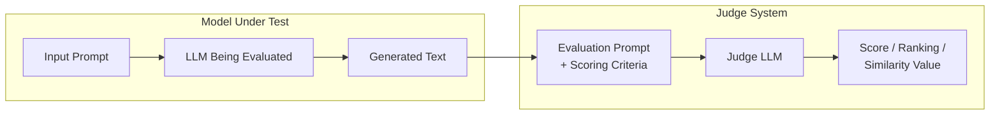
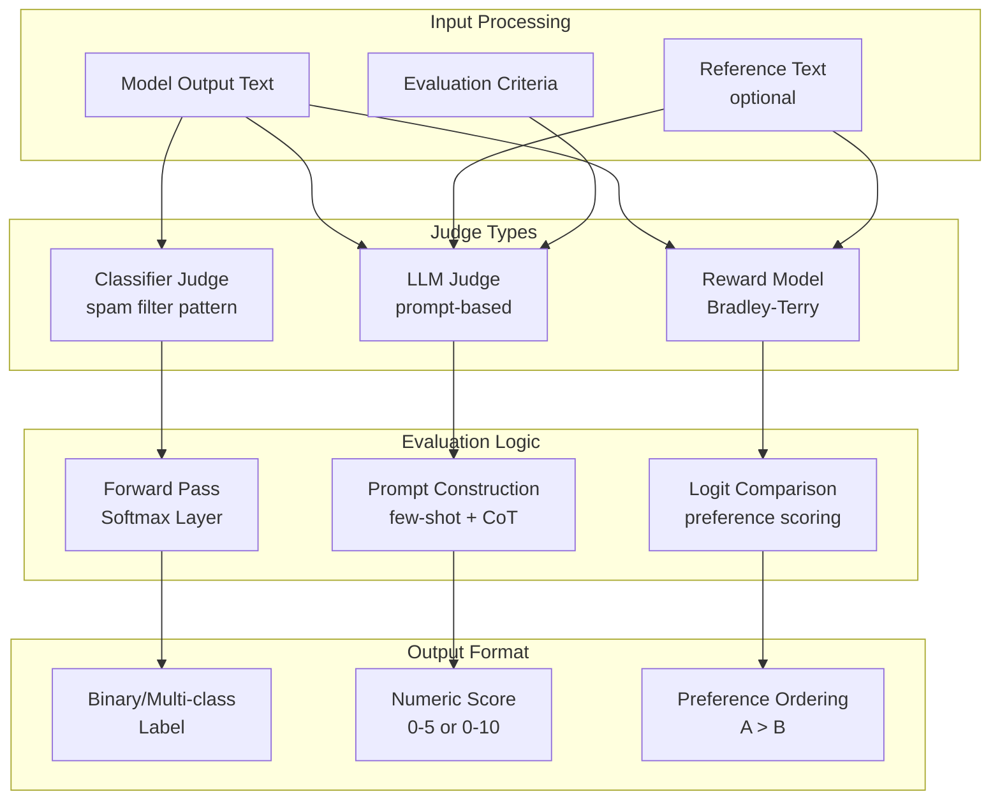
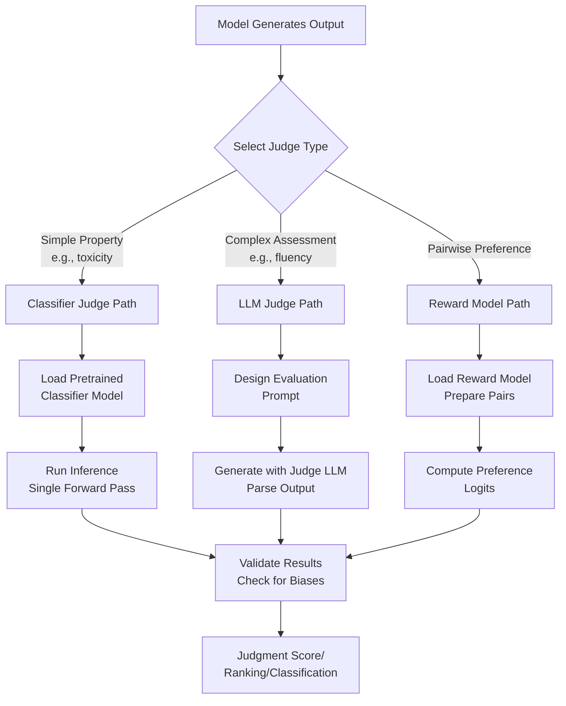
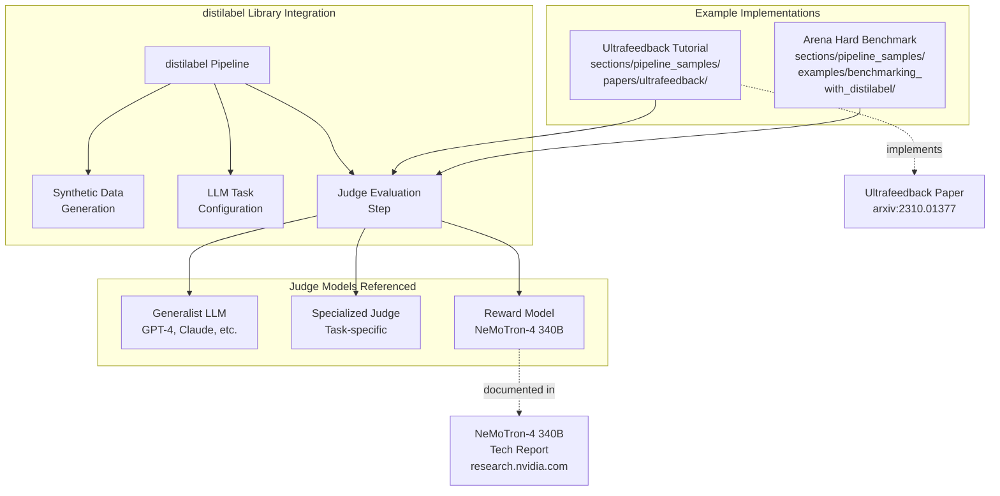
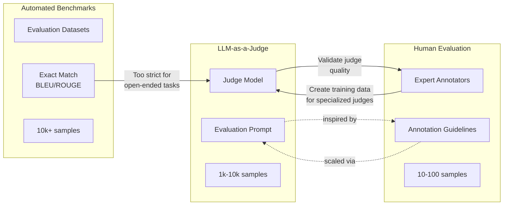

<!-- source: DeepWiki mcp.deepwiki.com · repo huggingface/evaluation-guidebook · page 2.3 LLM-as-a-Judge · fetched 2026-10-26 -->

# LLM-as-a-Judge

<details>
<summary>Relevant source files</summary>

The following files were used as context for generating this wiki page:

- [README.md](README.md)
- [contents/model-as-a-judge/basics.md](contents/model-as-a-judge/basics.md)

</details>


## Purpose and Scope

This document explains the concept and practice of using Large Language Models (LLMs) as evaluators of other LLM outputs. It covers the fundamental architecture, judge types, evaluation tasks, and core trade-offs of this methodology.

For detailed implementation guidance, see:
- Judge acquisition strategies: [#2.3.1](#2.3.1)
- Prompt engineering techniques: [#2.3.2](#2.3.2)
- Reward model approaches: [#2.3.3](#2.3.3)
- Bias mitigation strategies: [#2.3.4](#2.3.4)

For alternative evaluation approaches, see:
- Traditional benchmarks: [#2.1](#2.1)
- Human annotation: [#2.2](#2.2)

---

## What is LLM-as-a-Judge?

LLM-as-a-Judge is an evaluation methodology where **neural networks are used to evaluate the outputs of other neural networks**. The judge model analyzes text generations and provides assessments based on specified criteria.



**Diagram: Basic LLM-as-a-Judge Evaluation Flow**

The judge system receives the model output and applies assessment criteria through a specialized prompt to produce quantitative or comparative judgments.

Sources: [contents/model-as-a-judge/basics.md:1-11]()

---

## Judge Types and Architecture

Judge models exist in three primary forms, each with distinct characteristics and use cases:

| Judge Type | Implementation | Typical Size | Training Required | Use Case |
|------------|---------------|--------------|-------------------|----------|
| **Classifier Judges** | Specialized neural networks | Small (100M-1B params) | Task-specific fine-tuning | Single property assessment (toxicity, spam, factuality) |
| **LLM Judges** | General-purpose LLMs with evaluation prompts | Large (7B-70B+ params) | Prompt engineering only | Complex, nuanced evaluation across multiple properties |
| **Reward Models** | Bradley-Terry preference models | Medium (1B-34B params) | Preference data fine-tuning | Pairwise comparison, RLHF alignment |

### Architecture: Judge Evaluation Pipeline



**Diagram: Judge Types and Their Processing Pipelines**

Sources: [contents/model-as-a-judge/basics.md:4-18]()

---

## Evaluation Tasks

Judge models perform three primary evaluation tasks, each serving distinct assessment needs:

### Task 1: Scoring Model Generations

Judges assign quantitative scores to assess specific text properties on a defined scale.

**Properties Evaluated:**
- Fluency (linguistic quality)
- Toxicity (harmful content detection)
- Coherence (logical consistency)
- Persuasiveness (argument quality)
- Factuality (accuracy)
- Instruction following

**Example Prompt Pattern:**
```
Score the fluency from 0 to 5, where:
0 = completely unintelligible
5 = native-like fluency
```

### Task 2: Pairwise Comparison

Judges compare two model outputs to determine which better satisfies the evaluation criteria.

**Common Applications:**
- Model selection (A/B testing)
- RLHF preference collection
- Ranking model generations
- Chatbot arena-style evaluation

### Task 3: Similarity Computation

Judges assess semantic similarity between a model output and a reference text.

**Use Cases:**
- Paraphrase detection
- Translation quality (semantic equivalence)
- Summarization faithfulness
- Answer correctness (when exact match is too strict)

Sources: [contents/model-as-a-judge/basics.md:13-16]()

---

## Workflow: From Model Output to Judgment



**Diagram: End-to-End Judge Evaluation Workflow**

This workflow illustrates the decision points and processing steps from model output to final judgment, with distinct paths for each judge type.

Sources: [contents/model-as-a-judge/basics.md:1-35]()

---

## Implementation Reference: Code Entities

### File Structure

The LLM-as-a-Judge implementation guidance is organized in the following structure:

| File | Purpose | Key Topics |
|------|---------|------------|
| `contents/model-as-a-judge/basics.md` | Conceptual foundation | Judge types, tasks, pros/cons |
| `contents/model-as-a-judge/getting-a-judge-llm.md` | Judge acquisition | Generalist LLMs, specialized judges, custom training |
| `contents/model-as-a-judge/designing-your-evaluation-prompt.md` | Prompt engineering | Few-shot examples, Chain of Thought, criteria specification |
| `contents/model-as-a-judge/evaluating-your-evaluator.md` | Meta-evaluation | Judge validation, bias detection |
| `contents/model-as-a-judge/what-about-reward-models.md` | Reward model approach | Bradley-Terry models, preference scoring |
| `contents/model-as-a-judge/tips-and-tricks.md` | Practical guidance | Bias mitigation, common pitfalls |

### External Tool Integration



**Diagram: Code Entities and External Tool References**

This diagram maps the conceptual judge evaluation system to concrete implementations in the `distilabel` library and specific example pipelines.

Sources: [contents/model-as-a-judge/basics.md:33-35](), [README.md:33-39]()

---

## Trade-offs and Considerations

### Advantages

**Objectivity and Reproducibility**
- Automate empirical judgments in a consistent, repeatable manner
- Eliminate inter-annotator variability in assessment

**Scale and Cost**
- More scalable than human annotation
- Process large datasets efficiently
- Lower instantiation cost than training specialized models
- Cheaper than expert human annotators for high-volume tasks

**Human Alignment**
- Demonstrate correlation with human judgments on many tasks
- Can approximate human preferences when properly calibrated

### Disadvantages

**Hidden Biases**
- **Positional bias**: Preference for first or last position in pairwise comparisons
- **Verbosity bias**: Tendency to favor longer, more detailed responses
- **Self-preference**: Models may favor outputs similar to their own generation style
- Harder to detect than human biases due to less scrutiny

**Data Quality Concerns**
- Generate large volumes of synthetic judgments requiring validation
- Chain of Thought reasoning produces additional data to analyze
- Risk of echo-chamber effects when LLMs evaluate LLMs

**Expert Quality Gap**
- Expert human annotators provide qualitatively superior assessments for specialized domains
- Judges may miss nuanced domain-specific requirements
- Statistical robustness from sociological survey design not yet matched in prompt engineering

### Comparison Table

| Dimension | LLM-as-a-Judge | Human Evaluation | Automatic Benchmarks |
|-----------|----------------|------------------|---------------------|
| **Scale** | High (1000s-10000s) | Low (10s-100s) | Very High (10000s+) |
| **Cost per Evaluation** | Low ($0.001-0.01) | High ($1-10+) | Very Low ($0.0001) |
| **Nuance Detection** | Medium | High | Low |
| **Reproducibility** | High | Medium | Very High |
| **Bias Control** | Challenging | Established methods | Minimal bias |
| **Domain Expertise** | Limited | High (with right annotators) | Task-dependent |
| **Setup Time** | Medium (prompt design) | High (annotator training) | Low (existing datasets) |

Sources: [contents/model-as-a-judge/basics.md:20-31]()

---

## Integration with Other Evaluation Methods

LLM-as-a-Judge serves as a middle ground between automated benchmarks and human evaluation:



**Diagram: LLM-as-a-Judge in the Evaluation Ecosystem**

- **Automated Benchmarks** ([#2.1](#2.1)): Fast, cheap, but limited to properties measurable by exact match or string similarity
- **LLM-as-a-Judge** (this section): Scales human-like nuanced assessment at moderate cost
- **Human Evaluation** ([#2.2](#2.2)): Highest quality, but expensive and slow; used to validate judge quality

Sources: [contents/model-as-a-judge/basics.md:8-10](), [README.md:22-31]()

---

## Getting Started

### Step 1: Choose Your Judge Type

**For simple, well-defined properties:**
- Use classifier judges (toxicity, spam, factuality)
- Faster inference, lower cost
- Requires task-specific training data

**For complex, nuanced assessment:**
- Use LLM judges with prompt engineering
- No training required, flexible criteria
- Higher cost, slower inference

**For preference-based evaluation:**
- Use reward models
- Optimized for pairwise comparison
- See [#2.3.3](#2.3.3) for details

### Step 2: Implement Your First Judge

The `distilabel` library provides a straightforward implementation path:

**Key Components:**
- Pipeline configuration for data flow
- LLM task definitions for judge prompts
- Evaluation step integration
- Result parsing and validation

**Example Workflows:**
- [Ultrafeedback tutorial](https://distilabel.argilla.io/latest/sections/pipeline_samples/papers/ultrafeedback): Implements multi-aspect evaluation with judge LLMs
- [Arena Hard benchmark](https://distilabel.argilla.io/latest/sections/pipeline_samples/examples/benchmarking_with_distilabel): Demonstrates pairwise comparison setup

Reference guide: [Aymeric Roucher's LLM Judge Tutorial](https://huggingface.co/learn/cookbook/en/llm_judge)

### Step 3: Validate Your Judge

Before production use, perform meta-evaluation:
- Compare judge outputs to human annotations on a sample
- Check for systematic biases (position, verbosity, self-preference)
- Measure inter-judge agreement if using multiple judges
- See [#2.3.4](#2.3.4) for bias detection and mitigation

### Step 4: Iterate on Prompt Design

Effective judge prompts require:
- Clear task description and scoring criteria
- Few-shot examples demonstrating edge cases
- Chain of Thought prompting for transparency
- Detailed guidance in [#2.3.2](#2.3.2)

Sources: [contents/model-as-a-judge/basics.md:32-35](), [README.md:33-39]()

---

## Next Steps

For comprehensive guidance on specific aspects of LLM-as-a-Judge:

- **[#2.3.1](#2.3.1) Getting a Judge LLM**: Strategies for acquiring or training judge models (generalist LLMs, specialized judges, custom training)
- **[#2.3.2](#2.3.2) Designing Evaluation Prompts**: Best practices for prompt engineering, few-shot examples, and Chain of Thought
- **[#2.3.3](#2.3.3) Reward Models**: Alternative approach using Bradley-Terry preference models
- **[#2.3.4](#2.3.4) Tips and Tricks**: Bias mitigation, common pitfalls, and practical troubleshooting

For foundational concepts supporting judge evaluation:
- **[#3.1](#3.1) Model Inference and Evaluation**: Understanding tokenization, log-probability, and generative evaluation
- **[#4](#4) Troubleshooting**: Solutions for inference issues, reproducibility challenges, and parsing problems

Sources: [README.md:33-40]()

---

