<!-- source: DeepWiki mcp.deepwiki.com · repo huggingface/evaluation-guidebook · extra page Designing Automated Evaluations · fetched 2026-10-26 -->

# Designing Automated Evaluations

Relevant source files

The following files were used as context for generating this wiki page:

- [contents/automated-benchmarks/designing-your-automatic-evaluation.md](contents/automated-benchmarks/designing-your-automatic-evaluation.md)

## Purpose and Scope

This page provides a systematic guide for designing robust automated evaluations of language models. It covers the four critical decision points in the evaluation design process: dataset selection, inference method, prompt engineering, and metric selection. The page also introduces functional testing as an emerging paradigm for creating contamination-resistant evaluations.

**Related pages:**
- For a catalog of existing evaluation datasets, see [Evaluation Datasets Catalog](#2.1.2)
- For foundational understanding of inference mechanics, see [Model Inference and Evaluation](#3.1)
- For troubleshooting common issues, see [Tips and Tricks](#2.1.3)
- For understanding metric behavior across evaluations, see [Troubleshooting](#4)

---

## The Evaluation Design Process

Automated evaluation design consists of four sequential decisions, each constraining and informing the next. The quality of your evaluation is fundamentally bounded by the quality of your dataset—no sophisticated metric or prompt engineering can compensate for poorly constructed evaluation samples.

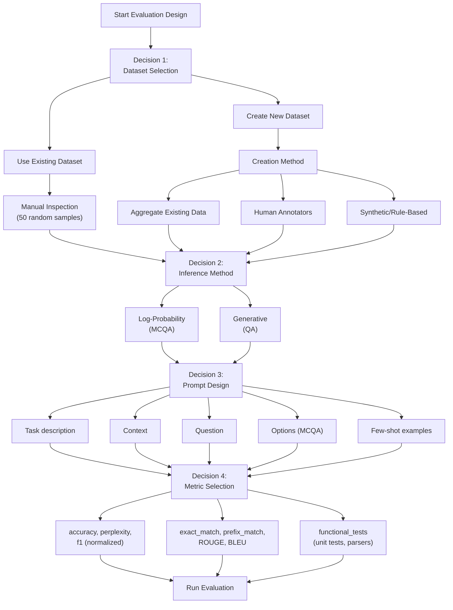

**Sources:** [contents/automated-benchmarks/designing-your-automatic-evaluation.md:1-118]()

---

## Dataset Selection

The dataset selection process differs significantly depending on whether you use an existing dataset or create a new one. Both approaches require rigorous quality validation.

### Evaluating Existing Datasets

When selecting an existing dataset, evaluate it across three dimensions: creation process, sample quality, and statistical adequacy.

#### Creation Process Assessment

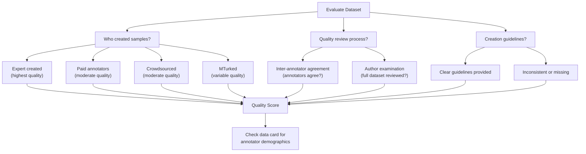

The creation process hierarchy matters because it directly impacts dataset consistency and language diversity. Expert-created datasets generally exhibit higher quality than crowdsourced alternatives, particularly for complex reasoning tasks.

**Sources:** [contents/automated-benchmarks/designing-your-automatic-evaluation.md:8-21]()

#### Sample Quality Checklist

Manually inspect 50 random samples against this checklist:

| Quality Dimension | Evaluation Criteria | Example Issues |
|-------------------|---------------------|----------------|
| **Prompt Clarity** | Are prompts unambiguous and well-specified? | Vague questions requiring unstated assumptions |
| **Answer Correctness** | Are provided answers actually correct? | TriviaQA contains conflicting aliases in gold answers |
| **Information Completeness** | Is all necessary information present? | MMLU misses reference schematics in some questions |
| **Task Relevance** | Do questions match your evaluation goals? | Domain mismatch with target use case |
| **Use Case Alignment** | Are examples relevant to your application? | General knowledge when you need domain expertise |

**Minimum sample requirement:** 100 samples for statistically significant results in automatic benchmarks.

**Sources:** [contents/automated-benchmarks/designing-your-automatic-evaluation.md:22-32]()

### Creating New Datasets

Three approaches exist for creating custom evaluation datasets, each with distinct trade-offs:

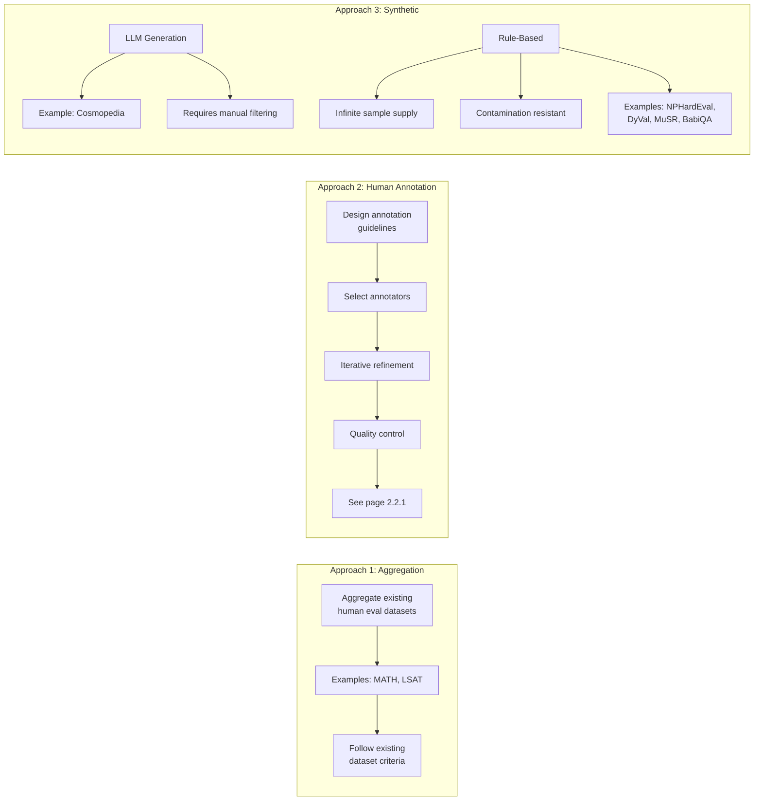

**Rule-based generation** is particularly valuable for contamination avoidance. By algorithmically generating test cases, you create samples that cannot have appeared in training data. This approach works well for tasks with formal structure (graph algorithms, mathematical problems, logical reasoning).

**Sources:** [contents/automated-benchmarks/designing-your-automatic-evaluation.md:33-46]()

---

## Inference Method Selection

The inference method determines how you extract model predictions and fundamentally shapes which models will perform well on your evaluation.

### Log-Probability (MCQA) vs Generative (QA)

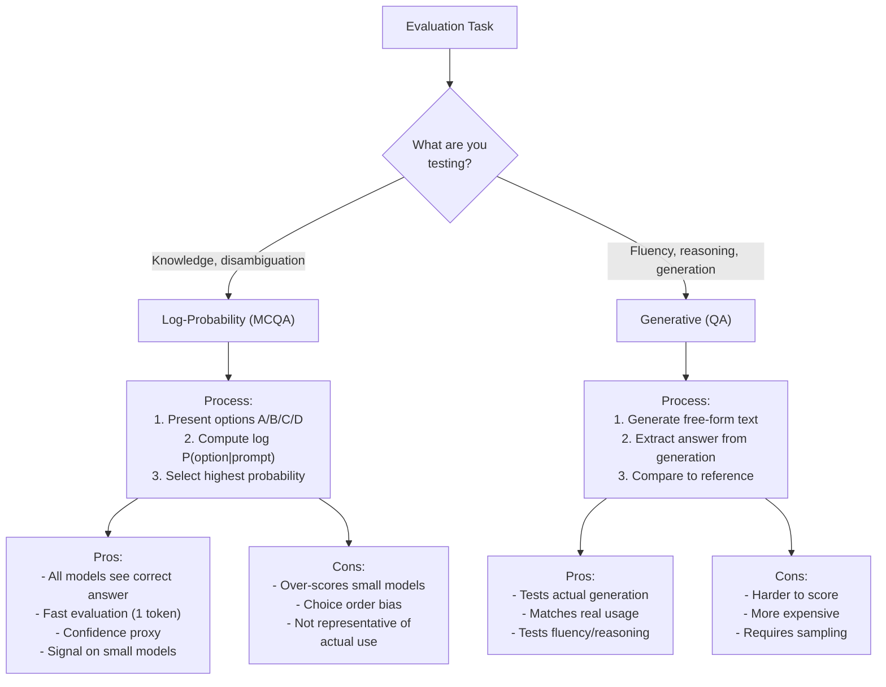

### Trade-offs Table

| Aspect | Log-Probability (MCQA) | Generative (QA) |
|--------|------------------------|-----------------|
| **Speed** | Fast (single token prediction) | Slower (full generation) |
| **Model Coverage** | Works well on small models | Requires capable models for generation |
| **Real-world Validity** | Limited (forced choice) | High (actual use case) |
| **Scoring Complexity** | Simple (argmax probability) | Complex (matching, normalization) |
| **Confidence Signal** | Direct (probability values) | Indirect (must be engineered) |
| **Known Biases** | Choice order effects | Verbosity, format sensitivity |

**Critical consideration:** Some models exhibit choice order bias, favoring specific options (e.g., always preferring option A) regardless of content. This is documented in [arXiv:2309.03882]().

**Sources:** [contents/automated-benchmarks/designing-your-automatic-evaluation.md:48-66]()

---

## Prompt Engineering

Prompt design significantly impacts evaluation results. Semantically equivalent prompts can yield substantially different scores, and models increasingly overfit specific prompt formats.

### Prompt Component Architecture

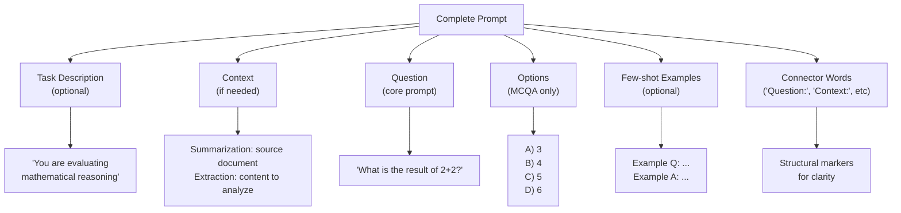

**Sources:** [contents/automated-benchmarks/designing-your-automatic-evaluation.md:68-79]()

### Prompt Sensitivity Issues

Three critical challenges affect prompt reliability:

| Issue | Description | Mitigation Strategy |
|-------|-------------|---------------------|
| **Semantic Variance** | Small prompt changes cause large score differences | Run evaluation with multiple prompt variations allocated to equivalent difficulty samples |
| **Format Overfitting** | Models overfit test set formats during training | Use format-diverse prompts; newer models (Llama 3.2, Qwen 2.5) ignore few-shot format cues |
| **Model-Specific Advantages** | Prompt format advantages specific models | Document prompt format in evaluation metadata; consider format ablations |

The format overfitting problem is documented in [arXiv:2407.07890](), which demonstrates that some models achieve inflated scores by memorizing evaluation formats rather than learning underlying capabilities. The Open LLM Leaderboard v2 team observed Llama 3.2 and Qwen 2.5 no longer following few-shot format patterns, suggesting format saturation in training data.

**Sources:** [contents/automated-benchmarks/designing-your-automatic-evaluation.md:81-89]()

### Constrained Generation

For metrics requiring specific output formats, constrained generation techniques force models to produce parseable outputs. These techniques are detailed in the [Model Inference and Evaluation](#3.1) page, section "Constraining model outputs".

**Sources:** [contents/automated-benchmarks/designing-your-automatic-evaluation.md:90-91]()

---

## Metric Selection

Metric selection depends entirely on your inference method. The critical principle: **match your metric to what your task actually measures**.

### Log-Probability Metrics

For log-probability evaluations, metrics are straightforward:

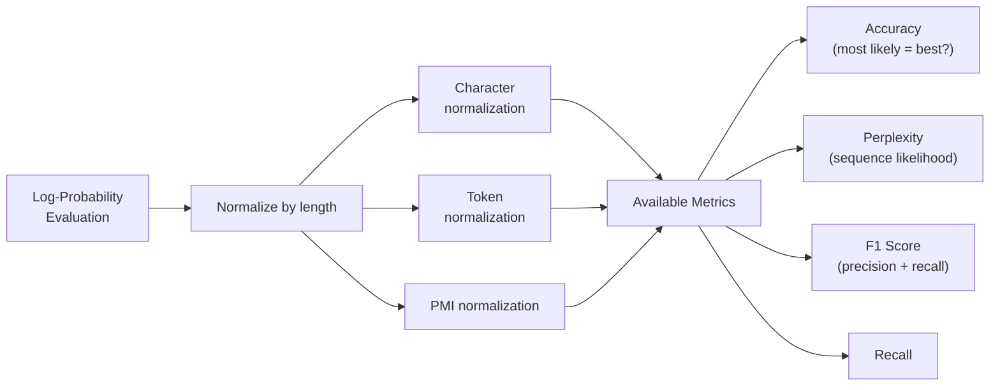

**Critical requirement:** Length normalization is essential. Without it, shorter completions systematically achieve higher log-probabilities, biasing results.

**Sources:** [contents/automated-benchmarks/designing-your-automatic-evaluation.md:93-94]()

### Generative Metrics Pipeline

Generative evaluation requires a two-stage process: normalization and comparison.

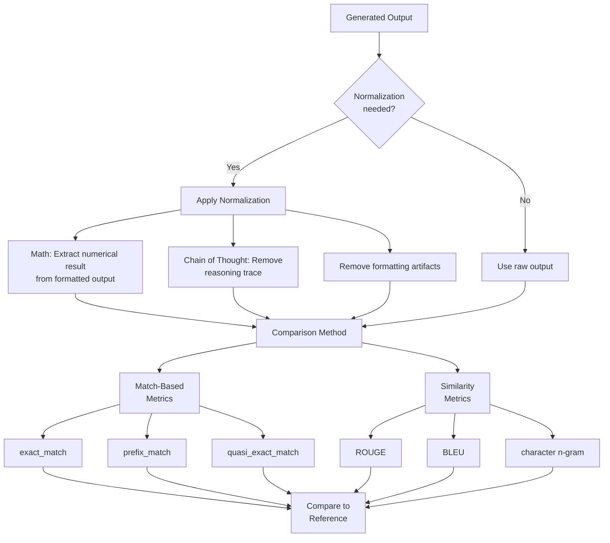

**Normalization considerations:**
- Normalizations can be unfair if poorly designed (see blog: ["Open LLM Leaderboard Drop"](https://huggingface.co/blog/open-llm-leaderboard-drop))
- They provide valuable task-level signal despite individual-sample artifacts
- Essential for math evaluations with formatted outputs
- Required when using Chain of Thought (CoT) to extract final answers from reasoning traces

**Metric catalog reference:** For a comprehensive list of implemented metrics, see the [lighteval Metric List](https://github.com/huggingface/lighteval/wiki/Metric-List).

**Sources:** [contents/automated-benchmarks/designing-your-automatic-evaluation.md:96-103]()

### Task-Specific Metric Selection

The metric must align with what you're actually measuring. For some domains, average performance is insufficient—you must measure **worst-case performance**:

| Domain | What to Measure | Why |
|--------|-----------------|-----|
| **Medical** | Worst-case accuracy | Patient safety requires consistent correctness |
| **Public Chatbots** | Worst-case toxicity | Public exposure to harmful outputs |
| **Code Generation** | Worst-case security | Single vulnerability compromises system |
| **Knowledge QA** | Average accuracy | Aggregate capability matters |

This distinction is explored in depth in Ehud Reiter's blog: ["Challenges in Evaluating LLMs"](https://ehudreiter.com/2024/07/10/challenges-in-evaluating-llms).

**Sources:** [contents/automated-benchmarks/designing-your-automatic-evaluation.md:105-106]()

---

## Functional Testing: The Emerging Paradigm

Functional testing evaluates models on what they **do** rather than what they **say**. Originating in code evaluation, this approach is expanding to structured text tasks.

### Core Concept

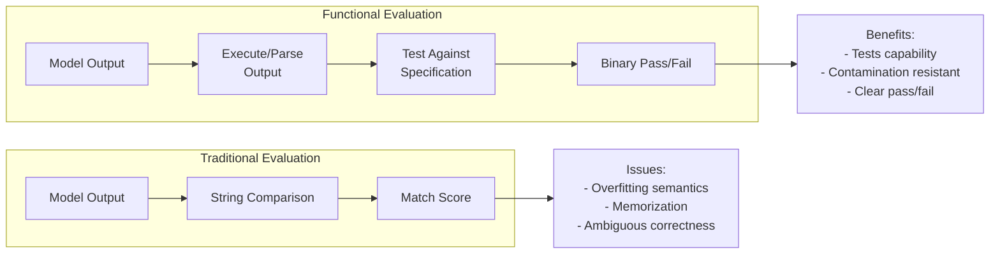

### Benefits of Functional Testing

| Benefit | Explanation | Impact |
|---------|-------------|--------|
| **Easier Test Generation** | Many domains allow rule-based test case generation | Reduced annotation cost |
| **Contamination Resistance** | Generated test cases cannot appear in training data | Addresses data leakage |
| **Capability Focus** | Tests specific active capabilities rather than memorization | More meaningful evaluation |
| **Creativity Requirement** | Requires domain expertise to design functional tests | Barrier to adoption |

**Sources:** [contents/automated-benchmarks/designing-your-automatic-evaluation.md:107-117]()

### Functional Testing Examples

#### Code Evaluation: Unit Tests

The canonical functional testing domain. Models generate code to solve a problem, then that code executes against a test suite:

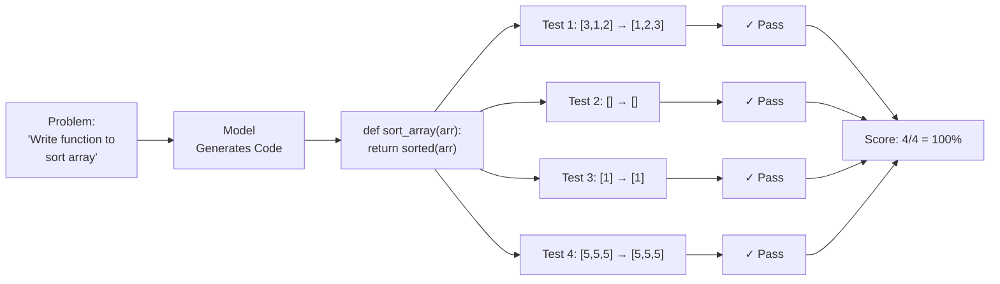

#### IFEval: Instruction Following Evaluation

IFEval extends functional testing to text by creating verifiable formatting instructions:

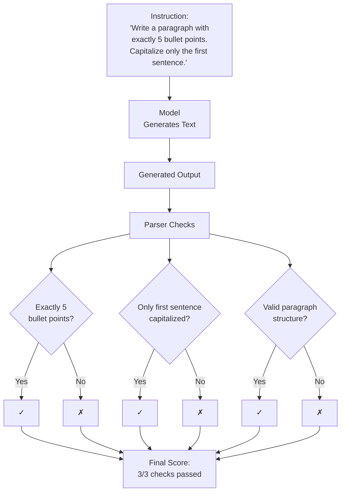

**IFEval instruction types:**
- Bullet point count constraints
- Sentence capitalization patterns
- Word/character count requirements
- Specific keyword inclusion/exclusion
- Structural formatting (headers, lists, etc.)

Each instruction creates a **verifiable constraint** that can be programmatically tested, independent of semantic content quality.

**Challenge:** Extending functional testing to general text requires creativity. Unlike code (which has natural test suites) or instructions (which have explicit constraints), most text evaluation lacks obvious functional specifications.

**Sources:** [contents/automated-benchmarks/designing-your-automatic-evaluation.md:107-117]()

---

## Complete Evaluation Design Workflow

The following diagram synthesizes all four decision points into an integrated workflow, showing dependencies and feedback loops:

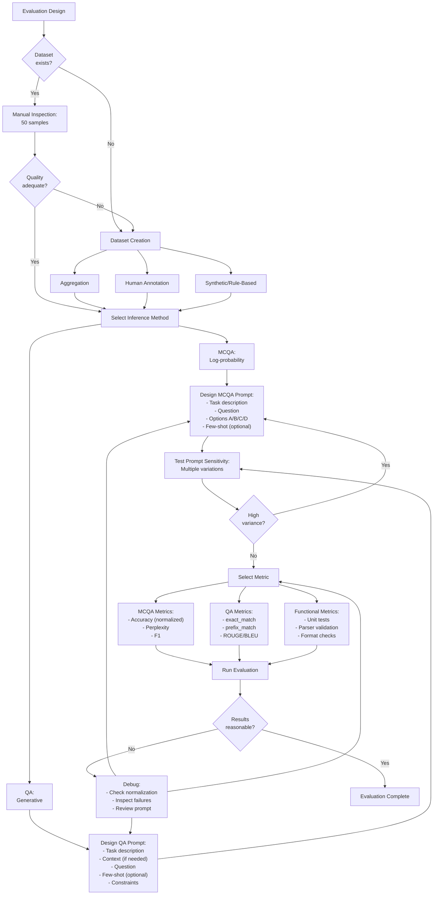

**Sources:** [contents/automated-benchmarks/designing-your-automatic-evaluation.md:1-118]()

---

## Key Takeaways

1. **Dataset quality bounds evaluation quality** — No amount of engineering downstream can compensate for poor samples
2. **Manual inspection is non-negotiable** — Always inspect 50 random samples before committing to a dataset
3. **Inference method shapes results** — MCQA over-scores small models; generative matches real usage
4. **Prompts are sensitive** — Semantically equivalent prompts yield different scores; test multiple variations
5. **Match metric to measurement goal** — Average performance vs worst-case performance requires different metrics
6. **Functional testing is the future** — Tests capabilities rather than memorization; naturally contamination-resistant

**Related Resources:**
- Dataset catalog and contamination analysis: [Evaluation Datasets Catalog](#2.1.2)
- Practical troubleshooting: [Tips and Tricks](#2.1.3)
- Human annotation guidelines: [Using Human Annotators](#2.2.1)
- Inference mechanics: [Model Inference and Evaluation](#3.1)

**Sources:** [contents/automated-benchmarks/designing-your-automatic-evaluation.md:1-118]()

---

