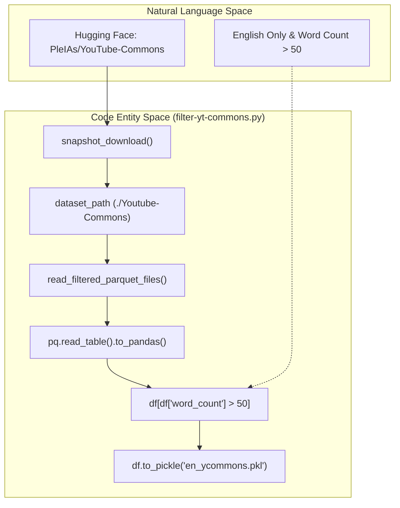
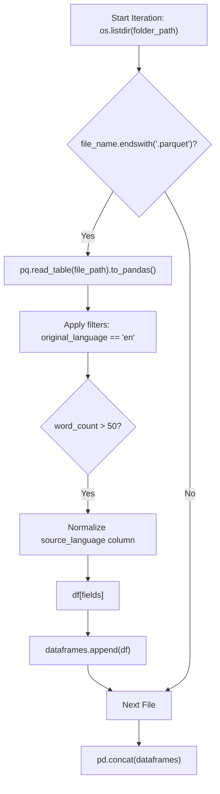

<!-- source: DeepWiki mcp.deepwiki.com · repo huggingface/fineVideo · page 2.1 YouTube Commons Filter (`filter-yt-commons.py`) · fetched 2026-10-26 -->

# YouTube Commons Filter (`filter-yt-commons.py`)

Relevant source files

The following files were used as context for generating this wiki page:

- [rawdataset/filter-yt-commons.py](rawdataset/filter-yt-commons.py)

The `filter-yt-commons.py` script serves as the entry point for the FineVideo data ingestion pipeline. Its primary responsibility is to fetch the raw **YouTube Commons** dataset from Hugging Face, apply strict linguistic and density filters to ensure data quality, and extract a subset of metadata fields required for downstream stages like categorization and annotation.

## Purpose and Scope

The script acts as a preprocessing gatekeeper. It specifically targets high-quality English-language videos with sufficient textual information (closed captions/transcriptions) to support multimodal analysis. By filtering at this stage, the pipeline avoids downloading or processing videos that lack the semantic depth needed for the FineVideo dataset.

- **Source Dataset**: `PleIAs/YouTube-Commons` [rawdataset/filter-yt-commons.py:80-82]().
- **Output**: A serialized pandas DataFrame (`.pkl`) containing filtered video metadata [rawdataset/filter-yt-commons.py:14-14]().

## Implementation Details

### Dataset Acquisition
The script uses `snapshot_download` from `huggingface_hub` to download the entire `PleIAs/YouTube-Commons` dataset to a local directory defined by `dataset_path` [rawdataset/filter-yt-commons.py:80-82](). This dataset consists of multiple Parquet files containing metadata for millions of Creative Commons-licensed YouTube videos.

### Filtering Logic
The core logic resides in the `read_filtered_parquet_files` function [rawdataset/filter-yt-commons.py:19-74](). It iterates through all Parquet files in the downloaded folder and applies the following criteria:

1.  **Language Consistency**: The script filters for videos where both `original_language` and `transcription_language` are explicitly set to `'en'` (English) [rawdataset/filter-yt-commons.py:78-78]().
2.  **Word Count Threshold**: Only videos with a `word_count` greater than 50 are retained [rawdataset/filter-yt-commons.py:55-56](). This ensures that the video has enough spoken content for meaningful transcription analysis.
3.  **Language Metadata Normalization**: The script handles inconsistencies in the source dataset schema by mapping `language_id_method` to `source_language` if the latter is missing [rawdataset/filter-yt-commons.py:59-60]().

### Metadata Extraction
The script selects 26 specific fields required for subsequent pipeline stages, including engagement metrics (`view_count`, `like_count`), technical metadata (`resolution`, `duration_string`), and content identifiers (`video_id`, `channel_id`) [rawdataset/filter-yt-commons.py:77-77]().

| Field Category | Key Fields |
| :--- | :--- |
| **Identifiers** | `video_id`, `video_link`, `channel_id`, `channel` |
| **Engagement** | `view_count`, `like_count`, `comment_count`, `channel_follower_count` |
| **Content** | `title`, `description`, `text` (transcription), `tags`, `categories` |
| **Technical** | `duration_string`, `resolution`, `vcodec`, `acodec` |

Sources: [rawdataset/filter-yt-commons.py:19-74](), [rawdataset/filter-yt-commons.py:77-78]()

## Data Flow and Entity Mapping

The following diagrams illustrate how the script transforms raw dataset files into a structured format used by the rest of the FineVideo pipeline.

### Metadata Extraction Flow
This diagram shows the transition from raw Parquet files on Hugging Face to the filtered Pickle file.

Sources: [rawdataset/filter-yt-commons.py:13-14](), [rawdataset/filter-yt-commons.py:41-41](), [rawdataset/filter-yt-commons.py:56-56](), [rawdataset/filter-yt-commons.py:80-82](), [rawdataset/filter-yt-commons.py:89-89]()

### Logic Flow of `read_filtered_parquet_files`
This diagram details the internal iteration and filtering logic applied to every Parquet file.

Sources: [rawdataset/filter-yt-commons.py:35-37](), [rawdataset/filter-yt-commons.py:41-41](), [rawdataset/filter-yt-commons.py:44-51](), [rawdataset/filter-yt-commons.py:55-56](), [rawdataset/filter-yt-commons.py:59-66](), [rawdataset/filter-yt-commons.py:73-73]()

## Technical Requirements
- **Memory**: The script requires significant RAM because it loads entire Parquet files into memory via `to_pandas()` before filtering [rawdataset/filter-yt-commons.py:8-8](), [rawdataset/filter-yt-commons.py:41-41]().
- **Storage**: Sufficient disk space is needed to house the `snapshot_download` of the YouTube-Commons dataset [rawdataset/filter-yt-commons.py:80-82]().

Sources: [rawdataset/filter-yt-commons.py:8-14]()

---

