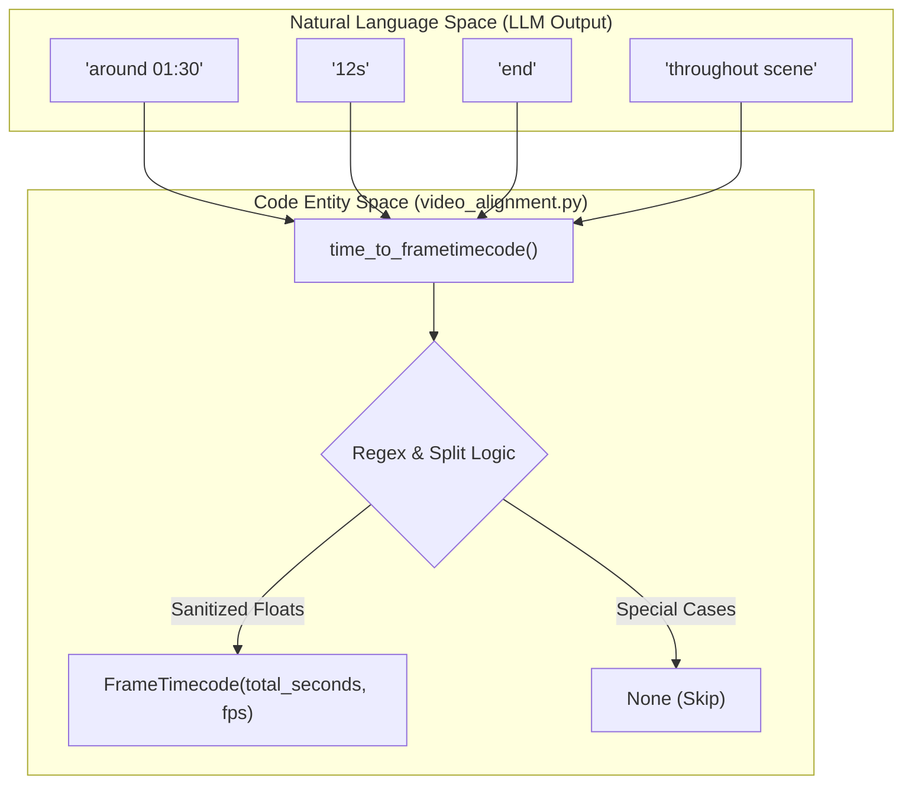
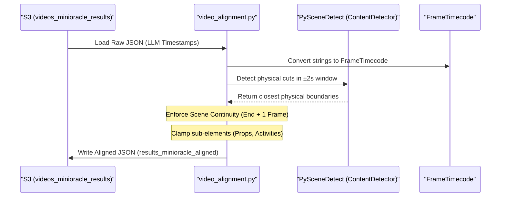

<!-- source: DeepWiki mcp.deepwiki.com · repo huggingface/fineVideo · page 7.2 Timestamp Normalization & Continuity Enforcement · fetched 2026-10-26 -->

# Timestamp Normalization & Continuity Enforcement

Relevant source files

The following files were used as context for generating this wiki page:

- [finealignment/video_alignment.py](finealignment/video_alignment.py)

The `finealignment` subsystem is responsible for the final reconciliation of LLM-generated natural language timestamps with the physical reality of video frames. While the annotation stage produces high-quality semantic descriptions, the timestamps provided by LLM models (Gemini/GPT-4o) are often imprecise, formatted inconsistently (e.g., "around 2s", "01:30", "end"), or logically disjointed. 

This page details the logic within `video_alignment.py` that parses these raw strings into formal `FrameTimecode` objects, enforces temporal continuity between scenes, and ensures that sub-scene metadata (activities, props, moods) remains logically bounded within their parent scenes.

## Timestamp Normalization Logic

The primary entry point for string-to-temporal conversion is `time_to_frametimecode()`. This function acts as a robust parser designed to handle the varied and often "noisy" output of LLMs.

### Parsing and Sanitization
The function implements a multi-stage sanitization process to extract numerical time data from natural language:

1.  **Special Case Handling**: It first checks for non-temporal strings like "n/a", "varies", "throughout", or "not present". If these are detected, the function returns `None`, signaling that the attribute should be treated as global or absent [finealignment/video_alignment.py:73-76]().
2.  **String Cleaning**: It uses regular expressions and string splitting to remove common LLM qualifiers such as "around", "~", "+", or suffixes like "s" (e.g., "12s" becomes "12") [finealignment/video_alignment.py:78-90]().
3.  **Format Detection**:
    *   **HH:MM:SS**: If colons are present, it splits the string into components. It handles 1, 2, or 3 parts (seconds only, MM:SS, or HH:MM:SS) [finealignment/video_alignment.py:91-103]().
    *   **Raw Seconds**: If no colons are present, it attempts to cast the string directly to a float [finealignment/video_alignment.py:117-120]().
4.  **Frame Conversion**: The resulting total seconds are passed to the `scenedetect.frame_timecode.FrameTimecode` class, which anchors the time to the specific FPS (Frames Per Second) of the video being processed [finealignment/video_alignment.py:121]().

### LLM to Code Space: Timestamp Parsing
The following diagram illustrates how natural language strings from the LLM are transformed into strict `FrameTimecode` objects used by the alignment logic.

**Timestamp Normalization Flow**

Sources: [finealignment/video_alignment.py:64-121]()

## Scene Continuity Enforcement

To ensure the final dataset is suitable for training (where gaps or overlaps in scene definitions can cause errors), the pipeline enforces strict continuity between adjacent scenes.

### The "Plus One" Rule
In `adjust_scene_boundaries()`, the pipeline iterates through the list of initial scenes. To prevent temporal overlaps or "dead air" between segments, the start of a scene is logically tied to the end of the previous one:
*   **Initial Scene**: The first scene typically starts at frame 0.
*   **Subsequent Scenes**: Each scene's start time is set to exactly one frame after the previous scene's end time (`previous_scene_end + 1`) [finealignment/video_alignment.py:173-180]().
*   **The 'End' Keyword**: If an LLM labels a timestamp as "end", the system dynamically replaces this with the actual duration of the video obtained via `VideoManager.get_duration()` [finealignment/video_alignment.py:67-71](), [finealignment/video_alignment.py:146-148]().

### Clamping Sub-elements
A critical part of normalization is ensuring that metadata *within* a scene (like a specific "key moment" in a mood or a "trimming suggestion") does not fall outside the temporal boundaries of the scene itself. This is handled by `enforce_within_boundaries()`.

| Logic Component | Implementation Detail |
| :--- | :--- |
| **Start Clamping** | `max(element_start, scene_start)` |
| **End Clamping** | `min(element_end, scene_end)` |
| **Validation** | If an element's start is adjusted to be after its end, the element is discarded. |

Sources: [finealignment/video_alignment.py:144-152](), [finealignment/video_alignment.py:173-185]()

## Data Flow: From Raw JSON to Aligned Output

The alignment process follows a linear transformation path where the "Scene" is the primary unit of organization.

**Alignment Data Flow**

### Key Functions and Their Roles
*   **`time_to_frametimecode()`**: The fundamental parser for converting various string formats into a standardized frame-aware object [finealignment/video_alignment.py:64-121]().
*   **`adjust_scene_boundaries()`**: The orchestrator that uses `PySceneDetect` to find the nearest physical shot change (within a ±2-second window) to the LLM's suggested timestamp [finealignment/video_alignment.py:124-171]().
*   **`update_timestamps_in_json()`**: A recursive or multi-key update function that traverses the JSON structure to apply normalized timestamps to all nested fields, including `activities`, `props`, `videoEditingDetails`, and `storylines` [finealignment/video_alignment.py:200-250]().

Sources: [finealignment/video_alignment.py:64-250]()

---

