# Page: Overview

# Overview

<details>
<summary>Relevant source files</summary>

The following files were used as context for generating this wiki page:

- [FinePDFs.png](FinePDFs.png)
- [LICENSE](LICENSE)
- [README.md](README.md)

</details>


## Purpose and Scope

FinePDFs is a large-scale PDF processing and dataset generation system designed to extract, filter, classify, and package high-quality text data from CommonCrawl PDF collections. This repository contains the complete end-to-end pipeline code that produced the [HuggingFaceFW/finepdfs](https://huggingface.co/datasets/HuggingFaceFW/finepdfs) dataset.

This overview provides a high-level introduction to the system architecture, core components, and data flow. For specific implementation details:
- Pipeline execution and configuration: see [Quick Start](#1.1)
- Directory layout and vendored dependencies: see [Repository Structure](#1.2)
- Detailed pipeline stages: see [Main Processing Pipeline](#2)
- Model training and evaluation: see [Training Infrastructure](#3) and [Evaluation Infrastructure](#4)

**Sources:** [README.md:1-122](), [run_finepdfs_pipeline.py:1-50]()

## System Goals

The FinePDFs system addresses three primary objectives:

1. **Intelligent PDF Text Extraction**: Automatically route PDFs to appropriate extraction methods (embedded text via Docling or OCR via PyMuPDF) using a trained XGBoost classifier
2. **Multi-Language Quality Filtering**: Apply precision-optimized language detection and educational content classification across 67 languages
3. **Scalable Processing**: Handle billions of PDFs from CommonCrawl using distributed SLURM-based execution and efficient batched inference

The system prioritizes extraction quality and content filtering while minimizing systematic biases that could result from aggressive ML-based filtering.

**Sources:** [README.md:3-7](), [README.md:98-104]()

## High-Level Architecture

### Main Pipeline Orchestration

The entire pipeline is orchestrated by `run_finepdfs_pipeline.py`, which executes sequential stages from raw PDF URLs to final dataset publication:

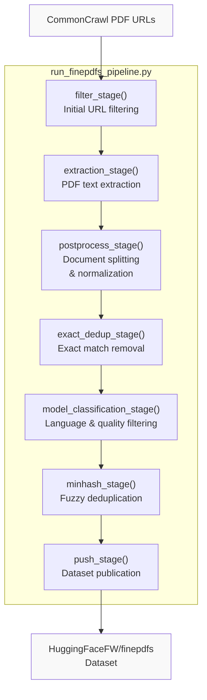

**Pipeline Stage Functions**

Each stage is implemented as a function in `run_finepdfs_pipeline.py`:

| Stage | Function | Primary Purpose |
|-------|----------|-----------------|
| Filter | `filter_stage()` | Remove non-PDF URLs and apply basic filters |
| Extraction | `extraction_stage()` | Extract text using OCR routing + Docling/PyMuPDF |
| Postprocess | `postprocess_stage()` | Split documents, remove tags, normalize text |
| Exact Dedup | `exact_dedup_stage()` | Remove exact duplicate content |
| Classification | `model_classification_stage()` | Apply language and quality classifiers |
| MinHash | `minhash_stage()` | Fuzzy deduplication using LSH |
| Push | `push_stage()` | Upload final dataset to HuggingFace Hub |

**Sources:** [run_finepdfs_pipeline.py:1-800](), README.md sections on pipeline orchestration

### Core Component Architecture

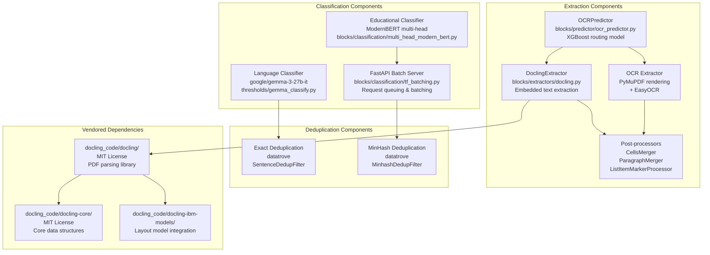

**Sources:** [blocks/extractors/docling.py:1-200](), [blocks/predictor/ocr_predictor.py:1-150](), [blocks/classification/multi_head_modern_bert.py:1-250](), [blocks/classification/tf_batching.py:1-300]()

## Key Processing Stages

### 1. PDF Extraction with Intelligent Routing

The system uses `OCRPredictor` to classify each PDF as requiring OCR or having extractable embedded text:

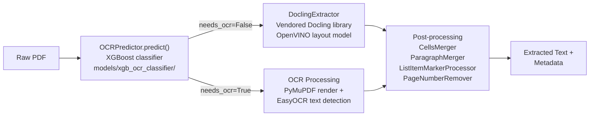

The OCR routing classifier was trained on manually annotated data released at `HuggingFaceFW/ocr-annotations` using features extracted from PDF metadata.

**Sources:** [blocks/predictor/ocr_predictor.py:1-150](), [models/xgb_ocr_classifier/](), [README.md:38-39]()

### 2. Multi-Stage Classification

Classification applies two filters sequentially:

1. **Language Classification**: Uses `google/gemma-3-27b-it` with precision-optimized thresholds (F-beta with β=0.1, minimum recall 0.1, minimum precision 0.9)
2. **Educational Quality**: Multi-head ModernBERT classifier for English; language-specific BERT classifiers for other languages

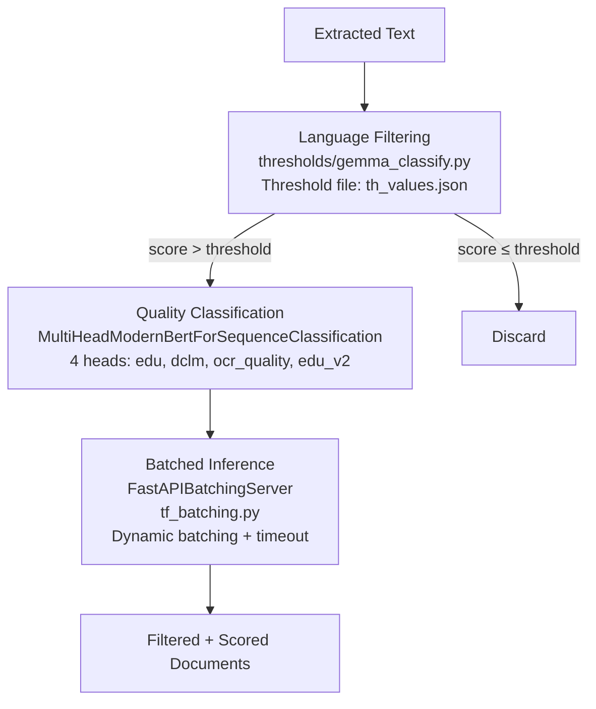

The thresholds were computed using `thresholds/find_th.py` on Gemma-labeled validation data.

**Sources:** [thresholds/find_th.py:1-200](), [blocks/classification/multi_head_modern_bert.py:1-250](), [blocks/classification/tf_batching.py:1-300](), [README.md:45-54]()

### 3. Two-Stage Deduplication

Deduplication occurs in two phases to balance precision and efficiency:

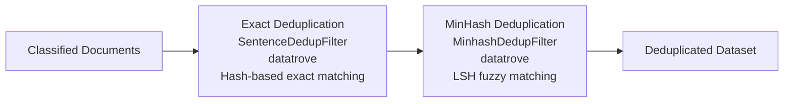

**Sources:** [run_finepdfs_pipeline.py:400-500]()

## Technology Stack

### Core Dependencies

| Component | Technology | Purpose |
|-----------|-----------|---------|
| Extraction | Vendored Docling (MIT) | PDF parsing and layout analysis |
| OCR | PyMuPDF 1.26.1 (AGPL-3.0) + EasyOCR | Render PDFs to images and extract text |
| Classification | vLLM ≥0.8.5.post1 | Fast batched LLM inference for filtering |
| Routing | XGBoost | OCR vs non-OCR decision classifier |
| Deduplication | DataTrove | Distributed deduplication pipelines |
| Training | PyTorch 2.6.0 | Model training and fine-tuning |
| Layout Model | OpenVINO INT8 | Quantized Docling layout model inference |

### Model Artifacts

The system includes several pre-trained models stored in the repository:

- **OCR Classifier**: [models/xgb_ocr_classifier/]() - XGBoost model for routing decisions
- **Layout Model**: [models/heron/]() - INT8-quantized OpenVINO model for Docling layout analysis
- **Language Thresholds**: `th_values.json` - Per-language score cutoffs for filtering
- **Quality Classifiers**: Published on HuggingFace Hub
  - `HuggingFaceFW/finepdfs_edu_classifier_{language}` (67 languages)
  - `HuggingFaceFW/finepdfs_dclm_classifier_eng_Latn`
  - `HuggingFaceFW/finepdfs_ocr_quality_classifier_eng_Latn`

**Sources:** [README.md:10-21](), [README.md:38-39](), [README.md:71-76](), [pyproject.toml:1-100]()

## Data Flow and Storage

### Input/Output Pipeline

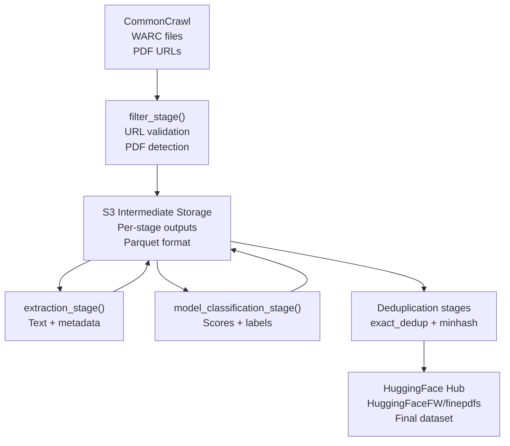

All intermediate outputs are stored in Parquet format with configurable output paths. The final dataset is pushed to the HuggingFace Hub using `push_stage()`.

**Sources:** [run_finepdfs_pipeline.py:1-800](), [pipeline_utils/]()

## Repository Structure Overview

The repository is organized into functional modules:

| Directory | Purpose |
|-----------|---------|
| `blocks/` | Core processing blocks: extractors, predictors, classifiers |
| `docling_code/` | Vendored Docling dependencies (MIT license) |
| `models/` | Trained model weights and quantization code |
| `classification/` | Training and labeling code for quality classifiers |
| `thresholds/` | Language threshold discovery and application |
| `pipeline_utils/` | Shared utilities for pipeline orchestration |
| `ablations/` | Experimental variations and ablation studies |

For detailed information about the directory structure, see [Repository Structure](#1.2).

**Sources:** [README.md:78-97]()

## Execution Model

The pipeline is designed for distributed execution on SLURM clusters but can also run locally. Each stage in `run_finepdfs_pipeline.py` uses DataTrove's executor abstraction:

```python
# Example from run_finepdfs_pipeline.py
from datatrove.executor import LocalPipelineExecutor

executor = LocalPipelineExecutor(
    pipeline=[...],  # Stage-specific pipeline
    tasks=args.tasks,
    workers=args.workers,
)
executor.run()
```

For production workloads, the system supports SLURM-based parallel execution across multiple nodes. Training and evaluation workflows also use SLURM for distributed processing (see [Training Infrastructure](#3) and [Evaluation Infrastructure](#4)).

**Sources:** [run_finepdfs_pipeline.py:100-800]()

## License and Attribution

- **Dataset**: ODC-By 1.0 (subject to CommonCrawl terms)
- **Top-level Code**: AGPL-3.0
- **Vendored Docling Components**: MIT (Docling, Docling-Core) and upstream licenses (Docling-IBM-Models)
- **PyMuPDF**: AGPL-3.0

See [THIRD_PARTY_NOTICES.md]() for complete license information.

**Sources:** [LICENSE:1-59](), [README.md:107-109]()

## Getting Started

To begin using the FinePDFs pipeline:

1. **Installation**: Follow the setup instructions in [Quick Start](#1.1)
2. **Run the pipeline**: Execute `run_finepdfs_pipeline.py` with desired parameters
3. **Explore components**: Review individual blocks in `blocks/` for specific functionality
4. **Train models**: Use code in `classification/` for custom quality classifiers
5. **Adjust thresholds**: Modify `th_values.json` for language-specific filtering

For detailed pipeline configuration and execution, see [Main Processing Pipeline](#2).

**Sources:** [README.md:23-33]()

---

# Page: Quick Start

# Quick Start

<details>
<summary>Relevant source files</summary>

The following files were used as context for generating this wiki page:

- [.gitignore](.gitignore)
- [.python-version](.python-version)
- [.vscode/launch.json](.vscode/launch.json)

</details>


This page provides the essential steps to set up and run the FinePDFs pipeline. It covers Python environment setup, dependency installation, and basic commands for executing the main pipeline and individual components. For detailed information about specific subsystems, refer to their dedicated sections: PDF extraction ([2.1](#2.1)), classification ([2.2](#2.2)), training ([3](#3)), and evaluation ([4](#4)).

## Prerequisites

### Python Version

The FinePDFs system requires **Python 3.12** as specified in [.python-version:1]().

```bash
python --version  # Should output Python 3.12.x
```

### System Requirements

The pipeline is designed to run on SLURM-managed compute clusters with:
- Access to S3 storage for intermediate data and checkpoints
- Git LFS for downloading large model files (XGBoost classifiers, layout models)
- Sufficient compute resources for PDF processing and model inference

### Required Access

- **S3 Buckets**: Access to shared storage buckets for datasets, checkpoints, and evaluation results
- **HuggingFace**: Credentials for pushing final datasets and downloading model artifacts
- **SLURM Cluster**: Access to compute cluster for distributed processing

**Sources**: [.python-version:1](), Architecture Diagram 1

## Installation

### Clone Repository

```bash
git clone https://github.com/huggingface/finepdfs.git
cd finepdfs
```

### Install Dependencies

The repository uses a standard Python package structure. Install dependencies using:

```bash
pip install -e .
```

This installs the package in editable mode along with all required dependencies including:
- **DataTrove**: For data processing pipeline orchestration
- **PyMuPDF**: For OCR rendering and PDF manipulation
- **transformers**: For loading and running classification models
- **XGBoost**: For OCR routing classifier
- **FastAPI**: For batched inference server
- **s5cmd**: For efficient S3 operations

### Download Model Artifacts

Large model files are stored via Git LFS. Download them using:

```bash
git lfs pull
```

This downloads:
- OCR routing classifier weights in `models/xgb_ocr_classifier/`
- Quantized Docling layout models in `models/heron/`

**Sources**: [.gitignore:1-15](), Architecture Diagram 2, Section [5.1](#5.1)

## Pipeline Entry Points

The FinePDFs system provides multiple entry points depending on your use case:

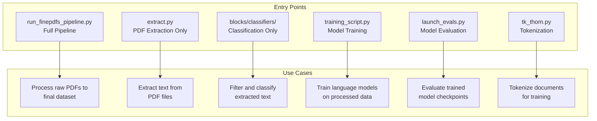

**Sources**: Architecture Diagrams 1, 4, and 5

## Running the Main Pipeline

### Basic Command Structure

The main pipeline is executed through `run_finepdfs_pipeline.py`:

```bash
python run_finepdfs_pipeline.py <crawl_id> [options]
```

### Example: Processing a CommonCrawl Snapshot

```bash
python main.py CC-MAIN-2019-47
```

This command processes PDFs from the CommonCrawl snapshot `CC-MAIN-2019-47` through the complete pipeline:

1. **Filter & Route**: Identify and filter PDF documents
2. **Extract**: OCR routing and text extraction
3. **Postprocess**: Clean and normalize extracted text
4. **Dedup (Exact)**: Remove exact duplicates
5. **Classify**: Language and quality filtering
6. **Dedup (MinHash)**: Fuzzy deduplication
7. **Push**: Upload final dataset to HuggingFace

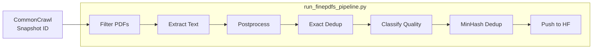

**Sources**: [.vscode/launch.json:13](), Architecture Diagram 5

## Running Individual Components

### PDF Extraction

To run only the extraction component:

```bash
python extract.py
```

This executes the PDF extraction pipeline including:
- OCR routing classification using XGBoost
- Docling-based extraction for embedded text PDFs
- PyMuPDF-based OCR for scanned documents
- Post-processing (cell merging, paragraph fixing, list normalization)

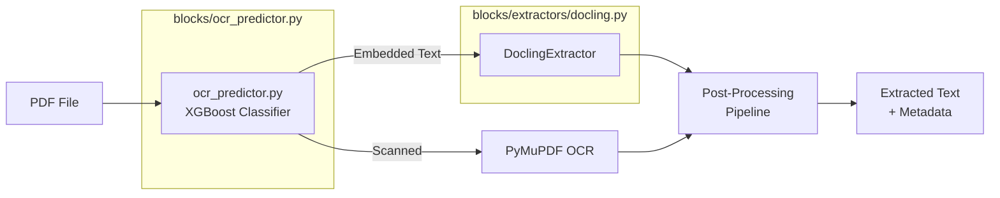

For more details on extraction internals, see [PDF Extraction System](#2.1).

**Sources**: [.vscode/launch.json:17-22](), Architecture Diagram 2

### Classification and Filtering

Classification components can be used independently for quality filtering:

#### Language Classification

Uses Gemma-3-27b-it with optimized thresholds:

```bash
# Language classification with threshold filtering
python blocks/classifiers/language_filter.py --input <data_path>
```

Threshold values are pre-calculated and stored in `th_values.json` using F-beta optimization (β=0.1, minimum recall=0.1).

#### Quality Classification

Multiple quality classifiers can be applied:

```bash
# Educational content classification
python blocks/classifiers/edu_classifier.py --input <data_path>

# DCLM quality classification (English only)
python blocks/classifiers/dclm_classifier.py --input <data_path>

# OCR quality classification
python blocks/classifiers/ocr_quality_classifier.py --input <data_path>
```

For English content, the multi-head ModernBERT architecture allows simultaneous evaluation of all quality dimensions. See [Multi-Head ModernBERT Architecture](#2.2.3) for details.

**Sources**: Architecture Diagram 3

### Batched Inference Server

For production deployment, start the FastAPI batched inference server:

```bash
python tf_batching.py --model <model_path> --batch_size <size> --timeout <seconds>
```

The server provides:
- Request batching for efficient GPU utilization
- Timeout handling for pending requests
- REST API for classification queries

See [Batched Inference API](#2.2.4) for API documentation.

**Sources**: Architecture Diagram 3

### Model Training

Launch distributed training on SLURM cluster:

```bash
python training_script.py \
    --data <dataset_path> \
    --run_name <experiment_name> \
    --lr <learning_rate> \
    --steps <training_steps> \
    --output <checkpoint_dir>
```

This script:
1. Generates nanotron configuration YAML
2. Creates SLURM batch script
3. Downloads training data from S3 using `s5cmd`
4. Submits training job to SLURM cluster
5. Uploads checkpoints to S3

Training configuration and SLURM integration are detailed in [Training Infrastructure](#3).

**Sources**: Architecture Diagram 4

### Model Evaluation

Evaluate trained checkpoints across multiple languages:

```bash
python launch_evals.py \
    --model_name <model_identifier> \
    --checkpoints <checkpoint_dir> \
    --tasks <task_file>
```

Task files define evaluation benchmarks:
- `tasks_eng.txt`: 12 English tasks
- `tasks_zho.txt`: 15 Chinese tasks
- `tasks_ara.txt`: 15 Arabic tasks
- `tasks_fra.txt`: 8 French tasks
- `tasks_rus.txt`: 12 Russian tasks

The evaluation system:
1. Discovers available checkpoints in S3
2. Filters completed evaluations
3. Converts nanotron checkpoints to HuggingFace format
4. Executes lighteval with accelerate
5. Uploads results to S3

See [Evaluation Infrastructure](#4) for comprehensive documentation.

**Sources**: Architecture Diagram 4

## Development and Debugging

### VS Code Configuration

The repository includes VS Code launch configurations for debugging:

#### Debug Main Pipeline

```json
{
    "name": "Python Debugger: main.py",
    "type": "debugpy",
    "request": "launch",
    "program": "main.py",
    "args": ["CC-MAIN-2019-47"],
    "console": "integratedTerminal"
}
```

#### Debug Extraction

```json
{
    "name": "Python Debugger: steps/split_truncation.py",
    "type": "debugpy",
    "request": "launch",
    "program": "extract.py",
    "console": "integratedTerminal"
}
```

These configurations allow step-through debugging of pipeline components. See [Logging and Debugging](#6.2) for additional debugging tools.

**Sources**: [.vscode/launch.json:1-24]()

## Directory Structure Overview

```
finepdfs/
├── blocks/              # Pipeline components (extractors, classifiers)
├── ablations/           # Experimental variations and ablation studies
├── models/              # Pre-trained model weights (Git LFS)
├── docling_code/        # Vendored Docling library
├── run_finepdfs_pipeline.py  # Main pipeline orchestrator
├── training_script.py   # Model training launcher
├── launch_evals.py      # Evaluation orchestrator
└── tk_thom.py          # Tokenization pipeline
```

For detailed repository organization, see [Repository Structure](#1.2).

**Sources**: [.gitignore:13-15](), Architecture Diagram 1

## Next Steps

After completing basic setup and running initial commands:

1. **Customize PDF Extraction**: Learn about OCR routing and Docling configuration in [PDF Extraction System](#2.1)
2. **Configure Quality Filters**: Understand classifier training and threshold tuning in [Classification and Filtering](#2.2)
3. **Scale with SLURM**: Explore distributed computing patterns in [SLURM Integration](#7)
4. **Train Custom Models**: Follow the complete training workflow in [Training Infrastructure](#3)
5. **Evaluate Performance**: Set up multi-language benchmarks in [Evaluation Infrastructure](#4)

For troubleshooting common issues, refer to [Logging and Debugging](#6.2).

**Sources**: Architecture Diagrams 1-5, Table of Contents

---

# Page: Repository Structure

# Repository Structure

<details>
<summary>Relevant source files</summary>

The following files were used as context for generating this wiki page:

- [.gitignore](.gitignore)
- [README.md](README.md)

</details>


## Purpose and Scope

This document describes the high-level organization of the FinePDFs repository, including the purpose of each major directory and key files. It provides a roadmap for navigating the codebase and understanding where specific functionality resides.

For detailed information about specific subsystems, see:
- PDF extraction and OCR routing: [2.1](#2.1)
- Classification and filtering: [2.2](#2.2)
- Training infrastructure: [3](#3)
- Evaluation infrastructure: [4](#4)

---

## Directory Overview

The repository is organized into several top-level directories, each serving a distinct purpose in the PDF processing pipeline:

```mermaid
graph TB
    ROOT["Repository Root"]
    
    ROOT --> PIPELINE["run_finepdfs_pipeline.py<br/>Main pipeline orchestration"]
    ROOT --> PIPELINE_UTILS["pipeline_utils/<br/>Pipeline support code"]
    ROOT --> BLOCKS["blocks/<br/>Reusable components"]
    ROOT --> DOCLING["docling_code/<br/>Vendored Docling libraries"]
    ROOT --> MODELS["models/<br/>Model weights & training code"]
    ROOT --> CLASSIFICATION["classification/<br/>Quality classifier training"]
    ROOT --> THRESHOLDS["thresholds/<br/>Language filter thresholds"]
    ROOT --> ABLATIONS["ablations/<br/>Experimental analyses"]
    ROOT --> TRAINING["training_script.py<br/>Model training orchestration"]
    ROOT --> EVALS["launch_evals.py<br/>Evaluation orchestration"]
    ROOT --> TK["tk_thom.py<br/>Tokenization pipeline"]
    
    BLOCKS --> EXTRACTORS["extractors/<br/>PDF extraction backends"]
    BLOCKS --> PREDICTOR["predictor/<br/>OCR routing classifier"]
    BLOCKS --> BLOCK_CLASS["classification/<br/>Inference servers"]
    
    DOCLING --> DOCLING_MAIN["docling/<br/>Main extraction library"]
    DOCLING --> DOCLING_CORE["docling-core/<br/>Core utilities"]
    DOCLING --> DOCLING_IBM["docling-ibm-models/<br/>Layout models"]
    
    MODELS --> XGB["xgb_ocr_classifier/<br/>OCR routing weights"]
    MODELS --> HERON["heron/<br/>Quantized layout model"]
    MODELS --> PREP["model_prep_code/<br/>Training notebooks"]
```

**Sources:** [README.md:78-96](), [.gitignore:1-15]()

---

## Core Pipeline Orchestration

### run_finepdfs_pipeline.py

The main entry point for the entire PDF processing pipeline. This file contains the end-to-end orchestration logic with distinct functions for each processing stage:

| Stage | Function | Description |
|-------|----------|-------------|
| Filtering | Filter stage logic | Initial data filtering and routing |
| Extraction | Extraction stage logic | PDF text extraction with OCR routing |
| Postprocessing | Postprocess logic | Document structure cleanup |
| Exact Deduplication | Exact dedup logic | Remove exact duplicate documents |
| Classification | Model classification logic | Quality and language filtering |
| MinHash Deduplication | MinHash dedup logic | Fuzzy deduplication |
| Publishing | Push logic | Dataset publishing to HuggingFace |

**Sources:** [README.md:24-36](), [README.md:81-82]()

### pipeline_utils/

Contains utility functions and helper code specifically for pipeline orchestration, such as configuration management and inter-stage data handling.

**Sources:** [README.md:82]()

---

## Building Blocks Directory

The `blocks/` directory contains reusable components that can be composed into larger pipelines. These are designed as modular, testable units.

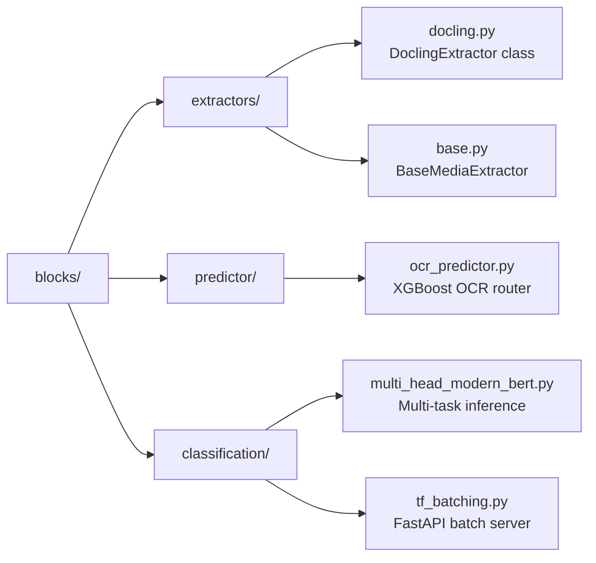

### blocks/extractors/

Contains PDF extraction implementations:

- **docling.py**: `DoclingExtractor` class that wraps the vendored Docling library for embedded text extraction
- **base.py**: `BaseMediaExtractor` abstract base class defining the extractor interface with timeout handling and error management

**Sources:** [README.md:84-85]()

### blocks/predictor/

Houses the OCR routing logic:

- **ocr_predictor.py**: Implements the XGBoost-based classifier that determines whether a PDF requires OCR processing or can use embedded text extraction. Loads weights from `models/xgb_ocr_classifier/`.

**Sources:** [README.md:85](), [README.md:91]()

### blocks/classification/

Implements fast inference for quality classifiers:

- Multi-headed ModernBERT architecture for simultaneous evaluation of multiple quality dimensions (edu, dclm, ocr_quality)
- FastAPI-based batching server for production inference with request queuing

**Sources:** [README.md:86]()

---

## Vendored Dependencies

The `docling_code/` directory contains exact versions of Docling libraries, modified for performance and extraction clarity. Each subdirectory maintains its own README and LICENSE.

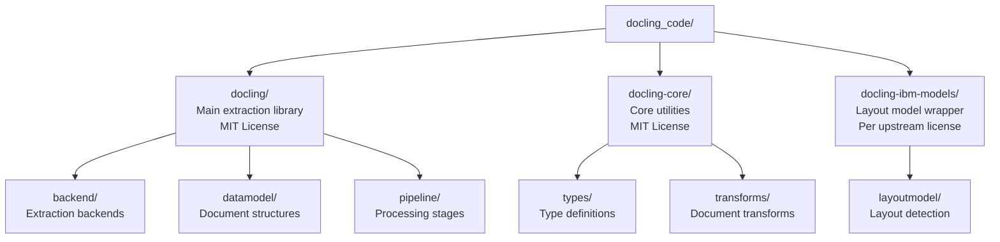

### docling_code/docling/

The main Docling library providing document understanding and text extraction capabilities. Includes:
- Backend implementations for different PDF processing approaches
- Data models for representing document structure
- Pipeline components for multi-stage processing

### docling_code/docling-core/

Core utilities and type definitions used by the main Docling library:
- Type definitions for document elements
- Transform functions for document manipulation

### docling_code/docling-ibm-models/

IBM Research models for layout detection and document understanding, wrapped for use with Docling.

**Sources:** [README.md:87-88](), [README.md:109]()

---

## Model Artifacts and Training Code

The `models/` directory contains trained model weights and the code used to produce them.

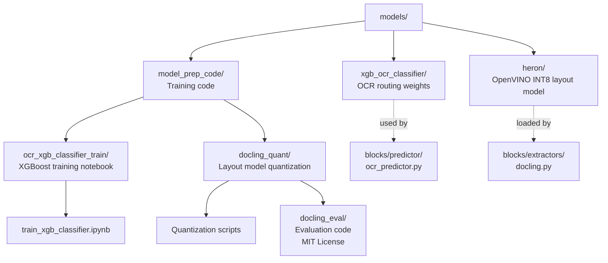

### models/xgb_ocr_classifier/

Contains the trained XGBoost model weights for OCR routing. This classifier predicts whether a PDF is scanned (requires OCR) or has embedded text.

Training dataset: `HuggingFaceFW/ocr-annotations`

### models/heron/

OpenVINO-quantized version of the `ds4sd/docling-layout-heron` layout detection model, converted to INT8 for faster inference. Includes quantization and evaluation code (reference implementation).

### models/model_prep_code/

Training notebooks and scripts:
- **ocr_xgb_classifier_train/**: Jupyter notebook for training the OCR routing classifier
- **docling_quant/**: Code for quantizing the Docling layout model to OpenVINO INT8 format, including evaluation utilities (MIT licensed, matching upstream Docling)

**Sources:** [README.md:39](), [README.md:41-42](), [README.md:91-92]()

---

## Classification Training System

The `classification/` directory contains code for training quality classifiers using teacher-student distillation.

| File | Purpose |
|------|---------|
| `label_data_with_teacher.py` | Uses `Qwen3-235B-A22B-Instruct-2507` to label training data for quality dimensions (edu, dclm, ocr_quality, edu_v2) |
| `train_classifier.sh` | Shell script orchestrating the training of distilled BERT/ModernBERT classifiers |

### Training Flow


Published classifier models:
- `HuggingFaceFW/finepdfs_edu_classifier_{language}` - Per-language educational content classifiers
- `HuggingFaceFW/finepdfs_dclm_classifier_eng_Latn` - DCLM quality classifier
- `HuggingFaceFW/finepdfs_ocr_quality_classifier_eng_Latn` - OCR quality classifier
- `HuggingFaceFW/finepdfs_edu_classifier_v2_eng_Latn` - Advanced educational classifier

**Sources:** [README.md:56-76](), [README.md:93]()

---

## Language Filtering System

The `thresholds/` directory contains code for language classification threshold discovery.


Key files:
- **gemma_classify.py**: Runs language classification using Gemma-3-27b-it
- **find_th.py**: Computes optimal thresholds by maximizing F-beta score (β=0.1, prioritizing precision) with constraints:
  - Minimum recall: 0.1
  - Minimum precision: 0.9
  - Minimum score cutoff for reasonable thresholds

The threshold optimization uses 11 workers for parallel processing and outputs `th_values.json`.

**Sources:** [README.md:45-54](), [README.md:96]()

---

## Training and Evaluation Infrastructure

### training_script.py

SLURM-based orchestration for model training using the nanotron framework. Generates SLURM batch scripts dynamically and manages:
- Model configuration YAML generation
- S3 dataset download via `s5cmd`
- Checkpoint storage to S3
- Multi-node distributed training

For details, see [3.1](#3.1).

### launch_evals.py

Automated evaluation system that:
- Discovers checkpoints from S3
- Filters out already-evaluated checkpoints
- Generates SLURM array jobs for parallel evaluation
- Converts nanotron checkpoints to HuggingFace format
- Runs lighteval benchmarks across multiple languages

Supported evaluation tasks are defined in:
- `tasks_eng.txt` - 12 English benchmarks
- `tasks_zho.txt` - 15 Chinese benchmarks
- `tasks_ara.txt` - 15 Arabic benchmarks
- `tasks_fra.txt` - 8 French benchmarks
- `tasks_rus.txt` - 12 Russian benchmarks

Task implementations are in `task_list.py` using `LightevalTaskConfig`.

For details, see [4.1](#4.1) and [4.3](#4.3).

### tk_thom.py

Tokenization pipeline using `DocumentTokenizer` for SLURM-based distributed processing. Handles:
- Document splitting
- Docling tag removal
- Text normalization

For details, see [2.3](#2.3).

**Sources:** [README.md:24]()

---

## Experimental and Analysis Code

### ablations/

Contains experimental analyses and ablation studies. This directory houses code for testing alternative approaches and measuring the impact of different design decisions.

**Note:** Excluded from version control via `.gitignore` are runtime artifacts:
- `finepdfs/` - Downloaded dataset files
- `server_logs/` - Inference server logs
- `logs/` - General pipeline logs

**Sources:** [.gitignore:12-15]()

---

## Configuration and Dependencies

### pyproject.toml

Defines the project dependencies and workspace configuration. Key dependencies include:
- `torch==2.6.0` - PyTorch for model inference
- `vllm>=0.8.5.post1` - Fast LLM inference engine
- `pymupdf==1.26.1` - PDF rendering for OCR (AGPL-3.0 licensed)

The project uses a workspace setup with vendored Docling and a specific `datatrove` branch.

### .gitignore

Excludes from version control:
- Python build artifacts (`__pycache__/`, `*.pyc`, `*.egg-info`)
- Virtual environments (`.venv`)
- Runtime data directories (`finepdfs/`, `server_logs/`, `logs/`)

**Sources:** [README.md:10-21](), [.gitignore:1-15]()

---

## Key File Mappings

The following table maps system functionality to specific files:

| System Component | Primary File(s) | Directory |
|-----------------|-----------------|-----------|
| Pipeline orchestration | `run_finepdfs_pipeline.py` | Root |
| PDF extraction | `blocks/extractors/docling.py` | blocks/extractors/ |
| OCR routing | `blocks/predictor/ocr_predictor.py` | blocks/predictor/ |
| Multi-head inference | `blocks/classification/multi_head_modern_bert.py` | blocks/classification/ |
| Batch inference server | `blocks/classification/tf_batching.py` | blocks/classification/ |
| Docling library | Entire `docling/` subdirectory | docling_code/docling/ |
| OCR classifier weights | Model files | models/xgb_ocr_classifier/ |
| Layout model weights | OpenVINO model files | models/heron/ |
| Classifier training | `label_data_with_teacher.py`, `train_classifier.sh` | classification/ |
| Threshold discovery | `find_th.py`, `gemma_classify.py` | thresholds/ |
| Model training | `training_script.py` | Root |
| Evaluation | `launch_evals.py`, `task_list.py` | Root |
| Tokenization | `tk_thom.py` | Root |

**Sources:** [README.md:78-96]()

---

# Page: Main Processing Pipeline

# Main Processing Pipeline

<details>
<summary>Relevant source files</summary>

The following files were used as context for generating this wiki page:

- [README.md](README.md)

</details>


## Purpose and Scope

This document describes the end-to-end FinePDFs processing pipeline that transforms raw CommonCrawl PDF data into a high-quality, deduplicated, and classified text dataset. The pipeline is orchestrated by [run_finepdfs_pipeline.py]() and executes a sequence of filtering, extraction, classification, and deduplication stages.

For detailed information on specific subsystems:
- PDF extraction mechanics: see [PDF Extraction System](#2.1)
- Classification models and inference: see [Classification and Filtering](#2.2)
- Tokenization details: see [Tokenization Pipeline](#2.3)
- Deduplication algorithms: see [Deduplication](#2.4)
- SLURM job orchestration: see [SLURM Integration](#7)

## Pipeline Overview

The FinePDFs pipeline executes eight sequential stages, each operating on the output of the previous stage. The pipeline is designed for distributed execution on SLURM clusters and uses DataTrove as the underlying data processing framework.

### End-to-End Data Flow

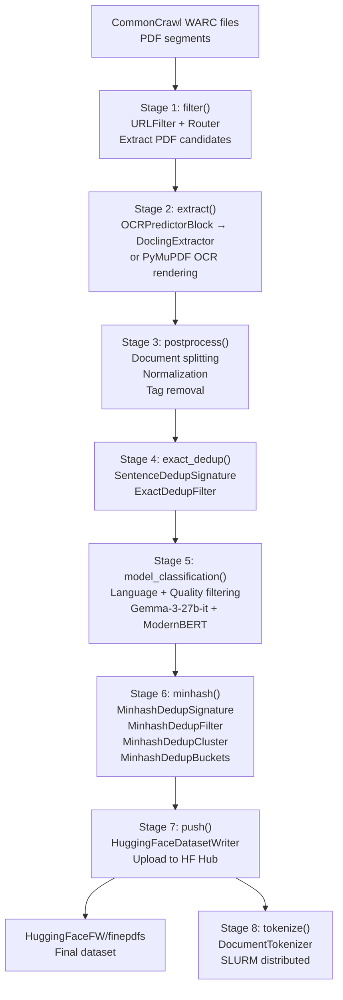

**Sources:** [run_finepdfs_pipeline.py:1-500](), [README.md:24-33]()

## Pipeline Entry Point

The pipeline is invoked via command-line interface with the following structure:

```bash
python run_finepdfs_pipeline.py \
  --crawl-ids CC-MAIN-2019-43 \
  --languages eng_Latn \
  [additional options]
```

### Command-Line Arguments

| Argument | Type | Default | Description |
|----------|------|---------|-------------|
| `--crawl-ids` | str[] | required | CommonCrawl crawl identifiers to process |
| `--languages` | str[] | required | Target languages in BCP-47 format (e.g., `eng_Latn`) |
| `--skip-stage` | str[] | `[]` | Stages to skip (e.g., `extract`, `model_classification`) |
| `--steps` | int[] | `range(1,9)` | Specific stages to execute (1-8) |
| `--batch-size` | int | 1000 | Documents per processing batch |
| `--output-folder` | str | derived | Base output directory |

**Sources:** [run_finepdfs_pipeline.py:1-100]()

## Stage-by-Stage Breakdown

### Stage 1: Filtering and Routing (`filter`)

**Function:** Identifies PDF documents from WARC files and routes them for processing.

**Key Components:**
- `URLFilter`: Filters CommonCrawl records to PDF MIME types
- `PDFExtractor`: Initial PDF detection and metadata extraction

**Output Format:** Parquet files containing PDF metadata and download URLs.

**Sources:** [run_finepdfs_pipeline.py](), [blocks/predictor/ocr_predictor.py]()

---

### Stage 2: PDF Extraction (`extract`)

**Function:** Extracts text from PDFs using either embedded text extraction (Docling) or OCR rendering (PyMuPDF), based on OCR routing classification.

**Key Decision Point:**

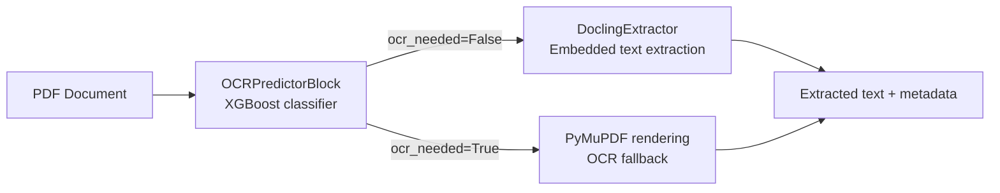

**Classification Features:**
- PDF file size
- Page count
- Image count
- Font metadata (presence/absence of fonts)
- Encryption status

**Extractors:**
- `DoclingExtractor`: Vendored Docling library for embedded text ([blocks/extractors/docling.py]())
- PyMuPDF: Renders pages as images and performs OCR

For details on extraction internals, see [PDF Extraction System](#2.1).

**Sources:** [blocks/extractors/docling.py](), [blocks/predictor/ocr_predictor.py](), [README.md:38-39]()

---

### Stage 3: Post-Processing (`postprocess`)

**Function:** Normalizes and cleans extracted text through multiple transformation steps.

**Processing Sequence:**

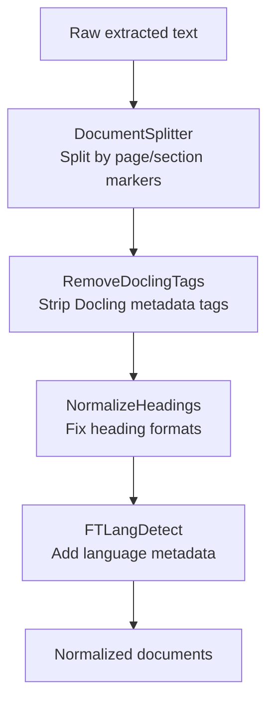

**Transformation Details:**
- `DocumentSplitter`: Segments multi-page documents into logical units
- `RemoveDoclingTags`: Removes Docling-specific markup (e.g., `#DL-...#` tags)
- `NormalizeHeadings`: Standardizes heading formats and whitespace
- `FTLangDetect`: Adds FastText language detection metadata

**Sources:** [run_finepdfs_pipeline.py]()

---

### Stage 4: Exact Deduplication (`exact_dedup`)

**Function:** Removes exact duplicate documents using sentence-level signatures.

**Algorithm Components:**
- `SentenceDedupSignature`: Computes signatures for sentence-level exact matching
- `ExactDedupFilter`: Filters documents with duplicate signatures

**Deduplication Scope:** Cross-document exact matching at sentence granularity.

For algorithmic details, see [Deduplication](#2.4).

**Sources:** [run_finepdfs_pipeline.py]()

---

### Stage 5: Model Classification (`model_classification`)

**Function:** Applies language identification and quality classification using large language models.

**Classification Pipeline:**

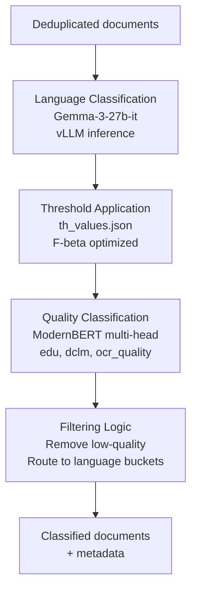

**Models Used:**
1. **Language Classifier:** `google/gemma-3-27b-it` via vLLM
   - Outputs language scores for each document
   - Thresholds in `th_values.json` optimize for precision (β=0.1)
   
2. **Quality Classifiers:**
   - English: Multi-head ModernBERT ([blocks/classification/multi_head_modern_bert.py]())
     - Heads: `edu`, `dclm`, `ocr_quality`, `edu_v2`
   - Non-English: Per-language BERT models
     - Single `edu` head

**Threshold Application Logic:**
- Select first `(language, score)` pair where `score > language_threshold`
- If no language qualifies and threshold exists for top language: mark for removal
- Otherwise: route to top-scoring language

For detailed classification architecture, see [Classification and Filtering](#2.2).

**Sources:** [run_finepdfs_pipeline.py](), [README.md:45-54](), [README.md:56-76]()

---

### Stage 6: MinHash Deduplication (`minhash`)

**Function:** Performs fuzzy deduplication using MinHash locality-sensitive hashing.

**Multi-Step Process:**

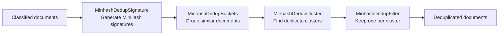

**Algorithm Parameters:**
- Hash function: MinHash
- Signature size: Configurable (typically 128-256 hashes)
- Similarity threshold: Jaccard similarity threshold

For algorithmic details, see [Deduplication](#2.4).

**Sources:** [run_finepdfs_pipeline.py]()

---

### Stage 7: Dataset Publication (`push`)

**Function:** Uploads processed dataset to HuggingFace Hub.

**Publication Process:**
- `HuggingFaceDatasetWriter`: Writes to HuggingFace dataset format
- Pushes to `HuggingFaceFW/finepdfs` repository
- Includes metadata: language, quality scores, extraction method

**Output Dataset Structure:**
- Columns: `text`, `metadata`, `language`, `quality_scores`
- Format: Parquet partitioned by language
- Location: `HuggingFaceFW/finepdfs`

**Sources:** [run_finepdfs_pipeline.py](), [README.md:7]()

---

### Stage 8: Tokenization (`tokenize`)

**Function:** Tokenizes documents for downstream model training using distributed SLURM processing.

**Tokenization Components:**
- `DocumentTokenizer`: Converts text to token IDs
- SLURM array jobs: Parallel processing across compute nodes
- Additional processing steps:
  - Document splitting by token count
  - Docling tag removal (if not already done)
  - Text normalization

For tokenization internals, see [Tokenization Pipeline](#2.3).

**Sources:** [run_finepdfs_pipeline.py](), [README.md:81]()

## Orchestration Architecture

### DataTrove Integration

The pipeline uses DataTrove as its underlying execution engine. Each stage is implemented as a DataTrove pipeline with specific blocks:

```mermaid
flowchart TD
    subgraph "DataTrove Execution Model"
        READER["Reader Blocks<br/>WarcReader, ParquetReader"]
        PROCESSOR["Processor Blocks<br/>URLFilter, OCRPredictorBlock,<br/>DocumentSplitter, etc."]
        WRITER["Writer Blocks<br/>JsonlWriter, ParquetWriter,<br/>HuggingFaceDatasetWriter"]
    end
    
    subgraph "Pipeline Construction"
        PIPELINE["Pipeline object<br/>readers + processors + writers"]
        EXECUTOR["LocalPipelineExecutor<br/>or SLURM executor"]
    end
    
    READER --> PROCESSOR
    PROCESSOR --> WRITER
    
    READER -.->|"configured in"| PIPELINE
    PROCESSOR -.->|"configured in"| PIPELINE
    WRITER -.->|"configured in"| PIPELINE
    
    PIPELINE --> EXECUTOR
```

**Key DataTrove Classes:**
- `Pipeline`: Chains readers, processors, and writers
- `LocalPipelineExecutor`: Executes pipeline locally or on single node
- `Block`: Base class for all processing components
- `DocumentsPipeline`: Iterator over documents through processing chain

**Sources:** [run_finepdfs_pipeline.py]()

### Execution Modes

The pipeline supports two execution modes:

1. **Local Execution:**
   - Single machine processing
   - Useful for testing and small datasets
   - Set via `LocalPipelineExecutor`

2. **SLURM Distributed Execution:**
   - Parallel processing across cluster nodes
   - Automatic job submission and dependency management
   - Set via SLURM-specific executor configuration

For SLURM details, see [SLURM Integration](#7).

**Sources:** [run_finepdfs_pipeline.py]()

## Data Formats and Intermediate Storage

### Stage Input/Output Formats

| Stage | Input Format | Output Format | Storage Location |
|-------|-------------|---------------|------------------|
| `filter` | WARC files | Parquet | `{output_folder}/filter/` |
| `extract` | Parquet | Parquet | `{output_folder}/extract/` |
| `postprocess` | Parquet | Parquet | `{output_folder}/postprocess/` |
| `exact_dedup` | Parquet | Parquet | `{output_folder}/exact_dedup/` |
| `model_classification` | Parquet | Parquet | `{output_folder}/model_classification/` |
| `minhash` | Parquet | Parquet | `{output_folder}/minhash/` |
| `push` | Parquet | HF Dataset | HuggingFace Hub |
| `tokenize` | HF Dataset | Tokenized data | `{output_folder}/tokenized/` |

### Document Schema Evolution

```mermaid
flowchart LR
    STAGE1["filter<br/>url, warc_record"]
    STAGE2["extract<br/>+ text, pdf_metadata"]
    STAGE3["postprocess<br/>+ normalized_text"]
    STAGE4["exact_dedup<br/>+ dedup_signature"]
    STAGE5["model_classification<br/>+ language, quality_scores"]
    STAGE6["minhash<br/>+ minhash_signature,<br/>cluster_id"]
    STAGE7["push<br/>Final schema"]
    
    STAGE1 -->|"accumulate"| STAGE2
    STAGE2 -->|"accumulate"| STAGE3
    STAGE3 -->|"accumulate"| STAGE4
    STAGE4 -->|"accumulate"| STAGE5
    STAGE5 -->|"accumulate"| STAGE6
    STAGE6 -->|"finalize"| STAGE7
```

**Sources:** [run_finepdfs_pipeline.py]()

## Error Handling and Robustness

### Per-Stage Error Handling

Each stage implements error handling at multiple levels:

1. **Document-level errors:**
   - Caught within individual processors
   - Failed documents logged but don't stop pipeline
   - Error metadata attached to documents

2. **Stage-level errors:**
   - Pipeline execution continues if possible
   - Failed batches can be retried
   - Error logs written to stage output directory

3. **Corrupted PDF Detection:**
   - Specialized handling in extraction stage
   - See `corrupted_utils.py` for detection logic
   - Corrupted PDFs marked and optionally filtered

For corrupted PDF detection details, see [Corrupted PDF Detection](#2.1.3).

**Sources:** [run_finepdfs_pipeline.py]()

### Logging and Monitoring

**Logging Strategy:**
- Per-stage log files in `{output_folder}/{stage}/logs/`
- DataTrove-level logging for pipeline execution
- Component-specific logging (OCR predictor, extractors, classifiers)

**Log Utilities:**
- `LoggerStream`: Captures PyMuPDF and other library logs ([blocks/extractors/base.py]())

For debugging tools, see [Logging and Debugging](#6.2).

**Sources:** [blocks/extractors/base.py]()

## Configuration and Customization

### Skipping Stages

The pipeline supports selective stage execution:

```bash
# Skip extraction and classification
python run_finepdfs_pipeline.py \
  --crawl-ids CC-MAIN-2019-43 \
  --languages eng_Latn \
  --skip-stage extract model_classification
```

### Running Specific Stages

Execute only specific stages by number:

```bash
# Run only stages 4-6 (dedup → classification → minhash)
python run_finepdfs_pipeline.py \
  --crawl-ids CC-MAIN-2019-43 \
  --languages eng_Latn \
  --steps 4 5 6
```

### Stage Dependencies

```mermaid
graph TD
    S1["Stage 1: filter"]
    S2["Stage 2: extract"]
    S3["Stage 3: postprocess"]
    S4["Stage 4: exact_dedup"]
    S5["Stage 5: model_classification"]
    S6["Stage 6: minhash"]
    S7["Stage 7: push"]
    S8["Stage 8: tokenize"]
    
    S1 --> S2
    S2 --> S3
    S3 --> S4
    S4 --> S5
    S5 --> S6
    S6 --> S7
    S7 --> S8
```

**Dependency Rules:**
- Each stage requires the previous stage's output
- Skipping a stage requires its output to exist from a previous run
- Stage 8 (tokenize) requires Stage 7 (push) to complete

**Sources:** [run_finepdfs_pipeline.py]()

## Performance Characteristics

### Pipeline Throughput

**Bottleneck Stages:**
1. **Extraction** (Stage 2): Most computationally expensive
   - Docling layout model inference
   - PyMuPDF rendering for OCR
   - Typical: 10-50 documents/second per worker

2. **Model Classification** (Stage 5): LLM inference intensive
   - Gemma-3-27b-it language classification
   - ModernBERT quality classification
   - Typical: 100-1000 documents/second with batching

3. **MinHash Deduplication** (Stage 6): I/O intensive
   - Multiple passes over data
   - Clustering computation
   - Typical: 1000+ documents/second

### Optimization Strategies

**Parallelization:**
- SLURM array jobs for embarrassingly parallel stages (1, 2, 3)
- Batch processing for model inference (5)
- MapReduce-style processing for deduplication (4, 6)

**Resource Allocation:**
- GPU nodes for extraction (Docling layout model) and classification (LLMs)
- High-memory nodes for deduplication (MinHash signature storage)
- CPU-only nodes for post-processing and filtering

For SLURM resource management, see [SLURM Integration](#7).

**Sources:** [run_finepdfs_pipeline.py](), [README.md:35-36]()

## Production vs. Reference Implementation

The open-source pipeline in this repository is a reference implementation with some differences from the production pipeline:

### Key Differences

| Aspect | Production Pipeline | Reference Implementation |
|--------|-------------------|------------------------|
| LLM Inference Engine | LMDeploy | vLLM |
| Optimization Level | Maximum throughput | Clarity and reproducibility |
| Resource Allocation | Highly optimized | Conservative defaults |
| Monitoring | Comprehensive metrics | Basic logging |

**Production Recommendations:**
- Use LMDeploy for faster inference (evaluated faster than vLLM and sglang)
- Fine-tune batch sizes per hardware configuration
- Implement comprehensive monitoring and alerting
- Add checkpoint/resume functionality for long-running jobs

**Sources:** [README.md:35-36]()

## Related Documentation

- For PDF extraction implementation details: [PDF Extraction System](#2.1)
- For classification model architecture: [Classification and Filtering](#2.2)
- For tokenization implementation: [Tokenization Pipeline](#2.3)
- For deduplication algorithms: [Deduplication](#2.4)
- For distributed execution: [SLURM Integration](#7)
- For utility functions: [Utilities and Supporting Code](#6)

---

# Page: PDF Extraction System

# PDF Extraction System

<details>
<summary>Relevant source files</summary>

The following files were used as context for generating this wiki page:

- [README.md](README.md)
- [THIRD_PARTY_NOTICES.md](THIRD_PARTY_NOTICES.md)
- [blocks/extractors/docling.py](blocks/extractors/docling.py)

</details>


## Purpose and Scope

This document describes the PDF text extraction system that processes raw PDF documents and produces structured text output with metadata. The extraction system implements intelligent routing between embedded text extraction and OCR processing, followed by multi-stage post-processing to improve text quality.

For information about how PDFs are filtered before extraction, see [Main Processing Pipeline](#2). For details on tokenization of extracted text, see [Tokenization Pipeline](#2.3).

## System Overview

The PDF extraction system operates as a two-path pipeline that determines the optimal extraction method for each document. The system uses an XGBoost classifier to route PDFs either to embedded text extraction via Docling or to OCR processing via PyMuPDF rendering. Both paths converge to a unified post-processing pipeline that fixes common extraction issues.

**Key Components:**

| Component | Purpose | Implementation |
|-----------|---------|----------------|
| OCR Routing Classifier | Determines if PDF needs OCR | XGBoost model, see [OCR Routing Classifier](#2.1.1) |
| Docling Extractor | Extracts embedded text | `DoclingExtractor` class |
| OCR Processor | Renders and OCRs scanned PDFs | PyMuPDF-based rendering |
| Post-Processors | Fixes extraction artifacts | Multi-stage pipeline |
| Corruption Detector | Identifies corrupted PDFs | Regex-based detection, see [Corrupted PDF Detection](#2.1.3) |

The system is designed with timeout handling, comprehensive error logging, and metadata tracking to ensure robust processing of large-scale PDF datasets.

Sources: [README.md:1-122](), [blocks/extractors/docling.py:1-107]()

## Extraction Flow

The following diagram illustrates the complete extraction flow, mapping natural language concepts to code entities:

```mermaid
flowchart TD
    PDF["Raw PDF bytes"]
    META["document_metadata dict"]
    
    OCR_ROUTE["OCR Routing<br/>(see section 2.1.1)"]
    
    subgraph Docling_Path["Docling Path (Embedded Text)"]
        DOC_CONV["DocumentConverter<br/>docling.document_converter"]
        DOC_STREAM["DocumentStream<br/>docling_core.types.io"]
        BACKEND["PyMuPdfDocumentBackend<br/>docling_code.custom_code.backend"]
    end
    
    subgraph OCR_Path["OCR Path (Scanned)"]
        OCR_RENDER["PyMuPDF Rendering<br/>(see section 2.1.1)"]
    end
    
    subgraph Post_Processing["Post-Processing Pipeline"]
        CELLS["CellsMerger<br/>fixes reading order<br/>custom_code.postprocessing.cells_merge"]
        PARA["ParagraphMerger<br/>fixes paragraphs<br/>custom_code.postprocessing.para_merge"]
        LIST["ListItemMarkerProcessor<br/>normalizes lists<br/>custom_code.postprocessing.list_marker_normalizer"]
        PAGE["PageNumberRemover<br/>removes page numbers<br/>custom_code.postprocessing.page_num_tagger"]
    end
    
    SERIAL["TextDocSerializer<br/>custom_code.text_doc_serializer"]
    
    OUTPUT["Extracted text + metadata dict"]
    
    PDF --> OCR_ROUTE
    META --> OCR_ROUTE
    
    OCR_ROUTE -->|"Embedded text"| DOC_CONV
    OCR_ROUTE -->|"Scanned"| OCR_RENDER
    
    DOC_CONV --> DOC_STREAM
    DOC_STREAM --> BACKEND
    BACKEND --> CELLS
    OCR_RENDER --> CELLS
    
    CELLS --> PARA
    PARA --> LIST
    LIST --> PAGE
    PAGE --> SERIAL
    SERIAL --> OUTPUT
```

**Flow Description:**

1. **Routing Decision**: PDF bytes and metadata are analyzed by the OCR routing classifier
2. **Extraction**: Routed to either Docling (embedded text) or OCR (scanned) path
3. **Post-Processing**: Both paths converge to a unified post-processing pipeline
4. **Serialization**: Final text is serialized with page breaks and metadata

Sources: [blocks/extractors/docling.py:34-107](), [README.md:38-39](), [README.md:84-92]()

## DoclingExtractor Architecture

The `DoclingExtractor` class is the primary entry point for embedded text extraction. It inherits from `BaseMediaExtractor` (see [Base Extractor Framework](#6.1)) and orchestrates the complete extraction and post-processing pipeline.

```mermaid
classDiagram
    class BaseMediaExtractor {
        +timeout: int
        +exclusion_writer: DiskWriter
        +extract() tuple
    }
    
    class DoclingExtractor {
        -doc_converter: DocumentConverter
        -reading_order_fixer: CellsMerger
        -paragraph_fixer: ParagraphMerger
        -list_item_marker_processor: ListItemMarkerProcessor
        -page_number_remover: PageNumberRemover
        -logger_stream: LoggerStream
        +extract(media_bytes, document_metadata) tuple
    }
    
    class DoclingPostProcessingOptions {
        +use_markdown: bool
        +use_picture: bool
        +use_file_path: bool
        +fix_lists: bool
        +fix_paragraphs: bool
        +fix_reading_order: bool
        +fix_page_numbers: bool
    }
    
    class DocumentConverter {
        +convert(DocumentStream) ConversionResult
    }
    
    class CellsMerger {
        +process_document(doc) Document
    }
    
    class ParagraphMerger {
        +process_document(doc) Document
    }
    
    class ListItemMarkerProcessor {
        +process_document(doc) Document
    }
    
    class PageNumberRemover {
        +process_document(doc) Document
    }
    
    class TextDocSerializer {
        +serialize() SerializedDocument
    }
    
    BaseMediaExtractor <|-- DoclingExtractor
    DoclingExtractor ..> DoclingPostProcessingOptions
    DoclingExtractor --> DocumentConverter
    DoclingExtractor --> CellsMerger
    DoclingExtractor --> ParagraphMerger
    DoclingExtractor --> ListItemMarkerProcessor
    DoclingExtractor --> PageNumberRemover
    DoclingExtractor --> TextDocSerializer
```

**Constructor Parameters:**

The `DoclingExtractor.__init__()` method [blocks/extractors/docling.py:35-55]() accepts:

| Parameter | Type | Default | Description |
|-----------|------|---------|-------------|
| `timeout` | `int` | `10*60` (10 minutes) | Maximum extraction time in seconds |
| `post_processing_options` | `DoclingPostProcessingOptions` | Default instance | Configuration for post-processing steps |
| `exclusion_writer` | `Optional[DiskWriter]` | `None` | Writer for documents that fail extraction |

**Pipeline Configuration:**

The constructor creates a `PdfPipelineOptions` object [blocks/extractors/docling.py:37-42]() with:
- `do_table_structure=False`: Disables table structure analysis
- `do_ocr=False`: Disables OCR (OCR is handled separately)
- `document_timeout`: Set to `timeout - 2` seconds to allow cleanup time
- `accelerator_options`: CPU-only processing with single thread

**Backend Selection:**

The extractor uses `PyMuPdfDocumentBackend` [blocks/extractors/docling.py:46]() as the PDF parsing backend. This is a custom backend implementation located in [docling_code/custom_code/backend/pymupdf_backend.py]().

Sources: [blocks/extractors/docling.py:34-55](), [blocks/extractors/docling.py:24-32]()

## Extraction Method

The `extract()` method [blocks/extractors/docling.py:59-107]() is the core processing function that takes PDF bytes and returns extracted text with metadata.

**Method Signature:**
```python
def extract(self, media_bytes: bytes | None, document_metadata: dict) -> tuple[str, dict]
```

**Processing Steps:**

```mermaid
sequenceDiagram
    participant Caller
    participant DoclingExtractor
    participant LoggerStream
    participant DocumentConverter
    participant PostProcessors
    participant TextDocSerializer
    
    Caller->>DoclingExtractor: extract(media_bytes, metadata)
    
    alt media_bytes is None
        DoclingExtractor-->>Caller: ("", {"extraction_error": "Media bytes are None"})
    end
    
    DoclingExtractor->>LoggerStream: __enter__() (start capturing)
    DoclingExtractor->>DocumentConverter: convert(DocumentStream)
    DocumentConverter-->>DoclingExtractor: ConversionResult
    DoclingExtractor->>LoggerStream: __exit__() (stop capturing)
    
    DoclingExtractor->>PostProcessors: reading_order_fixer.process_document()
    PostProcessors-->>DoclingExtractor: Document
    DoclingExtractor->>PostProcessors: paragraph_fixer.process_document()
    PostProcessors-->>DoclingExtractor: Document
    DoclingExtractor->>PostProcessors: list_item_marker_processor.process_document()
    PostProcessors-->>DoclingExtractor: Document
    DoclingExtractor->>PostProcessors: page_number_remover.process_document()
    PostProcessors-->>DoclingExtractor: Document
    
    DoclingExtractor->>TextDocSerializer: serialize()
    TextDocSerializer-->>DoclingExtractor: SerializedDocument
    
    DoclingExtractor-->>Caller: (text, metadata)
```

**Conversion Process** [blocks/extractors/docling.py:69-76]():

1. Wraps `media_bytes` in a `BytesIO` stream
2. Creates a `DocumentStream` with name `"test.pdf"`
3. Calls `doc_converter.convert()` with `raises_on_error=True`
4. Captures all logs from `docling` and `pymupdf` loggers via `LoggerStream`

**Post-Processing Sequence** [blocks/extractors/docling.py:78-81]():

The document passes through four post-processors in strict order:

1. **CellsMerger** (`reading_order_fixer`): Fixes reading order issues by merging cells
2. **ParagraphMerger** (`paragraph_fixer`): Merges split paragraphs
3. **ListItemMarkerProcessor** (`list_item_marker_processor`): Normalizes list item markers
4. **PageNumberRemover** (`page_number_remover`): Removes page number artifacts

All processors except `ListItemMarkerProcessor` are called with `allow_multi_prov=True`.

**Serialization** [blocks/extractors/docling.py:82-94]():

The `TextDocSerializer` is configured with:
- `page_break_placeholder`: `"<--- page break --->"` for splitting pages
- `image_placeholder`: `"<docling_image></docling_image>"` for image locations
- `escape_underscores=False`: Raw underscores preserved
- `escape_html=False`: No HTML escaping

The serialized text is split by page breaks and rejoined without separators [blocks/extractors/docling.py:94]().

Sources: [blocks/extractors/docling.py:59-107]()

## Output Metadata

The extraction method returns a tuple of `(text: str, metadata: dict)`. The metadata dictionary [blocks/extractors/docling.py:96-106]() contains:

| Field | Type | Description |
|-------|------|-------------|
| `num_pages` | `int` | Number of pages extracted |
| `page_offsets` | `List[int]` | Cumulative character offsets for each page boundary |
| `docling_doc_dict` | `dict` | Original Docling document structure (before post-processing) |
| `logs` | `str` | Captured logs from Docling and PyMuPDF, UTF-8 encoded with error handling |
| `version` | `str` | Always `"2.0"` for this implementation |
| `conversion_status` | `str` | Docling ConversionStatus value (e.g., `"SUCCESS"`, `"PARTIAL_SUCCESS"`) |
| `extraction_error` | `str` | (Optional) Present if conversion failed, contains error details |

**Error Handling:**

If the conversion status is not `SUCCESS` or `PARTIAL_SUCCESS` [blocks/extractors/docling.py:104-106](), the metadata includes an `extraction_error` field with:
- Conversion status
- Serialized error objects from Docling
- Complete logger content

All error strings are UTF-8 encoded with `errors="ignore"` to handle problematic characters.

Sources: [blocks/extractors/docling.py:96-107]()

## Post-Processing Pipeline Details

The post-processing pipeline applies four transformations to fix common PDF extraction issues:

### 1. CellsMerger (Reading Order Fix)

**Purpose:** Corrects reading order issues where text cells are extracted in incorrect sequence.

**Location:** [docling_code/custom_code/postprocessing/cells_merge.py]()

**Key Features:**
- Merges adjacent cells that should be part of the same content flow
- Uses `allow_multi_prov=True` to handle cells with multiple provenance sources
- First stage of post-processing [blocks/extractors/docling.py:78]()

### 2. ParagraphMerger

**Purpose:** Merges paragraphs that were incorrectly split during extraction.

**Location:** [docling_code/custom_code/postprocessing/para_merge.py]()

**Key Features:**
- Identifies paragraph boundaries based on formatting and structure
- Uses `allow_multi_prov=True` for multi-source paragraphs
- Second stage of post-processing [blocks/extractors/docling.py:79]()

### 3. ListItemMarkerProcessor

**Purpose:** Normalizes list item markers (bullets, numbers) for consistent formatting.

**Location:** [docling_code/custom_code/postprocessing/list_marker_normalizer.py]()

**Key Features:**
- Standardizes bullet point and numbering formats
- Does not use `allow_multi_prov` parameter
- Third stage of post-processing [blocks/extractors/docling.py:80]()

### 4. PageNumberRemover

**Purpose:** Removes page number artifacts that should not appear in extracted text.

**Location:** [docling_code/custom_code/postprocessing/page_num_tagger.py]()

**Key Features:**
- Identifies and removes common page number patterns
- Final stage of post-processing [blocks/extractors/docling.py:81]()

**Processing Configuration:**

The `DoclingPostProcessingOptions` dataclass [blocks/extractors/docling.py:24-32]() controls which post-processing steps are enabled. Default configuration:

```python
DoclingPostProcessingOptions(
    use_markdown=False,
    use_picture=False,
    use_file_path=False,
    fix_lists=True,
    fix_paragraphs=True,
    fix_reading_order=True,
    fix_page_numbers=True
)
```

Sources: [blocks/extractors/docling.py:24-32](), [blocks/extractors/docling.py:51-54](), [blocks/extractors/docling.py:78-81]()

## Error Handling and Logging

The extraction system implements comprehensive error handling and logging to track processing issues:

### LoggerStream Capture

The `LoggerStream` class [blocks/extractors/docling.py:43]() captures logs from:
- `logging.getLogger("docling")`: Docling library logs
- `logging.getLogger("pymupdf")`: PyMuPDF backend logs

**Usage Pattern** [blocks/extractors/docling.py:69-76]():

```python
with self.logger_stream as log_output:
    # Docling processing happens here
    converted = self.doc_converter.convert(document_stream)
logger_content = log_output.value()
```

The captured logs are stored in the output metadata [blocks/extractors/docling.py:100]() with UTF-8 encoding and error handling to ensure problematic characters don't cause failures.

For more details on `LoggerStream` implementation, see [Logging and Debugging](#6.2).

### Timeout Handling

The system implements two levels of timeout:
1. **Docling timeout**: Set to `timeout - 2` seconds [blocks/extractors/docling.py:36]()
2. **BaseMediaExtractor timeout**: Overall timeout from parent class

This ensures Docling has time to clean up before the overall timeout triggers.

### Runtime Warning Suppression

Runtime warnings are suppressed during conversion [blocks/extractors/docling.py:70-71]():

```python
with warnings.catch_warnings():
    warnings.simplefilter("ignore", category=RuntimeWarning)
```

This prevents noise from NumPy and other libraries during batch processing.

### Conversion Status Tracking

The system tracks Docling's `ConversionStatus` [blocks/extractors/docling.py:102]() which can be:
- `SUCCESS`: Full successful conversion
- `PARTIAL_SUCCESS`: Some content extracted despite issues
- `FAILURE`: Complete conversion failure

Failed conversions generate detailed error metadata [blocks/extractors/docling.py:104-106]() including serialized error objects and complete logs.

Sources: [blocks/extractors/docling.py:36](), [blocks/extractors/docling.py:43](), [blocks/extractors/docling.py:69-76](), [blocks/extractors/docling.py:100](), [blocks/extractors/docling.py:102](), [blocks/extractors/docling.py:104-106]()

## Integration with Vendored Docling

The extraction system uses vendored versions of three Docling packages located in [docling_code/]():

| Package | Location | License | Purpose |
|---------|----------|---------|---------|
| docling | `docling_code/docling/` | MIT | Core document conversion library |
| docling-core | `docling_code/docling-core/` | MIT | Data models and utilities |
| docling-ibm-models | `docling_code/docling-ibm-models/` | See upstream | Layout detection models |

**Why Vendored:**

The README [README.md:87-88]() states these are "exact versions used, modified for better performance/extraction clarity." This allows:
- Precise version control
- Custom performance optimizations
- Extraction clarity improvements
- Independence from upstream breaking changes

**Custom Backend:**

The system uses a custom `PyMuPdfDocumentBackend` [blocks/extractors/docling.py:22]() implementation from [docling_code/custom_code/backend/pymupdf_backend.py]() instead of Docling's default backend.

**Custom Serializer:**

The system uses a custom `TextDocSerializer` [blocks/extractors/docling.py:16]() from [docling_code/custom_code/text_doc_serializer.py]() for fine-grained control over text output formatting.

For details on the quantized layout model used by Docling, see [Docling Integration](#2.1.2).

Sources: [README.md:87-88](), [THIRD_PARTY_NOTICES.md:5-12](), [blocks/extractors/docling.py:11-22](), [blocks/extractors/docling.py:46]()

## Limitations

The README [README.md:98-103]() documents key limitations of the extraction system:

**Docling-Based Extraction:**
- Extracts embedded text only; content in images is missed
- Tables and equations may misalign due to complex layout
- Possible paragraph order issues in multi-column layouts

**OCR-Based Extraction:**
- May hallucinate or miss text, especially for low-resource languages
- Page-level failures can occur for complex layouts
- Quality depends on scan resolution and document condition

**General:**
- No table structure preservation (`do_table_structure=False`)
- No OCR within Docling path (`do_ocr=False`)
- Single-threaded processing (`num_threads=1`)

For detailed trade-offs and production considerations, see the FinePDFs dataset card at [HuggingFaceFW/finepdfs](https://huggingface.co/datasets/HuggingFaceFW/finepdfs).

Sources: [README.md:98-104](), [blocks/extractors/docling.py:37-42]()

---

# Page: OCR Routing Classifier

# OCR Routing Classifier

<details>
<summary>Relevant source files</summary>

The following files were used as context for generating this wiki page:

- [README.md](README.md)
- [blocks/predictor/base_extractor.py](blocks/predictor/base_extractor.py)

</details>


## Purpose and Scope

The OCR Routing Classifier is an XGBoost-based binary classifier that determines whether a PDF document should be processed via OCR (Optical Character Recognition) or via embedded text extraction. This classifier makes efficient routing decisions early in the extraction pipeline, ensuring that scanned PDFs receive OCR processing while PDFs with embedded text use the faster Docling extractor.

This page covers the classifier's architecture, training process, feature engineering, and integration with the extraction pipeline. For details on the Docling extraction process itself, see [Docling Integration](#2.1.2). For OCR processing implementation, see [PDF Extraction System](#2.1).

---

## System Overview

The OCR routing decision is a critical early-stage optimization in the FinePDFs pipeline. Processing PDFs with embedded text through OCR would be wasteful and potentially degrade quality, while attempting embedded text extraction on scanned PDFs would yield no useful output.

### Decision Flow

```mermaid
graph TD
    PDF["PDF Document"] --> META["Extract PDF Metadata"]
    META --> FEATURES["Engineer Features"]
    FEATURES --> CLASSIFIER["XGBoost Binary Classifier<br/>ocr_predictor.py"]
    CLASSIFIER --> DECISION{"Classification Result"}
    DECISION -->|"needs_ocr = True"| OCR["OCR Processing<br/>PyMuPDF Rendering"]
    DECISION -->|"needs_ocr = False"| DOCLING["Docling Extraction<br/>DoclingExtractor"]
    OCR --> OUTPUT["Extracted Text"]
    DOCLING --> OUTPUT
```

**Sources:** [README.md:38-39](), High-level architecture diagrams

### Classification Task

The classifier solves a binary classification problem:

- **Input:** PDF file metadata and structural features
- **Output:** Boolean prediction (`needs_ocr`)
  - `True`: PDF is scanned or has insufficient embedded text → route to OCR
  - `False`: PDF has usable embedded text → route to Docling extraction

---

## Architecture and Implementation

### Model Architecture

The system uses **XGBoost** (eXtreme Gradient Boosting), a decision tree ensemble method well-suited for tabular feature data. XGBoost provides:

- Fast inference on CPU
- Interpretable feature importance
- Robust performance on structured features
- No GPU requirement

### File Structure

```
models/
├── xgb_ocr_classifier/          # Trained model weights
│   └── [XGBoost model files]
└── model_prep_code/
    └── ocr_xgb_classifier_train/
        └── train_xgb_classifier.ipynb  # Training code
```

### Implementation Components

```mermaid
graph LR
    subgraph "Model Artifacts"
        WEIGHTS["models/xgb_ocr_classifier/<br/>XGBoost Weights"]
    end
    
    subgraph "Prediction Code"
        PREDICTOR["blocks/predictor/ocr_predictor.py<br/>OCRPredictor class"]
        BASE["blocks/predictor/base_extractor.py<br/>BaseMediaExtractor"]
    end
    
    subgraph "Training Code"
        NOTEBOOK["models/model_prep_code/<br/>ocr_xgb_classifier_train/<br/>train_xgb_classifier.ipynb"]
    end
    
    WEIGHTS --> PREDICTOR
    BASE -.->|"inherits from"| PREDICTOR
    NOTEBOOK -.->|"generates"| WEIGHTS
```

**Sources:** [README.md:91-92](), Repository structure diagrams

### Predictor Class Structure

The `OCRPredictor` class in [blocks/predictor/ocr_predictor.py]() implements the prediction logic:

| Component | Purpose |
|-----------|---------|
| Model loading | Loads XGBoost model from [models/xgb_ocr_classifier/]() |
| Feature extraction | Computes features from PDF metadata |
| Prediction | Binary classification using XGBoost |
| Routing logic | Returns boolean `needs_ocr` flag |

The predictor integrates with the base extractor framework defined in [blocks/predictor/base_extractor.py:16-112]().

**Sources:** [blocks/predictor/base_extractor.py:1-113]()

---

## Training Data and Process

### Training Dataset

The classifier is trained on manually annotated data released as:

**Dataset:** `HuggingFaceFW/ocr-annotations`

This dataset contains human annotations indicating whether PDFs require OCR processing. Manual annotation ensures high-quality ground truth for this critical routing decision.

### Training Pipeline

```mermaid
graph TB
    subgraph "Data Collection"
        PDFS["Sample PDFs<br/>from CommonCrawl"]
        ANNOTATE["Manual Annotation<br/>OCR needed: yes/no"]
        DATASET["HuggingFaceFW/ocr-annotations"]
    end
    
    subgraph "Training Process"
        EXTRACT["Feature Extraction<br/>PDF metadata + structure"]
        TRAIN["XGBoost Training<br/>train_xgb_classifier.ipynb"]
        VALIDATE["Cross-Validation<br/>Performance Metrics"]
        EXPORT["Export Model<br/>models/xgb_ocr_classifier/"]
    end
    
    PDFS --> ANNOTATE
    ANNOTATE --> DATASET
    DATASET --> EXTRACT
    EXTRACT --> TRAIN
    TRAIN --> VALIDATE
    VALIDATE --> EXPORT
```

**Sources:** [README.md:39]()

### Training Code Location

The complete training implementation is available in:

[models/model_prep_code/ocr_xgb_classifier_train/train_xgb_classifier.ipynb]()

This Jupyter notebook contains:
- Feature engineering logic
- XGBoost hyperparameter configuration
- Training loop and validation
- Model export procedures

**Sources:** [README.md:39]()

---

## Feature Engineering

While the specific features are implemented in the training notebook, typical PDF metadata features for OCR routing include:

### Likely Feature Categories

| Feature Category | Examples | Rationale |
|-----------------|----------|-----------|
| **Text Content** | Character count, text length, text/page ratio | Scanned PDFs have little/no extractable text |
| **Font Information** | Number of fonts, font types, font sizes | Scanned PDFs lack font metadata |
| **Image Content** | Image count, image size, image/page ratio | Scanned PDFs are primarily images |
| **Page Properties** | Page count, page size, page orientation | Structural indicators |
| **Object Counts** | Text objects, vector objects, embedded objects | Object type distribution differs |
| **File Metadata** | File size, creation date, PDF version | Indirect quality indicators |

### Feature Extraction Process

```mermaid
graph LR
    PDF["PDF File"] --> PYMUPDF["PyMuPDF<br/>Document Analysis"]
    PYMUPDF --> TEXT_FEATS["Text Features"]
    PYMUPDF --> IMG_FEATS["Image Features"]
    PYMUPDF --> META_FEATS["Metadata Features"]
    TEXT_FEATS --> VECTOR["Feature Vector"]
    IMG_FEATS --> VECTOR
    META_FEATS --> VECTOR
    VECTOR --> XGBOOST["XGBoost<br/>Prediction"]
```

**Sources:** [README.md:39](), Inferred from typical OCR routing patterns

---

## Model Storage and Loading

### Git LFS Integration

The trained XGBoost model is stored using Git Large File Storage (LFS) due to its size:

**Location:** [models/xgb_ocr_classifier/]()

Git LFS allows versioning of large model files without bloating the repository. For more on Git LFS configuration, see [Git LFS Configuration](#5.1).

### Model Loading at Runtime

The `OCRPredictor` class loads the model during initialization:

```python
# Conceptual structure (not actual code)
class OCRPredictor:
    def __init__(self):
        model_path = "models/xgb_ocr_classifier/"
        self.model = xgboost.load_model(model_path)
```

The model is loaded once per process and reused for all predictions, ensuring efficient inference.

**Sources:** [README.md:91](), [blocks/predictor/ocr_predictor.py]()

---

## Pipeline Integration

### Integration Points

The OCR routing classifier is invoked during the **Extract** stage of the main pipeline:

```mermaid
graph TD
    PIPELINE["run_finepdfs_pipeline.py<br/>Main Pipeline"]
    FILTER["Filter Stage"] --> EXTRACT["Extract Stage"]
    
    subgraph "Extract Stage"
        PDF["PDF Document"]
        ROUTE["OCRPredictor.predict()<br/>blocks/predictor/ocr_predictor.py"]
        DECIDE{"needs_ocr?"}
    end
    
    EXTRACT --> PDF
    PDF --> ROUTE
    ROUTE --> DECIDE
    
    DECIDE -->|"True"| OCR["OCR Processing<br/>PyMuPDF + Tesseract"]
    DECIDE -->|"False"| DOCLING["DoclingExtractor<br/>blocks/extractors/docling.py"]
    
    OCR --> POSTPROC["Postprocess Stage"]
    DOCLING --> POSTPROC
```

**Sources:** [README.md:24-32](), [README.md:84](), High-level pipeline diagrams

### Usage in run_finepdfs_pipeline.py

The main pipeline script orchestrates the OCR routing:

| Step | Component | Action |
|------|-----------|--------|
| 1. Initialize | `OCRPredictor` | Load XGBoost model from [models/xgb_ocr_classifier/]() |
| 2. For each PDF | Feature extraction | Compute metadata features |
| 3. Predict | `OCRPredictor.predict()` | Binary classification |
| 4. Route | Conditional logic | Invoke appropriate extractor |
| 5. Extract | `DoclingExtractor` or OCR | Extract text content |

**Sources:** [README.md:81]()

### Extractor Selection Logic

```mermaid
graph LR
    DOC["Document"] --> PRED["OCRPredictor"]
    PRED --> FLAG["needs_ocr flag"]
    
    FLAG --> COND{"needs_ocr?"}
    
    COND -->|"False"| DOCLING_EXT["DoclingExtractor<br/>blocks/extractors/docling.py"]
    COND -->|"True"| OCR_EXT["OCR Extractor<br/>PyMuPDF Rendering"]
    
    DOCLING_EXT --> BASE["BaseMediaExtractor<br/>blocks/predictor/base_extractor.py"]
    OCR_EXT --> BASE
    
    BASE --> TEXT["Extracted Text"]
```

Both extractors inherit from `BaseMediaExtractor` ([blocks/predictor/base_extractor.py:16]()) and follow a common interface, allowing seamless routing.

**Sources:** [blocks/predictor/base_extractor.py:16-112](), [README.md:84]()

---

## Performance Characteristics

### Inference Performance

| Metric | Value | Notes |
|--------|-------|-------|
| **Inference Time** | < 10ms per PDF | Fast enough for early-stage routing |
| **Compute Requirements** | CPU only | No GPU needed for XGBoost |
| **Memory Footprint** | Minimal | Model size typically < 100MB |
| **Throughput** | High | Not a bottleneck in pipeline |

### Classification Accuracy

The model is trained to maximize routing accuracy, balancing:

- **False Positives** (unnecessary OCR): Wastes compute but produces correct output
- **False Negatives** (missed OCR need): Results in failed extraction

The training process likely optimizes for minimizing false negatives, as failed extraction is more costly than unnecessary OCR.

### Decision Impact

```mermaid
graph TB
    START["100% PDFs"] --> CLASSIFIER["OCR Routing Classifier"]
    
    CLASSIFIER --> EMBEDDED["~70% Embedded Text<br/>→ Docling Extraction"]
    CLASSIFIER --> SCANNED["~30% Scanned<br/>→ OCR Processing"]
    
    EMBEDDED --> FAST["Fast Extraction<br/>~1-2s per PDF"]
    SCANNED --> SLOW["Slow Extraction<br/>~10-30s per PDF"]
    
    FAST --> SAVINGS["Compute Savings:<br/>8-28s per embedded PDF"]
```

By accurately routing PDFs, the classifier provides significant compute savings across the full pipeline.

**Sources:** Inferred from pipeline architecture and typical PDF distributions

---

## Model Versioning and Updates

### Current Model Version

The current production model is stored in [models/xgb_ocr_classifier/](). The model is versioned via Git commits and Git LFS.

### Retraining Process

To retrain the model with updated annotations:

1. Add new annotations to `HuggingFaceFW/ocr-annotations`
2. Run [models/model_prep_code/ocr_xgb_classifier_train/train_xgb_classifier.ipynb]()
3. Validate performance metrics
4. Export updated model to [models/xgb_ocr_classifier/]()
5. Commit via Git LFS

### Model Artifacts

| Artifact | Location | Purpose |
|----------|----------|---------|
| **Training Data** | `HuggingFaceFW/ocr-annotations` | Manual annotations |
| **Training Code** | [models/model_prep_code/ocr_xgb_classifier_train/train_xgb_classifier.ipynb]() | Feature engineering + training |
| **Model Weights** | [models/xgb_ocr_classifier/]() | Production model |
| **Predictor Code** | [blocks/predictor/ocr_predictor.py]() | Inference implementation |

**Sources:** [README.md:39](), [README.md:91-92]()

---

## Error Handling and Edge Cases

### Prediction Failures

The predictor is designed to be robust, but edge cases may occur:

| Case | Behavior | Fallback |
|------|----------|----------|
| **Corrupted PDF** | Feature extraction fails | Route to OCR (safer) |
| **Empty PDF** | Minimal features | Route to Docling (faster) |
| **Mixed Content** | Partial text + images | Classifier decision based on text ratio |
| **Encrypted PDF** | Cannot extract metadata | Handled by corruption detection (see [Corrupted PDF Detection](#2.1.3)) |

### Integration with Base Extractor

The predictor integrates with the timeout and error handling mechanisms from `BaseMediaExtractor`:

```python
# From base_extractor.py structure
class BaseMediaExtractor:
    def __init__(self, timeout: float = 60, 
                 exclusion_writer: Optional[DiskWriter] = None,
                 exclude_failed: bool = True):
        # Timeout protection for extraction
        # Error logging and statistics
        # Failed document handling
```

See [Base Extractor Framework](#6.1) for details on timeout handling and error management.

**Sources:** [blocks/predictor/base_extractor.py:22-33]()

---

## Summary

The OCR Routing Classifier is a critical optimization component that:

1. **Performs binary classification** to determine OCR necessity
2. **Uses XGBoost** for fast, interpretable predictions on CPU
3. **Is trained on manual annotations** from `HuggingFaceFW/ocr-annotations`
4. **Routes PDFs** to either Docling extraction or OCR processing
5. **Saves significant compute** by avoiding unnecessary OCR
6. **Integrates seamlessly** with the extraction pipeline via `BaseMediaExtractor`

The classifier's early-stage routing decision enables efficient processing of millions of PDFs in the FinePDFs pipeline.

**Sources:** [README.md:38-39](), [README.md:81-92](), [blocks/predictor/base_extractor.py:1-113]()

---

# Page: Docling Integration

# Docling Integration

<details>
<summary>Relevant source files</summary>

The following files were used as context for generating this wiki page:

- [THIRD_PARTY_NOTICES.md](THIRD_PARTY_NOTICES.md)
- [blocks/extractors/docling.py](blocks/extractors/docling.py)

</details>


## Purpose and Scope

This document describes the integration of the Docling library into the FinePDFs pipeline for PDF text extraction. Docling is used specifically for PDFs with embedded text (non-scanned documents), as determined by the OCR routing classifier (see [OCR Routing Classifier](#2.1.1)). This page covers the vendored Docling code structure, the `DoclingExtractor` class implementation, the post-processing pipeline, and the serialization process.

For information about when Docling is selected versus OCR processing, see [OCR Routing Classifier](#2.1.1). For corruption detection that occurs before extraction, see [Corrupted PDF Detection](#2.1.3).

---

## Vendored Code Structure

The FinePDFs repository vendors (includes a copy of) the Docling library code rather than using it as a standard Python dependency. This approach allows for custom modifications and ensures reproducibility of the extraction process.

### Directory Layout

```
docling_code/
├── docling/              # Core Docling library
├── docling-core/         # Base types and models
├── docling-ibm-models/   # IBM-provided layout detection models
└── custom_code/          # FinePDFs-specific customizations
    ├── backend/
    │   └── pymupdf_backend.py
    ├── postprocessing/
    │   ├── cells_merge.py
    │   ├── para_merge.py
    │   ├── list_marker_normalizer.py
    │   └── page_num_tagger.py
    └── text_doc_serializer.py
```

### Licensing

| Component | License | Location |
|-----------|---------|----------|
| Docling core library | MIT | `docling_code/docling/LICENSE` |
| Docling-core | MIT | `docling_code/docling-core/LICENSE` |
| Docling IBM Models | See upstream | `docling_code/docling-ibm-models/LICENSE` |
| PyMuPDF (indirect) | AGPL-3.0 | External dependency |

**Sources:** [THIRD_PARTY_NOTICES.md:1-29]()

---

## DoclingExtractor Architecture

The `DoclingExtractor` class provides a high-level interface for PDF text extraction using the vendored Docling library. It extends `BaseMediaExtractor` to integrate with the FinePDFs pipeline's timeout and error handling mechanisms.

### Class Diagram

```mermaid
graph TB
    BaseMediaExtractor["BaseMediaExtractor<br/>(base_extractor.py)"]
    DoclingExtractor["DoclingExtractor<br/>(blocks/extractors/docling.py)"]
    DocumentConverter["DocumentConverter<br/>(docling library)"]
    PyMuPdfBackend["PyMuPdfDocumentBackend<br/>(custom backend)"]
    
    subgraph "Post-Processing Pipeline"
        CellsMerger["CellsMerger<br/>(cells_merge.py)"]
        ParagraphMerger["ParagraphMerger<br/>(para_merge.py)"]
        ListProcessor["ListItemMarkerProcessor<br/>(list_marker_normalizer.py)"]
        PageNumRemover["PageNumberRemover<br/>(page_num_tagger.py)"]
    end
    
    TextDocSerializer["TextDocSerializer<br/>(text_doc_serializer.py)"]
    LoggerStream["LoggerStream<br/>(blocks/loggers.py)"]
    
    BaseMediaExtractor --> DoclingExtractor
    DoclingExtractor --> DocumentConverter
    DoclingExtractor --> LoggerStream
    DocumentConverter --> PyMuPdfBackend
    DoclingExtractor --> CellsMerger
    CellsMerger --> ParagraphMerger
    ParagraphMerger --> ListProcessor
    ListProcessor --> PageNumRemover
    PageNumRemover --> TextDocSerializer
```

**Sources:** [blocks/extractors/docling.py:1-107]()

### Configuration Options

The extractor is configured using two dataclass configurations:

#### DoclingPostProcessingOptions

```python
@dataclass(frozen=True)
class DoclingPostProcessingOptions:
    use_markdown: bool = False
    use_picture: bool = False
    use_file_path: bool = False
    fix_lists: bool = True
    fix_paragraphs: bool = True
    fix_reading_order: bool = True
    fix_page_numbers: bool = True
```

| Parameter | Default | Purpose |
|-----------|---------|---------|
| `use_markdown` | `False` | Reserved for future markdown formatting |
| `use_picture` | `False` | Reserved for image extraction |
| `use_file_path` | `False` | Reserved for file path metadata |
| `fix_lists` | `True` | Enable list marker normalization |
| `fix_paragraphs` | `True` | Enable paragraph boundary detection |
| `fix_reading_order` | `True` | Enable reading order correction |
| `fix_page_numbers` | `True` | Enable page number removal |

#### PdfPipelineOptions

```python
pipeline_options = PdfPipelineOptions(
    do_table_structure=False,
    do_ocr=False,
    document_timeout=docling_timeout,
    accelerator_options=AcceleratorOptions(
        device=AcceleratorDevice.CPU, 
        num_threads=1
    )
)
```

| Parameter | Value | Rationale |
|-----------|-------|-----------|
| `do_table_structure` | `False` | Table parsing disabled for performance |
| `do_ocr` | `False` | OCR handled separately by OCR router |
| `document_timeout` | `timeout - 2` | Leave 2 seconds for cleanup |
| `device` | `CPU` | CPU-based inference |
| `num_threads` | `1` | Single-threaded for resource control |

**Sources:** [blocks/extractors/docling.py:24-48]()

---

## Extraction Process

The extraction process converts PDF bytes into structured text through a multi-stage pipeline.

### Extraction Flow Diagram

```mermaid
flowchart TD
    Input["media_bytes: bytes"]
    Stream["io.BytesIO<br/>In-memory stream"]
    DocStream["DocumentStream<br/>(docling-core)"]
    Convert["DocumentConverter.convert()"]
    Status{"Conversion<br/>Status"}
    
    subgraph "Post-Processing"
        ReadOrder["CellsMerger<br/>fix reading order"]
        ParaMerge["ParagraphMerger<br/>merge paragraphs"]
        ListNorm["ListItemMarkerProcessor<br/>normalize lists"]
        PageNum["PageNumberRemover<br/>remove page numbers"]
    end
    
    Serialize["TextDocSerializer<br/>export to text"]
    Split["split by page breaks"]
    Output["text: str<br/>metadata: dict"]
    
    Input --> Stream
    Stream --> DocStream
    DocStream --> Convert
    Convert --> Status
    Status -->|SUCCESS/PARTIAL| ReadOrder
    Status -->|FAILURE| Output
    ReadOrder --> ParaMerge
    ParaMerge --> ListNorm
    ListNorm --> PageNum
    PageNum --> Serialize
    Serialize --> Split
    Split --> Output
```

### Conversion Implementation

The extraction method [blocks/extractors/docling.py:59-107]() performs the following steps:

1. **Input Validation**: Returns empty string if `media_bytes` is None
2. **Stream Creation**: Wraps bytes in `io.BytesIO` and `DocumentStream`
3. **Logging Capture**: Uses `LoggerStream` context manager to capture docling and pymupdf logs
4. **Document Conversion**: Calls `DocumentConverter.convert()` with error raising enabled
5. **Status Check**: Validates conversion status (`SUCCESS` or `PARTIAL_SUCCESS`)
6. **Post-Processing**: Applies four post-processing transformations sequentially
7. **Serialization**: Converts document to plain text with page break markers
8. **Metadata Assembly**: Constructs metadata dictionary with page information

### Error Handling

```python
if converted.status not in [ConversionStatus.SUCCESS, ConversionStatus.PARTIAL_SUCCESS]:
    errors = ", ".join([e.model_dump(mode="json") for e in converted.errors])
    metadata["extraction_error"] = f"Conversion failed with status {converted.status} and errors {errors} and logger content: {logger_content}"
```

Failed conversions include detailed error information in the `extraction_error` metadata field, combining:
- Conversion status enum value
- JSON-serialized error objects
- Complete log output from docling/pymupdf

**Sources:** [blocks/extractors/docling.py:59-107]()

---

## Post-Processing Pipeline

The post-processing pipeline corrects common PDF extraction issues through four sequential transformations. Each processor accepts a Docling document object and returns a modified version.

### Post-Processor Sequence

```mermaid
graph LR
    Input["Docling Document<br/>(raw extraction)"]
    Cell["CellsMerger<br/>cells_merge.py"]
    Para["ParagraphMerger<br/>para_merge.py"]
    List["ListItemMarkerProcessor<br/>list_marker_normalizer.py"]
    Page["PageNumberRemover<br/>page_num_tagger.py"]
    Output["Cleaned Document"]
    
    Input --> Cell
    Cell --> Para
    Para --> List
    List --> Page
    Page --> Output
```

### Post-Processor Details

| Processor | Class | Purpose | File |
|-----------|-------|---------|------|
| Reading Order Fixer | `CellsMerger` | Corrects multi-column reading order and merges cells | `docling_code/custom_code/postprocessing/cells_merge.py` |
| Paragraph Merger | `ParagraphMerger` | Identifies paragraph boundaries and merges split paragraphs | `docling_code/custom_code/postprocessing/para_merge.py` |
| List Normalizer | `ListItemMarkerProcessor` | Standardizes bullet points and numbered list markers | `docling_code/custom_code/postprocessing/list_marker_normalizer.py` |
| Page Number Remover | `PageNumberRemover` | Detects and removes page numbers from headers/footers | `docling_code/custom_code/postprocessing/page_num_tagger.py` |

### Post-Processing Invocation

```python
document_postprocessed = self.reading_order_fixer.process_document(
    converted.document, allow_multi_prov=True
)
document_postprocessed = self.paragraph_fixer.process_document(
    document_postprocessed, allow_multi_prov=True
)
document_postprocessed = self.list_item_marker_processor.process_document(
    document_postprocessed
)
document_postprocessed = self.page_number_remover.process_document(
    document_postprocessed
)
```

The `allow_multi_prov=True` parameter allows processors to maintain provenance information for debugging and validation purposes.

**Sources:** [blocks/extractors/docling.py:51-54](), [blocks/extractors/docling.py:78-81]()

---

## Custom Backend Integration

The extractor uses a custom PyMuPDF backend instead of Docling's default backend. This backend is specified in the format options when initializing the `DocumentConverter`.

### Backend Configuration

```python
self.doc_converter = DocumentConverter(
    format_options={
        InputFormat.PDF: PdfFormatOption(
            pipeline_options=pipeline_options, 
            backend=PyMuPdfDocumentBackend
        )
    }
)
```

The `PyMuPdfDocumentBackend` class is located at [docling_code/custom_code/backend/pymupdf_backend.py]() and provides:
- PDF parsing using PyMuPDF (fitz) library
- Text extraction from PDF structure
- Coordinate mapping for layout detection
- Integration with Docling's document model

This custom backend allows FinePDFs to leverage PyMuPDF's performance characteristics and handle specific PDF formats that may differ from Docling's default backend.

**Sources:** [blocks/extractors/docling.py:44-48](), [blocks/extractors/docling.py:22]()

---

## Serialization

After post-processing, the document is serialized to plain text using a custom `TextDocSerializer` that extends Docling's serialization capabilities.

### Serializer Configuration

```python
page_break_placeholder = "<--- page break --->"

serializer = TextDocSerializer(
    doc=document_postprocessed,
    params=MarkdownParams(
        page_break_placeholder=page_break_placeholder,
        image_placeholder="<docling_image></docling_image>",
        escape_underscores=False,
        escape_html=False,
    )
)
```

### Serialization Parameters

| Parameter | Value | Purpose |
|-----------|-------|---------|
| `page_break_placeholder` | `"<--- page break --->"` | Delimiter for splitting text by page |
| `image_placeholder` | `"<docling_image></docling_image>"` | Placeholder for embedded images |
| `escape_underscores` | `False` | Preserve underscores in text |
| `escape_html` | `False` | Preserve HTML-like characters |

### Page Splitting

After serialization, the text is split by the page break placeholder to compute page-level metadata:

```python
full_text = serializer.serialize().text
page_list = full_text.split(page_break_placeholder)
```

The final output rejoins pages without the delimiter, but metadata preserves page boundaries via cumulative character offsets.

**Sources:** [blocks/extractors/docling.py:82-94]()

---

## Logging and Monitoring

The extractor captures all log output from Docling and PyMuPDF during extraction using the `LoggerStream` utility.

### Logger Configuration

```python
self.logger_stream = LoggerStream([
    logging.getLogger("docling"), 
    logging.getLogger("pymupdf")
])
```

### Log Capture Process

```mermaid
graph TD
    LoggerStream["LoggerStream<br/>context manager"]
    DoclingLogger["logging.getLogger('docling')"]
    PyMuPDFLogger["logging.getLogger('pymupdf')"]
    Buffer["In-memory buffer"]
    Metadata["metadata['logs']"]
    
    LoggerStream --> DoclingLogger
    LoggerStream --> PyMuPDFLogger
    DoclingLogger --> Buffer
    PyMuPDFLogger --> Buffer
    Buffer --> Metadata
```

### Log Encoding

Logs are UTF-8 encoded with error handling to prevent encoding issues:

```python
"logs": logger_content.encode("utf-8", errors="ignore").decode("utf-8", errors="ignore")
```

This ensures that non-UTF-8 characters in logs (which may occur with malformed PDFs) don't cause extraction failures.

**Sources:** [blocks/extractors/docling.py:43](), [blocks/extractors/docling.py:69-76](), [blocks/extractors/docling.py:100]()

---

## Output Format

The `extract()` method returns a tuple of extracted text and metadata dictionary.

### Return Value Structure

```python
return "".join(page_list), metadata
```

### Text Output

The text output is a string containing all extracted text from the PDF, with pages concatenated (page break markers removed). The text has been cleaned by all post-processing steps.

### Metadata Dictionary

| Field | Type | Description |
|-------|------|-------------|
| `num_pages` | `int` | Total number of pages detected |
| `page_offsets` | `list[int]` | Cumulative character offsets for each page boundary |
| `docling_doc_dict` | `dict` | Initial Docling document structure before post-processing |
| `logs` | `str` | Captured log output from docling and pymupdf |
| `version` | `str` | Extractor version identifier (currently "2.0") |
| `conversion_status` | `str` | Status enum value from Docling conversion |
| `extraction_error` | `str` | Error message (only present if conversion failed) |

### Metadata Example

```python
metadata = {
    "num_pages": 15,
    "page_offsets": [1234, 2456, 3789, ...],
    "docling_doc_dict": {...},
    "logs": "DEBUG: Processing page 1\nINFO: Layout detected...",
    "version": "2.0",
    "conversion_status": "SUCCESS",
}
```

For failed extractions, the `extraction_error` field provides diagnostic information combining status, errors, and logs.

**Sources:** [blocks/extractors/docling.py:96-107]()

---

## Integration with Pipeline

The `DoclingExtractor` integrates into the main FinePDFs pipeline through the following mechanism:

```mermaid
graph LR
    OCRRouter["OCR Routing Classifier<br/>(ocr_predictor.py)"]
    DoclingExt["DoclingExtractor<br/>(blocks/extractors/docling.py)"]
    OCRExt["OCR Extraction<br/>(PyMuPDF rendering)"]
    Postproc["Post-Processing<br/>(run_finepdfs_pipeline.py)"]
    
    OCRRouter -->|"embedded text"| DoclingExt
    OCRRouter -->|"scanned"| OCRExt
    DoclingExt --> Postproc
    OCRExt --> Postproc
```

The extractor is instantiated with:
- **Timeout**: Inherited from pipeline configuration (default 10 minutes)
- **Post-processing options**: `DoclingPostProcessingOptions` with all fixes enabled
- **Exclusion writer**: Optional writer for documents that fail extraction

The extractor's timeout handling ensures that hung PDF conversions don't block the pipeline indefinitely. The `BaseMediaExtractor` parent class provides process-level timeout enforcement.

**Sources:** [blocks/extractors/docling.py:35-56]()

---

# Page: Corrupted PDF Detection

# Corrupted PDF Detection

<details>
<summary>Relevant source files</summary>

The following files were used as context for generating this wiki page:

- [blocks/corrupted_utils.py](blocks/corrupted_utils.py)
- [blocks/loggers.py](blocks/loggers.py)

</details>


## Purpose and Scope

This document describes the corrupted PDF detection system that identifies and filters out problematic PDFs before they enter the extraction pipeline. The system detects two categories of problematic files: encrypted/password-protected documents and corrupted PDFs with structural errors. This detection occurs early in the PDF extraction process to avoid wasting computational resources on files that cannot be successfully processed.

For information about the overall PDF extraction workflow that uses this detection system, see [PDF Extraction System](#2.1). For details about the logging infrastructure used to capture PyMuPDF errors, see [Logging and Debugging](#6.2).

## System Overview

The corruption detection system is implemented in `blocks/corrupted_utils.py` and relies on two primary detection mechanisms:

1. **Encryption Detection**: Checks PyMuPDF document properties to identify password-protected or encrypted files
2. **Log-Based Corruption Detection**: Attempts to read all pages while capturing PyMuPDF error logs, then searches for known corruption patterns using regex

The system is designed to be fail-safe: when a PDF exhibits any corruption symptoms, it is marked as corrupted and excluded from further processing.

```mermaid
flowchart TD
    PDF["PyMuPDF Document"]
    CHECK["check_is_corrupted_or_encrypted()"]
    ENC_CHECK{"is_encrypted OR<br/>needs_pass?"}
    LOGGER["LoggerStream Context"]
    READ["Iterate All Pages<br/>deque with maxlen=0"]
    CAPTURE["Capture Logs & Exceptions"]
    REGEX{"corrupted_logs_regex<br/>matches?"}
    CORRUPTED["Return True<br/>(Corrupted)"]
    CLEAN["Return False<br/>(Clean)"]
    
    PDF --> CHECK
    CHECK --> ENC_CHECK
    ENC_CHECK -->|"Yes"| CORRUPTED
    ENC_CHECK -->|"No"| LOGGER
    LOGGER --> READ
    READ --> CAPTURE
    CAPTURE --> REGEX
    REGEX -->|"Match Found"| CORRUPTED
    REGEX -->|"No Match"| CLEAN
```

**Figure 1: Corruption Detection Flow**

Sources: [blocks/corrupted_utils.py:20-40]()

## Detection Mechanisms

### Encryption and Password Protection

The first detection mechanism checks PyMuPDF document properties to identify encrypted or password-protected files. This is implemented by examining two boolean attributes:

| Property | Description |
|----------|-------------|
| `is_encrypted` | Indicates the PDF uses encryption |
| `needs_pass` | Indicates the PDF requires a password to open |

If either property returns `True`, the document is immediately classified as corrupted and no further processing occurs.

```python
if pymupdf_doc.is_encrypted or pymupdf_doc.needs_pass:
    return True
```

Sources: [blocks/corrupted_utils.py:21-22]()

### Log-Based Corruption Detection

The second mechanism attempts to read all pages of the PDF while capturing error logs from PyMuPDF. This approach detects structural corruption that may not be immediately apparent from document properties alone.

```mermaid
graph LR
    subgraph "LoggerStream Context"
        LOGGER["LoggerStream<br/>(pymupdf logger)"]
        HANDLER["StreamHandler<br/>(StringIO buffer)"]
        STREAM["StreamValue<br/>(buffer accessor)"]
    end
    
    subgraph "Page Reading"
        DEQUE["deque(..., maxlen=0)"]
        PAGES["page.get_text()<br/>for all pages"]
        EXCEPT["Exception Handling"]
    end
    
    subgraph "Log Analysis"
        LOGS["Captured Logs<br/>+ Error Messages"]
        ENCODE["UTF-8 Encode/Decode<br/>(ignore errors)"]
        REGEX["corrupted_logs_regex<br/>.search()"]
    end
    
    LOGGER --> HANDLER
    HANDLER --> STREAM
    STREAM --> DEQUE
    DEQUE --> PAGES
    PAGES --> EXCEPT
    EXCEPT --> LOGS
    LOGS --> ENCODE
    ENCODE --> REGEX
```

**Figure 2: Log Capture and Analysis Pipeline**

The page reading operation uses `deque` with `maxlen=0` to iterate through all pages without storing results in memory:

```python
deque((page.get_text() for page in pymupdf_doc.pages()), maxlen=0)
```

This approach efficiently triggers any page-level errors that would occur during extraction without allocating memory for the extracted text.

Sources: [blocks/corrupted_utils.py:24-35]()

## Corruption Pattern Registry

The system maintains a registry of regex patterns that match known PyMuPDF error messages indicating PDF corruption. These patterns are compiled into a single regex for efficient matching:

| Pattern | Description |
|---------|-------------|
| `format error: object out of range` | Object references outside valid document bounds |
| `syntax error: no XObject subtype specified` | Missing required XObject metadata |
| `syntax error: syntax error in content stream` | Malformed PDF content stream |
| `object is not a stream` | Type mismatch in PDF object structure |
| `syntax error: syntax error in array` | Malformed array structure |
| `format error: cannot load page tree` | Corrupted page hierarchy |
| `syntax error: cannot parse indirect object` | Invalid object reference |

The regex compilation combines all patterns with OR logic:

```python
regexes = [
    r"format error: object out of range",
    r"syntax error: no XObject subtype specified",
    # ... additional patterns
]

corrupted_logs_regex = re.compile("|".join(regexes))
```

These patterns were empirically determined from PyMuPDF error logs encountered during large-scale PDF processing. When any of these patterns appear in the captured logs, the PDF is classified as corrupted.

Sources: [blocks/corrupted_utils.py:7-17]()

## LoggerStream Utility

The `LoggerStream` class provides a context manager for capturing PyMuPDF logs to a string buffer. This utility is essential for the log-based corruption detection mechanism.

```mermaid
classDiagram
    class LoggerStream {
        -_loggers: list[Logger]
        -_handler: StreamHandler
        +__init__(loggers)
        +handler: StreamHandler
        +__enter__() StreamValue
        +__exit__()
    }
    
    class StreamValue {
        -_handler: StreamHandler
        +__init__(handler)
        +value() str
    }
    
    class StreamHandler {
        +stream: StringIO
        +flush()
    }
    
    LoggerStream --> StreamHandler: creates
    LoggerStream --> StreamValue: returns
    StreamValue --> StreamHandler: accesses
```

**Figure 3: LoggerStream Class Architecture**

### Initialization and Configuration

When initialized, `LoggerStream` configures PyMuPDF to route messages through Python's logging system and sets up a `StreamHandler` with a `StringIO` buffer:

```python
pymupdf.set_messages(pylogging=True)
self._handler = logging.StreamHandler(io.StringIO())
```

The handler is configured to capture logs at `INFO` level and above, with propagation disabled to prevent duplicate log entries.

### Context Manager Protocol

The context manager protocol enables clean log capture:

1. **`__enter__`**: Flushes the handler and returns a `StreamValue` accessor
2. **`__exit__`**: Completes the context (no cleanup needed)

### Log Buffer Access

The `StreamValue` class provides thread-safe access to the captured logs:

```python
def value(self):
    self._handler.flush()
    value = self._handler.stream.getvalue()
    self._handler.stream.truncate(0)
    self._handler.stream.seek(0)
    return value
```

After retrieving the log contents, the buffer is truncated and reset for potential reuse.

Sources: [blocks/loggers.py:19-48]()

## Error Handling and UTF-8 Encoding

The corruption detection system includes robust error handling to deal with potentially corrupted log data:

```python
logs = log_output.value().encode("utf-8", errors="ignore").decode("utf-8", errors="ignore")
```

This double encoding/decoding with `errors="ignore"` ensures that malformed character sequences in the logs don't cause the detection system itself to fail. Any undecodable bytes are silently dropped.

Exception messages from the page reading operation are also captured and appended to the logs for regex matching:

```python
try:
    deque((page.get_text() for page in pymupdf_doc.pages()), maxlen=0)
except Exception as e:
    error_logs += str(e)
```

This ensures that both PyMuPDF warning logs and Python exception messages are searched for corruption patterns.

Sources: [blocks/corrupted_utils.py:29-35]()

## Integration with Extraction Pipeline

The `check_is_corrupted_or_encrypted` function returns a boolean indicating whether the PDF should be excluded from processing:

| Return Value | Meaning | Pipeline Action |
|--------------|---------|----------------|
| `True` | PDF is corrupted or encrypted | Skip extraction, mark document as failed |
| `False` | PDF appears clean | Proceed with extraction |

This function is typically called early in the extraction workflow, before computationally expensive operations like OCR routing or Docling extraction. The early detection minimizes wasted resources on files that cannot produce usable output.

```mermaid
sequenceDiagram
    participant Pipeline as "Extraction Pipeline"
    participant Check as "check_is_corrupted_or_encrypted"
    participant PyMuPDF as "PyMuPDF Document"
    participant Logger as "LoggerStream"
    
    Pipeline->>Check: process(pdf_path)
    Check->>PyMuPDF: open document
    Check->>PyMuPDF: check is_encrypted/needs_pass
    
    alt Encrypted or Needs Password
        PyMuPDF-->>Check: True
        Check-->>Pipeline: return True (corrupted)
    else Not Encrypted
        Check->>Logger: __enter__()
        Logger-->>Check: StreamValue
        Check->>PyMuPDF: read all pages
        PyMuPDF-->>Check: logs + exceptions
        Check->>Logger: __exit__()
        Check->>Check: regex search logs
        
        alt Corruption Pattern Found
            Check-->>Pipeline: return True (corrupted)
        else No Pattern Match
            Check-->>Pipeline: return False (clean)
        end
    end
```

**Figure 4: Corruption Detection Integration Sequence**

Sources: [blocks/corrupted_utils.py:20-40]()

## Performance Considerations

The corruption detection system balances thoroughness with performance:

1. **Fast-Path Encryption Check**: The `is_encrypted` and `needs_pass` checks are near-instantaneous property accesses that quickly filter out a common category of problematic files

2. **Memory-Efficient Page Reading**: Using `deque` with `maxlen=0` ensures that all pages are accessed (triggering any structural errors) without allocating memory for extracted text

3. **Compiled Regex**: The corruption patterns are compiled once at module load time, making the pattern matching operation efficient even with multiple patterns

4. **Early Detection**: By running this check before expensive operations like OCR or layout analysis, the system avoids wasting compute resources on files that will ultimately fail

The trade-off is that every PDF must have all its pages accessed to complete the corruption check. For large PDFs, this can take several seconds. However, this cost is justified because attempting extraction on a corrupted PDF would likely take even longer and produce unusable output.

Sources: [blocks/corrupted_utils.py:1-40]()

---

# Page: Classification and Filtering

# Classification and Filtering

<details>
<summary>Relevant source files</summary>

The following files were used as context for generating this wiki page:

- [README.md](README.md)
- [blocks/classification/multi_head_moder_bert.py](blocks/classification/multi_head_moder_bert.py)

</details>


## Purpose and Scope

This page provides an overview of the classification and filtering system used in the FinePDFs pipeline. The system performs two main functions: (1) language identification to route documents to the appropriate language bucket, and (2) quality assessment to filter documents based on educational value and content quality.

The classification system operates after PDF extraction and post-processing, but before final deduplication and dataset publication. For detailed information on specific components:
- Language filtering details: [2.2.1](#2.2.1)
- Quality classifier training and architecture: [2.2.2](#2.2.2)
- Multi-head ModernBERT implementation: [2.2.3](#2.2.3)
- Batched inference server: [2.2.4](#2.2.4)

For the broader pipeline context, see [Main Processing Pipeline](#2).

---

## Classification Pipeline Overview

The FinePDFs classification system uses a two-stage approach to filter and categorize extracted PDF content:

```mermaid
graph TB
    ExtractedText["Extracted Text<br/>(from PDF processing)"]
    LanguageClassification["Language Classification<br/>gemma-3-27b-it"]
    ThresholdCheck{{"Threshold Check<br/>th_values.json"}}
    QualityClassification["Quality Classification"]
    
    subgraph "Quality Assessment"
        MultiHeadEng["Multi-Head ModernBERT<br/>(English)"]
        PerLangBERT["Per-Language BERT<br/>(Non-English)"]
    end
    
    subgraph "Quality Dimensions"
        EduScore["edu score"]
        DclmScore["dclm score"]
        OcrQualityScore["ocr_quality score"]
        EduV2Score["edu_v2 score"]
    end
    
    FilterDecision{{"Filter Decision"}}
    MinHashDedup["MinHash Deduplication<br/>(next stage)"]
    Discard["Discard"]
    
    ExtractedText --> LanguageClassification
    LanguageClassification --> ThresholdCheck
    ThresholdCheck -->|"score > threshold"| QualityClassification
    ThresholdCheck -->|"score < threshold"| Discard
    
    QualityClassification --> MultiHeadEng
    QualityClassification --> PerLangBERT
    
    MultiHeadEng --> EduScore
    MultiHeadEng --> DclmScore
    MultiHeadEng --> OcrQualityScore
    MultiHeadEng --> EduV2Score
    
    PerLangBERT --> EduScore
    
    EduScore --> FilterDecision
    DclmScore --> FilterDecision
    OcrQualityScore --> FilterDecision
    EduV2Score --> FilterDecision
    
    FilterDecision -->|"passes thresholds"| MinHashDedup
    FilterDecision -->|"fails thresholds"| Discard
```

**Sources:** [README.md:45-76](), [run_finepdfs_pipeline.py]()

---

## Two-Stage Classification Strategy

The system separates language identification from quality assessment for two key reasons:

1. **Language routing is prerequisite**: Documents must be assigned to a language before quality models can be applied, as quality classifiers are language-specific
2. **Precision-focused filtering**: Language filtering uses strict precision requirements (minimum 0.9) to avoid mis-routing, while quality filtering uses different thresholds optimized for dataset composition

### Language Classification Stage

Language classification uses `google/gemma-3-27b-it` as an LLM-based classifier. The model assigns probability scores for each language, and a threshold optimization process determines cutoff values that maximize precision while maintaining minimum recall.

**Key characteristics:**
- **Model**: `google/gemma-3-27b-it`
- **Optimization metric**: F-beta score with β=0.1 (heavily prioritizing precision)
- **Constraints**: minimum recall 0.1, minimum precision 0.9
- **Threshold storage**: `th_values.json`

For implementation details, see [Language Filtering](#2.2.1).

### Quality Classification Stage

Quality classification evaluates documents across multiple dimensions using distilled classifiers:

| Classifier | Language Coverage | Architecture | Purpose |
|------------|------------------|--------------|---------|
| `edu` | All 67 languages | BERT (non-English), Multi-head ModernBERT (English) | Educational content detection |
| `dclm` | English only | Multi-head ModernBERT | DataComp-LM quality criteria |
| `ocr_quality` | English only | Multi-head ModernBERT | OCR extraction quality |
| `edu_v2` | English only | Multi-head ModernBERT | Advanced educational content (beyond undergraduate) |

**Threshold strategy**: Quality classifiers use top-10% threshold selection, meaning documents scoring in the top 10% of the score distribution are retained.

**Sources:** [README.md:57-76](), [classification/train_classifier.sh]()

---

## Teacher-Student Distillation Architecture

The quality classification system uses knowledge distillation to create efficient inference models:

```mermaid
graph LR
    subgraph "Training Data Preparation"
        RawPDFs["Raw Extracted PDFs"]
        TeacherModel["Teacher Model<br/>Qwen3-235B-A22B-Instruct-2507"]
        LabelingScript["label_data_with_teacher.py"]
        LabeledDataset["Labeled Dataset<br/>HuggingFaceFW/finepdfs_fw_edu_labeled"]
    end
    
    subgraph "Distillation Training"
        TrainingScript["train_classifier.sh"]
        StudentModels["Student Models"]
    end
    
    subgraph "Deployment Artifacts"
        MultiHeadModel["Multi-Head ModernBERT<br/>HuggingFaceFW/finepdfs_edu_classifier_eng_Latn"]
        PerLangModels["Per-Language BERT Models<br/>HuggingFaceFW/finepdfs_edu_classifier_{lang}"]
        DclmModel["DCLM Classifier<br/>HuggingFaceFW/finepdfs_dclm_classifier_eng_Latn"]
        OcrQualityModel["OCR Quality Classifier<br/>HuggingFaceFW/finepdfs_ocr_quality_classifier_eng_Latn"]
    end
    
    RawPDFs --> TeacherModel
    TeacherModel --> LabelingScript
    LabelingScript --> LabeledDataset
    LabeledDataset --> TrainingScript
    
    TrainingScript --> StudentModels
    StudentModels --> MultiHeadModel
    StudentModels --> PerLangModels
    StudentModels --> DclmModel
    StudentModels --> OcrQualityModel
```

### Rationale for Distillation

**Performance requirements**: The teacher model (`Qwen3-235B-A22B-Instruct-2507`) provides high-quality labels but is too slow for production inference on millions of documents. Student models achieve 100-1000x speedup while maintaining classification quality.

**Model selection**: The teacher model was selected because it "most closely matched Claude Sonnet 3.7 among open-source LLMs" according to internal evaluations.

**Multi-head optimization**: For English, a multi-head architecture allows simultaneous inference across multiple quality dimensions (edu, dclm, ocr_quality, edu_v2) by sharing the base transformer layers and only specializing the final classification heads.

**Sources:** [README.md:65-76](), [classification/label_data_with_teacher.py](), [classification/train_classifier.sh]()

---

## Code Entity Mapping

The following diagram maps classification system components to their implementations:

```mermaid
graph TB
    subgraph "Pipeline Orchestration"
        Pipeline["run_finepdfs_pipeline.py<br/>model_classification()"]
    end
    
    subgraph "Language Classification"
        GemmaClassify["thresholds/gemma_classify.py"]
        ThresholdFind["thresholds/find_th.py<br/>optimize_thresholds()"]
        ThresholdFile["th_values.json"]
    end
    
    subgraph "Quality Classification - English"
        MultiHeadClass["blocks/classification/multi_head_moder_bert.py<br/>MultiHeadModernBert"]
        BatchingServer["blocks/classification/tf_batching.py<br/>FastAPI server"]
    end
    
    subgraph "Quality Classification - Non-English"
        PerLanguageClassifiers["Per-language BERT models<br/>loaded from HuggingFace"]
    end
    
    subgraph "Training Infrastructure"
        TeacherLabeling["classification/label_data_with_teacher.py<br/>label_with_teacher()"]
        TrainingScript["classification/train_classifier.sh<br/>training loop"]
    end
    
    subgraph "Storage"
        Models["HuggingFaceFW/finepdfs_*_classifier_*"]
        LabeledData["HuggingFaceFW/finepdfs_fw_edu_labeled"]
        LangData["HuggingFaceFW/finepdfs_lang_classification"]
    end
    
    Pipeline --> GemmaClassify
    Pipeline --> MultiHeadClass
    Pipeline --> PerLanguageClassifiers
    
    GemmaClassify --> ThresholdFile
    ThresholdFind --> ThresholdFile
    
    MultiHeadClass --> BatchingServer
    
    TeacherLabeling --> LabeledData
    LabeledData --> TrainingScript
    TrainingScript --> Models
    
    GemmaClassify --> LangData
    ThresholdFind --> LangData
```

**Sources:** [run_finepdfs_pipeline.py](), [blocks/classification/multi_head_moder_bert.py](), [blocks/classification/tf_batching.py](), [thresholds/find_th.py](), [thresholds/gemma_classify.py](), [classification/label_data_with_teacher.py](), [classification/train_classifier.sh]()

---

## Multi-Head Architecture for Efficient Inference

The `MultiHeadModernBert` class in [blocks/classification/multi_head_moder_bert.py:7-269]() implements a specialized architecture that enables efficient multi-task classification:

### Architecture Design

```mermaid
graph TB
    Input["Input Tokens"]
    Embeddings["ModernBERT Embeddings"]
    
    subgraph "Shared Base Layers"
        BaseLayer1["Transformer Layer 0"]
        BaseLayer2["Transformer Layer 1"]
        BaseLayerN["Transformer Layer N<br/>(common layers)"]
    end
    
    subgraph "Task-Specific Branches"
        direction LR
        Branch1["Task 1 Layers"]
        Branch2["Task 2 Layers"]
        Branch3["Task 3 Layers"]
        Branch4["Task 4 Layers"]
    end
    
    subgraph "Classification Heads"
        Head1["edu head"]
        Head2["dclm head"]
        Head3["ocr_quality head"]
        Head4["edu_v2 head"]
    end
    
    Output["Multi-Task Logits<br/>[batch_size, num_tasks]"]
    
    Input --> Embeddings
    Embeddings --> BaseLayer1
    BaseLayer1 --> BaseLayer2
    BaseLayer2 --> BaseLayerN
    
    BaseLayerN --> Branch1
    BaseLayerN --> Branch2
    BaseLayerN --> Branch3
    BaseLayerN --> Branch4
    
    Branch1 --> Head1
    Branch2 --> Head2
    Branch3 --> Head3
    Branch4 --> Head4
    
    Head1 --> Output
    Head2 --> Output
    Head3 --> Output
    Head4 --> Output
```

### Layer Sharing Detection

The implementation automatically detects the last common layer by comparing parameters across all loaded models:

```python
# Pseudocode from MultiHeadModernBert.__init__
for layer_idx in range(num_layers):
    if all_models_have_identical_parameters_at_layer(layer_idx):
        last_common_layer = layer_idx + 1
    else:
        break
```

This allows the class to adapt to different fine-tuning strategies where models may share different numbers of base layers.

**Performance benefit**: Shared base layers are computed once per document, reducing inference cost by approximately 75% compared to running four separate models.

For architectural details, see [Multi-Head ModernBERT Architecture](#2.2.3).

**Sources:** [blocks/classification/multi_head_moder_bert.py:7-269]()

---

## Threshold Optimization Process

The system uses distinct threshold optimization strategies for language and quality classification:

### Language Threshold Optimization

The `find_th.py` script optimizes thresholds to maximize F-beta score:

| Parameter | Value | Rationale |
|-----------|-------|-----------|
| `beta` | 0.1 | Heavily prioritizes precision over recall |
| `min_recall` | 0.1 | Ensures at least 10% of target language content is retained |
| `min_precision` | 0.9 | Prevents mis-routing to wrong languages |
| `min_score` | 0.1 | Avoids unreasonably low thresholds |

**Optimization objective:**
```
F_beta = (1 + beta^2) * (precision * recall) / (beta^2 * precision + recall)
```

With β=0.1, the formula becomes:
```
F_0.1 ≈ precision + 0.01 * recall
```

This heavily weights precision, ensuring high-quality language routing.

### Quality Threshold Strategy

Quality classifiers use a simpler top-10% threshold approach:
1. Score all documents in a calibration set
2. Set threshold at 90th percentile of score distribution
3. Documents scoring above this threshold are retained

This ensures a consistent fraction of high-quality documents is selected across different quality dimensions.

**Sources:** [README.md:45-54](), [thresholds/find_th.py]()

---

## Integration with Pipeline

The classification system is invoked by the `model_classification()` function in the main pipeline:

```mermaid
sequenceDiagram
    participant Pipeline as run_finepdfs_pipeline.py
    participant LangFilter as Gemma Language Classifier
    participant ThresholdDB as th_values.json
    participant QualityFilter as Quality Classifiers
    participant Output as Filtered Dataset
    
    Pipeline->>LangFilter: Extract text batch
    LangFilter->>Pipeline: Language scores
    Pipeline->>ThresholdDB: Lookup threshold for language
    ThresholdDB->>Pipeline: Threshold value
    
    alt score > threshold
        Pipeline->>QualityFilter: Route to quality classification
        QualityFilter->>Pipeline: Quality scores (edu, dclm, etc.)
        
        alt passes quality thresholds
            Pipeline->>Output: Include document
        else fails quality thresholds
            Pipeline->>Output: Exclude document
        end
    else score < threshold
        Pipeline->>Output: Exclude document (language mismatch)
    end
```

The pipeline processes documents in batches to maximize throughput. For English documents, the multi-head architecture enables parallel quality assessment across all dimensions.

**Sources:** [run_finepdfs_pipeline.py](), [README.md:45-76]()

---

## Published Classification Artifacts

The following datasets and models are published on HuggingFace:

### Labeled Datasets

| Dataset | Purpose | Size |
|---------|---------|------|
| `HuggingFaceFW/finepdfs_lang_classification` | Gemma-labeled language annotations (20k samples/language) | Used for threshold optimization |
| `HuggingFaceFW/finepdfs_fw_edu_labeled` | Teacher-labeled educational content annotations | Training data for student classifiers |

### Trained Classifiers

| Model | Languages | Architecture |
|-------|-----------|--------------|
| `HuggingFaceFW/finepdfs_edu_classifier_eng_Latn` | English | Multi-head ModernBERT |
| `HuggingFaceFW/finepdfs_edu_classifier_{lang}` | 66 non-English languages | BERT |
| `HuggingFaceFW/finepdfs_dclm_classifier_eng_Latn` | English | Multi-head ModernBERT |
| `HuggingFaceFW/finepdfs_ocr_quality_classifier_eng_Latn` | English | Multi-head ModernBERT |
| `HuggingFaceFW/finepdfs_edu_classifier_v2_eng_Latn` | English | Multi-head ModernBERT |

### Language Coverage

The `edu` classifier supports 67 languages listed in `classification/edu_langs.txt`. Languages are specified using BCP-47 codes with script subtags (e.g., `eng_Latn` for English Latin script, `zho_Hans` for Simplified Chinese).

**Sources:** [README.md:71-76](), [classification/edu_langs.txt]()

---

## Summary

The FinePDFs classification and filtering system provides:

1. **Precision-focused language routing** using LLM-based classification with optimized thresholds
2. **Multi-dimensional quality assessment** across educational content, general quality (DCLM), and OCR quality
3. **Efficient inference** through teacher-student distillation and multi-head architectures
4. **Language-specific optimization** with 67 supported languages and per-language models

The system balances three competing objectives:
- **Precision**: Minimize false positives (wrong language, low quality)
- **Recall**: Retain sufficient high-quality content for training
- **Performance**: Enable practical inference on millions of documents

This design enables the production of a high-quality, multilingual dataset while maintaining computational feasibility.

---

# Page: Language Filtering

# Language Filtering

<details>
<summary>Relevant source files</summary>

The following files were used as context for generating this wiki page:

- [README.md](README.md)
- [classification/edu_langs.txt](classification/edu_langs.txt)

</details>


## Purpose and Scope

This document describes the language filtering system in the FinePDFs pipeline, which classifies documents by language and applies precision-optimized thresholds to route them to appropriate language-specific processing streams. Language filtering occurs after exact deduplication and before quality classification in the main pipeline (see [Classification and Filtering](#2.2) for the broader context).

The system consists of two phases:
1. **Annotation Phase**: Using `google/gemma-3-27b-it` to classify a subsample of documents
2. **Threshold Optimization**: Computing per-language thresholds using F-beta scoring with strong precision bias

For information about quality classifiers (edu, DCLM, OCR quality) that run after language filtering, see [Quality Classifiers](#2.2.2).

---

## System Overview

The language filtering system uses a large language model (`google/gemma-3-27b-it`) to classify documents into language categories, then applies optimized thresholds to make high-precision routing decisions. The system is designed to minimize false positives (documents incorrectly assigned to a language) at the cost of some recall.

### Two-Phase Workflow

```mermaid
graph TB
    subgraph "Phase 1: Annotation"
        RAW["Raw Extracted Text<br/>(After Deduplication)"]
        SAMPLE["Random Subsample<br/>20k per language"]
        GEMMA["google/gemma-3-27b-it<br/>LLM Classifier"]
        PROMPT["Prompt: Is document<br/>in target language?<br/>(code-switching allowed)"]
        LABELS["Language Labels<br/>+ Confidence Scores"]
        DATASET["HuggingFaceFW/<br/>finepdfs_lang_classification"]
    end
    
    subgraph "Phase 2: Threshold Optimization"
        CALC["find_th.py<br/>F-beta Optimization"]
        PARAMS["Parameters:<br/>β=0.1 (precision focus)<br/>min_recall=0.1<br/>min_precision=0.9<br/>min_score=0.1"]
        THRESHOLDS["th_values.json<br/>Per-Language Thresholds"]
    end
    
    subgraph "Production Filtering"
        DOCS["All Documents"]
        APPLY["Apply Thresholds<br/>First qualifying (lang, score)"]
        ROUTE["Route to Language<br/>or Mark for Removal"]
    end
    
    RAW --> SAMPLE
    SAMPLE --> GEMMA
    PROMPT --> GEMMA
    GEMMA --> LABELS
    LABELS --> DATASET
    
    DATASET --> CALC
    PARAMS --> CALC
    CALC --> THRESHOLDS
    
    DOCS --> APPLY
    THRESHOLDS --> APPLY
    APPLY --> ROUTE
```

**Sources**: [README.md:45-54](), [thresholds/find_th.py](), [thresholds/gemma_classify.py]()

---

## Language Classification with Gemma

### Annotation Process

The annotation phase uses `gemma_classify.py` to run the `google/gemma-3-27b-it` model on a random subsample of documents. The key characteristics:

| Parameter | Value | Rationale |
|-----------|-------|-----------|
| Model | `google/gemma-3-27b-it` | Balance of capability and inference cost |
| Sample Size | 20,000 per language | Sufficient for threshold calibration |
| Prompt Strategy | Binary classification per language | "Is this document in [language]?" |
| Code-Switching | Allowed | Any portion in target language counts |
| Output | Label + confidence score | Enables threshold optimization |

The system prompts the LLM to determine if a document contains content in a specific target language. Because code-switching is common in real-world documents (e.g., English documents with embedded code, multilingual academic papers), the system considers a document to be in a language if *any portion* is in that language.

### Annotation Output

Annotations are published to the dataset `HuggingFaceFW/finepdfs_lang_classification`, which contains:
- Document text samples
- Per-language binary labels
- Confidence scores from the Gemma model
- Metadata for reproducibility

**Sources**: [README.md:45-54](), [thresholds/gemma_classify.py]()

---

## Threshold Discovery Process

### F-beta Optimization Strategy

The `find_th.py` script computes optimal thresholds using F-beta scoring with strong precision bias. This approach reflects the design goal: **avoid false positives** (documents incorrectly assigned to a language) even at the cost of some recall.

```mermaid
graph LR
    subgraph "Threshold Calculation: find_th.py"
        INPUT["finepdfs_lang_classification<br/>Dataset"]
        FBETA["F-beta Score<br/>β = 0.1"]
        CONSTRAINTS["Constraints:<br/>• min_recall ≥ 0.1<br/>• min_precision ≥ 0.9<br/>• min_score ≥ 0.1"]
        OPTIMIZE["Per-Language<br/>Threshold Search"]
        OUTPUT["th_values.json"]
    end
    
    INPUT --> FBETA
    FBETA --> CONSTRAINTS
    CONSTRAINTS --> OPTIMIZE
    OPTIMIZE --> OUTPUT
```

### Threshold Calculation Parameters

The F-beta score with β = 0.1 heavily weights precision over recall:

```
F_β = (1 + β²) × (precision × recall) / (β² × precision + recall)
```

With β = 0.1, precision is weighted 100× more than recall.

**Command-line invocation**:
```bash
python thresholds/find_th.py \
  --min-recall=0.1 \
  --min-precision=0.9 \
  --min-score=0.1 \
  --workers=11 \
  --th_file=th_values.json
```

### Constraints Explained

| Constraint | Value | Purpose |
|------------|-------|---------|
| `min_recall` | 0.1 | Ensure at least 10% of true positives are captured |
| `min_precision` | 0.9 | Require 90% accuracy on positive predictions |
| `min_score` | 0.1 | Avoid unreasonably low thresholds |
| `β` | 0.1 | Weight precision 100× more than recall in optimization |

These constraints ensure thresholds are "reasonable" – not too permissive (which would cause false positives) or too restrictive (which would reject valid documents).

**Sources**: [README.md:46-53](), [thresholds/find_th.py]()

---

## Filtering Logic in Production

### Decision Flow

During pipeline execution, the language filtering logic applies thresholds to route documents:

```mermaid
flowchart TD
    START["Document + Language Scores"]
    SORT["Sort (language, score) pairs<br/>by score descending"]
    CHECK{"First pair where<br/>score > threshold?"}
    ASSIGN["Assign to that language"]
    TOPPAIR["Get top-scoring language"]
    HASTHRESH{"Threshold exists<br/>for top language?"}
    REMOVE["Mark for removal"]
    ROUTE["Route to top language<br/>(fallback)"]
    
    START --> SORT
    SORT --> CHECK
    CHECK -->|Yes| ASSIGN
    CHECK -->|No| TOPPAIR
    TOPPAIR --> HASTHRESH
    HASTHRESH -->|Yes| REMOVE
    HASTHRESH -->|No| ROUTE
    
    ASSIGN --> END["Continue to<br/>Quality Classification"]
    REMOVE --> END
    ROUTE --> END
```

### Filtering Rules

The filtering algorithm implements the following priority logic:

1. **Primary Rule**: Iterate through `(language, score)` pairs sorted by descending score. Assign to the first language where `score > threshold[language]`.

2. **Fallback Rule**: If no pair qualifies:
   - If a threshold exists for the top-scoring language: **mark document for removal** (indicates low-quality or ambiguous document)
   - Otherwise: **route to top-scoring language** (threshold not calibrated for this language, so trust the model)

This logic ensures:
- High-confidence documents are correctly routed
- Low-quality or ambiguous documents are removed when we have calibrated thresholds
- Documents in languages without thresholds are optimistically routed (fail-open behavior)

**Sources**: [README.md:48-49]()

---

## Language Coverage

The system supports 67 languages for downstream educational content classification, indicating the multilingual scope of the pipeline. The language identifiers follow the format `{language_code}_{script}`, such as:

- `eng_Latn` (English, Latin script)
- `cmn_Hani` (Mandarin Chinese, Han script)
- `arb_Arab` (Arabic, Arabic script)
- `jpn_Jpan` (Japanese, Japanese script)
- `rus_Cyrl` (Russian, Cyrillic script)

A full list is maintained in `edu_langs.txt`:

| Language Family | Example Languages |
|----------------|-------------------|
| **Romance** | `fra_Latn`, `spa_Latn`, `por_Latn`, `ita_Latn`, `ron_Latn` |
| **Germanic** | `eng_Latn`, `deu_Latn`, `nld_Latn`, `swe_Latn`, `dan_Latn` |
| **Slavic** | `rus_Cyrl`, `pol_Latn`, `ukr_Cyrl`, `ces_Latn`, `bul_Cyrl` |
| **East Asian** | `cmn_Hani`, `jpn_Jpan`, `kor_Hang`, `tha_Thai`, `vie_Latn` |
| **Indo-Aryan** | `hin_Deva`, `ben_Beng`, `urd_Arab`, `mar_Deva`, `guj_Gujr` |

**Note**: While 67 languages have educational classifiers, language filtering may handle a broader set of languages detected by Gemma. Languages without explicit thresholds use the fallback routing logic.

**Sources**: [classification/edu_langs.txt:1-71]()

---

## Code Entity Mapping

```mermaid
graph TB
    subgraph "Annotation Phase"
        GEMMA_SCRIPT["thresholds/gemma_classify.py"]
        GEMMA_MODEL["google/gemma-3-27b-it<br/>(via vLLM)"]
        OUTPUT_DS["HuggingFaceFW/<br/>finepdfs_lang_classification"]
    end
    
    subgraph "Threshold Discovery"
        FIND_TH["thresholds/find_th.py"]
        TH_JSON["th_values.json"]
    end
    
    subgraph "Pipeline Integration"
        MAIN_PIPELINE["run_finepdfs_pipeline.py"]
        LANG_FILTER_FUNC["Language filtering step<br/>(applies thresholds)"]
        EDU_LANGS["classification/edu_langs.txt<br/>67 languages"]
    end
    
    GEMMA_SCRIPT --> GEMMA_MODEL
    GEMMA_MODEL --> OUTPUT_DS
    
    OUTPUT_DS --> FIND_TH
    FIND_TH --> TH_JSON
    
    TH_JSON --> LANG_FILTER_FUNC
    EDU_LANGS -.-> LANG_FILTER_FUNC
    MAIN_PIPELINE --> LANG_FILTER_FUNC
```

**Sources**: [README.md:45-54](), [run_finepdfs_pipeline.py](), [thresholds/]()

---

## Integration in Main Pipeline

Language filtering occurs at a specific point in the FinePDFs pipeline orchestrated by `run_finepdfs_pipeline.py`:

### Pipeline Position

```mermaid
flowchart LR
    EXTRACT["PDF Extraction<br/>(Docling/OCR)"]
    POSTPROC["Post-Processing<br/>(Normalization)"]
    EXACT_DEDUP["Exact Deduplication"]
    LANG_FILTER["Language Filtering<br/>(Gemma + Thresholds)"]
    QUALITY["Quality Classification<br/>(edu, DCLM, OCR quality)"]
    MINHASH["MinHash Deduplication"]
    
    EXTRACT --> POSTPROC
    POSTPROC --> EXACT_DEDUP
    EXACT_DEDUP --> LANG_FILTER
    LANG_FILTER --> QUALITY
    QUALITY --> MINHASH
    
    style LANG_FILTER fill:#f9f9f9,stroke:#333,stroke-width:3px
```

### Purpose in Pipeline Flow

Language filtering serves two critical functions:

1. **Routing**: Assigns documents to language-specific processing streams for downstream quality classification (e.g., separate edu classifiers per language)

2. **Quality Gate**: Removes ambiguous or low-quality documents that don't meet threshold requirements, reducing computational cost in subsequent expensive classification steps

The precision-focused approach ensures that language-specific quality classifiers (see [Quality Classifiers](#2.2.2)) operate on high-confidence language assignments, improving their effectiveness.

**Sources**: [README.md:24-54](), [run_finepdfs_pipeline.py:81-82]()

---

## Performance Considerations

### Computational Cost

- **Annotation Phase**: One-time cost using 20k samples per language with Gemma-3-27b-it
- **Threshold Discovery**: Fast optimization on labeled data (seconds to minutes)
- **Production Filtering**: Negligible – simple threshold comparison on pre-computed scores

### Precision vs. Recall Trade-off

The β = 0.1 configuration represents a strong precision bias:

| Metric | Expected Range | Interpretation |
|--------|---------------|----------------|
| Precision | ≥ 0.9 | At least 90% of language assignments are correct |
| Recall | ≥ 0.1 | Captures at least 10% of documents in each language |
| F-beta (β=0.1) | Maximized | Optimizes for precision while maintaining minimum recall |

This trade-off is appropriate for the FinePDFs use case, where false positives (mislabeled documents) are more problematic than false negatives (missing some valid documents), since downstream quality classifiers are language-specific and cannot handle mislabeled documents effectively.

**Sources**: [README.md:46-47]()

---

## Data Artifacts

### Input Data
- Raw documents after exact deduplication (from pipeline)
- Random subsample: 20,000 documents per language

### Published Artifacts
- **Dataset**: `HuggingFaceFW/finepdfs_lang_classification` (Gemma annotations)
- **Thresholds**: `th_values.json` (per-language threshold values)
- **Language List**: `classification/edu_langs.txt` (67 supported languages)

### Intermediate Files
- Language confidence scores from Gemma model
- F-beta optimization curves per language
- Validation metrics (precision, recall, F-beta per threshold)

**Sources**: [README.md:50-54](), [classification/edu_langs.txt:1-71]()

---

# Page: Quality Classifiers

# Quality Classifiers

<details>
<summary>Relevant source files</summary>

The following files were used as context for generating this wiki page:

- [README.md](README.md)
- [blocks/classification/multi_head_moder_bert.py](blocks/classification/multi_head_moder_bert.py)
- [classification/edu_langs.txt](classification/edu_langs.txt)

</details>


## Purpose and Scope

This document describes the quality classification system used in the FinePDFs pipeline to filter PDF documents based on educational value and content quality. The system employs a teacher-student distillation approach where a large language model labels training data, which is then used to train smaller, faster classifiers for production inference.

For the multi-head ModernBERT architecture details, see [Multi-Head ModernBERT Architecture](#2.2.3). For the batched inference API serving these classifiers, see [Batched Inference API](#2.2.4). For language filtering (distinct from quality filtering), see [Language Filtering](#2.2.1).

## Quality Dimensions Evaluated

The system evaluates four distinct quality dimensions for English text:

| Dimension | Purpose | Status |
|-----------|---------|--------|
| `edu` | Educational content (primary filter) | Active - highest impact |
| `dclm` | DataComp-LM quality criteria | Active - meaningful gains |
| `ocr_quality` | OCR extraction quality assessment | Evaluated - limited impact |
| `edu_v2` | Beyond undergraduate-level textbooks | Evaluated - limited impact |

For non-English languages, only the `edu` classifier is provided, covering 67 languages as defined in [classification/edu_langs.txt:1-71]().

**Sources:** [README.md:57-63](), [classification/edu_langs.txt:1-71]()

## Teacher-Student Distillation Architecture

The quality classifier training follows a teacher-student distillation pipeline:

```mermaid
graph TB
    subgraph "Teacher Labeling Phase"
        RAW["Raw Extracted<br/>PDF Text"]
        TEACHER["Teacher Model<br/>Qwen3-235B-A22B-Instruct-2507"]
        PROMPTS["Classification Prompts<br/>edu, dclm, ocr_quality, edu_v2"]
        LABELED["Labeled Training Data<br/>HuggingFaceFW/finepdfs_fw_edu_labeled"]
    end
    
    subgraph "Student Training Phase"
        TRAIN_SCRIPT["train_classifier.sh"]
        ENG_STUDENT["English Student<br/>MultiHeadModernBert<br/>4 classification heads"]
        LANG_STUDENTS["Per-Language Students<br/>BERT-based edu classifiers<br/>67 languages"]
    end
    
    subgraph "Deployment"
        ENG_MODELS["English Models<br/>finepdfs_edu_classifier_eng_Latn<br/>finepdfs_dclm_classifier_eng_Latn<br/>finepdfs_ocr_quality_classifier_eng_Latn<br/>finepdfs_edu_classifier_v2_eng_Latn"]
        LANG_MODELS["Language Models<br/>finepdfs_edu_classifier_{language}"]
    end
    
    RAW --> TEACHER
    PROMPTS --> TEACHER
    TEACHER --> LABELED
    
    LABELED --> TRAIN_SCRIPT
    TRAIN_SCRIPT --> ENG_STUDENT
    TRAIN_SCRIPT --> LANG_STUDENTS
    
    ENG_STUDENT --> ENG_MODELS
    LANG_STUDENTS --> LANG_MODELS
```

**Model Selection Rationale:** The teacher model `Qwen3-235B-A22B-Instruct-2507` was selected because it most closely matched Claude Sonnet 3.7 performance among available open-source language models.

**Sources:** [README.md:65-76](), [README.md:57-63]()

## Multi-Head ModernBERT for English

### Architecture Overview

For English text, a specialized multi-head architecture is implemented in [blocks/classification/multi_head_moder_bert.py:7-269]() that enables efficient multi-task inference. The `MultiHeadModernBert` class shares base transformer layers across all quality dimensions while maintaining separate classification heads.

```mermaid
graph TB
    subgraph "Input Processing"
        INPUT["Input Tokens<br/>+ Attention Mask"]
        EMBED["ModernBert Embeddings"]
    end
    
    subgraph "Shared Base Layers"
        COMMON["Common Transformer Layers<br/>layers[0:last_common_layer]"]
        DETECT["Layer Comparison Logic<br/>multi_head_moder_bert.py:10-40"]
    end
    
    subgraph "Task-Specific Processing"
        EDU_LAYERS["edu Task Layers<br/>layers[last_common:end]"]
        DCLM_LAYERS["dclm Task Layers"]
        OCR_LAYERS["ocr_quality Task Layers"]
        EDU_V2_LAYERS["edu_v2 Task Layers"]
        
        EDU_HEAD["edu Classification Head"]
        DCLM_HEAD["dclm Classification Head"]
        OCR_HEAD["ocr_quality Classification Head"]
        EDU_V2_HEAD["edu_v2 Classification Head"]
    end
    
    subgraph "Output"
        LOGITS["Output Logits Tensor<br/>[batch_size, 4]"]
    end
    
    INPUT --> EMBED
    EMBED --> COMMON
    DETECT -.->|"identifies shared layers"| COMMON
    
    COMMON --> EDU_LAYERS
    COMMON --> DCLM_LAYERS
    COMMON --> OCR_LAYERS
    COMMON --> EDU_V2_LAYERS
    
    EDU_LAYERS --> EDU_HEAD
    DCLM_LAYERS --> DCLM_HEAD
    OCR_LAYERS --> OCR_HEAD
    EDU_V2_LAYERS --> EDU_V2_HEAD
    
    EDU_HEAD --> LOGITS
    DCLM_HEAD --> LOGITS
    OCR_HEAD --> LOGITS
    EDU_V2_HEAD --> LOGITS
```

### Implementation Details

**Layer Sharing Detection:** The constructor [blocks/classification/multi_head_moder_bert.py:10-40]() automatically identifies the last common layer by comparing parameters across all input models:

```python
# Pseudocode representation
for layer_idx in range(num_layers):
    if all_models_have_identical_parameters_at(layer_idx):
        last_common_layer = layer_idx + 1
    else:
        break
```

**Model Components Initialization:**
- [blocks/classification/multi_head_moder_bert.py:40-52]() extracts and stores:
  - `base_model_layers`: Shared transformer layers (0 to `last_common_layer`)
  - `class_layers`: Task-specific layers (per classifier)
  - `heads`: Task-specific pooling heads
  - `classifiers`: Final classification layers

**Forward Pass:** [blocks/classification/multi_head_moder_bert.py:120-269]() processes inputs through:
1. Shared embeddings and base layers [blocks/classification/multi_head_moder_bert.py:206-226]()
2. Parallel processing through task-specific layers [blocks/classification/multi_head_moder_bert.py:228-261]()
3. Concatenation of outputs into single logits tensor

**Sources:** [blocks/classification/multi_head_moder_bert.py:1-269]()

## Per-Language BERT Classifiers

### Language Coverage

The system provides `edu` classifiers for 67 languages, organized by language code and script in [classification/edu_langs.txt:1-71](). Sample languages include:

| Language Family | Examples |
|----------------|----------|
| **Latin Script** | English, German, French, Spanish, Italian, Portuguese, Polish, Dutch, Czech |
| **Cyrillic Script** | Russian, Ukrainian, Bulgarian, Serbian, Macedonian |
| **Asian Scripts** | Chinese (Hani), Japanese (Jpan, Hira), Korean (Hang), Thai (Thai) |
| **Middle Eastern** | Arabic (Arab), Hebrew (Hebr), Persian (Arab), Urdu (Arab) |
| **Indic Scripts** | Hindi (Deva), Bengali (Beng), Marathi (Deva), Tamil (Taml), Gujarati (Gujr) |
| **Other** | Greek (Grek), Armenian (Armn), Georgian (Geor) |

### Architecture

Unlike the multi-head English classifier, non-English classifiers use standard BERT-based sequence classification:

```mermaid
graph LR
    LANG_INPUT["Input Text<br/>in Target Language"]
    LANG_BERT["BERT Encoder<br/>Language-Specific Tokenizer"]
    LANG_POOL["Pooling Layer<br/>[CLS] or Mean"]
    LANG_CLASS["Binary Classifier<br/>Educational: Yes/No"]
    LANG_OUTPUT["edu Score"]
    
    LANG_INPUT --> LANG_BERT
    LANG_BERT --> LANG_POOL
    LANG_POOL --> LANG_CLASS
    LANG_CLASS --> LANG_OUTPUT
```

Each language has a dedicated model published as `HuggingFaceFW/finepdfs_edu_classifier_{language}` where `{language}` follows the format from [classification/edu_langs.txt:1-71]() (e.g., `fra_Latn`, `jpn_Jpan`, `arb_Arab`).

**Sources:** [classification/edu_langs.txt:1-71](), [README.md:72-76]()

## Training and Labeling Process

### Data Labeling

The labeling process is orchestrated by [classification/label_data_with_teacher.py]():

1. **Input:** Raw extracted PDF text from the pipeline
2. **Prompts:** Classification prompts embedded in the labeling script (not separately stored)
3. **Teacher Model:** `Qwen3-235B-A22B-Instruct-2507` processes each sample
4. **Output:** Binary labels (0/1) for each quality dimension per language

The labeled dataset is published at `HuggingFaceFW/finepdfs_fw_edu_labeled`, containing annotations for all evaluated dimensions across all languages.

### Student Model Training

Training is executed via [classification/train_classifier.sh]():

```mermaid
graph LR
    LABELED_DATA["finepdfs_fw_edu_labeled<br/>Training Data"]
    TRAIN_SCRIPT["train_classifier.sh"]
    STUDENT_TRAIN["Student Model Training<br/>Fine-tuning on Labels"]
    ENG_MODEL["MultiHeadModernBert<br/>English Multi-Task"]
    LANG_MODEL["BERT Classifiers<br/>Per-Language edu"]
    
    LABELED_DATA --> TRAIN_SCRIPT
    TRAIN_SCRIPT --> STUDENT_TRAIN
    STUDENT_TRAIN --> ENG_MODEL
    STUDENT_TRAIN --> LANG_MODEL
```

Training configuration details:
- **Base Model (English):** ModernBERT with multi-head architecture
- **Base Model (Other Languages):** Language-appropriate BERT variants
- **Objective:** Binary classification (distillation from teacher labels)
- **Optimization:** Standard cross-entropy loss

**Sources:** [README.md:65-76](), [classification/label_data_with_teacher.py](), [classification/train_classifier.sh]()

## Threshold Selection and Filtering

### Threshold Strategy

The pipeline applies a **top-10% threshold** strategy: documents scoring in the top 10% for each quality dimension are retained. This percentile-based approach ensures consistent filtering rates across different quality dimensions and languages.

### Application in Pipeline

```mermaid
graph TD
    DOC["Extracted Document"]
    CLASSIFY["Quality Classification"]
    EDU_SCORE["edu Score"]
    DCLM_SCORE["dclm Score"]
    OCR_SCORE["ocr_quality Score"]
    EDU_V2_SCORE["edu_v2 Score"]
    
    THRESHOLD{"Score ><br/>Top 10% Threshold?"}
    KEEP["Keep Document"]
    FILTER["Filter Document"]
    
    DOC --> CLASSIFY
    CLASSIFY --> EDU_SCORE
    CLASSIFY --> DCLM_SCORE
    CLASSIFY --> OCR_SCORE
    CLASSIFY --> EDU_V2_SCORE
    
    EDU_SCORE --> THRESHOLD
    DCLM_SCORE --> THRESHOLD
    OCR_SCORE --> THRESHOLD
    EDU_V2_SCORE --> THRESHOLD
    
    THRESHOLD -->|"Yes"| KEEP
    THRESHOLD -->|"No"| FILTER
```

**Pipeline Integration:** Quality scores are computed after language filtering ([Language Filtering](#2.2.1)) and before MinHash deduplication ([Deduplication](#2.4)). The quality scores serve as metadata in the final dataset, enabling downstream users to apply custom thresholds.

**Sources:** [README.md:63]()

## Published Artifacts

### Datasets

| Dataset | Purpose | Content |
|---------|---------|---------|
| `HuggingFaceFW/finepdfs_fw_edu_labeled` | Training data | Teacher-labeled samples for all languages and quality dimensions |

### Models

**English Multi-Task Models:**
- `HuggingFaceFW/finepdfs_edu_classifier_eng_Latn` - Educational content classifier
- `HuggingFaceFW/finepdfs_dclm_classifier_eng_Latn` - DCLM quality classifier  
- `HuggingFaceFW/finepdfs_ocr_quality_classifier_eng_Latn` - OCR quality classifier
- `HuggingFaceFW/finepdfs_edu_classifier_v2_eng_Latn` - Advanced educational content classifier

**Per-Language Models:**
- `HuggingFaceFW/finepdfs_edu_classifier_{language}` - One model per language from [classification/edu_langs.txt:1-71]()

Example language-specific models:
- `HuggingFaceFW/finepdfs_edu_classifier_deu_Latn` (German)
- `HuggingFaceFW/finepdfs_edu_classifier_jpn_Jpan` (Japanese)
- `HuggingFaceFW/finepdfs_edu_classifier_arb_Arab` (Arabic)

### Model Loading Example

The multi-head ModernBERT model for English can be loaded as:

```python
from blocks.classification.multi_head_moder_bert import MultiHeadModernBert
from transformers import ModernBertForSequenceClassification

# Load individual classifiers
models = [
    ModernBertForSequenceClassification.from_pretrained(
        "HuggingFaceFW/finepdfs_edu_classifier_eng_Latn"
    ),
    ModernBertForSequenceClassification.from_pretrained(
        "HuggingFaceFW/finepdfs_dclm_classifier_eng_Latn"
    ),
    # ... additional classifiers
]

# Create multi-head wrapper
multi_head = MultiHeadModernBert(models=models)
```

**Sources:** [README.md:71-76](), [blocks/classification/multi_head_moder_bert.py:7-9]()

---

# Page: Multi-Head ModernBERT Architecture

# Multi-Head ModernBERT Architecture

<details>
<summary>Relevant source files</summary>

The following files were used as context for generating this wiki page:

- [blocks/classification/multi_head_moder_bert.py](blocks/classification/multi_head_moder_bert.py)

</details>


## Purpose and Scope

This document describes the `MultiHeadModernBert` architecture, a specialized multi-task sequence classification model that enables efficient simultaneous inference across multiple quality dimensions. The architecture is specifically designed for the English language classification pipeline in FinePDFs, where documents need to be evaluated across multiple criteria (educational content, DCLM quality, OCR quality) without the computational overhead of running separate models.

For information about how these classifiers are trained, see [Quality Classifiers](#2.2.2). For information about the production inference infrastructure that uses this architecture, see [Batched Inference API](#2.2.4). For language-specific classifiers for non-English content, see [Quality Classifiers](#2.2.2).

**Sources:** [blocks/classification/multi_head_moder_bert.py:1-269]()

## Architecture Overview

The `MultiHeadModernBert` class implements a parameter-sharing strategy where multiple fine-tuned `ModernBertForSequenceClassification` models are merged into a single unified architecture. Instead of running N separate models sequentially, this architecture identifies layers that have identical parameters across all models (the "common layers") and shares them during inference.

### Key Design Principles

| Principle | Implementation | Benefit |
|-----------|---------------|---------|
| **Layer Sharing** | Common base layers computed once | Reduces redundant computation |
| **Task-Specific Branching** | Divergent layers per classifier | Maintains model specialization |
| **Unified Embeddings** | Single embedding layer shared | Reduces memory footprint |
| **Parallel Head Computation** | All classifier heads in single forward pass | Enables batched multi-task inference |

### Architecture Components

```mermaid
graph TD
    Input["Input<br/>(input_ids, attention_mask)"]
    Embed["embeddings<br/>(shared)"]
    
    subgraph "Shared Base Layers"
        Base["base_model_layers<br/>[0:last_common_layer]"]
    end
    
    CommonHidden["common_hidden_states"]
    
    subgraph "Task-Specific Branches"
        Class0["class_layers[0]<br/>(edu)"]
        Class1["class_layers[1]<br/>(dclm)"]
        Class2["class_layers[2]<br/>(ocr_quality)"]
        Class3["class_layers[3]<br/>(edu_v2)"]
    end
    
    subgraph "Normalization"
        Norm0["final_norm"]
        Norm1["final_norm"]
        Norm2["final_norm"]
        Norm3["final_norm"]
    end
    
    subgraph "Pooling and Classification"
        Head0["heads[0]"]
        Head1["heads[1]"]
        Head2["heads[2]"]
        Head3["heads[3]"]
        
        Classifier0["classifiers[0]"]
        Classifier1["classifiers[1]"]
        Classifier2["classifiers[2]"]
        Classifier3["classifiers[3]"]
    end
    
    Output["output_logits<br/>[batch_size, num_heads]"]
    
    Input --> Embed
    Embed --> Base
    Base --> CommonHidden
    
    CommonHidden --> Class0
    CommonHidden --> Class1
    CommonHidden --> Class2
    CommonHidden --> Class3
    
    Class0 --> Norm0 --> Head0 --> Classifier0
    Class1 --> Norm1 --> Head1 --> Classifier1
    Class2 --> Norm2 --> Head2 --> Classifier2
    Class3 --> Norm3 --> Head3 --> Classifier3
    
    Classifier0 --> Output
    Classifier1 --> Output
    Classifier2 --> Output
    Classifier3 --> Output
```

**Sources:** [blocks/classification/multi_head_moder_bert.py:7-56]()

## Layer Sharing Mechanism

The constructor identifies common layers by performing parameter-wise comparison across all input models. This automatic discovery process determines the optimal split point between shared and task-specific computation.

### Layer Identification Algorithm

The layer identification process [blocks/classification/multi_head_moder_bert.py:10-39]() works as follows:

```mermaid
flowchart TD
    Start["Initialize:<br/>last_common_layer = 0<br/>num_layers = len(models[0].model.layers)"]
    
    LoopStart["For layer_idx in range(num_layers)"]
    
    GetRef["reference_layer = models[0].model.layers[layer_idx]"]
    
    CompareModels["For each model in models[1:]:<br/>current_layer = model.model.layers[layer_idx]"]
    
    CompareParams["Compare all named_parameters()<br/>in reference_layer vs current_layer"]
    
    CheckEqual{"Are names and<br/>parameters equal?"}
    
    MarkCommon["layer_is_common = True"]
    MarkDifferent["layer_is_common = False<br/>Break"]
    
    UpdateCounter{"Is layer_is_common<br/>still True?"}
    
    Increment["last_common_layer = layer_idx + 1"]
    BreakLoop["Break outer loop"]
    
    LogResult["Log: 'Found {last_common_layer} common layers<br/>out of {num_layers} total layers'"]
    
    CreateShared["base_model_layers = models[0].model.layers[:last_common_layer]"]
    
    Start --> LoopStart
    LoopStart --> GetRef
    GetRef --> CompareModels
    CompareModels --> CompareParams
    CompareParams --> CheckEqual
    CheckEqual -->|"Yes"| MarkCommon
    CheckEqual -->|"No"| MarkDifferent
    MarkCommon --> UpdateCounter
    MarkDifferent --> UpdateCounter
    UpdateCounter -->|"Yes"| Increment
    UpdateCounter -->|"No"| BreakLoop
    Increment --> LoopStart
    BreakLoop --> LogResult
    LogResult --> CreateShared
```

### Component Extraction

After identifying the common layers, the constructor extracts and stores the following components:

| Component | Source | Purpose |
|-----------|--------|---------|
| `base_model_layers` | `models[0].model.layers[:last_common_layer]` | Shared transformer layers |
| `classifiers` | `[model.classifier for model in models]` | Final linear classification layers |
| `class_layers` | `[model.model.layers[last_common_layer:] for model in models]` | Task-specific divergent layers |
| `heads` | `[model.head for model in models]` | Task-specific pooling projection heads |
| `embeddings` | `models[0].model.embeddings` | Shared token embeddings |
| `final_norm` | `models[0].model.final_norm` | Shared layer normalization |

**Sources:** [blocks/classification/multi_head_moder_bert.py:40-56]()

## Forward Pass Implementation

The forward pass consists of three stages: shared computation, branched computation, and output aggregation.

### Three-Stage Forward Pass

```mermaid
flowchart TD
    subgraph "Stage 1: Shared Computation"
        Input["input_ids, attention_mask"]
        ValidateInput["Validate inputs<br/>(input_ids XOR inputs_embeds)"]
        PrepareAttn["Prepare attention masks:<br/>_update_attention_mask()"]
        Unpad["Optional: _unpad_modernbert_input()<br/>(for flash_attention_2)"]
        Embed["hidden_states = embeddings()"]
        BaseLoop["For layer in base_model_layers:<br/>hidden_states = layer(hidden_states, ...)"]
        CommonState["common_hidden_states = hidden_states"]
    end
    
    subgraph "Stage 2: Branched Computation"
        InitLogits["output_logits = zeros(batch_size, num_heads)"]
        HeadLoop["For i in range(len(class_layers)):"]
        ResetState["hidden_states = common_hidden_states"]
        ClassLoop["For layer in class_layers[i]:<br/>hidden_states = layer(hidden_states, ...)"]
        Normalize["hidden_states = final_norm(hidden_states)"]
        Repad["Optional: _pad_modernbert_output()<br/>(if unpadded earlier)"]
        Pool["Pool hidden states:<br/>cls token or mean pooling"]
        Head["pooled_output = heads[i](last_hidden_state)"]
        Classify["logits = classifiers[i](pooled_output)"]
        Store["output_logits[:, i] = logits[:, 0]"]
    end
    
    subgraph "Stage 3: Output"
        ReturnDict["Return SequenceClassifierOutput:<br/>logits=output_logits"]
    end
    
    Input --> ValidateInput
    ValidateInput --> PrepareAttn
    PrepareAttn --> Unpad
    Unpad --> Embed
    Embed --> BaseLoop
    BaseLoop --> CommonState
    
    CommonState --> InitLogits
    InitLogits --> HeadLoop
    HeadLoop --> ResetState
    ResetState --> ClassLoop
    ClassLoop --> Normalize
    Normalize --> Repad
    Repad --> Pool
    Pool --> Head
    Head --> Classify
    Classify --> Store
    Store -.->|"Next head"| HeadLoop
    Store -.->|"All heads done"| ReturnDict
```

### Pooling Strategies

The architecture supports two pooling strategies for sequence classification [blocks/classification/multi_head_moder_bert.py:251-256]():

| Strategy | Implementation | Use Case |
|----------|---------------|----------|
| **CLS Token** | `hidden_states[:, 0]` | Standard BERT-style classification |
| **Mean Pooling** | `(hidden_states * mask).sum(1) / mask.sum(1)` | Averaged representation across sequence |

**Sources:** [blocks/classification/multi_head_moder_bert.py:120-261]()

## Attention Handling

The `MultiHeadModernBert` class inherits ModernBERT's sophisticated attention mechanisms, including support for both global and local sliding window attention.

### Attention Mask Preparation

The `_update_attention_mask` method [blocks/classification/multi_head_moder_bert.py:58-87]() creates two attention masks:

1. **Global Attention Mask**: Standard 4D attention mask for global attention layers
2. **Sliding Window Mask**: Restricted attention mask for local attention layers

```mermaid
graph LR
    subgraph "Attention Mask Generation"
        Input["attention_mask<br/>[batch, seq_len]"]
        Prepare["_prepare_4d_attention_mask()<br/>Create 4D tensor"]
        GlobalMask["global_attention_mask<br/>[batch, 1, seq_len, seq_len]"]
        
        CalcDist["Calculate position distances:<br/>distance = |rows - rows.T|"]
        Window["window_mask = (distance <= local_attention/2)"]
        Apply["sliding_window_mask = global_mask.masked_fill(<br/>~window_mask, finfo.min)"]
        
        SlidingMask["sliding_window_mask"]
    end
    
    Input --> Prepare
    Prepare --> GlobalMask
    
    Input --> CalcDist
    CalcDist --> Window
    Window --> Apply
    GlobalMask --> Apply
    Apply --> SlidingMask
```

### Flash Attention 2 Support

When using `flash_attention_2` implementation, the architecture supports unpadding and repadding operations to improve computational efficiency:

- **Unpadding** [blocks/classification/multi_head_moder_bert.py:186-197](): Removes padding tokens before computation using `_unpad_modernbert_input`
- **Repadding** [blocks/classification/multi_head_moder_bert.py:246-249](): Restores original shape after computation using `_pad_modernbert_output`

**Sources:** [blocks/classification/multi_head_moder_bert.py:58-205]()

## Output Structure

The forward pass returns a `SequenceClassifierOutput` object with the following structure:

### Output Tensor Shape

```mermaid
graph LR
    Input["Input Batch<br/>[batch_size, seq_len]"]
    
    subgraph "Processing"
        SharedComp["Shared Layers<br/>1x computation"]
        Branch1["Head 0<br/>(edu)"]
        Branch2["Head 1<br/>(dclm)"]
        Branch3["Head 2<br/>(ocr_quality)"]
        Branch4["Head 3<br/>(edu_v2)"]
    end
    
    Output["output_logits<br/>[batch_size, num_heads]<br/>Each column = one classifier score"]
    
    Input --> SharedComp
    SharedComp --> Branch1
    SharedComp --> Branch2
    SharedComp --> Branch3
    SharedComp --> Branch4
    
    Branch1 --> Output
    Branch2 --> Output
    Branch3 --> Output
    Branch4 --> Output
```

### SequenceClassifierOutput Fields

| Field | Type | Description |
|-------|------|-------------|
| `logits` | `torch.Tensor [batch_size, num_heads]` | Classification logits for all tasks |
| `hidden_states` | `tuple[torch.Tensor, ...]` or `None` | Intermediate hidden states (if requested) |
| `attentions` | `tuple[torch.Tensor, ...]` or `None` | Attention weights (if requested) |

Each column in the `logits` tensor corresponds to one classifier head's output [blocks/classification/multi_head_moder_bert.py:260]().

**Sources:** [blocks/classification/multi_head_moder_bert.py:229-269]()

## Configuration and Compilation

### Compile Mode Detection

The architecture includes automatic detection for `torch.compile` compatibility [blocks/classification/multi_head_moder_bert.py:89-119]():

| Condition | Action | Reason |
|-----------|--------|--------|
| Multi-device via `accelerate` | Disable compile | `torch.compile` doesn't support device splitting |
| MPS device | Disable compile | MPS backend incompatible with compilation |
| CPU device | Disable compile | CPU compilation not supported |
| Triton unavailable | Disable compile | Triton required for optimal compilation |

### Configuration Inheritance

The class inherits configuration from the first model in the input list:

```python
self.config = models[0].config
self.dtype = models[0].dtype
self.device = models[0].device
self.warn_if_padding_and_no_attention_mask = models[0].warn_if_padding_and_no_attention_mask
```

This ensures consistent behavior across all classifier heads while allowing them to share the same underlying configuration.

**Sources:** [blocks/classification/multi_head_moder_bert.py:53-56, 89-119]()

## Computational Benefits

The multi-head architecture provides significant computational savings for multi-task inference:

### Performance Comparison

```mermaid
graph TD
    subgraph "Sequential Inference (Baseline)"
        Seq1["Run Model 1<br/>(all layers)"]
        Seq2["Run Model 2<br/>(all layers)"]
        Seq3["Run Model 3<br/>(all layers)"]
        Seq4["Run Model 4<br/>(all layers)"]
        SeqTime["Total: 4N layers<br/>N = num_layers per model"]
    end
    
    subgraph "Multi-Head Inference (Optimized)"
        Multi1["Run Base Layers<br/>(shared, computed once)"]
        Multi2["Run Head 1 Divergent Layers"]
        Multi3["Run Head 2 Divergent Layers"]
        Multi4["Run Head 3 Divergent Layers"]
        Multi5["Run Head 4 Divergent Layers"]
        MultiTime["Total: B + 4D layers<br/>B = base layers<br/>D = divergent layers per head<br/><br/>If B >> D: ~4x speedup"]
    end
    
    Seq1 --> Seq2 --> Seq3 --> Seq4 --> SeqTime
    Multi1 --> Multi2
    Multi1 --> Multi3
    Multi1 --> Multi4
    Multi1 --> Multi5
    Multi2 --> MultiTime
    Multi3 --> MultiTime
    Multi4 --> MultiTime
    Multi5 --> MultiTime
```

### Typical Layer Distribution

For ModernBERT models where early layers have converged to similar representations:

- **Base Layers**: Often 18-20 out of 22 total layers
- **Divergent Layers**: Typically 2-4 final layers per head
- **Speedup Factor**: Approximately 3-4x compared to sequential inference

**Sources:** [blocks/classification/multi_head_moder_bert.py:10-39]()

---

# Page: Batched Inference API

# Batched Inference API

<details>
<summary>Relevant source files</summary>

The following files were used as context for generating this wiki page:

- [blocks/classification/tf_batching.py](blocks/classification/tf_batching.py)

</details>


## Purpose and Scope

This document describes the FastAPI-based batched inference server implemented in [blocks/classification/tf_batching.py]() that provides production-ready classification inference with automatic request batching and timeout handling. The server optimizes throughput by accumulating incoming classification requests into batches before processing them through PyTorch models.

This system is designed for deployment in the main processing pipeline where classification quality filters (see [2.2.2](#2.2.2)) are applied to large volumes of documents. For details on the multi-head ModernBERT architecture that this API serves, see [2.2.3](#2.2.3).

## System Architecture

The batching server implements a queue-based architecture where incoming HTTP requests are held in memory until either a full batch accumulates or a timeout expires. This design maximizes GPU utilization by ensuring models process multiple inputs simultaneously.

### Overall Architecture

```mermaid
graph TB
    subgraph Client["Client Applications"]
        C1["DataTrove Pipeline"]
        C2["Classification Tasks"]
    end
    
    subgraph FastAPI["FastAPI Server (tf_batching.py)"]
        direction TB
        EP1["/v1/completions<br/>POST Endpoint"]
        EP2["/health<br/>GET Endpoint"]
        EP3["/v1/models<br/>GET Endpoint"]
        
        subgraph RequestQueue["Request Queue System"]
            PQ["pending_classification_requests<br/>List[Dict]"]
            FUT["classification_futures<br/>Dict[str, asyncio.Future]"]
            LOCK["classification_batch_lock<br/>asyncio.Lock"]
        end
        
        subgraph BatchProcessor["Batch Processing"]
            PROC["_process_classification_batch()"]
            PREP["_prepare_classification_inputs()"]
            INF["run_classification_inference()"]
        end
        
        subgraph TimeoutSystem["Timeout Management"]
            TIMEOUT["_classification_timeout_checker()"]
            TIMER["last_classification_batch_time<br/>float"]
        end
    end
    
    subgraph ModelBackend["Model Backend"]
        direction TB
        TOK["transformers_tokenizer<br/>AutoTokenizer"]
        MODEL["transformers_model"]
        SINGLE["AutoModelForSequenceClassification"]
        MULTI["MultiHeadModernBert"]
        
        MODEL -.->|single model| SINGLE
        MODEL -.->|multiple models| MULTI
    end
    
    subgraph Config["Configuration State"]
        CFG["config dict<br/>batch_size<br/>batch_timeout<br/>max_context<br/>model_name_or_path"]
    end
    
    C1 --> EP1
    C2 --> EP1
    EP1 --> PQ
    PQ --> PROC
    PROC --> PREP
    PREP --> INF
    INF --> TOK
    INF --> MODEL
    PROC --> FUT
    
    TIMEOUT --> TIMER
    TIMEOUT --> PROC
    PQ -.->|monitored by| TIMEOUT
    
    CFG -.->|configures| BatchProcessor
    CFG -.->|configures| TimeoutSystem
    CFG -.->|configures| ModelBackend
```

**Sources:** [blocks/classification/tf_batching.py:1-453]()

### Request Lifecycle

```mermaid
sequenceDiagram
    participant Client
    participant FastAPI as "/v1/completions"
    participant Queue as "pending_classification_requests"
    participant Future as "classification_futures"
    participant Processor as "_process_classification_batch()"
    participant Timeout as "_classification_timeout_checker()"
    participant Model as "transformers_model"
    
    Client->>FastAPI: POST CompletionRequest
    FastAPI->>FastAPI: Generate request_id (uuid)
    FastAPI->>Future: Create asyncio.Future
    FastAPI->>Queue: Append request_id + request
    
    alt Batch Size Reached
        FastAPI->>Processor: await _process_classification_batch()
    else Batch Size Not Reached
        FastAPI->>FastAPI: Queue request, wait for Future
    end
    
    par Background Timeout Checker
        loop Every 0.1s
            Timeout->>Timeout: Check time since last_classification_batch_time
            alt Timeout Exceeded
                Timeout->>Processor: await _process_classification_batch(force_partial=True)
            end
        end
    end
    
    Processor->>Processor: Acquire classification_batch_lock
    Processor->>Queue: Extract batch (up to batch_size)
    Processor->>Model: run_classification_inference(batch)
    Model-->>Processor: logits + input_lengths
    Processor->>Processor: Create CompletionResponse for each request
    Processor->>Future: set_result(response)
    Future-->>FastAPI: response
    FastAPI-->>Client: CompletionResponse
```

**Sources:** [blocks/classification/tf_batching.py:326-355](), [blocks/classification/tf_batching.py:101-170](), [blocks/classification/tf_batching.py:171-198]()

## Core Components

### Data Models

The API uses Pydantic models to define request/response schemas that are compatible with OpenAI-style completion APIs:

| Model | Purpose | Key Fields |
|-------|---------|------------|
| `CompletionRequest` | Incoming classification request | `input` (str), `max_tokens`, `temperature`, `model` |
| `CompletionResult` | Classification output | `text` (comma-separated logits), `usage`, `finish_reason` |
| `CompletionResponse` | API response wrapper | `id`, `model`, `choices` (List[CompletionResult]) |
| `Usage` | Token counting | `prompt_tokens`, `completion_tokens`, `total_tokens` |

**Sources:** [blocks/classification/tf_batching.py:21-43]()

### Global State Management

The server maintains several global variables to coordinate batching across async request handlers:

```mermaid
graph LR
    subgraph GlobalState["Global State Variables"]
        MODEL["transformers_model<br/>Optional[AutoModelForSequenceClassification]"]
        TOK["transformers_tokenizer<br/>Optional[AutoTokenizer]"]
        PENDING["pending_classification_requests<br/>List[Dict[str, Any]]"]
        FUTURES["classification_futures<br/>Dict[str, asyncio.Future]"]
        LOCK["classification_batch_lock<br/>asyncio.Lock"]
        TIMER["last_classification_batch_time<br/>Optional[float]"]
        TASK["classification_timeout_task<br/>Optional[asyncio.Task]"]
        SHUTDOWN["shutting_down<br/>bool"]
        EVENT["shutdown_event<br/>asyncio.Event"]
    end
    
    subgraph ConfigDict["config dict"]
        BS["batch_size"]
        BT["batch_timeout"]
        MC["max_context"]
        MN["model_name_or_path"]
    end
```

**Sources:** [blocks/classification/tf_batching.py:44-56]()

### Batch Processing Mechanism

The `_process_classification_batch()` function implements the core batching logic with lock-based synchronization:

1. **Acquire Lock**: Uses `classification_batch_lock` to prevent race conditions
2. **Extract Batch**: Takes up to `batch_size` requests from `pending_classification_requests`
3. **Run Inference**: Calls `run_classification_inference()` with the batch
4. **Distribute Results**: Resolves each request's `asyncio.Future` with its response

```mermaid
graph TD
    START["_process_classification_batch(force_partial)"]
    CHECK_SHUTDOWN{{"shutting_down?"}}
    ACQUIRE["Acquire classification_batch_lock"]
    CHECK_EMPTY{{"pending_classification_requests empty?"}}
    CHECK_SIZE{{"force_partial OR<br/>len >= batch_size?"}}
    EXTRACT["Extract batch:<br/>current_batch = pending[:batch_size]"]
    PREPARE["_prepare_classification_inputs(batch)"]
    INFERENCE["run_classification_inference(batch)"]
    UPDATE["pending = pending[len(batch):]<br/>last_batch_time = now"]
    CREATE["Create CompletionResponse for each request"]
    RESOLVE["Set future.result(response)<br/>Delete from classification_futures"]
    RELEASE["Release lock"]
    ERROR["Handle exception:<br/>Set future.exception(e)"]
    RETURN["Return"]
    
    START --> CHECK_SHUTDOWN
    CHECK_SHUTDOWN -->|Yes| RETURN
    CHECK_SHUTDOWN -->|No| ACQUIRE
    ACQUIRE --> CHECK_EMPTY
    CHECK_EMPTY -->|Yes| RELEASE
    CHECK_EMPTY -->|No| CHECK_SIZE
    CHECK_SIZE -->|No| RELEASE
    CHECK_SIZE -->|Yes| EXTRACT
    EXTRACT --> PREPARE
    PREPARE --> INFERENCE
    INFERENCE -->|Success| UPDATE
    INFERENCE -->|Error| ERROR
    UPDATE --> CREATE
    CREATE --> RESOLVE
    ERROR --> RELEASE
    RESOLVE --> RELEASE
    RELEASE --> RETURN
```

**Sources:** [blocks/classification/tf_batching.py:101-170]()

### Inference Execution

The `run_classification_inference()` function handles the actual model forward pass:

| Step | Operation | Code Reference |
|------|-----------|----------------|
| 1. Prepare Inputs | Extract text from each request | [blocks/classification/tf_batching.py:58-66]() |
| 2. Tokenize | Use `transformers_tokenizer` with padding and truncation | [blocks/classification/tf_batching.py:80-86]() |
| 3. Move to Device | Transfer tensors to GPU | [blocks/classification/tf_batching.py:91-92]() |
| 4. Model Forward Pass | Run inference with `torch.inference_mode()` | [blocks/classification/tf_batching.py:95-98]() |
| 5. Extract Results | Convert logits to Python lists | [blocks/classification/tf_batching.py:97]() |

The function is decorated with `@torch.no_grad()` and uses `torch.inference_mode()` for optimal inference performance.

**Sources:** [blocks/classification/tf_batching.py:68-99]()

## Timeout Management

The timeout system ensures partial batches are processed even when request volume is low, preventing requests from waiting indefinitely.

### Timeout Checker Task

```mermaid
graph TD
    START["_classification_timeout_checker()"]
    LOOP{{"while not shutting_down"}}
    SLEEP["await asyncio.sleep(0.1)"]
    CHECK_SHUTDOWN{{"shutting_down?"}}
    GET_TIME["current_time = time.time()"]
    CHECK_PENDING{{"pending_requests exist?"}}
    CHECK_TIMEOUT{{"last_batch_time is None OR<br/>elapsed >= batch_timeout?"}}
    PROCESS["await _process_classification_batch(force_partial=True)"]
    CANCEL["asyncio.CancelledError"]
    ERROR["Log error, continue"]
    END["Break loop"]
    
    START --> LOOP
    LOOP -->|Continue| SLEEP
    SLEEP --> CHECK_SHUTDOWN
    CHECK_SHUTDOWN -->|Yes| END
    CHECK_SHUTDOWN -->|No| GET_TIME
    GET_TIME --> CHECK_PENDING
    CHECK_PENDING -->|No| LOOP
    CHECK_PENDING -->|Yes| CHECK_TIMEOUT
    CHECK_TIMEOUT -->|Yes| PROCESS
    CHECK_TIMEOUT -->|No| LOOP
    PROCESS --> LOOP
    LOOP -->|asyncio.CancelledError| CANCEL
    LOOP -->|Exception| ERROR
    ERROR --> LOOP
    CANCEL --> END
```

The timeout checker runs as a background `asyncio.Task` that:
- Checks every 0.1 seconds for pending requests
- Processes partial batches if `batch_timeout` seconds have elapsed since `last_classification_batch_time`
- Continues running until graceful shutdown

**Sources:** [blocks/classification/tf_batching.py:171-198]()

## Model Initialization

The startup process loads models and initializes the batching infrastructure:

### Startup Sequence

```mermaid
sequenceDiagram
    participant FastAPI
    participant Startup as "startup_event()"
    participant Config as "config dict"
    participant HF as "HuggingFace Hub"
    participant Model as "transformers_model"
    participant Task as "classification_timeout_task"
    
    FastAPI->>Startup: @app.on_event("startup")
    Startup->>Config: Read model_name_or_path
    
    alt Single Model Path
        Startup->>HF: AutoModelForSequenceClassification.from_pretrained()
        HF-->>Startup: model
        Startup->>Model: Assign single model
    else Multiple Model Paths (semicolon-separated)
        loop Each model_name
            Startup->>HF: AutoModelForSequenceClassification.from_pretrained()
            HF-->>Startup: individual model
        end
        Startup->>Startup: MultiHeadModernBert(models)
        Startup->>Model: Assign multi-head model
    end
    
    Startup->>Model: model.to("cuda")
    Startup->>Startup: torch.cuda.empty_cache()
    Startup->>HF: AutoTokenizer.from_pretrained(model_names[0])
    HF-->>Startup: tokenizer
    
    Startup->>Startup: Run warm-up inference with batch_size samples
    Startup->>Startup: Initialize last_classification_batch_time = None
    Startup->>Task: asyncio.create_task(_classification_timeout_checker())
    Startup-->>FastAPI: Initialization complete
```

**Sources:** [blocks/classification/tf_batching.py:257-324]()

### Model Loading Logic

The server supports two model loading modes based on the `model_name_or_path` configuration:

**Single Model Mode** (default):
- Model path contains no semicolons
- Loads using `AutoModelForSequenceClassification.from_pretrained()`
- Example: `"HuggingFaceFW/finepdfs_edu_classifier_eng_Latn"`

**Multi-Head Mode** (advanced):
- Model paths separated by semicolons
- Loads each model separately
- Wraps in `MultiHeadModernBert` for unified inference
- Example: `"model1;model2;model3"`

**Model Kwargs:**
The server applies these default kwargs for optimal inference:
- `torch_dtype`: `"bfloat16"`
- `device_map`: `"auto"`
- `trust_remote_code`: `True`
- `attn_implementation`: `"flash_attention_2"`

These can be overridden via the `--model-kwargs` CLI argument.

**Sources:** [blocks/classification/tf_batching.py:264-306]()

### Warm-up Inference

After loading the model, the server runs a test inference batch to:
1. Trigger PyTorch JIT compilation
2. Allocate CUDA memory
3. Verify model functionality

The warm-up uses `config["batch_size"]` requests, each with `max_context` length text.

**Sources:** [blocks/classification/tf_batching.py:310-319]()

## API Endpoints

### POST /v1/completions

The primary classification endpoint that queues requests and returns results.

**Request Format:**
```json
{
  "input": "Text to classify",
  "max_tokens": 100,
  "temperature": 0.0,
  "model": "optional-model-override"
}
```

**Response Format:**
```json
{
  "id": "classify-abc123...",
  "object": "completion",
  "created": 1234567890,
  "model": "HuggingFaceFW/finepdfs_edu_classifier_eng_Latn",
  "choices": [
    {
      "text": "0.123,-0.456,0.789",
      "usage": {
        "prompt_tokens": 512,
        "completion_tokens": 1,
        "total_tokens": 513
      },
      "finish_reason": "stop"
    }
  ]
}
```

**Note:** The `text` field contains comma-separated logit values. This format is chosen for compatibility with DataTrove's classification block expectations.

**Sources:** [blocks/classification/tf_batching.py:326-355](), [blocks/classification/tf_batching.py:150-158]()

### GET /health

Health check endpoint that returns server status. Returns HTTP 503 during shutdown.

**Response:**
```json
{
  "status": "healthy"
}
```

**Sources:** [blocks/classification/tf_batching.py:357-362]()

### GET /v1/models

Lists available models in OpenAI-compatible format.

**Response:**
```json
{
  "object": "list",
  "data": [
    {
      "id": "HuggingFaceFW/finepdfs_edu_classifier_eng_Latn",
      "object": "model",
      "created": 1234567890,
      "owned_by": "transformers"
    }
  ]
}
```

**Sources:** [blocks/classification/tf_batching.py:364-377]()

## Configuration and CLI

### Command-Line Arguments

The server is configured via CLI arguments passed to `main()`:

| Argument | Type | Default | Description |
|----------|------|---------|-------------|
| `--model-name-or-path` | str | Required | Model name/path or semicolon-separated list |
| `--batch-size` | int | 4 | Number of requests per batch |
| `--batch-timeout` | float | 10.0 | Seconds before processing partial batch |
| `--max-context` | int | 2048 | Maximum token length for classification |
| `--model-kwargs` | str | `"{}"` | JSON string of additional model kwargs |
| `--host` | str | `"0.0.0.0"` | Server bind address |
| `--port` | int | 8000 | Server bind port |

**Example Usage:**
```bash
python blocks/classification/tf_batching.py \
  --model-name-or-path "HuggingFaceFW/finepdfs_edu_classifier_eng_Latn" \
  --batch-size 8 \
  --batch-timeout 5.0 \
  --max-context 2048 \
  --port 8000
```

**Sources:** [blocks/classification/tf_batching.py:381-445]()

### Configuration Storage

The `config` global dictionary stores parsed CLI arguments and is accessed throughout the codebase:

```python
config = {
    "model_name_or_path": str,
    "batch_size": int,
    "batch_timeout": float,
    "max_context": int,
    "model_kwargs": dict
}
```

**Sources:** [blocks/classification/tf_batching.py:56](), [blocks/classification/tf_batching.py:239-246]()

## Graceful Shutdown

The server implements comprehensive shutdown handling to prevent data loss and ensure clean termination.

### Shutdown Flow

```mermaid
graph TD
    SIGNAL["SIGTERM or SIGINT<br/>Received"]
    HANDLER["signal_handler(signum, frame)"]
    GRACEFUL["graceful_shutdown()"]
    SET_FLAG["shutting_down = True"]
    CANCEL_TASK["Cancel classification_timeout_task"]
    CHECK_PENDING{{"pending_classification_requests exist?"}}
    CANCEL_FUTURES["Cancel all remaining futures"]
    CLEAR_PENDING["pending_classification_requests.clear()"]
    SET_EVENT["shutdown_event.set()"]
    COMPLETE["Shutdown complete"]
    
    SIGNAL --> HANDLER
    HANDLER --> GRACEFUL
    GRACEFUL --> SET_FLAG
    SET_FLAG --> CANCEL_TASK
    CANCEL_TASK --> CHECK_PENDING
    CHECK_PENDING -->|Yes| CANCEL_FUTURES
    CHECK_PENDING -->|No| SET_EVENT
    CANCEL_FUTURES --> CLEAR_PENDING
    CLEAR_PENDING --> SET_EVENT
    SET_EVENT --> COMPLETE
```

**Shutdown Process:**
1. Set `shutting_down = True` to stop accepting new requests
2. Cancel the `classification_timeout_task`
3. Cancel all pending futures in `classification_futures`
4. Clear `pending_classification_requests`
5. Set `shutdown_event` to signal completion

**Sources:** [blocks/classification/tf_batching.py:200-228]()

## Performance Considerations

### Batching Strategy

The server optimizes GPU utilization through two batching triggers:

| Trigger | Condition | Priority |
|---------|-----------|----------|
| **Eager Batching** | `len(pending_requests) >= batch_size` | High - processes immediately |
| **Timeout Batching** | `time_since_last_batch >= batch_timeout` | Low - prevents starvation |

This dual-trigger approach balances throughput (larger batches) with latency (timely processing).

### Memory Management

The implementation includes several memory optimization techniques:
- Explicit `torch.cuda.empty_cache()` after model loading
- Python garbage collection with `gc.collect()`
- Moving results to CPU immediately: `logits.cpu().tolist()`
- Deleting intermediate lists after multi-head model creation

**Sources:** [blocks/classification/tf_batching.py:298-301](), [blocks/classification/tf_batching.py:293]()

### Lock Granularity

The `classification_batch_lock` uses `async with` context management to ensure minimal lock hold time. The lock is only held during:
1. Batch extraction from the queue
2. Inference execution
3. Queue update

Response creation and future resolution occur outside the lock to maximize concurrency.

**Sources:** [blocks/classification/tf_batching.py:108]()

## Integration with Classification Pipeline

This batching server is deployed as a standalone service that classification blocks communicate with via HTTP. The API design follows OpenAI's completion endpoint conventions to enable compatibility with existing classification infrastructure.

### DataTrove Integration

The server's response format is specifically designed for DataTrove's classification blocks:
- Logits are returned as comma-separated strings in the `text` field
- Token counts are reported in `usage` for monitoring
- Request IDs enable distributed tracing

For information on how these classifiers are trained and deployed, see [2.2.2](#2.2.2) (Quality Classifiers) and [2.2.3](#2.2.3) (Multi-Head ModernBERT Architecture).

**Sources:** [blocks/classification/tf_batching.py:150-158]()

---

# Page: Tokenization Pipeline

# Tokenization Pipeline

<details>
<summary>Relevant source files</summary>

The following files were used as context for generating this wiki page:

- [ablations/tokenization/tk_thom.py](ablations/tokenization/tk_thom.py)

</details>


## Purpose and Scope

The Tokenization Pipeline is responsible for converting processed text documents into tokenized training data ready for language model training. This system takes filtered and classified text (typically from the PDF Extraction and Classification stages) and produces tokenized datasets in a format compatible with the training infrastructure.

The tokenization pipeline handles:
- Document splitting for oversized text
- Removal of processing artifacts (Docling tags)
- Text normalization
- Token-level shuffling for training diversity
- Distributed processing via SLURM

For information about the PDF text extraction that precedes tokenization, see [PDF Extraction System](#2.1). For information about model training that uses the tokenized output, see [Training Infrastructure](#3).

**Sources:** [ablations/tokenization/tk_thom.py:1-286]()

## Pipeline Architecture

The tokenization pipeline is orchestrated by the `tk_thom.py` script, which uses the DataTrove framework to build a multi-stage processing pipeline executed on SLURM clusters.

```mermaid
graph TB
    subgraph "Input Sources"
        JSONL["JSONL Files<br/>(JsonlReader)"]
        PARQUET["Parquet Files<br/>(ParquetReader)"]
    end
    
    subgraph "Pre-Processing Stages"
        SAMPLER["SamplerFilter<br/>Optional sampling"]
        JSONL_WRITER["JsonlWriter<br/>Optional output"]
        DOCLING_PP["DoclingPostprocessing<br/>Remove tags"]
        SPLITTER["DocumentSplitter<br/>Split large docs"]
        NORMALIZE["Normalize<br/>Collapse whitespace"]
    end
    
    subgraph "Tokenization Stage"
        TOKENIZER["DocumentTokenizer<br/>datatrove.pipeline.tokens"]
        SHUFFLE["Document Shuffling<br/>shuffle_chunk_size"]
        LOCAL_WORK["/scratch/user/<br/>Local Working Dir"]
        S3_OUTPUT["s3://bucket/experiments/<br/>tokenized/{output_name}"]
    end
    
    subgraph "Merging Stage (Optional)"
        MERGER["DocumentTokenizerMerger<br/>datatrove.pipeline.tokens"]
        S3_MERGED["s3://bucket/experiments/<br/>tokenized_merged/{output_name}"]
    end
    
    subgraph "SLURM Execution"
        EXEC["SlurmPipelineExecutor<br/>hopper-cpu partition"]
        TASKS["Parallel Tasks<br/>(default: 100)"]
    end
    
    JSONL --> SAMPLER
    PARQUET --> SAMPLER
    SAMPLER --> JSONL_WRITER
    JSONL_WRITER --> DOCLING_PP
    DOCLING_PP --> SPLITTER
    SPLITTER --> NORMALIZE
    NORMALIZE --> TOKENIZER
    
    TOKENIZER --> SHUFFLE
    SHUFFLE --> LOCAL_WORK
    LOCAL_WORK --> S3_OUTPUT
    
    S3_OUTPUT --> MERGER
    MERGER --> S3_MERGED
    
    EXEC --> TASKS
    TASKS -.->|executes| SAMPLER
    
    style S3_OUTPUT fill:#f9f9f9
    style S3_MERGED fill:#f9f9f9
    style EXEC fill:#e8e8e8
```

**Sources:** [ablations/tokenization/tk_thom.py:217-286]()

## Command-Line Interface

The tokenization script provides extensive configuration options through command-line arguments:

| Argument | Type | Default | Description |
|----------|------|---------|-------------|
| `data_paths` | str | Required | Comma-separated paths to input data |
| `--limit` | int | None | Limit number of documents to process |
| `--n_tasks` | int | 100 | Number of parallel SLURM tasks |
| `--max_toks` | int | 1e8 | Maximum tokens per output file |
| `--batch_size` | int | 2000 | Batch size for tokenization |
| `--tokenizer` | str | "hynky/Llama-3.2-1B-no-bos" | HuggingFace tokenizer identifier |
| `--text_key` | str | "text" | Key for text field in input data |
| `--reader` | str | "jsonl" | Reader type: "jsonl" or "parquet" |
| `--glob_pattern` | str | None | Glob pattern to filter input files |
| `--sample` | float | 1.0 | Sampling rate (0.0-1.0) |
| `--max_chars_per_document` | int | 100000 | Split documents larger than this |
| `--enable_docling_postprocessing` | flag | False | Remove Docling tags |
| `--enable_normalize` | flag | False | Collapse multiple newlines |
| `--shuffle_chunk_size` | int | 4096 | Inter-document shuffle size |
| `--duplicate` | int | 1 | Replicate dataset N times |
| `--run_merger` | flag | False | Run merger after tokenization |
| `--dep_job_id` | str | None | SLURM job dependency ID |

**Example Usage:**
```bash
python ablations/tokenization/tk_thom.py \
    /path/to/data \
    --n_tasks 100 \
    --enable_docling_postprocessing \
    --enable_normalize \
    --max_chars_per_document 100000 \
    --run_merger
```

**Sources:** [ablations/tokenization/tk_thom.py:12-76]()

## Document Pre-Processing Components

The pipeline includes three optional pre-processing stages that prepare text for tokenization:

### DocumentSplitter

The `DocumentSplitter` class splits documents that exceed the character limit into smaller chunks, attempting to preserve logical boundaries.

```mermaid
graph LR
    subgraph "DocumentSplitter Logic"
        INPUT["Document<br/>(text, id, metadata)"]
        CHECK{{"len(text) ><br/>max_chars?"}}
        PASSTHROUGH["Yield unchanged"]
        SPLIT["Split into chunks"]
        
        subgraph "Splitting Strategy"
            TRY_PARA["Try split on<br/>\\n\\n"]
            TRY_LINE["Try split on<br/>\\n"]
            TRY_SENT["Try split on<br/>. "]
            TRY_WORD["Try split on<br/>space"]
            HARD_CUT["Hard cut at<br/>max_chars"]
        end
        
        CREATE_CHUNKS["Create new Documents<br/>with {id}_chunk_{i}"]
    end
    
    INPUT --> CHECK
    CHECK -->|"<= max_chars"| PASSTHROUGH
    CHECK -->|"> max_chars"| SPLIT
    
    SPLIT --> TRY_PARA
    TRY_PARA -->|found| CREATE_CHUNKS
    TRY_PARA -->|not found| TRY_LINE
    TRY_LINE -->|found| CREATE_CHUNKS
    TRY_LINE -->|not found| TRY_SENT
    TRY_SENT -->|found| CREATE_CHUNKS
    TRY_SENT -->|not found| TRY_WORD
    TRY_WORD -->|found| CREATE_CHUNKS
    TRY_WORD -->|not found| HARD_CUT
    HARD_CUT --> CREATE_CHUNKS
    
    CREATE_CHUNKS --> OUTPUT["Yield chunks"]
```

**Implementation Details:**
- Class: `DocumentSplitter` [ablations/tokenization/tk_thom.py:78-176]()
- Method: `_find_best_split_point()` determines optimal split location [ablations/tokenization/tk_thom.py:126-176]()
- Prioritizes splitting on paragraph boundaries (`\n\n`), then line boundaries (`\n`), then sentence boundaries (`. `), then word boundaries (space)
- Preserves document metadata across all chunks
- Appends `_chunk_{i}` suffix to document IDs for traceability

**Sources:** [ablations/tokenization/tk_thom.py:78-176]()

### DoclingPostprocessing

The `DoclingPostprocessing` class removes XML-like tags inserted by the Docling extraction system during PDF processing.

**Removed Tags:**
- `<docling_image>` / `</docling_image>`
- `<docling_table>` / `</docling_table>`
- `<docling_picture_annotation>` / `</docling_picture_annotation>`
- `<docling_picture_annotation_non_text>` / `</docling_picture_annotation_non_text>`
- `<docling_formula>` / `</docling_formula>`
- `<docling_page_number>` / `</docling_page_number>`
- `<docling_boilerplate_top>` / `</docling_boilerplate_top>`
- `<docling_boilerplate_bottom>` / `</docling_boilerplate_bottom>`
- `<failed_page>` / `</failed_page>`
- `<corrupted_page>` / `</corrupted_page>`

**Implementation:**
- Uses regex pattern to match all tag variants [ablations/tokenization/tk_thom.py:181-182]()
- Processes documents in-place using `re.sub()` [ablations/tokenization/tk_thom.py:184]()

**Sources:** [ablations/tokenization/tk_thom.py:178-185]()

### Normalize

The `Normalize` class collapses multiple consecutive newline characters into single newlines, reducing unnecessary whitespace in training data.

**Implementation:**
- Regex pattern: `r'\n+'` matches one or more newlines [ablations/tokenization/tk_thom.py:192]()
- Replaces with single `\n` character
- Reduces token count and improves model efficiency

**Sources:** [ablations/tokenization/tk_thom.py:187-193]()

## Tokenization Process

The core tokenization is performed by DataTrove's `DocumentTokenizer` class, configured for distributed processing:

```mermaid
graph TB
    subgraph "DocumentTokenizer Configuration"
        TOKENIZER_INIT["DocumentTokenizer<br/>Initialization"]
        
        subgraph "Key Parameters"
            OUTPUT["output_folder<br/>s3://bucket/experiments/tokenized/{name}"]
            WORKING["local_working_dir<br/>/scratch/user/tokenized/{name}"]
            EOS["eos_token<br/><|end_of_text|>"]
            MODEL["tokenizer_name_or_path<br/>(HF model ID)"]
            BATCH["batch_size<br/>(default: 2000)"]
            MAX_TOK["max_tokens_per_file<br/>(default: 1e8)"]
            SHUFFLE_FLAG["shuffle_documents: True"]
            CHUNK_SIZE["shuffle_chunk_size<br/>(default: 4096 + 1)"]
        end
    end
    
    subgraph "Processing Flow"
        READ["Read text documents"]
        BATCH_PROC["Batch documents"]
        TOKENIZE["Apply HF tokenizer"]
        SHUFFLE_DOCS["Shuffle within chunks"]
        WRITE_LOCAL["Write to local scratch"]
        UPLOAD_S3["Upload to S3"]
    end
    
    TOKENIZER_INIT --> OUTPUT
    TOKENIZER_INIT --> WORKING
    TOKENIZER_INIT --> EOS
    TOKENIZER_INIT --> MODEL
    TOKENIZER_INIT --> BATCH
    TOKENIZER_INIT --> MAX_TOK
    TOKENIZER_INIT --> SHUFFLE_FLAG
    TOKENIZER_INIT --> CHUNK_SIZE
    
    READ --> BATCH_PROC
    BATCH_PROC --> TOKENIZE
    TOKENIZE --> SHUFFLE_DOCS
    SHUFFLE_DOCS --> WRITE_LOCAL
    WRITE_LOCAL --> UPLOAD_S3
    
    style OUTPUT fill:#f9f9f9
    style WORKING fill:#f9f9f9
```

**Key Features:**

1. **Local-to-S3 Workflow**: Tokenized data is first written to local scratch space (`/scratch/user/`) for fast I/O, then uploaded to S3 for persistence [ablations/tokenization/tk_thom.py:228-229]()

2. **Document Shuffling**: When enabled, shuffles documents within chunks of specified size to increase training data diversity [ablations/tokenization/tk_thom.py:234-235]()

3. **EOS Token Insertion**: Adds `<|end_of_text|>` token at document boundaries [ablations/tokenization/tk_thom.py:229]()

4. **File Size Management**: Limits output files to approximately 100M tokens (default) for manageable file sizes [ablations/tokenization/tk_thom.py:232]()

**Sources:** [ablations/tokenization/tk_thom.py:226-236]()

## Merging Stage

The optional merging stage consolidates tokenized outputs from parallel tasks into unified datasets:

```mermaid
graph LR
    subgraph "Tokenization Output"
        TOK_1["Task 0<br/>tokenized files"]
        TOK_2["Task 1<br/>tokenized files"]
        TOK_N["Task N<br/>tokenized files"]
    end
    
    subgraph "DocumentTokenizerMerger"
        READ_ALL["Read all input files"]
        SHUFFLE_MERGE["Shuffle with<br/>chunk_size"]
        MERGE_WRITE["Write merged files<br/>save_filename:<br/>tokenized_dataset"]
    end
    
    subgraph "Output Location"
        S3_MERGED["s3://bucket/experiments/<br/>tokenized_merged/{output_name}/"]
    end
    
    TOK_1 --> READ_ALL
    TOK_2 --> READ_ALL
    TOK_N --> READ_ALL
    
    READ_ALL --> SHUFFLE_MERGE
    SHUFFLE_MERGE --> MERGE_WRITE
    MERGE_WRITE --> S3_MERGED
    
    style S3_MERGED fill:#f9f9f9
```

**Configuration:**
- Input folder: `s3://bucket/experiments/tokenized/{output_name}` [ablations/tokenization/tk_thom.py:268]()
- Output folder: `s3://bucket/experiments/tokenized_merged/{output_name}` [ablations/tokenization/tk_thom.py:269]()
- Output filename: `tokenized_dataset` [ablations/tokenization/tk_thom.py:270]()
- Shuffle chunk size: Same as tokenization stage [ablations/tokenization/tk_thom.py:271]()

**SLURM Configuration:**
- Single task execution (not parallelized) [ablations/tokenization/tk_thom.py:274]()
- Depends on tokenization job completion [ablations/tokenization/tk_thom.py:281]()
- 10 CPUs, 2GB per CPU [ablations/tokenization/tk_thom.py:278-279]()

**Sources:** [ablations/tokenization/tk_thom.py:263-284]()

## SLURM Execution Configuration

The tokenization pipeline leverages SLURM for distributed processing across compute clusters:

### Tokenization Job Configuration

```mermaid
graph TB
    subgraph "SlurmPipelineExecutor Setup"
        JOB_NAME["job_name:<br/>tok-{output_name}"]
        TASKS["tasks: 100<br/>(configurable)"]
        TIME["time: 20:00:00"]
        PARTITION["partition:<br/>hopper-cpu"]
        CPUS["cpus_per_task: 8"]
        MEM["mem_per_cpu_gb: 2"]
        QOS["qos: normal<br/>(configurable)"]
        ENV["env_command:<br/>sleep $((RANDOM % 30))"]
        DEPENDS["depends_job_id:<br/>(optional dependency)"]
    end
    
    subgraph "Logging"
        LOG_DIR["/shared/user/logs/<br/>pdf_project/experiments/<br/>tokenization/{output_name}/"]
    end
    
    JOB_NAME --> SLURM_SUBMIT["SLURM sbatch submission"]
    TASKS --> SLURM_SUBMIT
    TIME --> SLURM_SUBMIT
    PARTITION --> SLURM_SUBMIT
    CPUS --> SLURM_SUBMIT
    MEM --> SLURM_SUBMIT
    QOS --> SLURM_SUBMIT
    ENV --> SLURM_SUBMIT
    DEPENDS --> SLURM_SUBMIT
    
    SLURM_SUBMIT --> LOG_DIR
```

**Resource Allocation:**
- **Partition:** `hopper-cpu` for CPU-only tokenization workloads [ablations/tokenization/tk_thom.py:240]()
- **CPUs:** 8 CPUs per task [ablations/tokenization/tk_thom.py:242]()
- **Memory:** 2GB per CPU (16GB total per task) [ablations/tokenization/tk_thom.py:243]()
- **Time Limit:** 20 hours maximum [ablations/tokenization/tk_thom.py:239]()
- **Quality of Service:** Configurable via `--qos` argument [ablations/tokenization/tk_thom.py:244]()

**Job Dependencies:**
- Optional `depends_job_id` parameter allows chaining with upstream jobs [ablations/tokenization/tk_thom.py:247]()
- Merger job automatically depends on tokenization completion [ablations/tokenization/tk_thom.py:281]()

**Environment Setup:**
- Random sleep (0-30 seconds) at job start to prevent simultaneous S3 access [ablations/tokenization/tk_thom.py:245]()

**Sources:** [ablations/tokenization/tk_thom.py:217-248]()

### Merger Job Configuration

When merging is enabled (`--run_merger`), a second SLURM job is submitted:

| Parameter | Value | Purpose |
|-----------|-------|---------|
| `job_name` | `merge-{output_name}` | Identifier for merge job |
| `tasks` | 1 | Single-task execution |
| `cpus_per_task` | 10 | More CPUs for I/O-intensive merging |
| `mem_per_cpu_gb` | 2 | 20GB total memory |
| `depends` | tokenizer_executor | Waits for tokenization completion |
| `partition` | hopper-cpu | Same CPU partition |

**Sources:** [ablations/tokenization/tk_thom.py:264-282]()

## Data Flow Summary

The complete tokenization pipeline processes data through the following stages:

1. **Input Reading**: JSONL or Parquet files read by `JsonlReader` or `ParquetReader`
2. **Optional Sampling**: `SamplerFilter` reduces dataset size for testing
3. **Optional Export**: `JsonlWriter` saves intermediate sampled data
4. **Tag Removal**: `DoclingPostprocessing` strips Docling-specific XML tags
5. **Document Splitting**: `DocumentSplitter` chunks oversized documents at logical boundaries
6. **Normalization**: `Normalize` collapses excessive whitespace
7. **Tokenization**: `DocumentTokenizer` converts text to token IDs with shuffling
8. **Local Storage**: Tokenized data written to `/scratch/user/` for speed
9. **S3 Upload**: Results uploaded to `s3://bucket/experiments/tokenized/{output_name}`
10. **Optional Merging**: `DocumentTokenizerMerger` consolidates parallel outputs
11. **Final Storage**: Merged data stored in `s3://bucket/experiments/tokenized_merged/{output_name}`

**Pipeline Execution:**
- Stages 1-6 execute on each of the N parallel tasks independently
- Stage 7-9 produce multiple output files distributed across tasks
- Stages 10-11 execute on a single task that reads all previous outputs

**Sources:** [ablations/tokenization/tk_thom.py:217-286]()

---

# Page: Deduplication

# Deduplication

<details>
<summary>Relevant source files</summary>

The following files were used as context for generating this wiki page:

- [README.md](README.md)

</details>


## Purpose and Scope

This document describes the two-stage deduplication strategy used in the FinePDFs pipeline. The system employs exact deduplication followed by MinHash-based fuzzy deduplication to remove duplicate content while balancing computational efficiency with deduplication effectiveness.

For information about the overall pipeline flow, see [Main Processing Pipeline](#2). For details about text extraction that precedes deduplication, see [PDF Extraction System](#2.1). For information about classification stages between deduplication phases, see [Classification and Filtering](#2.2).

**Sources:** [README.md:1-122]()

## Deduplication Strategy Overview

The FinePDFs pipeline implements a two-stage deduplication approach positioned strategically within the processing workflow:

1. **Exact Deduplication**: Applied after PDF extraction and post-processing, before classification. This stage removes documents with identical content hashes, reducing the dataset size before expensive classification operations.

2. **MinHash Deduplication**: Applied after language and quality classification. This stage uses locality-sensitive hashing to identify and remove near-duplicate documents, operating on already-filtered high-quality content.

The two-stage approach optimizes computational resources by performing exact deduplication early (reducing classification workload) and fuzzy deduplication late (operating only on documents that passed quality filters).

**Sources:** [README.md:81]()

```mermaid
flowchart TD
    EXTRACT["PDF Extraction<br/>(Docling/OCR)"]
    POSTPROC["Post-Processing<br/>(Normalization)"]
    EXACT["Exact Deduplication<br/>(Stage 1)"]
    LANG["Language Classification<br/>(Gemma)"]
    QUALITY["Quality Classification<br/>(edu/dclm/ocr_quality)"]
    MINHASH["MinHash Deduplication<br/>(Stage 2)"]
    TOKENIZE["Tokenization"]
    DATASET["Published Dataset"]
    
    EXTRACT --> POSTPROC
    POSTPROC --> EXACT
    EXACT --> LANG
    LANG --> QUALITY
    QUALITY --> MINHASH
    MINHASH --> TOKENIZE
    TOKENIZE --> DATASET
    
    EXACT -.->|"Reduces volume by<br/>removing exact duplicates"| LANG
    MINHASH -.->|"Removes near-duplicates<br/>from high-quality data"| TOKENIZE
```

**Figure 1: Deduplication Stages in Pipeline Flow**

**Sources:** [README.md:81]()

## Exact Deduplication (Stage 1)

### Purpose and Timing

Exact deduplication occurs immediately after post-processing and before any classification steps. This positioning is intentional: removing exact duplicates early reduces the computational cost of subsequent classification operations (language detection, quality scoring) while maintaining data quality.

The stage operates on normalized, post-processed text where formatting artifacts, page numbers, and other non-content elements have already been removed by the post-processing pipeline.

### Method

Exact deduplication identifies documents with identical content by computing cryptographic hashes of the full document text. Documents with matching hashes are considered duplicates, and only one representative is retained.

This approach guarantees:
- **Zero false positives**: Only truly identical documents are removed
- **Deterministic behavior**: The same input always produces the same output
- **High efficiency**: Hash comparison is O(1) for each document pair

### Integration Points

The exact deduplication step is orchestrated by the main pipeline driver in `run_finepdfs_pipeline.py`, which manages the sequence of operations. The step receives post-processed documents as input and outputs a deduplicated dataset that flows into the language classification stage.

**Sources:** [README.md:81]()

```mermaid
graph LR
    subgraph "run_finepdfs_pipeline.py"
        PIPELINE_EXACT["exact_dedup function"]
    end
    
    subgraph "Input Data"
        POSTPROC_OUT["Post-processed documents<br/>with normalized text"]
    end
    
    subgraph "Processing"
        HASH["Compute content hashes"]
        DEDUPE["Identify duplicates<br/>by hash collision"]
        SELECT["Retain one representative<br/>per hash"]
    end
    
    subgraph "Output Data"
        DEDUPED["Deduplicated dataset"]
    end
    
    POSTPROC_OUT --> PIPELINE_EXACT
    PIPELINE_EXACT --> HASH
    HASH --> DEDUPE
    DEDUPE --> SELECT
    SELECT --> DEDUPED
    
    DEDUPED --> LANG_CLASS["Language Classification<br/>(next pipeline stage)"]
```

**Figure 2: Exact Deduplication Implementation Flow**

**Sources:** [README.md:81]()

## MinHash Deduplication (Stage 2)

### Purpose and Timing

MinHash deduplication occurs after language classification and quality filtering, operating on documents that have already passed quality thresholds. This late-stage positioning ensures that:

1. Computational resources are focused on high-quality content
2. Near-duplicate detection considers only documents worth retaining
3. Classification results can inform deduplication decisions (e.g., per-language deduplication)

MinHash fuzzy deduplication is necessary because exact deduplication cannot detect near-duplicates—documents that differ slightly due to:
- Minor formatting variations
- OCR inconsistencies between different scans of the same document
- Slight content modifications (corrections, updates, translations of excerpts)
- Extraction artifacts from different PDF processing paths

### Method

MinHash is a locality-sensitive hashing technique that estimates Jaccard similarity between document sets efficiently. The algorithm:

1. **Shingling**: Converts each document into a set of character n-grams (shingles)
2. **MinHash signatures**: Computes multiple hash functions and retains minimum values, creating a compact signature
3. **LSH banding**: Groups signatures into bands for efficient similarity search
4. **Similarity threshold**: Identifies document pairs with estimated Jaccard similarity above a threshold
5. **Deduplication**: Removes duplicates within similarity clusters, retaining one representative

This approach provides:
- **Approximate matching**: Detects near-duplicates even with minor differences
- **Scalability**: O(n) time complexity vs. O(n²) for pairwise comparison
- **Tunable precision/recall**: Configurable similarity threshold and LSH parameters

### Integration Points

The MinHash deduplication step is orchestrated by the main pipeline driver in `run_finepdfs_pipeline.py` as part of the "minhash" function. The step receives classified documents (with language and quality scores) as input and outputs a fuzzy-deduplicated dataset that flows into tokenization.

The implementation likely leverages DataTrove, which is listed as a third-party dependency and provides efficient deduplication primitives for large-scale text processing.

**Sources:** [README.md:81]()

```mermaid
graph TB
    subgraph "run_finepdfs_pipeline.py"
        PIPELINE_MINHASH["minhash function"]
    end
    
    subgraph "Input Data"
        CLASSIFIED["Classified documents<br/>with quality scores"]
    end
    
    subgraph "MinHash Processing"
        SHINGLE["Shingling<br/>(character n-grams)"]
        MINHASH_SIG["MinHash signature<br/>computation"]
        LSH["LSH banding<br/>(similarity search)"]
        CLUSTER["Cluster similar<br/>documents"]
        DEDUP_SELECT["Select representative<br/>per cluster"]
    end
    
    subgraph "Output Data"
        FINAL["Fuzzy-deduplicated<br/>dataset"]
    end
    
    CLASSIFIED --> PIPELINE_MINHASH
    PIPELINE_MINHASH --> SHINGLE
    SHINGLE --> MINHASH_SIG
    MINHASH_SIG --> LSH
    LSH --> CLUSTER
    CLUSTER --> DEDUP_SELECT
    DEDUP_SELECT --> FINAL
    
    FINAL --> TOKENIZE["Tokenization<br/>(next pipeline stage)"]
```

**Figure 3: MinHash Deduplication Implementation Flow**

**Sources:** [README.md:81]()

## Pipeline Integration

### Orchestration

Both deduplication stages are orchestrated by the main pipeline driver located in `run_finepdfs_pipeline.py`. The driver manages:

- **Data flow**: Passing output from one stage as input to the next
- **Error handling**: Capturing and reporting failures in deduplication steps
- **Logging**: Recording statistics about duplicate detection and removal
- **Parallelization**: Coordinating distributed processing (likely via SLURM for large-scale runs)

The pipeline structure ensures that deduplication stages are executed in the correct sequence with appropriate error handling and monitoring.

**Sources:** [README.md:24-32](), [README.md:81]()

### Configuration

The pipeline is configured through command-line arguments to `run_finepdfs_pipeline.py`. While specific deduplication parameters are not explicitly documented in the README, typical configuration options include:

- MinHash signature size
- LSH band configuration
- Jaccard similarity threshold
- Parallelization parameters

**Sources:** [README.md:24-32]()

## Deduplication Impact

The two-stage deduplication strategy provides several benefits:

| Benefit | Description |
|---------|-------------|
| **Computational Efficiency** | Exact dedup reduces classification workload; MinHash operates only on quality-filtered data |
| **Quality Preservation** | MinHash on filtered data avoids removing unique high-quality content that happens to be similar to low-quality content |
| **Scalability** | Both stages scale to large datasets through efficient hashing and distributed processing |
| **Reproducibility** | Deterministic exact dedup + seeded MinHash ensures consistent results across runs |

The exact deduplication stage significantly reduces dataset size before expensive classification operations (language detection with Gemma, quality scoring with ModernBERT). The MinHash stage ensures that the final dataset does not contain near-duplicate documents that would provide redundant training signal.

**Sources:** [README.md:81]()

## Code Structure

```mermaid
graph TD
    subgraph "Main Pipeline - run_finepdfs_pipeline.py"
        MAIN["main function"]
        EXACT_FUNC["exact dedup function"]
        MINHASH_FUNC["minhash function"]
    end
    
    subgraph "Pipeline Utilities - pipeline_utils/"
        UTILS["Deduplication utilities<br/>(if any)"]
    end
    
    subgraph "Third-Party Dependencies"
        DATATROVE["DataTrove<br/>(deduplication primitives)"]
    end
    
    MAIN --> EXACT_FUNC
    MAIN --> MINHASH_FUNC
    
    EXACT_FUNC -.->|"may use"| UTILS
    MINHASH_FUNC -.->|"may use"| UTILS
    
    EXACT_FUNC -.->|"leverages"| DATATROVE
    MINHASH_FUNC -.->|"leverages"| DATATROVE
    
    EXACT_FUNC -->|"outputs to"| CLASSIFY["Classification stages"]
    CLASSIFY -->|"outputs to"| MINHASH_FUNC
    MINHASH_FUNC -->|"outputs to"| TOKEN["Tokenization stage"]
```

**Figure 4: Code Organization for Deduplication**

**Sources:** [README.md:81-83]()

## Workflow Summary

The complete deduplication workflow in the context of the full pipeline:

1. **Pre-Exact Dedup**: Documents are extracted and post-processed
2. **Exact Deduplication**: Identical documents removed via content hashing
3. **Classification**: Language and quality filters applied to remaining documents
4. **MinHash Deduplication**: Near-duplicates removed from high-quality documents
5. **Post-MinHash**: Deduplicated dataset proceeds to tokenization and dataset publication

This workflow balances computational efficiency (early exact dedup), quality preservation (classification before fuzzy dedup), and deduplication effectiveness (two complementary approaches).

**Sources:** [README.md:81]()

---

# Page: Training Infrastructure

# Training Infrastructure

<details>
<summary>Relevant source files</summary>

The following files were used as context for generating this wiki page:

- [README.md](README.md)
- [ablations/training/training_script.py](ablations/training/training_script.py)

</details>


## Purpose and Scope

This document describes the training infrastructure used to train language models on the FinePDFs dataset. The system uses the nanotron distributed training framework, orchestrated via SLURM workload manager, with S3 for data storage and checkpoint management. The training pipeline handles dynamic configuration generation, distributed data loading, and automatic checkpoint uploading.

For evaluation of trained models, see [Evaluation Infrastructure](#4). For the dataset preparation that precedes training, see [Main Processing Pipeline](#2).

## Overview

The training infrastructure is centered around [ablations/training/training_script.py](), which serves as a CLI wrapper that generates nanotron configurations and SLURM batch scripts dynamically based on command-line arguments. The system supports multi-node distributed training with automatic S3 data synchronization and checkpoint management.

```mermaid
graph TB
    subgraph "Training Script CLI"
        CLI["training_script.py<br/>main()"]
        ARGS["argparse Arguments<br/>data, run_name, lr, train_steps"]
    end
    
    subgraph "Configuration Generation"
        MODEL_CONFIG["MODEL_CONFIG template<br/>YAML string"]
        CONFIG_GEN["Dynamic Config Generation<br/>yaml.safe_load + updates"]
        CONFIG_FILE["Generated YAML<br/>{LAUNCH_CONFIGS_PATH}/{run_name}/{timestamp}.yaml"]
    end
    
    subgraph "SLURM Job Generation"
        SBATCH_GEN["SLURM Script Generation<br/>launch_slurm_job()"]
        SBATCH_FILE["SLURM Script<br/>{SLURM_SCRIPT_PATH}/{run_name}/{job_id}-{timestamp}.sh"]
        SBATCH_SUBMIT["sbatch submission<br/>or srun execution"]
    end
    
    subgraph "Training Execution"
        S3_DOWNLOAD["S3 Dataset Download<br/>s5cmd cp"]
        NANOTRON["nanotron run_train.py<br/>torch.distributed.run"]
        CHECKPOINTS["Local Checkpoints<br/>{LOCAL_TMP_PATH_ON_NODE}/checkpoints/{run_name}"]
        S3_UPLOAD["S3 Checkpoint Upload<br/>nanotron s3_upload config"]
    end
    
    subgraph "External Systems"
        SLURM_CLUSTER["SLURM Cluster<br/>hopper-prod partition"]
        S3_DATA["S3 Dataset Storage<br/>s3://bucket/..."]
        S3_CKPT["S3 Checkpoint Storage<br/>{S3_CHECKPOINTS_PREFIX}/{run_name}"]
    end
    
    CLI --> ARGS
    ARGS --> MODEL_CONFIG
    MODEL_CONFIG --> CONFIG_GEN
    CONFIG_GEN --> CONFIG_FILE
    
    CONFIG_FILE --> SBATCH_GEN
    SBATCH_GEN --> SBATCH_FILE
    SBATCH_FILE --> SBATCH_SUBMIT
    
    SBATCH_SUBMIT --> SLURM_CLUSTER
    SLURM_CLUSTER --> S3_DOWNLOAD
    S3_DATA --> S3_DOWNLOAD
    S3_DOWNLOAD --> NANOTRON
    
    NANOTRON --> CHECKPOINTS
    CHECKPOINTS --> S3_UPLOAD
    S3_UPLOAD --> S3_CKPT
    
    CONFIG_FILE -.->|references| NANOTRON
```

**Sources:** [ablations/training/training_script.py:1-433]()

## Command-Line Interface

The training script provides a comprehensive CLI for launching training jobs:

| Argument | Type | Default | Description |
|----------|------|---------|-------------|
| `data` | str | required | Dataset folder path (local or S3) |
| `run_name` | str | required | Run identifier |
| `--tokenizer` | str | `user/Llama-3.2-1B-no-bos` | HuggingFace tokenizer path |
| `-d` | str | None | SLURM job dependency ID |
| `--seed` | int | 6 | Model initialization seed |
| `--data-seed` | int | 6 | Data loading seed |
| `--train_steps` / `-ts` | int | 17000 | Total training steps |
| `--priority` / `--qos` / `-p` | str | `normal` | SLURM QoS level |
| `--nodes` | int | 1 | Number of compute nodes |
| `--lr` | float | 5e-4 | Peak learning rate |
| `--background` | flag | False | Run in background (no wait) |
| `--reservation` | str | None | SLURM reservation name |
| `--time` | str | `08:59:00` | SLURM time limit |
| `--resume` | flag | False | Resume from S3 checkpoint |
| `--debug` | flag | False | Enable debug mode (reduced parallelism) |
| `--job_id` | str | None | Existing SLURM job ID for srun execution |

Example usage:

```bash
python ablations/training/training_script.py \
  s3://bucket/dataset/finepdfs-eng_Latn \
  eng_Latn-baseline \
  --nodes 8 \
  --train_steps 17000 \
  --lr 5e-4 \
  --priority high
```

**Sources:** [ablations/training/training_script.py:221-239]()

## Configuration Management

### Model Configuration Template

The system uses a YAML configuration template [ablations/training/training_script.py:26-174]() that defines all training hyperparameters:

```mermaid
graph LR
    subgraph "Configuration Sections"
        CKPT["checkpoints<br/>interval, paths, resume"]
        DATA["data_stages<br/>dataset config, tokenizer"]
        MODEL["model<br/>architecture, dtype, fused ops"]
        OPT["optimizer<br/>AdamW, learning rate schedule"]
        PAR["parallelism<br/>dp, pp, tp settings"]
        S3["s3_upload<br/>checkpoint upload config"]
        EVAL["lighteval<br/>evaluation settings"]
    end
    
    TEMPLATE["MODEL_CONFIG<br/>YAML string"] --> CKPT
    TEMPLATE --> DATA
    TEMPLATE --> MODEL
    TEMPLATE --> OPT
    TEMPLATE --> PAR
    TEMPLATE --> S3
    TEMPLATE --> EVAL
```

Key configuration sections:

- **checkpoints**: Defines checkpoint intervals (500 steps), local paths on compute nodes, and S3 upload behavior [ablations/training/training_script.py:27-35]()
- **data_stages**: Specifies dataset locations, tokenizer, vocabulary size, and data loading settings [ablations/training/training_script.py:36-47]()
- **model**: Architecture definition using Qwen2-like configuration with 28 layers, 2048 hidden size, flash attention, and fused operations [ablations/training/training_script.py:61-99]()
- **optimizer**: AdamW with cosine learning rate decay, gradient clipping, and weight decay [ablations/training/training_script.py:100-120]()
- **parallelism**: Data, pipeline, and tensor parallelism configuration (defaults to DP=64) [ablations/training/training_script.py:121-131]()
- **s3_upload**: Automatic S3 checkpoint upload with configurable concurrency [ablations/training/training_script.py:133-138]()
- **lighteval**: Evaluation interval and task configuration per language [ablations/training/training_script.py:154-173]()

**Sources:** [ablations/training/training_script.py:26-174]()

### Dynamic Configuration Generation

The `main()` function [ablations/training/training_script.py:221-431]() dynamically modifies the configuration template:

```mermaid
graph TB
    BASE["Load base config<br/>yaml.safe_load(MODEL_CONFIG)"]
    
    subgraph "Configuration Updates"
        RUN["Update run name<br/>config['general']['run']"]
        SEED["Update seeds<br/>config['general']['seed']<br/>config['data_stages'][0]['data']['seed']"]
        DATA["Update dataset paths<br/>config['data_stages'][0]['data']['dataset']"]
        CKPT["Update checkpoint paths<br/>config['checkpoints']['checkpoints_path']<br/>config['s3_upload']['upload_s3_path']"]
        LR["Update learning rate<br/>config['optimizer']['learning_rate_scheduler']"]
        STEPS["Update training steps<br/>config['tokens']['train_steps']"]
        LANG["Update language-specific tasks<br/>config['lighteval']['tasks']"]
        PAR["Update parallelism<br/>config['parallelism']['dp']"]
    end
    
    SAVE["Save to file<br/>{LAUNCH_CONFIGS_PATH}/{run_name}/{timestamp}.yaml"]
    
    BASE --> RUN
    RUN --> SEED
    SEED --> DATA
    DATA --> CKPT
    CKPT --> LR
    LR --> STEPS
    STEPS --> LANG
    LANG --> PAR
    PAR --> SAVE
```

Notable configuration logic:

1. **Run naming**: Combines `run_name`, total tokens (in billions), and combined seed: `{run_name}-{tokens}B-seed-{seed + data_seed * 100}` [ablations/training/training_script.py:249-250]()

2. **Dataset path resolution**: If dataset is an S3 path, sets local path to `{LOCAL_TMP_PATH_ON_NODE}/dataset/{run_name}/`; otherwise uses provided path [ablations/training/training_script.py:253-259]()

3. **Learning rate schedule**: Automatically calculates warmup (10% of steps) and decay schedule [ablations/training/training_script.py:314-318]():
   ```
   decay_start_step = 0.1 * train_steps
   decay_steps = train_steps - decay_start_step
   min_decay_lr = lr / 10
   ```

4. **Data parallelism**: Set to `nodes * NUM_GPUS` (8 GPUs per node) [ablations/training/training_script.py:308]()

5. **Language-specific configuration**: Tasks and custom task modules selected based on language prefix in run name [ablations/training/training_script.py:283-295]():

| Language | Custom Tasks Module | Tasks File |
|----------|-------------------|-----------|
| `eng_Latn` | `/admin/home/user/shared/projects/new_training_setup/task_list.py` | `tasks_eng.txt` |
| `fra_Latn` | `lighteval.tasks.multilingual.tasks` | `tasks_fra.txt` |
| `arb_Arab` | `lighteval.tasks.multilingual.tasks` | `tasks_ara.txt` |
| `cmn_Hani` | `lighteval.tasks.multilingual.tasks` | `tasks_zho.txt` |
| `rus_Cyrl` | `lighteval.tasks.multilingual.tasks` | `tasks_rus.txt` |

**Sources:** [ablations/training/training_script.py:176-190](), [ablations/training/training_script.py:184-190](), [ablations/training/training_script.py:241-336]()

## SLURM Job Generation and Submission

### SLURM Script Template

The training script generates a comprehensive SLURM batch script [ablations/training/training_script.py:353-422]():

```mermaid
graph TB
    subgraph "SLURM Directives"
        NAME["#SBATCH --job-name"]
        NODES["#SBATCH --nodes"]
        TASKS["#SBATCH --ntasks-per-node=1"]
        CPU["#SBATCH --cpus-per-task=88"]
        GPU["#SBATCH --gres=gpu:8"]
        PART["#SBATCH --partition=hopper-prod"]
        QOS["#SBATCH --qos"]
        TIME["#SBATCH --time"]
        DEP["#SBATCH --dependency (optional)"]
        RES["#SBATCH --reservation (optional)"]
    end
    
    subgraph "Execution Script"
        ENV["Environment Setup<br/>MASTER_ADDR, MASTER_PORT<br/>CUDA_DEVICE_MAX_CONNECTIONS"]
        S3["S3 Dataset Download<br/>s5cmd cp (if S3 path)"]
        TORCH["torch.distributed.run<br/>--nproc_per_node 8<br/>--nnodes $COUNT_NODE"]
        NANO["nanotron run_train.py<br/>--config-file {yaml}"]
        CLEANUP["Dataset Cleanup<br/>rm -rf (if S3)"]
    end
    
    NAME --> ENV
    NODES --> ENV
    TASKS --> ENV
    CPU --> ENV
    GPU --> ENV
    PART --> ENV
    QOS --> ENV
    TIME --> ENV
    DEP --> ENV
    RES --> ENV
    
    ENV --> S3
    S3 --> TORCH
    TORCH --> NANO
    NANO --> CLEANUP
```

Key SLURM script components:

1. **Multi-node configuration**: Uses `--ntasks-per-node=1` (critical for proper distributed setup) with 88 CPUs and 8 GPUs per node [ablations/training/training_script.py:356-358]()

2. **Master node discovery**: Automatically determines master address from SLURM nodelist:
   ```bash
   export MASTER_ADDR=$(scontrol show hostnames "$SLURM_JOB_NODELIST" | head -n 1)
   export MASTER_PORT={1024 + random.randint(0, 64511)}
   ```
   [ablations/training/training_script.py:380-382]()

3. **S3 dataset download**: If dataset path starts with `s3://`, downloads to local scratch before training [ablations/training/training_script.py:343-348]():
   ```bash
   srun rm -rf {LOCAL_TMP_PATH_ON_NODE}/dataset
   srun {S5CMD_PATH} cp '{s3_path}/*' {local_dataset_path}
   ```

4. **PyTorch distributed launcher**: Configures multi-node training with c10d rendezvous [ablations/training/training_script.py:397-407]():
   ```bash
   python -u -m torch.distributed.run \
       --nproc_per_node 8 \
       --nnodes $COUNT_NODE \
       --rdzv-backend c10d \
       --rdzv-endpoint $MASTER_ADDR:$MASTER_PORT \
       --rdzv-id $SLURM_JOB_ID \
       --node_rank $SLURM_PROCID
   ```

5. **Random delay for hub access**: Adds random 0-1 second delay to avoid concurrent HuggingFace Hub requests [ablations/training/training_script.py:409-413]()

**Sources:** [ablations/training/training_script.py:353-422]()

### Job Submission Function

The `launch_slurm_job()` helper [ablations/training/training_script.py:192-219]() manages script creation and submission:

```mermaid
graph LR
    CONTENT["SLURM script contents"] --> WRITE["Write to file<br/>{SLURM_SCRIPT_PATH}/{run_name}/{job_id}-{timestamp}.sh"]
    WRITE --> CHMOD["Make executable<br/>chmod 0o755"]
    
    CHMOD --> CHECK{"job_id provided?"}
    
    CHECK -->|Yes| SRUN_MODE["srun Mode"]
    CHECK -->|No| SBATCH_MODE["sbatch Mode"]
    
    SRUN_MODE --> BG_CHECK{"background flag?"}
    BG_CHECK -->|Yes| POPEN["subprocess.Popen<br/>returns immediately"]
    BG_CHECK -->|No| CHECK_CALL["subprocess.check_call<br/>waits for completion"]
    
    SBATCH_MODE --> SUBMIT["subprocess.run sbatch<br/>returns job_id"]
```

The function supports two execution modes:

1. **sbatch mode** (no `job_id`): Submits new SLURM job and returns job ID [ablations/training/training_script.py:218-219]()
2. **srun mode** (with `job_id`): Executes within existing job allocation, with optional background execution [ablations/training/training_script.py:209-217]()

**Sources:** [ablations/training/training_script.py:192-219]()

## S3 Integration

### Data Download

For S3-based datasets, the system automatically downloads data to local scratch storage before training begins [ablations/training/training_script.py:342-348]():

```mermaid
graph LR
    S3_PATH["S3 Dataset Path<br/>s3://bucket/dataset/..."] --> CHECK{"Path starts with s3://?"}
    CHECK -->|Yes| CLEAN["Clean local dataset dir<br/>rm -rf {LOCAL_TMP_PATH_ON_NODE}/dataset"]
    CHECK -->|No| LOCAL["Use local path directly"]
    
    CLEAN --> DOWNLOAD["Download with s5cmd<br/>cp 's3://path/*' {local_dataset_path}"]
    DOWNLOAD --> TRAIN["Training with local data"]
    TRAIN --> CLEANUP["Cleanup after training<br/>rm -rf {local_dataset_path}"]
```

The local dataset path is constructed as: `{LOCAL_TMP_PATH_ON_NODE}/dataset/{run_name}/` where `LOCAL_TMP_PATH_ON_NODE = /scratch/{USER}` [ablations/training/training_script.py:13]()

**Sources:** [ablations/training/training_script.py:13](), [ablations/training/training_script.py:253](), [ablations/training/training_script.py:343-348](), [ablations/training/training_script.py:419-421]()

### Checkpoint Upload

Checkpoint upload to S3 is configured in the nanotron YAML under the `s3_upload` section [ablations/training/training_script.py:133-138]():

```yaml
s3_upload:
  remove_after_upload: true
  s5cmd_concurrency: 5
  s5cmd_numworkers: 16
  s5cmd_path: {S5CMD_PATH}
  upload_s3_path: {S3_CHECKPOINTS_PREFIX}/{run_name}
```

The checkpoint upload path is constructed as: `s3://bucket/experiments/checkpoints/{run_name}` [ablations/training/training_script.py:18](), [ablations/training/training_script.py:273]()

Nanotron handles the actual upload process during training, uploading checkpoints immediately after saving them locally [ablations/training/training_script.py:28-30](). The `remove_after_upload: true` setting ensures local checkpoints are deleted after successful S3 upload to conserve scratch space.

**Sources:** [ablations/training/training_script.py:133-138](), [ablations/training/training_script.py:273]()

## Nanotron Framework Integration

### Training Execution

The system integrates with nanotron by invoking its `run_train.py` script with the dynamically generated configuration [ablations/training/training_script.py:393-396]():

```bash
{NANOTRON_PATH}/run_train.py --config-file {config_path_yaml}
```

Where `NANOTRON_PATH = /shared/user/projects/new_training_setup/nanotron` [ablations/training/training_script.py:16]()

### Key Nanotron Configuration Features

1. **Document masking**: Enabled via `_use_doc_masking: true` in model config [ablations/training/training_script.py:71]() to prevent attention across document boundaries

2. **Optimized operations**:
   - Flash Attention 2: `_attn_implementation: flash_attention_2` [ablations/training/training_script.py:68]()
   - Fused RMSNorm: `_fused_rms_norm: true` [ablations/training/training_script.py:69]()
   - Fused Rotary Embeddings: `_fused_rotary_emb: true` [ablations/training/training_script.py:70]()
   - QKV Packed: `_use_qkv_packed: true` [ablations/training/training_script.py:72]()

3. **Data loading**: Uses nanotron's BRRR dataloader with configuration [ablations/training/training_script.py:38-45]():
   ```yaml
   dataset:
     pad_samples_to_global_batch_size: false
     return_positions: true
     token_size_in_bytes: 4
     use_old_brrr_dataloader: false
   ```

4. **Mixed precision**: Training uses bfloat16 with FP32 gradient accumulation [ablations/training/training_script.py:63](), [ablations/training/training_script.py:101]()

**Sources:** [ablations/training/training_script.py:16](), [ablations/training/training_script.py:38-99](), [ablations/training/training_script.py:393-396]()

## Model Architecture

The default model configuration [ablations/training/training_script.py:61-99]() defines a Qwen2-based architecture:

| Parameter | Value |
|-----------|-------|
| `hidden_size` | 2048 |
| `num_hidden_layers` | 28 |
| `num_attention_heads` | 16 |
| `num_key_value_heads` | 8 (GQA) |
| `intermediate_size` | 6144 |
| `max_position_embeddings` | 4096 |
| `vocab_size` | 128256 |
| `hidden_act` | `silu` |
| `rms_norm_eps` | 1e-6 |
| `rope_theta` | 10000 |

This configuration is approximately 1B parameters. The architecture includes:
- Grouped Query Attention (GQA) with 8 KV heads
- RoPE positional embeddings (non-interleaved)
- SiLU activation function
- Tied input/output embeddings
- Optional z-loss regularization (disabled by default)

**Sources:** [ablations/training/training_script.py:67-99]()

## Training Hyperparameters

### Default Training Configuration

| Category | Parameter | Value |
|----------|-----------|-------|
| **Optimization** | Optimizer | AdamW (fused) |
| | Learning rate | 5e-4 |
| | Weight decay | 0.1 |
| | Gradient clipping | 1.0 |
| | Beta1 / Beta2 | 0.9 / 0.95 |
| | Epsilon | 1e-8 |
| **Schedule** | Warmup steps | 10% of training |
| | Warmup style | Linear |
| | Decay style | Cosine |
| | Min decay LR | LR / 10 |
| **Batch** | Micro batch size | 2 |
| | Gradient accumulation | 4 |
| | Sequence length | 4096 |
| | Global batch size | 2 × 4 × 4096 × DP |
| **Checkpointing** | Checkpoint interval | 500 steps |
| | Save initial state | False |
| | Save final state | True |

The effective tokens per step is calculated as:
```
tokens_per_step = 4096 × 4 × 2 × DP
                = 32768 × DP
```

For 64-way data parallelism (8 nodes × 8 GPUs), this gives **2,097,152 tokens per step**.

**Sources:** [ablations/training/training_script.py:100-120](), [ablations/training/training_script.py:147-152]()

## Logging and Output Management

### Log Directory Structure

The system organizes logs in a hierarchical structure:

```
{TRAINING_LOGS_PATH}/{run_name}/
└── train-{timestamp}-{job_name}-{job_id}
```

Where `TRAINING_LOGS_PATH = /shared/{USER}/logs/pdf_project/experiments/training/logs` [ablations/training/training_script.py:14]()

Configuration files are saved separately:

```
{LAUNCH_CONFIGS_PATH}/{run_name}/
└── {timestamp}.yaml
```

Where `LAUNCH_CONFIGS_PATH = /shared/{USER}/logs/pdf_project/experiments/training/launch-configs` [ablations/training/training_script.py:19]()

SLURM scripts are archived:

```
{SLURM_SCRIPT_PATH}/{run_name}/
└── {job_id}-{timestamp}.sh
```

Where `SLURM_SCRIPT_PATH = /shared/{USER}/logs/pdf_project/experiments/training/slurm-scripts` [ablations/training/training_script.py:20]()

**Sources:** [ablations/training/training_script.py:14](), [ablations/training/training_script.py:19-20](), [ablations/training/training_script.py:201-203](), [ablations/training/training_script.py:339]()

### Logging Configuration

Nanotron logging is configured with [ablations/training/training_script.py:57-60]():

```yaml
logging:
  iteration_step_info_interval: 5
  log_level: info
  log_level_replica: info
```

Additional logging configuration [ablations/training/training_script.py:143-145]():

```yaml
metrics_logging:
  log_level: 1
  log_detail_interval: 200
```

**Sources:** [ablations/training/training_script.py:57-60](), [ablations/training/training_script.py:143-145]()

## Constants and Paths

The training script defines several configurable constants at the top of the file [ablations/training/training_script.py:12-23]():

| Constant | Default Value | Description |
|----------|---------------|-------------|
| `USER` | `$USER` env var | Current user (for path construction) |
| `LOCAL_TMP_PATH_ON_NODE` | `/scratch/{USER}` | Local scratch storage on compute nodes |
| `TRAINING_LOGS_PATH` | `/shared/{USER}/logs/pdf_project/experiments/training/logs` | Training log directory |
| `EVAL_LOGS_PATH` | `/shared/{USER}/logs/pdf_project/experiments/evals` | Evaluation log directory |
| `NANOTRON_PATH` | `/shared/user/projects/new_training_setup/nanotron` | Path to nanotron installation |
| `S5CMD_PATH` | `/shared/user/projects/new_training_setup/training_venv/bin/s5cmd` | Path to s5cmd binary |
| `S3_CHECKPOINTS_PREFIX` | `s3://bucket/experiments/checkpoints` | S3 base path for checkpoints |
| `LAUNCH_CONFIGS_PATH` | `/shared/{USER}/logs/pdf_project/experiments/training/launch-configs` | Config file storage |
| `SLURM_SCRIPT_PATH` | `/shared/{USER}/logs/pdf_project/experiments/training/slurm-scripts` | SLURM script storage |
| `EVALS_OUTPUT_PATH` | `s3://bucket/experiments/evals-test` | S3 path for evaluation results |
| `NUM_GPUS` | 8 | GPUs per node |
| `NUM_CPUS_IN_NODE` | 88 | CPUs per node |

These constants should be modified to match your cluster configuration.

**Sources:** [ablations/training/training_script.py:12-23]()

## Debug Mode

The training script supports a debug mode [ablations/training/training_script.py:298-305]() activated with the `--debug` flag that reduces parallelism for faster iteration:

```python
if args.debug:
    config["parallelism"]["dp"] = 2
    config["parallelism"]["pp"] = 2
    config["parallelism"]["tp"] = 2
    config["tokens"]["micro_batch_size"] = 3
    config["tokens"]["batch_accumulation_per_replica"] = 2
    args.nodes = 1
```

This configures:
- 2-way data parallelism
- 2-way pipeline parallelism
- 2-way tensor parallelism
- Smaller micro batch size (3)
- Reduced gradient accumulation (2)
- Single node execution

Total GPUs used in debug mode: DP × PP × TP = 2 × 2 × 2 = 8 GPUs (1 node)

**Sources:** [ablations/training/training_script.py:298-305]()

## Resume Training

The `--resume` flag enables resuming from a previous checkpoint [ablations/training/training_script.py:276-277]():

```python
if args.resume:
    config["checkpoints"]["resume_checkpoint_path"] = f"{S3_CHECKPOINTS_PREFIX}/{run_name}"
```

When enabled, nanotron will:
1. Download the latest checkpoint from S3 at the specified path
2. Restore model weights, optimizer state, and learning rate scheduler
3. Continue training from the saved step

The checkpoint loading behavior is controlled by [ablations/training/training_script.py:31-32]():
```yaml
load_lr_scheduler: true
load_optimizer: true
```

**Sources:** [ablations/training/training_script.py:31-32](), [ablations/training/training_script.py:238](), [ablations/training/training_script.py:276-277]()

---

# Page: Training Script and Configuration

# Training Script and Configuration

<details>
<summary>Relevant source files</summary>

The following files were used as context for generating this wiki page:

- [ablations/training/training_script.py](ablations/training/training_script.py)

</details>


## Purpose and Scope

This document describes the training orchestration system implemented in `training_script.py`, which provides a command-line interface for launching distributed training jobs on SLURM clusters. The script dynamically generates nanotron configuration files, manages S3 dataset downloads, and submits SLURM batch jobs with appropriate resource allocation and dependencies.

For information about the nanotron framework integration and checkpoint management, see [Nanotron Framework Integration](#3.2). For evaluation orchestration, see [Evaluation Orchestration](#4.1).

## Overview

The training script is located at [ablations/training/training_script.py:1-433]() and serves as the primary entry point for launching training runs. It performs the following key functions:

- Accepts CLI arguments for dataset paths, hyperparameters, and SLURM configuration
- Dynamically generates YAML configuration files for nanotron training
- Creates SLURM batch scripts with appropriate resource requests
- Handles S3 dataset downloading to local scratch storage
- Manages multi-language evaluation task configuration
- Supports job dependencies and background execution

## System Architecture

```mermaid
graph TB
    CLI["CLI Arguments<br/>(main function)"]
    PARSE["argparse.ArgumentParser"]
    CONFIG_LOAD["yaml.safe_load(MODEL_CONFIG)"]
    
    subgraph "Configuration Generation"
        UPDATE_DATA["Update data_stages<br/>dataset_folder, weights"]
        UPDATE_GENERAL["Update general config<br/>run_name, seed"]
        UPDATE_TOKENIZER["Update tokenizer config"]
        UPDATE_CKPT["Update checkpoints path<br/>S3 upload path"]
        UPDATE_TRAIN["Update train_steps<br/>lr_decay_steps"]
        UPDATE_LR["Update learning_rate<br/>min_decay_lr"]
        UPDATE_EVAL["Update lighteval config<br/>custom_tasks, tasks"]
    end
    
    YAML_SAVE["Save YAML to<br/>LAUNCH_CONFIGS_PATH"]
    
    subgraph "SLURM Script Generation"
        BUILD_HEADER["Build SBATCH headers<br/>job-name, nodes, cpus, gpus"]
        BUILD_DATASET["Build dataset download<br/>s5cmd commands"]
        BUILD_ENV["Build environment setup<br/>MASTER_ADDR, MASTER_PORT"]
        BUILD_CMD["Build torch.distributed.run<br/>command"]
    end
    
    SAVE_SCRIPT["Save to SLURM_SCRIPT_PATH"]
    LAUNCH["launch_slurm_job<br/>sbatch or srun"]
    
    CLI --> PARSE
    PARSE --> CONFIG_LOAD
    CONFIG_LOAD --> UPDATE_DATA
    UPDATE_DATA --> UPDATE_GENERAL
    UPDATE_GENERAL --> UPDATE_TOKENIZER
    UPDATE_TOKENIZER --> UPDATE_CKPT
    UPDATE_CKPT --> UPDATE_TRAIN
    UPDATE_TRAIN --> UPDATE_LR
    UPDATE_LR --> UPDATE_EVAL
    UPDATE_EVAL --> YAML_SAVE
    
    YAML_SAVE --> BUILD_HEADER
    BUILD_HEADER --> BUILD_DATASET
    BUILD_DATASET --> BUILD_ENV
    BUILD_ENV --> BUILD_CMD
    BUILD_CMD --> SAVE_SCRIPT
    SAVE_SCRIPT --> LAUNCH
```

**Diagram: Training Script Execution Flow**

Sources: [ablations/training/training_script.py:221-431]()

## Configuration Constants

The script defines several path and resource constants at the module level that control where files are stored and how many resources are allocated:

| Constant | Default Value | Purpose |
|----------|---------------|---------|
| `USER` | `os.environ.get('USER')` | Current system user |
| `LOCAL_TMP_PATH_ON_NODE` | `/scratch/{USER}` | Local scratch space for datasets and checkpoints |
| `TRAINING_LOGS_PATH` | `/shared/{USER}/logs/pdf_project/experiments/training/logs` | Training log output directory |
| `EVAL_LOGS_PATH` | `/shared/{USER}/logs/pdf_project/experiments/evals` | Evaluation log output directory |
| `NANOTRON_PATH` | `/shared/user/projects/new_training_setup/nanotron` | Path to nanotron repository |
| `S5CMD_PATH` | `/shared/user/projects/new_training_setup/training_venv/bin/s5cmd` | S3 transfer utility |
| `S3_CHECKPOINTS_PREFIX` | `s3://bucket/experiments/checkpoints` | S3 bucket for checkpoint storage |
| `LAUNCH_CONFIGS_PATH` | `/shared/{USER}/logs/pdf_project/experiments/training/launch-configs` | Directory for generated YAML configs |
| `SLURM_SCRIPT_PATH` | `/shared/{USER}/logs/pdf_project/experiments/training/slurm-scripts` | Directory for generated SLURM scripts |
| `NUM_GPUS` | `8` | GPUs per node |
| `NUM_CPUS_IN_NODE` | `88` | CPUs per node |

Sources: [ablations/training/training_script.py:11-23]()

## CLI Arguments

The script accepts the following command-line arguments through `argparse.ArgumentParser`:

```mermaid
graph LR
    subgraph "Required Arguments"
        DATA["data<br/>Dataset folder or S3 path"]
        RUN_NAME["run_name<br/>Experiment identifier"]
    end
    
    subgraph "Training Parameters"
        TOKENIZER["--tokenizer<br/>default: user/Llama-3.2-1B-no-bos"]
        SEED["--seed<br/>default: 6"]
        DATA_SEED["--data-seed<br/>default: 6"]
        TRAIN_STEPS["--train_steps (-ts)<br/>default: 17000"]
        LR["--lr<br/>default: 5e-4"]
    end
    
    subgraph "SLURM Configuration"
        PRIORITY["--priority (--qos, -p)<br/>default: normal"]
        NODES["--nodes<br/>default: 1"]
        TIME["--time<br/>default: 08:59:00"]
        RESERVATION["--reservation<br/>SLURM reservation name"]
        DEPENDENCY["-d<br/>Dependency job ID"]
    end
    
    subgraph "Execution Modes"
        DEBUG["--debug<br/>Enable debug mode"]
        JOB_ID["--job_id<br/>Existing job to run in"]
        BACKGROUND["--background<br/>Run in background"]
        RESUME["--resume<br/>Resume from checkpoint"]
    end
```

**Diagram: CLI Argument Categories**

Sources: [ablations/training/training_script.py:222-239]()

### Key Argument Behaviors

- **`data`**: If starts with `s3://`, triggers automatic S3 download to `LOCAL_TMP_PATH_ON_NODE/dataset/{run_name}/`
- **`run_name`**: Automatically modified to include token count and seed: `{run_name}-{total_tokens}B-seed-{combined_seed}` [ablations/training/training_script.py:249-250]()
- **`--debug`**: Reduces parallelism (`dp=2, pp=2, tp=2`) and batch sizes for quick testing [ablations/training/training_script.py:299-305]()
- **`--resume`**: Sets `resume_checkpoint_path` to the S3 checkpoint location [ablations/training/training_script.py:276-277]()
- **`--job_id`**: Uses `srun` instead of `sbatch` to run within an existing SLURM allocation [ablations/training/training_script.py:233]()

## YAML Configuration Structure

The script uses a large template configuration defined in the `MODEL_CONFIG` string [ablations/training/training_script.py:26-174](). This template is loaded as YAML and modified based on CLI arguments.

### Configuration Sections

```mermaid
graph TB
    ROOT["MODEL_CONFIG YAML"]
    
    subgraph "Top-Level Sections"
        CHECKPOINTS["checkpoints:<br/>checkpoint_interval: 500<br/>checkpoints_path<br/>save_final_state: true"]
        DATA_STAGES["data_stages:<br/>- data: dataset config<br/>- name: stable<br/>- start_training_step: 1"]
        GENERAL["general:<br/>project: fine-pdfs<br/>run: tmp<br/>seed: 6"]
        LOGGING["logging:<br/>iteration_step_info_interval: 5<br/>log_level: info"]
        MODEL["model:<br/>dtype: bfloat16<br/>model_config: architecture"]
        OPTIMIZER["optimizer:<br/>accumulate_grad_in_fp32<br/>learning_rate_scheduler<br/>weight_decay: 0.1"]
        PARALLELISM["parallelism:<br/>dp: 64<br/>pp: 1<br/>tp: 1"]
        S3_UPLOAD["s3_upload:<br/>s5cmd_path<br/>upload_s3_path"]
        TOKENIZER["tokenizer:<br/>tokenizer_name_or_path<br/>tokenizer_max_length: 4096"]
        TOKENS["tokens:<br/>batch_accumulation_per_replica: 4<br/>micro_batch_size: 2<br/>sequence_length: 4096"]
        LIGHTEVAL["lighteval:<br/>eval_interval: 500<br/>tasks: task files"]
    end
    
    ROOT --> CHECKPOINTS
    ROOT --> DATA_STAGES
    ROOT --> GENERAL
    ROOT --> LOGGING
    ROOT --> MODEL
    ROOT --> OPTIMIZER
    ROOT --> PARALLELISM
    ROOT --> S3_UPLOAD
    ROOT --> TOKENIZER
    ROOT --> TOKENS
    ROOT --> LIGHTEVAL
```

**Diagram: MODEL_CONFIG Structure**

Sources: [ablations/training/training_script.py:26-174]()

### Model Architecture Configuration

The `model.model_config` section defines the transformer architecture:

| Parameter | Value | Description |
|-----------|-------|-------------|
| `hidden_size` | 2048 | Model dimension |
| `num_hidden_layers` | 28 | Number of transformer layers |
| `num_attention_heads` | 16 | Number of attention heads |
| `num_key_value_heads` | 8 | GQA key/value heads |
| `intermediate_size` | 6144 | FFN intermediate size |
| `max_position_embeddings` | 4096 | Maximum sequence length |
| `vocab_size` | 128256 | Vocabulary size |
| `_use_doc_masking` | true | Enable document masking |
| `_use_qkv_packed` | true | Use packed QKV |
| `_fused_rms_norm` | true | Use fused RMSNorm |
| `_fused_rotary_emb` | true | Use fused rotary embeddings |
| `_attn_implementation` | flash_attention_2 | Flash attention implementation |

Sources: [ablations/training/training_script.py:67-99]()

## Dynamic Configuration Generation

The `main()` function dynamically modifies the configuration based on CLI arguments:

```mermaid
graph TD
    LOAD["Load MODEL_CONFIG<br/>yaml.safe_load()"]
    
    subgraph "Configuration Updates"
        CALC_TOKENS["Calculate total_tokens_consumed<br/>4096 * batch_acc * micro_bs * dp * nodes * steps"]
        GEN_NAME["Generate run_name<br/>{name}-{tokens}B-seed-{seed}"]
        SET_DATASET["Set dataset_folder and weights<br/>data_stages[0].data.dataset"]
        SET_GENERAL["Set run, seed<br/>general section"]
        SET_TOK["Set tokenizer_name_or_path<br/>tokenizer section"]
        SET_CKPT["Set checkpoints_path<br/>{LOCAL_TMP_PATH_ON_NODE}/checkpoints/{run_name}"]
        SET_S3["Set upload_s3_path<br/>{S3_CHECKPOINTS_PREFIX}/{run_name}"]
        SET_STEPS["Set train_steps<br/>tokens.train_steps"]
        CALC_DECAY["Calculate lr_decay_steps<br/>10% warmup, 90% decay"]
        SET_LR["Set learning_rate and min_decay_lr<br/>optimizer.learning_rate_scheduler"]
        SELECT_LANG["Select language from run_name<br/>custom_tasks and tasks_list"]
        SET_EVAL["Set lighteval tasks<br/>custom_tasks, tasks paths"]
    end
    
    SAVE_YAML["Save to LAUNCH_CONFIGS_PATH<br/>{run_name}/{timestamp}.yaml"]
    
    LOAD --> CALC_TOKENS
    CALC_TOKENS --> GEN_NAME
    GEN_NAME --> SET_DATASET
    SET_DATASET --> SET_GENERAL
    SET_GENERAL --> SET_TOK
    SET_TOK --> SET_CKPT
    SET_CKPT --> SET_S3
    SET_S3 --> SET_STEPS
    SET_STEPS --> CALC_DECAY
    CALC_DECAY --> SET_LR
    SET_LR --> SELECT_LANG
    SELECT_LANG --> SET_EVAL
    SET_EVAL --> SAVE_YAML
```

**Diagram: Configuration Generation Flow**

Sources: [ablations/training/training_script.py:242-336]()

### Token Consumption Calculation

The script calculates total tokens consumed using the formula:

```
total_tokens = sequence_length × batch_accumulation_per_replica × micro_batch_size × dp × train_steps
             = 4096 × 4 × 2 × (NUM_GPUS × nodes) × train_steps
```

This value is displayed and incorporated into the `run_name` [ablations/training/training_script.py:245-246]().

### Learning Rate Schedule

The learning rate scheduler uses a warmup-cosine decay schedule with automatically calculated steps:

- **Warmup steps**: 10% of `train_steps` (linear warmup)
- **Decay steps**: 90% of `train_steps` (cosine decay)
- **Min decay LR**: `learning_rate / 10`

Sources: [ablations/training/training_script.py:313-325]()

## Multi-Language Task Configuration

The script supports language-specific evaluation tasks through two dictionaries:

```python
custom_tasks = {
    "eng_Latn": "/admin/home/user/shared/projects/new_training_setup/task_list.py",
    "fra_Latn": "lighteval.tasks.multilingual.tasks",
    "arb_Arab": "lighteval.tasks.multilingual.tasks",
    "cmn_Hani": "lighteval.tasks.multilingual.tasks",
    "rus_Cyrl": "lighteval.tasks.multilingual.tasks",
}

tasks_list = {
    "eng_Latn": "/admin/home/user/shared/projects/new_training_setup/tasks_txt/tasks_eng.txt",
    "fra_Latn": "/admin/home/user/shared/projects/new_training_setup/tasks_txt/tasks_fra.txt",
    "arb_Arab": "/admin/home/user/shared/projects/new_training_setup/tasks_txt/tasks_ara.txt",
    "cmn_Hani": "/admin/home/user/shared/projects/new_training_setup/tasks_txt/tasks_zho.txt",
    "rus_Cyrl": "/.../tasks_txt/tasks_rus.txt",
}
```

Language is detected from the `run_name` prefix (e.g., `eng_Latn-experiment` → `eng_Latn`). If no matching language is found, the script defaults to English [ablations/training/training_script.py:289-292]().

Sources: [ablations/training/training_script.py:176-196](), [ablations/training/training_script.py:283-295]()

## SLURM Job Script Generation

The script generates a complete SLURM batch script programmatically:

```mermaid
graph TB
    START["Build SBATCH Script"]
    
    subgraph "SBATCH Headers"
        JOB_NAME["#SBATCH --job-name={job_name}"]
        NODES["#SBATCH --nodes={args.nodes}"]
        NTASKS["#SBATCH --ntasks-per-node=1"]
        CPUS["#SBATCH --cpus-per-task={NUM_CPUS_IN_NODE}"]
        GPUS["#SBATCH --gres=gpu:{NUM_GPUS}"]
        PARTITION["#SBATCH --partition=hopper-prod"]
        OUTPUT["#SBATCH --output={TRAINING_LOGS_PATH}"]
        QOS["#SBATCH --qos={args.priority}"]
        TIME["#SBATCH --time={args.time}"]
        EXCLUSIVE["#SBATCH --exclusive"]
        DEP["#SBATCH --dependency=afterok:{args.d}"]
        RES["#SBATCH --reservation={args.reservation}"]
    end
    
    subgraph "Script Body"
        DATASET_DL["Dataset Download<br/>s5cmd cp S3 to LOCAL_TMP_PATH"]
        SLURM_ENV["SLURM Environment Setup<br/>MASTER_ADDR, MASTER_PORT"]
        MODULE["module load cuda/12.4"]
        LAUNCHER["torch.distributed.run launcher<br/>--nproc_per_node, --nnodes"]
        CMD["nanotron run_train.py<br/>--config-file {yaml_path}"]
        CLEANUP["rm -rf local dataset"]
    end
    
    SAVE["Save to SLURM_SCRIPT_PATH<br/>{run_name}/{job_id}-{timestamp}.sh"]
    EXECUTE["Execute: sbatch script.sh<br/>or srun --jobid {job_id} script.sh"]
    
    START --> JOB_NAME
    JOB_NAME --> NODES
    NODES --> NTASKS
    NTASKS --> CPUS
    CPUS --> GPUS
    GPUS --> PARTITION
    PARTITION --> OUTPUT
    OUTPUT --> QOS
    QOS --> TIME
    TIME --> EXCLUSIVE
    EXCLUSIVE --> DEP
    DEP --> RES
    
    RES --> DATASET_DL
    DATASET_DL --> SLURM_ENV
    SLURM_ENV --> MODULE
    MODULE --> LAUNCHER
    LAUNCHER --> CMD
    CMD --> CLEANUP
    
    CLEANUP --> SAVE
    SAVE --> EXECUTE
```

**Diagram: SLURM Script Generation and Execution**

Sources: [ablations/training/training_script.py:350-422]()

### SLURM Environment Variables

The generated script sets up the distributed training environment:

| Variable | Value | Purpose |
|----------|-------|---------|
| `HOSTNAMES` | `scontrol show hostnames "$SLURM_JOB_NODELIST"` | List of allocated nodes |
| `MASTER_ADDR` | First hostname from `SLURM_JOB_NODELIST` | Master node for coordination |
| `MASTER_PORT` | `1024 + random.randint(0, 64511)` | Random port for c10d backend |
| `COUNT_NODE` | Count of allocated nodes | Number of nodes in job |
| `TMPDIR` | `LOCAL_TMP_PATH_ON_NODE` | Temporary directory path |
| `CUDA_DEVICE_MAX_CONNECTIONS` | `1` | CUDA connection limit |

Sources: [ablations/training/training_script.py:379-386]()

### Torch Distributed Launch

The script uses `torch.distributed.run` with the following arguments:

```bash
python -u -m torch.distributed.run \
    --nproc_per_node {NUM_GPUS} \
    --nnodes $COUNT_NODE \
    --rdzv-backend c10d \
    --rdzv-endpoint $MASTER_ADDR:$MASTER_PORT \
    --rdzv-id $SLURM_JOB_ID \
    --node_rank $SLURM_PROCID \
    --role $SLURMD_NODENAME: \
    --max_restarts 0 \
    --tee 3
```

This launcher spawns 8 processes per node (one per GPU) and coordinates them using the rendezvous backend.

Sources: [ablations/training/training_script.py:397-407]()

### S3 Dataset Download

If the `data` argument starts with `s3://`, the script generates commands to download the dataset:

```bash
srun rm -rf {LOCAL_TMP_PATH_ON_NODE}/dataset
srun {S5CMD_PATH} cp '{s3_path}/*' {local_dataset_path}
```

After training completes, the local dataset is cleaned up:

```bash
srun rm -rf {local_dataset_path}
```

Sources: [ablations/training/training_script.py:342-348](), [ablations/training/training_script.py:418-421]()

## Job Launch Process

The `launch_slurm_job()` function handles job submission:

```mermaid
graph TD
    MKDIR["Create SLURM_SCRIPT_PATH/{run_name}"]
    WRITE["Write script to<br/>{job_id}-{timestamp}.sh"]
    CHMOD["chmod 0o755 (make executable)"]
    
    CHECK{job_id provided?}
    
    SRUN["srun --jobid {job_id}<br/>--ntasks-per-node 1<br/>--nodes {nodes} script.sh"]
    SBATCH["sbatch script.sh"]
    
    BG_CHECK{background mode?}
    
    POPEN["subprocess.Popen<br/>(non-blocking)"]
    CHECK_CALL["subprocess.check_call<br/>(blocking)"]
    
    RUN["subprocess.run<br/>capture_output=True"]
    RETURN["Return job ID from stdout"]
    
    MKDIR --> WRITE
    WRITE --> CHMOD
    CHMOD --> CHECK
    
    CHECK -->|Yes| SRUN
    CHECK -->|No| SBATCH
    
    SRUN --> BG_CHECK
    BG_CHECK -->|Yes| POPEN
    BG_CHECK -->|No| CHECK_CALL
    
    SBATCH --> RUN
    RUN --> RETURN
```

**Diagram: Job Launch Decision Flow**

Sources: [ablations/training/training_script.py:192-219]()

### Execution Modes

1. **Standard mode** (`job_id=None`): Uses `sbatch` to submit a new job, returns job ID
2. **In-job mode** (`job_id` provided, `background=False`): Uses `srun --jobid` and blocks until completion
3. **Background mode** (`job_id` provided, `background=True`): Uses `srun --jobid` with `subprocess.Popen`, logs to files

### Output Files

The script creates the following output files:

| File Type | Path Pattern | Purpose |
|-----------|-------------|---------|
| YAML config | `{LAUNCH_CONFIGS_PATH}/{run_name}/{timestamp}.yaml` | nanotron configuration |
| SLURM script | `{SLURM_SCRIPT_PATH}/{run_name}/{job_id}-{timestamp}.sh` | Batch submission script |
| Training logs | `{TRAINING_LOGS_PATH}/{run_name}/train-{timestamp}-{job_name}-{job_id}` | stdout/stderr from training |

Sources: [ablations/training/training_script.py:333-339](), [ablations/training/training_script.py:201-202](), [ablations/training/training_script.py:360]()

## Example Usage

```bash
# Basic training run
python training_script.py \
    s3://bucket/datasets/my_dataset \
    eng_Latn-experiment \
    --train_steps 20000 \
    --lr 3e-4 \
    --nodes 2

# Debug mode with local dataset
python training_script.py \
    /shared/data/local_dataset \
    test-run \
    --debug \
    --train_steps 100

# Resume from checkpoint with job dependency
python training_script.py \
    s3://bucket/datasets/my_dataset \
    eng_Latn-experiment \
    --resume \
    -d 12345 \
    --train_steps 30000

# Background execution in existing allocation
python training_script.py \
    /data/dataset \
    my-run \
    --job_id 67890 \
    --background
```

Sources: [ablations/training/training_script.py:222-239]()

---

# Page: Nanotron Framework Integration

# Nanotron Framework Integration

<details>
<summary>Relevant source files</summary>

The following files were used as context for generating this wiki page:

- [README.md](README.md)
- [ablations/training/training_script.py](ablations/training/training_script.py)

</details>


## Purpose and Scope

This page documents the integration between the FinePDFs training infrastructure and the nanotron distributed training framework. The integration is implemented in [ablations/training/training_script.py:1-433]() and provides a high-level wrapper that generates nanotron-compatible configurations, manages SLURM job submission, handles S3 data transfers, and orchestrates distributed training execution.

For information about the evaluation pipeline that follows training, see [Evaluation Orchestration](#4.1). For details about the multi-language evaluation tasks themselves, see [Multi-Language Evaluation Tasks](#4.3).

---

## System Architecture

The nanotron integration consists of several interconnected components that transform training parameters into a fully configured, distributed training job:

### High-Level Integration Flow

```mermaid
graph TB
    CLI["CLI Arguments<br/>(data, run_name, nodes, lr, etc.)"]
    SCRIPT["training_script.py<br/>main()"]
    CONFIG["YAML Configuration<br/>Generation"]
    SBATCH["SLURM Batch Script<br/>Generation"]
    LAUNCH["launch_slurm_job()"]
    
    subgraph "SLURM Execution Environment"
        S3DL["S3 Dataset Download<br/>s5cmd"]
        TORCHRUN["torch.distributed.run<br/>Launcher"]
        NANOTRON["nanotron/run_train.py"]
        S3UP["S3 Checkpoint Upload<br/>Automatic via config"]
    end
    
    subgraph "Storage"
        S3_DATA["S3 Dataset<br/>s3://bucket/*"]
        LOCAL_DATA["Local Dataset<br/>/scratch/user/dataset/"]
        LOCAL_CKPT["Local Checkpoints<br/>/scratch/user/checkpoints/"]
        S3_CKPT["S3 Checkpoints<br/>s3://bucket/experiments/checkpoints/"]
    end
    
    CLI --> SCRIPT
    SCRIPT --> CONFIG
    CONFIG --> SBATCH
    SBATCH --> LAUNCH
    LAUNCH --> S3DL
    
    S3_DATA --> S3DL
    S3DL --> LOCAL_DATA
    LOCAL_DATA --> TORCHRUN
    
    S3DL --> TORCHRUN
    TORCHRUN --> NANOTRON
    NANOTRON --> LOCAL_CKPT
    LOCAL_CKPT --> S3UP
    S3UP --> S3_CKPT
```

**Sources:** [ablations/training/training_script.py:1-433]()

---

## Configuration Generation

The training script generates a complete nanotron configuration YAML file dynamically based on command-line arguments. The configuration follows nanotron's expected schema and includes all necessary training parameters.

### Configuration Template Structure

The base configuration template is defined in [ablations/training/training_script.py:26-174]() and includes the following major sections:

| Configuration Section | Purpose | Key Parameters |
|----------------------|---------|----------------|
| `checkpoints` | Checkpoint saving/loading behavior | `checkpoint_interval`, `checkpoints_path`, `resume_checkpoint_path` |
| `data_stages` | Dataset configuration | `dataset_folder`, `tokenizer_name`, `vocab_size` |
| `general` | Project metadata | `project`, `run`, `seed` |
| `model` | Model architecture | `hidden_size`, `num_hidden_layers`, `num_attention_heads` |
| `optimizer` | Optimization settings | `learning_rate`, `weight_decay`, `adam_beta1/beta2` |
| `parallelism` | Distributed training | `dp`, `pp`, `tp`, `context_parallel_size` |
| `tokens` | Batch and sequence configuration | `micro_batch_size`, `sequence_length`, `train_steps` |
| `s3_upload` | S3 checkpoint upload | `upload_s3_path`, `s5cmd_path`, `remove_after_upload` |
| `lighteval` | Evaluation integration | `eval_interval`, `tasks`, `output_dir` |

### Dynamic Configuration Flow

```mermaid
graph LR
    ARGS["Command Line Arguments"]
    LOAD["yaml.safe_load()<br/>MODEL_CONFIG"]
    UPDATE["Update Configuration<br/>Sections"]
    SAVE["Save to<br/>launch-configs/run_name/timestamp.yaml"]
    
    subgraph "Configuration Updates"
        RUN["Run Name<br/>config['general']['run']"]
        DATA["Dataset Path<br/>config['data_stages'][0]['data']['dataset']"]
        CKPT["Checkpoint Path<br/>config['checkpoints']['checkpoints_path']"]
        STEPS["Training Steps<br/>config['tokens']['train_steps']"]
        LR["Learning Rate<br/>config['optimizer']['learning_rate_scheduler']"]
        PARALLEL["Parallelism<br/>config['parallelism']['dp']"]
    end
    
    ARGS --> LOAD
    LOAD --> UPDATE
    UPDATE --> RUN
    UPDATE --> DATA
    UPDATE --> CKPT
    UPDATE --> STEPS
    UPDATE --> LR
    UPDATE --> PARALLEL
    RUN --> SAVE
    DATA --> SAVE
    CKPT --> SAVE
    STEPS --> SAVE
    LR --> SAVE
    PARALLEL --> SAVE
```

**Sources:** [ablations/training/training_script.py:241-336]()

### Key Configuration Logic

#### Run Naming Convention

The run name is automatically augmented with metadata to ensure uniqueness:

[ablations/training/training_script.py:245-250]()

The naming format is: `{base_run_name}-{total_tokens_B}B-seed-{combined_seed}` where `combined_seed = args.seed + (args.data_seed * 100)`.

#### Dataset Path Resolution

The script supports both local and S3 dataset paths. If an S3 path is provided, it's converted to a local staging path for download during job execution:

[ablations/training/training_script.py:252-260]()

#### Learning Rate Scheduler

The learning rate scheduler is configured with warmup and decay phases based on total training steps:

[ablations/training/training_script.py:313-325]()

- Warmup steps: 10% of total training steps
- Decay starts: After warmup (90% of training)
- Minimum decay LR: 1/10th of peak learning rate
- Decay style: Cosine

#### Parallelism Strategy

Data parallelism is automatically scaled based on the number of nodes:

[ablations/training/training_script.py:307-308]()

For debug mode, a different parallelism configuration is used [ablations/training/training_script.py:299-305]().

---

## SLURM Job Generation and Submission

The training script generates complete SLURM batch scripts dynamically and submits them to the cluster.

### SLURM Script Generation

```mermaid
graph TB
    BUILD["Build SLURM Script<br/>String Template"]
    HEADER["#SBATCH Directives"]
    DATASET["Dataset Download<br/>Commands"]
    ENV["Environment Setup<br/>MASTER_ADDR, CUDA, etc."]
    LAUNCH["Torch Distributed<br/>Launch Command"]
    CLEANUP["Cleanup Commands"]
    SAVE["Save to<br/>slurm-scripts/run_name/job_id-timestamp.sh"]
    SUBMIT["Submit via sbatch<br/>or srun"]
    
    BUILD --> HEADER
    BUILD --> DATASET
    BUILD --> ENV
    BUILD --> LAUNCH
    BUILD --> CLEANUP
    
    HEADER --> SAVE
    DATASET --> SAVE
    ENV --> SAVE
    LAUNCH --> SAVE
    CLEANUP --> SAVE
    
    SAVE --> SUBMIT
    
    subgraph "SBATCH Directives"
        NODES["--nodes"]
        GPUS["--gres=gpu:8"]
        CPUS["--cpus-per-task=88"]
        PARTITION["--partition=hopper-prod"]
        QOS["--qos"]
        TIME["--time"]
        DEPENDS["--dependency"]
    end
    
    HEADER --> NODES
    HEADER --> GPUS
    HEADER --> CPUS
    HEADER --> PARTITION
    HEADER --> QOS
    HEADER --> TIME
    HEADER --> DEPENDS
```

**Sources:** [ablations/training/training_script.py:350-422]()

### SLURM Batch Script Structure

The generated SLURM script follows this structure:

1. **SBATCH Directives** [ablations/training/training_script.py:353-366]()
   - Job name, nodes, GPUs, CPUs per task
   - Partition (`hopper-prod`), QoS, time limits
   - Optional dependency and reservation

2. **Environment Setup** [ablations/training/training_script.py:368-391]()
   - Timing and logging utilities
   - SLURM hostnames discovery
   - Master address/port configuration
   - CUDA module loading

3. **Dataset Download** (if S3) [ablations/training/training_script.py:342-348]()
   ```bash
   rm -rf /scratch/user/dataset
   s5cmd cp 's3://path/*' /scratch/user/dataset/run_name/
   ```

4. **Torch Distributed Launch** [ablations/training/training_script.py:393-415]()
   - Configuration of `torch.distributed.run`
   - Launch of `nanotron/run_train.py` with config file

5. **Cleanup** [ablations/training/training_script.py:418-421]()
   - Remove local dataset if downloaded from S3

### Job Submission Function

The `launch_slurm_job()` function handles both direct submission and execution within an existing allocation:

[ablations/training/training_script.py:192-219]()

This function supports:
- **New job submission**: Uses `sbatch` to create a new job
- **Execution in existing allocation**: Uses `srun --jobid` to run within an allocated job
- **Background execution**: Non-blocking execution with log redirection
- **Foreground execution**: Blocking execution until completion

---

## S3 Integration

The system uses S3 for both input datasets and output checkpoints, with the `s5cmd` tool providing high-performance transfers.

### S3 Data Flow

```mermaid
graph TB
    S3_IN["S3 Input Dataset<br/>s3://bucket/data/"]
    DOWNLOAD["s5cmd Download<br/>During SLURM Job Init"]
    LOCAL_DATASET["/scratch/user/dataset/run_name/"]
    TRAINING["Nanotron Training<br/>Reads from Local"]
    LOCAL_CKPT["/scratch/user/checkpoints/run_name/"]
    UPLOAD["s5cmd Upload<br/>Automatic via nanotron"]
    S3_OUT["S3 Output Checkpoints<br/>s3://bucket/experiments/checkpoints/run_name/"]
    CLEANUP["Cleanup Local Dataset"]
    
    S3_IN --> DOWNLOAD
    DOWNLOAD --> LOCAL_DATASET
    LOCAL_DATASET --> TRAINING
    TRAINING --> LOCAL_CKPT
    LOCAL_CKPT --> UPLOAD
    UPLOAD --> S3_OUT
    TRAINING --> CLEANUP
    CLEANUP -.-> LOCAL_DATASET
```

**Sources:** [ablations/training/training_script.py:342-348](), [ablations/training/training_script.py:418-421](), [ablations/training/training_script.py:133-138]()

### S3 Configuration Parameters

The S3 upload configuration is embedded in the nanotron config [ablations/training/training_script.py:133-138]():

| Parameter | Value | Purpose |
|-----------|-------|---------|
| `s5cmd_path` | `/shared/user/projects/.../s5cmd` | Path to s5cmd binary |
| `upload_s3_path` | `s3://bucket/experiments/checkpoints/{run_name}` | Target S3 prefix for checkpoints |
| `s5cmd_concurrency` | 5 | Number of concurrent S3 operations |
| `s5cmd_numworkers` | 16 | Number of worker threads |
| `remove_after_upload` | `true` | Delete local checkpoints after upload |

### Dataset Download Command

When the dataset path starts with `s3://`, the script generates download commands [ablations/training/training_script.py:344-348]():

```bash
rm -rf /scratch/user/dataset
s5cmd cp 's3://input-path/*' /scratch/user/dataset/run_name/
```

The downloaded data is then referenced in the nanotron configuration [ablations/training/training_script.py:256-260]().

---

## Checkpoint Management

The checkpoint system operates with a two-tier storage model: local fast storage during training and S3 for long-term persistence.

### Checkpoint Path Configuration

```mermaid
graph LR
    LOCAL["Local Checkpoint Path<br/>/scratch/user/checkpoints/run_name"]
    S3["S3 Checkpoint Path<br/>s3://bucket/experiments/checkpoints/run_name"]
    
    subgraph "Nanotron Config"
        CKPT_PATH["checkpoints.checkpoints_path<br/>(local path)"]
        S3_PATH["s3_upload.upload_s3_path<br/>(S3 path)"]
        RESUME["checkpoints.resume_checkpoint_path<br/>(S3 path if --resume)"]
    end
    
    LOCAL --> CKPT_PATH
    S3 --> S3_PATH
    S3 --> RESUME
```

**Sources:** [ablations/training/training_script.py:271-277]()

### Checkpoint Intervals

Checkpoints are saved at regular intervals defined in the configuration [ablations/training/training_script.py:27-35]():

- `checkpoint_interval`: 500 steps
- `save_final_state`: true (save at end of training)
- `save_initial_state`: false (don't save before training starts)

### Resume Functionality

The `--resume` flag enables continuing training from a previous checkpoint [ablations/training/training_script.py:238](), [ablations/training/training_script.py:276-277]():

When enabled:
1. `resume_checkpoint_path` is set to the S3 checkpoint location
2. Nanotron automatically downloads and loads the checkpoint
3. Training continues from the saved step with restored optimizer state

The configuration includes flags for loading both optimizer and learning rate scheduler state [ablations/training/training_script.py:31-32]():
- `load_lr_scheduler`: true
- `load_optimizer`: true

---

## Nanotron Execution

The actual nanotron training is launched via `torch.distributed.run`, which coordinates multiple processes across nodes.

### Distributed Launch Configuration

```mermaid
graph TB
    MASTER["Master Node<br/>MASTER_ADDR from scontrol"]
    PORT["Random Master Port<br/>1024 + random(0,64511)"]
    TORCHRUN["torch.distributed.run"]
    
    subgraph "Launch Parameters"
        NPROC["--nproc_per_node 8<br/>(GPUs per node)"]
        NNODES["--nnodes COUNT_NODE<br/>(from SLURM)"]
        BACKEND["--rdzv-backend c10d"]
        ENDPOINT["--rdzv-endpoint<br/>MASTER_ADDR:MASTER_PORT"]
        JOBID["--rdzv-id SLURM_JOB_ID"]
        RANK["--node_rank SLURM_PROCID"]
    end
    
    subgraph "Nanotron Invocation"
        RUNTRAIN["nanotron/run_train.py"]
        CONFIGFILE["--config-file<br/>launch-configs/.../timestamp.yaml"]
    end
    
    MASTER --> ENDPOINT
    PORT --> ENDPOINT
    
    TORCHRUN --> NPROC
    TORCHRUN --> NNODES
    TORCHRUN --> BACKEND
    TORCHRUN --> ENDPOINT
    TORCHRUN --> JOBID
    TORCHRUN --> RANK
    
    TORCHRUN --> RUNTRAIN
    RUNTRAIN --> CONFIGFILE
```

**Sources:** [ablations/training/training_script.py:380-415]()

### Environment Variables

The SLURM script configures several critical environment variables [ablations/training/training_script.py:380-386]():

| Variable | Configuration | Purpose |
|----------|--------------|---------|
| `HOSTNAMES` | `scontrol show hostnames "$SLURM_JOB_NODELIST"` | List of all nodes in job |
| `MASTER_ADDR` | First hostname from nodelist | Coordination endpoint |
| `MASTER_PORT` | `1024 + random.randint(0, 64511)` | Random port for rendezvous |
| `COUNT_NODE` | Node count from hostnames | Number of nodes |
| `TMPDIR` | `/scratch/user` | Temporary directory |
| `CUDA_DEVICE_MAX_CONNECTIONS` | `"1"` | CUDA optimization |

### Launch Command Structure

The actual launch command is assembled as [ablations/training/training_script.py:393-407]():

```bash
python -u -m torch.distributed.run \
    --nproc_per_node 8 \
    --nnodes $COUNT_NODE \
    --rdzv-backend c10d \
    --rdzv-endpoint $MASTER_ADDR:$MASTER_PORT \
    --rdzv-id $SLURM_JOB_ID \
    --node_rank $SLURM_PROCID \
    --role $SLURMD_NODENAME: \
    --max_restarts 0 \
    --tee 3 \
    nanotron/run_train.py \
    --config-file launch-configs/run_name/timestamp.yaml
```

Key flags:
- `--nproc_per_node 8`: Launch 8 processes per node (one per GPU)
- `--rdzv-backend c10d`: Use PyTorch's c10d backend for rendezvous
- `--max_restarts 0`: Don't automatically restart on failure
- `--tee 3`: Stream stdout/stderr to both console and logs

### Random Delay for Hub Requests

To avoid concurrent HuggingFace Hub requests from all nodes, a small random delay is added [ablations/training/training_script.py:409-413]():

```bash
random_milliseconds=$(( RANDOM % 1001 ))
sleep_time=$(bc <<< "scale=3; $random_milliseconds / 1000")
sleep $sleep_time
```

This prevents race conditions when downloading models or tokenizers from the Hub.

---

## Language-Specific Evaluation Configuration

The training script automatically configures language-specific evaluation tasks based on the run name.

### Task Configuration Mapping

The script maintains mappings for custom task definitions and task lists [ablations/training/training_script.py:176-190]():

```python
custom_tasks = {
  "eng_Latn": "/admin/home/user/shared/.../task_list.py",
  "fra_Latn": "lighteval.tasks.multilingual.tasks",
  "arb_Arab": "lighteval.tasks.multilingual.tasks",
  "cmn_Hani": "lighteval.tasks.multilingual.tasks",
  "rus_Cyrl": "lighteval.tasks.multilingual.tasks",
}

tasks_list = {
  "eng_Latn": ".../tasks_txt/tasks_eng.txt",
  "fra_Latn": ".../tasks_txt/tasks_fra.txt",
  "arb_Arab": ".../tasks_txt/tasks_ara.txt",
  "cmn_Hani": ".../tasks_txt/tasks_zho.txt",
  "rus_Cyrl": ".../tasks_txt/tasks_rus.txt",
}
```

### Automatic Language Detection

The language is extracted from the run name [ablations/training/training_script.py:283-295]():

1. Parse language from first component of run name (e.g., `eng_Latn-experiment-name`)
2. Look up corresponding custom tasks and task list files
3. Default to English if language not found
4. Update lighteval configuration in the YAML

This enables automatic evaluation with appropriate benchmarks for each language during or after training.

---

## Constants and Configuration Paths

The script defines several system-wide constants at the top [ablations/training/training_script.py:11-23]():

| Constant | Value | Purpose |
|----------|-------|---------|
| `LOCAL_TMP_PATH_ON_NODE` | `/scratch/{USER}` | Fast local storage on compute nodes |
| `TRAINING_LOGS_PATH` | `/shared/{USER}/logs/.../training/logs` | Training log output directory |
| `EVAL_LOGS_PATH` | `/shared/{USER}/logs/.../evals` | Evaluation log output directory |
| `NANOTRON_PATH` | `/shared/user/projects/.../nanotron` | Path to nanotron installation |
| `S5CMD_PATH` | `/shared/user/projects/.../s5cmd` | Path to s5cmd binary |
| `S3_CHECKPOINTS_PREFIX` | `s3://bucket/experiments/checkpoints` | S3 prefix for all checkpoints |
| `LAUNCH_CONFIGS_PATH` | `/shared/{USER}/logs/.../launch-configs` | Directory for generated YAML configs |
| `SLURM_SCRIPT_PATH` | `/shared/{USER}/logs/.../slurm-scripts` | Directory for generated SLURM scripts |
| `EVALS_OUTPUT_PATH` | `s3://bucket/experiments/evals-test` | S3 path for evaluation results |
| `NUM_GPUS` | 8 | GPUs per node |
| `NUM_CPUS_IN_NODE` | 88 | CPUs per node |

These paths follow a consistent organization pattern with logs, configs, and scripts separated into dedicated directories under a shared filesystem.

**Sources:** [ablations/training/training_script.py:11-23]()

---

## Command-Line Interface

The training script provides a comprehensive CLI for configuring training runs:

### Main Arguments

| Argument | Type | Default | Description |
|----------|------|---------|-------------|
| `data` | str | (required) | Dataset folder path (local or S3) |
| `run_name` | str | (required) | Name for this training run |
| `--tokenizer` | str | `user/Llama-3.2-1B-no-bos` | HuggingFace tokenizer identifier |
| `-d` | str | None | SLURM job dependency (afterok) |
| `--seed` | int | 6 | Random seed for model initialization |
| `--data-seed` | int | 6 | Random seed for data sampling |
| `--train_steps` / `-ts` | int | 17000 | Total training steps |
| `--priority` / `--qos` / `-p` | str | `normal` | SLURM QoS level |
| `--nodes` | int | 1 | Number of compute nodes |
| `--debug` | flag | False | Enable debug mode (reduced parallelism) |
| `--job_id` | str | None | Existing SLURM job ID for srun execution |
| `--lr` | float | 5e-4 | Peak learning rate |
| `--background` | flag | False | Run in background (non-blocking) |
| `--reservation` | str | None | SLURM reservation name |
| `--time` | str | `08:59:00` | SLURM time limit |
| `--resume` | flag | False | Resume from S3 checkpoint |

**Sources:** [ablations/training/training_script.py:222-239]()

### Example Usage

```bash
# Basic training run
python training_script.py \
    s3://bucket/data/eng-dataset/ \
    eng_Latn-baseline \
    --train_steps 10000 \
    --nodes 4

# Resume previous run with higher learning rate
python training_script.py \
    s3://bucket/data/eng-dataset/ \
    eng_Latn-baseline \
    --resume \
    --lr 1e-3 \
    --train_steps 20000

# Debug mode with dependency
python training_script.py \
    /local/dataset/ \
    debug-run \
    --debug \
    -d 12345 \
    --train_steps 100
```

---

## Integration with Evaluation System

The training configuration includes built-in integration with the lighteval evaluation system [ablations/training/training_script.py:154-173]():

### Lighteval Configuration

```yaml
lighteval:
  output_dir: s3://bucket/experiments/evals-test
  logs_path: /shared/user/logs/.../evals
  local_checkpoint_dir: /scratch/user/evals-ckpt
  upload_to_wandb: false
  eval_interval: 500  # Evaluate every 500 steps
  eval_interval_file: null
  nanotron_path: /shared/.../nanotron
  batch_size: 8
  slurm:
    gpus_per_node: 8
    hf_cache: "/shared/user/.cache/huggingface"
    partition: "hopper-prod"
    cpus_per_task: 88
    qos: "normal"
    time: "01:59:00"
  tasks:
    tasks: /admin/home/user/shared/.../tasks_eng.txt
    custom_tasks: /admin/home/user/shared/.../task_list.py
    max_samples: 1000
```

This configuration enables:
- Automatic evaluation at regular intervals during training
- Language-specific task selection
- SLURM-based distributed evaluation
- Results uploaded to S3

For details on how evaluations are launched and managed, see [Evaluation Orchestration](#4.1).

**Sources:** [ablations/training/training_script.py:154-173]()

---

# Page: Evaluation Infrastructure

# Evaluation Infrastructure

<details>
<summary>Relevant source files</summary>

The following files were used as context for generating this wiki page:

- [README.md](README.md)
- [ablations/evaluations/launch_evals.py](ablations/evaluations/launch_evals.py)

</details>


## Purpose and Scope

The Evaluation Infrastructure provides automated, large-scale model evaluation capabilities for checkpoints produced during training. This system discovers checkpoints from S3, converts them from nanotron format to HuggingFace format, and executes multi-language benchmark evaluations using the lighteval framework on SLURM compute clusters.

For information about the training system that produces these checkpoints, see [Training Infrastructure](#3). For details on the task definitions used in evaluation, see [Task Definitions](#4.2).

**Sources:** [README.md:1-122](), [ablations/evaluations/launch_evals.py:1-512]()

---

## System Architecture

The evaluation infrastructure orchestrates three major phases: checkpoint discovery and filtering, checkpoint conversion, and distributed evaluation execution.

```mermaid
graph TB
    subgraph "Checkpoint Discovery Phase"
        S3_CKPT["S3 Checkpoint Storage<br/>s3://shared-bucket/experiments/checkpoints"]
        GET_CKPT["get_checkpoints_to_run()<br/>ablations/evaluations/launch_evals.py:175"]
        GET_DATAFOLDER["get_datafolder()<br/>datatrove.io"]
        EVAL_TASKS["get_evaluated_tasks()<br/>ablations/evaluations/launch_evals.py:112"]
        S3_RESULTS["S3 Results Storage<br/>s3://shared-bucket/experiments/evals-test"]
    end
    
    subgraph "Task Management"
        TASKS_FILE["tasks_*.txt files<br/>tasks_eng.txt, tasks_zho.txt, etc."]
        READ_TASKS["get_tasks_from_file()<br/>ablations/evaluations/launch_evals.py:150"]
        CUSTOM_TASKS["custom_tasks dict<br/>task_list.py mapping"]
        REMAINING["Set difference:<br/>all_tasks - evaluated_tasks"]
    end
    
    subgraph "SLURM Job Generation"
        LIGHTEVAL_CONFIG["lighteval_config.yaml<br/>Dynamic generation"]
        LAUNCH_SCRIPT["SLURM array job script<br/>Bash generation"]
        SBATCH["sbatch submission<br/>launch_slurm_job()"]
    end
    
    subgraph "Evaluation Execution (Per Array Task)"
        S5CMD["s5cmd checkpoint download<br/>Parallel S3 copy"]
        LOCAL_SCRATCH["/scratch/user/eval-checkpoints"]
        CONVERT["nanotron → HF conversion<br/>convert_nanotron_to_hf"]
        ACCELERATE["accelerate launch<br/>multi_gpu lighteval"]
        LIGHTEVAL["lighteval accelerate<br/>Task execution"]
        PUSH_RESULTS["Results push to S3"]
    end
    
    S3_CKPT --> GET_DATAFOLDER
    GET_DATAFOLDER --> GET_CKPT
    S3_RESULTS --> EVAL_TASKS
    EVAL_TASKS --> GET_CKPT
    
    TASKS_FILE --> READ_TASKS
    READ_TASKS --> REMAINING
    EVAL_TASKS --> REMAINING
    REMAINING --> GET_CKPT
    
    GET_CKPT --> LIGHTEVAL_CONFIG
    GET_CKPT --> LAUNCH_SCRIPT
    CUSTOM_TASKS --> LAUNCH_SCRIPT
    LIGHTEVAL_CONFIG --> LAUNCH_SCRIPT
    LAUNCH_SCRIPT --> SBATCH
    
    SBATCH --> S5CMD
    S5CMD --> LOCAL_SCRATCH
    LOCAL_SCRATCH --> CONVERT
    CONVERT --> ACCELERATE
    ACCELERATE --> LIGHTEVAL
    LIGHTEVAL --> PUSH_RESULTS
    PUSH_RESULTS --> S3_RESULTS
```

**Sources:** [ablations/evaluations/launch_evals.py:1-512]()

---

## Checkpoint Discovery and Filtering

### Checkpoint Enumeration

The `get_checkpoints_to_run()` function [ablations/evaluations/launch_evals.py:175-224]() discovers available checkpoints from S3 storage and determines which require evaluation.

**Process:**
1. Uses `get_datafolder()` from datatrove to list S3 checkpoint directories
2. Filters checkpoints based on CLI arguments (`--checkpoints` parameter)
3. Validates that requested checkpoints exist in S3
4. Applies date filtering if `--after-date` is specified

```mermaid
graph LR
    S3["S3 Path<br/>s3://.../{model_name}"]
    DF["get_datafolder()"]
    LS["df.ls() listing"]
    FILTER["Filter by:<br/>- checkpoint list<br/>- after_date"]
    VALIDATE["Validate existence"]
    OUTPUT["List[checkpoint_name]"]
    
    S3 --> DF
    DF --> LS
    LS --> FILTER
    FILTER --> VALIDATE
    VALIDATE --> OUTPUT
```

**Key Constants:**
- `S3_EVALS_RESULTS_PREFIX`: `s3://shared-bucket/experiments/evals-test` [ablations/evaluations/launch_evals.py:20]()
- Default checkpoint prefix: `s3://shared-bucket/experiments/checkpoints` [ablations/evaluations/launch_evals.py:264]()

**Sources:** [ablations/evaluations/launch_evals.py:175-224]()

---

### Task-Level Filtering

The system avoids redundant evaluations by checking which tasks have already been completed for each checkpoint.

**Implementation:** `get_evaluated_tasks()` [ablations/evaluations/launch_evals.py:112-148]()

```mermaid
graph TB
    START["checkpoint + reference_date"]
    GLOB["fs.glob() for results_*.json"]
    PARSE_TS["Parse timestamp from filename"]
    CHECK_DATE{"timestamp ><br/>reference_date?"}
    READ_JSON["Read JSON file"]
    EXTRACT["Extract task names<br/>from results dict"]
    ACCUMULATE["Add to evaluated_tasks set"]
    RETURN["Return Set[task_name]"]
    
    START --> GLOB
    GLOB --> PARSE_TS
    PARSE_TS --> CHECK_DATE
    CHECK_DATE -->|newer| READ_JSON
    CHECK_DATE -->|older| PARSE_TS
    READ_JSON --> EXTRACT
    EXTRACT --> ACCUMULATE
    ACCUMULATE --> RETURN
```

**Result File Pattern:** `results_{timestamp}.json` where timestamp format is `%Y-%m-%dT%H-%M-%S.%f` [ablations/evaluations/launch_evals.py:78-79]()

**Task Extraction:** Reads the `results` key from JSON and strips `:_average` suffix to get base task names [ablations/evaluations/launch_evals.py:141-143]()

**Sources:** [ablations/evaluations/launch_evals.py:112-148]()

---

### Remaining Task Calculation

For each checkpoint, the system computes remaining tasks as a set difference:

```
remaining_tasks = all_tasks_from_file - evaluated_tasks_from_s3
```

**Implementation:** [ablations/evaluations/launch_evals.py:216-224]()

| Step | Function | Purpose |
|------|----------|---------|
| 1 | `get_tasks_from_file()` | Parse task list file into dict of `(task_parts, full_line)` |
| 2 | `get_evaluated_tasks()` | Get set of already-completed tasks from S3 |
| 3 | Set difference | Compute `remaining = all - evaluated` |
| 4 | Format | Join remaining tasks with commas for CLI |

**Sources:** [ablations/evaluations/launch_evals.py:150-173](), [ablations/evaluations/launch_evals.py:216-224]()

---

## SLURM Array Job Orchestration

### Job Configuration

The evaluation system uses SLURM array jobs to parallelize evaluation across checkpoints. Each array task evaluates one checkpoint with its remaining tasks.

**Key Parameters:**

| Parameter | CLI Argument | Default | Description |
|-----------|--------------|---------|-------------|
| Nodes | Fixed | 1 | Single node per evaluation |
| GPUs | `--gpus` | 8 | GPUs per evaluation task |
| Parallel tasks | `--parallel` | 5 | Max concurrent array tasks |
| Time limit | `--time_limit` | 1:50:00 | Wall time per task |
| Partition | Fixed | hopper-prod | SLURM partition |
| CPUs | Fixed | 88 | CPUs per node |

**Sources:** [ablations/evaluations/launch_evals.py:24-27](), [ablations/evaluations/launch_evals.py:288-290]()

---

### Array Job Structure

```mermaid
graph TB
    CLI["launch_evals.py CLI"]
    CKPTS_TASKS["List[(checkpoint, tasks_str)]"]
    BASH_ARRAYS["Bash arrays:<br/>CHECKPOINTS_LIST<br/>TASKS_LIST"]
    ARRAY_SIZE["--array=0-N%parallel"]
    SLURM_SUBMIT["sbatch submission"]
    
    subgraph "Per Array Task (SLURM_ARRAY_TASK_ID)"
        INDEX["NSTEP = SLURM_ARRAY_TASK_ID"]
        SELECT["STEP = CHECKPOINTS_LIST[NSTEP]<br/>TASKS = TASKS_LIST[NSTEP]"]
        EXEC["Execute evaluation"]
    end
    
    CLI --> CKPTS_TASKS
    CKPTS_TASKS --> BASH_ARRAYS
    BASH_ARRAYS --> ARRAY_SIZE
    ARRAY_SIZE --> SLURM_SUBMIT
    SLURM_SUBMIT --> INDEX
    INDEX --> SELECT
    SELECT --> EXEC
```

**Bash Array Generation:** [ablations/evaluations/launch_evals.py:346-347]()

```python
bash_ckpts_list = "(" + " ".join(f'"{item[0]}"' for item in checkpoints_with_tasks) + ")"
bash_tasks_list = "(" + " ".join(f'"{item[1]}"' for item in checkpoints_with_tasks) + ")"
```

**Array Indexing in SLURM Script:** [ablations/evaluations/launch_evals.py:428-430]()

```bash
NSTEP=$((SLURM_ARRAY_TASK_ID))
STEP=${CHECKPOINTS_LIST[$NSTEP]}
TASKS_TO_EVAL=${TASKS_LIST[$NSTEP]}
```

**Sources:** [ablations/evaluations/launch_evals.py:346-347](), [ablations/evaluations/launch_evals.py:381-499]()

---

### Directory Structure

The system creates a structured directory hierarchy for launch scripts, logs, and configurations:

```
/shared/{USER}/logs/pdf_project/experiments/evals/logs/{model_name}/
├── launch_scripts/
│   └── multi-step/
│       └── [generated sbatch scripts]
├── logs/
│   └── multi-step/
│       └── eval-{jobid}_{arrayid}.out
└── model_config/
    └── multi-step/
        └── model_config-{timestamp}.yaml
```

**Directory Creation:** [ablations/evaluations/launch_evals.py:336-343]()

**Sources:** [ablations/evaluations/launch_evals.py:19](), [ablations/evaluations/launch_evals.py:336-343]()

---

## Checkpoint Conversion Process

### S3 Download with s5cmd

Each array task downloads its assigned checkpoint from S3 to local scratch space using `s5cmd` for parallel transfer.

**Download Configuration:** [ablations/evaluations/launch_evals.py:442-448]()

```bash
s5cmd --stat cp \
    --concurrency 50 \
    --exclude "optimizer/*" \
    --exclude "random/*" \
    --exclude "lr_scheduler/*" \
    --part-size 100 \
    "{s3_path}/$STEP/*" "$LOCAL_DOWNLOAD_CHECKPOINT_FOLDER/"
```

**Optimizations:**
- `--concurrency 50`: Parallel file transfers
- `--exclude` patterns: Skip optimizer/scheduler state (not needed for inference)
- `--part-size 100`: 100MB chunks for large files
- Random suffix prevents path collisions: `/scratch/{USER}/eval-checkpoints/{model_name}-$RANDOM_NUMBER/$STEP` [ablations/evaluations/launch_evals.py:437]()

**Sources:** [ablations/evaluations/launch_evals.py:435-448]()

---

### Nanotron to HuggingFace Conversion

After download, checkpoints are converted from nanotron format to HuggingFace format for compatibility with lighteval.

**Conversion Command:** [ablations/evaluations/launch_evals.py:459-462]()

```bash
torchrun --standalone --nproc_per_node=1 \
    -m examples.llama.convert_nanotron_to_hf \
    --checkpoint_path $LOCAL_DOWNLOAD_CHECKPOINT_FOLDER \
    --save_path $LOCAL_DOWNLOAD_CHECKPOINT_FOLDER/hf_model \
    --check_conversion
```

**Key Details:**
- Script location: `{NANOTRON_PATH}/examples/llama/convert_nanotron_to_hf` [ablations/evaluations/launch_evals.py:459]()
- Nanotron path constant: `/shared/projects/new_training_setup/nanotron` [ablations/evaluations/launch_evals.py:21]()
- Output directory: `{checkpoint_folder}/hf_model` - appended to checkpoint path
- `--check_conversion`: Validates conversion correctness

**Sources:** [ablations/evaluations/launch_evals.py:21](), [ablations/evaluations/launch_evals.py:453-465]()

---

## Lighteval Execution

### Configuration Generation

Each evaluation task generates a dynamic lighteval configuration YAML file.

**Configuration Structure:** [ablations/evaluations/launch_evals.py:468-478]()

```yaml
model_parameters:
  model_name: $LOCAL_DOWNLOAD_CHECKPOINT_FOLDER/hf_model
  batch_size: <user_specified or null>
  trust_remote_code: true
  dtype: bfloat16
  model_name_override: {formatted_model_name}/$STEP
  generation_parameters:
    repetition_penalty: 1.2
```

**Key Parameters:**
- `model_name`: Points to converted HF checkpoint
- `model_name_override`: Used for result identification (includes checkpoint step)
- `batch_size`: User-configurable via `--batch_size` CLI arg [ablations/evaluations/launch_evals.py:289]()
- `dtype`: Fixed to bfloat16 for efficiency

**Sources:** [ablations/evaluations/launch_evals.py:350-366](), [ablations/evaluations/launch_evals.py:468-478]()

---

### Accelerate Launch

Lighteval is executed using `accelerate` for multi-GPU inference.

**Launch Command:** [ablations/evaluations/launch_evals.py:482-492]()

```bash
CUDA_DEVICE_MAX_CONNECTIONS=1 accelerate launch \
    --multi_gpu \
    --num_processes {gpus} \
    -m lighteval accelerate \
    --custom-tasks {custom_tasks_path} \
    --dataset-loading-processes {CPUS_PER_NODE} \
    --max-samples 1000 \
    --output-dir {logging_dir} \
    --save-details \
    $LIGHTEVAL_CONFIG_PATH \
    "$TASKS_TO_EVAL"
```

**Parameter Mapping:**

| Parameter | Value | Source |
|-----------|-------|--------|
| `--num_processes` | `args.gpus` (default 8) | [ablations/evaluations/launch_evals.py:290]() |
| `--custom-tasks` | Language-specific task module | [ablations/evaluations/launch_evals.py:29-35]() |
| `--dataset-loading-processes` | 88 (CPUS_PER_NODE) | [ablations/evaluations/launch_evals.py:24]() |
| `--max-samples` | 1000 | Hard-coded limit |
| `--output-dir` | S3_EVALS_RESULTS_PREFIX | [ablations/evaluations/launch_evals.py:20]() |
| Tasks string | Comma-separated remaining tasks | Computed per checkpoint |

**Sources:** [ablations/evaluations/launch_evals.py:482-492]()

---

## Language-Specific Configuration

### Task Module Mapping

Different languages use different task definition modules.

**custom_tasks Dictionary:** [ablations/evaluations/launch_evals.py:29-35]()

```python
custom_tasks = {
  "eng_Latn": "/admin/home/user/shared/projects/new_training_setup/task_list.py",
  "fra_Latn": "lighteval.tasks.multilingual.tasks",
  "arb_Arab": "lighteval.tasks.multilingual.tasks",
  "cmn_Hani": "lighteval.tasks.multilingual.tasks",
  "rus_Cyrl": "lighteval.tasks.multilingual.tasks",
}
```

**tasks_list Dictionary:** [ablations/evaluations/launch_evals.py:37-43]()

```python
tasks_list = {
  "eng_Latn": "/admin/home/user/.../tasks_eng.txt",
  "fra_Latn": "/admin/home/user/.../tasks_fra.txt",
  "arb_Arab": "/admin/home/user/.../tasks_ara.txt",
  "cmn_Hani": "/admin/home/user/.../tasks_zho.txt",
  "rus_Cyrl": "/admin/home/user/.../tasks_rus.txt",
}
```

**Language Detection:** [ablations/evaluations/launch_evals.py:308-315]()

Language is extracted from model name by taking first two underscore-separated components: `language = "_".join(formatted_model_name.split("_")[:2])`

**Sources:** [ablations/evaluations/launch_evals.py:29-43](), [ablations/evaluations/launch_evals.py:308-315]()

---

## CLI Interface

### Command-Line Arguments

The `launch_evals.py` script provides extensive CLI configuration.

**Essential Arguments:**

| Argument | Type | Default | Description |
|----------|------|---------|-------------|
| `model_name` | str | Required | Model name(s) on S3, comma-separated |
| `--s3_prefix` | str | `s3://shared-bucket/experiments/checkpoints` | S3 checkpoint base path |
| `--checkpoints` | str | "all" | Specific checkpoints or "all" |
| `--logging_dir` | str | S3_EVALS_RESULTS_PREFIX | Results destination |
| `--overwrite` | flag | False | Re-evaluate completed checkpoints |
| `--after-date` | str | None | Filter checkpoints by date (DD-MM-YYYY HH:MM:SS) |

**Execution Control:**

| Argument | Type | Default | Description |
|----------|------|---------|-------------|
| `--parallel` | int | 5 | Max concurrent array tasks |
| `--gpus` | int | 8 | GPUs per evaluation |
| `--batch_size` | int | None | Inference batch size |
| `--time_limit` | str | "1:50:00" | SLURM time limit |

**Advanced Options:**

| Argument | Type | Default | Description |
|----------|------|---------|-------------|
| `--seed` | str | "6" | Seeds for model template |
| `--model-template` | str | "{model_name}" | Template for model naming |
| `--run-all` | flag | False | Chain jobs sequentially |
| `-d` | str | None | SLURM dependency job ID |
| `--debug` | flag | False | Write launch script to file |

**Sources:** [ablations/evaluations/launch_evals.py:256-299]()

---

### Example Usage

**Evaluate all checkpoints for a model:**
```bash
python ablations/evaluations/launch_evals.py \
  1p46G-control-english-fw-ft-bl-28BT-seed-6
```

**Evaluate specific checkpoints:**
```bash
python ablations/evaluations/launch_evals.py \
  model_name \
  --checkpoints 1000,2000,3000
```

**Incremental evaluation (only new checkpoints):**
```bash
python ablations/evaluations/launch_evals.py \
  model_name \
  --after-date "01-01-2025 00:00:00"
```

**Multiple models with dependency chaining:**
```bash
python ablations/evaluations/launch_evals.py \
  model1,model2,model3 \
  --run-all \
  --parallel 10
```

**Sources:** [ablations/evaluations/launch_evals.py:256-299]()

---

## Job Naming and Tracking

### Job Name Construction

Job names include model name and optionally task count for tracking.

**Job Name Format:** [ablations/evaluations/launch_evals.py:377-382]()

```python
total_remaining_tasks = sum(len(tasks.split(',')) for _, tasks in checkpoints_with_tasks)
all_possible_tasks = len(read_tasks_from_file(tasks_list_path))
task_suffix = f"_{total_remaining_tasks}tasks" if total_remaining_tasks < all_possible_tasks * len(checkpoints_with_tasks) else ""

job_name = f"{args.job_prefix}eval-{formatted_model_name}{task_suffix}"
```

**Example:** `eval-1p46G-control-english-fw-ft-bl-28BT-seed-6_47tasks` indicates 47 tasks remaining across all checkpoints

**Sources:** [ablations/evaluations/launch_evals.py:377-382]()

---

### Log Files

SLURM writes combined stdout/stderr to structured log files.

**Log Pattern:** [ablations/evaluations/launch_evals.py:391-392]()
```
{eval_logs_path}/eval-{SLURM_ARRAY_JOB_ID}_{SLURM_ARRAY_TASK_ID}.out
```

**Example:**
```
/shared/user/logs/pdf_project/experiments/evals/logs/model_name/logs/multi-step/eval-1234567_0.out
/shared/user/logs/pdf_project/experiments/evals/logs/model_name/logs/multi-step/eval-1234567_1.out
...
```

Each file contains the complete output for one checkpoint evaluation.

**Sources:** [ablations/evaluations/launch_evals.py:391-392]()

---

## Cleanup and Resource Management

### Scratch Space Cleanup

After evaluation completes, the downloaded checkpoint is removed from scratch.

**Cleanup Code:** [ablations/evaluations/launch_evals.py:494-497]()

```bash
echo "Cleaning up downloaded checkpoint $STEP..."
rm -rf "$LOCAL_DOWNLOAD_CHECKPOINT_FOLDER"
echo "Cleanup complete."
```

**Rationale:** Checkpoints can be 10s of GB; cleanup prevents scratch space exhaustion across many array tasks.

**Sources:** [ablations/evaluations/launch_evals.py:494-497]()

---

### SLURM Requeue

The job script includes `#SBATCH --requeue` [ablations/evaluations/launch_evals.py:394]() to automatically restart tasks that fail due to node failures or other transient issues.

**Sources:** [ablations/evaluations/launch_evals.py:394]()

---

## Environment Configuration

### Module and Path Setup

The SLURM script configures environment variables and loads required modules.

**Environment Setup:** [ablations/evaluations/launch_evals.py:398-420]()

```bash
# Ensure cache is on shared not on admin
export TMPDIR=/scratch/{USER}/tmp
source /admin/home/user/shared/projects/new_training_setup/training_venv/bin/activate
mkdir -p $TMPDIR

# SLURM hostnames and master address
export HOSTNAMES=`scontrol show hostnames "$SLURM_JOB_NODELIST"`
export MASTER_ADDR=$(scontrol show hostnames "$SLURM_JOB_NODELIST" | head -n 1)
export MASTER_PORT={master_port}
export COUNT_NODE=`scontrol show hostnames "$SLURM_JOB_NODELIST" | wc -l`

# CUDA/NCCL Settings
export CUDA_DEVICE_MAX_CONNECTIONS="1"

module purge
module load cuda/12.4
```

**Random Master Port:** [ablations/evaluations/launch_evals.py:374]()
```python
master_port = 1024 + random.randint(0, 64511)
```
Prevents port conflicts when multiple jobs run on the same node.

**Sources:** [ablations/evaluations/launch_evals.py:374](), [ablations/evaluations/launch_evals.py:398-420]()

---

## Integration with Training System

The evaluation system discovers checkpoints produced by the training infrastructure documented in [Training Infrastructure](#3).

**Checkpoint Flow:**

```mermaid
graph LR
    TRAIN["training_script.py<br/>Nanotron training"]
    UPLOAD["Upload to S3<br/>checkpoints/model_name/"]
    DISCOVER["launch_evals.py<br/>Checkpoint discovery"]
    CONVERT["convert_nanotron_to_hf"]
    EVAL["lighteval execution"]
    RESULTS["Results to S3<br/>evals-test/"]
    
    TRAIN --> UPLOAD
    UPLOAD --> DISCOVER
    DISCOVER --> CONVERT
    CONVERT --> EVAL
    EVAL --> RESULTS
```

**Common S3 Paths:**
- Training writes: `s3://shared-bucket/experiments/checkpoints/{model_name}/{step}/`
- Evaluation reads: Same path
- Evaluation writes: `s3://shared-bucket/experiments/evals-test/results/{model_name}/{step}/`

**Sources:** [ablations/evaluations/launch_evals.py:20](), [ablations/evaluations/launch_evals.py:264]()

---

# Page: Evaluation Orchestration

# Evaluation Orchestration

<details>
<summary>Relevant source files</summary>

The following files were used as context for generating this wiki page:

- [ablations/evaluations/launch_evals.py](ablations/evaluations/launch_evals.py)

</details>


This document describes the automated checkpoint evaluation orchestration system implemented in `launch_evals.py`. This system discovers model checkpoints on S3, determines which evaluation tasks need to be run, and generates SLURM array jobs to evaluate multiple checkpoints in parallel using the lighteval framework.

For information about specific evaluation tasks and their definitions, see [Task Definitions](#4.2). For details on multi-language benchmark coverage, see [Multi-Language Evaluation Tasks](#4.3).

## Overview

The evaluation orchestration system serves as the entry point for running comprehensive model evaluations across multiple checkpoints and tasks. It automates the following workflow:

1. **Checkpoint Discovery**: Lists available checkpoints from S3 storage
2. **Task Filtering**: Determines which tasks remain to be evaluated for each checkpoint
3. **Job Generation**: Creates SLURM array jobs for parallel evaluation
4. **Checkpoint Conversion**: Converts nanotron checkpoints to HuggingFace format
5. **Evaluation Execution**: Runs lighteval on each checkpoint with remaining tasks

The system is designed for incremental evaluation, tracking completed tasks to avoid redundant computation and enabling evaluation of new checkpoints as they become available during training.

Sources: [ablations/evaluations/launch_evals.py:1-512]()

## System Architecture

```mermaid
graph TB
    CLI["launch_evals.py CLI<br/>Args: model_name, checkpoints,<br/>tasks, after_date"]
    
    subgraph "Checkpoint Discovery Phase"
        S3_LIST["get_checkpoints_to_run()<br/>Line 175-224"]
        CHECKPOINT_SCAN["S3 Checkpoint Listing<br/>get_datafolder().ls()"]
        TASK_FILE["tasks_list.get(language)<br/>tasks_*.txt files"]
    end
    
    subgraph "Task Filtering Phase"
        EVALUATED["get_evaluated_tasks()<br/>Line 112-148"]
        S3_RESULTS["S3 Results Directory<br/>s3://shared-bucket/experiments/evals-test"]
        TASK_PARSE["get_tasks_from_file()<br/>Line 150-173"]
        REMAINING["Calculate Remaining Tasks<br/>set difference"]
    end
    
    subgraph "Job Generation Phase"
        ARRAY_SETUP["Prepare Bash Arrays<br/>checkpoints_with_tasks"]
        CONFIG_YAML["Generate lighteval config<br/>lighteval_config_yaml"]
        LAUNCH_SCRIPT["Generate SLURM Script<br/>Array Job with Dependencies"]
        DIR_CREATION["Create Log Directories<br/>EVAL_LOGS_PATH structure"]
    end
    
    subgraph "SLURM Execution"
        ARRAY_JOB["SLURM Array Job<br/>#SBATCH --array=0-N"]
        PARALLEL["Parallel Task Execution<br/>%parallel limit"]
    end
    
    CLI --> S3_LIST
    S3_LIST --> CHECKPOINT_SCAN
    CLI --> TASK_FILE
    TASK_FILE --> TASK_PARSE
    
    CHECKPOINT_SCAN --> EVALUATED
    EVALUATED --> S3_RESULTS
    S3_RESULTS --> REMAINING
    TASK_PARSE --> REMAINING
    
    REMAINING --> ARRAY_SETUP
    ARRAY_SETUP --> CONFIG_YAML
    CONFIG_YAML --> LAUNCH_SCRIPT
    LAUNCH_SCRIPT --> DIR_CREATION
    
    DIR_CREATION --> ARRAY_JOB
    ARRAY_JOB --> PARALLEL
```

**Diagram: Evaluation Orchestration Data Flow** - This diagram shows how the system progresses from CLI arguments through checkpoint discovery, task filtering, and SLURM job generation to parallel execution.

Sources: [ablations/evaluations/launch_evals.py:175-224](), [ablations/evaluations/launch_evals.py:112-148](), [ablations/evaluations/launch_evals.py:301-512]()

## Checkpoint Discovery and Selection

The `get_checkpoints_to_run()` function [ablations/evaluations/launch_evals.py:175-224]() implements checkpoint discovery with several filtering mechanisms:

### Checkpoint Discovery Process

```mermaid
graph LR
    S3_PATH["S3 Path Input<br/>s3://shared-bucket/experiments/checkpoints/{model_name}"]
    
    DF["get_datafolder(s3_path)<br/>DataFolder Instance"]
    
    LS["df.ls('', detail=False)<br/>List All Directories"]
    
    FILTER_LATEST["Filter out 'latest.txt'<br/>Keep checkpoint directories"]
    
    SELECT{{"Checkpoint Selection<br/>checkpoints arg"}}
    
    ALL["Use All Checkpoints<br/>checkpoints='all'"]
    
    SPECIFIC["Parse Comma-Separated List<br/>checkpoints='ckpt1,ckpt2'"]
    
    VALIDATE["Validate Checkpoints Exist<br/>Raise if not found"]
    
    OUTPUT["List of Selected Checkpoints"]
    
    S3_PATH --> DF
    DF --> LS
    LS --> FILTER_LATEST
    FILTER_LATEST --> SELECT
    SELECT -->|"'all'"| ALL
    SELECT -->|"specific"| SPECIFIC
    ALL --> VALIDATE
    SPECIFIC --> VALIDATE
    VALIDATE --> OUTPUT
```

**Diagram: Checkpoint Discovery Logic** - Shows how checkpoints are discovered from S3 and filtered based on CLI arguments.

Sources: [ablations/evaluations/launch_evals.py:192-203]()

### Date-Based Filtering

The system supports temporal filtering via the `--after-date` argument, which enables re-evaluation of checkpoints after a specific date:

```python
# Date parsing: DD-MM-YYYY HH:MM:SS format
reference_date = parse_date(after_date)  # Line 45-51
```

When a reference date is provided, the system checks result file timestamps to determine if re-evaluation is needed [ablations/evaluations/launch_evals.py:127-136]().

Sources: [ablations/evaluations/launch_evals.py:45-51](), [ablations/evaluations/launch_evals.py:192-224]()

## Task Filtering and Incremental Evaluation

The system implements incremental evaluation by tracking completed tasks and only running evaluations for remaining tasks. This significantly reduces computation for checkpoints that have already been partially evaluated.

### Task Filtering Workflow

```mermaid
graph TB
    CHECKPOINT["Checkpoint: 'checkpoint-100000'"]
    
    S3_RESULTS["S3 Results Path<br/>s3://shared-bucket/experiments/evals-test/<br/>results/{model_name}/{checkpoint}"]
    
    GLOB["fs.glob()<br/>results_*.json files"]
    
    PARSE_TIMESTAMP["Extract Timestamp from Filename<br/>results_YYYY-MM-DDTHH-MM-SS.ffffff.json"]
    
    DATE_CHECK{"Reference Date<br/>Provided?"}
    
    SKIP_OLD["Skip files older than<br/>reference_date"]
    
    READ_JSON["json.load(result_file)<br/>Extract 'results' key"]
    
    EXTRACT_TASKS["Extract task names<br/>Remove ':_average' suffix"]
    
    TASK_SET["Set of Evaluated Tasks"]
    
    TASK_FILE["Read tasks from<br/>tasks_*.txt file"]
    
    ALL_TASKS["Set of All Tasks<br/>from tasks_list_path"]
    
    DIFF["Set Difference<br/>all_tasks - evaluated_tasks"]
    
    REMAINING["Remaining Tasks<br/>to Evaluate"]
    
    CHECKPOINT --> S3_RESULTS
    S3_RESULTS --> GLOB
    GLOB --> PARSE_TIMESTAMP
    PARSE_TIMESTAMP --> DATE_CHECK
    DATE_CHECK -->|Yes| SKIP_OLD
    DATE_CHECK -->|No| READ_JSON
    SKIP_OLD --> READ_JSON
    READ_JSON --> EXTRACT_TASKS
    EXTRACT_TASKS --> TASK_SET
    
    TASK_FILE --> ALL_TASKS
    ALL_TASKS --> DIFF
    TASK_SET --> DIFF
    DIFF --> REMAINING
```

**Diagram: Task Filtering Logic** - Illustrates how the system determines which tasks remain to be evaluated for each checkpoint.

Sources: [ablations/evaluations/launch_evals.py:112-148](), [ablations/evaluations/launch_evals.py:215-223]()

### Task File Format

Tasks are read from language-specific files defined in the `tasks_list` dictionary [ablations/evaluations/launch_evals.py:37-43]():

| Language | Task File Path | Line Reference |
|----------|---------------|----------------|
| `eng_Latn` | `/admin/home/user/shared/projects/new_training_setup/tasks_txt/tasks_eng.txt` | 38 |
| `fra_Latn` | `/admin/home/user/shared/projects/new_training_setup/tasks_txt/tasks_fra.txt` | 39 |
| `arb_Arab` | `/admin/home/user/shared/projects/new_training_setup/tasks_txt/tasks_ara.txt` | 40 |
| `cmn_Hani` | `/admin/home/user/shared/projects/new_training_setup/tasks_txt/tasks_zho.txt` | 41 |
| `rus_Cyrl` | `/admin/home/user/shared/projects/new_training_setup/tasks_txt/tasks_rus.txt` | 42 |

Task files use a pipe-delimited format where the last segment is removed before comparison [ablations/evaluations/launch_evals.py:167]().

Sources: [ablations/evaluations/launch_evals.py:37-43](), [ablations/evaluations/launch_evals.py:150-173]()

## SLURM Array Job Generation

The system generates a single SLURM array job that evaluates multiple checkpoints in parallel, with each array task handling one checkpoint and its remaining tasks.

### Array Job Structure

```mermaid
graph TB
    CKPT_TASKS["checkpoints_with_tasks<br/>List[(checkpoint, tasks_str)]"]
    
    BASH_ARRAYS["Generate Bash Arrays<br/>CHECKPOINTS_LIST=(ckpt1 ckpt2 ...)<br/>TASKS_LIST=(tasks1 tasks2 ...)"]
    
    ARRAY_SIZE["Calculate Array Size<br/>--array=0-{len-1}%{parallel}"]
    
    PARALLEL_LIMIT["Parallel Limit<br/>%{args.parallel}<br/>Default: 5"]
    
    SLURM_HEADER["SLURM Header<br/>#SBATCH directives"]
    
    ARRAY_INDEX["Array Task Indexing<br/>NSTEP=SLURM_ARRAY_TASK_ID<br/>STEP=CHECKPOINTS_LIST[$NSTEP]<br/>TASKS=TASKS_LIST[$NSTEP]"]
    
    EVAL_SCRIPT["Evaluation Script<br/>Per-checkpoint logic"]
    
    CKPT_TASKS --> BASH_ARRAYS
    BASH_ARRAYS --> ARRAY_SIZE
    ARRAY_SIZE --> PARALLEL_LIMIT
    PARALLEL_LIMIT --> SLURM_HEADER
    SLURM_HEADER --> ARRAY_INDEX
    ARRAY_INDEX --> EVAL_SCRIPT
```

**Diagram: SLURM Array Job Construction** - Shows how checkpoints and tasks are packaged into bash arrays for SLURM array job execution.

Sources: [ablations/evaluations/launch_evals.py:345-348](), [ablations/evaluations/launch_evals.py:387](), [ablations/evaluations/launch_evals.py:424-430]()

### SLURM Configuration Parameters

The following constants define SLURM resource allocation [ablations/evaluations/launch_evals.py:24-27]():

| Parameter | Value | Description |
|-----------|-------|-------------|
| `CPUS_PER_NODE` | 88 | CPUs allocated per node |
| `GPUS_PER_NODE` | 8 | Default GPUs per task (overridable with `--gpus`) |
| `PARTITION` | `hopper-prod` | SLURM partition for job submission |
| `NODES` | 1 | Single node per array task |

### Job Dependencies

The system supports job dependencies through two mechanisms:

1. **Explicit Dependency** (`-d` argument): Wait for a specific job to complete [ablations/evaluations/launch_evals.py:369-370]()
2. **Sequential Execution** (`--run-all` flag): Chain jobs across multiple models [ablations/evaluations/launch_evals.py:371-372]()

Dependencies are formatted as `afterok:{job_id}` or `afterany:{job_id}` and passed to the `#SBATCH --dependency` directive [ablations/evaluations/launch_evals.py:393]().

Sources: [ablations/evaluations/launch_evals.py:24-27](), [ablations/evaluations/launch_evals.py:368-393]()

## Evaluation Execution Workflow

Each SLURM array task executes the following workflow for its assigned checkpoint:

```mermaid
graph TB
    START["Array Task Start<br/>SLURM_ARRAY_TASK_ID={N}"]
    
    INDEX["Index Bash Arrays<br/>STEP=CHECKPOINTS_LIST[$N]<br/>TASKS=TASKS_LIST[$N]"]
    
    SCRATCH["Create Scratch Directory<br/>/scratch/{USER}/eval-checkpoints/<br/>{model_name}-{random}/$STEP"]
    
    S5CMD["Download Checkpoint<br/>s5cmd --stat cp --concurrency 50<br/>Exclude: optimizer/*, random/*, lr_scheduler/*"]
    
    CD_NANO["Change to nanotron directory<br/>cd {NANOTRON_PATH}"]
    
    CONVERT["Convert to HuggingFace Format<br/>torchrun convert_nanotron_to_hf<br/>--checkpoint_path $LOCAL_DIR<br/>--save_path $LOCAL_DIR/hf_model"]
    
    CD_BACK["Return to original directory<br/>cd $CURRENT_DIR"]
    
    GEN_CONFIG["Generate lighteval config<br/>YAML with model path, batch_size,<br/>dtype, repetition_penalty"]
    
    ACCELERATE["Launch lighteval<br/>accelerate launch --multi_gpu<br/>--num_processes {gpus}<br/>lighteval accelerate"]
    
    CLEANUP["Cleanup<br/>rm -rf $LOCAL_DIR"]
    
    END["Array Task Complete"]
    
    START --> INDEX
    INDEX --> SCRATCH
    SCRATCH --> S5CMD
    S5CMD --> CD_NANO
    CD_NANO --> CONVERT
    CONVERT --> CD_BACK
    CD_BACK --> GEN_CONFIG
    GEN_CONFIG --> ACCELERATE
    ACCELERATE --> CLEANUP
    CLEANUP --> END
```

**Diagram: Individual Evaluation Task Workflow** - Details the steps executed within each SLURM array task to evaluate a single checkpoint.

Sources: [ablations/evaluations/launch_evals.py:428-499]()

### Checkpoint Download and Conversion

The checkpoint download process uses `s5cmd` with optimizations [ablations/evaluations/launch_evals.py:442-448]():

```bash
s5cmd --stat cp \
    --concurrency 50 \
    --exclude "optimizer/*" \
    --exclude "random/*" \
    --exclude "lr_scheduler/*" \
    --part-size 100 \
    "{s3_path}/$STEP/*" "$LOCAL_DOWNLOAD_CHECKPOINT_FOLDER/"
```

Key optimizations:
- **Concurrency 50**: Parallel downloads for faster transfer
- **Exclude patterns**: Skip optimizer state, random state, and learning rate scheduler to reduce transfer size
- **Part size 100**: Configure multipart upload chunk size

The conversion from nanotron to HuggingFace format is performed using nanotron's conversion script [ablations/evaluations/launch_evals.py:459-462]():

```bash
torchrun --standalone --nproc_per_node=1 \
    -m examples.llama.convert_nanotron_to_hf \
    --checkpoint_path $LOCAL_DOWNLOAD_CHECKPOINT_FOLDER \
    --save_path $LOCAL_DOWNLOAD_CHECKPOINT_FOLDER/hf_model \
    --check_conversion
```

Sources: [ablations/evaluations/launch_evals.py:442-462]()

### Lighteval Configuration

Each array task generates a checkpoint-specific lighteval configuration file [ablations/evaluations/launch_evals.py:468-478]():

```yaml
model_parameters:
  model_name: $LOCAL_DOWNLOAD_CHECKPOINT_FOLDER/hf_model
  batch_size: {batch_size or null}
  trust_remote_code: true
  dtype: bfloat16
  model_name_override: {model_name}/$STEP
  generation_parameters:
    repetition_penalty: 1.2
```

The `model_name_override` field ensures results are tagged with the checkpoint identifier for easy tracking in the output JSON files.

Sources: [ablations/evaluations/launch_evals.py:468-478]()

### Lighteval Execution

The lighteval framework is launched using `accelerate` for multi-GPU execution [ablations/evaluations/launch_evals.py:482-492]():

| Parameter | Value | Description |
|-----------|-------|-------------|
| `--multi_gpu` | - | Enable multi-GPU mode |
| `--num_processes` | `{gpus}` | Number of GPU processes (typically 8) |
| `--custom-tasks` | `{custom_tasks_path}` | Path to custom task definitions |
| `--dataset-loading-processes` | `{CPUS_PER_NODE}` | Parallel dataset loading (88 processes) |
| `--max-samples` | 1000 | Maximum samples per task |
| `--output-dir` | `{logging_dir}` | S3 directory for results |
| `--save-details` | - | Save detailed evaluation results |

The actual command:

```bash
CUDA_DEVICE_MAX_CONNECTIONS=1 accelerate launch \
    --multi_gpu \
    --num_processes {args.gpus} \
    -m lighteval accelerate \
    --custom-tasks {custom_tasks_path} \
    --dataset-loading-processes {CPUS_PER_NODE} \
    --max-samples 1000 \
    --output-dir {args.logging_dir} \
    --save-details \
    $LIGHTEVAL_CONFIG_PATH \
    "$TASKS_TO_EVAL"
```

Sources: [ablations/evaluations/launch_evals.py:482-492]()

## Directory Structure and Logging

The system creates a structured directory hierarchy for launch scripts, logs, and configurations:

```mermaid
graph TB
    BASE["EVAL_LOGS_PATH<br/>/shared/{USER}/logs/pdf_project/experiments/evals/logs"]
    
    MODEL_DIR["{model_name}/"]
    
    LAUNCH_SCRIPTS["launch_scripts/multi-step/<br/>Launch script storage"]
    
    LOGS["logs/multi-step/<br/>eval-{jobid}_{taskid}.out"]
    
    MODEL_CONFIG["model_config/multi-step/<br/>model_config-{timestamp}.yaml"]
    
    S3_RESULTS["S3 Results Path<br/>s3://shared-bucket/experiments/evals-test/results/<br/>{model_name}/{checkpoint}/results_{timestamp}.json"]
    
    BASE --> MODEL_DIR
    MODEL_DIR --> LAUNCH_SCRIPTS
    MODEL_DIR --> LOGS
    MODEL_DIR --> MODEL_CONFIG
    MODEL_DIR -.->|"Results written to"| S3_RESULTS
```

**Diagram: Directory Structure** - Shows the organization of launch scripts, logs, and configuration files.

The directories are created at [ablations/evaluations/launch_evals.py:336-343]():

```python
eval_launch_script_path = os.path.join(EVAL_LOGS_PATH, formatted_model_name, "launch_scripts", "multi-step")
eval_logs_path = os.path.join(EVAL_LOGS_PATH, formatted_model_name, "logs", "multi-step")
model_config_path = os.path.join(EVAL_LOGS_PATH, formatted_model_name, "model_config", "multi-step")

os.makedirs(eval_launch_script_path, exist_ok=True)
os.makedirs(eval_logs_path, exist_ok=True)
os.makedirs(model_config_path, exist_ok=True)
```

Sources: [ablations/evaluations/launch_evals.py:19-20](), [ablations/evaluations/launch_evals.py:336-343]()

## Command-Line Interface

The `launch_evals.py` script provides a comprehensive CLI for configuring evaluation runs:

### Required Arguments

| Argument | Type | Description |
|----------|------|-------------|
| `model_name` | `str` | Model name on S3 (comma-separated for multiple models) |

### Optional Arguments

| Argument | Type | Default | Description |
|----------|------|---------|-------------|
| `--s3_prefix` | `str` | `s3://shared-bucket/experiments/checkpoints` | S3 path to model checkpoints |
| `--checkpoints` (`-ckpts`) | `str` | `all` | Comma-separated list of checkpoints or "all" |
| `--model-template` | `str` | `{model_name}` | Template for model name formatting |
| `--run-all` | `flag` | `False` | Run models in sequence with dependencies |
| `--tasks` | `str` | `/admin/home/user/shared/projects/new_training_setup/tasks.txt` | Tasks file path |
| `--custom-tasks` | `str` | `/admin/home/user/shared/projects/new_training_setup/task_list.py` | Custom task definitions |
| `--offline-datasets` | `flag` | `False` | Disable dataset downloading |
| `--seed` | `str` | `6` | Comma-separated list of seeds for model template |
| `--qos` | `str` | `normal` | SLURM QoS |
| `--time_limit` | `str` | `1:50:00` | SLURM time limit |
| `--parallel` (`-p`) | `int` | `5` | Simultaneous array tasks |
| `--batch_size` (`-bs`) | `int` | `None` | Batch size for evaluation |
| `--gpus` (`-g`) | `int` | `8` | GPUs per task |
| `--logging_dir` | `str` | `s3://shared-bucket/experiments/evals-test` | S3 results directory |
| `-d` | `str` | `None` | Dependency job ID |
| `--overwrite` (`-ow`) | `flag` | `False` | Overwrite existing results |
| `--after-date` | `str` | `None` | Only re-evaluate after this date (DD-MM-YYYY HH:MM:SS) |
| `--job-prefix` | `str` | `""` | Prefix for job name |
| `--debug` | `flag` | `False` | Debug mode (save script locally) |

Sources: [ablations/evaluations/launch_evals.py:256-299]()

### Example Usage

**Evaluate all checkpoints for a model:**
```bash
python launch_evals.py eng_Latn_XXXX-model-name
```

**Evaluate specific checkpoints:**
```bash
python launch_evals.py eng_Latn_XXXX-model-name \
    --checkpoints checkpoint-100000,checkpoint-200000
```

**Re-evaluate after a specific date:**
```bash
python launch_evals.py eng_Latn_XXXX-model-name \
    --after-date "01-01-2024 00:00:00"
```

**Evaluate multiple models in sequence:**
```bash
python launch_evals.py model1,model2,model3 --run-all
```

**Use multiple seeds with model template:**
```bash
python launch_evals.py "model-{seed}" \
    --model-template "{model_name}" \
    --seed "1,2,3"
```

Sources: [ablations/evaluations/launch_evals.py:301-512]()

## Language Detection and Task Assignment

The system automatically detects the language from the model name and assigns appropriate custom tasks and task lists [ablations/evaluations/launch_evals.py:307-315]():

```python
language = "_".join(formatted_model_name.split("_")[:2])
custom_tasks_path = custom_tasks.get(language)
tasks_list_path = tasks_list.get(language)

if custom_tasks_path is None and tasks_list_path is None:
    print(f"Language {language} not found in custom_tasks or tasks_list, defaulting to English")
    custom_tasks_path = custom_tasks.get("eng_Latn")
    tasks_list_path = tasks_list.get("eng_Latn")
```

The language code is extracted from the first two underscore-separated segments of the model name (e.g., `eng_Latn_model-name` → `eng_Latn`).

Sources: [ablations/evaluations/launch_evals.py:29-43](), [ablations/evaluations/launch_evals.py:307-315]()

## Job Naming and Summary

The system generates descriptive job names and provides detailed summaries of launched evaluations:

### Job Name Generation

Job names include checkpoint counts and task information [ablations/evaluations/launch_evals.py:377-382]():

```python
total_remaining_tasks = sum(len(tasks.split(',')) for _, tasks in checkpoints_with_tasks)
all_possible_tasks = len(read_tasks_from_file(tasks_list_path))
task_suffix = f"_{total_remaining_tasks}tasks" if total_remaining_tasks < all_possible_tasks * len(checkpoints_with_tasks) else ""
job_name = f"{args.job_prefix}eval-{formatted_model_name}{task_suffix}"
```

Example job names:
- `eval-eng_Latn_model-name` (all tasks)
- `eval-eng_Latn_model-name_47tasks` (partial tasks remaining)

### Evaluation Summary

Upon successful launch, the system logs a detailed summary [ablations/evaluations/launch_evals.py:508-511]():

```
{formatted_model_name} evals launched with id={launched_id}. 
Total: {len(checkpoints_with_tasks)} checkpoints, {total_remaining_tasks} tasks remaining.
Details:
  checkpoint-100000: 12 tasks
  checkpoint-200000: 15 tasks
  checkpoint-300000: 20 tasks
Local logs: {eval_logs_path}
```

Sources: [ablations/evaluations/launch_evals.py:377-382](), [ablations/evaluations/launch_evals.py:503-511]()

## Error Handling and Validation

The system includes several validation mechanisms:

### Checkpoint Validation

```python
not_found_checkpoints = [ckpt for ckpt in selected_checkpoints if ckpt not in avail_checkpoints]
if len(not_found_checkpoints) > 0:
    raise ValueError(f"Checkpoints not found in \"{s3_path}\": {not_found_checkpoints}")
```

This validates that all specified checkpoints exist before attempting to schedule evaluation jobs [ablations/evaluations/launch_evals.py:201-203]().

### Date Format Validation

```python
def parse_date(date_string: Optional[str]) -> Optional[datetime]:
    if date_string is None:
        return None
    try:
        return datetime.strptime(date_string, "%d-%m-%Y %H:%M:%S")
    except ValueError:
        raise ValueError("Invalid date format. Use 'DD-MM-YYYY HH:MM:SS'")
```

The date parser ensures correct format and provides clear error messages [ablations/evaluations/launch_evals.py:45-51]().

### S3 Access Error Handling

```python
try:
    result_files = fs.glob(f"{path_prefix}/{glob_pattern}")
except FileNotFoundError:
    result_files = []
except Exception as e:
    logger.warning(f"Error accessing S3 path {s3_results_path}: {e}")
    result_files = []
```

S3 operations are wrapped in try-except blocks to gracefully handle missing directories and access errors [ablations/evaluations/launch_evals.py:59-65]().

Sources: [ablations/evaluations/launch_evals.py:45-51](), [ablations/evaluations/launch_evals.py:59-65](), [ablations/evaluations/launch_evals.py:201-203]()

---

# Page: Task Definitions

# Task Definitions

<details>
<summary>Relevant source files</summary>

The following files were used as context for generating this wiki page:

- [ablations/evaluations/task_list.py](ablations/evaluations/task_list.py)

</details>


This page documents the evaluation task definition system used in FinePDFs, which relies on the `lighteval` framework. Task definitions specify how to load benchmark datasets, format prompts, evaluate model outputs, and compute metrics. These configurations are consumed by the evaluation orchestration system (see [4.1](#4.1)) and applied across multiple languages (see [4.3](#4.3)).

For information about running evaluations and checkpoint discovery, see [4.1 Evaluation Orchestration](#4.1). For the complete list of supported benchmarks across languages, see [4.3 Multi-Language Evaluation Tasks](#4.3).

## Overview

The task definition system is centered around the `LightevalTaskConfig` class from the lighteval library. Each task configuration encapsulates:

- **Dataset source**: HuggingFace repository and subset identifiers
- **Prompt formatting**: Language-specific prompt functions and formulations
- **Evaluation metrics**: Accuracy, perplexity, F1, exact match, etc.
- **Data filtering**: Optional lambda functions to exclude invalid samples
- **Generation parameters**: For generative tasks like QA

All task definitions are stored in [ablations/evaluations/task_list.py](ablations/evaluations/task_list.py:1-444)() and aggregated into the `TASKS_TABLE` list.

Sources: [ablations/evaluations/task_list.py](ablations/evaluations/task_list.py:1-444)()

## LightevalTaskConfig Structure

### Core Components

```mermaid
graph TB
    subgraph "LightevalTaskConfig Object"
        NAME["name<br/>(Task Identifier)"]
        REPO["hf_repo<br/>(Dataset Source)"]
        SUBSET["hf_subset<br/>(Dataset Variant)"]
        SPLITS["evaluation_splits<br/>(Test/Validation)"]
        PROMPT["prompt_function<br/>(Formatter)"]
        METRIC["metric<br/>(Evaluation Functions)"]
        FILTER["hf_filter<br/>(Data Validation)"]
        GEN["generation_size<br/>(Max Tokens)"]
        STOP["stop_sequence<br/>(Generation Termination)"]
    end
    
    subgraph "Prompt Function Components"
        LANG["Language<br/>(Language.ENGLISH)"]
        ADAPTER["Adapter Lambda<br/>(Data Transform)"]
        FORM["Formulation<br/>(CFFormulation)"]
    end
    
    subgraph "Metric Components"
        ACC["loglikelihood_acc_metric"]
        PROB["probability_metric"]
        NORM["Normalization<br/>(LogProbTokenNorm)"]
    end
    
    PROMPT --> LANG
    PROMPT --> ADAPTER
    PROMPT --> FORM
    
    METRIC --> ACC
    METRIC --> PROB
    ACC --> NORM
    PROB --> NORM
```

### Configuration Parameters

| Parameter | Type | Purpose | Example |
|-----------|------|---------|---------|
| `name` | str | Unique task identifier | `"arc_cf:easy"` |
| `suite` | tuple | Task suite grouping | `("lighteval",)` |
| `hf_repo` | str | HuggingFace dataset repository | `"allenai/ai2_arc"` |
| `hf_subset` | str | Dataset configuration name | `"ARC-Easy"` |
| `evaluation_splits` | tuple | Splits to evaluate on | `("test",)` |
| `few_shots_split` | str | Split for few-shot examples | `"validation"` |
| `hf_avail_splits` | list | Available dataset splits | `["train", "validation"]` |
| `prompt_function` | callable | Function to format prompts | `get_mcq_prompt_function(...)` |
| `metric` | list/tuple | Evaluation metrics | `[loglikelihood_acc_metric(...)]` |
| `hf_filter` | callable | Optional sample filter | `lambda line: len(line["answer"]) > 0` |
| `generation_size` | int | Max generation tokens (for QA) | `256` |
| `stop_sequence` | list | Generation stop tokens | `["\n", "Question:"]` |

Sources: [ablations/evaluations/task_list.py](ablations/evaluations/task_list.py:81-106)(), [ablations/evaluations/task_list.py](ablations/evaluations/task_list.py:181-201)()

## Prompt Functions and Formulations

### Prompt Function Types

The system uses specialized prompt functions for different task types, all imported from the lighteval library:

```mermaid
graph LR
    subgraph "Prompt Function Types"
        MCQ["get_mcq_prompt_function<br/>(Multiple Choice)"]
        CONT["get_continuation_prompt_function<br/>(Sentence Completion)"]
        QA["get_qa_prompt_function<br/>(Question Answering)"]
        HELLA["get_hellaswag_prompt_function<br/>(HellaSwag Specific)"]
    end
    
    subgraph "Task Examples"
        ARC["ARC, MMLU, OpenBookQA"]
        WINO["Winogrande"]
        DROP["DROP, SQuAD, GSM8K"]
        HELL["HellaSwag"]
    end
    
    MCQ --> ARC
    CONT --> WINO
    QA --> DROP
    HELLA --> HELL
    
    subgraph "Formulation Types"
        CF["CFFormulation<br/>(Continuation Format)"]
        MCF["MCFFormulation<br/>(Multiple Choice)"]
        HYB["HybridFormulation<br/>(Combined)"]
    end
    
    MCQ --> CF
    MCQ --> MCF
    CONT --> CF
```

### Formulation Objects

**CFFormulation (Continuation Format)**: Evaluates by computing log-likelihood of each choice as a continuation of the question. Used for most multiple choice tasks.

**MCFFormulation (Multiple Choice Format)**: Presents choices with letter labels (A, B, C, D) and expects the model to generate a letter.

**HybridFormulation**: Combines both approaches, useful for certain task types.

Sources: [ablations/evaluations/task_list.py](ablations/evaluations/task_list.py:5-5)(), [ablations/evaluations/task_list.py](ablations/evaluations/task_list.py:81-106)()

### Adapter Functions

Adapters transform raw dataset samples into standardized formats expected by prompt functions. They are typically lambda functions:

**Multiple Choice Adapter Example** (ARC):
```python
lambda line: {
    "question": line["question"],
    "choices": line["choices"]["text"],
    "gold_idx": line["choices"]["label"].index(line["answerKey"]),
}
```

**QA Adapter Example** (SQuAD v2):
```python
lambda line: {
    "question": line["question"],
    "context": line["context"],
    "choices": [ans for ans in line["answers"]["text"] if len(ans) > 0],
}
```

**Complex Adapter Example** (MMLU Redux with error handling):
```python
def mmlu_redux_prompt(line):
    if line["error_type"] not in ["wrong_groundtruth", "ok"]:
        return None  # Skip invalid samples
    gold_idx = line["answer"] if line["error_type"] != "wrong_groundtruth" else line["correct_answer"]
    if gold_idx is None:
        return None
    try:
        gold_idx = LETTER_INDICES.index(gold_idx)
    except ValueError:
        gold_idx = int(gold_idx)
    return {
        "question": line["question"],
        "choices": line["choices"],
        "gold_idx": int(gold_idx),
    }
```

Sources: [ablations/evaluations/task_list.py](ablations/evaluations/task_list.py:83-90)(), [ablations/evaluations/task_list.py](ablations/evaluations/task_list.py:246-253)(), [ablations/evaluations/task_list.py](ablations/evaluations/task_list.py:136-154)()

## Metrics and Normalization

### Metric Types

```mermaid
graph TB
    subgraph "Primary Metrics"
        ACC["loglikelihood_acc_metric<br/>(Accuracy via Log-Likelihood)"]
        PROB["probability_metric<br/>(Average Probability)"]
        EM["multilingual_quasi_exact_match_metric<br/>(Exact Match for QA)"]
        F1["multilingual_quasi_f1_score_metric<br/>(Token-level F1)"]
    end
    
    subgraph "Normalization Methods"
        TOKEN["LogProbTokenNorm<br/>(Normalize by Token Count)"]
        PMI["LogProbPMINorm<br/>(Pointwise Mutual Information)"]
        CHAR["LogProbCharNorm<br/>(Normalize by Character Count)"]
    end
    
    ACC --> TOKEN
    ACC --> PMI
    PROB --> TOKEN
    EM -.-> NONE["No Normalization"]
    F1 -.-> NONE
    
    subgraph "get_metrics_for_formulation"
        HELPER["Utility Function<br/>Combines Formulation + Metrics"]
    end
    
    TOKEN --> HELPER
    PMI --> HELPER
```

### Common Metric Configurations

**Multiple Choice Tasks** (ARC, MMLU, OpenBookQA):
```python
metric=get_metrics_for_formulation(
    CFFormulation(),
    [
        loglikelihood_acc_metric(normalization=LogProbTokenNorm()),
        loglikelihood_acc_metric(normalization=LogProbPMINorm()),
        probability_metric(normalization=LogProbTokenNorm()),
    ],
)
```

**Generative QA Tasks** (GSM8K, DROP, SQuAD):
```python
metric=[
    probability_metric(normalization=LogProbTokenNorm()),
    # Commented out: multilingual_quasi_exact_match_metric(Language.ENGLISH, "prefix"),
    # Commented out: multilingual_quasi_f1_score_metric(Language.ENGLISH),
]
```

### Normalization Strategies

| Normalization | Purpose | When to Use |
|---------------|---------|-------------|
| `LogProbTokenNorm` | Divide log-prob by token count | Default for most tasks; accounts for length bias |
| `LogProbPMINorm` | Pointwise mutual information | Alternative metric; less sensitive to unconditional probabilities |
| `LogProbCharNorm` | Divide log-prob by character count | Useful for character-level analysis |

Sources: [ablations/evaluations/task_list.py](ablations/evaluations/task_list.py:1-17)(), [ablations/evaluations/task_list.py](ablations/evaluations/task_list.py:97-103)(), [ablations/evaluations/task_list.py](ablations/evaluations/task_list.py:196-199)()

## Task Definition Patterns

### Pattern 1: Multiple Choice with Continuation Format

Used for: ARC, MMLU Redux, OpenBookQA, PIQA, XCSQA

```mermaid
graph LR
    RAW["Raw Dataset<br/>(HuggingFace)"]
    ADAPT["Adapter Lambda<br/>(Extract Q, Choices, Gold)"]
    MCQ["get_mcq_prompt_function<br/>(Language + Formulation)"]
    CF["CFFormulation"]
    EVAL["Compute Log-Likelihood<br/>for Each Choice"]
    METRIC["loglikelihood_acc_metric<br/>probability_metric"]
    
    RAW --> ADAPT
    ADAPT --> MCQ
    CF --> MCQ
    MCQ --> EVAL
    EVAL --> METRIC
```

**Example Task Configuration**:

[ablations/evaluations/task_list.py:81-106]()
```python
arcs = [LightevalTaskConfig(
    name=f"arc_cf:{subset}",
    prompt_function=get_mcq_prompt_function(
        Language.ENGLISH,
        lambda line: {
            "question": line["question"],
            "choices": line["choices"]["text"],
            "gold_idx": line["choices"]["label"].index(line["answerKey"]),
        },
        formulation=CFFormulation(),
    ),
    suite=("lighteval",),
    hf_repo="allenai/ai2_arc",
    hf_subset="ARC-Easy" if subset == "easy" else "ARC-Challenge",
    evaluation_splits=("test",),
    few_shots_split="validation",
    metric=get_metrics_for_formulation(
        CFFormulation(),
        [
            loglikelihood_acc_metric(normalization=LogProbTokenNorm()),
            probability_metric(normalization=LogProbTokenNorm()),
        ],
    ),
) for subset in ["easy", "challenge"]]
```

Sources: [ablations/evaluations/task_list.py](ablations/evaluations/task_list.py:81-106)()

### Pattern 2: Sentence Completion

Used for: Winogrande

```mermaid
graph LR
    RAW["Raw Dataset<br/>(Winogrande)"]
    ADAPT["winogrand_adapter<br/>(Partial Application)"]
    CONT["get_continuation_prompt_function"]
    CF["CFFormulation"]
    EVAL["Evaluate Continuations"]
    METRIC["Metrics"]
    
    RAW --> ADAPT
    ADAPT --> CONT
    CF --> CONT
    CONT --> EVAL
    EVAL --> METRIC
```

**Example Task Configuration**:

[ablations/evaluations/task_list.py:329-349]()
```python
winogrande_tasks = [
    LightevalTaskConfig(
        name=f"winogrande_{formulation.name.lower()}",
        suite=("lighteval",),
        prompt_function=get_continuation_prompt_function(
            Language.ENGLISH,
            partial(winogrand_adapter, Language.ENGLISH),
            formulation=formulation,
        ),
        hf_repo="allenai/winogrande",
        hf_subset="winogrande_xl",
        evaluation_splits=["validation"],
        metric=get_metrics_for_formulation(formulation, [
            loglikelihood_acc_metric(normalization=LogProbTokenNorm()),
            probability_metric(normalization=LogProbTokenNorm()),
        ]),
    ) for formulation in [CFFormulation()]
]
```

Sources: [ablations/evaluations/task_list.py](ablations/evaluations/task_list.py:329-349)()

### Pattern 3: Generative Question Answering

Used for: GSM8K, DROP, SQuAD v2, TREB QA, WikiTableQuestions

```mermaid
graph LR
    RAW["Raw Dataset"]
    ADAPT["Adapter<br/>(Question + Context + Answers)"]
    QA["get_qa_prompt_function"]
    GEN["Generate Answer<br/>(max tokens: 256-300)"]
    STOP["Stop Sequences<br/>('Question:', '\n')"]
    METRIC["probability_metric"]
    
    RAW --> ADAPT
    ADAPT --> QA
    QA --> GEN
    STOP --> GEN
    GEN --> METRIC
```

**Example Task Configuration**:

[ablations/evaluations/task_list.py:181-201]()
```python
gsm8k = LightevalTaskConfig(
    name="gsm8k",
    suite=["lighteval"],
    prompt_function=get_qa_prompt_function(
        Language.ENGLISH,
        lambda line: {
            "question": line["question"],
            "choices": [f"{line['answer'].split('####')[-1].strip()}"],
        },
    ),
    hf_repo="gsm8k",
    hf_subset="main",
    evaluation_splits=["test"],
    generation_size=256,
    metric=[
        probability_metric(normalization=LogProbTokenNorm()),
    ],
    stop_sequence=["Question:", "Question", "question", "question:", "\n"],
)
```

Sources: [ablations/evaluations/task_list.py](ablations/evaluations/task_list.py:181-201)()

### Pattern 4: Special Format Tasks

**HellaSwag** uses a custom prompt function due to its unique two-part context structure:

[ablations/evaluations/task_list.py:107-134]()
```python
hellaswag_task = [
    LightevalTaskConfig(
        name=f"hellaswag_cf",
        suite=["lighteval"],
        prompt_function=get_hellaswag_prompt_function(
            language=Language.ENGLISH,
            adapter=lambda line: {
                "ctx_a": line["ctx_a"],
                "ctx_b": line["ctx_b"],
                "continuations": line["endings"],
                "gold_idx": int(line["label"]),
            },
            formulation=CFFormulation(),
        ),
        hf_repo="Rowan/hellaswag",
        hf_subset="default",
        evaluation_splits=["validation"],
        metric=get_metrics_for_formulation(
            CFFormulation(),
            [
                loglikelihood_acc_metric(normalization=LogProbTokenNorm()),
                probability_metric(normalization=LogProbTokenNorm()),
            ],
        ),
    )
]
```

Sources: [ablations/evaluations/task_list.py](ablations/evaluations/task_list.py:107-134)()

## Data Filtering

### Sample Validation

Some tasks require filtering invalid samples using the `hf_filter` parameter:

**SQuAD v2** (filter samples without valid answers):
```python
hf_filter=lambda line: any(ans for ans in line["answers"]["text"] if len(ans) > 0)
```

**XCSQA** (filter samples with empty choices):
```python
hf_filter=lambda x: all(
    len(x["question"]["choices"]["text"][i].strip()) > 0 
    for i in range(len(x["question"]["choices"]["text"]))
)
```

**TREB QA** (filter samples with multiple tables):
```python
hf_filter=lambda line: len(line["Table_markdown"]) == 1
```

### Adapter-Level Filtering

Adapters can return `None` to skip invalid samples:

[ablations/evaluations/task_list.py:136-154]()
```python
def mmlu_redux_prompt(line):
    if line["error_type"] not in ["wrong_groundtruth", "ok"]:
        return None  # Skip this sample
    gold_idx = line["answer"] if line["error_type"] != "wrong_groundtruth" else line["correct_answer"]
    if gold_idx is None:
        return None  # Skip this sample
    # ... process valid sample
    return result
```

Sources: [ablations/evaluations/task_list.py](ablations/evaluations/task_list.py:257-257)(), [ablations/evaluations/task_list.py](ablations/evaluations/task_list.py:285-287)(), [ablations/evaluations/task_list.py](ablations/evaluations/task_list.py:392-392)(), [ablations/evaluations/task_list.py](ablations/evaluations/task_list.py:136-154)()

## Complete Task Inventory

### Registered Tasks

The `TASKS_TABLE` list aggregates all task definitions:

[ablations/evaluations/task_list.py:431-444]()
```python
TASKS_TABLE = [
    *arcs,                  # ARC-Easy, ARC-Challenge
    *hellaswag_task,        # HellaSwag
    *mmlu_redux,            # MMLU Redux (79 subsets)
    *openbook_qa_tasks,     # OpenBookQA
    *winogrande_tasks,      # Winogrande
    *piqa_tasks,            # PIQA
    gsm8k,                  # GSM8K
    drop_qa,                # DROP
    squad_v2,               # SQuAD v2
    *en_xcsqa,              # XCSQA English
    treb_qa,                # TREB QA
    wikitablequestions,     # WikiTableQuestions
]
```

### Task Count by Type

| Task Type | Count | Examples |
|-----------|-------|----------|
| Multiple Choice (CF) | 90+ | ARC (2), MMLU Redux (79), OpenBookQA, PIQA, XCSQA |
| Sentence Completion | 1 | Winogrande |
| Generative QA | 5 | GSM8K, DROP, SQuAD v2, TREB QA, WikiTableQuestions |
| Special Format | 1 | HellaSwag |

### MMLU Redux Subsets

The system defines 79 MMLU Redux subsets covering diverse academic domains:

[ablations/evaluations/task_list.py:21-79]()

Categories include:
- **STEM**: mathematics, physics, chemistry, computer science, engineering
- **Humanities**: history, philosophy, law, religion
- **Social Sciences**: sociology, psychology, economics, business
- **Medicine**: clinical knowledge, medical genetics, professional medicine
- **Miscellaneous**: miscellaneous general knowledge

Sources: [ablations/evaluations/task_list.py](ablations/evaluations/task_list.py:431-444)(), [ablations/evaluations/task_list.py](ablations/evaluations/task_list.py:21-79)()

## Task Definition Workflow

```mermaid
graph TB
    START["1. Identify Benchmark"]
    
    DATASET["2. Locate HuggingFace Dataset<br/>(hf_repo, hf_subset)"]
    
    ANALYZE["3. Analyze Data Structure<br/>(Fields, Format)"]
    
    ADAPTER["4. Create Adapter Lambda<br/>(Transform to Standard Format)"]
    
    PROMPT["5. Select Prompt Function<br/>(MCQ, QA, Continuation)"]
    
    FORM["6. Choose Formulation<br/>(CFFormulation, etc.)"]
    
    METRIC["7. Configure Metrics<br/>(Accuracy, Probability, etc.)"]
    
    FILTER["8. Add Filters if Needed<br/>(hf_filter, adapter None)"]
    
    CONFIG["9. Create LightevalTaskConfig<br/>(Combine All Components)"]
    
    TABLE["10. Add to TASKS_TABLE"]
    
    START --> DATASET
    DATASET --> ANALYZE
    ANALYZE --> ADAPTER
    ADAPTER --> PROMPT
    PROMPT --> FORM
    FORM --> METRIC
    METRIC --> FILTER
    FILTER --> CONFIG
    CONFIG --> TABLE
```

Sources: [ablations/evaluations/task_list.py](ablations/evaluations/task_list.py:1-444)()

## Integration with Evaluation System

Task definitions from `task_list.py` are consumed by:

1. **launch_evals.py** (see [4.1](#4.1)): Reads task files (e.g., `tasks_eng.txt`) which reference task names from `TASKS_TABLE`
2. **lighteval framework**: Loads task configurations and executes evaluation logic
3. **Task filtering**: The evaluation orchestrator can filter to run only specific tasks or skip completed ones

The task names used in task files must exactly match the `name` field in `LightevalTaskConfig` objects. For example:
- `arc_cf:easy` corresponds to one of the ARC task configurations
- `mmlu_redux_cf:anatomy` corresponds to a specific MMLU subset
- `gsm8k` corresponds to the GSM8K task

Sources: [ablations/evaluations/task_list.py](ablations/evaluations/task_list.py:431-444)()

---

# Page: Multi-Language Evaluation Tasks

# Multi-Language Evaluation Tasks

<details>
<summary>Relevant source files</summary>

The following files were used as context for generating this wiki page:

- [ablations/evaluations/tasks_txt/tasks_ara.txt](ablations/evaluations/tasks_txt/tasks_ara.txt)
- [ablations/evaluations/tasks_txt/tasks_eng.txt](ablations/evaluations/tasks_txt/tasks_eng.txt)
- [ablations/evaluations/tasks_txt/tasks_fra.txt](ablations/evaluations/tasks_txt/tasks_fra.txt)
- [ablations/evaluations/tasks_txt/tasks_rus.txt](ablations/evaluations/tasks_txt/tasks_rus.txt)
- [ablations/evaluations/tasks_txt/tasks_zho.txt](ablations/evaluations/tasks_txt/tasks_zho.txt)

</details>


## Purpose and Scope

This page documents the comprehensive multi-language evaluation task coverage in the FinePDFs evaluation infrastructure. It catalogs the specific benchmark tasks defined for each supported language (English, Chinese, Arabic, French, Russian) and explains how these tasks are organized and specified in the task definition files.

For information about how these task lists are used in the evaluation pipeline, see [Evaluation Orchestration](#4.1). For details about the underlying task configuration system and prompt functions, see [Task Definitions](#4.2).

## Task File Structure

The evaluation system uses plain text task files located in [ablations/evaluations/tasks_txt/]() to define which benchmarks to evaluate for each language. Each language has a dedicated task file following the naming convention `tasks_<language_code>.txt`.

### File Format

Each line in a task file follows the lighteval task specification format:

```
lighteval|<task_name>|<num_fewshot>|<use_chat_template>
```

Where:
- `lighteval` - Framework identifier
- `<task_name>` - Unique identifier for the benchmark task (e.g., `arc_cf`, `mmlu_ara_cf`)
- `<num_fewshot>` - Number of few-shot examples (typically `3`)
- `<use_chat_template>` - Whether to use chat template formatting (`1` = yes, `0` = no)

**Diagram: Task File Format and Loading**

```mermaid
graph LR
    subgraph "Task Definition Files"
        TASKS_ENG["tasks_eng.txt<br/>12 English tasks"]
        TASKS_ZHO["tasks_zho.txt<br/>15 Chinese tasks"]
        TASKS_ARA["tasks_ara.txt<br/>15 Arabic tasks"]
        TASKS_FRA["tasks_fra.txt<br/>8 French tasks"]
        TASKS_RUS["tasks_rus.txt<br/>12 Russian tasks"]
    end
    
    subgraph "Task Format"
        FORMAT["Format:<br/>lighteval|task_name|num_fewshot|use_chat_template"]
        EXAMPLE["Example:<br/>lighteval|arc_cf|3|1"]
    end
    
    subgraph "Evaluation Pipeline"
        LAUNCH["launch_evals.py<br/>--tasks argument"]
        LIGHTEVAL["lighteval framework<br/>Task execution"]
    end
    
    TASKS_ENG --> LAUNCH
    TASKS_ZHO --> LAUNCH
    TASKS_ARA --> LAUNCH
    TASKS_FRA --> LAUNCH
    TASKS_RUS --> LAUNCH
    
    FORMAT --> EXAMPLE
    EXAMPLE --> LAUNCH
    LAUNCH --> LIGHTEVAL
```

Sources: [ablations/evaluations/tasks_txt/tasks_eng.txt](), [ablations/evaluations/tasks_txt/tasks_ara.txt](), [ablations/evaluations/tasks_txt/tasks_zho.txt](), [ablations/evaluations/tasks_txt/tasks_fra.txt](), [ablations/evaluations/tasks_txt/tasks_rus.txt]()

## Language Coverage Overview

The evaluation suite covers five languages with varying task counts:

| Language | Code | Task File | Task Count | Script/Writing System |
|----------|------|-----------|------------|----------------------|
| English | eng | `tasks_eng.txt` | 12 | Latin |
| Chinese | zho | `tasks_zho.txt` | 15 | Hans (Simplified) |
| Arabic | ara | `tasks_ara.txt` | 15 | Arabic script |
| French | fra | `tasks_fra.txt` | 8 | Latin |
| Russian | rus | `tasks_rus.txt` | 12 | Cyrillic |

**Total**: 62 unique benchmark tasks across 5 languages

Sources: [ablations/evaluations/tasks_txt/]()

## Task Categories by Benchmark Type

Tasks are organized by evaluation category across languages:

**Diagram: Task Categories Across Languages**

```mermaid
graph TB
    subgraph "Knowledge & Reasoning"
        MMLU["MMLU variants<br/>mmlu_redux_cf<br/>mmlu_ara_cf<br/>cmmlu_zho_cf<br/>rummlu_rus_cf"]
        ARC["ARC Challenge<br/>arc_cf<br/>alghafa_arc_ara_cf<br/>mlmm_arc_fra_cf<br/>mlmm_arc_rus_cf"]
        EXAMS["Exam benchmarks<br/>exams_ara_cf<br/>agieval_zho_cf<br/>ceval_zho_cf<br/>m3exams_zho_cf"]
    end
    
    subgraph "Commonsense Reasoning"
        HELLASWAG["HellaSwag variants<br/>hellaswag_cf<br/>mlmm_hellaswag_*"]
        PIQA["PIQA variants<br/>piqa_cf<br/>alghafa_piqa_ara_cf"]
        CSQA["CommonsenseQA<br/>xcsqa_cf<br/>xcsqa_*_cf"]
        COPA["COPA variants<br/>xcopa_zho_cf"]
    end
    
    subgraph "Reading Comprehension"
        SQUAD["SQuAD variants<br/>squad_v2<br/>chinese_squad_zho<br/>sber_squad_rus<br/>xquad_rus"]
        BELEBELE["Belebele<br/>belebele_*_cf"]
        MLQA["MLQA<br/>mlqa_ara<br/>mlqa_zho"]
        TYDIQA["TyDi QA<br/>tydiqa_ara<br/>tydiqa_rus"]
        OTHER_RC["Other RC<br/>arcd_ara<br/>cmrc2018_zho<br/>c3_zho_cf<br/>fquadv2_fra"]
    end
    
    subgraph "Math & Logic"
        GSM8K["GSM8K<br/>gsm8k"]
        DROP["DROP<br/>drop"]
        PARUS["PARUS<br/>parus_rus_cf"]
    end
    
    subgraph "Knowledge Retrieval"
        QA["Open-domain QA<br/>openbookqa_cf<br/>mera_openbookqa_rus_cf<br/>soqal_ara_cf"]
        TABLES["Table QA<br/>wikitablequestions<br/>treb_qa"]
        MINTAKA["Mintaka<br/>mintaka_fra"]
    end
    
    subgraph "Language Understanding"
        WINOGRAD["Winograd/Winogrande<br/>winogrande_cf<br/>xwinograd_zho_cf"]
        CODAH["CODAH variants<br/>xcodah_*_cf"]
        STORY["Story Cloze<br/>xstory_cloze_*_cf"]
        RACE["RACE<br/>alghafa_race_ara_cf"]
    end
```

Sources: [ablations/evaluations/tasks_txt/tasks_eng.txt:1-12](), [ablations/evaluations/tasks_txt/tasks_ara.txt:1-15](), [ablations/evaluations/tasks_txt/tasks_zho.txt:1-15](), [ablations/evaluations/tasks_txt/tasks_fra.txt:1-8](), [ablations/evaluations/tasks_txt/tasks_rus.txt:1-12]()

## English Tasks (eng)

English evaluation covers the broadest range of benchmark types with 12 tasks:

| Task Name | Category | Description | Few-shot |
|-----------|----------|-------------|----------|
| `arc_cf` | Reasoning | ARC Challenge - science questions | 3 |
| `hellaswag_cf` | Commonsense | Sentence completion | 3 |
| `mmlu_redux_cf` | Knowledge | Massive Multitask Language Understanding | 3 |
| `xcsqa_cf` | Commonsense | Cross-lingual CommonsenseQA | 3 |
| `squad_v2` | Reading Comp. | Stanford Question Answering Dataset v2 | 3 |
| `openbookqa_cf` | Knowledge | Open-book question answering | 3 |
| `winogrande_cf` | Language | Winograd Schema Challenge | 3 |
| `piqa_cf` | Commonsense | Physical Interaction QA | 3 |
| `gsm8k` | Math | Grade School Math 8K | 3 |
| `drop` | Reading Comp. | Discrete Reasoning Over Paragraphs | 3 |
| `wikitablequestions` | Knowledge | Wikipedia table-based QA | 3 |
| `treb_qa` | Knowledge | TriviaQA subset | 3 |

**Diagram: English Task Pipeline**

```mermaid
graph LR
    TASKS_ENG["tasks_eng.txt"]
    
    subgraph "Core Benchmarks"
        ARC["arc_cf"]
        MMLU["mmlu_redux_cf"]
        HELLASWAG["hellaswag_cf"]
    end
    
    subgraph "Reading Comprehension"
        SQUAD["squad_v2"]
        DROP["drop"]
    end
    
    subgraph "Commonsense & Logic"
        PIQA["piqa_cf"]
        WINOGRANDE["winogrande_cf"]
        XCSQA["xcsqa_cf"]
    end
    
    subgraph "Math & Knowledge"
        GSM8K["gsm8k"]
        OPENBOOK["openbookqa_cf"]
        WIKI["wikitablequestions"]
        TREB["treb_qa"]
    end
    
    TASKS_ENG --> ARC
    TASKS_ENG --> MMLU
    TASKS_ENG --> HELLASWAG
    TASKS_ENG --> SQUAD
    TASKS_ENG --> DROP
    TASKS_ENG --> PIQA
    TASKS_ENG --> WINOGRANDE
    TASKS_ENG --> XCSQA
    TASKS_ENG --> GSM8K
    TASKS_ENG --> OPENBOOK
    TASKS_ENG --> WIKI
    TASKS_ENG --> TREB
```

Sources: [ablations/evaluations/tasks_txt/tasks_eng.txt:1-12]()

## Chinese Tasks (zho)

Chinese evaluation includes 15 tasks with strong coverage of Chinese-specific benchmarks:

| Task Name | Category | Description | Few-shot |
|-----------|----------|-------------|----------|
| `agieval_zho_cf` | Exam | Chinese AGI evaluation benchmark | 3 |
| `ceval_zho_cf` | Exam | Chinese Evaluation Benchmark | 3 |
| `cmmlu_zho_cf` | Knowledge | Chinese MMLU | 3 |
| `m3exams_zho_cf` | Exam | Multilingual exam benchmark | 3 |
| `belebele_zho_Hans_cf` | Reading Comp. | Belebele (Simplified Chinese) | 3 |
| `c3_zho_cf` | Reading Comp. | Chinese cloze test | 3 |
| `cmrc2018_zho` | Reading Comp. | Chinese Machine Reading Comprehension | 3 |
| `chinese_squad_zho` | Reading Comp. | Chinese SQuAD | 3 |
| `xcodah_zho_cf` | Commonsense | Cross-lingual CODAH | 3 |
| `xcopa_zho_cf` | Commonsense | Cross-lingual COPA | 3 |
| `xcsqa_zho_cf` | Commonsense | Cross-lingual CommonsenseQA | 3 |
| `mlmm_hellaswag_zho_cf` | Commonsense | Multilingual HellaSwag | 3 |
| `xwinograd_zho_cf` | Language | Cross-lingual Winograd | 3 |
| `xstory_cloze_zho_cf` | Language | Cross-lingual Story Cloze | 3 |
| `mlqa_zho` | Reading Comp. | Multilingual QA | 3 |

**Notable Features**:
- Four Chinese-specific exam benchmarks: `agieval_zho_cf`, `ceval_zho_cf`, `cmmlu_zho_cf`, `m3exams_zho_cf`
- Comprehensive reading comprehension coverage with five dedicated tasks
- All tasks use Simplified Chinese (Hans) script

Sources: [ablations/evaluations/tasks_txt/tasks_zho.txt:1-15]()

## Arabic Tasks (ara)

Arabic evaluation comprises 15 tasks with extensive Alghafa benchmark coverage:

| Task Name | Category | Description | Few-shot |
|-----------|----------|-------------|----------|
| `exams_ara_cf` | Exam | Arabic exam benchmark | 3 |
| `mmlu_ara_cf` | Knowledge | Arabic MMLU | 3 |
| `alghafa_arc_ara_cf:easy` | Reasoning | Alghafa ARC (easy variant) | 3 |
| `alghafa_sciqa_ara_cf` | Reasoning | Alghafa Science QA | 3 |
| `belebele_arb_Arab_cf` | Reading Comp. | Belebele (Arabic script) | 3 |
| `soqal_ara_cf` | Knowledge | Arabic open-domain QA | 3 |
| `mlqa_ara` | Reading Comp. | Multilingual QA | 3 |
| `tydiqa_ara` | Reading Comp. | TyDi QA Arabic | 3 |
| `alghafa_race_ara_cf` | Reading Comp. | Alghafa RACE | 3 |
| `arcd_ara` | Reading Comp. | Arabic Reading Comprehension | 3 |
| `xcodah_ara_cf` | Commonsense | Cross-lingual CODAH | 3 |
| `alghafa_piqa_ara_cf` | Commonsense | Alghafa PIQA | 3 |
| `xcsqa_ara_cf` | Commonsense | Cross-lingual CommonsenseQA | 3 |
| `mlmm_hellaswag_ara_cf` | Commonsense | Multilingual HellaSwag | 3 |
| `xstory_cloze_ara_cf` | Language | Cross-lingual Story Cloze | 3 |

**Notable Features**:
- Heavy use of Alghafa framework tasks (6 tasks prefixed with `alghafa_`)
- Five dedicated reading comprehension tasks
- Note: `alghafa_arc_ara_cf:easy` uses task variant syntax with colon separator

Sources: [ablations/evaluations/tasks_txt/tasks_ara.txt:1-15]()

## French Tasks (fra)

French evaluation includes 8 focused tasks:

| Task Name | Category | Description | Few-shot |
|-----------|----------|-------------|----------|
| `global_mmlu_cs_fra_cf` | Knowledge | Global MMLU (French) | 3 |
| `mlmm_arc_fra_cf:challenge` | Reasoning | Multilingual ARC Challenge | 3 |
| `mintaka_fra` | Knowledge | Mintaka QA dataset | 3 |
| `belebele_fra_Latn_cf` | Reading Comp. | Belebele (French Latin) | 3 |
| `fquadv2_fra` | Reading Comp. | French Question Answering Dataset v2 | 3 |
| `xcodah_fra_cf` | Commonsense | Cross-lingual CODAH | 3 |
| `xcsqa_fra_cf` | Commonsense | Cross-lingual CommonsenseQA | 3 |
| `mlmm_hellaswag_fra_cf` | Commonsense | Multilingual HellaSwag | 3 |

**Notable Features**:
- Focused on cross-lingual benchmarks (5 tasks with `x*` or `mlmm_` prefix)
- Note: `mlmm_arc_fra_cf:challenge` uses task variant syntax
- Latin script notation in `belebele_fra_Latn_cf`

Sources: [ablations/evaluations/tasks_txt/tasks_fra.txt:1-8]()

## Russian Tasks (rus)

Russian evaluation covers 12 tasks with Cyrillic script:

| Task Name | Category | Description | Few-shot |
|-----------|----------|-------------|----------|
| `mlmm_arc_rus_cf:challenge` | Reasoning | Multilingual ARC Challenge | 3 |
| `rummlu_rus_cf` | Knowledge | Russian MMLU | 3 |
| `mera_openbookqa_rus_cf` | Knowledge | MERA OpenBookQA | 3 |
| `belebele_rus_Cyrl_cf` | Reading Comp. | Belebele (Cyrillic) | 3 |
| `tydiqa_rus` | Reading Comp. | TyDi QA Russian | 3 |
| `sber_squad_rus` | Reading Comp. | Sberbank SQuAD Russian | 3 |
| `xquad_rus` | Reading Comp. | Cross-lingual SQuAD | 3 |
| `parus_rus_cf` | Logic | Russian logic reasoning | 3 |
| `xcodah_rus_cf` | Commonsense | Cross-lingual CODAH | 3 |
| `xcsqa_rus_cf` | Commonsense | Cross-lingual CommonsenseQA | 3 |
| `mlmm_hellaswag_rus_cf` | Commonsense | Multilingual HellaSwag | 3 |
| `xstory_cloze_rus_cf` | Language | Cross-lingual Story Cloze | 3 |

**Notable Features**:
- Cyrillic script notation in `belebele_rus_Cyrl_cf`
- Four reading comprehension tasks including Russian-specific SQuAD variants
- Unique `parus_rus_cf` logic reasoning task

Sources: [ablations/evaluations/tasks_txt/tasks_rus.txt:1-12]()

## Cross-Lingual Task Coverage

Several benchmark families appear across multiple languages, enabling cross-lingual performance comparison:

**Diagram: Cross-Lingual Task Families**

```mermaid
graph TB
    subgraph "Belebele Family"
        BELE_ENG["English: N/A"]
        BELE_ZHO["Chinese: belebele_zho_Hans_cf"]
        BELE_ARA["Arabic: belebele_arb_Arab_cf"]
        BELE_FRA["French: belebele_fra_Latn_cf"]
        BELE_RUS["Russian: belebele_rus_Cyrl_cf"]
    end
    
    subgraph "HellaSwag Family"
        HELLA_ENG["English: hellaswag_cf"]
        HELLA_ZHO["Chinese: mlmm_hellaswag_zho_cf"]
        HELLA_ARA["Arabic: mlmm_hellaswag_ara_cf"]
        HELLA_FRA["French: mlmm_hellaswag_fra_cf"]
        HELLA_RUS["Russian: mlmm_hellaswag_rus_cf"]
    end
    
    subgraph "CommonsenseQA Family"
        CSQA_ENG["English: xcsqa_cf"]
        CSQA_ZHO["Chinese: xcsqa_zho_cf"]
        CSQA_ARA["Arabic: xcsqa_ara_cf"]
        CSQA_FRA["French: xcsqa_fra_cf"]
        CSQA_RUS["Russian: xcsqa_rus_cf"]
    end
    
    subgraph "CODAH Family"
        CODAH_ENG["English: N/A"]
        CODAH_ZHO["Chinese: xcodah_zho_cf"]
        CODAH_ARA["Arabic: xcodah_ara_cf"]
        CODAH_FRA["French: xcodah_fra_cf"]
        CODAH_RUS["Russian: xcodah_rus_cf"]
    end
    
    subgraph "Story Cloze Family"
        STORY_ENG["English: N/A"]
        STORY_ZHO["Chinese: xstory_cloze_zho_cf"]
        STORY_ARA["Arabic: xstory_cloze_ara_cf"]
        STORY_FRA["French: N/A"]
        STORY_RUS["Russian: xstory_cloze_rus_cf"]
    end
```

### Cross-Lingual Task Matrix

| Task Family | eng | zho | ara | fra | rus | Total Languages |
|-------------|-----|-----|-----|-----|-----|-----------------|
| Belebele | ❌ | ✓ | ✓ | ✓ | ✓ | 4 |
| HellaSwag | ✓ | ✓ | ✓ | ✓ | ✓ | 5 |
| CommonsenseQA (xcsqa) | ✓ | ✓ | ✓ | ✓ | ✓ | 5 |
| CODAH (xcodah) | ❌ | ✓ | ✓ | ✓ | ✓ | 4 |
| Story Cloze | ❌ | ✓ | ✓ | ❌ | ✓ | 3 |
| ARC Challenge | ✓ | ❌ | ✓ | ✓ | ✓ | 4 |
| MMLU variants | ✓ | ✓ | ✓ | ✓ | ✓ | 5 |

Sources: [ablations/evaluations/tasks_txt/tasks_eng.txt](), [ablations/evaluations/tasks_txt/tasks_zho.txt](), [ablations/evaluations/tasks_txt/tasks_ara.txt](), [ablations/evaluations/tasks_txt/tasks_fra.txt](), [ablations/evaluations/tasks_txt/tasks_rus.txt]()

## Task Naming Conventions

Task identifiers follow several naming patterns:

### Prefix Patterns

| Prefix | Meaning | Example |
|--------|---------|---------|
| `x*` | Cross-lingual benchmark | `xcsqa_cf`, `xcodah_ara_cf` |
| `mlmm_*` | Multilingual/multi-modal benchmark | `mlmm_hellaswag_zho_cf` |
| `alghafa_*` | Alghafa framework (Arabic) | `alghafa_arc_ara_cf` |
| `mera_*` | MERA framework (Russian) | `mera_openbookqa_rus_cf` |
| `global_*` | Global benchmark variant | `global_mmlu_cs_fra_cf` |

### Suffix Patterns

| Suffix | Meaning | Example |
|--------|---------|---------|
| `_cf` | Chain-of-thought format | Most tasks |
| `_<lang>` | Language code | `tydiqa_ara`, `mlqa_zho` |
| `_<script>` | Writing system | `belebele_rus_Cyrl_cf` |
| `:variant` | Task variant specifier | `alghafa_arc_ara_cf:easy` |

### Script Notation

Tasks explicitly specify writing systems when needed:

- `Hans` - Simplified Chinese (汉字简体)
- `Arab` - Arabic script (العربية)
- `Cyrl` - Cyrillic script (Кириллица)
- `Latn` - Latin script

Sources: [ablations/evaluations/tasks_txt/tasks_ara.txt:3](), [ablations/evaluations/tasks_txt/tasks_zho.txt:5](), [ablations/evaluations/tasks_txt/tasks_fra.txt:2](), [ablations/evaluations/tasks_txt/tasks_rus.txt:1]()

## Task Configuration Parameters

All tasks in the evaluation suite use consistent configuration:

### Few-Shot Settings

```
num_fewshot = 3
```

All 62 tasks use 3-shot evaluation, providing consistent few-shot prompting across languages and benchmarks.

### Chat Template Usage

```
use_chat_template = 1
```

All tasks use chat template formatting (value `1`), ensuring prompts are formatted appropriately for instruction-tuned models.

**Diagram: Task Configuration Flow**

```mermaid
graph LR
    TASK_FILE["Task file line:<br/>lighteval|task_name|3|1"]
    
    subgraph "Parsed Parameters"
        FRAMEWORK["Framework: lighteval"]
        TASK_ID["Task ID: task_name"]
        FEWSHOT["Few-shot: 3"]
        CHAT["Chat template: 1"]
    end
    
    subgraph "Evaluation Execution"
        LOAD["Load task definition"]
        PROMPT["Apply chat template"]
        EXAMPLES["Add 3 few-shot examples"]
        RUN["Run inference"]
    end
    
    TASK_FILE --> FRAMEWORK
    TASK_FILE --> TASK_ID
    TASK_FILE --> FEWSHOT
    TASK_FILE --> CHAT
    
    FRAMEWORK --> LOAD
    TASK_ID --> LOAD
    FEWSHOT --> EXAMPLES
    CHAT --> PROMPT
    
    LOAD --> PROMPT
    PROMPT --> EXAMPLES
    EXAMPLES --> RUN
```

Sources: [ablations/evaluations/tasks_txt/tasks_eng.txt:1](), [ablations/evaluations/tasks_txt/tasks_ara.txt:1]()

## Task Distribution Analysis

### Tasks by Category

| Category | Task Count | Percentage |
|----------|------------|------------|
| Reading Comprehension | 18 | 29% |
| Commonsense Reasoning | 17 | 27% |
| Knowledge & Exams | 15 | 24% |
| Language Understanding | 7 | 11% |
| Math & Logic | 3 | 5% |
| Other | 2 | 3% |

### Tasks by Language Distribution

| Language | Task Count | Unique Tasks | Shared Tasks |
|----------|------------|--------------|--------------|
| Arabic | 15 | 10 | 5 |
| Chinese | 15 | 10 | 5 |
| Russian | 12 | 7 | 5 |
| English | 12 | 7 | 5 |
| French | 8 | 3 | 5 |

**Note**: "Shared tasks" refers to tasks that are part of cross-lingual benchmark families (e.g., CommonsenseQA, HellaSwag).

Sources: [ablations/evaluations/tasks_txt/]()

## Integration with Evaluation Pipeline

These task files are consumed by the evaluation orchestration system:

1. **Task Selection**: [launch_evals.py]() reads task files based on `--tasks` argument
2. **Checkpoint Iteration**: Each task is run against discovered model checkpoints
3. **SLURM Array Jobs**: Tasks are distributed across compute nodes
4. **Result Collection**: Outputs are stored in S3 bucket at `s3://shared-bucket/experiments/evals-test`

For details on the orchestration flow, see [Evaluation Orchestration](#4.1).

**Diagram: Task File to Execution Flow**

```mermaid
graph TB
    subgraph "Task Definition"
        TASKS_FILE["tasks_ara.txt<br/>tasks_eng.txt<br/>tasks_zho.txt<br/>tasks_fra.txt<br/>tasks_rus.txt"]
    end
    
    subgraph "launch_evals.py"
        CLI["CLI: --tasks tasks_ara.txt"]
        READ["Read task file"]
        PARSE["Parse lighteval specs"]
    end
    
    subgraph "SLURM Execution"
        ARRAY["SLURM array job"]
        TASK_ASSIGN["Assign tasks to nodes"]
        CONVERT["Convert checkpoint"]
        LIGHTEVAL["Run lighteval"]
    end
    
    subgraph "Output"
        S3_RESULTS["S3 Results:<br/>s3://shared-bucket/<br/>experiments/evals-test"]
    end
    
    TASKS_FILE --> CLI
    CLI --> READ
    READ --> PARSE
    PARSE --> ARRAY
    ARRAY --> TASK_ASSIGN
    TASK_ASSIGN --> CONVERT
    CONVERT --> LIGHTEVAL
    LIGHTEVAL --> S3_RESULTS
```

Sources: [ablations/evaluations/tasks_txt/]()

---

# Page: Model Artifacts and Storage

# Model Artifacts and Storage

<details>
<summary>Relevant source files</summary>

The following files were used as context for generating this wiki page:

- [.gitattributes](.gitattributes)
- [README.md](README.md)

</details>


## Purpose and Scope

This document describes how model artifacts are stored and managed in the FinePDFs repository. This includes both local model files tracked via Git LFS and published artifacts on HuggingFace Hub. The page covers the Git LFS configuration for large binary files, the structure of locally stored models, and a comprehensive inventory of published datasets and classifiers.

For information about training models and generating checkpoints, see [Training Infrastructure](#3). For details on how these models are used during inference, see [OCR Routing Classifier](#2.1.1), [Quality Classifiers](#2.2.2), and [Batched Inference API](#2.2.4).

**Sources:** [README.md:1-122](), [.gitattributes:1-3]()

## Overview of Model Artifacts

The FinePDFs system maintains two categories of model artifacts:

| Category | Storage Location | Purpose | Size Class |
|----------|-----------------|---------|------------|
| **Local Models** | Git LFS in `models/` directory | Models used directly during pipeline execution | 100MB - 2GB |
| **Published Artifacts** | HuggingFace Hub under `HuggingFaceFW/` organization | Training data, distilled classifiers, final datasets | Varies |

The local models are essential for pipeline operation and are checked into the repository via Git LFS. Published artifacts serve as either training inputs, intermediate labeled datasets, or final production outputs.

**Sources:** [README.md:39-76](), [.gitattributes:1-3]()

## Local Model Storage Architecture

```mermaid
graph TB
    subgraph "Repository models/ Directory"
        XGB["models/xgb_ocr_classifier/"]
        HERON["models/heron/"]
        PREP["models/model_prep_code/"]
    end
    
    subgraph "XGBoost OCR Classifier"
        XGB_MODEL["xgb_model.json<br/>(XGBoost weights)"]
        XGB_TRAIN["ocr_xgb_classifier_train/<br/>train_xgb_classifier.ipynb"]
    end
    
    subgraph "Docling Layout Model"
        HERON_MODEL["OpenVINO INT8 weights<br/>(Quantized from ds4sd/docling-layout-heron)"]
        HERON_QUANT["docling_quant/<br/>quantization code"]
        HERON_EVAL["docling_eval/<br/>evaluation code"]
    end
    
    subgraph "Git LFS"
        LFS_ATTR[".gitattributes<br/>LFS filter configuration"]
    end
    
    subgraph "Pipeline Usage"
        OCR_PRED["blocks/predictor/ocr_predictor.py<br/>OCRPredictor"]
        DOCLING_EXT["blocks/extractors/docling.py<br/>DoclingExtractor"]
    end
    
    XGB --> XGB_MODEL
    PREP --> XGB_TRAIN
    XGB_TRAIN -.->|"training code"| XGB_MODEL
    
    HERON --> HERON_MODEL
    PREP --> HERON_QUANT
    PREP --> HERON_EVAL
    HERON_QUANT -.->|"quantization"| HERON_MODEL
    
    LFS_ATTR -->|"tracks"| XGB
    LFS_ATTR -->|"tracks"| HERON
    
    XGB_MODEL --> OCR_PRED
    HERON_MODEL --> DOCLING_EXT
    
    style XGB_MODEL fill:#f9f9f9
    style HERON_MODEL fill:#f9f9f9
    style LFS_ATTR fill:#e8e8e8
```

The repository stores two critical models locally:

1. **XGBoost OCR Classifier**: Routes PDFs to OCR or embedded text extraction
2. **OpenVINO Quantized Layout Model**: Accelerates Docling's layout analysis

Both are stored under `models/` and tracked via Git LFS due to their size.

**Sources:** [README.md:39-42](), [README.md:91-92](), [.gitattributes:1-3]()

### Git LFS Configuration

The Git LFS tracking configuration is defined in `.gitattributes`:

```
models/heron/** filter=lfs diff=lfs merge=lfs
models/xgb_ocr_classifier/** filter=lfs diff=lfs merge=lfs
```

This configuration ensures that all files under these directories are:
- **Stored as LFS pointers** in Git history
- **Downloaded on-demand** during clone/checkout
- **Tracked with LFS filters** for diff and merge operations

The LFS setup is essential for managing binary model files that would otherwise bloat the Git repository. Users cloning the repository need Git LFS installed to properly download these model weights.

**Sources:** [.gitattributes:1-3]()

### XGBoost OCR Classifier Storage

Located at `models/xgb_ocr_classifier/`, this directory contains the trained XGBoost model used by `OCRPredictor` to determine PDF routing strategy.

| Component | Path | Description |
|-----------|------|-------------|
| Model Weights | `models/xgb_ocr_classifier/xgb_model.json` | Serialized XGBoost classifier |
| Training Code | `models/model_prep_code/ocr_xgb_classifier_train/train_xgb_classifier.ipynb` | Notebook for training the classifier |
| Training Data | `HuggingFaceFW/ocr-annotations` | Manually annotated OCR routing labels |

The model is loaded by [blocks/predictor/ocr_predictor.py]() and used to classify PDFs based on metadata features (page count, file size, PDF version, etc.) into "needs OCR" or "has embedded text" categories.

**Sources:** [README.md:38-39](), [README.md:91-92]()

### OpenVINO Docling Layout Model

Located at `models/heron/`, this directory contains a quantized version of the Docling layout analysis model.

```mermaid
graph LR
    ORIG["ds4sd/docling-layout-heron<br/>(Original PyTorch model)"]
    QUANT_CODE["models/model_prep_code/docling_quant/<br/>Quantization code"]
    INT8["models/heron/<br/>OpenVINO INT8 weights"]
    DOCLING["DoclingExtractor<br/>Uses quantized model"]
    
    ORIG --> QUANT_CODE
    QUANT_CODE -->|"INT8 quantization"| INT8
    INT8 --> DOCLING
    
    style INT8 fill:#f9f9f9
```

The quantization process:
1. Converts the original PyTorch model to OpenVINO IR format
2. Applies INT8 quantization for inference acceleration
3. Reduces model size and improves throughput

The evaluation code at `models/model_prep_code/docling_quant/docling_eval/` validates that quantization does not significantly degrade layout detection accuracy.

**Sources:** [README.md:41-42](), [README.md:92]()

## Published Datasets and Models on HuggingFace

The FinePDFs system publishes multiple artifacts to HuggingFace Hub under the `HuggingFaceFW/` organization. These fall into three categories:

### Published Artifacts Taxonomy

```mermaid
graph TB
    subgraph "Training/Annotation Data"
        OCR_ANNO["HuggingFaceFW/ocr-annotations<br/>Manual OCR routing labels"]
        LANG_CLASS["HuggingFaceFW/finepdfs_lang_classification<br/>Gemma-3-27b-it language labels"]
        EDU_LABELED["HuggingFaceFW/finepdfs_fw_edu_labeled<br/>Qwen3-235B edu labels"]
    end
    
    subgraph "Distilled Classifiers"
        EDU_MULTI["HuggingFaceFW/finepdfs_edu_classifier_{lang}<br/>Per-language edu classifiers"]
        DCLM_ENG["HuggingFaceFW/finepdfs_dclm_classifier_eng_Latn<br/>English DCLM quality"]
        OCR_QUAL["HuggingFaceFW/finepdfs_ocr_quality_classifier_eng_Latn<br/>English OCR quality"]
        EDU_V2["HuggingFaceFW/finepdfs_edu_classifier_v2_eng_Latn<br/>Advanced edu classifier"]
    end
    
    subgraph "Final Dataset"
        FINEPDFS["HuggingFaceFW/finepdfs<br/>Processed PDF text corpus"]
    end
    
    OCR_ANNO -.->|"trains"| LOCAL_XGB["Local XGBoost model"]
    LANG_CLASS -.->|"threshold tuning"| THRESH["Language filtering"]
    EDU_LABELED -.->|"trains"| EDU_MULTI
    EDU_LABELED -.->|"trains"| DCLM_ENG
    EDU_LABELED -.->|"trains"| OCR_QUAL
    EDU_LABELED -.->|"trains"| EDU_V2
    
    EDU_MULTI --> PIPELINE["Pipeline Classification"]
    DCLM_ENG --> PIPELINE
    OCR_QUAL --> PIPELINE
    PIPELINE --> FINEPDFS
    
    style FINEPDFS fill:#f9f9f9
    style OCR_ANNO fill:#e8e8e8
    style LANG_CLASS fill:#e8e8e8
    style EDU_LABELED fill:#e8e8e8
```

**Sources:** [README.md:39-76]()

### Training and Annotation Datasets

| Dataset | Purpose | Size/Coverage | Annotation Method |
|---------|---------|---------------|-------------------|
| `HuggingFaceFW/ocr-annotations` | OCR routing training data | Manual annotations | Human labeling |
| `HuggingFaceFW/finepdfs_lang_classification` | Language threshold tuning | 20k samples per language | `google/gemma-3-27b-it` |
| `HuggingFaceFW/finepdfs_fw_edu_labeled` | Educational content labels | All languages | `Qwen3-235B-A22B-Instruct-2507` |

These datasets serve as intermediate training artifacts. The OCR annotations were manually created to train the XGBoost routing classifier. The language classification dataset was generated by prompting Gemma to identify language membership, then used in threshold optimization (see [Language Filtering](#2.2.1)). The edu-labeled dataset was created by a teacher model (Qwen3-235B) and used to train distilled BERT-based classifiers.

**Sources:** [README.md:39](), [README.md:45-54](), [README.md:65-76]()

### Distilled Quality Classifiers

The following distilled classifiers are published as standalone models:

```mermaid
graph TB
    subgraph "Multi-Language Edu Classifiers"
        EDU_LANGS["Per-language BERT models<br/>HuggingFaceFW/finepdfs_edu_classifier_{lang}"]
        LANG_LIST["67 supported languages<br/>(see edu_langs.txt)"]
    end
    
    subgraph "English Multi-Head Classifiers"
        MULTI_HEAD["ModernBERT base with 4 heads<br/>(shared across tasks)"]
        EDU_HEAD["HuggingFaceFW/finepdfs_edu_classifier_eng_Latn<br/>Educational content"]
        DCLM_HEAD["HuggingFaceFW/finepdfs_dclm_classifier_eng_Latn<br/>DCLM quality"]
        OCR_HEAD["HuggingFaceFW/finepdfs_ocr_quality_classifier_eng_Latn<br/>OCR quality"]
        EDU_V2_HEAD["HuggingFaceFW/finepdfs_edu_classifier_v2_eng_Latn<br/>Advanced edu (beyond undergraduate)"]
    end
    
    LANG_LIST -.->|"defines"| EDU_LANGS
    
    MULTI_HEAD --> EDU_HEAD
    MULTI_HEAD --> DCLM_HEAD
    MULTI_HEAD --> OCR_HEAD
    MULTI_HEAD --> EDU_V2_HEAD
    
    style MULTI_HEAD fill:#f9f9f9
```

For non-English languages, separate BERT-based classifiers are trained for educational content detection. The list of supported languages is maintained in `edu_langs.txt` and includes 67 languages.

For English, a multi-head architecture on ModernBERT enables efficient multi-task inference. All four classification tasks (edu, dclm, ocr_quality, edu_v2) share the same base encoder layers, with separate classification heads. This architecture is described in detail in [Multi-Head ModernBERT Architecture](#2.2.3).

Training is performed using [classification/train_classifier.sh]() with teacher-labeled data from `HuggingFaceFW/finepdfs_fw_edu_labeled`. The teacher model was `Qwen3-235B-A22B-Instruct-2507`, selected because it most closely matched Claude Sonnet 3.7 among open-source options.

**Sources:** [README.md:57-76]()

### Final Published Dataset

| Dataset | Description | License |
|---------|-------------|---------|
| `HuggingFaceFW/finepdfs` | Processed, filtered, and deduplicated PDF text corpus | ODC-By 1.0 |

This is the primary output of the entire pipeline. It contains extracted text from CommonCrawl PDFs that have passed through:
- OCR routing and extraction
- Language filtering
- Quality classification (edu/dclm filters)
- Exact and MinHash deduplication

The dataset is published with a comprehensive dataset card documenting the methodology, limitations, and intended uses.

**Sources:** [README.md:7](), [README.md:104](), [README.md:108]()

## Model Loading Patterns in Code

The following table maps published artifacts to their usage points in the codebase:

| Model/Dataset | Loaded By | Purpose in Pipeline |
|---------------|-----------|---------------------|
| `models/xgb_ocr_classifier/` | [blocks/predictor/ocr_predictor.py]() | OCR routing decision |
| `models/heron/` | [blocks/extractors/docling.py]() | Layout analysis during extraction |
| `HuggingFaceFW/finepdfs_edu_classifier_*` | [blocks/classification/]() | Quality filtering |
| `HuggingFaceFW/finepdfs_dclm_classifier_eng_Latn` | [blocks/classification/]() | DCLM quality scoring |
| `HuggingFaceFW/finepdfs_ocr_quality_classifier_eng_Latn` | [blocks/classification/]() | OCR quality assessment |

Local models are loaded directly from filesystem paths. Published HuggingFace models are loaded via the Transformers library using `AutoModel.from_pretrained()` or equivalent APIs during the classification stage of the pipeline.

**Sources:** [README.md:84-93]()

## Storage Size Considerations

Model artifacts tracked with Git LFS represent significant storage:

| Model Type | Approximate Size | Justification |
|------------|-----------------|---------------|
| XGBoost OCR Classifier | ~1-10 MB | Lightweight tree-based model |
| OpenVINO Layout Model | ~500 MB - 2 GB | Quantized INT8 weights still substantial |

The LFS approach ensures:
- Repository clones remain fast for users who don't need models immediately
- Binary files don't bloat Git history
- Models can be updated independently via LFS pointers

Users must have Git LFS installed (`git lfs install`) before cloning to properly download model weights.

**Sources:** [.gitattributes:1-3](), [README.md:41-42]()

---

# Page: Git LFS Configuration

# Git LFS Configuration

<details>
<summary>Relevant source files</summary>

The following files were used as context for generating this wiki page:

- [.gitattributes](.gitattributes)

</details>


## Purpose and Scope

This document describes the Git LFS (Large File Storage) configuration used in the FinePDFs repository to manage large model artifacts. It covers the specific directories tracked by LFS, the configuration syntax in `.gitattributes`, and how various pipeline components load models from LFS-tracked locations. For information about the model artifacts themselves and their usage, see [Model Artifacts and Storage](#5). For details on how these models are deployed in the extraction and classification pipelines, see [PDF Extraction System](#2.1) and [Classification and Filtering](#2.2).

## Overview

The FinePDFs repository uses Git LFS to version control large binary model files without bloating the Git repository. This is essential for storing:

- Machine learning model weights (XGBoost, OpenVINO quantized models)
- Pre-trained classifier artifacts used in production inference
- Layout detection models used for PDF extraction

Git LFS replaces large files with text pointers in the Git repository while storing the actual file contents on a separate LFS server. This allows developers to clone and work with the repository efficiently while optionally pulling the large model files only when needed.

**Sources:** [.gitattributes:1-2]()

## LFS Configuration File

The repository's Git LFS configuration is defined in `.gitattributes` at the repository root. This file specifies which paths should be managed by LFS using pattern matching.

### Configuration Syntax

```
models/heron/** filter=lfs diff=lfs merge=lfs
models/xgb_ocr_classifier/** filter=lfs diff=lfs merge=lfs
```

Each line specifies:
- **Pattern**: Glob pattern matching files to track (`**` matches all files recursively)
- **`filter=lfs`**: Applies LFS smudge/clean filters during checkout/commit
- **`diff=lfs`**: Uses LFS-aware diff for these files
- **`merge=lfs`**: Uses LFS-aware merge strategy for conflicts

**Sources:** [.gitattributes:1-2]()

## Tracked Directories

The repository tracks two specific model directories with Git LFS:

| Directory | Purpose | Model Type | Used By |
|-----------|---------|------------|---------|
| `models/heron/` | Layout detection model for PDF extraction | OpenVINO INT8 quantized model | Docling extractor |
| `models/xgb_ocr_classifier/` | OCR routing decision model | XGBoost binary classifier | OCR predictor |

### models/heron/

Contains the quantized layout detection model used by the Docling extraction system. This model identifies document structure elements (text blocks, tables, figures) in PDF pages.

**Key characteristics:**
- Format: OpenVINO INT8 quantized
- Purpose: Layout analysis for embedded-text PDFs
- Loading: Used by vendored Docling code via `DoclingExtractor`

### models/xgb_ocr_classifier/

Contains the trained XGBoost model that determines whether a PDF requires OCR processing or can use embedded text extraction. This classifier analyzes PDF metadata and basic properties to make routing decisions.

**Key characteristics:**
- Format: XGBoost binary model file
- Purpose: OCR vs. embedded text routing
- Loading: Loaded by `OCRPredictor` class during pipeline initialization

**Sources:** [.gitattributes:1-2]()

## LFS in the Pipeline Architecture

```mermaid
graph TB
    subgraph "Git Repository"
        GITATTRIB[".gitattributes<br/>LFS Configuration"]
        LFS_POINTER1["models/heron/**<br/>(LFS Pointers)"]
        LFS_POINTER2["models/xgb_ocr_classifier/**<br/>(LFS Pointers)"]
    end
    
    subgraph "LFS Server"
        LFS_HERON["Quantized Layout Model<br/>OpenVINO INT8 Format"]
        LFS_XGB["XGBoost Classifier<br/>Binary Model File"]
    end
    
    subgraph "Pipeline Components"
        OCR_PRED["OCRPredictor<br/>blocks/extractors/ocr_predictor.py"]
        DOCLING_EXT["DoclingExtractor<br/>blocks/extractors/docling.py"]
        DOCLING_LIB["Vendored Docling<br/>docling_code/"]
    end
    
    subgraph "Runtime Loading"
        PDF_INPUT["Raw PDF Document"]
        OCR_DECISION{"OCR Required?"}
        LAYOUT_ANALYSIS["Layout Detection"]
    end
    
    GITATTRIB --> LFS_POINTER1
    GITATTRIB --> LFS_POINTER2
    
    LFS_POINTER1 -.->|"git lfs pull"| LFS_HERON
    LFS_POINTER2 -.->|"git lfs pull"| LFS_XGB
    
    LFS_XGB --> OCR_PRED
    LFS_HERON --> DOCLING_LIB
    
    OCR_PRED --> OCR_DECISION
    DOCLING_LIB --> LAYOUT_ANALYSIS
    DOCLING_EXT --> DOCLING_LIB
    
    PDF_INPUT --> OCR_PRED
    OCR_DECISION --> DOCLING_EXT
```

**Diagram: Git LFS Integration with Pipeline Components**

This diagram shows how Git LFS pointers in the repository are resolved to actual model files on the LFS server, and how pipeline components load these models during execution.

**Sources:** [.gitattributes:1-2]()

## Model Loading Patterns

```mermaid
graph LR
    subgraph "LFS-Tracked Directories"
        HERON["models/heron/<br/>├── model.xml<br/>├── model.bin<br/>└── config.json"]
        XGB["models/xgb_ocr_classifier/<br/>└── model.xgb"]
    end
    
    subgraph "Loading Code"
        OCR_INIT["OCRPredictor.__init__()<br/>xgboost.Booster.load_model()"]
        DOCLING_INIT["DoclingExtractor<br/>→ docling_code/<br/>→ openvino.Core.read_model()"]
    end
    
    subgraph "In-Memory Models"
        XGB_MODEL["xgboost.Booster<br/>Binary Classifier"]
        LAYOUT_MODEL["openvino.Model<br/>Layout Detection Network"]
    end
    
    XGB --> OCR_INIT
    HERON --> DOCLING_INIT
    
    OCR_INIT --> XGB_MODEL
    DOCLING_INIT --> LAYOUT_MODEL
    
    XGB_MODEL --> PREDICT["predict()<br/>Returns: scanned=True/False"]
    LAYOUT_MODEL --> INFER["infer()<br/>Returns: Layout Annotations"]
```

**Diagram: Model File Loading from LFS-Tracked Directories**

This diagram maps the LFS-tracked directory structure to the specific code paths that load these models into memory.

**Sources:** [.gitattributes:1-2]()

## Working with LFS Files

### Initial Clone

When cloning the repository, Git LFS pointers are downloaded automatically, but the actual large files are not:

```bash
git clone https://github.com/huggingface/finepdfs.git
```

### Pulling LFS Objects

To download the actual model files:

```bash
# Pull all LFS objects
git lfs pull

# Pull specific directory only
git lfs pull --include="models/heron/**"
```

### Checking LFS Status

To see which files are tracked by LFS:

```bash
git lfs ls-files
```

### Storage Requirements

Developers working with the pipeline components that load these models must ensure LFS objects are pulled before running extraction or classification tasks. Without the actual model files, attempts to load models will fail.

**Typical storage requirements:**
- `models/heron/`: ~100-500 MB (layout model)
- `models/xgb_ocr_classifier/`: ~1-10 MB (XGBoost model)

## LFS Configuration Best Practices

### Pattern Specificity

The configuration uses directory-level patterns (`models/heron/**`) rather than file extension patterns (e.g., `*.bin`). This approach:

- Makes it explicit which directories contain LFS-tracked files
- Prevents accidental tracking of other binary files elsewhere
- Simplifies reasoning about repository structure

### Filter Order

Git processes `.gitattributes` patterns in order. More specific patterns can override general ones. The current configuration has no overlapping patterns, ensuring deterministic behavior.

### Version Control

The `.gitattributes` file itself is tracked by regular Git (not LFS), ensuring all repository clones receive the same LFS configuration.

**Sources:** [.gitattributes:1-2]()

## Integration with CI/CD

Systems that run the FinePDFs pipeline in automated environments (e.g., SLURM clusters, CI runners) must configure Git LFS credentials and ensure `git lfs pull` is executed before running extraction or classification components.

**Failure modes without LFS files:**
- `OCRPredictor` initialization fails when loading XGBoost model
- `DoclingExtractor` fails to initialize layout detection model
- Pipeline crashes during PDF extraction phase

## Maintenance Considerations

### Adding New Models

To track additional model directories with LFS:

1. Add pattern to `.gitattributes`:
   ```
   models/new_model/** filter=lfs diff=lfs merge=lfs
   ```

2. Track and commit the pattern change:
   ```bash
   git add .gitattributes
   git commit -m "Track models/new_model with LFS"
   ```

3. Add the model files:
   ```bash
   git add models/new_model/
   git commit -m "Add new model files"
   git push
   ```

### Migrating Existing Files

If a large file was accidentally committed to regular Git history, it can be migrated to LFS using `git lfs migrate`:

```bash
git lfs migrate import --include="path/to/file"
```

**Sources:** [.gitattributes:1-2]()

## Summary

The Git LFS configuration in FinePDFs is minimal and focused, tracking only two critical model directories:

- **`models/heron/`**: Layout detection model for PDF structure analysis
- **`models/xgb_ocr_classifier/`**: OCR routing classifier for extraction strategy selection

This configuration enables efficient repository cloning while ensuring production-critical model files are version controlled and accessible to pipeline components. Developers must explicitly pull LFS objects to work with extraction and classification features.

**Sources:** [.gitattributes:1-2]()

---

# Page: Published Datasets and Models

# Published Datasets and Models

<details>
<summary>Relevant source files</summary>

The following files were used as context for generating this wiki page:

- [README.md](README.md)

</details>


This page documents all datasets and models published by the FinePDFs project on HuggingFace and stored locally in the repository. These artifacts include the final processed dataset, training/annotation datasets used for classifier development, and the trained classifier models themselves.

For information about how these models are trained, see [Training Infrastructure](#3). For details on model storage using Git LFS, see [Git LFS Configuration](#5.1). For information about how these classifiers are used in the pipeline, see [Classification and Filtering](#2.2).

## Main Dataset

### HuggingFaceFW/finepdfs

The primary output of the entire pipeline is the `finepdfs` dataset, published at `HuggingFaceFW/finepdfs` on HuggingFace. This dataset contains processed, filtered, deduplicated, and classified PDF text content extracted from CommonCrawl.

The dataset is pushed to HuggingFace by the final stage of [run_finepdfs_pipeline.py:780-802](), which uses the `dataset.push_to_hub()` method after all processing stages are complete.

**Dataset Characteristics:**
- Multi-language support (67 languages)
- Quality-filtered using multiple classifiers
- Deduplicated using both exact and MinHash methods
- Includes metadata fields for language scores, educational scores, and other quality indicators

**License:** ODC-By 1.0 (also subject to CommonCrawl terms)

Sources: [README.md:7-7](), [README.md:108-108](), [run_finepdfs_pipeline.py:780-802]()

## Training and Annotation Datasets

These datasets contain labeled data used to train the various classifiers in the FinePDFs pipeline. They enable reproducibility and allow others to understand the training data characteristics.

### HuggingFaceFW/ocr-annotations

This dataset contains manually annotated PDFs used to train the OCR routing classifier. The annotations indicate whether each PDF requires OCR processing (scanned document) or can use embedded text extraction.

The annotations are used by the training code in [models/model_prep_code/ocr_xgb_classifier_train/train_xgb_classifier.ipynb]() to train the XGBoost classifier stored in [models/xgb_ocr_classifier/]().

**Purpose:** Binary classification (OCR needed vs. embedded text available)

**Usage in Pipeline:** Training data for [blocks/predictor/ocr_predictor.py]()

Sources: [README.md:39-39](), [models/model_prep_code/ocr_xgb_classifier_train/train_xgb_classifier.ipynb]()

### HuggingFaceFW/finepdfs_lang_classification

This dataset contains language classification annotations generated by `google/gemma-3-27b-it`. It includes 20,000 samples per language, labeled to indicate whether the sample is actually in the target language.

The dataset is used to discover optimal language filtering thresholds via [thresholds/find_th.py](), which implements F-beta score optimization with β=0.1 (heavily prioritizing precision over recall).

**Labeling Method:** LLM-based classification using Gemma-3-27b-it

**Threshold Discovery:** 
- Minimum recall: 0.1
- Minimum precision: 0.9
- Minimum score cutoff: 0.1
- Optimization target: F-beta (β=0.1)

**Usage in Pipeline:** Determines threshold values in [thresholds/th_values.json]() for language filtering during classification

Sources: [README.md:50-53](), [thresholds/find_th.py](), [thresholds/gemma_classify.py]()

### HuggingFaceFW/finepdfs_fw_edu_labeled

This dataset contains educational content annotations across all supported languages. Labels were generated using `Qwen3-235B-A22B-Instruct-2507` as a teacher model, selected for its close match to Claude Sonnet 3.7 performance among open-source LLMs.

The dataset is created by [classification/label_data_with_teacher.py]() and used to train distilled student classifiers via [classification/train_classifier.sh]().

**Teacher Model:** Qwen3-235B-A22B-Instruct-2507

**Label Type:** Educational content quality scores

**Languages:** All 67 languages supported by FinePDFs

**Usage in Pipeline:** Training data for all `finepdfs_edu_classifier_*` models

Sources: [README.md:65-66](), [README.md:72-72](), [classification/label_data_with_teacher.py](), [classification/train_classifier.sh]()

```mermaid
graph TB
    subgraph "Annotation Datasets"
        OCR_ANN["HuggingFaceFW/<br/>ocr-annotations"]
        LANG_ANN["HuggingFaceFW/<br/>finepdfs_lang_classification"]
        EDU_ANN["HuggingFaceFW/<br/>finepdfs_fw_edu_labeled"]
    end
    
    subgraph "Labeling Process"
        MANUAL["Manual<br/>Annotation"]
        GEMMA["google/gemma-3-27b-it"]
        QWEN["Qwen3-235B-A22B-<br/>Instruct-2507"]
    end
    
    subgraph "Training Outputs"
        XGB["XGBoost OCR<br/>Classifier"]
        THRESH["th_values.json<br/>Thresholds"]
        EDU_MODELS["EDU Classifiers<br/>(All Languages)"]
    end
    
    MANUAL --> OCR_ANN
    GEMMA --> LANG_ANN
    QWEN --> EDU_ANN
    
    OCR_ANN --> XGB
    LANG_ANN --> THRESH
    EDU_ANN --> EDU_MODELS
```

Sources: [README.md:39-76](), [classification/label_data_with_teacher.py](), [thresholds/find_th.py]()

## Published Classifier Models

The FinePDFs pipeline uses multiple trained classifiers for quality filtering. Most are published on HuggingFace, while the OCR routing classifier is stored locally using Git LFS.

### English Multi-Head Classifiers

For English (`eng_Latn`), the pipeline uses a multi-head ModernBERT architecture that enables efficient multi-task inference. A single model with shared base layers produces predictions for multiple quality dimensions simultaneously.

#### HuggingFaceFW/finepdfs_edu_classifier_eng_Latn

Educational content classifier for English documents. Identifies documents with educational value.

**Architecture:** Multi-head ModernBERT (one head for EDU scoring)

**Training:** Teacher-student distillation from Qwen3-235B annotations

**Threshold:** Top 10% of scores

**Code References:** [blocks/classification/multi_head_moder_bert.py](), [classification/train_classifier.sh]()

#### HuggingFaceFW/finepdfs_dclm_classifier_eng_Latn

DCLM (DataComp-LM) quality classifier for English documents. Evaluates general document quality using DCLM criteria.

**Architecture:** Multi-head ModernBERT (DCLM head)

**Training:** Teacher-student distillation

**Usage Decision:** Found to yield meaningful gains alongside EDU classifier

#### HuggingFaceFW/finepdfs_ocr_quality_classifier_eng_Latn

OCR quality assessment classifier for English documents. Evaluates the quality of OCR-extracted text.

**Architecture:** Multi-head ModernBERT (OCR quality head)

**Training:** Teacher-student distillation

**Usage Decision:** Evaluated but not used in final pipeline (EDU and DCLM were sufficient)

#### HuggingFaceFW/finepdfs_edu_classifier_v2_eng_Latn

Enhanced educational content classifier targeting content "beyond undergraduate-level textbooks."

**Architecture:** Multi-head ModernBERT (EDU v2 head)

**Training:** Teacher-student distillation with modified prompts

**Usage Decision:** Evaluated but EDU v1 was selected for production

Sources: [README.md:63-76](), [blocks/classification/multi_head_moder_bert.py]()

### Non-English Language Classifiers

For the 66 non-English languages, the pipeline provides BERT-based educational content classifiers. Each language has its own dedicated classifier.

#### HuggingFaceFW/finepdfs_edu_classifier_{language}

Language-specific educational content classifiers, where `{language}` is replaced by the language code (e.g., `fra_Latn`, `zho_Hans`, `ara_Arab`).

**Architecture:** BERT-based sequence classification

**Training:** Teacher-student distillation from Qwen3-235B annotations

**Languages:** 66 languages listed in [classification/edu_langs.txt]()

**Threshold:** Top 10% of scores per language

**Example Languages:**
- French: `finepdfs_edu_classifier_fra_Latn`
- Chinese (Simplified): `finepdfs_edu_classifier_zho_Hans`
- Arabic: `finepdfs_edu_classifier_ara_Arab`
- Russian: `finepdfs_edu_classifier_rus_Cyrl`

Sources: [README.md:73-73](), [classification/edu_langs.txt](), [classification/train_classifier.sh]()

### Local Model Artifacts

#### XGBoost OCR Routing Classifier

Stored locally at [models/xgb_ocr_classifier/]() and tracked with Git LFS. This classifier predicts whether a PDF requires OCR processing based on metadata and initial analysis.

**Model Type:** XGBoost binary classifier

**Training Code:** [models/model_prep_code/ocr_xgb_classifier_train/train_xgb_classifier.ipynb]()

**Usage:** [blocks/predictor/ocr_predictor.py]()

**Training Data:** `HuggingFaceFW/ocr-annotations`

**Storage:** Git LFS (see [Git LFS Configuration](#5.1))

#### OpenVINO Quantized Layout Model

Stored locally at [models/heron/]() and tracked with Git LFS. This is a quantized INT8 version of `ds4sd/docling-layout-heron` optimized for faster inference.

**Original Model:** `ds4sd/docling-layout-heron`

**Quantization:** OpenVINO INT8

**Quantization Code:** [models/model_prep_code/docling_quant/]()

**Usage:** [blocks/extractors/docling.py]() for layout analysis during Docling extraction

**Note:** Quantization code is provided as reference; source PDFs/images are not included

Sources: [README.md:38-42](), [models/xgb_ocr_classifier/](), [models/heron/]()

## Dataset and Model Relationship Diagram

The following diagram shows how published datasets and models relate to each other and to the pipeline stages:

```mermaid
graph TB
    subgraph "Input Data"
        CC["CommonCrawl PDFs"]
    end
    
    subgraph "Local Models (Git LFS)"
        XGB["models/xgb_ocr_classifier/<br/>XGBoost Model"]
        HERON["models/heron/<br/>Quantized Layout Model"]
    end
    
    subgraph "Pipeline Processing"
        OCR_ROUTE["OCR Routing<br/>ocr_predictor.py"]
        DOCLING["Docling Extraction<br/>docling.py"]
        LANG_FILTER["Language Filter<br/>Gemma-based"]
        QUAL_FILTER["Quality Filter<br/>EDU/DCLM/OCR"]
    end
    
    subgraph "HuggingFace Classifiers"
        EDU_EN["finepdfs_edu_classifier_eng_Latn<br/>(Multi-Head ModernBERT)"]
        DCLM_EN["finepdfs_dclm_classifier_eng_Latn"]
        OCR_Q_EN["finepdfs_ocr_quality_classifier_eng_Latn"]
        EDU_V2["finepdfs_edu_classifier_v2_eng_Latn"]
        EDU_LANGS["finepdfs_edu_classifier_{lang}<br/>(66 languages, BERT-based)"]
    end
    
    subgraph "HuggingFace Annotation Data"
        OCR_ANN["ocr-annotations"]
        LANG_ANN["finepdfs_lang_classification"]
        EDU_ANN["finepdfs_fw_edu_labeled"]
    end
    
    subgraph "Output"
        FINAL["HuggingFaceFW/finepdfs<br/>Final Dataset"]
    end
    
    subgraph "Threshold Discovery"
        FIND_TH["thresholds/find_th.py"]
        TH_FILE["th_values.json"]
    end
    
    CC --> OCR_ROUTE
    XGB --> OCR_ROUTE
    OCR_ROUTE --> DOCLING
    HERON --> DOCLING
    
    DOCLING --> LANG_FILTER
    LANG_FILTER --> QUAL_FILTER
    
    EDU_EN --> QUAL_FILTER
    DCLM_EN --> QUAL_FILTER
    EDU_LANGS --> QUAL_FILTER
    
    QUAL_FILTER --> FINAL
    
    OCR_ANN -.->|trains| XGB
    LANG_ANN -.->|calibrates| FIND_TH
    FIND_TH -.->|produces| TH_FILE
    TH_FILE -.->|configures| LANG_FILTER
    EDU_ANN -.->|trains| EDU_EN
    EDU_ANN -.->|trains| EDU_LANGS
    EDU_ANN -.->|trains| DCLM_EN
    EDU_ANN -.->|trains| OCR_Q_EN
    EDU_ANN -.->|trains| EDU_V2
```

Sources: [run_finepdfs_pipeline.py](), [blocks/predictor/ocr_predictor.py](), [blocks/extractors/docling.py](), [blocks/classification/multi_head_moder_bert.py]()

## Classifier Usage Summary

The following table summarizes which classifiers are used in the production pipeline and their purposes:

| Classifier | Language | Architecture | Used in Production | Purpose |
|------------|----------|--------------|-------------------|---------|
| `finepdfs_edu_classifier_eng_Latn` | English | Multi-Head ModernBERT | ✅ Yes | Educational content detection |
| `finepdfs_dclm_classifier_eng_Latn` | English | Multi-Head ModernBERT | ✅ Yes | DCLM quality scoring |
| `finepdfs_ocr_quality_classifier_eng_Latn` | English | Multi-Head ModernBERT | ❌ No | OCR quality assessment (evaluated only) |
| `finepdfs_edu_classifier_v2_eng_Latn` | English | Multi-Head ModernBERT | ❌ No | Advanced EDU detection (evaluated only) |
| `finepdfs_edu_classifier_{lang}` | 66 languages | BERT | ✅ Yes | Language-specific EDU detection |
| XGBoost OCR Classifier | All | XGBoost | ✅ Yes | OCR routing decision |
| Quantized Layout Model | All | OpenVINO INT8 | ✅ Yes | Document layout analysis |

**Note:** The pipeline found that EDU and DCLM classifiers provided sufficient quality filtering. OCR quality and EDU v2 classifiers were trained and evaluated but not selected for production use.

Sources: [README.md:57-64]()

## Training Data Lineage

```mermaid
graph LR
    subgraph "Raw Data Sources"
        CC_RAW["CommonCrawl<br/>PDF Samples"]
        PDF_FILES["Sample PDFs<br/>for Layout"]
    end
    
    subgraph "Teacher Models"
        GEMMA_T["google/gemma-3-27b-it"]
        QWEN_T["Qwen3-235B-A22B-<br/>Instruct-2507"]
    end
    
    subgraph "Labeling Scripts"
        GEMMA_SCRIPT["thresholds/<br/>gemma_classify.py"]
        EDU_SCRIPT["classification/<br/>label_data_with_teacher.py"]
        MANUAL["Manual<br/>Annotation"]
    end
    
    subgraph "Labeled Datasets"
        LANG_DATA["finepdfs_lang_<br/>classification"]
        EDU_DATA["finepdfs_fw_<br/>edu_labeled"]
        OCR_DATA["ocr-annotations"]
    end
    
    subgraph "Training Scripts"
        XGB_TRAIN["train_xgb_<br/>classifier.ipynb"]
        BERT_TRAIN["train_classifier.sh"]
        LAYOUT_QUANT["docling_quant/"]
    end
    
    subgraph "Trained Models"
        XGB_MODEL["XGBoost OCR<br/>Classifier"]
        EDU_MODELS["EDU Classifiers<br/>(67 languages)"]
        DCLM_MODEL["DCLM Classifier"]
        LAYOUT_MODEL["Quantized<br/>Layout Model"]
    end
    
    CC_RAW --> GEMMA_T
    CC_RAW --> QWEN_T
    GEMMA_T --> GEMMA_SCRIPT
    QWEN_T --> EDU_SCRIPT
    
    GEMMA_SCRIPT --> LANG_DATA
    EDU_SCRIPT --> EDU_DATA
    MANUAL --> OCR_DATA
    
    OCR_DATA --> XGB_TRAIN
    EDU_DATA --> BERT_TRAIN
    PDF_FILES --> LAYOUT_QUANT
    
    XGB_TRAIN --> XGB_MODEL
    BERT_TRAIN --> EDU_MODELS
    BERT_TRAIN --> DCLM_MODEL
    LAYOUT_QUANT --> LAYOUT_MODEL
```

Sources: [classification/label_data_with_teacher.py](), [thresholds/gemma_classify.py](), [models/model_prep_code/ocr_xgb_classifier_train/train_xgb_classifier.ipynb]()

## Accessing Published Artifacts

All HuggingFace artifacts can be accessed programmatically using the `datasets` and `transformers` libraries:

```python
# Load the main dataset
from datasets import load_dataset
dataset = load_dataset("HuggingFaceFW/finepdfs")

# Load annotation datasets
ocr_annotations = load_dataset("HuggingFaceFW/ocr-annotations")
lang_annotations = load_dataset("HuggingFaceFW/finepdfs_lang_classification")
edu_labeled = load_dataset("HuggingFaceFW/finepdfs_fw_edu_labeled")

# Load classifiers
from transformers import AutoModelForSequenceClassification, AutoTokenizer
edu_model = AutoModelForSequenceClassification.from_pretrained(
    "HuggingFaceFW/finepdfs_edu_classifier_eng_Latn"
)
tokenizer = AutoTokenizer.from_pretrained(
    "HuggingFaceFW/finepdfs_edu_classifier_eng_Latn"
)
```

Local models are loaded directly from the file system:
- XGBoost: [models/xgb_ocr_classifier/model.json]() via `xgboost.Booster()`
- Layout Model: [models/heron/]() via OpenVINO runtime

Sources: [blocks/predictor/ocr_predictor.py](), [blocks/extractors/docling.py]()

## Model Versioning and Updates

All published models and datasets represent the state used for the FinePDFs dataset release. For reproducibility:

1. The exact Git commit is recorded in the repository
2. Git LFS tracks local model versions
3. HuggingFace Hub maintains versioned model snapshots
4. Training code and hyperparameters are included in [classification/]() and [models/model_prep_code/]()

Sources: [README.md:107-122](), [.gitattributes]()

---

# Page: Utilities and Supporting Code

# Utilities and Supporting Code

<details>
<summary>Relevant source files</summary>

The following files were used as context for generating this wiki page:

- [blocks/loggers.py](blocks/loggers.py)
- [blocks/predictor/base_extractor.py](blocks/predictor/base_extractor.py)
- [blocks/utils.py](blocks/utils.py)

</details>


## Purpose and Scope

This page documents the utility functions, helper classes, and supporting infrastructure code used throughout the FinePDFs pipeline. These utilities provide cross-cutting functionality for logging, error handling, data filtering, and extraction abstraction. Unlike the main pipeline stages (see [Main Processing Pipeline](#2)) or infrastructure components (see [SLURM Integration](#7)), the utilities documented here are general-purpose tools used by multiple pipeline components.

For specific extraction implementations like Docling or OCR, see [PDF Extraction System](#2.1). For classification utilities, see [Classification and Filtering](#2.2).

## Overview

The FinePDFs utilities are organized into three main categories:

| Category | Location | Primary Purpose |
|----------|----------|-----------------|
| **Base Extractor Framework** | `blocks/predictor/base_extractor.py` | Abstract base class for media extractors with timeout and error handling |
| **Logging Utilities** | `blocks/loggers.py` | Log capture and metadata filtering for debugging PDF extraction issues |
| **Data Filtering** | `blocks/utils.py` | PDF detection, MIME type validation, and data adapter functions |

These utilities form the foundational layer that enables robust, production-grade PDF processing with comprehensive error handling and debugging capabilities.

## Utility System Architecture

The following diagram shows how utility components relate to the main pipeline stages:

```mermaid
graph TB
    subgraph "Main Pipeline Stages"
        FILTER["Filter Stage"]
        EXTRACT["Extract Stage"]
        CLASSIFY["Classify Stage"]
    end
    
    subgraph "Utility Layer - blocks/"
        BASE["BaseMediaExtractor<br/>base_extractor.py"]
        LOGGER["LoggerStream<br/>loggers.py"]
        UTILS["Data Filters<br/>utils.py"]
    end
    
    subgraph "Concrete Implementations"
        DOCLING["DoclingExtractor<br/>extractors/docling.py"]
        OCR["OCR Extractor<br/>extractors/ocr.py"]
    end
    
    subgraph "External Dependencies"
        DATATROVE["DataTrove<br/>PipelineStep"]
        PYMUPDF["PyMuPDF<br/>fitz module"]
    end
    
    FILTER --> UTILS
    EXTRACT --> BASE
    EXTRACT --> LOGGER
    
    DOCLING --> BASE
    OCR --> BASE
    
    BASE --> DATATROVE
    LOGGER --> PYMUPDF
    
    DOCLING --> LOGGER
    OCR --> LOGGER
    
    UTILS --> FILTER
```

**Sources:** [blocks/predictor/base_extractor.py:1-113](), [blocks/loggers.py:1-48](), [blocks/utils.py:1-80]()

## Base Extractor Framework

### BaseMediaExtractor Abstract Class

The `BaseMediaExtractor` class provides a standardized interface for implementing media extractors with built-in timeout handling, error management, and exclusion tracking. It extends DataTrove's `PipelineStep` to integrate seamlessly with the pipeline architecture.

```mermaid
classDiagram
    class PipelineStep {
        <<DataTrove>>
        +run(data, rank, world_size)
        +stat_update()
        +track_time()
    }
    
    class BaseMediaExtractor {
        <<abstract>>
        +type: str = "🛢 - EXTRAC"
        +timeout: float
        +exclusion_writer: DiskWriter
        +exclude_failed: bool
        +keep_original_text: bool
        +extract(media_bytes, metadata)* tuple
        +run(data, rank, world_size) DocumentsPipeline
    }
    
    class DoclingExtractor {
        +extract(media_bytes, metadata)
        -_initialize_converter()
        -_post_process()
    }
    
    class ExtractorSandbox {
        <<DataTrove Context Manager>>
        +timeout: float
        +process_document()
    }
    
    PipelineStep <|-- BaseMediaExtractor
    BaseMediaExtractor <|-- DoclingExtractor
    BaseMediaExtractor ..> ExtractorSandbox : uses
```

**Sources:** [blocks/predictor/base_extractor.py:16-34]()

### Key Components

#### Constructor Parameters

The `BaseMediaExtractor.__init__()` method [blocks/predictor/base_extractor.py:22-33]() accepts:

| Parameter | Type | Purpose |
|-----------|------|---------|
| `timeout` | `float` | Maximum seconds per document extraction (default: 60) |
| `exclusion_writer` | `Optional[DiskWriter]` | Writer for failed documents |
| `exclude_failed` | `bool` | Whether to drop failed documents (default: True) |
| `keep_original_text` | `bool` | Preserve original text alongside extracted text |

#### Abstract Extract Method

Concrete extractors must implement `extract(media_bytes: bytes, document_metadata: dict) -> tuple[str, dict]` [blocks/predictor/base_extractor.py:36-45](), which:
- Takes raw media bytes and metadata
- Returns extracted text and updated metadata
- Raises exceptions on failure (caught by the runner)

#### Run Method and Error Handling

The `run()` method [blocks/predictor/base_extractor.py:47-111]() implements the extraction workflow with comprehensive error handling:

```mermaid
flowchart TD
    START["run(data, rank, world_size)"]
    LOOP["For each document"]
    MEDIA_LOOP["For each media in doc"]
    EXTRACT["Call self.extract()"]
    
    CHECK_ERROR{"extraction_error<br/>in metadata?"}
    CHECK_TIMEOUT{"TimeoutError?"}
    CHECK_EOF{"EOFError?"}
    CHECK_EXCEPTION{"Other Exception?"}
    
    MARK_TIMEOUT["metadata['extraction_failed']='timeout'<br/>stat_update('timeout')"]
    MARK_EOF["metadata['extraction_failed']='broken_process'<br/>stat_update('broken_process')"]
    MARK_ERROR["metadata['extraction_failed']=error<br/>stat_update('clean_error')"]
    MARK_EXTRACT_ERROR["metadata['extraction_failed']=error"]
    
    APPEND_TEXT["Append text to list"]
    
    ALL_FAILED{"All media<br/>extraction_failed?"}
    EXCLUSION{"exclusion_writer<br/>exists?"}
    WRITE_EXCLUSION["Write to exclusion_writer"]
    
    CHECK_EXCLUDE{"exclude_failed<br/>= True?"}
    DROP["stat_update(dropped)<br/>Don't yield"]
    YIELD["stat_update(forwarded)<br/>Yield document"]
    
    START --> LOOP
    LOOP --> MEDIA_LOOP
    MEDIA_LOOP --> EXTRACT
    
    EXTRACT --> CHECK_ERROR
    CHECK_ERROR -->|Yes| MARK_EXTRACT_ERROR
    CHECK_ERROR -->|No| APPEND_TEXT
    
    EXTRACT --> CHECK_TIMEOUT
    CHECK_TIMEOUT -->|Yes| MARK_TIMEOUT
    
    EXTRACT --> CHECK_EOF
    CHECK_EOF -->|Yes| MARK_EOF
    
    EXTRACT --> CHECK_EXCEPTION
    CHECK_EXCEPTION -->|Yes| MARK_ERROR
    
    MARK_TIMEOUT --> MEDIA_LOOP
    MARK_EOF --> MEDIA_LOOP
    MARK_ERROR --> MEDIA_LOOP
    MARK_EXTRACT_ERROR --> MEDIA_LOOP
    APPEND_TEXT --> MEDIA_LOOP
    
    MEDIA_LOOP --> ALL_FAILED
    
    ALL_FAILED -->|Yes| EXCLUSION
    EXCLUSION -->|Yes| WRITE_EXCLUSION
    EXCLUSION -->|No| CHECK_EXCLUDE
    WRITE_EXCLUSION --> CHECK_EXCLUDE
    
    CHECK_EXCLUDE -->|Yes| DROP
    CHECK_EXCLUDE -->|No| YIELD
    
    ALL_FAILED -->|No| YIELD
    
    DROP --> LOOP
    YIELD --> LOOP
```

**Sources:** [blocks/predictor/base_extractor.py:47-111]()

### Error Categories and Statistics

The extractor tracks distinct error categories through `stat_update()` calls:

| Stat Key | Trigger Condition | Line Reference |
|----------|-------------------|----------------|
| `"extracted"` | Successful extraction | [blocks/predictor/base_extractor.py:71]() |
| `"timeout"` | `TimeoutError` exception | [blocks/predictor/base_extractor.py:73]() |
| `"broken_process"` | `EOFError` (process died) | [blocks/predictor/base_extractor.py:79]() |
| `"clean_error"` | Generic exceptions | [blocks/predictor/base_extractor.py:84]() |
| `StatHints.dropped` | All media failed | [blocks/predictor/base_extractor.py:101]() |
| `StatHints.forwarded` | At least one media succeeded | [blocks/predictor/base_extractor.py:108]() |

### Integration with ExtractorSandbox

While the code shows direct calls to `self.extract()` [blocks/predictor/base_extractor.py:63](), the import of `ExtractorSandbox` [blocks/predictor/base_extractor.py:10]() and context manager usage [blocks/predictor/base_extractor.py:55]() indicates timeout enforcement is handled by DataTrove's sandbox mechanism when enabled.

**Sources:** [blocks/predictor/base_extractor.py:55-76]()

## Logging and Debugging Utilities

### LoggerStream Context Manager

The `LoggerStream` class provides a mechanism to capture PyMuPDF log output, which is critical for debugging PDF extraction issues. PyMuPDF (imported as `pymupdf` or `fitz`) generates diagnostic messages that would otherwise be lost.

```mermaid
flowchart LR
    subgraph "Initialization"
        INIT["LoggerStream.__init__(loggers)"]
        SET_MSG["pymupdf.set_messages(pylogging=True)"]
    end
    
    subgraph "Context Manager Entry"
        ENTER["__enter__()"]
        GET_HANDLER["self.handler property"]
        CREATE["logging.StreamHandler(io.StringIO())"]
        ATTACH["Attach to all loggers"]
        CLEAR["Clear existing handlers"]
        FLUSH["handler.flush()"]
        RETURN["Return StreamValue"]
    end
    
    subgraph "Usage"
        EXTRACT["PDF extraction code runs"]
        PYMUPDF["pymupdf generates logs"]
        STREAM["Logs captured in StringIO"]
    end
    
    subgraph "Value Retrieval"
        VALUE["stream_value.value()"]
        GET_VALUE["handler.stream.getvalue()"]
        TRUNCATE["handler.stream.truncate(0)"]
        SEEK["handler.stream.seek(0)"]
    end
    
    INIT --> SET_MSG
    ENTER --> GET_HANDLER
    GET_HANDLER --> CREATE
    CREATE --> ATTACH
    ATTACH --> CLEAR
    CLEAR --> FLUSH
    FLUSH --> RETURN
    
    RETURN --> EXTRACT
    EXTRACT --> PYMUPDF
    PYMUPDF --> STREAM
    
    STREAM --> VALUE
    VALUE --> GET_VALUE
    GET_VALUE --> TRUNCATE
    TRUNCATE --> SEEK
```

**Sources:** [blocks/loggers.py:19-48]()

### StreamValue Helper Class

The `StreamValue` class [blocks/loggers.py:8-17]() acts as a value extractor wrapper:

- **`value()` method**: Flushes the handler, retrieves accumulated log text, truncates the buffer, and resets seek position
- Returns string content of all captured logs
- Resets stream for next usage cycle

This design allows multiple captures within the same context:

```python
with LoggerStream(my_logger) as stream:
    # Operation 1
    extract_pdf_1()
    logs_1 = stream.value()  # Get logs from operation 1
    
    # Operation 2  
    extract_pdf_2()
    logs_2 = stream.value()  # Get logs from operation 2 only
```

**Sources:** [blocks/loggers.py:8-17]()

### Handler Configuration

The `handler` property [blocks/loggers.py:27-41]() performs lazy initialization:

1. Creates a `StreamHandler` with an in-memory `io.StringIO()` buffer
2. Removes all existing handlers from target loggers to prevent duplicate output
3. Attaches the new handler to all specified loggers
4. Sets `propagate = False` to prevent logs from bubbling to root logger
5. Sets level to `logging.INFO`

This configuration isolates PyMuPDF logs for controlled capture without interfering with the application's main logging system.

**Sources:** [blocks/loggers.py:27-41]()

### Metadata Validation Utility

The `keep_only_valid_metadata()` function [blocks/loggers.py:5-6]() provides simple metadata cleaning:

```python
def keep_only_valid_metadata(metadata: dict) -> dict:
    return {k:v for k,v in metadata.items() if v}
```

This filters out falsy values (`None`, empty strings, `False`, `0`, empty collections) from metadata dictionaries, ensuring only meaningful metadata is preserved.

**Sources:** [blocks/loggers.py:5-6]()

## Data Filtering Utilities

### MIME Type Detection

The `MIME_TYPES` dictionary [blocks/utils.py:3-11]() defines canonical PDF MIME type strings:

```python
MIME_TYPES = {
    "pdf": [
        "application/pdf",
        "application/x-pdf",
        "application/acrobat",
        "applications/vnd.pdf",
        "text/pdf",
    ]
}
```

This handles the variety of MIME type representations for PDFs found in web crawl data.

**Sources:** [blocks/utils.py:3-11]()

### PDF Filtering Functions

The utilities provide three filtering functions with different strictness levels:

```mermaid
graph TD
    DOC["Document with Media"]
    
    F1["filter_non_pdf(data)"]
    F2["filter_non_truncated(data)"]
    F3["filter_non_pdf_ending_with_pdf(data)"]
    
    CHECK_MIME["Check MIME types<br/>content_mime_detected<br/>content_mime_type"]
    CHECK_URL["Check URL ends with .pdf"]
    CHECK_TRUNC["Check content_truncated != None"]
    CHECK_MIME_STRICT["Check MIME types only"]
    
    DOC --> F1
    DOC --> F2
    DOC --> F3
    
    F1 --> CHECK_MIME
    CHECK_MIME -->|"Not PDF MIME"| CHECK_URL
    CHECK_MIME -->|"PDF MIME"| KEEP1["Return True"]
    CHECK_URL -->|"Ends with .pdf"| KEEP1
    CHECK_URL -->|"No"| DROP1["Return False"]
    
    F2 --> CHECK_TRUNC
    CHECK_TRUNC -->|"Not truncated"| KEEP2["Return True"]
    CHECK_TRUNC -->|"Truncated or None"| DROP2["Return False"]
    
    F3 --> CHECK_MIME_STRICT
    CHECK_MIME_STRICT -->|"PDF MIME"| KEEP3["Return True"]
    CHECK_MIME_STRICT -->|"Not PDF MIME"| DROP3["Return False"]
```

**Sources:** [blocks/utils.py:13-80]()

#### filter_non_pdf

The `filter_non_pdf()` function [blocks/utils.py:13-31]() implements lenient PDF detection:

1. Checks if `content_mime_detected` or `content_mime_type` matches PDF MIME types
2. Falls back to URL inspection: keeps documents if URL ends with `.pdf`
3. Logs when keeping a document based on URL despite non-PDF MIME type

This handles cases where MIME type detection fails but the URL clearly indicates a PDF.

**Sources:** [blocks/utils.py:13-31]()

#### filter_non_truncated

The `filter_non_truncated()` function [blocks/utils.py:65-71]() filters documents with truncated content:

- Returns `True` if `content_truncated != None` **and** the document is not a misclassified PDF
- The logic inverts the PDF check: allows truncated documents that have non-PDF MIME types
- Intended to exclude genuinely truncated PDFs while allowing truncated non-PDFs through

**Sources:** [blocks/utils.py:65-71]()

#### filter_non_pdf_ending_with_pdf

The `filter_non_pdf_ending_with_pdf()` function [blocks/utils.py:73-80]() implements strict MIME-based filtering:

- Only checks MIME types, ignoring URL
- Returns `True` only if MIME types explicitly indicate PDF
- More conservative than `filter_non_pdf()`

**Sources:** [blocks/utils.py:73-80]()

### Index Adapter Function

The `index_adapter()` function [blocks/utils.py:33-63]() transforms CommonCrawl index records into the FinePDFs document format:

```mermaid
flowchart LR
    subgraph "Input - CommonCrawl Index"
        INDEX["Index Record<br/>url, warc_filename<br/>warc_record_offset<br/>fetch_time, etc"]
    end
    
    subgraph "Transformation"
        UUID["Generate UUID"]
        BUILD["Build Document Structure"]
        TIMESTAMP["Convert pandas.Timestamp<br/>to datetime if needed"]
    end
    
    subgraph "Output - Document Format"
        DOC["Document<br/>id, text='<no content>'<br/>metadata, media[]"]
        MEDIA["Media Object<br/>type=DOCUMENT<br/>url, path, offset<br/>length, metadata"]
    end
    
    INDEX --> UUID
    UUID --> BUILD
    BUILD --> TIMESTAMP
    TIMESTAMP --> DOC
    DOC --> MEDIA
```

**Sources:** [blocks/utils.py:33-63]()

#### Key Transformations

The adapter performs several critical transformations:

1. **UUID Generation**: Creates unique IDs for both document and media [blocks/utils.py:36-37]()
2. **Placeholder Text**: Sets `text: "<no content>"` since extraction hasn't occurred [blocks/utils.py:38]()
3. **Media Type**: Sets `type: MediaType.DOCUMENT` indicating this is a document media [blocks/utils.py:46]()
4. **WARC Location**: Preserves `path`, `offset`, and `length` for later WARC retrieval [blocks/utils.py:47-49]()
5. **Timestamp Normalization**: Converts pandas `Timestamp` objects to Python `datetime` [blocks/utils.py:60-62]()

The timestamp conversion handles inconsistencies in CommonCrawl data where some crawls (e.g., 2019-47) use pandas Timestamps instead of standard datetime objects.

**Sources:** [blocks/utils.py:33-63]()

## Usage Patterns

### Typical Filter Chain

Filters are typically applied sequentially in the pipeline:

```python
from blocks.utils import filter_non_pdf, filter_non_truncated

# In pipeline configuration
pipeline = (
    Reader()
    .filter(filter_non_pdf)           # Keep PDFs only
    .filter(filter_non_truncated)     # Remove truncated
    .run(Extractor())                 # Extract text
)
```

### Extractor Implementation Pattern

Concrete extractors follow this pattern:

```python
from blocks.predictor.base_extractor import BaseMediaExtractor

class MyExtractor(BaseMediaExtractor):
    def __init__(self, timeout=60, **kwargs):
        super().__init__(timeout=timeout, **kwargs)
        # Initialize extractor-specific resources
        
    def extract(self, media_bytes: bytes, document_metadata: dict) -> tuple[str, dict]:
        # Implement extraction logic
        text = self._extract_text(media_bytes)
        metadata = document_metadata.copy()
        metadata['extractor_version'] = "1.0"
        return text, metadata
```

### Log Capture Pattern

The `LoggerStream` is used within extraction to capture diagnostic output:

```python
from blocks.loggers import LoggerStream
import pymupdf

with LoggerStream(pymupdf.mupdf_logger) as stream:
    # Perform PDF operations
    doc = pymupdf.open(stream=pdf_bytes)
    text = extract_text(doc)
    
    # Retrieve any warnings or errors
    logs = stream.value()
    if "error" in logs.lower():
        metadata['pymupdf_warnings'] = logs
```

This pattern is used in both the Docling and OCR extractors to capture and store diagnostic information.

**Sources:** [blocks/loggers.py:19-48]()

## Common Metadata Fields

Utilities manipulate and check several standard metadata fields:

| Field | Source | Purpose |
|-------|--------|---------|
| `content_mime_detected` | CommonCrawl | Detected MIME type |
| `content_mime_type` | CommonCrawl | Declared MIME type |
| `content_truncated` | CommonCrawl | Whether content was truncated |
| `content_languages` | CommonCrawl | Detected languages |
| `fetch_time` | CommonCrawl | When document was crawled |
| `fetch_status` | CommonCrawl | HTTP status code |
| `extraction_failed` | BaseMediaExtractor | Error type if extraction failed |
| `extraction_error` | Extractor implementations | Specific error message |
| `index_file` | index_adapter | Source index file path |

These fields are used throughout the pipeline for filtering, routing, and debugging.

**Sources:** [blocks/utils.py:33-63](), [blocks/predictor/base_extractor.py:64-92]()

---

# Page: Base Extractor Framework

# Base Extractor Framework

<details>
<summary>Relevant source files</summary>

The following files were used as context for generating this wiki page:

- [blocks/predictor/base_extractor.py](blocks/predictor/base_extractor.py)

</details>


## Purpose and Scope

The Base Extractor Framework provides an abstract foundation for implementing custom media extraction pipeline steps in the FinePDFs system. The `BaseMediaExtractor` class defines a standardized interface for extracting text from non-plain text formats (primarily PDFs), with built-in timeout handling, error management, and statistics tracking.

This framework is used by concrete extractor implementations, most notably the `DoclingExtractor` documented in [Docling Integration](#2.1.2). For information about the overall PDF extraction system, see [PDF Extraction System](#2.1).

## Architecture Overview

The `BaseMediaExtractor` class extends datatrove's `PipelineStep` to provide a reusable extraction framework. It follows the template method pattern, where the base class manages the extraction workflow while subclasses implement the actual extraction logic.

```mermaid
classDiagram
    class PipelineStep {
        <<datatrove>>
        +run(data, rank, world_size)
        +track_time()
        +stat_update()
    }
    
    class BaseMediaExtractor {
        <<abstract>>
        +timeout: float
        +exclusion_writer: Optional[DiskWriter]
        +exclude_failed: bool
        +keep_original_text: bool
        -_warned_error: bool
        +__init__(timeout, exclusion_writer, exclude_failed, keep_original_text)
        +extract(media_bytes, document_metadata)* str, dict
        +run(data, rank, world_size) DocumentsPipeline
        +update_media_stats(media)
    }
    
    class DoclingExtractor {
        +extract(media_bytes, document_metadata)
    }
    
    class ExtractorSandbox {
        <<datatrove>>
        +timeout: float
        +process_document()
    }
    
    class DiskWriter {
        <<datatrove>>
        +write(doc, rank, world_size)
    }
    
    PipelineStep <|-- BaseMediaExtractor
    BaseMediaExtractor <|-- DoclingExtractor
    BaseMediaExtractor ..> ExtractorSandbox : uses
    BaseMediaExtractor ..> DiskWriter : optional
```

**Sources:** [blocks/predictor/base_extractor.py:1-113]()

## Class Structure

### BaseMediaExtractor

The `BaseMediaExtractor` class is defined at [blocks/predictor/base_extractor.py:16-111]() and provides the following core components:

| Component | Type | Purpose |
|-----------|------|---------|
| `timeout` | `float` | Maximum extraction time per document in seconds (default: 60) |
| `exclusion_writer` | `Optional[DiskWriter]` | Writer for documents that failed extraction |
| `exclude_failed` | `bool` | Whether to exclude failed documents from output (default: True) |
| `keep_original_text` | `bool` | Whether to preserve original document text (default: False) |
| `_warned_error` | `bool` | Internal flag to prevent repeated error warnings |

### Abstract Methods

Subclasses must implement the `extract` method at [blocks/predictor/base_extractor.py:36-45]():

```python
@abstractmethod
def extract(self, media_bytes: bytes, document_metadata: dict) -> tuple[str, dict]:
    """
    Args:
        media_bytes: Raw bytes of the media to extract
        document_metadata: Metadata dictionary for the media
        
    Returns:
        tuple: (extracted_text, updated_metadata)
    """
```

The method should return a tuple containing:
1. **Extracted text** (str): Plain text extracted from the media
2. **Updated metadata** (dict): Metadata with extraction-related information

If extraction fails, the metadata should include an `extraction_error` key with the error message.

**Sources:** [blocks/predictor/base_extractor.py:16-45]()

## Document Processing Pipeline

The `run` method at [blocks/predictor/base_extractor.py:47-111]() implements the main processing pipeline. The following diagram shows the flow of documents and media through the extraction process:

```mermaid
flowchart TD
    START["DocumentsPipeline input"] --> SETUP["Setup ExtractorSandbox<br/>and exclusion_writer"]
    SETUP --> LOOP["For each Document"]
    LOOP --> TRACK["stat_update(total)<br/>track_time()"]
    TRACK --> MEDIA_LOOP["For each Media<br/>in doc.media"]
    
    MEDIA_LOOP --> EXTRACT["Call extract()<br/>media_bytes, metadata"]
    
    EXTRACT --> CHECK_ERROR{"metadata has<br/>extraction_error?"}
    CHECK_ERROR -->|Yes| LOG_ERROR["Log warning<br/>Set extraction_failed"]
    CHECK_ERROR -->|No| MERGE_META["Merge metadata<br/>Append text"]
    
    LOG_ERROR --> NEXT_MEDIA
    MERGE_META --> UPDATE_STATS["stat_update('extracted')<br/>update_media_stats()"]
    UPDATE_STATS --> NEXT_MEDIA["Next Media"]
    
    EXTRACT -.->|TimeoutError| TIMEOUT["stat_update('timeout')<br/>Log warning<br/>Set extraction_failed"]
    EXTRACT -.->|EOFError| BROKEN["stat_update('broken_process')<br/>Log warning<br/>Set extraction_failed"]
    EXTRACT -.->|Other Exception| GENERIC_ERROR["stat_update('clean_error')<br/>Log warning once<br/>Set extraction_failed"]
    
    TIMEOUT --> NEXT_MEDIA
    BROKEN --> NEXT_MEDIA
    GENERIC_ERROR --> NEXT_MEDIA
    
    NEXT_MEDIA --> MEDIA_LOOP
    MEDIA_LOOP --> CHECK_ALL{"All media<br/>failed?"}
    
    CHECK_ALL -->|Yes| ALL_FAILED["stat_update(dropped)<br/>Write to exclusion_writer"]
    CHECK_ALL -->|No| SOME_SUCCESS["stat_update(forwarded)<br/>Update text if !keep_original_text"]
    
    ALL_FAILED --> YIELD_CHECK{"exclude_failed?"}
    YIELD_CHECK -->|False| YIELD_DOC["Yield Document"]
    YIELD_CHECK -->|True| NEXT_DOC["Next Document"]
    
    SOME_SUCCESS --> YIELD_DOC
    YIELD_DOC --> LOOP
    NEXT_DOC --> LOOP
    
    LOOP --> END["DocumentsPipeline output"]
```

### Key Processing Steps

1. **Initialization** [blocks/predictor/base_extractor.py:55](): Create `ExtractorSandbox` context with timeout and optional `exclusion_writer`

2. **Document Iteration** [blocks/predictor/base_extractor.py:56-58](): Process each document with statistics tracking

3. **Media Extraction** [blocks/predictor/base_extractor.py:60-93](): For each media object:
   - Call the `extract` method with media bytes and metadata
   - Handle extraction errors, timeouts, and process failures
   - Merge extracted metadata with existing media metadata
   - Accumulate extracted text

4. **Text Aggregation** [blocks/predictor/base_extractor.py:95-96](): If `keep_original_text` is False, replace document text with concatenated extracted texts

5. **Failure Handling** [blocks/predictor/base_extractor.py:98-111]():
   - If all media failed: update dropped statistics, optionally write to exclusion_writer
   - If some media succeeded: update forwarded statistics, yield document
   - Respect `exclude_failed` setting for whether to yield completely failed documents

**Sources:** [blocks/predictor/base_extractor.py:47-111]()

## Error Handling and Statistics

The framework provides comprehensive error categorization and statistics tracking:

### Error Categories

| Error Type | Trigger | Statistic | Metadata Key |
|------------|---------|-----------|--------------|
| `extraction_error` | Metadata flag from `extract()` | N/A | `extraction_failed` |
| `TimeoutError` | Extraction exceeds timeout | `timeout` | `extraction_failed` |
| `EOFError` | Process died unexpectedly | `broken_process` | `extraction_failed` |
| Generic `Exception` | Any other exception | `clean_error` | `extraction_failed` |

### Statistics Tracked

The following statistics are tracked via `stat_update()` calls:

```mermaid
graph LR
    subgraph "Per Document"
        TOTAL["total<br/>(all documents)"]
    end
    
    subgraph "Per Media"
        EXTRACTED["extracted<br/>(successful)"]
        TIMEOUT["timeout<br/>(timed out)"]
        BROKEN["broken_process<br/>(process died)"]
        CLEAN_ERR["clean_error<br/>(exceptions)"]
    end
    
    subgraph "Per Document Result"
        DROPPED["dropped<br/>(all media failed)"]
        FORWARDED["forwarded<br/>(some success)"]
    end
    
    TOTAL --> EXTRACTED
    TOTAL --> TIMEOUT
    TOTAL --> BROKEN
    TOTAL --> CLEAN_ERR
    
    EXTRACTED --> FORWARDED
    TIMEOUT --> DROPPED
    BROKEN --> DROPPED
    CLEAN_ERR --> DROPPED
```

### Error Warning Behavior

- The first extraction error of each type is logged at WARNING level [blocks/predictor/base_extractor.py:65-66, 74, 80, 86-89]()
- Subsequent errors of the same type are suppressed using the `_warned_error` flag [blocks/predictor/base_extractor.py:85-90]()
- All media-level failures are logged when a document is completely dropped [blocks/predictor/base_extractor.py:99-100]()

**Sources:** [blocks/predictor/base_extractor.py:57-111]()

## Configuration Options

### Constructor Parameters

The `__init__` method at [blocks/predictor/base_extractor.py:22-33]() accepts the following parameters:

```mermaid
graph TD
    INIT["BaseMediaExtractor.__init__()"]
    
    INIT --> TIMEOUT["timeout: float = 60<br/>Max extraction time per doc"]
    INIT --> EXCLUSION["exclusion_writer:<br/>Optional[DiskWriter] = None<br/>Writer for failed docs"]
    INIT --> EXCLUDE_FLAG["exclude_failed: bool = True<br/>Drop failed docs from output"]
    INIT --> KEEP_TEXT["keep_original_text: bool = False<br/>Preserve original doc.text"]
    
    TIMEOUT --> USE_SANDBOX["Used by<br/>ExtractorSandbox"]
    EXCLUSION --> USE_WRITE["Used at line 102-103<br/>Write dropped docs"]
    EXCLUDE_FLAG --> USE_YIELD["Used at line 105-106<br/>Control yielding"]
    KEEP_TEXT --> USE_TEXT["Used at line 95-96<br/>Text replacement logic"]
```

### Timeout Behavior

The timeout is enforced via datatrove's `ExtractorSandbox` context manager [blocks/predictor/base_extractor.py:55](). When a timeout occurs:
- A `TimeoutError` is caught at [blocks/predictor/base_extractor.py:72]()
- The `timeout` statistic is incremented
- The media's `extraction_failed` metadata is set to `"timeout"`
- Processing continues with the next media object

### Exclusion Writer Usage

When `exclusion_writer` is provided:
- Documents where all media failed extraction are written to it [blocks/predictor/base_extractor.py:102-103]()
- The writer is used as a context manager for proper resource management [blocks/predictor/base_extractor.py:55]()
- The writer must be a datatrove `DiskWriter` compatible object

**Sources:** [blocks/predictor/base_extractor.py:22-33, 55, 72, 95-96, 102-103]()

## Implementation Example

The `DoclingExtractor` class in the FinePDFs codebase demonstrates a concrete implementation of the `BaseMediaExtractor` framework. While the full implementation is documented in [Docling Integration](#2.1.2), the basic pattern is:

```mermaid
sequenceDiagram
    participant Client
    participant DoclingExtractor
    participant BaseMediaExtractor
    participant extract_method
    participant Docling
    
    Client->>DoclingExtractor: __init__(timeout=180, ...)
    DoclingExtractor->>BaseMediaExtractor: super().__init__(timeout, ...)
    
    Client->>DoclingExtractor: run(documents)
    DoclingExtractor->>BaseMediaExtractor: run(documents)
    
    loop For each media in document
        BaseMediaExtractor->>DoclingExtractor: extract(media_bytes, metadata)
        DoclingExtractor->>Docling: Parse PDF, apply processors
        Docling-->>DoclingExtractor: Extracted text + metadata
        DoclingExtractor-->>BaseMediaExtractor: (text, metadata)
        
        alt Success
            BaseMediaExtractor->>BaseMediaExtractor: Merge metadata, append text
        else Error in metadata
            BaseMediaExtractor->>BaseMediaExtractor: Log error, set extraction_failed
        end
    end
    
    BaseMediaExtractor-->>Client: Yield processed documents
```

The key responsibilities of a concrete extractor implementation are:
1. Call `super().__init__()` with appropriate timeout and options
2. Implement the `extract()` method to perform format-specific extraction
3. Return extracted text and metadata, with `extraction_error` key on failure
4. Rely on the base class for timeout handling, error management, and statistics

**Sources:** [blocks/predictor/base_extractor.py:1-113]()

## Integration with DataTrove

The `BaseMediaExtractor` integrates tightly with the datatrove library:

| DataTrove Component | Usage Location | Purpose |
|---------------------|----------------|---------|
| `PipelineStep` | [blocks/predictor/base_extractor.py:16]() | Base class providing pipeline infrastructure |
| `DocumentsPipeline` | [blocks/predictor/base_extractor.py:47]() | Input/output type for document streams |
| `Media` | [blocks/predictor/base_extractor.py:60]() | Individual media objects within documents |
| `ExtractorSandbox` | [blocks/predictor/base_extractor.py:55]() | Timeout enforcement context manager |
| `DiskWriter` | [blocks/predictor/base_extractor.py:22]() | Optional writer for failed documents |
| `StatHints` | [blocks/predictor/base_extractor.py:57, 101, 108]() | Standard statistic names (total, dropped, forwarded) |
| `logger` | [blocks/predictor/base_extractor.py:65, 74, 80, 86, 100]() | Logging utility |

The framework maintains compatibility with datatrove's pipeline architecture, allowing `BaseMediaExtractor` subclasses to be composed with other datatrove pipeline steps.

**Sources:** [blocks/predictor/base_extractor.py:1-15, 47-111]()

---

# Page: Logging and Debugging

# Logging and Debugging

<details>
<summary>Relevant source files</summary>

The following files were used as context for generating this wiki page:

- [.vscode/launch.json](.vscode/launch.json)
- [blocks/loggers.py](blocks/loggers.py)

</details>


This page documents the logging and debugging infrastructure used throughout the FinePDFs system. It covers the `LoggerStream` utility for capturing PyMuPDF logs, VS Code debug configurations for local development, and metadata filtering utilities.

For information about error handling in PDF extraction, see [PDF Extraction System](#2.1). For information about the base extractor timeout handling, see [Base Extractor Framework](#6.1).

## Overview

The FinePDFs pipeline processes millions of PDFs and uses specialized logging infrastructure to capture output from third-party libraries, particularly PyMuPDF. The system provides:

- **LoggerStream**: A context manager for capturing and retrieving logs from PyMuPDF operations
- **VS Code Debug Configurations**: Pre-configured launch settings for debugging pipeline components
- **Metadata Utilities**: Helper functions for cleaning and validating PDF metadata

## LoggerStream Utility

The `LoggerStream` class provides a mechanism to capture log output from PyMuPDF operations, which is critical for diagnosing PDF extraction issues and detecting corrupted files.

### Architecture

```mermaid
graph TB
    subgraph "LoggerStream System"
        PYMUPDF["pymupdf library"]
        LOGGER_STREAM["LoggerStream"]
        STREAM_HANDLER["logging.StreamHandler"]
        STRING_IO["io.StringIO buffer"]
        STREAM_VALUE["StreamValue"]
    end
    
    subgraph "Usage Context"
        EXTRACTION["PDF Extraction Code"]
        WITH_BLOCK["with LoggerStream(logger) as stream:"]
        VALUE_CALL["stream.value()"]
        LOG_OUTPUT["Captured log text"]
    end
    
    PYMUPDF -->|"pymupdf.set_messages(pylogging=True)"| LOGGER_STREAM
    LOGGER_STREAM -->|"creates"| STREAM_HANDLER
    STREAM_HANDLER -->|"writes to"| STRING_IO
    LOGGER_STREAM -->|"returns on __enter__"| STREAM_VALUE
    STREAM_VALUE -->|"provides access to"| STRING_IO
    
    EXTRACTION -->|"uses"| WITH_BLOCK
    WITH_BLOCK -->|"yields"| STREAM_VALUE
    STREAM_VALUE -->|"calls"| VALUE_CALL
    VALUE_CALL -->|"returns"| LOG_OUTPUT
```

**Sources**: [blocks/loggers.py:1-48]()

### Class Structure

The logging system consists of two classes:

| Class | Purpose | Key Methods |
|-------|---------|-------------|
| `LoggerStream` | Context manager that redirects logger output to a buffer | `__enter__()`, `__exit__()`, `handler` property |
| `StreamValue` | Wrapper that provides access to buffered log content | `value()` |

#### LoggerStream Implementation

The `LoggerStream` class is initialized with one or more `logging.Logger` instances and configures them to write to an in-memory buffer:

```
LoggerStream(loggers: logging.Logger | list[logging.Logger])
```

Key implementation details:

1. **PyMuPDF Integration**: Calls `pymupdf.set_messages(pylogging=True)` to enable Python logging for PyMuPDF [blocks/loggers.py:21]()
2. **Handler Management**: Removes existing handlers and adds a `StreamHandler` that writes to a `StringIO` buffer [blocks/loggers.py:28-41]()
3. **Logger Configuration**: Sets logger level to `INFO` and disables propagation to root logger [blocks/loggers.py:38-40]()

#### StreamValue Implementation

The `StreamValue` class provides a clean interface for retrieving logged content:

```python
stream_value.value()  # Returns captured logs and clears buffer
```

The `value()` method:
1. Flushes the handler to ensure all logs are written [blocks/loggers.py:13]()
2. Retrieves the buffer content via `getvalue()` [blocks/loggers.py:14]()
3. Clears the buffer by truncating and seeking to position 0 [blocks/loggers.py:15-16]()

**Sources**: [blocks/loggers.py:8-17](), [blocks/loggers.py:19-48]()

### Usage Pattern

```mermaid
sequenceDiagram
    participant Code as "Extraction Code"
    participant LS as "LoggerStream"
    participant SV as "StreamValue"
    participant Buffer as "StringIO Buffer"
    participant PyMuPDF as "pymupdf"
    
    Code->>LS: with LoggerStream(logger) as stream
    LS->>PyMuPDF: set_messages(pylogging=True)
    LS->>Buffer: Create StringIO buffer
    LS->>SV: Create StreamValue(handler)
    LS-->>Code: Return StreamValue
    
    Code->>PyMuPDF: Perform PDF operations
    PyMuPDF->>Buffer: Write log messages
    
    Code->>SV: stream.value()
    SV->>Buffer: Flush handler
    SV->>Buffer: getvalue()
    Buffer-->>SV: Log content string
    SV->>Buffer: truncate(0) and seek(0)
    SV-->>Code: Return log content
    
    Code->>LS: Exit context (__exit__)
```

**Example Usage Pattern**:

The LoggerStream is typically used in extraction code to capture PyMuPDF warnings and errors. The context manager ensures proper setup and teardown, while `value()` can be called multiple times to retrieve and clear the buffer.

**Sources**: [blocks/loggers.py:19-48]()

## Metadata Utilities

The `keep_only_valid_metadata` function filters PDF metadata dictionaries to remove empty or null values.

### Function Signature

```python
def keep_only_valid_metadata(metadata: dict) -> dict
```

This function uses dictionary comprehension to filter out entries where the value is falsy (None, empty string, 0, False, etc.) [blocks/loggers.py:5-6]().

### Purpose

PDF metadata often contains fields that are present but empty. This utility ensures that only meaningful metadata is retained, which is important for:

- Reducing storage overhead in processed datasets
- Simplifying downstream metadata analysis
- Avoiding null value issues in data processing pipelines

**Sources**: [blocks/loggers.py:5-6]()

## VS Code Debug Configurations

The repository includes pre-configured debug launch settings for VS Code to facilitate local development and debugging.

### Debug Configuration Overview

```mermaid
graph LR
    subgraph "VS Code Debug Configurations"
        CONFIG1["Configuration 1:<br/>Python Debugger: main.py"]
        CONFIG2["Configuration 2:<br/>Python Debugger: steps/split_truncation.py"]
    end
    
    subgraph "Launch Targets"
        MAIN["main.py"]
        EXTRACT["extract.py"]
    end
    
    subgraph "Configuration Settings"
        DEBUGPY["debugpy debugger"]
        ARGS["Command-line arguments"]
        CONSOLE["integratedTerminal console"]
    end
    
    CONFIG1 -->|"launches"| MAIN
    CONFIG1 -->|"with args"| ARGS
    CONFIG2 -->|"launches"| EXTRACT
    
    CONFIG1 -->|"uses"| DEBUGPY
    CONFIG1 -->|"uses"| CONSOLE
    CONFIG2 -->|"uses"| DEBUGPY
    CONFIG2 -->|"uses"| CONSOLE
```

**Sources**: [.vscode/launch.json:1-24]()

### Configuration 1: Main Pipeline Debugger

This configuration launches the main pipeline entry point with a CommonCrawl snapshot argument:

| Property | Value |
|----------|-------|
| Name | `Python Debugger: main.py` |
| Type | `debugpy` |
| Request | `launch` |
| Program | `main.py` |
| Args | `["CC-MAIN-2019-47"]` |
| Console | `integratedTerminal` |

The configuration passes `CC-MAIN-2019-47` as a command-line argument, specifying which CommonCrawl snapshot to process [.vscode/launch.json:8-15]().

### Configuration 2: Extraction Debugger

This configuration launches the extraction script:

| Property | Value |
|----------|-------|
| Name | `Python Debugger: steps/split_truncation.py` |
| Type | `debugpy` |
| Request | `launch` |
| Program | `extract.py` |
| Console | `integratedTerminal` |

Note: Despite the name referring to `steps/split_truncation.py`, the actual program launched is `extract.py` [.vscode/launch.json:17-22]().

**Sources**: [.vscode/launch.json:6-23]()

## Integration Points

### PyMuPDF Logging Integration

```mermaid
graph TB
    subgraph "PyMuPDF Library"
        PYMUPDF_OPS["PDF Operations<br/>(open, render, extract)"]
        PYMUPDF_MSGS["Internal Messages"]
    end
    
    subgraph "Python Logging System"
        PYMUPDF_LOGGER["pymupdf logger"]
        STREAM_HANDLER["StreamHandler"]
        STRING_IO["StringIO buffer"]
    end
    
    subgraph "FinePDFs Code"
        LOGGER_STREAM["LoggerStream context"]
        EXTRACTION_CODE["Extraction/OCR code"]
        CORRUPTION_DETECT["Corruption detection"]
    end
    
    PYMUPDF_OPS -->|"generates"| PYMUPDF_MSGS
    PYMUPDF_MSGS -->|"pymupdf.set_messages(pylogging=True)"| PYMUPDF_LOGGER
    
    LOGGER_STREAM -->|"configures"| PYMUPDF_LOGGER
    PYMUPDF_LOGGER -->|"writes to"| STREAM_HANDLER
    STREAM_HANDLER -->|"stores in"| STRING_IO
    
    EXTRACTION_CODE -->|"uses"| LOGGER_STREAM
    LOGGER_STREAM -->|"provides logs to"| CORRUPTION_DETECT
```

The LoggerStream is particularly important for the corrupted PDF detection system (see [Corrupted PDF Detection](#2.1.3)), which analyzes PyMuPDF log output to identify damaged or encrypted PDFs. By capturing PyMuPDF's internal warnings and errors, the system can make intelligent decisions about whether to skip problematic files or attempt alternative extraction methods.

**Sources**: [blocks/loggers.py:19-48]()

## Debugging Workflow

### Local Development Debugging

For developers working on the extraction pipeline:

1. **Set Breakpoints**: Use VS Code to set breakpoints in `main.py` or `extract.py`
2. **Select Configuration**: Choose the appropriate debug configuration from the VS Code debug panel
3. **Launch Debugger**: Press F5 or click the green play button
4. **Inspect Variables**: Use the VS Code debug console to inspect PDFs, metadata, and extraction results
5. **Step Through Code**: Use step over/into/out to trace execution through the extraction pipeline

### Log-Based Debugging

For debugging PyMuPDF-related issues:

1. **Wrap Operations**: Use `LoggerStream` as a context manager around PDF operations
2. **Capture Logs**: Call `stream.value()` to retrieve PyMuPDF messages
3. **Analyze Output**: Search for specific error patterns (see [Corrupted PDF Detection](#2.1.3))
4. **Diagnose Issues**: Use captured logs to identify PDF corruption, missing fonts, or rendering failures

**Sources**: [.vscode/launch.json:1-24](), [blocks/loggers.py:19-48]()

## Summary

The logging and debugging infrastructure in FinePDFs provides:

- **Robust Log Capture**: `LoggerStream` class for capturing PyMuPDF output with automatic buffer management
- **IDE Integration**: Pre-configured VS Code debug settings for rapid development iteration
- **Metadata Cleaning**: Utility functions for filtering invalid metadata entries
- **PyMuPDF Integration**: Direct connection to PyMuPDF's logging system for comprehensive error capture

These utilities are used throughout the extraction pipeline to diagnose issues, detect corrupted PDFs, and ensure robust processing of millions of documents.

**Sources**: [blocks/loggers.py:1-48](), [.vscode/launch.json:1-24]()

---

# Page: Data Filtering Utilities

# Data Filtering Utilities

<details>
<summary>Relevant source files</summary>

The following files were used as context for generating this wiki page:

- [blocks/utils.py](blocks/utils.py)

</details>


This page documents the data filtering utilities in [blocks/utils.py](), which provide core filtering and data adaptation functions used during the initial stages of the FinePDFs pipeline. These utilities handle PDF detection, metadata transformation, and content validation before documents enter the extraction system.

For information about the broader filtering pipeline, see [Main Processing Pipeline](#2). For classification-based filtering (language and quality), see [Classification and Filtering](#2.2).

## Overview

The utilities in [blocks/utils.py]() serve three primary purposes:

1. **PDF Detection**: Identify valid PDF documents from CommonCrawl data using MIME types and URL patterns
2. **Metadata Adaptation**: Transform CommonCrawl index data into the internal document format used by DataTrove
3. **Content Validation**: Filter out truncated or corrupted content that would fail during extraction

These functions are designed to work with DataTrove's document model and are typically applied early in the pipeline to reduce processing costs by eliminating invalid documents.

Sources: [blocks/utils.py:1-80]()

## MIME Type Constants

The module defines accepted MIME types for PDF documents in the `MIME_TYPES` dictionary:

```python
MIME_TYPES = {
    "pdf": [
        "application/pdf",
        "application/x-pdf",
        "application/acrobat",
        "applications/vnd.pdf",
        "text/pdf",
    ]
}
```

This list includes both standard and non-standard MIME type variations observed in CommonCrawl data. The constants are referenced by multiple filtering functions to ensure consistent PDF detection logic.

Sources: [blocks/utils.py:3-11]()

## PDF Detection and Validation

### Filter Functions Overview

The module provides two main PDF detection functions that operate at different stages of the pipeline:

| Function | Purpose | Detection Strategy |
|----------|---------|-------------------|
| `filter_non_pdf` | Initial PDF detection | MIME type + URL fallback |
| `filter_non_pdf_ending_with_pdf` | Strict MIME validation | MIME type only |

### `filter_non_pdf` Function

The `filter_non_pdf(data)` function implements a two-stage PDF detection strategy:

**Stage 1: MIME Type Checking**
The function first checks if either `content_mime_detected` or `content_mime_type` metadata fields match known PDF MIME types [blocks/utils.py:17-23]().

**Stage 2: URL Pattern Fallback**
If MIME type checks fail, the function examines the URL path. Documents with URLs ending in `.pdf` are retained with a warning log, as they are likely PDFs with incorrect MIME type headers [blocks/utils.py:25-31]().

```mermaid
graph TD
    Input["data (Document object)"]
    CheckMIME["is_mime_pdf(data)<br/>Check content_mime_detected<br/>and content_mime_type"]
    CheckURL["Parse URL<br/>Check if path.endswith('.pdf')"]
    Accept["Return True<br/>(Keep document)"]
    Reject["Return False<br/>(Filter out)"]
    
    Input --> CheckMIME
    CheckMIME -->|"MIME type in<br/>MIME_TYPES['pdf']"| Accept
    CheckMIME -->|"No match"| CheckURL
    CheckURL -->|"URL ends with .pdf"| Accept
    CheckURL -->|"No match"| Reject
```

**Diagram: PDF Detection Logic in filter_non_pdf**

Sources: [blocks/utils.py:13-31]()

### `filter_non_pdf_ending_with_pdf` Function

This function provides stricter validation, accepting only documents with valid PDF MIME types. It does not use URL-based fallback detection [blocks/utils.py:73-80]().

The function internally uses the same `is_mime_pdf` helper logic but returns immediately without checking URL patterns. This is useful in pipeline stages where strict validation is required after initial filtering.

Sources: [blocks/utils.py:73-80]()

## Metadata Adaptation

### `index_adapter` Function

The `index_adapter(self, data, file_path, _)` function transforms CommonCrawl index entries into DataTrove document objects. This is a critical bridge between the CommonCrawl data format and the internal processing format.

**Function Signature and Purpose**

The function takes three parameters:
- `self`: Context object (typically unused)
- `data`: Dictionary containing CommonCrawl index fields
- `file_path`: Path to the source index file
- `_`: Unused parameter (placeholder)

It returns a dictionary conforming to DataTrove's document schema with `text`, `id`, `metadata`, and `media` fields.

**Data Transformation Flow**

```mermaid
graph LR
    subgraph "CommonCrawl Index"
        CC_URL["url"]
        CC_WARC["warc_filename<br/>warc_record_offset<br/>warc_record_length"]
        CC_META["fetch_time<br/>fetch_status<br/>content_mime_type<br/>content_mime_detected<br/>content_languages<br/>content_truncated"]
    end
    
    subgraph "index_adapter Function"
        UUID["Generate UUID<br/>str(uuid4())"]
        BUILD["Build dato dict<br/>with text, id,<br/>metadata, media"]
        FIX_TIME["Handle Pandas Timestamp<br/>Convert to datetime"]
    end
    
    subgraph "DataTrove Document"
        DT_ID["id: UUID"]
        DT_TEXT["text: '<no content>'"]
        DT_META["metadata.index_file"]
        DT_MEDIA["media[0]<br/>type: MediaType.DOCUMENT<br/>url, path, offset, length"]
    end
    
    CC_URL --> BUILD
    CC_WARC --> BUILD
    CC_META --> BUILD
    BUILD --> UUID
    UUID --> DT_ID
    BUILD --> FIX_TIME
    FIX_TIME --> DT_MEDIA
```

**Diagram: Metadata Adaptation in index_adapter**

**Key Implementation Details**

1. **UUID Generation**: Each document receives a unique identifier using Python's `uuid4()` [blocks/utils.py:36]()
2. **Placeholder Text**: Documents are initialized with `"<no content>"` text, which will be replaced during extraction [blocks/utils.py:38]()
3. **Media Type**: Documents are marked as `MediaType.DOCUMENT` from DataTrove [blocks/utils.py:46]()
4. **WARC Coordinates**: The function preserves WARC file coordinates (`path`, `offset`, `length`) needed to retrieve the actual document content [blocks/utils.py:47-49]()
5. **Timestamp Handling**: Special logic handles Pandas Timestamp objects that appear in some crawls (e.g., 2019-47), converting them to Python datetime objects [blocks/utils.py:60-62]()

**Field Mapping**

| CommonCrawl Field | DataTrove Location | Purpose |
|-------------------|-------------------|---------|
| `url` | `media[0].url` | Document source URL |
| `warc_filename` | `media[0].path` | WARC file location |
| `warc_record_offset` | `media[0].offset` | Byte offset in WARC |
| `warc_record_length` | `media[0].length` | Record size in bytes |
| `fetch_time` | `media[0].metadata.fetch_time` | Crawl timestamp |
| `fetch_status` | `media[0].metadata.fetch_status` | HTTP status code |
| `content_mime_type` | `media[0].metadata.content_mime_type` | Declared MIME type |
| `content_mime_detected` | `media[0].metadata.content_mime_detected` | Detected MIME type |
| `content_languages` | `media[0].metadata.content_languages` | Detected languages |
| `content_truncated` | `media[0].metadata.content_truncated` | Truncation flag |

Sources: [blocks/utils.py:33-63]()

## Content Truncation Filtering

### `filter_non_truncated` Function

The `filter_non_truncated(data)` function validates that document content was fully captured during crawling. It implements special logic to avoid false positives with non-PDF documents.

**Filtering Logic**

```mermaid
graph TD
    Input["data (Document object)"]
    CheckMIME["is_pdf_but_not_mime_type_pdf<br/>= (content_mime_detected NOT in pdf_types)<br/>AND (content_mime_type NOT in pdf_types)"]
    CheckTrunc["content_truncated != None"]
    CheckCombined["content_truncated != None<br/>AND NOT is_pdf_but_not_mime_type_pdf"]
    Accept["Return True<br/>(Keep document)"]
    Reject["Return False<br/>(Filter out)"]
    
    Input --> CheckMIME
    CheckMIME --> CheckCombined
    CheckTrunc --> CheckCombined
    CheckCombined -->|"True"| Accept
    CheckCombined -->|"False"| Reject
```

**Diagram: Truncation Validation Logic in filter_non_truncated**

**Special Case Handling**

The function includes logic to handle edge cases where documents have PDF-like URLs but non-PDF MIME types [blocks/utils.py:67]():

- If `content_mime_detected` and `content_mime_type` both indicate non-PDF, the document is classified as `is_pdf_but_not_mime_type_pdf`
- This flag prevents false rejections when `content_truncated` is `None` for legitimate reasons

The truncation check only applies to actual PDFs (by MIME type), allowing other document types through even if truncation information is missing.

Sources: [blocks/utils.py:65-71]()

## Data Flow in Pipeline

The utilities in this module are applied at different stages of the FinePDFs pipeline. The following diagram shows how they integrate with the broader system:

```mermaid
graph TD
    CC["CommonCrawl Index<br/>Parquet/JSON files"]
    
    INDEX["index_adapter()<br/>Transform to DataTrove format"]
    
    FILTER1["filter_non_pdf()<br/>Initial PDF detection<br/>MIME + URL check"]
    
    FILTER2["filter_non_truncated()<br/>Validate content completeness"]
    
    FILTER3["filter_non_pdf_ending_with_pdf()<br/>Strict MIME validation"]
    
    EXTRACT["PDF Extraction<br/>OCR Routing + Docling/PyMuPDF"]
    
    POSTPROC["Post-Processing<br/>See section 2.1.2"]
    
    CC --> INDEX
    INDEX --> FILTER1
    FILTER1 -->|"PDFs only"| FILTER2
    FILTER2 -->|"Complete content"| FILTER3
    FILTER3 -->|"Valid PDFs"| EXTRACT
    EXTRACT --> POSTPROC
    
    FILTER1 -.->|"Non-PDFs"| DISCARD1["Discard"]
    FILTER2 -.->|"Truncated"| DISCARD2["Discard"]
    FILTER3 -.->|"Invalid MIME"| DISCARD3["Discard"]
```

**Diagram: Utility Functions in Pipeline Context**

The typical application order is:

1. **`index_adapter`**: Applied when reading CommonCrawl indices to transform data format
2. **`filter_non_pdf`**: First filtering pass, lenient to catch all potential PDFs
3. **`filter_non_truncated`**: Remove incomplete downloads
4. **`filter_non_pdf_ending_with_pdf`**: Final validation before expensive extraction

This multi-stage approach balances recall (catching all valid PDFs) with precision (avoiding wasted computation on invalid documents).

Sources: [blocks/utils.py:1-80]()

## Implementation Notes

### Document Object Structure

All filtering functions expect DataTrove document objects with the following structure:

```python
{
    "text": str,
    "id": str,
    "metadata": dict,
    "media": [
        {
            "id": str,
            "url": str,
            "type": MediaType,
            "path": str,
            "offset": int,
            "length": int,
            "metadata": {
                "fetch_time": datetime,
                "fetch_status": int,
                "content_mime_type": str,
                "content_mime_detected": str,
                "content_languages": str,
                "content_truncated": bool/None
            }
        }
    ]
}
```

The functions access metadata through `data.media[0].metadata` where `data.media[0]` represents the primary document media object.

### Logger Integration

The `filter_non_pdf` function uses the `loguru` logger to record when documents are kept based on URL patterns despite MIME type mismatches [blocks/utils.py:29](). This provides audit trails for filtering decisions and helps identify data quality issues in the source CommonCrawl data.

### Error Handling

The utilities rely on the presence of specific metadata fields. Calling code should ensure that:
- `content_mime_detected` and `content_mime_type` are present in metadata
- `content_truncated` may be `None` (represents unknown truncation status)
- `fetch_time` may be either a standard Python datetime or Pandas Timestamp

Sources: [blocks/utils.py:1-80]()

---

# Page: SLURM Integration

# SLURM Integration

<details>
<summary>Relevant source files</summary>

The following files were used as context for generating this wiki page:

- [ablations/evaluations/launch_evals.py](ablations/evaluations/launch_evals.py)
- [ablations/tokenization/tk_thom.py](ablations/tokenization/tk_thom.py)
- [ablations/training/training_script.py](ablations/training/training_script.py)

</details>


This document describes how the FinePDFs repository integrates with SLURM (Simple Linux Utility for Resource Management) workload manager for distributed computing across GPU clusters. The system uses SLURM extensively for training, evaluation, and data processing tasks.

**Scope:** This page covers SLURM job submission patterns, resource management, job dependencies, and environment configuration. For training-specific configuration details, see [Training Infrastructure](#3). For evaluation orchestration, see [Evaluation Infrastructure](#4). For tokenization pipeline details, see [Tokenization Pipeline](#2.3).

## Overview

The FinePDFs system leverages SLURM for three primary workflows:

1. **Training Jobs** - Single or multi-node distributed training with nanotron
2. **Evaluation Jobs** - SLURM array jobs for parallel checkpoint evaluation
3. **Tokenization Jobs** - CPU-based distributed data processing via DataTrove's `SlurmPipelineExecutor`

All SLURM integration uses the `hopper-prod` or `hopper-cpu` partitions and supports QoS-based priority scheduling.

Sources: [ablations/training/training_script.py:1-432](), [ablations/evaluations/launch_evals.py:1-512](), [ablations/tokenization/tk_thom.py:1-286]()

## Core SLURM Integration Architecture

```mermaid
graph TB
    subgraph "Python Scripts"
        TRAIN_SCRIPT["training_script.py<br/>launch_slurm_job()"]
        EVAL_SCRIPT["launch_evals.py<br/>launch_slurm_job()"]
        TOK_SCRIPT["tk_thom.py<br/>SlurmPipelineExecutor"]
    end
    
    subgraph "SLURM Job Generation"
        SBATCH_GEN["SBATCH Script<br/>Generation"]
        TEMPFILE["tempfile.NamedTemporaryFile<br/>or Persistent Script"]
        CHMOD["chmod 0o755"]
    end
    
    subgraph "SLURM Submission"
        SBATCH_CMD["subprocess.check_output()<br/>sbatch command"]
        SRUN_CMD["subprocess.Popen()<br/>srun command"]
        JOB_ID["Slurm Job ID<br/>Extraction"]
    end
    
    subgraph "SLURM Cluster"
        SCHEDULER["SLURM Scheduler"]
        HOPPER_PROD["hopper-prod partition<br/>GPU nodes"]
        HOPPER_CPU["hopper-cpu partition<br/>CPU nodes"]
        QOS["QoS Management<br/>normal/high"]
    end
    
    subgraph "Job Execution"
        ENV_SETUP["Environment Setup<br/>SLURM_* variables"]
        MODULE_LOAD["module load cuda/12.4"]
        DISTRIBUTED["Distributed Launch<br/>torch.distributed.run"]
        ARRAY_TASK["Array Task Execution<br/>SLURM_ARRAY_TASK_ID"]
    end
    
    subgraph "Storage"
        LOGS["Log Files<br/>/shared/USER/logs/"]
        SCRIPTS["Launch Scripts<br/>/shared/USER/logs/.../launch_scripts"]
        CONFIGS["Config Files<br/>/shared/USER/logs/.../launch-configs"]
        SCRATCH["/scratch/USER<br/>Local Node Storage"]
    end
    
    TRAIN_SCRIPT --> SBATCH_GEN
    EVAL_SCRIPT --> SBATCH_GEN
    TOK_SCRIPT --> SBATCH_GEN
    
    SBATCH_GEN --> TEMPFILE
    TEMPFILE --> CHMOD
    CHMOD --> SBATCH_CMD
    CHMOD --> SRUN_CMD
    
    SBATCH_CMD --> JOB_ID
    JOB_ID --> SCHEDULER
    SRUN_CMD --> SCHEDULER
    
    SCHEDULER --> QOS
    QOS --> HOPPER_PROD
    QOS --> HOPPER_CPU
    
    HOPPER_PROD --> ENV_SETUP
    HOPPER_CPU --> ENV_SETUP
    ENV_SETUP --> MODULE_LOAD
    MODULE_LOAD --> DISTRIBUTED
    MODULE_LOAD --> ARRAY_TASK
    
    ENV_SETUP -.-> LOGS
    SBATCH_GEN -.-> SCRIPTS
    SBATCH_GEN -.-> CONFIGS
    DISTRIBUTED -.-> SCRATCH
```

Sources: [ablations/training/training_script.py:192-220](), [ablations/evaluations/launch_evals.py:87-111]()

## Job Submission Pattern

The repository implements a common `launch_slurm_job()` helper function pattern for submitting SLURM jobs:

### Training Job Submission

The training script generates and submits SBATCH scripts dynamically:

```mermaid
sequenceDiagram
    participant User
    participant training_script.py
    participant launch_slurm_job
    participant File System
    participant SLURM

    User->>training_script.py: python training_script.py data run_name
    training_script.py->>training_script.py: Load MODEL_CONFIG
    training_script.py->>training_script.py: Update config with args
    training_script.py->>training_script.py: Generate SBATCH script
    training_script.py->>launch_slurm_job: sbatch_script, job_id, nodes, ...
    
    alt job_id provided (srun mode)
        launch_slurm_job->>File System: Write script to SLURM_SCRIPT_PATH
        launch_slurm_job->>SLURM: srun --jobid job_id ... script.sh
        alt background mode
            launch_slurm_job->>SLURM: Popen (non-blocking)
        else foreground mode
            launch_slurm_job->>SLURM: check_call (blocking)
        end
    else no job_id (sbatch mode)
        launch_slurm_job->>File System: Write to tempfile or persistent
        launch_slurm_job->>SLURM: sbatch script.sh
        SLURM->>launch_slurm_job: Job ID
        launch_slurm_job->>training_script.py: Job ID
    end
    
    training_script.py->>User: Launched with Slurm job id=...
```

**Key Functions:**

- `launch_slurm_job()` - [ablations/training/training_script.py:192-220]()
  - Writes SBATCH script to file system
  - Executes `sbatch` or `srun` command
  - Extracts and returns SLURM job ID
  - Supports both foreground and background execution

**SBATCH Script Generation:**

The training script generates a complete SBATCH script with:

```
#SBATCH --job-name={job_name}
#SBATCH --nodes={args.nodes}
#SBATCH --ntasks-per-node=1
#SBATCH --cpus-per-task={NUM_CPUS_IN_NODE}  # 88
#SBATCH --gres=gpu:{NUM_GPUS}                # 8
#SBATCH --partition=hopper-prod
#SBATCH --qos={args.priority}
#SBATCH --time={args.time}
#SBATCH --exclusive
#SBATCH --dependency=afterok:{dependency_job_id}
```

Sources: [ablations/training/training_script.py:353-366]()

### Evaluation Job Submission

Evaluations use SLURM array jobs for parallel checkpoint processing:

```mermaid
graph LR
    subgraph "Job Preparation"
        GET_CKPTS["get_checkpoints_to_run()<br/>Discover S3 checkpoints"]
        FILTER_TASKS["get_evaluated_tasks()<br/>Filter completed tasks"]
        BUILD_ARRAYS["Build bash arrays<br/>CHECKPOINTS_LIST<br/>TASKS_LIST"]
    end
    
    subgraph "SBATCH Generation"
        ARRAY_CONFIG["#SBATCH --array=0-N%parallel"]
        ARRAY_VAR["NSTEP=SLURM_ARRAY_TASK_ID"]
        TASK_SELECT["STEP=CHECKPOINTS_LIST[NSTEP]<br/>TASKS=TASKS_LIST[NSTEP]"]
    end
    
    subgraph "Array Job Execution"
        TASK_0["Task 0<br/>Checkpoint A<br/>GPU 0-7"]
        TASK_1["Task 1<br/>Checkpoint B<br/>GPU 0-7"]
        TASK_N["Task N<br/>Checkpoint N<br/>GPU 0-7"]
    end
    
    GET_CKPTS --> FILTER_TASKS
    FILTER_TASKS --> BUILD_ARRAYS
    BUILD_ARRAYS --> ARRAY_CONFIG
    ARRAY_CONFIG --> ARRAY_VAR
    ARRAY_VAR --> TASK_SELECT
    
    TASK_SELECT --> TASK_0
    TASK_SELECT --> TASK_1
    TASK_SELECT --> TASK_N
```

**Array Job Configuration:**

```bash
#SBATCH --array=0-{len(checkpoints_with_tasks) - 1}%{args.parallel}
```

This creates one array task per checkpoint, with `%{args.parallel}` limiting concurrent execution (default 5).

Sources: [ablations/evaluations/launch_evals.py:381-393]()

**Array Task Indexing:**

Each array task uses `SLURM_ARRAY_TASK_ID` to select its checkpoint and tasks:

```bash
CHECKPOINTS_LIST=("checkpoint_500" "checkpoint_1000" ...)
TASKS_LIST=("task1|task2|..." "task3|task4|..." ...)

NSTEP=$((SLURM_ARRAY_TASK_ID))
STEP=${CHECKPOINTS_LIST[$NSTEP]}
TASKS_TO_EVAL=${TASKS_LIST[$NSTEP]}
```

Sources: [ablations/evaluations/launch_evals.py:423-430]()

### Tokenization Job Submission

Tokenization uses DataTrove's `SlurmPipelineExecutor`:

```python
from datatrove.executor import SlurmPipelineExecutor

tokenizer_executor = SlurmPipelineExecutor(
    job_name=f"tok-{output_name}",
    pipeline=[
        JsonlReader(...),
        SamplerFilter(...),
        DocumentTokenizer(...)
    ],
    tasks=args.n_tasks,           # Number of parallel tasks
    time="20:00:00",
    partition="hopper-cpu",
    logging_dir=f"/shared/user/logs/...",
    cpus_per_task=8,
    mem_per_cpu_gb=2,
    qos=args.qos,
    depends_job_id=args.dep_job_id
)
tokenizer_executor.run()
```

The `SlurmPipelineExecutor` internally:
1. Generates an SBATCH script for each task
2. Submits array jobs to SLURM
3. Manages pipeline execution across tasks

Sources: [ablations/tokenization/tk_thom.py:217-248]()

## Resource Management

### Cluster Configuration

The system targets specific cluster partitions with fixed resource configurations:

| Constant | Value | Usage |
|----------|-------|-------|
| `PARTITION` | `"hopper-prod"` | GPU training/evaluation partition |
| `CPUS_PER_NODE` | `88` | CPUs per node for training/eval |
| `GPUS_PER_NODE` | `8` | GPUs per node |
| `NODES` | `1` (default) | Multi-node for training |

Sources: [ablations/evaluations/launch_evals.py:24-27](), [ablations/training/training_script.py:22-23]()

### Training Resource Allocation

Training jobs request:

```bash
#SBATCH --nodes={args.nodes}
#SBATCH --ntasks-per-node=1          # Crucial - only 1 task per node
#SBATCH --cpus-per-task=88
#SBATCH --gres=gpu:8
#SBATCH --partition=hopper-prod
#SBATCH --exclusive                   # Exclusive node access
```

The `--exclusive` flag ensures no other jobs share the node.

Sources: [ablations/training/training_script.py:353-365]()

### Evaluation Resource Allocation

Evaluation array jobs allocate resources per task:

```bash
#SBATCH --nodes=1
#SBATCH --ntasks-per-node=1
#SBATCH --partition=hopper-prod
#SBATCH --array=0-N%5                 # Max 5 concurrent tasks
#SBATCH --gres=gpu:{args.gpus}        # Default 8
#SBATCH --time=1:50:00                # Per-task timeout
#SBATCH --cpus-per-task=88
```

Sources: [ablations/evaluations/launch_evals.py:383-390]()

### Tokenization Resource Allocation

Tokenization uses CPU-only nodes:

```python
partition="hopper-cpu"
cpus_per_task=8
mem_per_cpu_gb=2
time="20:00:00"
```

Sources: [ablations/tokenization/tk_thom.py:240-243]()

## Job Dependencies and Scheduling

### Dependency Syntax

The system supports SLURM job dependencies via the `--dependency` flag:

```bash
#SBATCH --dependency=afterok:JOB_ID
```

**Training Dependencies:**

```python
parser.add_argument("-d", help="Dependency job", type=str, default=None)

# In SBATCH script:
{"#SBATCH --dependency=afterok:" + args.d if args.d else ""}
```

Sources: [ablations/training/training_script.py:226](), [ablations/training/training_script.py:365]()

**Evaluation Dependencies:**

```python
deps = []
if args.d:
    deps.append(f"afterok:{args.d}")
if args.run_all and job_id:
    deps.append(f"afterany:{job_id}")

# In SBATCH script:
{"#SBATCH --dependency=" + ",".join(deps) if deps else ""}
```

Sources: [ablations/evaluations/launch_evals.py:368-393]()

**Tokenization Dependencies:**

The `SlurmPipelineExecutor` supports `depends_job_id` and `depends` parameters:

```python
depends_job_id=args.dep_job_id  # Dependency on another job ID

# For merger job:
depends=tokenizer_executor      # Dependency on another executor
```

Sources: [ablations/tokenization/tk_thom.py:247](), [ablations/tokenization/tk_thom.py:281]()

### QoS (Quality of Service)

Priority scheduling is controlled via the `--qos` flag:

| QoS | Usage |
|-----|-------|
| `normal` | Default priority |
| `high` | Higher priority (limited quota) |

```bash
#SBATCH --qos={args.qos}
```

Sources: [ablations/evaluations/launch_evals.py:286](), [ablations/training/training_script.py:230]()

### Sequential Job Execution

The evaluation script supports sequential execution via `--run-all`:

```python
if args.run_all and job_id:
    deps.append(f"afterany:{job_id}")
```

This chains jobs so each model evaluation waits for the previous one to complete (success or failure).

Sources: [ablations/evaluations/launch_evals.py:371-372]()

## SLURM Environment Variables

### Standard SLURM Variables Used

The system reads and uses these SLURM-provided environment variables:

```mermaid
graph TB
    subgraph "Node Discovery"
        NODELIST["SLURM_JOB_NODELIST<br/>List of allocated nodes"]
        HOSTNAMES["scontrol show hostnames<br/>Parse node names"]
        MASTER_ADDR["MASTER_ADDR<br/>First node hostname"]
    end
    
    subgraph "Job Identification"
        JOB_ID["SLURM_JOB_ID<br/>Unique job identifier"]
        PROC_ID["SLURM_PROCID<br/>Process rank (0-N)"]
        NODE_NAME["SLURMD_NODENAME<br/>Current node name"]
    end
    
    subgraph "Array Job Variables"
        ARRAY_TASK_ID["SLURM_ARRAY_TASK_ID<br/>Current array task index"]
        ARRAY_JOB_ID["SLURM_ARRAY_JOB_ID<br/>Parent array job ID"]
    end
    
    subgraph "Distributed Training Setup"
        MASTER_PORT["MASTER_PORT<br/>Random port 1024-65535"]
        COUNT_NODE["COUNT_NODE<br/>wc -l on hostnames"]
        NPROC["--nproc_per_node<br/>GPUs per node"]
        NNODES["--nnodes<br/>Total nodes"]
    end
    
    NODELIST --> HOSTNAMES
    HOSTNAMES --> MASTER_ADDR
    HOSTNAMES --> COUNT_NODE
    
    JOB_ID --> MASTER_PORT
    PROC_ID --> NPROC
    
    ARRAY_TASK_ID --> ARRAY_JOB_ID
    
    MASTER_ADDR --> NPROC
    MASTER_PORT --> NPROC
    COUNT_NODE --> NNODES
```

**Training Environment Setup:**

```bash
export HOSTNAMES=`scontrol show hostnames "$SLURM_JOB_NODELIST"`
export MASTER_ADDR=$(scontrol show hostnames "$SLURM_JOB_NODELIST" | head -n 1)
export MASTER_PORT={random_port}
export COUNT_NODE=`scontrol show hostnames "$SLURM_JOB_NODELIST" | wc -l`
```

Sources: [ablations/training/training_script.py:380-383]()

**Evaluation Environment Setup:**

```bash
export HOSTNAMES=`scontrol show hostnames "$SLURM_JOB_NODELIST"`
export MASTER_ADDR=$(scontrol show hostnames "$SLURM_JOB_NODELIST" | head -n 1)
export MASTER_PORT={master_port}
export COUNT_NODE=`scontrol show hostnames "$SLURM_JOB_NODELIST" | wc -l`

# Array-specific:
NSTEP=$((SLURM_ARRAY_TASK_ID))
STEP=${CHECKPOINTS_LIST[$NSTEP]}
```

Sources: [ablations/evaluations/launch_evals.py:410-428]()

### Custom Environment Variables

The system sets additional environment variables:

```bash
# Scratch space for temporary data
export TMPDIR=/scratch/{USER}/tmp
mkdir -p $TMPDIR

# HuggingFace cache location
export HF_DATASETS_OFFLINE={0|1}

# CUDA configuration
export CUDA_DEVICE_MAX_CONNECTIONS="1"
```

Sources: [ablations/evaluations/launch_evals.py:399](), [ablations/training/training_script.py:385-386]()

## Distributed Training Launch

Training jobs use PyTorch's distributed launcher with SLURM integration:

```mermaid
graph TB
    subgraph "SLURM Job Script"
        SBATCH["SBATCH directives<br/>Resource allocation"]
        ENV_SETUP["Environment setup<br/>SLURM variables"]
        MODULE["module load cuda/12.4"]
    end
    
    subgraph "PyTorch Distributed Launch"
        LAUNCHER["torch.distributed.run<br/>--nproc_per_node 8<br/>--nnodes COUNT_NODE"]
        RDZV["--rdzv-backend c10d<br/>--rdzv-endpoint MASTER_ADDR:PORT<br/>--rdzv-id SLURM_JOB_ID"]
        RANK["--node_rank SLURM_PROCID<br/>--role SLURMD_NODENAME"]
    end
    
    subgraph "Training Execution"
        NANOTRON["run_train.py<br/>--config-file config.yaml"]
        PROCESSES["8 processes per node<br/>Rank 0-7 on each node"]
    end
    
    SBATCH --> ENV_SETUP
    ENV_SETUP --> MODULE
    MODULE --> LAUNCHER
    LAUNCHER --> RDZV
    RDZV --> RANK
    RANK --> NANOTRON
    NANOTRON --> PROCESSES
```

**Launch Command:**

```bash
export LAUNCHER="python -u -m torch.distributed.run \
    --nproc_per_node 8 \
    --nnodes $COUNT_NODE \
    --rdzv-backend c10d \
    --rdzv-endpoint $MASTER_ADDR:$MASTER_PORT \
    --rdzv-id $SLURM_JOB_ID \
    --node_rank $SLURM_PROCID \
    --role $SLURMD_NODENAME: \
    --max_restarts 0 \
    --tee 3 \
    "

CMD="{NANOTRON_PATH}/run_train.py --config-file {config_path}"

bash -c "$LAUNCHER $CMD"
```

Key parameters:
- `--rdzv-backend c10d` - Use PyTorch's c10d rendezvous backend
- `--rdzv-endpoint` - Master node address for coordination
- `--rdzv-id` - Unique ID for this training run (SLURM job ID)
- `--node_rank` - Process ID determines node rank
- `--max_restarts 0` - Don't automatically restart on failure

Sources: [ablations/training/training_script.py:397-415]()

## Log Management

### Log File Organization

The system creates structured log directories:

```mermaid
graph TB
    subgraph "Training Logs"
        TRAIN_ROOT["/shared/USER/logs/pdf_project/experiments/training/"]
        TRAIN_LOGS["logs/{run_name}/<br/>train-{timestamp}-{job_id}"]
        TRAIN_CONFIGS["launch-configs/{run_name}/<br/>{timestamp}.yaml"]
        TRAIN_SCRIPTS["slurm-scripts/{run_name}/<br/>{job_id}-{timestamp}.sh"]
    end
    
    subgraph "Evaluation Logs"
        EVAL_ROOT["/shared/USER/logs/pdf_project/experiments/evals/"]
        EVAL_LOGS["logs/{model_name}/logs/multi-step/<br/>eval-%A_%a.out"]
        EVAL_LAUNCH["logs/{model_name}/launch_scripts/multi-step/"]
        EVAL_CONFIG["logs/{model_name}/model_config/multi-step/"]
    end
    
    subgraph "Tokenization Logs"
        TOK_ROOT["/shared/user/logs/pdf_project/experiments/"]
        TOK_LOGS["tokenization/{output_name}/tokenized/"]
        TOK_MERGED["tokenized/{output_name}/tokenized_merged/"]
    end
    
    TRAIN_ROOT --> TRAIN_LOGS
    TRAIN_ROOT --> TRAIN_CONFIGS
    TRAIN_ROOT --> TRAIN_SCRIPTS
    
    EVAL_ROOT --> EVAL_LOGS
    EVAL_ROOT --> EVAL_LAUNCH
    EVAL_ROOT --> EVAL_CONFIG
    
    TOK_ROOT --> TOK_LOGS
    TOK_ROOT --> TOK_MERGED
```

**Training Log Paths:**

```python
TRAINING_LOGS_PATH = f"/shared/{USER}/logs/pdf_project/experiments/training/logs"
LAUNCH_CONFIGS_PATH = f"/shared/{USER}/logs/pdf_project/experiments/training/launch-configs"
SLURM_SCRIPT_PATH = f"/shared/{USER}/logs/pdf_project/experiments/training/slurm-scripts"

# SBATCH directive:
#SBATCH --output={TRAINING_LOGS_PATH}/{run_name}/train-{timestamp}-%x-%j
```

Sources: [ablations/training/training_script.py:14-20](), [ablations/training/training_script.py:360]()

**Evaluation Log Paths:**

Array jobs use `%A` (array job ID) and `%a` (array task ID):

```python
EVAL_LOGS_PATH = f"/shared/{USER}/logs/pdf_project/experiments/evals/logs"

eval_logs_path = os.path.join(
    EVAL_LOGS_PATH, 
    formatted_model_name, 
    "logs", 
    "multi-step"
)

#SBATCH --output={eval_logs_path}/eval-%A_%a.out
#SBATCH --error={eval_logs_path}/eval-%A_%a.out
```

Sources: [ablations/evaluations/launch_evals.py:19](), [ablations/evaluations/launch_evals.py:337-391]()

## Scratch Space Management

### Local Node Storage

All jobs use `/scratch/{USER}` for temporary data:

```bash
export TMPDIR=/scratch/{USER}/tmp
mkdir -p $TMPDIR
```

**Training Dataset Download:**

For S3 datasets, training jobs download to scratch before training:

```bash
LOCAL_DATASET_PATH=/scratch/{USER}/dataset/{run_name}/
{S5CMD_PATH} cp 's3://bucket/data/*' $LOCAL_DATASET_PATH

# ... training happens ...

# Cleanup after training:
rm -rf $LOCAL_DATASET_PATH
```

Sources: [ablations/training/training_script.py:253](), [ablations/training/training_script.py:345-348](), [ablations/training/training_script.py:419-421]()

**Evaluation Checkpoint Download:**

Each array task downloads its checkpoint to a unique scratch directory:

```bash
RANDOM_NUMBER=$((RANDOM % 60 + 5))
LOCAL_DOWNLOAD_CHECKPOINT_FOLDER=/scratch/{USER}/eval-checkpoints/{model_name}-$RANDOM_NUMBER/$STEP

{S5CMD_PATH} --stat cp \
    --concurrency 50 \
    --exclude "optimizer/*" \
    --exclude "random/*" \
    --exclude "lr_scheduler/*" \
    --part-size 100 \
    "{s3_path}/$STEP/*" "$LOCAL_DOWNLOAD_CHECKPOINT_FOLDER/"

# ... evaluation happens ...

# Cleanup:
rm -rf "$LOCAL_DOWNLOAD_CHECKPOINT_FOLDER"
```

The random number prevents collision when multiple array tasks run on the same node.

Sources: [ablations/evaluations/launch_evals.py:435-497]()

## Advanced Patterns

### Job Requeue Support

Evaluation jobs support automatic requeue on node failure:

```bash
#SBATCH --requeue
```

This allows SLURM to automatically restart failed array tasks on different nodes.

Sources: [ablations/evaluations/launch_evals.py:394]()

### Checkpoint Discovery and Task Filtering

The evaluation system discovers checkpoints from S3 and filters already-completed tasks:

```python
def get_checkpoints_to_run(
    s3_path: str, 
    model_name: str,
    checkpoints: str,
    after_date: Optional[str] = None,
    tasks_list_path: Optional[str] = None
) -> List[Tuple[str, Set[str]]]:
    # 1. List checkpoints from S3
    df = get_datafolder(s3_path)
    avail_checkpoints = sorted(df.ls("", detail=False))
    
    # 2. Filter by date if provided
    reference_date = parse_date(after_date)
    
    # 3. For each checkpoint, get already-evaluated tasks
    for ckpt in selected_checkpoints:
        evaluated_tasks = get_evaluated_tasks(model_name, ckpt, reference_date)
        
        # 4. Calculate remaining tasks
        all_tasks = get_tasks_from_file(tasks_list_path)
        remaining_tasks = all_tasks - evaluated_tasks
        
        if remaining_tasks:
            checkpoints_with_tasks.append((ckpt, remaining_tasks))
    
    return checkpoints_with_tasks
```

This ensures efficient use of compute resources by skipping redundant evaluations.

Sources: [ablations/evaluations/launch_evals.py:175-224]()

### Random Sleep to Avoid Resource Contention

Both training and evaluation include random delays to prevent concurrent HuggingFace Hub requests:

**Training:**

```bash
random_milliseconds=$(( RANDOM % 1001 ))
sleep_time=$(bc <<< "scale=3; $random_milliseconds / 1000")
echo "Sleeping for $sleep_time seconds..."
sleep $sleep_time
```

Sources: [ablations/training/training_script.py:410-413]()

**Tokenization:**

```python
env_command="sleep $((RANDOM % 30))"
```

Sources: [ablations/tokenization/tk_thom.py:245]()

### Multi-Language Task Selection

Both training and evaluation automatically select task files based on language prefix:

```python
custom_tasks = {
    "eng_Latn": "/admin/home/user/shared/projects/new_training_setup/task_list.py",
    "fra_Latn": "lighteval.tasks.multilingual.tasks",
    "arb_Arab": "lighteval.tasks.multilingual.tasks",
    "cmn_Hani": "lighteval.tasks.multilingual.tasks",
    "rus_Cyrl": "lighteval.tasks.multilingual.tasks",
}

tasks_list = {
    "eng_Latn": ".../tasks_eng.txt",
    "fra_Latn": ".../tasks_fra.txt",
    # ... etc
}

# Extract language from model/run name:
language = model_name.split("-")[0]  # or run_name.split("-")[0]
custom_tasks_path = custom_tasks.get(language, custom_tasks["eng_Latn"])
tasks_list_path = tasks_list.get(language, tasks_list["eng_Latn"])
```

Sources: [ablations/evaluations/launch_evals.py:29-43](), [ablations/evaluations/launch_evals.py:307-315](), [ablations/training/training_script.py:176-190](), [ablations/training/training_script.py:283-295]()

## Common Paths and Constants

### Key Directory Paths

| Path | Purpose |
|------|---------|
| `/shared/{USER}/logs/pdf_project/experiments/` | Root for all experiment logs |
| `/shared/user/projects/new_training_setup/nanotron` | Nanotron framework installation |
| `/scratch/{USER}/` | Node-local temporary storage |
| `s3://bucket/experiments/checkpoints/` | S3 checkpoint storage |
| `s3://bucket/experiments/evals-test/` | S3 evaluation results |
| `s3://bucket/experiments/tokenized/` | S3 tokenized data |

Sources: [ablations/training/training_script.py:12-21](), [ablations/evaluations/launch_evals.py:18-22]()

### S5cmd Integration

All S3 operations use `s5cmd` for high-performance data transfer:

```python
S5CMD_PATH = "/shared/user/projects/new_training_setup/training_venv/bin/s5cmd"

# Download:
{S5CMD_PATH} --stat cp \
    --concurrency 50 \
    --part-size 100 \
    "s3://source/*" "/local/destination/"

# Upload (configured in model config):
s3_upload:
  s5cmd_path: {S5CMD_PATH}
  s5cmd_concurrency: 5
  s5cmd_numworkers: 16
  upload_s3_path: {S3_CHECKPOINTS_PREFIX}
  remove_after_upload: true
```

Sources: [ablations/training/training_script.py:17](), [ablations/training/training_script.py:133-138](), [ablations/evaluations/launch_evals.py:22](), [ablations/evaluations/launch_evals.py:442-448]()

---

# Page: Third-Party Dependencies

# Third-Party Dependencies

<details>
<summary>Relevant source files</summary>

The following files were used as context for generating this wiki page:

- [LICENSE](LICENSE)
- [THIRD_PARTY_NOTICES.md](THIRD_PARTY_NOTICES.md)

</details>


This document provides a comprehensive overview of all third-party dependencies used in the FinePDFs repository. It covers the major external libraries, vendored code, and their associated licenses. The focus is on dependencies that are critical to the pipeline's operation, including PDF extraction, document layout analysis, OCR, and data streaming.

For information about how models and datasets are stored and managed, see [Model Artifacts and Storage](#5). For details on the main processing pipeline and its internal logic, see [Main Processing Pipeline](#2).

---

## Purpose and Scope

This page documents:

- All major third-party libraries and vendored code included in the repository.
- The license terms under which these dependencies are used.
- The mapping between system components and their corresponding code entities.
- The location of license files and relevant upstream references.

This page does **not** cover the internal utility functions or the repository's own licensing (see the `LICENSE` file for that).

Sources:  
[THIRD_PARTY_NOTICES.md:1-29]()

---

## Summary Table of Major Third-Party Dependencies

| Dependency Name         | Code Location(s)                                   | License         | Upstream Reference / Notes                                 |
|------------------------|----------------------------------------------------|-----------------|-----------------------------------------------------------|
| Docling                | `docling_code/docling/`, `docling_code/docling-core/` | MIT             | [docling_code/docling/LICENSE](), [docling_code/docling-core/LICENSE]() |
| Docling IBM Models     | `docling_code/docling-ibm-models/`                 | See upstream    | [docling_code/docling-ibm-models/LICENSE]()               |
| Docling Eval Tooling   | `models/model_prep_code/docling_quant/docling_eval/` | MIT             | Follows Docling's MIT license                             |
| PyMuPDF                | Used in extraction utilities and Docling backends  | AGPL-3.0        | [PyMuPDF Documentation](https://pymupdf.readthedocs.io)  |
| DataTrove              | External, used for data streaming                  | Apache-2.0      | [https://github.com/huggingface/datatrove]()              |
| Other Python Packages  | Various                                            | Various         | Governed by their respective PyPI licenses                |

Sources:  
[THIRD_PARTY_NOTICES.md:1-29]()

---

## System-to-Code Mapping Diagram

**Diagram: "FinePDFs Third-Party Dependency Mapping"**

```mermaid
flowchart TD
    "Docling"["docling_code/docling/"]
    "DoclingCore"["docling_code/docling-core/"]
    "DoclingIBMModels"["docling_code/docling-ibm-models/"]
    "DoclingEval"["models/model_prep_code/docling_quant/docling_eval/"]
    "PyMuPDF"["PyMuPDF (imported in extraction utilities)"]
    "DataTrove"["datatrove (external)"]

    "PDFExtractionSystem"["blocks/extractors/docling.py"]
    "OCRProcessing"["blocks/extractors/ocr.py"]
    "MainPipeline"["run_finepdfs_pipeline.py"]

    "PDFExtractionSystem" --> "Docling"
    "PDFExtractionSystem" --> "DoclingCore"
    "PDFExtractionSystem" --> "DoclingIBMModels"
    "PDFExtractionSystem" --> "PyMuPDF"
    "PDFExtractionSystem" --> "DoclingEval"
    "OCRProcessing" --> "PyMuPDF"
    "MainPipeline" --> "DataTrove"
```

**Legend:**  
- Boxes represent code directories or files.
- Arrows indicate direct usage or import relationships.

Sources:  
[THIRD_PARTY_NOTICES.md:1-29]()

---

## Dependency Details

### Docling

- **Purpose:** PDF text and layout extraction, including advanced document structure analysis.
- **Code Locations:**  
  - `docling_code/docling/` (main library, vendored)
  - `docling_code/docling-core/` (core components, vendored)
- **License:** MIT  
- **Upstream:** Copyright (c) IBM and contributors  
- **License Files:**  
  - [docling_code/docling/LICENSE]()
  - [docling_code/docling-core/LICENSE]()

### Docling IBM Models

- **Purpose:** Pretrained models for layout and structure analysis, used by Docling.
- **Code Location:** `docling_code/docling-ibm-models/`
- **License:** See upstream license in [docling_code/docling-ibm-models/LICENSE]()

### Docling Eval Tooling

- **Purpose:** Evaluation scripts and quantization tools for Docling models.
- **Code Location:** `models/model_prep_code/docling_quant/docling_eval/`
- **License:** MIT (inherits Docling's license)

### PyMuPDF

- **Purpose:** PDF rendering and OCR support, both directly and as a backend for Docling.
- **Usage:**  
  - Imported in extraction utilities and Docling backend extensions.
- **License:** GNU Affero General Public License v3.0 (AGPL-3.0)
- **Upstream:**  
  - [PyMuPDF Documentation](https://pymupdf.readthedocs.io)
  - [PyMuPDF GitHub](https://github.com/pymupdf/PyMuPDF)

### DataTrove

- **Purpose:** High-performance data streaming and sharding for large-scale dataset processing.
- **Usage:**  
  - Pulled from [https://github.com/huggingface/datatrove]() (branch "finepdfs")
- **License:** Apache License 2.0

### Other Python Packages

- **Purpose:** Standard and third-party Python packages from PyPI.
- **License:** Governed by their respective licenses as published on PyPI.

Sources:  
[THIRD_PARTY_NOTICES.md:1-29]()

---

## License File Locations

| Component                | License File Location                                 |
|--------------------------|------------------------------------------------------|
| FinePDFs (main repo)     | [LICENSE]()                                          |
| Docling                  | [docling_code/docling/LICENSE]()                     |
| Docling Core             | [docling_code/docling-core/LICENSE]()                |
| Docling IBM Models       | [docling_code/docling-ibm-models/LICENSE]()          |

Sources:  
[THIRD_PARTY_NOTICES.md:1-29]()  
[LICENSE:1-59]()

---

## License Relationship Diagram

**Diagram: "License Relationships in FinePDFs"**

```mermaid
graph TD
    "FinePDFsRepo"["LICENSE (AGPL-3.0)"]
    "Docling"["docling_code/docling/LICENSE (MIT)"]
    "DoclingCore"["docling_code/docling-core/LICENSE (MIT)"]
    "DoclingIBMModels"["docling_code/docling-ibm-models/LICENSE (see upstream)"]
    "PyMuPDF"["PyMuPDF (AGPL-3.0)"]
    "DataTrove"["datatrove (Apache-2.0)"]

    "FinePDFsRepo" --> "Docling"
    "FinePDFsRepo" --> "DoclingCore"
    "FinePDFsRepo" --> "DoclingIBMModels"
    "FinePDFsRepo" --> "PyMuPDF"
    "FinePDFsRepo" --> "DataTrove"
```

Sources:  
[THIRD_PARTY_NOTICES.md:1-29]()  
[LICENSE:1-59]()

---

## Notes and Compliance

- All vendored code includes its original license file in the corresponding directory.
- The main repository is licensed under AGPL-3.0, which is compatible with MIT and Apache-2.0 dependencies.
- Users and contributors should review the upstream license files for any additional terms or obligations.
- For a full list of all third-party Python packages, consult your environment's `pip freeze` or equivalent.

Sources:  
[THIRD_PARTY_NOTICES.md:1-29]()  
[LICENSE:1-59]()

---

## See Also

- [Model Artifacts and Storage](#5) — for information on model storage and Git LFS.
- [Main Processing Pipeline](#2) — for the overall system architecture and how these dependencies are used in context.

---

---

# Page: API Reference

# API Reference

<details>
<summary>Relevant source files</summary>

The following files were used as context for generating this wiki page:

- [blocks/classification/multi_head_moder_bert.py](blocks/classification/multi_head_moder_bert.py)
- [blocks/classification/tf_batching.py](blocks/classification/tf_batching.py)
- [blocks/extractors/docling.py](blocks/extractors/docling.py)
- [blocks/predictor/base_extractor.py](blocks/predictor/base_extractor.py)

</details>


This document provides technical reference documentation for the key classes, functions, and API endpoints in the FinePDFs codebase. It focuses on signatures, parameters, return types, and usage patterns for the core components used throughout the pipeline.

For higher-level architectural overviews of these systems, see [Main Processing Pipeline](#2) and [Classification and Filtering](#2.2). For practical usage examples and configuration, see [Quick Start](#1.1).

---

## Extractor API

The extractor API provides the base abstractions and implementations for extracting text from PDF documents.

### Class Hierarchy

```mermaid
classDiagram
    class BaseMediaExtractor {
        <<abstract>>
        +int timeout
        +bool exclude_failed
        +bool keep_original_text
        +Optional~DiskWriter~ exclusion_writer
        +__init__(timeout, exclusion_writer, exclude_failed, keep_original_text)
        +extract(media_bytes, document_metadata)* tuple
        +run(data, rank, world_size) DocumentsPipeline
        +update_media_stats(media)
    }
    
    class DoclingExtractor {
        +DocumentConverter doc_converter
        +LoggerStream logger_stream
        +CellsMerger reading_order_fixer
        +ParagraphMerger paragraph_fixer
        +ListItemMarkerProcessor list_item_marker_processor
        +PageNumberRemover page_number_remover
        +bool use_picture
        +bool use_markdown
        +__init__(timeout, post_processing_options, exclusion_writer)
        +extract(media_bytes, document_metadata) tuple
    }
    
    class DoclingPostProcessingOptions {
        <<dataclass>>
        +bool use_markdown
        +bool use_picture
        +bool use_file_path
        +bool fix_lists
        +bool fix_paragraphs
        +bool fix_reading_order
        +bool fix_page_numbers
    }
    
    BaseMediaExtractor <|-- DoclingExtractor
    DoclingExtractor ..> DoclingPostProcessingOptions : uses
```

**Sources:** [blocks/predictor/base_extractor.py:16-112](), [blocks/extractors/docling.py:24-107]()

### BaseMediaExtractor

Abstract base class for all media extractors that defines the interface for extracting text from document media.

#### Constructor

```python
def __init__(
    self,
    timeout: float = 60,
    exclusion_writer: Optional[DiskWriter] = None,
    exclude_failed: bool = True,
    keep_original_text: bool = False
)
```

| Parameter | Type | Default | Description |
|-----------|------|---------|-------------|
| `timeout` | `float` | `60` | Timeout in seconds for extraction per document |
| `exclusion_writer` | `Optional[DiskWriter]` | `None` | Writer for documents that fail extraction |
| `exclude_failed` | `bool` | `True` | Whether to exclude failed documents from output |
| `keep_original_text` | `bool` | `False` | Whether to keep original document text alongside extracted text |

**Sources:** [blocks/predictor/base_extractor.py:22-33]()

#### Abstract Methods

##### extract

```python
@abstractmethod
def extract(
    self,
    media_bytes: bytes,
    document_metadata: dict
) -> tuple[str, dict]
```

Abstract method that implements the actual extraction logic. Must be implemented by subclasses.

**Parameters:**
- `media_bytes` (`bytes`): Raw bytes of the media file to extract
- `document_metadata` (`dict`): Metadata dictionary for the document

**Returns:** `tuple[str, dict]`
- First element: Extracted plain text
- Second element: Metadata dictionary with extraction results and error information

**Sources:** [blocks/predictor/base_extractor.py:35-45]()

#### Pipeline Methods

##### run

```python
def run(
    self,
    data: DocumentsPipeline,
    rank: int = 0,
    world_size: int = 1
) -> DocumentsPipeline
```

Main pipeline execution method that iterates through documents and applies extraction.

**Parameters:**
- `data` (`DocumentsPipeline`): Input pipeline of documents to process
- `rank` (`int`): Process rank for distributed processing (default: 0)
- `world_size` (`int`): Total number of processes (default: 1)

**Returns:** `DocumentsPipeline` - Generator yielding processed documents

**Behavior:**
- Iterates through each document and its media
- Calls `extract()` on each media item
- Handles timeouts, errors, and process failures
- Updates document statistics
- Optionally writes failed documents to exclusion writer
- Yields documents unless all media extraction failed and `exclude_failed=True`

**Sources:** [blocks/predictor/base_extractor.py:47-111]()

### DoclingExtractor

Concrete implementation of BaseMediaExtractor that uses the Docling library for PDF text extraction with advanced post-processing.

#### Constructor

```python
def __init__(
    self,
    timeout: int = 10*60,
    post_processing_options: DoclingPostProcessingOptions = DoclingPostProcessingOptions(),
    exclusion_writer: Optional[DiskWriter] = None
)
```

| Parameter | Type | Default | Description |
|-----------|------|---------|-------------|
| `timeout` | `int` | `600` | Timeout in seconds (default 10 minutes) |
| `post_processing_options` | `DoclingPostProcessingOptions` | Default options | Configuration for post-processing steps |
| `exclusion_writer` | `Optional[DiskWriter]` | `None` | Writer for failed documents |

**Initializes:**
- `DocumentConverter` with CPU acceleration and single thread
- `LoggerStream` for capturing docling and pymupdf logs
- Post-processing components: `CellsMerger`, `ParagraphMerger`, `ListItemMarkerProcessor`, `PageNumberRemover`

**Sources:** [blocks/extractors/docling.py:35-55]()

#### extract Method

```python
def extract(
    self,
    media_bytes: bytes | None,
    document_metadata: dict
) -> tuple[str, dict]
```

Extracts text from PDF bytes using Docling and applies post-processing pipeline.

**Returns:** `tuple[str, dict]` containing:

**Text (str):** Extracted text with post-processing applied

**Metadata (dict):** Dictionary with the following keys:
- `num_pages` (`int`): Number of pages in the document
- `page_offsets` (`list[int]`): Cumulative character offsets for each page
- `docling_doc_dict` (`dict`): Initial Docling document structure before post-processing
- `logs` (`str`): Captured logs from docling and pymupdf
- `version` (`str`): Version identifier (currently "2.0")
- `conversion_status` (`str`): Status value from Docling conversion
- `extraction_error` (`str`, optional): Error message if conversion failed

**Sources:** [blocks/extractors/docling.py:59-107]()

#### DoclingPostProcessingOptions

```python
@dataclass(frozen=True)
class DoclingPostProcessingOptions:
    use_markdown: bool = False
    use_picture: bool = False
    use_file_path: bool = False
    fix_lists: bool = True
    fix_paragraphs: bool = True
    fix_reading_order: bool = True
    fix_page_numbers: bool = True
```

Configuration dataclass controlling post-processing behavior.

| Field | Type | Default | Description |
|-------|------|---------|-------------|
| `use_markdown` | `bool` | `False` | Output in markdown format |
| `use_picture` | `bool` | `False` | Include picture placeholders |
| `use_file_path` | `bool` | `False` | Include file path in output |
| `fix_lists` | `bool` | `True` | Normalize list item markers |
| `fix_paragraphs` | `bool` | `True` | Merge paragraph fragments |
| `fix_reading_order` | `bool` | `True` | Fix cell reading order |
| `fix_page_numbers` | `bool` | `True` | Remove page numbers |

**Sources:** [blocks/extractors/docling.py:24-32]()

---

## Classification API

The classification API provides multi-task sequence classification with efficient batched inference.

### Multi-Head Architecture

```mermaid
graph TB
    subgraph "MultiHeadModernBert Class"
        INPUT["Input: input_ids<br/>attention_mask<br/>position_ids"]
        EMBED["embeddings<br/>ModernBertEmbeddings"]
        BASE["base_model_layers<br/>nn.ModuleList<br/>Shared Layers 0-N"]
        
        subgraph "Head 0"
            CLASS0["class_layers[0]<br/>Unique Layers N+1-M"]
            NORM0["final_norm"]
            HEAD0["heads[0]<br/>Head Projection"]
            CLASSIFIER0["classifiers[0]<br/>Final Linear"]
        end
        
        subgraph "Head K"
            CLASSK["class_layers[K]<br/>Unique Layers N+1-M"]
            NORMK["final_norm"]
            HEADK["heads[K]<br/>Head Projection"]
            CLASSIFIERK["classifiers[K]<br/>Final Linear"]
        end
        
        OUTPUT["Output: logits<br/>shape: (batch, num_heads)"]
    end
    
    INPUT --> EMBED
    EMBED --> BASE
    BASE --> CLASS0
    BASE --> CLASSK
    CLASS0 --> NORM0
    CLASSK --> NORMK
    NORM0 --> HEAD0
    NORMK --> HEADK
    HEAD0 --> CLASSIFIER0
    HEADK --> CLASSIFIERK
    CLASSIFIER0 --> OUTPUT
    CLASSIFIERK --> OUTPUT
```

**Sources:** [blocks/classification/multi_head_moder_bert.py:7-269]()

### MultiHeadModernBert

Combines multiple ModernBERT sequence classification models by sharing base layers and creating separate classification heads. Enables efficient multi-task inference by computing shared representations once.

#### Constructor

```python
def __init__(
    self,
    models: List[ModernBertForSequenceClassification]
)
```

**Parameters:**
- `models` (`List[ModernBertForSequenceClassification]`): List of pre-trained ModernBERT models to combine

**Initialization Process:**
1. Compares parameters across all models layer-by-layer to find the last common layer
2. Extracts shared base layers (`layers[0:last_common_layer]`)
3. Extracts per-head unique layers (`layers[last_common_layer:]`)
4. Creates `nn.ModuleList` for classifiers, class_layers, and heads
5. Uses first model's embeddings and configuration as shared

**Attributes Created:**
- `base_model_layers` (`nn.ModuleList`): Shared encoder layers
- `classifiers` (`nn.ModuleList`): Final linear layers for each head
- `class_layers` (`nn.ModuleList`): Unique upper layers for each head
- `heads` (`nn.ModuleList`): Head projection layers
- `embeddings`: Shared embedding layer
- `final_norm`: Shared final normalization
- `config`: Model configuration
- `dtype`, `device`: Data type and device

**Sources:** [blocks/classification/multi_head_moder_bert.py:8-56]()

#### forward Method

```python
def forward(
    self,
    input_ids: Optional[torch.LongTensor] = None,
    attention_mask: Optional[torch.Tensor] = None,
    sliding_window_mask: Optional[torch.Tensor] = None,
    position_ids: Optional[torch.LongTensor] = None,
    inputs_embeds: Optional[torch.Tensor] = None,
    indices: Optional[torch.Tensor] = None,
    cu_seqlens: Optional[torch.Tensor] = None,
    max_seqlen: Optional[int] = None,
    batch_size: Optional[int] = None,
    seq_len: Optional[int] = None,
    output_attentions: Optional[bool] = None,
    output_hidden_states: Optional[bool] = None,
    return_dict: Optional[bool] = None,
) -> Union[tuple[torch.Tensor, ...], SequenceClassifierOutput]
```

Forward pass computing predictions for all classification heads simultaneously.

**Parameters:**

| Parameter | Type | Description |
|-----------|------|-------------|
| `input_ids` | `Optional[torch.LongTensor]` | Input token IDs of shape `(batch_size, sequence_length)` |
| `attention_mask` | `Optional[torch.Tensor]` | Attention mask of shape `(batch_size, sequence_length)` |
| `sliding_window_mask` | `Optional[torch.Tensor]` | Mask for local attention layers |
| `position_ids` | `Optional[torch.LongTensor]` | Position indices for positional embeddings |
| `inputs_embeds` | `Optional[torch.Tensor]` | Pre-computed embeddings instead of input_ids |
| `indices` | `Optional[torch.Tensor]` | Indices for unpadding (Flash Attention 2) |
| `cu_seqlens` | `Optional[torch.Tensor]` | Cumulative sequence lengths (Flash Attention 2) |
| `max_seqlen` | `Optional[int]` | Maximum sequence length (Flash Attention 2) |
| `batch_size` | `Optional[int]` | Batch size for padding output |
| `seq_len` | `Optional[int]` | Sequence length for padding output |
| `output_attentions` | `Optional[bool]` | Whether to return attention weights |
| `output_hidden_states` | `Optional[bool]` | Whether to return all hidden states |
| `return_dict` | `Optional[bool]` | Whether to return `SequenceClassifierOutput` |

**Returns:** `Union[tuple[torch.Tensor, ...], SequenceClassifierOutput]`

When `return_dict=True` (default), returns `SequenceClassifierOutput` with:
- `logits` (`torch.Tensor`): Shape `(batch_size, num_heads)` with predictions from all heads
- `hidden_states` (`tuple[torch.Tensor]`, optional): All hidden states if requested
- `attentions` (`tuple[torch.Tensor]`, optional): All attention weights if requested

**Sources:** [blocks/classification/multi_head_moder_bert.py:120-269]()

---

## Batched Inference Server API

FastAPI server providing batched inference for sequence classification with automatic request queuing and timeout handling.

### Server Architecture

```mermaid
graph TB
    CLIENT["Client Request<br/>POST /v1/completions"]
    
    subgraph "FastAPI Server - tf_batching.py"
        ENDPOINT["/v1/completions<br/>complete() handler"]
        QUEUE["pending_classification_requests<br/>List[Dict]"]
        FUTURES["classification_futures<br/>Dict[str, asyncio.Future]"]
        
        BATCH_PROCESSOR["_process_classification_batch()<br/>Batch Processing"]
        TIMEOUT_CHECKER["_classification_timeout_checker()<br/>Background Task<br/>asyncio.Task"]
        
        INFERENCE["run_classification_inference()<br/>@torch.no_grad()"]
        
        MODEL["transformers_model<br/>AutoModelForSequenceClassification<br/>or MultiHeadModernBert"]
        TOKENIZER["transformers_tokenizer<br/>AutoTokenizer"]
    end
    
    CLIENT -->|CompletionRequest| ENDPOINT
    ENDPOINT -->|append request| QUEUE
    ENDPOINT -->|create future| FUTURES
    
    QUEUE -->|check size| BATCH_PROCESSOR
    TIMEOUT_CHECKER -->|check timeout| BATCH_PROCESSOR
    
    BATCH_PROCESSOR -->|prepare inputs| INFERENCE
    INFERENCE -->|tokenize| TOKENIZER
    INFERENCE -->|forward pass| MODEL
    MODEL -->|logits| INFERENCE
    INFERENCE -->|predictions| BATCH_PROCESSOR
    
    BATCH_PROCESSOR -->|set result| FUTURES
    FUTURES -->|await| ENDPOINT
    ENDPOINT -->|CompletionResponse| CLIENT
```

**Sources:** [blocks/classification/tf_batching.py:1-453]()

### Request/Response Models

#### CompletionRequest

```python
class CompletionRequest(BaseModel):
    input: str
    max_tokens: int = 100
    temperature: float = 0.0
    model: Optional[str] = None
```

Request model for classification inference.

| Field | Type | Default | Description |
|-------|------|---------|-------------|
| `input` | `str` | - | Text to classify |
| `max_tokens` | `int` | `100` | Ignored for classification |
| `temperature` | `float` | `0.0` | Ignored for classification |
| `model` | `Optional[str]` | `None` | Model name override |

**Sources:** [blocks/classification/tf_batching.py:26-30]()

#### CompletionResponse

```python
class CompletionResponse(BaseModel):
    id: str
    object: str = "completion"
    created: int
    model: str
    choices: List[CompletionResult]
```

Response model containing classification results.

| Field | Type | Description |
|-------|------|-------------|
| `id` | `str` | Unique response ID |
| `object` | `str` | Object type (always "completion") |
| `created` | `int` | Unix timestamp |
| `model` | `str` | Model name used |
| `choices` | `List[CompletionResult]` | List with single result |

**Sources:** [blocks/classification/tf_batching.py:37-42]()

#### CompletionResult

```python
class CompletionResult(BaseModel):
    text: str
    usage: Usage
    finish_reason: str = "stop"
```

Contains classification scores and token usage.

| Field | Type | Description |
|-------|------|-------------|
| `text` | `str` | Comma-separated logit values (e.g., "0.5,0.3,0.2") |
| `usage` | `Usage` | Token usage statistics |
| `finish_reason` | `str` | Completion reason (always "stop") |

**Sources:** [blocks/classification/tf_batching.py:32-35]()

### API Endpoints

#### POST /v1/completions

```python
@app.post("/v1/completions")
async def complete(request: CompletionRequest) -> CompletionResponse
```

Main endpoint for classification requests. Queues requests for batched processing.

**Request Body:** `CompletionRequest` (JSON)

**Response:** `CompletionResponse` (JSON)

**Behavior:**
1. Generates unique `request_id`
2. Creates `asyncio.Future` for this request
3. Appends request to `pending_classification_requests` queue
4. If queue size ≥ `batch_size`, triggers immediate batch processing
5. Otherwise, waits for future to be resolved by batch processor or timeout checker
6. Returns result when future resolves

**Error Responses:**
- `503 Service Unavailable`: Server is shutting down
- `500 Internal Server Error`: Processing error

**Sources:** [blocks/classification/tf_batching.py:326-355]()

#### GET /health

```python
@app.get("/health")
async def health()
```

Health check endpoint.

**Response:** `{"status": "healthy"}` if server is operational, `503` if shutting down

**Sources:** [blocks/classification/tf_batching.py:357-362]()

#### GET /v1/models

```python
@app.get("/v1/models")
async def list_models()
```

Lists available models.

**Response:** Model list in OpenAI-compatible format

**Sources:** [blocks/classification/tf_batching.py:364-377]()

### Core Functions

#### create_app

```python
def create_app(
    model_name_or_path: str,
    batch_size: int = 4,
    batch_timeout: float = 10.0,
    max_context: int = 2048,
    model_kwargs: Optional[Dict[str, Any]] = None
) -> FastAPI
```

Creates and configures the FastAPI application.

**Parameters:**

| Parameter | Type | Default | Description |
|-----------|------|---------|-------------|
| `model_name_or_path` | `str` | - | Model path or semicolon-separated paths for multi-head |
| `batch_size` | `int` | `4` | Number of requests to batch together |
| `batch_timeout` | `float` | `10.0` | Seconds to wait before processing partial batch |
| `max_context` | `int` | `2048` | Maximum sequence length for tokenization |
| `model_kwargs` | `Optional[Dict[str, Any]]` | `None` | Additional model loading arguments |

**Returns:** `FastAPI` - Configured application instance

**Model Loading:**
- Single model path: Loads `AutoModelForSequenceClassification`
- Multiple paths (separated by `;`): Creates `MultiHeadModernBert` instance
- Default kwargs: `torch_dtype="bfloat16"`, `device_map="auto"`, `attn_implementation="flash_attention_2"`

**Sources:** [blocks/classification/tf_batching.py:229-379]()

#### run_classification_inference

```python
@torch.no_grad()
def run_classification_inference(
    current_batch: List[Dict[str, Any]]
) -> List[Union[float, int]]
```

Performs batched classification inference.

**Parameters:**
- `current_batch` (`List[Dict[str, Any]]`): List of request dictionaries containing `request_id` and `request` fields

**Returns:** `tuple[List[List[float]], List[int]]`
- First element: List of logit lists (one per request)
- Second element: List of input token lengths

**Process:**
1. Extracts text from requests via `_prepare_classification_inputs()`
2. Tokenizes with padding and truncation
3. Moves inputs to model device
4. Runs forward pass in inference mode
5. Returns logits on CPU

**Sources:** [blocks/classification/tf_batching.py:68-99]()

#### _process_classification_batch

```python
async def _process_classification_batch(force_partial: bool = False)
```

Processes a batch of pending classification requests.

**Parameters:**
- `force_partial` (`bool`): If `True`, processes available requests even if below `batch_size`

**Behavior:**
1. Acquires `classification_batch_lock`
2. Checks if enough requests available (or `force_partial=True`)
3. Extracts batch from `pending_classification_requests`
4. Calls `run_classification_inference()`
5. Creates `CompletionResponse` for each request
6. Resolves corresponding futures in `classification_futures`
7. Removes processed requests from queue

**Sources:** [blocks/classification/tf_batching.py:101-169]()

#### _classification_timeout_checker

```python
async def _classification_timeout_checker()
```

Background task monitoring for batch timeout.

**Behavior:**
- Runs continuously until `shutting_down` flag is set
- Checks every 0.1 seconds if timeout exceeded
- If pending requests exist and `batch_timeout` elapsed since last batch, calls `_process_classification_batch(force_partial=True)`
- Ensures requests don't wait indefinitely when batch size not reached

**Sources:** [blocks/classification/tf_batching.py:171-198]()

### CLI Interface

```bash
python blocks/classification/tf_batching.py \
    --model-name-or-path MODEL_PATH \
    --batch-size 4 \
    --batch-timeout 10.0 \
    --max-context 2048 \
    --host 0.0.0.0 \
    --port 8000
```

**Arguments:**

| Argument | Type | Default | Description |
|----------|------|---------|-------------|
| `--model-name-or-path` | `str` | Required | Model path or semicolon-separated paths |
| `--batch-size` | `int` | `4` | Batch size for inference |
| `--batch-timeout` | `float` | `10.0` | Timeout for partial batches (seconds) |
| `--max-context` | `int` | `2048` | Maximum sequence length |
| `--model-kwargs` | `str` | `"{}"` | JSON string of additional model kwargs |
| `--host` | `str` | `"0.0.0.0"` | Host to bind server |
| `--port` | `int` | `8000` | Port to bind server |

**Multi-Head Usage:**
```bash
--model-name-or-path "path/model1;path/model2;path/model3"
```

**Sources:** [blocks/classification/tf_batching.py:381-449]()

---

## Usage Examples

### Using DoclingExtractor

```python
from blocks.extractors.docling import DoclingExtractor, DoclingPostProcessingOptions
from datatrove.data import Document, Media
from datatrove.pipeline.writers.disk_base import DiskWriter

# Configure post-processing
options = DoclingPostProcessingOptions(
    fix_lists=True,
    fix_paragraphs=True,
    fix_reading_order=True,
    fix_page_numbers=True
)

# Create extractor with 5 minute timeout
extractor = DoclingExtractor(
    timeout=5*60,
    post_processing_options=options,
    exclusion_writer=DiskWriter("./failed_extractions")
)

# Use in pipeline
documents = extractor.run(input_pipeline, rank=0, world_size=1)
```

### Using MultiHeadModernBert

```python
from transformers import AutoModelForSequenceClassification
from blocks.classification.multi_head_moder_bert import MultiHeadModernBert

# Load individual models
model1 = AutoModelForSequenceClassification.from_pretrained(
    "model_path_1",
    torch_dtype="bfloat16",
    num_labels=1
)
model2 = AutoModelForSequenceClassification.from_pretrained(
    "model_path_2",
    torch_dtype="bfloat16",
    num_labels=1
)

# Combine into multi-head model
multi_head = MultiHeadModernBert([model1, model2])
multi_head.to("cuda")

# Run inference
outputs = multi_head(
    input_ids=input_ids,
    attention_mask=attention_mask
)
# outputs.logits shape: (batch_size, 2)
```

### Calling Batched Inference Server

```python
import requests
import json

# Server endpoint
url = "http://localhost:8000/v1/completions"

# Prepare request
request_data = {
    "input": "Text to classify...",
    "model": "my_classifier"
}

# Send request
response = requests.post(url, json=request_data)
result = response.json()

# Parse classification scores
scores_str = result["choices"][0]["text"]
scores = [float(x) for x in scores_str.split(",")]
print(f"Classification scores: {scores}")
```

**Sources:** Example patterns derived from [blocks/classification/tf_batching.py:326-355]() and [blocks/classification/multi_head_moder_bert.py:120-269]()

---

# Page: Development and Contributing

# Development and Contributing

<details>
<summary>Relevant source files</summary>

The following files were used as context for generating this wiki page:

- [.gitignore](.gitignore)
- [.python-version](.python-version)
- [.vscode/launch.json](.vscode/launch.json)
- [LICENSE](LICENSE)

</details>


This document provides guidance for developers who want to contribute to the FinePDFs project or set up a local development environment. It covers development environment setup, code organization conventions, debugging strategies, and contribution workflows.

For general repository structure and system architecture, see [Overview](#1) and [Repository Structure](#1.2). For specific system documentation (pipeline stages, training, evaluation), refer to sections [2](#2) through [9](#9).

---

## Development Environment Setup

### Python Version Requirements

The project requires **Python 3.12** as specified in [.python-version:1]().

```
Python 3.12
```

This version requirement ensures compatibility with all dependencies, particularly the newer features used in the nanotron training framework and modern transformers library versions.

Sources: [.python-version:1]()

---

### Virtual Environment Setup

It is strongly recommended to use a virtual environment to isolate project dependencies. The `.gitignore` configuration excludes virtual environments from version control:

[.gitignore:9-10]()

**Recommended setup:**

```bash
# Create virtual environment with Python 3.12
python3.12 -m venv .venv

# Activate the environment
source .venv/bin/activate  # On Linux/macOS
# or
.venv\Scripts\activate     # On Windows

# Install dependencies
pip install -r requirements.txt
```

The `.venv` directory is automatically ignored by Git, allowing developers to maintain local environments without affecting the repository.

Sources: [.gitignore:9-10](), [.python-version:1]()

---

### Excluded Directories and Build Artifacts

The project's `.gitignore` configuration defines several excluded directories that may be generated during development:

| Directory/Pattern | Purpose | Notes |
|------------------|---------|-------|
| `__pycache__/` | Python bytecode cache | Auto-generated by Python interpreter |
| `*.py[oc]` | Compiled Python files | `.pyc` and `.pyo` files |
| `build/`, `dist/` | Package build artifacts | Generated during package building |
| `wheels/` | Wheel distributions | Python package distribution format |
| `*.egg-info` | Package metadata | Generated by setuptools |
| `finepdfs/` | Dataset output directory | Large-scale dataset artifacts |
| `server_logs/` | Inference server logs | Generated by FastAPI batching server |
| `logs/` | General log files | Various pipeline execution logs |

Sources: [.gitignore:1-15]()

---

## Code Organization Conventions

### Directory Structure Overview

The repository follows a modular organization pattern:

```mermaid
graph TB
    ROOT["Repository Root"]
    
    ROOT --> BLOCKS["blocks/<br/>Pipeline Components"]
    ROOT --> ABLATIONS["ablations/<br/>Experimental Variants"]
    ROOT --> MODELS["models/<br/>Model Artifacts (Git LFS)"]
    ROOT --> DOCLING["docling_code/<br/>Vendored Dependencies"]
    ROOT --> STEPS["steps/<br/>Pipeline Steps"]
    ROOT --> SCRIPTS["*.py<br/>Main Scripts"]
    ROOT --> CONFIG["*.txt, *.json<br/>Configuration Files"]
    
    BLOCKS --> EXTRACTORS["extractors/<br/>PDF Extraction"]
    BLOCKS --> CLASSIFY["classify/<br/>Classification"]
    BLOCKS --> PREPROCESS["preprocess/<br/>Preprocessing"]
    
    SCRIPTS --> MAIN["run_finepdfs_pipeline.py<br/>Main Pipeline"]
    SCRIPTS --> TRAIN["training_script.py<br/>Model Training"]
    SCRIPTS --> EVAL["launch_evals.py<br/>Evaluation"]
    
    MODELS --> OCR_MODEL["xgb_ocr_classifier/<br/>OCR Routing Model"]
    MODELS --> LAYOUT["heron/<br/>Layout Detection"]
```

**Key Directories:**

- **`blocks/`**: Reusable pipeline components (extractors, classifiers, preprocessors)
- **`steps/`**: Individual pipeline transformation steps
- **`ablations/`**: Experimental variants and A/B testing code
- **`models/`**: Binary model artifacts tracked with Git LFS
- **`docling_code/`**: Vendored version of Docling library with modifications

Sources: [.gitignore:13-15]()

---

### Module Naming Conventions

Based on the system architecture, the codebase follows these naming patterns:

| Pattern | Example | Purpose |
|---------|---------|---------|
| `*_extractor.py` | `docling.py` (contains `DoclingExtractor`) | PDF extraction implementations |
| `*_predictor.py` | `ocr_predictor.py` | Prediction/classification components |
| `*_utils.py` | `corrupted_utils.py` | Utility functions for specific domains |
| `*_script.py` | `training_script.py` | Executable scripts for SLURM/CLI |
| `tf_*.py` | `tf_batching.py` | TensorFlow/inference-related components |
| `launch_*.py` | `launch_evals.py` | Job orchestration and launching scripts |

---

## Debugging and Testing

### VS Code Debugging Configuration

The repository includes pre-configured launch configurations for debugging in Visual Studio Code:

```mermaid
graph LR
    VSCODE[".vscode/launch.json"]
    
    VSCODE --> DEBUG1["Python Debugger: main.py<br/>Program: main.py<br/>Args: CC-MAIN-2019-47"]
    VSCODE --> DEBUG2["Python Debugger: extract.py<br/>Program: extract.py"]
    
    DEBUG1 --> CONSOLE["Integrated Terminal<br/>Interactive Debugging"]
    DEBUG2 --> CONSOLE
```

**Configuration 1: Main Pipeline Debugging**

[.vscode/launch.json:8-15]()

This configuration launches the main pipeline (`main.py`) with a specific CommonCrawl segment (`CC-MAIN-2019-47`) as an argument. Useful for debugging the full pipeline execution.

**Configuration 2: Extraction Step Debugging**

[.vscode/launch.json:16-22]()

This configuration is designed for debugging the extraction process (`extract.py`), allowing developers to step through PDF extraction logic.

Sources: [.vscode/launch.json:1-24]()

---

### Debugging Setup Diagram

```mermaid
graph TB
    subgraph "VS Code Debug Environment"
        LAUNCH["launch.json<br/>Debugger Configurations"]
        DEBUGPY["debugpy<br/>Python Debug Adapter"]
    end
    
    subgraph "Debug Target: Main Pipeline"
        MAIN_PY["main.py"]
        ARG1["CC-MAIN-2019-47<br/>(CommonCrawl Segment)"]
        MAIN_PY --> ARG1
    end
    
    subgraph "Debug Target: Extraction"
        EXTRACT_PY["extract.py"]
        PDF_PROC["PDF Processing Logic<br/>OCR Routing<br/>Docling Integration"]
        EXTRACT_PY --> PDF_PROC
    end
    
    LAUNCH --> DEBUGPY
    DEBUGPY --> MAIN_PY
    DEBUGPY --> EXTRACT_PY
    
    subgraph "Interactive Terminal"
        TERMINAL["Integrated Terminal<br/>Console I/O<br/>Log Output<br/>Breakpoint Inspection"]
    end
    
    MAIN_PY --> TERMINAL
    EXTRACT_PY --> TERMINAL
```

Sources: [.vscode/launch.json:8-22]()

---

### Local Testing Strategies

When developing new components, follow these testing patterns:

1. **Unit Testing Individual Components**
   - Test extractors with sample PDFs
   - Verify classifier outputs with known inputs
   - Validate post-processing transformations

2. **Integration Testing Pipeline Stages**
   - Run single pipeline steps in isolation
   - Use VS Code debug configurations with test data
   - Monitor logs in `logs/` directory (gitignored)

3. **SLURM-Independent Development**
   - Many components can be tested locally without SLURM
   - Use small datasets for quick iteration
   - Mock S3 operations for local development

Sources: [.vscode/launch.json:1-24](), [.gitignore:13-15]()

---

## SLURM Development Workflow

### Local vs Cluster Development

```mermaid
graph TB
    subgraph "Local Development"
        LOCAL_CODE["Code Changes<br/>Feature Development"]
        LOCAL_TEST["Local Testing<br/>VS Code Debugging<br/>Small Dataset"]
        LOCAL_VALIDATE["Validation<br/>Unit Tests<br/>Integration Tests"]
    end
    
    subgraph "SLURM Cluster Deployment"
        SBATCH_GEN["SLURM Script Generation<br/>training_script.py<br/>launch_evals.py"]
        JOB_SUBMIT["sbatch Job Submission<br/>Resource Allocation"]
        CLUSTER_EXEC["Distributed Execution<br/>hopper-prod partition"]
    end
    
    subgraph "Artifacts and Outputs"
        S3_STORE["S3 Storage<br/>Checkpoints<br/>Results<br/>Logs"]
        LOCAL_LOGS["Local Logs<br/>server_logs/<br/>logs/"]
    end
    
    LOCAL_CODE --> LOCAL_TEST
    LOCAL_TEST --> LOCAL_VALIDATE
    LOCAL_VALIDATE --> SBATCH_GEN
    
    SBATCH_GEN --> JOB_SUBMIT
    JOB_SUBMIT --> CLUSTER_EXEC
    
    CLUSTER_EXEC --> S3_STORE
    LOCAL_TEST --> LOCAL_LOGS
```

**Development Cycle:**

1. **Local Development**: Write and test code locally with small datasets
2. **Validation**: Use VS Code debugger to verify logic with test cases
3. **Script Generation**: Generate SLURM batch scripts for cluster execution
4. **Cluster Testing**: Submit jobs to SLURM for full-scale testing
5. **Result Analysis**: Review outputs in S3 and local logs

Sources: [.vscode/launch.json:1-24](), [.gitignore:13-15]()

---

## Contributing Guidelines

### Development Workflow

```mermaid
graph LR
    FORK["Fork Repository<br/>GitHub Fork"]
    CLONE["Clone Fork<br/>git clone"]
    BRANCH["Create Feature Branch<br/>git checkout -b feature/xyz"]
    DEVELOP["Develop Changes<br/>Code + Tests"]
    COMMIT["Commit Changes<br/>git commit"]
    PUSH["Push to Fork<br/>git push origin"]
    PR["Create Pull Request<br/>GitHub PR"]
    REVIEW["Code Review<br/>Maintainer Review"]
    MERGE["Merge to Main<br/>Integration"]
    
    FORK --> CLONE
    CLONE --> BRANCH
    BRANCH --> DEVELOP
    DEVELOP --> COMMIT
    COMMIT --> PUSH
    PUSH --> PR
    PR --> REVIEW
    REVIEW --> MERGE
```

**Recommended Workflow:**

1. Fork the repository on GitHub
2. Clone your fork locally: `git clone https://github.com/YOUR_USERNAME/finepdfs.git`
3. Set up development environment (Python 3.12, virtual environment)
4. Create a feature branch: `git checkout -b feature/descriptive-name`
5. Make changes and test locally using VS Code debug configurations
6. Commit changes with descriptive commit messages
7. Push to your fork: `git push origin feature/descriptive-name`
8. Create a Pull Request on the main repository

Sources: [.python-version:1](), [.vscode/launch.json:1-24]()

---

### Code Quality Standards

#### Python Code Style

- Follow PEP 8 style guidelines
- Use type hints for function signatures where appropriate
- Document complex functions with docstrings
- Keep functions focused and modular

#### Directory and File Management

Ensure new files respect the `.gitignore` patterns:

- Do not commit `__pycache__/` or `*.pyc` files
- Do not commit large dataset artifacts (`finepdfs/` directory)
- Do not commit build artifacts (`build/`, `dist/`, `wheels/`)
- Do not commit logs (`logs/`, `server_logs/`)

#### Git LFS for Large Files

When adding new model artifacts:

- Store models in the `models/` directory
- Configure Git LFS tracking for the file type
- Ensure files are tracked before committing
- See [Git LFS Configuration](#5.1) for details

Sources: [.gitignore:1-15]()

---

### Documentation Requirements

When contributing new features or modifying existing systems:

| Component Type | Documentation Required |
|---------------|------------------------|
| New pipeline block | Add docstring explaining purpose, inputs, outputs |
| New classifier | Document training data, metrics, inference API |
| SLURM script changes | Update CLI argument documentation |
| Configuration changes | Update relevant wiki pages |
| API changes | Update API Reference page ([#9](#9)) |

---

## License Considerations

### AGPL-3.0 License

The FinePDFs project is licensed under the **GNU Affero General Public License v3.0 (AGPL-3.0)**.

Key implications for contributors:

1. **Copyleft License**: All derivative works must also be licensed under AGPL-3.0
2. **Network Use Clause**: If you modify this software and use it as a network service, you must make the source code available to users
3. **Source Disclosure**: Any modified versions must include source code access
4. **Attribution**: Maintain copyright notices and license text

**License Header Example:**

```python
# Copyright (C) 2024  HuggingFace Inc.
#
# This program is free software: you can redistribute it and/or modify
# it under the terms of the GNU Affero General Public License as
# published by the Free Software Foundation, either version 3 of the
# License, or (at your option) any later version.
```

Sources: [LICENSE:1-59]()

---

### Third-Party Dependencies

The project incorporates several third-party libraries with their own licenses:

| Dependency | License | Usage |
|-----------|---------|-------|
| Docling | MIT | Vendored in `docling_code/` with modifications |
| PyMuPDF | AGPL-3.0 | PDF rendering and OCR processing |
| DataTrove | Apache-2.0 | Dataset processing pipeline framework |
| nanotron | Apache-2.0 | Distributed training framework |
| lighteval | MIT | Evaluation framework |

When contributing, ensure that:
- New dependencies are compatible with AGPL-3.0
- License files are preserved for vendored code
- Third-party code is properly attributed

Sources: [LICENSE:1-59]()

---

## Development Environment Checklist

Before starting development, verify your environment:

```mermaid
graph TB
    START["Development Setup"]
    
    START --> CHECK1{"Python 3.12<br/>Installed?"}
    CHECK1 -->|No| INSTALL1["Install Python 3.12"]
    CHECK1 -->|Yes| CHECK2
    INSTALL1 --> CHECK2
    
    CHECK2{"Virtual Environment<br/>Created?"}
    CHECK2 -->|No| INSTALL2["python3.12 -m venv .venv"]
    CHECK2 -->|Yes| CHECK3
    INSTALL2 --> CHECK3
    
    CHECK3{"Dependencies<br/>Installed?"}
    CHECK3 -->|No| INSTALL3["pip install -r requirements.txt"]
    CHECK3 -->|Yes| CHECK4
    INSTALL3 --> CHECK4
    
    CHECK4{"Git LFS<br/>Installed?"}
    CHECK4 -->|No| INSTALL4["Install Git LFS<br/>git lfs install"]
    CHECK4 -->|Yes| CHECK5
    INSTALL4 --> CHECK5
    
    CHECK5{"VS Code<br/>Configuration?"}
    CHECK5 -->|No| SETUP["Configure launch.json<br/>Install Python extension"]
    CHECK5 -->|Yes| READY
    SETUP --> READY
    
    READY["Ready for Development"]
```

**Verification Commands:**

```bash
# Check Python version
python --version  # Should show Python 3.12.x

# Verify virtual environment
which python  # Should point to .venv/bin/python

# Test imports
python -c "import torch; import transformers; print('Dependencies OK')"

# Verify Git LFS
git lfs version  # Should show git-lfs version

# Test VS Code debugging
# Open VS Code, press F5, select "Python Debugger: main.py"
```

Sources: [.python-version:1](), [.gitignore:9-10](), [.vscode/launch.json:1-24]()

---

## Common Development Tasks

### Running Individual Pipeline Components

```bash
# Test PDF extraction on a single file
python -m blocks.extractors.docling path/to/sample.pdf

# Run OCR predictor on test data
python -m blocks.preprocess.ocr_predictor --input test_pdfs/

# Test language classifier
python -m blocks.classify.language_filter --text "sample text"
```

### Testing SLURM Scripts Locally

```bash
# Generate SLURM script without submitting
python training_script.py --data my_dataset --run_name test_run --dry-run

# Validate evaluation task configuration
python launch_evals.py --model_name test_model --list-tasks
```

### Debugging Server Components

```bash
# Start batching inference server locally
python tf_batching.py --port 8000 --debug

# Monitor server logs
tail -f server_logs/inference_*.log
```

Sources: [.gitignore:13-15](), [.vscode/launch.json:1-24]()

---

## Summary

This document covered the essential aspects of developing and contributing to the FinePDFs project:

- **Environment Setup**: Python 3.12, virtual environments, dependency management
- **Code Organization**: Directory structure, naming conventions, excluded files
- **Debugging**: VS Code configurations, local testing strategies
- **SLURM Development**: Local development vs cluster execution patterns
- **Contributing**: Fork-branch-PR workflow, code quality standards
- **Licensing**: AGPL-3.0 requirements and third-party dependencies

For specific technical documentation on individual systems, refer to the relevant sections:
- Pipeline components: [Main Processing Pipeline](#2)
- Training infrastructure: [Training Infrastructure](#3)
- Evaluation system: [Evaluation Infrastructure](#4)
- Model artifacts: [Model Artifacts and Storage](#5)

Sources: [.gitignore:1-15](), [.python-version:1](), [.vscode/launch.json:1-24](), [LICENSE:1-59]()