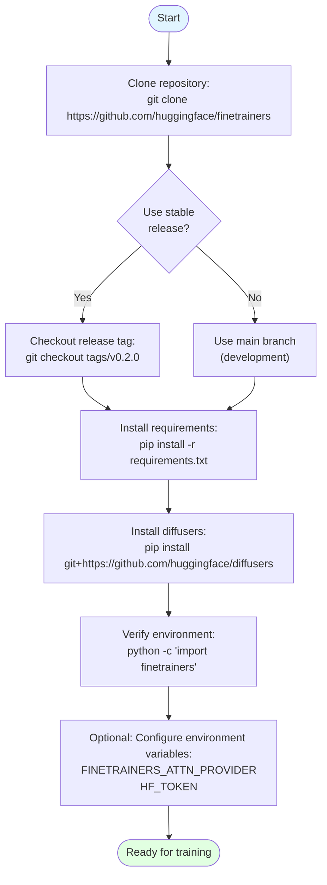
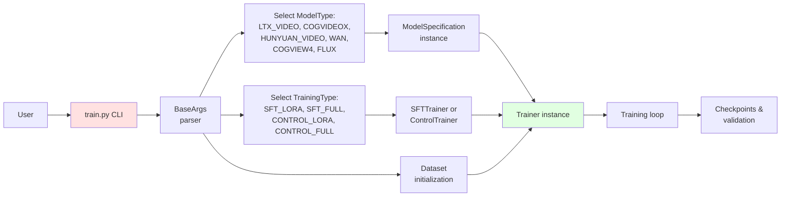
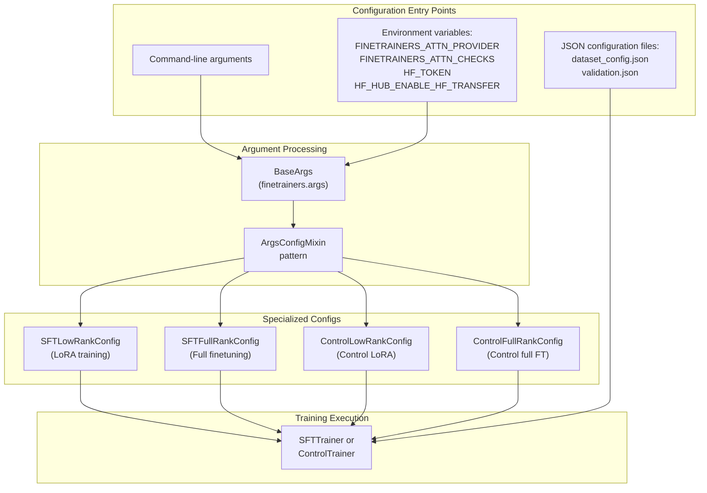
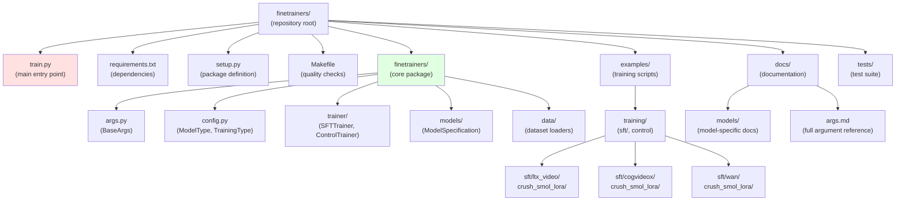

<!-- source: DeepWiki mcp.deepwiki.com · repo huggingface/finetrainers · page 2 Getting Started · fetched 2026-10-26 -->

# Getting Started

<details>
<summary>Relevant source files</summary>

The following files were used as context for generating this wiki page:

- [.github/workflows/pr_tests.yml](.github/workflows/pr_tests.yml)
- [.gitignore](.gitignore)
- [Makefile](Makefile)
- [README.md](README.md)
- [finetrainers/__init__.py](finetrainers/__init__.py)
- [finetrainers/functional/__init__.py](finetrainers/functional/__init__.py)
- [finetrainers/functional/text.py](finetrainers/functional/text.py)
- [requirements.txt](requirements.txt)
- [setup.py](setup.py)
- [tests/models/ltx_video/_test_tp.py](tests/models/ltx_video/_test_tp.py)

</details>


This guide provides an overview of how to set up and run your first training with finetrainers. It covers the essential steps from installation to launching a training job, with references to detailed documentation for each stage.

For detailed installation instructions and dependency management, see [Installation and Dependencies](#2.1). For a complete step-by-step tutorial with example code, see [Quick Start Guide](#2.2).

## Overview

Getting started with finetrainers involves three main stages:

1. **Environment Setup**: Install dependencies and configure your environment
2. **Configuration**: Select a model, training type, and prepare your dataset
3. **Training Execution**: Launch training via the `train.py` CLI

The library is designed to minimize setup complexity while providing access to advanced features. You can start training on a single GPU with minimal configuration, then scale to multi-node setups using the same codebase.

## Prerequisites

Before beginning, ensure you have:

| Requirement | Specification | Notes |
|-------------|---------------|-------|
| Python | >= 3.8.0 | Specified in [setup.py:19]() |
| PyTorch | >= 2.5.1 | Critical for stability; see [requirements.txt:12]() |
| CUDA | Compatible version | Required for GPU training |
| Git | Any recent version | For cloning repository |

**Important**: PyTorch 2.5.1 or above is strongly recommended. Earlier versions may cause black video outputs, OOM errors, or other instability issues ([README.md:52-53]()).

Sources: [README.md:52-53](), [requirements.txt:12](), [setup.py:19]()

## Installation Workflow

The following diagram illustrates the installation and setup process:



**Diagram: Installation and Environment Setup Flow**

The main branch ([README.md:38]()) is the development branch and may be unstable. For production use, checkout a stable release tag ([README.md:29-34]()). The library requires installing `diffusers` from source to access the latest features and bugfixes ([README.md:27]()).

Sources: [README.md:25-53](), [requirements.txt:1-20](), [setup.py:10-22]()

## Training Execution Path

Once installed, all training runs follow a standard execution path through the `train.py` entry point:



**Diagram: Training Execution Flow from CLI to Training Loop**

The `train.py` script serves as the primary entry point ([README.md:40-43]()). It accepts command-line arguments parsed by `BaseArgs` ([finetrainers/__init__.py:1]()), which determines the model type and training configuration. Based on these selections, the appropriate `ModelSpecification` and trainer class (`SFTTrainer` or `ControlTrainer` from [finetrainers/__init__.py:5]()) are instantiated.

Sources: [README.md:40-43](), [finetrainers/__init__.py:1-8](), [finetrainers/config.py]() (referenced)

## Configuration System

Training configuration in finetrainers is managed through a hierarchical argument system:



**Diagram: Configuration System Architecture**

The configuration system uses `BaseArgs` as the central parser, which aggregates argument groups via the `ArgsConfigMixin` pattern. Depending on the selected `TrainingType`, different specialized configuration classes provide the appropriate parameters for LoRA or full finetuning scenarios.

Sources: [finetrainers/__init__.py:1](), Architecture Diagram 6 from context

## Minimal Training Example

A minimal training command requires only a few essential parameters:

```bash
python train.py \
    --model_name "ltx-video" \
    --training_type "sft-lora" \
    --pretrained_model_name_or_path "Lightricks/LTX-Video" \
    --dataset_path "path/to/dataset.csv" \
    --output_dir "./outputs"
```

This command:
1. Launches `train.py` as the entry point
2. Selects the LTX-Video model via `--model_name`
3. Configures LoRA training via `--training_type`
4. Loads the pretrained model from Hugging Face Hub
5. Reads dataset from a CSV file
6. Saves outputs to the specified directory

For complete examples with all recommended parameters, see [Quick Start Guide](#2.2).

Sources: [README.md:40-43](), Architecture Diagram 2 from context

## Available Models and Training Types

Finetrainers supports six model architectures across two domains:

| Model | Domain | Training Types | Memory (LoRA) | Example Script |
|-------|--------|----------------|---------------|----------------|
| LTX-Video | Video | SFT LoRA/Full | 5 GB | [examples/training/sft/ltx_video/]() |
| CogVideoX | Video | SFT LoRA/Full | 18 GB | [examples/training/sft/cogvideox/]() |
| HunyuanVideo | Video | SFT LoRA/Full | 32 GB | [README.md:100]() |
| Wan | Video | SFT + Control | TBD | [examples/training/sft/wan/]() |
| CogView4 | Image | SFT + Control | TBD | [README.md:103]() |
| Flux | Image | SFT LoRA/Full | TBD | [README.md:104]() |

Memory requirements are noted for training-only at resolution 49x512x768 with precomputation, FP8 weights, and gradient checkpointing ([README.md:108-109]()).

Training types available:
- **SFT (Supervised Fine-Tuning)**: Standard finetuning for text-to-video/image generation
- **Control**: Conditional training with control signals (channel-concatenated conditioning)
- **LoRA**: Low-rank adaptation for parameter-efficient training
- **Full**: Full-rank finetuning of all model parameters

Sources: [README.md:95-110](), Architecture Diagram 5 from context

## Repository Structure

Understanding the repository layout helps navigate the codebase:



**Diagram: Repository Structure and Key Files**

The repository is organized into several top-level directories:
- `train.py`: Main CLI entry point for all training runs
- `finetrainers/`: Core library code with modular components
- `examples/`: Reproducible training scripts organized by model and task
- `docs/`: Documentation including model guides and argument references
- `tests/`: Test suite for validation

Sources: [README.md:40-50](), [finetrainers/__init__.py:1-8](), [Makefile:3]()

## Development vs. Stable Branches

Finetrainers maintains two types of branches:

| Branch Type | Purpose | Stability | Usage |
|-------------|---------|-----------|-------|
| `main` | Development branch | Unstable, latest features | Testing, contributing |
| Release tags (e.g., `v0.2.0`) | Stable releases | Production-ready | Recommended for training |

To use a stable release:

```bash
git fetch --all --tags
git checkout tags/v0.2.0
```

The main branch may contain breaking changes and is not recommended for production workloads ([README.md:27]()). Always refer to the README of the checked-out release for version-specific instructions ([README.md:36]()).

Sources: [README.md:27-36]()

## Quality Assurance

The repository includes code quality tooling to maintain consistency:

```bash
# Check code quality
make quality

# Auto-format code
make style
```

These commands use `ruff` ([requirements.txt:20]()) for linting and formatting. The quality checks are enforced in CI/CD via GitHub Actions ([.github/workflows/pr_tests.yml:1-31]()).

The `Makefile` defines check directories: `finetrainers tests examples train.py setup.py` ([Makefile:3]()).

Sources: [Makefile:1-11](), [.github/workflows/pr_tests.yml:1-31](), [requirements.txt:20]()

## Next Steps

After completing installation:

1. **Configure your environment**: Set environment variables for attention providers, Hugging Face tokens, and transfer acceleration (see [Installation and Dependencies](#2.1))

2. **Run your first training**: Follow the step-by-step tutorial with example scripts (see [Quick Start Guide](#2.2))

3. **Explore training options**: Review full argument documentation and model-specific guides in `docs/`

4. **Understand core concepts**: Learn about `ModelSpecification`, training types, and the configuration system (see [Core Concepts](#3))

5. **Scale your training**: Explore parallelism backends and distributed training options (see [Parallelism and Distribution](#7))

For immediate hands-on experience, the following example scripts provide complete, reproducible training configurations:
- LTX-Video: [examples/training/sft/ltx_video/crush_smol_lora/]()
- CogVideoX: [examples/training/sft/cogvideox/crush_smol_lora/]()
- Wan: [examples/training/sft/wan/crush_smol_lora/]()

Sources: [README.md:40-50]()

---

