# Page: Overview

# Overview

<details>
<summary>Relevant source files</summary>

The following files were used as context for generating this wiki page:

- [.gitignore](.gitignore)
- [Makefile](Makefile)
- [README.md](README.md)
- [docs/models/README.md](docs/models/README.md)
- [finetrainers/__init__.py](finetrainers/__init__.py)
- [finetrainers/config.py](finetrainers/config.py)
- [finetrainers/functional/__init__.py](finetrainers/functional/__init__.py)
- [finetrainers/functional/text.py](finetrainers/functional/text.py)
- [finetrainers/models/flux/base_specification.py](finetrainers/models/flux/base_specification.py)
- [setup.py](setup.py)
- [tests/models/flux/base_specification.py](tests/models/flux/base_specification.py)

</details>


This document provides an introduction to finetrainers, its purpose, key features, supported models, and high-level architecture. It serves as a starting point for understanding how the library is organized and how its components interact.

For installation instructions, see [Getting Started](#2). For detailed configuration options, see [Configuration System](#3.3). For specific model training guides, see [Supported Models](#6).

## Purpose and Scope

Finetrainers is a library designed to make training of diffusion models accessible and practical across a range of hardware configurations. The library provides a unified interface for training multiple diffusion architectures (both video and image generation models) with various training strategies (LoRA, full finetuning, control conditioning) and distributed training backends.

The library's scope encompasses:

- **Model Abstraction**: A standardized interface (`ModelSpecification`) for training arbitrary diffusion models
- **Training Orchestration**: Two primary trainer classes (`SFTTrainer` and `ControlTrainer`) that handle the complete training lifecycle
- **Data Pipeline**: Auto-detection of dataset formats, multi-resolution bucketing, and efficient preprocessing with optional precomputation
- **Distribution**: Multiple parallelism strategies (DDP, FSDP2, HSDP, Context Parallel, Tensor Parallel) via pluggable backends
- **Memory Efficiency**: Techniques including gradient checkpointing, FP8 training, VAE tiling/slicing, and precomputation to enable training on consumer hardware

Sources: [README.md:1-3](), [setup.py:10-14]()

## Key Features

| Feature | Description |
|---------|-------------|
| **Multi-Model Support** | 6 diffusion models (CogVideoX, CogView4, Flux, HunyuanVideo, LTX-Video, Wan) across video and image generation |
| **Training Strategies** | LoRA (parameter-efficient), full finetuning, and control conditioning (channel concatenation) |
| **Distributed Training** | DDP, FSDP2, HSDP, Context Parallel (CP), Tensor Parallel (TP) via `PytorchDTensorParallelBackend` or simple DDP via `AccelerateParallelBackend` |
| **Attention Backends** | Flash Attention, Sage Attention, xFormers, native PyTorch via `attention_dispatch` |
| **Data Flexibility** | CSV, JSON, Parquet, WebDataset formats with auto-detection; combined image/video datasets; multi-resolution bucketing |
| **Memory Optimization** | Precomputation (in-memory or disk), gradient checkpointing, FP8 weight casting, VAE optimizations |
| **Standardized Interface** | `ModelSpecification` abstraction enables training custom models without modifying core training logic |

Sources: [README.md:55-65](), [README.md:85-110]()

## Supported Models

The following table shows all supported models and their training capabilities:

| Model | Domain | Training Types | Min. LoRA VRAM<sup>*</sup> | Min. Full FT VRAM<sup>^</sup> |
|-------|--------|----------------|----------------|------------------|
| [LTX-Video](#6.1) | Text-to-Video | `lora`, `full-finetune` | 5 GB | 21 GB |
| [CogVideoX-5b](#6.1) | Text-to-Video | `lora`, `full-finetune` | 18 GB | 53 GB |
| [HunyuanVideo](#6.1) | Text-to-Video | `lora`, `full-finetune` | 32 GB | OOM |
| [Wan](#6.1) | Text-to-Video, Image-to-Video | `lora`, `full-finetune`, `control-lora`, `control-full-finetune` | TBD | TBD |
| [CogView4](#6.2) | Text-to-Image | `lora`, `full-finetune`, `control-lora`, `control-full-finetune` | TBD | TBD |
| [Flux](#6.2) | Text-to-Image | `lora`, `full-finetune` | TBD | TBD |

<sub><sup>*</sup>Measured at resolution `49x512x768`, rank 128, with precomputation, using FP8 weights & gradient checkpointing</sub><br/>
<sub><sup>^</sup>Measured at resolution `49x512x768`, with precomputation, using BF16 weights & gradient checkpointing</sub>

Each model is represented by a concrete implementation of the `ModelSpecification` interface. Training types are specified via the `--training_type` CLI argument and mapped to the appropriate model specification class via `SUPPORTED_MODEL_CONFIGS`.

Sources: [README.md:85-110](), [finetrainers/config.py:13-63]()

## Core Architecture

### High-Level Component Organization

```mermaid
graph TB
    subgraph "Entry Point"
        train.py["train.py<br/>(CLI Entry)"]
    end
    
    subgraph "Configuration Layer"
        BaseArgs["BaseArgs<br/>finetrainers/args/base_args.py"]
        ConfigMixins["Configuration Mixins<br/>SFTLowRankConfig<br/>SFTFullRankConfig<br/>ControlLowRankConfig<br/>ControlFullRankConfig"]
        BaseArgs --> ConfigMixins
    end
    
    subgraph "Training Orchestration"
        SFTTrainer["SFTTrainer<br/>finetrainers/trainer/sft_trainer.py"]
        ControlTrainer["ControlTrainer<br/>finetrainers/trainer/control_trainer.py"]
    end
    
    subgraph "Model Registry & Abstraction"
        ModelSpecification["ModelSpecification<br/>finetrainers/models/modeling_utils.py"]
        SUPPORTED_MODEL_CONFIGS["SUPPORTED_MODEL_CONFIGS<br/>finetrainers/config.py:32-63"]
        
        subgraph "Model Implementations"
            LTXVideoSpec["LTXVideoModelSpecification"]
            CogVideoXSpec["CogVideoXModelSpecification"]
            HunyuanVideoSpec["HunyuanVideoModelSpecification"]
            WanSpec["WanModelSpecification<br/>WanControlModelSpecification"]
            CogView4Spec["CogView4ModelSpecification<br/>CogView4ControlModelSpecification"]
            FluxSpec["FluxModelSpecification"]
        end
        
        SUPPORTED_MODEL_CONFIGS --> ModelSpecification
        ModelSpecification --> LTXVideoSpec
        ModelSpecification --> CogVideoXSpec
        ModelSpecification --> HunyuanVideoSpec
        ModelSpecification --> WanSpec
        ModelSpecification --> CogView4Spec
        ModelSpecification --> FluxSpec
    end
    
    subgraph "Data Pipeline"
        initialize_dataset["initialize_dataset<br/>finetrainers/data/dataset.py"]
        Preprocessors["Preprocessor System<br/>InMemoryPreprocessor<br/>PrecomputedPreprocessor"]
        ResolutionSampler["ResolutionSampler<br/>finetrainers/data/resolution.py"]
        
        initialize_dataset --> Preprocessors
        Preprocessors --> ResolutionSampler
    end
    
    subgraph "Parallelism Backends"
        BaseParallelBackend["BaseParallelBackend<br/>finetrainers/parallel/base_backend.py"]
        PTDBackend["PytorchDTensorParallelBackend<br/>finetrainers/parallel/pytorch_dtensor_backend.py"]
        AccelerateBackend["AccelerateParallelBackend<br/>finetrainers/parallel/accelerate_backend.py"]
        
        BaseParallelBackend --> PTDBackend
        BaseParallelBackend --> AccelerateBackend
    end
    
    subgraph "Cross-Cutting Concerns"
        attention_dispatch["attention_dispatch<br/>finetrainers/attention/providers.py"]
        functional["functional/*<br/>Image/Video/Text/Diffusion Utils"]
        utils["utils/*<br/>Memory/Checkpointing/Torch"]
    end
    
    train.py --> BaseArgs
    BaseArgs --> SFTTrainer
    BaseArgs --> ControlTrainer
    
    SFTTrainer --> SUPPORTED_MODEL_CONFIGS
    ControlTrainer --> SUPPORTED_MODEL_CONFIGS
    
    SFTTrainer --> initialize_dataset
    ControlTrainer --> initialize_dataset
    
    SFTTrainer --> BaseParallelBackend
    ControlTrainer --> BaseParallelBackend
    
    ModelSpecification -.uses.-> attention_dispatch
    ModelSpecification -.uses.-> functional
    SFTTrainer -.uses.-> utils
    ControlTrainer -.uses.-> utils
    
    style SFTTrainer fill:#f9f9f9
    style ControlTrainer fill:#f9f9f9
    style ModelSpecification fill:#f9f9f9
    style BaseParallelBackend fill:#f9f9f9
```

**Diagram: Component Organization and Dependencies**

This diagram shows the core architectural layers and their relationships:

1. **Entry Point**: `train.py` CLI script that accepts command-line arguments
2. **Configuration Layer**: `BaseArgs` class aggregates configuration mixins for different training types
3. **Training Orchestration**: Two trainer classes (`SFTTrainer` and `ControlTrainer`) manage the complete training lifecycle
4. **Model Registry**: `SUPPORTED_MODEL_CONFIGS` dictionary maps `(ModelType, TrainingType)` tuples to `ModelSpecification` subclasses
5. **Model Abstraction**: `ModelSpecification` interface with 6 concrete implementations (one per supported model, with some having control variants)
6. **Data Pipeline**: Dataset loading, preprocessing, and resolution bucketing
7. **Parallelism Backends**: Two backend implementations (`PytorchDTensorParallelBackend` for advanced parallelism, `AccelerateParallelBackend` for simple DDP)
8. **Cross-Cutting Concerns**: Attention providers, functional utilities, and helper functions

Sources: [finetrainers/__init__.py:1-6](), [finetrainers/config.py:1-76]()

### Training Execution Flow

```mermaid
flowchart TD
    Start["python train.py<br/>--model_name cogvideox<br/>--training_type lora"]
    
    ParseArgs["Parse BaseArgs<br/>finetrainers/args/base_args.py"]
    
    GetConfig["Determine Config Class<br/>SFTLowRankConfig"]
    
    GetModelSpec["_get_model_specifiction_cls()<br/>finetrainers/config.py:66-75"]
    
    CreateSpec["Instantiate ModelSpecification<br/>e.g., CogVideoXModelSpecification"]
    
    InitTrainer["Initialize Trainer<br/>SFTTrainer or ControlTrainer"]
    
    PrepModels["_prepare_models()<br/>Load: tokenizer, text_encoder,<br/>transformer, vae, scheduler"]
    
    PrepTrainable["_prepare_trainable_parameters()<br/>Apply LoRA adapters or<br/>mark full parameters trainable"]
    
    PrepTraining["_prepare_for_training()<br/>Apply parallelism backend,<br/>compile (if enabled)"]
    
    PrepDataset["_prepare_dataset()<br/>initialize_dataset()<br/>IterableDatasetPreprocessingWrapper<br/>ResolutionSampler"]
    
    PrepCheckpoint["_prepare_checkpointing()<br/>Setup checkpointing system,<br/>load from checkpoint if resuming"]
    
    TrainLoop["Training Loop<br/>for step in range(max_steps)"]
    
    ForwardPass["Forward Pass<br/>model_spec.forward(<br/>  transformer,<br/>  conditions,<br/>  latents,<br/>  sigmas<br/>)"]
    
    Loss["Compute Loss<br/>MSE between pred & target"]
    
    Backward["Backward Pass<br/>loss.backward()<br/>optimizer.step()"]
    
    CheckpointCheck{"step % checkpointing_steps<br/>== 0 ?"}
    
    SaveCheckpoint["Save Checkpoint<br/>checkpointer.save_checkpoint()"]
    
    ValidationCheck{"step % validation_steps<br/>== 0 ?"}
    
    RunValidation["Run Validation<br/>model_spec.validation(<br/>  pipeline, prompt<br/>)"]
    
    LogMetrics["Log Metrics<br/>to WandB/TensorBoard"]
    
    Continue{"step < max_steps ?"}
    
    FinalSave["Save Final Checkpoint<br/>Upload to Hub (if enabled)"]
    
    End["Training Complete"]
    
    Start --> ParseArgs
    ParseArgs --> GetConfig
    GetConfig --> GetModelSpec
    GetModelSpec --> CreateSpec
    CreateSpec --> InitTrainer
    InitTrainer --> PrepModels
    PrepModels --> PrepTrainable
    PrepTrainable --> PrepTraining
    PrepTraining --> PrepDataset
    PrepDataset --> PrepCheckpoint
    PrepCheckpoint --> TrainLoop
    TrainLoop --> ForwardPass
    ForwardPass --> Loss
    Loss --> Backward
    Backward --> CheckpointCheck
    CheckpointCheck -->|Yes| SaveCheckpoint
    CheckpointCheck -->|No| ValidationCheck
    SaveCheckpoint --> ValidationCheck
    ValidationCheck -->|Yes| RunValidation
    ValidationCheck -->|No| LogMetrics
    RunValidation --> LogMetrics
    LogMetrics --> Continue
    Continue -->|Yes| TrainLoop
    Continue -->|No| FinalSave
    FinalSave --> End
```

**Diagram: Training Execution Flow from CLI to Completion**

This flowchart illustrates the complete execution path:

1. **Initialization Phase**: Parse arguments, determine configuration class, retrieve and instantiate the appropriate `ModelSpecification`
2. **Preparation Phase**: Six distinct preparation steps ensure proper setup order:
   - Load model components (tokenizers, encoders, transformer, VAE, scheduler)
   - Configure trainable parameters (LoRA adapters or full parameters)
   - Apply parallelism strategy and optional compilation
   - Initialize dataset pipeline with preprocessing and bucketing
   - Setup checkpointing and optionally resume from previous state
3. **Training Loop**: Iterate through training steps with forward/backward passes
4. **Checkpointing & Validation**: Periodic saving and validation based on configured intervals
5. **Finalization**: Save final checkpoint and optionally upload to Hugging Face Hub

Sources: [finetrainers/config.py:66-75](), [finetrainers/trainer/sft_trainer.py]()

## Configuration and Model Selection

The library uses two enumerations to select the appropriate model and training strategy:

**ModelType Enumeration** ([finetrainers/config.py:13-20]()):
```python
class ModelType(str, Enum):
    COGVIDEOX = "cogvideox"
    COGVIEW4 = "cogview4"
    FLUX = "flux"
    HUNYUAN_VIDEO = "hunyuan_video"
    LTX_VIDEO = "ltx_video"
    WAN = "wan"
```

**TrainingType Enumeration** ([finetrainers/config.py:22-30]()):
```python
class TrainingType(str, Enum):
    LORA = "lora"                           # SFT with LoRA adapters
    FULL_FINETUNE = "full-finetune"         # SFT with full parameters
    CONTROL_LORA = "control-lora"           # Control training with LoRA
    CONTROL_FULL_FINETUNE = "control-full-finetune"  # Control with full parameters
```

These enumerations are used as keys in the `SUPPORTED_MODEL_CONFIGS` registry ([finetrainers/config.py:32-63]()) to look up the appropriate `ModelSpecification` subclass:

```python
# Example: Training CogVideoX with LoRA
SUPPORTED_MODEL_CONFIGS[ModelType.COGVIDEOX][TrainingType.LORA] 
# Returns: CogVideoXModelSpecification
```

The registry supports different specifications for control vs. standard training. For example, `WanModelSpecification` is used for standard SFT, while `WanControlModelSpecification` is used for control training.

Sources: [finetrainers/config.py:13-63]()

## ModelSpecification Interface

The `ModelSpecification` abstract class ([finetrainers/models/modeling_utils.py]()) defines the interface that all model implementations must satisfy. Each concrete implementation provides:

### Component Loading Methods

| Method | Purpose | Returns |
|--------|---------|---------|
| `load_condition_models()` | Load tokenizers and text encoders | `Dict[str, torch.nn.Module]` |
| `load_latent_models()` | Load VAE for encoding images/videos | `Dict[str, torch.nn.Module]` |
| `load_diffusion_models()` | Load transformer/UNet and scheduler | `Dict[str, torch.nn.Module]` |
| `load_pipeline()` | Construct inference pipeline | Pipeline instance |

### Data Processing Methods

| Method | Purpose | Returns |
|--------|---------|---------|
| `prepare_conditions()` | Process text prompts → embeddings | `Dict[str, torch.Tensor]` |
| `prepare_latents()` | Encode images/videos → latent space | `Dict[str, torch.Tensor]` |

### Training and Validation Methods

| Method | Purpose | Returns |
|--------|---------|---------|
| `forward()` | Compute forward pass with noise injection | `Tuple[pred, target, sigmas]` |
| `validation()` | Generate artifacts during validation | `List[ArtifactType]` |

### Processor System

Each `ModelSpecification` maintains two lists of processors:

- **`condition_model_processors`**: List of `ProcessorMixin` instances that transform text prompts into embeddings (e.g., `CLIPPooledProcessor`, `T5Processor`)
- **`latent_model_processors`**: List of `ProcessorMixin` instances that encode visual inputs into latents (e.g., `FluxLatentEncodeProcessor`)

These processors are chained during `prepare_conditions()` and `prepare_latents()` calls to produce the required tensors for training.

For implementation details, see [Model Specifications](#3.2). For adding a new model, see [Adding a New Model](#9.1).

Sources: [finetrainers/models/modeling_utils.py](), [finetrainers/models/flux/base_specification.py:23-68]()

## Trainer Classes

Finetrainers provides two trainer classes that orchestrate the complete training lifecycle:

### SFTTrainer

The `SFTTrainer` class ([finetrainers/trainer/sft_trainer.py]()) handles standard supervised fine-tuning. Key responsibilities:

- Load and configure model components via `ModelSpecification`
- Setup LoRA adapters or mark full parameters trainable
- Initialize data pipeline with preprocessing and bucketing
- Apply parallelism strategy via `BaseParallelBackend`
- Execute training loop with loss computation and optimization
- Periodic checkpointing and validation

For detailed documentation, see [SFT Trainer](#4.1).

### ControlTrainer

The `ControlTrainer` class ([finetrainers/trainer/control_trainer.py]()) extends SFT training to support conditional control:

- Accepts additional control conditioning inputs (e.g., control frames)
- Uses control-specific `ModelSpecification` implementations (e.g., `WanControlModelSpecification`, `CogView4ControlModelSpecification`)
- Concatenates control channels to latent inputs during forward pass
- Otherwise follows the same preparation and training pipeline as `SFTTrainer`

For detailed documentation, see [Control Trainer](#4.2).

Sources: [finetrainers/trainer/sft_trainer.py](), [finetrainers/trainer/control_trainer.py]()

## Data Pipeline Architecture

```mermaid
graph LR
    subgraph "Data Sources"
        LocalCSV["Local CSV"]
        LocalJSON["Local JSON/Parquet"]
        HubDataset["HF Hub Dataset"]
        WebDataset["WebDataset (tar)"]
    end
    
    subgraph "Dataset Loading"
        initialize_dataset["initialize_dataset()<br/>finetrainers/data/dataset.py"]
        combine_datasets["combine_datasets()"]
    end
    
    subgraph "Preprocessing Wrapper"
        IterableWrapper["IterableDatasetPreprocessingWrapper<br/>finetrainers/data/dataset.py"]
        CaptionCleaning["Caption Cleaning<br/>(remove prefixes, convert bytes)"]
        ResolutionBucketing["Resolution Bucketing<br/>ResolutionSampler"]
    end
    
    subgraph "Preprocessor System"
        PreprocessorInit["initialize_preprocessor()<br/>finetrainers/data/preprocessor.py"]
        InMemory["InMemoryPreprocessor"]
        Precomputed["PrecomputedPreprocessor"]
        
        PreprocessorInit --> InMemory
        PreprocessorInit --> Precomputed
    end
    
    subgraph "Condition Pipeline"
        ConditionProc["Condition Processors<br/>(e.g., T5Processor, CLIPProcessor)"]
        TextEmbeddings["Text Embeddings<br/>encoder_hidden_states<br/>pooled_projections"]
        
        ConditionProc --> TextEmbeddings
    end
    
    subgraph "Latent Pipeline"
        LatentProc["Latent Processors<br/>(e.g., FluxLatentEncodeProcessor)"]
        LatentTensors["Latent Tensors<br/>VAE-encoded"]
        
        LatentProc --> LatentTensors
    end
    
    LocalCSV --> initialize_dataset
    LocalJSON --> initialize_dataset
    HubDataset --> initialize_dataset
    WebDataset --> initialize_dataset
    
    initialize_dataset --> combine_datasets
    combine_datasets --> IterableWrapper
    
    IterableWrapper --> CaptionCleaning
    CaptionCleaning --> ResolutionBucketing
    
    ResolutionBucketing --> PreprocessorInit
    
    InMemory --> ConditionProc
    InMemory --> LatentProc
    Precomputed --> ConditionProc
    Precomputed --> LatentProc
    
    TextEmbeddings --> TrainingBatch["Training Batch<br/>(collated tensors)"]
    LatentTensors --> TrainingBatch
```

**Diagram: Data Pipeline from Source to Training Batch**

The data pipeline consists of several stages:

1. **Dataset Loading**: `initialize_dataset()` auto-detects format (CSV, JSON, Parquet, WebDataset) and returns appropriate iterable datasets
2. **Dataset Combination**: Multiple datasets can be combined and sampled proportionally
3. **Preprocessing Wrapper**: `IterableDatasetPreprocessingWrapper` applies caption cleaning, converts byte strings, and performs resolution bucketing via `ResolutionSampler`
4. **Preprocessor Initialization**: Two modes available:
   - `InMemoryPreprocessor`: Computes embeddings on-the-fly during training
   - `PrecomputedPreprocessor`: Loads pre-saved embeddings from disk
5. **Parallel Processing**: Text and visual data flow through separate processor chains to produce embeddings and latents
6. **Collation**: Tensors are batched and sent to the training loop

For detailed documentation, see [Data Pipeline](#5).

Sources: [finetrainers/data/dataset.py](), [finetrainers/data/preprocessor.py]()

## Parallelism and Distribution

Finetrainers supports multiple parallelism strategies through a backend abstraction:

### Backend Interface

The `BaseParallelBackend` class ([finetrainers/parallel/base_backend.py]()) defines the interface:

```python
class BaseParallelBackend:
    def apply_ddp(model, **kwargs)
    def apply_fsdp2(model, **kwargs)
    def apply_hsdp(model, **kwargs)
    def apply_cp(model, **kwargs)
    def apply_tp(model, **kwargs)
```

### Backend Implementations

| Backend | File | Capabilities |
|---------|------|--------------|
| `PytorchDTensorParallelBackend` | [finetrainers/parallel/pytorch_dtensor_backend.py]() | DDP, FSDP2, HSDP, Context Parallel (CP), Tensor Parallel (TP), Pipeline Parallel (PP) via multi-dimensional `DeviceMesh` |
| `AccelerateParallelBackend` | [finetrainers/parallel/accelerate_backend.py]() | DDP only via Hugging Face Accelerate |

### Parallelism Degrees

The PyTorch DTensor backend supports configuring parallelism across multiple dimensions:

- `--dp_degree`: Data parallel degree (model replication)
- `--dp_shards`: Sharding degree within data parallel group (FSDP/HSDP)
- `--cp_degree`: Context parallel degree (sequence sharding)
- `--tp_degree`: Tensor parallel degree (layer sharding)
- `--pp_degree`: Pipeline parallel degree (stage sharding)

These dimensions are organized into a `DeviceMesh` topology that coordinates distributed computation.

For detailed documentation, see [Parallelism and Distribution](#7).

Sources: [finetrainers/parallel/base_backend.py](), [finetrainers/parallel/pytorch_dtensor_backend.py](), [finetrainers/parallel/accelerate_backend.py]()

## Attention Provider System

The library includes a dispatch system for different attention implementations:

**Attention Providers** ([finetrainers/attention/providers.py]()):
- `flash`: Flash Attention 2
- `flex`: Flash Attention 3 (Flex Attention)
- `sage`: Sage Attention
- `xformers`: xFormers memory-efficient attention
- `native`: PyTorch native scaled dot-product attention

The provider is selected via the `FINETRAINERS_ATTN_PROVIDER` environment variable. The `attention_dispatch()` function routes attention calls to the appropriate backend based on configuration and checks.

For detailed documentation, see [Attention Providers](#8.1).

Sources: [finetrainers/attention/providers.py]()

## Utility Modules

Finetrainers includes several utility modules:

### Functional Utilities ([finetrainers/functional/]())

| Module | Purpose |
|--------|---------|
| `diffusion.py` | Flow matching functions: `flow_match_xt()`, `flow_match_target()` |
| `image.py` | Image resizing, cropping, bucketing |
| `video.py` | Video resizing, cropping, bucketing |
| `text.py` | Caption dropout, prefix removal, byte string conversion |
| `normalization.py` | Tensor normalization helpers |

### Core Utilities ([finetrainers/utils/]())

- Memory management and gradient checkpointing
- Checkpoint saving/loading utilities
- Torch utilities (compilation, mixed precision)
- VAE optimization helpers (slicing, tiling)

For detailed documentation, see [Functional Utilities](#8.2) and [Utility Functions](#8.4).

Sources: [finetrainers/functional/__init__.py:1-17](), [finetrainers/functional/text.py:1-41]()

## Extension Points

The library is designed for extensibility through several interfaces:

### Adding a New Model

1. Create a subclass of `ModelSpecification`
2. Implement required methods: `load_condition_models()`, `load_latent_models()`, `load_diffusion_models()`, `forward()`, `validation()`
3. Define processors for conditions and latents
4. Register in `SUPPORTED_MODEL_CONFIGS` dictionary

Example structure:
```python
class CustomModelSpecification(ModelSpecification):
    def __init__(self, condition_model_processors, latent_model_processors, **kwargs):
        super().__init__(**kwargs)
        self.condition_model_processors = condition_model_processors
        self.latent_model_processors = latent_model_processors
    
    def load_condition_models(self) -> Dict[str, torch.nn.Module]:
        # Load tokenizers, text encoders
        ...
    
    def forward(self, transformer, conditions, latents, sigmas, **kwargs):
        # Implement diffusion forward pass
        ...
```

### Adding a Custom Processor

Create a subclass of `ProcessorMixin` and implement the `forward()` method:

```python
class CustomProcessor(ProcessorMixin):
    def forward(self, **kwargs) -> Dict[str, torch.Tensor]:
        # Transform inputs into outputs
        ...
```

### Adding a Parallelism Backend

Implement the `BaseParallelBackend` interface with desired parallelism strategies.

For comprehensive guides, see [Extending Finetrainers](#9).

Sources: [finetrainers/models/modeling_utils.py](), [finetrainers/processors/base_processor.py](), [finetrainers/parallel/base_backend.py]()

## Development Status

Finetrainers is currently in active development (version 0.2.0.dev0). The `main` branch is the development branch, and users seeking stability should use the latest release tag. The library builds on established open-source projects including `transformers`, `accelerate`, `diffusers`, and `peft`.

For contribution guidelines and development workflow, see [Development Workflow](#9.3).

Sources: [setup.py:12](), [README.md:27-36]()

---

# Page: Getting Started

# Getting Started

<details>
<summary>Relevant source files</summary>

The following files were used as context for generating this wiki page:

- [.github/workflows/pr_tests.yml](.github/workflows/pr_tests.yml)
- [.gitignore](.gitignore)
- [Makefile](Makefile)
- [README.md](README.md)
- [finetrainers/__init__.py](finetrainers/__init__.py)
- [finetrainers/functional/__init__.py](finetrainers/functional/__init__.py)
- [finetrainers/functional/text.py](finetrainers/functional/text.py)
- [requirements.txt](requirements.txt)
- [setup.py](setup.py)
- [tests/models/ltx_video/_test_tp.py](tests/models/ltx_video/_test_tp.py)

</details>


This guide provides an overview of how to set up and run your first training with finetrainers. It covers the essential steps from installation to launching a training job, with references to detailed documentation for each stage.

For detailed installation instructions and dependency management, see [Installation and Dependencies](#2.1). For a complete step-by-step tutorial with example code, see [Quick Start Guide](#2.2).

## Overview

Getting started with finetrainers involves three main stages:

1. **Environment Setup**: Install dependencies and configure your environment
2. **Configuration**: Select a model, training type, and prepare your dataset
3. **Training Execution**: Launch training via the `train.py` CLI

The library is designed to minimize setup complexity while providing access to advanced features. You can start training on a single GPU with minimal configuration, then scale to multi-node setups using the same codebase.

## Prerequisites

Before beginning, ensure you have:

| Requirement | Specification | Notes |
|-------------|---------------|-------|
| Python | >= 3.8.0 | Specified in [setup.py:19]() |
| PyTorch | >= 2.5.1 | Critical for stability; see [requirements.txt:12]() |
| CUDA | Compatible version | Required for GPU training |
| Git | Any recent version | For cloning repository |

**Important**: PyTorch 2.5.1 or above is strongly recommended. Earlier versions may cause black video outputs, OOM errors, or other instability issues ([README.md:52-53]()).

Sources: [README.md:52-53](), [requirements.txt:12](), [setup.py:19]()

## Installation Workflow

The following diagram illustrates the installation and setup process:

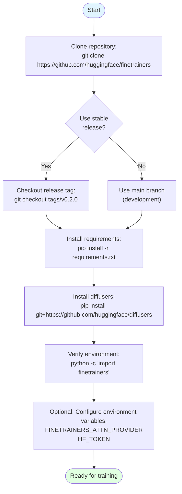

**Diagram: Installation and Environment Setup Flow**

The main branch ([README.md:38]()) is the development branch and may be unstable. For production use, checkout a stable release tag ([README.md:29-34]()). The library requires installing `diffusers` from source to access the latest features and bugfixes ([README.md:27]()).

Sources: [README.md:25-53](), [requirements.txt:1-20](), [setup.py:10-22]()

## Training Execution Path

Once installed, all training runs follow a standard execution path through the `train.py` entry point:

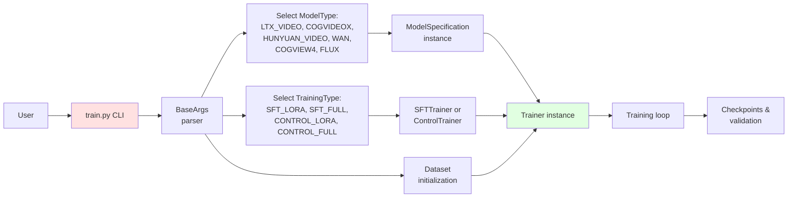

**Diagram: Training Execution Flow from CLI to Training Loop**

The `train.py` script serves as the primary entry point ([README.md:40-43]()). It accepts command-line arguments parsed by `BaseArgs` ([finetrainers/__init__.py:1]()), which determines the model type and training configuration. Based on these selections, the appropriate `ModelSpecification` and trainer class (`SFTTrainer` or `ControlTrainer` from [finetrainers/__init__.py:5]()) are instantiated.

Sources: [README.md:40-43](), [finetrainers/__init__.py:1-8](), [finetrainers/config.py]() (referenced)

## Configuration System

Training configuration in finetrainers is managed through a hierarchical argument system:

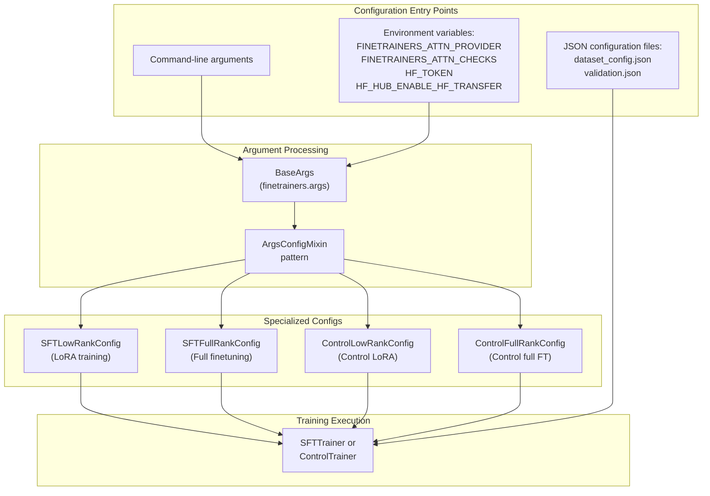

**Diagram: Configuration System Architecture**

The configuration system uses `BaseArgs` as the central parser, which aggregates argument groups via the `ArgsConfigMixin` pattern. Depending on the selected `TrainingType`, different specialized configuration classes provide the appropriate parameters for LoRA or full finetuning scenarios.

Sources: [finetrainers/__init__.py:1](), Architecture Diagram 6 from context

## Minimal Training Example

A minimal training command requires only a few essential parameters:

```bash
python train.py \
    --model_name "ltx-video" \
    --training_type "sft-lora" \
    --pretrained_model_name_or_path "Lightricks/LTX-Video" \
    --dataset_path "path/to/dataset.csv" \
    --output_dir "./outputs"
```

This command:
1. Launches `train.py` as the entry point
2. Selects the LTX-Video model via `--model_name`
3. Configures LoRA training via `--training_type`
4. Loads the pretrained model from Hugging Face Hub
5. Reads dataset from a CSV file
6. Saves outputs to the specified directory

For complete examples with all recommended parameters, see [Quick Start Guide](#2.2).

Sources: [README.md:40-43](), Architecture Diagram 2 from context

## Available Models and Training Types

Finetrainers supports six model architectures across two domains:

| Model | Domain | Training Types | Memory (LoRA) | Example Script |
|-------|--------|----------------|---------------|----------------|
| LTX-Video | Video | SFT LoRA/Full | 5 GB | [examples/training/sft/ltx_video/]() |
| CogVideoX | Video | SFT LoRA/Full | 18 GB | [examples/training/sft/cogvideox/]() |
| HunyuanVideo | Video | SFT LoRA/Full | 32 GB | [README.md:100]() |
| Wan | Video | SFT + Control | TBD | [examples/training/sft/wan/]() |
| CogView4 | Image | SFT + Control | TBD | [README.md:103]() |
| Flux | Image | SFT LoRA/Full | TBD | [README.md:104]() |

Memory requirements are noted for training-only at resolution 49x512x768 with precomputation, FP8 weights, and gradient checkpointing ([README.md:108-109]()).

Training types available:
- **SFT (Supervised Fine-Tuning)**: Standard finetuning for text-to-video/image generation
- **Control**: Conditional training with control signals (channel-concatenated conditioning)
- **LoRA**: Low-rank adaptation for parameter-efficient training
- **Full**: Full-rank finetuning of all model parameters

Sources: [README.md:95-110](), Architecture Diagram 5 from context

## Repository Structure

Understanding the repository layout helps navigate the codebase:

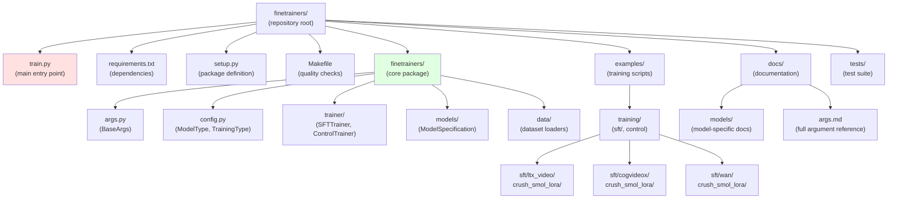

**Diagram: Repository Structure and Key Files**

The repository is organized into several top-level directories:
- `train.py`: Main CLI entry point for all training runs
- `finetrainers/`: Core library code with modular components
- `examples/`: Reproducible training scripts organized by model and task
- `docs/`: Documentation including model guides and argument references
- `tests/`: Test suite for validation

Sources: [README.md:40-50](), [finetrainers/__init__.py:1-8](), [Makefile:3]()

## Development vs. Stable Branches

Finetrainers maintains two types of branches:

| Branch Type | Purpose | Stability | Usage |
|-------------|---------|-----------|-------|
| `main` | Development branch | Unstable, latest features | Testing, contributing |
| Release tags (e.g., `v0.2.0`) | Stable releases | Production-ready | Recommended for training |

To use a stable release:

```bash
git fetch --all --tags
git checkout tags/v0.2.0
```

The main branch may contain breaking changes and is not recommended for production workloads ([README.md:27]()). Always refer to the README of the checked-out release for version-specific instructions ([README.md:36]()).

Sources: [README.md:27-36]()

## Quality Assurance

The repository includes code quality tooling to maintain consistency:

```bash
# Check code quality
make quality

# Auto-format code
make style
```

These commands use `ruff` ([requirements.txt:20]()) for linting and formatting. The quality checks are enforced in CI/CD via GitHub Actions ([.github/workflows/pr_tests.yml:1-31]()).

The `Makefile` defines check directories: `finetrainers tests examples train.py setup.py` ([Makefile:3]()).

Sources: [Makefile:1-11](), [.github/workflows/pr_tests.yml:1-31](), [requirements.txt:20]()

## Next Steps

After completing installation:

1. **Configure your environment**: Set environment variables for attention providers, Hugging Face tokens, and transfer acceleration (see [Installation and Dependencies](#2.1))

2. **Run your first training**: Follow the step-by-step tutorial with example scripts (see [Quick Start Guide](#2.2))

3. **Explore training options**: Review full argument documentation and model-specific guides in `docs/`

4. **Understand core concepts**: Learn about `ModelSpecification`, training types, and the configuration system (see [Core Concepts](#3))

5. **Scale your training**: Explore parallelism backends and distributed training options (see [Parallelism and Distribution](#7))

For immediate hands-on experience, the following example scripts provide complete, reproducible training configurations:
- LTX-Video: [examples/training/sft/ltx_video/crush_smol_lora/]()
- CogVideoX: [examples/training/sft/cogvideox/crush_smol_lora/]()
- Wan: [examples/training/sft/wan/crush_smol_lora/]()

Sources: [README.md:40-50]()

---

# Page: Installation and Dependencies

# Installation and Dependencies

<details>
<summary>Relevant source files</summary>

The following files were used as context for generating this wiki page:

- [.github/workflows/pr_tests.yml](.github/workflows/pr_tests.yml)
- [Makefile](Makefile)
- [finetrainers/__init__.py](finetrainers/__init__.py)
- [finetrainers/trainer/control_trainer/config.py](finetrainers/trainer/control_trainer/config.py)
- [finetrainers/trainer/sft_trainer/config.py](finetrainers/trainer/sft_trainer/config.py)
- [finetrainers/utils/import_utils.py](finetrainers/utils/import_utils.py)
- [requirements.txt](requirements.txt)
- [setup.py](setup.py)
- [tests/models/ltx_video/_test_tp.py](tests/models/ltx_video/_test_tp.py)

</details>


This page provides detailed instructions for installing finetrainers and configuring its dependencies. It covers system requirements, required and optional packages, installation methods, environment variable configuration, and verification steps.

For instructions on running your first training after installation, see [Quick Start Guide](#2.2). For general system architecture and design, see [Overview](#1).

## Purpose and Scope

This document covers:
- Python version requirements and system prerequisites
- Core and optional dependencies with version constraints
- Multiple installation methods (pip, source, development)
- Environment variable configuration for runtime behavior
- Dependency checking mechanisms and version compatibility
- Development tools setup for contributors

---

## System Requirements

### Python Version

Finetrainers requires **Python 3.8 or higher**. This constraint is defined in [setup.py:19]().

```python
python_requires=">=3.8.0"
```

Supported Python versions include:
- Python 3.8
- Python 3.9
- Python 3.10
- Python 3.11+

### Hardware Requirements

**GPU**: CUDA-capable GPU is required for training. The library uses PyTorch with CUDA support and expects:
- NVIDIA GPU with CUDA compute capability 7.0+ (Volta architecture or newer)
- Sufficient VRAM based on model and training configuration (see [Supported Models](#6) for memory requirements)

**Storage**: Adequate disk space for:
- Model checkpoints (several GB per model)
- Dataset storage
- Precomputed latents/embeddings (if using precomputation)

**Sources:** [setup.py:19-38](), [requirements.txt:1-21]()

---

## Core Dependencies

The following diagram illustrates the dependency hierarchy and their roles in the system:

### Dependency Architecture

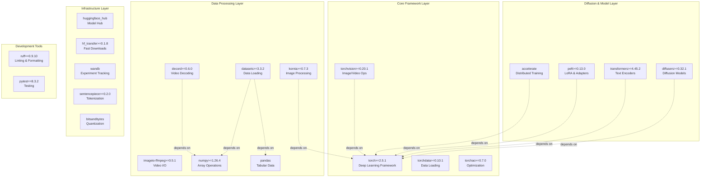

**Sources:** [requirements.txt:1-21](), [setup.py:7-22]()

### Required Packages

The complete list of required dependencies is specified in [requirements.txt:1-21](). Key packages include:

| Package | Version | Purpose |
|---------|---------|---------|
| `torch` | >=2.5.1 | Core deep learning framework, tensor operations |
| `torchvision` | >=0.20.1 | Image and video transformations |
| `torchdata` | >=0.10.1 | Data loading utilities |
| `torchao` | >=0.7.0 | PyTorch optimization library |
| `diffusers` | >=0.32.1 | Diffusion model implementations (UNet, Transformer) |
| `transformers` | >=4.45.2 | Text encoders (T5, CLIP, LLaMA, GLM) |
| `peft` | >=0.13.0 | LoRA and low-rank adaptation utilities |
| `accelerate` | - | Distributed training backend (DDP) |
| `datasets` | >=3.3.2 | Dataset loading and processing |
| `decord` | >=0.6.0 | Efficient video frame decoding |
| `imageio-ffmpeg` | >=0.5.1 | Video I/O with FFmpeg backend |
| `kornia` | >=0.7.3 | Differentiable computer vision operations |
| `numpy` | >=1.26.4 | Numerical array operations |
| `pandas` | - | CSV/tabular data handling |
| `huggingface_hub` | - | Model and dataset hub integration |
| `hf_transfer` | >=0.1.8 | Accelerated file transfers from HF Hub |
| `wandb` | - | Experiment tracking and logging |
| `sentencepiece` | >=0.2.0 | Tokenization for some models |
| `bitsandbytes` | - | Quantization and optimization |

**Sources:** [requirements.txt:1-21]()

---

## Optional Dependencies

### Attention Providers

Finetrainers supports multiple attention implementation backends for performance optimization. These are detected at runtime via the import checking system.

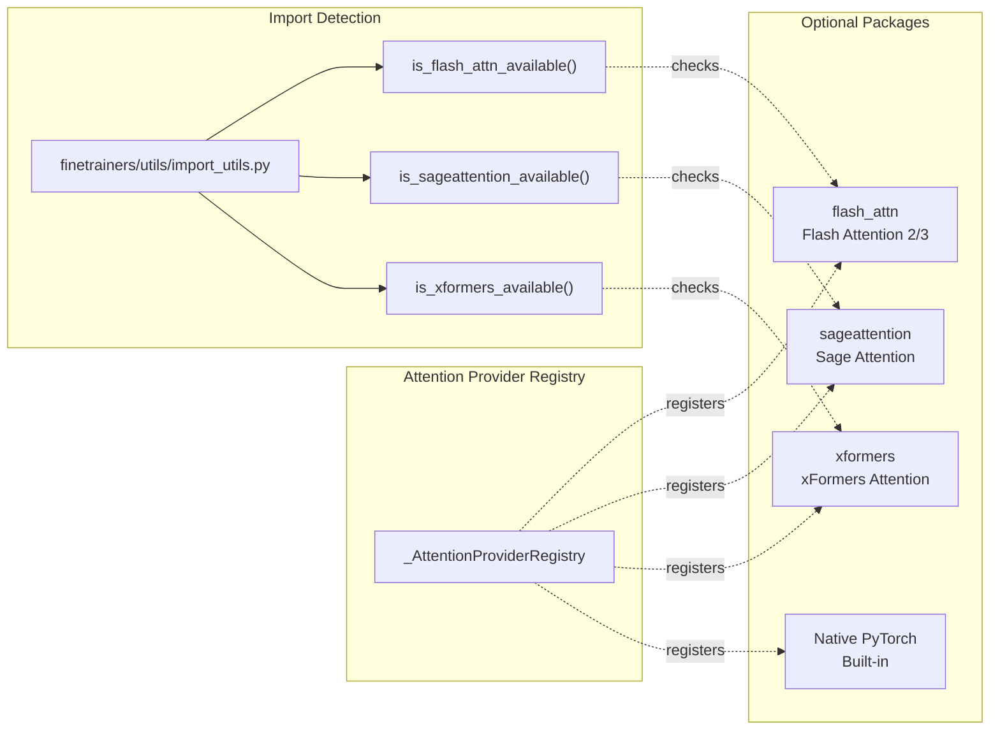

**Sources:** [finetrainers/utils/import_utils.py:53-129]()

#### Flash Attention

For fastest attention computation, especially on A100/H100 GPUs:

```bash
pip install flash-attn --no-build-isolation
```

Detection function: `is_flash_attn_available()` at [finetrainers/utils/import_utils.py:70-71]()

#### Sage Attention

Alternative attention implementation with different performance characteristics:

```bash
pip install sageattention
```

Detection function: `is_sageattention_available()` at [finetrainers/utils/import_utils.py:78-79]()

#### xFormers

Memory-efficient attention with flexible kernels:

```bash
pip install xformers
```

Detection function: `is_xformers_available()` at [finetrainers/utils/import_utils.py:86-87]()

**Note:** Native PyTorch attention is always available as a fallback. The attention provider is selected via the `FINETRAINERS_ATTN_PROVIDER` environment variable (see [Environment Variables](#environment-variables)).

**Sources:** [finetrainers/utils/import_utils.py:53-129]()

### Development Dependencies

For contributors and developers, additional tools are required:

| Package | Version | Purpose |
|---------|---------|---------|
| `ruff` | ==0.9.10 | Code formatting and linting |
| `pytest` | ==8.3.2 | Testing framework |

Specified in [setup.py:23]() as `extras_require={"dev": [...]}`.

**Sources:** [setup.py:23](), [requirements.txt:20]()

---

## Installation Methods

### Method 1: Install from Source (Recommended)

This method is recommended for active users and developers:

```bash
# Clone the repository
git clone https://github.com/huggingface/finetrainers.git
cd finetrainers

# Install in editable mode
pip install -e .
```

The `-e` flag installs the package in editable mode, allowing code changes to take effect immediately without reinstallation.

**Sources:** [setup.py:10-38]()

### Method 2: Direct pip Install

Install specific dependencies from requirements.txt:

```bash
pip install -r requirements.txt
```

Or install the package when available on PyPI (version 0.2.0.dev0 is currently in development):

```bash
pip install finetrainers
```

**Note:** Package metadata indicates version `0.2.0.dev0` at [finetrainers/__init__.py:8]() and [setup.py:12]().

**Sources:** [requirements.txt:1-21](), [setup.py:40-46]()

### Method 3: Development Installation

For contributors who need testing and quality tools:

```bash
# Clone repository
git clone https://github.com/huggingface/finetrainers.git
cd finetrainers

# Install with development extras
pip install -e ".[dev]"

# Or install requirements + dev tools separately
pip install -r requirements.txt
pip install pytest==8.3.2 ruff==0.9.10
```

**Sources:** [setup.py:23]()

### Installation Flow Diagram

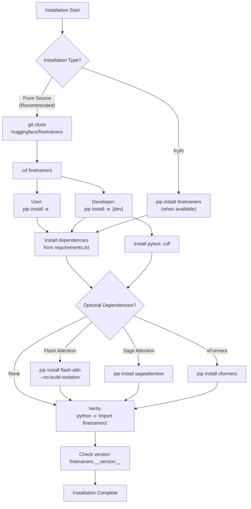

**Sources:** [setup.py:10-38](), [requirements.txt:1-21]()

---

## Dependency Checking System

Finetrainers implements a comprehensive dependency checking system in [finetrainers/utils/import_utils.py]() that detects package availability and validates versions at runtime.

### Import Checking Functions

The following functions are provided for checking dependency availability:

```mermaid
graph TB
    subgraph "Core Checking Logic"
        is_package["_is_package_available(pkg_name)<br/>[import_utils.py:18-29]"]
        compare_versions["compare_versions(library, op, version)<br/>[import_utils.py:33-50]"]
    end
    
    subgraph "Package Detection Functions"
        is_bitsandbytes["is_bitsandbytes_available()<br/>[import_utils.py:62-63]"]
        is_datasets["is_datasets_available()<br/>[import_utils.py:66-67]"]
        is_flash["is_flash_attn_available()<br/>[import_utils.py:70-71]"]
        is_kornia["is_kornia_available()<br/>[import_utils.py:74-75]"]
        is_sage["is_sageattention_available()<br/>[import_utils.py:78-79]"]
        is_torch["is_torch_available()<br/>[import_utils.py:82-83]"]
        is_xformers["is_xformers_available()<br/>[import_utils.py:86-87]"]
    end
    
    subgraph "Version Checking Functions"
        is_bitsandbytes_ver["is_bitsandbytes_version(op, ver)<br/>[import_utils.py:90-93]"]
        is_datasets_ver["is_datasets_version(op, ver)<br/>[import_utils.py:96-99]"]
        is_flash_ver["is_flash_attn_version(op, ver)<br/>[import_utils.py:102-105]"]
        is_torch_ver["is_torch_version(op, ver)<br/>[import_utils.py:120-123]"]
    end
    
    is_package -.used by.-> is_bitsandbytes
    is_package -.used by.-> is_datasets
    is_package -.used by.-> is_flash
    is_package -.used by.-> is_kornia
    is_package -.used by.-> is_sage
    is_package -.used by.-> is_torch
    is_package -.used by.-> is_xformers
    
    compare_versions -.used by.-> is_bitsandbytes_ver
    compare_versions -.used by.-> is_datasets_ver
    compare_versions -.used by.-> is_flash_ver
    compare_versions -.used by.-> is_torch_ver
```

**Sources:** [finetrainers/utils/import_utils.py:1-130]()

### Usage Example

```python
from finetrainers.utils.import_utils import (
    is_flash_attn_available,
    is_torch_version
)

# Check if flash attention is available
if is_flash_attn_available():
    print("Flash Attention is installed")

# Check if torch version is >= 2.5.1
if is_torch_version(">=", "2.5.1"):
    print("PyTorch version requirement satisfied")
```

The system uses `importlib.util.find_spec()` to detect packages and `importlib_metadata.version()` to retrieve version information, as implemented in [finetrainers/utils/import_utils.py:18-29]().

**Sources:** [finetrainers/utils/import_utils.py:1-130]()

---

## Environment Variables

Finetrainers uses environment variables to configure runtime behavior without code changes.

### Available Environment Variables

| Variable | Purpose | Valid Values | Default |
|----------|---------|--------------|---------|
| `FINETRAINERS_ATTN_PROVIDER` | Select attention implementation | `flash`, `sage`, `xformers`, `native` | Auto-detect based on availability |
| `FINETRAINERS_ATTN_CHECKS` | Enable/disable attention validation checks | `0`, `1` | `1` (enabled) |

### Setting Environment Variables

**Linux/macOS:**
```bash
export FINETRAINERS_ATTN_PROVIDER=flash
export FINETRAINERS_ATTN_CHECKS=1
```

**Windows (Command Prompt):**
```cmd
set FINETRAINERS_ATTN_PROVIDER=flash
set FINETRAINERS_ATTN_CHECKS=1
```

**Python script:**
```python
import os
os.environ["FINETRAINERS_ATTN_PROVIDER"] = "flash"
os.environ["FINETRAINERS_ATTN_CHECKS"] = "1"
```

### Attention Provider Selection

The attention provider is selected based on:
1. `FINETRAINERS_ATTN_PROVIDER` environment variable (if set)
2. Automatic detection of installed packages (flash_attn → sageattention → xformers → native)

For more details on attention providers, see [Attention Providers](#8.1).

**Sources:** Based on architecture diagram showing environment variables

---

## Development Tools Setup

For contributors maintaining code quality, finetrainers uses `ruff` for linting and formatting.

### Makefile Targets

The [Makefile:1-12]() defines quality check and formatting commands:

```makefile
check_dirs := finetrainers tests examples train.py setup.py

quality:
    ruff check $(check_dirs) --exclude examples/_legacy
    ruff format --check $(check_dirs) --exclude examples/_legacy

style:
    ruff check $(check_dirs) --fix --exclude examples/_legacy
    ruff format $(check_dirs) --exclude examples/_legacy
```

### Running Quality Checks

**Check code quality without modifications:**
```bash
make quality
```

**Auto-fix issues and format code:**
```bash
make style
```

### CI Integration

GitHub Actions runs quality checks on all pull requests via [.github/workflows/pr_tests.yml:1-31]():

```yaml
- name: Install dependencies
  run: |
    python -m pip install --upgrade pip
    pip install ruff==0.9.10
- name: Check quality
  run: make quality
```

**Note:** There's a version mismatch between [requirements.txt:20]() (`ruff==0.9.10`) and [setup.py:23]() (`ruff==0.1.5`). The CI uses `ruff==0.9.10`.

**Sources:** [Makefile:1-12](), [.github/workflows/pr_tests.yml:1-31](), [requirements.txt:20](), [setup.py:23]()

---

## Verification

After installation, verify that finetrainers is properly installed:

### Basic Import Test

```bash
python -c "import finetrainers; print(finetrainers.__version__)"
```

Expected output: `0.2.0.dev0`

### Check Core Components

```python
from finetrainers import BaseArgs, ModelType, TrainingType
from finetrainers import ModelSpecification, SFTTrainer, ControlTrainer
from finetrainers.logging import get_logger

print("Core imports successful!")
```

The main exports are defined in [finetrainers/__init__.py:1-8]():
- `BaseArgs` - Configuration system
- `ModelType` - Supported model enum
- `TrainingType` - Training type enum  
- `ModelSpecification` - Model abstraction interface
- `SFTTrainer` - Supervised fine-tuning trainer
- `ControlTrainer` - Control training trainer
- `get_logger` - Logging utility

### Verify Optional Dependencies

```python
from finetrainers.utils.import_utils import (
    is_flash_attn_available,
    is_sageattention_available,
    is_xformers_available,
)

print(f"Flash Attention: {is_flash_attn_available()}")
print(f"Sage Attention: {is_sageattention_available()}")
print(f"xFormers: {is_xformers_available()}")
```

### Version Compatibility Check

```python
from finetrainers.utils.import_utils import (
    is_torch_version,
    is_diffusers_version,
    is_transformers_version,
)

# Check minimum required versions
assert is_torch_version(">=", "2.5.1"), "PyTorch >= 2.5.1 required"
assert is_diffusers_version(">=", "0.32.1"), "diffusers >= 0.32.1 required"
assert is_transformers_version(">=", "4.45.2"), "transformers >= 4.45.2 required"

print("All version requirements satisfied!")
```

**Note:** Version checking functions like `is_diffusers_version` and `is_transformers_version` would need to be added to [finetrainers/utils/import_utils.py]() following the same pattern as existing checkers.

**Sources:** [finetrainers/__init__.py:1-8](), [finetrainers/utils/import_utils.py:62-129]()

---

## Troubleshooting

### Common Installation Issues

**Issue: PyTorch CUDA mismatch**
```
RuntimeError: CUDA error: no kernel image is available for execution on the device
```
**Solution:** Ensure PyTorch is installed with matching CUDA version:
```bash
# For CUDA 11.8
pip install torch torchvision --index-url https://download.pytorch.org/whl/cu118

# For CUDA 12.1
pip install torch torchvision --index-url https://download.pytorch.org/whl/cu121
```

**Issue: Flash Attention compilation failure**
```
error: command 'gcc' failed with exit status 1
```
**Solution:** Use `--no-build-isolation` flag:
```bash
pip install flash-attn --no-build-isolation
```

**Issue: Import errors after installation**
```
ModuleNotFoundError: No module named 'finetrainers'
```
**Solution:** Verify installation path and Python environment:
```bash
pip show finetrainers
python -c "import sys; print(sys.path)"
```

**Issue: Version conflicts**
```
ERROR: pip's dependency resolver does not currently take into account all the packages that are installed
```
**Solution:** Use a fresh virtual environment:
```bash
python -m venv finetrainers_env
source finetrainers_env/bin/activate  # or `finetrainers_env\Scripts\activate` on Windows
pip install -e .
```

**Sources:** Based on common PyTorch and dependency installation patterns

---

## Summary

This page covered the complete installation and dependency setup for finetrainers:

- **System Requirements**: Python 3.8+, CUDA-capable GPU
- **Core Dependencies**: 19 required packages including torch >=2.5.1, diffusers >=0.32.1, transformers >=4.45.2
- **Optional Dependencies**: flash_attn, sageattention, xformers for optimized attention
- **Installation Methods**: Source installation (recommended), pip install, development setup
- **Dependency Checking**: Runtime detection via `is_*_available()` functions in [finetrainers/utils/import_utils.py]()
- **Environment Variables**: `FINETRAINERS_ATTN_PROVIDER`, `FINETRAINERS_ATTN_CHECKS`
- **Development Tools**: ruff for linting/formatting, pytest for testing
- **Verification**: Import tests and version compatibility checks

For next steps on running your first training, proceed to [Quick Start Guide](#2.2).

**Sources:** [requirements.txt:1-21](), [setup.py:1-47](), [finetrainers/__init__.py:1-8](), [finetrainers/utils/import_utils.py:1-130](), [Makefile:1-12](), [.github/workflows/pr_tests.yml:1-31]()

---

# Page: Quick Start Guide

# Quick Start Guide

<details>
<summary>Relevant source files</summary>

The following files were used as context for generating this wiki page:

- [.gitignore](.gitignore)
- [README.md](README.md)
- [docs/models/cogvideox.md](docs/models/cogvideox.md)
- [docs/models/cogview4.md](docs/models/cogview4.md)
- [docs/models/flux.md](docs/models/flux.md)
- [docs/models/hunyuan_video.md](docs/models/hunyuan_video.md)
- [docs/models/ltx_video.md](docs/models/ltx_video.md)
- [docs/models/wan.md](docs/models/wan.md)
- [examples/training/sft/flux_dev/raider_white_tarot/train.sh](examples/training/sft/flux_dev/raider_white_tarot/train.sh)
- [examples/training/sft/flux_dev/raider_white_tarot/training.json](examples/training/sft/flux_dev/raider_white_tarot/training.json)
- [examples/training/sft/flux_dev/raider_white_tarot/validation.json](examples/training/sft/flux_dev/raider_white_tarot/validation.json)
- [finetrainers/functional/__init__.py](finetrainers/functional/__init__.py)
- [finetrainers/functional/text.py](finetrainers/functional/text.py)
- [finetrainers/models/flux/__init__.py](finetrainers/models/flux/__init__.py)
- [finetrainers/processors/t5.py](finetrainers/processors/t5.py)

</details>


This guide provides a step-by-step walkthrough for running your first training job with finetrainers. By the end of this tutorial, you will have successfully fine-tuned a diffusion model using LoRA and run inference with the trained adapter. For detailed information about installation and dependencies, see [Installation and Dependencies](#2.1). For comprehensive documentation on configuration options, see [Configuration System](#3.3).

## Prerequisites

Before starting, ensure you have:
- Installed finetrainers and its dependencies (see [Installation and Dependencies](#2.1))
- Access to at least one GPU with sufficient VRAM (minimum 5GB for LTX-Video LoRA)
- A Hugging Face account (optional, for pushing trained models)

## Training Workflow Overview

The following diagram illustrates the complete workflow from repository setup to model inference:

```mermaid
flowchart TD
    Start([Start]) --> Clone["git clone repository<br/>git checkout release tag"]
    Clone --> Install["pip install -r requirements.txt<br/>pip install diffusers"]
    Install --> SelectExample["Select Example:<br/>examples/training/sft/{model}/{example}/"]
    
    SelectExample --> ReviewFiles["Review Training Configuration:<br/>- train.sh (execution script)<br/>- training.json (dataset config)<br/>- validation.json (validation prompts)"]
    
    ReviewFiles --> ConfigEnv["Configure Environment:<br/>- CUDA_VISIBLE_DEVICES<br/>- WANDB_MODE<br/>- FINETRAINERS_LOG_LEVEL"]
    
    ConfigEnv --> ExecuteChoice{Execution Method?}
    
    ExecuteChoice -->|PTD Backend| Torchrun["torchrun --standalone<br/>--nproc_per_node=NUM_GPUS<br/>train.py + arguments"]
    ExecuteChoice -->|Accelerate Backend| AccelerateLaunch["accelerate launch<br/>--config_file config.yaml<br/>train.py + arguments"]
    
    Torchrun --> TrainingLoop["Training Loop Executes:<br/>- SFTTrainer initialized<br/>- Model/data preparation<br/>- Forward/backward passes"]
    AccelerateLaunch --> TrainingLoop
    
    TrainingLoop --> MonitorProgress["Monitor Progress:<br/>- wandb dashboard<br/>- tensorboard logs<br/>- console output"]
    
    MonitorProgress --> CheckpointSave["Checkpoints Saved:<br/>output_dir/checkpoint-{step}/<br/>- pytorch_lora_weights.safetensors<br/>- optimizer.pt<br/>- random_states_*.pkl"]
    
    CheckpointSave --> ValidationRun["Validation Artifacts:<br/>- Generated videos/images<br/>- Saved to validation_dataset/"]
    
    ValidationRun --> TrainComplete{Training Complete?}
    TrainComplete -->|No| TrainingLoop
    TrainComplete -->|Yes| FinalCheckpoint["Final Checkpoint:<br/>- Saved to output_dir<br/>- Optionally pushed to HF Hub"]
    
    FinalCheckpoint --> LoadPipeline["Load Diffusers Pipeline:<br/>pipe.from_pretrained()"]
    LoadPipeline --> LoadLora["pipe.load_lora_weights()<br/>pipe.set_adapters()"]
    LoadLora --> Inference["Generate with Trained Model:<br/>pipe(prompt).frames/images"]
    Inference --> End([End])
    
    style Start fill:#e1f5ff
    style TrainingLoop fill:#ffe1e1
    style Inference fill:#e1ffe1
    style End fill:#e1ffe1
```

**Sources:** [README.md:25-50](), [examples/training/sft/flux_dev/raider_white_tarot/train.sh:1-161]()

## Step 1: Clone and Setup

Clone the repository and checkout the latest stable release:

```bash
git clone https://github.com/huggingface/finetrainers.git
cd finetrainers
git fetch --all --tags
git checkout tags/v0.2.0
```

Install the required dependencies:

```bash
pip install -r requirements.txt
pip install git+https://github.com/huggingface/diffusers
```

> **Note:** The main branch is the development branch. For stable training, always use a release tag.

**Sources:** [README.md:27-36]()

## Step 2: Select a Training Example

Finetrainers provides multiple example training configurations for different models. For this quick start, we'll use the LTX-Video "crush effect" LoRA training example, which requires minimal VRAM (5GB):

```bash
cd examples/training/sft/ltx_video/crush_smol_lora/
```

Each example directory contains three key files:

| File | Purpose |
|------|---------|
| `train.sh` | Bash script that configures all training arguments and launches the training process |
| `training.json` | Dataset configuration specifying data sources, resolution buckets, and preprocessing options |
| `validation.json` | Validation prompts and generation parameters for periodic quality checks |

**Sources:** [README.md:40-44](), [docs/models/ltx_video.md:7-9]()

## Step 3: Understanding the Training Script Structure

The training script is organized into modular argument groups. Here's how these groups map to the training system:

```mermaid
graph TB
    subgraph "train.sh Script Structure"
        EnvVars["Environment Variables<br/>WANDB_MODE, CUDA_VISIBLE_DEVICES<br/>FINETRAINERS_LOG_LEVEL"]
        Backend["Backend Selection<br/>BACKEND='ptd' or 'accelerate'"]
        ParallelCmd["parallel_cmd array<br/>--parallel_backend<br/>--dp_degree, --dp_shards<br/>--cp_degree, --tp_degree"]
        ModelCmd["model_cmd array<br/>--model_name<br/>--pretrained_model_name_or_path"]
        DatasetCmd["dataset_cmd array<br/>--dataset_config<br/>--enable_precomputation"]
        DataloaderCmd["dataloader_cmd array<br/>--dataloader_num_workers"]
        DiffusionCmd["diffusion_cmd array<br/>--flow_weighting_scheme"]
        TrainingCmd["training_cmd array<br/>--training_type<br/>--rank, --lora_alpha<br/>--target_modules"]
        OptimizerCmd["optimizer_cmd array<br/>--optimizer, --lr<br/>--lr_scheduler"]
        ValidationCmd["validation_cmd array<br/>--validation_dataset_file<br/>--validation_steps"]
        MiscCmd["miscellaneous_cmd array<br/>--output_dir<br/>--report_to"]
        
        Launch["Execution Command<br/>torchrun or accelerate launch"]
    end
    
    subgraph "train.py Entry Point"
        BaseArgs["BaseArgs.parse()"]
    end
    
    subgraph "Trainer Initialization"
        GetSpec["get_model_specification()<br/>Returns ModelSpecification"]
        InitTrainer["SFTTrainer() or ControlTrainer()"]
    end
    
    subgraph "Training Execution"
        PrepModels["_prepare_models()<br/>Load tokenizer, text_encoder, vae, transformer"]
        PrepParams["_prepare_trainable_parameters()<br/>Setup LoRA adapters or full params"]
        PrepParallel["_prepare_for_training()<br/>Apply DDP/FSDP/HSDP"]
        PrepData["_prepare_dataset()<br/>Load and preprocess data"]
        TrainLoop["train_loop()<br/>Forward → compute_loss → backward"]
    end
    
    EnvVars --> Backend
    Backend --> ParallelCmd
    ParallelCmd --> ModelCmd
    ModelCmd --> DatasetCmd
    DatasetCmd --> DataloaderCmd
    DataloaderCmd --> DiffusionCmd
    DiffusionCmd --> TrainingCmd
    TrainingCmd --> OptimizerCmd
    OptimizerCmd --> ValidationCmd
    ValidationCmd --> MiscCmd
    MiscCmd --> Launch
    
    Launch --> BaseArgs
    BaseArgs --> GetSpec
    GetSpec --> InitTrainer
    InitTrainer --> PrepModels
    PrepModels --> PrepParams
    PrepParams --> PrepParallel
    PrepParallel --> PrepData
    PrepData --> TrainLoop
    
    style Launch fill:#ffe1e1
    style BaseArgs fill:#e1ffe1
    style TrainLoop fill:#ffe1e1
```

**Sources:** [examples/training/sft/flux_dev/raider_white_tarot/train.sh:1-161]()

### Key Configuration Groups

#### Environment Variables

Set up the training environment before execution:

```bash
export WANDB_MODE="offline"           # or "online" for cloud logging
export CUDA_VISIBLE_DEVICES="0"       # GPU selection
export FINETRAINERS_LOG_LEVEL="DEBUG" # or "INFO", "WARNING"
```

**Sources:** [examples/training/sft/flux_dev/raider_white_tarot/train.sh:7-10]()

#### Backend and Parallelism Arguments

Finetrainers supports two distributed training backends:

| Backend | Use Case | Configuration |
|---------|----------|---------------|
| `ptd` (PyTorchDTensor) | Advanced parallelism (FSDP, HSDP, CP, TP) | `--parallel_backend ptd` |
| `accelerate` | Simple DDP training | `--parallel_backend accelerate` |

For single-GPU training, use DDP with 1 GPU:
```bash
--parallel_backend ptd --pp_degree 1 --dp_degree 1 --dp_shards 1 --cp_degree 1 --tp_degree 1
```

**Sources:** [examples/training/sft/flux_dev/raider_white_tarot/train.sh:13-30]()

#### Model Arguments

Specify which model to train:

```bash
--model_name "ltx_video"  # or "cogvideox", "wan", "flux", etc.
--pretrained_model_name_or_path "Lightricks/LTX-Video"
```

**Sources:** [examples/training/sft/flux_dev/raider_white_tarot/train.sh:38-41]()

#### Training Type Arguments

Choose between LoRA and full fine-tuning:

```bash
--training_type "lora"              # or "full-finetune"
--rank 128                          # LoRA rank
--lora_alpha 128                    # LoRA alpha parameter
--target_modules ".*attn.*"         # Regex for target layers
```

For full fine-tuning, simply set `--training_type "full-finetune"` and omit LoRA-specific arguments.

**Sources:** [examples/training/sft/flux_dev/raider_white_tarot/train.sh:68-82](), [docs/models/ltx_video.md:5]()

## Step 4: Configure Dataset

The dataset configuration is specified in JSON format. Here's the structure:

```json
{
  "datasets": [
    {
      "data_root": "dataset-name-or-path",
      "dataset_type": "video",
      "video_resolution_buckets": [[49, 512, 768]],
      "reshape_mode": "center_crop"
    }
  ]
}
```

For image training (Flux, CogView4), the structure is similar:

```json
{
  "datasets": [
    {
      "data_root": "multimodalart/1920-raider-waite-tarot-public-domain",
      "dataset_type": "image",
      "id_token": "TRTCRD",
      "image_resolution_buckets": [[1280, 720]],
      "reshape_mode": "bicubic"
    }
  ]
}
```

**Sources:** [examples/training/sft/flux_dev/raider_white_tarot/training.json:1-34]()

### Validation Configuration

The validation file specifies prompts for periodic inference checks:

```json
{
  "data": [
    {
      "caption": "A cat walks on grass",
      "num_inference_steps": 30,
      "num_frames": 49,
      "height": 512,
      "width": 768
    }
  ]
}
```

**Sources:** [examples/training/sft/flux_dev/raider_white_tarot/validation.json:1-68]()

## Step 5: Execute Training

Make the training script executable and run it:

```bash
chmod +x train.sh
./train.sh
```

The script will:
1. Initialize the distributed training backend via `torchrun` or `accelerate launch`
2. Parse all arguments through `BaseArgs.parse()`
3. Initialize the appropriate trainer (`SFTTrainer` or `ControlTrainer`)
4. Load model components (tokenizer, text encoder, VAE, transformer)
5. Setup LoRA adapters or prepare full fine-tuning
6. Apply parallelism strategy (DDP/FSDP/HSDP)
7. Load and preprocess the dataset
8. Execute the training loop

### Execution Commands by Backend

**PTD Backend:**
```bash
torchrun \
  --standalone \
  --nnodes=1 \
  --nproc_per_node=1 \
  train.py \
    --parallel_backend ptd \
    --model_name ltx_video \
    ...
```

**Accelerate Backend:**
```bash
accelerate launch \
  --config_file accelerate_configs/uncompiled_1.yaml \
  train.py \
    --parallel_backend accelerate \
    --model_name ltx_video \
    ...
```

**Sources:** [examples/training/sft/flux_dev/raider_white_tarot/train.sh:114-158]()

## Step 6: Monitor Training Progress

### Console Output

Training progress is logged to the console with the following information:
- Current step and epoch
- Loss values
- Learning rate
- Training throughput (steps/sec)
- Estimated time remaining

### Weights & Biases

If `--report_to wandb` is specified, training metrics are logged to W&B:
- Training loss curves
- Validation artifacts (generated videos/images)
- System metrics (GPU utilization, memory usage)

### Checkpoint Directory Structure

Checkpoints are saved to the specified `--output_dir`:

```
output_dir/
├── checkpoint-250/
│   ├── pytorch_lora_weights.safetensors  # LoRA weights
│   ├── optimizer.pt                       # Optimizer state
│   ├── random_states_0.pkl               # RNG states
│   └── metadata.json                      # Training metadata
├── checkpoint-500/
│   └── ...
└── validation_dataset/
    ├── step_250_sample_0.mp4             # Validation videos
    └── step_250_sample_1.mp4
```

**Sources:** [examples/training/sft/flux_dev/raider_white_tarot/train.sh:76-78]()

## Step 7: Inference with Trained Model

Once training is complete, use the trained LoRA adapter for inference:

### Video Models (LTX-Video, CogVideoX, Wan, HunyuanVideo)

```python
import torch
from diffusers import LTXPipeline
from diffusers.utils import export_to_video

# Load base model
pipe = LTXPipeline.from_pretrained(
    "Lightricks/LTX-Video", 
    torch_dtype=torch.bfloat16
).to("cuda")

# Load trained LoRA weights
pipe.load_lora_weights(
    "output_dir",  # or HF Hub repo name
    adapter_name="ltxv-lora"
)

# Set adapter strength (0.0 to 1.0)
pipe.set_adapters(["ltxv-lora"], [0.75])

# Generate video
video = pipe(
    prompt="A cat walking on grass with crush effect",
    num_inference_steps=30,
    num_frames=49,
    height=512,
    width=768
).frames[0]

export_to_video(video, "output.mp4", fps=8)
```

**Sources:** [docs/models/ltx_video.md:19-42](), [docs/models/cogvideox.md:27-44](), [docs/models/wan.md:32-48]()

### Image Models (Flux, CogView4)

```python
import torch
from diffusers import FluxPipeline

# Load base model
pipe = FluxPipeline.from_pretrained(
    "black-forest-labs/FLUX.1-dev",
    torch_dtype=torch.bfloat16
).to("cuda")

# Load trained LoRA weights
pipe.load_lora_weights(
    "output_dir",
    adapter_name="flux-lora"
)

# Set adapter strength
pipe.set_adapters(["flux-lora"], [0.9])

# Generate image
image = pipe(
    prompt="TRTCRD a tarot card of a knight on a horse",
    num_inference_steps=50,
    height=1280,
    width=720
).images[0]

image.save("output.png")
```

**Sources:** [docs/models/flux.md:30-47](), [docs/models/cogview4.md:27-44]()

## Resuming Training from Checkpoint

To resume training from a saved checkpoint, uncomment and set the `--resume_from_checkpoint` argument in the training script:

```bash
--resume_from_checkpoint 1000  # Resume from checkpoint-1000/
```

The trainer will automatically:
1. Load model weights from the checkpoint
2. Restore optimizer state
3. Resume from the saved training step
4. Restore RNG states for reproducibility

**Sources:** [examples/training/sft/flux_dev/raider_white_tarot/train.sh:79]()

## Quick Start Summary

This table summarizes the complete workflow with key code entities:

| Step | Action | Key Files/Functions |
|------|--------|-------------------|
| 1. Setup | Clone and install dependencies | [requirements.txt]() |
| 2. Select Example | Choose training configuration | `examples/training/sft/{model}/{example}/` |
| 3. Configure | Review train.sh, training.json, validation.json | [train.sh](), [training.json](), [validation.json]() |
| 4. Environment | Set CUDA_VISIBLE_DEVICES, WANDB_MODE | [train.sh:7-10]() |
| 5. Execute | Run `./train.sh` | `torchrun` or `accelerate launch` |
| 6. Training | Automatic execution | `SFTTrainer.train_loop()`, `ControlTrainer.train_loop()` |
| 7. Monitor | Check logs and W&B dashboard | `--report_to wandb` |
| 8. Checkpoints | Periodic saves | `output_dir/checkpoint-{step}/` |
| 9. Inference | Load and use trained model | `pipe.load_lora_weights()`, `pipe.set_adapters()` |

## Next Steps

After completing this quick start, explore:

- **[Training Types](#3.1)**: Learn about LoRA vs full fine-tuning and when to use each
- **[Model Specifications](#3.2)**: Understand how different models are abstracted
- **[Data Pipeline](#5)**: Dive deeper into dataset loading, preprocessing, and bucketing
- **[Parallelism and Distribution](#7)**: Scale training across multiple GPUs
- **[Supported Models](#6)**: Explore all available models and their specific configurations

For troubleshooting and advanced configurations, refer to the comprehensive [API Reference](#10).

**Sources:** [README.md:16-112](), [docs/models/ltx_video.md:1-42](), [docs/models/wan.md:1-116](), [docs/models/flux.md:1-54]()

---

# Page: Core Concepts

# Core Concepts

<details>
<summary>Relevant source files</summary>

The following files were used as context for generating this wiki page:

- [.gitignore](.gitignore)
- [README.md](README.md)
- [docs/models/README.md](docs/models/README.md)
- [finetrainers/config.py](finetrainers/config.py)
- [finetrainers/functional/__init__.py](finetrainers/functional/__init__.py)
- [finetrainers/functional/text.py](finetrainers/functional/text.py)
- [finetrainers/models/cogvideox/base_specification.py](finetrainers/models/cogvideox/base_specification.py)
- [finetrainers/models/flux/base_specification.py](finetrainers/models/flux/base_specification.py)
- [finetrainers/models/hunyuan_video/base_specification.py](finetrainers/models/hunyuan_video/base_specification.py)
- [finetrainers/models/ltx_video/base_specification.py](finetrainers/models/ltx_video/base_specification.py)
- [finetrainers/models/wan/base_specification.py](finetrainers/models/wan/base_specification.py)
- [finetrainers/models/wan/control_specification.py](finetrainers/models/wan/control_specification.py)
- [tests/models/flux/base_specification.py](tests/models/flux/base_specification.py)

</details>


This document explains the fundamental architectural concepts that underpin finetrainers: the `ModelType` and `TrainingType` enums, the `ModelSpecification` interface, and how these components interact to enable training of diverse diffusion models with different training strategies.

For specific details on training approaches (LoRA vs full finetuning, SFT vs Control), see [Training Types](#3.1). For deep implementation details of the `ModelSpecification` abstraction, see [Model Specifications](#3.2). For configuration and command-line argument handling, see [Configuration System](#3.3).

## Core Architectural Concepts

Finetrainers is built around three key abstractions that enable extensible, multi-model training:

1. **ModelType**: An enumeration identifying which diffusion model architecture to train
2. **TrainingType**: An enumeration specifying the training strategy (LoRA, full finetune, control conditioning)
3. **ModelSpecification**: An abstract interface that defines how to load, prepare, and train each model

### ModelType and TrainingType Enums

The `ModelType` enum defines all supported model architectures:

```python
class ModelType(str, Enum):
    COGVIDEOX = "cogvideox"
    COGVIEW4 = "cogview4"
    FLUX = "flux"
    HUNYUAN_VIDEO = "hunyuan_video"
    LTX_VIDEO = "ltx_video"
    WAN = "wan"
```

The `TrainingType` enum defines all supported training strategies:

```python
class TrainingType(str, Enum):
    # Supervised Fine-Tuning (SFT)
    LORA = "lora"                           # Low-rank adaptation
    FULL_FINETUNE = "full-finetune"         # Full parameter training
    
    # Control Training
    CONTROL_LORA = "control-lora"           # LoRA with control conditioning
    CONTROL_FULL_FINETUNE = "control-full-finetune"  # Full finetune with control
```

These enums serve as keys in the `SUPPORTED_MODEL_CONFIGS` registry, which maps `(ModelType, TrainingType)` pairs to their corresponding `ModelSpecification` implementation classes.

**Sources:** [finetrainers/config.py:13-30]()

### The Registry Pattern

The `SUPPORTED_MODEL_CONFIGS` dictionary is the central registry that connects models and training types to their implementations:

```python
SUPPORTED_MODEL_CONFIGS = {
    ModelType.COGVIDEOX: {
        TrainingType.LORA: CogVideoXModelSpecification,
        TrainingType.FULL_FINETUNE: CogVideoXModelSpecification,
    },
    ModelType.WAN: {
        TrainingType.LORA: WanModelSpecification,
        TrainingType.FULL_FINETUNE: WanModelSpecification,
        TrainingType.CONTROL_LORA: WanControlModelSpecification,
        TrainingType.CONTROL_FULL_FINETUNE: WanControlModelSpecification,
    },
    # ... other models
}
```

This registry enables dynamic dispatch: given `--model_name wan --training_type control-lora`, the system automatically instantiates `WanControlModelSpecification` without hard-coded conditionals in the trainer logic.

**Sources:** [finetrainers/config.py:32-63]()

## The ModelSpecification Interface

The `ModelSpecification` abstract base class defines a standardized interface that all model implementations must follow. This abstraction is what enables finetrainers to support diverse models with a single training codebase.

### Key Responsibilities

Each `ModelSpecification` implementation must define:

| Method | Purpose |
|--------|---------|
| `load_condition_models()` | Load tokenizers and text encoders for caption conditioning |
| `load_latent_models()` | Load VAE for image/video encoding |
| `load_diffusion_models()` | Load the transformer/UNet and scheduler |
| `load_pipeline()` | Assemble components into a Diffusers pipeline |
| `prepare_conditions()` | Process text captions into embeddings |
| `prepare_latents()` | Encode images/videos into latent space |
| `forward()` | Execute the training forward pass (noise prediction) |
| `validation()` | Generate artifacts during validation |

### Processor Architecture

Model specifications use **processors** (`ProcessorMixin` implementations) to modularize data transformations:

- **Condition Model Processors**: Transform text captions into embeddings (e.g., `T5Processor`, `CLIPPooledProcessor`)
- **Latent Model Processors**: Encode images/videos into latents (e.g., `WanLatentEncodeProcessor`, `LTXLatentEncodeProcessor`)
- **Control Model Processors**: Process control conditioning signals (only for control training)

This processor pattern enables composition and reuse. For example, both HunyuanVideo and LTX-Video use `T5Processor` for text encoding, but with different output names and parameters.

**Sources:** [finetrainers/models/wan/base_specification.py:210-260](), [finetrainers/models/ltx_video/base_specification.py:93-131](), [finetrainers/models/hunyuan_video/base_specification.py:75-122]()

## Model Specification Hierarchy

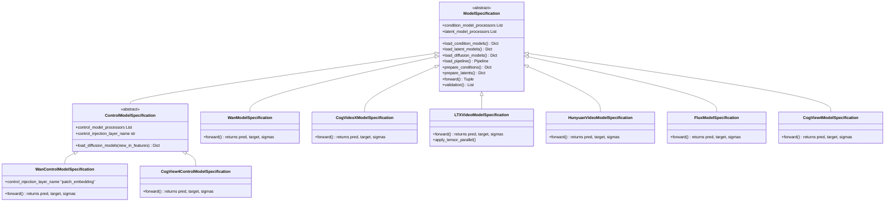

**Sources:** [finetrainers/config.py:1-11](), [finetrainers/models/wan/base_specification.py:210-261](), [finetrainers/models/wan/control_specification.py:36-77]()

## Registry Lookup and Instantiation

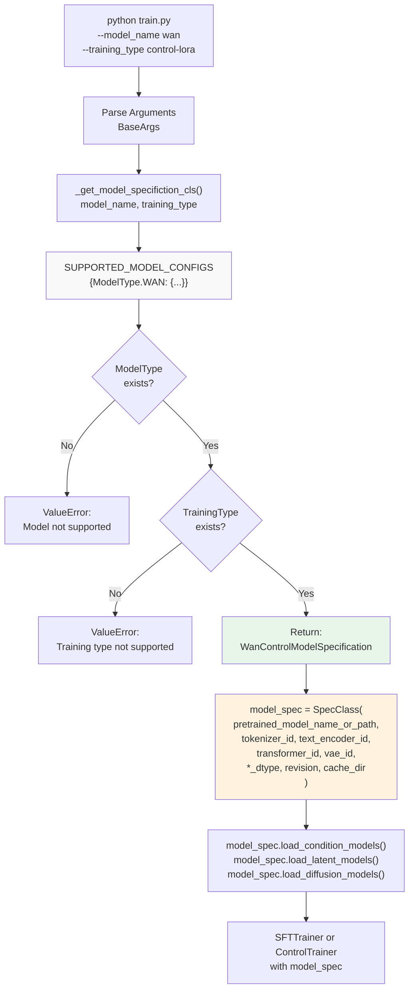

**Sources:** [finetrainers/config.py:66-75](), [finetrainers/models/wan/control_specification.py:36-76]()

## Component Lifecycle and Data Flow

The following diagram shows how `ModelType`, `TrainingType`, and `ModelSpecification` interact during the training lifecycle:

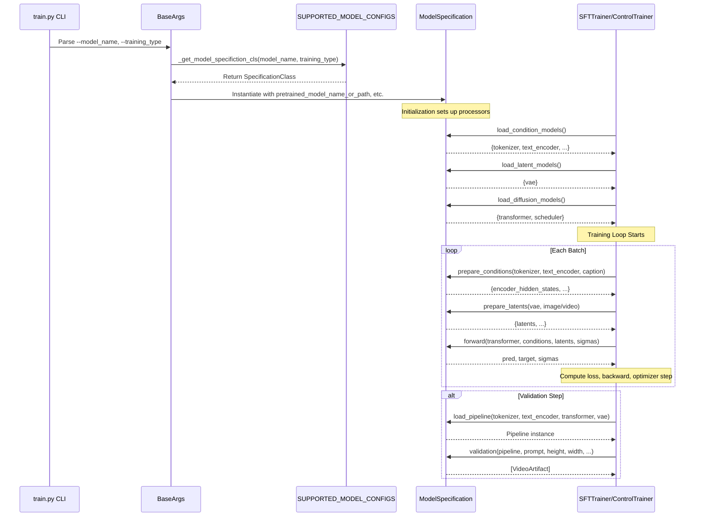

**Sources:** [finetrainers/models/wan/base_specification.py:383-432](), [finetrainers/models/ltx_video/base_specification.py:227-345]()

## Model-Specific Component Loading

Each `ModelSpecification` implementation loads model-specific components with configurable dtype and optional overrides:

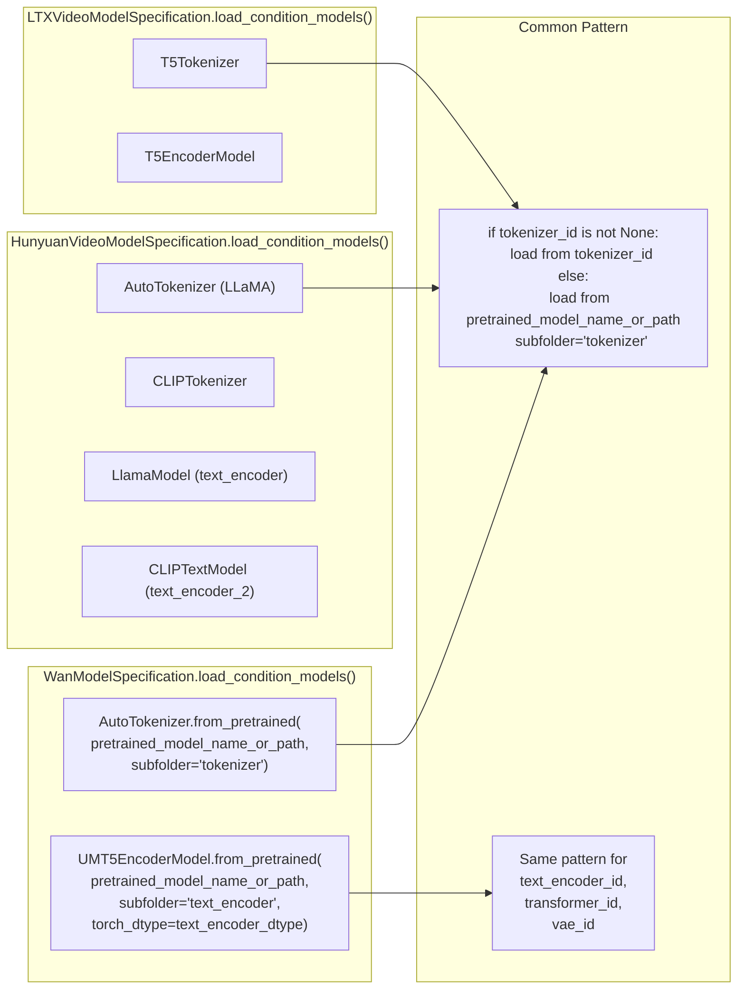

This pattern enables:
1. **Default loading**: Components loaded from the pretrained model path
2. **Component override**: Users can specify `--tokenizer_id`, `--text_encoder_id`, etc. to use custom components
3. **Mixed-precision**: Each component can have its own dtype (`text_encoder_dtype`, `transformer_dtype`, `vae_dtype`)

**Sources:** [finetrainers/models/wan/base_specification.py:265-287](), [finetrainers/models/hunyuan_video/base_specification.py:127-173](), [finetrainers/models/ltx_video/base_specification.py:137-159]()

## Processor Pattern

Processors encapsulate data transformations and enable composition. Each processor implements a `forward()` method that takes models and data as input and returns named outputs.

### Example: Text Processing Chain

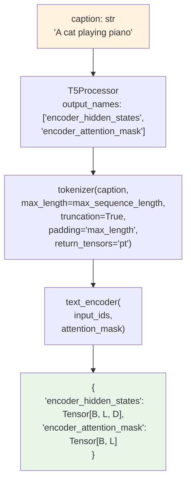

### Example: Latent Encoding Chain

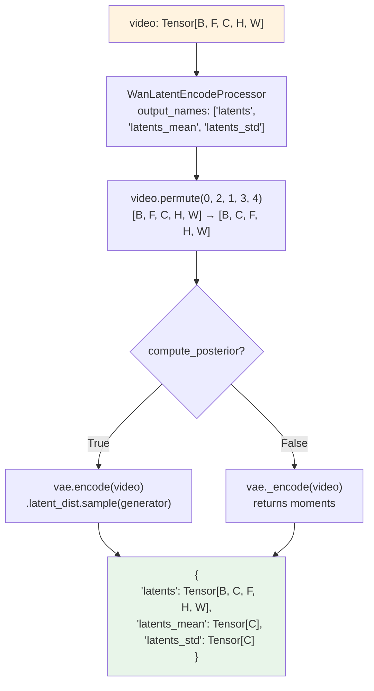

The processor pattern provides several benefits:
- **Modularity**: Each transformation is self-contained
- **Reusability**: Processors can be shared across models (e.g., `T5Processor` used by multiple models)
- **Composability**: Multiple processors can be chained together
- **Testability**: Each processor can be tested independently

**Sources:** [finetrainers/models/wan/base_specification.py:30-81](), [finetrainers/processors/t5_processor.py]() (referenced but not provided)

## Training Type Dispatch

The choice between `SFTTrainer` and `ControlTrainer` is determined by the `TrainingType`:

| TrainingType | Trainer Class | Key Difference |
|--------------|---------------|----------------|
| `LORA` | `SFTTrainer` | Standard supervised fine-tuning with LoRA adapters |
| `FULL_FINETUNE` | `SFTTrainer` | Standard supervised fine-tuning with all parameters |
| `CONTROL_LORA` | `ControlTrainer` | Control conditioning with LoRA adapters + channel concat |
| `CONTROL_FULL_FINETUNE` | `ControlTrainer` | Control conditioning with all parameters + channel concat |

Control training requires a `ControlModelSpecification` which extends `ModelSpecification` with:
- `control_model_processors`: Processors for control signal encoding
- Modified `load_diffusion_models(new_in_features)`: Expands input channels for control concatenation
- `control_injection_layer_name`: Identifies where to inject control signals (e.g., `"patch_embedding"`)

**Sources:** [finetrainers/config.py:22-30](), [finetrainers/models/wan/control_specification.py:36-84]()

## Forward Pass Structure

All model specifications implement a `forward()` method that follows this general structure:

1. **Extract latents** from `latent_model_conditions` (either pre-sampled or sample from posterior)
2. **Normalize/scale latents** according to model-specific requirements
3. **Generate noise** using the provided generator
4. **Create noisy latents** using flow matching or DDPM noise scheduling
5. **Call transformer** with noisy latents, conditions, and timesteps
6. **Compute target** (either noise or velocity depending on the model)
7. **Return** prediction, target, and sigmas for loss computation

### Example: Wan Forward Pass

The Wan model uses flow matching with latent normalization:

```python
def forward(self, transformer, condition_model_conditions, 
            latent_model_conditions, sigmas, generator, ...):
    # 1. Sample latents from posterior
    mu, logvar = torch.chunk(latents, 2, dim=1)
    mu = self._normalize_latents(mu, latents_mean, latents_std)
    latents = DiagonalGaussianDistribution(...).sample(generator)
    
    # 2. Flow matching
    noise = torch.zeros_like(latents).normal_(generator=generator)
    noisy_latents = FF.flow_match_xt(latents, noise, sigmas)
    
    # 3. Forward through transformer
    pred = transformer(
        hidden_states=noisy_latents,
        encoder_hidden_states=condition_model_conditions["encoder_hidden_states"],
        timestep=timesteps,
        return_dict=False,
    )[0]
    
    # 4. Compute target
    target = FF.flow_match_target(noise, latents)
    
    return pred, target, sigmas
```

**Sources:** [finetrainers/models/wan/base_specification.py:433-493](), [finetrainers/models/ltx_video/base_specification.py:271-345](), [finetrainers/models/cogvideox/base_specification.py:258-333]()

## Configuration Integration

The configuration system connects user-provided command-line arguments to `ModelSpecification` instantiation:

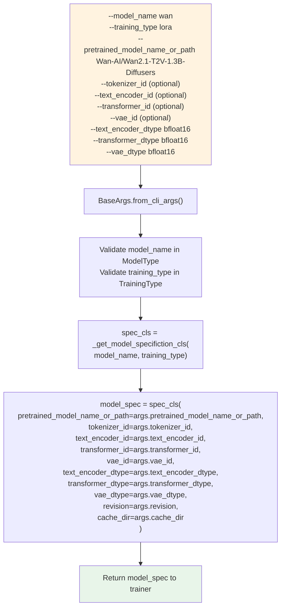

The modular configuration system is detailed in [Configuration System](#3.3).

**Sources:** [finetrainers/config.py:66-75]()

## Extensibility

Adding a new model requires:

1. **Implement `ModelSpecification`**: Create a subclass defining all required methods
2. **Implement processors**: Create `ProcessorMixin` subclasses for model-specific data transformations
3. **Register in `SUPPORTED_MODEL_CONFIGS`**: Add entries mapping `(ModelType, TrainingType)` to your specification
4. **Add to `ModelType` enum**: Define a new enum value for your model

For control training, additionally implement `ControlModelSpecification` with control-specific methods.

See [Adding a New Model](#9.1) for a step-by-step guide.

**Sources:** [finetrainers/config.py:32-75](), [finetrainers/models/wan/base_specification.py:210-261](), [finetrainers/models/wan/control_specification.py:36-84]()

---

# Page: Training Types

# Training Types

<details>
<summary>Relevant source files</summary>

The following files were used as context for generating this wiki page:

- [docs/models/README.md](docs/models/README.md)
- [finetrainers/args.py](finetrainers/args.py)
- [finetrainers/config.py](finetrainers/config.py)
- [finetrainers/models/flux/base_specification.py](finetrainers/models/flux/base_specification.py)
- [finetrainers/trainer/control_trainer/config.py](finetrainers/trainer/control_trainer/config.py)
- [finetrainers/trainer/sft_trainer/config.py](finetrainers/trainer/sft_trainer/config.py)
- [finetrainers/trainer/sft_trainer/trainer.py](finetrainers/trainer/sft_trainer/trainer.py)
- [finetrainers/utils/import_utils.py](finetrainers/utils/import_utils.py)
- [tests/models/flux/base_specification.py](tests/models/flux/base_specification.py)

</details>


This page explains the training type system in finetrainers, covering the differences between LoRA and full finetuning, SFT (Supervised Fine-Tuning) versus Control training, and guidance on when to use each approach. For information about the specific trainer implementations, see [SFT Trainer](#4.1) and [Control Trainer](#4.2). For details on configuration arguments, see [Configuration System](#3.3).

## Overview

Finetrainers supports four distinct training types, organized along two orthogonal dimensions:

1. **Training Objective**: SFT (standard supervised fine-tuning) vs Control (conditional control training)
2. **Parameter Update Strategy**: LoRA (low-rank adaptation) vs Full Finetuning (all parameters)

This design enables flexible training configurations based on computational resources, dataset characteristics, and intended use cases.

```mermaid
graph TB
    TrainingStrategy["Training Strategy"]
    
    Objective["Training Objective"]
    Parameters["Parameter Strategy"]
    
    SFT["SFT<br/>(Supervised Fine-Tuning)"]
    Control["Control<br/>(Conditional Generation)"]
    
    LoRA["LoRA<br/>(Low-Rank Adaptation)"]
    Full["Full Finetune<br/>(All Parameters)"]
    
    LORA["TrainingType.LORA"]
    FULL_FINETUNE["TrainingType.FULL_FINETUNE"]
    CONTROL_LORA["TrainingType.CONTROL_LORA"]
    CONTROL_FULL_FINETUNE["TrainingType.CONTROL_FULL_FINETUNE"]
    
    TrainingStrategy --> Objective
    TrainingStrategy --> Parameters
    
    Objective --> SFT
    Objective --> Control
    
    Parameters --> LoRA
    Parameters --> Full
    
    SFT --> LORA
    SFT --> FULL_FINETUNE
    Control --> CONTROL_LORA
    Control --> CONTROL_FULL_FINETUNE
    
    LORA --> SFTLowRankConfig["SFTLowRankConfig"]
    FULL_FINETUNE --> SFTFullRankConfig["SFTFullRankConfig"]
    CONTROL_LORA --> ControlLowRankConfig["ControlLowRankConfig"]
    CONTROL_FULL_FINETUNE --> ControlFullRankConfig["ControlFullRankConfig"]
```

**Sources:** [finetrainers/config.py:22-30](), [finetrainers/trainer/sft_trainer/config.py:11-66](), [finetrainers/trainer/control_trainer/config.py:34-185]()

## Training Type Enumeration

The `TrainingType` enum defines the four supported training modes:

| Enum Value | String Value | Purpose | Configuration Class |
|------------|--------------|---------|---------------------|
| `TrainingType.LORA` | `"lora"` | SFT with LoRA adapters | `SFTLowRankConfig` |
| `TrainingType.FULL_FINETUNE` | `"full-finetune"` | SFT with all parameters | `SFTFullRankConfig` |
| `TrainingType.CONTROL_LORA` | `"control-lora"` | Control training with LoRA | `ControlLowRankConfig` |
| `TrainingType.CONTROL_FULL_FINETUNE` | `"control-full-finetune"` | Control training with all parameters | `ControlFullRankConfig` |

These values are used throughout the codebase to select the appropriate training configuration and model specification.

**Sources:** [finetrainers/config.py:22-30]()

## SFT Training Types

### SFT with LoRA (`TrainingType.LORA`)

**Overview**: Trains low-rank adapter matrices inserted into the transformer model, keeping the base model weights frozen. This approach significantly reduces memory requirements and training time while achieving strong performance on domain-specific tasks.

**Configuration Class**: `SFTLowRankConfig`

**Key Parameters**:
- `rank` (default: 64): Dimensionality of the low-rank decomposition matrices
- `lora_alpha` (default: 64): Scaling factor computed as `lora_alpha / rank`
- `target_modules`: Regex pattern(s) specifying which modules receive LoRA adapters

**Default Target Modules Pattern**:
```
(transformer_blocks|single_transformer_blocks).*(to_q|to_k|to_v|to_out.0)
```

This targets attention projection layers in both standard and single transformer blocks.

**Trainable Parameters Setup**:
```mermaid
graph LR
    Transformer["transformer<br/>(FluxTransformer2DModel)"]
    
    FreezeBase["Freeze Base Weights<br/>utils.set_requires_grad(False)"]
    
    CreateLoRAConfig["Create LoraConfig<br/>rank, lora_alpha, target_modules"]
    
    AddAdapter["transformer.add_adapter()<br/>(PEFT integration)"]
    
    CastParams["cast_training_params()<br/>LoRA params to float32"]
    
    Transformer --> FreezeBase
    FreezeBase --> CreateLoRAConfig
    CreateLoRAConfig --> AddAdapter
    AddAdapter --> CastParams
```

**Memory Profile**: 
- Typical range: 5-18 GB VRAM depending on model size
- Example: LTX-Video LoRA requires ~5 GB, CogVideoX-5B requires ~18 GB

**When to Use**:
- Limited GPU memory (single consumer GPU)
- Quick iteration on domain-specific datasets
- Training lightweight adapters for distribution
- Fine-tuning for specific styles, subjects, or concepts

**Sources:** [finetrainers/trainer/sft_trainer/config.py:11-51](), [finetrainers/trainer/sft_trainer/trainer.py:96-137](), [finetrainers/args.py:253]()

### SFT with Full Finetuning (`TrainingType.FULL_FINETUNE`)

**Overview**: Updates all transformer parameters during training, producing a fully fine-tuned model. This approach offers maximum flexibility and performance but requires significantly more memory.

**Configuration Class**: `SFTFullRankConfig`

**Key Parameters**: None specific; inherits all base training arguments.

**Trainable Parameters Setup**:
```mermaid
graph LR
    Transformer["transformer"]
    
    EnableGrad["Enable Gradients<br/>utils.set_requires_grad(True)"]
    
    CastDtype["Cast to Training Dtype<br/>transformer.to(transformer_dtype)"]
    
    ApplyFSDP["Apply FSDP/DDP<br/>(if data_sharding_enabled)"]
    
    Transformer --> EnableGrad
    EnableGrad --> CastDtype
    CastDtype --> ApplyFSDP
```

**Memory Profile**:
- Typical range: 21-53+ GB VRAM depending on model size
- Example: LTX-Video requires ~21 GB, CogVideoX-5B requires ~53 GB
- HunyuanVideo full finetune exceeds typical consumer GPU memory

**When to Use**:
- High-end GPU clusters or cloud infrastructure
- Maximum performance requirements
- Substantial architectural changes or comprehensive adaptation
- Research experiments requiring full parameter updates

**Sources:** [finetrainers/trainer/sft_trainer/config.py:53-66](), [finetrainers/trainer/sft_trainer/trainer.py:96-137](), [finetrainers/args.py:253]()

## Control Training Types

Control training adds conditional control channels to the model, enabling generation guided by additional inputs such as edge maps, depth maps, or custom control signals. This is implemented via channel-wise concatenation in the latent space.

### Control with LoRA (`TrainingType.CONTROL_LORA`)

**Overview**: Trains LoRA adapters on a control-conditioned model where control signals are concatenated to the latent input. Enables lightweight control adaptation with minimal memory overhead.

**Configuration Class**: `ControlLowRankConfig`

**Key Parameters**:
- `rank` (default: 64): LoRA rank
- `lora_alpha` (default: 64): LoRA scaling factor
- `target_modules`: Extended pattern including feedforward layers
- `control_type` (default: `"canny"`): Type of control signal (canny, custom)
- `train_qk_norm` (default: False): Whether to train QK normalization layers
- `frame_conditioning_type`: For video models - how frames are conditioned
- `frame_conditioning_index`: Specific frame index when using index-based conditioning
- `frame_conditioning_concatenate_mask`: Whether to concatenate frame masks

**Default Target Modules Pattern**:
```
(transformer_blocks|single_transformer_blocks).*(to_q|to_k|to_v|to_out.0|ff.net.0.proj|ff.net.2)
```

This extends the SFT pattern to include feedforward network projections.

**Control Types**:

| Control Type | Description | Use Case |
|--------------|-------------|----------|
| `ControlType.CANNY` | Edge detection control | Structure-guided generation |
| `ControlType.CUSTOM` | User-provided control signal | Arbitrary conditioning |
| `ControlType.NONE` | No control (fallback) | Standard training |

**Frame Conditioning Types** (for video models):

| Type | Description | Implementation |
|------|-------------|----------------|
| `FrameConditioningType.INDEX` | Single frame by index | Condition on specific frame |
| `FrameConditioningType.PREFIX` | Prefix frames | First N frames as control |
| `FrameConditioningType.RANDOM` | Random frame selection | Stochastic frame conditioning |
| `FrameConditioningType.FIRST_AND_LAST` | Boundary frames | First and last frames |
| `FrameConditioningType.FULL` | All frames | Complete temporal conditioning |

**When to Use**:
- Adding control capabilities to existing models with limited memory
- Controllable generation research
- Style transfer or structure-guided synthesis
- Video frame interpolation or extrapolation

**Sources:** [finetrainers/trainer/control_trainer/config.py:34-123](), [finetrainers/trainer/control_trainer/config.py:12-31]()

### Control with Full Finetuning (`TrainingType.CONTROL_FULL_FINETUNE`)

**Overview**: Full parameter training with control channel concatenation. Provides maximum flexibility for control-conditioned generation at the cost of high memory requirements.

**Configuration Class**: `ControlFullRankConfig`

**Key Parameters**:
- `control_type` (default: `"canny"`): Type of control signal
- `train_qk_norm` (default: False): Whether to train QK normalization
- Frame conditioning parameters (same as Control LoRA)

**Memory Profile**: Similar to full finetuning (21-53+ GB) with additional overhead for control channel processing.

**When to Use**:
- Building production-grade control models
- Maximum control fidelity requirements
- Research into novel control mechanisms
- When LoRA capacity is insufficient

**Sources:** [finetrainers/trainer/control_trainer/config.py:126-185]()

## Training Type Selection Flow

```mermaid
graph TD
    Start["python train.py"]
    
    ParseArgs["Parse --training_type argument<br/>(BaseArgs.training_type)"]
    
    CheckType{"Training Type?"}
    
    LORA["TrainingType.LORA"]
    FULL["TrainingType.FULL_FINETUNE"]
    CONTROL_LORA["TrainingType.CONTROL_LORA"]
    CONTROL_FULL["TrainingType.CONTROL_FULL_FINETUNE"]
    
    GetSFTLowRankConfig["Instantiate SFTLowRankConfig<br/>register_args() + validate_args()"]
    GetSFTFullRankConfig["Instantiate SFTFullRankConfig"]
    GetControlLowRankConfig["Instantiate ControlLowRankConfig<br/>register_args() + validate_args()"]
    GetControlFullRankConfig["Instantiate ControlFullRankConfig"]
    
    InitSFTTrainer["Initialize SFTTrainer"]
    InitControlTrainer["Initialize ControlTrainer"]
    
    PrepareTrainable["_prepare_trainable_parameters()"]
    
    Start --> ParseArgs
    ParseArgs --> CheckType
    
    CheckType -->|lora| LORA
    CheckType -->|full-finetune| FULL
    CheckType -->|control-lora| CONTROL_LORA
    CheckType -->|control-full-finetune| CONTROL_FULL
    
    LORA --> GetSFTLowRankConfig
    FULL --> GetSFTFullRankConfig
    CONTROL_LORA --> GetControlLowRankConfig
    CONTROL_FULL --> GetControlFullRankConfig
    
    GetSFTLowRankConfig --> InitSFTTrainer
    GetSFTFullRankConfig --> InitSFTTrainer
    GetControlLowRankConfig --> InitControlTrainer
    GetControlFullRankConfig --> InitControlTrainer
    
    InitSFTTrainer --> PrepareTrainable
    InitControlTrainer --> PrepareTrainable
```

**Sources:** [finetrainers/trainer/sft_trainer/trainer.py:96-137](), [finetrainers/args.py:423-424](), [train.py (not shown but referenced)]()

## Model Support Matrix

Not all models support all training types. The `SUPPORTED_MODEL_CONFIGS` dictionary maps model types to supported training configurations:

| Model | LORA | FULL_FINETUNE | CONTROL_LORA | CONTROL_FULL_FINETUNE |
|-------|------|---------------|--------------|------------------------|
| CogVideoX | ✓ | ✓ | ✗ | ✗ |
| CogView4 | ✓ | ✓ | ✓ | ✓ |
| Flux | ✓ | ✓ | ✗ | ✗ |
| HunyuanVideo | ✓ | ✓ | ✗ | ✗ |
| LTX-Video | ✓ | ✓ | ✗ | ✗ |
| Wan | ✓ | ✓ | ✓ | ✓ |

Control training is currently supported only for **CogView4** (image generation) and **Wan** (video generation). These models use specialized `*ControlModelSpecification` classes that handle control channel concatenation.

**Sources:** [finetrainers/config.py:32-63](), [docs/models/README.md:17-28]()

## Configuration Registration and Validation

Each training type configuration implements the `ArgsConfigMixin` interface, providing a standardized way to:

1. **Add Arguments**: Define command-line arguments via `add_args(parser)`
2. **Map Arguments**: Convert argparse namespace to config attributes via `map_args()`
3. **Validate Arguments**: Ensure parameter validity via `validate_args()`
4. **Serialize**: Export configuration via `to_dict()`

```mermaid
graph TB
    ArgsConfigMixin["ArgsConfigMixin<br/>(Abstract Interface)"]
    
    SFTLowRankConfig["SFTLowRankConfig"]
    SFTFullRankConfig["SFTFullRankConfig"]
    ControlLowRankConfig["ControlLowRankConfig"]
    ControlFullRankConfig["ControlFullRankConfig"]
    
    add_args["add_args(parser)<br/>Define CLI arguments"]
    map_args["map_args(argparse_args, mapped_args)<br/>Map parsed args to config"]
    validate_args["validate_args(args)<br/>Validate parameter values"]
    to_dict["to_dict()<br/>Serialize to dictionary"]
    
    ArgsConfigMixin --> SFTLowRankConfig
    ArgsConfigMixin --> SFTFullRankConfig
    ArgsConfigMixin --> ControlLowRankConfig
    ArgsConfigMixin --> ControlFullRankConfig
    
    ArgsConfigMixin -.defines.-> add_args
    ArgsConfigMixin -.defines.-> map_args
    ArgsConfigMixin -.defines.-> validate_args
    ArgsConfigMixin -.defines.-> to_dict
```

**Example Validation** (from `SFTLowRankConfig`):
```python
def validate_args(self, args: "BaseArgs"):
    assert self.rank > 0, "Rank must be a positive integer."
    assert self.lora_alpha > 0, "lora_alpha must be a positive integer."
```

**Sources:** [finetrainers/trainer/sft_trainer/config.py:28-50](), [finetrainers/trainer/control_trainer/config.py:70-123](), [finetrainers/utils/args_utils.py (referenced)]()

## Parameter Management During Training

The training type determines how parameters are prepared and managed:

```mermaid
graph TB
    CheckTrainingType{"args.training_type"}
    
    FULL_FINETUNE["FULL_FINETUNE"]
    LORA["LORA"]
    
    FullFlow["Enable gradients:<br/>utils.set_requires_grad(transformer, True)"]
    
    LoRAFlow["Freeze base model:<br/>utils.set_requires_grad(transformer, False)"]
    
    LayerwiseUpcast["Apply layerwise upcasting<br/>(if configured)"]
    CreateLoRAConfig["Create LoraConfig:<br/>rank, lora_alpha, target_modules"]
    AddAdapter["transformer.add_adapter(lora_config)"]
    CastLoRAParams["cast_training_params(transformer, float32)<br/>(if not using FSDP)"]
    
    ApplyFSDP["Apply FSDP2/HSDP<br/>(if data_sharding_enabled)"]
    ApplyDDP["Apply DDP<br/>(if data_replication_enabled)"]
    PrepareModel["prepare_model()<br/>(otherwise)"]
    
    CheckTrainingType -->|"FULL_FINETUNE"| FULL_FINETUNE
    CheckTrainingType -->|"LORA"| LORA
    
    FULL_FINETUNE --> FullFlow
    LORA --> LoRAFlow
    
    LoRAFlow --> LayerwiseUpcast
    LayerwiseUpcast --> CreateLoRAConfig
    CreateLoRAConfig --> AddAdapter
    AddAdapter --> CastLoRAParams
    
    FullFlow --> ApplyFSDP
    CastLoRAParams --> ApplyFSDP
    
    ApplyFSDP --> ApplyDDP
    ApplyDDP --> PrepareModel
```

**Key Implementation Details**:

1. **Full Finetune**: All transformer parameters have `requires_grad=True` and participate in optimization
2. **LoRA**: Base model frozen, only LoRA adapter weights are trainable
3. **Layerwise Upcasting**: For LoRA training, can store weights in FP8 while computing in BF16/FP32
4. **FSDP Compatibility**: When using FSDP (Fully Sharded Data Parallel), all parameters must be the same dtype
5. **DDP Fallback**: When not using data sharding, LoRA parameters are cast to float32 for stability

**Sources:** [finetrainers/trainer/sft_trainer/trainer.py:96-192](), [finetrainers/args.py:149-156]()

## Memory and Performance Comparison

### Memory Requirements by Training Type

Based on documented memory measurements (from `docs/models/README.md` and model-specific docs):

| Model | LoRA (GB) | Full Finetune (GB) | Control LoRA (GB) | Control Full (GB) |
|-------|-----------|-------------------|------------------|------------------|
| LTX-Video | ~5 | ~21 | N/A | N/A |
| CogVideoX-2B | ~8 | ~24 | N/A | N/A |
| CogVideoX-5B | ~18 | ~53 | N/A | N/A |
| HunyuanVideo | ~32 | OOM (>80 GB) | N/A | N/A |
| Wan | TBD | TBD | TBD | TBD |
| CogView4 | TBD | TBD | TBD | TBD |
| Flux | TBD | TBD | N/A | N/A |

**Notes**:
- LoRA typically uses 1/4 to 1/3 the memory of full finetuning
- Control training adds overhead for control channel processing but follows similar ratios
- Memory scales with batch size, gradient accumulation, and parallelism settings

### Training Speed Considerations

**LoRA Advantages**:
- Faster forward/backward passes (fewer active parameters)
- Lower communication overhead in distributed training
- Faster checkpoint saves (smaller state dict)
- Quicker convergence on smaller datasets

**Full Finetune Advantages**:
- Higher capacity for learning complex patterns
- Better performance on large, diverse datasets
- No adapter architecture constraints
- More straightforward deployment (no adapter loading)

**Sources:** [docs/models/README.md:17-28](), [docs/models/ltx_video.md (referenced)](), [docs/models/cogvideox.md (referenced)]()

## Usage Examples

### Command-Line Selection

Training type is specified via the `--training_type` argument:

```bash
# SFT with LoRA
python train.py \
  --model_name cogvideox \
  --training_type lora \
  --rank 64 \
  --lora_alpha 64 \
  --target_modules "(transformer_blocks).*(to_q|to_k|to_v)"

# SFT with Full Finetuning
python train.py \
  --model_name cogvideox \
  --training_type full-finetune

# Control with LoRA
python train.py \
  --model_name wan \
  --training_type control-lora \
  --control_type canny \
  --rank 64 \
  --frame_conditioning_type index

# Control with Full Finetuning
python train.py \
  --model_name cogview4 \
  --training_type control-full-finetune \
  --control_type canny
```

### Programmatic Selection

The training type determines which configuration class is instantiated and validated:

```python
# In train.py (conceptual flow)
training_type = args.training_type

if training_type == TrainingType.LORA:
    config = SFTLowRankConfig()
elif training_type == TrainingType.FULL_FINETUNE:
    config = SFTFullRankConfig()
elif training_type == TrainingType.CONTROL_LORA:
    config = ControlLowRankConfig()
elif training_type == TrainingType.CONTROL_FULL_FINETUNE:
    config = ControlFullRankConfig()

config.register_args(parser)
config.validate_args(args)
```

**Sources:** [finetrainers/args.py:423-424](), [finetrainers/config.py:66-76](), [docs/models/README.md:30-36]()

## Decision Guide

### Choose LoRA When:
- ✓ Training on consumer GPUs (single RTX 4090, A6000, etc.)
- ✓ Experimenting with hyperparameters or architectures
- ✓ Fine-tuning for specific styles, subjects, or concepts
- ✓ Need fast iteration cycles
- ✓ Distributing lightweight adapters to users
- ✓ Training multiple task-specific adapters

### Choose Full Finetuning When:
- ✓ Access to high-memory GPUs or multi-GPU clusters
- ✓ Require maximum model quality and capacity
- ✓ Training on large, diverse datasets
- ✓ Making significant architectural modifications
- ✓ Production deployment as a standalone model
- ✓ Research requiring full parameter updates

### Choose SFT When:
- ✓ Standard image-to-image or text-to-video generation
- ✓ Domain adaptation (e.g., medical imaging, animation)
- ✓ Style transfer without explicit control signals
- ✓ Most common training scenarios

### Choose Control Training When:
- ✓ Need conditional generation with explicit control signals
- ✓ Structure-guided synthesis (edges, depth, pose)
- ✓ Video frame interpolation or extrapolation
- ✓ Multi-modal conditioning beyond text prompts
- ✓ Model supports control (Wan, CogView4 only)

**Sources:** Based on analysis of [finetrainers/config.py:32-63](), [docs/models/README.md:17-44](), [finetrainers/trainer/sft_trainer/trainer.py:96-137]()

---

# Page: Model Specifications

# Model Specifications

<details>
<summary>Relevant source files</summary>

The following files were used as context for generating this wiki page:

- [docs/models/README.md](docs/models/README.md)
- [finetrainers/config.py](finetrainers/config.py)
- [finetrainers/models/cogvideox/base_specification.py](finetrainers/models/cogvideox/base_specification.py)
- [finetrainers/models/cogview4/base_specification.py](finetrainers/models/cogview4/base_specification.py)
- [finetrainers/models/flux/base_specification.py](finetrainers/models/flux/base_specification.py)
- [finetrainers/models/hunyuan_video/base_specification.py](finetrainers/models/hunyuan_video/base_specification.py)
- [finetrainers/models/ltx_video/base_specification.py](finetrainers/models/ltx_video/base_specification.py)
- [finetrainers/models/wan/base_specification.py](finetrainers/models/wan/base_specification.py)
- [finetrainers/models/wan/control_specification.py](finetrainers/models/wan/control_specification.py)
- [finetrainers/parallel/accelerate.py](finetrainers/parallel/accelerate.py)
- [finetrainers/parallel/base.py](finetrainers/parallel/base.py)
- [finetrainers/parallel/ptd.py](finetrainers/parallel/ptd.py)
- [tests/README.md](tests/README.md)
- [tests/models/flux/base_specification.py](tests/models/flux/base_specification.py)

</details>


## Purpose and Scope

This document describes the `ModelSpecification` abstraction, which is the core interface that enables finetrainers to support multiple diffusion models with a unified training API. A `ModelSpecification` encapsulates all model-specific logic including component loading, preprocessing, forward passes, and validation for a particular diffusion architecture.

For information about training workflows that use these specifications, see [Training Workflows](#4). For details on supported models and their usage, see [Supported Models](#6).

## Overview

The `ModelSpecification` abstract class defines a standard interface that must be implemented for each supported diffusion model. This abstraction separates model-specific details from the generic training loop, allowing the same trainer code to work with different architectures.

Each specification is responsible for:
1. Loading model components (tokenizers, text encoders, VAE, transformer, scheduler)
2. Defining preprocessing pipelines (text encoding, latent encoding)
3. Implementing the training forward pass
4. Providing validation/inference logic
5. Saving trained weights

**Architecture Pattern**

```mermaid
graph TB
    subgraph "Abstract Interface"
        ModelSpec["ModelSpecification<br/>(Abstract Base Class)"]
    end
    
    subgraph "Concrete Implementations"
        WanSpec["WanModelSpecification"]
        HunyuanSpec["HunyuanVideoModelSpecification"]
        LTXSpec["LTXVideoModelSpecification"]
        CogVideoSpec["CogVideoXModelSpecification"]
        CogViewSpec["CogView4ModelSpecification"]
        FluxSpec["FluxModelSpecification"]
    end
    
    subgraph "Control Variants"
        WanCtrl["WanControlModelSpecification"]
        CogViewCtrl["CogView4ControlModelSpecification"]
    end
    
    ModelSpec --> WanSpec
    ModelSpec --> HunyuanSpec
    ModelSpec --> LTXSpec
    ModelSpec --> CogVideoSpec
    ModelSpec --> CogViewSpec
    ModelSpec --> FluxSpec
    
    WanSpec -.extends.-> WanCtrl
    CogViewSpec -.extends.-> CogViewCtrl
    
    subgraph "Registry"
        Registry["SUPPORTED_MODEL_CONFIGS<br/>Dict[ModelType, Dict[TrainingType, Type[ModelSpecification]]]"]
    end
    
    WanSpec --> Registry
    HunyuanSpec --> Registry
    LTXSpec --> Registry
    CogVideoSpec --> Registry
    CogViewSpec --> Registry
    FluxSpec --> Registry
    WanCtrl --> Registry
    CogViewCtrl --> Registry
```

Sources: [finetrainers/config.py:1-76](), [finetrainers/models/modeling_utils.py]()

## ModelSpecification Interface

The base `ModelSpecification` class is an abstract class that all model implementations must inherit from. It defines the contract for model loading, preprocessing, training, and inference.

**Key Attributes**

Each `ModelSpecification` instance stores:
- Component identifiers and dtypes (e.g., `pretrained_model_name_or_path`, `text_encoder_dtype`, `transformer_dtype`, `vae_dtype`)
- Model configurations loaded from pretrained models (e.g., `transformer_config`, `vae_config`)
- Processor lists (`condition_model_processors`, `latent_model_processors`)

**Core Methods Hierarchy**

```mermaid
graph TB
    subgraph "Component Loading"
        LoadCond["load_condition_models()<br/>Returns tokenizers + text encoders"]
        LoadLatent["load_latent_models()<br/>Returns VAE"]
        LoadDiff["load_diffusion_models()<br/>Returns transformer + scheduler"]
        LoadPipe["load_pipeline()<br/>Assembles inference pipeline"]
    end
    
    subgraph "Preprocessing"
        PrepCond["prepare_conditions()<br/>Text → Embeddings"]
        PrepLatent["prepare_latents()<br/>Image/Video → Latents"]
    end
    
    subgraph "Training & Inference"
        Forward["forward()<br/>Training forward pass<br/>Returns pred, target, sigmas"]
        Validation["validation()<br/>Generate artifacts<br/>Returns List[ArtifactType]"]
    end
    
    subgraph "Serialization"
        SaveLoRA["_save_lora_weights()<br/>Save adapter weights"]
        SaveModel["_save_model()<br/>Save full model"]
    end
    
    LoadCond --> PrepCond
    LoadLatent --> PrepLatent
    LoadDiff --> Forward
    PrepCond --> Forward
    PrepLatent --> Forward
    LoadPipe --> Validation
```

Sources: [finetrainers/models/wan/base_specification.py:210-578](), [finetrainers/models/hunyuan_video/base_specification.py:75-392](), [finetrainers/models/ltx_video/base_specification.py:93-414]()

## Component Loading Methods

Model specifications implement four primary loading methods that initialize the model components from pretrained weights.

### load_condition_models()

Returns a dictionary of conditioning components (tokenizers and text encoders). Different models use different text encoders:

| Model | Text Encoder(s) | Implementation |
|-------|----------------|----------------|
| Wan | UMT5 | [finetrainers/models/wan/base_specification.py:265-287]() |
| HunyuanVideo | Llama + CLIP | [finetrainers/models/hunyuan_video/base_specification.py:127-173]() |
| LTX-Video | T5 | [finetrainers/models/ltx_video/base_specification.py:137-159]() |
| CogVideoX | T5 | [finetrainers/models/cogvideox/base_specification.py:121-143]() |
| CogView4 | GLM | [finetrainers/models/cogview4/base_specification.py:139-161]() |
| Flux | CLIP + T5 | [finetrainers/models/flux/base_specification.py:123-169]() |

Each method loads components from `pretrained_model_name_or_path` or overridden component IDs (e.g., `tokenizer_id`, `text_encoder_id`).

### load_latent_models()

Returns the VAE used to encode images/videos into the latent space. All models use diffusers `AutoencoderKL` variants:

```python
# Example from WanModelSpecification
def load_latent_models(self) -> Dict[str, torch.nn.Module]:
    common_kwargs = {"revision": self.revision, "cache_dir": self.cache_dir}
    
    if self.vae_id is not None:
        vae = AutoencoderKLWan.from_pretrained(self.vae_id, torch_dtype=self.vae_dtype, **common_kwargs)
    else:
        vae = AutoencoderKLWan.from_pretrained(
            self.pretrained_model_name_or_path, subfolder="vae", torch_dtype=self.vae_dtype, **common_kwargs
        )
    
    return {"vae": vae}
```

Some models (e.g., Wan I2V) also load additional encoders like CLIP vision models here.

Sources: [finetrainers/models/wan/base_specification.py:289-311](), [finetrainers/models/hunyuan_video/base_specification.py:175-185]()

### load_diffusion_models()

Returns the transformer/UNet and noise scheduler. This is the trainable component:

```python
# Example from LTXVideoModelSpecification
def load_diffusion_models(self) -> Dict[str, torch.nn.Module]:
    common_kwargs = {"revision": self.revision, "cache_dir": self.cache_dir}
    
    transformer = LTXVideoTransformer3DModel.from_pretrained(
        self.pretrained_model_name_or_path,
        subfolder="transformer",
        torch_dtype=self.transformer_dtype,
        **common_kwargs,
    )
    
    scheduler = FlowMatchEulerDiscreteScheduler()
    
    return {"transformer": transformer, "scheduler": scheduler}
```

Most models use flow matching with `FlowMatchEulerDiscreteScheduler`, except CogVideoX which uses `CogVideoXDDIMScheduler`.

Sources: [finetrainers/models/ltx_video/base_specification.py:173-190](), [finetrainers/models/cogvideox/base_specification.py:157-176]()

### load_pipeline()

Assembles all components into a diffusers `Pipeline` for inference:

```python
# Example signature
def load_pipeline(
    self,
    tokenizer: Optional[...] = None,
    text_encoder: Optional[...] = None,
    transformer: Optional[...] = None,
    vae: Optional[...] = None,
    scheduler: Optional[...] = None,
    enable_slicing: bool = False,
    enable_tiling: bool = False,
    enable_model_cpu_offload: bool = False,
    training: bool = False,
    **kwargs,
) -> Pipeline
```

This method is used for validation during training and final inference after training.

Sources: [finetrainers/models/wan/base_specification.py:332-380](), [finetrainers/models/ltx_video/base_specification.py:192-225]()

## Preprocessing Pipeline

Model specifications use `ProcessorMixin` instances to define preprocessing logic. These processors are composable and reusable across models.

**Processor Architecture**

```mermaid
graph TB
    subgraph "Processor Base"
        ProcessorMixin["ProcessorMixin<br/>(Abstract Base)"]
    end
    
    subgraph "Condition Processors"
        T5Proc["T5Processor<br/>Tokenize + Encode with T5"]
        LlamaProc["LlamaProcessor<br/>Tokenize + Encode with Llama"]
        CLIPProc["CLIPPooledProcessor<br/>Tokenize + Encode with CLIP"]
        GLMProc["CogView4GLMProcessor<br/>Tokenize + Encode with GLM"]
    end
    
    subgraph "Latent Processors"
        WanLatent["WanLatentEncodeProcessor<br/>Image/Video → Latents via VAE"]
        HunyuanLatent["HunyuanLatentEncodeProcessor<br/>Image/Video → Latents via VAE"]
        LTXLatent["LTXLatentEncodeProcessor<br/>Image/Video → Latents via VAE"]
        CogLatent["CogVideoXLatentEncodeProcessor<br/>Image/Video → Latents via VAE"]
    end
    
    ProcessorMixin --> T5Proc
    ProcessorMixin --> LlamaProc
    ProcessorMixin --> CLIPProc
    ProcessorMixin --> GLMProc
    ProcessorMixin --> WanLatent
    ProcessorMixin --> HunyuanLatent
    ProcessorMixin --> LTXLatent
    ProcessorMixin --> CogLatent
```

Sources: [finetrainers/processors/](), [finetrainers/models/wan/base_specification.py:30-82]()

### Condition Processors

Each specification defines `condition_model_processors` that convert text prompts into embeddings:

```python
# Example: WanModelSpecification
self.condition_model_processors = [
    T5Processor(["encoder_hidden_states", "__drop__"])
]

# Example: HunyuanVideoModelSpecification  
self.condition_model_processors = [
    LlamaProcessor(["encoder_hidden_states", "encoder_attention_mask"]),
    CLIPPooledProcessor(
        ["pooled_projections"],
        input_names={"tokenizer_2": "tokenizer", "text_encoder_2": "text_encoder"}
    ),
]
```

The output names (e.g., `"encoder_hidden_states"`) define what keys the processor writes to the output dictionary. `"__drop__"` indicates an output to discard.

Sources: [finetrainers/models/wan/base_specification.py:242-243](), [finetrainers/models/hunyuan_video/base_specification.py:109-116]()

### Latent Processors

Each specification defines `latent_model_processors` that encode images/videos into latent representations:

```python
# Example: LTXVideoModelSpecification
self.latent_model_processors = [
    LTXLatentEncodeProcessor(["latents", "num_frames", "height", "width", "latents_mean", "latents_std"])
]
```

These processors:
1. Accept image or video tensors
2. Encode via the VAE
3. Return latents and metadata (dimensions, normalization statistics)

**Latent Encoding Flow**

```mermaid
graph LR
    Input["Image/Video Tensor<br/>[B, F, C, H, W]"]
    Permute["Permute to<br/>[B, C, F, H, W]"]
    Encode["VAE.encode()<br/>with posterior sampling"]
    Normalize["Normalize with<br/>latents_mean, latents_std"]
    Output["Latents<br/>[B, C, F', H', W']"]
    
    Input --> Permute
    Permute --> Encode
    Encode --> Normalize
    Normalize --> Output
```

Sources: [finetrainers/models/ltx_video/base_specification.py:32-91](), [finetrainers/models/wan/base_specification.py:30-82]()

### prepare_conditions() and prepare_latents()

These methods orchestrate processor execution:

```python
def prepare_conditions(self, tokenizer, text_encoder, caption, max_sequence_length, **kwargs):
    conditions = {
        "tokenizer": tokenizer,
        "text_encoder": text_encoder,
        "caption": caption,
        "max_sequence_length": max_sequence_length,
        **kwargs,
    }
    # Calls processors via super().prepare_conditions()
    # Filters out input keys to return only processor outputs
    return conditions
```

The base class iterates through `self.condition_model_processors` and `self.latent_model_processors`, passing the relevant inputs to each processor's `forward()` method.

Sources: [finetrainers/models/wan/base_specification.py:382-401](), [finetrainers/models/ltx_video/base_specification.py:227-269]()

## Training Forward Pass

The `forward()` method implements the model-specific training logic. Despite architectural differences, most models follow a similar pattern:

**Generic Training Forward Pass**

```mermaid
graph TB
    Start["Input: latents, conditions, sigmas"]
    
    Posterior["Sample from posterior<br/>if compute_posterior=False"]
    Normalize["Normalize latents<br/>model-specific"]
    
    Noise["Generate noise<br/>torch.randn_like(latents)"]
    NoisyLatents["Compute noisy_latents<br/>flow_match_xt(latents, noise, sigmas)"]
    
    Timesteps["Compute timesteps<br/>(sigmas * 1000).long()"]
    
    Transformer["transformer(<br/>hidden_states=noisy_latents,<br/>timestep=timesteps,<br/>**conditions)"]
    
    Target["Compute target<br/>flow_match_target(noise, latents)"]
    
    Output["Return: pred, target, sigmas"]
    
    Start --> Posterior
    Posterior --> Normalize
    Normalize --> Noise
    Noise --> NoisyLatents
    NoisyLatents --> Timesteps
    Timesteps --> Transformer
    Transformer --> Target
    Target --> Output
```

Sources: [finetrainers/models/wan/base_specification.py:433-493](), [finetrainers/models/ltx_video/base_specification.py:271-345]()

### Model-Specific Variations

Different models have unique requirements in their forward passes:

**LTX-Video: First Frame Conditioning**

LTX-Video implements special first-frame conditioning logic:

```python
# With probability 0.1, apply weaker noise to first frame
if random.random() < first_frame_conditioning_p:
    first_frame_sigma = torch.rand_like(sigmas) * sigmas
    first_frame_sigma = torch.min(first_frame_sigma, sigmas.new_full(sigmas.shape, min_first_frame_sigma))
    
    latents_first_frame, latents_rest = latents[:, :, :1], latents[:, :, 1:]
    noisy_latents_first_frame = FF.flow_match_xt(latents_first_frame, noise[:, :, :1], first_frame_sigma)
    noisy_latents_remaining = FF.flow_match_xt(latents_rest, noise[:, :, 1:], sigmas)
    noisy_latents = torch.cat([noisy_latents_first_frame, noisy_latents_remaining], dim=2)
```

**CogVideoX: DDIM Scheduler**

CogVideoX uses DDIM noise addition instead of flow matching:

```python
noise = torch.zeros_like(latents).normal_(generator=generator)
noisy_latents = scheduler.add_noise(latents, noise, timesteps)

# Transformer predicts velocity, not direct noise
velocity = transformer(...)
pred = scheduler.get_velocity(velocity, noisy_latents, timesteps)
target = latents  # Target is original latents, not noise
```

**CogView4: Resolution-Dependent Sigma Shifting**

CogView4 applies timestep shifting based on resolution:

```python
image_sequence_length = latents.size(2) * latents.size(3) // patch_size**2
mu = (image_sequence_length / base_image_sequence_length) ** 0.5
mu = mu * max_shift + base_shift
shifted_sigmas = mu / (mu + (1 / sigmas - 1) ** 1.0)
noisy_latents = FF.flow_match_xt(latents, noise, shifted_sigmas)
```

Sources: [finetrainers/models/ltx_video/base_specification.py:298-311](), [finetrainers/models/cogvideox/base_specification.py:290-331](), [finetrainers/models/cogview4/base_specification.py:305-311]()

## Validation and Inference

The `validation()` method generates artifacts (images/videos) during training for monitoring:

```python
def validation(
    self,
    pipeline: Pipeline,
    prompt: str,
    height: Optional[int] = None,
    width: Optional[int] = None,
    num_frames: Optional[int] = None,
    num_inference_steps: int = 50,
    generator: Optional[torch.Generator] = None,
    **kwargs,
) -> List[ArtifactType]:
    generation_kwargs = {
        "prompt": prompt,
        "height": height,
        "width": width,
        "num_frames": num_frames,
        "num_inference_steps": num_inference_steps,
        "generator": generator,
        "return_dict": True,
        "output_type": "pil",
    }
    video = pipeline(**generation_kwargs).frames[0]
    return [VideoArtifact(value=video)]
```

The method uses the diffusers pipeline assembled by `load_pipeline()` to generate outputs. It returns a list of `ArtifactType` (either `ImageArtifact` or `VideoArtifact`) for logging to trackers.

Sources: [finetrainers/models/wan/base_specification.py:495-529](), [finetrainers/models/ltx_video/base_specification.py:347-377]()

## Weight Saving

Model specifications implement two methods for saving trained weights:

### _save_lora_weights()

Saves only LoRA adapter weights when `training_type` is LoRA:

```python
def _save_lora_weights(
    self,
    directory: str,
    transformer_state_dict: Optional[Dict[str, torch.Tensor]] = None,
    scheduler: Optional[SchedulerType] = None,
    metadata: Optional[Dict[str, str]] = None,
) -> None:
    if transformer_state_dict is not None:
        Pipeline.save_lora_weights(
            directory,
            transformer_state_dict,
            save_function=functools.partial(safetensors_torch_save_function, metadata=metadata),
            safe_serialization=True,
        )
    if scheduler is not None:
        scheduler.save_pretrained(os.path.join(directory, "scheduler"))
```

The method uses the pipeline's `save_lora_weights()` utility to extract and save only adapter weights.

### _save_model()

Saves full model weights when `training_type` is full finetune:

```python
def _save_model(
    self,
    directory: str,
    transformer: TransformerModel,
    transformer_state_dict: Optional[Dict[str, torch.Tensor]] = None,
    scheduler: Optional[SchedulerType] = None,
) -> None:
    if transformer_state_dict is not None:
        with init_empty_weights():
            transformer_copy = TransformerModel.from_config(transformer.config)
        transformer_copy.load_state_dict(transformer_state_dict, strict=True, assign=True)
        transformer_copy.save_pretrained(os.path.join(directory, "transformer"))
    if scheduler is not None:
        scheduler.save_pretrained(os.path.join(directory, "scheduler"))
```

This creates a fresh transformer instance, loads the trained weights, and saves using diffusers' `save_pretrained()`.

Sources: [finetrainers/models/wan/base_specification.py:531-568](), [finetrainers/models/ltx_video/base_specification.py:379-413]()

## Control Model Specifications

For conditional control training, the library provides `ControlModelSpecification`, which extends `ModelSpecification` with control signal handling.

**Control Architecture**

```mermaid
graph TB
    BaseSpec["ModelSpecification"]
    ControlSpec["ControlModelSpecification<br/>(Abstract)"]
    
    WanCtrl["WanControlModelSpecification"]
    CogViewCtrl["CogView4ControlModelSpecification"]
    
    BaseSpec --> ControlSpec
    ControlSpec --> WanCtrl
    ControlSpec --> CogViewCtrl
    
    subgraph "Additional Components"
        CtrlProc["control_model_processors<br/>Process control signals"]
        CtrlInject["control_injection_layer_name<br/>Layer to concatenate control"]
        ExpandConv["_expand_conv3d_with_zeroed_weights()<br/>Expand input channels"]
    end
    
    ControlSpec --> CtrlProc
    ControlSpec --> CtrlInject
    ControlSpec --> ExpandConv
```

Sources: [finetrainers/models/wan/control_specification.py:36-438](), [finetrainers/models/cogview4/control_specification.py]()

### Key Differences

Control specifications add:

1. **control_model_processors**: Process control images/videos into latents
2. **control_injection_layer_name**: Identifies where to inject control (e.g., `"patch_embedding"`)
3. **load_diffusion_models(new_in_features)**: Expands input channels to accommodate control signals
4. **Frame conditioning logic**: Applies control signals to specific frames (first/last/full video)

Example control forward pass modification:

```python
def forward(self, transformer, condition_model_conditions, latent_model_conditions, sigmas, **kwargs):
    # Standard processing
    latents = latent_model_conditions.pop("latents")
    control_latents = latent_model_conditions.pop("control_latents")
    
    # Apply frame conditioning (e.g., only first frame)
    control_latents = apply_frame_conditioning_on_latents(
        control_latents,
        noisy_latents.shape[2],
        frame_conditioning_type=self.frame_conditioning_type,
        frame_conditioning_index=self.frame_conditioning_index,
    )
    
    # Concatenate control with noisy latents
    noisy_latents = torch.cat([noisy_latents, control_latents], dim=1)
    
    # Forward through transformer with expanded input
    pred = transformer(hidden_states=noisy_latents, ...)
    return pred, target, sigmas
```

Sources: [finetrainers/models/wan/control_specification.py:243-308]()

## Model Registry and Selection

The `SUPPORTED_MODEL_CONFIGS` dictionary maps model types and training types to specification classes:

```python
SUPPORTED_MODEL_CONFIGS = {
    ModelType.WAN: {
        TrainingType.LORA: WanModelSpecification,
        TrainingType.FULL_FINETUNE: WanModelSpecification,
        TrainingType.CONTROL_LORA: WanControlModelSpecification,
        TrainingType.CONTROL_FULL_FINETUNE: WanControlModelSpecification,
    },
    ModelType.HUNYUAN_VIDEO: {
        TrainingType.LORA: HunyuanVideoModelSpecification,
        TrainingType.FULL_FINETUNE: HunyuanVideoModelSpecification,
    },
    ModelType.LTX_VIDEO: {
        TrainingType.LORA: LTXVideoModelSpecification,
        TrainingType.FULL_FINETUNE: LTXVideoModelSpecification,
    },
    # ... other models
}
```

**Selection Flow**

```mermaid
graph LR
    CLI["CLI Arguments<br/>--model_name<br/>--training_type"]
    
    Enum["Enum Conversion<br/>ModelType.WAN<br/>TrainingType.LORA"]
    
    Lookup["_get_model_specifiction_cls()<br/>Lookup in SUPPORTED_MODEL_CONFIGS"]
    
    Class["Specification Class<br/>WanModelSpecification"]
    
    Instance["Instantiate with<br/>pretrained_model_name_or_path<br/>component IDs, dtypes"]
    
    CLI --> Enum
    Enum --> Lookup
    Lookup --> Class
    Class --> Instance
```

The helper function `_get_model_specifiction_cls()` performs validation and returns the appropriate specification class:

```python
def _get_model_specifiction_cls(model_name: str, training_type: str) -> Type[ModelSpecification]:
    if model_name not in SUPPORTED_MODEL_CONFIGS:
        raise ValueError(f"Model {model_name} not supported. Supported models are: {list(SUPPORTED_MODEL_CONFIGS.keys())}")
    if training_type not in SUPPORTED_MODEL_CONFIGS[model_name]:
        raise ValueError(f"Training type {training_type} not supported for model {model_name}.")
    return SUPPORTED_MODEL_CONFIGS[model_name][training_type]
```

Sources: [finetrainers/config.py:32-76]()

## Supported Model Specifications

| Model | Specification Class | Text Encoder(s) | VAE Type | Transformer Type | Scheduler |
|-------|---------------------|-----------------|----------|------------------|-----------|
| Wan | `WanModelSpecification` | UMT5 | AutoencoderKLWan | WanTransformer3DModel | FlowMatchEulerDiscreteScheduler |
| HunyuanVideo | `HunyuanVideoModelSpecification` | Llama + CLIP | AutoencoderKLHunyuanVideo | HunyuanVideoTransformer3DModel | FlowMatchEulerDiscreteScheduler |
| LTX-Video | `LTXVideoModelSpecification` | T5 | AutoencoderKLLTXVideo | LTXVideoTransformer3DModel | FlowMatchEulerDiscreteScheduler |
| CogVideoX | `CogVideoXModelSpecification` | T5 | AutoencoderKLCogVideoX | CogVideoXTransformer3DModel | CogVideoXDDIMScheduler |
| CogView4 | `CogView4ModelSpecification` | GLM | AutoencoderKL | CogView4Transformer2DModel | FlowMatchEulerDiscreteScheduler |
| Flux | `FluxModelSpecification` | CLIP + T5 | AutoencoderKL | FluxTransformer2DModel | FlowMatchEulerDiscreteScheduler |

### Control Variants

| Model | Specification Class | Control Injection Layer | Frame Conditioning Support |
|-------|---------------------|------------------------|---------------------------|
| Wan | `WanControlModelSpecification` | `patch_embedding` | First/Last/Full |
| CogView4 | `CogView4ControlModelSpecification` | `pos_embed_input` | N/A (image model) |

Sources: [finetrainers/config.py:32-63](), [finetrainers/models/wan/base_specification.py:210-226](), [finetrainers/models/wan/control_specification.py:36-77]()

## Creating a Custom ModelSpecification

To add support for a new model:

1. **Create a specification class** inheriting from `ModelSpecification`:
   ```python
   class MyModelSpecification(ModelSpecification):
       def __init__(self, pretrained_model_name_or_path, ...):
           super().__init__(...)
           self.condition_model_processors = [...]
           self.latent_model_processors = [...]
   ```

2. **Implement component loading**:
   - `load_condition_models()` - Load tokenizers and text encoders
   - `load_latent_models()` - Load VAE
   - `load_diffusion_models()` - Load transformer and scheduler
   - `load_pipeline()` - Assemble diffusers pipeline

3. **Implement preprocessing**:
   - Define processors in `condition_model_processors` and `latent_model_processors`
   - Implement `prepare_conditions()` and `prepare_latents()` to orchestrate processors

4. **Implement training logic**:
   - `forward()` - Define the training forward pass
   - `validation()` - Generate validation artifacts

5. **Implement serialization**:
   - `_save_lora_weights()` - Save LoRA adapters
   - `_save_model()` - Save full model weights

6. **Register the specification** in `SUPPORTED_MODEL_CONFIGS`:
   ```python
   SUPPORTED_MODEL_CONFIGS[ModelType.MY_MODEL] = {
       TrainingType.LORA: MyModelSpecification,
       TrainingType.FULL_FINETUNE: MyModelSpecification,
   }
   ```

For more details on extending the library, see [Adding a New Model](#9.1).

Sources: [finetrainers/config.py:32-76](), [finetrainers/models/modeling_utils.py]()

---

# Page: Configuration System

# Configuration System

<details>
<summary>Relevant source files</summary>

The following files were used as context for generating this wiki page:

- [docs/args.md](docs/args.md)
- [finetrainers/args.py](finetrainers/args.py)
- [finetrainers/trainer/control_trainer/config.py](finetrainers/trainer/control_trainer/config.py)
- [finetrainers/trainer/control_trainer/trainer.py](finetrainers/trainer/control_trainer/trainer.py)
- [finetrainers/trainer/sft_trainer/config.py](finetrainers/trainer/sft_trainer/config.py)
- [finetrainers/trainer/sft_trainer/trainer.py](finetrainers/trainer/sft_trainer/trainer.py)
- [finetrainers/utils/import_utils.py](finetrainers/utils/import_utils.py)
- [tests/trainer/test_control_trainer.py](tests/trainer/test_control_trainer.py)

</details>


This document describes the configuration system used throughout finetrainers. It covers the `BaseArgs` class, the `ArgsConfigMixin` pattern for modular configuration, training-specific configuration classes, and the argument parsing lifecycle. For information about training workflows, see [Training Workflows](#4). For model-specific configurations, see [Model Specifications](#3.2).

## Architecture Overview

The configuration system uses a modular design where `BaseArgs` serves as the central configuration container, and specialized configurations extend it through the `ArgsConfigMixin` pattern. This allows different training types (LoRA, full finetune, control) to register their specific parameters without modifying the core configuration class.

### Configuration Class Hierarchy

```mermaid
graph TB
    BaseArgs["BaseArgs<br/>Core configuration container"]
    ArgsConfigMixin["ArgsConfigMixin<br/>Extension interface"]
    
    AttentionProviderArgs["AttentionProviderArgs<br/>Attention provider settings"]
    SFTLowRankConfig["SFTLowRankConfig<br/>LoRA training params"]
    SFTFullRankConfig["SFTFullRankConfig<br/>Full finetune params"]
    ControlLowRankConfig["ControlLowRankConfig<br/>Control LoRA params"]
    ControlFullRankConfig["ControlFullRankConfig<br/>Control full finetune params"]
    
    BaseArgs --> AttentionProviderArgs
    
    ArgsConfigMixin -.implements.-> AttentionProviderArgs
    ArgsConfigMixin -.implements.-> SFTLowRankConfig
    ArgsConfigMixin -.implements.-> SFTFullRankConfig
    ArgsConfigMixin -.implements.-> ControlLowRankConfig
    ArgsConfigMixin -.implements.-> ControlFullRankConfig
    
    SFTTrainer["SFTTrainer"]
    ControlTrainer["ControlTrainer"]
    
    SFTTrainer -.uses.-> BaseArgs
    SFTTrainer -.uses.-> SFTLowRankConfig
    SFTTrainer -.uses.-> SFTFullRankConfig
    
    ControlTrainer -.uses.-> BaseArgs
    ControlTrainer -.uses.-> ControlLowRankConfig
    ControlTrainer -.uses.-> ControlFullRankConfig
```

**Sources:** [finetrainers/args.py:85-630](), [finetrainers/trainer/sft_trainer/config.py:1-66](), [finetrainers/trainer/control_trainer/config.py:1-186]()

## BaseArgs Class

The `BaseArgs` class is the primary configuration container for all training runs. It organizes parameters into logical groups and provides serialization, validation, and extension mechanisms.

### Configuration Categories

| Category | Purpose | Key Parameters |
|----------|---------|----------------|
| Parallel | Distributed training topology | `parallel_backend`, `pp_degree`, `dp_degree`, `dp_shards`, `cp_degree`, `tp_degree` |
| Model | Model loading and dtypes | `model_name`, `pretrained_model_name_or_path`, `*_dtype`, `*_id` |
| Dataset | Data loading configuration | `dataset_config`, `enable_precomputation`, `precomputation_*` |
| Dataloader | PyTorch DataLoader settings | `dataloader_num_workers`, `pin_memory` |
| Diffusion | Flow matching parameters | `flow_shift`, `flow_weighting_scheme`, `flow_logit_mean` |
| Training | Training loop settings | `batch_size`, `train_steps`, `gradient_checkpointing`, `seed` |
| Optimizer | Optimization parameters | `optimizer`, `lr`, `lr_scheduler`, `weight_decay`, `max_grad_norm` |
| Validation | Validation settings | `validation_dataset_file`, `validation_steps`, `enable_model_cpu_offload` |
| Miscellaneous | Logging and hub integration | `output_dir`, `push_to_hub`, `tracker_name`, `report_to` |
| Torch Config | PyTorch compilation settings | `compile_modules`, `compile_scopes`, `allow_tf32` |

**Sources:** [finetrainers/args.py:85-474](), [docs/args.md:16-282]()

### Core Attributes and Defaults

```python
# Location: finetrainers/args.py
class BaseArgs:
    # Parallel arguments
    parallel_backend = ParallelBackendEnum.ACCELERATE
    pp_degree: int = 1
    dp_degree: int = 1
    dp_shards: int = 1
    cp_degree: int = 1
    tp_degree: int = 1
    
    # Model arguments
    model_name: str = None
    pretrained_model_name_or_path: str = None
    transformer_dtype: torch.dtype = torch.bfloat16
    
    # Training arguments
    training_type: str = None  # Set by specialized config
    batch_size: int = 1
    train_steps: int = 1000
    gradient_checkpointing: bool = False
    
    # Registered extension configurations
    _registered_config_mixins: List[ArgsConfigMixin] = []
    _arg_group_map: Dict[str, ArgsConfigMixin] = {}
```

**Sources:** [finetrainers/args.py:365-488]()

## ArgsConfigMixin Pattern

The `ArgsConfigMixin` interface enables modular configuration extensions. Each mixin implements four key methods to integrate with the argument parsing lifecycle.

### Interface Definition

```python
class ArgsConfigMixin:
    def add_args(self, parser: argparse.ArgumentParser) -> None:
        """Register arguments with argparse parser"""
        
    def map_args(self, argparse_args: Namespace, mapped_args: BaseArgs):
        """Transfer parsed arguments to BaseArgs instance"""
        
    def validate_args(self, args: BaseArgs):
        """Validate configuration consistency"""
        
    def to_dict(self) -> Dict[str, Any]:
        """Serialize configuration to dictionary"""
```

**Sources:** [finetrainers/args.py:12]() (import statement), [finetrainers/trainer/sft_trainer/config.py:4]()

### Built-in Mixin: AttentionProviderArgs

The `AttentionProviderArgs` mixin demonstrates the pattern by adding attention provider configuration:

```python
class AttentionProviderArgs(ArgsConfigMixin):
    attn_provider_training: List[AttentionProviderTraining] = None
    attn_provider_inference: List[AttentionProviderInference] = None
    
    def add_args(self, parser: argparse.ArgumentParser) -> None:
        parser.add_argument(
            "--attn_provider_training",
            type=str,
            default=None,
            nargs="+",
            help="Attention provider for training..."
        )
        # ... additional arguments
        
    def map_args(self, argparse_args, mapped_args: BaseArgs):
        mapped_args.attn_provider_training = argparse_args.attn_provider_training or []
        mapped_args.attn_provider_inference = argparse_args.attn_provider_inference or []
```

The `BaseArgs` class registers this mixin during initialization:

```python
def __init__(self):
    self._arg_group_map: Dict[str, ArgsConfigMixin] = {
        "attention_provider_args": self.attention_provider_args,
    }
    for arg_config_mixin in self._arg_group_map.values():
        self.register_args(arg_config_mixin)
```

**Sources:** [finetrainers/args.py:27-83](), [finetrainers/args.py:481-487]()

## Training-Specific Configurations

Different training types register specialized configurations that extend `BaseArgs` with their specific parameters.

### SFT Training Configurations

#### SFTLowRankConfig (LoRA Training)

```python
class SFTLowRankConfig(ArgsConfigMixin):
    rank: int = 64
    lora_alpha: int = 64
    target_modules: Union[str, List[str]] = "(transformer_blocks|single_transformer_blocks).*(to_q|to_k|to_v|to_out.0)"
    
    def add_args(self, parser: argparse.ArgumentParser):
        parser.add_argument("--rank", type=int, default=64)
        parser.add_argument("--lora_alpha", type=int, default=64)
        parser.add_argument("--target_modules", type=str, nargs="+", default=[...])
        
    def validate_args(self, args: BaseArgs):
        assert self.rank > 0, "Rank must be a positive integer."
        assert self.lora_alpha > 0, "lora_alpha must be a positive integer."
```

**Parameters:**
- `rank`: Rank of the low-rank approximation matrices (default: 64)
- `lora_alpha`: Alpha parameter for LoRA scaling (default: 64)
- `target_modules`: Regex pattern(s) matching module names to apply LoRA

**Sources:** [finetrainers/trainer/sft_trainer/config.py:11-51]()

#### SFTFullRankConfig (Full Finetuning)

```python
class SFTFullRankConfig(ArgsConfigMixin):
    # No additional parameters beyond BaseArgs
    def add_args(self, parser: argparse.ArgumentParser):
        pass
```

This config acts as a marker indicating full-rank finetuning with no parameter-efficient adaptations.

**Sources:** [finetrainers/trainer/sft_trainer/config.py:53-66]()

### Control Training Configurations

Control training adds parameters for control signal processing and frame conditioning.

#### ControlLowRankConfig (Control LoRA)

```python
class ControlLowRankConfig(ArgsConfigMixin):
    control_type: str = ControlType.CANNY
    rank: int = 64
    lora_alpha: int = 64
    target_modules: Union[str, List[str]] = "..."
    train_qk_norm: bool = False
    
    # Video-specific
    frame_conditioning_type: str = FrameConditioningType.FULL
    frame_conditioning_index: int = 0
    frame_conditioning_concatenate_mask: bool = False
```

**Additional Parameters:**
- `control_type`: Type of control signal (`canny`, `custom`, `none`)
- `train_qk_norm`: Whether to train query-key normalization layers
- `frame_conditioning_type`: How to select conditioning frames (`index`, `prefix`, `random`, `first_and_last`, `full`)
- `frame_conditioning_index`: Specific frame index (when type is `index`)
- `frame_conditioning_concatenate_mask`: Whether to concatenate frame mask with latents

**Sources:** [finetrainers/trainer/control_trainer/config.py:34-124]()

#### ControlFullRankConfig

Similar to `ControlLowRankConfig` but without LoRA-specific parameters (`rank`, `lora_alpha`, `target_modules`).

**Sources:** [finetrainers/trainer/control_trainer/config.py:126-186]()

### Control Type Enumerations

```python
class ControlType(str, Enum):
    CANNY = "canny"
    CUSTOM = "custom"
    NONE = "none"

class FrameConditioningType(str, Enum):
    INDEX = "index"
    PREFIX = "prefix"
    RANDOM = "random"
    FIRST_AND_LAST = "first_and_last"
    FULL = "full"
```

**Sources:** [finetrainers/trainer/control_trainer/config.py:12-32]()

## Argument Lifecycle

The configuration system follows a structured lifecycle from command-line arguments to validated configuration objects.

```mermaid
flowchart TD
    Start["Command Line<br/>python train.py --args"]
    
    ParseBaseArgs["parse_args()<br/>Parse --model_name, --training_type"]
    
    SelectConfig{"Determine Config Class<br/>Based on training_type"}
    
    LoRAConfig["SFTLowRankConfig or<br/>ControlLowRankConfig"]
    FullConfig["SFTFullRankConfig or<br/>ControlFullRankConfig"]
    
    AddArgs["config.add_args(parser)<br/>Register specialized arguments"]
    
    ParseAll["parser.parse_args()<br/>Parse all arguments"]
    
    MapArgs["config.map_args()<br/>Transfer to BaseArgs"]
    
    ValidateArgs["config.validate_args()<br/>Validate consistency"]
    
    FinalArgs["BaseArgs instance<br/>Ready for trainer"]
    
    Trainer["SFTTrainer or ControlTrainer<br/>trainer.__init__(args, model_spec)"]
    
    Start --> ParseBaseArgs
    ParseBaseArgs --> SelectConfig
    
    SelectConfig -->|"lora or<br/>control-lora"| LoRAConfig
    SelectConfig -->|"full-finetune or<br/>control-full-finetune"| FullConfig
    
    LoRAConfig --> AddArgs
    FullConfig --> AddArgs
    
    AddArgs --> ParseAll
    ParseAll --> MapArgs
    MapArgs --> ValidateArgs
    ValidateArgs --> FinalArgs
    FinalArgs --> Trainer
```

**Sources:** [finetrainers/args.py:630-846](), [finetrainers/trainer/sft_trainer/trainer.py:28-36](), [finetrainers/trainer/control_trainer/trainer.py:32-38]()

### Parsing Flow in train.py

The main training script implements this lifecycle:

1. **Initial parsing**: Extract `model_name` and `training_type` to determine which config class to use
2. **Config selection**: Map `(ModelType, TrainingType)` to appropriate config class
3. **Argument registration**: Call `config.add_args(parser)` to register specialized parameters
4. **Full parsing**: Parse all command-line arguments
5. **Argument mapping**: Transfer parsed values to `BaseArgs` instance via `config.map_args()`
6. **Validation**: Validate configuration consistency via `config.validate_args()`
7. **Trainer initialization**: Pass validated `BaseArgs` to trainer constructor

**Sources:** [finetrainers/trainer/sft_trainer/trainer.py:34](), [finetrainers/trainer/control_trainer/trainer.py:38]()

## Configuration Serialization

The `BaseArgs.to_dict()` method serializes configuration into nested dictionaries organized by category:

```python
def to_dict(self) -> Dict[str, Any]:
    return {
        "parallel_arguments": {...},
        "model_arguments": {...},
        "dataset_arguments": {...},
        "dataloader_arguments": {...},
        "diffusion_arguments": {...},
        "training_arguments": {...},
        "optimizer_arguments": {...},
        "validation_arguments": {...},
        "miscellaneous_arguments": {...},
        "torch_config_arguments": {...},
        "additional_arguments": {
            "AttentionProviderArgs": {...},
            "SFTLowRankConfig": {...},  # If registered
        }
    }
```

Each registered `ArgsConfigMixin` contributes to the `additional_arguments` section by implementing its own `to_dict()` method.

**Sources:** [finetrainers/args.py:489-629]()

## Configuration File Formats

The configuration system also consumes JSON configuration files for dataset and validation settings.

### Dataset Configuration File

The `dataset_config` parameter points to a JSON file specifying training datasets:

```json
{
  "datasets": [
    {
      "data_root": "/path/to/dataset",
      "dataset_type": "video",
      "id_token": "CONCEPT_TOKEN",
      "video_resolution_buckets": [[16, 512, 512], [24, 512, 512]],
      "reshape_mode": "center_crop",
      "caption_options": {
        "remove_common_llm_caption_prefixes": true
      }
    }
  ]
}
```

**Required Fields:**
- `data_root` or `dataset_file`: Data source location
- `dataset_type`: `"image"` or `"video"`
- `image_resolution_buckets` or `video_resolution_buckets`: Resolution targets
- `reshape_mode`: `"center_crop"`, `"random_crop"`, or `"bicubic"`

**Optional Fields:**
- `id_token`: Prefix token for prompts (useful for concept learning)
- `caption_options`: Caption preprocessing settings

**Sources:** [finetrainers/trainer/sft_trainer/trainer.py:239-266](), [docs/args.md:85-111]()

### Validation Configuration File

The `validation_dataset_file` parameter points to a CSV/JSON/Parquet file with validation prompts and optional conditioning:

```json
[
  {
    "prompt": "A cat sitting on a chair",
    "height": 512,
    "width": 512,
    "num_frames": 16,
    "num_inference_steps": 50,
    "guidance_scale": 7.5
  }
]
```

**Required Fields:**
- `prompt`: Text prompt for generation

**Optional Fields:**
- `image_path`, `video_path`: Path to conditioning image/video
- `height`, `width`, `num_frames`: Generation resolution
- `num_inference_steps`: Denoising steps
- `guidance_scale`: Classifier-free guidance strength
- Model-specific parameters passed to `ModelSpecification.validation()`

**Sources:** [finetrainers/trainer/sft_trainer/trainer.py:591](), [docs/args.md:233-243]()

## Usage in Trainers

Both `SFTTrainer` and `ControlTrainer` receive a fully-constructed `BaseArgs` instance along with a `ModelSpecification`:

```python
class SFTTrainer(Trainer):
    def __init__(self, args: ArgsType, model_specification: models.ModelSpecification) -> None:
        super().__init__(args)
        # args contains all configuration including specialized parameters
        
    def _prepare_trainable_parameters(self) -> None:
        if self.args.training_type == TrainingType.LORA:
            transformer_lora_config = LoraConfig(
                r=self.args.rank,  # From SFTLowRankConfig
                lora_alpha=self.args.lora_alpha,
                target_modules=self.args.target_modules,
            )
```

The trainer accesses configuration parameters directly from the `args` object. Specialized parameters (like `rank`, `lora_alpha`) are available when the appropriate config mixin has been registered.

**Sources:** [finetrainers/trainer/sft_trainer/trainer.py:34-36](), [finetrainers/trainer/sft_trainer/trainer.py:96-128](), [finetrainers/trainer/control_trainer/trainer.py:38-73]()

## Configuration Access Patterns

### Dynamic Attribute Access

`BaseArgs` uses `__getattribute__` override to provide seamless access to attributes defined in registered mixins:

```python
# Inside BaseArgs
def __getattribute__(self, name: str):
    # First check BaseArgs attributes
    try:
        return object.__getattribute__(self, name)
    except AttributeError:
        pass
    
    # Then check registered mixins
    for mixin in self._registered_config_mixins:
        if hasattr(mixin, name):
            return getattr(mixin, name)
    
    raise AttributeError(f"'{type(self).__name__}' has no attribute '{name}'")
```

This allows trainer code to access specialized parameters like `args.rank` without explicit mixin lookups.

**Sources:** [finetrainers/args.py:22-24]() (type hint showing union), [finetrainers/trainer/sft_trainer/trainer.py:28]()

## Summary Table

| Component | Purpose | Key Methods | File Location |
|-----------|---------|-------------|---------------|
| `BaseArgs` | Core configuration container | `to_dict()`, `register_args()` | [finetrainers/args.py:85-630]() |
| `ArgsConfigMixin` | Extension interface | `add_args()`, `map_args()`, `validate_args()`, `to_dict()` | [finetrainers/utils/]() |
| `AttentionProviderArgs` | Attention provider settings | All mixin methods | [finetrainers/args.py:27-83]() |
| `SFTLowRankConfig` | LoRA training parameters | All mixin methods | [finetrainers/trainer/sft_trainer/config.py:11-51]() |
| `SFTFullRankConfig` | Full finetune marker | All mixin methods (no-ops) | [finetrainers/trainer/sft_trainer/config.py:53-66]() |
| `ControlLowRankConfig` | Control LoRA parameters | All mixin methods | [finetrainers/trainer/control_trainer/config.py:34-124]() |
| `ControlFullRankConfig` | Control full finetune parameters | All mixin methods | [finetrainers/trainer/control_trainer/config.py:126-186]() |

---

# Page: Training Workflows

# Training Workflows

<details>
<summary>Relevant source files</summary>

The following files were used as context for generating this wiki page:

- [docs/args.md](docs/args.md)
- [finetrainers/args.py](finetrainers/args.py)
- [finetrainers/state.py](finetrainers/state.py)
- [finetrainers/trainer/control_trainer/trainer.py](finetrainers/trainer/control_trainer/trainer.py)
- [finetrainers/trainer/sft_trainer/trainer.py](finetrainers/trainer/sft_trainer/trainer.py)
- [tests/trainer/test_control_trainer.py](tests/trainer/test_control_trainer.py)
- [train.py](train.py)

</details>


This page provides an overview of the complete training lifecycle in finetrainers, from initialization through model preparation, dataset loading, training loop execution, and checkpointing. The training workflow is orchestrated by two primary trainer classes that follow a standardized six-phase preparation sequence before entering the main training loop.

For detailed information about specific trainers, see [SFT Trainer](#4.1) and [Control Trainer](#4.2). For checkpoint management and training state persistence, see [Training State and Checkpointing](#4.3). For configuration options, see [Configuration System](#3.3).

## Overview

The training workflow is implemented through two trainer classes:
- **`SFTTrainer`**: Standard supervised fine-tuning for diffusion models
- **`ControlTrainer`**: Conditional control training with additional control signals

Both trainers inherit from a common `Trainer` base class and implement the same execution pattern. The workflow consists of six preparation phases followed by the training loop, periodic validation, and final artifact saving.

Sources: [finetrainers/trainer/sft_trainer/trainer.py:33-84](), [finetrainers/trainer/control_trainer/trainer.py:37-87](), [train.py:1-87]()

## Training Execution Entry Point

Training is initiated through the `train.py` script, which parses command-line arguments, selects the appropriate trainer and configuration class based on `--training_type`, instantiates the model specification, and invokes the trainer's `run()` method.

```mermaid
graph TB
    Start["python train.py<br/>--training_type lora<br/>--model_name cogvideox-5b"]
    ParseArgs["BaseArgs.parse_args()"]
    SelectConfig{"TrainingType?"}
    LoRA["SFTLowRankConfig"]
    Full["SFTFullRankConfig"]
    ControlLoRA["ControlLowRankConfig"]
    ControlFull["ControlFullRankConfig"]
    
    GetModelSpec["_get_model_specifiction_cls()<br/>Returns ModelSpecification class"]
    InstantiateSpec["model_specification = ModelSpec(...)"]
    
    SelectTrainer{"Trainer Type?"}
    SFTTrainer["SFTTrainer(args, model_spec)"]
    ControlTrainer["ControlTrainer(args, model_spec)"]
    
    Run["trainer.run()"]
    
    Start --> ParseArgs
    ParseArgs --> SelectConfig
    SelectConfig -->|"LORA"| LoRA
    SelectConfig -->|"FULL_FINETUNE"| Full
    SelectConfig -->|"CONTROL_LORA"| ControlLoRA
    SelectConfig -->|"CONTROL_FULL_FINETUNE"| ControlFull
    
    LoRA --> GetModelSpec
    Full --> GetModelSpec
    ControlLoRA --> GetModelSpec
    ControlFull --> GetModelSpec
    
    GetModelSpec --> InstantiateSpec
    InstantiateSpec --> SelectTrainer
    
    SelectTrainer -->|"SFT types"| SFTTrainer
    SelectTrainer -->|"Control types"| ControlTrainer
    
    SFTTrainer --> Run
    ControlTrainer --> Run
```

**Training Type Selection**

| Training Type | Config Class | Trainer | Use Case |
|--------------|-------------|---------|----------|
| `lora` | `SFTLowRankConfig` | `SFTTrainer` | LoRA fine-tuning |
| `full-finetune` | `SFTFullRankConfig` | `SFTTrainer` | Full model fine-tuning |
| `control-lora` | `ControlLowRankConfig` | `ControlTrainer` | Control LoRA training |
| `control-full-finetune` | `ControlFullRankConfig` | `ControlTrainer` | Full control model training |

Sources: [train.py:13-76](), [finetrainers/config.py:1-50]()

## Complete Training Lifecycle

Both `SFTTrainer` and `ControlTrainer` implement the same lifecycle through the `run()` method, which executes six sequential preparation phases followed by the training loop.

```mermaid
graph TD
    Run["trainer.run()"]
    
    Phase1["1. _prepare_models()<br/>Load diffusion components"]
    Phase2["2. _prepare_trainable_parameters()<br/>Configure LoRA or full finetune"]
    Phase3["3. _prepare_for_training()<br/>Apply parallelism, compile"]
    Phase4["4. _prepare_dataset()<br/>Load and wrap datasets"]
    Phase5["5. _prepare_checkpointing()<br/>Setup checkpoint manager"]
    Phase6["6. _train()<br/>Execute training loop"]
    
    Exception["Exception Handler<br/>parallel_backend.destroy()"]
    
    Run --> Phase1
    Phase1 --> Phase2
    Phase2 --> Phase3
    Phase3 --> Phase4
    Phase4 --> Phase5
    Phase5 --> Phase6
    
    Phase1 -.error.-> Exception
    Phase2 -.error.-> Exception
    Phase3 -.error.-> Exception
    Phase4 -.error.-> Exception
    Phase5 -.error.-> Exception
    Phase6 -.error.-> Exception
```

**Lifecycle Phases**

| Phase | Method | Purpose | Key Operations |
|-------|--------|---------|----------------|
| 1 | `_prepare_models()` | Load model components | Load tokenizers, text encoders, transformer, VAE, scheduler |
| 2 | `_prepare_trainable_parameters()` | Configure trainable params | Apply LoRA adapters or enable full finetuning |
| 3 | `_prepare_for_training()` | Apply parallelism | Setup DDP/FSDP, tensor parallel, context parallel, torch.compile |
| 4 | `_prepare_dataset()` | Initialize data pipeline | Load datasets, wrap for preprocessing, create dataloader |
| 5 | `_prepare_checkpointing()` | Setup checkpoint manager | Configure checkpointer with save hooks |
| 6 | `_train()` | Execute training | Main training loop with forward/backward passes |

Sources: [finetrainers/trainer/sft_trainer/trainer.py:71-84](), [finetrainers/trainer/control_trainer/trainer.py:75-87]()

## Phase 1: Model Preparation

The `_prepare_models()` method loads all diffusion model components through the `ModelSpecification` interface. Components are stored as trainer instance attributes.

```mermaid
graph LR
    PrepareModels["_prepare_models()"]
    LoadComponents["model_specification<br/>.load_diffusion_models()"]
    SetComponents["_set_components(components)"]
    
    subgraph "Model Components"
        Tokenizers["tokenizer<br/>tokenizer_2<br/>tokenizer_3"]
        TextEncoders["text_encoder<br/>text_encoder_2<br/>text_encoder_3"]
        Transformer["transformer or unet"]
        VAE["vae"]
        Scheduler["scheduler"]
    end
    
    PrepareModels --> LoadComponents
    LoadComponents --> SetComponents
    SetComponents --> Tokenizers
    SetComponents --> TextEncoders
    SetComponents --> Transformer
    SetComponents --> VAE
    SetComponents --> Scheduler
```

**Component Initialization**

```python
# Trainer instance attributes initialized to None
self.tokenizer = None
self.tokenizer_2 = None
self.tokenizer_3 = None
self.text_encoder = None
self.text_encoder_2 = None
self.text_encoder_3 = None
self.transformer = None
self.unet = None
self.vae = None
self.scheduler = None
```

Sources: [finetrainers/trainer/sft_trainer/trainer.py:85-95](), [finetrainers/trainer/sft_trainer/trainer.py:37-59](), [finetrainers/trainer/sft_trainer/trainer.py:758-763]()

## Phase 2: Trainable Parameter Configuration

The `_prepare_trainable_parameters()` method configures which parameters will be trained based on the training type. For LoRA training, it adds adapter layers. For full finetuning, it enables gradients on all transformer parameters.

```mermaid
graph TD
    PrepareParams["_prepare_trainable_parameters()"]
    CheckType{"args.training_type?"}
    
    FullFT["Full Finetune Path"]
    LoRAPath["LoRA Path"]
    
    EnableGrad["utils.set_requires_grad<br/>(transformer, True)"]
    DisableGrad["utils.set_requires_grad<br/>(transformer, False)"]
    
    Layerwise["apply_layerwise_casting()<br/>FP8 storage, BF16 compute"]
    LoRAConfig["LoraConfig<br/>rank, lora_alpha<br/>target_modules"]
    AddAdapter["transformer.add_adapter<br/>(lora_config)"]
    
    CastParams["cast_training_params()<br/>to float32 if no FSDP"]
    
    PrepareParams --> CheckType
    CheckType -->|"FULL_FINETUNE or<br/>CONTROL_FULL_FINETUNE"| FullFT
    CheckType -->|"LORA or<br/>CONTROL_LORA"| LoRAPath
    
    FullFT --> EnableGrad
    
    LoRAPath --> DisableGrad
    DisableGrad --> Layerwise
    Layerwise --> LoRAConfig
    LoRAConfig --> AddAdapter
    AddAdapter --> CastParams
```

**LoRA Configuration Parameters**

| Parameter | Source Argument | Purpose |
|-----------|----------------|---------|
| `r` | `args.rank` | Rank of low-rank matrices |
| `lora_alpha` | `args.lora_alpha` | Scaling factor (lora_alpha / rank) |
| `target_modules` | `args.target_modules` | Regex patterns for target layers |
| `rank_pattern` | Control only | Per-layer rank overrides |
| `alpha_pattern` | Control only | Per-layer alpha overrides |

Sources: [finetrainers/trainer/sft_trainer/trainer.py:96-137](), [finetrainers/trainer/control_trainer/trainer.py:102-170]()

## Phase 3: Training Preparation

The `_prepare_for_training()` method applies parallelism strategies, initializes the optimizer and learning rate scheduler, and sets up logging infrastructure. This phase transforms the model from a single-device configuration to a distributed training setup.

```mermaid
graph TB
    PrepareTraining["_prepare_for_training()"]
    
    subgraph "Parallelism Application"
        CheckCP{"context_parallel<br/>enabled?"}
        ApplyCP["apply_context_parallel()<br/>Sequence sharding"]
        
        CheckTP{"tensor_parallel<br/>enabled?"}
        ApplyTP["apply_tensor_parallel()<br/>Layer sharding"]
        
        CheckGC{"gradient_checkpointing?"}
        ApplyGC["apply_activation_checkpointing()"]
        
        Compile["_maybe_torch_compile()"]
        
        CheckSharding{"Data sharding?"}
        ApplyFSDP["apply_fsdp2()<br/>FSDP or HSDP"]
        CheckReplicate{"Data replication?"}
        ApplyDDP["apply_ddp()"]
        PrepareModel["prepare_model()"]
    end
    
    subgraph "Optimizer Setup"
        CreateOptimizer["optimizer.get_optimizer()<br/>AdamW, BNB variants"]
        CreateScheduler["optimizer.get_lr_scheduler()<br/>cosine, linear, etc"]
        PrepareOptimizer["parallel_backend<br/>.prepare_optimizer()"]
    end
    
    subgraph "Infrastructure"
        InitLogging["_init_logging()"]
        InitTrackers["_init_trackers()<br/>WandB"]
        InitDirs["_init_directories_and_repositories()<br/>output_dir, hub repo"]
    end
    
    PrepareTraining --> CheckCP
    CheckCP -->|Yes| ApplyCP
    CheckCP -->|No| CheckTP
    ApplyCP --> CheckTP
    
    CheckTP -->|Yes| ApplyTP
    CheckTP -->|No| CheckGC
    ApplyTP --> CheckGC
    
    CheckGC -->|Yes| ApplyGC
    CheckGC -->|No| Compile
    ApplyGC --> Compile
    
    Compile --> CheckSharding
    CheckSharding -->|Yes| ApplyFSDP
    CheckSharding -->|No| CheckReplicate
    ApplyFSDP --> CreateOptimizer
    
    CheckReplicate -->|Yes| ApplyDDP
    CheckReplicate -->|No| PrepareModel
    ApplyDDP --> CreateOptimizer
    PrepareModel --> CreateOptimizer
    
    CreateOptimizer --> CreateScheduler
    CreateScheduler --> PrepareOptimizer
    PrepareOptimizer --> InitLogging
    InitLogging --> InitTrackers
    InitTrackers --> InitDirs
```

**Parallelism Strategy Selection**

The system applies parallelism in this order:
1. **Context Parallel** (if `cp_degree > 1`): Shards sequence dimension
2. **Tensor Parallel** (if `tp_degree > 1`): Shards layers across GPUs
3. **Activation Checkpointing** (if `gradient_checkpointing=True`): Trades compute for memory
4. **Data Sharding/Replication**:
   - FSDP2 if `dp_shards > 1`: Shards parameters, gradients, optimizer states
   - HSDP if `dp_degree > 1` and `dp_shards > 1`: Hybrid sharding + replication
   - DDP if `dp_degree > 1`: Pure replication with gradient all-reduce

Sources: [finetrainers/trainer/sft_trainer/trainer.py:138-234](), [finetrainers/trainer/control_trainer/trainer.py:171-266]()

## Phase 4: Dataset Preparation

The `_prepare_dataset()` method loads datasets from the JSON configuration file, applies preprocessing wrappers, and creates a PyTorch dataloader. Multiple datasets can be combined with shuffling.

```mermaid
graph TD
    PrepareDataset["_prepare_dataset()"]
    LoadConfig["Load dataset_config JSON"]
    
    ForEachDataset["For each dataset config"]
    InitDataset["data.initialize_dataset()<br/>Auto-detect format"]
    PrepareDP["parallel_backend<br/>.prepare_dataset()<br/>Shard by DP rank"]
    WrapDataset["data.wrap_iterable_dataset<br/>_for_preprocessing()<br/>Add bucketing, cleaning"]
    
    CombineDatasets["data.combine_datasets()<br/>Shuffle buffer"]
    WrapControl["IterableControlDataset()<br/>Control training only"]
    CreateLoader["parallel_backend<br/>.prepare_dataloader()"]
    
    PrepareDataset --> LoadConfig
    LoadConfig --> ForEachDataset
    ForEachDataset --> InitDataset
    InitDataset --> PrepareDP
    PrepareDP --> WrapDataset
    WrapDataset --> ForEachDataset
    ForEachDataset --> CombineDatasets
    CombineDatasets --> WrapControl
    WrapControl --> CreateLoader
```

**Dataset Configuration Structure**

Each dataset in the JSON config requires:
```json
{
  "datasets": [
    {
      "data_root": "/path/to/data",
      "dataset_type": "video",
      "id_token": "TOKEN",
      "video_resolution_buckets": [[16, 256, 256]],
      "reshape_mode": "center_crop",
      "caption_options": {}
    }
  ]
}
```

Sources: [finetrainers/trainer/sft_trainer/trainer.py:236-275](), [finetrainers/trainer/control_trainer/trainer.py:268-307]()

## Phase 5: Checkpointing Setup

The `_prepare_checkpointing()` method configures the checkpoint manager with model state, optimizer state, scheduler state, and training state. It also sets up a save hook that exports model weights in the appropriate format (LoRA weights or full model weights).

```mermaid
graph TD
    PrepareCheckpointing["_prepare_checkpointing()"]
    
    DefineSaveHook["Define save_model_hook()"]
    UnwrapState["utils.get_unwrapped_model_state_dict()"]
    
    CheckTrainingType{"training_type?"}
    ExtractLoRA["get_peft_model_state_dict()<br/>Extract LoRA weights"]
    SaveLoRA["model_specification<br/>._save_lora_weights()"]
    SaveFull["model_specification<br/>._save_model()"]
    
    GetCheckpointer["parallel_backend<br/>.get_checkpointer()<br/>PTDCheckpointer or<br/>AccelerateCheckpointer"]
    
    CheckResume{"resume_from_checkpoint?"}
    LoadCheckpoint["checkpointer.load()<br/>step or 'latest'"]
    
    PrepareCheckpointing --> DefineSaveHook
    DefineSaveHook --> UnwrapState
    UnwrapState --> CheckTrainingType
    
    CheckTrainingType -->|"LORA or<br/>CONTROL_LORA"| ExtractLoRA
    CheckTrainingType -->|"FULL_FINETUNE or<br/>CONTROL_FULL_FINETUNE"| SaveFull
    
    ExtractLoRA --> SaveLoRA
    SaveLoRA --> GetCheckpointer
    SaveFull --> GetCheckpointer
    
    GetCheckpointer --> CheckResume
    CheckResume -->|"Yes"| LoadCheckpoint
    CheckResume -->|"No"| End["Ready for training"]
    LoadCheckpoint --> End
```

**Checkpointer Configuration**

```python
checkpointer = parallel_backend.get_checkpointer(
    dataloader=self.dataloader,           # For dataset state
    model_parts=[self.transformer],       # Models to checkpoint
    optimizers=self.optimizer,            # Optimizer state
    schedulers=self.lr_scheduler,         # Scheduler state
    states={"train_state": self.state.train_state},  # Training metrics
    checkpointing_steps=args.checkpointing_steps,    # Save frequency
    checkpointing_limit=args.checkpointing_limit,    # Max checkpoints
    output_dir=args.output_dir,
    enable=enable_state_checkpointing,
    _callback_fn=save_model_hook           # Called on save
)
```

Sources: [finetrainers/trainer/sft_trainer/trainer.py:276-327](), [finetrainers/trainer/control_trainer/trainer.py:309-375]()

## Phase 6: Training Loop

The `_train()` method implements the main training loop with forward/backward passes, gradient accumulation, optimizer steps, and periodic checkpointing/validation. The loop continues until `train_steps` is reached or `max_data_samples` is observed.

```mermaid
graph TD
    Train["_train()"]
    Setup["Setup:<br/>TrainState, device, dtype<br/>scheduler sigmas/alphas<br/>generator seed"]
    
    InitPreprocessor["initialize_preprocessor()<br/>InMemory or Precomputed"]
    InitSampler["ResolutionSampler()<br/>Batching by resolution"]
    
    LoopStart["While step < train_steps AND<br/>observed_samples < max_data_samples"]
    
    CheckData{"preprocessor<br/>.requires_data?"}
    PrepareData["_prepare_data()<br/>Preprocess conditions<br/>and latents"]
    
    NextItem["Get next condition_item<br/>and latent_item"]
    SamplerConsume["sampler.consume()"]
    CheckReady{"sampler.is_ready?"}
    
    GetBatch["sampler.get_batch()"]
    Collate["collate_conditions()<br/>collate_latents()"]
    AlignDevice["align_device_and_dtype()"]
    
    Forward["Forward Pass:<br/>model_specification.forward()<br/>Get pred, target, sigmas"]
    ComputeLoss["Compute weighted MSE loss"]
    Backward["loss.backward()"]
    
    ClipGrad["Clip gradients<br/>max_grad_norm"]
    
    CheckGradStep{"step % gradient<br/>_accumulation_steps == 0?"}
    OptimizerStep["optimizer.step()<br/>lr_scheduler.step()<br/>optimizer.zero_grad()"]
    DistAvgLoss["parallel.dist_mean()<br/>Aggregate loss across ranks"]
    LogMetrics["Log to tracker"]
    
    CheckpointStep{"Checkpoint step?"}
    SaveCheckpoint["checkpointer.save()"]
    
    ValidationStep{"Validation step?"}
    Validate["_validate()"]
    
    LoopEnd["Continue or break"]
    
    FinalCheckpoint["Final checkpoint"]
    FinalValidation["Final validation"]
    Cleanup["Delete components<br/>Upload to hub"]
    
    Train --> Setup
    Setup --> InitPreprocessor
    InitPreprocessor --> InitSampler
    InitSampler --> LoopStart
    
    LoopStart --> CheckData
    CheckData -->|Yes| PrepareData
    CheckData -->|No| NextItem
    PrepareData --> NextItem
    
    NextItem --> SamplerConsume
    SamplerConsume --> CheckReady
    CheckReady -->|No| LoopStart
    CheckReady -->|Yes| GetBatch
    
    GetBatch --> Collate
    Collate --> AlignDevice
    AlignDevice --> Forward
    Forward --> ComputeLoss
    ComputeLoss --> Backward
    Backward --> ClipGrad
    
    ClipGrad --> CheckGradStep
    CheckGradStep -->|Yes| OptimizerStep
    CheckGradStep -->|No| CheckpointStep
    OptimizerStep --> DistAvgLoss
    DistAvgLoss --> LogMetrics
    LogMetrics --> CheckpointStep
    
    CheckpointStep -->|Yes| SaveCheckpoint
    CheckpointStep -->|No| ValidationStep
    SaveCheckpoint --> ValidationStep
    
    ValidationStep -->|Yes| Validate
    ValidationStep -->|No| LoopEnd
    Validate --> LoopEnd
    
    LoopEnd --> LoopStart
    LoopEnd --> FinalCheckpoint
    FinalCheckpoint --> FinalValidation
    FinalValidation --> Cleanup
```

**Training Loop Key Variables**

| Variable | Type | Purpose |
|----------|------|---------|
| `train_state.step` | `int` | Current training step (incremented each iteration) |
| `train_state.observed_data_samples` | `int` | Total samples seen across all ranks |
| `accumulated_loss` | `float` | Loss accumulated during gradient accumulation |
| `requires_gradient_step` | `bool` | Whether optimizer.step() is needed |
| `condition_iterator` | `Iterator` | Yields preprocessed text/image conditions |
| `latent_iterator` | `Iterator` | Yields preprocessed VAE latents |
| `sampler` | `ResolutionSampler` | Batches samples by resolution |

Sources: [finetrainers/trainer/sft_trainer/trainer.py:328-581](), [finetrainers/trainer/control_trainer/trainer.py:377-629]()

## Data Preprocessing Flow

The training loop uses a preprocessing system that can operate in two modes: in-memory (computing embeddings on-the-fly) or precomputed (saving embeddings to disk and loading as needed). This is controlled by `enable_precomputation` argument.

```mermaid
graph LR
    DataIterator["iter(dataloader)"]
    PrepareData["_prepare_data()<br/>preprocessor, iterator"]
    
    CheckMode{"enable_precomputation?"}
    
    InMemory["In-Memory Mode:<br/>Compute embeddings<br/>each iteration"]
    Precomputed["Precomputed Mode:<br/>Load from disk or<br/>compute & cache"]
    
    ConditionProc["prepare_conditions():<br/>Tokenize → Text Encoder"]
    LatentProc["prepare_latents():<br/>VAE encode"]
    
    CondIter["condition_iterator"]
    LatentIter["latent_iterator"]
    
    Sampler["ResolutionSampler<br/>.consume()"]
    
    DataIterator --> PrepareData
    PrepareData --> CheckMode
    
    CheckMode -->|No| InMemory
    CheckMode -->|Yes| Precomputed
    
    InMemory --> ConditionProc
    InMemory --> LatentProc
    Precomputed --> ConditionProc
    Precomputed --> LatentProc
    
    ConditionProc --> CondIter
    LatentProc --> LatentIter
    
    CondIter --> Sampler
    LatentIter --> Sampler
```

**Preprocessing Configuration**

```python
preprocessor = data.initialize_preprocessor(
    rank=parallel_backend.rank,
    world_size=parallel_backend.world_size,
    num_items=args.precomputation_items,  # Batch size for precomputation
    processor_fn={
        "condition": model_specification.prepare_conditions,
        "latent": functools.partial(
            model_specification.prepare_latents, 
            compute_posterior=compute_posterior
        )
    },
    save_dir=args.precomputation_dir,
    enable_precomputation=args.enable_precomputation,
    enable_reuse=args.precomputation_reuse,
)
```

Sources: [finetrainers/trainer/sft_trainer/trainer.py:374-423](), [finetrainers/data/preprocessing/__init__.py:1-50]()

## Validation Workflow

The `_validate()` method generates sample outputs at specified intervals during training and at the end of training. It loads a validation dataset, initializes a pipeline with the current model state, generates artifacts, and logs them to the tracking system (WandB).

```mermaid
graph TD
    Validate["_validate(step, final_validation)"]
    
    CheckFile{"validation_dataset_file<br/>provided?"}
    LoadValDataset["ValidationDataset<br/>CSV/JSON/Parquet"]
    
    CreateLoader["DPDataLoader<br/>Shard by DP rank"]
    
    InitPipeline["_init_pipeline()<br/>final_validation"]
    CheckFinal{"final_validation?"}
    
    UseCurrent["Use current<br/>transformer in memory"]
    LoadFinal["Delete components<br/>Load fresh pipeline<br/>Load LoRA if needed"]
    
    IterateData["For each validation sample"]
    RunValidation["model_specification<br/>.validation()<br/>Generate images/videos"]
    
    SaveArtifacts["Save to output_dir<br/>Create WandB objects"]
    GatherArtifacts["all_gather_object()<br/>Collect from all ranks"]
    
    LogToTracker["Log to WandB:<br/>validation or final"]
    SaveModelCard["save_model_card()<br/>Hub README"]
    
    Cleanup["Remove hooks<br/>Delete pipeline<br/>Reset memory stats"]
    
    Validate --> CheckFile
    CheckFile -->|No| End["Return"]
    CheckFile -->|Yes| LoadValDataset
    
    LoadValDataset --> CreateLoader
    CreateLoader --> InitPipeline
    InitPipeline --> CheckFinal
    
    CheckFinal -->|No| UseCurrent
    CheckFinal -->|Yes| LoadFinal
    
    UseCurrent --> IterateData
    LoadFinal --> IterateData
    
    IterateData --> RunValidation
    RunValidation --> SaveArtifacts
    SaveArtifacts --> IterateData
    
    IterateData --> GatherArtifacts
    GatherArtifacts --> LogToTracker
    LogToTracker --> SaveModelCard
    SaveModelCard --> Cleanup
```

**Validation Dataset Format**

The validation dataset file must contain at minimum a `prompt` column. Additional columns can specify generation parameters:

```json
[
  {
    "prompt": "A cat in the snow",
    "height": 512,
    "width": 512,
    "num_frames": 49,
    "num_inference_steps": 50,
    "guidance_scale": 6.0,
    "image_path": "/path/to/conditioning_image.jpg",
    "video_path": "/path/to/conditioning_video.mp4"
  }
]
```

Sources: [finetrainers/trainer/sft_trainer/trainer.py:583-725](), [finetrainers/trainer/control_trainer/trainer.py:631-773](), [finetrainers/data/validation.py:1-100]()

## Training State Management

The `TrainState` class tracks training progress and metrics. It implements the `Stateful` interface for distributed checkpointing, allowing training to be resumed from any checkpoint.

```mermaid
graph LR
    TrainState["TrainState"]
    
    subgraph "State Attributes"
        Step["step: int<br/>Current training step"]
        Samples["observed_data_samples: int<br/>Total samples seen"]
        AvgLosses["global_avg_losses: List[float]<br/>Average loss per log step"]
        MaxLosses["global_max_losses: List[float]<br/>Max loss per log step"]
        LogSteps["log_steps: List[int]<br/>Steps where logging occurred"]
    end
    
    subgraph "Checkpoint Methods"
        StateDict["state_dict()<br/>Serialize to tensors/bytes"]
        LoadStateDict["load_state_dict()<br/>Deserialize from checkpoint"]
    end
    
    TrainState --> Step
    TrainState --> Samples
    TrainState --> AvgLosses
    TrainState --> MaxLosses
    TrainState --> LogSteps
    
    TrainState --> StateDict
    TrainState --> LoadStateDict
```

**State Initialization and Updates**

```python
# Initialization in _prepare_for_training()
self.state.train_state = TrainState()

# Updates in training loop
train_state.step += 1
train_state.observed_data_samples += batch_size * dp_degree

# Logging
train_state.global_avg_losses.append(global_avg_loss)
train_state.global_max_losses.append(global_max_loss)
train_state.log_steps.append(train_state.step)
```

Sources: [finetrainers/state.py:1-67](), [finetrainers/trainer/sft_trainer/trainer.py:208-209](), [finetrainers/trainer/sft_trainer/trainer.py:425-550]()

## Attention Provider Context

Both trainers use an attention provider context manager that allows different attention implementations for training versus inference. This is configured through `attn_provider_training` and `attn_provider_inference` arguments.

```mermaid
graph TD
    AttentionCtx["attention_provider_ctx(training)"]
    
    CheckMode{"training?"}
    TrainProviders["attn_provider_training:<br/>flash, flash_varlen, flex<br/>native, xformers"]
    InferProviders["attn_provider_inference:<br/>sage, sage_varlen<br/>+ training providers"]
    
    SetEnvVars["Set FINETRAINERS_ATTN_PROVIDER<br/>environment variables"]
    
    ForwardPass["Forward pass or<br/>validation generation"]
    
    RestoreEnv["Restore original<br/>environment variables"]
    
    AttentionCtx --> CheckMode
    CheckMode -->|Yes| TrainProviders
    CheckMode -->|No| InferProviders
    
    TrainProviders --> SetEnvVars
    InferProviders --> SetEnvVars
    
    SetEnvVars --> ForwardPass
    ForwardPass --> RestoreEnv
```

**Usage in Training Loop**

```python
# Training forward pass
with self.attention_provider_ctx(training=True):
    with self.tracker.timed("timing/forward"):
        pred, target, sigmas = self.model_specification.forward(...)
    
    with self.tracker.timed("timing/backward"):
        loss.backward()

# Validation generation
with self.attention_provider_ctx(training=False):
    validation_artifacts = self.model_specification.validation(
        pipeline=pipeline, generator=generator, **validation_data
    )
```

Sources: [finetrainers/trainer/base.py:1-100](), [finetrainers/trainer/sft_trainer/trainer.py:452-481](), [finetrainers/trainer/sft_trainer/trainer.py:631-634]()

## Memory Management

The trainers implement several memory optimization strategies throughout the lifecycle:

```mermaid
graph TB
    MemOpts["Memory Optimizations"]
    
    subgraph "Component Management"
        LoadOnDemand["Load components<br/>only when needed"]
        DeleteOnDemand["_delete_components()<br/>Free after validation"]
        Offload["enable_model_cpu_offload<br/>Move to CPU during val"]
    end
    
    subgraph "Training Optimizations"
        GradCheckpoint["Gradient checkpointing<br/>Trade compute for memory"]
        Layerwise["Layerwise upcasting<br/>FP8 storage, BF16 compute"]
        Precompute["Precomputation<br/>Cache embeddings to disk"]
    end
    
    subgraph "Parallelism"
        FSDP["FSDP2<br/>Shard params, grads, optim"]
        ActivationCP["Activation checkpointing<br/>Don't store intermediates"]
    end
    
    MemOpts --> LoadOnDemand
    MemOpts --> DeleteOnDemand
    MemOpts --> Offload
    MemOpts --> GradCheckpoint
    MemOpts --> Layerwise
    MemOpts --> Precompute
    MemOpts --> FSDP
    MemOpts --> ActivationCP
```

**Memory Statistics Logging**

The trainer logs memory statistics at key points:
- Before training start
- Before validation start
- After validation end
- After training end

```python
memory_statistics = utils.get_memory_statistics()
logger.info(f"Memory before training start: {json.dumps(memory_statistics, indent=4)}")
```

Sources: [finetrainers/trainer/sft_trainer/trainer.py:336-337](), [finetrainers/trainer/sft_trainer/trainer.py:613-614](), [finetrainers/trainer/sft_trainer/trainer.py:683-693](), [finetrainers/trainer/sft_trainer/trainer.py:764-770]()

## Error Handling and Cleanup

The training workflow implements comprehensive error handling with proper cleanup of distributed resources. All exceptions during the `run()` method trigger parallel backend destruction.

```python
def run(self) -> None:
    try:
        self._prepare_models()
        self._prepare_trainable_parameters()
        self._prepare_for_training()
        self._prepare_dataset()
        self._prepare_checkpointing()
        self._train()
    except Exception as e:
        logger.error(f"Error during training: {e}")
        self.state.parallel_backend.destroy()
        raise e
```

The `_train()` method also handles early termination conditions:
- **StopIteration**: Dataset exhausted (breaks loop, performs final optimizer step if needed)
- **Step limit**: `train_state.step >= train_steps`
- **Sample limit**: `observed_data_samples >= max_data_samples`

After training completion:
1. Final checkpoint saved with `force=True`
2. Final validation performed
3. Components deleted and memory freed
4. Artifacts uploaded to Hugging Face Hub (if `push_to_hub=True`)
5. Parallel backend destroyed

Sources: [finetrainers/trainer/sft_trainer/trainer.py:71-84](), [finetrainers/trainer/sft_trainer/trainer.py:410-416](), [finetrainers/trainer/sft_trainer/trainer.py:562-581]()

---

# Page: SFT Trainer (Supervised Fine-Tuning)

# SFT Trainer (Supervised Fine-Tuning)

<details>
<summary>Relevant source files</summary>

The following files were used as context for generating this wiki page:

- [finetrainers/args.py](finetrainers/args.py)
- [finetrainers/state.py](finetrainers/state.py)
- [finetrainers/trainer/sft_trainer/trainer.py](finetrainers/trainer/sft_trainer/trainer.py)
- [finetrainers/utils/__init__.py](finetrainers/utils/__init__.py)
- [finetrainers/utils/torch.py](finetrainers/utils/torch.py)
- [tests/trainer/test_sft_trainer.py](tests/trainer/test_sft_trainer.py)
- [train.py](train.py)

</details>


The `SFTTrainer` class implements standard supervised fine-tuning for diffusion models. It orchestrates the complete training workflow from model initialization through training to validation, supporting both LoRA (low-rank adaptation) and full parameter fine-tuning strategies. This trainer is designed for unconditioned or text-conditioned generation tasks, as opposed to control-conditioned tasks (covered in [4.2](#4.2)).

For information about control-conditioned training with additional control signals, see [Control Trainer](#4.2). For details on the training state management and checkpointing mechanisms used by this trainer, see [Training State and Checkpointing](#4.3).

## Overview

The `SFTTrainer` class in [finetrainers/trainer/sft_trainer/trainer.py:33-823]() provides a structured training pipeline that separates concerns into distinct preparation and execution phases. It integrates with the `ModelSpecification` abstraction to support multiple diffusion model architectures, coordinates with parallel backends for distributed training, and manages the data pipeline for preprocessing and batching.

**Key Responsibilities:**
- Load and initialize model components (tokenizers, text encoders, transformer, VAE, scheduler)
- Configure trainable parameters (LoRA adapters or full model parameters)
- Apply parallelism strategies (DDP, FSDP, TP, CP) via the parallel backend
- Execute the training loop with gradient accumulation and loss computation
- Perform periodic validation and checkpoint saving
- Upload trained models to Hugging Face Hub

Sources: [finetrainers/trainer/sft_trainer/trainer.py:33-84]()

## Class Structure and Initialization

### Component Architecture

```mermaid
graph TB
    subgraph "SFTTrainer Components"
        Trainer[SFTTrainer]
        
        subgraph "Text Processing"
            Tokenizer[tokenizer]
            Tokenizer2[tokenizer_2]
            Tokenizer3[tokenizer_3]
            TextEnc1[text_encoder]
            TextEnc2[text_encoder_2]
            TextEnc3[text_encoder_3]
        end
        
        subgraph "Image/Video Processing"
            ImageEnc[image_encoder]
            ImageProc[image_processor]
            VAE[vae]
        end
        
        subgraph "Diffusion"
            Transformer[transformer]
            UNet[unet]
            Scheduler[scheduler]
        end
        
        subgraph "Training Infrastructure"
            Optimizer[optimizer]
            LRScheduler[lr_scheduler]
            Checkpointer[checkpointer]
        end
        
        subgraph "Configuration"
            Args[args: ArgsType]
            ModelSpec[model_specification]
            State[state: State]
        end
        
        Trainer --> Tokenizer
        Trainer --> Tokenizer2
        Trainer --> Tokenizer3
        Trainer --> TextEnc1
        Trainer --> TextEnc2
        Trainer --> TextEnc3
        Trainer --> ImageEnc
        Trainer --> ImageProc
        Trainer --> VAE
        Trainer --> Transformer
        Trainer --> UNet
        Trainer --> Scheduler
        Trainer --> Optimizer
        Trainer --> LRScheduler
        Trainer --> Checkpointer
        Trainer --> Args
        Trainer --> ModelSpec
        Trainer --> State
    end
```

Sources: [finetrainers/trainer/sft_trainer/trainer.py:34-70]()

### Initialization

The `SFTTrainer.__init__` method accepts two primary arguments:

| Parameter | Type | Description |
|-----------|------|-------------|
| `args` | `Union[BaseArgsType, SFTFullRankConfig, SFTLowRankConfig]` | Configuration object containing all training parameters |
| `model_specification` | `models.ModelSpecification` | Model-specific implementation defining how to load components and execute training |

All component attributes (tokenizers, encoders, transformer, etc.) are initialized to `None` and populated during the preparation phases.

Sources: [finetrainers/trainer/sft_trainer/trainer.py:34-70](), [finetrainers/trainer/sft_trainer/trainer.py:28]()

## Lifecycle Methods

The `SFTTrainer.run()` method orchestrates training through six sequential preparation phases followed by training execution:

```mermaid
graph TD
    Start["run()"] --> PrepModels["_prepare_models()"]
    PrepModels --> PrepTrainable["_prepare_trainable_parameters()"]
    PrepTrainable --> PrepTraining["_prepare_for_training()"]
    PrepTraining --> PrepDataset["_prepare_dataset()"]
    PrepDataset --> PrepCheckpoint["_prepare_checkpointing()"]
    PrepCheckpoint --> Train["_train()"]
    Train --> End["Complete"]
    
    PrepModels -.-> Load["Load diffusion components<br/>via model_specification"]
    PrepTrainable -.-> Config["Configure LoRA or<br/>full finetuning"]
    PrepTraining -.-> Parallel["Apply parallelism,<br/>compile, init optimizer"]
    PrepDataset -.-> Data["Load and wrap datasets<br/>with preprocessor"]
    PrepCheckpoint -.-> Ckpt["Setup checkpointer<br/>with save hooks"]
    Train -.-> Loop["Execute training loop<br/>with validation"]
```

Sources: [finetrainers/trainer/sft_trainer/trainer.py:71-83]()

### Phase 1: Model Preparation

The `_prepare_models()` method loads all diffusion model components through the `ModelSpecification` interface:

```mermaid
graph LR
    PrepModels["_prepare_models()"] --> LoadDiffusion["model_specification<br/>.load_diffusion_models()"]
    LoadDiffusion --> Components["Returns Dict with:<br/>tokenizer, text_encoder,<br/>transformer, vae, scheduler"]
    Components --> SetComponents["_set_components()"]
    SetComponents --> CheckPP{"Pipeline Parallel<br/>Enabled?"}
    CheckPP -->|Yes| Error["Raise NotImplementedError"]
    CheckPP -->|No| Done["Components Ready"]
```

The `_set_components()` method updates the trainer's component attributes from the returned dictionary. Components that are not provided by a specific model (e.g., `tokenizer_2` for single-text-encoder models) remain `None`.

Sources: [finetrainers/trainer/sft_trainer/trainer.py:85-94](), [finetrainers/trainer/sft_trainer/trainer.py:758-762]()

### Phase 2: Trainable Parameter Configuration

The `_prepare_trainable_parameters()` method configures which parameters will be trained based on the `training_type`:

| Training Type | Behavior | Parameters Set to `requires_grad=True` |
|---------------|----------|----------------------------------------|
| `TrainingType.FULL_FINETUNE` | All transformer parameters trainable | All parameters in `self.transformer` |
| `TrainingType.LORA` | LoRA adapters added to transformer | Only LoRA adapter parameters |

**LoRA Configuration:** When using LoRA, the method:
1. Applies layerwise upcasting if specified (fp8 storage with higher precision compute)
2. Creates a `LoraConfig` with rank, alpha, and target modules
3. Adds the LoRA adapter to the transformer via `transformer.add_adapter()`
4. Casts trainable parameters to `float32` for training stability (unless FSDP is used)

Sources: [finetrainers/trainer/sft_trainer/trainer.py:96-137]()

### Phase 3: Training Infrastructure Setup

The `_prepare_for_training()` method sets up the complete training infrastructure:

```mermaid
graph TB
    Start["_prepare_for_training()"] --> ApplyParallel["Apply Parallelism"]
    ApplyParallel --> CP{"Context Parallel?"}
    CP -->|Yes| ApplyCP["apply_context_parallel()<br/>on transformer"]
    CP -->|No| TPCheck
    ApplyCP --> TPCheck{"Tensor Parallel?"}
    TPCheck -->|Yes| ApplyTP["model_specification<br/>.apply_tensor_parallel()"]
    TPCheck -->|No| GradCheck
    
    ApplyTP --> GradCheck{"Gradient<br/>Checkpointing?"}
    GradCheck -->|Yes| ApplyGradCkpt["apply_activation_checkpointing()"]
    GradCheck -->|No| Compile
    
    ApplyGradCkpt --> Compile["Maybe torch.compile()"]
    Compile --> DataParallel{"Data Sharding or<br/>Replication?"}
    DataParallel -->|FSDP/HSDP| ApplyFSDP["apply_fsdp2()"]
    DataParallel -->|DDP| ApplyDDP["apply_ddp()"]
    DataParallel -->|None| PrepModel["prepare_model()"]
    
    ApplyFSDP --> MoveDevice["Move components to device"]
    ApplyDDP --> MoveDevice
    PrepModel --> MoveDevice
    
    MoveDevice --> InitOpt["Initialize optimizer<br/>and lr_scheduler"]
    InitOpt --> InitTrackers["Initialize logging<br/>trackers and directories"]
```

**Key Operations:**
- **Context Parallel:** Shards sequence dimension across ranks for longer sequences
- **Tensor Parallel:** Shards model layers across ranks for larger models
- **Gradient Checkpointing:** Trades compute for memory by recomputing activations
- **Data Parallelism:** Applies FSDP2 (parameter sharding), DDP (gradient all-reduce), or no parallelism

Sources: [finetrainers/trainer/sft_trainer/trainer.py:138-234]()

### Phase 4: Dataset Preparation

The `_prepare_dataset()` method initializes the data pipeline:

1. **Load Dataset Configuration:** Parse JSON file at `args.dataset_config` containing dataset metadata
2. **Initialize Datasets:** For each dataset configuration, call `data.initialize_dataset()` with format auto-detection
3. **Prepare for Distribution:** Call `parallel_backend.prepare_dataset()` to shard data across ranks
4. **Wrap for Preprocessing:** Apply `data.wrap_iterable_dataset_for_preprocessing()` with resolution bucketing
5. **Combine Datasets:** Merge multiple datasets with `data.combine_datasets()` with optional shuffling
6. **Create DataLoader:** Initialize dataloader with specified workers and pinning

Sources: [finetrainers/trainer/sft_trainer/trainer.py:236-274]()

### Phase 5: Checkpointing Setup

The `_prepare_checkpointing()` method configures checkpoint saving and loading:

**Save Hook:** The `save_model_hook` function is invoked on each checkpoint save:
- Unwraps the model state dict (removes `_orig_mod.` prefixes from torch.compile)
- For LoRA: Extracts LoRA weights via `get_peft_model_state_dict()` and saves with metadata
- For full finetune: Saves complete transformer weights

**Checkpoint Manager:** Created via `parallel_backend.get_checkpointer()` with:
- References to dataloader, models, optimizer, scheduler, and training state
- Save frequency (`checkpointing_steps`) and retention limit (`checkpointing_limit`)
- Callback function for model weight extraction

**Resume Logic:** If `resume_from_checkpoint` is specified:
- `"latest"` → Finds the most recent checkpoint
- Integer → Loads checkpoint at that specific step
- Restores dataloader position, optimizer state, scheduler state, and training state

Sources: [finetrainers/trainer/sft_trainer/trainer.py:276-326]()

### Phase 6: Training Execution

See [Training Loop](#training-loop) section below for details.

## Training Loop

The `_train()` method implements the main training loop with gradient accumulation, validation, and checkpointing:

```mermaid
graph TB
    Start["Initialize:<br/>progress bar, generator,<br/>scheduler tensors"] --> Loop{"step < train_steps<br/>AND<br/>samples < max_samples?"}
    
    Loop -->|No| Final["Final checkpoint<br/>and validation"]
    Loop -->|Yes| CheckData{"Preprocessor<br/>requires data?"}
    
    CheckData -->|Yes| PrepData["_prepare_data()<br/>Precompute embeddings"]
    CheckData -->|No| GetBatch
    
    PrepData --> GetBatch["Get condition_item<br/>and latent_item"]
    GetBatch --> Sampler["Sampler consumes items"]
    Sampler --> Ready{"Sampler ready<br/>with full batch?"}
    
    Ready -->|No| Loop
    Ready -->|Yes| Collate["Collate condition_batch<br/>and latent_batch"]
    
    Collate --> AlignDevice["Align device and dtype"]
    AlignDevice --> PrepSigmas["Prepare sigmas<br/>for noise schedule"]
    PrepSigmas --> Forward["Forward pass:<br/>model_specification.forward()"]
    Forward --> Weights["Prepare loss weights<br/>based on sigmas"]
    Weights --> Loss["Compute weighted MSE loss"]
    Loss --> Backward["loss.backward()"]
    Backward --> ClipGrad["Clip gradients"]
    
    ClipGrad --> AccumCheck{"step %<br/>gradient_accumulation_steps<br/>== 0?"}
    
    AccumCheck -->|No| LogMetrics
    AccumCheck -->|Yes| OptimizerStep["optimizer.step()<br/>lr_scheduler.step()<br/>optimizer.zero_grad()"]
    
    OptimizerStep --> ReduceLoss["Reduce loss across<br/>DP/CP ranks"]
    ReduceLoss --> LogMetrics["Log metrics if<br/>step % logging_steps == 0"]
    
    LogMetrics --> SaveCheck{"step %<br/>checkpointing_steps<br/>== 0?"}
    
    SaveCheck -->|Yes| Save["Save checkpoint"]
    SaveCheck -->|No| ValCheck
    
    Save --> ValCheck{"step %<br/>validation_steps<br/>== 0?"}
    
    ValCheck -->|Yes| Validate["_validate()"]
    ValCheck -->|No| Loop
    Validate --> Loop
    
    Final --> Upload{"push_to_hub?"}
    Upload -->|Yes| UploadHub["Upload to Hub"]
    Upload -->|No| End
    UploadHub --> End["Destroy parallel backend"]
```

### Training Step Details

Each training step performs the following operations:

**1. Data Loading and Preprocessing:**
- If preprocessor needs data: Call `_prepare_data()` to precompute embeddings for next batch of items
- Fetch next `condition_item` and `latent_item` from iterators
- Accumulate items in `ResolutionSampler` until a full batch at the same resolution is ready

**2. Forward Pass:**
- Prepare noise schedule sigmas using flow matching or DDPM approach
- Execute `model_specification.forward()` which:
  - Adds noise to latents: `noisy_latents = latents + noise * sigmas`
  - Passes through transformer with conditions
  - Returns predictions, targets, and adjusted sigmas
- Compute loss weights based on weighting scheme (uniform, logit-normal, mode, etc.)

**3. Loss Computation:**
```python
loss = weights.float() * (pred.float() - target.float()).pow(2)
loss = loss.mean(list(range(1, loss.ndim)))  # Spatial average
loss = loss.mean()  # Batch average
```

**4. Gradient Accumulation:**
- Scale loss by `1 / gradient_accumulation_steps`
- Accumulate gradients via `loss.backward()`
- Only step optimizer every `gradient_accumulation_steps` iterations

**5. Metrics Logging:**
- Reduce loss across distributed ranks to compute global average and maximum
- Track gradient norm after clipping
- Log to tracker (WandB) every `logging_steps`

Sources: [finetrainers/trainer/sft_trainer/trainer.py:328-581]()

### Gradient Clipping

The trainer uses a custom gradient clipping implementation that handles distributed tensors (DTensors) and pipeline parallelism:

```python
grad_norm = utils.torch._clip_grad_norm_while_handling_failing_dtensor_cases(
    [p for m in model_parts for p in m.parameters()],
    self.args.max_grad_norm,
    foreach=True,
    pp_mesh=parallel_backend.get_mesh()["pp"] if parallel_backend.pipeline_parallel_enabled else None,
)
```

This wrapper function:
- Computes total gradient norm across all parameters
- Reduces norm across pipeline parallel ranks if needed
- Clips gradients by scaling with `max_norm / (total_norm + epsilon)`
- Handles failures when DTensors don't support cross-mesh operations

Sources: [finetrainers/trainer/sft_trainer/trainer.py:487-493](), [finetrainers/utils/torch.py:68-162]()

## Validation

The `_validate()` method generates samples using the trained model to assess training progress:

```mermaid
graph TB
    Start["_validate(step, final_validation)"] --> LoadDataset["Load ValidationDataset<br/>from validation_dataset_file"]
    LoadDataset --> SplitData["Split dataset by DP rank"]
    SplitData --> InitPipeline{"final_validation?"}
    
    InitPipeline -->|Yes| LoadFinal["Delete all components<br/>Load fresh pipeline<br/>Load LoRA weights if applicable"]
    InitPipeline -->|No| LoadPartial["Load pipeline with<br/>existing components"]
    
    LoadFinal --> SetEval["transformer.eval()"]
    LoadPartial --> SetEval
    
    SetEval --> Loop{"More validation<br/>samples?"}
    
    Loop -->|No| Cleanup
    Loop -->|Yes| GetSample["Get next validation sample"]
    
    GetSample --> Generate["model_specification<br/>.validation()"]
    Generate --> SaveArtifacts["Save images/videos<br/>to output_dir"]
    SaveArtifacts --> Loop
    
    Cleanup --> RemoveHooks["pipeline.remove_all_hooks()"]
    RemoveHooks --> DeleteComponents{"enable_precomputation?"}
    DeleteComponents -->|Yes| Delete["Delete text encoders, VAE"]
    DeleteComponents -->|No| GatherArtifacts
    Delete --> GatherArtifacts["Gather artifacts from all ranks"]
    
    GatherArtifacts --> LogMain{"is_main_process?"}
    LogMain -->|Yes| LogWandB["Log images/videos to WandB"]
    LogMain -->|No| Wait
    LogWandB --> ModelCard{"push_to_hub AND<br/>final_validation?"}
    ModelCard -->|Yes| SaveCard["Save model card"]
    ModelCard -->|No| Wait
    SaveCard --> Wait["Wait for everyone"]
    
    Wait --> FinalCheck{"final_validation?"}
    FinalCheck -->|Yes| End
    FinalCheck -->|No| RestoreTrain["Move components back to device<br/>transformer.train()"]
    RestoreTrain --> End
```

### Validation Dataset Format

The validation dataset (CSV, JSON, Parquet, or Arrow) must contain:

| Column | Required | Description |
|--------|----------|-------------|
| `prompt` or `caption` | Yes | Text prompt for generation |
| `image_path` | No | Path to conditioning image (for I2V models) |
| `video_path` | No | Path to conditioning video (for frame-to-frame models) |
| `height` | No | Output height (overrides default) |
| `width` | No | Output width (overrides default) |
| `num_frames` | No | Output frame count for video models |
| `num_inference_steps` | No | Number of denoising steps |
| `guidance_scale` | No | CFG scale for conditional generation |

Additional model-specific parameters can be included and will be passed to `ModelSpecification.validation()`.

### Pipeline Initialization

**Non-Final Validation:**
- Reuses existing components (text encoders, VAE, etc.)
- Loads a fresh transformer for validation
- Enables slicing/tiling for memory efficiency if configured

**Final Validation:**
- Deletes all existing components to free memory
- Loads a complete fresh pipeline from scratch
- For full finetune: Loads transformer from final checkpoint
- For LoRA: Loads base pipeline and applies LoRA weights

### Artifact Management

Generated artifacts are:
1. **Saved to disk:** `{output_dir}/validation-{step}-{rank}-{index}-{prompt_filename}-{timestamp}.{ext}`
2. **Logged to WandB:** As `wandb.Image` or `wandb.Video` objects
3. **Gathered across ranks:** Using `torch.distributed.all_gather_object()` to collect all artifacts
4. **Included in model card:** Main process saves prompts and filenames to README

Sources: [finetrainers/trainer/sft_trainer/trainer.py:583-724]()

## Configuration

The `SFTTrainer` supports two specialized configuration classes that extend `BaseArgs`:

### SFTLowRankConfig

Configuration for LoRA (Low-Rank Adaptation) training:

| Parameter | Type | Default | Description |
|-----------|------|---------|-------------|
| `rank` | `int` | Required | Rank of LoRA decomposition (typically 4-128) |
| `lora_alpha` | `int` | Required | Scaling factor for LoRA weights (often set to `rank`) |
| `target_modules` | `List[str]` | Required | Module names to apply LoRA (e.g., `["to_q", "to_k", "to_v"]`) |

**Example Usage:**
```python
args = BaseArgs()
args.register_args(SFTLowRankConfig())
args = args.parse_args()
# args.training_type will be TrainingType.LORA
# args.rank, args.lora_alpha, args.target_modules will be set
```

Sources: [finetrainers/trainer/sft_trainer/config.py]()

### SFTFullRankConfig

Configuration for full parameter fine-tuning. This config adds no additional parameters beyond `BaseArgs` but sets `training_type` to `TrainingType.FULL_FINETUNE`.

**Example Usage:**
```python
args = BaseArgs()
args.register_args(SFTFullRankConfig())
args = args.parse_args()
# args.training_type will be TrainingType.FULL_FINETUNE
```

Sources: [finetrainers/trainer/sft_trainer/config.py]()

## Usage Example

### Command Line Interface

The typical entry point is through `train.py`:

```bash
python train.py \
  --model_name cogvideox \
  --pretrained_model_name_or_path THUDM/CogVideoX-5b \
  --training_type lora \
  --rank 128 \
  --lora_alpha 128 \
  --target_modules to_q to_k to_v to_out.0 \
  --dataset_config dataset_config.json \
  --output_dir output/cogvideox-lora \
  --batch_size 1 \
  --train_steps 1000 \
  --gradient_checkpointing \
  --validation_steps 100 \
  --validation_dataset_file validation.json
```

Sources: [train.py:1-86]()

### Programmatic Usage

```python
from finetrainers import BaseArgs, SFTTrainer
from finetrainers.trainer.sft_trainer.config import SFTLowRankConfig
from finetrainers.config import _get_model_specifiction_cls

# 1. Configure training
args = BaseArgs()
args.register_args(SFTLowRankConfig())
args.model_name = "cogvideox"
args.pretrained_model_name_or_path = "THUDM/CogVideoX-5b"
args.training_type = "lora"
args.rank = 128
args.lora_alpha = 128
args.target_modules = ["to_q", "to_k", "to_v", "to_out.0"]
args.dataset_config = "dataset_config.json"
args.output_dir = "output/cogvideox-lora"
args.train_steps = 1000

# 2. Initialize model specification
model_specification_cls = _get_model_specifiction_cls(args.model_name, args.training_type)
model_specification = model_specification_cls(
    pretrained_model_name_or_path=args.pretrained_model_name_or_path,
    transformer_dtype=args.transformer_dtype,
    # ... other component overrides
)

# 3. Create trainer and run
trainer = SFTTrainer(args, model_specification)
trainer.run()
```

Sources: [train.py:13-76](), [tests/trainer/test_sft_trainer.py:110-113]()

## Integration with Parallel Backends

The `SFTTrainer` is backend-agnostic and works with both parallelism backends:

### Accelerate Backend

Suitable for single-node training with DDP:
```bash
--parallel_backend accelerate \
--dp_degree 4  # Replicate model across 4 GPUs
```

### PyTorch DTensor Backend

Supports advanced parallelism strategies:
```bash
--parallel_backend ptd \
--dp_degree 2 \      # Data parallel replicas
--dp_shards 4 \      # FSDP sharding groups
--tp_degree 2 \      # Tensor parallel degree
--cp_degree 2        # Context parallel degree
```

The trainer automatically applies the appropriate parallelism wrappers during `_prepare_for_training()` based on the backend and configuration.

Sources: [finetrainers/trainer/sft_trainer/trainer.py:138-192]()

## Memory Optimization Features

The `SFTTrainer` includes several memory optimization strategies:

### Layerwise Upcasting

Store weights in fp8 but compute in higher precision:
```bash
--layerwise_upcasting_modules transformer \
--layerwise_upcasting_storage_dtype float8_e4m3fn
```

Applied before LoRA adapters are added to prevent OOM during adapter initialization.

### Gradient Checkpointing

Trade compute for memory by recomputing activations:
```bash
--gradient_checkpointing
```

Applied during `_prepare_for_training()` via `utils.apply_activation_checkpointing()`.

### Precomputation

Cache text embeddings and VAE latents to disk:
```bash
--enable_precomputation \
--precomputation_items 512 \
--precomputation_dir precomputed/
```

This allows offloading text encoders and VAE from GPU during training, significantly reducing memory usage.

### VAE Memory Optimizations

Enable slicing and tiling during validation:
```bash
--enable_slicing \  # Process VAE in smaller slices
--enable_tiling     # Process VAE in spatial tiles
```

Sources: [finetrainers/trainer/sft_trainer/trainer.py:108-118](), [finetrainers/trainer/sft_trainer/trainer.py:154-158](), [finetrainers/args.py:190-211](), [finetrainers/args.py:434-435]()

---

# Page: Control Trainer

# Control Trainer

<details>
<summary>Relevant source files</summary>

The following files were used as context for generating this wiki page:

- [docs/args.md](docs/args.md)
- [finetrainers/models/cogvideox/base_specification.py](finetrainers/models/cogvideox/base_specification.py)
- [finetrainers/models/hunyuan_video/base_specification.py](finetrainers/models/hunyuan_video/base_specification.py)
- [finetrainers/models/ltx_video/base_specification.py](finetrainers/models/ltx_video/base_specification.py)
- [finetrainers/models/wan/base_specification.py](finetrainers/models/wan/base_specification.py)
- [finetrainers/models/wan/control_specification.py](finetrainers/models/wan/control_specification.py)
- [finetrainers/trainer/control_trainer/config.py](finetrainers/trainer/control_trainer/config.py)
- [finetrainers/trainer/control_trainer/trainer.py](finetrainers/trainer/control_trainer/trainer.py)
- [finetrainers/trainer/sft_trainer/config.py](finetrainers/trainer/sft_trainer/config.py)
- [finetrainers/utils/import_utils.py](finetrainers/utils/import_utils.py)
- [tests/trainer/test_control_trainer.py](tests/trainer/test_control_trainer.py)

</details>


The `ControlTrainer` class provides functionality for training diffusion models with conditional control signals, enabling models to generate outputs guided by structural information such as edge maps, depth maps, or other control modalities. This page documents the control training workflow, configuration, and architecture.

For standard supervised fine-tuning without control signals, see [SFT Trainer](#4.1). For general training lifecycle concepts, see [Training Workflows](#4).

**Sources:** [finetrainers/trainer/control_trainer/trainer.py:1-631]()

---

## Overview

Control training modifies a pre-trained diffusion model to accept additional conditioning channels concatenated to the latent input. This approach, inspired by ControlNet-style architectures, allows training models that can generate content guided by structural control signals (e.g., Canny edges, depth maps) while preserving the base model's generative capabilities.

The `ControlTrainer` supports two training strategies:
- **Control LoRA** (`TrainingType.CONTROL_LORA`): Low-rank adaptation with control channel injection
- **Control Full Finetune** (`TrainingType.CONTROL_FULL_FINETUNE`): Full parameter training with control channel injection

Currently, control training is implemented for **Wan** (video) and **CogView4** (image) models.

**Sources:** [finetrainers/trainer/control_trainer/trainer.py:37-74](), [finetrainers/trainer/control_trainer/config.py:12-32]()

---

## Architecture

### ControlTrainer Class Structure

```mermaid
graph TB
    subgraph "ControlTrainer Lifecycle"
        Init["__init__(args, model_specification)"]
        PrepModels["_prepare_models()"]
        PrepTrainable["_prepare_trainable_parameters()"]
        PrepTraining["_prepare_for_training()"]
        PrepDataset["_prepare_dataset()"]
        PrepCheckpoint["_prepare_checkpointing()"]
        Train["_train()"]
        Validate["_validate()"]
        
        Init --> PrepModels
        PrepModels --> PrepTrainable
        PrepTrainable --> PrepTraining
        PrepTraining --> PrepDataset
        PrepDataset --> PrepCheckpoint
        PrepCheckpoint --> Train
        Train --> Validate
    end
    
    subgraph "Components"
        ModelSpec["ControlModelSpecification"]
        Config["ControlLowRankConfig | ControlFullRankConfig"]
        Transformer["transformer (modified input layer)"]
        VAE["vae"]
        TextEncoder["text_encoder"]
        Scheduler["scheduler"]
    end
    
    subgraph "Data Pipeline"
        Dataset["IterableControlDataset"]
        ControlProc["Control processors (latent encoding)"]
        LatentProc["Latent processors"]
        CondProc["Condition processors"]
    end
    
    Init -.uses.-> Config
    Init -.uses.-> ModelSpec
    PrepModels --> Transformer
    PrepModels --> VAE
    PrepModels --> TextEncoder
    PrepModels --> Scheduler
    PrepDataset --> Dataset
    Dataset -.uses.-> ControlProc
    Dataset -.uses.-> LatentProc
    Dataset -.uses.-> CondProc
```

**Sources:** [finetrainers/trainer/control_trainer/trainer.py:37-88](), [finetrainers/trainer/control_trainer/trainer.py:89-100]()

---

## Control Model Specification

Control training requires a specialized `ControlModelSpecification` that extends the base `ModelSpecification` interface. This specification handles:

1. **Control channel injection**: Modifying the transformer's input layer to accept additional control channels
2. **Control latent processing**: Encoding control images/videos into latent space
3. **Frame conditioning**: Applying temporal conditioning strategies for video models

```mermaid
graph LR
    subgraph "ControlModelSpecification Interface"
        BaseSpec["ModelSpecification"]
        ControlSpec["ControlModelSpecification"]
        
        BaseSpec --> ControlSpec
    end
    
    subgraph "Key Methods"
        LoadDiffusion["load_diffusion_models(new_in_features)"]
        PrepLatents["prepare_latents(..., control_image, control_video)"]
        Forward["forward(...) with control concatenation"]
        Validation["validation(...) with control inputs"]
    end
    
    subgraph "Implementations"
        WanControl["WanControlModelSpecification"]
        CogView4Control["CogView4ControlModelSpecification"]
    end
    
    ControlSpec -.defines.-> LoadDiffusion
    ControlSpec -.defines.-> PrepLatents
    ControlSpec -.defines.-> Forward
    ControlSpec -.defines.-> Validation
    
    ControlSpec --> WanControl
    ControlSpec --> CogView4Control
```

### Control Layer Modification

The control specification modifies the transformer's first convolutional layer to accept additional input channels:

| Property | Description | Example Value (Wan) |
|----------|-------------|---------------------|
| `control_injection_layer_name` | Name of layer to modify | `"patch_embedding"` |
| `_original_control_layer_in_features` | Original input channels | 16 (from config) |
| `_original_control_layer_out_features` | Output features for LoRA rank | `num_heads * head_dim` |

The modification uses `_expand_conv3d_with_zeroed_weights` to expand the input layer while initializing new weights to zero, ensuring the model starts from the pre-trained state.

**Sources:** [finetrainers/models/wan/control_specification.py:79-84](), [finetrainers/models/wan/control_specification.py:122-144](), [finetrainers/models/wan/control_specification.py:428-437]()

---

## Configuration

### Control Training Types

The trainer supports two configuration classes based on the training type:

```mermaid
graph TB
    subgraph "Configuration Classes"
        Base["ArgsConfigMixin"]
        ControlLoRA["ControlLowRankConfig"]
        ControlFull["ControlFullRankConfig"]
        
        Base --> ControlLoRA
        Base --> ControlFull
    end
    
    subgraph "ControlLowRankConfig Parameters"
        CL1["control_type: ControlType"]
        CL2["rank: int = 64"]
        CL3["lora_alpha: int = 64"]
        CL4["target_modules: str | List[str]"]
        CL5["train_qk_norm: bool = False"]
        CL6["frame_conditioning_type: FrameConditioningType"]
        CL7["frame_conditioning_index: int"]
        CL8["frame_conditioning_concatenate_mask: bool"]
    end
    
    subgraph "ControlFullRankConfig Parameters"
        CF1["control_type: ControlType"]
        CF2["train_qk_norm: bool = False"]
        CF3["frame_conditioning_type: FrameConditioningType"]
        CF4["frame_conditioning_index: int"]
        CF5["frame_conditioning_concatenate_mask: bool"]
    end
    
    ControlLoRA -.includes.-> CL1
    ControlLoRA -.includes.-> CL2
    ControlLoRA -.includes.-> CL3
    ControlLoRA -.includes.-> CL4
    ControlLoRA -.includes.-> CL5
    ControlLoRA -.includes.-> CL6
    ControlLoRA -.includes.-> CL7
    ControlLoRA -.includes.-> CL8
    
    ControlFull -.includes.-> CF1
    ControlFull -.includes.-> CF2
    ControlFull -.includes.-> CF3
    ControlFull -.includes.-> CF4
    ControlFull -.includes.-> CF5
```

**Sources:** [finetrainers/trainer/control_trainer/config.py:34-123](), [finetrainers/trainer/control_trainer/config.py:126-185]()

### Key Configuration Parameters

| Parameter | Type | Default | Description |
|-----------|------|---------|-------------|
| `control_type` | `ControlType` | `CANNY` | Type of control signal (canny, custom, none) |
| `rank` | `int` | `64` | LoRA rank (LoRA only) |
| `lora_alpha` | `int` | `64` | LoRA alpha scaling factor (LoRA only) |
| `target_modules` | `str \| List[str]` | `"(transformer_blocks\|single_transformer_blocks).*(to_q\|to_k\|to_v\|to_out.0\|ff.net.0.proj\|ff.net.2)"` | Target modules for LoRA (LoRA only) |
| `train_qk_norm` | `bool` | `False` | Whether to train query/key normalization layers |
| `frame_conditioning_type` | `FrameConditioningType` | `FULL` (LoRA) / `INDEX` (Full) | Temporal conditioning strategy |
| `frame_conditioning_index` | `int` | `0` | Frame index for `INDEX` mode |
| `frame_conditioning_concatenate_mask` | `bool` | `False` | Whether to concatenate frame mask |

**Sources:** [finetrainers/trainer/control_trainer/config.py:34-123](), [finetrainers/trainer/control_trainer/config.py:126-185]()

---

## Training Workflow

### Preparation Phase

```mermaid
graph TB
    Start["run()"]
    
    subgraph "Model Preparation"
        LoadModels["Load diffusion models<br/>with expanded input channels"]
        ModifyLayer["Modify control injection layer<br/>new_in_features = original * 2"]
    end
    
    subgraph "Trainable Parameters"
        CheckTrainingType{"Training Type?"}
        SetupLoRA["Setup LoRA adapters<br/>with rank_pattern for control layer"]
        SetupFull["Set all parameters trainable"]
        MaybeTrainQKNorm["Optionally train QK norm layers"]
        CastParams["Cast trainable params to float32<br/>(if not using FSDP)"]
    end
    
    subgraph "Parallelism & Compilation"
        ApplyCP["Apply Context Parallel"]
        ApplyTP["Apply Tensor Parallel"]
        ApplyGradCheckpoint["Apply Gradient Checkpointing"]
        ApplyCompile["Apply torch.compile"]
        ApplyFSDP["Apply FSDP/HSDP/DDP"]
    end
    
    Start --> LoadModels
    LoadModels --> ModifyLayer
    ModifyLayer --> CheckTrainingType
    CheckTrainingType -->|LoRA| SetupLoRA
    CheckTrainingType -->|Full| SetupFull
    SetupLoRA --> MaybeTrainQKNorm
    SetupFull --> MaybeTrainQKNorm
    MaybeTrainQKNorm --> CastParams
    CastParams --> ApplyCP
    ApplyCP --> ApplyTP
    ApplyTP --> ApplyGradCheckpoint
    ApplyGradCheckpoint --> ApplyCompile
    ApplyCompile --> ApplyFSDP
```

**Sources:** [finetrainers/trainer/control_trainer/trainer.py:89-100](), [finetrainers/trainer/control_trainer/trainer.py:102-170](), [finetrainers/trainer/control_trainer/trainer.py:171-224]()

### Forward Pass with Control

```mermaid
graph TB
    subgraph "Data Loading"
        Batch["Batch from IterableControlDataset"]
        SplitData["Split into:<br/>- latent_item (image/video)<br/>- control_item (control_image/control_video)<br/>- condition_item (caption)"]
    end
    
    subgraph "Latent Encoding"
        EncodeLatent["Encode latents via VAE"]
        EncodeControl["Encode control_latents via VAE"]
        NormalizeLatents["Normalize latents with mean/std"]
        NormalizeControl["Normalize control_latents"]
        SamplePosterior["Sample from posterior<br/>(if not precomputed)"]
    end
    
    subgraph "Frame Conditioning"
        ApplyFrameCond["apply_frame_conditioning_on_latents()"]
        FrameTypes["Strategies:<br/>- full: all frames<br/>- index: single frame<br/>- prefix: first N frames<br/>- random: random frames<br/>- first_and_last"]
    end
    
    subgraph "Control Concatenation"
        AddNoise["Add noise to latents<br/>noisy_latents = flow_match_xt(latents, noise, sigmas)"]
        ConcatControl["Concatenate:<br/>cat([noisy_latents, control_latents], dim=channel_dim)"]
    end
    
    subgraph "Forward & Loss"
        TransformerForward["transformer(hidden_states=concat_latents, ...)"]
        ComputeLoss["MSE Loss:<br/>weights * (pred - target)^2"]
    end
    
    Batch --> SplitData
    SplitData --> EncodeLatent
    SplitData --> EncodeControl
    EncodeLatent --> NormalizeLatents
    EncodeControl --> NormalizeControl
    NormalizeLatents --> SamplePosterior
    NormalizeControl --> ApplyFrameCond
    ApplyFrameCond --> FrameTypes
    SamplePosterior --> AddNoise
    FrameTypes --> ConcatControl
    AddNoise --> ConcatControl
    ConcatControl --> TransformerForward
    TransformerForward --> ComputeLoss
```

**Sources:** [finetrainers/trainer/control_trainer/trainer.py:454-533](), [finetrainers/models/wan/control_specification.py:243-308]()

---

## Frame Conditioning Strategies

For video models, the trainer supports multiple temporal conditioning strategies controlled by `frame_conditioning_type`:

```mermaid
graph TB
    subgraph "FrameConditioningType Enum"
        FCT["frame_conditioning_type"]
    end
    
    subgraph "Strategies"
        Full["FULL<br/>Use all frames from control video"]
        Index["INDEX<br/>Use single frame at specified index"]
        Prefix["PREFIX<br/>Use first N frames, zero rest"]
        Random["RANDOM<br/>Use random subset of frames"]
        FirstLast["FIRST_AND_LAST<br/>Use first and last frames only"]
    end
    
    FCT --> Full
    FCT --> Index
    FCT --> Prefix
    FCT --> Random
    FCT --> FirstLast
    
    subgraph "Example: INDEX with index=0"
        Ex1["Original: [F0, F1, F2, F3, F4]"]
        Ex2["Result: [F0, 0, 0, 0, 0]"]
        Ex1 --> Ex2
    end
    
    subgraph "Example: FIRST_AND_LAST"
        Ex3["Original: [F0, F1, F2, F3, F4]"]
        Ex4["Result: [F0, 0, 0, 0, F4]"]
        Ex3 --> Ex4
    end
```

The function `apply_frame_conditioning_on_latents()` implements these strategies by zeroing out non-selected frames in the control latent tensor. Optionally, a binary mask can be concatenated along the channel dimension if `frame_conditioning_concatenate_mask=True`.

**Sources:** [finetrainers/trainer/control_trainer/config.py:22-31](), [finetrainers/trainer/control_trainer/data.py:1-100]() (referenced but not provided)

---

## Control Types

The `ControlType` enum defines the type of control signal:

| Control Type | Description | Use Case |
|--------------|-------------|----------|
| `CANNY` | Canny edge detection | Edge-guided generation |
| `CUSTOM` | User-defined control | Custom preprocessing pipelines |
| `NONE` | No control preprocessing | Using raw control images/videos |

Control preprocessing is applied in `IterableControlDataset`, which loads control images/videos and applies the specified transformation before encoding to latent space.

**Sources:** [finetrainers/trainer/control_trainer/config.py:12-19](), [finetrainers/trainer/control_trainer/data.py:1-50]() (referenced)

---

## Data Pipeline

### IterableControlDataset

The control trainer uses a specialized dataset wrapper that extends the base iterable dataset:

```mermaid
graph LR
    subgraph "Dataset Wrapper"
        BaseDataset["Base IterableDataset<br/>(from initialize_dataset)"]
        ControlDataset["IterableControlDataset<br/>(wraps base dataset)"]
    end
    
    subgraph "Data Flow"
        Sample["Sample from base"]
        ExtractControl["Extract control_image or control_video"]
        ApplyControlType["Apply control_type preprocessing<br/>(e.g., Canny)"]
        ReturnBoth["Return:<br/>- original image/video<br/>- control_image/control_video<br/>- caption"]
    end
    
    BaseDataset --> ControlDataset
    ControlDataset --> Sample
    Sample --> ExtractControl
    ExtractControl --> ApplyControlType
    ApplyControlType --> ReturnBoth
```

**Sources:** [finetrainers/trainer/control_trainer/trainer.py:268-307](), [finetrainers/trainer/control_trainer/data.py:1-100]() (referenced)

---

## Checkpointing and Saving

### LoRA Checkpoint Structure

For Control LoRA training, checkpoints are saved with special handling for the control injection layer:

```python
# Pseudo-code representation
lora_config = {
    "r": rank,
    "lora_alpha": lora_alpha,
    "target_modules": target_modules,
    "rank_pattern": {control_injection_layer_name: original_out_features},
    "alpha_pattern": {control_injection_layer_name: original_out_features}
}
```

The `rank_pattern` and `alpha_pattern` ensure the control injection layer uses a full-rank adaptation (rank equals output features) rather than low-rank.

**Sources:** [finetrainers/trainer/control_trainer/trainer.py:130-144](), [finetrainers/trainer/control_trainer/trainer.py:331-347]()

### Saved Artifacts

Control training saves:
- **LoRA weights** (if `TrainingType.CONTROL_LORA`): `lora_weights/{step:06d}/`
- **Full model weights** (if `TrainingType.CONTROL_FULL_FINETUNE`): `model_weights/{step:06d}/`
- **QK norm weights** (if `train_qk_norm=True`): `norm_state_dict.safetensors`
- **Scheduler config**: `scheduler/`

**Sources:** [finetrainers/trainer/control_trainer/trainer.py:309-375](), [finetrainers/models/wan/control_specification.py:379-416]()

---

## Validation

Validation for control models requires providing control images/videos alongside prompts:

```mermaid
graph TB
    subgraph "Validation Input"
        ValDataset["ValidationControlDataset"]
        Fields["Required:<br/>- prompt<br/>- control_image or control_video<br/><br/>Optional:<br/>- height, width, num_frames<br/>- num_inference_steps<br/>- generator"]
    end
    
    subgraph "Validation Process"
        EncodeControl["Encode control to latents"]
        ApplyFrameCond["Apply frame conditioning"]
        PrepLatents["Prepare noise latents"]
        WrapTransformer["Wrap transformer with<br/>control_channel_concat context"]
        Generate["Pipeline generation"]
        SaveArtifacts["Save video artifacts"]
    end
    
    ValDataset --> Fields
    Fields --> EncodeControl
    EncodeControl --> ApplyFrameCond
    ApplyFrameCond --> PrepLatents
    PrepLatents --> WrapTransformer
    WrapTransformer --> Generate
    Generate --> SaveArtifacts
```

The validation uses `control_channel_concat` context manager to temporarily inject control latents during pipeline inference without modifying the pipeline class.

**Sources:** [finetrainers/trainer/control_trainer/trainer.py:632-761](), [finetrainers/models/wan/control_specification.py:310-377](), [finetrainers/patches/dependencies/diffusers/control.py:1-50]() (referenced)

---

## Differences from SFT Trainer

| Aspect | SFT Trainer | Control Trainer |
|--------|-------------|-----------------|
| **Purpose** | Standard supervised fine-tuning | Conditional control training |
| **Input modification** | None | Expands transformer input channels |
| **Model specification** | `ModelSpecification` | `ControlModelSpecification` |
| **Data format** | image/video + caption | image/video + control_image/control_video + caption |
| **Dataset wrapper** | Base iterable dataset | `IterableControlDataset` |
| **Frame conditioning** | N/A | Supports multiple strategies (index, full, prefix, etc.) |
| **LoRA rank pattern** | Uniform rank | Special rank for control injection layer |
| **Validation inputs** | prompt + optional image | prompt + control_image/control_video |

**Sources:** [finetrainers/trainer/control_trainer/trainer.py:37-88](), [finetrainers/trainer/sft_trainer/trainer.py:1-100]() (comparison inferred)

---

## Implementation Notes

### QK Norm Training

When `train_qk_norm=True`, the trainer identifies and enables training for query-key normalization layers:

```python
# Pseudo-code
qk_norm_identifiers = model_spec._qk_norm_identifiers  # e.g., ["norm_q", "norm_k", ...]
for name, module in transformer.named_modules():
    if any(re.search(identifier, name) for identifier in qk_norm_identifiers):
        if module has parameters:
            set_requires_grad(module, True)
```

This is useful for fine-tuning attention normalization alongside the control adaptation.

**Sources:** [finetrainers/trainer/control_trainer/trainer.py:146-161](), [finetrainers/models/wan/control_specification.py:436-437]()

### Layerwise Upcasting

For Control LoRA, layerwise upcasting (fp8 storage with higher precision compute) must be applied **before** adding the LoRA adapter to avoid OOM issues:

**Sources:** [finetrainers/trainer/control_trainer/trainer.py:115-128]()

### Supported Models

Currently, control training is implemented for:
- **Wan** (T2V): [finetrainers/models/wan/control_specification.py:1-438]()
- **CogView4** (T2I): Referenced in tests

Other models can be supported by implementing `ControlModelSpecification` with appropriate control injection logic.

**Sources:** [tests/trainer/test_control_trainer.py:261-274]()

---

## Example Usage

```bash
# Control LoRA training
python train.py \
    --model_name wan \
    --training_type control-lora \
    --control_type canny \
    --rank 64 \
    --lora_alpha 64 \
    --frame_conditioning_type random \
    --dataset_config datasets/control_config.json \
    --train_steps 5000

# Control full finetuning
python train.py \
    --model_name wan \
    --training_type control-full-finetune \
    --control_type canny \
    --frame_conditioning_type index \
    --frame_conditioning_index 0 \
    --dataset_config datasets/control_config.json \
    --train_steps 5000
```

**Sources:** [docs/args.md:320-355]()

---

# Page: Training State and Checkpointing

# Training State and Checkpointing

<details>
<summary>Relevant source files</summary>

The following files were used as context for generating this wiki page:

- [finetrainers/args.py](finetrainers/args.py)
- [finetrainers/models/cogview4/base_specification.py](finetrainers/models/cogview4/base_specification.py)
- [finetrainers/parallel/accelerate.py](finetrainers/parallel/accelerate.py)
- [finetrainers/parallel/base.py](finetrainers/parallel/base.py)
- [finetrainers/parallel/ptd.py](finetrainers/parallel/ptd.py)
- [finetrainers/state.py](finetrainers/state.py)
- [finetrainers/trainer/sft_trainer/trainer.py](finetrainers/trainer/sft_trainer/trainer.py)
- [tests/README.md](tests/README.md)
- [train.py](train.py)

</details>


This document describes the training state management and checkpointing system in finetrainers. It covers how training progress is tracked, how checkpoints are saved and loaded, and how the system supports resuming training from interruptions.

For information about distributed training strategies that affect checkpointing, see [Distributed Checkpointing](#7.3). For the overall training workflow, see [Training Workflows](#4).

## Overview

The checkpointing system serves two primary purposes:

1. **Training State Persistence** - Tracks training progress (current step, losses, optimizer state) and saves it periodically
2. **Model Weight Extraction** - Extracts trained weights (LoRA adapters or full model) for inference at checkpoint intervals

The system supports two parallel backends with different checkpoint formats:
- **PTDCheckpointer** - Uses PyTorch Distributed Checkpoint (DCP) for efficient distributed state saving
- **AccelerateCheckpointer** - Uses Hugging Face Accelerate's checkpoint API

Sources: [finetrainers/state.py](), [finetrainers/parallel/base.py](), [finetrainers/trainer/sft_trainer/trainer.py:276-327]()

## TrainState Management

### TrainState Class

The `TrainState` class tracks all training progress metrics and implements the `torch.distributed.checkpoint.stateful.Stateful` interface for serialization.

**TrainState Structure**

```mermaid
classDiagram
    class TrainState {
        +int step
        +int observed_data_samples
        +List~float~ global_avg_losses
        +List~float~ global_max_losses
        +List~int~ log_steps
        +state_dict() Dict
        +load_state_dict(state_dict)
    }
    
    class Stateful {
        <<interface>>
        +state_dict()
        +load_state_dict()
    }
    
    TrainState --|> Stateful
```

**Fields tracked by TrainState:**

| Field | Type | Purpose |
|-------|------|---------|
| `step` | `int` | Current training step (incremented after each forward/backward pass) |
| `observed_data_samples` | `int` | Total data samples processed across all distributed ranks |
| `global_avg_losses` | `List[float]` | Average loss values logged at each logging step |
| `global_max_losses` | `List[float]` | Maximum loss values logged at each logging step |
| `log_steps` | `List[int]` | Steps at which metrics were logged |

Sources: [finetrainers/state.py:15-50]()

### State Serialization

The `state_dict()` and `load_state_dict()` methods handle serialization of training state:

```mermaid
flowchart LR
    TrainState["TrainState Object"] -->|"state_dict()"| Serialize["Serialization"]
    Serialize --> Tensors["step, observed_data_samples<br/>(as torch.Tensor)"]
    Serialize --> BytesIO["global_avg_losses,<br/>global_max_losses,<br/>log_steps<br/>(as BytesIO)"]
    
    Tensors --> StateDict["State Dictionary"]
    BytesIO --> StateDict
    
    StateDict -->|"Checkpoint Save"| Disk["Disk Storage"]
    Disk -->|"Checkpoint Load"| StateDict2["State Dictionary"]
    StateDict2 -->|"load_state_dict()"| Deserialize["Deserialization"]
    Deserialize --> TrainState2["TrainState Object"]
```

The use of `BytesIO` for lists avoids synchronization overhead during every training iteration - only scalar values (`step`, `observed_data_samples`) need to be checkpointed as tensors for DCP compatibility.

Sources: [finetrainers/state.py:23-49]()

### State Container

The `State` dataclass is the top-level container used throughout training:

| Field | Type | Purpose |
|-------|------|---------|
| `parallel_backend` | `ParallelBackendType` | Reference to the parallel backend (PTD or Accelerate) |
| `train_state` | `TrainState` | Training progress tracker |
| `num_trainable_parameters` | `int` | Count of trainable parameters |
| `generator` | `torch.Generator` | Random number generator for reproducibility |
| `repo_id` | `str` | Hugging Face Hub repository ID (if pushing) |
| `output_dir` | `str` | Output directory for checkpoints and artifacts |

Sources: [finetrainers/state.py:52-66]()

## Checkpoint System Architecture

### Backend Abstraction

The checkpointing system uses a two-tier abstraction with backend-specific implementations:

```mermaid
graph TB
    subgraph "Abstract Interface"
        BaseCheckpointer["BaseCheckpointer<br/>Abstract Base Class"]
    end
    
    subgraph "Implementations"
        PTDCheckpointer["PTDCheckpointer<br/>PyTorch DCP Backend"]
        AccelerateCheckpointer["AccelerateCheckpointer<br/>Accelerate Backend"]
    end
    
    subgraph "Core Methods"
        Save["save(step, force)<br/>Save checkpoint at step"]
        Load["load(step)<br/>Load checkpoint from step"]
        ShouldCheckpoint["_should_checkpoint(step, force)<br/>Check if should save"]
        GetDir["_get_checkpoint_dir(step)<br/>Get checkpoint directory path"]
        Purge["_purge_stale_checkpoints()<br/>Delete old checkpoints"]
    end
    
    BaseCheckpointer --> PTDCheckpointer
    BaseCheckpointer --> AccelerateCheckpointer
    
    BaseCheckpointer --> Save
    BaseCheckpointer --> Load
    PTDCheckpointer --> ShouldCheckpoint
    PTDCheckpointer --> GetDir
    PTDCheckpointer --> Purge
```

Sources: [finetrainers/parallel/base.py:118-146]()

### PTDCheckpointer Implementation

**Component Structure:**

```mermaid
classDiagram
    class PTDCheckpointer {
        +Dict states
        +int checkpointing_steps
        +int checkpointing_limit
        +Path output_dir
        +bool enable
        +Callable _callback_fn
        +str _prefix
        +save(step, force) str
        +load(step) bool
        -_should_checkpoint(step, force) bool
        -_get_checkpoint_dir(step) Path
        -_find_latest_checkpoint_dir() Path
        -_purge_stale_checkpoints() None
    }
    
    class ModelWrapper {
        +List model
        +state_dict() Dict
        +load_state_dict(state_dict) None
    }
    
    class Stateful {
        <<interface>>
        +state_dict()
        +load_state_dict()
    }
    
    PTDCheckpointer --> ModelWrapper
    ModelWrapper --|> Stateful
```

**States Dictionary Structure:**

The `states` dictionary passed to PTDCheckpointer contains:

| Key | Value Type | Description |
|-----|------------|-------------|
| `"model"` | `ModelWrapper` | Wrapper around model parts (transformer) implementing Stateful |
| `"optimizer"` | `OptimizerWrapper` | Distributed optimizer state |
| `"dataloader"` | `DataLoader` | Dataloader state (for resumption) |
| `"train_state"` | `TrainState` | Training progress metrics |
| LR scheduler keys | Various | Learning rate scheduler state(s) |

The `ModelWrapper` class [finetrainers/parallel/ptd.py:282-295]() wraps model parts and implements `Stateful` by calling `get_model_state_dict()` and `set_model_state_dict()` from PyTorch's distributed checkpoint utilities.

Sources: [finetrainers/parallel/ptd.py:298-412](), [finetrainers/parallel/ptd.py:282-295]()

### AccelerateCheckpointer Implementation

The Accelerate backend delegates to the `Accelerator` API:

| Method | Accelerate API | Description |
|--------|----------------|-------------|
| `save()` | `accelerator.save_state()` | Saves all registered components |
| `load()` | `accelerator.load_state()` | Loads all registered components |
| Registration | `register_save_state_pre_hook()` | Hook called before saving |
| Registration | `register_load_state_pre_hook()` | Hook called before loading |

The checkpointer uses hooks to invoke the `_callback_fn` for extracting model weights during save operations.

Sources: [finetrainers/parallel/accelerate.py:255-361]()

## Checkpointing Integration in Training

### Preparation Phase

During `_prepare_checkpointing()` in the trainer lifecycle:

```mermaid
sequenceDiagram
    participant Trainer
    participant ParallelBackend
    participant Checkpointer
    participant ModelSpec
    
    Trainer->>Trainer: Define save_model_hook(state_dict)
    Note over Trainer: Hook extracts weights:<br/>- LoRA adapters (LORA)<br/>- Full weights (FULL_FINETUNE)
    
    Trainer->>ModelSpec: _save_lora_weights() or<br/>_save_model()
    Note over ModelSpec: Saves to output_dir/<br/>lora_weights/{step} or<br/>model_weights/{step}
    
    Trainer->>ParallelBackend: get_checkpointer(...)
    ParallelBackend->>Checkpointer: Create checkpointer instance
    
    Trainer->>Trainer: Pass dataloader, model_parts,<br/>optimizers, schedulers, states
    
    alt resume_from_checkpoint is set
        Trainer->>Checkpointer: load(checkpoint_step)
        Checkpointer-->>Trainer: Restore training state
    end
```

**Key arguments to `get_checkpointer()`:**

```python
checkpointer = parallel_backend.get_checkpointer(
    dataloader=self.dataloader,
    model_parts=[self.transformer],
    optimizers=self.optimizer,
    schedulers=self.lr_scheduler,
    states={"train_state": self.state.train_state},
    checkpointing_steps=self.args.checkpointing_steps,
    checkpointing_limit=self.args.checkpointing_limit,
    output_dir=self.args.output_dir,
    enable=enable_state_checkpointing,
    _callback_fn=save_model_hook,
)
```

Sources: [finetrainers/trainer/sft_trainer/trainer.py:276-327]()

### Training Loop Integration

Checkpointing occurs at regular intervals during the training loop:

```mermaid
flowchart TD
    Start["Training Step N"] --> Forward["Forward Pass"]
    Forward --> Backward["Backward Pass"]
    Backward --> Optimizer["Optimizer Step"]
    
    Optimizer --> CheckStep{"step % checkpointing_steps == 0?"}
    CheckStep -->|Yes| SaveCheckpoint["checkpointer.save(step)"]
    CheckStep -->|No| Validation
    
    SaveCheckpoint --> Validation{"step % validation_steps == 0?"}
    Validation -->|Yes| RunValidation["Run Validation"]
    Validation -->|No| Continue{"step < train_steps?"}
    
    RunValidation --> Continue
    Continue -->|Yes| Start
    Continue -->|No| FinalSave["checkpointer.save(step, force=True)"]
    FinalSave --> End["Training Complete"]
```

The checkpoint is saved **after** the optimizer step completes, ensuring the state dict includes the updated optimizer state.

Sources: [finetrainers/trainer/sft_trainer/trainer.py:553-567]()

## Saving Checkpoints

### Save Flow (PTDCheckpointer)

```mermaid
sequenceDiagram
    participant Trainer
    participant Checkpointer as PTDCheckpointer
    participant DCP as torch.distributed.checkpoint
    participant Callback as save_model_hook
    participant ModelSpec
    
    Trainer->>Checkpointer: save(step)
    Checkpointer->>Checkpointer: _should_checkpoint(step, force)
    
    alt Should checkpoint
        Checkpointer->>Checkpointer: _get_checkpoint_dir(step)
        Note over Checkpointer: Path: {output_dir}/<br/>finetrainers_step_{step}
        
        Checkpointer->>DCP: save(states, checkpoint_id)
        Note over DCP: Saves distributed state:<br/>- Model shards<br/>- Optimizer state<br/>- Dataloader state<br/>- TrainState<br/>- LR schedulers
        
        Checkpointer->>Checkpointer: _purge_stale_checkpoints()
        Note over Checkpointer: Keep only last N checkpoints<br/>based on checkpointing_limit
        
        Checkpointer->>Checkpointer: gather_state_dict_on_cpu_rank0()
        Note over Checkpointer: Gathers DTensor params<br/>to CPU on rank 0
        
        Checkpointer->>Callback: _callback_fn(state_dict)
        Callback->>ModelSpec: _save_lora_weights() or<br/>_save_model()
        Note over ModelSpec: Extracts and saves<br/>model weights separately
    end
```

### Checkpoint Directory Structure

For PTDCheckpointer, each checkpoint creates a directory with the DCP format:

```
output_dir/
├── finetrainers_step_500/          # Training state checkpoint
│   ├── .metadata                    # DCP metadata
│   ├── __0_0.distcp                 # Distributed state files
│   └── ...
├── finetrainers_step_1000/
│   └── ...
├── lora_weights/                    # Model weights (LoRA)
│   ├── 000500/
│   │   ├── pytorch_lora_weights.safetensors
│   │   └── scheduler/
│   └── 001000/
│       └── ...
└── model_weights/                   # Model weights (Full finetune)
    ├── 000500/
    │   ├── transformer/
    │   │   ├── config.json
    │   │   └── diffusion_pytorch_model.safetensors
    │   └── scheduler/
    └── 001000/
        └── ...
```

Sources: [finetrainers/parallel/ptd.py:332-352](), [finetrainers/trainer/sft_trainer/trainer.py:279-306]()

### Checkpoint Save Parameters

| Parameter | Type | Default | Description |
|-----------|------|---------|-------------|
| `checkpointing_steps` | `int` | `500` | Save checkpoint every N training steps |
| `checkpointing_limit` | `int` | `None` | Maximum number of checkpoints to keep (oldest deleted) |
| `resume_from_checkpoint` | `str` or `int` | `None` | Path or step to resume from; `"latest"` for most recent |

The `force=True` parameter in `save()` bypasses the `checkpointing_steps` interval check, used for the final checkpoint.

Sources: [finetrainers/args.py:269-278](), [finetrainers/parallel/ptd.py:388-394]()

## Loading Checkpoints

### Load Flow

```mermaid
sequenceDiagram
    participant Trainer
    participant Checkpointer
    participant DCP as torch.distributed.checkpoint
    participant States
    
    Trainer->>Checkpointer: load(step or "latest")
    
    alt step == -1 (latest)
        Checkpointer->>Checkpointer: _find_latest_checkpoint_dir()
        Note over Checkpointer: Scans for directories matching<br/>finetrainers_step_* pattern,<br/>returns highest step number
        Checkpointer->>Checkpointer: Extract step from dirname
    end
    
    Checkpointer->>Checkpointer: _get_checkpoint_dir(step)
    
    alt Checkpoint exists
        Checkpointer->>DCP: load(states, checkpoint_id)
        Note over DCP: Loads distributed state:<br/>- Restores model shards<br/>- Restores optimizer state<br/>- Restores dataloader state<br/>- Restores TrainState
        
        DCP->>States: Update states in-place
        States-->>Trainer: Training state restored
        Checkpointer-->>Trainer: return True
    else Checkpoint missing
        Checkpointer-->>Trainer: return False
    end
```

### Resume from Checkpoint

To resume training from a checkpoint, use the `--resume_from_checkpoint` argument:

```bash
# Resume from specific step
python train.py ... --resume_from_checkpoint 1000

# Resume from latest checkpoint
python train.py ... --resume_from_checkpoint latest
```

When loading a checkpoint:
1. **Model state** is restored to its exact training state (including LoRA adapters if applicable)
2. **Optimizer state** is restored (momentum, variance buffers, etc.)
3. **LR scheduler state** is restored (current LR, step counts)
4. **TrainState** is restored (step counter, observed samples, losses)
5. **Dataloader state** is restored (data iteration position)

Sources: [finetrainers/trainer/sft_trainer/trainer.py:322-326](), [finetrainers/parallel/ptd.py:354-386]()

### Step 0 Checkpoint Handling

For step 0 checkpoints (saved before the first optimizer step), only the model state is loaded, since optimizer and scheduler states don't exist yet:

```python
# For step 0, optimizers/schedulers are not available
states = {"model": self.states["model"]} if step == 0 else self.states
```

Sources: [finetrainers/parallel/ptd.py:372]()

## Checkpoint Lifecycle Management

### Purging Stale Checkpoints

The `_purge_stale_checkpoints()` method maintains a maximum number of checkpoints based on `checkpointing_limit`:

```mermaid
flowchart TD
    Start["After Checkpoint Save"] --> CheckLimit{"checkpointing_limit<br/>is set?"}
    CheckLimit -->|No| End["Keep All Checkpoints"]
    CheckLimit -->|Yes| GetCheckpoints["List all finetrainers_step_*<br/>directories"]
    
    GetCheckpoints --> SortDesc["Sort by step number<br/>(descending)"]
    SortDesc --> SliceOld["Get checkpoints[N:]<br/>where N = checkpointing_limit"]
    
    SliceOld --> DeleteLoop["For each old checkpoint"]
    DeleteLoop --> Delete["shutil.rmtree(checkpoint)"]
    Delete --> CheckMore{"More to delete?"}
    CheckMore -->|Yes| DeleteLoop
    CheckMore -->|No| End2["Retain N most recent"]
```

**Example:** With `checkpointing_limit=3` and steps [500, 1000, 1500, 2000, 2500]:
- After saving step 2500, checkpoints 500 and 1000 are deleted
- Remaining: [1500, 2000, 2500]

Sources: [finetrainers/parallel/ptd.py:403-411](), [finetrainers/parallel/accelerate.py:352-360]()

### Checkpoint Naming Convention

Both backends use the same naming pattern:

```
{_prefix}_{step}
```

Default prefix: `"finetrainers_step"`

Examples:
- `finetrainers_step_500`
- `finetrainers_step_1000`
- `finetrainers_step_5000`

The prefix can be customized via the `_prefix` parameter (though this is not exposed in the public API).

Sources: [finetrainers/parallel/ptd.py:396-397](), [finetrainers/parallel/accelerate.py:345-346]()

## Model Weight Extraction

### Save Model Hook

The `save_model_hook` callback function is invoked after distributed checkpoint save to extract model weights:

```mermaid
flowchart TD
    Start["Checkpoint Save Complete"] --> Callback["_callback_fn(state_dict)"]
    Callback --> Unwrap["utils.get_unwrapped_model_state_dict()"]
    
    Unwrap --> MainProcess{"is_main_process?"}
    MainProcess -->|No| Wait["wait_for_everyone()"]
    MainProcess -->|Yes| CheckType{"training_type?"}
    
    CheckType -->|LORA| ExtractLoRA["get_peft_model_state_dict()"]
    CheckType -->|FULL_FINETUNE| UseFullState["Use full state_dict"]
    
    ExtractLoRA --> SaveLoRA["ModelSpec._save_lora_weights()<br/>output_dir/lora_weights/{step}/"]
    UseFullState --> SaveModel["ModelSpec._save_model()<br/>output_dir/model_weights/{step}/"]
    
    SaveLoRA --> Wait
    SaveModel --> Wait
    Wait --> End["Continue Training"]
```

### LoRA Weight Format

For LoRA training, only the adapter weights are saved in `pytorch_lora_weights.safetensors`:

```python
metadata = {
    "lora_config": {
        "r": rank,
        "lora_alpha": lora_alpha,
        "init_lora_weights": True,
        "target_modules": [...],
    }
}
```

The metadata is embedded in the safetensors file for easy loading.

Sources: [finetrainers/trainer/sft_trainer/trainer.py:279-306](), [finetrainers/models/cogview4/base_specification.py:351-369]()

### Full Model Weight Format

For full finetuning, the entire transformer state dict is saved using the model's native format (matching the pretrained model structure).

Sources: [finetrainers/trainer/sft_trainer/trainer.py:299-305](), [finetrainers/models/cogview4/base_specification.py:371-385]()

## Distributed State Management

### Gathering Sharded State

The `gather_state_dict_on_cpu_rank0()` function collects distributed model state to CPU on rank 0:

```mermaid
flowchart TD
    Start["Model State Dict<br/>(Per-Rank Shards)"] --> Iterate["For each parameter"]
    
    Iterate --> CheckCPU{"Parameter<br/>on CPU?"}
    CheckCPU -->|Yes| ToDevice["Move to device"]
    CheckCPU -->|No| CheckDTensor
    
    ToDevice --> CheckDTensor{"Is DTensor?"}
    CheckDTensor -->|Yes| FullTensor["full_tensor()<br/>Gather across ranks"]
    CheckDTensor -->|No| ToCPU
    
    FullTensor --> MainProc{"is_main_process?"}
    MainProc -->|Yes| ToCPU["Move to CPU"]
    MainProc -->|No| Skip["Skip (don't store)"]
    
    ToCPU --> Barrier["torch.distributed.barrier()"]
    Skip --> Barrier
    Barrier --> NextParam{"More parameters?"}
    NextParam -->|Yes| Iterate
    NextParam -->|No| Return["Return CPU state dict<br/>(rank 0 only)"]
```

This ensures only rank 0 holds the full model state dict in CPU memory, avoiding OOM on other ranks.

Sources: [finetrainers/parallel/ptd.py:414-429]()

### Stateful Interface Compliance

All checkpointed objects must implement the `torch.distributed.checkpoint.stateful.Stateful` interface:

| Method | Purpose |
|--------|---------|
| `state_dict()` | Returns dictionary representation of state |
| `load_state_dict(state_dict)` | Restores state from dictionary |

Implemented by:
- `TrainState` [finetrainers/state.py:16-49]()
- `ModelWrapper` [finetrainers/parallel/ptd.py:282-295]()
- `OptimizerWrapper` (in optimizer module)
- `SchedulerWrapper` (in optimizer module)
- PyTorch `DataLoader` (native support)

Sources: [finetrainers/state.py:16](), [finetrainers/parallel/ptd.py:282]()

## Configuration Reference

### Command-Line Arguments

| Argument | Type | Default | Description |
|----------|------|---------|-------------|
| `--checkpointing_steps` | `int` | `500` | Save checkpoint every N steps |
| `--checkpointing_limit` | `int` | `None` | Maximum checkpoints to retain |
| `--resume_from_checkpoint` | `str/int` | `None` | Resume from step or `"latest"` |
| `--output_dir` | `str` | Required | Directory for checkpoints |

### Disabling Checkpoints

To disable periodic checkpointing (only save final checkpoint):

```bash
python train.py ... --checkpointing_steps 0
```

This sets `enable=False` in the checkpointer, but the final checkpoint with `force=True` is still saved.

Sources: [finetrainers/args.py:269-278](), [finetrainers/trainer/sft_trainer/trainer.py:308]()

---

# Page: Data Pipeline

# Data Pipeline

<details>
<summary>Relevant source files</summary>

The following files were used as context for generating this wiki page:

- [.gitignore](.gitignore)
- [README.md](README.md)
- [docs/dataset/README.md](docs/dataset/README.md)
- [examples/training/sft/cogview4/raider_white_tarot/training.json](examples/training/sft/cogview4/raider_white_tarot/training.json)
- [examples/training/sft/cogview4/raider_white_tarot/validation.json](examples/training/sft/cogview4/raider_white_tarot/validation.json)
- [finetrainers/data/__init__.py](finetrainers/data/__init__.py)
- [finetrainers/data/dataset.py](finetrainers/data/dataset.py)
- [finetrainers/data/precomputation.py](finetrainers/data/precomputation.py)
- [finetrainers/functional/__init__.py](finetrainers/functional/__init__.py)
- [finetrainers/functional/image.py](finetrainers/functional/image.py)
- [finetrainers/functional/text.py](finetrainers/functional/text.py)
- [finetrainers/functional/video.py](finetrainers/functional/video.py)
- [finetrainers/models/cogview4/__init__.py](finetrainers/models/cogview4/__init__.py)
- [finetrainers/processors/__init__.py](finetrainers/processors/__init__.py)
- [finetrainers/processors/glm.py](finetrainers/processors/glm.py)
- [tests/data/test_dataset.py](tests/data/test_dataset.py)
- [tests/data/test_precomputation.py](tests/data/test_precomputation.py)

</details>


## Purpose and Scope

The Data Pipeline system handles all aspects of loading, preprocessing, and preparing data for training diffusion models. This includes multi-format dataset loading, resolution bucketing, caption processing, and memory-efficient precomputation of latent and conditional embeddings. The system is designed to support both image and video datasets with distributed training capabilities.

For information about specific model implementations that consume this data, see [Model Specifications](#3.2). For details on how trainers use the data pipeline, see [Training Workflows](#4).

---

## Architecture Overview

The data pipeline follows a multi-stage architecture that transforms raw datasets into training-ready batches through several processing layers:

```mermaid
graph TB
    RawData["Raw Dataset<br/>(local/HF Hub)"]
    Initialize["initialize_dataset()<br/>Format Detection"]
    Combine["combine_datasets()<br/>Multi-Dataset Merging"]
    Wrap["IterableDatasetPreprocessingWrapper<br/>Resolution Bucketing + Caption Processing"]
    Split["DPDataLoader<br/>Split Across DP Ranks"]
    Preprocess["DistributedDataProcessorMixin<br/>InMemory or Precomputed"]
    ConditionProc["Condition Processing<br/>Tokenize + Text Encode"]
    LatentProc["Latent Processing<br/>VAE Encode"]
    Training["Training Batch<br/>Collated Tensors"]

    RawData --> Initialize
    Initialize --> Combine
    Combine --> Wrap
    Wrap --> Split
    Split --> Preprocess
    Preprocess --> ConditionProc
    Preprocess --> LatentProc
    ConditionProc --> Training
    LatentProc --> Training
```

**Sources:** [finetrainers/data/dataset.py:824-857](), [finetrainers/data/precomputation.py:16-29](), [docs/dataset/README.md:144-162]()

---

## Dataset Formats and Loading

### Supported Dataset Formats

The system auto-detects and loads datasets in multiple formats. The `initialize_dataset()` function handles format detection and instantiates the appropriate dataset class.

| Format | Local | HF Hub | Dataset Classes | Description |
|--------|-------|--------|-----------------|-------------|
| Caption-Data Pair | ✓ | ✗ | `ImageCaptionFilePairDataset`<br/>`VideoCaptionFilePairDataset` | Each data file has matching `.txt` caption file |
| Two-File List | ✓ | ✓ | `ImageFileCaptionFileListDataset`<br/>`VideoFileCaptionFileListDataset` | Separate `captions.txt` and `images.txt`/`videos.txt` files |
| Metadata CSV/JSON | ✓ | ✓ | `ImageFolderDataset`<br/>`VideoFolderDataset` | `metadata.csv`, `metadata.json`, or `metadata.jsonl` |
| WebDataset | ✗ | ✓ | `ImageWebDataset`<br/>`VideoWebDataset` | Streaming tar archives from HF Hub |

**Sources:** [finetrainers/data/dataset.py:44-267](), [finetrainers/data/dataset.py:348-420](), [finetrainers/data/dataset.py:422-607](), [docs/dataset/README.md:8-79]()

### Dataset Initialization Flow

```mermaid
graph TB
    Input["dataset_name_or_root<br/>dataset_type: 'image' | 'video'"]
    CheckRepo["repo_exists()<br/>Check HF Hub"]
    
    IsHub{HF Hub<br/>Dataset?}
    InitHub["_initialize_hub_dataset()"]
    InitLocal["_initialize_local_dataset()"]
    
    HubWDS{Streaming<br/>tar files?}
    WebDS["ImageWebDataset /<br/>VideoWebDataset"]
    HubFolder["ImageFolderDataset /<br/>VideoFolderDataset"]
    
    LocalMeta{metadata.*<br/>exists?}
    LocalList{caption.txt +<br/>data.txt?}
    LocalPair{Paired<br/>*.txt + *.mp4?}
    
    FolderDS["ImageFolderDataset /<br/>VideoFolderDataset"]
    ListDS["ImageFileCaptionFileListDataset /<br/>VideoFileCaptionFileListDataset"]
    PairDS["ImageCaptionFilePairDataset /<br/>VideoCaptionFilePairDataset"]
    
    Input --> CheckRepo
    CheckRepo --> IsHub
    
    IsHub -->|Yes| InitHub
    IsHub -->|No| InitLocal
    
    InitHub --> HubWDS
    HubWDS -->|Yes| WebDS
    HubWDS -->|No| HubFolder
    
    InitLocal --> LocalMeta
    LocalMeta -->|Yes| FolderDS
    LocalMeta -->|No| LocalList
    LocalList -->|Yes| ListDS
    LocalList -->|No| LocalPair
    LocalPair -->|Yes| PairDS
```

**Sources:** [finetrainers/data/dataset.py:824-844](), [finetrainers/data/dataset.py:859-948]()

### Multi-Dataset Combination

Multiple datasets can be chained together using `combine_datasets()`, which creates an `IterableCombinedDataset` that interleaves samples from multiple sources:

```mermaid
graph LR
    Dataset1["Dataset 1<br/>Iterator"]
    Dataset2["Dataset 2<br/>Iterator"]
    Dataset3["Dataset 3<br/>Iterator"]
    
    Buffer["IterableCombinedDataset<br/>Buffer (size: buffer_size)"]
    
    Output["Shuffled<br/>Output Stream"]
    
    Dataset1 --> Buffer
    Dataset2 --> Buffer
    Dataset3 --> Buffer
    Buffer --> Output
```

The buffer is filled with `buffer_size // num_datasets` items from each dataset, then samples are drawn randomly (if `shuffle=True`) or sequentially. When a sample is yielded, the system attempts to refill from the same iterator.

**Sources:** [finetrainers/data/dataset.py:776-821](), [finetrainers/data/dataset.py:847-850]()

---

## Preprocessing and Resolution Bucketing

### IterableDatasetPreprocessingWrapper

The `IterableDatasetPreprocessingWrapper` applies several transformations to each sample:

```mermaid
graph TB
    Input["Raw Sample<br/>(image/video + caption)"]
    
    DropCols["Drop Columns<br/>drop_columns"]
    RenameCols["Rename Columns<br/>rename_columns"]
    
    PreprocessMedia{Media Type?}
    PreprocessImage["_preprocess_image()<br/>PIL.Image → Tensor"]
    PreprocessVideo["_preprocess_video()<br/>VideoReader → Tensor"]
    
    BucketCheck{Bucketing<br/>Enabled?}
    
    ImageBucket["FF.resize_to_nearest_bucket_image()<br/>Find + Resize to Bucket"]
    VideoBucket["FF.resize_to_nearest_bucket_video()<br/>Find + Resize to Bucket<br/>+ Temporal Downsample"]
    
    CaptionProc["Caption Processing<br/>- Remove LLM prefixes<br/>- Add ID token<br/>- Convert byte strings"]
    
    Output["Processed Sample<br/>(tensors + cleaned caption)"]
    
    Input --> DropCols
    DropCols --> RenameCols
    RenameCols --> PreprocessMedia
    
    PreprocessMedia -->|Image| PreprocessImage
    PreprocessMedia -->|Video| PreprocessVideo
    
    PreprocessImage --> BucketCheck
    PreprocessVideo --> BucketCheck
    
    BucketCheck -->|Image| ImageBucket
    BucketCheck -->|Video| VideoBucket
    BucketCheck -->|None| CaptionProc
    
    ImageBucket --> CaptionProc
    VideoBucket --> CaptionProc
    
    CaptionProc --> Output
```

**Sources:** [finetrainers/data/dataset.py:677-773](), [finetrainers/data/dataset.py:853-856]()

### Resolution Bucketing Strategy

Resolution bucketing ensures that samples in a batch have compatible dimensions by resizing inputs to predefined bucket resolutions. The system selects buckets that minimize aspect ratio distortion.

**Image Bucketing:**

```python
# finetrainers/functional/image.py:30-37
find_nearest_resolution_image(image, resolution_buckets)
# Returns bucket with closest aspect ratio: min by (ar_diff, -height, -width)
```

**Video Bucketing:**

```python
# finetrainers/functional/video.py:32-49
find_nearest_video_resolution(video, resolution_buckets)
# 1. Filter buckets where num_frames <= video frames
# 2. Select bucket with max frames from filtered set
# 3. Among same-frame buckets, choose closest aspect ratio
```

| Resize Mode | Image | Video | Description |
|-------------|-------|-------|-------------|
| `bicubic` | `bicubic_resize_image()` | `bicubic_resize_video()` | Bicubic interpolation to target size |
| `center_crop` | `center_crop_image()` | `center_crop_video()` | Center crop to target size |
| `resize_crop` | `resize_crop_image()` | `resize_crop_video()` | Scale to cover, then center crop |

**Sources:** [finetrainers/functional/image.py:1-57](), [finetrainers/functional/video.py:1-97](), [finetrainers/data/dataset.py:730-754]()

### Caption Processing

The preprocessing wrapper applies several caption transformations:

1. **List to String:** If caption is a list, takes first element [finetrainers/data/dataset.py:757-758]()
2. **Byte String Conversion:** Handles webdataset byte strings like `"b'text'"` [finetrainers/data/dataset.py:759-760]()
3. **LLM Prefix Removal:** Strips common prefixes like "The image shows..." [finetrainers/data/dataset.py:761-762]()
4. **ID Token Injection:** Prepends identity token for personalization [finetrainers/data/dataset.py:763-764]()

**Sources:** [finetrainers/functional/text.py:7-40](), [finetrainers/data/dataset.py:756-765]()

---

## Precomputation System

### Overview and Motivation

Precomputation addresses memory constraints by encoding images/videos to latents and text to embeddings offline, allowing training without keeping VAE and text encoders in GPU memory. The system supports two modes:

| Mode | Class | Storage | Use Case |
|------|-------|---------|----------|
| **In-Memory** | `InMemoryDistributedDataPreprocessor` | RAM buffer | Small datasets, fast iteration |
| **Disk-Based** | `PrecomputedDistributedDataPreprocessor` | Disk (`.pt` files) | Large datasets, limited RAM |

**Sources:** [finetrainers/data/precomputation.py:16-29](), [docs/dataset/README.md:163-173]()

### Precomputation Architecture

```mermaid
graph TB
    subgraph "Initialization"
        InitPreproc["initialize_preprocessor()<br/>rank, world_size, num_items<br/>processor_fn, save_dir"]
        CheckMode{enable_precomputation?}
        InMemPreproc["InMemoryDistributedDataPreprocessor"]
        PrecompPreproc["PrecomputedDistributedDataPreprocessor"]
    end
    
    subgraph "Processing Phase"
        DataIter["Data Iterator<br/>(from DP rank split)"]
        ConsumeCall["consume() or consume_once()"]
        
        ProcessLoop["For each item:<br/>1. Read from iterator<br/>2. Apply processor_fn<br/>3. Store (memory/disk)"]
        
        InMemBuffer["InMemoryDataBuffer<br/>(max_limit items)"]
        DiskSave["torch.save()<br/>data_type-{index}.pt"]
    end
    
    subgraph "Iteration Phase"
        InMemIter["InMemoryDataIterable /<br/>InMemoryOnceDataIterable"]
        PrecompIter["PrecomputedDataIterable /<br/>PrecomputedOnceDataIterable"]
        
        RequiresData{requires_data<br/>property}
        Reload["consume() called again<br/>(rolling window)"]
    end
    
    InitPreproc --> CheckMode
    CheckMode -->|False| InMemPreproc
    CheckMode -->|True| PrecompPreproc
    
    InMemPreproc --> ConsumeCall
    PrecompPreproc --> ConsumeCall
    
    ConsumeCall --> DataIter
    DataIter --> ProcessLoop
    
    ProcessLoop -->|InMemory| InMemBuffer
    ProcessLoop -->|Precomputed| DiskSave
    
    InMemBuffer --> InMemIter
    DiskSave --> PrecompIter
    
    InMemIter --> RequiresData
    PrecompIter --> RequiresData
    
    RequiresData -->|True| Reload
```

**Sources:** [finetrainers/data/precomputation.py:32-260]()

### Processor Functions

The preprocessor accepts a dictionary of processor functions keyed by data type (`"condition"` and `"latent"`). Each function receives a data sample and model components, returning processed embeddings:

```python
# Example processor_fn structure
processor_fn = {
    "condition": prepare_conditions,  # Tokenize + text encode
    "latent": prepare_latents,        # VAE encode
}
```

These functions are typically defined in `ModelSpecification` classes and passed to the preprocessor during trainer initialization.

**Sources:** [finetrainers/data/precomputation.py:44-52](), [finetrainers/data/precomputation.py:135-150]()

### Consumption Modes

**consume() - Rolling Window:**
- Processes `num_items` samples
- Returns iterator that sets `requires_data=True` when exhausted
- Trainer calls `consume()` again to process next batch
- Enables training on datasets larger than disk capacity

**consume_once() - Full Precomputation:**
- Processes all samples once (or reuses existing)
- Returns infinite iterator that cycles through data
- `requires_data` always `False`
- Requires `--precomputation_once` flag
- Limited to datasets ≤ 1024 samples or explicitly enabled

**Sources:** [finetrainers/data/precomputation.py:58-133](), [finetrainers/data/precomputation.py:175-253](), [docs/dataset/README.md:164-171]()

### Data Iterables

#### InMemoryDataIterable

Yields items from `InMemoryDataBuffer` until exhausted, then sets `requires_data=True`:

```python
# finetrainers/data/precomputation.py:262-288
class InMemoryDataIterable:
    def __iter__(self):
        while (length := self._buffer.get_length(self._data_type)) > 0:
            if length <= 1:
                self._requires_data = True
            yield self._buffer.get(self._data_type)
```

#### PrecomputedDataIterable

Loads `.pt` files from disk sequentially:

```python
# finetrainers/data/precomputation.py:319-348
class PrecomputedDataIterable:
    def __iter__(self):
        for i in range(self._num_items):
            if i == self._num_items - 1:
                self._requires_data = True
            index = self._rank * self._num_items + i
            yield _load_item(index, self._save_dir, self._data_type, ...)
```

#### "Once" Variants

`InMemoryOnceDataIterable` and `PrecomputedOnceDataIterable` cycle data indefinitely without setting `requires_data=True`. The in-memory version re-adds items to buffer after yielding; the disk version uses modulo arithmetic to wrap indices.

**Sources:** [finetrainers/data/precomputation.py:262-386]()

### File Organization

Precomputed data is stored in `{save_dir}/finetrainers-precomputed-data/` with naming scheme:

```
{data_type}-{index}.pt
```

Where:
- `data_type`: `"condition"` or `"latent"`
- `index`: `rank * num_items + local_index`

This ensures non-overlapping files across DP ranks.

**Sources:** [finetrainers/data/precomputation.py:13](), [finetrainers/data/precomputation.py:413-420]()

---

## Distributed Data Loading

### DPDataLoader

The `DPDataLoader` class wraps an iterable dataset and splits it across data parallel ranks using the `skip()` method:

```mermaid
graph TB
    Dataset["Iterable Dataset"]
    
    Rank0["Rank 0<br/>skip(0)"]
    Rank1["Rank 1<br/>skip(1)"]
    Rank2["Rank 2<br/>skip(2)"]
    RankN["Rank N<br/>skip(N)"]
    
    Sample0["Every Nth sample<br/>starting at 0"]
    Sample1["Every Nth sample<br/>starting at 1"]
    Sample2["Every Nth sample<br/>starting at 2"]
    SampleN["Every Nth sample<br/>starting at N"]
    
    Dataset --> Rank0
    Dataset --> Rank1
    Dataset --> Rank2
    Dataset --> RankN
    
    Rank0 --> Sample0
    Rank1 --> Sample1
    Rank2 --> Sample2
    RankN --> SampleN
```

Each rank processes a disjoint subset of the dataset, ensuring no sample duplication across DP groups.

**Sources:** [finetrainers/data/dataloader.py]() (file not provided but referenced in imports)

---

## Validation Dataset

The `ValidationDataset` class handles validation/evaluation data separately from training datasets. It supports CSV, JSON, JSONL, Parquet, and Arrow formats:

```python
# finetrainers/data/dataset.py:609-674
class ValidationDataset(torch.utils.data.IterableDataset):
    # Loads validation configurations from file
    # Required column: "caption" (aliased to "prompt")
    # Optional: image_path, video_path, control_image_path, control_video_path
    # Optional: num_inference_steps, height, width, num_frames, frame_rate
```

The dataset automatically loads image/video files referenced by path columns and filters out `None` values before yielding samples.

**Sources:** [finetrainers/data/dataset.py:609-674](), [docs/dataset/README.md:82-143]()

---

## Integration Example

Here's how the data pipeline integrates into a training workflow:

```mermaid
sequenceDiagram
    participant Trainer
    participant Dataset
    participant Wrapper
    participant DPLoader
    participant Preprocessor
    participant Buffer
    
    Trainer->>Dataset: initialize_dataset()
    Dataset-->>Trainer: IterableDataset
    
    Trainer->>Dataset: combine_datasets()
    Dataset-->>Trainer: IterableCombinedDataset
    
    Trainer->>Wrapper: wrap_iterable_dataset_for_preprocessing()
    Wrapper-->>Trainer: Wrapped Dataset
    
    Trainer->>DPLoader: Split by DP rank
    DPLoader-->>Trainer: Rank-specific iterator
    
    Trainer->>Preprocessor: consume(data_type, data_iterator)
    
    loop For num_items
        Preprocessor->>DPLoader: next(iterator)
        DPLoader-->>Preprocessor: sample
        Preprocessor->>Preprocessor: processor_fn(sample)
        Preprocessor->>Buffer: Store processed data
    end
    
    Preprocessor-->>Trainer: Iterator over processed data
    
    loop Training steps
        Trainer->>Buffer: Get batch
        Buffer-->>Trainer: Training tensors
        
        alt requires_data == True
            Trainer->>Preprocessor: consume() again
        end
    end
```

**Sources:** [finetrainers/data/dataset.py:824-857](), [finetrainers/data/precomputation.py:58-127](), [docs/dataset/README.md:144-162]()

---

## Configuration Arguments

Key command-line arguments for data pipeline configuration:

| Argument | Type | Description |
|----------|------|-------------|
| `--dataset_file` | str | Path to JSON config defining multiple datasets |
| `--data_root` | str | Single dataset path (alternative to JSON) |
| `--dataset_type` | str | `"image"` or `"video"` |
| `--image_resolution_buckets` | List[Tuple] | Image bucketing resolutions `[(H, W), ...]` |
| `--video_resolution_buckets` | List[Tuple] | Video bucketing resolutions `[(T, H, W), ...]` |
| `--dataset_shuffle_buffer_size` | int | Buffer size for shuffling combined datasets |
| `--enable_precomputation` | bool | Enable disk-based precomputation |
| `--precomputation_items` | int | Number of items to precompute per batch (default: 512) |
| `--precomputation_dir` | str | Directory for storing precomputed data |
| `--precomputation_once` | bool | Precompute all data once and cycle |
| `--precomputation_reuse` | bool | Reuse existing precomputed data |

**Sources:** [docs/dataset/README.md:163-173](), [examples/training/sft/cogview4/raider_white_tarot/training.json:1-34]()

---

## Performance Considerations

### Memory Efficiency

1. **Precomputation:** Offloads VAE/text encoders from GPU during training
2. **Rolling Window:** Processes large datasets in chunks to limit disk usage
3. **Streaming:** WebDataset format enables training on arbitrarily large Hub datasets

### Disk Space Management

With `--precomputation_items=512` (default):
- Processes 512 samples × num_ranks
- Each sample stored as `{data_type}-{index}.pt`
- Files deleted when next batch is precomputed (unless `--precomputation_reuse`)

### Distributed Efficiency

- Each DP rank processes non-overlapping data subset
- No cross-rank communication during data loading
- Buffer-based shuffling avoids global coordination

**Sources:** [docs/dataset/README.md:144-162](), [finetrainers/data/precomputation.py:135-173]()

---

# Page: Dataset Loading

# Dataset Loading

<details>
<summary>Relevant source files</summary>

The following files were used as context for generating this wiki page:

- [docs/dataset/README.md](docs/dataset/README.md)
- [docs/models/flux.md](docs/models/flux.md)
- [examples/training/sft/cogview4/raider_white_tarot/training.json](examples/training/sft/cogview4/raider_white_tarot/training.json)
- [examples/training/sft/cogview4/raider_white_tarot/validation.json](examples/training/sft/cogview4/raider_white_tarot/validation.json)
- [examples/training/sft/flux_dev/raider_white_tarot/train.sh](examples/training/sft/flux_dev/raider_white_tarot/train.sh)
- [examples/training/sft/flux_dev/raider_white_tarot/training.json](examples/training/sft/flux_dev/raider_white_tarot/training.json)
- [examples/training/sft/flux_dev/raider_white_tarot/validation.json](examples/training/sft/flux_dev/raider_white_tarot/validation.json)
- [finetrainers/data/__init__.py](finetrainers/data/__init__.py)
- [finetrainers/data/dataset.py](finetrainers/data/dataset.py)
- [finetrainers/data/precomputation.py](finetrainers/data/precomputation.py)
- [finetrainers/functional/image.py](finetrainers/functional/image.py)
- [finetrainers/functional/video.py](finetrainers/functional/video.py)
- [finetrainers/models/cogview4/__init__.py](finetrainers/models/cogview4/__init__.py)
- [finetrainers/models/flux/__init__.py](finetrainers/models/flux/__init__.py)
- [finetrainers/processors/__init__.py](finetrainers/processors/__init__.py)
- [finetrainers/processors/glm.py](finetrainers/processors/glm.py)
- [finetrainers/processors/t5.py](finetrainers/processors/t5.py)
- [tests/data/test_dataset.py](tests/data/test_dataset.py)
- [tests/data/test_precomputation.py](tests/data/test_precomputation.py)

</details>


## Purpose and Scope

This document covers the dataset loading subsystem in finetrainers, which provides the foundation for the data pipeline. Dataset loading is responsible for reading data from various formats (local files, Hugging Face Hub, streaming datasets) and exposing them as iterable datasets that can be consumed by the preprocessing and training systems.

For information about how loaded datasets are preprocessed and bucketed into resolution groups, see [Preprocessing and Resolution Bucketing](#5.2). For details about the precomputation system that caches embeddings, see [Precomputation System](#5.3).

## Overview

The dataset loading system provides a unified interface for loading training and validation data from multiple sources and formats. All datasets are implemented as `torch.utils.data.IterableDataset` instances with checkpoint state management via `torch.distributed.checkpoint.stateful.Stateful`. The system automatically detects dataset formats and dispatches to the appropriate loader implementation.

**Sources:** [finetrainers/data/dataset.py:1-1000](), [docs/dataset/README.md:1-173]()

## Dataset Format Detection and Initialization

### Entry Point: `initialize_dataset`

The primary entry point for dataset loading is the `initialize_dataset` function, which automatically detects the dataset format and returns the appropriate dataset instance.

```mermaid
flowchart TD
    Start["initialize_dataset(dataset_name_or_root, dataset_type)"]
    CheckHub{"Check if repo exists<br/>on HF Hub"}
    HubInit["_initialize_hub_dataset()"]
    LocalInit["_initialize_local_dataset()"]
    DetectFormat["Detect local format"]
    
    Metadata{"Has metadata.json/<br/>metadata.csv/<br/>metadata.jsonl?"}
    TarParquet{"Has .tar or<br/>.parquet files?"}
    FilePairs{"Has data-caption<br/>file pairs?"}
    FileLists{"Has caption/image<br/>or caption/video<br/>list files?"}
    
    ImageFolder["ImageFolderDataset"]
    VideoFolder["VideoFolderDataset"]
    WebDataset["ImageWebDataset /<br/>VideoWebDataset"]
    FilePairDataset["ImageCaptionFilePairDataset /<br/>VideoCaptionFilePairDataset"]
    FileListDataset["ImageFileCaptionFileListDataset /<br/>VideoFileCaptionFileListDataset"]
    Error["Raise ValueError:<br/>Unsupported format"]
    
    Start --> CheckHub
    CheckHub -->|"Yes"| HubInit
    CheckHub -->|"No"| LocalInit
    LocalInit --> DetectFormat
    
    DetectFormat --> Metadata
    Metadata -->|"Yes + image"| ImageFolder
    Metadata -->|"Yes + video"| VideoFolder
    Metadata -->|"No"| TarParquet
    
    TarParquet -->|"Yes"| WebDataset
    TarParquet -->|"No"| FilePairs
    
    FilePairs -->|"Yes"| FilePairDataset
    FilePairs -->|"No"| FileLists
    
    FileLists -->|"Yes"| FileListDataset
    FileLists -->|"No"| Error
```

**Sources:** [finetrainers/data/dataset.py:824-844](), [finetrainers/data/dataset.py:859-920]()

### Detection Logic Details

| Check | Function | Line Reference |
|-------|----------|----------------|
| Hub repository existence | `repo_exists(dataset_name_or_root)` | [finetrainers/data/dataset.py:835-837]() |
| Metadata files | Check for `metadata.json`, `metadata.jsonl`, `metadata.csv` | [finetrainers/data/dataset.py:867-869]() |
| Tar/parquet files | Search for `.tar` or `.parquet` files recursively | [finetrainers/data/dataset.py:881-884]() |
| Data-caption pairs | `_has_data_caption_file_pairs()` | [finetrainers/data/dataset.py:886-890]() |
| File lists | `_has_data_file_caption_file_lists()` | [finetrainers/data/dataset.py:891-895]() |

**Sources:** [finetrainers/data/dataset.py:859-920]()

## Supported Dataset Formats

### Caption-Data File Pairs

**Dataset Classes:** `ImageCaptionFilePairDataset`, `VideoCaptionFilePairDataset`

This format expects pairs of files with matching names but different extensions: a `.txt` file containing the caption and a media file (image or video).

```
dataset/
├── a.txt
├── a.mp4
├── scene_042.txt
├── scene_042.mp4
└── ...
```

**Key Implementation Details:**
- Scans directory for `.txt` files using `find_files()` utility
- For each caption file, searches for corresponding data file using `_find_data_file()`
- Supported image extensions: defined in `constants.SUPPORTED_IMAGE_FILE_EXTENSIONS`
- Supported video extensions: defined in `constants.SUPPORTED_VIDEO_FILE_EXTENSIONS`
- Reads caption content with `_read_caption_from_file()` on iteration
- Validates exactly one data file exists per caption file

**Sources:** [finetrainers/data/dataset.py:44-115](), [finetrainers/data/dataset.py:117-188](), [docs/dataset/README.md:36-56]()

### File List Format

**Dataset Classes:** `ImageFileCaptionFileListDataset`, `VideoFileCaptionFileListDataset`

This format uses two text files: one listing captions (one per line) and one listing data file paths (one per line). The lists must be in corresponding order.

```
dataset/
├── prompts.txt         # or caption.txt, captions.txt, prompt.txt
├── videos.txt          # or video.txt for videos; images.txt, image.txt for images
└── videos/
    ├── 00000.mp4
    ├── 00001.mp4
    └── ...
```

**Valid Caption File Names:**
- `caption.txt`, `captions.txt`, `prompt.txt`, `prompts.txt`

**Valid Data File Names:**
- Images: `image.txt`, `images.txt`
- Videos: `video.txt`, `videos.txt`

**Key Implementation Details:**
- Validates exactly one caption file and one data file exist
- Reads entire file contents into memory during initialization
- Data file paths are relative to the dataset root directory
- Validates caption and data list lengths match
- Converts dataset to HF `datasets.Dataset` with appropriate column casting

**Sources:** [finetrainers/data/dataset.py:190-267](), [finetrainers/data/dataset.py:269-346](), [docs/dataset/README.md:11-35]()

### Folder with Metadata

**Dataset Classes:** `ImageFolderDataset`, `VideoFolderDataset`

This format uses a metadata file (`metadata.csv`, `metadata.json`, or `metadata.jsonl`) that describes the dataset contents. The format follows the Hugging Face `datasets` library conventions for `imagefolder` and `videofolder` datasets.

```
dataset/
├── metadata.csv        # or metadata.json, metadata.jsonl
├── 0.jpg
├── 1.jpg
└── ...
```

**Key Implementation Details:**
- Uses `datasets.load_dataset("imagefolder", ...)` or `datasets.load_dataset("videofolder", ...)`
- Automatically handles metadata parsing and image/video loading
- Supports all formats recognized by HF datasets library

**Sources:** [finetrainers/data/dataset.py:348-383](), [finetrainers/data/dataset.py:385-420](), [docs/dataset/README.md:58-70]()

### WebDataset Format

**Dataset Classes:** `ImageWebDataset`, `VideoWebDataset`

WebDataset is a streaming format designed for large-scale datasets, typically stored as `.tar` archives. This format is commonly used for datasets on the Hugging Face Hub.

**Key Implementation Details:**
- Loads dataset with `datasets.load_dataset(dataset_name, split="train", streaming=True)`
- Supports automatic caption column detection via `COMMON_WDS_CAPTION_COLUMN_NAMES` constant
- Supports weighted sampling from multiple caption columns
- Column names can be specified explicitly or auto-detected
- Caption column weights control sampling probability

**Caption Column Detection:**
```python
# Auto-detect caption columns from this list:
COMMON_WDS_CAPTION_COLUMN_NAMES = [
    "txt", "text", "caption", "captions", "short_caption", "long_caption",
    "prompt", "prompts", "short_prompt", "long_prompt", "description",
    "descriptions", "alt_text", "alt_texts", ...
]
```

**Usage Examples:**

```python
# Auto-detect single caption column
dataset = ImageWebDataset("username/dataset-name", column_names="__auto__")

# Weighted sampling from multiple columns
dataset = VideoWebDataset(
    "username/dataset-name",
    column_names=["short_caption", "long_caption"],
    weights={"short_caption": 0.3, "long_caption": 0.7}
)
```

**Sources:** [finetrainers/data/dataset.py:422-514](), [finetrainers/data/dataset.py:516-607](), [finetrainers/data/dataset.py:36-41](), [docs/dataset/README.md:71-78]()

### Validation Dataset

**Dataset Class:** `ValidationDataset`

Validation datasets are loaded from structured files (CSV, JSON, JSONL, Parquet, Arrow) containing inference prompts and optional reference media paths.

**Required Column:** `caption`

**Optional Columns:**
- `image_path`, `video_path` - paths to reference media for conditional generation
- `control_image_path`, `control_video_path` - paths to control conditioning media
- `num_inference_steps`, `height`, `width`, `num_frames`, `frame_rate` - inference parameters

**Key Implementation Details:**
- Dispatches to appropriate `datasets.load_dataset()` based on file extension
- Creates `prompt` alias for `caption` field for consistency with model specifications
- Loads media files using `diffusers.utils.load_image()` and `diffusers.utils.load_video()`
- Validates file paths and logs warnings for missing files
- Filters out `None` values from output samples

**Supported Formats:**

| Extension | Loader |
|-----------|--------|
| `.csv` | `datasets.load_dataset("csv", ...)` |
| `.json` | `datasets.load_dataset("json", ..., field="data")` |
| `.parquet` | `datasets.load_dataset("parquet", ...)` |
| `.arrow` | `datasets.load_dataset("arrow", ...)` |

**Sources:** [finetrainers/data/dataset.py:609-675](), [docs/dataset/README.md:82-142]()

## Dataset Classes Architecture

```mermaid
classDiagram
    class IterableDataset {
        <<torch.utils.data>>
        +__iter__()
    }
    
    class Stateful {
        <<torch.distributed.checkpoint.stateful>>
        +state_dict()
        +load_state_dict()
    }
    
    class ImageCaptionFilePairDataset {
        +root: Path
        +infinite: bool
        -_data: IterableDataset
        -_sample_index: int
        -_precomputable_once: bool
        +__iter__()
        +state_dict()
        +load_state_dict()
        -_find_data_file()
    }
    
    class ImageFileCaptionFileListDataset {
        +root: Path
        +infinite: bool
        -_data: IterableDataset
        -_sample_index: int
        -_precomputable_once: bool
        +__iter__()
        +state_dict()
        +load_state_dict()
    }
    
    class ImageFolderDataset {
        +root: Path
        +infinite: bool
        -_data: IterableDataset
        -_sample_index: int
        -_precomputable_once: bool
        +__iter__()
        +state_dict()
        +load_state_dict()
    }
    
    class ImageWebDataset {
        +dataset_name: str
        +infinite: bool
        -_data: IterableDataset
        -_sample_index: int
        -_precomputable_once: bool
        -_caption_columns: List[str]
        -_weights: List[float]
        +__iter__()
        +state_dict()
        +load_state_dict()
    }
    
    class VideoCaptionFilePairDataset {
        +root: Path
        +infinite: bool
        -_data: IterableDataset
        -_sample_index: int
        -_precomputable_once: bool
        +__iter__()
        +state_dict()
        +load_state_dict()
        -_find_data_file()
    }
    
    class VideoFileCaptionFileListDataset {
        +root: Path
        +infinite: bool
        -_data: IterableDataset
        -_sample_index: int
        -_precomputable_once: bool
        +__iter__()
        +state_dict()
        +load_state_dict()
    }
    
    class VideoFolderDataset {
        +root: Path
        +infinite: bool
        -_data: IterableDataset
        -_sample_index: int
        -_precomputable_once: bool
        +__iter__()
        +state_dict()
        +load_state_dict()
    }
    
    class VideoWebDataset {
        +dataset_name: str
        +infinite: bool
        -_data: IterableDataset
        -_sample_index: int
        -_precomputable_once: bool
        -_caption_columns: List[str]
        -_weights: List[float]
        +__iter__()
        +state_dict()
        +load_state_dict()
    }
    
    class ValidationDataset {
        +filename: Path
        -_data: IterableDataset
        +__iter__()
    }
    
    IterableDataset <|-- ImageCaptionFilePairDataset
    IterableDataset <|-- ImageFileCaptionFileListDataset
    IterableDataset <|-- ImageFolderDataset
    IterableDataset <|-- ImageWebDataset
    IterableDataset <|-- VideoCaptionFilePairDataset
    IterableDataset <|-- VideoFileCaptionFileListDataset
    IterableDataset <|-- VideoFolderDataset
    IterableDataset <|-- VideoWebDataset
    IterableDataset <|-- ValidationDataset
    
    Stateful <|.. ImageCaptionFilePairDataset
    Stateful <|.. ImageFileCaptionFileListDataset
    Stateful <|.. ImageFolderDataset
    Stateful <|.. ImageWebDataset
    Stateful <|.. VideoCaptionFilePairDataset
    Stateful <|.. VideoFileCaptionFileListDataset
    Stateful <|.. VideoFolderDataset
    Stateful <|.. VideoWebDataset
```

All dataset classes share common patterns:

1. **Infinite Iteration:** When `infinite=True`, datasets loop indefinitely by resetting `_sample_index` to 0 after exhaustion
2. **State Tracking:** `_sample_index` tracks position in the dataset for checkpoint/resume functionality
3. **Precomputation Flag:** `_precomputable_once` indicates if the dataset is small enough (<= 1024 items) for one-time precomputation
4. **Lazy Loading:** All datasets are backed by HF `datasets` library's iterable datasets for memory efficiency
5. **Skip Support:** Uses `dataset.skip(_sample_index)` to resume from checkpoints

**Sources:** [finetrainers/data/dataset.py:44-607]()

## Dataset Combination and Preprocessing Wrapper

### Combining Multiple Datasets

The `combine_datasets` function creates an `IterableCombinedDataset` that interleaves multiple datasets using a buffer-based approach.

```mermaid
flowchart LR
    subgraph "Input Datasets"
        DS1["Dataset 1<br/>(res: 512x512)"]
        DS2["Dataset 2<br/>(res: 768x768)"]
        DS3["Dataset 3<br/>(res: 1024x1024)"]
    end
    
    subgraph "IterableCombinedDataset"
        Buffer["Buffer<br/>(size: configurable)"]
        Shuffle{"Shuffle?"}
    end
    
    subgraph "Output"
        Combined["Combined Iterator"]
    end
    
    DS1 --> Buffer
    DS2 --> Buffer
    DS3 --> Buffer
    Buffer --> Shuffle
    Shuffle -->|"Random selection"| Combined
    Shuffle -->|"FIFO"| Combined
```

**Key Implementation Details:**
- Fills buffer by drawing items from each dataset iterator in round-robin fashion
- Buffer size is configurable via `buffer_size` parameter
- Optional shuffling randomly selects items from buffer
- Without shuffling, uses FIFO (first-in-first-out) order
- When an iterator exhausts, it stops contributing to the buffer
- Iteration continues until all iterators are exhausted and buffer is empty

**Function Signature:**
```python
def combine_datasets(
    datasets: List[torch.utils.data.IterableDataset],
    buffer_size: int,
    shuffle: bool = False
) -> torch.utils.data.IterableDataset
```

**Sources:** [finetrainers/data/dataset.py:776-821](), [finetrainers/data/dataset.py:847-850]()

### Preprocessing Wrapper

The `IterableDatasetPreprocessingWrapper` class wraps a dataset to apply preprocessing transformations including resolution bucketing, caption processing, and column renaming.

```mermaid
flowchart TD
    Input["Raw Dataset Iterator"]
    Wrapper["IterableDatasetPreprocessingWrapper"]
    
    subgraph "Transformations"
        DropCols["Drop Columns"]
        RenameCols["Rename Columns"]
        PreprocessMedia["Preprocess Media<br/>_preprocess_image()<br/>_preprocess_video()"]
        Bucketing["Resolution Bucketing<br/>FF.resize_to_nearest_bucket_*()"]
        CaptionProc["Caption Processing"]
    end
    
    Output["Preprocessed Sample"]
    
    Input --> Wrapper
    Wrapper --> DropCols
    DropCols --> RenameCols
    RenameCols --> PreprocessMedia
    PreprocessMedia --> Bucketing
    Bucketing --> CaptionProc
    CaptionProc --> Output
```

**Configuration Parameters:**

| Parameter | Type | Purpose |
|-----------|------|---------|
| `dataset_type` | `str` | `"image"` or `"video"` |
| `id_token` | `str` | Token prepended to captions |
| `image_resolution_buckets` | `List[Tuple[int, int]]` | Available image resolutions |
| `video_resolution_buckets` | `List[Tuple[int, int, int]]` | Available video resolutions (frames, height, width) |
| `rename_columns` | `Dict[str, str]` | Column name mappings |
| `drop_columns` | `List[str]` | Columns to remove |
| `reshape_mode` | `str` | `"bicubic"`, `"center_crop"`, or `"resize_crop"` |
| `remove_common_llm_caption_prefixes` | `bool` | Remove common LLM-generated prefixes |

**Caption Processing:**
1. Handles list captions by selecting first element
2. Converts byte string format (`b'...'`) to regular strings
3. Optionally removes common LLM prefixes from `constants.COMMON_LLM_START_PHRASES`
4. Prepends `id_token` if specified

**Resolution Metadata:**
The wrapper adds original resolution metadata to each sample:
- `_original_num_frames` - original frame count (1 for images)
- `_original_height` - original height in pixels
- `_original_width` - original width in pixels

**Function Signature:**
```python
def wrap_iterable_dataset_for_preprocessing(
    dataset: torch.utils.data.IterableDataset,
    dataset_type: str,
    config: Dict[str, Any]
) -> torch.utils.data.IterableDataset
```

**Sources:** [finetrainers/data/dataset.py:677-774](), [finetrainers/data/dataset.py:853-856]()

## State Management and Checkpointing

All dataset classes (except `ValidationDataset`) implement the `torch.distributed.checkpoint.stateful.Stateful` interface for checkpoint/resume support.

### State Dictionary Structure

```python
# Individual dataset state
{
    "sample_index": int  # Current position in dataset
}

# Combined dataset state
{
    "datasets": [
        {"sample_index": int},  # State of dataset 0
        {"sample_index": int},  # State of dataset 1
        ...
    ]
}

# Preprocessing wrapper state
{
    "dataset": {
        "sample_index": int  # State of wrapped dataset
    }
}
```

### Checkpoint Flow

```mermaid
sequenceDiagram
    participant Trainer
    participant Wrapper as IterableDatasetPreprocessingWrapper
    participant Combined as IterableCombinedDataset
    participant DS1 as Dataset 1
    participant DS2 as Dataset 2
    
    Note over Trainer: Training checkpoint
    Trainer->>Wrapper: state_dict()
    Wrapper->>Combined: state_dict()
    Combined->>DS1: state_dict()
    DS1-->>Combined: {"sample_index": 42}
    Combined->>DS2: state_dict()
    DS2-->>Combined: {"sample_index": 17}
    Combined-->>Wrapper: {"datasets": [...]}
    Wrapper-->>Trainer: {"dataset": {...}}
    
    Note over Trainer: Resume from checkpoint
    Trainer->>Wrapper: load_state_dict(state)
    Wrapper->>Combined: load_state_dict(state["dataset"])
    Combined->>DS1: load_state_dict(state[0])
    Combined->>DS2: load_state_dict(state[1])
    
    Note over DS1,DS2: Datasets resume from saved positions
    Trainer->>Wrapper: iter()
    Wrapper->>Combined: iter()
    Combined->>DS1: skip(42)
    Combined->>DS2: skip(17)
```

**Key Implementation Details:**
- `_sample_index` is incremented on each iteration
- `skip()` method is called with `_sample_index` when resuming
- Nested datasets (combined, wrapped) recursively save/load child states
- WebDataset format does not support efficient skip, so resumption may be slow

**Sources:** [finetrainers/data/dataset.py:88-93](), [finetrainers/data/dataset.py:769-773](), [finetrainers/data/dataset.py:815-820]()

## Common Usage Patterns

### Pattern 1: Single Local Dataset

```python
from finetrainers.data import initialize_dataset, wrap_iterable_dataset_for_preprocessing

# Load dataset
dataset = initialize_dataset(
    dataset_name_or_root="/path/to/dataset",
    dataset_type="video",
    infinite=True
)

# Wrap for preprocessing
dataset = wrap_iterable_dataset_for_preprocessing(
    dataset=dataset,
    dataset_type="video",
    config={
        "video_resolution_buckets": [[49, 480, 720], [121, 512, 512]],
        "reshape_mode": "bicubic",
        "id_token": "MYTOKEN",
        "remove_common_llm_caption_prefixes": True
    }
)

# Iterate
for sample in dataset:
    print(sample["caption"], sample["video"].shape)
```

**Sources:** [finetrainers/data/dataset.py:824-856]()

### Pattern 2: Multiple Datasets with Different Resolutions

```python
from finetrainers.data import initialize_dataset, wrap_iterable_dataset_for_preprocessing, combine_datasets

# Load multiple datasets
dataset_512 = initialize_dataset("hf-org/dataset-512", "video", infinite=True)
dataset_768 = initialize_dataset("hf-org/dataset-768", "video", infinite=True)

# Wrap each with different resolution buckets
dataset_512 = wrap_iterable_dataset_for_preprocessing(
    dataset_512, "video",
    config={"video_resolution_buckets": [[49, 512, 512]], "reshape_mode": "center_crop"}
)
dataset_768 = wrap_iterable_dataset_for_preprocessing(
    dataset_768, "video", 
    config={"video_resolution_buckets": [[49, 768, 768]], "reshape_mode": "resize_crop"}
)

# Combine with shuffling
combined = combine_datasets(
    datasets=[dataset_512, dataset_768],
    buffer_size=1000,
    shuffle=True
)
```

**Sources:** [finetrainers/data/dataset.py:847-856](), [examples/training/sft/flux_dev/raider_white_tarot/training.json:1-34]()

### Pattern 3: Validation Dataset

```python
from finetrainers.data import ValidationDataset

# Load validation prompts
validation_dataset = ValidationDataset("validation.json")

# Iterate for inference
for sample in validation_dataset:
    prompt = sample["caption"]  # or sample["prompt"]
    height = sample.get("height", 512)
    width = sample.get("width", 512)
    reference_image = sample.get("image")  # None if not provided
```

**Sources:** [finetrainers/data/dataset.py:609-675](), [examples/training/sft/flux_dev/raider_white_tarot/validation.json:1-68]()

### Pattern 4: Streaming WebDataset from Hub

```python
from finetrainers.data import initialize_dataset

# Auto-detect caption columns
dataset = initialize_dataset(
    "username/large-video-dataset",
    dataset_type="video",
    infinite=True,
    _caption_options={
        "column_names": "__auto__",  # Auto-detect from COMMON_WDS_CAPTION_COLUMN_NAMES
        "weights": -1  # Equal weighting
    }
)

# Or specify weighted caption sampling
dataset = initialize_dataset(
    "username/large-video-dataset",
    dataset_type="video",
    infinite=True,
    _caption_options={
        "column_names": ["short_caption", "long_caption"],
        "weights": {"short_caption": 0.3, "long_caption": 0.7}
    }
)
```

**Sources:** [finetrainers/data/dataset.py:922-957](), [finetrainers/data/dataset.py:422-607]()

## Integration with Training Pipeline

The dataset loading system integrates with the broader training pipeline through the following flow:

```mermaid
flowchart LR
    Config["dataset_config.json"]
    Init["initialize_dataset()"]
    Wrap["wrap_iterable_dataset_for_preprocessing()"]
    Combine["combine_datasets()"]
    Split["Split by DP rank"]
    Preprocessor["Preprocessor<br/>(see page 5.3)"]
    DataLoader["DPDataLoader"]
    
    Config --> Init
    Init --> Wrap
    Wrap --> Combine
    Combine --> Split
    Split --> Preprocessor
    Preprocessor --> DataLoader
    
    style Config fill:#f9f9f9
    style Preprocessor fill:#f9f9f9
    style DataLoader fill:#f9f9f9
```

**Configuration File Format:**

```json
{
  "datasets": [
    {
      "data_root": "username/dataset-name",
      "dataset_type": "video",
      "id_token": "TOKEN",
      "video_resolution_buckets": [[49, 480, 720], [121, 512, 512]],
      "reshape_mode": "bicubic",
      "remove_common_llm_caption_prefixes": true
    }
  ]
}
```

Each entry in the `"datasets"` array creates one dataset that is loaded, wrapped, and then combined with others. The `data_root` is passed to `initialize_dataset()`, while the remaining fields are passed to `wrap_iterable_dataset_for_preprocessing()`.

**Sources:** [examples/training/sft/flux_dev/raider_white_tarot/training.json:1-34](), [examples/training/sft/cogview4/raider_white_tarot/training.json:1-34]()

---

# Page: Preprocessing and Resolution Bucketing

# Preprocessing and Resolution Bucketing

<details>
<summary>Relevant source files</summary>

The following files were used as context for generating this wiki page:

- [.gitignore](.gitignore)
- [README.md](README.md)
- [docs/dataset/README.md](docs/dataset/README.md)
- [examples/training/sft/cogview4/raider_white_tarot/training.json](examples/training/sft/cogview4/raider_white_tarot/training.json)
- [examples/training/sft/cogview4/raider_white_tarot/validation.json](examples/training/sft/cogview4/raider_white_tarot/validation.json)
- [finetrainers/data/__init__.py](finetrainers/data/__init__.py)
- [finetrainers/data/dataset.py](finetrainers/data/dataset.py)
- [finetrainers/data/precomputation.py](finetrainers/data/precomputation.py)
- [finetrainers/functional/__init__.py](finetrainers/functional/__init__.py)
- [finetrainers/functional/image.py](finetrainers/functional/image.py)
- [finetrainers/functional/text.py](finetrainers/functional/text.py)
- [finetrainers/functional/video.py](finetrainers/functional/video.py)
- [finetrainers/models/cogview4/__init__.py](finetrainers/models/cogview4/__init__.py)
- [finetrainers/processors/__init__.py](finetrainers/processors/__init__.py)
- [finetrainers/processors/glm.py](finetrainers/processors/glm.py)
- [tests/data/test_dataset.py](tests/data/test_dataset.py)
- [tests/data/test_precomputation.py](tests/data/test_precomputation.py)

</details>


This page documents the preprocessing and resolution bucketing system in finetrainers. Preprocessing transforms raw dataset samples (images/videos with captions) into a standardized format suitable for training, while resolution bucketing enables efficient batching of variable-resolution media by resizing them to predefined resolution buckets.

For information about loading datasets before preprocessing, see [Dataset Loading](#5.1). For information about how preprocessed data is cached and consumed during training, see [Precomputation System](#5.3).

---

## Overview

The preprocessing system performs three primary functions:

1. **Resolution Bucketing**: Resizes images and videos to fit into predefined resolution buckets, enabling efficient batching of variable-resolution media
2. **Caption Processing**: Cleans and standardizes text captions (removing common LLM prefixes, handling byte strings, adding ID tokens)
3. **Metadata Tracking**: Preserves original resolution information for potential restoration or analysis

All preprocessing is performed lazily as data is iterated, making it memory-efficient for large datasets.

**Sources:** [finetrainers/data/dataset.py:677-774](), [docs/dataset/README.md:144-161]()

---

## IterableDatasetPreprocessingWrapper

The `IterableDatasetPreprocessingWrapper` class is the main preprocessing component that wraps any iterable dataset and applies transformations on-the-fly.

```mermaid
graph TB
    RawDataset["Raw IterableDataset"]
    Wrapper["IterableDatasetPreprocessingWrapper"]
    ProcessedData["Preprocessed Samples"]
    
    RawDataset -->|"iterate"| Wrapper
    
    subgraph "Preprocessing Operations"
        DropCols["drop_columns<br/>Remove unwanted fields"]
        RenameCols["rename_columns<br/>Standardize field names"]
        ConvertMedia["_preprocess_image/_preprocess_video<br/>Convert PIL/decord to tensors"]
        ResolutionBucket["Resolution Bucketing<br/>Resize to nearest bucket"]
        CaptionClean["Caption Processing<br/>Clean and add ID tokens"]
    end
    
    Wrapper --> DropCols
    DropCols --> RenameCols
    RenameCols --> ConvertMedia
    ConvertMedia --> ResolutionBucket
    ResolutionBucket --> CaptionClean
    CaptionClean --> ProcessedData
```
**Diagram: Preprocessing Pipeline Flow**

### Configuration Parameters

The wrapper is configured via `wrap_iterable_dataset_for_preprocessing()` with the following parameters:

| Parameter | Type | Description |
|-----------|------|-------------|
| `dataset` | `torch.utils.data.IterableDataset` | The raw dataset to wrap |
| `dataset_type` | `str` | Either `"image"` or `"video"` |
| `id_token` | `str` or `None` | Token to prepend to captions (e.g., for concept learning) |
| `image_resolution_buckets` | `List[Tuple[int, int]]` | Height, width pairs for image buckets |
| `video_resolution_buckets` | `List[Tuple[int, int, int]]` | Frames, height, width triples for video buckets |
| `rename_columns` | `Dict[str, str]` | Column name mappings |
| `drop_columns` | `List[str]` | Columns to remove from samples |
| `reshape_mode` | `str` | Resize method: `"bicubic"`, `"center_crop"`, or `"resize_crop"` |
| `remove_common_llm_caption_prefixes` | `bool` | Whether to strip common LLM response prefixes |

**Sources:** [finetrainers/data/dataset.py:677-714](), [finetrainers/data/__init__.py:15]()

### Processing Flow

The wrapper's `__iter__` method processes each sample:

1. **Column Operations**: Drops unwanted columns and renames others for standardization
2. **Media Conversion**: Converts PIL Images or decord/torchvision video readers to tensors
3. **Resolution Bucketing**: Resizes media to nearest bucket, storing original dimensions
4. **Caption Processing**: Cleans caption text and optionally adds ID token

**Sources:** [finetrainers/data/dataset.py:716-767]()

---

## Resolution Bucketing for Images

Resolution bucketing for images involves finding the closest aspect ratio match from predefined buckets and resizing accordingly.

```mermaid
graph LR
    Input["Input Image<br/>C×H×W"]
    FindBucket["find_nearest_resolution_image"]
    AspectRatio["Calculate<br/>aspect_ratio = W/H"]
    MinDiff["Find bucket with<br/>min aspect_ratio_diff"]
    Resize["resize_to_nearest_bucket_image"]
    Output["Resized Image<br/>C×H'×W'"]
    
    Input --> FindBucket
    FindBucket --> AspectRatio
    AspectRatio --> MinDiff
    MinDiff --> Resize
    Resize --> Output
    
    subgraph "Resize Modes"
        Bicubic["bicubic_resize_image<br/>F.interpolate"]
        CenterCrop["center_crop_image<br/>Crop from center"]
        ResizeCrop["resize_crop_image<br/>Scale then crop"]
    end
    
    Resize -.-> Bicubic
    Resize -.-> CenterCrop
    Resize -.-> ResizeCrop
```
**Diagram: Image Resolution Bucketing Algorithm**

### Bucket Selection Algorithm

The `find_nearest_resolution_image()` function selects the optimal bucket:

1. Calculate input image aspect ratio: `aspect_ratio = width / height`
2. For each bucket, compute aspect ratio difference: `|bucket_width / bucket_height - aspect_ratio|`
3. Select bucket with minimum difference
4. On ties, prefer larger resolution (secondary sort by `-height, -width`)

**Sources:** [finetrainers/functional/image.py:30-37]()

### Resize Modes

Three resize modes are supported:

| Mode | Function | Description |
|------|----------|-------------|
| `bicubic` | `bicubic_resize_image` | Bicubic interpolation to target size |
| `center_crop` | `center_crop_image` | Crop center region to target size (no scaling) |
| `resize_crop` | `resize_crop_image` | Scale to cover target, then center crop |

**Bicubic** is the default and most commonly used, preserving aspect ratio while resizing. **Center crop** works only if the input is already larger than the target. **Resize crop** ensures the entire target area is filled by first scaling.

**Sources:** [finetrainers/functional/image.py:7-56]()

### Example Configuration

```python
# From training.json config
{
  "image_resolution_buckets": [
    [512, 512],    # Square
    [768, 768],    # Larger square
    [1280, 720]    # Widescreen
  ],
  "reshape_mode": "bicubic"
}
```

The preprocessor will resize each image to the nearest bucket based on aspect ratio.

**Sources:** [examples/training/sft/cogview4/raider_white_tarot/training.json:7-9]()

---

## Resolution Bucketing for Videos

Video resolution bucketing is more complex than images because it must consider both spatial dimensions and temporal (frame count) dimensions.

```mermaid
graph TB
    Input["Input Video<br/>T×C×H×W"]
    FindBucket["find_nearest_video_resolution"]
    
    subgraph "Two-Stage Selection"
        FrameMatch["1. Find frame match<br/>Select bucket with T_bucket ≤ T"]
        MaxFrames["Choose max T_bucket<br/>among matches"]
        AspectFilter["2. Filter by T_bucket"]
        AspectMatch["Find min aspect_ratio_diff<br/>among filtered"]
    end
    
    Input --> FindBucket
    FindBucket --> FrameMatch
    FrameMatch --> MaxFrames
    MaxFrames --> AspectFilter
    AspectFilter --> AspectMatch
    
    AspectMatch --> AdjustFrames["Adjust Frame Count"]
    AdjustFrames --> Downsample["If T > T_bucket:<br/>Downsample via linspace"]
    AdjustFrames --> FirstFrame["If T < T_bucket:<br/>Log warning, use first frame"]
    
    Downsample --> SpatialResize["Spatial Resize<br/>Same as image"]
    FirstFrame --> SpatialResize
    
    SpatialResize --> Output["Resized Video<br/>T'×C×H'×W'"]
```
**Diagram: Video Resolution Bucketing Algorithm**

### Two-Stage Bucket Selection

The `find_nearest_video_resolution()` function uses a two-stage selection process:

**Stage 1: Frame Matching**
1. Filter buckets to those with `num_frames <= input_num_frames`
2. Select the bucket with maximum frame count among matches
3. If no matches exist (all buckets have more frames), select bucket with closest frame count

**Stage 2: Aspect Ratio Matching**
1. Filter all buckets to those matching the selected frame count
2. Among these, select the bucket with closest aspect ratio (same as images)

This ensures that temporal resolution is prioritized, then spatial aspect ratio.

**Sources:** [finetrainers/functional/video.py:32-49]()

### Frame Count Adjustment

After bucket selection, frame counts are adjusted:

- **Downsampling** (`num_frames > target_frames`): Select evenly-spaced frames using `torch.linspace`
- **Insufficient frames** (`num_frames < target_frames`): Log warning and use only the first frame (becomes single-frame video)

The warning for insufficient frames is logged at the first occurrence and then every 128th occurrence to avoid spam.

**Sources:** [finetrainers/functional/video.py:76-85](), [finetrainers/data/dataset.py:739-754]()

### Spatial Resize Modes

Once frame counts are adjusted, spatial resizing uses the same three modes as images:

- `bicubic_resize_video`: Applies bicubic interpolation per frame
- `center_crop_video`: Crops center region per frame
- `resize_crop_video`: Scales then crops per frame

**Sources:** [finetrainers/functional/video.py:7-96]()

### Example Configuration

```python
# Video resolution buckets
{
  "video_resolution_buckets": [
    [49, 512, 768],   # 49 frames, 512x768
    [121, 720, 1280], # 121 frames, 720x1280
    [161, 512, 704]   # 161 frames, 512x704
  ],
  "reshape_mode": "bicubic"
}
```

A video with 100 frames and 1920×1080 resolution would:
1. Match the 49-frame bucket (closest without exceeding)
2. Within 49-frame buckets, match 512×768 based on aspect ratio
3. Downsample from 100 to 49 frames via linear interpolation
4. Resize from 1080×1920 to 512×768 via bicubic interpolation

**Sources:** [finetrainers/data/dataset.py:699-700](), [finetrainers/functional/video.py:52-96]()

---

## Caption Processing

Caption processing standardizes and enhances text captions before they are tokenized.

```mermaid
graph LR
    RawCaption["Raw Caption<br/>string or list"]
    
    subgraph "Caption Transformations"
        ExtractFirst["Extract first<br/>if list"]
        ByteConvert["convert_byte_str_to_str<br/>Handle byte strings"]
        RemovePrefix["remove_prefix<br/>Strip LLM prefixes"]
        AddToken["Add id_token prefix<br/>if configured"]
    end
    
    RawCaption --> ExtractFirst
    ExtractFirst --> ByteConvert
    ByteConvert --> RemovePrefix
    RemovePrefix --> AddToken
    AddToken --> CleanCaption["Clean Caption"]
    
    Prefixes["COMMON_LLM_START_PHRASES<br/>The image shows...<br/>This image depicts...<br/>etc."]
    RemovePrefix -.uses.-> Prefixes
```
**Diagram: Caption Processing Pipeline**

### Processing Steps

The caption processing pipeline in `IterableDatasetPreprocessingWrapper.__iter__`:

1. **List Handling**: If caption is a list, extract first element
2. **Byte String Conversion**: Convert stringified bytes (e.g., `"b'hello'"`) to normal strings
3. **LLM Prefix Removal**: Remove common LLM response prefixes if `remove_common_llm_caption_prefixes=True`
4. **ID Token Prepending**: Add ID token prefix if `id_token` is configured

**Sources:** [finetrainers/data/dataset.py:756-765]()

### Common LLM Prefixes

The system can strip common prefixes added by LLMs when generating captions. These are defined in `constants.COMMON_LLM_START_PHRASES` and include patterns like:
- "The image shows..."
- "This image depicts..."
- "The video shows..."
- And other common LLM phrasing patterns

This is useful when using LLM-generated captions, as these prefixes add no semantic value.

**Sources:** [finetrainers/data/dataset.py:762](), [finetrainers/functional/text.py:36-40]()

### ID Token for Concept Learning

The `id_token` parameter enables concept learning by prepending a unique token to all captions. For example:

```python
# Configuration
{
  "id_token": "TRTCRD",
  ...
}

# Input caption:
"a knight mounting a running horse"

# Processed caption:
"TRTCRD a knight mounting a running horse"
```

This is commonly used for DreamBooth-style training where you want the model to associate a specific token with a concept.

**Sources:** [finetrainers/data/dataset.py:763-764](), [examples/training/sft/cogview4/raider_white_tarot/training.json:6]()

---

## Metadata Preservation

The preprocessor preserves original resolution information for each sample by adding metadata fields:

| Field | Type | Description |
|-------|------|-------------|
| `_original_num_frames` | `int` | Original frame count (1 for images) |
| `_original_height` | `int` | Original height in pixels |
| `_original_width` | `int` | Original width in pixels |

These fields are prefixed with `_` to distinguish them from user data and are included in the output sample dictionary. This metadata can be useful for:
- Tracking resolution distribution in datasets
- Debugging preprocessing issues
- Conditional training based on original resolution

**Sources:** [finetrainers/data/dataset.py:732-742]()

---

## Integration with Training Pipeline

The preprocessing wrapper is integrated into the training pipeline between dataset loading and precomputation:

```mermaid
graph TB
    DatasetInit["initialize_dataset<br/>Load raw dataset"]
    CombineDatasets["combine_datasets<br/>Merge multiple datasets"]
    WrapPreprocess["wrap_iterable_dataset_for_preprocessing<br/>Apply preprocessing"]
    SplitDP["Split by DP rank<br/>Distribute across GPUs"]
    InitPreprocessor["initialize_preprocessor<br/>Setup precomputation"]
    
    DatasetInit --> CombineDatasets
    CombineDatasets --> WrapPreprocess
    WrapPreprocess --> SplitDP
    SplitDP --> InitPreprocessor
    
    subgraph "Preprocessing Outputs"
        Conditions["Preprocessed Captions<br/>+ Metadata"]
        Latents["Resized Media<br/>+ Original Resolution"]
    end
    
    WrapPreprocess --> Conditions
    WrapPreprocess --> Latents
```
**Diagram: Preprocessing in Training Pipeline**

### Instantiation

The preprocessing wrapper is created via `wrap_iterable_dataset_for_preprocessing()`:

```python
def wrap_iterable_dataset_for_preprocessing(
    dataset: torch.utils.data.IterableDataset,
    dataset_type: str,
    config: Dict[str, Any]
) -> torch.utils.data.IterableDataset:
    return IterableDatasetPreprocessingWrapper(dataset, dataset_type, **config)
```

The `config` dictionary typically comes from the `dataset_config.json` or training arguments.

**Sources:** [finetrainers/data/dataset.py:853-856](), [finetrainers/data/__init__.py:15]()

### Stateful Checkpointing

The wrapper implements the `torch.distributed.checkpoint.stateful.Stateful` interface, enabling checkpoint resumption. It maintains state by delegating to the underlying dataset:

- `state_dict()`: Returns wrapped dataset's state
- `load_state_dict()`: Restores wrapped dataset's state

This ensures that training can resume from the exact same data sample even after preprocessing transformations.

**Sources:** [finetrainers/data/dataset.py:769-773]()

---

## Configuration Examples

### Multi-Resolution Image Training

```json
{
  "datasets": [
    {
      "data_root": "my-dataset",
      "dataset_type": "image",
      "id_token": "MYTOKEN",
      "image_resolution_buckets": [
        [1280, 720],
        [512, 512],
        [768, 768]
      ],
      "reshape_mode": "bicubic",
      "remove_common_llm_caption_prefixes": true
    }
  ]
}
```

This configuration:
- Loads images from `my-dataset`
- Prepends `MYTOKEN` to all captions
- Supports three resolution buckets
- Uses bicubic interpolation for resizing
- Removes common LLM caption prefixes

**Sources:** [examples/training/sft/cogview4/raider_white_tarot/training.json:1-34]()

### Multi-Resolution Video Training

```json
{
  "datasets": [
    {
      "data_root": "my-video-dataset",
      "dataset_type": "video",
      "video_resolution_buckets": [
        [49, 512, 768],
        [121, 720, 1280]
      ],
      "reshape_mode": "center_crop",
      "rename_columns": {
        "text": "caption"
      },
      "drop_columns": ["metadata", "tags"]
    }
  ]
}
```

This configuration:
- Loads videos from `my-video-dataset`
- Supports two temporal-spatial resolution buckets
- Uses center crop for resizing (requires videos larger than target)
- Renames `text` column to `caption`
- Drops `metadata` and `tags` columns

---

## Implementation Notes

### Memory Efficiency

The preprocessing system is designed for memory efficiency:

1. **Lazy Evaluation**: All transformations are applied lazily during iteration, not upfront
2. **No Buffering**: Preprocessed samples are not buffered; they flow directly to precomputation or training
3. **Tensor Reuse**: Resizing operations are performed in-place when possible

### Error Handling

The system includes logging for common edge cases:

- **Insufficient Frames**: When a video has fewer frames than the minimum bucket size, a warning is logged (throttled to avoid spam)
- **Aspect Ratio Mismatches**: Logged at debug level when the chosen bucket differs significantly from input aspect ratio

**Sources:** [finetrainers/data/dataset.py:747-754]()

### Performance Considerations

Resolution bucketing adds computational overhead during iteration. For optimal performance:

- **Precomputation**: Enable precomputation to perform resize operations once and cache results
- **Bucket Count**: Use fewer buckets to reduce aspect ratio matching overhead
- **Resize Mode**: Bicubic is slower than center crop but produces better quality

---

**Summary**: The preprocessing and resolution bucketing system transforms raw dataset samples into a standardized format suitable for training. It handles variable-resolution media by resizing to predefined buckets, processes captions by cleaning and adding ID tokens, and preserves metadata for analysis. The system is designed to be memory-efficient through lazy evaluation and integrates seamlessly with the broader data pipeline.

---

# Page: Precomputation System

# Precomputation System

<details>
<summary>Relevant source files</summary>

The following files were used as context for generating this wiki page:

- [.gitignore](.gitignore)
- [README.md](README.md)
- [docs/dataset/README.md](docs/dataset/README.md)
- [finetrainers/args.py](finetrainers/args.py)
- [finetrainers/data/__init__.py](finetrainers/data/__init__.py)
- [finetrainers/data/dataset.py](finetrainers/data/dataset.py)
- [finetrainers/data/precomputation.py](finetrainers/data/precomputation.py)
- [finetrainers/functional/__init__.py](finetrainers/functional/__init__.py)
- [finetrainers/functional/text.py](finetrainers/functional/text.py)
- [finetrainers/trainer/sft_trainer/trainer.py](finetrainers/trainer/sft_trainer/trainer.py)
- [tests/data/test_dataset.py](tests/data/test_dataset.py)
- [tests/data/test_precomputation.py](tests/data/test_precomputation.py)

</details>


The precomputation system enables memory-efficient training by preprocessing and caching model inputs (text embeddings and image/video latents) prior to or during training. This allows conditioning models (text encoders, VAE) to be offloaded from GPU memory during the main training loop, reducing peak VRAM requirements substantially.

**Scope**: This page documents the preprocessing and caching infrastructure. For dataset loading mechanics, see [Dataset Loading](#5.1). For resolution bucketing and collation, see [Preprocessing and Resolution Bucketing](#5.2).

---

## Architecture Overview

The precomputation system consists of four main components: preprocessor factories, data preprocessors, data iterables, and storage backends.

**Precomputation System Architecture**

```mermaid
graph TB
    subgraph "Factory Layer"
        InitPreprocessor["initialize_preprocessor()"]
    end
    
    subgraph "Preprocessor Implementations"
        InMemory["InMemoryDistributedDataPreprocessor"]
        Precomputed["PrecomputedDistributedDataPreprocessor"]
    end
    
    subgraph "Data Iterables"
        InMemoryIter["InMemoryDataIterable"]
        InMemoryOnceIter["InMemoryOnceDataIterable"]
        PrecomputedIter["PrecomputedDataIterable"]
        PrecomputedOnceIter["PrecomputedOnceDataIterable"]
    end
    
    subgraph "Storage"
        Memory["InMemoryDataBuffer"]
        Disk["Disk Storage<br/>.pt files"]
    end
    
    subgraph "Processing Functions"
        ConditionFn["prepare_conditions()"]
        LatentFn["prepare_latents()"]
    end
    
    InitPreprocessor -->|enable_precomputation=False| InMemory
    InitPreprocessor -->|enable_precomputation=True| Precomputed
    
    InMemory -->|consume()| InMemoryIter
    InMemory -->|consume_once()| InMemoryOnceIter
    Precomputed -->|consume()| PrecomputedIter
    Precomputed -->|consume_once()| PrecomputedOnceIter
    
    InMemoryIter --> Memory
    InMemoryOnceIter --> Memory
    PrecomputedIter --> Disk
    PrecomputedOnceIter --> Disk
    
    InMemory -.uses.-> ConditionFn
    InMemory -.uses.-> LatentFn
    Precomputed -.uses.-> ConditionFn
    Precomputed -.uses.-> LatentFn
```

Sources: [finetrainers/data/precomputation.py:16-29](), [finetrainers/data/precomputation.py:44-260]()

---

## Preprocessor Types

The system provides two preprocessor implementations selected via `initialize_preprocessor()` based on the `enable_precomputation` flag.

### InMemoryDistributedDataPreprocessor

Processes data on-the-fly and stores results in an in-memory buffer (`InMemoryDataBuffer`). This preprocessor maintains conditioning models in GPU memory throughout training.

| Property | Value |
|----------|-------|
| Class | `InMemoryDistributedDataPreprocessor` |
| Storage | RAM buffer with configurable limit |
| Use Case | Small datasets, debugging, or when VRAM is abundant |
| Methods | `consume()`, `consume_once()` |

**Key characteristics**:
- Buffer capacity controlled by `num_items` parameter
- Data cycles through buffer when using `consume_once()`
- Models remain in memory during training

### PrecomputedDistributedDataPreprocessor

Processes data and saves to disk as PyTorch `.pt` files. Allows conditioning models to be unloaded after preprocessing, significantly reducing GPU memory consumption.

| Property | Value |
|----------|-------|
| Class | `PrecomputedDistributedDataPreprocessor` |
| Storage | Disk (`.pt` files in `{save_dir}/finetrainers-precomputed-data/`) |
| Use Case | Large datasets, memory-constrained training |
| File Format | `{data_type}-{index}.pt` |

**Key characteristics**:
- Files saved to `{save_dir}/finetrainers-precomputed-data/`
- Each preprocessed item stored as `{data_type}-{rank*num_items + i}.pt`
- Supports reuse across training runs with `enable_reuse=True`
- Automatically cleans up old precomputed data unless reuse is enabled

Sources: [finetrainers/data/precomputation.py:44-133](), [finetrainers/data/precomputation.py:135-260](), [finetrainers/data/precomputation.py:13]()

---

## Processing Modes

Both preprocessor types support two processing modes: rolling (on-the-fly) and once (precompute-all).

### Rolling Mode (consume)

Processes `num_items` samples at a time. When exhausted, sets `requires_data=True` to signal that new data should be preprocessed.

**Rolling Mode Data Flow**

```mermaid
graph LR
    Dataset["Raw Dataset Iterator"] --> Preprocess["Preprocessor.consume()"]
    Preprocess --> Buffer["Storage<br/>(Memory or Disk)"]
    Buffer --> Iterator["Data Iterator"]
    Iterator --> Training["Training Loop"]
    
    Iterator -.exhausted.-> Signal["requires_data=True"]
    Signal --> Preprocess
    
    style Signal fill:#fff
```

**Usage pattern**:
```python
preprocessor = initialize_preprocessor(
    rank=0, world_size=1, num_items=512,
    processor_fn={"condition": fn, "latent": fn},
    enable_precomputation=True
)

# First batch
condition_iter = preprocessor.consume("condition", components, data_iterator)
latent_iter = preprocessor.consume("latent", components, data_iterator)

# When preprocessor.requires_data == True, repeat the consume calls
```

### Once Mode (consume_once)

Processes all data upfront and cycles through it indefinitely. Never sets `requires_data=True`.

**Once Mode Data Flow**

```mermaid
graph LR
    Dataset["Full Dataset"] --> Preprocess["Preprocessor.consume_once()"]
    Preprocess --> Storage["Storage<br/>(Memory or Disk)"]
    Storage --> Iterator["Infinite Iterator"]
    Iterator -->|cycle| Iterator
    Iterator --> Training["Training Loop"]
    
    style Iterator fill:#fff
```

**Usage pattern**:
```python
preprocessor = initialize_preprocessor(
    rank=0, world_size=1, num_items=1024,
    processor_fn={"condition": fn, "latent": fn},
    enable_precomputation=True
)

# Preprocess all data once
condition_iter = preprocessor.consume_once("condition", components, data_iterator)
latent_iter = preprocessor.consume_once("latent", components, data_iterator)

# Iterator cycles indefinitely, never requires more data
```

**Limitations**:
- Only supported for datasets with `_precomputable_once=True`
- Hardcoded limit of 1024 items (`MAX_PRECOMPUTABLE_ITEMS_LIMIT`)
- Not supported for `WebDataset` formats

Sources: [finetrainers/data/precomputation.py:58-126](), [finetrainers/data/precomputation.py:175-253](), [finetrainers/data/dataset.py:36]()

---

## Data Iterables

Four iterator classes manage reading preprocessed data:

| Iterator | Storage | Mode | Behavior |
|----------|---------|------|----------|
| `InMemoryDataIterable` | Memory | Rolling | Reads from buffer, sets `requires_data=True` when exhausted |
| `InMemoryOnceDataIterable` | Memory | Once | Cycles through buffer indefinitely |
| `PrecomputedDataIterable` | Disk | Rolling | Loads `.pt` files, sets `requires_data=True` when exhausted |
| `PrecomputedOnceDataIterable` | Disk | Once | Cycles through `.pt` files indefinitely |

**Iterator State Management**

```mermaid
stateDiagram-v2
    [*] --> HasData: preprocessor.consume()
    HasData --> ReadingData: next(iterator)
    ReadingData --> HasData: more items available
    ReadingData --> Exhausted: last item read
    Exhausted --> RequiresData: requires_data=True
    RequiresData --> HasData: preprocessor.consume()
    
    note right of RequiresData
        Only for Rolling Mode
        (InMemoryDataIterable,
        PrecomputedDataIterable)
    end note
```

**Once mode iterators** (`InMemoryOnceDataIterable`, `PrecomputedOnceDataIterable`) implement infinite cycling:

```python
def __iter__(self) -> Iterable[Dict[str, Any]]:
    assert len(self) > 0
    while True:
        item = self._buffer.get(self._data_type)
        yield item
        self._buffer.add(self._data_type, item)  # Re-add after yielding
```

Sources: [finetrainers/data/precomputation.py:262-386](), [finetrainers/data/precomputation.py:304-310]()

---

## Integration with Training

The trainer integrates the precomputation system during the `_prepare_dataset()` and `_train()` phases.

### Initialization in SFTTrainer

**Preprocessor Initialization Flow**

```mermaid
graph TB
    PrepDataset["SFTTrainer._prepare_dataset()"]
    PrepTraining["SFTTrainer._train()"]
    
    PrepDataset --> InitDataset["Load and wrap datasets"]
    InitDataset --> SplitDP["Split across data-parallel ranks"]
    
    PrepTraining --> InitPreproc["initialize_preprocessor()"]
    InitPreproc --> Preprocessor["InMemory or Precomputed<br/>Preprocessor Instance"]
    
    Preprocessor --> CondIter["condition_iterator"]
    Preprocessor --> LatentIter["latent_iterator"]
    
    CondIter --> Sampler["ResolutionSampler"]
    LatentIter --> Sampler
    Sampler --> TrainingLoop["Training Loop"]
```

**Initialization code** [finetrainers/trainer/sft_trainer/trainer.py:374-388]():

```python
compute_posterior = False if args.enable_precomputation else (not args.precomputation_once)
preprocessor = data.initialize_preprocessor(
    rank=parallel_backend.rank,
    world_size=parallel_backend.world_size,
    num_items=args.precomputation_items if args.enable_precomputation else 1,
    processor_fn={
        "condition": model_specification.prepare_conditions,
        "latent": functools.partial(
            model_specification.prepare_latents, compute_posterior=compute_posterior
        ),
    },
    save_dir=args.precomputation_dir,
    enable_precomputation=args.enable_precomputation,
    enable_reuse=args.precomputation_reuse,
)
```

### Data Consumption in Training Loop

The training loop checks `preprocessor.requires_data` and calls `_prepare_data()` when new preprocessing is needed.

**Training Loop Integration** [finetrainers/trainer/sft_trainer/trainer.py:397-424]():

```python
while train_state.step < args.train_steps:
    # 1. Load & preprocess data if required
    if preprocessor.requires_data:
        condition_iterator, latent_iterator = self._prepare_data(preprocessor, data_iterator)
    
    # 2. Prepare batch
    try:
        condition_item = next(condition_iterator)
        latent_item = next(latent_iterator)
        sampler.consume(condition_item, latent_item)
    except StopIteration:
        logger.info("Data exhausted. Exiting training loop.")
        break
    
    if sampler.is_ready:
        condition_batch, latent_batch = sampler.get_batch()
        condition_model_conditions = model_specification.collate_conditions(condition_batch)
        latent_model_conditions = model_specification.collate_latents(latent_batch)
```

### _prepare_data Implementation

The `_prepare_data()` method handles conditional model loading and preprocessing strategy.

**_prepare_data Method Structure**

```mermaid
graph TB
    PrepData["_prepare_data()"]
    
    PrepData --> CheckPrecomp{"enable_precomputation?"}
    
    CheckPrecomp -->|No| AlwaysLoad["Always keep models loaded<br/>condition_components != None"]
    CheckPrecomp -->|Yes| CheckLoaded{"Models loaded?"}
    
    CheckLoaded -->|No| LoadModels["Load condition models<br/>(text encoders, VAE)"]
    CheckLoaded -->|Yes| KeepModels["Keep existing models"]
    
    LoadModels --> SetFlag["_are_condition_models_loaded = True"]
    KeepModels --> SetFlag
    AlwaysLoad --> Consume["Consume data:<br/>condition_iterator<br/>latent_iterator"]
    SetFlag --> Consume
    
    Consume --> CheckOnce{"precomputation_once?"}
    
    CheckOnce -->|Yes| ConsumeOnce["preprocessor.consume_once()"]
    CheckOnce -->|No| ConsumeRolling["preprocessor.consume()"]
    
    ConsumeOnce --> Unload["Unload condition models<br/>_delete_components()"]
    ConsumeRolling --> Return["Return iterators"]
    Unload --> Return
```

Implementation details [finetrainers/trainer/sft_trainer/trainer.py:820-890]():

1. **Load condition models** if `enable_precomputation=True` and models not already loaded
2. **Call consume/consume_once** with model components and caching flags
3. **Unload models** if `precomputation_once=True` to free GPU memory
4. **Return iterators** for condition and latent data

Sources: [finetrainers/trainer/sft_trainer/trainer.py:236-275](), [finetrainers/trainer/sft_trainer/trainer.py:328-424](), [finetrainers/trainer/sft_trainer/trainer.py:820-890]()

---

## Configuration Arguments

The precomputation system is controlled by five arguments in `BaseArgs`:

| Argument | Type | Default | Description |
|----------|------|---------|-------------|
| `enable_precomputation` | `bool` | `False` | Enable disk-based precomputation |
| `precomputation_items` | `int` | `512` | Number of samples to precompute per batch |
| `precomputation_dir` | `str` | `None` | Directory for precomputed files (defaults to `{output_dir}/precomputed`) |
| `precomputation_once` | `bool` | `False` | Precompute all data once at start |
| `precomputation_reuse` | `bool` | `False` | Reuse existing precomputed data from previous runs |

**Configuration decision tree**:

```mermaid
graph TB
    Start{Dataset Size}
    
    Start -->|Small<br/>< 1024 samples| Small["enable_precomputation=True<br/>precomputation_once=True"]
    Start -->|Medium<br/>1K-100K samples| Medium["enable_precomputation=True<br/>precomputation_items=512-2048<br/>precomputation_reuse=True"]
    Start -->|Large<br/>> 100K samples| Large["enable_precomputation=True<br/>precomputation_items=256-1024<br/>precomputation_reuse=False"]
    Start -->|Debugging| Debug["enable_precomputation=False"]
    
    Small --> SmallNote["Precompute all data<br/>once before training"]
    Medium --> MediumNote["Precompute in batches<br/>Reuse across runs"]
    Large --> LargeNote["Precompute in batches<br/>Rolling window"]
    Debug --> DebugNote["Keep models in memory<br/>No disk I/O"]
```

**Memory vs Disk trade-offs**:

| Scenario | VRAM Impact | Disk Impact | Config |
|----------|-------------|-------------|--------|
| No precomputation | High (all models loaded) | None | `enable_precomputation=False` |
| Memory precomputation | High (all models loaded) | None | `enable_precomputation=False` |
| Disk precomputation (rolling) | Low (models loaded periodically) | Medium (temp files) | `enable_precomputation=True, precomputation_once=False` |
| Disk precomputation (once) | Low (models loaded once) | High (all embeddings stored) | `enable_precomputation=True, precomputation_once=True` |

Sources: [finetrainers/args.py:190-211](), [docs/dataset/README.md:163-173]()

---

## File Storage Format

When `enable_precomputation=True`, preprocessed data is saved to disk with a specific directory structure.

**Storage Directory Structure**

```
{output_dir}/
└── precomputed/  # or custom precomputation_dir
    └── finetrainers-precomputed-data/
        ├── condition-0.pt
        ├── condition-1.pt
        ├── condition-N.pt
        ├── latent-0.pt
        ├── latent-1.pt
        └── latent-N.pt
```

**File naming convention**:
- Format: `{data_type}-{global_index}.pt`
- `data_type`: Either `"condition"` or `"latent"`
- `global_index`: `rank * num_items + local_index`

**File I/O operations** [finetrainers/data/precomputation.py:413-420]():

```python
def _save_item(item: Dict[str, Any], index: int, directory: pathlib.Path, data_type: str):
    filename = directory / f"{data_type}-{index}.pt"
    torch.save(item, filename.as_posix())

def _load_item(index: int, directory: pathlib.Path, data_type: str, map_location=None):
    filename = directory / f"{data_type}-{index}.pt"
    return torch.load(filename.as_posix(), map_location=map_location, weights_only=True)
```

**Distributed storage**: Each rank saves its portion of preprocessed data with non-overlapping indices, enabling parallel preprocessing.

Sources: [finetrainers/data/precomputation.py:13](), [finetrainers/data/precomputation.py:413-420](), [finetrainers/data/precomputation.py:194-204]()

---

## Advanced Usage Patterns

### Reusing Precomputed Data

When training multiple times on the same dataset, set `precomputation_reuse=True` to skip preprocessing:

```python
# First training run
python train.py --enable_precomputation --precomputation_dir ./precomputed

# Subsequent runs reuse embeddings
python train.py --enable_precomputation --precomputation_dir ./precomputed --precomputation_reuse
```

**Reuse validation** [finetrainers/data/precomputation.py:157-173]():
- Directory must exist when `enable_reuse=True`
- System checks for presence of `.pt` files
- Throws error if directory doesn't exist or is empty

### Caching Strategy for consume()

The `consume()` method supports three caching flags for memory optimization:

| Flag | Purpose | Use Case |
|------|---------|----------|
| `cache_samples=True` | Store raw samples before processing | When processing conditions and latents from same samples |
| `use_cached_samples=True` | Use previously cached raw samples | Second processing pass (latents after conditions) |
| `drop_samples=True` | Clear cache after processing | Free memory after both passes complete |

**Typical usage pattern** [tests/data/test_precomputation.py:101-106]():

```python
# First pass: process conditions and cache raw samples
condition_iterator = preprocessor.consume(
    "condition", components={}, data_iterator=data_iterator, cache_samples=True
)

# Second pass: process latents using cached samples, then drop cache
latent_iterator = preprocessor.consume(
    "latent", components={}, data_iterator=data_iterator, 
    use_cached_samples=True, drop_samples=True
)
```

### Custom Processor Functions

Processor functions receive sample data and model components, returning processed data:

```python
def custom_condition_processor(caption, tokenizer, text_encoder, generator=None, **kwargs):
    # Tokenize and encode
    tokens = tokenizer(caption, return_tensors="pt")
    embeddings = text_encoder(**tokens)
    return {"embeddings": embeddings, "caption": caption}

def custom_latent_processor(video, vae, compute_posterior=True, generator=None, **kwargs):
    # Encode to latent space
    latents = vae.encode(video).latent_dist
    if compute_posterior:
        latents = latents.sample(generator=generator)
    else:
        latents = latents.mode()
    return {"latents": latents}

preprocessor = initialize_preprocessor(
    rank=0, world_size=1, num_items=512,
    processor_fn={
        "condition": custom_condition_processor,
        "latent": custom_latent_processor,
    },
    enable_precomputation=True
)
```

Sources: [finetrainers/data/precomputation.py:58-91](), [finetrainers/data/precomputation.py:175-214](), [tests/data/test_precomputation.py:55-67](), [finetrainers/trainer/sft_trainer/trainer.py:820-890]()

---

## Implementation Details

### InMemoryDataBuffer

The in-memory buffer maintains a dictionary of lists per data type with optional capacity limiting.

**Buffer operations** [finetrainers/data/precomputation.py:388-410]():

```python
class InMemoryDataBuffer:
    def __init__(self, max_limit: int = -1):
        self.max_limit = max_limit
        self.buffer: Dict[str, List[str]] = {}
    
    def add(self, data_type: str, item: Dict[str, Any]):
        if data_type not in self.buffer:
            self.buffer[data_type] = []
        if self.max_limit != -1 and len(self.buffer[data_type]) >= self.max_limit:
            self.buffer[data_type].pop(0)  # Drop oldest item
        self.buffer[data_type].append(item)
    
    def get(self, data_type: str):
        return self.buffer[data_type].pop(0)
```

### Distributed Preprocessing

Each rank preprocesses `num_items` samples independently. The global index ensures non-overlapping file names:

```
Rank 0: indices [0, num_items)
Rank 1: indices [num_items, 2*num_items)
Rank 2: indices [2*num_items, 3*num_items)
...
```

This enables parallel preprocessing without coordination or file conflicts.

### Cleanup and Safety

The system includes safety mechanisms for file operations:

1. **Directory validation**: Checks for `PRECOMPUTED_DATA_DIR` subdirectory
2. **Cleanup on disable**: Deletes old files when `enable_reuse=False`
3. **Reuse validation**: Ensures directory exists when `enable_reuse=True`

**Cleanup logic** [finetrainers/data/precomputation.py:163-173]():

```python
if not enable_reuse:
    subdirectories = [f for f in self._save_dir.iterdir() if f.is_dir()]
    if len(subdirectories) > 0:
        raise RuntimeError("Directory contains unexpected subdirectories")
    delete_files([self._save_dir])  # Safe deletion with PRECOMPUTED_DATA_DIR in path
    self._save_dir.mkdir(parents=True, exist_ok=True)
```

Sources: [finetrainers/data/precomputation.py:388-420](), [finetrainers/data/precomputation.py:163-173](), [finetrainers/data/precomputation.py:194-207]()

---

# Page: Supported Models

# Supported Models

<details>
<summary>Relevant source files</summary>

The following files were used as context for generating this wiki page:

- [.gitignore](.gitignore)
- [README.md](README.md)
- [docs/models/README.md](docs/models/README.md)
- [docs/models/cogvideox.md](docs/models/cogvideox.md)
- [docs/models/cogview4.md](docs/models/cogview4.md)
- [docs/models/hunyuan_video.md](docs/models/hunyuan_video.md)
- [docs/models/ltx_video.md](docs/models/ltx_video.md)
- [docs/models/wan.md](docs/models/wan.md)
- [finetrainers/config.py](finetrainers/config.py)
- [finetrainers/functional/__init__.py](finetrainers/functional/__init__.py)
- [finetrainers/functional/text.py](finetrainers/functional/text.py)
- [finetrainers/models/flux/base_specification.py](finetrainers/models/flux/base_specification.py)
- [tests/models/flux/base_specification.py](tests/models/flux/base_specification.py)

</details>


This page provides an overview of all diffusion models supported by finetrainers, including their characteristics, memory requirements, and available training configurations. For detailed model-specific training instructions, inference examples, and configuration options, see the child pages: [Video Generation Models](#6.1), [Image Generation Models](#6.2), and [Model-Specific Components](#6.3). For information about the ModelSpecification abstraction layer, see [Model Specifications](#3.2).

## Model Registration System

Finetrainers uses a registration system to map model types and training types to their corresponding `ModelSpecification` implementations. This system is defined in [finetrainers/config.py:1-76]() and provides the foundation for model discovery and initialization.

```mermaid
graph TB
    subgraph "Model Type Enumeration"
        ModelType["ModelType Enum"]
        COGVIDEOX["COGVIDEOX = 'cogvideox'"]
        COGVIEW4["COGVIEW4 = 'cogview4'"]
        FLUX["FLUX = 'flux'"]
        HUNYUAN_VIDEO["HUNYUAN_VIDEO = 'hunyuan_video'"]
        LTX_VIDEO["LTX_VIDEO = 'ltx_video'"]
        WAN["WAN = 'wan'"]
        
        ModelType --> COGVIDEOX
        ModelType --> COGVIEW4
        ModelType --> FLUX
        ModelType --> HUNYUAN_VIDEO
        ModelType --> LTX_VIDEO
        ModelType --> WAN
    end
    
    subgraph "Training Type Enumeration"
        TrainingType["TrainingType Enum"]
        LORA["LORA = 'lora'"]
        FULL_FINETUNE["FULL_FINETUNE = 'full-finetune'"]
        CONTROL_LORA["CONTROL_LORA = 'control-lora'"]
        CONTROL_FULL_FINETUNE["CONTROL_FULL_FINETUNE = 'control-full-finetune'"]
        
        TrainingType --> LORA
        TrainingType --> FULL_FINETUNE
        TrainingType --> CONTROL_LORA
        TrainingType --> CONTROL_FULL_FINETUNE
    end
    
    subgraph "Model Specifications"
        CogVideoXSpec["CogVideoXModelSpecification"]
        CogView4Spec["CogView4ModelSpecification"]
        CogView4ControlSpec["CogView4ControlModelSpecification"]
        FluxSpec["FluxModelSpecification"]
        HunyuanVideoSpec["HunyuanVideoModelSpecification"]
        LTXVideoSpec["LTXVideoModelSpecification"]
        WanSpec["WanModelSpecification"]
        WanControlSpec["WanControlModelSpecification"]
    end
    
    subgraph "Registry Mapping"
        Registry["SUPPORTED_MODEL_CONFIGS<br/>Dict[ModelType, Dict[TrainingType, Type[ModelSpecification]]]"]
    end
    
    ModelType --> Registry
    TrainingType --> Registry
    Registry --> CogVideoXSpec
    Registry --> CogView4Spec
    Registry --> CogView4ControlSpec
    Registry --> FluxSpec
    Registry --> HunyuanVideoSpec
    Registry --> LTXVideoSpec
    Registry --> WanSpec
    Registry --> WanControlSpec
    
    GetSpec["_get_model_specifiction_cls()<br/>Returns ModelSpecification class"]
    Registry --> GetSpec
```

**Model Registry Structure**

The `SUPPORTED_MODEL_CONFIGS` dictionary at [finetrainers/config.py:32-63]() maps each `ModelType` to a nested dictionary of supported `TrainingType` values and their corresponding `ModelSpecification` classes. The helper function `_get_model_specifiction_cls()` at [finetrainers/config.py:66-75]() validates and retrieves the appropriate specification class based on user-provided model name and training type.

**Sources:** [finetrainers/config.py:1-76](), [README.md:85-110]()

## Supported Models Matrix

The following table shows all currently supported models, their primary tasks, and which training types are available for each:

| Model | Type | Primary Tasks | LoRA | Full FT | Control LoRA | Control Full FT | Documentation |
|:------|:-----|:--------------|:----:|:-------:|:------------:|:---------------:|:--------------|
| **CogVideoX** | Video | Text-to-Video | ✅ | ✅ | ❌ | ❌ | [cogvideox.md](docs/models/cogvideox.md) |
| **CogView4** | Image | Text-to-Image | ✅ | ✅ | ✅ | ✅ | [cogview4.md](docs/models/cogview4.md) |
| **Flux** | Image | Text-to-Image | ✅ | ✅ | ❌ | ❌ | [flux.md](docs/models/flux.md) |
| **HunyuanVideo** | Video | Text-to-Video | ✅ | ✅ | ❌ | ❌ | [hunyuan_video.md](docs/models/hunyuan_video.md) |
| **LTX-Video** | Video | Text-to-Video | ✅ | ✅ | ❌ | ❌ | [ltx_video.md](docs/models/ltx_video.md) |
| **Wan** | Video | T2V / I2V / FLF2V | ✅ | ✅ | ✅ | ✅ | [wan.md](docs/models/wan.md) |

**Legend:**
- **LoRA**: Low-Rank Adaptation training (`--training_type lora`)
- **Full FT**: Full parameter finetuning (`--training_type full-finetune`)
- **Control LoRA**: Control-conditioned LoRA training (`--training_type control-lora`)
- **Control Full FT**: Control-conditioned full finetuning (`--training_type control-full-finetune`)

**Sources:** [finetrainers/config.py:32-63](), [README.md:85-110](), [docs/models/README.md:17-29]()

## Model Specifications and Components

Each model in finetrainers is defined by a `ModelSpecification` class that encapsulates all components required for training. The following diagram illustrates how model specifications map to their concrete implementations:

```mermaid
graph TB
    subgraph "Base Abstraction"
        ModelSpec["ModelSpecification<br/>(Abstract Base Class)"]
    end
    
    subgraph "Video Models"
        CogVideoXSpec["CogVideoXModelSpecification"]
        HunyuanVideoSpec["HunyuanVideoModelSpecification"]
        LTXVideoSpec["LTXVideoModelSpecification"]
        WanSpec["WanModelSpecification"]
        WanControlSpec["WanControlModelSpecification"]
    end
    
    subgraph "Image Models"
        CogView4Spec["CogView4ModelSpecification"]
        CogView4ControlSpec["CogView4ControlModelSpecification"]
        FluxSpec["FluxModelSpecification"]
    end
    
    subgraph "Component Loading Methods"
        LoadCondition["load_condition_models()<br/>tokenizers, text_encoders"]
        LoadLatent["load_latent_models()<br/>vae"]
        LoadDiffusion["load_diffusion_models()<br/>transformer, scheduler"]
        LoadPipeline["load_pipeline()<br/>diffusers.Pipeline"]
    end
    
    subgraph "Processing Methods"
        PrepareConditions["prepare_conditions()<br/>text → embeddings"]
        PrepareLatents["prepare_latents()<br/>image/video → latents"]
        Forward["forward()<br/>training forward pass"]
        Validation["validation()<br/>generate artifacts"]
    end
    
    subgraph "Saving Methods"
        SaveLora["_save_lora_weights()"]
        SaveModel["_save_model()"]
    end
    
    ModelSpec --> LoadCondition
    ModelSpec --> LoadLatent
    ModelSpec --> LoadDiffusion
    ModelSpec --> LoadPipeline
    ModelSpec --> PrepareConditions
    ModelSpec --> PrepareLatents
    ModelSpec --> Forward
    ModelSpec --> Validation
    ModelSpec --> SaveLora
    ModelSpec --> SaveModel
    
    ModelSpec -.implements.-> CogVideoXSpec
    ModelSpec -.implements.-> HunyuanVideoSpec
    ModelSpec -.implements.-> LTXVideoSpec
    ModelSpec -.implements.-> WanSpec
    ModelSpec -.implements.-> WanControlSpec
    ModelSpec -.implements.-> CogView4Spec
    ModelSpec -.implements.-> CogView4ControlSpec
    ModelSpec -.implements.-> FluxSpec
```

**Component Structure**

Each `ModelSpecification` implementation must provide:

1. **Component Loaders**: Methods to load tokenizers, text encoders, VAE, transformer, and scheduler
2. **Data Processors**: Methods to prepare text conditions and visual latents for training
3. **Forward Pass**: Training-specific forward pass implementation with loss computation
4. **Validation**: Generation methods for validation artifacts during training
5. **Persistence**: Methods to save LoRA weights or full model checkpoints

**Sources:** [finetrainers/models/modeling_utils.py](), [finetrainers/config.py:4-10](), [finetrainers/models/flux/base_specification.py:71-412]()

## Training Types

Finetrainers supports four training configurations defined in the `TrainingType` enum at [finetrainers/config.py:22-29]():

### Standard Fine-Tuning

| Training Type | CLI Argument | Description | Memory Efficiency | Use Case |
|:--------------|:-------------|:------------|:------------------|:---------|
| **LoRA** | `--training_type lora` | Trains low-rank adaptation weights using PEFT library | High (1/3 to 1/4 of full FT) | Style transfer, concept learning, limited compute |
| **Full Finetune** | `--training_type full-finetune` | Trains all model parameters | Low (requires full model VRAM) | Significant distribution shifts, high-quality data |

### Control Training

| Training Type | CLI Argument | Description | Additional Requirements | Supported Models |
|:--------------|:-------------|:------------|:-----------------------|:-----------------|
| **Control LoRA** | `--training_type control-lora` | LoRA training with channel-concatenated control signals | Control images/videos, expanded input channels | Wan, CogView4 |
| **Control Full FT** | `--training_type control-full-finetune` | Full parameter training with control conditioning | Control images/videos, expanded input channels | Wan, CogView4 |

**Control Training Mechanism**

Control training expands the model's input channels to accept additional control signals through channel concatenation. For Wan models, this is implemented by expanding the 3D convolution layer at [docs/models/wan.md:73](), while CogView4 expands its linear projection layer at [docs/models/cogview4.md:67](). The control channels are initialized with zeros to maintain compatibility with pretrained weights.

**Sources:** [finetrainers/config.py:22-29](), [docs/models/README.md:30-36](), [docs/models/wan.md:50-110](), [docs/models/cogview4.md:46-88]()

## Memory Requirements

The following table shows minimum VRAM requirements for training at resolution `49x512x768` (video) or `1024x1024` (image) with gradient checkpointing enabled:

| Model | Parameters | LoRA (FP8/BF16)<sup>*</sup> | Full Finetune (BF16)<sup>^</sup> | Notes |
|:------|:-----------|:----------------------------|:---------------------------------|:------|
| **LTX-Video** | ~8B | 5 GB | 21 GB | Most memory-efficient video model |
| **CogVideoX-2b** | 2B | ~12 GB | ~35 GB | Smaller variant, good for single GPU |
| **CogVideoX-5b** | 5B | 18 GB | 53 GB | Larger variant, better quality |
| **HunyuanVideo** | ~13B | 32 GB (FP8 required) | OOM on tested hardware | Requires multi-GPU for full FT |
| **Wan-1.3B** | 1.3B | TBD | TBD | Smallest Wan variant |
| **Wan-14B** | 14B | TBD | TBD | Largest video model supported |
| **CogView4** | 6B | TBD | TBD | Image generation model |
| **Flux-dev** | ~12B | TBD | TBD | High-quality image model |
| **Flux-schnell** | ~12B | TBD | TBD | Fast inference variant |

<sup>*</sup> LoRA training uses rank 128, with precomputation of conditions and latents, training-only (no validation), using FP8 weights where noted or BF16 otherwise.

<sup>^</sup> Full finetuning uses BF16 weights with precomputation of conditions and latents, training-only (no validation).

**Memory Optimization Techniques**

The memory requirements can be further reduced using:
- **Precomputation**: Caching text embeddings and latents to disk to offload conditioning models (see [Precomputation System](#5.3))
- **Gradient Checkpointing**: Trading compute for memory by recomputing activations during backward pass
- **FP8 Training**: Casting transformer weights to FP8 format for ~50% memory reduction (see [README.md:79]())
- **FSDP/HSDP**: Sharding model parameters across multiple GPUs (see [Parallelism Strategies](#7.2))
- **VAE Tiling**: Processing images/videos in tiles to reduce VAE memory (enabled via `--enable_vae_tiling`)

**Sources:** [README.md:95-109](), [docs/models/README.md:56-63]()

## Supported Model Checkpoints

Each model has multiple pretrained checkpoints available on the Hugging Face Hub. The following are verified-compatible checkpoints:

### Video Models

**CogVideoX** ([docs/models/cogvideox.md:19-25]()):
- `THUDM/CogVideoX-2b` - 2B parameter model
- `THUDM/CogVideoX-5B` - 5B parameter model  
- `THUDM/CogVideoX1.5-5B` - Updated 5B model

**HunyuanVideo** (see [docs/models/hunyuan_video.md]()):
- `hunyuanvideo-community/HunyuanVideo` - Official community checkpoint

**LTX-Video** (see [docs/models/ltx_video.md]()):
- `Lightricks/LTX-Video` - Official checkpoint

**Wan** ([docs/models/wan.md:21-29]()):
- `Wan-AI/Wan2.1-T2V-1.3B-Diffusers` - Text-to-Video 1.3B
- `Wan-AI/Wan2.1-T2V-14B-Diffusers` - Text-to-Video 14B
- `Wan-AI/Wan2.1-I2V-14B-480P-Diffusers` - Image-to-Video 480p
- `Wan-AI/Wan2.1-I2V-14B-720P-Diffusers` - Image-to-Video 720p
- `Wan-AI/Wan2.1-FLF2V-14B-720P-diffusers` - First-Last-Frame-to-Video

### Image Models

**CogView4** ([docs/models/cogview4.md:21-25]()):
- `THUDM/CogView4-6B` - 6B parameter text-to-image model

**Flux** (see [docs/models/flux.md]()):
- `black-forest-labs/FLUX.1-dev` - Development model (default in [finetrainers/models/flux/base_specification.py:74]())
- `black-forest-labs/FLUX.1-schnell` - Fast inference model

### Custom Checkpoints

Any architecture-compatible checkpoint can be used by specifying `--pretrained_model_name_or_path`. For example, `Skywork/SkyReels-V1-Hunyuan-T2V` (a HunyuanVideo finetune) works out-of-the-box. Individual components can be overridden using arguments like `--tokenizer_id`, `--text_encoder_id`, `--transformer_id`, `--vae_id` as documented in [docs/models/README.md:38-44]().

**Sources:** [docs/models/cogvideox.md:19-25](), [docs/models/wan.md:21-29](), [docs/models/cogview4.md:21-25](), [docs/models/README.md:38-44](), [finetrainers/models/flux/base_specification.py:74]()

## Model Selection Flow

The following diagram illustrates how the training system selects and initializes the appropriate model specification based on command-line arguments:

```mermaid
flowchart TD
    Start["User specifies:<br/>--model_name<br/>--training_type"]
    
    ParseArgs["Parse BaseArgs<br/>Extract model_name and training_type"]
    
    GetSpec["_get_model_specifiction_cls()<br/>config.py:66-75"]
    
    ValidateModel{"model_name in<br/>SUPPORTED_MODEL_CONFIGS?"}
    
    ValidateTraining{"training_type supported<br/>for model_name?"}
    
    ReturnSpec["Return ModelSpecification class"]
    
    InstantiateSpec["Instantiate specification with:<br/>pretrained_model_name_or_path<br/>component overrides (tokenizer_id, etc.)<br/>dtypes (text_encoder_dtype, etc.)"]
    
    LoadComponents["Load model components:<br/>1. load_condition_models()<br/>2. load_latent_models()<br/>3. load_diffusion_models()"]
    
    InitTrainer["Initialize SFTTrainer or<br/>ControlTrainer with specification"]
    
    ErrorModel["Raise ValueError:<br/>Model not supported"]
    
    ErrorTraining["Raise ValueError:<br/>Training type not supported<br/>for this model"]
    
    Start --> ParseArgs
    ParseArgs --> GetSpec
    GetSpec --> ValidateModel
    
    ValidateModel -->|No| ErrorModel
    ValidateModel -->|Yes| ValidateTraining
    
    ValidateTraining -->|No| ErrorTraining
    ValidateTraining -->|Yes| ReturnSpec
    
    ReturnSpec --> InstantiateSpec
    InstantiateSpec --> LoadComponents
    LoadComponents --> InitTrainer
```

**Model Initialization Process**

1. **Validation**: The `_get_model_specifiction_cls()` function at [finetrainers/config.py:66-75]() validates that both the model type and training type are supported
2. **Specification Creation**: The appropriate `ModelSpecification` subclass is instantiated with user-provided arguments
3. **Component Loading**: The specification's `load_*` methods are called to load tokenizers, text encoders, VAE, transformer, and scheduler
4. **Trainer Initialization**: The loaded components are passed to either `SFTTrainer` or `ControlTrainer` based on the training type

**Sources:** [finetrainers/config.py:66-75](), [README.md:85-110]()

## Usage Examples

### Basic LoRA Training

```bash
python train.py \
    --model_name cogvideox \
    --training_type lora \
    --pretrained_model_name_or_path THUDM/CogVideoX-5b \
    --rank 128 \
    --lora_alpha 128 \
    --dataset_file path/to/dataset.csv \
    --output_dir ./outputs
```

### Full Finetuning with Custom Components

```bash
python train.py \
    --model_name flux \
    --training_type full-finetune \
    --pretrained_model_name_or_path black-forest-labs/FLUX.1-dev \
    --transformer_id custom-org/custom-flux-transformer \
    --dataset_file path/to/dataset.csv \
    --output_dir ./outputs
```

### Control Training

```bash
python train.py \
    --model_name wan \
    --training_type control-lora \
    --pretrained_model_name_or_path Wan-AI/Wan2.1-T2V-1.3B-Diffusers \
    --rank 128 \
    --control_type image \
    --dataset_file path/to/dataset_with_control.csv \
    --output_dir ./outputs
```

**Sources:** [docs/models/cogvideox.md:1-50](), [docs/models/wan.md:1-116](), [docs/models/README.md:30-44]()

## See Also

- [Video Generation Models](#6.1) - Detailed documentation for video models (CogVideoX, HunyuanVideo, LTX-Video, Wan)
- [Image Generation Models](#6.2) - Detailed documentation for image models (CogView4, Flux)
- [Model-Specific Components](#6.3) - Details on processors, latent encoding, and forward pass implementations
- [Model Specifications](#3.2) - Information about the ModelSpecification abstraction
- [SFT Trainer](#4.1) - Standard supervised fine-tuning workflow
- [Control Trainer](#4.2) - Control-conditioned training workflow
- [Training Types](#3.1) - Comprehensive explanation of LoRA vs full finetuning

---

# Page: Video Generation Models

# Video Generation Models

<details>
<summary>Relevant source files</summary>

The following files were used as context for generating this wiki page:

- [.gitignore](.gitignore)
- [README.md](README.md)
- [docs/models/cogvideox.md](docs/models/cogvideox.md)
- [docs/models/cogview4.md](docs/models/cogview4.md)
- [docs/models/hunyuan_video.md](docs/models/hunyuan_video.md)
- [docs/models/ltx_video.md](docs/models/ltx_video.md)
- [docs/models/wan.md](docs/models/wan.md)
- [finetrainers/functional/__init__.py](finetrainers/functional/__init__.py)
- [finetrainers/functional/text.py](finetrainers/functional/text.py)
- [finetrainers/models/cogvideox/base_specification.py](finetrainers/models/cogvideox/base_specification.py)
- [finetrainers/models/hunyuan_video/base_specification.py](finetrainers/models/hunyuan_video/base_specification.py)
- [finetrainers/models/ltx_video/base_specification.py](finetrainers/models/ltx_video/base_specification.py)
- [finetrainers/models/wan/base_specification.py](finetrainers/models/wan/base_specification.py)
- [finetrainers/models/wan/control_specification.py](finetrainers/models/wan/control_specification.py)

</details>


This page documents the video generation models supported by finetrainers. It covers the architecture of video model specifications, model-specific components, and training configurations. For image generation models, see [Image Generation Models](#6.2). For detailed information about model-specific components like processors and latent encoding, see [Model-Specific Components](#6.3).

## Overview

Finetrainers supports four video generation models, each implemented as a `ModelSpecification` subclass. These models differ in architecture, memory requirements, and supported features, but share a common interface for training.

**Supported Video Models**

| Model | Class | Default Checkpoint | Architecture | Special Features |
|-------|-------|-------------------|--------------|------------------|
| **Wan** | `WanModelSpecification` | `Wan-AI/Wan2.1-T2V-1.3B-Diffusers` | Flow-matching transformer | T2V, I2V, FLF2V variants; Control training support |
| **HunyuanVideo** | `HunyuanVideoModelSpecification` | `hunyuanvideo-community/HunyuanVideo` | Flow-matching transformer | Dual text encoders (Llama + CLIP) |
| **LTX-Video** | `LTXVideoModelSpecification` | `Lightricks/LTX-Video` | Flow-matching transformer | First frame conditioning, tensor parallelism support |
| **CogVideoX** | `CogVideoXModelSpecification` | `THUDM/CogVideoX-5b` | Diffusion transformer (DDIM) | RoPE positional embeddings, 2B/5B variants |

**Memory Requirements** (from [README.md:97-109]())

| Model | LoRA Training (GB) | Full Finetuning (GB) | Notes |
|-------|-------------------|----------------------|-------|
| LTX-Video | 5 | 21 | Most memory-efficient |
| CogVideoX-5b | 18 | 53 | - |
| HunyuanVideo | 32 | OOM | Requires FP8 for full finetuning |
| Wan | TODO | TODO | Multiple size variants (1.3B-14B) |

Sources: [README.md:97-109](), [finetrainers/models/wan/base_specification.py](), [finetrainers/models/hunyuan_video/base_specification.py](), [finetrainers/models/ltx_video/base_specification.py](), [finetrainers/models/cogvideox/base_specification.py]()

## Video Model Architecture

```mermaid
graph TB
    subgraph "ModelSpecification Interface"
        MS["ModelSpecification<br/>(Abstract Base)"]
    end
    
    subgraph "Video Model Implementations"
        WanSpec["WanModelSpecification<br/>finetrainers/models/wan/base_specification.py"]
        HunyuanSpec["HunyuanVideoModelSpecification<br/>finetrainers/models/hunyuan_video/base_specification.py"]
        LTXSpec["LTXVideoModelSpecification<br/>finetrainers/models/ltx_video/base_specification.py"]
        CogVideoSpec["CogVideoXModelSpecification<br/>finetrainers/models/cogvideox/base_specification.py"]
    end
    
    subgraph "Model Components (per spec)"
        Tokenizers["Tokenizers<br/>load_condition_models()"]
        TextEncoders["Text Encoders<br/>T5/Llama/CLIP"]
        Transformer["Transformer3D<br/>load_diffusion_models()"]
        VAE["VAE<br/>load_latent_models()"]
        Scheduler["Scheduler<br/>FlowMatch/DDIM"]
    end
    
    subgraph "Processors"
        CondProc["Condition Processors<br/>T5Processor, LlamaProcessor, etc."]
        LatentProc["Latent Processors<br/>*LatentEncodeProcessor"]
    end
    
    MS --> WanSpec
    MS --> HunyuanSpec
    MS --> LTXSpec
    MS --> CogVideoSpec
    
    WanSpec --> Tokenizers
    WanSpec --> TextEncoders
    WanSpec --> Transformer
    WanSpec --> VAE
    WanSpec --> Scheduler
    
    HunyuanSpec --> Tokenizers
    HunyuanSpec --> TextEncoders
    HunyuanSpec --> Transformer
    HunyuanSpec --> VAE
    HunyuanSpec --> Scheduler
    
    LTXSpec --> Tokenizers
    LTXSpec --> TextEncoders
    LTXSpec --> Transformer
    LTXSpec --> VAE
    LTXSpec --> Scheduler
    
    CogVideoSpec --> Tokenizers
    CogVideoSpec --> TextEncoders
    CogVideoSpec --> Transformer
    CogVideoSpec --> VAE
    CogVideoSpec --> Scheduler
    
    WanSpec -.uses.-> CondProc
    WanSpec -.uses.-> LatentProc
    HunyuanSpec -.uses.-> CondProc
    HunyuanSpec -.uses.-> LatentProc
    LTXSpec -.uses.-> CondProc
    LTXSpec -.uses.-> LatentProc
    CogVideoSpec -.uses.-> CondProc
    CogVideoSpec -.uses.-> LatentProc
```

**Video Model Specification Interface**

All video models implement the `ModelSpecification` interface from [finetrainers/models/modeling_utils.py](). Each specification defines:

- **Component Loading Methods**: `load_condition_models()`, `load_latent_models()`, `load_diffusion_models()`
- **Data Processing Methods**: `prepare_conditions()`, `prepare_latents()`
- **Training Methods**: `forward()`, `validation()`
- **Serialization Methods**: `_save_lora_weights()`, `_save_model()`
- **Processors**: `condition_model_processors` and `latent_model_processors` lists

Sources: [finetrainers/models/modeling_utils.py](), [finetrainers/models/wan/base_specification.py:210-260](), [finetrainers/models/hunyuan_video/base_specification.py:75-122](), [finetrainers/models/ltx_video/base_specification.py:93-132](), [finetrainers/models/cogvideox/base_specification.py:79-116]()

## Processing Pipeline

```mermaid
graph LR
    subgraph "Input Data"
        Caption["Text Caption"]
        Video["Video Tensor<br/>[B, F, C, H, W]"]
    end
    
    subgraph "Condition Processing"
        Tokenizer["Tokenizer"]
        TextEncoder["Text Encoder<br/>T5/Llama/UMT5"]
        CondProc["Condition Processor<br/>T5Processor/LlamaProcessor"]
        TextEmbed["Text Embeddings<br/>encoder_hidden_states"]
    end
    
    subgraph "Latent Processing"
        VAE_["VAE<br/>AutoencoderKL*"]
        LatProc["Latent Processor<br/>*LatentEncodeProcessor"]
        Latents["Latents [B, C, F, H, W]<br/>+ normalization params"]
    end
    
    subgraph "Forward Pass"
        Noise["Add Noise<br/>flow_match_xt() or add_noise()"]
        Xformer["Transformer3D"]
        Loss["MSE Loss<br/>pred vs target"]
    end
    
    Caption --> Tokenizer
    Tokenizer --> TextEncoder
    TextEncoder --> CondProc
    CondProc --> TextEmbed
    
    Video --> VAE_
    VAE_ --> LatProc
    LatProc --> Latents
    
    TextEmbed --> Xformer
    Latents --> Noise
    Noise --> Xformer
    Xformer --> Loss
```

**Processing Flow**

1. **Condition Processing**: Text captions are tokenized and encoded through model-specific text encoders (T5, UMT5, Llama). Processors like `T5Processor` handle the encoding and extract `encoder_hidden_states`.

2. **Latent Processing**: Videos are encoded to latent space using model-specific VAEs. Latent processors handle VAE encoding and extract latent statistics (mean, std) for normalization.

3. **Forward Pass**: Normalized latents are noised and passed through the transformer along with text embeddings to predict noise or velocity.

Sources: [finetrainers/models/wan/base_specification.py:383-432](), [finetrainers/models/ltx_video/base_specification.py:227-269](), [finetrainers/models/cogvideox/base_specification.py:213-256]()

## Wan

**Overview**

Wan is a family of video generation models with variants for text-to-video (T2V), image-to-video (I2V), and first-last-frame-to-video (FLF2V). It uses UMT5 for text encoding and a custom VAE with latent normalization. Wan is the only video model that supports control training.

**Model Variants**

| Variant | Checkpoint | Size | Special Features |
|---------|-----------|------|------------------|
| T2V | `Wan-AI/Wan2.1-T2V-1.3B-Diffusers` | 1.3B | Text-to-video generation |
| T2V | `Wan-AI/Wan2.1-T2V-14B-Diffusers` | 14B | Larger capacity |
| I2V | `Wan-AI/Wan2.1-I2V-14B-480P-Diffusers` | 14B | Image conditioning via CLIP |
| I2V | `Wan-AI/Wan2.1-I2V-14B-720P-Diffusers` | 14B | Higher resolution |
| FLF2V | `Wan-AI/Wan2.1-FLF2V-14B-720P-diffusers` | 14B | First and last frame conditioning |

**Architecture Specifics**

```mermaid
graph TB
    subgraph "Wan Text-to-Video"
        WanT2V_Input["Text Caption"]
        WanT2V_Tokenizer["AutoTokenizer<br/>(UMT5)"]
        WanT2V_Encoder["UMT5EncoderModel"]
        WanT2V_Proc["T5Processor<br/>output: encoder_hidden_states"]
        WanT2V_VAE["AutoencoderKLWan"]
        WanT2V_LatProc["WanLatentEncodeProcessor<br/>outputs: latents, latents_mean, latents_std"]
        WanT2V_Xformer["WanTransformer3DModel"]
        
        WanT2V_Input --> WanT2V_Tokenizer
        WanT2V_Tokenizer --> WanT2V_Encoder
        WanT2V_Encoder --> WanT2V_Proc
        WanT2V_Proc --> WanT2V_Xformer
        WanT2V_VAE --> WanT2V_LatProc
        WanT2V_LatProc --> WanT2V_Xformer
    end
    
    subgraph "Wan Image-to-Video"
        WanI2V_Input["Text + First Frame Image"]
        WanI2V_CLIP["CLIPVisionModel<br/>+ CLIPImageProcessor"]
        WanI2V_ImageProc["WanImageEncodeProcessor<br/>output: encoder_hidden_states_image"]
        WanI2V_CondLatProc["WanImageConditioningLatentEncodeProcessor<br/>outputs: latent_condition, latent_condition_mask"]
        WanI2V_Xformer["WanTransformer3DModel<br/>with image_dim config"]
        
        WanI2V_Input --> WanI2V_CLIP
        WanI2V_CLIP --> WanI2V_ImageProc
        WanI2V_Input --> WanI2V_CondLatProc
        WanI2V_ImageProc --> WanI2V_Xformer
        WanI2V_CondLatProc --> WanI2V_Xformer
    end
```

**Key Components** ([finetrainers/models/wan/base_specification.py:210-260]())

- **Text Encoder**: UMT5 (`AutoModel.from_pretrained()` with `UMT5EncoderModel`)
- **VAE**: `AutoencoderKLWan` with custom latent normalization (mean/std from config)
- **Scheduler**: `FlowMatchEulerDiscreteScheduler`
- **Transformer**: `WanTransformer3DModel` (flow-matching based)

**Processors**

1. **WanLatentEncodeProcessor** ([finetrainers/models/wan/base_specification.py:30-82]()): Encodes video to latents with format `[B, C, F, H, W]` and extracts `latents_mean` and `latents_std` from VAE config.

2. **WanImageConditioningLatentEncodeProcessor** ([finetrainers/models/wan/base_specification.py:84-163]()): For I2V/FLF2V models. Encodes first frame (and optionally last frame) with zero padding for remaining frames. Uses `mode()` instead of `sample()` for deterministic conditioning.

3. **WanImageEncodeProcessor** ([finetrainers/models/wan/base_specification.py:165-208]()): Encodes conditioning frames through CLIP vision encoder for I2V models.

**Forward Pass** ([finetrainers/models/wan/base_specification.py:433-493]())

Wan uses a two-step latent normalization process:
1. Encode video to moments tensor `[B, 2*C, F, H, W]` (mu and logvar concatenated)
2. Apply per-channel normalization: `(mu - latents_mean) * latents_std`
3. Sample from `DiagonalGaussianDistribution`
4. For I2V models, concatenate `[noisy_latents, latent_condition_mask, latent_condition]` on channel dimension

**Control Training Support**

Wan supports control training via `WanControlModelSpecification` ([finetrainers/models/wan/control_specification.py]()). The control specification:
- Expands `patch_embedding` layer with `_expand_conv3d_with_zeroed_weights()` to accept additional control channels
- Uses frame conditioning strategies (index, full, etc.) via `apply_frame_conditioning_on_latents()`
- Saves both LoRA weights and norm state dict for QK norm layers

**Training Examples**

See [docs/models/wan.md]() and training examples:
- T2V LoRA: [examples/training/sft/wan/crush_smol_lora/]()
- I2V Control: [examples/training/control/wan/image_condition/]()

Sources: [finetrainers/models/wan/base_specification.py](), [finetrainers/models/wan/control_specification.py](), [docs/models/wan.md]()

## HunyuanVideo

**Overview**

HunyuanVideo is a large-scale video generation model using dual text encoders (Llama and CLIP) for enhanced text understanding. It uses flow-matching for training and requires significant VRAM (32 GB for LoRA with FP8).

**Architecture Specifics**

```mermaid
graph TB
    subgraph "Dual Text Encoding"
        Caption["Text Caption"]
        Tok1["AutoTokenizer<br/>(Llama)"]
        Tok2["CLIPTokenizer"]
        Enc1["LlamaModel"]
        Enc2["CLIPTextModel"]
        Proc1["LlamaProcessor<br/>outputs: encoder_hidden_states, encoder_attention_mask"]
        Proc2["CLIPPooledProcessor<br/>output: pooled_projections"]
    end
    
    subgraph "VAE and Transformer"
        VAE_H["AutoencoderKLHunyuanVideo"]
        LatProc_H["HunyuanLatentEncodeProcessor"]
        Xformer_H["HunyuanVideoTransformer3DModel"]
        Scheduler_H["FlowMatchEulerDiscreteScheduler"]
    end
    
    Caption --> Tok1
    Caption --> Tok2
    Tok1 --> Enc1
    Tok2 --> Enc2
    Enc1 --> Proc1
    Enc2 --> Proc2
    
    Proc1 --> Xformer_H
    Proc2 --> Xformer_H
    VAE_H --> LatProc_H
    LatProc_H --> Xformer_H
    Scheduler_H --> Xformer_H
```

**Key Components** ([finetrainers/models/hunyuan_video/base_specification.py:127-204]())

- **Text Encoders**: 
  - Primary: `LlamaModel` (Llama-based encoder)
  - Secondary: `CLIPTextModel` for pooled projections
- **VAE**: `AutoencoderKLHunyuanVideo` with VAE slicing support
- **Scheduler**: `FlowMatchEulerDiscreteScheduler`
- **Transformer**: `HunyuanVideoTransformer3DModel`

**Processors**

1. **HunyuanLatentEncodeProcessor** ([finetrainers/models/hunyuan_video/base_specification.py:28-73]()): Standard VAE encoding with optional slicing for memory efficiency.

2. **LlamaProcessor** ([finetrainers/processors]()): Processes text through Llama tokenizer and encoder, outputs `encoder_hidden_states` and `encoder_attention_mask`.

3. **CLIPPooledProcessor** ([finetrainers/processors]()): Extracts pooled embeddings from CLIP text encoder for additional conditioning.

**Forward Pass** ([finetrainers/models/hunyuan_video/base_specification.py:294-330]())

1. Sample latents from `DiagonalGaussianDistribution` if using precomputation
2. Scale latents by `vae.config.scaling_factor`
3. Apply flow-matching noise: `noisy_latents = FF.flow_match_xt(latents, noise, sigmas)`
4. Prepare guidance tensor: `guidance = latents.new_full((batch_size,), guidance) * 1000.0`
5. Pass through transformer with both text embeddings and guidance

**Training Configuration**

HunyuanVideo requires careful memory management:
- LoRA training: Minimum 32 GB VRAM with FP8
- Full finetuning: OOM on tested hardware
- Precomputation recommended for both conditions and latents
- VAE slicing and tiling enabled by default

**Training Examples**

See [docs/models/hunyuan_video.md]() and [examples/training/sft/hunyuan_video/modal_labs_dissolve/]()

Sources: [finetrainers/models/hunyuan_video/base_specification.py](), [docs/models/hunyuan_video.md]()

## LTX-Video

**Overview**

LTX-Video is the most memory-efficient video model in finetrainers (5 GB for LoRA training). It implements first-frame conditioning during training and supports tensor parallelism for distributed training.

**Architecture Specifics**

```mermaid
graph TB
    subgraph "LTX-Video Components"
        Input_L["Text + Video"]
        Tok_L["T5Tokenizer"]
        Enc_L["T5EncoderModel"]
        Proc_L["T5Processor<br/>outputs: encoder_hidden_states, encoder_attention_mask"]
        VAE_L["AutoencoderKLLTXVideo<br/>with latents_mean, latents_std"]
        LatProc_L["LTXLatentEncodeProcessor<br/>outputs: latents, num_frames, height, width, latents_mean, latents_std"]
        Xformer_L["LTXVideoTransformer3DModel"]
        Packing["_pack_latents()<br/>Patch embedding packing"]
    end
    
    subgraph "First Frame Conditioning"
        FirstFrame["First Frame<br/>Conditioning Logic"]
        Sigma["Random sigma <= actual<br/>sigma for first frame"]
        Concat["Concatenate first frame<br/>with remaining frames"]
    end
    
    Input_L --> Tok_L
    Tok_L --> Enc_L
    Enc_L --> Proc_L
    Input_L --> VAE_L
    VAE_L --> LatProc_L
    LatProc_L --> FirstFrame
    FirstFrame --> Sigma
    Sigma --> Concat
    Concat --> Packing
    Packing --> Xformer_L
    Proc_L --> Xformer_L
```

**Key Components** ([finetrainers/models/ltx_video/base_specification.py:137-190]())

- **Text Encoder**: `T5EncoderModel` with `T5Tokenizer`
- **VAE**: `AutoencoderKLLTXVideo` with per-sample latent statistics (`latents_mean`, `latents_std`)
- **Scheduler**: `FlowMatchEulerDiscreteScheduler`
- **Transformer**: `LTXVideoTransformer3DModel` with patch-based architecture

**Processors**

**LTXLatentEncodeProcessor** ([finetrainers/models/ltx_video/base_specification.py:32-91]()): 

Unique among video models, this processor outputs 6 values:
1. `latents`: Encoded video latents
2. `num_frames`: Frame count
3. `height`: Latent height
4. `width`: Latent width
5. `latents_mean`: Per-sample channel means from VAE state dict
6. `latents_std`: Per-sample channel standard deviations from VAE state dict

**Forward Pass** ([finetrainers/models/ltx_video/base_specification.py:271-345]())

LTX-Video implements sophisticated first-frame conditioning:

1. **Latent Normalization**: `latents = (latents - latents_mean) / latents_std`
2. **First Frame Conditioning** (10% probability):
   - Generate random sigma ≤ min(actual sigma, 0.25)
   - Apply different noise levels to first frame vs. remaining frames
   - `noisy_first = FF.flow_match_xt(first_frame, noise[:, :, :1], first_frame_sigma)`
   - `noisy_rest = FF.flow_match_xt(rest_frames, noise[:, :, 1:], sigmas)`
3. **Patch Packing**: `_pack_latents()` converts `[B, C, F, H, W]` to `[B, F//p_t * H//p * W//p, C*p_t*p*p]`
4. **RoPE Interpolation**: Dynamic rope scaling based on frame rate and spatial compression ratio

**Tensor Parallelism Support** ([finetrainers/models/ltx_video/base_specification.py:415-505]())

LTX-Video is the only video model with explicit tensor parallelism support via `apply_tensor_parallel()`. The implementation parallelizes feedforward layers:
- `ff.net.0.proj`: `ColwiseParallel()`
- `ff.net.2`: `RowwiseParallel()`

**Training Examples**

See [docs/models/ltx_video.md]() and [examples/training/sft/ltx_video/crush_smol_lora/]()

Sources: [finetrainers/models/ltx_video/base_specification.py](), [docs/models/ltx_video.md]()

## CogVideoX

**Overview**

CogVideoX is a diffusion-based video model (using DDIM scheduler rather than flow-matching) with rotary positional embeddings (RoPE). It supports 2B and 5B parameter variants.

**Architecture Specifics**

```mermaid
graph TB
    subgraph "CogVideoX Pipeline"
        Input_C["Text + Video"]
        Tok_C["T5Tokenizer"]
        Enc_C["T5EncoderModel"]
        Proc_C["T5Processor<br/>outputs: encoder_hidden_states, prompt_attention_mask<br/>(mask dropped in prepare_conditions)"]
        VAE_C["AutoencoderKLCogVideoX<br/>with frame permutation"]
        LatProc_C["CogVideoXLatentEncodeProcessor<br/>output: latents [B, F, C, H, W]"]
        Xformer_C["CogVideoXTransformer3DModel"]
        Scheduler_C["CogVideoXDDIMScheduler"]
        RoPE["prepare_rotary_positional_embeddings()<br/>image_rotary_emb"]
        OFS["Optional OFS embeddings<br/>ofs_embed_dim"]
    end
    
    Input_C --> Tok_C
    Tok_C --> Enc_C
    Enc_C --> Proc_C
    Input_C --> VAE_C
    VAE_C --> LatProc_C
    LatProc_C --> RoPE
    LatProc_C --> OFS
    RoPE --> Xformer_C
    OFS --> Xformer_C
    Proc_C --> Xformer_C
    Scheduler_C --> Xformer_C
```

**Key Components** ([finetrainers/models/cogvideox/base_specification.py:121-176]())

- **Text Encoder**: `T5EncoderModel` with `T5Tokenizer`
- **VAE**: `AutoencoderKLCogVideoX` with frame dimension permutation
- **Scheduler**: `CogVideoXDDIMScheduler` (diffusion-based, not flow-matching)
- **Transformer**: `CogVideoXTransformer3DModel` with RoPE support

**Processors**

**CogVideoXLatentEncodeProcessor** ([finetrainers/models/cogvideox/base_specification.py:31-77]()): 

Unique feature: Permutes latent dimensions from `[B, C, F, H, W]` to `[B, F, C, H, W]` after encoding (line 75), matching CogVideoX's expected format.

**Forward Pass** ([finetrainers/models/cogvideox/base_specification.py:258-333]())

CogVideoX has the most complex forward pass among video models:

1. **Latent Scaling**: Scale by `vae.config.scaling_factor` (unless `invert_scale_latents` is True)
2. **Frame Padding**: Pad latents to be divisible by `patch_size_t` using `_pad_frames()`
3. **DDIM Noise Addition**: `noisy_latents = scheduler.add_noise(latents, noise, timesteps)`
4. **RoPE Embeddings**: Generate rotary positional embeddings via `prepare_rotary_positional_embeddings()` with base height/width scaling
5. **OFS Embeddings**: Optional output frame size embeddings if `ofs_embed_dim` is configured
6. **Velocity Prediction**: Transformer predicts velocity, converted to denoised output via `scheduler.get_velocity()`

**RoPE Implementation** ([finetrainers/models/cogvideox/utils.py]())

CogVideoX uses 3D rotary positional embeddings with:
- Spatial resolution scaling based on `base_height` and `base_width`
- Temporal dimension handling for variable frame counts
- VAE spatial scale factor (8x compression)

**Training Configuration**

CogVideoX training considerations:
- LoRA: 18 GB VRAM (5B model)
- Full finetuning: 53 GB VRAM (5B model)
- 2B model available for lower memory requirements
- RoPE base resolution should match training resolution

**Training Examples**

See [docs/models/cogvideox.md]() and [examples/training/sft/cogvideox/crush_smol_lora/]()

Sources: [finetrainers/models/cogvideox/base_specification.py](), [finetrainers/models/cogvideox/utils.py](), [docs/models/cogvideox.md]()

## Common Patterns

### Latent Normalization

All video models normalize latents, but use different approaches:

| Model | Normalization Method | Source of Parameters |
|-------|---------------------|---------------------|
| Wan | `(latents - mean) * std` | VAE config (`latents_mean`, `latents_std`) |
| HunyuanVideo | `latents * scaling_factor` | VAE config (`scaling_factor`) |
| LTX-Video | `(latents - mean) / std` | VAE state dict (per-sample) |
| CogVideoX | `latents * scaling_factor` | VAE config (`scaling_factor`) |

### Flow-Matching vs. Diffusion

**Flow-Matching Models** (Wan, HunyuanVideo, LTX-Video):
- Use `FlowMatchEulerDiscreteScheduler`
- Noise addition: `FF.flow_match_xt(latents, noise, sigmas)`
- Target: `FF.flow_match_target(noise, latents)`
- Timesteps: `(sigmas * 1000.0).long()`

**Diffusion Model** (CogVideoX):
- Uses `CogVideoXDDIMScheduler`
- Noise addition: `scheduler.add_noise(latents, noise, timesteps)`
- Target: Original latents
- Prediction: Velocity converted via `scheduler.get_velocity()`

Sources: [finetrainers/functional/diffusion.py](), [finetrainers/models/wan/base_specification.py:476-492](), [finetrainers/models/cogvideox/base_specification.py:289-331]()

### VAE Handling

All video models use 3D VAEs with temporal compression:

```mermaid
graph LR
    Input["Video<br/>[B, F, C, H, W]"]
    Permute["Permute to<br/>[B, C, F, H, W]"]
    VAE["VAE Encode"]
    Latents["Latents<br/>[B, C_lat, F_lat, H_lat, W_lat]"]
    Permute2["Optional: Permute to<br/>[B, F_lat, C_lat, H_lat, W_lat]<br/>(CogVideoX only)"]
    
    Input --> Permute
    Permute --> VAE
    VAE --> Latents
    Latents --> Permute2
```

**Compression Ratios**:
- Spatial: 8x (all models)
- Temporal: 4x (Wan, HunyuanVideo, CogVideoX), 8x (LTX-Video)

**Memory Optimization**:
- VAE slicing: Enabled via `vae.use_slicing` (HunyuanVideo, LTX-Video, CogVideoX)
- VAE tiling: Enabled via `pipe.vae.enable_tiling()` (all models)

Sources: [finetrainers/models/wan/base_specification.py:30-82](), [finetrainers/models/hunyuan_video/base_specification.py:28-73](), [finetrainers/models/ltx_video/base_specification.py:32-91](), [finetrainers/models/cogvideox/base_specification.py:31-77]()

## Model Selection Guide

**Choose LTX-Video if**:
- Memory is constrained (works in 5 GB for LoRA)
- Need first-frame conditioning
- Require distributed training with tensor parallelism

**Choose CogVideoX if**:
- Prefer diffusion-based training (DDIM scheduler)
- Need smaller model variants (2B/5B)
- Require RoPE positional embeddings

**Choose HunyuanVideo if**:
- Need dual text encoder conditioning (Llama + CLIP)
- Have high VRAM availability (32+ GB)
- Require state-of-the-art quality

**Choose Wan if**:
- Need I2V or FLF2V capabilities
- Require control training (only model with control support)
- Need multiple size variants (1.3B-14B)

Sources: [README.md:97-109](), [docs/models/wan.md](), [docs/models/hunyuan_video.md](), [docs/models/ltx_video.md](), [docs/models/cogvideox.md]()

---

# Page: Image Generation Models

# Image Generation Models

<details>
<summary>Relevant source files</summary>

The following files were used as context for generating this wiki page:

- [docs/models/flux.md](docs/models/flux.md)
- [examples/training/sft/cogview4/raider_white_tarot/training.json](examples/training/sft/cogview4/raider_white_tarot/training.json)
- [examples/training/sft/cogview4/raider_white_tarot/validation.json](examples/training/sft/cogview4/raider_white_tarot/validation.json)
- [examples/training/sft/flux_dev/raider_white_tarot/train.sh](examples/training/sft/flux_dev/raider_white_tarot/train.sh)
- [examples/training/sft/flux_dev/raider_white_tarot/training.json](examples/training/sft/flux_dev/raider_white_tarot/training.json)
- [examples/training/sft/flux_dev/raider_white_tarot/validation.json](examples/training/sft/flux_dev/raider_white_tarot/validation.json)
- [finetrainers/functional/image.py](finetrainers/functional/image.py)
- [finetrainers/functional/video.py](finetrainers/functional/video.py)
- [finetrainers/models/cogview4/__init__.py](finetrainers/models/cogview4/__init__.py)
- [finetrainers/models/cogview4/base_specification.py](finetrainers/models/cogview4/base_specification.py)
- [finetrainers/models/flux/__init__.py](finetrainers/models/flux/__init__.py)
- [finetrainers/parallel/accelerate.py](finetrainers/parallel/accelerate.py)
- [finetrainers/parallel/base.py](finetrainers/parallel/base.py)
- [finetrainers/parallel/ptd.py](finetrainers/parallel/ptd.py)
- [finetrainers/processors/__init__.py](finetrainers/processors/__init__.py)
- [finetrainers/processors/glm.py](finetrainers/processors/glm.py)
- [finetrainers/processors/t5.py](finetrainers/processors/t5.py)
- [tests/README.md](tests/README.md)

</details>


This page documents the two image generation models supported by finetrainers: **CogView4** and **Flux**. It covers their architectures, model components, training configurations, and implementation details. For video generation models, see [Video Generation Models](#6.1). For detailed information on model-specific processors and components, see [Model-Specific Components](#6.3).

## Supported Image Models Overview

| Model | Parameters | Text Encoder | Transformer | Scheduler | Control Training | Key Features |
|-------|-----------|--------------|-------------|-----------|------------------|--------------|
| CogView4 | 6B | GLM (GLM-4) | CogView4Transformer2DModel | FlowMatchEulerDiscreteScheduler | Yes | Flow matching, GLM-based conditioning, control-aware generation |
| Flux | dev/schnell | T5 + CLIP | FluxTransformer2DModel | FlowMatchEulerDiscreteScheduler | No | Guidance distillation (dev), timestep distillation (schnell) |

Both models use flow matching diffusion and support LoRA and full finetuning training strategies.

**Sources:** [finetrainers/models/cogview4/base_specification.py:95-134](), [docs/models/flux.md:23-28]()

---

## CogView4

CogView4 is a 6 billion parameter text-to-image diffusion model that uses the GLM-4 language model as its text encoder. It employs flow matching for the diffusion process and supports both standard supervised fine-tuning and control-conditioned training.

### Architecture and Components

CogView4 consists of four primary components loaded through the `CogView4ModelSpecification` class:

```mermaid
graph TB
    subgraph "CogView4ModelSpecification"
        Spec["CogView4ModelSpecification<br/>(base_specification.py:95-134)"]
    end
    
    subgraph "Condition Models"
        Tokenizer["AutoTokenizer<br/>(load_condition_models:139-161)"]
        TextEncoder["GlmModel<br/>GLM-4 Text Encoder"]
    end
    
    subgraph "Latent Models"
        VAE["AutoencoderKL<br/>(load_latent_models:163-173)"]
    end
    
    subgraph "Diffusion Models"
        Transformer["CogView4Transformer2DModel<br/>(load_diffusion_models:175-192)"]
        Scheduler["FlowMatchEulerDiscreteScheduler"]
    end
    
    subgraph "Processors"
        GLMProc["CogView4GLMProcessor<br/>(processors/glm.py:9-74)"]
        LatentProc["CogView4LatentEncodeProcessor<br/>(base_specification.py:28-92)"]
    end
    
    Spec --> Tokenizer
    Spec --> TextEncoder
    Spec --> VAE
    Spec --> Transformer
    Spec --> Scheduler
    
    TextEncoder -.used by.-> GLMProc
    VAE -.used by.-> LatentProc
    
    style Transformer fill:#f9f9f9
    style GLMProc fill:#f0f0f0
    style LatentProc fill:#f0f0f0
```

**Sources:** [finetrainers/models/cogview4/base_specification.py:95-192](), [finetrainers/processors/glm.py:9-74]()

#### Component Loading

The model specification loads components through dedicated methods:

- **Condition Models** [`load_condition_models():139-161`](): Loads the tokenizer and GLM text encoder. The text encoder can be loaded from a custom path via `text_encoder_id` parameter or from the main model repository's `text_encoder` subfolder.

- **Latent Models** [`load_latent_models():163-173`](): Loads the AutoencoderKL VAE for encoding images to latent space. Supports custom VAE via `vae_id` parameter.

- **Diffusion Models** [`load_diffusion_models():175-192`](): Loads the CogView4Transformer2DModel and initializes the FlowMatchEulerDiscreteScheduler. The transformer can be loaded from a custom path via `transformer_id`.

- **Pipeline** [`load_pipeline():194-228`](): Constructs a `CogView4Pipeline` for inference, with options for VAE slicing, tiling, and CPU offload.

**Sources:** [finetrainers/models/cogview4/base_specification.py:139-228]()

### Text Encoding with GLM

CogView4 uses a specialized `CogView4GLMProcessor` for encoding text prompts with the GLM language model:

```mermaid
graph LR
    Input["Text Caption<br/>(str or List[str])"]
    Tokenizer["AutoTokenizer<br/>tokenize + pad"]
    PadAlign["Pad to 16 alignment<br/>(glm.py:66-69)"]
    GLMEncoder["GlmModel<br/>encode with hidden states"]
    Output["prompt_embeds<br/>(hidden_states[-2])"]
    
    Input --> Tokenizer
    Tokenizer --> PadAlign
    PadAlign --> GLMEncoder
    GLMEncoder --> Output
    
    Note["Note: Uses second-to-last<br/>hidden state layer"]
    GLMEncoder -.-> Note
```

Key implementation details:
- Text is tokenized with `max_length=max_sequence_length` and truncation enabled
- Token IDs are padded to multiples of 16 for efficient attention computation [`glm.py:66-69`]()
- Uses the second-to-last hidden state (`hidden_states[-2]`) rather than the final layer [`glm.py:71`]()
- Returns embeddings only (no attention mask, unlike T5Processor)

**Sources:** [finetrainers/processors/glm.py:29-74]()

### Latent Encoding

The `CogView4LatentEncodeProcessor` handles image-to-latent conversion:

```mermaid
graph TB
    Input["Image Tensor<br/>(B, C, H, W)"]
    VideoInput["Video Tensor<br/>(B, F, C, H, W)"]
    
    SelectFrame["Extract first frame<br/>(base_specification.py:62)"]
    
    Encode["VAE Encode"]
    
    ComputePosterior{"compute_posterior?"}
    Sample["Sample from distribution<br/>(latent_dist.sample)"]
    Moments["Use raw moments<br/>(_encode output)"]
    
    Scale["Apply VAE scaling<br/>(shift_factor + scaling_factor)"]
    
    Outputs["Outputs:<br/>latents, original_size,<br/>target_size, crop_coords"]
    
    Input --> Encode
    VideoInput --> SelectFrame
    SelectFrame --> Encode
    
    Encode --> ComputePosterior
    ComputePosterior -->|True| Sample
    ComputePosterior -->|False| Moments
    
    Sample --> Scale
    Moments --> Scale
    Scale --> Outputs
```

The processor returns four outputs:
1. **latents**: Scaled VAE latents
2. **original_size**: Original image dimensions (for conditioning)
3. **target_size**: Target image dimensions (for conditioning)
4. **crop_coords**: Crop coordinates (always [0, 0] for now)

**Sources:** [finetrainers/models/cogview4/base_specification.py:28-92]()

### Training Forward Pass

The forward pass implements flow matching with timestep shifting:

```mermaid
graph TB
    Latents["Input Latents"]
    Noise["Generate Noise<br/>(torch.zeros_like.normal_)"]
    
    Sigma["Sample sigmas<br/>(timesteps)"]
    
    Shift["Compute shifted sigmas<br/>mu = (seq_len / base_seq_len)^0.5<br/>shifted = mu / (mu + (1/sigma - 1))"]
    
    FlowMatch["Flow match: x_t<br/>(flow_match_xt function)"]
    
    Forward["Transformer Forward<br/>(with conditions + timestep)"]
    
    Target["Flow match target<br/>(flow_match_target function)"]
    
    Loss["Return (pred, target, shifted_sigmas)"]
    
    Latents --> FlowMatch
    Noise --> FlowMatch
    Sigma --> Shift
    Shift --> FlowMatch
    
    FlowMatch --> Forward
    Forward --> Loss
    Noise --> Target
    Latents --> Target
    Target --> Loss
```

Key aspects of the forward implementation [`forward():278-326`]():
- Uses timestep shifting based on sequence length to improve training stability
- Shifting formula: `mu = (image_sequence_length / 256)^0.5`, then `shifted_sigma = mu / (mu + (1/sigma - 1))`
- Returns shifted sigmas for loss weighting rather than original sigmas
- Applies VAE scaling with optional shift factor

**Sources:** [finetrainers/models/cogview4/base_specification.py:278-326]()

### Training Configuration

CogView4 supports both LoRA and full finetuning. Example configuration from the repository:

| Parameter | Value | Notes |
|-----------|-------|-------|
| Model Name | `THUDM/CogView4-6B` | Official checkpoint |
| Text Encoder | GLM-4 | Loaded from `text_encoder` subfolder |
| Max Sequence Length | 1024 | For text tokenization |
| Resolution Buckets | `[512, 512]`, `[768, 768]`, `[1280, 720]` | Multi-resolution training |
| LoRA Rank | 32 | Typical value for LoRA training |
| LoRA Alpha | 32 | Same as rank for 1.0 scaling |

**Sources:** [examples/training/sft/cogview4/raider_white_tarot/training.json:1-34]()

### Control Training Support

CogView4 uniquely supports control-conditioned training through `CogView4ControlModelSpecification` (exported from [`models/cogview4/__init__.py:2`]()). This allows training with additional control signals like Canny edges. For details on control training, see [Control Trainer](#4.2).

**Sources:** [finetrainers/models/cogview4/__init__.py:1-3]()

---

## Flux

Flux is a family of text-to-image diffusion models developed by Black Forest Labs, available in two variants: FLUX.1-dev (guidance-distilled) and FLUX.1-schnell (timestep-distilled). The finetrainers library currently supports FLUX.1-dev for training.

### Architecture and Variants

```mermaid
graph TB
    subgraph "Flux Model Variants"
        Dev["FLUX.1-dev<br/>Guidance-distilled<br/>Guidance scale = 1.0"]
        Schnell["FLUX.1-schnell<br/>Timestep-distilled<br/>Guidance scale = 0.0"]
    end
    
    subgraph "Model Components"
        T5["T5 Text Encoder"]
        CLIP["CLIP Text Encoder"]
        Transformer["FluxTransformer2DModel"]
        VAE["AutoencoderKL"]
        Scheduler["FlowMatchEulerDiscreteScheduler"]
    end
    
    subgraph "Training Support"
        DevTrain["Supported for Training<br/>(LoRA + Full FT)"]
        SchnellTrain["Not yet supported<br/>(Complex distillation)"]
    end
    
    Dev --> DevTrain
    Schnell --> SchnellTrain
    
    DevTrain -.uses.-> T5
    DevTrain -.uses.-> CLIP
    DevTrain -.uses.-> Transformer
    DevTrain -.uses.-> VAE
    DevTrain -.uses.-> Scheduler
    
    Note1["FLUX.1-dev directly predicts<br/>teacher outputs with CFG=1.0"]
    Note2["FLUX.1-schnell requires matching<br/>timestep-distilled distribution"]
    
    Dev -.-> Note1
    Schnell -.-> Note2
```

**Key differences:**
- **FLUX.1-dev**: Guidance-distilled model that predicts the output of a teacher model with classifier-free guidance. Hardcoded to use `guidance_scale=1.0` during training to match the teacher's output distribution.
- **FLUX.1-schnell**: Timestep-distilled model optimized for fast inference. Training support is experimental because matching its distilled output distribution is more complex.

**Sources:** [docs/models/flux.md:19-22]()

### Supported Checkpoints

| Checkpoint | Training Support | Notes |
|------------|------------------|-------|
| `black-forest-labs/FLUX.1-dev` | ✅ Full support | Guidance-distilled, recommended for training |
| `black-forest-labs/FLUX.1-schnell` | ⚠️ Experimental | Timestep-distilled, complex training |

**Sources:** [docs/models/flux.md:23-28]()

### Training Configuration

Flux supports flexible training configurations with multi-resolution bucketing:

#### LoRA Training Example

```mermaid
graph LR
    subgraph "Model Config"
        Model["Model: black-forest-labs/FLUX.1-dev<br/>Training type: lora"]
    end
    
    subgraph "LoRA Parameters"
        Rank["Rank: 32<br/>Alpha: 32"]
        Targets["Target modules:<br/>transformer_blocks.*<br/>(to_q|to_k|to_v|to_out.0|<br/>add_q_proj|add_k_proj|<br/>add_v_proj|to_add_out)"]
    end
    
    subgraph "Dataset Config"
        MultiRes["Multi-resolution:<br/>[1280, 720]<br/>[512, 512]<br/>[768, 768]"]
        Reshape["Reshape modes:<br/>bicubic, center_crop"]
    end
    
    subgraph "Optimization"
        Optimizer["AdamW<br/>LR: 1e-4<br/>Weight decay: 1e-4"]
        Scheduler["constant_with_warmup<br/>Warmup: 200 steps"]
    end
    
    Model --> Rank
    Model --> Targets
    Model --> MultiRes
    Model --> Optimizer
```

The example training script [`examples/training/sft/flux_dev/raider_white_tarot/train.sh`]() demonstrates:
- **LoRA targeting**: Attention projection layers only (Q, K, V, output projections)
- **Regex patterns**: Use `transformer_blocks.*(to_q|to_k|to_v|...)` to target specific layers
- **Multi-resolution**: Three resolution buckets with different reshape modes
- **Flow weighting**: Uses `logit_normal` scheme for sigma weighting
- **Memory optimization**: Enables VAE slicing and tiling

**Sources:** [examples/training/sft/flux_dev/raider_white_tarot/train.sh:38-82]()

#### Dataset Configuration

The training uses a JSON-based dataset configuration with multi-resolution support:

```mermaid
graph TB
    subgraph "Dataset Configuration"
        Config["training.json"]
    end
    
    subgraph "Dataset 1: High Resolution"
        DS1["data_root: multimodalart/...<br/>resolution: [1280, 720]<br/>reshape_mode: bicubic<br/>id_token: TRTCRD"]
    end
    
    subgraph "Dataset 2: Square 512"
        DS2["data_root: multimodalart/...<br/>resolution: [512, 512]<br/>reshape_mode: center_crop<br/>id_token: TRTCRD"]
    end
    
    subgraph "Dataset 3: Square 768"
        DS3["data_root: multimodalart/...<br/>resolution: [768, 768]<br/>reshape_mode: center_crop<br/>id_token: TRTCRD"]
    end
    
    Config --> DS1
    Config --> DS2
    Config --> DS3
    
    Note["All use same source dataset<br/>but different resolutions<br/>for multi-resolution training"]
    
    DS1 -.-> Note
    DS2 -.-> Note
    DS3 -.-> Note
```

This configuration enables training on the same dataset at multiple resolutions simultaneously, improving the model's ability to generate images at various aspect ratios and sizes.

**Sources:** [examples/training/sft/flux_dev/raider_white_tarot/training.json:1-34]()

### Validation Configuration

Validation prompts test the model at multiple resolutions:

| Resolution | Use Case | Example Count |
|------------|----------|---------------|
| 1280×720 | Landscape/widescreen | 4 prompts |
| 512×512 | Square/thumbnail | 2 prompts |
| 768×768 | Square/medium | 2 prompts |

Each validation prompt uses `num_inference_steps=50` for high-quality generation.

**Sources:** [examples/training/sft/flux_dev/raider_white_tarot/validation.json:1-68]()

### Inference with Trained Models

After training, Flux LoRA weights can be loaded into the diffusers pipeline:

```python
from diffusers import FluxPipeline
import torch

pipe = FluxPipeline.from_pretrained(
    "black-forest-labs/FLUX.1-dev", 
    torch_dtype=torch.bfloat16
).to("cuda")

# Load and apply LoRA
pipe.load_lora_weights("your-username/your-lora", adapter_name="flux-lora")
pipe.set_adapters(["flux-lora"], [0.9])  # 0.9 = LoRA weight/strength

image = pipe("Your prompt here").images[0]
```

**Important:** FLUX.1-schnell requires `guidance_scale=0.0` for inference, while FLUX.1-dev uses the default value.

**Sources:** [docs/models/flux.md:32-47]()

---

## Model Comparison: Training Workflow

Both models follow the same high-level training workflow through the `SFTTrainer` class, but differ in their component implementations:

```mermaid
graph TB
    subgraph "Common Training Pipeline"
        Trainer["SFTTrainer"]
        PrepModels["_prepare_models"]
        PrepParams["_prepare_trainable_parameters"]
        PrepData["_prepare_dataset"]
        TrainLoop["Training Loop"]
    end
    
    subgraph "CogView4 Path"
        CV4Spec["CogView4ModelSpecification"]
        CV4Proc["CogView4GLMProcessor<br/>CogView4LatentEncodeProcessor"]
        CV4Forward["forward() with<br/>timestep shifting"]
    end
    
    subgraph "Flux Path"
        FluxSpec["FluxModelSpecification"]
        FluxProc["T5Processor<br/>CLIPPooledProcessor"]
        FluxForward["forward() with<br/>logit_normal weighting"]
    end
    
    Trainer --> PrepModels
    PrepModels --> PrepParams
    PrepParams --> PrepData
    PrepData --> TrainLoop
    
    PrepModels -.CogView4.-> CV4Spec
    CV4Spec --> CV4Proc
    CV4Proc --> CV4Forward
    
    PrepModels -.Flux.-> FluxSpec
    FluxSpec --> FluxProc
    FluxProc --> FluxForward
    
    CV4Forward -.feeds into.-> TrainLoop
    FluxForward -.feeds into.-> TrainLoop
```

**Key architectural differences:**

| Aspect | CogView4 | Flux |
|--------|----------|------|
| Text Encoder | Single GLM model | Dual T5 + CLIP encoders |
| Text Processor | `CogView4GLMProcessor` | `T5Processor` + `CLIPPooledProcessor` |
| Latent Encoding | `CogView4LatentEncodeProcessor` | Standard VAE processor |
| Forward Pass | Timestep shifting based on sequence length | Standard flow matching |
| Control Support | Yes (via ControlModelSpecification) | No |
| Max Sequence Length | 1024 tokens | Model-dependent |

**Sources:** [finetrainers/models/cogview4/base_specification.py:95-326](), [finetrainers/processors/glm.py:9-74](), [finetrainers/processors/t5.py:9-88]()

---

## Memory Requirements and Optimization

Both models support memory optimization techniques through their VAE components:

```mermaid
graph LR
    subgraph "Memory Optimizations"
        Slicing["VAE Slicing<br/>(enable_slicing)"]
        Tiling["VAE Tiling<br/>(enable_tiling)"]
        GradCheck["Gradient Checkpointing"]
        LoRA["LoRA Training<br/>(vs Full Finetune)"]
    end
    
    subgraph "Impact"
        VRAM["VRAM Usage"]
        Speed["Training Speed"]
        Quality["Output Quality"]
    end
    
    Slicing -->|Reduces| VRAM
    Tiling -->|Reduces| VRAM
    GradCheck -->|Reduces| VRAM
    LoRA -->|Reduces| VRAM
    
    Slicing -->|Slight decrease| Speed
    Tiling -->|Slight decrease| Speed
    GradCheck -->|Decreases| Speed
    LoRA -->|Increases| Speed
    
    Slicing -->|No impact| Quality
    Tiling -->|No impact| Quality
    GradCheck -->|No impact| Quality
    LoRA -->|Potential decrease| Quality
```

These optimizations are enabled through the pipeline loading:
- [`load_pipeline():194-228`]() for CogView4
- Similar method for Flux (implementation in flux specification)

**Memory optimization flags:**
- `enable_slicing`: Process VAE in slices to reduce memory
- `enable_tiling`: Process VAE in tiles for very large images
- `enable_model_cpu_offload`: Offload components to CPU when not in use
- `gradient_checkpointing`: Trade compute for memory during backpropagation

**Sources:** [finetrainers/models/cogview4/base_specification.py:194-228](), [examples/training/sft/flux_dev/raider_white_tarot/train.sh:76-82]()

---

## Implementation Notes

### Model Registration

Both models are registered in the model registry system:

- CogView4: Registered for both SFT and Control training types
- Flux: Registered for SFT training only

The registration maps `(ModelType, TrainingType) -> ModelSpecification` class, enabling dynamic model loading based on command-line arguments. See [Model Specifications](#3.2) for details on the registration system.

**Sources:** [finetrainers/models/cogview4/__init__.py:1-3](), [finetrainers/models/flux/__init__.py:1-2]()

### Processor System

Both models use the `ProcessorMixin` interface for data transformation:

- **CogView4**: Custom `CogView4GLMProcessor` for GLM text encoding
- **Flux**: Standard `T5Processor` and `CLIPPooledProcessor` from the processors module

Processors implement a `forward()` method that takes model components and input data, returning a dictionary of processed outputs. See [Processors and Data Transforms](#8.3) for the processor architecture.

**Sources:** [finetrainers/processors/base.py](), [finetrainers/processors/glm.py:9-74](), [finetrainers/processors/t5.py:9-88]()

### Saving and Loading

Model weights are saved differently based on training type:

- **LoRA**: [`_save_lora_weights():351-369`]() saves only adapter weights using the pipeline's `save_lora_weights()` method
- **Full Finetune**: [`_save_model():371-385`]() saves the complete transformer model with `save_pretrained()`

Both methods support safetensors format and can include metadata for tracking training provenance.

**Sources:** [finetrainers/models/cogview4/base_specification.py:351-385]()

---

# Page: Model-Specific Components

# Model-Specific Components

<details>
<summary>Relevant source files</summary>

The following files were used as context for generating this wiki page:

- [docs/models/flux.md](docs/models/flux.md)
- [examples/training/sft/flux_dev/raider_white_tarot/train.sh](examples/training/sft/flux_dev/raider_white_tarot/train.sh)
- [examples/training/sft/flux_dev/raider_white_tarot/training.json](examples/training/sft/flux_dev/raider_white_tarot/training.json)
- [examples/training/sft/flux_dev/raider_white_tarot/validation.json](examples/training/sft/flux_dev/raider_white_tarot/validation.json)
- [finetrainers/models/cogvideox/base_specification.py](finetrainers/models/cogvideox/base_specification.py)
- [finetrainers/models/cogview4/base_specification.py](finetrainers/models/cogview4/base_specification.py)
- [finetrainers/models/flux/__init__.py](finetrainers/models/flux/__init__.py)
- [finetrainers/models/hunyuan_video/base_specification.py](finetrainers/models/hunyuan_video/base_specification.py)
- [finetrainers/models/ltx_video/base_specification.py](finetrainers/models/ltx_video/base_specification.py)
- [finetrainers/models/wan/base_specification.py](finetrainers/models/wan/base_specification.py)
- [finetrainers/models/wan/control_specification.py](finetrainers/models/wan/control_specification.py)
- [finetrainers/parallel/accelerate.py](finetrainers/parallel/accelerate.py)
- [finetrainers/parallel/base.py](finetrainers/parallel/base.py)
- [finetrainers/parallel/ptd.py](finetrainers/parallel/ptd.py)
- [finetrainers/processors/t5.py](finetrainers/processors/t5.py)
- [tests/README.md](tests/README.md)

</details>


This page documents the model-specific components that enable finetrainers to support diverse diffusion architectures. Each model implements custom processors for text encoding and latent encoding, along with model-specific forward pass logic. For an overview of supported models and their training configurations, see [Supported Models](#6). For training-specific workflows, see [Training Workflows](#4).

## Architecture Overview

Each model in finetrainers is defined by a `ModelSpecification` subclass that encapsulates all model-specific logic. The key abstraction is the **processor system**, which provides a composable pipeline for transforming raw inputs (text, images, videos) into the tensors required by the diffusion model.

```mermaid
graph TB
    subgraph "User Input"
        RawText["caption: str"]
        RawImage["image: PIL.Image"]
        RawVideo["video: List[PIL.Image]"]
    end
    
    subgraph "ModelSpecification"
        CondProcs["condition_model_processors<br/>List[ProcessorMixin]"]
        LatentProcs["latent_model_processors<br/>List[ProcessorMixin]"]
        
        PrepCond["prepare_conditions()<br/>runs condition processors"]
        PrepLatent["prepare_latents()<br/>runs latent processors"]
        Forward["forward()<br/>diffusion step logic"]
    end
    
    subgraph "Model Components"
        Tokenizer["tokenizer"]
        TextEncoder["text_encoder"]
        VAE["vae"]
        Transformer["transformer"]
    end
    
    subgraph "Processed Tensors"
        CondTensors["encoder_hidden_states<br/>encoder_attention_mask<br/>pooled_projections"]
        LatentTensors["latents<br/>latents_mean<br/>latents_std"]
    end
    
    RawText --> PrepCond
    RawImage --> PrepLatent
    RawVideo --> PrepLatent
    
    PrepCond --> CondProcs
    PrepLatent --> LatentProcs
    
    CondProcs --> Tokenizer
    CondProcs --> TextEncoder
    LatentProcs --> VAE
    
    Tokenizer --> CondTensors
    TextEncoder --> CondTensors
    VAE --> LatentTensors
    
    CondTensors --> Forward
    LatentTensors --> Forward
    Forward --> Transformer
```

**Purpose**: This diagram shows how `ModelSpecification` orchestrates processors to transform user inputs into model-ready tensors.

Sources: [finetrainers/models/modeling_utils.py:1-200](), [finetrainers/models/wan/base_specification.py:210-260]()

## Processor System

### ProcessorMixin Base Class

All processors inherit from `ProcessorMixin`, which defines the interface for composable data transformations:

```mermaid
classDiagram
    class ProcessorMixin {
        +output_names: List[str]
        +input_names: Optional[Dict[str, Any]]
        +forward(**kwargs) Dict[str, torch.Tensor]
    }
    
    class T5Processor {
        +output_names: ["encoder_hidden_states", "encoder_attention_mask"]
        +forward(tokenizer, text_encoder, caption, max_sequence_length)
    }
    
    class LlamaProcessor {
        +output_names: ["encoder_hidden_states", "encoder_attention_mask"]
        +forward(tokenizer, text_encoder, caption, max_sequence_length)
    }
    
    class CLIPPooledProcessor {
        +output_names: ["pooled_projections"]
        +forward(tokenizer, text_encoder, caption, max_sequence_length)
    }
    
    class WanLatentEncodeProcessor {
        +output_names: ["latents", "latents_mean", "latents_std"]
        +forward(vae, image, video, generator, compute_posterior)
    }
    
    class HunyuanLatentEncodeProcessor {
        +output_names: ["latents"]
        +forward(vae, image, video, generator, compute_posterior)
    }
    
    class LTXLatentEncodeProcessor {
        +output_names: ["latents", "num_frames", "height", "width", "latents_mean", "latents_std"]
        +forward(vae, image, video, generator, compute_posterior)
    }
    
    ProcessorMixin <|-- T5Processor
    ProcessorMixin <|-- LlamaProcessor
    ProcessorMixin <|-- CLIPPooledProcessor
    ProcessorMixin <|-- WanLatentEncodeProcessor
    ProcessorMixin <|-- HunyuanLatentEncodeProcessor
    ProcessorMixin <|-- LTXLatentEncodeProcessor
```

**Key Design**: 
- `output_names` specifies the dictionary keys returned by `forward()`
- Special value `"__drop__"` in `output_names` indicates the output should be discarded
- `input_names` allows remapping model component names (e.g., `tokenizer_2` → `tokenizer`)

Sources: [finetrainers/processors/base.py:1-50](), [finetrainers/processors/t5.py:1-88]()

### Text/Condition Processors

Text processors encode captions into embeddings and attention masks. Each processor is tailored to a specific text encoder architecture:

| Processor Class | Text Encoder | Output Keys | Models Using It |
|-----------------|--------------|-------------|-----------------|
| `T5Processor` | T5EncoderModel / UMT5EncoderModel | `encoder_hidden_states`, `encoder_attention_mask` | Wan, LTX-Video, CogVideoX |
| `LlamaProcessor` | LlamaModel | `encoder_hidden_states`, `encoder_attention_mask` | HunyuanVideo |
| `CLIPPooledProcessor` | CLIPTextModel | `pooled_projections` | HunyuanVideo (secondary encoder) |
| `CogView4GLMProcessor` | GlmModel | `encoder_hidden_states` | CogView4 |
| `FluxT5Processor` | T5EncoderModel | `encoder_hidden_states` | Flux |
| `FluxCLIPProcessor` | CLIPTextModel | `pooled_projections` | Flux |

**T5Processor Example** ([finetrainers/processors/t5.py:37-87]()):
```python
def forward(
    self,
    tokenizer: Union[T5Tokenizer, T5TokenizerFast],
    text_encoder: T5EncoderModel,
    caption: Union[str, List[str]],
    max_sequence_length: int,
) -> Dict[str, torch.Tensor]:
    # Tokenize with padding and truncation
    text_inputs = tokenizer(
        caption,
        padding="max_length",
        max_length=max_sequence_length,
        truncation=True,
        return_tensors="pt",
    )
    
    # Encode to embeddings
    prompt_embeds = text_encoder(text_inputs.input_ids.to(device))[0]
    prompt_attention_mask = text_inputs.attention_mask.bool()
    
    return {
        self.output_names[0]: prompt_embeds,      # encoder_hidden_states
        self.output_names[1]: prompt_attention_mask,  # encoder_attention_mask
    }
```

Sources: [finetrainers/processors/t5.py:9-88](), [finetrainers/processors/llama.py:1-100](), [finetrainers/processors/clip.py:1-80]()

### Latent Processors

Latent processors encode images/videos into the VAE latent space. Each model has custom normalization, posterior sampling, and metadata requirements:

```mermaid
graph LR
    subgraph "Input"
        Image["image: torch.Tensor<br/>[B, C, H, W]"]
        Video["video: torch.Tensor<br/>[B, F, C, H, W]"]
    end
    
    subgraph "Latent Processor"
        Permute["Permute to<br/>[B, C, F, H, W]"]
        Encode["VAE._encode()"]
        Posterior["DiagonalGaussianDistribution<br/>.sample() or .mode()"]
        Normalize["Normalize with<br/>latents_mean, latents_std"]
    end
    
    subgraph "Output"
        Latents["latents: torch.Tensor"]
        Metadata["latents_mean, latents_std<br/>num_frames, height, width"]
    end
    
    Image --> Permute
    Video --> Permute
    Permute --> Encode
    Encode --> Posterior
    Posterior --> Normalize
    Normalize --> Latents
    Normalize --> Metadata
```

**Model-Specific Differences**:

| Model | Posterior Sampling | Normalization | Additional Outputs |
|-------|-------------------|---------------|-------------------|
| Wan | `sample()` or raw moments | Custom `_normalize_latents()` | `latents_mean`, `latents_std` |
| HunyuanVideo | `sample()` | VAE `scaling_factor` | None |
| LTX-Video | `sample()` | Custom `_normalize_latents()` | `num_frames`, `height`, `width`, `latents_mean`, `latents_std` |
| CogVideoX | `sample()` | VAE `scaling_factor` | None (permuted back to `[B, F, C, H, W]`) |
| CogView4 | `sample()` | VAE `scaling_factor` + `shift_factor` | `original_size`, `target_size`, `crop_coords` |

**WanLatentEncodeProcessor** ([finetrainers/models/wan/base_specification.py:30-82]()):
```python
def forward(
    self,
    vae: AutoencoderKLWan,
    image: Optional[torch.Tensor] = None,
    video: Optional[torch.Tensor] = None,
    generator: Optional[torch.Generator] = None,
    compute_posterior: bool = True,
) -> Dict[str, torch.Tensor]:
    if image is not None:
        video = image.unsqueeze(1)
    
    video = video.permute(0, 2, 1, 3, 4)  # [B, F, C, H, W] -> [B, C, F, H, W]
    
    if compute_posterior:
        latents = vae.encode(video).latent_dist.sample(generator=generator)
    else:
        moments = vae._encode(video)  # Return raw mean/logvar
        latents = moments
    
    latents_mean = torch.tensor(vae.config.latents_mean)
    latents_std = 1.0 / torch.tensor(vae.config.latents_std)
    
    return {
        self.output_names[0]: latents,
        self.output_names[1]: latents_mean,
        self.output_names[2]: latents_std,
    }
```

**LTX-Video Packing** ([finetrainers/models/ltx_video/base_specification.py:438-460]()):
LTX-Video requires patching latents into tokens before passing to the transformer:
```python
@staticmethod
def _pack_latents(latents: torch.Tensor, patch_size: int, patch_size_t: int) -> torch.Tensor:
    # [B, C, F, H, W] -> [B, F//p_t * H//p * W//p, C * p_t * p * p]
    batch_size, num_channels, num_frames, height, width = latents.shape
    latents = latents.reshape(
        batch_size, -1,
        num_frames // patch_size_t, patch_size_t,
        height // patch_size, patch_size,
        width // patch_size, patch_size,
    )
    latents = latents.permute(0, 2, 4, 6, 1, 3, 5, 7).flatten(4, 7).flatten(1, 3)
    return latents
```

Sources: [finetrainers/models/wan/base_specification.py:30-82](), [finetrainers/models/hunyuan_video/base_specification.py:28-73](), [finetrainers/models/ltx_video/base_specification.py:32-91](), [finetrainers/models/cogvideox/base_specification.py:31-77](), [finetrainers/models/cogview4/base_specification.py:28-93]()

## ModelSpecification Interface

### Component Loading

Each `ModelSpecification` subclass implements three loading methods:

```mermaid
graph TB
    subgraph "load_condition_models()"
        LoadTokenizer["Load tokenizer(s)<br/>from pretrained or subfolder"]
        LoadTextEncoder["Load text_encoder(s)<br/>T5/CLIP/Llama/GLM"]
        CondOut["Return Dict[str, nn.Module]"]
        
        LoadTokenizer --> LoadTextEncoder
        LoadTextEncoder --> CondOut
    end
    
    subgraph "load_latent_models()"
        LoadVAE["Load VAE<br/>AutoencoderKL variants"]
        LoadExtra["Load extra models<br/>e.g., CLIP image_encoder"]
        LatentOut["Return Dict[str, nn.Module]"]
        
        LoadVAE --> LoadExtra
        LoadExtra --> LatentOut
    end
    
    subgraph "load_diffusion_models()"
        LoadTransformer["Load transformer<br/>Model-specific architecture"]
        LoadScheduler["Load scheduler<br/>FlowMatch/DDIM"]
        DiffOut["Return Dict[str, nn.Module]"]
        
        LoadTransformer --> LoadScheduler
        LoadScheduler --> DiffOut
    end
    
    CondOut --> PrepareConditions["prepare_conditions()"]
    LatentOut --> PrepareLatents["prepare_latents()"]
    DiffOut --> Forward["forward()"]
```

**Implementation Pattern** (from Wan):
```python
class WanModelSpecification(ModelSpecification):
    def load_condition_models(self) -> Dict[str, torch.nn.Module]:
        tokenizer = AutoTokenizer.from_pretrained(
            self.pretrained_model_name_or_path, subfolder="tokenizer"
        )
        text_encoder = UMT5EncoderModel.from_pretrained(
            self.pretrained_model_name_or_path, subfolder="text_encoder",
            torch_dtype=self.text_encoder_dtype
        )
        return {"tokenizer": tokenizer, "text_encoder": text_encoder}
    
    def load_latent_models(self) -> Dict[str, torch.nn.Module]:
        vae = AutoencoderKLWan.from_pretrained(
            self.pretrained_model_name_or_path, subfolder="vae",
            torch_dtype=self.vae_dtype
        )
        # Wan I2V also loads CLIP image_encoder
        if self.transformer_config.get("image_dim") is not None:
            image_encoder = CLIPVisionModel.from_pretrained(...)
            image_processor = CLIPImageProcessor.from_pretrained(...)
            return {"vae": vae, "image_encoder": image_encoder, "image_processor": image_processor}
        return {"vae": vae}
    
    def load_diffusion_models(self) -> Dict[str, torch.nn.Module]:
        transformer = WanTransformer3DModel.from_pretrained(
            self.pretrained_model_name_or_path, subfolder="transformer",
            torch_dtype=self.transformer_dtype
        )
        scheduler = FlowMatchEulerDiscreteScheduler()
        return {"transformer": transformer, "scheduler": scheduler}
```

Sources: [finetrainers/models/wan/base_specification.py:265-330](), [finetrainers/models/hunyuan_video/base_specification.py:127-204]()

### Preparation Methods

The `prepare_conditions()` and `prepare_latents()` methods orchestrate processors:

```mermaid
sequenceDiagram
    participant Trainer
    participant ModelSpec
    participant Processors
    participant Models
    
    Trainer->>ModelSpec: prepare_conditions(tokenizer, text_encoder, caption, ...)
    ModelSpec->>Processors: Run condition_model_processors
    loop For each processor
        Processors->>Models: tokenizer.encode()
        Models-->>Processors: input_ids, attention_mask
        Processors->>Models: text_encoder(input_ids)
        Models-->>Processors: hidden_states
    end
    Processors-->>ModelSpec: Merged output dict
    ModelSpec-->>Trainer: {encoder_hidden_states, encoder_attention_mask, ...}
    
    Trainer->>ModelSpec: prepare_latents(vae, image, video, ...)
    ModelSpec->>Processors: Run latent_model_processors
    loop For each processor
        Processors->>Models: vae.encode(video)
        Models-->>Processors: latent_dist
        Processors->>Processors: sample() or mode()
        Processors->>Processors: normalize_latents()
    end
    Processors-->>ModelSpec: Merged output dict
    ModelSpec-->>Trainer: {latents, latents_mean, latents_std, ...}
```

**Base Implementation** ([finetrainers/models/modeling_utils.py:150-200]()):
```python
class ModelSpecification:
    @torch.no_grad()
    def prepare_conditions(self, **kwargs) -> Dict[str, Any]:
        return self._run_processors(self.condition_model_processors, **kwargs)
    
    @torch.no_grad()
    def prepare_latents(self, **kwargs) -> Dict[str, torch.Tensor]:
        return self._run_processors(self.latent_model_processors, **kwargs)
    
    def _run_processors(
        self, processors: List[ProcessorMixin], **kwargs
    ) -> Dict[str, Any]:
        outputs = {}
        for processor in processors:
            processor_kwargs = self._filter_processor_kwargs(processor, kwargs)
            processor_outputs = processor(**processor_kwargs)
            # Merge outputs, dropping keys marked with "__drop__"
            for k, v in processor_outputs.items():
                if k != "__drop__":
                    outputs[k] = v
        return outputs
```

Sources: [finetrainers/models/modeling_utils.py:100-200]()

### Forward Pass Implementation

The `forward()` method implements model-specific diffusion training logic:

```mermaid
graph TB
    subgraph "Common Pattern"
        Input["condition_model_conditions<br/>latent_model_conditions<br/>sigmas"]
        
        Extract["Extract latents<br/>from conditions"]
        Sample["Sample from posterior<br/>(if compute_posterior=False)"]
        Normalize["Apply model-specific<br/>normalization"]
        AddNoise["Add noise at timestep<br/>noise = randn_like(latents)<br/>noisy_latents = scheduler logic"]
        Prepare["Prepare additional inputs<br/>(RoPE, guidance, etc)"]
        TransformerCall["transformer(<br/>  hidden_states=noisy_latents,<br/>  **condition_model_conditions,<br/>  **latent_model_conditions,<br/>  timestep=timesteps<br/>)"]
        ComputeTarget["Compute target<br/>(model prediction target)"]
        
        Input --> Extract
        Extract --> Sample
        Sample --> Normalize
        Normalize --> AddNoise
        AddNoise --> Prepare
        Prepare --> TransformerCall
        TransformerCall --> ComputeTarget
    end
    
    subgraph "Model-Specific Variations"
        FlowMatch["Flow Matching:<br/>noisy_latents = (1-t)*noise + t*latents<br/>target = latents - noise"]
        DDIM["DDIM:<br/>noisy_latents = scheduler.add_noise()<br/>target = latents (velocity model)"]
        Guidance["Guidance Scale:<br/>HunyuanVideo adds guidance tensor"]
        RoPE["RoPE Embeddings:<br/>CogVideoX prepares image_rotary_emb"]
        Patching["Patching:<br/>LTX-Video packs latents into patches"]
        Shift["Timestep Shifting:<br/>CogView4 applies shift_factor"]
    end
    
    ComputeTarget --> FlowMatch
    ComputeTarget --> DDIM
    Prepare --> Guidance
    Prepare --> RoPE
    Prepare --> Patching
    AddNoise --> Shift
```

**Flow Matching Example (Wan)** ([finetrainers/models/wan/base_specification.py:433-493]()):
```python
def forward(
    self,
    transformer: WanTransformer3DModel,
    condition_model_conditions: Dict[str, torch.Tensor],
    latent_model_conditions: Dict[str, torch.Tensor],
    sigmas: torch.Tensor,
    generator: Optional[torch.Generator] = None,
    compute_posterior: bool = True,
    **kwargs,
) -> Tuple[torch.Tensor, ...]:
    # Extract and normalize latents
    latents = latent_model_conditions.pop("latents")
    if not compute_posterior:
        latents_mean = latent_model_conditions.pop("latents_mean")
        latents_std = latent_model_conditions.pop("latents_std")
        mu, logvar = torch.chunk(latents, 2, dim=1)
        mu = self._normalize_latents(mu, latents_mean, latents_std)
        logvar = self._normalize_latents(logvar, latents_mean, latents_std)
        latents = torch.cat([mu, logvar], dim=1)
        posterior = DiagonalGaussianDistribution(latents)
        latents = posterior.sample(generator=generator)
    
    # Flow matching noise schedule
    noise = torch.zeros_like(latents).normal_(generator=generator)
    noisy_latents = FF.flow_match_xt(latents, noise, sigmas)  # (1-t)*noise + t*latents
    timesteps = (sigmas.flatten() * 1000.0).long()
    
    latent_model_conditions["hidden_states"] = noisy_latents
    
    # Forward pass
    pred = transformer(
        **latent_model_conditions,
        **condition_model_conditions,
        timestep=timesteps,
        return_dict=False,
    )[0]
    
    # Compute target
    target = FF.flow_match_target(noise, latents)  # latents - noise
    
    return pred, target, sigmas
```

**DDIM Example (CogVideoX)** ([finetrainers/models/cogvideox/base_specification.py:258-333]()):
```python
def forward(
    self,
    transformer: CogVideoXTransformer3DModel,
    scheduler: CogVideoXDDIMScheduler,
    condition_model_conditions: Dict[str, torch.Tensor],
    latent_model_conditions: Dict[str, torch.Tensor],
    sigmas: torch.Tensor,
    generator: Optional[torch.Generator] = None,
    compute_posterior: bool = True,
    **kwargs,
) -> Tuple[torch.Tensor, ...]:
    # Sample posterior
    if not compute_posterior:
        posterior = DiagonalGaussianDistribution(latents, _dim=2)
        latents = posterior.sample(generator=generator)
    
    latents = latents * self.vae_config.scaling_factor
    
    # DDIM noise schedule
    timesteps = (sigmas.flatten() * 1000.0).long()
    noise = torch.zeros_like(latents).normal_(generator=generator)
    noisy_latents = scheduler.add_noise(latents, noise, timesteps)
    
    # Prepare RoPE embeddings
    image_rotary_emb = prepare_rotary_positional_embeddings(
        height, width, num_frames, ...
    )
    
    latent_model_conditions["hidden_states"] = noisy_latents
    latent_model_conditions["image_rotary_emb"] = image_rotary_emb
    
    # Forward pass (predicts velocity)
    velocity = transformer(...)[0]
    
    # Convert velocity to prediction
    pred = scheduler.get_velocity(velocity, noisy_latents, timesteps)
    target = latents  # Target is clean latents
    
    return pred, target, sigmas
```

Sources: [finetrainers/models/wan/base_specification.py:433-493](), [finetrainers/models/cogvideox/base_specification.py:258-333](), [finetrainers/models/ltx_video/base_specification.py:271-345]()

## Model-Specific Implementations

### Wan (Text-to-Video, Image-to-Video, First+Last Frame-to-Video)

**Unique Features**:
- Supports T2V, I2V, and FLF2V (first+last frame) modes
- Custom latent normalization outside VAE
- I2V mode adds CLIP image conditioning

**Processors** ([finetrainers/models/wan/base_specification.py:240-260]()):
```python
condition_model_processors = [
    T5Processor(["encoder_hidden_states", "__drop__"])
]

latent_model_processors = [
    WanLatentEncodeProcessor(["latents", "latents_mean", "latents_std"])
]

# For I2V/FLF2V models
if transformer_config.get("image_dim") is not None:
    latent_model_processors.extend([
        WanImageConditioningLatentEncodeProcessor([
            "latent_condition", "__drop__", "__drop__", "latent_condition_mask"
        ], use_last_frame=use_last_frame),
        WanImageEncodeProcessor(["encoder_hidden_states_image"], use_last_frame=use_last_frame)
    ])
```

**Forward Pass** ([finetrainers/models/wan/base_specification.py:433-493]()):
- Normalizes latents using `latents_mean` and `latents_std` from VAE config
- For I2V, concatenates `[noisy_latents, latent_condition_mask, latent_condition]` along channel dimension
- Uses flow matching: `noisy_latents = (1-t)*noise + t*latents`, `target = latents - noise`

Sources: [finetrainers/models/wan/base_specification.py:210-578]()

### HunyuanVideo

**Unique Features**:
- Dual text encoders: Llama (primary) + CLIP (pooled projections)
- Guidance conditioning via `guidance` tensor

**Processors** ([finetrainers/models/hunyuan_video/base_specification.py:109-121]()):
```python
condition_model_processors = [
    LlamaProcessor(["encoder_hidden_states", "encoder_attention_mask"]),
    CLIPPooledProcessor(
        ["pooled_projections"],
        input_names={"tokenizer_2": "tokenizer", "text_encoder_2": "text_encoder"}
    )
]

latent_model_processors = [
    HunyuanLatentEncodeProcessor(["latents"])
]
```

**Forward Pass** ([finetrainers/models/hunyuan_video/base_specification.py:294-330]()):
- Scales latents by `vae.config.scaling_factor`
- Adds guidance tensor: `guidance = torch.full((batch_size,), fill_value=guidance) * 1000.0`
- Uses flow matching

Sources: [finetrainers/models/hunyuan_video/base_specification.py:75-392]()

### LTX-Video

**Unique Features**:
- Returns latent spatial/temporal dimensions for RoPE calculation
- Packs latents into patches before transformer
- First-frame conditioning with sigma randomization

**Processors** ([finetrainers/models/ltx_video/base_specification.py:123-131]()):
```python
condition_model_processors = [
    T5Processor(["encoder_hidden_states", "encoder_attention_mask"])
]

latent_model_processors = [
    LTXLatentEncodeProcessor([
        "latents", "num_frames", "height", "width", "latents_mean", "latents_std"
    ])
]
```

**Forward Pass** ([finetrainers/models/ltx_video/base_specification.py:271-345]()):
```python
# Normalize latents
latents = self._normalize_latents(latents, latents_mean, latents_std)

# First frame conditioning (10% probability)
if random.random() < 0.1:
    first_frame_sigma = torch.rand_like(sigmas) * sigmas
    first_frame_sigma = torch.min(first_frame_sigma, sigmas.new_full(sigmas.shape, 0.25))
    noisy_latents_first_frame = FF.flow_match_xt(latents[:, :, :1], noise[:, :, :1], first_frame_sigma)
    noisy_latents_remaining = FF.flow_match_xt(latents[:, :, 1:], noise[:, :, 1:], sigmas)
    noisy_latents = torch.cat([noisy_latents_first_frame, noisy_latents_remaining], dim=2)

# Pack into patches
noisy_latents = self._pack_latents(noisy_latents, patch_size, patch_size_t)

# Prepare RoPE interpolation scale
rope_interpolation_scale = [1 / latent_frame_rate, vae_compression, vae_compression]
```

Sources: [finetrainers/models/ltx_video/base_specification.py:93-460]()

### CogVideoX

**Unique Features**:
- Latents permuted to `[B, F, C, H, W]` (frame-first order)
- Frame padding to match `patch_size_t`
- RoPE embeddings prepared externally
- Transformer predicts velocity, not noise

**Processors** ([finetrainers/models/cogvideox/base_specification.py:109-115]()):
```python
condition_model_processors = [
    T5Processor(["encoder_hidden_states", "prompt_attention_mask"])
]

latent_model_processors = [
    CogVideoXLatentEncodeProcessor(["latents"])  # Returns [B, F, C, H, W]
]
```

**Forward Pass** ([finetrainers/models/cogvideox/base_specification.py:258-333]()):
```python
# Pad frames to multiple of patch_size_t
if patch_size_t is not None:
    latents = self._pad_frames(latents, patch_size_t)

# DDIM noise schedule
noisy_latents = scheduler.add_noise(latents, noise, timesteps)

# Prepare RoPE embeddings
image_rotary_emb = prepare_rotary_positional_embeddings(
    height * VAE_SPATIAL_SCALE_FACTOR,
    width * VAE_SPATIAL_SCALE_FACTOR,
    num_frames,
    vae_scale_factor_spatial=VAE_SPATIAL_SCALE_FACTOR,
    patch_size=patch_size,
    patch_size_t=patch_size_t,
    attention_head_dim=self.transformer_config.attention_head_dim,
    device=transformer.device,
)

# Transformer predicts velocity
velocity = transformer(...)[0]
pred = scheduler.get_velocity(velocity, noisy_latents, timesteps)
target = latents  # Target is clean latents, not noise
```

Sources: [finetrainers/models/cogvideox/base_specification.py:79-411](), [finetrainers/models/cogvideox/utils.py:1-100]()

### CogView4 (Image Generation)

**Unique Features**:
- GLM text encoder (chat-based model)
- Returns `original_size`, `target_size`, `crop_coords` for conditioning
- Timestep shifting for improved quality
- Uses `shift_factor` and `scaling_factor` for latent normalization

**Processors** ([finetrainers/models/cogview4/base_specification.py:125-133]()):
```python
condition_model_processors = [
    CogView4GLMProcessor(["encoder_hidden_states"])
]

latent_model_processors = [
    CogView4LatentEncodeProcessor(["latents", "original_size", "target_size", "crop_coords"])
]
```

**Forward Pass** ([finetrainers/models/cogview4/base_specification.py:278-327]()):
```python
# Apply shift_factor normalization
if getattr(self.vae_config, "shift_factor") is not None:
    latents = (latents - self.vae_config.shift_factor) * self.vae_config.scaling_factor
else:
    latents = latents * self.vae_config.scaling_factor

# Timestep shifting based on image sequence length
image_sequence_length = latents.size(2) * latents.size(3) // self.transformer_config.patch_size**2
mu = (image_sequence_length / base_image_sequence_length) ** 0.5
mu = mu * max_shift + base_shift
shifted_sigmas = mu / (mu + (1 / sigmas - 1) ** 1.0)

# Flow matching with shifted timesteps
noisy_latents = FF.flow_match_xt(latents, noise, shifted_sigmas)
target = FF.flow_match_target(noise, latents)

# Note: Returns shifted_sigmas for loss weighting
return pred, target, shifted_sigmas
```

Sources: [finetrainers/models/cogview4/base_specification.py:95-386]()

### Flux (Image Generation)

**Unique Features**:
- Dual text encoders: T5 + CLIP
- Guidance embedding hardcoded to 1.0 (guidance-distilled model)
- RoPE embeddings with text sequence length consideration

**Processors**:
```python
condition_model_processors = [
    FluxT5Processor(["encoder_hidden_states", "text_ids"]),
    FluxCLIPProcessor(["pooled_projections"])
]

latent_model_processors = [
    FluxLatentEncodeProcessor(["latents", "height", "width"])
]
```

**Forward Pass**:
- Packs latents with `patch_size=2`
- Prepares RoPE image and text IDs
- Adds guidance embedding (fixed at 1.0 for FLUX.1-dev)

Sources: [finetrainers/models/flux/base_specification.py:1-500]()

## Control Training Components

For models supporting control training (Wan, CogView4), additional components enable conditional generation:

```mermaid
graph TB
    subgraph "Control Components"
        ControlProcs["control_model_processors<br/>List[ProcessorMixin]"]
        ExpandConv["_expand_conv3d_with_zeroed_weights()<br/>Expand transformer input channels"]
        FrameCond["apply_frame_conditioning_on_latents()<br/>Apply mask to control frames"]
    end
    
    subgraph "Control Forward Pass"
        EncodeControl["Encode control_image/control_video<br/>to control_latents"]
        ApplyMask["Apply frame conditioning mask<br/>(full, first_frame, last_frame)"]
        Concat["Concatenate along channel dim:<br/>[noisy_latents, control_latents]"]
        Forward["Pass to transformer with<br/>expanded input channels"]
    end
    
    ControlProcs --> EncodeControl
    ExpandConv --> Forward
    EncodeControl --> ApplyMask
    ApplyMask --> Concat
    Concat --> Forward
```

**Example: WanControlModelSpecification** ([finetrainers/models/wan/control_specification.py:67-76]()):
```python
control_model_processors = [
    WanLatentEncodeProcessor(["control_latents", "__drop__", "__drop__"])
]

# Expand transformer input channels for control concatenation
def load_diffusion_models(self, new_in_features: int):
    transformer = WanTransformer3DModel.from_pretrained(...)
    transformer.patch_embedding = _expand_conv3d_with_zeroed_weights(
        transformer.patch_embedding, new_in_channels=new_in_features
    )
    return {"transformer": transformer, "scheduler": scheduler}
```

**Frame Conditioning** ([finetrainers/trainer/control_trainer/data.py:1-100]()):
```python
def apply_frame_conditioning_on_latents(
    control_latents: torch.Tensor,
    target_num_frames: int,
    channel_dim: int,
    frame_dim: int,
    frame_conditioning_type: str,  # "full", "first_frame", "last_frame"
    frame_conditioning_index: int,
    concatenate_mask: bool,
) -> torch.Tensor:
    # Apply mask based on conditioning type
    if frame_conditioning_type == "first_frame":
        mask = create_first_frame_mask(control_latents.shape)
    elif frame_conditioning_type == "last_frame":
        mask = create_last_frame_mask(control_latents.shape)
    else:  # "full"
        mask = torch.ones_like(control_latents)
    
    control_latents = control_latents * mask
    
    if concatenate_mask:
        control_latents = torch.cat([control_latents, mask], dim=channel_dim)
    
    return control_latents
```

Sources: [finetrainers/models/wan/control_specification.py:36-420](), [finetrainers/models/cogview4/control_specification.py:1-300]()

## Resolution Dimension Keys

Each model specification defines `_resolution_dim_keys` to indicate which dimensions of latent tensors correspond to spatial/temporal resolution:

| Model | `_resolution_dim_keys` | Explanation |
|-------|----------------------|-------------|
| Wan | `{"latents": (2, 3, 4)}` | Dims 2, 3, 4 of shape `[B, C, F, H, W]` |
| HunyuanVideo | `{"latents": (2, 3, 4)}` | Dims 2, 3, 4 of shape `[B, C, F, H, W]` |
| LTX-Video | `{"latents": (2, 3, 4)}` | Dims 2, 3, 4 of shape `[B, C, F, H, W]` |
| CogVideoX | `{"latents": (1, 3, 4)}` | Dims 1, 3, 4 of shape `[B, F, C, H, W]` (frame-first) |
| CogView4 | `{"latents": (2, 3)}` | Dims 2, 3 of shape `[B, C, H, W]` |
| Flux | `{"latents": (2, 3)}` | Dims 2, 3 of shape `[B, C, H, W]` |

This information is used by the [Resolution Sampler](#5.2) to bucket samples by resolution.

Sources: [finetrainers/models/wan/base_specification.py:261-263](), [finetrainers/models/cogvideox/base_specification.py:117-119]()

## Summary

The model-specific components in finetrainers follow a consistent pattern:

1. **Processors** define composable transformations for text and latents
2. **ModelSpecification** subclasses implement loading, preparation, and forward logic
3. **Forward pass** varies by model (flow matching vs DDIM, velocity vs noise prediction, timestep shifting)
4. **Control training** extends base models with additional input channels and frame conditioning

This architecture enables supporting diverse diffusion models (video/image, T2V/I2V, different encoders) while maintaining a unified training interface.

Sources: [finetrainers/models/modeling_utils.py:1-300](), [finetrainers/processors/base.py:1-50](), [finetrainers/models/wan/base_specification.py:1-578](), [finetrainers/models/hunyuan_video/base_specification.py:1-392](), [finetrainers/models/ltx_video/base_specification.py:1-505](), [finetrainers/models/cogvideox/base_specification.py:1-411](), [finetrainers/models/cogview4/base_specification.py:1-386]()

---

# Page: Parallelism and Distribution

# Parallelism and Distribution

<details>
<summary>Relevant source files</summary>

The following files were used as context for generating this wiki page:

- [.gitignore](.gitignore)
- [README.md](README.md)
- [finetrainers/functional/__init__.py](finetrainers/functional/__init__.py)
- [finetrainers/functional/text.py](finetrainers/functional/text.py)
- [finetrainers/models/cogview4/base_specification.py](finetrainers/models/cogview4/base_specification.py)
- [finetrainers/parallel/accelerate.py](finetrainers/parallel/accelerate.py)
- [finetrainers/parallel/base.py](finetrainers/parallel/base.py)
- [finetrainers/parallel/ptd.py](finetrainers/parallel/ptd.py)
- [finetrainers/utils/__init__.py](finetrainers/utils/__init__.py)
- [finetrainers/utils/torch.py](finetrainers/utils/torch.py)
- [tests/README.md](tests/README.md)
- [tests/trainer/test_sft_trainer.py](tests/trainer/test_sft_trainer.py)

</details>


This document describes the distributed training system in finetrainers, which enables scaling model training across multiple GPUs and nodes. The system provides a backend abstraction layer that supports various parallelism strategies including Data Parallel (DDP), Fully Sharded Data Parallel (FSDP2), Hybrid Sharded Data Parallel (HSDP), Context Parallel (CP), and Tensor Parallel (TP).

For information about trainer-specific configurations, see [Training Workflows](#4). For model-specific parallelism considerations, see [Supported Models](#6).

## Backend Architecture

The parallelism system is built around an abstract `BaseParallelBackend` interface with two concrete implementations: `PytorchDTensorParallelBackend` for advanced multi-dimensional parallelism and `AccelerateParallelBackend` for simpler DDP-based training.

```mermaid
graph TB
    subgraph "Backend Interface"
        BaseBackend["BaseParallelBackend<br/>(abstract)"]
    end
    
    subgraph "PTD Backend"
        PTD["PytorchDTensorParallelBackend"]
        PTDMesh["DeviceMesh<br/>pp, dp_replicate, dp_shard, cp, tp"]
        PTDDDP["apply_ddp()"]
        PTDFSDP["apply_fsdp2()"]
        PTDCP["apply_context_parallel()"]
        PTDCheck["PTDCheckpointer"]
        
        PTD --> PTDMesh
        PTD --> PTDDDP
        PTD --> PTDFSDP
        PTD --> PTDCP
        PTD --> PTDCheck
    end
    
    subgraph "Accelerate Backend"
        Accel["AccelerateParallelBackend"]
        AccelMesh["DeviceMesh<br/>dp_replicate, dp_shard"]
        AccelDDP["apply_ddp()"]
        AccelCheck["AccelerateCheckpointer"]
        
        Accel --> AccelMesh
        Accel --> AccelDDP
        Accel --> AccelCheck
    end
    
    BaseBackend --> PTD
    BaseBackend --> Accel
```

**BaseParallelBackend Interface**

The base class defines the contract that all parallel backends must implement:

| Method | Purpose |
|--------|---------|
| `enable_determinism()` | Set seed for reproducible training |
| `apply_ddp()` | Apply data parallel replication |
| `apply_fsdp2()` | Apply parameter/gradient sharding |
| `apply_context_parallel()` | Apply sequence dimension sharding |
| `prepare_model()` | Wrap model for distributed training |
| `prepare_dataset()` | Partition dataset across ranks |
| `prepare_dataloader()` | Create distributed dataloader |
| `prepare_optimizer()` | Prepare optimizer for distributed training |
| `get_mesh()` | Retrieve device mesh topology |
| `get_checkpointer()` | Create checkpointer instance |
| `wait_for_everyone()` | Synchronization barrier |

Sources: [finetrainers/parallel/base.py:9-116]()

**Backend Selection**

Backends are selected via the `parallel_backend` argument:

```python
# PTD backend (advanced)
args.parallel_backend = "ptd"
args.dp_degree = 2
args.dp_shards = 2
args.cp_degree = 2
args.tp_degree = 2

# Accelerate backend (simple)
args.parallel_backend = "accelerate"
args.dp_degree = 2
```

Sources: [tests/trainer/test_sft_trainer.py:122-127](), [tests/trainer/test_sft_trainer.py:240-248]()

## PyTorch DTensor Backend

`PytorchDTensorParallelBackend` provides advanced multi-dimensional parallelism using PyTorch's DTensor infrastructure. It constructs a multi-dimensional device mesh with up to five orthogonal dimensions.

```mermaid
graph LR
    subgraph "Initialization"
        Init["PytorchDTensorParallelBackend.__init__()"]
        Validate["Validate world_size = pp × dp × dp_shards × cp × tp"]
        InitPG["torch.distributed.init_process_group()"]
        
        Init --> Validate
        Validate --> InitPG
    end
    
    subgraph "Device Mesh Construction"
        GetMesh["get_mesh()"]
        BuildMesh["init_device_mesh()"]
        FlattenMesh["Flatten submeshes:<br/>dp, dp_cp, dp_shard_cp"]
        
        GetMesh --> BuildMesh
        BuildMesh --> FlattenMesh
    end
    
    subgraph "Model Preparation"
        PrepModel["prepare_model()"]
        ApplyDDP["apply_ddp()<br/>replicate()"]
        ApplyFSDP["apply_fsdp2()<br/>fully_shard()"]
        ApplyCP["apply_context_parallel()<br/>HookRegistry"]
        
        PrepModel --> ApplyDDP
        PrepModel --> ApplyFSDP
        PrepModel --> ApplyCP
    end
    
    InitPG --> GetMesh
    FlattenMesh --> ApplyDDP
    FlattenMesh --> ApplyFSDP
    FlattenMesh --> ApplyCP
```

**Device Mesh Topology**

The device mesh is a multi-dimensional grid that organizes GPUs into orthogonal parallelism dimensions:

```mermaid
graph TB
    subgraph "5D Device Mesh"
        PP["Pipeline Parallel (pp)<br/>pp_degree"]
        DP["Data Parallel Replicate (dp_replicate)<br/>dp_degree"]
        DPS["Data Parallel Shard (dp_shard)<br/>dp_shards"]
        CP["Context Parallel (cp)<br/>cp_degree"]
        TP["Tensor Parallel (tp)<br/>tp_degree"]
    end
    
    subgraph "Flattened Submeshes"
        FlatDP["dp mesh<br/>dp_replicate + dp_shard"]
        FlatDPCP["dp_cp mesh<br/>dp_replicate + dp_shard + cp"]
        FlatDPSCP["dp_shard_cp mesh<br/>dp_shard + cp"]
    end
    
    DP --> FlatDP
    DPS --> FlatDP
    DPS --> FlatDPCP
    CP --> FlatDPCP
    DPS --> FlatDPSCP
    CP --> FlatDPSCP
```

The mesh dimensions are constructed only when `degree > 1`. The initialization validates that the product of all degrees equals `world_size`:

```
world_size = pp_degree × dp_degree × dp_shards × cp_degree × tp_degree
```

Sources: [finetrainers/parallel/ptd.py:41-91](), [finetrainers/parallel/ptd.py:161-209]()

**Mesh Dimension Properties**

| Property | Condition | Purpose |
|----------|-----------|---------|
| `pipeline_parallel_enabled` | `pp_degree > 1` | Stage-based model parallelism |
| `data_replication_enabled` | `dp_degree > 1` | Gradient all-reduce without sharding |
| `data_sharding_enabled` | `dp_shards > 1` | FSDP/HSDP parameter sharding |
| `context_parallel_enabled` | `cp_degree > 1` | Sequence dimension sharding |
| `tensor_parallel_enabled` | `tp_degree > 1` | Intra-layer parallelism |

Sources: [finetrainers/parallel/ptd.py:257-279]()

## Parallelism Strategies

### Data Parallel (DDP)

DDP replicates the model across all ranks and performs gradient all-reduce after backward pass. It's enabled when `dp_degree > 1` with `dp_shards == 1`.

```mermaid
graph LR
    Model1["Model Replica<br/>Rank 0"]
    Model2["Model Replica<br/>Rank 1"]
    Model3["Model Replica<br/>Rank 2"]
    
    Forward["Forward Pass<br/>(different data)"]
    Backward["Backward Pass<br/>(compute gradients)"]
    AllReduce["All-Reduce Gradients<br/>(average across ranks)"]
    Update["Parameter Update<br/>(identical updates)"]
    
    Model1 --> Forward
    Model2 --> Forward
    Model3 --> Forward
    Forward --> Backward
    Backward --> AllReduce
    AllReduce --> Update
```

**Implementation**

PTD backend uses `torch.distributed._composable.replicate.replicate()`:

```python
def apply_ddp(model: torch.nn.Module, dp_mesh: torch.distributed.device_mesh.DeviceMesh) -> None:
    replicate(model, device_mesh=dp_mesh, bucket_cap_mb=100)
```

Accelerate backend wraps model with `Accelerator.prepare_model()` which internally applies DDP.

Sources: [finetrainers/parallel/ptd.py:99-106](), [finetrainers/parallel/ptd.py:462-463](), [finetrainers/parallel/accelerate.py:100-123]()

### Fully Sharded Data Parallel (FSDP2)

FSDP2 shards model parameters, gradients, and optimizer states across ranks. It's enabled when `dp_shards > 1` with `dp_degree == 1`.

```mermaid
graph TB
    subgraph "Parameter Sharding"
        Full["Full Model<br/>Parameters"]
        Shard0["Shard 0<br/>Rank 0"]
        Shard1["Shard 1<br/>Rank 1"]
        Shard2["Shard 2<br/>Rank 2"]
        
        Full --> Shard0
        Full --> Shard1
        Full --> Shard2
    end
    
    subgraph "Forward Pass"
        AllGather["All-Gather<br/>(reconstruct parameters)"]
        Compute["Forward Computation"]
        Discard["Discard non-local shards"]
        
        Shard0 --> AllGather
        Shard1 --> AllGather
        Shard2 --> AllGather
        AllGather --> Compute
        Compute --> Discard
    end
    
    subgraph "Backward Pass"
        BackwardComp["Backward Computation"]
        ReduceScatter["Reduce-Scatter<br/>(shard gradients)"]
        Update["Update local shard"]
        
        Discard --> BackwardComp
        BackwardComp --> ReduceScatter
        ReduceScatter --> Update
    end
```

**Implementation**

FSDP2 is applied block-by-block to transformer layers, then to the entire model:

```python
def apply_fsdp2(
    model: torch.nn.Module,
    dp_mesh: torch.distributed.device_mesh.DeviceMesh,
    param_dtype: torch.dtype,
    reduce_dtype: torch.dtype,
    output_dtype: torch.dtype,
    pp_enabled: bool = False,
    cpu_offload: bool = False,
) -> None:
    mp_policy = MixedPrecisionPolicy(param_dtype, reduce_dtype, output_dtype, cast_forward_inputs=True)
    fsdp_config = {"mesh": dp_mesh, "mp_policy": mp_policy}
    
    if cpu_offload:
        fsdp_config["offload_policy"] = CPUOffloadPolicy(pin_memory=True)
    
    # Apply to transformer blocks
    for transformer_block_name in DIFFUSERS_TRANSFORMER_BLOCK_NAMES:
        blocks = getattr(model, transformer_block_name, None)
        if blocks is not None:
            for layer_index, block in enumerate(blocks):
                reshard_after_forward = layer_index < len(blocks) - 1
                fully_shard(block, **fsdp_config, reshard_after_forward=reshard_after_forward)
    
    # Apply to entire model
    fully_shard(model, **fsdp_config, reshard_after_forward=not pp_enabled)
```

Sources: [finetrainers/parallel/ptd.py:108-122](), [finetrainers/parallel/ptd.py:466-499]()

### Hybrid Sharded Data Parallel (HSDP)

HSDP combines DDP and FSDP2 by organizing ranks into replica groups (DDP) where each group shards parameters (FSDP2). It's enabled when both `dp_degree > 1` and `dp_shards > 1`.

```mermaid
graph TB
    subgraph "Replica Group 0"
        RG0R0["Rank 0<br/>Shard 0/2"]
        RG0R1["Rank 1<br/>Shard 1/2"]
        
        RG0R0 -.FSDP2.-> RG0R1
    end
    
    subgraph "Replica Group 1"
        RG1R0["Rank 2<br/>Shard 0/2"]
        RG1R1["Rank 3<br/>Shard 1/2"]
        
        RG1R0 -.FSDP2.-> RG1R1
    end
    
    RG0R0 -.DDP.-> RG1R0
    RG0R1 -.DDP.-> RG1R1
```

HSDP is automatically configured when the mesh includes both `dp_replicate` and `dp_shard` dimensions. The same `apply_fsdp2()` function handles HSDP by using the submesh that includes both dimensions.

Sources: [finetrainers/parallel/ptd.py:186-205]()

### Context Parallel (CP)

Context Parallel shards the sequence dimension across ranks, enabling training with longer sequences. It's enabled when `cp_degree > 1`.

```mermaid
graph TB
    subgraph "Sequence Sharding"
        FullSeq["Full Sequence<br/>[B, S, H]"]
        Seq0["Sequence Chunk 0<br/>[B, S/2, H]<br/>Rank 0"]
        Seq1["Sequence Chunk 1<br/>[B, S/2, H]<br/>Rank 1"]
        
        FullSeq --> Seq0
        FullSeq --> Seq1
    end
    
    subgraph "Attention Computation"
        RingAttn["Ring Attention<br/>(overlap compute and comm)"]
        LocalAttn["Local Attention<br/>(on sharded sequence)"]
        
        Seq0 --> RingAttn
        Seq1 --> RingAttn
        RingAttn --> LocalAttn
    end
    
    subgraph "Output Gathering"
        Gather["All-Gather<br/>(reconstruct full sequence)"]
        Output["Output [B, S, H]"]
        
        LocalAttn --> Gather
        Gather --> Output
    end
```

**Implementation**

CP uses model hooks to automatically shard inputs and gather outputs. The system defines `CPInput` and `CPOutput` metadata for each layer:

```python
def apply_context_parallel(
    model: torch.nn.Module,
    mesh: torch.distributed.device_mesh.DeviceMesh,
    plan: Optional[Dict[str, ContextParallelModelPlan]] = None,
) -> None:
    model_cls = unwrap_module(model).__class__
    
    if plan is None:
        plan = TransformerRegistry.get(model_cls).cp_plan
    
    for module_id, cp_model_plan in plan.items():
        module = get_submodule_by_name(model, module_id)
        if not isinstance(module, list):
            module = [module]
        
        for m in module:
            registry = HookRegistry.check_if_exists_or_initialize(m)
            if isinstance(cp_model_plan, list):
                # CPOutput: gather after forward
                hook = ContextParallelGatherHook(cp_model_plan, mesh)
            else:
                # CPInput: shard before forward
                hook = ContextParallelSplitHook(cp_model_plan, mesh)
            registry.register_hook(hook, hook_name)
```

The hooks use `_EquipartitionSharder` to shard/unshard tensors:

```python
class _EquipartitionSharder:
    @classmethod
    def shard(cls, tensor: torch.Tensor, dim: int, mesh: DeviceMesh) -> torch.Tensor:
        assert tensor.size()[dim] % mesh.size() == 0
        return tensor.chunk(mesh.size(), dim=dim)[mesh.get_local_rank()]
    
    @classmethod
    def unshard(cls, tensor: torch.Tensor, dim: int, mesh: DeviceMesh) -> torch.Tensor:
        tensor = tensor.contiguous()
        result = DTensor.from_local(tensor, mesh, placements=[Shard(dim)]).full_tensor()
        return result
```

Sources: [finetrainers/parallel/ptd.py:124-131](), [finetrainers/parallel/ptd.py:502-530](), [finetrainers/parallel/ptd.py:647-666]()

### Tensor Parallel (TP)

Tensor Parallel shards model layers across ranks. While the infrastructure exists (`tp_degree` parameter), full TP implementation is model-specific and not fully implemented in all models. The mesh dimension is created when `tp_degree > 1`.

Sources: [finetrainers/parallel/ptd.py:46-49](), [finetrainers/parallel/ptd.py:277-279]()

### Pipeline Parallel (PP)

Pipeline Parallel splits the model into stages across ranks. While the infrastructure exists (`pp_degree` parameter), full PP implementation requires model-specific stage partitioning and is not fully implemented.

Sources: [finetrainers/parallel/ptd.py:45](), [finetrainers/parallel/ptd.py:257-259]()

## Accelerate Backend

`AccelerateParallelBackend` provides a simpler alternative using Hugging Face Accelerate. It only supports DDP and has limited parallelism dimensions.

```mermaid
graph TB
    subgraph "Initialization"
        Init["AccelerateParallelBackend.__init__()"]
        ValidateDDP["Validate: only DDP supported"]
        CreateAccel["Create Accelerator instance"]
        
        Init --> ValidateDDP
        ValidateDDP --> CreateAccel
    end
    
    subgraph "Model Preparation"
        ApplyDDP["apply_ddp()"]
        PrepareModel["accelerator.prepare_model()"]
        
        ApplyDDP --> PrepareModel
    end
    
    subgraph "Data Preparation"
        PrepareData["prepare_dataloader()"]
        PrepareDataLoader["accelerator.prepare_data_loader()"]
        
        PrepareData --> PrepareDataLoader
    end
    
    CreateAccel --> ApplyDDP
    CreateAccel --> PrepareData
```

**Limitations**

The Accelerate backend explicitly rejects advanced parallelism:

```python
if pp_degree > 1 or dp_shards > 1 or cp_degree > 1 or tp_degree > 1:
    raise ValueError(
        "AccelerateParallelBackend does not support anything but Distributed Data Parallelism at the moment."
    )
if dp_degree != world_size:
    raise ValueError("Data parallel degree must be equal to world size.")
```

Sources: [finetrainers/parallel/accelerate.py:37-95](), [finetrainers/parallel/accelerate.py:68-73]()

## Distributed Checkpointing

The checkpointing system saves and loads distributed training state including model parameters, optimizer state, learning rate schedulers, and custom training state.

```mermaid
graph TB
    subgraph "Checkpointer Interface"
        BaseCheck["BaseCheckpointer<br/>(abstract)"]
        SaveMethod["save(step, force)"]
        LoadMethod["load(step)"]
        
        BaseCheck --> SaveMethod
        BaseCheck --> LoadMethod
    end
    
    subgraph "PTD Implementation"
        PTDCheck["PTDCheckpointer"]
        PTDSave["torch.distributed.checkpoint.save()"]
        PTDLoad["torch.distributed.checkpoint.load()"]
        PTDPurge["_purge_stale_checkpoints()"]
        
        PTDCheck --> PTDSave
        PTDCheck --> PTDLoad
        PTDCheck --> PTDPurge
    end
    
    subgraph "Accelerate Implementation"
        AccelCheck["AccelerateCheckpointer"]
        AccelSave["accelerator.save_state()"]
        AccelLoad["accelerator.load_state()"]
        AccelPurge["_purge_stale_checkpoints()"]
        
        AccelCheck --> AccelSave
        AccelCheck --> AccelLoad
        AccelCheck --> AccelPurge
    end
    
    BaseCheck --> PTDCheck
    BaseCheck --> AccelCheck
```

**PTDCheckpointer**

Uses PyTorch's distributed checkpoint API with stateful objects:

```python
class PTDCheckpointer(BaseCheckpointer):
    def __init__(
        self,
        dataloader: torch.utils.data.DataLoader,
        model_parts: List[torch.nn.Module],
        optimizers: OptimizerWrapper,
        schedulers: SchedulerWrapper,
        states: Dict[str, Any],
        checkpointing_steps: int,
        checkpointing_limit: int,
        output_dir: str,
        ...
    ) -> None:
        self.states = states
        self.states.update({
            "model": ModelWrapper(model_parts),
            "optimizer": optimizers,
            "dataloader": dataloader,
        })
        self.states.update(schedulers.get_lr_scheduler_state())
    
    def save(self, step: int = -1, force: bool = False, ...) -> str:
        checkpoint_dir = self._get_checkpoint_dir(step)
        torch.distributed.checkpoint.save(self.states, checkpoint_id=checkpoint_dir.as_posix())
        self._purge_stale_checkpoints()
        return checkpoint_dir.as_posix()
    
    def load(self, step: int = -1) -> bool:
        checkpoint_dir = self._get_checkpoint_dir(step)
        torch.distributed.checkpoint.load(states, checkpoint_id=checkpoint_dir.as_posix())
        return True
```

The `ModelWrapper` class provides a stateful interface for distributed checkpoint:

```python
class ModelWrapper(torch.distributed.checkpoint.stateful.Stateful):
    def __init__(self, model: Union[torch.nn.Module, List[torch.nn.Module]]) -> None:
        self.model = [model] if isinstance(model, torch.nn.Module) else model
    
    def state_dict(self) -> Dict[str, Any]:
        return {k: v for sd in map(get_model_state_dict, self.model) for k, v in sd.items()}
    
    def load_state_dict(self, state_dict: Dict[str, Any]) -> None:
        func = functools.partial(
            set_model_state_dict,
            model_state_dict=state_dict,
            options=StateDictOptions(strict=False),
        )
        list(map(func, self.model))
```

Sources: [finetrainers/parallel/ptd.py:298-412](), [finetrainers/parallel/ptd.py:282-295]()

**AccelerateCheckpointer**

Delegates to Accelerate's state management:

```python
class AccelerateCheckpointer(BaseCheckpointer):
    def __init__(self, accelerator: Accelerator, states: Dict[str, Any], ...) -> None:
        self.accelerator = accelerator
        self.states = states
        
        def save_model_hook(models, weights, output_dir: str) -> None:
            if not self.accelerator.is_main_process:
                return
            _callback_fn(weights[0])
            torch.save(self.states, os.path.join(output_dir, "states.pt"))
        
        def load_model_hook(models, input_dir) -> None:
            self.states = torch.load(os.path.join(input_dir, "states.pt"))
        
        self.accelerator.register_save_state_pre_hook(save_model_hook)
        self.accelerator.register_load_state_pre_hook(load_model_hook)
    
    def save(self, step: int = -1, force: bool = False, ...) -> str:
        checkpoint_dir = self._get_checkpoint_dir(step)
        self.accelerator.save_state(checkpoint_dir.as_posix(), safe_serialization=True)
        self._purge_stale_checkpoints()
        return checkpoint_dir.as_posix()
    
    def load(self, step: int = -1) -> bool:
        checkpoint_dir = self._get_checkpoint_dir(step)
        self.accelerator.load_state(checkpoint_dir.as_posix())
        return True
```

Sources: [finetrainers/parallel/accelerate.py:255-360]()

**Checkpoint Purging**

Both implementations support automatic purging of stale checkpoints via `checkpointing_limit`:

```python
def _purge_stale_checkpoints(self) -> None:
    if self.checkpointing_limit is None or self.checkpointing_limit <= 0:
        return
    checkpoints = sorted(
        self.output_dir.glob(f"{self._prefix}_*"), 
        key=lambda x: int(x.name.split("_")[-1]), 
        reverse=True
    )
    for checkpoint in checkpoints[self.checkpointing_limit:]:
        logger.info(f"Deleting stale checkpoint: {checkpoint}")
        shutil.rmtree(checkpoint, ignore_errors=True)
```

Sources: [finetrainers/parallel/ptd.py:403-411](), [finetrainers/parallel/accelerate.py:352-360]()

## Configuration Examples

**PTD Backend with Multiple Parallelism Dimensions**

```python
# HSDP: 4 GPUs with 2x replication and 2x sharding
args = BaseArgs()
args.parallel_backend = "ptd"
args.dp_degree = 2      # 2 replica groups
args.dp_shards = 2      # 2 shards per group
args.training_type = TrainingType.FULL_FINETUNE

# Context Parallel: 4 GPUs with 2x sharding on sequence dimension
args = BaseArgs()
args.parallel_backend = "ptd"
args.dp_degree = 2
args.cp_degree = 2
args.training_type = TrainingType.LORA

# Tensor Parallel: 2 GPUs with layer-wise sharding
args = BaseArgs()
args.parallel_backend = "ptd"
args.tp_degree = 2
args.training_type = TrainingType.LORA
```

**Accelerate Backend with DDP**

```python
# Simple DDP: 2 GPUs with model replication
args = BaseArgs()
args.parallel_backend = "accelerate"
args.dp_degree = 2
args.training_type = TrainingType.LORA
```

Sources: [tests/trainer/test_sft_trainer.py:240-248](), [tests/trainer/test_sft_trainer.py:335-341](), [tests/trainer/test_sft_trainer.py:344-349](), [tests/trainer/test_sft_trainer.py:119-127]()

**Test Matrix**

The test suite validates various parallelism configurations:

| Configuration | World Size | Description |
|---------------|------------|-------------|
| `dp_degree=1, batch_size=1` | 1 | Single GPU baseline |
| `dp_degree=2, batch_size=1` | 2 | DDP with 2 GPUs |
| `dp_shards=2, batch_size=1` | 2 | FSDP2 with 2 shards |
| `dp_degree=2, dp_shards=2` | 4 | HSDP with 2x2 topology |
| `tp_degree=2, batch_size=2` | 2 | Tensor parallel with 2 GPUs |
| `cp_degree=2, batch_size=1` | 2 | Context parallel with 2 GPUs |
| `dp_degree=2, cp_degree=2` | 4 | Combined DP and CP |

Sources: [tests/trainer/test_sft_trainer.py:250-372](), [tests/trainer/test_sft_trainer.py:382-486]()

**Launch Commands**

PTD backend uses `torchrun`:

```bash
# Single GPU
torchrun --nnodes=1 --nproc_per_node=1 train.py --parallel_backend=ptd ...

# 2 GPUs with DDP
torchrun --nnodes=1 --nproc_per_node=2 train.py --parallel_backend=ptd --dp_degree=2 ...

# 4 GPUs with HSDP
torchrun --nnodes=1 --nproc_per_node=4 train.py --parallel_backend=ptd --dp_degree=2 --dp_shards=2 ...
```

Accelerate backend uses `accelerate launch`:

```bash
# Single GPU
accelerate launch --config_file config.yaml train.py --parallel_backend=accelerate ...

# 2 GPUs with DDP
accelerate launch --config_file config_2gpu.yaml train.py --parallel_backend=accelerate --dp_degree=2 ...
```

Sources: [tests/README.md:13-41]()

## Gradient Clipping in Distributed Settings

The system provides specialized gradient clipping that handles multi-dimensional parallelism:

```python
def clip_grad_norm_(
    parameters: Union[torch.Tensor, List[torch.Tensor]],
    max_norm: float,
    norm_type: float = 2.0,
    error_if_nonfinite: bool = False,
    foreach: Optional[bool] = None,
    pp_mesh: Optional[torch.distributed.device_mesh.DeviceMesh] = None,
) -> torch.Tensor:
    # Compute gradient norm (handles DP/FSDP/TP dimensions automatically)
    total_norm = _get_total_norm(grads, norm_type, error_if_nonfinite, foreach)
    
    # Convert DTensor to local tensor if needed
    if isinstance(total_norm, torch.distributed.tensor.DTensor):
        total_norm = total_norm.full_tensor()
    
    # Reduce across PP stages if pipeline parallelism is used
    if pp_mesh is not None:
        if math.isinf(norm_type):
            dist.all_reduce(total_norm, op=dist.ReduceOp.MAX, group=pp_mesh.get_group())
        else:
            total_norm **= norm_type
            dist.all_reduce(total_norm, op=dist.ReduceOp.SUM, group=pp_mesh.get_group())
            total_norm **= 1.0 / norm_type
    
    # Clip gradients
    _clip_grads_with_norm_(parameters, max_norm, total_norm, foreach)
    return total_norm
```

This ensures gradient norms are computed correctly across all parallelism dimensions before clipping.

Sources: [finetrainers/utils/torch.py:98-161]()

## Deterministic Training

Both backends support deterministic training with reproducible results:

```python
# PTD backend
def enable_determinism(self, seed):
    world_mesh = self.get_mesh()
    enable_determinism(seed, world_mesh)

# Accelerate backend
def enable_determinism(self, seed: int) -> None:
    set_seed(seed)
```

The PTD implementation is more sophisticated, assigning different seeds to different pipeline parallel stages while keeping seeds synchronized within SPMD groups:

```python
def enable_determinism(seed: int, world_mesh: Optional[torch.distributed.DeviceMesh] = None, ...) -> None:
    if world_mesh and "pp" in world_mesh.mesh_dim_names:
        pp_mesh = world_mesh["pp"]
        seed += pp_mesh.get_local_rank()  # Different seed per PP stage
        seed %= 2**64
        spmd_mesh_dims = list(filter(lambda name: name != "pp", world_mesh.mesh_dim_names))
        spmd_mesh = world_mesh[spmd_mesh_dims] if len(spmd_mesh_dims) else None
    else:
        spmd_mesh = world_mesh
    
    torch.manual_seed(seed)
    os.environ["PYTHONHASHSEED"] = str(seed % 2**32)
    
    if spmd_mesh and spmd_mesh.get_coordinate() is not None:
        torch.distributed.tensor._random.manual_seed(seed, spmd_mesh)
```

Sources: [finetrainers/parallel/ptd.py:95-97](), [finetrainers/parallel/accelerate.py:97-98](), [finetrainers/utils/torch.py:164-216]()

---

# Page: Parallel Backends

# Parallel Backends

<details>
<summary>Relevant source files</summary>

The following files were used as context for generating this wiki page:

- [finetrainers/args.py](finetrainers/args.py)
- [finetrainers/models/cogview4/base_specification.py](finetrainers/models/cogview4/base_specification.py)
- [finetrainers/parallel/accelerate.py](finetrainers/parallel/accelerate.py)
- [finetrainers/parallel/base.py](finetrainers/parallel/base.py)
- [finetrainers/parallel/ptd.py](finetrainers/parallel/ptd.py)
- [finetrainers/trainer/sft_trainer/trainer.py](finetrainers/trainer/sft_trainer/trainer.py)
- [finetrainers/utils/__init__.py](finetrainers/utils/__init__.py)
- [finetrainers/utils/torch.py](finetrainers/utils/torch.py)
- [tests/README.md](tests/README.md)
- [tests/trainer/test_sft_trainer.py](tests/trainer/test_sft_trainer.py)

</details>


This document describes the parallel backend abstraction layer in finetrainers, which enables distributed training across multiple GPUs and nodes. The parallel backend system provides a unified interface for applying different parallelism strategies (DDP, FSDP2, Tensor Parallel, Context Parallel) while keeping trainer code agnostic to the underlying implementation.

For information about specific parallelism strategies (DDP, FSDP2, etc.), see [Parallelism Strategies](#7.2). For distributed checkpoint management, see [Distributed Checkpointing](#7.3).

## Overview

The parallel backend system abstracts distributed training complexity into two main implementations:

- **PytorchDTensorParallelBackend** (`ptd`): Advanced backend supporting multi-dimensional parallelism using PyTorch DTensor APIs
- **AccelerateParallelBackend** (`accelerate`): Simplified backend for single-node DDP using Hugging Face Accelerate

Both backends implement the `BaseParallelBackend` interface, allowing trainers to remain backend-agnostic. The backend is selected via the `--parallel_backend` command-line argument.

**Sources:** [finetrainers/parallel/base.py:9-116](), [finetrainers/parallel/ptd.py:41-280](), [finetrainers/parallel/accelerate.py:37-253](), [finetrainers/args.py:96-107]()

## BaseParallelBackend Interface

```mermaid
classDiagram
    class BaseParallelBackend {
        +enable_determinism(seed)
        +apply_ddp(model, device_mesh)
        +apply_fsdp2(model, param_dtype, reduce_dtype, ...)
        +apply_context_parallel(model, device_mesh)
        +prepare_model(model)
        +prepare_dataset(dataset)
        +prepare_dataloader(dataset, batch_size, ...)
        +prepare_optimizer(optimizer, lr_scheduler)
        +get_mesh(name) DeviceMesh
        +get_checkpointer(...) BaseCheckpointer
        +initialize_trackers(...)
        +log(metrics, step)
        +wait_for_everyone()
        +destroy()
        +world_size: int
        +rank: int
        +local_rank: int
        +is_main_process: bool
        +is_local_main_process: bool
        +device: torch.device
        +pipeline_parallel_enabled: bool
        +data_parallel_enabled: bool
        +data_replication_enabled: bool
        +data_sharding_enabled: bool
        +context_parallel_enabled: bool
        +tensor_parallel_enabled: bool
    }
    
    class PytorchDTensorParallelBackend {
        -_world_size: int
        -_pp_degree: int
        -_dp_degree: int
        -_dp_shards: int
        -_cp_degree: int
        -_tp_degree: int
        -_mesh: DeviceMesh
        +__init__(world_size, pp_degree, dp_degree, ...)
    }
    
    class AccelerateParallelBackend {
        -_world_size: int
        -_dp_degree: int
        -_accelerator: Accelerator
        -_mesh: DeviceMesh
        +__init__(world_size, dp_degree, ...)
    }
    
    BaseParallelBackend <|-- PytorchDTensorParallelBackend
    BaseParallelBackend <|-- AccelerateParallelBackend
```

The `BaseParallelBackend` class defines the contract that all parallel backends must implement. Key method categories:

1. **Parallelism Application**: `apply_ddp()`, `apply_fsdp2()`, `apply_context_parallel()` - Wrap models with parallelism primitives
2. **Resource Preparation**: `prepare_model()`, `prepare_dataset()`, `prepare_dataloader()`, `prepare_optimizer()` - Initialize distributed resources
3. **Mesh Management**: `get_mesh()` - Access the device mesh topology
4. **Checkpointing**: `get_checkpointer()` - Obtain backend-specific checkpointer
5. **Process Information**: Properties like `rank`, `world_size`, `device` for querying distributed state
6. **Capability Flags**: Boolean properties indicating which parallelism types are enabled

**Sources:** [finetrainers/parallel/base.py:9-116]()

## PytorchDTensorParallelBackend

The `PytorchDTensorParallelBackend` is the full-featured backend supporting all parallelism dimensions. It is initialized with five parallelism degrees that define a multi-dimensional `DeviceMesh`:

```mermaid
graph TB
    subgraph "PytorchDTensorParallelBackend Initialization"
        Constructor["PytorchDTensorParallelBackend.__init__"]
        Constructor -->|"pp_degree=1"| PP["Pipeline Parallel Degree"]
        Constructor -->|"dp_degree=1"| DP["Data Parallel Degree<br/>(Replication)"]
        Constructor -->|"dp_shards=-1"| DPShard["Data Parallel Shards<br/>(FSDP/HSDP)"]
        Constructor -->|"cp_degree=1"| CP["Context Parallel Degree"]
        Constructor -->|"tp_degree=1"| TP["Tensor Parallel Degree"]
    end
    
    subgraph "DeviceMesh Construction"
        PP --> MeshBuilder["torch.distributed.device_mesh.init_device_mesh"]
        DP --> MeshBuilder
        DPShard --> MeshBuilder
        CP --> MeshBuilder
        TP --> MeshBuilder
        
        MeshBuilder --> Mesh["DeviceMesh with dims:<br/>['pp', 'dp_replicate', 'dp_shard', 'cp', 'tp']"]
        Mesh --> FlattenedMeshes["Flattened sub-meshes:<br/>'dp', 'dp_cp', 'dp_shard_cp'"]
    end
    
    subgraph "Parallelism Application"
        FlattenedMeshes --> ApplyCP["apply_context_parallel()<br/>mesh['cp']"]
        FlattenedMeshes --> ApplyTP["apply_tensor_parallel()<br/>mesh['tp']"]
        FlattenedMeshes --> ApplyFSDP["apply_fsdp2()<br/>mesh['dp_replicate', 'dp_shard_cp']"]
        FlattenedMeshes --> ApplyDDP["apply_ddp()<br/>mesh['dp_replicate']"]
    end
```

### Initialization and Mesh Creation

The backend creates a `DeviceMesh` with dimensions corresponding to active parallelism types. The constructor validates that `dp_shards * pp_degree * dp_degree * cp_degree * tp_degree == world_size`, ensuring the mesh can be distributed across available devices.

```python
# Example: 8 GPUs with dp_degree=2, dp_shards=2, tp_degree=2
# Creates mesh: [2, 2, 2] with dims ['dp_replicate', 'dp_shard', 'tp']
```

The mesh is then flattened into convenient sub-meshes:
- `dp`: All data parallel dimensions (`dp_replicate` + `dp_shard`)
- `dp_cp`: Data parallel + context parallel (`dp_replicate` + `dp_shard` + `cp`)
- `dp_shard_cp`: Data parallel sharding + context parallel (`dp_shard` + `cp`)

**Sources:** [finetrainers/parallel/ptd.py:41-92](), [finetrainers/parallel/ptd.py:161-209]()

### Parallelism Methods

**`apply_ddp(model, device_mesh)`**

Applies Distributed Data Parallel using PyTorch's `replicate()` API. The model is replicated across the `dp_replicate` dimension, with gradients all-reduced during backward pass.

**Sources:** [finetrainers/parallel/ptd.py:99-106](), [finetrainers/parallel/ptd.py:462-463]()

**`apply_fsdp2(model, param_dtype, reduce_dtype, output_dtype, pp_enabled, cpu_offload, device_mesh)`**

Applies Fully Sharded Data Parallel 2 (FSDP2) by wrapping transformer blocks with `fully_shard()`. The method:
1. Creates a `MixedPrecisionPolicy` for parameter/gradient/output dtypes
2. Wraps each transformer block (identified by names in `DIFFUSERS_TRANSFORMER_BLOCK_NAMES`)
3. Optionally configures CPU offloading
4. Controls `reshard_after_forward` based on pipeline parallelism and block position

**Sources:** [finetrainers/parallel/ptd.py:108-122](), [finetrainers/parallel/ptd.py:466-499]()

**`apply_context_parallel(model, device_mesh)`**

Applies context parallel (sequence parallelism) by registering hooks on transformer modules. The implementation:
1. Looks up the model's context parallel plan from `TransformerRegistry`
2. Identifies modules to shard via `get_submodule_by_name()`
3. Registers `ContextParallelSplitHook` (input) and `ContextParallelGatherHook` (output)
4. Splits sequence dimension across the `cp` mesh using `_EquipartitionSharder`

**Sources:** [finetrainers/parallel/ptd.py:124-131](), [finetrainers/parallel/ptd.py:502-530]()

### Data Preparation

**`prepare_dataset(dataset)`**

Splits the dataset across data parallel ranks using `datasets.distributed.split_dataset_by_node()`. Each rank receives a disjoint subset of data from the `dp_replicate` dimension.

**`prepare_dataloader(dataset, batch_size, num_workers, pin_memory)`**

Creates a `DPDataLoader` wrapping the dataset with the appropriate data parallel rank. This custom dataloader handles distributed sampling.

**Sources:** [finetrainers/parallel/ptd.py:136-155]()

### Process Group Initialization

The backend initializes PyTorch's distributed process group in its constructor using `torch.distributed.init_process_group()` with configurable backend (default: `nccl`) and timeout.

**Sources:** [finetrainers/parallel/ptd.py:80-91]()

## AccelerateParallelBackend

The `AccelerateParallelBackend` provides a simplified interface for DDP-only training using Hugging Face Accelerate. It delegates most functionality to the `Accelerator` class.

```mermaid
graph TB
    subgraph "AccelerateParallelBackend Components"
        Backend["AccelerateParallelBackend"]
        Backend --> Accelerator["Accelerator<br/>(HuggingFace)"]
        Backend --> Mesh["DeviceMesh<br/>(for compatibility)"]
    end
    
    subgraph "Initialization"
        Init["__init__(world_size, dp_degree, ...)"]
        Init --> ProjectConfig["ProjectConfiguration<br/>(output_dir, logging_dir)"]
        Init --> DataLoaderConfig["DataLoaderConfiguration<br/>(use_stateful_dataloader=True)"]
        Init --> ProcessGroupKwargs["InitProcessGroupKwargs<br/>(backend, timeout)"]
        
        ProjectConfig --> AccelInit["Accelerator(...)"]
        DataLoaderConfig --> AccelInit
        ProcessGroupKwargs --> AccelInit
        AccelInit --> Accelerator
    end
    
    subgraph "Model Wrapping"
        ApplyDDP["apply_ddp(model)"]
        ApplyDDP --> PrepareModel["accelerator.prepare_model(model)"]
        PrepareModel --> DDPWrapped["DDP-wrapped model"]
    end
```

### Limitations

The Accelerate backend only supports:
- Distributed Data Parallel (model replication)
- `dp_degree == world_size` (no other parallelism dimensions)

Attempting to use `pp_degree > 1`, `dp_shards > 1`, `cp_degree > 1`, or `tp_degree > 1` raises a `ValueError`.

**Sources:** [finetrainers/parallel/accelerate.py:37-96](), [finetrainers/parallel/accelerate.py:68-73]()

### Key Methods

**`apply_ddp(model)`**

Wraps the model with DDP by creating or reusing an `Accelerator` instance with `DistributedDataParallelKwargs`. The method handles both single-GPU and multi-GPU cases.

**`prepare_dataloader(dataset, batch_size, num_workers, pin_memory)`**

Creates a PyTorch `DataLoader` and wraps it with `accelerator.prepare_data_loader()`, which handles distributed sampling automatically.

**`prepare_optimizer(optimizer, lr_scheduler)`**

Wraps optimizer and scheduler with `accelerator.prepare_optimizer()` and `accelerator.prepare_scheduler()`.

**Sources:** [finetrainers/parallel/accelerate.py:100-149]()

## DeviceMesh Architecture

The `DeviceMesh` is a multi-dimensional logical view of physical devices, enabling orthogonal parallelism strategies. Here's how it maps to physical GPUs:

```mermaid
graph TB
    subgraph "Example: 8 GPUs with dp=2, dp_shards=2, tp=2"
        Physical["Physical GPU IDs: [0,1,2,3,4,5,6,7]"]
        
        Physical --> Logical["Logical DeviceMesh shape: [2, 2, 2]<br/>dims: ['dp_replicate', 'dp_shard', 'tp']"]
        
        Logical --> Group0["Group 0 (Replicas)<br/>GPU [0,1,2,3]"]
        Logical --> Group1["Group 1 (Replicas)<br/>GPU [4,5,6,7]"]
        
        Group0 --> Shard00["Shard 0.0<br/>GPU [0,1]"]
        Group0 --> Shard01["Shard 0.1<br/>GPU [2,3]"]
        
        Group1 --> Shard10["Shard 1.0<br/>GPU [4,5]"]
        Group1 --> Shard11["Shard 1.1<br/>GPU [6,7]"]
        
        Shard00 --> TP00["TP Group 0.0<br/>GPU 0, GPU 1"]
        Shard01 --> TP01["TP Group 0.1<br/>GPU 2, GPU 3"]
        Shard10 --> TP10["TP Group 1.0<br/>GPU 4, GPU 5"]
        Shard11 --> TP11["TP Group 1.1<br/>GPU 6, GPU 7"]
    end
```

### Mesh Dimension Semantics

| Dimension | Purpose | Parallelism Type |
|-----------|---------|------------------|
| `pp` | Pipeline stages | Pipeline Parallel |
| `dp_replicate` | Model replicas | DDP |
| `dp_shard` | Parameter shards | FSDP2/HSDP |
| `cp` | Sequence chunks | Context Parallel |
| `tp` | Tensor slices | Tensor Parallel |

### Flattened Sub-Meshes

For convenience, the backend creates flattened views of commonly-used dimension combinations:

- **`dp`**: `[dp_replicate, dp_shard]` - All data parallel dimensions
- **`dp_cp`**: `[dp_replicate, dp_shard, cp]` - Data + context parallel
- **`dp_shard_cp`**: `[dp_shard, cp]` - FSDP + context parallel

These are used for collective operations like gradient reduction and loss aggregation.

**Sources:** [finetrainers/parallel/ptd.py:161-209]()

## Checkpointing System

Both backends provide checkpointing implementations through the `BaseCheckpointer` interface.

```mermaid
classDiagram
    class BaseCheckpointer {
        <<abstract>>
        +__init__(dataloader, model_parts, optimizers, schedulers, states, ...)
        +save(step, force) str
        +load(step) bool
    }
    
    class PTDCheckpointer {
        -states: Dict
        -checkpointing_steps: int
        -checkpointing_limit: int
        -output_dir: Path
        -_callback_fn: Callable
        +save(step, force)
        +load(step)
        -_should_checkpoint(step, force)
        -_get_checkpoint_dir(step)
        -_purge_stale_checkpoints()
    }
    
    class AccelerateCheckpointer {
        -accelerator: Accelerator
        -states: Dict
        -checkpointing_steps: int
        -checkpointing_limit: int
        -output_dir: Path
        -_callback_fn: Callable
        +save(step, force)
        +load(step)
    }
    
    class ModelWrapper {
        -model: List[Module]
        +state_dict() Dict
        +load_state_dict(state_dict)
    }
    
    BaseCheckpointer <|-- PTDCheckpointer
    BaseCheckpointer <|-- AccelerateCheckpointer
    PTDCheckpointer --> ModelWrapper
```

### PTDCheckpointer

Uses PyTorch's `torch.distributed.checkpoint` API for efficient sharded checkpoint I/O. The checkpointer:

1. Wraps model parts in `ModelWrapper` (implements `Stateful` interface)
2. Collects all stateful objects (model, optimizer, dataloader, schedulers, custom states)
3. Saves/loads using `torch.distributed.checkpoint.save()` and `load()`
4. Executes a callback function to save additional artifacts (e.g., LoRA weights, full model)

**Key Features:**
- Sharded checkpoint storage (each rank saves its partition)
- No data movement to CPU/rank 0 during save (unless via callback)
- Automatic stale checkpoint purging based on `checkpointing_limit`

**Sources:** [finetrainers/parallel/ptd.py:298-411]()

### AccelerateCheckpointer

Uses Accelerate's `accelerator.save_state()` and `load_state()` APIs. The checkpointer:

1. Registers save/load hooks with the `Accelerator`
2. Delegates checkpoint I/O to Accelerate's internal mechanisms
3. Executes callback in the save hook to save model weights

**Key Features:**
- Simplified API compared to PTD
- Automatic handling of DDP state
- Checkpoint compatibility with Accelerate ecosystem

**Sources:** [finetrainers/parallel/accelerate.py:255-361]()

### Callback Pattern

Both checkpointers accept a `_callback_fn` parameter, invoked after saving the distributed state. The callback receives model `state_dict` and is used by trainers to save:
- LoRA adapters (for LoRA training)
- Full model weights (for full finetuning)
- Additional metadata

**Sources:** [finetrainers/trainer/sft_trainer/trainer.py:279-320]()

## Integration with Trainers

Trainers interact with parallel backends through a standardized flow:

```mermaid
sequenceDiagram
    participant Trainer as SFTTrainer
    participant Backend as BaseParallelBackend
    participant Transformer as Transformer Model
    participant Optimizer as Optimizer/Scheduler
    participant Checkpointer as Checkpointer
    
    Note over Trainer,Checkpointer: Initialization Phase
    Trainer->>Backend: Get backend from state
    Trainer->>Transformer: Load transformer model
    
    Note over Trainer,Checkpointer: Parallelism Application
    Trainer->>Backend: apply_context_parallel(transformer, mesh['cp'])
    Trainer->>Backend: apply_tensor_parallel(..., mesh['tp'])
    Trainer->>Backend: apply_fsdp2(transformer, ..., mesh[dp_mesh_names])
    Backend->>Transformer: Wrap with parallelism primitives
    
    Note over Trainer,Checkpointer: Resource Preparation
    Trainer->>Backend: prepare_model(transformer)
    Trainer->>Backend: prepare_dataset(dataset)
    Trainer->>Backend: prepare_dataloader(dataset, ...)
    Trainer->>Backend: prepare_optimizer(optimizer, scheduler)
    Backend-->>Trainer: Prepared resources
    
    Note over Trainer,Checkpointer: Checkpointing Setup
    Trainer->>Backend: get_checkpointer(...)
    Backend-->>Trainer: Backend-specific checkpointer
    Trainer->>Checkpointer: load(resume_step)
    
    Note over Trainer,Checkpointer: Training Loop
    loop Every N steps
        Trainer->>Checkpointer: save(step)
        Checkpointer->>Backend: Gather state_dict (if needed)
        Checkpointer->>Trainer: Execute callback with state_dict
        Trainer->>Trainer: Save LoRA/model weights
    end
```

### Trainer Preparation Flow

The `SFTTrainer._prepare_for_training()` method orchestrates parallelism application in this order:

1. **Context Parallel** (if enabled): Apply to transformer before other strategies
2. **Tensor Parallel** (if enabled): Apply via `model_specification.apply_tensor_parallel()`
3. **Gradient Checkpointing** (if enabled): Apply activation checkpointing
4. **Torch Compile** (if enabled): Compile transformer modules
5. **Data Sharding (FSDP/HSDP)** (if enabled): Apply FSDP2 to transformer
6. **Data Replication (DDP)** (if enabled): Apply DDP to transformer
7. **Model Movement**: Move transformer to device

This order is critical because later strategies may depend on earlier ones (e.g., FSDP must be applied after TP).

**Sources:** [finetrainers/trainer/sft_trainer/trainer.py:138-192]()

### Backend Selection

The backend is instantiated in `Trainer.__init__()` based on `args.parallel_backend`:

```python
# In trainer/base.py or similar
if args.parallel_backend == "ptd":
    backend = PytorchDTensorParallelBackend(...)
elif args.parallel_backend == "accelerate":
    backend = AccelerateParallelBackend(...)
```

Configuration is passed via command-line arguments:
```bash
# PTD with HSDP
python train.py --parallel_backend ptd --dp_degree 2 --dp_shards 2 ...

# Accelerate with DDP
python train.py --parallel_backend accelerate --dp_degree 4 ...
```

**Sources:** [finetrainers/args.py:96-107](), [finetrainers/args.py:365-371]()

## Configuration Parameters

### Common Parameters

| Parameter | Type | Default | Description |
|-----------|------|---------|-------------|
| `parallel_backend` | str | `"accelerate"` | Backend choice: `"ptd"` or `"accelerate"` |
| `pp_degree` | int | 1 | Pipeline parallel degree |
| `dp_degree` | int | 1 | Data parallel degree (replication) |
| `dp_shards` | int | 1 | Data parallel shards (FSDP) |
| `cp_degree` | int | 1 | Context parallel degree |
| `tp_degree` | int | 1 | Tensor parallel degree |

### PTD-Specific Parameters

| Parameter | Type | Default | Description |
|-----------|------|---------|-------------|
| `timeout` | int | 180 | NCCL timeout in seconds |
| `backend` | str | `"nccl"` | Distributed backend |

### Configuration Validation

The PTD backend validates that `dp_shards * pp_degree * dp_degree * cp_degree * tp_degree == world_size`, ensuring the mesh topology is valid for the available hardware.

The Accelerate backend validates that only DDP is requested (`dp_degree == world_size` and all other degrees are 1).

**Sources:** [finetrainers/parallel/ptd.py:71-78](), [finetrainers/parallel/accelerate.py:68-73]()

## Context Parallel Implementation

Context parallel (sequence parallelism) is implemented using a hook-based approach that shards inputs/outputs of transformer layers:

```mermaid
graph TB
    subgraph "Context Parallel Flow"
        Input["Input Tensor<br/>[B, S, D]<br/>S = total_seq_len"]
        
        Input --> SplitHook["ContextParallelSplitHook.pre_forward()"]
        SplitHook --> Sharder["_EquipartitionSharder.shard()"]
        Sharder --> ShardedInput["Sharded Input<br/>[B, S/cp_degree, D]<br/>per rank"]
        
        ShardedInput --> Block["Transformer Block<br/>(local computation)"]
        Block --> ShardedOutput["Sharded Output<br/>[B, S/cp_degree, D]<br/>per rank"]
        
        ShardedOutput --> GatherHook["ContextParallelGatherHook.post_forward()"]
        GatherHook --> Unsharder["_EquipartitionSharder.unshard()"]
        Unsharder --> Output["Gathered Output<br/>[B, S, D]<br/>full sequence"]
    end
```

### Hook Registration

The `apply_context_parallel()` function registers hooks on modules identified by the model's context parallel plan (`TransformerRegistry.get(model_cls).cp_plan`):

1. **Input Hooks** (`ContextParallelSplitHook`): Shard input tensors along sequence dimension before forward pass
2. **Output Hooks** (`ContextParallelGatherHook`): Gather output tensors after forward pass

### Sharding Strategy

The `_EquipartitionSharder` class divides the sequence dimension into equal chunks:
- **Shard**: Each rank gets chunk `i` where `i` is the rank's position in the CP mesh
- **Unshard**: Uses `DTensor.from_local()` with `Shard` placement to gather across ranks

**Sources:** [finetrainers/parallel/ptd.py:502-530](), [finetrainers/parallel/ptd.py:532-667]()

## Testing and Validation

The test suite validates both backends across various parallelism configurations:

### Test Matrix

| Backend | Parallelism Config | Batch Size | Precomputation |
|---------|-------------------|------------|----------------|
| Accelerate | `dp_degree=1` | 1 | False, True |
| Accelerate | `dp_degree=2` | 1 | False, True |
| PTD | `dp_degree=1` | 1, 2 | False, True |
| PTD | `dp_degree=2` | 1, 2 | False, True |
| PTD | `dp_shards=2` | 1, 2 | False, True |
| PTD | `dp_degree=2, dp_shards=2` | 1 | False, True |
| PTD | `tp_degree=2` | 2 | False, True |
| PTD | `cp_degree=2` | 1 | True |

Each configuration is tested with:
- LoRA training (`SFTTrainerLoRATestsMixin`)
- Full finetuning (`SFTTrainerFullFinetuneTestsMixin`)
- All 6 supported model types (CogVideoX, CogView4, Flux, HunyuanVideo, LTXVideo, Wan)

**Sources:** [tests/trainer/test_sft_trainer.py:42-537](), [tests/README.md:1-54]()

---

# Page: Parallelism Strategies

# Parallelism Strategies

<details>
<summary>Relevant source files</summary>

The following files were used as context for generating this wiki page:

- [.gitignore](.gitignore)
- [README.md](README.md)
- [finetrainers/functional/__init__.py](finetrainers/functional/__init__.py)
- [finetrainers/functional/text.py](finetrainers/functional/text.py)
- [finetrainers/models/cogview4/base_specification.py](finetrainers/models/cogview4/base_specification.py)
- [finetrainers/parallel/accelerate.py](finetrainers/parallel/accelerate.py)
- [finetrainers/parallel/base.py](finetrainers/parallel/base.py)
- [finetrainers/parallel/ptd.py](finetrainers/parallel/ptd.py)
- [finetrainers/utils/__init__.py](finetrainers/utils/__init__.py)
- [finetrainers/utils/torch.py](finetrainers/utils/torch.py)
- [tests/README.md](tests/README.md)
- [tests/trainer/test_sft_trainer.py](tests/trainer/test_sft_trainer.py)

</details>


This page documents the distributed training parallelism strategies supported by finetrainers. These strategies enable scaling training from single-GPU setups to large multi-node clusters by distributing model parameters, gradients, and activations across devices.

For information about the parallel backend abstraction and implementation, see [Parallel Backends](#7.1). For distributed checkpointing mechanisms, see [Distributed Checkpointing](#7.3).

## Overview

Finetrainers supports five orthogonal parallelism dimensions that can be combined to scale diffusion model training:

| Parallelism Type | Abbreviation | What It Shards | Primary Use Case |
|-----------------|--------------|----------------|------------------|
| Data Parallel (Replication) | DP | Batch samples | Standard distributed training |
| Data Parallel (Sharding) | FSDP2/HSDP | Model parameters, gradients, optimizer states | Large models exceeding single-GPU memory |
| Tensor Parallel | TP | Layer weights and activations | Extremely large models |
| Context Parallel | CP | Sequence/spatial dimensions | Long sequences or high-resolution inputs |
| Pipeline Parallel | PP | Model layers across stages | Very deep models (limited support) |

The parallelism backend determines which strategies are available:
- **PytorchDTensorParallelBackend**: Supports all strategies (DP, FSDP2, HSDP, TP, CP, PP)
- **AccelerateParallelBackend**: Supports only DP (DDP)

**Sources:** [finetrainers/parallel/base.py:9-116](), [finetrainers/parallel/ptd.py:41-280](), [finetrainers/parallel/accelerate.py:37-253](), [README.md:56-65]()

## Parallelism Strategies Overview

```mermaid
graph TB
    subgraph "Data Parallel Strategies"
        DDP["DDP<br/>(Data Parallel)<br/>Model Replication"]
        FSDP["FSDP2<br/>(Fully Sharded)<br/>Parameter Sharding"]
        HSDP["HSDP<br/>(Hybrid Sharded)<br/>Replication + Sharding"]
    end
    
    subgraph "Model Parallel Strategies"
        TP["Tensor Parallel<br/>Layer Sharding"]
        CP["Context Parallel<br/>Sequence Sharding"]
        PP["Pipeline Parallel<br/>Stage Sharding"]
    end
    
    subgraph "Configuration Parameters"
        DPDegree["dp_degree<br/>Replication factor"]
        DPShards["dp_shards<br/>Sharding factor"]
        TPDegree["tp_degree<br/>Tensor parallel size"]
        CPDegree["cp_degree<br/>Context parallel size"]
        PPDegree["pp_degree<br/>Pipeline stages"]
    end
    
    DPDegree --> DDP
    DPDegree --> HSDP
    DPShards --> FSDP
    DPShards --> HSDP
    TPDegree --> TP
    CPDegree --> CP
    PPDegree --> PP
    
    Constraint["world_size = pp_degree × dp_degree × dp_shards × cp_degree × tp_degree"]
    
    DPDegree -.contributes to.-> Constraint
    DPShards -.contributes to.-> Constraint
    TPDegree -.contributes to.-> Constraint
    CPDegree -.contributes to.-> Constraint
    PPDegree -.contributes to.-> Constraint
```

**Sources:** [finetrainers/parallel/ptd.py:41-92](), [finetrainers/parallel/accelerate.py:37-74]()

## Data Parallel: DDP

**Distributed Data Parallel (DDP)** is the simplest parallelism strategy. Each device maintains a complete replica of the model. During training:

1. Each device processes a different batch
2. Gradients are computed locally
3. Gradients are all-reduced across devices
4. Each device applies the same parameter updates

DDP is configured via `dp_degree` parameter (default: 1). Setting `dp_degree > 1` enables DDP, with `dp_shards = -1` (no sharding).

```mermaid
graph LR
    subgraph "Rank 0"
        Model0["Full Model<br/>Parameters: P"]
        Batch0["Batch 0"]
        Grads0["Gradients: ∇P₀"]
    end
    
    subgraph "Rank 1"
        Model1["Full Model<br/>Parameters: P"]
        Batch1["Batch 1"]
        Grads1["Gradients: ∇P₁"]
    end
    
    subgraph "Rank 2"
        Model2["Full Model<br/>Parameters: P"]
        Batch2["Batch 2"]
        Grads2["Gradients: ∇P₂"]
    end
    
    Batch0 --> Grads0
    Batch1 --> Grads1
    Batch2 --> Grads2
    
    AllReduce["All-Reduce<br/>∇P = (∇P₀ + ∇P₁ + ∇P₂) / 3"]
    
    Grads0 --> AllReduce
    Grads1 --> AllReduce
    Grads2 --> AllReduce
    
    AllReduce --> Model0
    AllReduce --> Model1
    AllReduce --> Model2
```

### Implementation

**PTD Backend:**
```python
# finetrainers/parallel/ptd.py
def apply_ddp(model, device_mesh):
    replicate(model, device_mesh=dp_mesh, bucket_cap_mb=100)
```

The `replicate` function from `torch.distributed._composable.replicate` wraps the model to perform gradient all-reduce during backward pass.

**Accelerate Backend:**
```python
# finetrainers/parallel/accelerate.py
def apply_ddp(model, ...):
    accelerator = Accelerator(kwargs_handlers=[DistributedDataParallelKwargs(...)])
    accelerator.prepare_model(model)
```

The Accelerator handles DDP setup automatically when multiple processes are detected.

**Sources:** [finetrainers/parallel/ptd.py:99-106](), [finetrainers/parallel/ptd.py:462-463](), [finetrainers/parallel/accelerate.py:100-123](), [finetrainers/parallel/accelerate.py:363-383]()

## Data Parallel: FSDP2

**Fully Sharded Data Parallel (FSDP2)** shards model parameters, gradients, and optimizer states across devices to reduce per-device memory consumption. FSDP2 uses PyTorch's DTensor API for efficient sharding.

FSDP2 is configured via `dp_shards` parameter. Setting `dp_shards > 1` enables FSDP2, with `dp_degree = 1` (no replication).

### Sharding Strategy

1. **Parameters**: Sharded across `dp_shards` devices
2. **Gradients**: Reduced-scatter during backward pass, sharded storage
3. **Optimizer States**: Sharded to match parameter sharding
4. **Forward Pass**: All-gather parameters before computation, free after use
5. **Backward Pass**: All-gather parameters before gradient computation, free after use

```mermaid
graph TB
    subgraph "Memory Layout per Rank"
        R0["Rank 0<br/>Params: P₀<br/>Grads: ∇P₀<br/>Optimizer: O₀"]
        R1["Rank 1<br/>Params: P₁<br/>Grads: ∇P₁<br/>Optimizer: O₁"]
        R2["Rank 2<br/>Params: P₂<br/>Grads: ∇P₂<br/>Optimizer: O₂"]
        R3["Rank 3<br/>Params: P₃<br/>Grads: ∇P₃<br/>Optimizer: O₃"]
    end
    
    Forward["Forward Pass"]
    Backward["Backward Pass"]
    
    Forward --> AllGather1["All-Gather<br/>Reconstruct full params"]
    AllGather1 --> Compute1["Compute activations"]
    Compute1 --> Free1["Free unsharded params"]
    
    Backward --> AllGather2["All-Gather<br/>Reconstruct full params"]
    AllGather2 --> Compute2["Compute gradients"]
    Compute2 --> ReduceScatter["Reduce-Scatter<br/>Shard gradients"]
    ReduceScatter --> Free2["Free unsharded params/grads"]
```

### Implementation

FSDP2 is applied per transformer block using `fully_shard` from `torch.distributed._composable.fsdp`:

```python
# finetrainers/parallel/ptd.py:466-500
def apply_fsdp2(model, dp_mesh, param_dtype, reduce_dtype, output_dtype, pp_enabled, cpu_offload):
    mp_policy = MixedPrecisionPolicy(param_dtype, reduce_dtype, output_dtype, cast_forward_inputs=True)
    fsdp_config = {"mesh": dp_mesh, "mp_policy": mp_policy}
    
    if cpu_offload:
        fsdp_config["offload_policy"] = CPUOffloadPolicy(pin_memory=True)
    
    # Apply to transformer blocks
    for transformer_block_name in DIFFUSERS_TRANSFORMER_BLOCK_NAMES:
        blocks = getattr(model, transformer_block_name, None)
        if blocks is not None:
            for layer_index, block in enumerate(blocks):
                reshard_after_forward = layer_index < len(blocks) - 1
                fully_shard(block, **fsdp_config, reshard_after_forward=reshard_after_forward)
    
    # Apply to full model
    fully_shard(model, **fsdp_config, reshard_after_forward=not pp_enabled)
```

The `reshard_after_forward=False` optimization for the last block avoids unnecessary all-gathers since FSDP prefetches it immediately.

**Sources:** [finetrainers/parallel/ptd.py:108-122](), [finetrainers/parallel/ptd.py:466-500]()

## Data Parallel: HSDP

**Hybrid Sharded Data Parallel (HSDP)** combines DDP and FSDP2 to balance communication and memory efficiency. Models are replicated within `dp_degree` groups and sharded across `dp_shards` groups.

HSDP is configured by setting both `dp_degree > 1` and `dp_shards > 1`.

### Topology

With `dp_degree=2` and `dp_shards=2` on 4 GPUs:
- GPUs 0 and 1 form a replica group (shard parameters between them)
- GPUs 2 and 3 form another replica group (shard parameters between them)
- Gradients are all-reduced within replica groups
- Parameters are sharded across each replica group

```mermaid
graph TB
    subgraph "Replica Group 0"
        R0["Rank 0<br/>Shard 0/2"]
        R1["Rank 1<br/>Shard 1/2"]
    end
    
    subgraph "Replica Group 1"
        R2["Rank 2<br/>Shard 0/2"]
        R3["Rank 3<br/>Shard 1/2"]
    end
    
    R0 -.FSDP sharding.-> R1
    R2 -.FSDP sharding.-> R3
    
    R0 -.DDP replication.-> R2
    R1 -.DDP replication.-> R3
    
    Note["Each rank holds 1/(dp_shards) of parameters<br/>Gradients replicated across dp_degree ranks"]
```

HSDP uses the same `apply_fsdp2` implementation but with a 2D device mesh that includes both `dp_replicate` and `dp_shard` dimensions.

**Sources:** [finetrainers/parallel/ptd.py:71-91](), [finetrainers/parallel/ptd.py:175-209]()

## Tensor Parallel

**Tensor Parallel (TP)** shards individual layer weights and activations across devices. This is useful for extremely large models where single layers don't fit in GPU memory.

TP is configured via `tp_degree` parameter. TP requires careful model surgery to ensure correct sharding of weights and collectives for activations.

### Current Support

TP support in finetrainers is **limited** and not production-ready. The infrastructure exists but requires model-specific implementation:

```python
# Tests show tp_degree=2 is tested but no production usage
# finetrainers/parallel/ptd.py mentions tp_degree in mesh construction
```

Implementing TP requires:
1. Identifying which linear layers to shard
2. Inserting appropriate collectives (all-reduce, all-gather) for activation flow
3. Handling attention mechanism sharding correctly

**Sources:** [finetrainers/parallel/ptd.py:49-91](), [tests/trainer/test_sft_trainer.py:344-349]()

## Context Parallel

**Context Parallel (CP)** shards the sequence or spatial dimensions of inputs across devices. This is essential for training on long video sequences or high-resolution images that exceed single-GPU memory.

CP is configured via `cp_degree` parameter. Setting `cp_degree > 1` enables CP.

### Sharding Strategy

Context parallel splits inputs along the sequence dimension (for video: temporal; for images: spatial). Each rank processes a partition and uses ring-attention or similar mechanisms to compute attention across partitions.

```mermaid
graph TB
    subgraph "Input Sequence Length = 128"
        S0["Tokens 0-63"]
        S1["Tokens 64-127"]
    end
    
    subgraph "Rank 0"
        CP0["Process tokens 0-63<br/>Local attention"]
    end
    
    subgraph "Rank 1"
        CP1["Process tokens 64-127<br/>Local attention"]
    end
    
    S0 --> CP0
    S1 --> CP1
    
    RingAttn["Ring Attention<br/>Exchange KV across ranks"]
    
    CP0 --> RingAttn
    CP1 --> RingAttn
    
    RingAttn --> Output["Concatenate outputs<br/>Full sequence length"]
```

### Implementation

CP uses a hook-based approach to intercept model inputs/outputs and apply sharding:

```python
# finetrainers/parallel/ptd.py:502-530
def apply_context_parallel(model, mesh, plan):
    for module_id, cp_model_plan in plan.items():
        module = get_submodule_by_name(model, module_id)
        registry = HookRegistry.check_if_exists_or_initialize(module)
        
        if isinstance(cp_model_plan, list):  # CPOutput metadata
            hook = ContextParallelGatherHook(cp_model_plan, mesh)
        else:  # CPInput metadata
            hook = ContextParallelSplitHook(cp_model_plan, mesh)
        
        registry.register_hook(hook, f"cp_input---{module_id}")
```

**ContextParallelSplitHook** shards inputs before forward pass:
- Intercepts module inputs via `pre_forward`
- Applies sharding along specified dimension using `_EquipartitionSharder.shard`
- Optionally shards outputs via `post_forward`

**ContextParallelGatherHook** gathers outputs after forward pass:
- Intercepts module outputs via `post_forward`
- Applies gathering using `_EquipartitionSharder.unshard`

### Sharding Implementations

Two sharders are provided:

1. **_EquipartitionSharder**: Equal partitioning across ranks (for full attention)
   ```python
   # finetrainers/parallel/ptd.py:647-666
   def shard(tensor, dim, mesh):
       return tensor.chunk(mesh.size(), dim=dim)[mesh.get_local_rank()]
   
   def unshard(tensor, dim, mesh):
       return DTensor.from_local(tensor, mesh, placements=[Shard(dim)]).full_tensor()
   ```

2. **_CausalSharder**: Causal partitioning for causal attention (experimental, untested)
   - Each rank gets two chunks to balance load in causal masking
   - Rank i gets chunks i and (2*world_size - 1 - i)

**Sources:** [finetrainers/parallel/ptd.py:124-131](), [finetrainers/parallel/ptd.py:502-709]()

## Pipeline Parallel

**Pipeline Parallel (PP)** splits model layers into stages and assigns each stage to a different device. This enables training extremely deep models.

PP is configured via `pp_degree` parameter. However, PP support is **limited** in the current implementation:

- The device mesh includes a `pp` dimension
- Checkpointing and determinism account for PP ranks
- No explicit pipeline scheduling implementation is present

**Sources:** [finetrainers/parallel/ptd.py:45-91](), [finetrainers/utils/torch.py:164-216]()

## Device Mesh Topology

Finetrainers uses PyTorch's `DeviceMesh` to organize parallelism dimensions. The mesh is a multi-dimensional grid of devices where each dimension corresponds to a parallelism strategy.

### Mesh Construction

The mesh is constructed in [finetrainers/parallel/ptd.py:161-209]():

```python
def get_mesh(self, name=None):
    mesh_list = [
        ("pp", self._pp_degree),
        ("dp_replicate", self._dp_degree),
        ("dp_shard", self._dp_shards),
        ("cp", self._cp_degree),
        ("tp", self._tp_degree),
    ]
    mesh_list = [(name, degree) for name, degree in mesh_list if degree > 1]
    names = [x[0] for x in mesh_list]
    degrees = [x[1] for x in mesh_list]
    mesh = torch.distributed.device_mesh.init_device_mesh(
        device_type, mesh_shape=degrees, mesh_dim_names=names
    )
```

### Flattened Submeshes

For convenience, the mesh creates flattened submeshes:
- `"dp"`: Combines `dp_replicate` and `dp_shard`
- `"dp_cp"`: Combines `dp_replicate`, `dp_shard`, and `cp`
- `"dp_shard_cp"`: Combines `dp_shard` and `cp`

```mermaid
graph TB
    WorldMesh["World Mesh<br/>Shape: [pp, dp_replicate, dp_shard, cp, tp]"]
    
    subgraph "Submeshes"
        PP["pp<br/>Pipeline stages"]
        DP["dp<br/>All data parallel"]
        DPRep["dp_replicate<br/>Replication only"]
        DPShard["dp_shard<br/>Sharding only"]
        CP["cp<br/>Context parallel"]
        TP["tp<br/>Tensor parallel"]
        DPCP["dp_cp<br/>Data + Context"]
        DPShardCP["dp_shard_cp<br/>Sharding + Context"]
    end
    
    WorldMesh --> PP
    WorldMesh --> DPRep
    WorldMesh --> DPShard
    WorldMesh --> CP
    WorldMesh --> TP
    
    DPRep --> DP
    DPShard --> DP
    
    DPRep --> DPCP
    DPShard --> DPCP
    CP --> DPCP
    
    DPShard --> DPShardCP
    CP --> DPShardCP
```

**Example:** With 8 GPUs, `dp_degree=2`, `dp_shards=2`, `cp_degree=2`:
- Full mesh shape: `[2, 2, 2]` (dp_replicate, dp_shard, cp)
- Rank 0 is at coordinate `[0, 0, 0]`
- Rank 7 is at coordinate `[1, 1, 1]`
- `dp` submesh has shape `[4]` (2×2 from dp_replicate×dp_shard)
- `cp` submesh has shape `[2]`

**Sources:** [finetrainers/parallel/ptd.py:161-209]()

## Configuration Parameters

### PTD Backend

All parallelism dimensions are configured via `PytorchDTensorParallelBackend` constructor:

| Parameter | Type | Default | Description |
|-----------|------|---------|-------------|
| `world_size` | `int` | Required | Total number of GPUs/ranks |
| `pp_degree` | `int` | `1` | Pipeline parallel stages |
| `dp_degree` | `int` | `1` | Data parallel replication factor |
| `dp_shards` | `int` | `-1` | Data parallel sharding factor (FSDP2) |
| `cp_degree` | `int` | `1` | Context parallel world size |
| `tp_degree` | `int` | `1` | Tensor parallel world size |

**Constraint:** `world_size = pp_degree × dp_degree × dp_shards × cp_degree × tp_degree`

### Accelerate Backend

Only supports DDP configuration:

| Parameter | Type | Default | Description |
|-----------|------|---------|-------------|
| `world_size` | `int` | Required | Total number of GPUs/ranks |
| `dp_degree` | `int` | Required | Must equal `world_size` |

Other parallelism parameters (`dp_shards`, `cp_degree`, `tp_degree`, `pp_degree`) must be set to their defaults (1 or -1).

**Sources:** [finetrainers/parallel/ptd.py:42-79](), [finetrainers/parallel/accelerate.py:38-73]()

## Backend-Specific Support Matrix

```mermaid
graph TB
    subgraph "PytorchDTensorParallelBackend"
        PTD_DDP["✓ DDP"]
        PTD_FSDP["✓ FSDP2"]
        PTD_HSDP["✓ HSDP"]
        PTD_TP["⚠ Tensor Parallel<br/>(Infrastructure only)"]
        PTD_CP["✓ Context Parallel"]
        PTD_PP["⚠ Pipeline Parallel<br/>(Partial support)"]
    end
    
    subgraph "AccelerateParallelBackend"
        ACC_DDP["✓ DDP"]
        ACC_Other["✗ All other strategies"]
    end
    
    BaseBackend["BaseParallelBackend<br/>Abstract Interface"]
    
    BaseBackend --> PytorchDTensorParallelBackend
    BaseBackend --> AccelerateParallelBackend
```

**Legend:**
- ✓ Fully supported and production-ready
- ⚠ Partial support or infrastructure-only
- ✗ Not supported

### When to Use Each Backend

**PytorchDTensorParallelBackend:**
- Large-scale distributed training (>8 GPUs)
- Models requiring FSDP2 for memory efficiency
- Long sequences requiring context parallel
- Advanced users needing fine-grained control

**AccelerateParallelBackend:**
- Simple distributed training (DDP)
- Smaller models and clusters (≤8 GPUs)
- Users familiar with HuggingFace Accelerate
- Rapid prototyping

**Sources:** [finetrainers/parallel/base.py:9-116](), [finetrainers/parallel/ptd.py:41-280](), [finetrainers/parallel/accelerate.py:37-253]()

## Usage Examples

### Example 1: Single-GPU Training

No parallelism configuration needed:

```bash
# Uses default: dp_degree=1, dp_shards=-1
torchrun --nproc_per_node=1 train.py --model_name ltx_video --training_type lora
```

### Example 2: DDP on 4 GPUs

```bash
# PTD backend
torchrun --nproc_per_node=4 train.py \
    --parallel_backend ptd \
    --dp_degree 4 \
    --model_name ltx_video \
    --training_type lora

# Accelerate backend
accelerate launch --num_processes=4 train.py \
    --parallel_backend accelerate \
    --dp_degree 4 \
    --model_name ltx_video \
    --training_type lora
```

### Example 3: FSDP2 on 4 GPUs

```bash
torchrun --nproc_per_node=4 train.py \
    --parallel_backend ptd \
    --dp_shards 4 \
    --model_name hunyuan_video \
    --training_type full_finetune
```

### Example 4: HSDP on 8 GPUs

Replicate model 2x, shard each replica 4x:

```bash
torchrun --nproc_per_node=8 train.py \
    --parallel_backend ptd \
    --dp_degree 2 \
    --dp_shards 4 \
    --model_name hunyuan_video \
    --training_type full_finetune
```

### Example 5: Context Parallel on 4 GPUs

```bash
torchrun --nproc_per_node=4 train.py \
    --parallel_backend ptd \
    --cp_degree 4 \
    --model_name cogvideox \
    --training_type lora
```

### Example 6: Multi-Dimensional Parallelism

Combine DP, FSDP2, and CP on 16 GPUs:

```bash
# dp_degree=2, dp_shards=2, cp_degree=4
# world_size = 2 × 2 × 4 = 16
torchrun --nproc_per_node=16 train.py \
    --parallel_backend ptd \
    --dp_degree 2 \
    --dp_shards 2 \
    --cp_degree 4 \
    --model_name hunyuan_video \
    --training_type full_finetune
```

**Sources:** [tests/trainer/test_sft_trainer.py:117-372](), [tests/README.md:1-53]()

## Memory and Communication Trade-offs

| Strategy | Memory Savings | Communication Cost | Best For |
|----------|---------------|-------------------|----------|
| DDP | None | Low (gradient all-reduce) | Small models, fast interconnect |
| FSDP2 | High (1/N of params) | Medium (all-gather params) | Large models, memory-bound |
| HSDP | Medium | Medium | Balanced memory/communication |
| TP | High (1/N per layer) | High (per-layer collectives) | Extremely large layers |
| CP | Medium (1/N sequence) | Medium (ring attention) | Long sequences, high resolution |

**N** = number of devices in the parallelism dimension

**Sources:** [README.md:95-109](), [finetrainers/parallel/ptd.py:466-500]()

---

# Page: Distributed Checkpointing

# Distributed Checkpointing

<details>
<summary>Relevant source files</summary>

The following files were used as context for generating this wiki page:

- [finetrainers/args.py](finetrainers/args.py)
- [finetrainers/models/cogview4/base_specification.py](finetrainers/models/cogview4/base_specification.py)
- [finetrainers/parallel/accelerate.py](finetrainers/parallel/accelerate.py)
- [finetrainers/parallel/base.py](finetrainers/parallel/base.py)
- [finetrainers/parallel/ptd.py](finetrainers/parallel/ptd.py)
- [finetrainers/state.py](finetrainers/state.py)
- [finetrainers/trainer/sft_trainer/trainer.py](finetrainers/trainer/sft_trainer/trainer.py)
- [tests/README.md](tests/README.md)
- [train.py](train.py)

</details>


## Overview

Distributed checkpointing in finetrainers enables saving and restoring complete training state across distributed training configurations. This system supports both simple single-GPU scenarios and complex multi-dimensional parallelism setups (FSDP, DDP, tensor parallel, context parallel).

The checkpointing system is implemented through two backend-specific classes that inherit from `BaseCheckpointer`:
- `PTDCheckpointer`: For PyTorch DTensor-based distributed training (supports FSDP, DDP, TP, CP)
- `AccelerateCheckpointer`: For Hugging Face Accelerate-based training (supports DDP only)

For information about the parallel backends themselves, see [Parallel Backends](#7.1). For information about parallelism strategies, see [Parallelism Strategies](#7.2).

**Sources:** [finetrainers/parallel/base.py:118-146](), [finetrainers/parallel/ptd.py:298-412](), [finetrainers/parallel/accelerate.py:255-361]()

---

## Checkpoint Architecture

The checkpointing system follows an abstract base class pattern where each parallel backend provides its own checkpointer implementation.

### Class Hierarchy

```mermaid
classDiagram
    class BaseCheckpointer {
        <<abstract>>
        +__init__(dataloader, model_parts, optimizers, schedulers, states, ...)
        +save(step, force) str
        +load(step) bool
        -_should_checkpoint(step, force) bool
        -_get_checkpoint_dir(step) Path
        -_find_latest_checkpoint_dir() Path
        -_purge_stale_checkpoints() None
    }
    
    class PTDCheckpointer {
        +states: Dict[str, Any]
        +checkpointing_steps: int
        +checkpointing_limit: int
        +output_dir: Path
        +enable: bool
        +save(step, force) str
        +load(step) bool
    }
    
    class AccelerateCheckpointer {
        +accelerator: Accelerator
        +states: Dict[str, Any]
        +checkpointing_steps: int
        +checkpointing_limit: int
        +output_dir: Path
        +enable: bool
        +save(step, force) str
        +load(step) bool
    }
    
    class ModelWrapper {
        +model: List[Module]
        +state_dict() Dict
        +load_state_dict(state_dict) None
    }
    
    BaseCheckpointer <|-- PTDCheckpointer
    BaseCheckpointer <|-- AccelerateCheckpointer
    PTDCheckpointer --> ModelWrapper : uses
```

**Diagram: Checkpointer Class Hierarchy**

The `BaseCheckpointer` defines the interface that all checkpointers must implement. Both implementations provide checkpoint saving, loading, and management capabilities tailored to their respective backends.

**Sources:** [finetrainers/parallel/base.py:118-146](), [finetrainers/parallel/ptd.py:298-412](), [finetrainers/parallel/accelerate.py:255-361](), [finetrainers/parallel/ptd.py:282-296]()

---

## Checkpointed Components

The checkpointing system saves a comprehensive snapshot of training state to enable seamless resumption. The following components are checkpointed:

| Component | Description | Storage Key |
|-----------|-------------|-------------|
| **Model(s)** | Transformer/UNet parameters (wrapped in `ModelWrapper`) | `"model"` |
| **Optimizer** | Optimizer state and parameters | `"optimizer"` |
| **LR Scheduler** | Learning rate scheduler state | Varies by scheduler |
| **Dataloader** | Dataloader iteration state for stateful resumption | `"dataloader"` |
| **TrainState** | Training step, observed samples, loss history | `"train_state"` |

### TrainState Class

The `TrainState` class implements PyTorch's `Stateful` interface to enable distributed checkpointing:

```python
# Key fields in TrainState
step: int                           # Current training step
observed_data_samples: int          # Total samples observed
global_avg_losses: List[float]      # Average loss per log step
global_max_losses: List[float]      # Max loss per log step
log_steps: List[int]                # Steps at which logging occurred
```

The `state_dict()` and `load_state_dict()` methods serialize these fields to enable checkpointing. Loss history is serialized to `BytesIO` objects to avoid overhead.

**Sources:** [finetrainers/state.py:15-50](), [finetrainers/parallel/ptd.py:282-296](), [finetrainers/trainer/sft_trainer/trainer.py:276-327]()

### ModelWrapper

`ModelWrapper` wraps one or more model parts into a single stateful object for checkpointing:

```mermaid
graph LR
    subgraph "ModelWrapper"
        MW["ModelWrapper"]
        M1["model[0]: transformer"]
        M2["model[1]: ...]"]
    end
    
    MW -->|contains| M1
    MW -->|contains| M2
    
    MW -->|state_dict| GMS["get_model_state_dict()"]
    MW -->|load_state_dict| SMS["set_model_state_dict()"]
    
    GMS -->|gathers from| M1
    GMS -->|gathers from| M2
```

**Diagram: ModelWrapper Structure**

The wrapper calls `get_model_state_dict()` on each model to aggregate state dictionaries, handling FSDP and other distributed scenarios automatically.

**Sources:** [finetrainers/parallel/ptd.py:282-296]()

---

## PTDCheckpointer Implementation

`PTDCheckpointer` uses PyTorch's native distributed checkpoint API (`torch.distributed.checkpoint`) to save and load checkpoints efficiently across distributed processes.

### Architecture and State Management

```mermaid
flowchart TB
    Init["PTDCheckpointer.__init__()"]
    
    Init --> BuildStates["Build states dict:<br/>- model: ModelWrapper<br/>- optimizer: OptimizerWrapper<br/>- dataloader: DataLoader<br/>- train_state: TrainState<br/>- lr_schedulers: SchedulerWrapper"]
    
    BuildStates --> SaveCall["save(step, force)"]
    SaveCall --> ShouldCheck{_should_checkpoint?}
    ShouldCheck -->|No| SkipSave["Return None"]
    ShouldCheck -->|Yes| SaveDCP["torch.distributed.checkpoint.save()"]
    
    SaveDCP --> PurgeStale["_purge_stale_checkpoints()"]
    PurgeStale --> GatherSD["gather_state_dict_on_cpu_rank0()"]
    GatherSD --> Callback["Execute _callback_fn"]
    Callback --> SaveComplete["Return checkpoint_dir"]
    
    LoadCall["load(step)"] --> FindLatest{step == -1?}
    FindLatest -->|Yes| LatestDir["_find_latest_checkpoint_dir()"]
    FindLatest -->|No| UseStep["Use provided step"]
    
    LatestDir --> LoadDCP["torch.distributed.checkpoint.load()"]
    UseStep --> LoadDCP
    LoadDCP --> RestoreStates["Restore stateful objects"]
    RestoreStates --> LoadComplete["Return True"]
    
    style SaveDCP fill:#e1f5e1
    style LoadDCP fill:#e1f5e1
    style Callback fill:#ffe1e1
```

**Diagram: PTDCheckpointer Save and Load Flow**

**Sources:** [finetrainers/parallel/ptd.py:298-412]()

### Saving Mechanism

The `save()` method performs the following steps:

1. **Validation**: Check if checkpointing should occur based on `step` and `force` flag ([ptd.py:388-394]())
2. **Directory Setup**: Determine checkpoint directory as `{output_dir}/{prefix}_{step}` ([ptd.py:396-397]())
3. **Distributed Save**: Call `torch.distributed.checkpoint.save(states, checkpoint_id=checkpoint_dir)` ([ptd.py:338]())
   - This API handles sharded saving across all ranks
   - Each rank saves its local shard of FSDP parameters
   - Metadata is coordinated across ranks
4. **Checkpoint Rotation**: Purge old checkpoints if `checkpointing_limit` is set ([ptd.py:343](), [ptd.py:403-411]())
5. **Callback Execution**: Gather full state dict on rank 0 and execute callback ([ptd.py:345-350]())
   - Used to save LoRA weights or full model weights via `_save_lora_weights()` or `_save_model()`

### Loading Mechanism

The `load()` method restores training state:

1. **Checkpoint Discovery**: Find latest checkpoint if `step == -1` ([ptd.py:362-366]())
2. **State Selection**: For step 0 checkpoints, only load model (optimizer/scheduler not yet initialized) ([ptd.py:372]())
3. **Distributed Load**: Call `torch.distributed.checkpoint.load(states, checkpoint_id=checkpoint_dir)` ([ptd.py:379]())
   - Each rank loads its shard of parameters
   - Optimizer states are restored to match current sharding
4. **Stateful Restoration**: Restore original stateful objects after load completes ([ptd.py:384]())
   - Workaround for PyTorch bug where stateful objects are replaced instead of updated in-place

**Sources:** [finetrainers/parallel/ptd.py:332-386]()

### Gathering State Dictionary

The `gather_state_dict_on_cpu_rank0()` function consolidates distributed model state onto the main process for callback execution:

```python
# Pseudocode flow
for param_name, param in sharded_state_dict.items():
    if param.is_cpu:
        param = param.to(device)  # Move back from CPU offload
    if hasattr(param, "_local_tensor"):
        param = param.full_tensor()  # Gather DTensor shards
    if is_main_process:
        cpu_state_dict[param_name] = param.cpu()
    torch.distributed.barrier()  # Synchronize across ranks
```

This enables the main process to save full model weights while other ranks participate in gathering but discard the result.

**Sources:** [finetrainers/parallel/ptd.py:414-429]()

---

## AccelerateCheckpointer Implementation

`AccelerateCheckpointer` delegates to Hugging Face Accelerate's checkpoint management, which provides a higher-level API suitable for simpler distributed scenarios.

### Architecture and Hook System

```mermaid
flowchart TB
    Init["AccelerateCheckpointer.__init__()"]
    
    Init --> RegisterHooks["Register hooks:<br/>- save_model_hook<br/>- load_model_hook"]
    
    RegisterHooks --> SaveCall["save(step, force)"]
    SaveCall --> ShouldCheck{_should_checkpoint?}
    ShouldCheck -->|No| SkipSave["Return None"]
    ShouldCheck -->|Yes| AccelSave["accelerator.save_state()"]
    
    AccelSave --> PreHook["save_model_hook triggered"]
    PreHook --> CallbackExec["Execute _callback_fn"]
    CallbackExec --> SaveStates["torch.save(states, 'states.pt')"]
    SaveStates --> PurgeStale["_purge_stale_checkpoints()"]
    PurgeStale --> SaveComplete["Return checkpoint_dir"]
    
    LoadCall["load(step)"] --> FindLatest{step == -1?}
    FindLatest -->|Yes| LatestDir["_find_latest_checkpoint_dir()"]
    FindLatest -->|No| UseStep["Use provided step"]
    
    LatestDir --> AccelLoad["accelerator.load_state()"]
    UseStep --> AccelLoad
    AccelLoad --> LoadHook["load_model_hook triggered"]
    LoadHook --> LoadStates["torch.load('states.pt')"]
    LoadStates --> LoadComplete["Return True"]
    
    style AccelSave fill:#e1f5e1
    style AccelLoad fill:#e1f5e1
    style PreHook fill:#ffe1e1
```

**Diagram: AccelerateCheckpointer Save and Load Flow with Hooks**

**Sources:** [finetrainers/parallel/accelerate.py:255-361]()

### Hook Registration

Unlike `PTDCheckpointer`, `AccelerateCheckpointer` uses Accelerate's hook system to inject custom behavior:

**Save Hook** ([accelerate.py:279-288]()):
- Triggered before Accelerate saves model weights
- Executes `_callback_fn` with model weights for custom saving (e.g., LoRA extraction)
- Saves additional `states` dict to `states.pt` for non-model components

**Load Hook** ([accelerate.py:290-291]()):
- Triggered after Accelerate loads model weights
- Restores `states` dict from `states.pt`

### Differences from PTDCheckpointer

| Aspect | PTDCheckpointer | AccelerateCheckpointer |
|--------|-----------------|------------------------|
| **API** | `torch.distributed.checkpoint` | `accelerator.save_state()` / `load_state()` |
| **Sharding** | Native sharded checkpoint format | Accelerate's checkpoint format |
| **FSDP Support** | Full support | Limited (currently not enabled) |
| **Callback Timing** | After distributed save completes | During save via pre-hook |
| **State Serialization** | Part of distributed checkpoint | Separate `states.pt` file |

**Sources:** [finetrainers/parallel/accelerate.py:298-335](), [finetrainers/parallel/ptd.py:332-386]()

---

## Checkpoint Management

Both checkpointer implementations provide consistent checkpoint management functionality.

### Directory Structure

Checkpoints are organized as follows:

```
output_dir/
├── finetrainers_step_0/        # Step 0 checkpoint
│   ├── __0_0.distcp            # (PTD) Distributed checkpoint shard
│   ├── .metadata               # (PTD) Checkpoint metadata
│   └── ...
├── finetrainers_step_500/      # Step 500 checkpoint
├── finetrainers_step_1000/     # Step 1000 checkpoint
├── lora_weights/               # (If training LoRA)
│   ├── 000500/
│   └── 001000/
└── model_weights/              # (If full finetune)
    ├── 000500/
    └── 001000/
```

**Sources:** [finetrainers/parallel/ptd.py:396-397](), [finetrainers/parallel/accelerate.py:345-346](), [finetrainers/trainer/sft_trainer/trainer.py:293-305]()

### Checkpoint Rotation

When `checkpointing_limit` is set, the checkpointer automatically removes old checkpoints:

```python
# Pseudocode for _purge_stale_checkpoints()
checkpoints = sorted(glob(f"{prefix}_*"), key=extract_step, reverse=True)
for checkpoint in checkpoints[checkpointing_limit:]:
    shutil.rmtree(checkpoint)
```

This prevents unlimited disk usage during long training runs. The most recent `checkpointing_limit` checkpoints are retained.

**Sources:** [finetrainers/parallel/ptd.py:403-411](), [finetrainers/parallel/accelerate.py:352-360]()

### Latest Checkpoint Detection

The `_find_latest_checkpoint_dir()` method locates the most recent checkpoint:

```python
checkpoints = sorted(glob(f"{prefix}_*"), key=lambda x: int(x.name.split("_")[-1]))
return checkpoints[-1] if len(checkpoints) > 0 else None
```

This enables resuming from the latest checkpoint by passing `--resume_from_checkpoint latest`.

**Sources:** [finetrainers/parallel/ptd.py:399-401](), [finetrainers/parallel/accelerate.py:348-350]()

---

## Configuration and Usage

### Command-Line Arguments

Checkpointing behavior is controlled via `BaseArgs`:

| Argument | Type | Default | Description |
|----------|------|---------|-------------|
| `--checkpointing_steps` | `int` | `500` | Save checkpoint every N training steps |
| `--checkpointing_limit` | `int` | `None` | Maximum number of checkpoints to retain |
| `--resume_from_checkpoint` | `str` | `None` | Resume from checkpoint: integer step or `"latest"` |

**Sources:** [finetrainers/args.py:269-278]()

### Integration with Trainer

The trainer integrates checkpointing in the `_prepare_checkpointing()` phase:

```mermaid
sequenceDiagram
    participant T as SFTTrainer
    participant PB as ParallelBackend
    participant C as Checkpointer
    
    T->>PB: get_checkpointer(model_parts, optimizer, scheduler, states, ...)
    PB->>C: Create PTDCheckpointer or AccelerateCheckpointer
    C-->>T: Return checkpointer instance
    
    alt resume_from_checkpoint set
        T->>C: load(resume_from_checkpoint)
        C-->>T: Restore training state
    end
    
    Note over T: Training loop begins
    
    loop Every checkpointing_steps
        T->>C: save(step, force=False)
        C->>C: _should_checkpoint() checks step
        alt Should checkpoint
            C->>C: Perform distributed save
            C->>C: Execute callback (save LoRA/model weights)
            C->>C: Purge stale checkpoints
        end
        C-->>T: Return checkpoint_dir
    end
    
    Note over T: Training completes
    T->>C: save(step, force=True)
    C->>C: Save final checkpoint regardless of step
```

**Diagram: Checkpointing Integration in Trainer Lifecycle**

**Sources:** [finetrainers/trainer/sft_trainer/trainer.py:276-327](), [finetrainers/trainer/sft_trainer/trainer.py:552-565]()

### Callback Function

The checkpointer accepts an optional `_callback_fn` that receives the full model state dict on the main process. This enables custom saving logic:

```python
def save_model_hook(state_dict: Dict[str, Any]) -> None:
    state_dict = utils.get_unwrapped_model_state_dict(state_dict)
    if parallel_backend.is_main_process:
        if self.args.training_type == TrainingType.LORA:
            state_dict = get_peft_model_state_dict(self.transformer, state_dict)
            # Save LoRA weights
            self.model_specification._save_lora_weights(...)
        elif self.args.training_type == TrainingType.FULL_FINETUNE:
            # Save full model weights
            self.model_specification._save_model(...)
```

This pattern allows saving model-specific formats (LoRA adapters, full weights) alongside the distributed checkpoint.

**Sources:** [finetrainers/trainer/sft_trainer/trainer.py:279-306](), [finetrainers/parallel/ptd.py:345-350]()

### Resume from Checkpoint

To resume training:

```bash
# Resume from specific step
python train.py --resume_from_checkpoint 1000 ...

# Resume from latest checkpoint
python train.py --resume_from_checkpoint latest ...
```

The checkpointer will:
1. Locate the checkpoint directory
2. Load distributed state (model, optimizer, scheduler, dataloader, train state)
3. Continue training from the restored step

**Important**: When resuming with `precomputation_reuse=True`, the precomputed embeddings are reused. The distributed topology (world size, sharding configuration) must match the original run for correct resumption.

**Sources:** [finetrainers/trainer/sft_trainer/trainer.py:322-326](), [finetrainers/args.py:205-211]()

---

## Summary Table

| Feature | PTDCheckpointer | AccelerateCheckpointer |
|---------|-----------------|------------------------|
| **Base API** | `torch.distributed.checkpoint` | `accelerator.save_state()` |
| **Sharding Support** | Full (FSDP, TP, CP) | DDP only |
| **File Format** | Sharded `.distcp` files | Accelerate format |
| **Stateful Pattern** | Native via `Stateful` interface | Via hooks + `states.pt` |
| **Callback Execution** | After distributed save | During save via pre-hook |
| **Optimizer State** | Sharded and distributed | Consolidated per rank |
| **Resumption** | Handles topology changes | Requires identical setup |

**Sources:** [finetrainers/parallel/ptd.py:298-412](), [finetrainers/parallel/accelerate.py:255-361]()

---

# Page: Advanced Features

# Advanced Features

<details>
<summary>Relevant source files</summary>

The following files were used as context for generating this wiki page:

- [.gitignore](.gitignore)
- [README.md](README.md)
- [docs/environment.md](docs/environment.md)
- [docs/models/attention.md](docs/models/attention.md)
- [examples/training/sft/cogview4/raider_white_tarot/training.json](examples/training/sft/cogview4/raider_white_tarot/training.json)
- [examples/training/sft/cogview4/raider_white_tarot/validation.json](examples/training/sft/cogview4/raider_white_tarot/validation.json)
- [finetrainers/constants.py](finetrainers/constants.py)
- [finetrainers/functional/__init__.py](finetrainers/functional/__init__.py)
- [finetrainers/functional/image.py](finetrainers/functional/image.py)
- [finetrainers/functional/text.py](finetrainers/functional/text.py)
- [finetrainers/functional/video.py](finetrainers/functional/video.py)
- [finetrainers/models/__init__.py](finetrainers/models/__init__.py)
- [finetrainers/models/attention_dispatch.py](finetrainers/models/attention_dispatch.py)
- [finetrainers/models/cogview4/__init__.py](finetrainers/models/cogview4/__init__.py)
- [finetrainers/patches/__init__.py](finetrainers/patches/__init__.py)
- [finetrainers/processors/__init__.py](finetrainers/processors/__init__.py)
- [finetrainers/processors/glm.py](finetrainers/processors/glm.py)
- [finetrainers/trainer/base.py](finetrainers/trainer/base.py)

</details>


This document covers advanced capabilities in finetrainers that enable performance optimization, custom data processing, and fine-grained control over model behavior. These features are designed for users who need to optimize training performance, implement custom processing pipelines, or extend the library's functionality.

The four main categories of advanced features are:
- **Attention Providers** ([see section 8.1](#8.1)): Pluggable attention implementations for performance optimization
- **Functional Utilities** ([see section 8.2](#8.2)): Low-level image, video, text, and diffusion processing functions
- **Processors and Data Transforms** ([see section 8.3](#8.3)): Modular data preprocessing components
- **Utility Functions** ([see section 8.4](#8.4)): Memory management, compilation, and helper utilities

For information about distributed training strategies, see [Parallelism and Distribution](#7). For model-specific implementations, see [Supported Models](#6).

---

## System Architecture Overview

The advanced features system provides cross-cutting functionality that integrates throughout the training pipeline:

```mermaid
graph TB
    subgraph "Training Pipeline"
        Trainer["SFTTrainer / ControlTrainer"]
        ModelSpec["ModelSpecification"]
        DataPipeline["Data Pipeline"]
        ParallelBackend["ParallelBackend"]
    end
    
    subgraph "Advanced Features Layer"
        direction TB
        
        subgraph "Attention System"
            AttentionDispatch["attention_dispatch()"]
            AttentionRegistry["_AttentionProviderRegistry"]
            Providers["Flash / Sage / Native / xFormers"]
        end
        
        subgraph "Functional Utilities"
            ImageUtils["image.py<br/>center_crop_image()<br/>bicubic_resize_image()"]
            VideoUtils["video.py<br/>center_crop_video()<br/>find_nearest_video_resolution()"]
            TextUtils["text.py<br/>dropout_caption()<br/>remove_prefix()"]
            DiffusionUtils["diffusion.py<br/>flow_match_target()<br/>flow_match_xt()"]
        end
        
        subgraph "Processor System"
            ProcessorMixin["ProcessorMixin<br/>Base Interface"]
            TextProcessors["T5Processor<br/>LlamaProcessor<br/>CLIPPooledProcessor"]
            ControlProcessors["CannyProcessor<br/>DepthProcessor"]
            DropoutProcessors["CaptionEmbeddingDropoutProcessor<br/>CaptionTextDropoutProcessor"]
        end
        
        subgraph "Utilities"
            TorchUtils["torch_utils<br/>Memory Management<br/>Compilation"]
            Patches["patches<br/>Model Modifications"]
        end
    end
    
    subgraph "Configuration"
        EnvVars["Environment Variables<br/>FINETRAINERS_ATTN_PROVIDER<br/>FINETRAINERS_ATTN_CHECKS"]
        Args["BaseArgs<br/>attn_provider_training<br/>attn_provider_inference"]
    end
    
    Trainer --> AttentionDispatch
    ModelSpec --> ProcessorMixin
    ModelSpec --> AttentionDispatch
    DataPipeline --> ImageUtils
    DataPipeline --> VideoUtils
    DataPipeline --> TextUtils
    DataPipeline --> ProcessorMixin
    
    ModelSpec --> DiffusionUtils
    
    Trainer --> TorchUtils
    Trainer --> Patches
    ParallelBackend --> TorchUtils
    
    EnvVars --> AttentionRegistry
    Args --> AttentionRegistry
    
    AttentionDispatch --> AttentionRegistry
    AttentionRegistry --> Providers
    
    ProcessorMixin --> TextProcessors
    ProcessorMixin --> ControlProcessors
    ProcessorMixin --> DropoutProcessors
```

**Sources:** [finetrainers/models/attention_dispatch.py:1-1260](), [finetrainers/functional/__init__.py:1-18](), [finetrainers/processors/__init__.py:1-24](), [finetrainers/trainer/base.py:1-189]()

---

## Attention Providers

The attention provider system allows runtime selection of optimized attention implementations without modifying model code. This enables significant performance improvements on different hardware configurations.

### Key Components

| Component | Location | Purpose |
|-----------|----------|---------|
| `AttentionProvider` | [finetrainers/models/attention_dispatch.py:265-293]() | Enum defining available attention implementations |
| `_AttentionProviderRegistry` | [finetrainers/models/attention_dispatch.py:295-363]() | Registry for attention provider implementations and constraints |
| `attention_dispatch()` | [finetrainers/models/attention_dispatch.py:405-448]() | Main dispatch function that routes to active provider |
| `attention_provider()` | [finetrainers/models/attention_dispatch.py:365-403]() | Context manager for temporarily switching providers |

### Supported Providers

```mermaid
graph LR
    subgraph "External Libraries"
        FlashAttn["flash-attn>=2.6.3<br/>flash_attn_func<br/>flash_attn_varlen_func"]
        SageAttn["sageattention>=2.1.1<br/>sageattn<br/>sageattn_varlen"]
        XFormers["xformers>=0.0.29<br/>xops.memory_efficient_attention"]
    end
    
    subgraph "Native PyTorch"
        PyTorchSDPA["torch.nn.functional<br/>scaled_dot_product_attention"]
        FlexAttn["torch.nn.attention<br/>flex_attention"]
    end
    
    subgraph "AttentionProvider Enum"
        FLASH["FLASH<br/>FLASH_VARLEN"]
        SAGE["SAGE<br/>SAGE_VARLEN<br/>_SAGE_QK_INT8_*"]
        NATIVE["NATIVE<br/>_NATIVE_CUDNN<br/>_NATIVE_EFFICIENT<br/>_NATIVE_FLASH<br/>_NATIVE_MATH"]
        FLEX["FLEX"]
        XFORM["XFORMERS"]
    end
    
    FlashAttn --> FLASH
    SageAttn --> SAGE
    PyTorchSDPA --> NATIVE
    FlexAttn --> FLEX
    XFormers --> XFORM
```

**Sources:** [finetrainers/models/attention_dispatch.py:265-293](), [docs/models/attention.md:1-264]()

### Configuration

Attention providers can be configured via environment variables or runtime arguments:

**Environment Variables:**
- `FINETRAINERS_ATTN_PROVIDER`: Default provider (e.g., `"native"`, `"flash"`, `"sage"`)
- `FINETRAINERS_ATTN_CHECKS`: Enable constraint validation (`"0"` or `"1"`)

**Runtime Configuration:**
```python
# Via context manager (code example for illustration only)
with attention_provider(AttentionProvider.FLASH):
    output = model(input)

# Per-module configuration in trainer
args.attn_provider_training = ["transformer:flash", "vae:native"]
args.attn_provider_inference = ["transformer:sage_varlen"]
```

**Sources:** [finetrainers/constants.py:6-9](), [finetrainers/trainer/base.py:28-91]()

### Context Parallel Support

Selected attention providers support context parallelism for distributed sequence processing. The system automatically configures ring attention when `cp_degree > 1`:

```mermaid
graph TB
    subgraph "Context Parallel Flow"
        Check{"Context Parallel<br/>Enabled?"}
        CPSupport{"Provider<br/>Supports CP?"}
        SetOptions["_set_context_parallel_options()<br/>configure mesh, rotate_method"]
        RingAttn["_templated_ring_attention()<br/>Distributed attention computation"]
        StandardAttn["Standard attention<br/>Single-device computation"]
    end
    
    attention_dispatch --> Check
    Check -->|Yes| CPSupport
    Check -->|No| StandardAttn
    CPSupport -->|Yes| SetOptions
    CPSupport -->|No| Error["Raise ValueError"]
    SetOptions --> RingAttn
```

Providers supporting context parallelism: `FLASH`, `_NATIVE_CUDNN`, `_NATIVE_EFFICIENT`, `_NATIVE_FLASH`

**Sources:** [finetrainers/models/attention_dispatch.py:333-363](), [finetrainers/models/attention_dispatch.py:454-458](), [docs/models/attention.md:86-264]()

For detailed information on attention providers, installation instructions, and usage examples, see [Attention Providers](#8.1).

---

## Functional Utilities

The `finetrainers.functional` module provides low-level stateless functions for data processing operations. These utilities are used throughout the data pipeline and can be imported directly for custom processing.

### Module Organization

```mermaid
graph TB
    FunctionalModule["finetrainers.functional"]
    
    FunctionalModule --> ImageModule["image.py"]
    FunctionalModule --> VideoModule["video.py"]
    FunctionalModule --> TextModule["text.py"]
    FunctionalModule --> DiffusionModule["diffusion.py"]
    FunctionalModule --> NormModule["normalization.py"]
    
    ImageModule --> ImgFuncs["center_crop_image()<br/>resize_crop_image()<br/>bicubic_resize_image()<br/>find_nearest_resolution_image()<br/>resize_to_nearest_bucket_image()"]
    
    VideoModule --> VidFuncs["center_crop_video()<br/>resize_crop_video()<br/>bicubic_resize_video()<br/>find_nearest_video_resolution()<br/>resize_to_nearest_bucket_video()"]
    
    TextModule --> TextFuncs["convert_byte_str_to_str()<br/>dropout_caption()<br/>dropout_embeddings_to_zero()<br/>remove_prefix()"]
    
    DiffusionModule --> DiffFuncs["flow_match_target()<br/>flow_match_xt()"]
    
    NormModule --> NormFuncs["normalize()"]
```

**Sources:** [finetrainers/functional/__init__.py:1-18](), [finetrainers/functional/image.py:1-57](), [finetrainers/functional/video.py:1-97](), [finetrainers/functional/text.py:1-41]()

### Key Capabilities

**Resolution Bucketing:**
The system automatically resizes images/videos to match predefined resolution buckets:

| Function | Purpose | Resize Modes |
|----------|---------|--------------|
| `resize_to_nearest_bucket_image()` | Find and resize to nearest image resolution | `center_crop`, `resize_crop`, `bicubic` |
| `resize_to_nearest_bucket_video()` | Find and resize to nearest video resolution | `center_crop`, `resize_crop`, `bicubic` |
| `find_nearest_resolution_image()` | Calculate optimal bucket by aspect ratio | N/A |
| `find_nearest_video_resolution()` | Calculate optimal bucket by frames + aspect ratio | N/A |

**Caption Processing:**
- `dropout_caption()`: Randomly drop captions for unconditional training
- `dropout_embeddings_to_zero()`: Zero out embeddings with probability `dropout_p`
- `remove_prefix()`: Strip common LLM caption prefixes (defined in `COMMON_LLM_START_PHRASES`)
- `convert_byte_str_to_str()`: Parse stringified bytes from WebDataset formats

**Diffusion Utilities:**
- `flow_match_target()`: Compute flow matching target for training
- `flow_match_xt()`: Compute noisy latents for flow matching

**Sources:** [finetrainers/functional/image.py:30-57](), [finetrainers/functional/video.py:32-97](), [finetrainers/functional/text.py:1-41](), [finetrainers/constants.py:60-84]()

For comprehensive documentation of all functional utilities, see [Functional Utilities](#8.2).

---

## Processors and Data Transforms

The processor system provides a modular interface for data preprocessing. Processors encapsulate tokenization, text encoding, and custom transformations in reusable components.

### Processor Architecture

```mermaid
graph TB
    ProcessorMixin["ProcessorMixin<br/>Abstract Base Class<br/>forward() method"]
    
    subgraph "Text Encoding Processors"
        T5["T5Processor<br/>T5EncoderModel encoding"]
        CLIP["CLIPPooledProcessor<br/>CLIP pooled output"]
        Llama["LlamaProcessor<br/>Llama text encoding"]
        GLM["CogView4GLMProcessor<br/>GLM hidden states"]
    end
    
    subgraph "Control Signal Processors"
        Canny["CannyProcessor<br/>Edge detection"]
    end
    
    subgraph "Dropout Processors"
        EmbedDrop["CaptionEmbeddingDropoutProcessor<br/>Zero embeddings"]
        TextDrop["CaptionTextDropoutProcessor<br/>Empty captions"]
    end
    
    subgraph "Utility Processors"
        Copy["CopyProcessor<br/>Pass-through processor"]
    end
    
    ProcessorMixin --> T5
    ProcessorMixin --> CLIP
    ProcessorMixin --> Llama
    ProcessorMixin --> GLM
    ProcessorMixin --> Canny
    ProcessorMixin --> EmbedDrop
    ProcessorMixin --> TextDrop
    ProcessorMixin --> Copy
```

**Sources:** [finetrainers/processors/__init__.py:1-24](), [finetrainers/processors/glm.py:1-75]()

### ProcessorMixin Interface

All processors inherit from `ProcessorMixin` and implement the `forward()` method:

**Key Attributes:**
- `output_names: List[str]` - Names of outputs to return
- `input_names: Optional[Dict[str, Any]]` - Optional input name mapping

**Contract:**
- `forward()` must return a dictionary mapping `output_names` to processed values
- Processors should be stateless (no learnable parameters)
- GPU memory management is handled by caller

**Example Usage Pattern:**
```python
# Processor instantiation (for illustration)
processor = T5Processor(output_names=["prompt_embeds"])

# Processing
result = processor.forward(
    tokenizer=tokenizer,
    text_encoder=text_encoder,
    caption="a cat",
    max_sequence_length=512
)
# Returns: {"prompt_embeds": tensor(...)}
```

**Sources:** [finetrainers/processors/base.py:1-25]() (referenced but not shown), [finetrainers/processors/glm.py:9-75]()

### Integration with ModelSpecification

Processors are instantiated by `ModelSpecification` classes in their `_prepare_processors()` methods. Each model defines which processors to use for condition and latent preparation:

```mermaid
graph LR
    ModelSpec["ModelSpecification<br/>_prepare_processors()"]
    
    CondProc["Condition Processors<br/>Text encoding pipeline"]
    LatentProc["Latent Processors<br/>VAE encoding"]
    
    ModelSpec --> CondProc
    ModelSpec --> LatentProc
    
    CondProc --> Chain1["Tokenization → Encoding → Dropout"]
    LatentProc --> Chain2["Image/Video → VAE → Normalize"]
```

**Sources:** [finetrainers/models/modeling_utils.py:200-250]() (referenced in diagram analysis)

For detailed processor documentation and custom processor creation, see [Processors and Data Transforms](#8.3).

---

## Utility Functions and Optimization Techniques

The library provides various utility functions for memory management, model compilation, and training optimizations.

### Patching System

The patching system modifies library behavior at runtime to enable features or fix incompatibilities:

**Patch Categories:**

| Patch Module | Purpose | Applied When |
|--------------|---------|--------------|
| `patches/dependencies/diffusers/` | Diffusers library modifications | Always during training initialization |
| `patches/dependencies/peft/` | PEFT library modifications | LoRA training with layerwise upcasting |
| `patches/models/{model_name}/` | Model-specific modifications | Training specific models |

**Key Patches:**
- `patch_scaled_dot_product_attention()`: Replaces PyTorch SDPA with `attention_dispatch()`
- `patch_diffusers_rms_norm_forward()`: Optimized RMSNorm implementation
- Model-specific transformer patches (e.g., LTX-Video, Wan)

**Sources:** [finetrainers/patches/__init__.py:13-58]()

### Compilation and Memory Optimization

**Configuration Options:**

```mermaid
graph TB
    TrainerInit["Trainer.__init__()"]
    
    ConfigOpts["_init_config_options()"]
    
    TF32["allow_tf32<br/>Enable TF32 on Ampere GPUs"]
    Matmul["float32_matmul_precision<br/>Set precision mode"]
    
    TrainerInit --> ConfigOpts
    ConfigOpts --> TF32
    ConfigOpts --> Matmul
    
    TF32 --> Benefit1["Faster matmul<br/>Slight precision loss"]
    Matmul --> Benefit2["'medium' or 'high'<br/>Trade speed vs accuracy"]
```

**Memory Management:**
- Gradient checkpointing via `BaseArgs.gradient_checkpointing`
- Layerwise module offloading
- Precomputation of embeddings to disk (see [Precomputation System](#5.3))

**Torch Compilation:**
- Models can be compiled via `torch.compile()` for inference
- Compilation is applied regionally to transformer blocks
- Requires PyTorch 2.0+

**Sources:** [finetrainers/trainer/base.py:127-132](), [docs/models/attention.md:150-173]()

### Environment Variables

Key environment variables for advanced configuration:

| Variable | Purpose | Default |
|----------|---------|---------|
| `FINETRAINERS_LOG_LEVEL` | Logging verbosity | `"INFO"` |
| `FINETRAINERS_ATTN_PROVIDER` | Default attention provider | `"native"` |
| `FINETRAINERS_ATTN_CHECKS` | Enable attention constraint checks | `"0"` |
| `FINETRAINERS_ENABLE_TIMING` | Enable operation timing | `"1"` |

**Sources:** [finetrainers/constants.py:6-9]()

For detailed utility function documentation, see [Utility Functions](#8.4).

---

## Integration Example

The following diagram illustrates how advanced features integrate during a typical training step:

```mermaid
sequenceDiagram
    participant Trainer as SFTTrainer
    participant AttentionCtx as attention_provider_ctx()
    participant Registry as _AttentionProviderRegistry
    participant Model as transformer
    participant Processor as T5Processor
    participant Functional as functional.dropout_caption()
    
    Trainer->>AttentionCtx: __enter__()
    AttentionCtx->>Registry: Set active providers
    Note over Registry: transformer: flash<br/>vae: native
    
    Trainer->>Processor: forward(caption)
    Processor->>Functional: dropout_caption(caption, p=0.1)
    Functional-->>Processor: caption (possibly empty)
    Processor-->>Trainer: prompt_embeds
    
    Trainer->>Model: forward(hidden_states, prompt_embeds)
    Model->>Registry: attention_dispatch(q, k, v)
    Registry->>Registry: Get active provider (flash)
    Registry->>Registry: Check constraints
    Note over Registry: Context parallel enabled?<br/>Configure ring attention
    Registry-->>Model: attention_output
    Model-->>Trainer: model_output
    
    Trainer->>AttentionCtx: __exit__()
    AttentionCtx->>Registry: Restore default provider
```

**Sources:** [finetrainers/trainer/base.py:37-91](), [finetrainers/models/attention_dispatch.py:405-448](), [finetrainers/processors/text.py:1-34]()

---

## Summary

Advanced features in finetrainers provide:

1. **Performance Optimization**: Pluggable attention implementations (Flash, Sage, xFormers) enable 2-4x speedups
2. **Flexibility**: Functional utilities and processors enable custom data processing pipelines
3. **Extensibility**: Well-defined interfaces (`ProcessorMixin`, `_AttentionProviderRegistry`) for adding new implementations
4. **Hardware Adaptation**: Context parallel support, TF32, compilation for different GPU generations

The modular design ensures these features can be used independently or composed together. For implementing custom extensions, see [Extending Finetrainers](#9).

**Sources:** [finetrainers/models/attention_dispatch.py:1-1260](), [finetrainers/functional/__init__.py:1-18](), [finetrainers/processors/__init__.py:1-24](), [finetrainers/patches/__init__.py:1-59]()

---

# Page: Attention Providers

# Attention Providers

<details>
<summary>Relevant source files</summary>

The following files were used as context for generating this wiki page:

- [.gitignore](.gitignore)
- [README.md](README.md)
- [docs/environment.md](docs/environment.md)
- [docs/models/attention.md](docs/models/attention.md)
- [finetrainers/constants.py](finetrainers/constants.py)
- [finetrainers/functional/__init__.py](finetrainers/functional/__init__.py)
- [finetrainers/functional/text.py](finetrainers/functional/text.py)
- [finetrainers/models/__init__.py](finetrainers/models/__init__.py)
- [finetrainers/models/attention_dispatch.py](finetrainers/models/attention_dispatch.py)
- [finetrainers/patches/__init__.py](finetrainers/patches/__init__.py)
- [finetrainers/trainer/base.py](finetrainers/trainer/base.py)
- [finetrainers/utils/__init__.py](finetrainers/utils/__init__.py)
- [finetrainers/utils/torch.py](finetrainers/utils/torch.py)
- [tests/trainer/test_sft_trainer.py](tests/trainer/test_sft_trainer.py)

</details>


This page documents the attention provider system in finetrainers, which enables dynamic dispatching to different attention implementations for training and inference. The system provides a unified interface for using Flash Attention, Sage Attention, PyTorch's native SDPA, Flex Attention, and xFormers, with support for context parallel training.

For general information about distributed training strategies, see [Parallelism Strategies](#7.2).

## Purpose and Scope

The attention provider system allows models to:
- Switch between different attention implementations at runtime without code changes
- Use optimized attention kernels (Flash Attention, Sage Attention) for better performance
- Support context parallel training with compatible attention providers
- Apply different attention providers to different modules (e.g., transformer vs VAE)
- Validate attention provider constraints automatically during execution

## System Architecture

The attention provider system consists of four main components: a registry for managing providers, a dispatch function that routes attention calls, an enum for provider types, and a context manager for dynamic provider switching.

### Component Overview

```mermaid
graph TB
    subgraph "Core Components"
        Enum[AttentionProvider Enum<br/>265-293]
        Registry[_AttentionProviderRegistry<br/>295-363]
        Dispatch[attention_dispatch<br/>405-448]
        Context[attention_provider ctx mgr<br/>365-403]
    end
    
    subgraph "Provider Implementations"
        Flash["flash_attn_flash_attention<br/>765-791"]
        FlashVarlen["_flash_varlen_attention<br/>793-873"]
        Flex["_native_flex_attention<br/>875-936"]
        Native["_native_attention<br/>938-963"]
        NativeCudnn["native_cudnn_attention<br/>1116-1137"]
        NativeEff["native_efficient_attention<br/>1280-1300"]
        NativeFlash["native_flash_attention<br/>1442-1462"]
        NativeMath["native_math_attention<br/>1515-1541"]
        Sage["_sage_attention<br/>1543-1576"]
        SageVarlen["_sage_varlen_attention<br/>1578-1644"]
        SageFP8["_sage_qk_int8_pv_fp8_cuda_attention<br/>1646-1675"]
        Xformers["_xformers_attention<br/>1724-1753"]
    end
    
    subgraph "Integration Points"
        Patch["patch_scaled_dot_product_attention<br/>patches/__init__.py:55-59"]
        TrainerCtx["Trainer.attention_provider_ctx<br/>trainer/base.py:37-91"]
    end
    
    Enum -->|"defines provider types"| Registry
    Registry -->|"stores implementations"| Flash
    Registry -->|"stores implementations"| FlashVarlen
    Registry -->|"stores implementations"| Flex
    Registry -->|"stores implementations"| Native
    Registry -->|"stores implementations"| NativeCudnn
    Registry -->|"stores implementations"| NativeEff
    Registry -->|"stores implementations"| NativeFlash
    Registry -->|"stores implementations"| NativeMath
    Registry -->|"stores implementations"| Sage
    Registry -->|"stores implementations"| SageVarlen
    Registry -->|"stores implementations"| SageFP8
    Registry -->|"stores implementations"| Xformers
    
    Dispatch -->|"queries"| Registry
    Context -->|"modifies"| Registry
    
    Patch -->|"replaces torch.nn.functional.scaled_dot_product_attention with"| Dispatch
    TrainerCtx -->|"uses"| Context
```

**Sources:** [finetrainers/models/attention_dispatch.py:1-2167]()

### Attention Provider Types

The `AttentionProvider` enum defines all supported attention implementations. Each provider is a string enum value that identifies a specific attention kernel or implementation.

| Provider | Type | Context Parallel | Attention Mask Support | Description |
|----------|------|------------------|------------------------|-------------|
| `flash` | Flash Attention | ✓ | None only | Flash Attention 2.x kernel |
| `flash_varlen` | Flash Attention | ✗ | Variable length | Variable-length Flash Attention |
| `flex` | PyTorch Native | ✗ | Full support | PyTorch Flex Attention (requires 2.5.0+) |
| `native` | PyTorch Native | ✗ | Full support | PyTorch SDPA with automatic backend selection |
| `_native_cudnn` | PyTorch Native | ✓ | Full support | PyTorch cuDNN attention backend |
| `_native_efficient` | PyTorch Native | ✓ | Full support | PyTorch memory-efficient attention backend |
| `_native_flash` | PyTorch Native | ✓ | None only | PyTorch Flash Attention backend |
| `_native_math` | PyTorch Native | ✗ | Full support | PyTorch math (naive) attention backend |
| `sage` | Sage Attention | ✗ | None only | Sage Attention kernel |
| `sage_varlen` | Sage Attention | ✗ | Variable length | Variable-length Sage Attention |
| `_sage_qk_int8_pv_fp8_cuda` | Sage Attention | ✗ | None only | Sage int8/fp8 quantized (H100+) |
| `_sage_qk_int8_pv_fp8_cuda_sm90` | Sage Attention | ✗ | None only | Sage int8/fp8 quantized SM90 |
| `_sage_qk_int8_pv_fp16_cuda` | Sage Attention | ✗ | None only | Sage int8/fp16 quantized CUDA |
| `_sage_qk_int8_pv_fp16_triton` | Sage Attention | ✗ | None only | Sage int8/fp16 quantized Triton |
| `xformers` | xFormers | ✗ | None only | xFormers memory-efficient attention |

**Sources:** [finetrainers/models/attention_dispatch.py:265-293](), [docs/models/attention.md:1-264]()

## Registry and Dispatch Mechanism

The `_AttentionProviderRegistry` class manages all registered attention providers using a singleton pattern. It stores provider functions, their constraints, context parallel support flags, and supported argument names.

```mermaid
graph TB
    subgraph "Registry Internal State"
        Providers["_providers: Dict<br/>provider → function"]
        Constraints["_constraints: Dict<br/>provider → List[Callable]"]
        SupportsCP["_supports_cp: Dict<br/>provider → bool"]
        SupportedArgs["_supported_arg_names: Dict<br/>provider → Set[str]"]
        ActiveProvider["_active_provider: AttentionProvider"]
    end
    
    subgraph "Registration Flow"
        RegisterDecorator["@_AttentionProviderRegistry.register<br/>310-322"]
        ProviderFn["Provider Function<br/>e.g., flash_attn_flash_attention"]
    end
    
    subgraph "Dispatch Flow"
        DispatchFn["attention_dispatch<br/>405-448"]
        GetActive["get_active_provider<br/>325-327"]
        CheckConstraints["Check constraints<br/>439-440"]
        FilterArgs["Filter unsupported args<br/>442"]
        CallProvider["Call provider function<br/>447"]
    end
    
    RegisterDecorator -->|"stores"| Providers
    RegisterDecorator -->|"stores"| Constraints
    RegisterDecorator -->|"stores"| SupportsCP
    RegisterDecorator -->|"stores"| SupportedArgs
    ProviderFn -->|"decorated by"| RegisterDecorator
    
    DispatchFn -->|"queries"| GetActive
    GetActive -->|"returns"| ActiveProvider
    DispatchFn -->|"validates"| CheckConstraints
    CheckConstraints -->|"uses"| Constraints
    DispatchFn -->|"filters"| FilterArgs
    FilterArgs -->|"uses"| SupportedArgs
    DispatchFn -->|"invokes"| CallProvider
    CallProvider -->|"executes"| ProviderFn
```

**Sources:** [finetrainers/models/attention_dispatch.py:295-363](), [finetrainers/models/attention_dispatch.py:405-448]()

### Registration Pattern

Each attention provider is registered using the `@_AttentionProviderRegistry.register` decorator. The decorator accepts constraints (validation functions) and a flag indicating context parallel support.

Example registration from the codebase:

```python
@_AttentionProviderRegistry.register(
    AttentionProvider.FLASH,
    constraints=[_check_attn_mask_is_none, _check_device, _check_qkv_dtype_bf16_or_fp16, _check_shape],
    supports_cp=True,
)
def flash_attn_flash_attention(query, key, value, dropout_p=0.0, scale=None, is_causal=False, ...):
    # Implementation
```

**Sources:** [finetrainers/models/attention_dispatch.py:765-791]()

### Constraint Validation

Constraints are functions that validate input tensors before dispatching to a provider. Common constraints include:

- `_check_attn_mask_is_none` - Ensures no attention mask is provided
- `_check_attn_mask_or_causal` - Ensures attn_mask and is_causal are not both set
- `_check_device` - Validates tensors are on the same device with same dtype
- `_check_device_cuda` - Validates tensors are on CUDA
- `_check_device_cuda_atleast_smXY` - Validates compute capability
- `_check_qkv_dtype_bf16_or_fp16` - Ensures tensors are bfloat16 or float16
- `_check_shape` - Validates tensor dimensions

**Sources:** [finetrainers/models/attention_dispatch.py:460-521]()

## Configuration

The attention provider system can be configured through environment variables, command-line arguments, and programmatic context managers.

### Environment Variables

| Variable | Default | Description |
|----------|---------|-------------|
| `FINETRAINERS_ATTN_PROVIDER` | `"native"` | Default attention provider for all modules |
| `FINETRAINERS_ATTN_CHECKS` | `"0"` | Enable constraint validation (disable for production) |

**Sources:** [finetrainers/constants.py:7-8]()

### Command-Line Arguments

The training scripts accept two arguments for specifying attention providers:

- `--attn_provider_training` - Providers to use during training (list of `module_name:provider_name`)
- `--attn_provider_inference` - Providers to use during validation/inference (list of `module_name:provider_name`)

Example usage:
```bash
python train.py \
  --attn_provider_training "transformer:flash" "vae:native" \
  --attn_provider_inference "transformer:sage" "vae:native"
```

**Sources:** [finetrainers/trainer/base.py:28-29](), [finetrainers/trainer/base.py:148-159]()

## Usage Patterns

### Global Patching

The most common usage pattern is to globally replace PyTorch's `scaled_dot_product_attention` with the attention dispatcher:

```python
import torch.nn.functional as F
from finetrainers.models.attention_dispatch import attention_dispatch

F.scaled_dot_product_attention = attention_dispatch
```

This happens automatically when training is initialized through `perform_patches_for_training`.

**Sources:** [finetrainers/patches/__init__.py:55-59]()

### Context Manager

For finer control, use the `attention_provider` context manager:

```python
from finetrainers.models.attention_dispatch import attention_provider, AttentionProvider

# Basic usage
with attention_provider(AttentionProvider.FLASH):
    output = model(input)

# With context parallel
with attention_provider("_native_flash", mesh=cp_mesh, convert_to_fp32=True, rotate_method="allgather"):
    output = model(input)
```

**Sources:** [finetrainers/models/attention_dispatch.py:365-403]()

### Trainer Integration

Trainers automatically manage attention providers for different modules during training and inference phases:

```mermaid
sequenceDiagram
    participant Trainer
    participant Registry
    participant TransformerModule
    participant VAEModule
    
    Note over Trainer: Training Phase
    Trainer->>Registry: Enter attention_provider_ctx(training=True)
    Registry->>Registry: Set providers from _module_name_providers_training
    Registry->>TransformerModule: Register pre-forward hook
    Registry->>VAEModule: Register pre-forward hook
    
    Note over TransformerModule: Forward pass begins
    TransformerModule->>Registry: Trigger pre-forward hook
    Registry->>Registry: Set _active_provider = "flash"
    Registry->>Registry: Set CP mesh if enabled
    TransformerModule->>TransformerModule: Execute forward
    
    Note over VAEModule: Forward pass begins
    VAEModule->>Registry: Trigger pre-forward hook
    Registry->>Registry: Set _active_provider = "native"
    Registry->>Registry: Reset CP mesh
    VAEModule->>VAEModule: Execute forward
    
    Trainer->>Registry: Exit attention_provider_ctx
    Registry->>Registry: Restore default provider
    Registry->>TransformerModule: Remove pre-forward hook
    Registry->>VAEModule: Remove pre-forward hook
```

**Sources:** [finetrainers/trainer/base.py:37-91]()

The trainer parses module-specific providers from command-line arguments and applies them using hooks that lazily switch providers before each module's forward pass. This ensures:
1. The backward pass uses the same provider as the forward pass
2. Different modules can use different providers
3. Context parallel settings are automatically configured for supported modules

## Context Parallel Support

Context parallel (CP) splits the sequence dimension across multiple GPUs to handle longer sequences. The attention provider system integrates with PyTorch's ring attention implementation for CP-compatible providers.

### CP-Compatible Providers

Only these providers support context parallel:
- `flash` - Uses ring attention with Flash Attention kernels
- `_native_cudnn` - Uses ring attention with cuDNN backend
- `_native_efficient` - Uses ring attention with memory-efficient backend
- `_native_flash` - Uses ring attention with Flash Attention backend

**Sources:** [finetrainers/models/attention_dispatch.py:765-791](), [finetrainers/models/attention_dispatch.py:1116-1137](), [finetrainers/models/attention_dispatch.py:1280-1300](), [finetrainers/models/attention_dispatch.py:1442-1462]()

### Context Parallel Flow

```mermaid
graph TB
    subgraph "Setup Phase"
        ContextMgr["attention_provider<br/>mesh=cp_mesh"]
        SetMesh["_AttentionProviderRegistry._mesh = mesh<br/>_convert_to_fp32 = True<br/>_rotate_method = 'allgather'"]
        SetOptions["_set_context_parallel_options<br/>_cp_options.enable_load_balance<br/>_cp_options.convert_to_f32<br/>set_rotate_method"]
    end
    
    subgraph "Forward Pass"
        DispatchCall["attention_dispatch called"]
        CheckCP["context_parallel_enabled<br/>returns True"]
        SelectImpl["Select ring attention impl<br/>e.g., _native_ring_native_flash_attention"]
        RingAttn["_templated_ring_attention<br/>mesh=_mesh, seq_dim=2"]
        AllGather["All-gather KV across CP ranks"]
        LocalAttn["Compute local attention"]
        Reduce["Reduce attention outputs"]
    end
    
    subgraph "Backward Pass"
        BackwardCall["Backward triggered"]
        RingAttnBack["_templated_ring_attention_backward<br/>mesh=_mesh, seq_dim=2"]
        GradAllGather["All-gather gradients"]
        LocalGrad["Compute local gradients"]
        GradReduce["Reduce gradient outputs"]
    end
    
    ContextMgr --> SetMesh
    DispatchCall --> CheckCP
    CheckCP -->|"True"| SetOptions
    SetOptions --> SelectImpl
    SelectImpl --> RingAttn
    RingAttn --> AllGather
    AllGather --> LocalAttn
    LocalAttn --> Reduce
    
    BackwardCall --> RingAttnBack
    RingAttnBack --> GradAllGather
    GradAllGather --> LocalGrad
    LocalGrad --> GradReduce
```

**Sources:** [finetrainers/models/attention_dispatch.py:444-447](), [finetrainers/models/attention_dispatch.py:453-458](), [finetrainers/models/attention_dispatch.py:675-763](), [finetrainers/models/attention_dispatch.py:1371-1440]()

### Ring Attention Implementation

For CP-enabled providers, the system uses PyTorch's `_templated_ring_attention` and `_templated_ring_attention_backward` functions, which require:
1. A device mesh specifying the CP group
2. The sequence dimension to split (typically dimension 2 for BNSD layout)
3. An attention operator with compatible forward/backward signatures
4. Log-sum-exp (LSE) tensors for numerically stable aggregation

The system wraps Flash Attention and native PyTorch attention operators to return LSE tensors and handle the necessary tensor permutations between BNSD and BSND layouts.

**Sources:** [finetrainers/models/attention_dispatch.py:71-89](), [finetrainers/models/attention_dispatch.py:189-260](), [docs/models/attention.md:86-264]()

## Provider Implementation Details

### Flash Attention Providers

Flash Attention providers use the `flash-attn` library (requires version 2.6.3+). The implementation wraps the library's forward/backward functions with custom autograd functions that handle:
- Tensor layout conversions (BNSD ↔ BSND)
- LSE tensor alignment issues
- Ring attention integration for CP

#### Standard Flash Attention

```mermaid
graph TB
    Register["@register(AttentionProvider.FLASH)"]
    Function["flash_attn_flash_attention<br/>770-791"]
    CheckCP["context_parallel_enabled?"]
    StandardImpl["_flash_attn_flash_attention<br/>602-672"]
    RingImpl["_native_ring_flash_attn_flash_attention<br/>675-763"]
    Forward["_finetrainers_flash_attn_forward<br/>188-209"]
    Backward["_finetrainers_flash_attn_backward<br/>211-260"]
    
    Register --> Function
    Function --> CheckCP
    CheckCP -->|"No"| StandardImpl
    CheckCP -->|"Yes"| RingImpl
    StandardImpl --> Forward
    StandardImpl --> Backward
    RingImpl --> Forward
    RingImpl --> Backward
```

**Sources:** [finetrainers/models/attention_dispatch.py:602-791]()

#### Variable-Length Flash Attention

Variable-length Flash Attention (`flash_varlen`) handles sequences with padding by:
1. Accepting or computing cumulative sequence lengths (`cu_seqlens_q`, `cu_seqlens_k`)
2. Packing valid tokens into contiguous memory
3. Calling `flash_attn_varlen_func` with packed tensors
4. Unpacking outputs back to padded format

**Sources:** [finetrainers/models/attention_dispatch.py:793-873]()

### Native PyTorch Providers

Native providers wrap PyTorch's ATen attention operations. Each has a custom autograd function that:
- Stores context for backward pass
- Returns LSE tensors when needed
- Supports ring attention for CP

The four native attention backends (`_native_cudnn`, `_native_efficient`, `_native_flash`, `_native_math`) correspond to PyTorch's internal SDPA backend selection.

**Custom Operators for Efficient Backend:**

The efficient attention backend has an LSE alignment issue (aligned to multiples of 32) that breaks ring attention. Custom operators handle this:

```mermaid
graph LR
    Forward["_finetrainers_scaled_dot_product_efficient_attention_forward<br/>112-143"]
    Native["torch.ops.aten._scaled_dot_product_efficient_attention"]
    Unpad["Unpad LSE from aligned length<br/>lse[:, :, :seqlen_q]"]
    
    Backward["_finetrainers_scaled_dot_product_efficient_attention_backward<br/>146-186"]
    Pad["Pad LSE to aligned length<br/>F.pad(lse, ..., value=inf)"]
    NativeBack["torch.ops.aten._scaled_dot_product_efficient_attention_backward"]
    
    Forward --> Native
    Native --> Unpad
    
    Backward --> Pad
    Pad --> NativeBack
```

**Sources:** [finetrainers/models/attention_dispatch.py:112-186](), [finetrainers/models/attention_dispatch.py:1139-1300]()

### Sage Attention Providers

Sage Attention providers use the `sageattention` library (requires version 2.1.1+). Sage provides quantized attention kernels with different precision configurations:

- `sage` - Standard Sage Attention
- `sage_varlen` - Variable-length Sage Attention
- `_sage_qk_int8_pv_fp8_cuda` - INT8 query/key, FP8 product/value (H100+)
- `_sage_qk_int8_pv_fp16_cuda` - INT8 query/key, FP16 product/value (A100+)
- `_sage_qk_int8_pv_fp16_triton` - INT8 query/key, FP16 product/value (Triton backend)

Sage providers require specific compute capabilities and do not currently support context parallel.

**Sources:** [finetrainers/models/attention_dispatch.py:44-64](), [finetrainers/models/attention_dispatch.py:1543-1722]()

### Flex Attention Provider

Flex Attention (`flex`) uses PyTorch's experimental flex attention API (requires PyTorch 2.5.0+). It supports:
- Custom score modification functions
- Block-sparse attention patterns
- Causal masking through mask modifiers
- Dense attention masks

Flex Attention creates block masks from attention masks or causal patterns, enabling optimized sparse attention patterns.

**Sources:** [finetrainers/models/attention_dispatch.py:67-69](), [finetrainers/models/attention_dispatch.py:875-936]()

### xFormers Provider

The xFormers provider uses the `xformers` library's memory-efficient attention (requires version 0.0.29+). It provides efficient attention without requiring Flash Attention's specific GPU requirements.

**Sources:** [finetrainers/models/attention_dispatch.py:91-99](), [finetrainers/models/attention_dispatch.py:1724-1753]()

## Dependency Versions

The attention provider system requires specific versions of optional dependencies:

| Library | Minimum Version | Providers |
|---------|----------------|-----------|
| `flash-attn` | 2.6.3 | `flash`, `flash_varlen` |
| `sageattention` | 2.1.1 | `sage`, `sage_varlen`, `_sage_qk_int8_pv_*` |
| `xformers` | 0.0.29 | `xformers` |
| `torch` | 2.5.0 | `flex` |
| `torch` | 2.6.0 | Context parallel support |

Version checks are performed at import time and raise `OptionalDependencyNotAvailable` if versions are too old.

**Sources:** [finetrainers/models/attention_dispatch.py:29-99](), [docs/models/attention.md:13-16]()

---

# Page: Functional Utilities

# Functional Utilities

<details>
<summary>Relevant source files</summary>

The following files were used as context for generating this wiki page:

- [.gitignore](.gitignore)
- [README.md](README.md)
- [docs/dataset/README.md](docs/dataset/README.md)
- [examples/training/sft/cogview4/raider_white_tarot/training.json](examples/training/sft/cogview4/raider_white_tarot/training.json)
- [examples/training/sft/cogview4/raider_white_tarot/validation.json](examples/training/sft/cogview4/raider_white_tarot/validation.json)
- [finetrainers/data/__init__.py](finetrainers/data/__init__.py)
- [finetrainers/data/dataset.py](finetrainers/data/dataset.py)
- [finetrainers/data/precomputation.py](finetrainers/data/precomputation.py)
- [finetrainers/functional/__init__.py](finetrainers/functional/__init__.py)
- [finetrainers/functional/image.py](finetrainers/functional/image.py)
- [finetrainers/functional/text.py](finetrainers/functional/text.py)
- [finetrainers/functional/video.py](finetrainers/functional/video.py)
- [finetrainers/models/cogview4/__init__.py](finetrainers/models/cogview4/__init__.py)
- [finetrainers/processors/__init__.py](finetrainers/processors/__init__.py)
- [finetrainers/processors/glm.py](finetrainers/processors/glm.py)
- [tests/data/test_dataset.py](tests/data/test_dataset.py)
- [tests/data/test_precomputation.py](tests/data/test_precomputation.py)

</details>


The `finetrainers.functional` module provides a collection of stateless utility functions for common data transformations used throughout the training pipeline. These pure functions handle image processing, video processing, text manipulation, and diffusion-related computations without maintaining internal state.

For information about stateful data processors that use these utilities, see [Processors and Data Transforms](#8.3). For dataset loading and preprocessing workflows, see [Data Pipeline](#5).

## Overview

The functional utilities are organized into five categories, each addressing specific transformation needs in the diffusion model training pipeline:

| Category | Module | Primary Use Cases |
|----------|--------|-------------------|
| Image Processing | `finetrainers.functional.image` | Resolution bucketing, cropping, resizing images |
| Video Processing | `finetrainers.functional.video` | Temporal-spatial bucketing, video resizing |
| Text Processing | `finetrainers.functional.text` | Caption cleaning, dropout, prefix removal |
| Diffusion | `finetrainers.functional.diffusion` | Flow matching computations for training |
| Normalization | `finetrainers.functional.normalization` | Tensor normalization operations |

Sources: [finetrainers/functional/__init__.py:1-18]()

## Utility Integration in Data Pipeline

```mermaid
graph TB
    subgraph "Dataset Layer"
        RawData["Raw Dataset<br/>(images/videos/captions)"]
    end
    
    subgraph "Preprocessing Layer"
        IterableWrapper["IterableDatasetPreprocessingWrapper"]
    end
    
    subgraph "Functional Utilities"
        ImageUtils["Image Utils<br/>resize_to_nearest_bucket_image<br/>center_crop_image<br/>bicubic_resize_image"]
        VideoUtils["Video Utils<br/>resize_to_nearest_bucket_video<br/>find_nearest_video_resolution"]
        TextUtils["Text Utils<br/>convert_byte_str_to_str<br/>remove_prefix<br/>dropout_caption"]
    end
    
    subgraph "Processor Layer"
        Processors["ProcessorMixin Implementations<br/>T5Processor, CLIPProcessor, etc."]
    end
    
    subgraph "Training"
        DiffusionUtils["Diffusion Utils<br/>flow_match_target<br/>flow_match_xt"]
        NormUtils["Normalization<br/>normalize"]
    end
    
    RawData --> IterableWrapper
    IterableWrapper -->|"Image preprocessing"| ImageUtils
    IterableWrapper -->|"Video preprocessing"| VideoUtils
    IterableWrapper -->|"Caption cleaning"| TextUtils
    
    ImageUtils --> Processors
    VideoUtils --> Processors
    TextUtils --> Processors
    
    Processors --> DiffusionUtils
    Processors --> NormUtils
```

Sources: [finetrainers/data/dataset.py:677-773](), [finetrainers/functional/__init__.py:1-18]()

## Image Processing Utilities

The image processing utilities provide functions for spatial transformations and resolution bucketing. All functions operate on tensors of shape `(C, H, W)`.

### Core Image Functions

| Function | Signature | Description |
|----------|-----------|-------------|
| `center_crop_image` | `(image: Tensor, size: Tuple[int, int]) -> Tensor` | Crops image to target size from center |
| `resize_crop_image` | `(image: Tensor, size: Tuple[int, int]) -> Tensor` | Scales then center-crops to maintain aspect ratio |
| `bicubic_resize_image` | `(image: Tensor, size: Tuple[int, int]) -> Tensor` | Bicubic interpolation resize |
| `find_nearest_resolution_image` | `(image: Tensor, buckets: List[Tuple]) -> Tuple` | Finds closest bucket by aspect ratio |
| `resize_to_nearest_bucket_image` | `(image: Tensor, buckets: List, mode: str) -> Tensor` | Complete bucketing workflow |

**Implementation Details:**

The `center_crop_image` function extracts the center region of an image:

```
Input: (C, H, W) with H=256, W=512, target=(224, 448)
Process: 
  - top = (256 - 224) // 2 = 16
  - left = (512 - 448) // 2 = 32
  - Extract image[:, 16:240, 32:480]
Output: (C, 224, 448)
```

The `find_nearest_resolution_image` function selects buckets by minimizing aspect ratio difference:

```python
def aspect_ratio_diff(bucket):
    return abs((bucket[1] / bucket[0]) - aspect_ratio), (-bucket[0], -bucket[1])
```

This ensures images are resized to the bucket with the closest aspect ratio, minimizing distortion.

Sources: [finetrainers/functional/image.py:1-57]()

### Resolution Bucketing Workflow

```mermaid
graph LR
    Input["Input Image<br/>(C, H, W)"]
    FindBucket["find_nearest_resolution_image<br/>Select closest bucket"]
    ApplyMode{"Resize Mode"}
    CenterCrop["center_crop_image"]
    ResizeCrop["resize_crop_image"]
    Bicubic["bicubic_resize_image"]
    Output["Output Image<br/>(C, target_H, target_W)"]
    
    Input --> FindBucket
    FindBucket --> ApplyMode
    ApplyMode -->|"center_crop"| CenterCrop
    ApplyMode -->|"resize_crop"| ResizeCrop
    ApplyMode -->|"bicubic"| Bicubic
    CenterCrop --> Output
    ResizeCrop --> Output
    Bicubic --> Output
```

The `resize_to_nearest_bucket_image` function at [finetrainers/functional/image.py:40-56]() orchestrates this workflow by:
1. Finding the nearest resolution bucket based on aspect ratio
2. Applying the specified resize mode (`center_crop`, `resize_crop`, or `bicubic`)
3. Returning the transformed tensor

Sources: [finetrainers/functional/image.py:7-56](), [finetrainers/data/dataset.py:730-737]()

## Video Processing Utilities

Video processing utilities extend image operations to the temporal dimension, handling tensors of shape `(T, C, H, W)`.

### Core Video Functions

| Function | Signature | Description |
|----------|-----------|-------------|
| `center_crop_video` | `(video: Tensor, size: Tuple[int, int]) -> Tensor` | Spatially crops video frames |
| `resize_crop_video` | `(video: Tensor, size: Tuple[int, int]) -> Tensor` | Scales then crops video |
| `bicubic_resize_video` | `(video: Tensor, size: Tuple[int, int]) -> Tensor` | Bicubic resize across all frames |
| `find_nearest_video_resolution` | `(video: Tensor, buckets: List[Tuple]) -> Tuple` | Finds closest (T, H, W) bucket |
| `resize_to_nearest_bucket_video` | `(video: Tensor, buckets: List, mode: str) -> Tuple` | Complete video bucketing with frame adjustment |

**Temporal-Spatial Bucketing Algorithm:**

The `find_nearest_video_resolution` function at [finetrainers/functional/video.py:32-49]() implements a two-stage matching algorithm:

1. **Frame Matching:** Find buckets with `bucket_frames <= video_frames`, select the maximum
2. **Aspect Ratio Matching:** Among frame-matched buckets, select closest spatial aspect ratio

```
Example:
Video: (45 frames, 3, 720, 1280)
Buckets: [(49, 512, 768), (49, 720, 1280), (25, 512, 768)]

Stage 1: Filter to buckets with frames <= 45
  Result: [(25, 512, 768)]
Stage 2: Select best frame match
  Result: (25, 512, 768)
Stage 3: Among (25, H, W) buckets, select by aspect ratio
  Result: (25, 512, 768)
```

**Frame Adjustment:**

The `resize_to_nearest_bucket_video` function at [finetrainers/functional/video.py:52-96]() handles frame count mismatches:

```python
if num_frames > target_frames:
    # Downsample: Select frames evenly
    indices = torch.linspace(0, num_frames - 1, target_frames).long()
    video = video[indices, :, :, :]
elif num_frames < target_frames:
    # Flag that video has fewer frames than minimum bucket
    _first_frame_only = False
```

Sources: [finetrainers/functional/video.py:1-97]()

### Video Bucketing Edge Cases

```mermaid
graph TD
    InputVideo["Input Video<br/>(T, C, H, W)"]
    CheckFrames{"T vs min(bucket_T)"}
    
    TooFew["T < min(bucket_T)<br/>Use first frame only"]
    Normal["T >= min(bucket_T)<br/>Normal processing"]
    
    FindBucket["find_nearest_video_resolution"]
    AdjustFrames["Adjust frame count<br/>via downsampling"]
    ResizeSpatial["Resize spatial dimensions"]
    
    Output["Output Video"]
    
    InputVideo --> CheckFrames
    CheckFrames -->|"T < min"| TooFew
    CheckFrames -->|"T >= min"| Normal
    
    TooFew --> Output
    Normal --> FindBucket
    FindBucket --> AdjustFrames
    AdjustFrames --> ResizeSpatial
    ResizeSpatial --> Output
```

When a video has fewer frames than all available buckets, the system logs a warning at [finetrainers/data/dataset.py:746-754]() and uses only the first frame, treating it as a single-frame video.

Sources: [finetrainers/functional/video.py:52-96](), [finetrainers/data/dataset.py:739-754]()

## Text Processing Utilities

Text utilities handle caption preprocessing, including format conversion, dropout, and cleaning operations commonly needed when working with diverse dataset sources.

### Caption Processing Functions

| Function | Signature | Description |
|----------|-----------|-------------|
| `convert_byte_str_to_str` | `(s: str, encoding: str) -> str` | Converts stringified bytes (e.g., `"b'text'"`) to strings |
| `remove_prefix` | `(text: str, prefixes: List[str]) -> str` | Removes common LLM caption prefixes |
| `dropout_caption` | `(caption: Union[str, List], p: float) -> Union[str, List]` | Randomly replaces caption with empty string |
| `dropout_embeddings_to_zero` | `(embed: Tensor, p: float) -> Tensor` | Randomly zeros out embeddings |

**Byte String Conversion:**

Many web datasets store captions as stringified byte arrays (e.g., `"b'A cat sitting on a mat'"`). The `convert_byte_str_to_str` function at [finetrainers/functional/text.py:7-18]() handles this by:

```python
s = s[2:-1]  # Remove b' and '
s = s.encode("utf-8").decode(encoding)  # Re-encode and decode properly
```

This is automatically applied during dataset preprocessing at [finetrainers/data/dataset.py:759-760]().

**Prefix Removal:**

The `remove_prefix` function at [finetrainers/functional/text.py:36-40]() removes common LLM-generated caption prefixes defined in `constants.COMMON_LLM_START_PHRASES`. This is useful when working with synthetically captioned datasets where models add phrases like "This image shows" or "The video depicts".

Sources: [finetrainers/functional/text.py:1-41]()

### Text Utility Usage in Dataset Pipeline

```mermaid
graph LR
    RawCaption["Raw Caption from Dataset"]
    CheckByteStr{"Is byte string?<br/>(starts with b')"}
    ConvertBytes["convert_byte_str_to_str"]
    CheckPrefixes{"Remove prefixes?<br/>(config flag)"}
    RemovePrefixes["remove_prefix"]
    AddIDToken{"ID token set?"}
    PrependToken["Prepend ID token"]
    FinalCaption["Final Caption"]
    
    RawCaption --> CheckByteStr
    CheckByteStr -->|"Yes"| ConvertBytes
    CheckByteStr -->|"No"| CheckPrefixes
    ConvertBytes --> CheckPrefixes
    
    CheckPrefixes -->|"Yes"| RemovePrefixes
    CheckPrefixes -->|"No"| AddIDToken
    RemovePrefixes --> AddIDToken
    
    AddIDToken -->|"Yes"| PrependToken
    AddIDToken -->|"No"| FinalCaption
    PrependToken --> FinalCaption
```

This pipeline is implemented in the `IterableDatasetPreprocessingWrapper` at [finetrainers/data/dataset.py:756-765]().

**Dropout Operations:**

The `dropout_caption` and `dropout_embeddings_to_zero` functions support classifier-free guidance training by randomly nullifying conditioning signals. These are used in processor implementations (see [Processors and Data Transforms](#8.3)) to enable unconditional generation during training.

Sources: [finetrainers/functional/text.py:21-40](), [finetrainers/data/dataset.py:756-765]()

## Diffusion Utilities

Diffusion utilities provide core mathematical operations for flow matching-based diffusion training. These functions compute training targets and intermediate states in the flow matching framework.

### Flow Matching Functions

The functional module exports two primary flow matching utilities (imported from `finetrainers.functional.diffusion`):

| Function | Purpose | Mathematical Operation |
|----------|---------|------------------------|
| `flow_match_target` | Computes velocity field target for training | `v_t = (x_1 - x_0) / (1 - t)` |
| `flow_match_xt` | Computes intermediate noisy state | `x_t = (1 - t) * x_0 + t * x_1` |

**Flow Matching Training Flow:**

```mermaid
graph TD
    CleanData["Clean Data x₀<br/>(latent representation)"]
    NoiseData["Noise x₁<br/>(random Gaussian)"]
    TimestepT["Sample t ~ U(0, 1)"]
    
    ComputeXt["flow_match_xt<br/>x_t = (1-t)x₀ + tx₁"]
    
    ModelPred["Model predicts<br/>velocity field v_θ(x_t, t)"]
    
    ComputeTarget["flow_match_target<br/>v_t = (x₁ - x₀)/(1-t)"]
    
    Loss["Loss = MSE(v_θ, v_t)"]
    
    CleanData --> ComputeXt
    NoiseData --> ComputeXt
    TimestepT --> ComputeXt
    
    ComputeXt --> ModelPred
    
    CleanData --> ComputeTarget
    NoiseData --> ComputeTarget
    TimestepT --> ComputeTarget
    
    ModelPred --> Loss
    ComputeTarget --> Loss
```

These functions implement the continuous-time flow matching objective, where the model learns to predict the velocity field that transforms noise into data. This is the training objective used by models like CogVideoX, Flux, and other flow-based diffusion models in the finetrainers system.

Sources: [finetrainers/functional/__init__.py:1]()

## Normalization Utilities

The `normalize` function provides tensor normalization operations used throughout the training pipeline for preprocessing and conditioning.

### Normalize Function

```python
normalize(tensor: torch.Tensor, mean: List[float], std: List[float]) -> torch.Tensor
```

The function normalizes tensors channel-wise using the formula:
```
normalized_tensor[c, h, w] = (tensor[c, h, w] - mean[c]) / std[c]
```

**Common Normalization Parameters:**

| Use Case | Mean | Std | Purpose |
|----------|------|-----|---------|
| ImageNet | `[0.485, 0.456, 0.406]` | `[0.229, 0.224, 0.225]` | CLIP/Vision models |
| VAE Input | `[0.5, 0.5, 0.5]` | `[0.5, 0.5, 0.5]` | [-1, 1] normalization |
| Raw Pixels | `[0.0, 0.0, 0.0]` | `[1.0, 1.0, 1.0]` | No normalization |

The normalize function is typically used in model-specific processors and latent encoding pipelines to ensure inputs match the expected distribution of pre-trained components.

Sources: [finetrainers/functional/__init__.py:9]()

## Usage Examples

### Example 1: Image Resolution Bucketing

```python
import torch
from finetrainers import functional as FF

# Define resolution buckets for training
buckets = [(512, 512), (512, 768), (768, 512), (1024, 1024)]

# Process image
image = torch.randn(3, 720, 1280)  # Example image tensor
resized = FF.resize_to_nearest_bucket_image(
    image, 
    buckets, 
    resize_mode="bicubic"
)
# Result: (3, 512, 768) - closest aspect ratio to 720x1280
```

### Example 2: Video Bucketing with Frame Adjustment

```python
from finetrainers import functional as FF

# Define temporal-spatial buckets
buckets = [(49, 512, 768), (25, 512, 768), (49, 720, 1280)]

# Process video
video = torch.randn(65, 3, 720, 1280)  # 65 frames
resized, first_frame_only = FF.resize_to_nearest_bucket_video(
    video,
    buckets,
    resize_mode="bicubic"
)
# Result: (49, 3, 720, 1280) - frames downsampled, spatial matched
```

### Example 3: Caption Preprocessing

```python
from finetrainers import functional as FF
from finetrainers.constants import COMMON_LLM_START_PHRASES

# Clean web dataset caption
raw_caption = "b'This image shows a cat sitting on a mat'"
clean = FF.convert_byte_str_to_str(raw_caption)
# Result: "This image shows a cat sitting on a mat"

final = FF.remove_prefix(clean, COMMON_LLM_START_PHRASES)
# Result: "a cat sitting on a mat"
```

### Example 4: Flow Matching Training Step

```python
from finetrainers import functional as FF

# Training step pseudo-code
latents = vae.encode(images)  # x_0
noise = torch.randn_like(latents)  # x_1
t = torch.rand(batch_size)  # timesteps

# Compute noisy latents
x_t = FF.flow_match_xt(latents, noise, t)

# Model predicts velocity
v_pred = model(x_t, t, conditions)

# Compute target velocity
v_target = FF.flow_match_target(latents, noise, t)

# Loss
loss = F.mse_loss(v_pred, v_target)
```

Sources: [finetrainers/functional/image.py:40-56](), [finetrainers/functional/video.py:52-96](), [finetrainers/functional/text.py:7-40]()

## Design Principles

The functional utilities follow these design principles:

1. **Stateless Operations:** All functions are pure with no side effects or internal state
2. **Type Flexibility:** Support both single items and batched operations where appropriate
3. **Error Handling:** Explicit validation with informative error messages
4. **Composability:** Functions can be easily chained and combined
5. **Performance:** Leverage PyTorch operations for GPU acceleration
6. **Modularity:** Each utility category is independently importable

These principles enable the functional utilities to serve as reliable building blocks throughout the finetrainers codebase, from dataset preprocessing to model training loops.

Sources: [finetrainers/functional/__init__.py:1-18](), [finetrainers/functional/image.py:1-57](), [finetrainers/functional/video.py:1-97](), [finetrainers/functional/text.py:1-41]()

---

# Page: Processors and Data Transforms

# Processors and Data Transforms

<details>
<summary>Relevant source files</summary>

The following files were used as context for generating this wiki page:

- [docs/models/flux.md](docs/models/flux.md)
- [examples/training/sft/cogview4/raider_white_tarot/training.json](examples/training/sft/cogview4/raider_white_tarot/training.json)
- [examples/training/sft/cogview4/raider_white_tarot/validation.json](examples/training/sft/cogview4/raider_white_tarot/validation.json)
- [examples/training/sft/flux_dev/raider_white_tarot/train.sh](examples/training/sft/flux_dev/raider_white_tarot/train.sh)
- [examples/training/sft/flux_dev/raider_white_tarot/training.json](examples/training/sft/flux_dev/raider_white_tarot/training.json)
- [examples/training/sft/flux_dev/raider_white_tarot/validation.json](examples/training/sft/flux_dev/raider_white_tarot/validation.json)
- [finetrainers/functional/image.py](finetrainers/functional/image.py)
- [finetrainers/functional/video.py](finetrainers/functional/video.py)
- [finetrainers/models/cogvideox/base_specification.py](finetrainers/models/cogvideox/base_specification.py)
- [finetrainers/models/cogview4/__init__.py](finetrainers/models/cogview4/__init__.py)
- [finetrainers/models/flux/__init__.py](finetrainers/models/flux/__init__.py)
- [finetrainers/models/hunyuan_video/base_specification.py](finetrainers/models/hunyuan_video/base_specification.py)
- [finetrainers/models/ltx_video/base_specification.py](finetrainers/models/ltx_video/base_specification.py)
- [finetrainers/models/wan/base_specification.py](finetrainers/models/wan/base_specification.py)
- [finetrainers/models/wan/control_specification.py](finetrainers/models/wan/control_specification.py)
- [finetrainers/processors/__init__.py](finetrainers/processors/__init__.py)
- [finetrainers/processors/glm.py](finetrainers/processors/glm.py)
- [finetrainers/processors/t5.py](finetrainers/processors/t5.py)

</details>


This document describes the processor abstraction and data transformation utilities in finetrainers. Processors are modular components that transform raw data (text, images, videos) into model-compatible formats (embeddings, latents). They encapsulate the logic for tokenizing text, encoding with text encoders, compressing media with VAEs, and applying preprocessing transforms.

For information about dataset loading and initialization, see [Dataset Loading](#5.1). For resolution bucketing and sampling strategies, see [Preprocessing and Resolution Bucketing](#5.2). For the precomputation system that caches processor outputs, see [Precomputation System](#5.3).

## Overview

Processors in finetrainers serve two primary purposes:

1. **Condition Processing**: Transform text captions into embeddings using tokenizers and text encoders (T5, CLIP, Llama, GLM)
2. **Latent Processing**: Transform images/videos into latent representations using VAEs and additional encodings

Each `ModelSpecification` (see [Model Specifications](#3.2)) defines lists of `condition_model_processors` and `latent_model_processors` that are applied during data preparation. Processors operate on individual data items and return dictionaries mapping output names to tensors.

**Processor Pipeline in Training Flow**

```mermaid
flowchart LR
    subgraph "Raw Data"
        Caption["caption: str"]
        Media["image/video: Tensor"]
    end
    
    subgraph "Condition Pipeline"
        CondProc1["Processor 1<br/>(e.g., T5Processor)"]
        CondProc2["Processor 2<br/>(e.g., CLIPPooledProcessor)"]
        Caption --> CondProc1
        Caption --> CondProc2
    end
    
    subgraph "Latent Pipeline"
        LatProc1["Processor 1<br/>(e.g., VAE Encoder)"]
        LatProc2["Processor 2<br/>(e.g., Image Encoder)"]
        Media --> LatProc1
        Media --> LatProc2
    end
    
    subgraph "Model Inputs"
        CondOut["encoder_hidden_states<br/>encoder_attention_mask<br/>pooled_projections"]
        LatOut["latents<br/>latents_mean<br/>latents_std"]
    end
    
    CondProc1 --> CondOut
    CondProc2 --> CondOut
    LatProc1 --> LatOut
    LatProc2 --> LatOut
    
    CondOut --> Forward["transformer.forward()"]
    LatOut --> Forward
```

Sources: [finetrainers/models/wan/base_specification.py:240-259](), [finetrainers/models/hunyuan_video/base_specification.py:109-121](), [finetrainers/models/ltx_video/base_specification.py:123-131]()

## ProcessorMixin Interface

All processors inherit from `ProcessorMixin`, which defines the base abstraction. A processor is a lightweight, stateless component that transforms inputs using model components (tokenizers, encoders, VAEs).

**Key Attributes**:
- `output_names`: List of output keys that the processor returns (e.g., `["encoder_hidden_states", "encoder_attention_mask"]`)
- `input_names`: Optional dictionary to remap input argument names (e.g., `{"tokenizer_2": "tokenizer"}`)

**Key Method**:
- `forward(**kwargs) -> Dict[str, torch.Tensor]`: Processes inputs and returns a dictionary mapping output names to tensors

**Special Output Names**:
- `"__drop__"`: Indicates the output at this position should be discarded and not returned

**ProcessorMixin Class Structure**

```mermaid
classDiagram
    class ProcessorMixin {
        +List~str~ output_names
        +Dict input_names
        +forward(**kwargs) Dict~str, Tensor~
        -_apply_input_names_remapping(kwargs) Dict
        -_apply_output_names_mapping(outputs) Dict
    }
    
    class ConditionProcessors {
        <<interface>>
    }
    
    class LatentProcessors {
        <<interface>>
    }
    
    ProcessorMixin <|-- ConditionProcessors
    ProcessorMixin <|-- LatentProcessors
    
    ConditionProcessors <|-- T5Processor
    ConditionProcessors <|-- CLIPPooledProcessor
    ConditionProcessors <|-- LlamaProcessor
    ConditionProcessors <|-- CogView4GLMProcessor
    
    LatentProcessors <|-- WanLatentEncodeProcessor
    LatentProcessors <|-- HunyuanLatentEncodeProcessor
    LatentProcessors <|-- LTXLatentEncodeProcessor
    LatentProcessors <|-- CogVideoXLatentEncodeProcessor
    
    class T5Processor {
        +forward(tokenizer, text_encoder, caption, max_sequence_length)
    }
    
    class WanLatentEncodeProcessor {
        +forward(vae, image, video, generator, compute_posterior)
    }
```

Sources: [finetrainers/processors/__init__.py:1-24](), [finetrainers/processors/t5.py:9-88]()

The processor system uses name mapping to handle model variations. The `input_names` dictionary allows a processor to accept differently-named inputs. For example, `CLIPPooledProcessor` may remap `tokenizer_2 → tokenizer` to use the second tokenizer with a generic processor interface.

Sources: [finetrainers/models/hunyuan_video/base_specification.py:112-116]()

## Condition Processors

Condition processors transform text captions into embeddings suitable for diffusion model conditioning. They handle tokenization, encoding, and attention mask generation.

### T5Processor

The `T5Processor` encodes text using T5-family models (T5, UMT5). It tokenizes input captions with padding/truncation and generates embeddings and attention masks.

**Implementation**: [finetrainers/processors/t5.py:9-88]()

**Constructor Parameters**:
- `output_names`: List of 2 output names (typically `["encoder_hidden_states", "encoder_attention_mask"]` or `["encoder_hidden_states", "__drop__"]`)
- `input_names`: Optional remapping dictionary
- `use_attention_mask`: Whether to pass attention mask to the text encoder (default: `False`)

**Forward Method Signature**:
```python
def forward(
    tokenizer: Union[T5Tokenizer, T5TokenizerFast],
    text_encoder: T5EncoderModel,
    caption: Union[str, List[str]],
    max_sequence_length: int,
) -> Dict[str, torch.Tensor]
```

**Processing Steps**:
1. Convert single caption to list if needed
2. Tokenize with padding to `max_sequence_length`
3. Generate attention mask
4. Encode text (optionally with attention mask)
5. Return embeddings and mask as dictionary

**Usage Example** (from Wan model):
```python
condition_model_processors = [
    T5Processor(["encoder_hidden_states", "__drop__"])
]
```

Sources: [finetrainers/processors/t5.py:9-88](), [finetrainers/models/wan/base_specification.py:243](), [finetrainers/models/ltx_video/base_specification.py:124]()

### CLIPPooledProcessor

The `CLIPPooledProcessor` generates pooled text embeddings using CLIP text encoders. This is commonly used as a secondary conditioning signal alongside primary text embeddings.

**Usage Example** (from HunyuanVideo):
```python
CLIPPooledProcessor(
    ["pooled_projections"],
    input_names={"tokenizer_2": "tokenizer", "text_encoder_2": "text_encoder"}
)
```

The `input_names` remapping allows using the second tokenizer/encoder pair with a generic interface.

Sources: [finetrainers/models/hunyuan_video/base_specification.py:112-116]()

### LlamaProcessor

The `LlamaProcessor` encodes text using Llama-family models. Used by HunyuanVideo for primary text conditioning.

**Usage Example**:
```python
LlamaProcessor(["encoder_hidden_states", "encoder_attention_mask"])
```

Sources: [finetrainers/models/hunyuan_video/base_specification.py:111]()

### CogView4GLMProcessor

The `CogView4GLMProcessor` encodes text using GLM (General Language Model) models, specifically for CogView4.

**Implementation**: [finetrainers/processors/glm.py:9-75]()

**Special Behavior**:
- Tokenizes with padding="longest" instead of max_length padding
- Applies 16-token padding alignment for efficiency
- Returns only embeddings (no attention mask output)

**Processing Steps**:
1. Tokenize with longest padding
2. Pad input_ids to 16-token boundary (adds padding tokens at the beginning)
3. Extract hidden states from second-to-last layer
4. Return embeddings only

Sources: [finetrainers/processors/glm.py:9-75]()

### Caption Dropout Processors

Two specialized processors handle classifier-free guidance training:

- `CaptionEmbeddingDropoutProcessor`: Zeros out embeddings with probability `p`
- `CaptionTextDropoutProcessor`: Replaces captions with empty strings with probability `p`

Sources: [finetrainers/processors/__init__.py:9]()

## Latent Processors

Latent processors encode images/videos into latent representations using VAEs. Each model architecture has its own latent processor implementation to handle model-specific encoding logic.

**Common Latent Processor Pattern**

```mermaid
flowchart TB
    subgraph "Input"
        Image["image: Tensor<br/>[B, C, H, W]"]
        Video["video: Tensor<br/>[B, F, C, H, W]"]
    end
    
    subgraph "Processing"
        Convert["Convert image to video<br/>if needed: unsqueeze(1)"]
        Permute["Permute dimensions<br/>[B, F, C, H, W] → [B, C, F, H, W]"]
        Encode["VAE encode"]
        Sample["Sample from posterior<br/>or return moments"]
    end
    
    subgraph "Output"
        Latents["latents: Tensor<br/>[B, C_lat, F_lat, H_lat, W_lat]"]
        Stats["latents_mean, latents_std<br/>(model-specific)"]
    end
    
    Image --> Convert
    Video --> Convert
    Convert --> Permute
    Permute --> Encode
    Encode --> Sample
    Sample --> Latents
    Sample --> Stats
```

Sources: [finetrainers/models/wan/base_specification.py:47-81](), [finetrainers/models/hunyuan_video/base_specification.py:43-72]()

### WanLatentEncodeProcessor

Encodes images/videos for Wan models with VAE-based latent encoding and normalization statistics.

**Implementation**: [finetrainers/models/wan/base_specification.py:30-82]()

**Output Names**: `["latents", "latents_mean", "latents_std"]`

**Forward Parameters**:
- `vae`: AutoencoderKLWan instance
- `image` or `video`: Input tensor
- `generator`: Random generator for sampling
- `compute_posterior`: If True, samples from posterior; if False, returns moments

**Processing Steps**:
1. Convert image to video format if needed
2. Permute to [B, C, F, H, W] format
3. Encode with VAE (sample from posterior or return moments)
4. Extract latents_mean and latents_std from VAE config
5. Return latents and normalization statistics

**Special Behavior**: 
- When `compute_posterior=False`, returns raw moments instead of sampled latents
- Latents must be normalized using the returned mean/std before adding noise (handled in `forward()` method)

Sources: [finetrainers/models/wan/base_specification.py:30-82]()

### WanImageConditioningLatentEncodeProcessor

Specialized processor for Wan I2V (image-to-video) training that encodes conditioning frames with masking.

**Implementation**: [finetrainers/models/wan/base_specification.py:84-163]()

**Output Names**: `["latent_condition", "__drop__", "__drop__", "latent_condition_mask"]`

**Special Features**:
- Supports first-frame-only or first-and-last-frame conditioning
- Uses mode sampling (argmax) instead of random sampling for deterministic conditioning
- Generates temporal mask for frame conditioning
- Zeros out non-conditioning frames in latent space

**Processing Steps**:
1. Extract first frame (and optionally last frame)
2. Zero out remaining frames in input
3. Encode with VAE using mode sampling
4. Generate conditioning mask (1 for conditioning frames, 0 otherwise)
5. Apply temporal downsampling to mask to match latent dimensions

Sources: [finetrainers/models/wan/base_specification.py:84-163]()

### WanImageEncodeProcessor

Encodes images using CLIP vision model for I2V conditioning.

**Implementation**: [finetrainers/models/wan/base_specification.py:165-208]()

**Output Names**: `["encoder_hidden_states_image"]`

**Processing Steps**:
1. Extract first frame (and optionally last frame) from video
2. Normalize to [0, 1] range (from [-1, 1])
3. Process with CLIP image processor
4. Encode with CLIP vision model
5. Extract second-to-last hidden layer

Sources: [finetrainers/models/wan/base_specification.py:165-208]()

### HunyuanLatentEncodeProcessor

Encodes latents for HunyuanVideo using its VAE with optional slicing.

**Implementation**: [finetrainers/models/hunyuan_video/base_specification.py:28-73]()

**Output Names**: `["latents"]`

**Special Behavior**:
- Supports VAE slicing for memory efficiency when batch size > 1
- No additional normalization statistics returned (handled by VAE config)

Sources: [finetrainers/models/hunyuan_video/base_specification.py:28-73]()

### LTXLatentEncodeProcessor

Encodes latents for LTX-Video with additional metadata outputs.

**Implementation**: [finetrainers/models/ltx_video/base_specification.py:32-91]()

**Output Names**: `["latents", "num_frames", "height", "width", "latents_mean", "latents_std"]`

**Special Features**:
- Returns spatial dimensions (num_frames, height, width) of latent space
- Returns latent normalization statistics from VAE state dict
- Dimensions are used for packing operations in forward pass

Sources: [finetrainers/models/ltx_video/base_specification.py:32-91]()

### CogVideoXLatentEncodeProcessor

Encodes latents for CogVideoX with different dimension ordering.

**Implementation**: [finetrainers/models/cogvideox/base_specification.py:31-77]()

**Output Names**: `["latents"]`

**Special Behavior**:
- Permutes output back to [B, F, C, H, W] format (different from other models)
- Supports VAE slicing

Sources: [finetrainers/models/cogvideox/base_specification.py:31-77]()

## Functional Transform Utilities

The `finetrainers.functional` module provides low-level transform functions for preprocessing images and videos before VAE encoding. These are used by the dataset preprocessing layer, not directly by processors.

**Transform Module Organization**

```mermaid
graph TB
    subgraph "finetrainers.functional"
        subgraph "Image Transforms"
            CenterCropImg["center_crop_image()"]
            ResizeCropImg["resize_crop_image()"]
            BicubicResizeImg["bicubic_resize_image()"]
            FindBucketImg["find_nearest_resolution_image()"]
            ResizeToBucketImg["resize_to_nearest_bucket_image()"]
        end
        
        subgraph "Video Transforms"
            CenterCropVid["center_crop_video()"]
            ResizeCropVid["resize_crop_video()"]
            BicubicResizeVid["bicubic_resize_video()"]
            FindBucketVid["find_nearest_video_resolution()"]
            ResizeToBucketVid["resize_to_nearest_bucket_video()"]
        end
        
        subgraph "Normalization & Diffusion"
            Normalize["normalize()"]
            FlowMatchXt["flow_match_xt()"]
            FlowMatchTarget["flow_match_target()"]
        end
    end
    
    FindBucketImg --> ResizeToBucketImg
    CenterCropImg --> ResizeToBucketImg
    ResizeCropImg --> ResizeToBucketImg
    BicubicResizeImg --> ResizeToBucketImg
    
    FindBucketVid --> ResizeToBucketVid
    CenterCropVid --> ResizeToBucketVid
    ResizeCropVid --> ResizeToBucketVid
    BicubicResizeVid --> ResizeToBucketVid
```

Sources: [finetrainers/functional/image.py:1-57](), [finetrainers/functional/video.py:1-97]()

### Image Transforms

**center_crop_image(image, size)**

Crops an image to target size from the center. Raises ValueError if image is smaller than target.

Implementation: [finetrainers/functional/image.py:7-14]()

**resize_crop_image(image, size)**

Resizes image to ensure both dimensions are at least as large as target, then center crops.

Implementation: [finetrainers/functional/image.py:17-23]()

**bicubic_resize_image(image, size)**

Resizes image using bicubic interpolation without cropping.

Implementation: [finetrainers/functional/image.py:26-27]()

**find_nearest_resolution_image(image, resolution_buckets)**

Finds the resolution bucket with closest aspect ratio to the input image.

Implementation: [finetrainers/functional/image.py:30-37]()

**resize_to_nearest_bucket_image(image, resolution_buckets, resize_mode)**

High-level function that finds nearest bucket and applies the specified resize mode.

Supported modes:
- `"center_crop"`: Crop from center (no resize if larger)
- `"resize_crop"`: Scale up then crop
- `"bicubic"`: Bicubic resize without cropping

Implementation: [finetrainers/functional/image.py:40-56]()

Sources: [finetrainers/functional/image.py:1-57]()

### Video Transforms

Video transforms operate on [F, C, H, W] tensors and provide equivalent functionality to image transforms with additional frame handling.

**find_nearest_video_resolution(video, resolution_buckets)**

Finds nearest (num_frames, height, width) bucket using a two-step process:
1. Find best frame count match (≤ input frames, or closest if none exist)
2. Among buckets with that frame count, find closest aspect ratio

Implementation: [finetrainers/functional/video.py:32-49]()

**resize_to_nearest_bucket_video(video, resolution_buckets, resize_mode)**

Resizes video to nearest bucket, handling both temporal and spatial dimensions.

**Frame Handling**:
- If `num_frames > target_frames`: Downsamples by selecting evenly-spaced frames using `torch.linspace`
- If `num_frames < target_frames`: Returns as-is (no temporal upsampling)

**Spatial Handling**: Same three modes as image transforms (center_crop, resize_crop, bicubic)

Implementation: [finetrainers/functional/video.py:52-96]()

Sources: [finetrainers/functional/video.py:1-97]()

### Usage in Dataset Preprocessing

The functional transforms are called by the dataset preprocessing layer (see [Preprocessing and Resolution Bucketing](#5.2)), not by processors. The typical flow is:

1. Dataset loads raw image/video file
2. Preprocessing wrapper applies resolution bucketing using `resize_to_nearest_bucket_*`
3. Normalized tensor is passed to latent processors for VAE encoding

## Processor Chaining and Execution

Multiple processors can be chained together by specifying them in the `condition_model_processors` or `latent_model_processors` lists. The `ModelSpecification` base class orchestrates processor execution.

**Processor Execution Flow**

```mermaid
sequenceDiagram
    participant MS as ModelSpecification
    participant P1 as Processor 1
    participant P2 as Processor 2
    participant Model as Model Components
    
    Note over MS: prepare_conditions() or<br/>prepare_latents()
    
    MS->>P1: forward(**kwargs)
    P1->>Model: tokenizer, text_encoder, etc.
    Model-->>P1: encoded outputs
    P1-->>MS: {output_name_1: tensor_1, ...}
    
    MS->>P2: forward(**kwargs)
    P2->>Model: different components
    Model-->>P2: encoded outputs
    P2-->>MS: {output_name_2: tensor_2, ...}
    
    Note over MS: Merge all outputs into<br/>single dictionary
    MS-->>MS: {output_name_1: tensor_1,<br/>output_name_2: tensor_2, ...}
```

Sources: [finetrainers/models/wan/base_specification.py:383-401](), [finetrainers/models/wan/base_specification.py:403-431]()

### Example: HunyuanVideo Dual Text Encoders

HunyuanVideo uses two condition processors to encode text with both Llama and CLIP:

```python
condition_model_processors = [
    LlamaProcessor(["encoder_hidden_states", "encoder_attention_mask"]),
    CLIPPooledProcessor(
        ["pooled_projections"],
        input_names={"tokenizer_2": "tokenizer", "text_encoder_2": "text_encoder"}
    )
]
```

When `prepare_conditions()` is called:
1. `LlamaProcessor` receives `tokenizer`, `text_encoder`, `caption`, and returns `encoder_hidden_states` and `encoder_attention_mask`
2. `CLIPPooledProcessor` receives `tokenizer_2` (remapped to `tokenizer`), `text_encoder_2` (remapped to `text_encoder`), and returns `pooled_projections`
3. Final output merges all three tensors: `{"encoder_hidden_states": ..., "encoder_attention_mask": ..., "pooled_projections": ...}`

Sources: [finetrainers/models/hunyuan_video/base_specification.py:109-121](), [finetrainers/models/hunyuan_video/base_specification.py:247-269]()

### Example: Wan I2V Multiple Latent Processors

Wan I2V uses multiple latent processors for different encoding tasks:

```python
latent_model_processors = [
    WanLatentEncodeProcessor(["latents", "latents_mean", "latents_std"]),
    WanImageConditioningLatentEncodeProcessor(
        ["latent_condition", "__drop__", "__drop__", "latent_condition_mask"],
        use_last_frame=use_last_frame
    ),
    WanImageEncodeProcessor(["encoder_hidden_states_image"], use_last_frame=use_last_frame)
]
```

Execution flow:
1. First processor encodes full video to latents with normalization stats
2. Second processor encodes conditioning frames with masking (drops latents_mean and latents_std using `"__drop__"`)
3. Third processor encodes image with CLIP vision model
4. Outputs are merged, with `__drop__` keys removed

Sources: [finetrainers/models/wan/base_specification.py:244-256]()

## Creating Custom Processors

To create a custom processor, inherit from `ProcessorMixin` and implement the `forward()` method.

**Custom Processor Template**

```mermaid
classDiagram
    class ProcessorMixin {
        <<abstract>>
        +List~str~ output_names
        +Dict input_names
        +forward(**kwargs)* Dict
    }
    
    class CustomProcessor {
        +List~str~ output_names
        +forward(model_component, data, config) Dict
    }
    
    ProcessorMixin <|-- CustomProcessor
    
    note for CustomProcessor "1. Define output_names in __init__\n2. Implement forward() with needed args\n3. Return dict mapping output_names to tensors\n4. Use '__drop__' for unused outputs"
```

**Implementation Steps**:

1. **Define Constructor**: Set `output_names` list and optionally `input_names` dict
2. **Implement forward()**: Accept model components and data as kwargs
3. **Process Data**: Transform inputs using provided model components
4. **Return Dictionary**: Map each output name to its corresponding tensor
5. **Use `__drop__`**: For outputs that should be discarded

**Example Custom Processor**:

```python
class CustomT5Processor(ProcessorMixin):
    def __init__(self, output_names: List[str]):
        super().__init__()
        self.output_names = output_names
        # output_names example: ["custom_embeds", "custom_mask"]
        
    def forward(
        self,
        tokenizer: T5Tokenizer,
        text_encoder: T5EncoderModel,
        caption: str,
        max_length: int = 128,
    ) -> Dict[str, torch.Tensor]:
        # 1. Tokenize
        tokens = tokenizer(
            caption,
            padding="max_length",
            max_length=max_length,
            return_tensors="pt"
        )
        
        # 2. Encode
        embeds = text_encoder(tokens.input_ids)[0]
        
        # 3. Return mapped outputs
        return {
            self.output_names[0]: embeds,
            self.output_names[1]: tokens.attention_mask
        }
```

**Integration with ModelSpecification**:

```python
class MyModelSpecification(ModelSpecification):
    def __init__(self, **kwargs):
        super().__init__(**kwargs)
        
        # Register custom processor
        self.condition_model_processors = [
            CustomT5Processor(["custom_embeds", "custom_mask"])
        ]
```

The processor will be automatically called during `prepare_conditions()` with the appropriate model components.

Sources: [finetrainers/processors/t5.py:9-88](), [finetrainers/processors/__init__.py:12-24]()

## Summary Table

| Processor Type | Purpose | Common Output Names | Example Classes |
|---------------|---------|-------------------|----------------|
| **Condition Processors** | Text → Embeddings | `encoder_hidden_states`, `encoder_attention_mask`, `pooled_projections` | T5Processor, CLIPPooledProcessor, LlamaProcessor, CogView4GLMProcessor |
| **Latent Processors** | Image/Video → Latents | `latents`, `latents_mean`, `latents_std` | WanLatentEncodeProcessor, HunyuanLatentEncodeProcessor, LTXLatentEncodeProcessor |
| **Conditioning Processors** | Image → Conditioning | `latent_condition`, `latent_condition_mask`, `encoder_hidden_states_image` | WanImageConditioningLatentEncodeProcessor, WanImageEncodeProcessor |
| **Utility Processors** | Data manipulation | Varies | CopyProcessor, CaptionEmbeddingDropoutProcessor, CannyProcessor |

| Transform Category | Functions | Input Format | Output Format |
|-------------------|-----------|--------------|---------------|
| **Image Transforms** | `center_crop_image`, `resize_crop_image`, `bicubic_resize_image`, `resize_to_nearest_bucket_image` | [C, H, W] | [C, H', W'] |
| **Video Transforms** | `center_crop_video`, `resize_crop_video`, `bicubic_resize_video`, `resize_to_nearest_bucket_video` | [F, C, H, W] | [F', C, H', W'] |
| **Bucket Selection** | `find_nearest_resolution_image`, `find_nearest_video_resolution` | Tensor + Buckets | Tuple[int, ...] |

Sources: All sections above

---

# Page: Utility Functions

# Utility Functions

<details>
<summary>Relevant source files</summary>

The following files were used as context for generating this wiki page:

- [finetrainers/args.py](finetrainers/args.py)
- [finetrainers/trainer/control_trainer/config.py](finetrainers/trainer/control_trainer/config.py)
- [finetrainers/trainer/sft_trainer/config.py](finetrainers/trainer/sft_trainer/config.py)
- [finetrainers/trainer/sft_trainer/trainer.py](finetrainers/trainer/sft_trainer/trainer.py)
- [finetrainers/utils/__init__.py](finetrainers/utils/__init__.py)
- [finetrainers/utils/import_utils.py](finetrainers/utils/import_utils.py)
- [finetrainers/utils/torch.py](finetrainers/utils/torch.py)
- [tests/trainer/test_sft_trainer.py](tests/trainer/test_sft_trainer.py)

</details>


This page documents the utility functions and helper modules that support training workflows in finetrainers. These utilities handle cross-cutting concerns including PyTorch operations, memory management, gradient clipping, model compilation, import checking, and various helper functions used throughout the codebase.

For attention-related utilities, see [Attention Providers](#8.1). For functional utilities specific to image/video/text processing, see [Functional Utilities](#8.2).

---

## Overview

The utility system is organized in the `finetrainers/utils/` module and provides reusable components for:

- **Torch Operations**: Device/dtype alignment, gradient clipping with distributed support, model compilation, determinism control
- **Memory Management**: Statistics gathering, memory cleanup, contiguous tensor conversion
- **Activation Checkpointing**: Selective gradient checkpointing for memory optimization
- **Import Checking**: Package availability and version verification
- **Helper Functions**: Data processing, diffusion operations, file handling, model introspection, serialization, timing

Sources: [finetrainers/utils/__init__.py:1-52]()

---

## Utility Module Organization

The following diagram shows the organization of utility modules and their primary responsibilities:

```mermaid
graph TB
    subgraph "finetrainers/utils/"
        Init["__init__.py<br/>Central exports"]
        
        Torch["torch.py<br/>PyTorch utilities"]
        Memory["memory.py<br/>Memory management"]
        ActCheck["activation_checkpoint.py<br/>Gradient checkpointing"]
        Import["import_utils.py<br/>Package version checks"]
        
        Data["data.py<br/>Data helpers"]
        Diffusion["diffusion.py<br/>Diffusion helpers"]
        File["file.py<br/>File operations"]
        Hub["hub.py<br/>HF Hub operations"]
        Model["model.py<br/>Model introspection"]
        Serialization["serialization.py<br/>Save/load helpers"]
        Timing["timing.py<br/>Performance timing"]
        ArgsConfig["args_config.py<br/>Config mixin"]
    end
    
    Init --> Torch
    Init --> Memory
    Init --> ActCheck
    Init --> Data
    Init --> Diffusion
    Init --> File
    Init --> Hub
    Init --> Model
    Init --> Serialization
    Init --> Timing
    Init --> ArgsConfig
    
    subgraph "Key Torch Functions"
        TorchFuncs["align_device_and_dtype()<br/>clip_grad_norm_()<br/>apply_compile()<br/>enable_determinism()<br/>set_requires_grad()<br/>expand_tensor_dims()"]
    end
    
    subgraph "Key Memory Functions"
        MemoryFuncs["get_memory_statistics()<br/>free_memory()<br/>make_contiguous()<br/>bytes_to_gigabytes()"]
    end
    
    subgraph "Key Import Functions"
        ImportFuncs["is_*_available()<br/>is_*_version()<br/>compare_versions()"]
    end
    
    Torch -.provides.-> TorchFuncs
    Memory -.provides.-> MemoryFuncs
    Import -.provides.-> ImportFuncs
```

**Key Exports from `finetrainers/utils/__init__.py`:**

| Category | Functions |
|----------|-----------|
| Activation Checkpointing | `apply_activation_checkpointing` |
| Configuration | `ArgsConfigMixin` |
| Data | `determine_batch_size`, `should_perform_precomputation` |
| Diffusion | `_enable_vae_memory_optimizations`, `default_flow_shift`, `get_scheduler_alphas`, `get_scheduler_sigmas`, `prepare_loss_weights`, `prepare_sigmas`, `prepare_target`, `resolution_dependent_timestep_flow_shift` |
| File | `delete_files`, `find_files`, `string_to_filename` |
| Hub | `save_model_card` |
| Memory | `bytes_to_gigabytes`, `free_memory`, `get_memory_statistics`, `make_contiguous` |
| Model | `resolve_component_cls` |
| Serialization | `safetensors_torch_save_function` |
| Timing | `Timer`, `TimerDevice` |
| Torch | `align_device_and_dtype`, `apply_compile`, `clip_grad_norm_`, `enable_determinism`, `expand_tensor_dims`, `get_device_info`, `get_submodule_by_name`, `get_unwrapped_model_state_dict`, `is_compiled_module`, `set_requires_grad`, `synchronize_device`, `unwrap_module` |

Sources: [finetrainers/utils/__init__.py:1-52]()

---

## Utility Usage in Training Workflow

The following diagram illustrates how the trainer consumes utilities throughout the training lifecycle:

```mermaid
flowchart TD
    Start["SFTTrainer._train()"] --> SetRequiresGrad["utils.set_requires_grad()<br/>Enable/disable gradients"]
    
    SetRequiresGrad --> ApplyCheckpoint["utils.apply_activation_checkpointing()<br/>Enable gradient checkpointing"]
    
    ApplyCheckpoint --> ApplyCompile["utils.apply_compile()<br/>torch.compile modules"]
    
    ApplyCompile --> GetMemStats["utils.get_memory_statistics()<br/>Log memory before training"]
    
    GetMemStats --> GetSchedulerSigmas["utils.get_scheduler_sigmas()<br/>utils.get_scheduler_alphas()<br/>Prepare timestep schedules"]
    
    GetSchedulerSigmas --> TrainingLoop["Training Loop Start"]
    
    TrainingLoop --> AlignDeviceDtype["utils.align_device_and_dtype()<br/>Move batch to device/dtype"]
    
    AlignDeviceDtype --> MakeContiguous["utils.make_contiguous()<br/>Ensure contiguous memory"]
    
    MakeContiguous --> PrepareSigmas["utils.prepare_sigmas()<br/>Sample noise levels"]
    
    PrepareSigmas --> ExpandDims["utils.expand_tensor_dims()<br/>Broadcast tensors"]
    
    ExpandDims --> Forward["Forward Pass"]
    
    Forward --> PrepareLossWeights["utils.prepare_loss_weights()<br/>Compute loss weights"]
    
    PrepareLossWeights --> Backward["Backward Pass"]
    
    Backward --> ClipGrad["utils.torch._clip_grad_norm_<br/>_while_handling_failing_dtensor_cases()<br/>Clip gradients"]
    
    ClipGrad --> GetUnwrappedState["utils.get_unwrapped_model_state_dict()<br/>Extract state for checkpointing"]
    
    GetUnwrappedState --> FreeMemory["utils.free_memory()<br/>utils.synchronize_device()<br/>Cleanup after validation"]
    
    FreeMemory --> CheckContinue{More steps?}
    CheckContinue -->|Yes| TrainingLoop
    CheckContinue -->|No| End["Training Complete"]
```

Sources: [finetrainers/trainer/sft_trainer/trainer.py:85-582]()

---

## Torch Utilities

The `finetrainers/utils/torch.py` module provides PyTorch-specific utilities for distributed training.

### Device and Dtype Alignment

**Function:** `align_device_and_dtype(x, device, dtype)`

Recursively moves tensors or dictionaries of tensors to specified device and dtype. Handles both single tensors and nested dictionaries.

```python
# Usage in training loop
latent_model_conditions = utils.align_device_and_dtype(latent_model_conditions, device, dtype)
condition_model_conditions = utils.align_device_and_dtype(condition_model_conditions, device, dtype)
```

**Implementation:** [finetrainers/utils/torch.py:26-41]()

Sources: [finetrainers/utils/torch.py:26-41](), [finetrainers/trainer/sft_trainer/trainer.py:430-433]()

---

### Gradient Clipping with Distributed Support

**Function:** `clip_grad_norm_(parameters, max_norm, norm_type, error_if_nonfinite, foreach, pp_mesh)`

A custom gradient clipping implementation that properly handles:
1. **DTensor support**: Reduces norm across FSDP/TP dimensions
2. **Pipeline parallelism**: Reduces norm across PP stages
3. **Robust error handling**: Catches DTensor cross-mesh errors gracefully

The implementation differs from `torch.nn.utils.clip_grad_norm_` by manually reducing gradient norm across pipeline parallel stages, which is necessary for correct clipping in multi-dimensional parallelism setups.

**Algorithm:**
1. Compute per-device gradient norms using `torch._foreach_norm` (when available)
2. Reduce DTensor norms to local tensors via `full_tensor()`
3. Reduce across pipeline parallel mesh if `pp_mesh` is provided
4. Clip gradients using the computed total norm

**Fallback:** `_clip_grad_norm_while_handling_failing_dtensor_cases()` wraps the main function and skips gradient clipping if DTensor cross-mesh errors occur, logging a warning instead.

```python
# Usage in training loop
grad_norm = utils.torch._clip_grad_norm_while_handling_failing_dtensor_cases(
    [p for m in model_parts for p in m.parameters()],
    self.args.max_grad_norm,
    foreach=True,
    pp_mesh=parallel_backend.get_mesh()["pp"] if parallel_backend.pipeline_parallel_enabled else None,
)
```

**Implementation:** [finetrainers/utils/torch.py:68-161]()

**Related Functions:**
- `_get_total_norm()`: Computes total gradient norm across all parameters [finetrainers/utils/torch.py:299-339]()
- `_clip_grads_with_norm_()`: Applies clipping coefficient to gradients [finetrainers/utils/torch.py:342-374]()

Sources: [finetrainers/utils/torch.py:68-161](), [finetrainers/utils/torch.py:299-396](), [finetrainers/trainer/sft_trainer/trainer.py:486-494]()

---

### Model Compilation

**Function:** `apply_compile(model, compile_scope)`

Applies `torch.compile` to a model with two compilation scopes:

| Scope | Behavior | Use Case |
|-------|----------|----------|
| `"full"` | Compiles entire model as single unit | Small models, maximum optimization |
| `"regional"` | Compiles each direct child module separately | Large models, better compile time, more flexible |

For `torch.nn.ModuleList` containers, regional compilation compiles each element independently. For other modules, it recursively applies compilation to children. The function tracks compiled modules via a `_torch_compiled` attribute to avoid re-compilation.

```python
# Usage in training preparation
if self.args.gradient_checkpointing:
    utils.apply_activation_checkpointing(self.transformer, checkpointing_type="full")

self._maybe_torch_compile()  # Calls utils.apply_compile internally
```

**Implementation:** [finetrainers/utils/torch.py:44-65]()

**Related Functions:**
- `is_compiled_module(module)`: Checks if module is torch-compiled [finetrainers/utils/torch.py:252-253]()
- `unwrap_module(module)`: Extracts original module from compiled wrapper [finetrainers/utils/torch.py:271-273]()

Sources: [finetrainers/utils/torch.py:44-65](), [finetrainers/utils/torch.py:252-253](), [finetrainers/utils/torch.py:271-273](), [finetrainers/trainer/sft_trainer/trainer.py:154-160]()

---

### Determinism Control

**Function:** `enable_determinism(seed, world_mesh, deterministic)`

Enables reproducible training by:
1. Setting PyTorch and Python random seeds
2. Optionally enabling deterministic algorithms (`torch.use_deterministic_algorithms`)
3. Handling seed distribution across process groups:
   - Same seed for all ranks in SPMD (DP/TP/CP) group
   - Different seeds per pipeline parallel rank

For multi-dimensional parallelism with pipeline parallel, different PP ranks get different seeds (computed as `seed + pp_rank`), while all ranks within the same SPMD mesh share the same seed.

```python
# Example: PP rank 0 gets seed=42, PP rank 1 gets seed=43
# Within each PP rank, all DP/TP/CP ranks share the same seed
torch.distributed.tensor._random.manual_seed(seed, spmd_mesh)
```

**Implementation:** [finetrainers/utils/torch.py:164-216]()

Sources: [finetrainers/utils/torch.py:164-216]()

---

### Additional Torch Utilities

**Tensor Operations:**

- `expand_tensor_dims(tensor, ndim)`: Expands tensor to target dimensionality by appending singleton dimensions [finetrainers/utils/torch.py:219-221]()
- `set_requires_grad(models, value)`: Sets `requires_grad` on all parameters of one or more models [finetrainers/utils/torch.py:256-261]()
- `synchronize_device()`: Synchronizes CUDA or MPS device [finetrainers/utils/torch.py:264-268]()

**Model Introspection:**

- `get_submodule_by_name(model, name)`: Retrieves submodule by dotted name, supporting wildcard `*` for `ModuleList` [finetrainers/utils/torch.py:242-244]()
- `get_unwrapped_model_state_dict(state_dict)`: Removes `_orig_mod.` prefixes from compiled model state dicts [finetrainers/utils/torch.py:247-249]()

**Device Management:**

- `get_device_info()`: Returns current device type and module (`cuda`, `mps`, etc.) [finetrainers/utils/torch.py:224-231]()

Sources: [finetrainers/utils/torch.py:219-296]()

---

## Memory Management

Memory utilities help monitor and optimize GPU/CPU memory usage during training.

### Memory Statistics

**Function:** `get_memory_statistics()`

Returns a dictionary of memory statistics including:
- Allocated memory
- Reserved memory  
- Peak allocated memory
- Peak reserved memory

Values are returned in gigabytes for readability. Called at key training milestones to track memory consumption.

```python
memory_statistics = utils.get_memory_statistics()
logger.info(f"Memory before training start: {json.dumps(memory_statistics, indent=4)}")
```

**Implementation:** [finetrainers/utils/memory.py]()

Sources: [finetrainers/trainer/sft_trainer/trainer.py:336-337](), [finetrainers/trainer/sft_trainer/trainer.py:570-571]()

---

### Memory Cleanup

**Function:** `free_memory()`

Triggers garbage collection and clears GPU caches to free unused memory. Typically called after deleting large components (models, pipelines) to ensure memory is actually released.

```python
# After deleting validation pipeline
del pipeline
self._delete_components(module_names)
utils.free_memory()
utils.synchronize_device()
```

**Function:** `bytes_to_gigabytes(bytes)`

Converts byte counts to gigabytes for human-readable logging.

**Implementation:** [finetrainers/utils/memory.py]()

Sources: [finetrainers/trainer/sft_trainer/trainer.py:569-570](), [finetrainers/trainer/sft_trainer/trainer.py:687-693]()

---

### Contiguous Memory Conversion

**Function:** `make_contiguous(x)`

Recursively ensures tensors or dictionaries of tensors are stored contiguously in memory. This can improve performance by enabling more efficient memory access patterns and kernel execution.

```python
latent_model_conditions = utils.make_contiguous(latent_model_conditions)
condition_model_conditions = utils.make_contiguous(condition_model_conditions)
```

**Implementation:** [finetrainers/utils/memory.py]()

Sources: [finetrainers/trainer/sft_trainer/trainer.py:432-433]()

---

## Activation Checkpointing

**Function:** `apply_activation_checkpointing(model, checkpointing_type)`

Applies gradient checkpointing to a model to trade compute for memory. During forward pass, activations are not stored; during backward pass, they are recomputed.

**Checkpointing Types:**
- `"full"`: Checkpoints all layers/blocks
- Other types may be supported in the future (e.g., selective checkpointing)

Activation checkpointing is critical for training large models as it significantly reduces peak memory usage at the cost of ~33% longer training time.

```python
if self.args.gradient_checkpointing:
    utils.apply_activation_checkpointing(self.transformer, checkpointing_type="full")
```

**Implementation:** [finetrainers/utils/activation_checkpoint.py]()

Sources: [finetrainers/utils/__init__.py:4](), [finetrainers/trainer/sft_trainer/trainer.py:155-157]()

---

## Import and Version Checking

The `import_utils.py` module provides utilities for checking package availability and versions, enabling graceful degradation when optional dependencies are missing.

### Package Availability Checks

The following table shows all availability check functions:

| Function | Checks For |
|----------|------------|
| `is_bitsandbytes_available()` | bitsandbytes library |
| `is_datasets_available()` | HuggingFace datasets library |
| `is_flash_attn_available()` | flash-attn library |
| `is_kornia_available()` | kornia library |
| `is_sageattention_available()` | sageattention library |
| `is_torch_available()` | PyTorch |
| `is_xformers_available()` | xformers library |

These functions return `True` if the package is installed and importable, `False` otherwise.

**Implementation:** [finetrainers/utils/import_utils.py:18-29](), [finetrainers/utils/import_utils.py:62-87]()

---

### Version Comparison

**Function:** `compare_versions(library_or_version, operation, requirement_version)`

Compares a library version against a requirement using operators: `">"`, `">="`, `"=="`, `"!="`, `"<="`, `"<"`.

**Function:** `is_<package>_version(operation, version)`

Convenience functions for checking specific package versions:
- `is_bitsandbytes_version(operation, version)`
- `is_datasets_version(operation, version)`
- `is_flash_attn_version(operation, version)`
- `is_kornia_version(operation, version)`
- `is_sageattention_version(operation, version)`
- `is_torch_version(operation, version)`
- `is_xformers_version(operation, version)`

```python
# Example usage
if is_torch_version(">=", "2.0.0"):
    # Use torch 2.0+ features
    pass
```

**Implementation:** [finetrainers/utils/import_utils.py:33-129]()

Sources: [finetrainers/utils/import_utils.py:1-130]()

---

## Additional Helper Utilities

### Data Utilities

From [finetrainers/utils/data.py]():
- `determine_batch_size()`: Determines effective batch size accounting for gradient accumulation
- `should_perform_precomputation()`: Checks if data should be precomputed based on configuration

Sources: [finetrainers/utils/__init__.py:6]()

---

### Diffusion Utilities

From [finetrainers/utils/diffusion.py]():
- `get_scheduler_sigmas()`: Extracts sigma schedule from scheduler
- `get_scheduler_alphas()`: Extracts alpha schedule from scheduler  
- `prepare_sigmas()`: Samples noise levels for training timesteps
- `prepare_loss_weights()`: Computes loss weighting based on flow weighting scheme
- `prepare_target()`: Prepares target for diffusion loss computation
- `default_flow_shift()`: Applies default timestep shifting
- `resolution_dependent_timestep_flow_shift()`: Applies resolution-dependent shifting
- `_enable_vae_memory_optimizations()`: Enables VAE tiling and slicing

These utilities support flow matching and continuous diffusion training with various weighting schemes (`none`, `sigma_sqrt`, `logit_normal`, `mode`, `cosmap`).

Sources: [finetrainers/utils/__init__.py:7-16](), [finetrainers/trainer/sft_trainer/trainer.py:361-368](), [finetrainers/trainer/sft_trainer/trainer.py:436-470]()

---

### File Utilities

From [finetrainers/utils/file.py]():
- `find_files(directory, pattern)`: Finds files matching a glob pattern
- `delete_files(file_list)`: Deletes specified files
- `string_to_filename(string)`: Converts string to valid filename

```python
# Example usage in validation
prompt_filename = utils.string_to_filename(PROMPT)[:25]
```

Sources: [finetrainers/utils/__init__.py:17](), [finetrainers/trainer/sft_trainer/trainer.py:646]()

---

### Hub Utilities

From [finetrainers/utils/hub.py]():
- `save_model_card()`: Creates a model card with training information and sample outputs for Hugging Face Hub

```python
if self.args.push_to_hub and final_validation:
    utils.save_model_card(
        args=self.args, 
        repo_id=self.state.repo_id, 
        videos=video_filenames, 
        validation_prompts=prompts
    )
```

Sources: [finetrainers/utils/__init__.py:18](), [finetrainers/trainer/sft_trainer/trainer.py:714-719]()

---

### Model Utilities

From [finetrainers/utils/model.py]():
- `resolve_component_cls()`: Resolves component class from configuration

Sources: [finetrainers/utils/__init__.py:20]()

---

### Serialization Utilities

From [finetrainers/utils/serialization.py]():
- `safetensors_torch_save_function()`: Wrapper for saving tensors in safetensors format

Sources: [finetrainers/utils/__init__.py:21]()

---

### Timing Utilities

From [finetrainers/utils/timing.py]():
- `Timer`: Context manager for timing code blocks
- `TimerDevice`: Device-synchronized timer for accurate GPU timing

These are used internally for performance profiling and logging timing metrics.

Sources: [finetrainers/utils/__init__.py:22]()

---

### Generic Helpers

From [finetrainers/utils/__init__.py:39-51]():

**Function:** `get_parameter_names(obj, method_name)`

Returns the set of parameter names for a callable or method. Useful for introspecting function signatures.

**Function:** `get_non_null_items(x)`

Filters out `None` values from lists, tuples, or dictionaries. Used extensively to clean up configuration dictionaries before serialization.

```python
# Example usage in BaseArgs.to_dict()
model_arguments = get_non_null_items(model_arguments)
```

Sources: [finetrainers/utils/__init__.py:39-51](), [finetrainers/args.py:521]()

---

### Configuration Mixins

**Class:** `ArgsConfigMixin`

Abstract base class for modular argument groups that can be registered with `BaseArgs`. Subclasses must implement:
- `add_args(parser)`: Add arguments to argparse parser
- `map_args(argparse_args, mapped_args)`: Map parsed args to config object
- `validate_args(args)`: Validate argument values
- `to_dict()`: Serialize config to dictionary

This pattern enables composable configuration systems where different training types can add their specific arguments without modifying the core `BaseArgs` class.

**Example Implementations:**
- `SFTLowRankConfig`: Adds LoRA-specific arguments (rank, lora_alpha, target_modules) [finetrainers/trainer/sft_trainer/config.py:11-51]()
- `SFTFullRankConfig`: Placeholder for full-rank finetuning (no additional args) [finetrainers/trainer/sft_trainer/config.py:53-66]()
- `ControlLowRankConfig`: Adds control training arguments (control_type, frame_conditioning, etc.) [finetrainers/trainer/control_trainer/config.py:34-123]()
- `AttentionProviderArgs`: Adds attention provider selection arguments [finetrainers/args.py:27-83]()

Sources: [finetrainers/utils/args_config.py](), [finetrainers/args.py:12](), [finetrainers/trainer/sft_trainer/config.py:1-66](), [finetrainers/trainer/control_trainer/config.py:34-186]()

---

## Summary of Key Utility Functions

The following table summarizes the most frequently used utilities in training workflows:

| Utility | Purpose | When Used |
|---------|---------|-----------|
| `align_device_and_dtype` | Move tensors to device/dtype | Every training step before forward pass |
| `clip_grad_norm_` | Clip gradients with distributed support | Every training step after backward pass |
| `apply_compile` | Apply torch.compile to models | Once during training preparation |
| `apply_activation_checkpointing` | Enable gradient checkpointing | Once during training preparation |
| `set_requires_grad` | Enable/disable gradients | Training preparation, validation |
| `get_memory_statistics` | Log memory usage | Training start/end, validation start/end |
| `free_memory` | Release GPU memory | After deleting models/pipelines |
| `make_contiguous` | Optimize memory layout | Every training step before forward pass |
| `expand_tensor_dims` | Broadcast tensors | During sigma/weight preparation |
| `get_unwrapped_model_state_dict` | Extract clean state dict | During checkpointing |
| `string_to_filename` | Convert prompts to filenames | During validation artifact saving |
| `is_*_available` | Check package availability | Module initialization |

Sources: [finetrainers/utils/__init__.py:1-52](), [finetrainers/utils/torch.py:1-396](), [finetrainers/trainer/sft_trainer/trainer.py:85-725]()

---

# Page: Extending Finetrainers

# Extending Finetrainers

<details>
<summary>Relevant source files</summary>

The following files were used as context for generating this wiki page:

- [docs/environment.md](docs/environment.md)
- [docs/models/README.md](docs/models/README.md)
- [docs/models/attention.md](docs/models/attention.md)
- [finetrainers/config.py](finetrainers/config.py)
- [finetrainers/constants.py](finetrainers/constants.py)
- [finetrainers/models/__init__.py](finetrainers/models/__init__.py)
- [finetrainers/models/attention_dispatch.py](finetrainers/models/attention_dispatch.py)
- [finetrainers/models/cogvideox/base_specification.py](finetrainers/models/cogvideox/base_specification.py)
- [finetrainers/models/flux/base_specification.py](finetrainers/models/flux/base_specification.py)
- [finetrainers/models/hunyuan_video/base_specification.py](finetrainers/models/hunyuan_video/base_specification.py)
- [finetrainers/models/ltx_video/base_specification.py](finetrainers/models/ltx_video/base_specification.py)
- [finetrainers/models/wan/base_specification.py](finetrainers/models/wan/base_specification.py)
- [finetrainers/models/wan/control_specification.py](finetrainers/models/wan/control_specification.py)
- [finetrainers/patches/__init__.py](finetrainers/patches/__init__.py)
- [finetrainers/trainer/base.py](finetrainers/trainer/base.py)
- [tests/models/flux/base_specification.py](tests/models/flux/base_specification.py)

</details>


This page provides a technical overview of finetrainers' extension architecture, enabling developers to add new models, custom processors, parallel backends, and attention providers. The library is designed with extensibility as a core principle, using abstract base classes and registry patterns to support diverse diffusion architectures without modifying core training logic.

For step-by-step guides on specific extension tasks:
- Adding a new model: See [Adding a New Model](#9.1)
- Creating custom processors or backends: See [Custom Processors and Backends](#9.2)
- Development tools and contribution workflow: See [Development Workflow](#9.3)

---

## Extension Points Overview

Finetrainers provides four primary extension points, each serving a distinct purpose in the training pipeline:

**Extension Points Architecture**

```mermaid
graph TB
    subgraph "Core Extension Points"
        ModelExt["ModelSpecification<br/>finetrainers/models/modeling_utils.py"]
        ProcessorExt["ProcessorMixin<br/>finetrainers/processors/__init__.py"]
        BackendExt["BaseParallelBackend<br/>finetrainers/parallel/base.py"]
        AttentionExt["@_AttentionProviderRegistry.register<br/>finetrainers/models/attention_dispatch.py"]
    end
    
    subgraph "Registration Mechanisms"
        ModelReg["SUPPORTED_MODEL_CONFIGS<br/>Dict[ModelType, Dict[TrainingType, Type]]"]
        AttentionReg["_AttentionProviderRegistry._providers<br/>Dict[AttentionProvider, Callable]"]
    end
    
    subgraph "Implementation Examples"
        WanSpec["WanModelSpecification"]
        HunyuanSpec["HunyuanVideoModelSpecification"]
        LTXSpec["LTXVideoModelSpecification"]
        
        T5Proc["T5Processor"]
        LatentProc["WanLatentEncodeProcessor"]
        
        PTDBackend["PytorchDTensorParallelBackend"]
        AccelBackend["AccelerateParallelBackend"]
        
        FlashAttn["flash_attn_flash_attention"]
        NativeAttn["_native_attention"]
    end
    
    ModelExt -.extends.-> WanSpec
    ModelExt -.extends.-> HunyuanSpec
    ModelExt -.extends.-> LTXSpec
    
    ProcessorExt -.extends.-> T5Proc
    ProcessorExt -.extends.-> LatentProc
    
    BackendExt -.extends.-> PTDBackend
    BackendExt -.extends.-> AccelBackend
    
    AttentionExt -.registers.-> FlashAttn
    AttentionExt -.registers.-> NativeAttn
    
    ModelReg --> WanSpec
    ModelReg --> HunyuanSpec
    ModelReg --> LTXSpec
    
    AttentionReg --> FlashAttn
    AttentionReg --> NativeAttn
    
    style ModelExt fill:#ffcccc
    style ProcessorExt fill:#ccffcc
    style BackendExt fill:#ccccff
    style AttentionExt fill:#ffffcc
```

**Sources:** [finetrainers/models/modeling_utils.py](), [finetrainers/processors/__init__.py](), [finetrainers/parallel/base.py](), [finetrainers/models/attention_dispatch.py](), [finetrainers/config.py:32-63]()

| Extension Point | Base Class | Purpose | Registration Method |
|-----------------|------------|---------|---------------------|
| **Model** | `ModelSpecification` | Define model architectures, component loading, forward pass, validation | Add to `SUPPORTED_MODEL_CONFIGS` dictionary |
| **Processor** | `ProcessorMixin` | Transform data during preprocessing (text encoding, latent encoding) | Pass list to `ModelSpecification` constructor |
| **Parallel Backend** | `BaseParallelBackend` | Implement distributed training strategies (FSDP, TP, CP) | Specify via `--parallel_backend` CLI argument |
| **Attention** | Decorator + function | Provide optimized attention implementations | `@_AttentionProviderRegistry.register` decorator |

---

## Model Extension Architecture

The `ModelSpecification` interface is the most important extension point, defining how models load components, preprocess data, execute forward passes, and generate validation artifacts.

**ModelSpecification Lifecycle**

```mermaid
graph TB
    Init["ModelSpecification.__init__<br/>Store paths, dtypes, processors"]
    
    subgraph "Component Loading (Initialization Phase)"
        LoadCond["load_condition_models()<br/>Returns: tokenizers, text encoders"]
        LoadLatent["load_latent_models()<br/>Returns: VAE"]
        LoadDiff["load_diffusion_models()<br/>Returns: transformer, scheduler"]
        LoadPipe["load_pipeline()<br/>Assembles DiffusionPipeline"]
    end
    
    subgraph "Data Preparation (Training Loop)"
        PrepCond["prepare_conditions(tokenizer, text_encoder, caption)<br/>Calls: condition_model_processors"]
        PrepLatent["prepare_latents(vae, image/video)<br/>Calls: latent_model_processors"]
    end
    
    subgraph "Training Step"
        Forward["forward(transformer, conditions, latents, sigmas)<br/>Returns: pred, target, sigmas"]
    end
    
    subgraph "Validation"
        Valid["validation(pipeline, prompt, ...)<br/>Returns: List[ArtifactType]"]
    end
    
    subgraph "Checkpointing"
        SaveLora["_save_lora_weights(directory, state_dict, ...)"]
        SaveModel["_save_model(directory, transformer, state_dict, ...)"]
    end
    
    Init --> LoadCond
    Init --> LoadLatent
    Init --> LoadDiff
    LoadCond --> LoadPipe
    LoadLatent --> LoadPipe
    LoadDiff --> LoadPipe
    
    LoadCond -.used by.-> PrepCond
    LoadLatent -.used by.-> PrepLatent
    
    PrepCond --> Forward
    PrepLatent --> Forward
    LoadDiff -.transformer.-> Forward
    
    LoadPipe -.used by.-> Valid
    
    Forward -.after training.-> SaveLora
    Forward -.after training.-> SaveModel
    
    style Init fill:#e1f5ff
    style Forward fill:#ffe1e1
    style Valid fill:#e1ffe1
```

**Sources:** [finetrainers/models/modeling_utils.py](), [finetrainers/models/wan/base_specification.py:210-578](), [finetrainers/models/hunyuan_video/base_specification.py:75-392](), [finetrainers/models/ltx_video/base_specification.py:93-414]()

### Core Methods Required

Each `ModelSpecification` implementation must provide the following methods:

**Component Loading Methods:**
- `load_condition_models()` → `Dict[str, torch.nn.Module]`: Load tokenizers and text encoders
- `load_latent_models()` → `Dict[str, torch.nn.Module]`: Load VAE and related models
- `load_diffusion_models()` → `Dict[str, torch.nn.Module]`: Load transformer/UNet and scheduler
- `load_pipeline()` → `DiffusionPipeline`: Assemble components into inference pipeline

**Data Processing Methods:**
- `prepare_conditions()` → `Dict[str, Any]`: Process captions through text encoders via `condition_model_processors`
- `prepare_latents()` → `Dict[str, torch.Tensor]`: Encode images/videos via `latent_model_processors`

**Training Methods:**
- `forward()` → `Tuple[torch.Tensor, ...]`: Execute diffusion forward pass, return predictions and targets
- `validation()` → `List[ArtifactType]`: Generate validation artifacts using pipeline

**Serialization Methods:**
- `_save_lora_weights()`: Save LoRA adapter weights and scheduler
- `_save_model()`: Save full model weights and scheduler

**Sources:** [finetrainers/models/modeling_utils.py](), [finetrainers/models/wan/base_specification.py:265-330]()

---

## Processor Extension System

Processors transform data during preprocessing, executing operations like text tokenization, latent encoding, and custom conditioning. They are invoked by `ModelSpecification.prepare_conditions()` and `ModelSpecification.prepare_latents()` methods.

**Processor Data Flow**

```mermaid
graph LR
    subgraph "Condition Processors"
        Caption["caption: str"]
        
        T5Proc["T5Processor<br/>output_names=['encoder_hidden_states', 'encoder_attention_mask']"]
        LlamaProc["LlamaProcessor<br/>output_names=['encoder_hidden_states', 'encoder_attention_mask']"]
        CLIPProc["CLIPPooledProcessor<br/>output_names=['pooled_projections']"]
        
        CondOut["Dict[str, torch.Tensor]<br/>encoder_hidden_states, attention_mask, pooled_projections"]
    end
    
    subgraph "Latent Processors"
        ImageVideo["image/video: torch.Tensor"]
        
        WanLatent["WanLatentEncodeProcessor<br/>output_names=['latents', 'latents_mean', 'latents_std']"]
        HunyuanLatent["HunyuanLatentEncodeProcessor<br/>output_names=['latents']"]
        LTXLatent["LTXLatentEncodeProcessor<br/>output_names=['latents', 'num_frames', 'height', 'width', 'latents_mean', 'latents_std']"]
        
        LatentOut["Dict[str, torch.Tensor]<br/>latents, metadata"]
    end
    
    Caption --> T5Proc
    Caption --> LlamaProc
    Caption --> CLIPProc
    
    T5Proc --> CondOut
    LlamaProc --> CondOut
    CLIPProc --> CondOut
    
    ImageVideo --> WanLatent
    ImageVideo --> HunyuanLatent
    ImageVideo --> LTXLatent
    
    WanLatent --> LatentOut
    HunyuanLatent --> LatentOut
    LTXLatent --> LatentOut
```

**Sources:** [finetrainers/processors/__init__.py](), [finetrainers/models/wan/base_specification.py:30-82](), [finetrainers/models/hunyuan_video/base_specification.py:28-73](), [finetrainers/models/ltx_video/base_specification.py:32-91]()

### ProcessorMixin Interface

All processors inherit from `ProcessorMixin` and implement a `forward()` method:

```python
class ProcessorMixin:
    def forward(self, **kwargs) -> Dict[str, Any]:
        """Transform input data and return outputs keyed by self.output_names"""
        raise NotImplementedError
```

**Key Characteristics:**
- `output_names`: List of keys for returned dictionary. Use `"__drop__"` to discard outputs.
- `forward()` signature: Accepts model components and data as keyword arguments
- Return type: `Dict[str, Any]` mapping output_names to processed tensors

**Example Implementation:** [finetrainers/models/wan/base_specification.py:30-82]() shows `WanLatentEncodeProcessor` with three outputs (`latents`, `latents_mean`, `latents_std`)

**Sources:** [finetrainers/processors/__init__.py](), [finetrainers/models/wan/base_specification.py:30-82]()

---

## Model and Training Type Registration

Models are registered in the `SUPPORTED_MODEL_CONFIGS` dictionary, which maps `(ModelType, TrainingType)` tuples to `ModelSpecification` classes.

**Registration System**

```mermaid
graph TB
    subgraph "Enum Definitions"
        ModelType["ModelType(Enum)<br/>COGVIDEOX, COGVIEW4, FLUX,<br/>HUNYUAN_VIDEO, LTX_VIDEO, WAN"]
        TrainingType["TrainingType(Enum)<br/>LORA, FULL_FINETUNE,<br/>CONTROL_LORA, CONTROL_FULL_FINETUNE"]
    end
    
    subgraph "Registry Structure"
        Registry["SUPPORTED_MODEL_CONFIGS<br/>Dict[ModelType, Dict[TrainingType, Type[ModelSpecification]]]"]
    end
    
    subgraph "Example Registrations"
        WanSFT["ModelType.WAN + TrainingType.LORA<br/>→ WanModelSpecification"]
        WanControl["ModelType.WAN + TrainingType.CONTROL_LORA<br/>→ WanControlModelSpecification"]
        HunyuanSFT["ModelType.HUNYUAN_VIDEO + TrainingType.FULL_FINETUNE<br/>→ HunyuanVideoModelSpecification"]
        CogViewControl["ModelType.COGVIEW4 + TrainingType.CONTROL_FULL_FINETUNE<br/>→ CogView4ControlModelSpecification"]
    end
    
    subgraph "Lookup Function"
        GetSpec["_get_model_specifiction_cls(model_name, training_type)<br/>Returns: Type[ModelSpecification]"]
    end
    
    ModelType --> Registry
    TrainingType --> Registry
    
    Registry --> WanSFT
    Registry --> WanControl
    Registry --> HunyuanSFT
    Registry --> CogViewControl
    
    Registry --> GetSpec
    
    GetSpec -.raises ValueError.-> InvalidModel["Model/training type not supported"]
```

**Sources:** [finetrainers/config.py:1-76]()

### Adding a New Model to the Registry

To register a new model:

1. **Define the ModelType** (if new): Add enum value to `ModelType` in [finetrainers/config.py:13-20]()
2. **Implement ModelSpecification**: Create a subclass in `finetrainers/models/<model_name>/base_specification.py`
3. **Register in SUPPORTED_MODEL_CONFIGS**: Add mapping in [finetrainers/config.py:32-63]()

Example registration pattern:
```python
SUPPORTED_MODEL_CONFIGS = {
    ModelType.YOUR_MODEL: {
        TrainingType.LORA: YourModelSpecification,
        TrainingType.FULL_FINETUNE: YourModelSpecification,
        # Optional: control variants
        TrainingType.CONTROL_LORA: YourControlModelSpecification,
        TrainingType.CONTROL_FULL_FINETUNE: YourControlModelSpecification,
    },
}
```

**Sources:** [finetrainers/config.py:32-63](), [finetrainers/config.py:66-76]()

---

## Attention Provider System

The attention provider system enables pluggable attention implementations optimized for different hardware and memory profiles. Providers are registered via decorator and dispatched through `attention_dispatch()`.

**Attention Provider Architecture**

```mermaid
graph TB
    subgraph "Provider Registration"
        Register["@_AttentionProviderRegistry.register<br/>(provider, constraints, supports_cp)"]
        
        FlashReg["@register(AttentionProvider.FLASH)<br/>flash_attn_flash_attention"]
        SageReg["@register(AttentionProvider.SAGE)<br/>sageattn"]
        NativeReg["@register(AttentionProvider.NATIVE)<br/>_native_attention"]
        XFormersReg["@register(AttentionProvider.XFORMERS)<br/>xops.memory_efficient_attention"]
    end
    
    subgraph "Registry State"
        Providers["_providers: Dict[AttentionProvider, Callable]"]
        Constraints["_constraints: Dict[AttentionProvider, List[Callable]]"]
        SupportsCP["_supports_cp: Dict[AttentionProvider, bool]"]
        ActiveProvider["_active_provider: AttentionProvider"]
    end
    
    subgraph "Dispatch Mechanism"
        Dispatcher["attention_dispatch(query, key, value, ...)<br/>Routes to active provider"]
        ContextMgr["attention_provider(provider) context manager<br/>Temporarily switches provider"]
    end
    
    subgraph "Validation"
        CheckDevice["_check_device_cuda"]
        CheckDtype["_check_qkv_dtype_bf16_or_fp16"]
        CheckMask["_check_attn_mask_is_none"]
        CheckShape["_check_shape"]
    end
    
    Register --> FlashReg
    Register --> SageReg
    Register --> NativeReg
    Register --> XFormersReg
    
    FlashReg --> Providers
    SageReg --> Providers
    NativeReg --> Providers
    XFormersReg --> Providers
    
    FlashReg --> Constraints
    SageReg --> Constraints
    
    Constraints -.contains.-> CheckDevice
    Constraints -.contains.-> CheckDtype
    Constraints -.contains.-> CheckMask
    Constraints -.contains.-> CheckShape
    
    Providers --> Dispatcher
    ActiveProvider --> Dispatcher
    
    ContextMgr -.modifies.-> ActiveProvider
    
    Dispatcher -.validates via.-> Constraints
```

**Sources:** [finetrainers/models/attention_dispatch.py:295-448]()

### Registering Custom Attention Providers

To add a custom attention provider:

1. **Define the provider function** with signature compatible with `torch.nn.functional.scaled_dot_product_attention`
2. **Add enum value** to `AttentionProvider` in [finetrainers/models/attention_dispatch.py:265-293]()
3. **Register with decorator**:

```python
@_AttentionProviderRegistry.register(
    AttentionProvider.YOUR_PROVIDER,
    constraints=[_check_device_cuda, _check_qkv_dtype_bf16_or_fp16],
    supports_cp=False
)
def your_attention_function(
    query: torch.Tensor,
    key: torch.Tensor,
    value: torch.Tensor,
    attn_mask: Optional[torch.Tensor] = None,
    dropout_p: float = 0.0,
    is_causal: bool = False,
    scale: Optional[float] = None,
) -> torch.Tensor:
    # Your implementation
    pass
```

**Supported Arguments:** The registry tracks which arguments each provider supports via `_supported_arg_names`. Unsupported arguments are automatically filtered out during dispatch.

**Constraints:** Optional validation functions that check tensor properties (device, dtype, shape) before invoking the provider. See [finetrainers/models/attention_dispatch.py:460-521]() for built-in constraint functions.

**Context Parallel Support:** Set `supports_cp=True` if the provider works with sequence dimension sharding. See [docs/models/attention.md]() for CP implementation details.

**Sources:** [finetrainers/models/attention_dispatch.py:295-323](), [finetrainers/models/attention_dispatch.py:765-791](), [finetrainers/models/attention_dispatch.py:405-448]()

---

## Patching System

The patching system modifies upstream library behavior to support advanced features like layerwise upcasting, tensor parallelism, and model-specific optimizations. Patches are applied conditionally based on `args` and `parallel_backend` configuration.

**Patch Application Flow**

```mermaid
graph TB
    Start["perform_patches_for_training(args, parallel_backend)"]
    
    subgraph "Core Patches (Always Applied)"
        SDPAPatch["patch_scaled_dot_product_attention()<br/>torch.nn.functional.scaled_dot_product_attention = attention_dispatch"]
        RMSNormPatch["patch.patch_diffusers_rms_norm_forward()<br/>Optimize RMSNorm for bfloat16"]
    end
    
    subgraph "Model-Specific Patches"
        LTXCheck{"args.model_name == ModelType.LTX_VIDEO"}
        LTXTransformer["patch.patch_transformer_forward()<br/>LTX-specific modifications"]
        LTXTPCheck{"parallel_backend.tensor_parallel_enabled"}
        LTXTP["patch.patch_apply_rotary_emb_for_tp_compatibility()<br/>Fix RoPE for TP"]
        
        WanCheck{"args.model_name == ModelType.WAN AND<br/>'transformer' in layerwise_upcasting_modules"}
        WanPatch["patch.patch_time_text_image_embedding_forward()<br/>Support mixed precision"]
    end
    
    subgraph "Training-Type Patches"
        LoRACheck{"args.training_type == TrainingType.LORA AND<br/>layerwise_upcasting_modules"}
        LoRAPatch["patch.patch_peft_move_adapter_to_device_of_base_layer()<br/>Handle adapter dtype/device"]
    end
    
    Start --> SDPAPatch
    Start --> RMSNormPatch
    
    Start --> LTXCheck
    LTXCheck -->|Yes| LTXTransformer
    LTXTransformer --> LTXTPCheck
    LTXTPCheck -->|Yes| LTXTP
    
    Start --> WanCheck
    WanCheck -->|Yes| WanPatch
    
    Start --> LoRACheck
    LoRACheck -->|Yes| LoRAPatch
```

**Sources:** [finetrainers/patches/__init__.py:13-59]()

### Patch Categories

| Category | Purpose | Example |
|----------|---------|---------|
| **Core Patches** | Replace attention dispatch, optimize normalization | `patch_scaled_dot_product_attention()` |
| **Model-Specific** | Fix bugs or enable features for specific architectures | `patch_transformer_forward()` for LTX |
| **Parallelism** | Enable TP/CP compatibility | `patch_apply_rotary_emb_for_tp_compatibility()` |
| **Training Mode** | Support LoRA with mixed precision | `patch_peft_move_adapter_to_device_of_base_layer()` |

**Adding New Patches:**
1. Implement patch function in `finetrainers/patches/models/<model_name>/` or `finetrainers/patches/dependencies/<library>/`
2. Add conditional logic to `perform_patches_for_training()` in [finetrainers/patches/__init__.py:13-44]()
3. Document the patch purpose and conditions in code comments

**Sources:** [finetrainers/patches/__init__.py:13-59]()

---

## Control Model Extensions

`ControlModelSpecification` extends `ModelSpecification` to support conditional generation with additional control channels (e.g., depth maps, pose). It adds control-specific preprocessing and injection logic.

**Control Model Architecture**

```mermaid
graph TB
    subgraph "ControlModelSpecification Extensions"
        ControlInjection["control_injection_layer_name: str<br/>Layer where control is concatenated"]
        ControlProcessors["control_model_processors: List[ProcessorMixin]<br/>Process control inputs"]
        
        LoadDiffControl["load_diffusion_models(new_in_features)<br/>Expand input channels with zeroed weights"]
        PrepLatentsControl["prepare_latents(..., control_image, control_video)<br/>Process both target and control"]
        ForwardControl["forward(...)<br/>Concatenate control latents before diffusion"]
    end
    
    subgraph "Control Injection Mechanism"
        ExpandConv["_expand_conv3d_with_zeroed_weights(layer, new_in_channels)<br/>Preserve pretrained weights"]
        ApplyConditioning["apply_frame_conditioning_on_latents(...)<br/>Frame masking strategies"]
        ControlConcat["control_channel_concat context manager<br/>Runtime concatenation"]
    end
    
    subgraph "Example: Wan Control"
        WanControl["WanControlModelSpecification"]
        WanControlProc["WanLatentEncodeProcessor<br/>output_names=['control_latents', '__drop__', '__drop__']"]
        PatchEmbed["transformer.patch_embedding expanded<br/>in_channels: 16 → 32 (latents + control)"]
    end
    
    ControlInjection --> LoadDiffControl
    LoadDiffControl --> ExpandConv
    
    ControlProcessors --> PrepLatentsControl
    PrepLatentsControl --> ApplyConditioning
    
    ForwardControl --> ControlConcat
    
    WanControl -.implements.-> ControlInjection
    WanControl -.implements.-> ControlProcessors
    WanControl -.uses.-> WanControlProc
    WanControl -.modifies.-> PatchEmbed
```

**Sources:** [finetrainers/models/modeling_utils.py](), [finetrainers/models/wan/control_specification.py:36-438]()

### Key Differences from Base ModelSpecification

**Additional Properties:**
- `control_injection_layer_name`: Name of layer where control is concatenated (e.g., `"patch_embedding"`)
- `control_model_processors`: Processors for control inputs (separate from target latent processors)

**Modified Methods:**
- `load_diffusion_models(new_in_features: int)`: Accepts `new_in_features` to expand input channels
- `prepare_latents()`: Processes both target and control images/videos
- `forward()`: Applies frame conditioning and concatenates control latents

**Frame Conditioning Types:** Defined in `FrameConditioningType` enum:
- `"full"`: Use all control frames
- `"first"`: Use only first frame
- `"last"`: Use only last frame
- `"first_and_last"`: Use first and last frames

**Sources:** [finetrainers/models/wan/control_specification.py:36-438](), [finetrainers/models/utils.py]()

---

## Integration with Training Pipeline

Extensions integrate seamlessly with the training pipeline through standardized interfaces. The following diagram shows how custom components are discovered and invoked.

**Extension Invocation in Training**

```mermaid
graph TB
    subgraph "CLI Entry Point"
        CLI["train.py<br/>--model_name, --training_type"]
    end
    
    subgraph "Model Resolution"
        GetSpec["_get_model_specifiction_cls(model_name, training_type)<br/>Looks up SUPPORTED_MODEL_CONFIGS"]
        InstantiateSpec["ModelSpecification(**args)"]
    end
    
    subgraph "Trainer Initialization"
        InitTrainer["SFTTrainer / ControlTrainer"]
        PrepModels["_prepare_models()<br/>Calls load_condition_models, load_latent_models, load_diffusion_models"]
        PrepTrainable["_prepare_trainable_parameters()<br/>Setup LoRA or full finetuning"]
        PrepTraining["_prepare_for_training()<br/>Apply parallel backend, patches"]
    end
    
    subgraph "Training Loop"
        PrepDataset["_prepare_dataset()<br/>Load data via initialize_dataset"]
        Preprocess["Preprocessor<br/>Invokes prepare_conditions, prepare_latents"]
        Forward["forward(transformer, conditions, latents, sigmas)<br/>Model-specific diffusion step"]
        Loss["Compute loss"]
        Backward["Backward pass"]
    end
    
    subgraph "Validation"
        ValidCheck{"Validation step?"}
        GenArtifacts["validation(pipeline, prompt, ...)<br/>Generate images/videos"]
    end
    
    CLI --> GetSpec
    GetSpec --> InstantiateSpec
    InstantiateSpec --> InitTrainer
    
    InitTrainer --> PrepModels
    PrepModels --> PrepTrainable
    PrepTrainable --> PrepTraining
    
    PrepTraining --> PrepDataset
    PrepDataset --> Preprocess
    Preprocess --> Forward
    Forward --> Loss
    Loss --> Backward
    
    Backward --> ValidCheck
    ValidCheck -->|Yes| GenArtifacts
    ValidCheck -->|No| Preprocess
```

**Sources:** [finetrainers/config.py:66-76](), [finetrainers/trainer/base.py]()

### Attention Provider Context Management

The `Trainer` class manages attention provider switching per module using the `attention_provider_ctx()` context manager. This enables different attention implementations for different components (e.g., Flash Attention for transformer, Native SDPA for VAE).

**Configuration:**
- `--attn_provider_training`: List of `module_name:provider_name` pairs for training
- `--attn_provider_inference`: List of `module_name:provider_name` pairs for validation

**Example:** `--attn_provider_training transformer:flash vae:native` uses Flash Attention for the transformer and native PyTorch SDPA for the VAE.

**Sources:** [finetrainers/trainer/base.py:37-91](), [finetrainers/trainer/base.py:148-160]()

---

## Testing Custom Extensions

When adding custom components, implement unit tests to verify:

1. **Model Components Load Correctly:** Test `load_condition_models()`, `load_latent_models()`, `load_diffusion_models()`
2. **Processors Transform Data:** Verify `forward()` returns expected keys and shapes
3. **Forward Pass Executes:** Ensure `forward()` produces valid predictions and targets
4. **Validation Generates Artifacts:** Check `validation()` returns appropriate `ArtifactType` instances
5. **Serialization Works:** Test `_save_lora_weights()` and `_save_model()` produce loadable checkpoints

**Test Structure Example:** See [tests/models/flux/base_specification.py:1-7]() for a minimal test ModelSpecification using a tiny model.

**Sources:** [tests/models/flux/base_specification.py:1-7](), [docs/models/README.md]()

---

For detailed implementation guides:
- **Adding a new model:** See [Adding a New Model](#9.1)
- **Creating custom processors or backends:** See [Custom Processors and Backends](#9.2)
- **Development tools and contribution workflow:** See [Development Workflow](#9.3)

---

# Page: Adding a New Model

# Adding a New Model

<details>
<summary>Relevant source files</summary>

The following files were used as context for generating this wiki page:

- [docs/models/README.md](docs/models/README.md)
- [finetrainers/config.py](finetrainers/config.py)
- [finetrainers/models/cogvideox/base_specification.py](finetrainers/models/cogvideox/base_specification.py)
- [finetrainers/models/cogview4/base_specification.py](finetrainers/models/cogview4/base_specification.py)
- [finetrainers/models/flux/base_specification.py](finetrainers/models/flux/base_specification.py)
- [finetrainers/models/hunyuan_video/base_specification.py](finetrainers/models/hunyuan_video/base_specification.py)
- [finetrainers/models/ltx_video/base_specification.py](finetrainers/models/ltx_video/base_specification.py)
- [finetrainers/models/wan/base_specification.py](finetrainers/models/wan/base_specification.py)
- [finetrainers/models/wan/control_specification.py](finetrainers/models/wan/control_specification.py)
- [finetrainers/parallel/accelerate.py](finetrainers/parallel/accelerate.py)
- [finetrainers/parallel/base.py](finetrainers/parallel/base.py)
- [finetrainers/parallel/ptd.py](finetrainers/parallel/ptd.py)
- [tests/README.md](tests/README.md)
- [tests/models/flux/base_specification.py](tests/models/flux/base_specification.py)

</details>


This document provides a comprehensive guide for implementing support for new diffusion models in finetrainers. It covers the `ModelSpecification` abstraction, required components, processor system, registration process, and advanced features like control training and tensor parallelism.

For information about training existing models, see [Supported Models](#6). For details on the processor system, see [Processors and Data Transforms](#8.3). For architectural context, see [Model Specifications](#3.2).

---

## Overview

Adding a new model to finetrainers requires implementing a `ModelSpecification` subclass that defines how to:
- Load model components (tokenizers, text encoders, VAE, transformer, scheduler)
- Prepare text and image/video conditions for training
- Execute the training forward pass
- Run validation inference
- Save trained weights (LoRA or full model)

All model implementations follow a consistent interface, enabling the training infrastructure to work with any supported architecture without modification.

**When to add a new model:**
- Supporting a new diffusion architecture from Hugging Face Diffusers
- Enabling training for variants of existing models with different components
- Implementing custom architectures that follow the diffusion paradigm

Sources: [finetrainers/models/modeling_utils.py](), [finetrainers/config.py:1-76]()

---

## ModelSpecification Class Hierarchy

```mermaid
classDiagram
    class ModelSpecification {
        <<abstract>>
        +pretrained_model_name_or_path: str
        +tokenizer_id: Optional[str]
        +text_encoder_id: Optional[str]
        +transformer_id: Optional[str]
        +vae_id: Optional[str]
        +condition_model_processors: List[ProcessorMixin]
        +latent_model_processors: List[ProcessorMixin]
        +load_condition_models() Dict
        +load_latent_models() Dict
        +load_diffusion_models() Dict
        +load_pipeline() Pipeline
        +prepare_conditions() Dict
        +prepare_latents() Dict
        +forward() Tuple
        +validation() List[ArtifactType]
        +_save_lora_weights() None
        +_save_model() None
        +_resolution_dim_keys() Dict
    }
    
    class ControlModelSpecification {
        <<abstract>>
        +control_model_processors: List[ProcessorMixin]
        +control_injection_layer_name: str
        +frame_conditioning_type: FrameConditioningType
        +frame_conditioning_index: int
        +frame_conditioning_concatenate_mask: bool
        +load_diffusion_models(new_in_features) Dict
        +_original_control_layer_in_features() int
        +_original_control_layer_out_features() int
        +_qk_norm_identifiers() List[str]
    }
    
    class WanModelSpecification {
        +load_condition_models() Dict
        +load_latent_models() Dict
        +load_diffusion_models() Dict
        +load_pipeline() WanPipeline
        +forward() Tuple
    }
    
    class HunyuanVideoModelSpecification {
        +load_condition_models() Dict
        +load_latent_models() Dict
        +load_diffusion_models() Dict
        +load_pipeline() HunyuanVideoPipeline
    }
    
    class LTXVideoModelSpecification {
        +load_condition_models() Dict
        +load_latent_models() Dict
        +load_diffusion_models() Dict
        +apply_tensor_parallel() None
    }
    
    class CogVideoXModelSpecification {
        +load_condition_models() Dict
        +load_diffusion_models() Dict
        +_pad_frames() Tensor
    }
    
    class FluxModelSpecification {
        +load_condition_models() Dict
        +load_diffusion_models() Dict
    }
    
    class CogView4ModelSpecification {
        +load_condition_models() Dict
        +load_diffusion_models() Dict
    }
    
    class WanControlModelSpecification {
        +control_injection_layer_name: str
        +load_diffusion_models(new_in_features) Dict
    }
    
    class CogView4ControlModelSpecification {
        +control_injection_layer_name: str
        +load_diffusion_models(new_in_features) Dict
    }
    
    ModelSpecification <|-- ControlModelSpecification
    ModelSpecification <|-- WanModelSpecification
    ModelSpecification <|-- HunyuanVideoModelSpecification
    ModelSpecification <|-- LTXVideoModelSpecification
    ModelSpecification <|-- CogVideoXModelSpecification
    ModelSpecification <|-- FluxModelSpecification
    ModelSpecification <|-- CogView4ModelSpecification
    ControlModelSpecification <|-- WanControlModelSpecification
    ControlModelSpecification <|-- CogView4ControlModelSpecification
```

**Figure 1: ModelSpecification Class Hierarchy**

The base `ModelSpecification` class defines the interface for standard supervised fine-tuning, while `ControlModelSpecification` extends it for control-conditioned training. Each concrete implementation provides model-specific logic for component loading, conditioning, and training.

Sources: [finetrainers/models/modeling_utils.py](), [finetrainers/models/wan/base_specification.py:210-578](), [finetrainers/models/hunyuan_video/base_specification.py:75-392](), [finetrainers/models/ltx_video/base_specification.py:93-460]()

---

## Step-by-Step Implementation Guide

### Step 1: Create Model Specification File

Create a new file in `finetrainers/models/<model_name>/base_specification.py`. Start with the basic class structure:

```python
from typing import Dict, List, Optional, Any, Tuple
import torch
from diffusers import YourPipeline, YourTransformer, YourVAE, YourScheduler
from transformers import YourTokenizer, YourTextEncoder

from finetrainers.models.modeling_utils import ModelSpecification
from finetrainers.processors import ProcessorMixin

class YourModelSpecification(ModelSpecification):
    def __init__(
        self,
        pretrained_model_name_or_path: str = "org/model-name",
        tokenizer_id: Optional[str] = None,
        text_encoder_id: Optional[str] = None,
        transformer_id: Optional[str] = None,
        vae_id: Optional[str] = None,
        text_encoder_dtype: torch.dtype = torch.bfloat16,
        transformer_dtype: torch.dtype = torch.bfloat16,
        vae_dtype: torch.dtype = torch.bfloat16,
        revision: Optional[str] = None,
        cache_dir: Optional[str] = None,
        condition_model_processors: List[ProcessorMixin] = None,
        latent_model_processors: List[ProcessorMixin] = None,
        **kwargs,
    ) -> None:
        super().__init__(
            pretrained_model_name_or_path=pretrained_model_name_or_path,
            tokenizer_id=tokenizer_id,
            text_encoder_id=text_encoder_id,
            transformer_id=transformer_id,
            vae_id=vae_id,
            text_encoder_dtype=text_encoder_dtype,
            transformer_dtype=transformer_dtype,
            vae_dtype=vae_dtype,
            revision=revision,
            cache_dir=cache_dir,
        )
        
        # Define processors (see Step 2)
        if condition_model_processors is None:
            condition_model_processors = [...]  # Define text processors
        if latent_model_processors is None:
            latent_model_processors = [...]  # Define latent processors
            
        self.condition_model_processors = condition_model_processors
        self.latent_model_processors = latent_model_processors
```

Sources: [finetrainers/models/wan/base_specification.py:210-260](), [finetrainers/models/hunyuan_video/base_specification.py:75-121](), [finetrainers/models/ltx_video/base_specification.py:93-131]()

### Step 2: Implement Component Loading Methods

#### load_condition_models()

Returns a dictionary containing tokenizers and text encoders. Supports overriding individual components via CLI arguments.

```python
def load_condition_models(self) -> Dict[str, torch.nn.Module]:
    common_kwargs = {"revision": self.revision, "cache_dir": self.cache_dir}
    
    # Load tokenizer
    if self.tokenizer_id is not None:
        tokenizer = AutoTokenizer.from_pretrained(self.tokenizer_id, **common_kwargs)
    else:
        tokenizer = YourTokenizer.from_pretrained(
            self.pretrained_model_name_or_path, 
            subfolder="tokenizer", 
            **common_kwargs
        )
    
    # Load text encoder
    if self.text_encoder_id is not None:
        text_encoder = YourTextEncoder.from_pretrained(
            self.text_encoder_id, 
            torch_dtype=self.text_encoder_dtype, 
            **common_kwargs
        )
    else:
        text_encoder = YourTextEncoder.from_pretrained(
            self.pretrained_model_name_or_path,
            subfolder="text_encoder",
            torch_dtype=self.text_encoder_dtype,
            **common_kwargs,
        )
    
    return {"tokenizer": tokenizer, "text_encoder": text_encoder}
```

**Multiple text encoders:** For models with multiple text encoders (e.g., CLIP + T5), return all components with appropriate keys (`tokenizer_2`, `text_encoder_2`, etc.).

Sources: [finetrainers/models/wan/base_specification.py:265-287](), [finetrainers/models/hunyuan_video/base_specification.py:127-173](), [finetrainers/models/flux/base_specification.py:123-169]()

#### load_latent_models()

Returns a dictionary containing the VAE (and optionally other latent-related models like CLIP image encoder).

```python
def load_latent_models(self) -> Dict[str, torch.nn.Module]:
    common_kwargs = {"revision": self.revision, "cache_dir": self.cache_dir}
    
    if self.vae_id is not None:
        vae = YourVAE.from_pretrained(
            self.vae_id, 
            torch_dtype=self.vae_dtype, 
            **common_kwargs
        )
    else:
        vae = YourVAE.from_pretrained(
            self.pretrained_model_name_or_path, 
            subfolder="vae", 
            torch_dtype=self.vae_dtype, 
            **common_kwargs
        )
    
    return {"vae": vae}
```

Sources: [finetrainers/models/wan/base_specification.py:289-311](), [finetrainers/models/hunyuan_video/base_specification.py:175-185](), [finetrainers/models/ltx_video/base_specification.py:161-171]()

#### load_diffusion_models()

Returns a dictionary containing the transformer/UNet and scheduler.

```python
def load_diffusion_models(self) -> Dict[str, torch.nn.Module]:
    common_kwargs = {"revision": self.revision, "cache_dir": self.cache_dir}
    
    if self.transformer_id is not None:
        transformer = YourTransformer.from_pretrained(
            self.transformer_id, 
            torch_dtype=self.transformer_dtype, 
            **common_kwargs
        )
    else:
        transformer = YourTransformer.from_pretrained(
            self.pretrained_model_name_or_path,
            subfolder="transformer",
            torch_dtype=self.transformer_dtype,
            **common_kwargs,
        )
    
    scheduler = YourScheduler()
    
    return {"transformer": transformer, "scheduler": scheduler}
```

Sources: [finetrainers/models/wan/base_specification.py:313-330](), [finetrainers/models/hunyuan_video/base_specification.py:187-204](), [finetrainers/models/ltx_video/base_specification.py:173-190]()

#### load_pipeline()

Creates a Diffusers pipeline for validation inference. Should support VAE memory optimizations and model offloading.

```python
def load_pipeline(
    self,
    tokenizer: Optional[YourTokenizer] = None,
    text_encoder: Optional[YourTextEncoder] = None,
    transformer: Optional[YourTransformer] = None,
    vae: Optional[YourVAE] = None,
    scheduler: Optional[YourScheduler] = None,
    enable_slicing: bool = False,
    enable_tiling: bool = False,
    enable_model_cpu_offload: bool = False,
    training: bool = False,
    **kwargs,
) -> YourPipeline:
    from finetrainers.utils import get_non_null_items, _enable_vae_memory_optimizations
    
    components = {
        "tokenizer": tokenizer,
        "text_encoder": text_encoder,
        "transformer": transformer,
        "vae": vae,
        "scheduler": scheduler,
    }
    components = get_non_null_items(components)
    
    pipe = YourPipeline.from_pretrained(
        self.pretrained_model_name_or_path, 
        **components, 
        revision=self.revision, 
        cache_dir=self.cache_dir
    )
    pipe.text_encoder.to(self.text_encoder_dtype)
    pipe.vae.to(self.vae_dtype)
    
    _enable_vae_memory_optimizations(pipe.vae, enable_slicing, enable_tiling)
    if not training:
        pipe.transformer.to(self.transformer_dtype)
    if enable_model_cpu_offload:
        pipe.enable_model_cpu_offload()
    
    return pipe
```

Sources: [finetrainers/models/wan/base_specification.py:332-380](), [finetrainers/models/hunyuan_video/base_specification.py:206-244](), [finetrainers/models/ltx_video/base_specification.py:192-225]()

### Step 3: Implement Processor-Based Conditioning

#### Define _resolution_dim_keys Property

This property tells the training system which dimensions of your latent tensors correspond to spatial/temporal resolution for bucketing purposes.

```python
@property
def _resolution_dim_keys(self):
    # For video models with [B, C, F, H, W] latents
    return {"latents": (2, 3, 4)}  # Frame, Height, Width dimensions
    
    # For image models with [B, C, H, W] latents
    # return {"latents": (2, 3)}  # Height, Width dimensions
```

Sources: [finetrainers/models/wan/base_specification.py:261-263](), [finetrainers/models/hunyuan_video/base_specification.py:123-125](), [finetrainers/models/cogview4/base_specification.py:135-137]()

#### Create Custom Latent Encoder Processor

Define a `ProcessorMixin` subclass to encode images/videos to latents:

```python
from finetrainers.processors import ProcessorMixin

class YourLatentEncodeProcessor(ProcessorMixin):
    def __init__(self, output_names: List[str]):
        super().__init__()
        self.output_names = output_names
        # output_names typically: ["latents", "latents_mean", "latents_std", ...]
    
    def forward(
        self,
        vae: YourVAE,
        image: Optional[torch.Tensor] = None,
        video: Optional[torch.Tensor] = None,
        generator: Optional[torch.Generator] = None,
        compute_posterior: bool = True,
    ) -> Dict[str, torch.Tensor]:
        device = vae.device
        dtype = vae.dtype
        
        # Convert image to video if needed
        if image is not None:
            video = image.unsqueeze(1)  # Add frame dimension
        
        # Encode to latents
        video = video.to(device=device, dtype=dtype)
        video = video.permute(0, 2, 1, 3, 4).contiguous()  # [B, F, C, H, W] -> [B, C, F, H, W]
        
        if compute_posterior:
            latents = vae.encode(video).latent_dist.sample(generator=generator)
            latents = latents.to(dtype=dtype)
        else:
            # For precomputation, encode to moments without sampling
            moments = vae._encode(video)
            latents = moments.to(dtype=dtype)
        
        # Return outputs matching output_names
        return {
            self.output_names[0]: latents,
            # Additional outputs as needed
        }
```

Sources: [finetrainers/models/wan/base_specification.py:30-81](), [finetrainers/models/hunyuan_video/base_specification.py:28-72](), [finetrainers/models/ltx_video/base_specification.py:32-90]()

#### Implement prepare_conditions() and prepare_latents()

These methods orchestrate the processor pipeline:

```python
@torch.no_grad()
def prepare_conditions(
    self,
    tokenizer: YourTokenizer,
    text_encoder: YourTextEncoder,
    caption: str,
    max_sequence_length: int = 512,
    **kwargs,
) -> Dict[str, Any]:
    conditions = {
        "tokenizer": tokenizer,
        "text_encoder": text_encoder,
        "caption": caption,
        "max_sequence_length": max_sequence_length,
        **kwargs,
    }
    input_keys = set(conditions.keys())
    # Call parent to run condition_model_processors
    conditions = super().prepare_conditions(**conditions)
    # Filter out input keys to return only outputs
    conditions = {k: v for k, v in conditions.items() if k not in input_keys}
    return conditions

@torch.no_grad()
def prepare_latents(
    self,
    vae: YourVAE,
    image: Optional[torch.Tensor] = None,
    video: Optional[torch.Tensor] = None,
    generator: Optional[torch.Generator] = None,
    compute_posterior: bool = True,
    **kwargs,
) -> Dict[str, torch.Tensor]:
    conditions = {
        "vae": vae,
        "image": image,
        "video": video,
        "generator": generator,
        "compute_posterior": compute_posterior,
        **kwargs,
    }
    input_keys = set(conditions.keys())
    # Call parent to run latent_model_processors
    conditions = super().prepare_latents(**conditions)
    # Filter out input keys to return only outputs
    conditions = {k: v for k, v in conditions.items() if k not in input_keys}
    return conditions
```

Sources: [finetrainers/models/wan/base_specification.py:382-431](), [finetrainers/models/hunyuan_video/base_specification.py:246-292](), [finetrainers/models/ltx_video/base_specification.py:227-269]()

### Step 4: Implement Training Forward Pass

The `forward()` method executes one training step. It must:
1. Extract latents from conditions
2. Handle posterior sampling if needed
3. Add noise according to the diffusion schedule
4. Run the transformer forward pass
5. Compute the target for loss calculation

```python
def forward(
    self,
    transformer: YourTransformer,
    condition_model_conditions: Dict[str, torch.Tensor],
    latent_model_conditions: Dict[str, torch.Tensor],
    sigmas: torch.Tensor,
    generator: Optional[torch.Generator] = None,
    compute_posterior: bool = True,
    **kwargs,
) -> Tuple[torch.Tensor, ...]:
    import finetrainers.functional as FF
    
    # Extract latents
    if compute_posterior:
        latents = latent_model_conditions.pop("latents")
    else:
        # Sample from moments for precomputed latents
        from diffusers.models.autoencoders.vae import DiagonalGaussianDistribution
        posterior = DiagonalGaussianDistribution(latent_model_conditions.pop("latents"))
        latents = posterior.sample(generator=generator)
        del posterior
    
    # Apply scaling (model-specific)
    latents = latents * self.vae_config.scaling_factor
    
    # Add noise
    noise = torch.zeros_like(latents).normal_(generator=generator)
    noisy_latents = FF.flow_match_xt(latents, noise, sigmas)
    # OR for DDIM/epsilon prediction:
    # timesteps = (sigmas.flatten() * 1000.0).long()
    # noisy_latents = scheduler.add_noise(latents, noise, timesteps)
    
    # Prepare inputs
    timesteps = (sigmas.flatten() * 1000.0).long()
    latent_model_conditions["hidden_states"] = noisy_latents.to(latents)
    
    # Forward pass
    pred = transformer(
        **latent_model_conditions,
        **condition_model_conditions,
        timestep=timesteps,
        return_dict=False,
    )[0]
    
    # Compute target
    target = FF.flow_match_target(noise, latents)
    # OR for epsilon prediction:
    # target = noise
    
    return pred, target, sigmas
```

**Key considerations:**
- **Flow matching vs epsilon prediction:** Use `FF.flow_match_xt()` and `FF.flow_match_target()` for flow-based models, or `scheduler.add_noise()` for DDIM-style models
- **Packing/unpacking:** Some models (LTX, Flux) require packing latents into patches before forward pass
- **Additional embeddings:** Some models need guidance embeddings, rotary positional embeddings, or image IDs

Sources: [finetrainers/models/wan/base_specification.py:433-493](), [finetrainers/models/hunyuan_video/base_specification.py:294-330](), [finetrainers/models/ltx_video/base_specification.py:271-345](), [finetrainers/models/cogvideox/base_specification.py:258-333]()

### Step 5: Implement Validation

The `validation()` method generates samples during training for monitoring:

```python
def validation(
    self,
    pipeline: YourPipeline,
    prompt: str,
    height: Optional[int] = None,
    width: Optional[int] = None,
    num_frames: Optional[int] = None,
    num_inference_steps: int = 50,
    generator: Optional[torch.Generator] = None,
    **kwargs,
) -> List[ArtifactType]:
    from finetrainers.utils import get_non_null_items
    from finetrainers.data import VideoArtifact  # or ImageArtifact
    
    generation_kwargs = {
        "prompt": prompt,
        "height": height,
        "width": width,
        "num_frames": num_frames,
        "num_inference_steps": num_inference_steps,
        "generator": generator,
        "return_dict": True,
        "output_type": "pil",
    }
    generation_kwargs = get_non_null_items(generation_kwargs)
    
    # Generate
    output = pipeline(**generation_kwargs)
    
    # Return as artifact
    return [VideoArtifact(value=output.frames[0])]
    # OR for images: [ImageArtifact(value=output.images[0])]
```

Sources: [finetrainers/models/wan/base_specification.py:495-529](), [finetrainers/models/hunyuan_video/base_specification.py:332-355](), [finetrainers/models/ltx_video/base_specification.py:347-377]()

### Step 6: Implement Weight Saving

#### _save_lora_weights()

Saves LoRA adapter weights after training:

```python
def _save_lora_weights(
    self,
    directory: str,
    transformer_state_dict: Optional[Dict[str, torch.Tensor]] = None,
    scheduler: Optional[SchedulerType] = None,
    metadata: Optional[Dict[str, str]] = None,
    *args,
    **kwargs,
) -> None:
    import functools
    import os
    from finetrainers.utils import safetensors_torch_save_function
    
    if transformer_state_dict is not None:
        YourPipeline.save_lora_weights(
            directory,
            transformer_state_dict,
            save_function=functools.partial(safetensors_torch_save_function, metadata=metadata),
            safe_serialization=True,
        )
    if scheduler is not None:
        scheduler.save_pretrained(os.path.join(directory, "scheduler"))
```

Sources: [finetrainers/models/wan/base_specification.py:531-553](), [finetrainers/models/hunyuan_video/base_specification.py:357-375]()

#### _save_model()

Saves full model weights after training:

```python
def _save_model(
    self,
    directory: str,
    transformer: YourTransformer,
    transformer_state_dict: Optional[Dict[str, torch.Tensor]] = None,
    scheduler: Optional[SchedulerType] = None,
) -> None:
    import os
    from accelerate import init_empty_weights
    
    if transformer_state_dict is not None:
        # Create empty model and load weights
        with init_empty_weights():
            transformer_copy = YourTransformer.from_config(transformer.config)
        transformer_copy.load_state_dict(transformer_state_dict, strict=True, assign=True)
        transformer_copy.save_pretrained(os.path.join(directory, "transformer"))
    if scheduler is not None:
        scheduler.save_pretrained(os.path.join(directory, "scheduler"))
```

Sources: [finetrainers/models/wan/base_specification.py:554-568](), [finetrainers/models/hunyuan_video/base_specification.py:377-391]()

---

## Required Methods and Properties

| Method/Property | Required | Purpose |
|----------------|----------|---------|
| `__init__()` | Yes | Initialize processors and configuration |
| `load_condition_models()` | Yes | Load tokenizers and text encoders |
| `load_latent_models()` | Yes | Load VAE and related models |
| `load_diffusion_models()` | Yes | Load transformer and scheduler |
| `load_pipeline()` | Yes | Create inference pipeline |
| `prepare_conditions()` | Yes | Process text conditions |
| `prepare_latents()` | Yes | Encode images/videos to latents |
| `forward()` | Yes | Execute training forward pass |
| `validation()` | Yes | Generate validation samples |
| `_save_lora_weights()` | Yes | Save LoRA weights |
| `_save_model()` | Yes | Save full model |
| `_resolution_dim_keys` | Yes | Define resolution dimensions |
| `apply_tensor_parallel()` | No | Custom tensor parallelism (optional) |
| Model-specific helpers | No | E.g., `_pack_latents()`, `_normalize_latents()` |

Sources: [finetrainers/models/modeling_utils.py](), [finetrainers/models/wan/base_specification.py](), [finetrainers/models/ltx_video/base_specification.py]()

---

## Processor System Integration

```mermaid
flowchart TD
    subgraph "Text Conditioning Flow"
        Caption["caption: str"] --> CondProc["condition_model_processors<br/>(List[ProcessorMixin])"]
        Tokenizer["tokenizer"] --> CondProc
        TextEnc["text_encoder"] --> CondProc
        CondProc --> CondOut["{'encoder_hidden_states': Tensor,<br/>'encoder_attention_mask': Tensor}"]
    end
    
    subgraph "Latent Conditioning Flow"
        Image["image: Tensor"] --> LatentProc["latent_model_processors<br/>(List[ProcessorMixin])"]
        Video["video: Tensor"] --> LatentProc
        VAE["vae"] --> LatentProc
        LatentProc --> LatentOut["{'latents': Tensor,<br/>'latents_mean': Tensor,<br/>'latents_std': Tensor}"]
    end
    
    subgraph "Training Forward Pass"
        CondOut --> Forward["forward()"]
        LatentOut --> Forward
        Sigmas["sigmas: Tensor"] --> Forward
        Transformer["transformer"] --> Forward
        Forward --> Output["(pred, target, sigmas)"]
    end
    
    style CondProc fill:#f9f9f9
    style LatentProc fill:#f9f9f9
    style Forward fill:#e8e8e8
```

**Figure 2: Processor Pipeline Flow**

Processors are composable units that transform inputs to outputs. The `condition_model_processors` handle text encoding, while `latent_model_processors` handle image/video encoding. Both pipelines feed into the `forward()` method.

**Built-in processors:**
- `T5Processor` - Encodes text using T5 models
- `CLIPPooledProcessor` - Encodes text using CLIP with pooled output
- `LlamaProcessor` - Encodes text using Llama models
- `CogView4GLMProcessor` - Encodes text using GLM models

**Creating custom processors:**

```python
from finetrainers.processors import ProcessorMixin

class CustomProcessor(ProcessorMixin):
    def __init__(self, output_names: List[str], **kwargs):
        super().__init__()
        self.output_names = output_names
        # Store any configuration
        
    def forward(self, **inputs) -> Dict[str, torch.Tensor]:
        # Process inputs
        # Return dict with keys matching output_names
        return {self.output_names[0]: result}
```

**Processor output naming:**
- Regular names (e.g., `"latents"`) are included in outputs
- `"__drop__"` indicates the output should be discarded
- Outputs are accumulated across all processors

Sources: [finetrainers/processors/](), [finetrainers/models/wan/base_specification.py:30-81](), [finetrainers/models/wan/base_specification.py:242-259]()

---

## Model Registration

```mermaid
flowchart LR
    subgraph "Model Enum Definition"
        ModelType["ModelType(Enum)<br/>---<br/>COGVIDEOX<br/>COGVIEW4<br/>FLUX<br/>HUNYUAN_VIDEO<br/>LTX_VIDEO<br/>WAN"]
        TrainingType["TrainingType(Enum)<br/>---<br/>LORA<br/>FULL_FINETUNE<br/>CONTROL_LORA<br/>CONTROL_FULL_FINETUNE"]
    end
    
    subgraph "Registration Dictionary"
        Registry["SUPPORTED_MODEL_CONFIGS<br/>Dict[ModelType,<br/> Dict[TrainingType,<br/>  Type[ModelSpecification]]]"]
    end
    
    subgraph "Specifications"
        YourSpec["YourModelSpecification"]
        YourControlSpec["YourControlModelSpecification"]
    end
    
    ModelType --> Registry
    TrainingType --> Registry
    Registry -.maps to.-> YourSpec
    Registry -.maps to.-> YourControlSpec
    
    subgraph "Trainer Initialization"
        CLI["train.py<br/>--model_name your_model<br/>--training_type lora"]
        GetSpec["_get_model_specifiction_cls()"]
        Trainer["SFTTrainer / ControlTrainer"]
    end
    
    CLI --> GetSpec
    GetSpec --> Registry
    Registry --> GetSpec
    GetSpec --> Trainer
    
    style Registry fill:#f0f0f0
    style GetSpec fill:#e8e8e8
```

**Figure 3: Model Registration Flow**

### Step 1: Add Model to Enums

Edit [finetrainers/config.py:13-30]():

```python
class ModelType(str, Enum):
    COGVIDEOX = "cogvideox"
    COGVIEW4 = "cogview4"
    FLUX = "flux"
    HUNYUAN_VIDEO = "hunyuan_video"
    LTX_VIDEO = "ltx_video"
    WAN = "wan"
    YOUR_MODEL = "your_model"  # Add your model

class TrainingType(str, Enum):
    # SFT
    LORA = "lora"
    FULL_FINETUNE = "full-finetune"
    # Control
    CONTROL_LORA = "control-lora"
    CONTROL_FULL_FINETUNE = "control-full-finetune"
```

### Step 2: Register in SUPPORTED_MODEL_CONFIGS

Edit [finetrainers/config.py:32-63]():

```python
SUPPORTED_MODEL_CONFIGS = {
    # ... existing models ...
    ModelType.YOUR_MODEL: {
        TrainingType.LORA: YourModelSpecification,
        TrainingType.FULL_FINETUNE: YourModelSpecification,
        # If you support control training:
        # TrainingType.CONTROL_LORA: YourControlModelSpecification,
        # TrainingType.CONTROL_FULL_FINETUNE: YourControlModelSpecification,
    },
}
```

### Step 3: Import Your Specification

Add import at top of [finetrainers/config.py:1-11]():

```python
from .models.your_model import YourModelSpecification, YourControlModelSpecification
```

### Step 4: Update __init__.py

Ensure your models are exported from [finetrainers/models/__init__.py]():

```python
from .your_model import YourModelSpecification, YourControlModelSpecification
```

Sources: [finetrainers/config.py:1-76]()

---

## Training Flow with New Model

```mermaid
sequenceDiagram
    participant CLI as train.py
    participant Config as BaseArgs
    participant Registry as _get_model_specifiction_cls
    participant Spec as YourModelSpecification
    participant Trainer as SFTTrainer
    participant Backend as ParallelBackend
    
    CLI->>Config: Parse arguments<br/>(--model_name your_model)
    Config->>Registry: Get specification class
    Registry->>SUPPORTED_MODEL_CONFIGS: Lookup (ModelType, TrainingType)
    SUPPORTED_MODEL_CONFIGS-->>Registry: YourModelSpecification
    Registry-->>Config: Return class
    Config->>Spec: Instantiate with args
    Spec->>Spec: Initialize processors
    Config->>Trainer: Create trainer(args, spec)
    
    Trainer->>Spec: load_condition_models()
    Spec-->>Trainer: {tokenizer, text_encoder}
    Trainer->>Spec: load_latent_models()
    Spec-->>Trainer: {vae}
    Trainer->>Spec: load_diffusion_models()
    Spec-->>Trainer: {transformer, scheduler}
    
    Trainer->>Backend: apply_fsdp2(transformer)
    Trainer->>Backend: prepare_dataloader()
    
    loop Training Steps
        Trainer->>Spec: prepare_conditions(caption)
        Spec-->>Trainer: condition_outputs
        Trainer->>Spec: prepare_latents(image/video)
        Spec-->>Trainer: latent_outputs
        Trainer->>Spec: forward(transformer, conditions, latents, sigmas)
        Spec-->>Trainer: (pred, target, sigmas)
        Trainer->>Trainer: Compute loss and backward
    end
    
    Trainer->>Spec: validation(pipeline, prompt)
    Spec-->>Trainer: [VideoArtifact/ImageArtifact]
    Trainer->>Spec: _save_lora_weights() / _save_model()
```

**Figure 4: Training Execution Sequence**

This sequence shows how the trainer orchestrates the model specification to execute training. The specification is responsible only for model-specific logic; the trainer handles distributed training, optimization, and checkpointing.

Sources: [finetrainers/trainer/sft_trainer/sft_trainer.py](), [finetrainers/config.py:66-76]()

---

## Control Training Support

To support control training (conditional generation with additional control signals), create a `ControlModelSpecification` subclass:

```python
from finetrainers.models.modeling_utils import ControlModelSpecification

class YourControlModelSpecification(ControlModelSpecification):
    def __init__(
        self,
        pretrained_model_name_or_path: str = "org/model-name",
        # ... same as base specification ...
        control_model_processors: List[ProcessorMixin] = None,
        **kwargs,
    ) -> None:
        super().__init__(
            pretrained_model_name_or_path=pretrained_model_name_or_path,
            # ... pass through other args ...
        )
        
        # Define control processors
        if control_model_processors is None:
            control_model_processors = [YourControlLatentProcessor(...)]
        
        self.condition_model_processors = condition_model_processors
        self.latent_model_processors = latent_model_processors
        self.control_model_processors = control_model_processors
    
    @property
    def control_injection_layer_name(self) -> str:
        # Name of the layer where control channels are concatenated
        return "patch_embedding"  # or "conv_in", etc.
    
    def load_diffusion_models(self, new_in_features: int) -> Dict[str, torch.nn.Module]:
        # Load base model
        transformer = # ... load transformer ...
        
        # Expand input layer to accept control channels
        from finetrainers.models.utils import _expand_conv3d_with_zeroed_weights
        transformer.patch_embedding = _expand_conv3d_with_zeroed_weights(
            transformer.patch_embedding, 
            new_in_channels=new_in_features
        )
        transformer.register_to_config(in_channels=new_in_features)
        
        scheduler = YourScheduler()
        return {"transformer": transformer, "scheduler": scheduler}
    
    def forward(
        self,
        transformer: YourTransformer,
        condition_model_conditions: Dict[str, torch.Tensor],
        latent_model_conditions: Dict[str, torch.Tensor],
        sigmas: torch.Tensor,
        **kwargs,
    ) -> Tuple[torch.Tensor, ...]:
        # Extract both regular and control latents
        latents = latent_model_conditions.pop("latents")
        control_latents = latent_model_conditions.pop("control_latents")
        
        # Process latents
        noise = torch.zeros_like(latents).normal_()
        noisy_latents = FF.flow_match_xt(latents, noise, sigmas)
        
        # Concatenate control latents
        noisy_latents = torch.cat([noisy_latents, control_latents], dim=1)
        
        # Forward pass with concatenated input
        latent_model_conditions["hidden_states"] = noisy_latents
        pred = transformer(**latent_model_conditions, **condition_model_conditions, ...)[0]
        target = FF.flow_match_target(noise, latents)
        
        return pred, target, sigmas
```

**Key control training methods:**

| Method | Purpose |
|--------|---------|
| `control_injection_layer_name` | Identifies which layer has expanded input channels |
| `load_diffusion_models(new_in_features)` | Loads model with expanded input layer |
| `control_model_processors` | Processors for encoding control signals |
| `_original_control_layer_in_features` | Original number of input channels |
| `_original_control_layer_out_features` | Output features of control layer |
| `_qk_norm_identifiers` | Names of norm layers to expand for LoRA |

Sources: [finetrainers/models/wan/control_specification.py:36-438](), [finetrainers/models/modeling_utils.py]()

---

## Advanced Features

### Tensor Parallelism

For large models, implement custom tensor parallelism by overriding `apply_tensor_parallel()`:

```python
def apply_tensor_parallel(
    self,
    backend: ParallelBackendEnum,
    device_mesh: torch.distributed.DeviceMesh,
    transformer: YourTransformer,
    **kwargs,
) -> None:
    if backend == ParallelBackendEnum.PTD:
        from torch.distributed.tensor.parallel import parallelize_module
        from torch.distributed.tensor.parallel.style import ColwiseParallel, RowwiseParallel
        
        # Define parallelization plan
        plan = {}
        for block in transformer.transformer_blocks:
            block_plan = {
                "ff.net.0.proj": ColwiseParallel(),
                "ff.net.2": RowwiseParallel(),
            }
            parallelize_module(block, device_mesh, block_plan)
        
        parallelize_module(transformer, device_mesh, plan)
    else:
        raise NotImplementedError(f"Backend {backend} not supported")
```

Sources: [finetrainers/models/ltx_video/base_specification.py:415-460]()

### Model-Specific Preprocessing

Some models require special preprocessing (e.g., packing, normalization):

```python
@staticmethod
def _normalize_latents(
    latents: torch.Tensor, 
    latents_mean: torch.Tensor, 
    latents_std: torch.Tensor
) -> torch.Tensor:
    latents_mean = latents_mean.view(1, -1, 1, 1, 1).to(device=latents.device)
    latents_std = latents_std.view(1, -1, 1, 1, 1).to(device=latents.device)
    latents = ((latents.float() - latents_mean) * latents_std).to(latents)
    return latents

@staticmethod
def _pack_latents(latents: torch.Tensor, patch_size: int, patch_size_t: int) -> torch.Tensor:
    # Reshape [B, C, F, H, W] to [B, num_patches, patch_dim]
    batch_size, num_channels, num_frames, height, width = latents.shape
    post_patch_num_frames = num_frames // patch_size_t
    post_patch_height = height // patch_size
    post_patch_width = width // patch_size
    
    latents = latents.reshape(
        batch_size, -1, post_patch_num_frames, patch_size_t,
        post_patch_height, patch_size, post_patch_width, patch_size,
    )
    latents = latents.permute(0, 2, 4, 6, 1, 3, 5, 7).flatten(4, 7).flatten(1, 3)
    return latents
```

Sources: [finetrainers/models/wan/base_specification.py:570-577](), [finetrainers/models/ltx_video/base_specification.py:427-459]()

---

## Testing Your Implementation

### Step 1: Create Test Specification

Create a test file using a small model from Hugging Face:

```python
# tests/models/your_model/base_specification.py
from finetrainers.models.your_model import YourModelSpecification

class DummyYourModelSpecification(YourModelSpecification):
    def __init__(self, **kwargs):
        super().__init__(
            pretrained_model_name_or_path="hf-internal-testing/tiny-your-model",
            **kwargs
        )
```

Sources: [tests/models/flux/base_specification.py:1-6]()

### Step 2: Add to Trainer Tests

Add your model to the parametrized tests in [tests/trainer/test_sft_trainer.py]().

### Step 3: Manual Testing

Test with a small training run:

```bash
# Accelerate backend (single GPU)
accelerate launch --config_file accelerate_configs/uncompiled_1.yaml train.py \
    --model_name your_model \
    --training_type lora \
    --pretrained_model_name_or_path "org/model-name" \
    --dataset_file "your_dataset.csv" \
    --output_dir "outputs" \
    --rank 8 \
    --num_train_steps 100

# PTD backend (multi-GPU)
torchrun --nnodes=1 --nproc_per_node 2 train.py \
    --model_name your_model \
    --training_type lora \
    --parallel_backend ptd \
    --dp_degree 2 \
    --dataset_file "your_dataset.csv" \
    --output_dir "outputs"
```

### Step 4: Validation Testing

Ensure validation works:

```bash
python train.py \
    --model_name your_model \
    --training_type lora \
    --dataset_file "train.csv" \
    --validation_dataset_file "val.csv" \
    --validation_steps 50 \
    --output_dir "outputs"
```

Sources: [tests/README.md:1-54](), [docs/models/README.md:1-64]()

---

## Complete Implementation Checklist

### Core Requirements
- [ ] Create `finetrainers/models/<model_name>/base_specification.py`
- [ ] Implement `YourModelSpecification` class inheriting from `ModelSpecification`
- [ ] Define `__init__()` with processor initialization
- [ ] Implement `load_condition_models()` returning tokenizers/text encoders
- [ ] Implement `load_latent_models()` returning VAE
- [ ] Implement `load_diffusion_models()` returning transformer/scheduler
- [ ] Implement `load_pipeline()` creating inference pipeline
- [ ] Define `_resolution_dim_keys` property
- [ ] Create custom latent encoder processor
- [ ] Implement `prepare_conditions()` method
- [ ] Implement `prepare_latents()` method
- [ ] Implement `forward()` training method
- [ ] Implement `validation()` generation method
- [ ] Implement `_save_lora_weights()` method
- [ ] Implement `_save_model()` method

### Registration
- [ ] Add model to `ModelType` enum in [finetrainers/config.py]()
- [ ] Add to `SUPPORTED_MODEL_CONFIGS` dictionary
- [ ] Import specification in [finetrainers/config.py]()
- [ ] Export from [finetrainers/models/__init__.py]()

### Control Training (Optional)
- [ ] Create `YourControlModelSpecification` inheriting from `ControlModelSpecification`
- [ ] Define `control_injection_layer_name` property
- [ ] Implement `load_diffusion_models(new_in_features)` with expanded input layer
- [ ] Define `control_model_processors`
- [ ] Override `forward()` to concatenate control latents
- [ ] Override `validation()` for control-conditioned inference

### Testing
- [ ] Create test specification with tiny model
- [ ] Add to trainer test suite
- [ ] Test single GPU training
- [ ] Test multi-GPU training (if applicable)
- [ ] Test validation generation
- [ ] Test checkpointing and resumption
- [ ] Test LoRA and full finetuning modes

### Documentation
- [ ] Add model documentation to [docs/models/]()
- [ ] Include training command examples
- [ ] Document memory requirements
- [ ] Add inference examples
- [ ] Update [docs/models/README.md]() support matrix

Sources: [finetrainers/models/](), [finetrainers/config.py](), [tests/](), [docs/models/]()

---

## Common Patterns and Best Practices

### 1. Dtype Consistency

Always ensure dtypes are consistent across components:

```python
pipe.text_encoder.to(self.text_encoder_dtype)
pipe.vae.to(self.vae_dtype)
if not training:
    pipe.transformer.to(self.transformer_dtype)
```

Sources: [finetrainers/models/wan/base_specification.py:366-371]()

### 2. Memory Optimizations

Enable VAE memory optimizations in `load_pipeline()`:

```python
from finetrainers.utils import _enable_vae_memory_optimizations

_enable_vae_memory_optimizations(pipe.vae, enable_slicing, enable_tiling)
if enable_model_cpu_offload:
    pipe.enable_model_cpu_offload()
```

Sources: [finetrainers/utils/](), [finetrainers/models/hunyuan_video/base_specification.py:239-243]()

### 3. Optional Component Override

Support overriding components via CLI arguments:

```python
if self.tokenizer_id is not None:
    tokenizer = AutoTokenizer.from_pretrained(self.tokenizer_id, **common_kwargs)
else:
    tokenizer = DefaultTokenizer.from_pretrained(
        self.pretrained_model_name_or_path, 
        subfolder="tokenizer", 
        **common_kwargs
    )
```

Sources: [finetrainers/models/wan/base_specification.py:268-273](), [docs/models/README.md:38-44]()

### 4. Processor Output Filtering

Filter input keys from processor outputs to avoid passing them to the model:

```python
input_keys = set(conditions.keys())
conditions = super().prepare_conditions(**conditions)
conditions = {k: v for k, v in conditions.items() if k not in input_keys}
return conditions
```

Sources: [finetrainers/models/wan/base_specification.py:398-401]()

### 5. Safe State Dict Loading

Use `assign=True` when loading state dicts to avoid memory copies:

```python
with init_empty_weights():
    transformer_copy = YourTransformer.from_config(transformer.config)
transformer_copy.load_state_dict(transformer_state_dict, strict=True, assign=True)
```

Sources: [finetrainers/models/wan/base_specification.py:563-565]()

---

This guide provides a complete reference for adding new models to finetrainers. For specific examples, refer to the existing model implementations in [finetrainers/models/](). For training configuration details, see [Configuration System](#3.3). For processor implementation details, see [Processors and Data Transforms](#8.3).

---

# Page: Custom Processors and Backends

# Custom Processors and Backends

<details>
<summary>Relevant source files</summary>

The following files were used as context for generating this wiki page:

- [docs/environment.md](docs/environment.md)
- [docs/models/attention.md](docs/models/attention.md)
- [examples/training/sft/cogview4/raider_white_tarot/training.json](examples/training/sft/cogview4/raider_white_tarot/training.json)
- [examples/training/sft/cogview4/raider_white_tarot/validation.json](examples/training/sft/cogview4/raider_white_tarot/validation.json)
- [finetrainers/constants.py](finetrainers/constants.py)
- [finetrainers/functional/image.py](finetrainers/functional/image.py)
- [finetrainers/functional/video.py](finetrainers/functional/video.py)
- [finetrainers/models/__init__.py](finetrainers/models/__init__.py)
- [finetrainers/models/attention_dispatch.py](finetrainers/models/attention_dispatch.py)
- [finetrainers/models/cogview4/__init__.py](finetrainers/models/cogview4/__init__.py)
- [finetrainers/models/cogview4/base_specification.py](finetrainers/models/cogview4/base_specification.py)
- [finetrainers/parallel/accelerate.py](finetrainers/parallel/accelerate.py)
- [finetrainers/parallel/base.py](finetrainers/parallel/base.py)
- [finetrainers/parallel/ptd.py](finetrainers/parallel/ptd.py)
- [finetrainers/patches/__init__.py](finetrainers/patches/__init__.py)
- [finetrainers/processors/__init__.py](finetrainers/processors/__init__.py)
- [finetrainers/processors/glm.py](finetrainers/processors/glm.py)
- [finetrainers/trainer/base.py](finetrainers/trainer/base.py)
- [tests/README.md](tests/README.md)

</details>


This document explains how to extend finetrainers by implementing custom processors and parallel backends. Custom processors enable specialized data transformation logic for condition and latent encoding, while custom backends allow integration of new distributed training strategies.

For guidance on adding complete model support, see [Adding a New Model](#9.1). For general development practices, see [Development Workflow](#9.3).

---

## Overview

Finetrainers provides two primary extension points for customizing data processing and distributed training:

- **Processors**: Lightweight transformation modules that convert raw inputs (text, images, videos) into model-ready tensors. They implement the `ProcessorMixin` interface and are used in both condition and latent preparation pipelines.
- **Backends**: Distributed training abstractions that encapsulate parallelism strategies (DDP, FSDP2, CP, TP) and checkpointing logic. They implement the `BaseParallelBackend` interface.

**Architecture Context**

```mermaid
graph TB
    subgraph "Data Processing Layer"
        RawData["Raw Inputs<br/>(text, images, videos)"]
        CondProc["Condition Processors<br/>ProcessorMixin"]
        LatentProc["Latent Processors<br/>ProcessorMixin"]
        ModelInputs["Model-Ready Tensors"]
    end
    
    subgraph "Training Execution Layer"
        Trainer["SFTTrainer / ControlTrainer"]
        Backend["ParallelBackend<br/>(PTD / Accelerate)"]
        Checkpointer["Checkpointer<br/>(PTD / Accelerate)"]
    end
    
    subgraph "Model Layer"
        ModelSpec["ModelSpecification"]
        Components["Model Components<br/>(Transformer, VAE, TextEncoder)"]
    end
    
    RawData --> CondProc
    RawData --> LatentProc
    CondProc --> ModelInputs
    LatentProc --> ModelInputs
    ModelInputs --> Trainer
    
    Trainer --> Backend
    Trainer --> ModelSpec
    Backend --> Components
    Backend --> Checkpointer
    
    ModelSpec -.configures.-> CondProc
    ModelSpec -.configures.-> LatentProc
    
    style CondProc fill:#ccffcc
    style LatentProc fill:#ccffcc
    style Backend fill:#ffcccc
    style Checkpointer fill:#ffcccc
```

Sources: [finetrainers/processors/__init__.py](), [finetrainers/parallel/base.py](), [finetrainers/models/cogview4/base_specification.py]()

---

## Custom Processors

### ProcessorMixin Interface

All processors inherit from `ProcessorMixin` and implement a `forward` method that performs data transformations. Processors are stateless and device-agnostic—they receive model components and inputs, then return dictionaries of tensors.

**Core Interface**

```mermaid
classDiagram
    class ProcessorMixin {
        <<abstract>>
        +forward(**kwargs) Dict~str, Tensor~
    }
    
    class ConditionProcessor {
        +output_names: List~str~
        +forward(tokenizer, text_encoder, caption, ...) Dict
    }
    
    class LatentProcessor {
        +output_names: List~str~
        +forward(vae, image, video, generator, ...) Dict
    }
    
    class CustomProcessor {
        +output_names: List~str~
        +forward(custom_args) Dict
    }
    
    ProcessorMixin <|-- ConditionProcessor
    ProcessorMixin <|-- LatentProcessor
    ProcessorMixin <|-- CustomProcessor
    
    note for ProcessorMixin "Base class defined in\nfinetrainers/processors/base.py"
    note for ConditionProcessor "Text/condition encoding\nExamples: T5Processor, CLIPPooledProcessor,\nLlamaProcessor, CogView4GLMProcessor"
    note for LatentProcessor "Image/video encoding\nExample: CogView4LatentEncodeProcessor"
```

Sources: [finetrainers/processors/__init__.py](), [finetrainers/processors/glm.py]()

### Implementation Pattern

**Step 1: Define Output Names**

Processors declare `output_names` to specify the keys in their return dictionary. This enables ModelSpecification to automatically map processor outputs to the correct model inputs.

```python
# Example from CogView4GLMProcessor
output_names = ["encoder_hidden_states"]
```

**Step 2: Implement Forward Method**

The `forward` method signature should match the inputs it needs. Common patterns:

| Processor Type | Typical Inputs | Return Keys |
|---|---|---|
| Text Encoder | `tokenizer`, `text_encoder`, `caption`, `max_sequence_length` | `encoder_hidden_states`, `attention_mask` |
| Latent Encoder | `vae`, `image`, `video`, `generator`, `compute_posterior` | `latents`, `original_size`, `target_size` |
| Control Signal | `image`, `control_type` (e.g., canny) | `control_image`, `controlnet_cond` |

**Example: Text Encoding Processor**

```mermaid
sequenceDiagram
    participant MS as ModelSpecification
    participant P as CogView4GLMProcessor
    participant T as Tokenizer
    participant TE as TextEncoder
    
    MS->>P: forward(tokenizer, text_encoder, caption, max_sequence_length)
    P->>T: tokenize(caption, max_length, padding)
    T-->>P: text_input_ids
    P->>P: pad to multiple of 16
    P->>TE: encode(text_input_ids)
    TE-->>P: hidden_states
    P-->>MS: {"encoder_hidden_states": prompt_embeds}
```

Sources: [finetrainers/processors/glm.py:1-75]()

### Implementation Examples

**Text Processor: CogView4GLMProcessor**

[finetrainers/processors/glm.py:9-75]() demonstrates a complete text encoding processor:

```python
class CogView4GLMProcessor(ProcessorMixin):
    def __init__(self, output_names: List[str]):
        super().__init__()
        self.output_names = output_names
        assert len(self.output_names) == 1
    
    def forward(
        self,
        tokenizer: AutoTokenizer,
        text_encoder: GlmModel,
        caption: Union[str, List[str]],
        max_sequence_length: int,
    ) -> Dict[str, torch.Tensor]:
        # Convert to list if needed
        if isinstance(caption, str):
            caption = [caption]
        
        # Tokenize
        text_inputs = tokenizer(
            caption,
            padding="longest",
            max_length=max_sequence_length,
            truncation=True,
            add_special_tokens=True,
            return_tensors="pt",
        )
        text_input_ids = text_inputs.input_ids.to(text_encoder.device)
        
        # Pad to multiple of 16 (model-specific requirement)
        current_length = text_input_ids.size(1)
        pad_length = 16 - current_length % 16
        if pad_length > 0:
            pad_ids = text_input_ids.new_full(
                (text_input_ids.shape[0], pad_length), 
                fill_value=tokenizer.pad_token_id
            )
            text_input_ids = torch.cat([pad_ids, text_input_ids], dim=1)
        
        # Encode
        prompt_embeds = text_encoder(
            text_input_ids, 
            output_hidden_states=True
        ).hidden_states[-2]
        
        return {self.output_names[0]: prompt_embeds}
```

**Latent Processor: CogView4LatentEncodeProcessor**

[finetrainers/models/cogview4/base_specification.py:28-93]() demonstrates a latent encoding processor:

```python
class CogView4LatentEncodeProcessor(ProcessorMixin):
    def __init__(self, output_names: List[str]):
        super().__init__()
        self.output_names = output_names
        assert len(self.output_names) == 4
    
    def forward(
        self,
        vae: AutoencoderKL,
        image: Optional[torch.Tensor] = None,
        video: Optional[torch.Tensor] = None,
        generator: Optional[torch.Generator] = None,
        compute_posterior: bool = True,
        _original_height: Optional[int] = None,
        _original_width: Optional[int] = None,
    ) -> Dict[str, torch.Tensor]:
        # Handle video input by extracting first frame
        if video is not None:
            image = video[:, 0]
        
        # Encode with VAE
        if compute_posterior:
            latents = vae.encode(image).latent_dist.sample(generator)
        else:
            moments = vae._encode(image)
            latents = moments
        
        # Prepare auxiliary data
        batch_size = latents.size(0)
        original_size = torch.tensor(
            [(_original_height, _original_width)], 
            device=vae.device
        ).repeat(batch_size, 1)
        target_size = torch.tensor(
            [(image.size(2), image.size(3))], 
            device=vae.device
        ).repeat(batch_size, 1)
        crop_coords = torch.zeros_like(target_size)
        
        return {
            self.output_names[0]: latents,
            self.output_names[1]: original_size,
            self.output_names[2]: target_size,
            self.output_names[3]: crop_coords,
        }
```

Sources: [finetrainers/models/cogview4/base_specification.py:28-93]()

### Integration with ModelSpecification

Processors are instantiated and used by ModelSpecification classes:

```mermaid
flowchart LR
    subgraph "ModelSpecification.__init__"
        A["Define Processors"] --> B["Assign to\ncondition_model_processors\nlatent_model_processors"]
    end
    
    subgraph "prepare_conditions"
        C["Receive inputs"] --> D["Call processor.forward\nfor each processor"]
        D --> E["Collect outputs"]
    end
    
    subgraph "prepare_latents"
        F["Receive inputs"] --> G["Call processor.forward\nfor each processor"]
        G --> H["Collect outputs"]
    end
    
    B --> C
    B --> F
```

**Integration Code Example**

From [finetrainers/models/cogview4/base_specification.py:95-134]():

```python
class CogView4ModelSpecification(ModelSpecification):
    def __init__(
        self,
        condition_model_processors: List[ProcessorMixin] = None,
        latent_model_processors: List[ProcessorMixin] = None,
        **kwargs,
    ):
        super().__init__(**kwargs)
        
        # Set default processors if not provided
        if condition_model_processors is None:
            condition_model_processors = [
                CogView4GLMProcessor(["encoder_hidden_states"])
            ]
        if latent_model_processors is None:
            latent_model_processors = [
                CogView4LatentEncodeProcessor([
                    "latents", "original_size", "target_size", "crop_coords"
                ])
            ]
        
        self.condition_model_processors = condition_model_processors
        self.latent_model_processors = latent_model_processors
```

The ModelSpecification base class automatically invokes processors in `prepare_conditions` and `prepare_latents` methods, merging their outputs into dictionaries that are passed to the model's `forward` method.

Sources: [finetrainers/models/cogview4/base_specification.py:95-277]()

### Creating Custom Processors

**Workflow Diagram**

```mermaid
graph TB
    Start["Define Custom Processor"] --> Inherit["class CustomProcessor(ProcessorMixin)"]
    Inherit --> OutputNames["Set self.output_names = ['key1', 'key2', ...]"]
    OutputNames --> Forward["Implement forward(**kwargs)"]
    Forward --> Logic["Transform inputs into tensors"]
    Logic --> Return["Return {output_names[i]: tensor_i}"]
    Return --> Register["Pass to ModelSpecification.__init__"]
    Register --> End["Processor used in prepare_conditions/prepare_latents"]
    
    style Inherit fill:#ffffcc
    style Forward fill:#ffffcc
    style Register fill:#ccffff
```

**Example: Custom Caption Preprocessor**

```python
from typing import List, Dict
import torch
from finetrainers.processors import ProcessorMixin

class CustomCaptionProcessor(ProcessorMixin):
    """Example processor that adds a prefix to captions."""
    
    def __init__(self, output_names: List[str], prefix: str = "[CUSTOM]"):
        super().__init__()
        self.output_names = output_names
        self.prefix = prefix
    
    def forward(
        self,
        tokenizer,
        text_encoder,
        caption: str,
        max_sequence_length: int,
    ) -> Dict[str, torch.Tensor]:
        # Preprocess caption
        if isinstance(caption, str):
            caption = [caption]
        caption = [f"{self.prefix} {c}" for c in caption]
        
        # Tokenize and encode
        inputs = tokenizer(
            caption,
            max_length=max_sequence_length,
            padding="max_length",
            truncation=True,
            return_tensors="pt",
        ).to(text_encoder.device)
        
        embeddings = text_encoder(**inputs).last_hidden_state
        
        return {self.output_names[0]: embeddings}
```

**Using the Custom Processor**

```python
from finetrainers.models import ModelSpecification

class CustomModelSpecification(ModelSpecification):
    def __init__(self, **kwargs):
        super().__init__(**kwargs)
        
        # Use custom processor
        self.condition_model_processors = [
            CustomCaptionProcessor(
                output_names=["encoder_hidden_states"],
                prefix="[CUSTOM_STYLE]"
            )
        ]
```

Sources: [finetrainers/processors/__init__.py:1-24](), [finetrainers/models/cogview4/base_specification.py:125-133]()

---

## Custom Backends

### BaseParallelBackend Interface

The `BaseParallelBackend` class defines the contract for distributed training backends. It abstracts parallelism strategies (DDP, FSDP, CP, TP), device management, checkpointing, and logging.

**Core Interface**

| Method/Property | Purpose | Implementations Required |
|---|---|---|
| `enable_determinism(seed)` | Set random seeds across all devices | ✓ |
| `apply_ddp(model, ...)` | Apply Data Distributed Parallelism | ✓ |
| `apply_fsdp2(model, ...)` | Apply Fully Sharded Data Parallelism | ✓ |
| `apply_context_parallel(model, ...)` | Apply Context/Sequence Parallelism | ✓ |
| `prepare_model(model)` | Finalize model preparation | ✓ |
| `prepare_dataset(dataset)` | Shard dataset across ranks | ✓ |
| `prepare_dataloader(dataset, ...)` | Create distributed dataloader | ✓ |
| `prepare_optimizer(optimizer, scheduler)` | Prepare optimizer for distributed training | ✓ |
| `get_mesh(name)` | Get DeviceMesh for specific parallelism | ✓ |
| `get_checkpointer(...)` | Instantiate checkpointer | ✓ |
| `initialize_trackers(...)` | Setup logging/tracking | Inherited |
| `log(metrics, step)` | Log metrics | Inherited |
| `wait_for_everyone()` | Synchronization barrier | ✓ |
| `destroy()` | Cleanup resources | ✓ |
| `world_size`, `rank`, `local_rank` | Distributed properties | ✓ |
| `is_main_process`, `is_local_main_process` | Process identification | ✓ |
| `device` | Current device | ✓ |
| Parallelism flags (`*_enabled`) | Query enabled strategies | ✓ |

Sources: [finetrainers/parallel/base.py:9-116]()

### Backend Architecture

**Backend Hierarchy**

```mermaid
classDiagram
    class BaseParallelBackend {
        <<abstract>>
        +tracker: TrackerType
        +enable_determinism(seed)
        +apply_ddp(model, ...) Module
        +apply_fsdp2(model, ...) Module
        +apply_context_parallel(model, ...) Module
        +prepare_model(model) Module
        +prepare_dataset(dataset) Dataset
        +prepare_dataloader(dataset, ...) DataLoader
        +prepare_optimizer(optimizer, scheduler) Tuple
        +get_mesh(name) DeviceMesh
        +get_checkpointer(...) BaseCheckpointer
        +initialize_trackers(...) TrackerType
        +log(metrics, step)
        +wait_for_everyone()
        +destroy()
        +world_size: int
        +rank: int
        +local_rank: int
        +is_main_process: bool
        +device: torch.device
        +*_parallel_enabled: bool
    }
    
    class PytorchDTensorParallelBackend {
        -_mesh: DeviceMesh
        -_pp_degree: int
        -_dp_degree: int
        -_dp_shards: int
        -_cp_degree: int
        -_tp_degree: int
        +get_checkpointer() PTDCheckpointer
    }
    
    class AccelerateParallelBackend {
        -_accelerator: Accelerator
        -_dp_degree: int
        +get_checkpointer() AccelerateCheckpointer
    }
    
    class CustomParallelBackend {
        +custom_specific_methods()
        +get_checkpointer() CustomCheckpointer
    }
    
    BaseParallelBackend <|-- PytorchDTensorParallelBackend
    BaseParallelBackend <|-- AccelerateParallelBackend
    BaseParallelBackend <|-- CustomParallelBackend
    
    note for PytorchDTensorParallelBackend "Full multi-dimensional parallelism\nDDP/FSDP2/HSDP/CP/TP support\nfinetrainers/parallel/ptd.py"
    note for AccelerateParallelBackend "Simplified DDP-only backend\nfinetrainers/parallel/accelerate.py"
```

Sources: [finetrainers/parallel/base.py:9-116](), [finetrainers/parallel/ptd.py:41-280](), [finetrainers/parallel/accelerate.py:37-253]()

### BaseCheckpointer Interface

Backends must provide a checkpointer implementation via `get_checkpointer()`. The checkpointer handles distributed state persistence.

**Checkpointer Interface**

| Method | Purpose | Required |
|---|---|---|
| `__init__(dataloader, model_parts, optimizers, schedulers, states, ...)` | Initialize with training state | ✓ |
| `save(step, force, *, _device, _is_main_process)` | Save checkpoint | ✓ |
| `load(step)` | Load checkpoint | ✓ |

**Checkpointer Hierarchy**

```mermaid
classDiagram
    class BaseCheckpointer {
        <<abstract>>
        +__init__(dataloader, model_parts, optimizers, ...)
        +save(step, force, ...) str
        +load(step) bool
    }
    
    class PTDCheckpointer {
        +states: Dict
        +output_dir: Path
        +save() str
        +load() bool
    }
    
    class AccelerateCheckpointer {
        +accelerator: Accelerator
        +states: Dict
        +save() str
        +load() bool
    }
    
    class CustomCheckpointer {
        +custom_state_management()
        +save() str
        +load() bool
    }
    
    BaseCheckpointer <|-- PTDCheckpointer
    BaseCheckpointer <|-- AccelerateCheckpointer
    BaseCheckpointer <|-- CustomCheckpointer
    
    note for PTDCheckpointer "Uses torch.distributed.checkpoint\nfinetrainers/parallel/ptd.py:298-412"
    note for AccelerateCheckpointer "Uses accelerator.save_state\nfinetrainers/parallel/accelerate.py:255-361"
```

Sources: [finetrainers/parallel/base.py:118-146](), [finetrainers/parallel/ptd.py:298-412](), [finetrainers/parallel/accelerate.py:255-361]()

### Implementation Examples

**Backend: PytorchDTensorParallelBackend**

[finetrainers/parallel/ptd.py:41-280]() demonstrates a full-featured backend with multi-dimensional parallelism:

```python
class PytorchDTensorParallelBackend(BaseParallelBackend):
    def __init__(
        self,
        world_size: int,
        pp_degree: int = 1,
        dp_degree: int = 1,
        dp_shards: int = -1,
        cp_degree: int = 1,
        tp_degree: int = 1,
        backend: str = "nccl",
        timeout: int = 180,
        logging_dir: Optional[str] = None,
        output_dir: Optional[str] = None,
        gradient_accumulation_steps: Optional[int] = None,
    ):
        super().__init__()
        
        # Validate degrees
        if dp_shards * pp_degree * dp_degree * cp_degree * tp_degree != world_size:
            raise ValueError("Product of degrees must equal world_size")
        
        # Initialize process group
        torch.distributed.init_process_group(
            backend=backend,
            timeout=datetime.timedelta(seconds=timeout)
        )
        
        # Store configuration
        self._world_size = world_size
        self._pp_degree = pp_degree
        self._dp_degree = dp_degree
        # ... store other degrees
    
    def apply_fsdp2(
        self,
        model: torch.nn.Module,
        param_dtype: torch.dtype,
        reduce_dtype: torch.dtype,
        output_dtype: torch.dtype,
        pp_enabled: bool = False,
        cpu_offload: bool = False,
        device_mesh: Optional[torch.distributed.DeviceMesh] = None,
    ) -> torch.nn.Module:
        if device_mesh is None:
            device_mesh = self.get_mesh()
        apply_fsdp2(model, device_mesh, param_dtype, reduce_dtype, output_dtype, pp_enabled, cpu_offload)
        return model
    
    def get_mesh(self, name: Optional[str] = None) -> torch.distributed.DeviceMesh:
        if self._mesh is not None:
            return self._mesh if name is None else self._mesh[name]
        
        # Build multi-dimensional mesh
        mesh_list = [
            ("pp", self._pp_degree),
            ("dp_replicate", self._dp_degree),
            ("dp_shard", self._dp_shards),
            ("cp", self._cp_degree),
            ("tp", self._tp_degree),
        ]
        mesh_list = [(name, degree) for name, degree in mesh_list if degree > 1]
        names = [x[0] for x in mesh_list]
        degrees = [x[1] for x in mesh_list]
        
        mesh = torch.distributed.device_mesh.init_device_mesh(
            "cuda", 
            mesh_shape=degrees, 
            mesh_dim_names=names
        )
        
        # Create flattened views
        # ... mesh flattening logic
        
        self._mesh = mesh
        return self.get_mesh(name)
    
    def get_checkpointer(self, *args, **kwargs):
        return PTDCheckpointer(*args, **kwargs)
```

**Checkpointer: PTDCheckpointer**

[finetrainers/parallel/ptd.py:298-412]() shows distributed checkpointing:

```python
class PTDCheckpointer(BaseCheckpointer):
    def __init__(
        self,
        dataloader: torch.utils.data.DataLoader,
        model_parts: List[torch.nn.Module],
        optimizers: "optimizer.OptimizerWrapper",
        schedulers: "optimizer.SchedulerWrapper",
        states: Dict[str, Any],
        checkpointing_steps: int,
        checkpointing_limit: int,
        output_dir: str,
        enable: bool = True,
        _callback_fn: Callable = None,
        _prefix: str = "finetrainers_step",
    ):
        # Wrap models for stateful checkpointing
        self.states = states
        self.states.update({
            "model": ModelWrapper(model_parts),
            "optimizer": optimizers,
            "dataloader": dataloader,
        })
        self.states.update(schedulers.get_lr_scheduler_state())
        
        self.output_dir = pathlib.Path(output_dir)
        self.checkpointing_steps = checkpointing_steps
        self._callback_fn = _callback_fn
    
    def save(
        self, 
        step: int, 
        force: bool, 
        *, 
        _device: torch.device, 
        _is_main_process: bool
    ) -> str:
        if not self._should_checkpoint(step, force):
            return None
        
        checkpoint_dir = self._get_checkpoint_dir(step)
        
        # Distributed checkpoint save
        torch.distributed.checkpoint.save(
            self.states, 
            checkpoint_id=checkpoint_dir.as_posix()
        )
        
        # Gather full state dict on rank 0
        state_dicts = [
            gather_state_dict_on_cpu_rank0(model, _device, is_main_process=_is_main_process)
            for model in self.states["model"].model
        ]
        
        # Apply callback (e.g., for saving LoRA weights)
        if self._callback_fn is not None:
            list(map(self._callback_fn, state_dicts))
        
        self._purge_stale_checkpoints()
        return checkpoint_dir.as_posix()
    
    def load(self, step: int = -1) -> bool:
        if step == -1:
            latest_checkpoint_dir = self._find_latest_checkpoint_dir()
            if latest_checkpoint_dir is None:
                return False
            step = int(latest_checkpoint_dir.name.split("_")[-1])
        
        checkpoint_dir = self._get_checkpoint_dir(step)
        
        # Load distributed checkpoint
        torch.distributed.checkpoint.load(
            self.states, 
            checkpoint_id=checkpoint_dir.as_posix()
        )
        return True
```

Sources: [finetrainers/parallel/ptd.py:41-280](), [finetrainers/parallel/ptd.py:298-412]()

### Backend Registration and Usage

**Registration with Trainer**

Trainers instantiate backends via `parallel.get_parallel_backend_cls`:

```mermaid
sequenceDiagram
    participant T as Trainer
    participant M as parallel module
    participant B as Backend Class
    participant I as Backend Instance
    
    T->>M: get_parallel_backend_cls(args.parallel_backend)
    M-->>T: BackendClass
    T->>B: __init__(world_size, pp_degree, dp_degree, ...)
    B-->>I: PytorchDTensorParallelBackend instance
    T->>T: self.state.parallel_backend = I
```

**Usage in Training Loop**

```mermaid
graph TB
    Init["Initialize Backend"] --> Determ["enable_determinism(seed)"]
    Determ --> PrepModel["prepare_model(transformer)"]
    PrepModel --> ApplyDDP{Apply Parallelism?}
    ApplyDDP -->|DDP| DDP["apply_ddp(model)"]
    ApplyDDP -->|FSDP| FSDP["apply_fsdp2(model, dtypes, ...)"]
    ApplyDDP -->|CP| CP["apply_context_parallel(model)"]
    DDP --> PrepData
    FSDP --> PrepData
    CP --> PrepData
    PrepData["prepare_dataset(dataset)"] --> PrepLoader["prepare_dataloader(dataset, ...)"]
    PrepLoader --> PrepOpt["prepare_optimizer(optimizer, scheduler)"]
    PrepOpt --> Train["Training Loop"]
    Train --> Checkpoint["get_checkpointer(...).save(step)"]
```

Sources: [finetrainers/trainer/base.py:92-109]()

### Creating Custom Backends

**Implementation Checklist**

```mermaid
graph TB
    Start["Implement Custom Backend"] --> Inherit["class CustomBackend(BaseParallelBackend)"]
    
    Inherit --> Init["__init__: Initialize distributed env"]
    Init --> Props["Implement properties:\n- world_size, rank, device\n- is_main_process\n- *_parallel_enabled"]
    
    Props --> Methods["Implement core methods"]
    Methods --> M1["enable_determinism(seed)"]
    Methods --> M2["apply_ddp/apply_fsdp2/...(model)"]
    Methods --> M3["prepare_model/dataset/dataloader/optimizer"]
    Methods --> M4["get_mesh(name)"]
    Methods --> M5["wait_for_everyone(), destroy()"]
    
    M1 --> Checkpoint["Implement Checkpointer"]
    M2 --> Checkpoint
    M3 --> Checkpoint
    M4 --> Checkpoint
    M5 --> Checkpoint
    
    Checkpoint --> C1["class CustomCheckpointer(BaseCheckpointer)"]
    C1 --> C2["__init__(states, output_dir, ...)"]
    C2 --> C3["save(step, force, ...)"]
    C2 --> C4["load(step)"]
    
    C3 --> Return["get_checkpointer() returns CustomCheckpointer"]
    C4 --> Return
    
    Return --> Register["Register with parallel module"]
    Register --> End["Use via --parallel_backend custom"]
    
    style Inherit fill:#ffffcc
    style Checkpoint fill:#ccffff
    style Register fill:#ccffcc
```

**Example: Minimal Custom Backend**

```python
from finetrainers.parallel import BaseParallelBackend, BaseCheckpointer
import torch.distributed as dist

class MinimalBackend(BaseParallelBackend):
    def __init__(self, world_size: int, **kwargs):
        super().__init__()
        self._world_size = world_size
        
        # Initialize your distributed environment
        dist.init_process_group(backend="nccl")
    
    def enable_determinism(self, seed: int):
        torch.manual_seed(seed)
        if torch.cuda.is_available():
            torch.cuda.manual_seed_all(seed)
    
    def apply_ddp(self, model, **kwargs):
        # Implement DDP wrapping
        return torch.nn.parallel.DistributedDataParallel(model)
    
    def apply_fsdp2(self, model, **kwargs):
        # Not supported in minimal example
        raise NotImplementedError("FSDP not supported")
    
    def apply_context_parallel(self, model, **kwargs):
        # Not supported in minimal example
        raise NotImplementedError("CP not supported")
    
    def prepare_model(self, model):
        return model.to(self.device)
    
    def prepare_dataset(self, dataset):
        # Shard dataset across ranks
        return dataset  # Implement actual sharding logic
    
    def prepare_dataloader(self, dataset, batch_size, num_workers, pin_memory):
        from torch.utils.data import DataLoader
        return DataLoader(
            dataset, 
            batch_size=batch_size,
            num_workers=num_workers,
            pin_memory=pin_memory
        )
    
    def prepare_optimizer(self, optimizer, scheduler):
        return optimizer, scheduler
    
    def get_mesh(self, name=None):
        # Return device mesh if applicable
        return None
    
    def get_checkpointer(self, *args, **kwargs):
        return MinimalCheckpointer(*args, **kwargs)
    
    def wait_for_everyone(self):
        dist.barrier()
    
    def destroy(self):
        if self.tracker is not None:
            self.tracker.finish()
        dist.destroy_process_group()
    
    @property
    def world_size(self):
        return self._world_size
    
    @property
    def rank(self):
        return dist.get_rank()
    
    @property
    def local_rank(self):
        return int(os.environ.get("LOCAL_RANK", 0))
    
    @property
    def is_main_process(self):
        return self.rank == 0
    
    @property
    def is_local_main_process(self):
        return self.local_rank == 0
    
    @property
    def device(self):
        return torch.device("cuda", self.local_rank)
    
    @property
    def pipeline_parallel_enabled(self):
        return False
    
    @property
    def data_parallel_enabled(self):
        return self._world_size > 1
    
    @property
    def data_replication_enabled(self):
        return self._world_size > 1
    
    @property
    def data_sharding_enabled(self):
        return False
    
    @property
    def context_parallel_enabled(self):
        return False
    
    @property
    def tensor_parallel_enabled(self):
        return False


class MinimalCheckpointer(BaseCheckpointer):
    def __init__(self, states, output_dir, checkpointing_steps, **kwargs):
        self.states = states
        self.output_dir = pathlib.Path(output_dir)
        self.checkpointing_steps = checkpointing_steps
    
    def save(self, step, force, *, _device, _is_main_process):
        if not force and step % self.checkpointing_steps != 0:
            return None
        
        checkpoint_path = self.output_dir / f"checkpoint_{step}.pt"
        if _is_main_process:
            torch.save(self.states, checkpoint_path)
        dist.barrier()
        return str(checkpoint_path)
    
    def load(self, step=-1):
        checkpoint_path = self.output_dir / f"checkpoint_{step}.pt"
        if checkpoint_path.exists():
            state = torch.load(checkpoint_path, map_location="cpu")
            # Load states into self.states
            return True
        return False
```

**Registering the Backend**

To make the backend available, register it in the parallel module:

```python
# In finetrainers/parallel/__init__.py
from .minimal import MinimalBackend

_BACKENDS = {
    "ptd": PytorchDTensorParallelBackend,
    "accelerate": AccelerateParallelBackend,
    "minimal": MinimalBackend,  # Add custom backend
}

def get_parallel_backend_cls(backend_name: str):
    if backend_name not in _BACKENDS:
        raise ValueError(f"Unknown backend: {backend_name}")
    return _BACKENDS[backend_name]
```

Sources: [finetrainers/parallel/base.py:9-146](), [finetrainers/parallel/ptd.py:41-280](), [finetrainers/parallel/accelerate.py:37-253]()

---

## Advanced Topics

### Processor Composition

Multiple processors can be chained to perform sequential transformations:

```python
class CogView4ModelSpecification(ModelSpecification):
    def __init__(self, **kwargs):
        super().__init__(**kwargs)
        
        self.condition_model_processors = [
            CaptionTextDropoutProcessor(["caption"], dropout_p=0.1),
            CogView4GLMProcessor(["encoder_hidden_states"]),
            CaptionEmbeddingDropoutProcessor(["encoder_hidden_states"], dropout_p=0.1),
        ]
```

Each processor's outputs become available for subsequent processors to consume.

Sources: [finetrainers/processors/__init__.py:9-10]()

### Backend-Specific Optimizations

Backends can implement custom optimizations:

- **PTD Backend**: Supports FSDP2 reshard policies, CPU offloading, mixed precision per-layer
- **Accelerate Backend**: Integrates gradient accumulation, DDP bucket configuration

```python
# PTD-specific: CPU offload for FSDP2
backend.apply_fsdp2(
    model, 
    param_dtype=torch.bfloat16,
    reduce_dtype=torch.float32,
    output_dtype=torch.bfloat16,
    cpu_offload=True  # Offload parameters to CPU
)
```

Sources: [finetrainers/parallel/ptd.py:466-500]()

### Integration with Patches

Custom backends may require model-specific patches. The patching system can conditionally apply modifications based on the active backend:

```python
# From finetrainers/patches/__init__.py
def perform_patches_for_training(args, parallel_backend):
    if parallel_backend.tensor_parallel_enabled:
        from .models.ltx_video import patch
        patch.patch_apply_rotary_emb_for_tp_compatibility()
```

Sources: [finetrainers/patches/__init__.py:13-43]()

---

## Testing Custom Implementations

### Processor Testing

Test processors in isolation:

```python
import torch
from your_module import CustomProcessor

def test_custom_processor():
    processor = CustomProcessor(output_names=["output1", "output2"])
    
    # Mock inputs
    mock_model = MockModel()
    mock_input = torch.randn(2, 3, 224, 224)
    
    # Test forward
    outputs = processor.forward(model=mock_model, input=mock_input)
    
    assert "output1" in outputs
    assert "output2" in outputs
    assert outputs["output1"].shape == (2, 512)
```

### Backend Testing

Test backends with various parallelism configurations:

```bash
# Single GPU
torchrun --nproc_per_node 1 test_custom_backend.py

# Multi-GPU DDP
torchrun --nproc_per_node 2 test_custom_backend.py --dp_degree 2

# Multi-dimensional parallelism
torchrun --nproc_per_node 4 test_custom_backend.py --dp_degree 2 --dp_shards 2
```

**Test Structure**

```python
def test_backend_initialization():
    backend = CustomBackend(world_size=2, dp_degree=2)
    assert backend.world_size == 2
    assert backend.data_parallel_enabled

def test_backend_model_preparation():
    backend = CustomBackend(world_size=1)
    model = nn.Linear(10, 10)
    prepared = backend.prepare_model(model)
    assert prepared.device == backend.device

def test_checkpointer():
    checkpointer = backend.get_checkpointer(
        states={"step": 0},
        output_dir="./checkpoints",
        checkpointing_steps=100,
    )
    checkpointer.save(step=100, force=False, _device=device, _is_main_process=True)
    assert checkpointer.load(step=100)
```

Sources: [tests/README.md:1-54]()

---

## Summary

**Custom Processors** enable specialized data transformations by:
- Implementing `ProcessorMixin.forward(**kwargs) -> Dict[str, torch.Tensor]`
- Declaring `output_names` to specify return dictionary keys
- Integrating via `ModelSpecification.__init__(condition_model_processors, latent_model_processors)`

**Custom Backends** enable new distributed training strategies by:
- Implementing `BaseParallelBackend` abstract interface (parallelism, device management, synchronization)
- Implementing `BaseCheckpointer` for state persistence
- Registering with the parallel module for CLI access

Both extension points maintain clean separation of concerns and enable composition with existing finetrainers infrastructure.

Sources: [finetrainers/processors/__init__.py](), [finetrainers/processors/glm.py](), [finetrainers/parallel/base.py](), [finetrainers/parallel/ptd.py](), [finetrainers/parallel/accelerate.py](), [finetrainers/models/cogview4/base_specification.py]()

---

# Page: Development Workflow

# Development Workflow

<details>
<summary>Relevant source files</summary>

The following files were used as context for generating this wiki page:

- [.github/workflows/pr_tests.yml](.github/workflows/pr_tests.yml)
- [Makefile](Makefile)
- [finetrainers/__init__.py](finetrainers/__init__.py)
- [finetrainers/utils/__init__.py](finetrainers/utils/__init__.py)
- [finetrainers/utils/torch.py](finetrainers/utils/torch.py)
- [requirements.txt](requirements.txt)
- [setup.py](setup.py)
- [tests/models/ltx_video/_test_tp.py](tests/models/ltx_video/_test_tp.py)
- [tests/trainer/test_sft_trainer.py](tests/trainer/test_sft_trainer.py)

</details>


This page documents the development workflow for contributors to the finetrainers project, including code quality tools, testing infrastructure, CI/CD pipelines, and contribution guidelines. For information about extending finetrainers with new models or components, see [Adding a New Model](#9.1) and [Custom Processors and Backends](#9.2).

---

## Development Environment Setup

### Installation for Development

To set up finetrainers for development, install the package with development dependencies:

```bash
git clone https://github.com/huggingface/finetrainers.git
cd finetrainers
pip install -e ".[dev]"
```

The `dev` extras include testing and linting tools as defined in [setup.py:23]():

| Tool | Version | Purpose |
|------|---------|---------|
| `pytest` | 8.3.2 | Unit testing framework |
| `ruff` | 0.9.10 | Fast Python linter and formatter |

### Core Dependencies

The project maintains dependencies in [requirements.txt:1-21]() with key packages:

| Category | Packages |
|----------|----------|
| **Deep Learning** | `torch>=2.5.1`, `torchvision>=0.20.1`, `torchdata>=0.10.1`, `torchao>=0.7.0` |
| **Diffusion Models** | `diffusers>=0.32.1`, `transformers>=4.45.2`, `peft>=0.13.0` |
| **Data Processing** | `datasets>=3.3.2`, `decord>=0.6.0`, `pandas`, `kornia>=0.7.3` |
| **Distributed Training** | `accelerate`, `bitsandbytes` |
| **Utilities** | `wandb`, `huggingface_hub`, `hf_transfer>=0.1.8` |
| **Code Quality** | `ruff==0.9.10` |

**Sources:** [requirements.txt:1-21](), [setup.py:23]()

---

## Code Quality Tools

### Ruff Configuration

The project uses `ruff` for both linting and code formatting. Ruff is a fast Python linter written in Rust that replaces multiple tools (flake8, isort, black, etc.).

**Makefile Targets:**

```make
quality:
    ruff check $(check_dirs) --exclude examples/_legacy
    ruff format --check $(check_dirs) --exclude examples/_legacy

style:
    ruff check $(check_dirs) --fix --exclude examples/_legacy
    ruff format $(check_dirs) --exclude examples/_legacy
```

The `check_dirs` variable includes: `finetrainers`, `tests`, `examples`, `train.py`, `setup.py`.

### Code Quality Workflow

```mermaid
graph TD
    Developer["Developer Makes Changes"]
    LocalCheck["Run 'make style'"]
    AutoFix["Auto-fix Issues"]
    ManualFix["Manually Fix Remaining Issues"]
    RunQuality["Run 'make quality'"]
    QualityPass{"Quality Checks Pass?"}
    Commit["Commit Changes"]
    Push["Push to Branch"]
    CICheck["CI Runs Quality Checks"]
    CIPass{"CI Passes?"}
    PRReview["PR Review"]
    
    Developer --> LocalCheck
    LocalCheck --> AutoFix
    AutoFix --> ManualFix
    ManualFix --> RunQuality
    RunQuality --> QualityPass
    QualityPass -->|No| ManualFix
    QualityPass -->|Yes| Commit
    Commit --> Push
    Push --> CICheck
    CICheck --> CIPass
    CIPass -->|No| ManualFix
    CIPass -->|Yes| PRReview
    
    style CICheck fill:#f9f9f9
    style QualityPass fill:#f9f9f9
    style CIPass fill:#f9f9f9
```

### Running Code Quality Checks

| Command | Purpose | When to Use |
|---------|---------|-------------|
| `make style` | Auto-fix linting and formatting issues | Before committing changes |
| `make quality` | Check code quality without modifying files | To verify code is ready for commit |
| `ruff check <file>` | Check a specific file | During development |
| `ruff format <file>` | Format a specific file | During development |

**Sources:** [Makefile:1-12]()

---

## Testing Infrastructure

### Test Organization

The test suite is organized hierarchically using test mixins and concrete test classes:

```mermaid
graph TB
    subgraph "Test Base Classes"
        FastTestsMixin["SFTTrainerFastTestsMixin<br/>Base test setup & teardown"]
    end
    
    subgraph "Backend-Specific Mixins"
        LoRAAccel["SFTTrainerLoRATestsMixin___Accelerate<br/>LoRA tests for Accelerate backend"]
        FullAccel["SFTTrainerFullFinetuneTestsMixin___Accelerate<br/>Full finetune tests for Accelerate"]
        LoRAPTD["SFTTrainerLoRATestsMixin___PTD<br/>LoRA tests for PTD backend"]
        FullPTD["SFTTrainerFullFinetuneTestsMixin___PTD<br/>Full finetune tests for PTD"]
    end
    
    subgraph "Concrete Test Classes"
        CogVideoXLoRAAccel["SFTTrainerCogVideoXLoRATests___Accelerate"]
        CogVideoXFullAccel["SFTTrainerCogVideoXFullFinetuneTests___Accelerate"]
        CogVideoXLoRAPTD["SFTTrainerCogVideoXLoRATests___PTD"]
        CogVideoXFullPTD["SFTTrainerCogVideoXFullFinetuneTests___PTD"]
        OtherModels["Similarly for:<br/>CogView4, Flux, HunyuanVideo,<br/>LTX-Video, Wan"]
    end
    
    FastTestsMixin --> LoRAAccel
    FastTestsMixin --> FullAccel
    FastTestsMixin --> LoRAPTD
    FastTestsMixin --> FullPTD
    
    LoRAAccel --> CogVideoXLoRAAccel
    FullAccel --> CogVideoXFullAccel
    LoRAPTD --> CogVideoXLoRAPTD
    FullPTD --> CogVideoXFullPTD
    
    LoRAAccel -.-> OtherModels
    FullAccel -.-> OtherModels
    LoRAPTD -.-> OtherModels
    FullPTD -.-> OtherModels
```

**Test Class Naming Convention:** `SFTTrainer<ModelName><TrainingType>Tests___<Backend>`

Examples:
- `SFTTrainerCogVideoXLoRATests___Accelerate` [tests/trainer/test_sft_trainer.py:179-180]()
- `SFTTrainerWanFullFinetuneTests___PTD` [tests/trainer/test_sft_trainer.py:533-534]()

**Sources:** [tests/trainer/test_sft_trainer.py:42-537]()

### Test Base Class: SFTTrainerFastTestsMixin

The base test mixin [tests/trainer/test_sft_trainer.py:42-113]() provides common functionality:

| Component | Purpose | Implementation |
|-----------|---------|----------------|
| `model_specification_cls` | Dummy model class to test | Set by concrete test classes |
| `setUp()` | Creates temporary directory and test dataset | [tests/trainer/test_sft_trainer.py:49-80]() |
| `tearDown()` | Cleans up resources and destroys process groups | [tests/trainer/test_sft_trainer.py:82-88]() |
| `get_base_args()` | Returns default training arguments | [tests/trainer/test_sft_trainer.py:90-105]() |
| `_test_training()` | Executes training with given arguments | [tests/trainer/test_sft_trainer.py:110-113]() |

**Test Data Generation:**

Tests create synthetic video data using [tests/trainer/test_sft_trainer.py:51-64]():
- Generates `num_data_files` (default: 4) video files
- Each video has `num_frames` (default: 4) frames of size `height × width` (default: 64×64)
- Creates CSV metadata with captions

### Dummy Model Specifications

Each model has a dummy specification for testing, defined in `tests/models/<model_name>/base_specification.py`:

| Model | Dummy Specification Class | Import |
|-------|---------------------------|---------|
| CogVideoX | `DummyCogVideoXModelSpecification` | [tests/trainer/test_sft_trainer.py:22]() |
| CogView4 | `DummyCogView4ModelSpecification` | [tests/trainer/test_sft_trainer.py:23]() |
| Flux | `DummyFluxModelSpecification` | [tests/trainer/test_sft_trainer.py:24]() |
| HunyuanVideo | `DummyHunyuanVideoModelSpecification` | [tests/trainer/test_sft_trainer.py:25]() |
| LTX-Video | `DummyLTXVideoModelSpecification` | [tests/trainer/test_sft_trainer.py:26]() |
| Wan | `DummyWanModelSpecification` | [tests/trainer/test_sft_trainer.py:27]() |

These dummy models use small architectures to enable fast testing without requiring large GPU memory.

**Sources:** [tests/trainer/test_sft_trainer.py:22-27]()

### Test Matrix

The test suite covers multiple dimensions of configuration:

```mermaid
graph TB
    subgraph "Backend Dimension"
        Accelerate["Accelerate Backend"]
        PTD["PTD Backend"]
    end
    
    subgraph "Training Type Dimension"
        LoRA["LoRA Training"]
        FullFT["Full Finetune"]
    end
    
    subgraph "Model Dimension"
        CogVideoX["CogVideoX"]
        CogView4["CogView4"]
        Flux["Flux"]
        HunyuanVideo["HunyuanVideo"]
        LTXVideo["LTX-Video"]
        Wan["Wan"]
    end
    
    subgraph "Configuration Dimension"
        DPDegree["Data Parallel Degree"]
        DPShards["DP Shards (FSDP)"]
        TPDegree["Tensor Parallel Degree"]
        CPDegree["Context Parallel Degree"]
        BatchSize["Batch Size"]
        Precompute["Enable Precomputation"]
        Compile["Compile Modules"]
        Layerwise["Layerwise Upcasting"]
    end
    
    Accelerate --> LoRA
    Accelerate --> FullFT
    PTD --> LoRA
    PTD --> FullFT
    
    LoRA --> CogVideoX
    LoRA --> CogView4
    LoRA --> Flux
    LoRA --> HunyuanVideo
    LoRA --> LTXVideo
    LoRA --> Wan
    
    FullFT --> CogVideoX
    FullFT --> CogView4
    FullFT --> Flux
    FullFT --> HunyuanVideo
    FullFT --> LTXVideo
    FullFT --> Wan
    
    CogVideoX -.tested with.-> DPDegree
    CogVideoX -.tested with.-> BatchSize
    CogVideoX -.tested with.-> Precompute
    PTD -.enables.-> DPShards
    PTD -.enables.-> TPDegree
    PTD -.enables.-> CPDegree
    PTD -.enables.-> Compile
    PTD -.enables.-> Layerwise
```

### Test Coverage by Backend

**Accelerate Backend Tests** [tests/trainer/test_sft_trainer.py:119-177]():

| Test | Parameters | Precomputation |
|------|-----------|----------------|
| `test___dp_degree_1___batch_size_1` | `dp_degree=1, batch_size=1` | `False`, `True` |
| `test___layerwise_upcasting___dp_degree_1___batch_size_1` | `dp_degree=1, batch_size=1, layerwise_upcasting_modules=["transformer"]` | `True` |
| `test___dp_degree_2___batch_size_1` | `dp_degree=2, batch_size=1` | `False`, `True` |

**PTD Backend Tests** [tests/trainer/test_sft_trainer.py:240-372]():

| Test | Parameters | Key Features Tested |
|------|-----------|---------------------|
| `test___dp_degree_1___batch_size_1` | `dp_degree=1, batch_size=1` | Basic training |
| `test___layerwise_upcasting___dp_degree_1___batch_size_1` | `layerwise_upcasting_modules=["transformer"]` | Memory optimization |
| `test___compile___dp_degree_1___batch_size_1` | `compile_modules=["transformer"]` | torch.compile integration |
| `test___dp_degree_1___batch_size_2` | `batch_size=2` | Larger batch size |
| `test___dp_degree_2___batch_size_1` | `dp_degree=2` | Data parallelism |
| `test___dp_shards_2___batch_size_1` | `dp_shards=2` | FSDP sharding |
| `test___dp_degree_2___dp_shards_2___batch_size_1` | `dp_degree=2, dp_shards=2` | HSDP (hybrid sharding) |
| `test___tp_degree_2___batch_size_2` | `tp_degree=2` | Tensor parallelism |
| `test___cp_degree_2___batch_size_1` | `cp_degree=2` | Context parallelism (skipped) |

**Note:** Context parallel tests are currently skipped [tests/trainer/test_sft_trainer.py:351-360]() because dummy models use small attention head dimensions that don't meet the requirement for certain attention backends.

**Sources:** [tests/trainer/test_sft_trainer.py:119-486]()

### Running Tests

**Run all tests:**
```bash
pytest tests/trainer/test_sft_trainer.py
```

**Run tests for a specific model:**
```bash
pytest tests/trainer/test_sft_trainer.py::SFTTrainerCogVideoXLoRATests___Accelerate
```

**Run a specific test:**
```bash
pytest tests/trainer/test_sft_trainer.py::SFTTrainerCogVideoXLoRATests___Accelerate::test___dp_degree_1___batch_size_1
```

**Run with distributed training (using torchrun):**
```bash
torchrun --nnodes=1 --nproc_per_node=2 -m pytest -s tests/trainer/test_sft_trainer.py
```

**Test Execution Flow:**

```mermaid
sequenceDiagram
    participant Pytest
    participant TestClass
    participant Fixture as "slow_down_tests fixture"
    participant Setup as "setUp()"
    participant Test as "test_* method"
    participant Teardown as "tearDown()"
    
    Pytest->>Fixture: Execute autouse fixture (before test)
    Pytest->>TestClass: Create test instance
    TestClass->>Setup: Create temp dir, generate data
    Setup->>Setup: Create video files & metadata.csv
    Setup->>Setup: Create dataset_config.json
    Setup-->>TestClass: Ready for test
    
    TestClass->>Test: Execute test method
    Test->>Test: get_args()
    Test->>Test: Create ModelSpecification
    Test->>Test: Create SFTTrainer
    Test->>Test: trainer.run()
    Test-->>TestClass: Test complete
    
    TestClass->>Teardown: Clean up resources
    Teardown->>Teardown: tmpdir.cleanup()
    Teardown->>Teardown: Destroy process group if initialized
    Teardown-->>TestClass: Cleanup complete
    
    Pytest->>Fixture: Execute autouse fixture (after test)
    Fixture->>Fixture: time.sleep(5)
    Note over Fixture: Prevents race conditions<br/>between tests
```

**Test Isolation:**

The `slow_down_tests` fixture [tests/trainer/test_sft_trainer.py:33-39]() adds a 5-second delay between tests to ensure proper cleanup of process groups and prevent random test failures.

**Sources:** [tests/trainer/test_sft_trainer.py:1-2](), [tests/trainer/test_sft_trainer.py:33-39](), [tests/trainer/test_sft_trainer.py:82-88]()

### Test Environment Configuration

Tests configure the environment to disable certain features [tests/trainer/test_sft_trainer.py:19-20]():

```python
os.environ["WANDB_MODE"] = "disabled"
os.environ["FINETRAINERS_LOG_LEVEL"] = "INFO"
```

This ensures tests run without external dependencies (W&B) and with appropriate logging verbosity.

**Sources:** [tests/trainer/test_sft_trainer.py:19-20]()

---

## CI/CD Pipeline

### Pull Request Workflow

The project uses GitHub Actions for continuous integration, defined in [.github/workflows/pr_tests.yml:1-31]():

```mermaid
graph LR
    PR["Pull Request Created/Updated<br/>Target: main branch"]
    Trigger["GitHub Actions Triggered"]
    CancelOld["Cancel Previous Runs<br/>(concurrency group)"]
    Setup["Setup Environment<br/>Python 3.8, Ubuntu 22.04"]
    InstallDeps["Install Dependencies<br/>pip install ruff==0.9.10"]
    RunQuality["Run 'make quality'"]
    CheckResult{"Quality Check<br/>Passes?"}
    Success["✓ CI Passes"]
    Failure["✗ CI Fails"]
    Summary["Add Error Message<br/>to GITHUB_STEP_SUMMARY"]
    
    PR --> Trigger
    Trigger --> CancelOld
    CancelOld --> Setup
    Setup --> InstallDeps
    InstallDeps --> RunQuality
    RunQuality --> CheckResult
    CheckResult -->|Pass| Success
    CheckResult -->|Fail| Failure
    Failure --> Summary
    
    style Success fill:#f9f9f9
    style Failure fill:#f9f9f9
```

### CI Configuration Details

| Setting | Value | Purpose |
|---------|-------|---------|
| **Trigger** | `pull_request` to `main` branch | Run on all PRs |
| **Concurrency** | `${{ github.workflow }}-${{ github.head_ref }}` | Cancel previous runs on new commits |
| **Runner** | `ubuntu-22.04` | Consistent environment |
| **Python Version** | `3.8` | Minimum supported version |
| **Job** | `check_code_quality` | Single job for quality checks |

**Failure Message:**

If quality checks fail, the workflow adds a helpful message to the GitHub step summary [.github/workflows/pr_tests.yml:29-30]():

```
Quality check failed. Please install ruff: `pip install ruff` and then run 
`make style && make quality` from the root of the repository.
```

**Sources:** [.github/workflows/pr_tests.yml:1-31]()

---

## Utility Functions for Development

### Memory Management Utilities

[finetrainers/utils/__init__.py:19]() exports memory management functions from [finetrainers/utils/torch.py]():

| Function | Purpose | Location |
|----------|---------|----------|
| `bytes_to_gigabytes` | Convert bytes to GB | Used in memory profiling |
| `free_memory` | Free GPU/CPU memory | Used in testing cleanup |
| `get_memory_statistics` | Get memory usage stats | Used in debugging |
| `make_contiguous` | Make tensors contiguous | Used in optimization |

### Torch Utilities

Commonly used utilities in development [finetrainers/utils/torch.py]():

| Function | Purpose | Usage in Tests |
|----------|---------|----------------|
| `enable_determinism` | Set random seeds for reproducibility | Ensures consistent test results |
| `apply_compile` | Apply torch.compile | Tested in compile-enabled tests |
| `clip_grad_norm_` | Gradient clipping with PP support | Tested in all training tests |
| `get_device_info` | Get device type and module | Used in device detection |
| `synchronize_device` | Synchronize CUDA/MPS | Used in timing benchmarks |

**Gradient Clipping with Multi-Dimensional Parallelism:**

The `clip_grad_norm_` function [finetrainers/utils/torch.py:100-161]() handles gradient clipping across all parallelism dimensions (DP, FSDP, TP, PP), which is tested extensively in the PTD backend tests.

**Sources:** [finetrainers/utils/__init__.py:1-52](), [finetrainers/utils/torch.py:1-396]()

---

## Contributing Guidelines

### Pre-Commit Checklist

Before submitting a pull request:

1. **Format and lint code:**
   ```bash
   make style
   make quality
   ```

2. **Run relevant tests:**
   ```bash
   pytest tests/trainer/test_sft_trainer.py -k <your_model_or_feature>
   ```

3. **Verify distributed tests (if applicable):**
   ```bash
   torchrun --nnodes=1 --nproc_per_node=2 -m pytest -s tests/trainer/test_sft_trainer.py -k <your_test>
   ```

4. **Check for uncommitted changes:**
   ```bash
   git status
   ```

### Code Style Requirements

The project enforces code quality using `ruff` [Makefile:6-7]():

- **Linting:** `ruff check` validates code against Python best practices
- **Formatting:** `ruff format` ensures consistent code style
- **Exclusions:** Legacy examples in `examples/_legacy` are excluded from checks

### Adding Tests for New Features

When adding new features:

1. **For new models:** Create a dummy specification in `tests/models/<model_name>/base_specification.py` and add test classes following the naming convention
2. **For new training types:** Add test mixins for both Accelerate and PTD backends
3. **For new parallelism strategies:** Add parameterized tests in PTD backend mixins
4. **For new utilities:** Add unit tests in appropriate test files

**Sources:** [tests/trainer/test_sft_trainer.py:42-537](), [Makefile:1-12]()

---

## Release Process

### Version Management

The project version is managed in [setup.py:12]() and [finetrainers/__init__.py:8]():

```python
version="0.2.0.dev0"
```

### Release Steps

Publishing instructions are documented in [setup.py:40-46]():

```python
# Steps to publish:
# 1. Update version in setup.py
# 2. python setup.py sdist bdist_wheel
# 3. Check if everything works with testpypi:
#    twine upload --repository testpypi dist/*
# 4. Upload to pypi:
#    twine upload dist/*
```

### Package Metadata

The package configuration in [setup.py:10-38]() includes:

| Field | Value |
|-------|-------|
| **Name** | `finetrainers` |
| **License** | Apache-2.0 |
| **Python** | `>=3.8.0` |
| **Repository** | https://github.com/a-r-r-o-w/finetrainers |
| **Status** | Development Status :: 1 - Planning |

**Sources:** [setup.py:1-47](), [finetrainers/__init__.py:8]()

---

## Development Best Practices

### Logging

Use the project's logger for consistent logging [finetrainers/__init__.py:3]():

```python
from finetrainers import get_logger

logger = get_logger()
logger.info("Your message here")
```

### Environment Variables

Key environment variables for development:

| Variable | Purpose | Example |
|----------|---------|---------|
| `FINETRAINERS_LOG_LEVEL` | Control logging verbosity | `DEBUG`, `INFO`, `WARNING` |
| `FINETRAINERS_ATTN_PROVIDER` | Select attention implementation | `flash`, `sage`, `native` |
| `WANDB_MODE` | Disable W&B in tests | `disabled` |
| `PYTHONHASHSEED` | Deterministic behavior | Set by `enable_determinism()` |

### Parameterized Testing

The project uses `@parameterized.expand` for testing multiple configurations [tests/trainer/test_sft_trainer.py:129-135]():

```python
@parameterized.expand([(False,), (True,)])
def test___dp_degree_1___batch_size_1(self, enable_precomputation: bool):
    args = self.get_args()
    args.enable_precomputation = enable_precomputation
    self._test_training(args)
```

This pattern enables testing the same functionality with different parameter combinations.

**Sources:** [tests/trainer/test_sft_trainer.py:10](), [tests/trainer/test_sft_trainer.py:129-176](), [finetrainers/utils/torch.py:164-217]()

---

# Page: API Reference

# API Reference

<details>
<summary>Relevant source files</summary>

The following files were used as context for generating this wiki page:

- [docs/dataset/README.md](docs/dataset/README.md)
- [finetrainers/args.py](finetrainers/args.py)
- [finetrainers/data/__init__.py](finetrainers/data/__init__.py)
- [finetrainers/data/dataset.py](finetrainers/data/dataset.py)
- [finetrainers/data/precomputation.py](finetrainers/data/precomputation.py)
- [finetrainers/models/cogvideox/base_specification.py](finetrainers/models/cogvideox/base_specification.py)
- [finetrainers/models/hunyuan_video/base_specification.py](finetrainers/models/hunyuan_video/base_specification.py)
- [finetrainers/models/ltx_video/base_specification.py](finetrainers/models/ltx_video/base_specification.py)
- [finetrainers/models/wan/base_specification.py](finetrainers/models/wan/base_specification.py)
- [finetrainers/models/wan/control_specification.py](finetrainers/models/wan/control_specification.py)
- [finetrainers/trainer/sft_trainer/trainer.py](finetrainers/trainer/sft_trainer/trainer.py)
- [tests/data/test_dataset.py](tests/data/test_dataset.py)
- [tests/data/test_precomputation.py](tests/data/test_precomputation.py)

</details>


This page provides comprehensive API documentation for the finetrainers library, organized by functional area. It covers the public classes, functions, and their signatures that users interact with when training diffusion models.

For step-by-step usage examples and workflow guides, see [Training Workflows](#4). For detailed explanations of system design, see [Core Concepts](#3). For information on extending the library with custom implementations, see [Extending Finetrainers](#9).

## API Organization

The finetrainers API is organized into four main categories:

1. **Trainer API** ([#10.1](#10.1)) - Training orchestration classes that manage the complete training lifecycle
2. **Data API** ([#10.2](#10.2)) - Dataset loading, preprocessing, and data pipeline components
3. **Model API** ([#10.3](#10.3)) - Model specification interfaces and implementations for supported architectures
4. **Configuration API** ([#10.4](#10.4)) - Command-line argument parsing and configuration management

## Core API Architecture

```mermaid
graph TB
    subgraph "Entry Point"
        CLI["train.py"]
    end
    
    subgraph "Configuration Layer"
        BaseArgs["BaseArgs<br/>[args.py:85-630]"]
        SFTLowRankConfig["SFTLowRankConfig<br/>[trainer/sft_trainer/config.py]"]
        SFTFullRankConfig["SFTFullRankConfig<br/>[trainer/sft_trainer/config.py]"]
        ControlLowRankConfig["ControlLowRankConfig<br/>[trainer/control_trainer/config.py]"]
        ControlFullRankConfig["ControlFullRankConfig<br/>[trainer/control_trainer/config.py]"]
    end
    
    subgraph "Trainer Layer"
        Trainer["Trainer<br/>[trainer/base.py]"]
        SFTTrainer["SFTTrainer<br/>[trainer/sft_trainer/trainer.py:33-829]"]
        ControlTrainer["ControlTrainer<br/>[trainer/control_trainer/trainer.py]"]
    end
    
    subgraph "Model Specification Layer"
        ModelSpecification["ModelSpecification<br/>[models/modeling_utils.py]"]
        WanModelSpecification["WanModelSpecification<br/>[models/wan/base_specification.py:210-578]"]
        HunyuanVideoModelSpecification["HunyuanVideoModelSpecification<br/>[models/hunyuan_video/base_specification.py:75-392]"]
        LTXVideoModelSpecification["LTXVideoModelSpecification<br/>[models/ltx_video/base_specification.py:93-441]"]
        CogVideoXModelSpecification["CogVideoXModelSpecification<br/>[models/cogvideox/base_specification.py:79-361]"]
        ControlModelSpecification["ControlModelSpecification<br/>[models/modeling_utils.py]"]
        WanControlModelSpecification["WanControlModelSpecification<br/>[models/wan/control_specification.py:36-438]"]
    end
    
    subgraph "Data Pipeline Layer"
        initialize_dataset["initialize_dataset()<br/>[data/dataset.py]"]
        ImageCaptionFilePairDataset["ImageCaptionFilePairDataset<br/>[data/dataset.py:44-115]"]
        VideoCaptionFilePairDataset["VideoCaptionFilePairDataset<br/>[data/dataset.py:117-188]"]
        ImageWebDataset["ImageWebDataset<br/>[data/dataset.py:422-514]"]
        VideoWebDataset["VideoWebDataset<br/>[data/dataset.py:516-617]"]
        initialize_preprocessor["initialize_preprocessor()<br/>[data/precomputation.py:16-30]"]
        InMemoryDistributedDataPreprocessor["InMemoryDistributedDataPreprocessor<br/>[data/precomputation.py:44-133]"]
        PrecomputedDistributedDataPreprocessor["PrecomputedDistributedDataPreprocessor<br/>[data/precomputation.py:135-260]"]
        ResolutionSampler["ResolutionSampler<br/>[data/sampler.py]"]
    end
    
    subgraph "Processor Layer"
        ProcessorMixin["ProcessorMixin<br/>[processors/base.py]"]
        T5Processor["T5Processor<br/>[processors/t5.py]"]
        CLIPPooledProcessor["CLIPPooledProcessor<br/>[processors/clip.py]"]
        LlamaProcessor["LlamaProcessor<br/>[processors/llama.py]"]
        WanLatentEncodeProcessor["WanLatentEncodeProcessor<br/>[models/wan/base_specification.py:30-82]"]
        HunyuanLatentEncodeProcessor["HunyuanLatentEncodeProcessor<br/>[models/hunyuan_video/base_specification.py:28-73]"]
    end
    
    CLI --> BaseArgs
    BaseArgs --> SFTLowRankConfig
    BaseArgs --> SFTFullRankConfig
    BaseArgs --> ControlLowRankConfig
    BaseArgs --> ControlFullRankConfig
    
    SFTLowRankConfig --> SFTTrainer
    SFTFullRankConfig --> SFTTrainer
    ControlLowRankConfig --> ControlTrainer
    ControlFullRankConfig --> ControlTrainer
    
    SFTTrainer -.implements.-> Trainer
    ControlTrainer -.implements.-> Trainer
    
    SFTTrainer --> ModelSpecification
    ControlTrainer --> ControlModelSpecification
    
    ModelSpecification <|-- WanModelSpecification
    ModelSpecification <|-- HunyuanVideoModelSpecification
    ModelSpecification <|-- LTXVideoModelSpecification
    ModelSpecification <|-- CogVideoXModelSpecification
    ControlModelSpecification <|-- WanControlModelSpecification
    
    SFTTrainer --> initialize_dataset
    ControlTrainer --> initialize_dataset
    
    initialize_dataset --> ImageCaptionFilePairDataset
    initialize_dataset --> VideoCaptionFilePairDataset
    initialize_dataset --> ImageWebDataset
    initialize_dataset --> VideoWebDataset
    
    SFTTrainer --> initialize_preprocessor
    ControlTrainer --> initialize_preprocessor
    
    initialize_preprocessor --> InMemoryDistributedDataPreprocessor
    initialize_preprocessor --> PrecomputedDistributedDataPreprocessor
    
    SFTTrainer --> ResolutionSampler
    ControlTrainer --> ResolutionSampler
    
    ModelSpecification --> ProcessorMixin
    ProcessorMixin <|-- T5Processor
    ProcessorMixin <|-- CLIPPooledProcessor
    ProcessorMixin <|-- LlamaProcessor
    ProcessorMixin <|-- WanLatentEncodeProcessor
    ProcessorMixin <|-- HunyuanLatentEncodeProcessor
```

**Core API Class Hierarchy**

This diagram shows the inheritance and composition relationships between major API components. The trainer classes orchestrate training, model specifications define model-specific behavior, and the data pipeline handles loading and preprocessing.

Sources: [finetrainers/trainer/sft_trainer/trainer.py:33-829](), [finetrainers/args.py:85-630](), [finetrainers/models/wan/base_specification.py:210-578](), [finetrainers/data/dataset.py:44-617](), [finetrainers/data/precomputation.py:16-260]()

## API Usage Pattern

```mermaid
graph LR
    subgraph "1. Configuration"
        parse["BaseArgs.parse_args()"]
    end
    
    subgraph "2. Model Selection"
        get_spec["get_model_specification()<br/>returns ModelSpecification"]
    end
    
    subgraph "3. Trainer Initialization"
        init_trainer["SFTTrainer(args, spec)<br/>or<br/>ControlTrainer(args, spec)"]
    end
    
    subgraph "4. Training Execution"
        run["trainer.run()"]
        _prepare_models["trainer._prepare_models()"]
        _prepare_trainable_parameters["trainer._prepare_trainable_parameters()"]
        _prepare_for_training["trainer._prepare_for_training()"]
        _prepare_dataset["trainer._prepare_dataset()"]
        _prepare_checkpointing["trainer._prepare_checkpointing()"]
        _train["trainer._train()"]
    end
    
    subgraph "5. Data Pipeline"
        initialize_dataset_fn["initialize_dataset()"]
        wrap_iterable["wrap_iterable_dataset_for_preprocessing()"]
        combine["combine_datasets()"]
        initialize_preprocessor_fn["initialize_preprocessor()"]
    end
    
    subgraph "6. Model Specification Methods"
        load_condition_models["spec.load_condition_models()"]
        load_latent_models["spec.load_latent_models()"]
        load_diffusion_models["spec.load_diffusion_models()"]
        prepare_conditions["spec.prepare_conditions()"]
        prepare_latents["spec.prepare_latents()"]
        forward["spec.forward()"]
        validation["spec.validation()"]
    end
    
    parse --> get_spec
    get_spec --> init_trainer
    init_trainer --> run
    
    run --> _prepare_models
    _prepare_models --> _prepare_trainable_parameters
    _prepare_trainable_parameters --> _prepare_for_training
    _prepare_for_training --> _prepare_dataset
    _prepare_dataset --> _prepare_checkpointing
    _prepare_checkpointing --> _train
    
    _prepare_models --> load_condition_models
    _prepare_models --> load_latent_models
    _prepare_models --> load_diffusion_models
    
    _prepare_dataset --> initialize_dataset_fn
    initialize_dataset_fn --> wrap_iterable
    wrap_iterable --> combine
    
    _train --> initialize_preprocessor_fn
    _train --> prepare_conditions
    _train --> prepare_latents
    _train --> forward
    _train --> validation
```

**Typical API Call Flow**

This diagram shows the sequence of API calls during a typical training run, from configuration parsing through model loading, dataset preparation, and training execution.

Sources: [finetrainers/trainer/sft_trainer/trainer.py:71-84](), [finetrainers/trainer/sft_trainer/trainer.py:85-95](), [finetrainers/trainer/sft_trainer/trainer.py:236-275](), [finetrainers/data/dataset.py]()

## Key API Classes by Category

### Trainer Classes

| Class | Location | Purpose |
|-------|----------|---------|
| `Trainer` | [finetrainers/trainer/base.py]() | Abstract base class for all trainers with shared functionality |
| `SFTTrainer` | [finetrainers/trainer/sft_trainer/trainer.py:33]() | Supervised fine-tuning trainer for standard text-to-video/image generation |
| `ControlTrainer` | [finetrainers/trainer/control_trainer/trainer.py]() | Control-conditioned training with frame conditioning support |

### Configuration Classes

| Class | Location | Purpose |
|-------|----------|---------|
| `BaseArgs` | [finetrainers/args.py:85]() | Core argument container with all training parameters |
| `AttentionProviderArgs` | [finetrainers/args.py:27]() | Configuration for attention implementation selection |
| `SFTLowRankConfig` | [finetrainers/trainer/sft_trainer/config.py]() | LoRA-specific configuration for SFT training |
| `SFTFullRankConfig` | [finetrainers/trainer/sft_trainer/config.py]() | Full fine-tuning configuration for SFT training |
| `ControlLowRankConfig` | [finetrainers/trainer/control_trainer/config.py]() | LoRA-specific configuration for control training |
| `ControlFullRankConfig` | [finetrainers/trainer/control_trainer/config.py]() | Full fine-tuning configuration for control training |
| `ArgsConfigMixin` | [finetrainers/utils/args.py]() | Mixin for modular argument group registration |

### Model Specification Classes

| Class | Location | Purpose |
|-------|----------|---------|
| `ModelSpecification` | [finetrainers/models/modeling_utils.py]() | Abstract interface for model-specific implementations |
| `ControlModelSpecification` | [finetrainers/models/modeling_utils.py]() | Extended interface for control-conditioned models |
| `WanModelSpecification` | [finetrainers/models/wan/base_specification.py:210]() | Wan T2V/I2V model implementation |
| `WanControlModelSpecification` | [finetrainers/models/wan/control_specification.py:36]() | Wan control model implementation |
| `HunyuanVideoModelSpecification` | [finetrainers/models/hunyuan_video/base_specification.py:75]() | HunyuanVideo model implementation |
| `LTXVideoModelSpecification` | [finetrainers/models/ltx_video/base_specification.py:93]() | LTX-Video model implementation |
| `CogVideoXModelSpecification` | [finetrainers/models/cogvideox/base_specification.py:79]() | CogVideoX model implementation |
| `CogView4ModelSpecification` | [finetrainers/models/cogview4/base_specification.py]() | CogView4 image generation implementation |
| `FluxModelSpecification` | [finetrainers/models/flux/base_specification.py]() | Flux model implementation |

### Dataset Classes

| Class | Location | Purpose |
|-------|----------|---------|
| `ImageCaptionFilePairDataset` | [finetrainers/data/dataset.py:44]() | Caption-image filename pair format |
| `VideoCaptionFilePairDataset` | [finetrainers/data/dataset.py:117]() | Caption-video filename pair format |
| `ImageFileCaptionFileListDataset` | [finetrainers/data/dataset.py:190]() | List-based image dataset format |
| `VideoFileCaptionFileListDataset` | [finetrainers/data/dataset.py:269]() | List-based video dataset format |
| `ImageFolderDataset` | [finetrainers/data/dataset.py:348]() | HF datasets imagefolder format |
| `VideoFolderDataset` | [finetrainers/data/dataset.py:385]() | HF datasets videofolder format |
| `ImageWebDataset` | [finetrainers/data/dataset.py:422]() | WebDataset format for images |
| `VideoWebDataset` | [finetrainers/data/dataset.py:516]() | WebDataset format for videos |
| `ValidationDataset` | [finetrainers/data/dataset.py]() | CSV/JSON validation dataset loader |

### Preprocessor Classes

| Class | Location | Purpose |
|-------|----------|---------|
| `InMemoryDistributedDataPreprocessor` | [finetrainers/data/precomputation.py:44]() | In-memory preprocessing without disk caching |
| `PrecomputedDistributedDataPreprocessor` | [finetrainers/data/precomputation.py:135]() | Disk-cached preprocessing for memory efficiency |
| `InMemoryDataIterable` | [finetrainers/data/precomputation.py:262]() | Iterator for in-memory preprocessed data |
| `PrecomputedDataIterable` | [finetrainers/data/precomputation.py:298]() | Iterator for disk-cached preprocessed data |
| `ResolutionSampler` | [finetrainers/data/sampler.py]() | Resolution bucketing and batch sampling |

### Processor Classes

| Class | Location | Purpose |
|-------|----------|---------|
| `ProcessorMixin` | [finetrainers/processors/base.py]() | Base class for data processors |
| `T5Processor` | [finetrainers/processors/t5.py]() | T5 text encoder processing |
| `CLIPPooledProcessor` | [finetrainers/processors/clip.py]() | CLIP pooled text embedding processing |
| `LlamaProcessor` | [finetrainers/processors/llama.py]() | Llama text encoder processing |
| `WanLatentEncodeProcessor` | [finetrainers/models/wan/base_specification.py:30]() | Wan VAE latent encoding |
| `HunyuanLatentEncodeProcessor` | [finetrainers/models/hunyuan_video/base_specification.py:28]() | HunyuanVideo VAE latent encoding |
| `LTXLatentEncodeProcessor` | [finetrainers/models/ltx_video/base_specification.py:32]() | LTX-Video VAE latent encoding |
| `CogVideoXLatentEncodeProcessor` | [finetrainers/models/cogvideox/base_specification.py:31]() | CogVideoX VAE latent encoding |

## Core API Functions

### Data Loading Functions

| Function | Location | Signature | Purpose |
|----------|----------|-----------|---------|
| `initialize_dataset` | [finetrainers/data/dataset.py]() | `(dataset_name_or_root: str, dataset_type: str, streaming: bool, infinite: bool, **kwargs)` | Auto-detect and initialize dataset from path or name |
| `wrap_iterable_dataset_for_preprocessing` | [finetrainers/data/dataset.py]() | `(dataset, dataset_type: str, config: Dict)` | Wrap dataset with preprocessing transformations |
| `combine_datasets` | [finetrainers/data/dataset.py]() | `(datasets: List, buffer_size: int, shuffle: bool)` | Combine multiple datasets with shuffling |
| `initialize_preprocessor` | [finetrainers/data/precomputation.py:16]() | `(rank: int, world_size: int, num_items: int, processor_fn: Dict, save_dir: str, enable_precomputation: bool, enable_reuse: bool)` | Create preprocessor instance based on configuration |

### Model Loading Functions

| Function | Location | Signature | Purpose |
|----------|----------|-----------|---------|
| `get_model_specification` | [finetrainers/config.py]() | `(model_name: str, training_type: str, **kwargs) -> ModelSpecification` | Get model specification instance for given model and training type |

### Utility Functions

| Function | Location | Purpose |
|----------|----------|---------|
| `get_optimizer` | [finetrainers/optimizer.py]() | Create optimizer instance from configuration |
| `get_lr_scheduler` | [finetrainers/optimizer.py]() | Create learning rate scheduler from configuration |
| `attention_dispatch` | [finetrainers/models/attention_dispatch.py]() | Route attention operations to configured provider |

Sources: [finetrainers/data/dataset.py](), [finetrainers/data/precomputation.py:16-30](), [finetrainers/config.py]()

## Model Specification Interface

The `ModelSpecification` interface is the core abstraction for supporting different diffusion models. All model implementations must provide these methods:

| Method | Returns | Purpose |
|--------|---------|---------|
| `load_condition_models()` | `Dict[str, torch.nn.Module]` | Load tokenizers and text encoders |
| `load_latent_models()` | `Dict[str, torch.nn.Module]` | Load VAE and image processors |
| `load_diffusion_models()` | `Dict[str, torch.nn.Module]` | Load transformer/UNet and scheduler |
| `load_pipeline(**kwargs)` | `DiffusionPipeline` | Create inference pipeline |
| `prepare_conditions(**kwargs)` | `Dict[str, Any]` | Encode text prompts to embeddings |
| `prepare_latents(**kwargs)` | `Dict[str, torch.Tensor]` | Encode images/videos to latents |
| `collate_conditions(batch)` | `Dict[str, torch.Tensor]` | Collate condition batches |
| `collate_latents(batch)` | `Dict[str, torch.Tensor]` | Collate latent batches |
| `forward(**kwargs)` | `Tuple[torch.Tensor, ...]` | Execute diffusion forward pass |
| `validation(**kwargs)` | `List[ArtifactType]` | Generate validation samples |
| `apply_tensor_parallel(**kwargs)` | `None` | Apply tensor parallelism to model |

Sources: [finetrainers/models/modeling_utils.py](), [finetrainers/models/wan/base_specification.py:210-578]()

## Trainer Lifecycle Methods

Both `SFTTrainer` and `ControlTrainer` follow this lifecycle:

| Method | Called By | Purpose |
|--------|-----------|---------|
| `run()` | User code | Main entry point, orchestrates full training run |
| `_prepare_models()` | `run()` | Load all model components via ModelSpecification |
| `_prepare_trainable_parameters()` | `run()` | Configure LoRA adapters or full parameters |
| `_prepare_for_training()` | `run()` | Apply parallelism, compile, initialize optimizer |
| `_prepare_dataset()` | `run()` | Load and wrap datasets with preprocessing |
| `_prepare_checkpointing()` | `run()` | Setup checkpoint manager and resume logic |
| `_train()` | `run()` | Execute main training loop |
| `_validate(step, final_validation)` | `_train()` | Run validation and save artifacts |
| `_init_pipeline(final_validation)` | `_validate()` | Initialize inference pipeline for validation |

Sources: [finetrainers/trainer/sft_trainer/trainer.py:71-84](), [finetrainers/trainer/sft_trainer/trainer.py:85-582]()

## Configuration System

The configuration system uses a mixin pattern for modularity:

```mermaid
graph TB
    subgraph "Base Configuration"
        BaseArgs["BaseArgs"]
    end
    
    subgraph "Argument Mixins"
        ArgsConfigMixin["ArgsConfigMixin<br/>(Abstract)"]
        AttentionProviderArgs["AttentionProviderArgs"]
        CustomMixin["Custom Mixin<br/>(User-defined)"]
    end
    
    subgraph "Specialized Configs"
        SFTLowRankConfig["SFTLowRankConfig"]
        SFTFullRankConfig["SFTFullRankConfig"]
        ControlLowRankConfig["ControlLowRankConfig"]
        ControlFullRankConfig["ControlFullRankConfig"]
    end
    
    subgraph "Mixin Methods"
        add_args["add_args(parser)"]
        map_args["map_args(argparse_args, mapped_args)"]
        validate_args["validate_args(args)"]
        to_dict["to_dict()"]
    end
    
    BaseArgs --> ArgsConfigMixin
    ArgsConfigMixin <|-- AttentionProviderArgs
    ArgsConfigMixin <|-- CustomMixin
    
    BaseArgs --> SFTLowRankConfig
    BaseArgs --> SFTFullRankConfig
    BaseArgs --> ControlLowRankConfig
    BaseArgs --> ControlFullRankConfig
    
    ArgsConfigMixin --> add_args
    ArgsConfigMixin --> map_args
    ArgsConfigMixin --> validate_args
    ArgsConfigMixin --> to_dict
```

**Configuration Class Hierarchy**

The mixin pattern allows modular argument groups to be registered with `BaseArgs`, which then aggregates all registered mixins during parsing.

Sources: [finetrainers/args.py:85-630](), [finetrainers/args.py:27-83](), [finetrainers/utils/args.py]()

### ArgsConfigMixin Interface

To create a custom argument group:

```python
class ArgsConfigMixin:
    """Base class for modular argument groups."""
    
    def add_args(self, parser: argparse.ArgumentParser) -> None:
        """Add arguments to the parser."""
        raise NotImplementedError
    
    def map_args(self, argparse_args: argparse.Namespace, mapped_args: "BaseArgs") -> None:
        """Map parsed arguments to configuration attributes."""
        raise NotImplementedError
    
    def validate_args(self, args: "BaseArgs") -> None:
        """Validate argument values and combinations."""
        raise NotImplementedError
    
    def to_dict(self) -> Dict[str, Any]:
        """Serialize arguments to dictionary."""
        raise NotImplementedError
```

Sources: [finetrainers/utils/args.py]()

## Data Pipeline API

### Dataset Auto-Detection

The `initialize_dataset` function auto-detects dataset format:

| Format | Detection Logic | Class Used |
|--------|-----------------|------------|
| Caption-file pairs | `*.txt` files with matching `*.jpg/mp4` | `ImageCaptionFilePairDataset` or `VideoCaptionFilePairDataset` |
| File list format | `prompts.txt` + `images.txt/videos.txt` exists | `ImageFileCaptionFileListDataset` or `VideoFileCaptionFileListDataset` |
| Folder format | `metadata.csv/json/jsonl` exists | `ImageFolderDataset` or `VideoFolderDataset` |
| WebDataset | HF Hub dataset name | `ImageWebDataset` or `VideoWebDataset` |

Sources: [finetrainers/data/dataset.py]()

### Preprocessor API

Preprocessors handle embedding computation and caching:

| Method | InMemoryDistributedDataPreprocessor | PrecomputedDistributedDataPreprocessor |
|--------|-------------------------------------|----------------------------------------|
| `consume(data_type, components, data_iterator, **kwargs)` | Processes `num_items` in memory, returns iterator | Processes `num_items` to disk, returns iterator from disk |
| `consume_once(data_type, components, data_iterator, **kwargs)` | Processes all data once, reuses iterator | Processes all data once to disk, reuses iterator from disk |
| `requires_data` (property) | Returns `True` when iterator exhausted | Returns `True` when iterator exhausted |

Sources: [finetrainers/data/precomputation.py:44-133](), [finetrainers/data/precomputation.py:135-260]()

### ResolutionSampler API

The `ResolutionSampler` handles variable-resolution batching:

| Method | Purpose |
|--------|---------|
| `consume(condition_item, latent_item)` | Add item to internal buffer |
| `is_ready` (property) | Returns `True` when batch is ready |
| `get_batch()` | Returns collated condition and latent batches |

Sources: [finetrainers/data/sampler.py]()

## Processor API

Processors implement data transformations for model inputs:

| Method | Signature | Purpose |
|--------|-----------|---------|
| `forward(**kwargs)` | `(**kwargs) -> Dict[str, Any]` | Transform input data and return processed outputs |

Example processors:

**T5Processor** - Tokenizes and encodes text with T5:
- Input: `tokenizer`, `text_encoder`, `caption`, `max_sequence_length`
- Output: `encoder_hidden_states`, `encoder_attention_mask`

**WanLatentEncodeProcessor** - Encodes video to latents:
- Input: `vae`, `image`/`video`, `generator`, `compute_posterior`
- Output: `latents`, `latents_mean`, `latents_std`

Sources: [finetrainers/processors/base.py](), [finetrainers/processors/t5.py](), [finetrainers/models/wan/base_specification.py:30-82]()

## Parallel Backend API

The parallel backend abstraction supports different distribution strategies:

| Class | Supported Parallelism | Use Case |
|-------|----------------------|----------|
| `AccelerateParallelBackend` | DDP only | Single-node training |
| `PytorchDTensorParallelBackend` | DDP, FSDP2, HSDP, TP, CP, PP | Multi-node, multi-dimensional parallelism |

Key methods:

| Method | Purpose |
|--------|---------|
| `prepare_model(model)` | Prepare model for training |
| `apply_ddp(model, mesh)` | Apply DDP to model |
| `apply_fsdp2(model, **kwargs)` | Apply FSDP2 to model |
| `apply_context_parallel(model, mesh)` | Apply context parallelism |
| `prepare_optimizer(optimizer, scheduler)` | Prepare optimizer for distributed training |
| `prepare_dataset(dataset)` | Split dataset by DP rank |
| `prepare_dataloader(dataset, **kwargs)` | Create distributed dataloader |
| `get_checkpointer(**kwargs)` | Create checkpointer instance |
| `log(logs, step)` | Log metrics to tracker |
| `wait_for_everyone()` | Synchronize all processes |

Sources: [finetrainers/parallel/base.py](), [finetrainers/parallel/ptd.py](), [finetrainers/parallel/accelerate.py]()

## Artifact Types

Validation outputs use typed artifact classes:

| Class | Location | Purpose |
|-------|----------|---------|
| `ImageArtifact` | [finetrainers/data/_artifact.py]() | Wraps PIL Image for validation output |
| `VideoArtifact` | [finetrainers/data/_artifact.py]() | Wraps List[PIL Image] for validation output |

These artifacts provide uniform handling of validation results across different model types.

Sources: [finetrainers/data/_artifact.py]()

## Type Annotations

Common type aliases used throughout the API:

| Type | Definition | Usage |
|------|------------|-------|
| `ArtifactType` | `Union[ImageArtifact, VideoArtifact]` | Validation outputs |
| `SchedulerType` | Scheduler classes from diffusers | Noise schedulers |
| `BaseArgsType` | `Union[BaseArgs, AttentionProviderArgs]` | Configuration objects |

Sources: [finetrainers/typing.py](), [finetrainers/args.py:23-24]()

---

# Page: Trainer API

# Trainer API

<details>
<summary>Relevant source files</summary>

The following files were used as context for generating this wiki page:

- [docs/args.md](docs/args.md)
- [finetrainers/args.py](finetrainers/args.py)
- [finetrainers/state.py](finetrainers/state.py)
- [finetrainers/trainer/control_trainer/trainer.py](finetrainers/trainer/control_trainer/trainer.py)
- [finetrainers/trainer/sft_trainer/trainer.py](finetrainers/trainer/sft_trainer/trainer.py)
- [tests/trainer/test_control_trainer.py](tests/trainer/test_control_trainer.py)
- [train.py](train.py)

</details>


This page provides comprehensive API documentation for the trainer classes in finetrainers. It covers the `SFTTrainer` and `ControlTrainer` classes, their methods, parameters, and lifecycle. For information about configuration classes that these trainers accept, see [Configuration API](#10.4). For model-specific implementation details, see [Model API](#10.3). For data pipeline integration, see [Data API](#10.2).

## Overview

The trainer API consists of two primary classes that orchestrate the complete training workflow:

- **`SFTTrainer`**: Supervised fine-tuning for standard diffusion model training
- **`ControlTrainer`**: Specialized trainer for control-conditioned generation

Both trainers inherit from a common `Trainer` base class [finetrainers/trainer/base.py]() and follow an identical lifecycle pattern with six preparation phases followed by the training loop.

```mermaid
graph TB
    subgraph "Trainer Hierarchy"
        Base["Trainer (base class)"]
        SFT["SFTTrainer"]
        Control["ControlTrainer"]
        
        Base --> SFT
        Base --> Control
    end
    
    subgraph "Accepted Configurations"
        SFTLowRank["SFTLowRankConfig"]
        SFTFullRank["SFTFullRankConfig"]
        ControlLowRank["ControlLowRankConfig"]
        ControlFullRank["ControlFullRankConfig"]
        
        SFTLowRank --> SFT
        SFTFullRank --> SFT
        ControlLowRank --> Control
        ControlFullRank --> Control
    end
    
    subgraph "Model Integration"
        ModelSpec["ModelSpecification"]
        ControlModelSpec["ControlModelSpecification"]
        
        ModelSpec --> SFT
        ControlModelSpec --> Control
    end
```

**Trainer Initialization Pattern**

Sources: [finetrainers/trainer/sft_trainer/trainer.py:33-70](), [finetrainers/trainer/control_trainer/trainer.py:37-74](), [train.py:14-76]()

---

## SFTTrainer

**Class:** `finetrainers.trainer.sft_trainer.trainer.SFTTrainer`

The `SFTTrainer` class manages supervised fine-tuning for diffusion models, supporting both LoRA and full fine-tuning strategies.

### Constructor

```python
SFTTrainer(args: ArgsType, model_specification: models.ModelSpecification)
```

**Parameters:**

| Parameter | Type | Description |
|-----------|------|-------------|
| `args` | `Union[BaseArgsType, SFTFullRankConfig, SFTLowRankConfig]` | Configuration object containing all training parameters |
| `model_specification` | `models.ModelSpecification` | Model specification instance that defines model loading and forward pass logic |

**Attributes:**

The trainer initializes the following component attributes to `None`, which are populated during `_prepare_models()`:

- **Tokenizers:** `tokenizer`, `tokenizer_2`, `tokenizer_3`
- **Text Encoders:** `text_encoder`, `text_encoder_2`, `text_encoder_3`
- **Image Components:** `image_encoder`, `image_processor`
- **Denoisers:** `transformer`, `unet`
- **VAE:** `vae`
- **Scheduler:** `scheduler`
- **Training Components:** `optimizer`, `lr_scheduler`, `checkpointer`

Sources: [finetrainers/trainer/sft_trainer/trainer.py:33-70]()

### Primary Methods

#### run()

```python
def run(self) -> None
```

Entry point that executes the complete training workflow. Orchestrates six preparation phases followed by training.

**Execution Flow:**
1. `_prepare_models()`
2. `_prepare_trainable_parameters()`
3. `_prepare_for_training()`
4. `_prepare_dataset()`
5. `_prepare_checkpointing()`
6. `_train()`

On exception, destroys the parallel backend and re-raises.

Sources: [finetrainers/trainer/sft_trainer/trainer.py:71-83]()

---

#### _prepare_models()

```python
def _prepare_models(self) -> None
```

Loads all diffusion model components via `model_specification.load_diffusion_models()` and sets them as trainer attributes. Raises `NotImplementedError` if pipeline parallelism is enabled (not yet supported).

Sources: [finetrainers/trainer/sft_trainer/trainer.py:85-94]()

---

#### _prepare_trainable_parameters()

```python
def _prepare_trainable_parameters(self) -> None
```

Configures which parameters require gradients based on training type:

**Full Fine-tuning (`TrainingType.FULL_FINETUNE`):**
- Enables gradients for all transformer parameters
- Applies parameter dtype from `args.transformer_dtype`

**LoRA Training (`TrainingType.LORA`):**
- Freezes transformer base parameters
- Applies layerwise upcasting if specified via `args.layerwise_upcasting_modules`
- Creates `LoraConfig` with parameters:
  - `r`: `args.rank`
  - `lora_alpha`: `args.lora_alpha`
  - `target_modules`: `args.target_modules`
- Adds adapter to transformer via `transformer.add_adapter()`
- Casts trainable parameters to `torch.float32` if data sharding is disabled

Sources: [finetrainers/trainer/sft_trainer/trainer.py:96-137]()

---

#### _prepare_for_training()

```python
def _prepare_for_training(self) -> None
```

Applies parallelism strategies, optimization, and initializes infrastructure.

**Parallelism Application (in order):**
1. Context Parallel: `parallel_backend.apply_context_parallel()` if `cp_degree > 1`
2. Tensor Parallel: `model_specification.apply_tensor_parallel()` if `tp_degree > 1`
3. Gradient Checkpointing: `utils.apply_activation_checkpointing()` if enabled
4. Torch Compile: `_maybe_torch_compile()` if `compile_modules` specified
5. Data Parallelism:
   - FSDP2/HSDP: `parallel_backend.apply_fsdp2()` if `dp_shards > 1`
   - DDP: `parallel_backend.apply_ddp()` if `dp_degree > 1`

**Optimization Setup:**
- Creates optimizer via `optimizer.get_optimizer()` with parameters from args
- Creates LR scheduler via `optimizer.get_lr_scheduler()` with warmup configuration
- Wraps both via `parallel_backend.prepare_optimizer()`

**Infrastructure:**
- Initializes `TrainState` instance
- Calls `_init_logging()`, `_init_trackers()`, `_init_directories_and_repositories()`

Sources: [finetrainers/trainer/sft_trainer/trainer.py:138-234]()

---

#### _prepare_dataset()

```python
def _prepare_dataset(self) -> None
```

Loads and prepares datasets from the JSON configuration file specified in `args.dataset_config`.

**Configuration Format:**
```json
{
  "datasets": [
    {
      "data_root": "path/to/data",
      "dataset_type": "video",
      "video_resolution_buckets": [[16, 256, 256]],
      "reshape_mode": "bicubic",
      "caption_options": {}
    }
  ]
}
```

**Process:**
1. Loads JSON from `args.dataset_config`
2. For each dataset configuration:
   - Calls `data.initialize_dataset()` with dataset path and type
   - Validates precomputation compatibility if `args.precomputation_once` is enabled
   - Wraps with `parallel_backend.prepare_dataset()` for distributed splitting
   - Wraps with `data.wrap_iterable_dataset_for_preprocessing()` for bucketing
3. Combines all datasets with `data.combine_datasets()` with shuffling
4. Creates dataloader via `parallel_backend.prepare_dataloader()`

**Attributes Set:**
- `self.dataset`: Combined, preprocessed dataset
- `self.dataloader`: DataLoader instance with specified workers and batch size

Sources: [finetrainers/trainer/sft_trainer/trainer.py:236-274]()

---

#### _prepare_checkpointing()

```python
def _prepare_checkpointing(self) -> None
```

Sets up checkpointing infrastructure with a callback hook for saving model weights.

**Save Model Hook:**
The hook function `save_model_hook(state_dict)` is called during checkpoint saving:
- Unwraps model state dict from parallelism wrappers
- For LoRA training:
  - Extracts PEFT adapter state via `get_peft_model_state_dict()`
  - Saves to `{output_dir}/lora_weights/{step:06d}/` via `model_specification._save_lora_weights()`
  - Includes metadata: rank, lora_alpha, target_modules
- For full fine-tuning:
  - Saves full model to `{output_dir}/model_weights/{step:06d}/` via `model_specification._save_model()`

**Checkpointer Creation:**
```python
self.checkpointer = parallel_backend.get_checkpointer(
    dataloader=self.dataloader,
    model_parts=[self.transformer],
    optimizers=self.optimizer,
    schedulers=self.lr_scheduler,
    states={"train_state": self.state.train_state},
    checkpointing_steps=self.args.checkpointing_steps,
    checkpointing_limit=self.args.checkpointing_limit,
    output_dir=self.args.output_dir,
    enable=enable_state_checkpointing,
    _callback_fn=save_model_hook
)
```

**Resume Support:**
If `args.resume_from_checkpoint` is provided:
- Accepts integer step number or string `"latest"` (converted to `-1`)
- Calls `checkpointer.load(resume_from_checkpoint)` to restore state

Sources: [finetrainers/trainer/sft_trainer/trainer.py:276-326]()

---

#### _train()

```python
def _train(self) -> None
```

Executes the main training loop with forward/backward passes, gradient accumulation, checkpointing, and validation.

**Training Loop Structure:**

```mermaid
graph TD
    Start["Training Loop Start"] --> CheckData{"Preprocessor<br/>requires_data?"}
    CheckData -->|Yes| PrepData["_prepare_data()<br/>condition_iterator, latent_iterator"]
    CheckData -->|No| ConsumeBatch
    PrepData --> ConsumeBatch["Get next condition/latent items<br/>sampler.consume()"]
    
    ConsumeBatch --> CheckReady{"sampler.is_ready?"}
    CheckReady -->|No| CheckData
    CheckReady -->|Yes| GetBatch["sampler.get_batch()<br/>collate_conditions()<br/>collate_latents()"]
    
    GetBatch --> IncrStep["train_state.step += 1"]
    IncrStep --> PrepSigmas["prepare_sigmas()<br/>Sample timesteps"]
    PrepSigmas --> Forward["model_specification.forward()<br/>pred, target, sigmas"]
    
    Forward --> Loss["Compute MSE loss<br/>weights * (pred - target)^2"]
    Loss --> Backward["loss.backward()"]
    Backward --> ClipGrad["Clip gradients<br/>max_grad_norm"]
    
    ClipGrad --> CheckAccum{"step %<br/>grad_accum_steps<br/>== 0?"}
    CheckAccum -->|Yes| OptimStep["optimizer.step()<br/>lr_scheduler.step()<br/>optimizer.zero_grad()"]
    CheckAccum -->|No| Log
    
    OptimStep --> Log["Log metrics"]
    Log --> CheckCkpt{"Checkpoint<br/>step?"}
    CheckCkpt -->|Yes| SaveCkpt["checkpointer.save()"]
    CheckCkpt -->|No| CheckVal
    
    SaveCkpt --> CheckVal{"Validation<br/>step?"}
    CheckVal -->|Yes| Validate["_validate()"]
    CheckVal -->|No| CheckContinue
    
    Validate --> CheckContinue{"step < train_steps<br/>&&<br/>samples < max_samples?"}
    CheckContinue -->|Yes| CheckData
    CheckContinue -->|No| FinalCkpt["Final checkpoint"]
    FinalCkpt --> FinalVal["Final validation"]
    FinalVal --> Upload["Upload to Hub<br/>(if push_to_hub)"]
    Upload --> End["Cleanup & destroy backend"]
```

**Key Components:**

| Component | Description |
|-----------|-------------|
| **Preprocessor** | Manages condition/latent computation via `data.initialize_preprocessor()` |
| **ResolutionSampler** | Batches items by resolution bucket via `data.ResolutionSampler()` |
| **Generator** | PyTorch RNG seeded with `args.seed` for reproducibility |
| **Scheduler Sigmas** | Pre-computed and cached on device for efficiency |
| **Attention Context** | `self.attention_provider_ctx(training=True)` wraps forward/backward |

**Loss Computation:**
- Weighted MSE: `weights * (pred.float() - target.float()).pow(2)`
- Averages across non-batch dimensions first, then batch dimension
- Divides by `gradient_accumulation_steps` if > 1

**Metrics Logged:**
- `train/global_avg_loss`: Average loss across DP/CP ranks
- `train/global_max_loss`: Maximum loss across DP/CP ranks
- `train/grad_norm`: Gradient norm (if clipping applied)
- `train/observed_data_samples`: Total samples processed

Sources: [finetrainers/trainer/sft_trainer/trainer.py:328-581]()

---

#### _validate()

```python
def _validate(self, step: int, final_validation: bool = False) -> None
```

Runs validation by generating artifacts from the validation dataset.

**Parameters:**
- `step`: Current training step for logging
- `final_validation`: If `True`, loads final checkpoint and creates pipeline from scratch

**Validation Process:**
1. Loads validation dataset from `args.validation_dataset_file`
2. Splits dataset across DP ranks for parallel generation
3. Initializes pipeline:
   - **During Training:** Reuses loaded components, keeps transformer in training mode temporarily
   - **Final Validation:** Loads full pipeline from checkpoint (LoRA or full weights)
4. Generates artifacts via `model_specification.validation(pipeline, generator, **validation_data)`
5. Saves artifacts to `{output_dir}/validation-{step}-{rank}-{index}-{prompt_filename}-{timestamp}.{ext}`
6. Gathers artifacts from all processes via `torch.distributed.all_gather_object()`
7. Logs to tracker as `wandb.Image` or `wandb.Video` objects

**Memory Management:**
- Removes pipeline hooks after validation
- Optionally deletes condition models if `enable_precomputation` is enabled
- Resets peak memory stats
- Re-enables training mode on transformer if not final validation

Sources: [finetrainers/trainer/sft_trainer/trainer.py:583-724]()

---

### Utility Methods

#### _init_pipeline()

```python
def _init_pipeline(self, final_validation: bool = False) -> DiffusionPipeline
```

Creates a `DiffusionPipeline` for inference during validation.

**Behavior:**
- **`final_validation=False`:** Reuses trainer's loaded components, excludes transformer from reload
- **`final_validation=True`:** Deletes all components and loads fresh pipeline from output directory, including final checkpoint weights

**Configuration:**
- Applies `enable_slicing`, `enable_tiling`, `enable_model_cpu_offload` from args
- For LoRA final validation: Loads adapter weights via `pipeline.load_lora_weights()`

Sources: [finetrainers/trainer/sft_trainer/trainer.py:772-820]()

---

#### _move_components_to_device()

```python
def _move_components_to_device(
    components: Optional[List[torch.nn.Module]] = None,
    device: Optional[Union[str, torch.device]] = None
) -> None
```

Moves specified model components to target device. Defaults to all non-null components and `parallel_backend.device`.

Sources: [finetrainers/trainer/sft_trainer/trainer.py:739-756]()

---

#### _set_components()

```python
def _set_components(self, components: Dict[str, Any]) -> None
```

Sets trainer attributes from a dictionary of component names to objects.

Sources: [finetrainers/trainer/sft_trainer/trainer.py:758-762]()

---

#### _delete_components()

```python
def _delete_components(self, component_names: Optional[List[str]] = None) -> None
```

Deletes specified components (or all if not specified), frees memory, and synchronizes device.

Sources: [finetrainers/trainer/sft_trainer/trainer.py:764-770]()

---

## ControlTrainer

**Class:** `finetrainers.trainer.control_trainer.trainer.ControlTrainer`

The `ControlTrainer` extends the training workflow for control-conditioned generation, modifying the input channels to accept control signals.

### Constructor

```python
ControlTrainer(args: ArgsType, model_specification: models.ControlModelSpecification)
```

**Parameters:**

| Parameter | Type | Description |
|-----------|------|-------------|
| `args` | `Union[BaseArgsType, ControlFullRankConfig, ControlLowRankConfig]` | Configuration object with control-specific parameters |
| `model_specification` | `models.ControlModelSpecification` | Control-specialized model specification |

**Additional Initialization:**
Calls `model_specification._trainer_init()` with control configuration:
- `frame_conditioning_type`: How control frames are selected ("index", "prefix", "random", "first_and_last", "full")
- `frame_conditioning_index`: Specific frame index (for "index" type)
- `frame_conditioning_concatenate_mask`: Whether to concatenate frame mask with latents

Sources: [finetrainers/trainer/control_trainer/trainer.py:37-74]()

### Key Method Differences

#### _prepare_models()

Loads diffusion models with **modified input channels**:

```python
new_in_features = self.model_specification._original_control_layer_in_features * 2
diffusion_components = self.model_specification.load_diffusion_models(new_in_features)
```

This doubles the input features to accommodate concatenated control conditions.

Sources: [finetrainers/trainer/control_trainer/trainer.py:89-100]()

---

#### _prepare_trainable_parameters()

**Control LoRA Differences:**
- Uses `_get_lora_target_modules()` method for target module selection
- Applies `rank_pattern` and `alpha_pattern` for the control injection layer:
  - Rank: `model_spec._original_control_layer_out_features`
  - Alpha: `model_spec._original_control_layer_out_features`

**QK Norm Training:**
If `args.train_qk_norm` is enabled:
- Searches for modules matching `model_spec._qk_norm_identifiers` regex patterns
- Enables gradients for matched parametric modules
- Logs matched module names

Sources: [finetrainers/trainer/control_trainer/trainer.py:102-170]()

---

#### _prepare_dataset()

Wraps the combined dataset with `IterableControlDataset`:

```python
dataset = IterableControlDataset(dataset, self.args.control_type, self.state.parallel_backend.device)
```

This dataset wrapper applies control extraction (e.g., Canny edge detection) on-the-fly.

**Control Types:**
- `ControlType.CANNY`: Applies Canny edge detection via OpenCV
- `ControlType.CUSTOM`: User-provided control images

Sources: [finetrainers/trainer/control_trainer/trainer.py:268-307]()

---

#### _prepare_checkpointing()

**Additional Checkpoint Data:**
When saving LoRA checkpoints, also saves QK norm parameters if `train_qk_norm` is enabled:

```python
qk_norm_state_dict = {
    name: parameter
    for name, parameter in state_dict.items()
    if any(re.search(identifier, name) for identifier in self.model_specification._qk_norm_identifiers)
    and parameter.numel() > 0
}
```

Passes `qk_norm_state_dict` to `model_specification._save_lora_weights()`.

Sources: [finetrainers/trainer/control_trainer/trainer.py:309-375]()

---

#### _validate()

Uses `ValidationControlDataset` instead of `ValidationDataset` to load control validation data.

Sources: [finetrainers/trainer/control_trainer/trainer.py:645-781]()

---

### Control-Specific Methods

#### _get_lora_target_modules()

```python
def _get_lora_target_modules(self) -> List[str]
```

Returns list of target modules for LoRA adaptation, excluding the control injection layer to prevent conflicts with full-rank control parameters.

Sources: [finetrainers/trainer/control_trainer/trainer.py:848-861]()

---

## Trainer Lifecycle Diagram

```mermaid
graph TB
    Init["Trainer.__init__()<br/>args, model_specification"] --> Run["run()"]
    
    Run --> PM["_prepare_models()<br/>Load diffusion components"]
    PM --> PTP["_prepare_trainable_parameters()<br/>LoRA adapters or full params"]
    PTP --> PFT["_prepare_for_training()<br/>Apply parallelism, compile"]
    PFT --> PD["_prepare_dataset()<br/>Load & preprocess data"]
    PD --> PC["_prepare_checkpointing()<br/>Setup resume logic"]
    PC --> Train["_train()<br/>Main training loop"]
    
    Train --> Loop["Loop until train_steps<br/>or max_data_samples"]
    Loop --> PrepData["Preprocess batch<br/>conditions & latents"]
    PrepData --> Forward["Forward pass<br/>model_specification.forward()"]
    Forward --> Backward["Backward pass<br/>loss.backward()"]
    Backward --> OptimStep{"Gradient<br/>accumulation<br/>complete?"}
    OptimStep -->|No| Loop
    OptimStep -->|Yes| Update["optimizer.step()<br/>lr_scheduler.step()"]
    Update --> CheckCkpt{"Checkpoint<br/>step?"}
    CheckCkpt -->|Yes| SaveCkpt["checkpointer.save()<br/>+ save_model_hook()"]
    CheckCkpt -->|No| CheckVal
    SaveCkpt --> CheckVal{"Validation<br/>step?"}
    CheckVal -->|Yes| Validate["_validate()<br/>Generate artifacts"]
    CheckVal -->|No| CheckDone
    Validate --> CheckDone{"Training<br/>complete?"}
    CheckDone -->|No| Loop
    CheckDone -->|Yes| FinalCkpt["Final checkpoint<br/>+ validation"]
    FinalCkpt --> Upload{"push_to_hub?"}
    Upload -->|Yes| UploadHub["upload_folder()<br/>to Hugging Face Hub"]
    Upload -->|No| Cleanup
    UploadHub --> Cleanup["Cleanup components<br/>parallel_backend.destroy()"]
```

Sources: [finetrainers/trainer/sft_trainer/trainer.py:71-581](), [finetrainers/trainer/control_trainer/trainer.py:75-643]()

---

## TrainState

**Class:** `finetrainers.state.TrainState`

Stateful object for tracking training progress, implementing `torch.distributed.checkpoint.stateful.Stateful` for checkpoint compatibility.

### Attributes

| Attribute | Type | Description |
|-----------|------|-------------|
| `step` | `int` | Current training step (default: 0) |
| `observed_data_samples` | `int` | Total data samples processed (default: 0) |
| `global_avg_losses` | `List[float]` | History of average losses across ranks |
| `global_max_losses` | `List[float]` | History of maximum losses across ranks |
| `log_steps` | `List[int]` | Steps at which losses were logged |

### Methods

#### state_dict()

```python
def state_dict(self) -> Dict[str, Any]
```

Returns checkpoint-compatible state dictionary with:
- `step` as `torch.int32` tensor
- `observed_data_samples` as `torch.int32` tensor
- Loss and log histories as serialized `BytesIO` objects

Sources: [finetrainers/state.py:23-38]()

---

#### load_state_dict()

```python
def load_state_dict(self, state_dict: Dict[str, Any]) -> None
```

Restores state from checkpoint dictionary, deserializing BytesIO objects for loss histories.

Sources: [finetrainers/state.py:40-49]()

---

## State

**Class:** `finetrainers.state.State`

Container for global training state, shared across trainer components.

### Attributes

| Attribute | Type | Description |
|-----------|------|-------------|
| `parallel_backend` | `ParallelBackendType` | Active parallelism backend instance |
| `train_state` | `TrainState` | Training progress tracker |
| `num_trainable_parameters` | `int` | Count of parameters requiring gradients |
| `generator` | `torch.Generator` | Seeded RNG for reproducibility |
| `repo_id` | `str` | Hugging Face Hub repository identifier |
| `output_dir` | `str` | Local output directory path |

Sources: [finetrainers/state.py:52-66]()

---

## Integration Example

```mermaid
graph LR
    Args["BaseArgs.parse_args()"] --> GetSpec["_get_model_specifiction_cls()"]
    GetSpec --> CreateSpec["ModelSpecification()"]
    CreateSpec --> SelectTrainer{"training_type?"}
    
    SelectTrainer -->|"LORA or<br/>FULL_FINETUNE"| SFT["SFTTrainer(args, model_spec)"]
    SelectTrainer -->|"CONTROL_LORA or<br/>CONTROL_FULL_FINETUNE"| Control["ControlTrainer(args, model_spec)"]
    
    SFT --> RunSFT["trainer.run()"]
    Control --> RunControl["trainer.run()"]
```

**Example Usage from train.py:**

```python
# Parse arguments with training-type-specific config
args = BaseArgs()
args.register_args(SFTLowRankConfig())
args = args.parse_args()

# Get model specification class
model_specification_cls = _get_model_specifiction_cls(args.model_name, args.training_type)
model_specification = model_specification_cls(
    pretrained_model_name_or_path=args.pretrained_model_name_or_path,
    # ... other component IDs
)

# Create appropriate trainer
if args.training_type in [TrainingType.LORA, TrainingType.FULL_FINETUNE]:
    trainer = SFTTrainer(args, model_specification)
elif args.training_type in [TrainingType.CONTROL_LORA, TrainingType.CONTROL_FULL_FINETUNE]:
    trainer = ControlTrainer(args, model_specification)

# Execute training
trainer.run()
```

Sources: [train.py:13-86]()

---

## Comparison Table

| Feature | SFTTrainer | ControlTrainer |
|---------|------------|----------------|
| Base class | `Trainer` | `Trainer` |
| Config types | `SFTLowRankConfig`, `SFTFullRankConfig` | `ControlLowRankConfig`, `ControlFullRankConfig` |
| Model spec | `ModelSpecification` | `ControlModelSpecification` (subclass) |
| Input channels | Standard latent channels | 2× latent channels (with control) |
| Dataset wrapper | `IterableDatasetPreprocessingWrapper` | `IterableControlDataset` |
| LoRA rank pattern | Uniform rank for all modules | Full-rank for control layer, low-rank for others |
| QK norm training | Not supported | Optional via `train_qk_norm` |
| Frame conditioning | N/A | Configurable via `frame_conditioning_type` |
| Validation dataset | `ValidationDataset` | `ValidationControlDataset` |

Sources: [finetrainers/trainer/sft_trainer/trainer.py](), [finetrainers/trainer/control_trainer/trainer.py]()

---

# Page: Data API

# Data API

<details>
<summary>Relevant source files</summary>

The following files were used as context for generating this wiki page:

- [.gitignore](.gitignore)
- [README.md](README.md)
- [docs/dataset/README.md](docs/dataset/README.md)
- [examples/training/sft/cogview4/raider_white_tarot/training.json](examples/training/sft/cogview4/raider_white_tarot/training.json)
- [examples/training/sft/cogview4/raider_white_tarot/validation.json](examples/training/sft/cogview4/raider_white_tarot/validation.json)
- [finetrainers/data/__init__.py](finetrainers/data/__init__.py)
- [finetrainers/data/dataset.py](finetrainers/data/dataset.py)
- [finetrainers/data/precomputation.py](finetrainers/data/precomputation.py)
- [finetrainers/functional/__init__.py](finetrainers/functional/__init__.py)
- [finetrainers/functional/image.py](finetrainers/functional/image.py)
- [finetrainers/functional/text.py](finetrainers/functional/text.py)
- [finetrainers/functional/video.py](finetrainers/functional/video.py)
- [finetrainers/models/cogview4/__init__.py](finetrainers/models/cogview4/__init__.py)
- [finetrainers/processors/__init__.py](finetrainers/processors/__init__.py)
- [finetrainers/processors/glm.py](finetrainers/processors/glm.py)
- [tests/data/test_dataset.py](tests/data/test_dataset.py)
- [tests/data/test_precomputation.py](tests/data/test_precomputation.py)

</details>


## Overview

This page provides a comprehensive API reference for the data loading, preprocessing, and precomputation systems in finetrainers. The Data API consists of dataset classes for various formats, preprocessing utilities for batching and bucketing, and a precomputation system for efficient training with cached embeddings.

For conceptual information and usage guides, see:
- Dataset loading workflows: [Dataset Loading](#5.1)
- Preprocessing and bucketing: [Preprocessing and Resolution Bucketing](#5.2)
- Precomputation system: [Precomputation System](#5.3)

**Sources:** [finetrainers/data/__init__.py:1-27]()

---

## Dataset Class Hierarchy

The following diagram shows the organization of dataset classes and their relationships:

```mermaid
graph TB
    subgraph "Base Classes"
        IterableDataset["torch.utils.data.IterableDataset"]
        Stateful["torch.distributed.checkpoint.stateful.Stateful"]
    end
    
    subgraph "Local Dataset Classes"
        ImageCaptionFilePairDataset["ImageCaptionFilePairDataset"]
        VideoCaptionFilePairDataset["VideoCaptionFilePairDataset"]
        ImageFileCaptionFileListDataset["ImageFileCaptionFileListDataset"]
        VideoFileCaptionFileListDataset["VideoFileCaptionFileListDataset"]
        ImageFolderDataset["ImageFolderDataset"]
        VideoFolderDataset["VideoFolderDataset"]
    end
    
    subgraph "Hub Dataset Classes"
        ImageWebDataset["ImageWebDataset"]
        VideoWebDataset["VideoWebDataset"]
    end
    
    subgraph "Special Dataset Classes"
        ValidationDataset["ValidationDataset"]
        IterableDatasetPreprocessingWrapper["IterableDatasetPreprocessingWrapper"]
        IterableCombinedDataset["IterableCombinedDataset"]
    end
    
    IterableDataset --> ImageCaptionFilePairDataset
    IterableDataset --> VideoCaptionFilePairDataset
    IterableDataset --> ImageFileCaptionFileListDataset
    IterableDataset --> VideoFileCaptionFileListDataset
    IterableDataset --> ImageFolderDataset
    IterableDataset --> VideoFolderDataset
    IterableDataset --> ImageWebDataset
    IterableDataset --> VideoWebDataset
    IterableDataset --> ValidationDataset
    IterableDataset --> IterableDatasetPreprocessingWrapper
    IterableDataset --> IterableCombinedDataset
    
    Stateful --> ImageCaptionFilePairDataset
    Stateful --> VideoCaptionFilePairDataset
    Stateful --> ImageFileCaptionFileListDataset
    Stateful --> VideoFileCaptionFileListDataset
    Stateful --> ImageFolderDataset
    Stateful --> VideoFolderDataset
    Stateful --> ImageWebDataset
    Stateful --> VideoWebDataset
    Stateful --> IterableDatasetPreprocessingWrapper
    Stateful --> IterableCombinedDataset
```

**Sources:** [finetrainers/data/dataset.py:44-820]()

---

## Local Dataset Classes

### ImageCaptionFilePairDataset

Loads image-caption pairs from a directory where each image file has a corresponding `.txt` caption file with the same basename.

**Class Definition:**
```python
class ImageCaptionFilePairDataset(
    torch.utils.data.IterableDataset, 
    torch.distributed.checkpoint.stateful.Stateful
)
```

**Constructor Parameters:**

| Parameter | Type | Description |
|-----------|------|-------------|
| `root` | `str` | Path to directory containing image and caption files |
| `infinite` | `bool` | If `True`, dataset loops indefinitely. Default: `False` |

**Expected Directory Structure:**
```
root/
├── image1.jpg
├── image1.txt
├── image2.png
├── image2.txt
└── ...
```

**Yields:** Dictionary with keys:
- `"caption"` (`str`): Text content from caption file
- `"image"` (`torch.Tensor`): Image tensor of shape `(C, H, W)`

**Stateful Methods:**
- `load_state_dict(state_dict)`: Restores dataset iteration state
- `state_dict()`: Returns current iteration state

**Sources:** [finetrainers/data/dataset.py:44-115]()

---

### VideoCaptionFilePairDataset

Loads video-caption pairs from a directory where each video file has a corresponding `.txt` caption file with the same basename.

**Class Definition:**
```python
class VideoCaptionFilePairDataset(
    torch.utils.data.IterableDataset,
    torch.distributed.checkpoint.stateful.Stateful
)
```

**Constructor Parameters:**

| Parameter | Type | Description |
|-----------|------|-------------|
| `root` | `str` | Path to directory containing video and caption files |
| `infinite` | `bool` | If `True`, dataset loops indefinitely. Default: `False` |

**Expected Directory Structure:**
```
root/
├── video1.mp4
├── video1.txt
├── video2.avi
├── video2.txt
└── ...
```

**Yields:** Dictionary with keys:
- `"caption"` (`str`): Text content from caption file
- `"video"` (`torch.Tensor`): Video tensor of shape `(T, C, H, W)`

**Sources:** [finetrainers/data/dataset.py:117-188]()

---

### ImageFileCaptionFileListDataset

Loads images and captions from separate list files. One file contains all captions (one per line), another contains relative image paths (one per line).

**Class Definition:**
```python
class ImageFileCaptionFileListDataset(
    torch.utils.data.IterableDataset,
    torch.distributed.checkpoint.stateful.Stateful
)
```

**Constructor Parameters:**

| Parameter | Type | Description |
|-----------|------|-------------|
| `root` | `str` | Path to directory containing list files and image subdirectory |
| `infinite` | `bool` | If `True`, dataset loops indefinitely. Default: `False` |

**Expected Directory Structure:**
```
root/
├── prompt.txt          # or captions.txt, caption.txt, prompts.txt
├── images.txt          # or image.txt
└── images/
    ├── img1.jpg
    ├── img2.png
    └── ...
```

**Valid Caption Filenames:** `caption.txt`, `captions.txt`, `prompt.txt`, `prompts.txt`

**Valid Image List Filenames:** `image.txt`, `images.txt`

**Yields:** Dictionary with keys:
- `"caption"` (`str`): Caption text
- `"image"` (`torch.Tensor`): Image tensor of shape `(C, H, W)`

**Sources:** [finetrainers/data/dataset.py:190-267]()

---

### VideoFileCaptionFileListDataset

Loads videos and captions from separate list files. One file contains all captions (one per line), another contains relative video paths (one per line).

**Class Definition:**
```python
class VideoFileCaptionFileListDataset(
    torch.utils.data.IterableDataset,
    torch.distributed.checkpoint.stateful.Stateful
)
```

**Constructor Parameters:**

| Parameter | Type | Description |
|-----------|------|-------------|
| `root` | `str` | Path to directory containing list files and video subdirectory |
| `infinite` | `bool` | If `True`, dataset loops indefinitely. Default: `False` |

**Expected Directory Structure:**
```
root/
├── prompt.txt          # or captions.txt, caption.txt, prompts.txt
├── videos.txt          # or video.txt
└── videos/
    ├── vid1.mp4
    ├── vid2.avi
    └── ...
```

**Valid Caption Filenames:** `caption.txt`, `captions.txt`, `prompt.txt`, `prompts.txt`

**Valid Video List Filenames:** `video.txt`, `videos.txt`

**Yields:** Dictionary with keys:
- `"caption"` (`str`): Caption text
- `"video"` (`torch.Tensor`): Video tensor of shape `(T, C, H, W)`

**Sources:** [finetrainers/data/dataset.py:269-346]()

---

### ImageFolderDataset

Loads images using HuggingFace Datasets' `imagefolder` loader. Expects a `metadata.csv`, `metadata.json`, or `metadata.jsonl` file.

**Class Definition:**
```python
class ImageFolderDataset(
    torch.utils.data.IterableDataset,
    torch.distributed.checkpoint.stateful.Stateful
)
```

**Constructor Parameters:**

| Parameter | Type | Description |
|-----------|------|-------------|
| `root` | `str` | Path to directory containing metadata file and images |
| `infinite` | `bool` | If `True`, dataset loops indefinitely. Default: `False` |

**Expected Directory Structure:**
```
root/
├── metadata.csv        # or metadata.json, metadata.jsonl
├── img1.jpg
├── img2.png
└── ...
```

**Yields:** Dictionary with keys from the metadata file, including:
- `"caption"` or similar text field
- `"image"` (`torch.Tensor`): Image tensor

**Sources:** [finetrainers/data/dataset.py:348-383]()

---

### VideoFolderDataset

Loads videos using HuggingFace Datasets' `videofolder` loader. Expects a `metadata.csv`, `metadata.json`, or `metadata.jsonl` file.

**Class Definition:**
```python
class VideoFolderDataset(
    torch.utils.data.IterableDataset,
    torch.distributed.checkpoint.stateful.Stateful
)
```

**Constructor Parameters:**

| Parameter | Type | Description |
|-----------|------|-------------|
| `root` | `str` | Path to directory containing metadata file and videos |
| `infinite` | `bool` | If `True`, dataset loops indefinitely. Default: `False` |

**Expected Directory Structure:**
```
root/
├── metadata.csv        # or metadata.json, metadata.jsonl
├── vid1.mp4
├── vid2.avi
└── ...
```

**Yields:** Dictionary with keys from the metadata file, including:
- `"caption"` or similar text field
- `"video"` (`torch.Tensor`): Video tensor

**Sources:** [finetrainers/data/dataset.py:385-420]()

---

## Hub Dataset Classes

### ImageWebDataset

Loads image datasets from HuggingFace Hub in streaming mode. Automatically detects caption columns or allows manual specification.

**Class Definition:**
```python
class ImageWebDataset(
    torch.utils.data.IterableDataset,
    torch.distributed.checkpoint.stateful.Stateful
)
```

**Constructor Parameters:**

| Parameter | Type | Default | Description |
|-----------|------|---------|-------------|
| `dataset_name` | `str` | - | HuggingFace Hub dataset identifier |
| `infinite` | `bool` | `False` | If `True`, dataset loops indefinitely |
| `column_names` | `Union[str, List[str]]` | `"__auto__"` | Caption column name(s). `"__auto__"` auto-detects from common names |
| `weights` | `Dict[str, float]` | `-1` | Sampling weights for each caption column. `-1` means uniform |
| `**kwargs` | - | - | Additional arguments |

**Caption Column Auto-Detection:** Searches for columns matching common names like `"txt"`, `"text"`, `"caption"`, `"prompt"`, `"description"`, etc. (see [finetrainers/data/dataset.py:40-41]())

**Yields:** Dictionary with keys:
- `"caption"` (`str`): Selected caption text (randomly sampled from available columns if multiple)
- `"image"` (`torch.Tensor`): Image tensor

**Sources:** [finetrainers/data/dataset.py:422-514]()

---

### VideoWebDataset

Loads video datasets from HuggingFace Hub in streaming mode. Automatically detects caption columns or allows manual specification.

**Class Definition:**
```python
class VideoWebDataset(
    torch.utils.data.IterableDataset,
    torch.distributed.checkpoint.stateful.Stateful
)
```

**Constructor Parameters:**

| Parameter | Type | Default | Description |
|-----------|------|---------|-------------|
| `dataset_name` | `str` | - | HuggingFace Hub dataset identifier |
| `infinite` | `bool` | `False` | If `True`, dataset loops indefinitely |
| `column_names` | `Union[str, List[str]]` | `"__auto__"` | Caption column name(s). `"__auto__"` auto-detects from common names |
| `weights` | `Dict[str, float]` | `-1` | Sampling weights for each caption column. `-1` means uniform |
| `**kwargs` | - | - | Additional arguments |

**Yields:** Dictionary with keys:
- `"caption"` (`str`): Selected caption text (randomly sampled from available columns if multiple)
- `"video"` (`torch.Tensor`): Video tensor

**Sources:** [finetrainers/data/dataset.py:516-607]()

---

## Validation Dataset

### ValidationDataset

Loads validation data from CSV, JSON, JSONL, Parquet, or Arrow files for inference during training.

**Class Definition:**
```python
class ValidationDataset(torch.utils.data.IterableDataset)
```

**Constructor Parameters:**

| Parameter | Type | Description |
|-----------|------|-------------|
| `filename` | `str` | Path to validation file (`.csv`, `.json`, `.jsonl`, `.parquet`, `.arrow`) |

**Required Columns:**
- `"caption"`: Text prompt for generation

**Optional Columns:**

| Column | Type | Description |
|--------|------|-------------|
| `"image_path"` | `str` | Path or URL to input image |
| `"video_path"` | `str` | Path or URL to input video |
| `"control_image_path"` | `str` | Path or URL to control image |
| `"control_video_path"` | `str` | Path or URL to control video |
| `"num_inference_steps"` | `int` | Number of denoising steps |
| `"height"` | `int` | Output height in pixels |
| `"width"` | `int` | Output width in pixels |
| `"num_frames"` | `int` | Output number of frames |
| `"frame_rate"` | `int` | Output frame rate |

**Yields:** Dictionary with all columns present in the file. Missing or null values are excluded. For backward compatibility, `"prompt"` is aliased to `"caption"`.

**File Format Examples:**

**CSV:**
```csv
caption,image_path,num_inference_steps,height,width
"A cat",/path/to/image.jpg,50,512,512
```

**JSON:**
```json
{
  "data": [
    {
      "caption": "A cat",
      "image_path": "/path/to/image.jpg",
      "num_inference_steps": 50,
      "height": 512,
      "width": 512
    }
  ]
}
```

**Sources:** [finetrainers/data/dataset.py:609-675]()

---

## Dataset Wrappers

### IterableDatasetPreprocessingWrapper

Wraps any iterable dataset to apply preprocessing operations including resolution bucketing, caption cleaning, and column renaming.

**Class Definition:**
```python
class IterableDatasetPreprocessingWrapper(
    torch.utils.data.IterableDataset,
    torch.distributed.checkpoint.stateful.Stateful
)
```

**Constructor Parameters:**

| Parameter | Type | Default | Description |
|-----------|------|---------|-------------|
| `dataset` | `torch.utils.data.IterableDataset` | - | Base dataset to wrap |
| `dataset_type` | `str` | - | Either `"image"` or `"video"` |
| `id_token` | `Optional[str]` | `None` | Token to prepend to captions (for identity preservation) |
| `image_resolution_buckets` | `List[Tuple[int, int]]` | `None` | List of `(height, width)` buckets |
| `video_resolution_buckets` | `List[Tuple[int, int, int]]` | `None` | List of `(num_frames, height, width)` buckets |
| `rename_columns` | `Optional[Dict[str, str]]` | `None` | Column renaming map |
| `drop_columns` | `Optional[List[str]]` | `None` | Columns to drop |
| `reshape_mode` | `str` | `"bicubic"` | Resize mode: `"bicubic"`, `"center_crop"`, or `"resize_crop"` |
| `remove_common_llm_caption_prefixes` | `bool` | `False` | Remove common LLM prefixes from captions |
| `**kwargs` | - | - | Additional arguments |

**Preprocessing Operations (in order):**
1. Drop specified columns
2. Rename specified columns
3. Convert PIL images/videos to tensors
4. Resize to nearest resolution bucket (if buckets specified)
5. Store original dimensions in `_original_num_frames`, `_original_height`, `_original_width`
6. Clean captions (remove byte string formatting, LLM prefixes)
7. Prepend `id_token` to caption if specified

**Yields:** Preprocessed sample dictionary

**Sources:** [finetrainers/data/dataset.py:677-774]()

---

### IterableCombinedDataset

Combines multiple iterable datasets with shuffling via a buffer.

**Class Definition:**
```python
class IterableCombinedDataset(
    torch.utils.data.IterableDataset,
    torch.distributed.checkpoint.stateful.Stateful
)
```

**Constructor Parameters:**

| Parameter | Type | Default | Description |
|-----------|------|---------|-------------|
| `datasets` | `List[torch.utils.data.IterableDataset]` | - | List of datasets to combine |
| `buffer_size` | `int` | - | Buffer size for shuffling |
| `shuffle` | `bool` | `False` | If `True`, randomly sample from buffer |

**Behavior:**
1. Fills buffer by taking `buffer_size // len(datasets)` samples from each dataset
2. If `shuffle=True`, randomly selects from buffer; otherwise, takes from front
3. After yielding an item, attempts to refill from that dataset's iterator
4. Continues until all datasets are exhausted

**Yields:** Samples from combined datasets

**Sources:** [finetrainers/data/dataset.py:776-821]()

---

## Factory Functions

### initialize_dataset

Factory function that auto-detects dataset format and returns the appropriate dataset instance.

**Function Signature:**
```python
def initialize_dataset(
    dataset_name_or_root: str,
    dataset_type: str = "video",
    streaming: bool = True,
    infinite: bool = False,
    *,
    _caption_options: Optional[Dict[str, Any]] = None,
) -> torch.utils.data.IterableDataset
```

**Parameters:**

| Parameter | Type | Default | Description |
|-----------|------|---------|-------------|
| `dataset_name_or_root` | `str` | - | Path to local directory or HuggingFace Hub dataset name |
| `dataset_type` | `str` | `"video"` | Either `"image"` or `"video"` |
| `streaming` | `bool` | `True` | Enable streaming mode (currently unused) |
| `infinite` | `bool` | `False` | If `True`, dataset loops indefinitely |
| `_caption_options` | `Optional[Dict[str, Any]]` | `None` | Internal options for caption handling |

**Detection Logic:**
1. Check if dataset exists on HuggingFace Hub → Return `ImageWebDataset` or `VideoWebDataset`
2. Check for metadata files (`metadata.csv`, `metadata.json`, `metadata.jsonl`) → Return `ImageFolderDataset` or `VideoFolderDataset`
3. Check for list files (`prompt.txt`/`prompts.txt` + `image.txt`/`video.txt`) → Return `ImageFileCaptionFileListDataset` or `VideoFileCaptionFileListDataset`
4. Check for caption-data file pairs (`.txt` files with matching image/video files) → Return `ImageCaptionFilePairDataset` or `VideoCaptionFilePairDataset`

**Returns:** Appropriate dataset instance

**Sources:** [finetrainers/data/dataset.py:824-845]()

---

### combine_datasets

Combines multiple iterable datasets into a single dataset with optional shuffling.

**Function Signature:**
```python
def combine_datasets(
    datasets: List[torch.utils.data.IterableDataset],
    buffer_size: int,
    shuffle: bool = False
) -> torch.utils.data.IterableDataset
```

**Parameters:**

| Parameter | Type | Default | Description |
|-----------|------|---------|-------------|
| `datasets` | `List[torch.utils.data.IterableDataset]` | - | Datasets to combine |
| `buffer_size` | `int` | - | Size of shuffling buffer |
| `shuffle` | `bool` | `False` | Enable random shuffling |

**Returns:** `IterableCombinedDataset` instance

**Sources:** [finetrainers/data/dataset.py:847-851]()

---

### wrap_iterable_dataset_for_preprocessing

Wraps a dataset with preprocessing operations.

**Function Signature:**
```python
def wrap_iterable_dataset_for_preprocessing(
    dataset: torch.utils.data.IterableDataset,
    dataset_type: str,
    config: Dict[str, Any]
) -> torch.utils.data.IterableDataset
```

**Parameters:**

| Parameter | Type | Description |
|-----------|------|-------------|
| `dataset` | `torch.utils.data.IterableDataset` | Dataset to wrap |
| `dataset_type` | `str` | Either `"image"` or `"video"` |
| `config` | `Dict[str, Any]` | Preprocessing configuration (see `IterableDatasetPreprocessingWrapper` parameters) |

**Returns:** `IterableDatasetPreprocessingWrapper` instance

**Sources:** [finetrainers/data/dataset.py:853-857]()

---

## Preprocessing and Precomputation

The following diagram shows the data flow through the preprocessing and precomputation system:

```mermaid
graph LR
    subgraph "Data Source"
        Dataset["IterableDataset<br/>(Any dataset class)"]
    end
    
    subgraph "Preprocessing Selection"
        InitPreprocessor["initialize_preprocessor()"]
        InMemoryPreproc["InMemoryDistributedDataPreprocessor"]
        PrecomputedPreproc["PrecomputedDistributedDataPreprocessor"]
    end
    
    subgraph "Processing Methods"
        Consume["consume()<br/>(rolling precomputation)"]
        ConsumeOnce["consume_once()<br/>(one-time precomputation)"]
    end
    
    subgraph "Iterator Types"
        InMemoryIter["InMemoryDataIterable"]
        InMemoryOnceIter["InMemoryOnceDataIterable"]
        PrecomputedIter["PrecomputedDataIterable"]
        PrecomputedOnceIter["PrecomputedOnceDataIterable"]
    end
    
    subgraph "Storage"
        Memory["In-Memory Buffer<br/>(InMemoryDataBuffer)"]
        Disk["Disk Storage<br/>(.pt files)"]
    end
    
    Dataset --> InitPreprocessor
    InitPreprocessor -->|enable_precomputation=False| InMemoryPreproc
    InitPreprocessor -->|enable_precomputation=True| PrecomputedPreproc
    
    InMemoryPreproc --> Consume
    InMemoryPreproc --> ConsumeOnce
    PrecomputedPreproc --> Consume
    PrecomputedPreproc --> ConsumeOnce
    
    Consume -->|InMemory| InMemoryIter
    ConsumeOnce -->|InMemory| InMemoryOnceIter
    Consume -->|Precomputed| PrecomputedIter
    ConsumeOnce -->|Precomputed| PrecomputedOnceIter
    
    InMemoryIter --> Memory
    InMemoryOnceIter --> Memory
    PrecomputedIter --> Disk
    PrecomputedOnceIter --> Disk
```

**Sources:** [finetrainers/data/precomputation.py:1-421]()

---

## Preprocessor Classes

### initialize_preprocessor

Factory function that creates the appropriate preprocessor based on configuration.

**Function Signature:**
```python
def initialize_preprocessor(
    rank: int,
    world_size: int,
    num_items: int,
    processor_fn: Dict[str, Callable[[Dict[str, Any]], Dict[str, Any]]],
    save_dir: Optional[str] = None,
    enable_precomputation: bool = False,
    enable_reuse: bool = False,
) -> Union[InMemoryDistributedDataPreprocessor, PrecomputedDistributedDataPreprocessor]
```

**Parameters:**

| Parameter | Type | Default | Description |
|-----------|------|---------|-------------|
| `rank` | `int` | - | Process rank in distributed setting |
| `world_size` | `int` | - | Total number of processes |
| `num_items` | `int` | - | Number of items to preprocess per batch |
| `processor_fn` | `Dict[str, Callable]` | - | Dictionary mapping data types (`"latent"`, `"condition"`) to processing functions |
| `save_dir` | `Optional[str]` | `None` | Directory for saving precomputed data |
| `enable_precomputation` | `bool` | `False` | If `True`, use disk-based precomputation |
| `enable_reuse` | `bool` | `False` | If `True`, reuse existing precomputed data |

**Returns:** `InMemoryDistributedDataPreprocessor` if `enable_precomputation=False`, otherwise `PrecomputedDistributedDataPreprocessor`

**Sources:** [finetrainers/data/precomputation.py:16-30]()

---

### DistributedDataProcessorMixin

Abstract base class defining the interface for distributed data preprocessors.

**Methods:**

**`consume()`**
```python
def consume(
    self,
    data_type: str,
    components: Dict[str, Any],
    data_iterator,
    generator: Optional[torch.Generator] = None,
    cache_samples: bool = False,
    use_cached_samples: bool = False,
    drop_samples: bool = False,
) -> Iterable[Dict[str, Any]]
```

Processes and returns an iterator for rolling precomputation. When data is exhausted, `requires_data` becomes `True`.

**`consume_once()`**
```python
def consume_once(
    self,
    data_type: str,
    components: Dict[str, Any],
    data_iterator,
    generator: Optional[torch.Generator] = None,
    cache_samples: bool = False,
    use_cached_samples: bool = False,
    drop_samples: bool = False,
) -> Iterable[Dict[str, Any]]
```

Processes all data once and returns an infinite iterator. `requires_data` never becomes `True`.

**Property:**
- `requires_data` (`bool`): Indicates whether more data needs to be consumed

**Sources:** [finetrainers/data/precomputation.py:32-42]()

---

### InMemoryDistributedDataPreprocessor

Preprocessor that stores processed data in memory.

**Class Definition:**
```python
class InMemoryDistributedDataPreprocessor(DistributedDataProcessorMixin)
```

**Constructor Parameters:**

| Parameter | Type | Description |
|-----------|------|-------------|
| `rank` | `int` | Process rank |
| `num_items` | `int` | Number of items to process per batch |
| `processor_fn` | `Dict[str, Callable]` | Processing functions for each data type |

**Methods:**
- `consume()`: Processes `num_items` samples, stores in buffer, returns `InMemoryDataIterable`
- `consume_once()`: Processes `num_items` samples, stores in buffer, returns `InMemoryOnceDataIterable`

**Caching Options:**
- `cache_samples=True`: Store raw samples before processing for reuse
- `use_cached_samples=True`: Use previously cached raw samples instead of fetching new ones
- `drop_samples=True`: Clear cached samples after processing

**Sources:** [finetrainers/data/precomputation.py:44-133]()

---

### PrecomputedDistributedDataPreprocessor

Preprocessor that stores processed data to disk for efficient large-scale training.

**Class Definition:**
```python
class PrecomputedDistributedDataPreprocessor(DistributedDataProcessorMixin)
```

**Constructor Parameters:**

| Parameter | Type | Description |
|-----------|------|-------------|
| `rank` | `int` | Process rank |
| `world_size` | `int` | Total number of processes |
| `num_items` | `int` | Number of items to process per batch |
| `processor_fn` | `Dict[str, Callable]` | Processing functions for each data type |
| `save_dir` | `str` | Directory where precomputed data will be saved |
| `enable_reuse` | `bool` | If `True`, reuse existing precomputed data instead of recomputing |

**Storage Format:**
- Files are saved as `{data_type}-{global_index}.pt` (e.g., `latent-0.pt`, `condition-1.pt`)
- Global index = `rank * num_items + local_index`
- Files stored in `{save_dir}/finetrainers-precomputed-data/`

**Methods:**
- `consume()`: If not reusing, processes and saves `num_items` samples to disk. Returns `PrecomputedDataIterable`
- `consume_once()`: If not reusing, processes and saves `num_items` samples to disk. Returns `PrecomputedOnceDataIterable`

**Sources:** [finetrainers/data/precomputation.py:135-260]()

---

## Iterator Classes

### InMemoryDataIterable

Iterator for in-memory preprocessed data with rolling precomputation.

**Constructor Parameters:**

| Parameter | Type | Description |
|-----------|------|-------------|
| `rank` | `int` | Process rank |
| `data_type` | `str` | Data type being iterated (`"latent"` or `"condition"`) |
| `buffer` | `InMemoryDataBuffer` | Buffer containing preprocessed items |

**Behavior:**
- Yields items from buffer until empty
- Sets `requires_data=True` when only 1 item remains
- Does not loop infinitely

**Properties:**
- `requires_data` (`bool`): `True` when buffer is nearly exhausted

**Sources:** [finetrainers/data/precomputation.py:262-288]()

---

### InMemoryOnceDataIterable

Iterator for in-memory preprocessed data with infinite looping.

**Constructor Parameters:**

| Parameter | Type | Description |
|-----------|------|-------------|
| `rank` | `int` | Process rank |
| `data_type` | `str` | Data type being iterated |
| `buffer` | `InMemoryDataBuffer` | Buffer containing preprocessed items |

**Behavior:**
- Yields items from buffer infinitely
- Re-adds each item to buffer after yielding (circular iteration)
- `requires_data` always remains `False`

**Properties:**
- `requires_data` (`bool`): Always `False`

**Sources:** [finetrainers/data/precomputation.py:290-317]()

---

### PrecomputedDataIterable

Iterator for disk-based preprocessed data with rolling precomputation.

**Constructor Parameters:**

| Parameter | Type | Description |
|-----------|------|-------------|
| `rank` | `int` | Process rank |
| `world_size` | `int` | Total number of processes |
| `save_dir` | `str` | Directory containing precomputed files |
| `data_type` | `str` | Data type being iterated |

**Behavior:**
- Loads files `{data_type}-{rank*num_items+i}.pt` for `i` in `[0, num_items)`
- Sets `requires_data=True` after yielding the last item
- Does not loop infinitely

**Properties:**
- `requires_data` (`bool`): `True` after all files are loaded

**Sources:** [finetrainers/data/precomputation.py:319-349]()

---

### PrecomputedOnceDataIterable

Iterator for disk-based preprocessed data with infinite looping.

**Constructor Parameters:**

| Parameter | Type | Description |
|-----------|------|-------------|
| `rank` | `int` | Process rank |
| `world_size` | `int` | Total number of processes |
| `save_dir` | `str` | Directory containing precomputed files |
| `data_type` | `str` | Data type being iterated |

**Behavior:**
- Determines `num_items_per_rank` as `total_files // world_size`
- Loads files `{data_type}-{rank*num_items_per_rank+i}.pt` cyclically
- `requires_data` always remains `False`

**Properties:**
- `requires_data` (`bool`): Always `False`

**Sources:** [finetrainers/data/precomputation.py:351-386]()

---

### InMemoryDataBuffer

Internal buffer class for storing preprocessed items in memory.

**Constructor Parameters:**

| Parameter | Type | Default | Description |
|-----------|------|---------|-------------|
| `max_limit` | `int` | `-1` | Maximum number of items per data type. `-1` means unlimited |

**Methods:**

**`add(data_type: str, item: Dict[str, Any]) -> None`**

Adds an item to the buffer. If `max_limit` is reached, drops the oldest item.

**`get(data_type: str) -> Dict[str, Any]`**

Removes and returns the oldest item for the given data type.

**`get_length(data_type: str) -> int`**

Returns the number of items in the buffer for the given data type.

**Sources:** [finetrainers/data/precomputation.py:388-411]()

---

## Utility Classes

### ResolutionSampler

Sampler that groups samples by resolution bucket for efficient batching.

**Class Definition:**
```python
class ResolutionSampler(torch.utils.data.Sampler)
```

**Constructor Parameters:**

| Parameter | Type | Default | Description |
|-----------|------|---------|-------------|
| `dataset` | Dataset | - | Dataset to sample from |
| `batch_size` | `int` | - | Batch size |
| `num_replicas` | `Optional[int]` | `None` | Number of data parallel replicas |
| `rank` | `Optional[int]` | `None` | Rank of current replica |
| `shuffle` | `bool` | `True` | Shuffle samples within each bucket |
| `seed` | `int` | `0` | Random seed |
| `drop_last` | `bool` | `False` | Drop incomplete batches |

**Behavior:**
1. Groups dataset samples by `(_original_num_frames, _original_height, _original_width)`
2. Shuffles samples within each group (if `shuffle=True`)
3. Splits each group across `num_replicas` replicas
4. Yields indices for the current `rank`

**Expected Dataset Format:**
Dataset samples must include metadata keys:
- `_original_num_frames`: Original temporal size (1 for images)
- `_original_height`: Original height in pixels
- `_original_width`: Original width in pixels

These are added by `IterableDatasetPreprocessingWrapper` when bucketing is enabled.

**Sources:** [finetrainers/data/sampler.py:1-100]() *(file not shown but referenced in imports)*

---

### DPDataLoader

Custom DataLoader that handles distributed data loading across data parallel groups.

**Class Definition:**
```python
class DPDataLoader
```

**Constructor Parameters:**
Standard PyTorch DataLoader parameters plus distributed configuration.

**Features:**
- Splits data across data parallel replicas
- Ensures each replica sees non-overlapping data
- Coordinates with `ResolutionSampler` for bucket-based batching

**Sources:** [finetrainers/data/dataloader.py:1-50]() *(file not shown but referenced in imports)*

---

## Data Structures and Constants

### Supported File Extensions

**Images:**
```python
SUPPORTED_IMAGE_FILE_EXTENSIONS = [
    "jpg", "jpeg", "png", "webp", "bmp", "gif", "tiff"
]
```

**Videos:**
```python
SUPPORTED_VIDEO_FILE_EXTENSIONS = [
    "mp4", "avi", "mov", "mkv", "webm"
]
```

**Sources:** [finetrainers/constants.py:1-50]() *(file referenced)*

---

### Common Caption Column Names

For `ImageWebDataset` and `VideoWebDataset`, the following column names are automatically detected:

```python
COMMON_WDS_CAPTION_COLUMN_NAMES = [
    "txt", "text", "caption", "captions", 
    "short_caption", "long_caption",
    "prompt", "prompts", 
    "short_prompt", "long_prompt",
    "description", "descriptions",
    "alt_text", "alt_texts",
    "image_description", "image_caption", "image_prompt",
    "video_description", "video_caption", "video_prompt",
    # ... and more variants
]
```

**Sources:** [finetrainers/data/dataset.py:40-41]()

---

### Precomputation Constants

**Maximum items for single precomputation:**
```python
MAX_PRECOMPUTABLE_ITEMS_LIMIT = 1024
```

Datasets with ≤ 1024 items can be precomputed once and reused. This limit is checked via the `_precomputable_once` attribute.

**Precomputed data directory name:**
```python
PRECOMPUTED_DATA_DIR = "finetrainers-precomputed-data"
```

Precomputed files are stored in `{save_dir}/finetrainers-precomputed-data/`.

**Sources:** [finetrainers/data/dataset.py:36](), [finetrainers/data/precomputation.py:13]()

---

## Example Usage Patterns

### Basic Dataset Loading

```python
from finetrainers.data import initialize_dataset

# Auto-detect format
dataset = initialize_dataset(
    dataset_name_or_root="path/to/dataset",
    dataset_type="video",
    infinite=True
)
```

### Preprocessing with Bucketing

```python
from finetrainers.data import initialize_dataset, wrap_iterable_dataset_for_preprocessing

dataset = initialize_dataset("path/to/dataset", "video", infinite=True)

dataset = wrap_iterable_dataset_for_preprocessing(
    dataset,
    dataset_type="video",
    config={
        "video_resolution_buckets": [
            [49, 480, 720],
            [121, 480, 720],
        ],
        "reshape_mode": "bicubic",
        "id_token": "TOK",
        "remove_common_llm_caption_prefixes": True,
    }
)
```

### Combining Multiple Datasets

```python
from finetrainers.data import initialize_dataset, combine_datasets

dataset1 = initialize_dataset("path/to/dataset1", "video", infinite=True)
dataset2 = initialize_dataset("path/to/dataset2", "video", infinite=True)

combined = combine_datasets(
    datasets=[dataset1, dataset2],
    buffer_size=1000,
    shuffle=True
)
```

### Precomputation Setup

```python
from finetrainers.data import initialize_preprocessor

# Define processing functions
def latent_processor(**data):
    # Process video with VAE
    return {"latents": vae.encode(data["video"])}

def condition_processor(**data):
    # Process caption with text encoder
    return {"prompt_embeds": text_encoder(data["caption"])}

# Initialize preprocessor
preprocessor = initialize_preprocessor(
    rank=0,
    world_size=1,
    num_items=512,
    processor_fn={
        "latent": latent_processor,
        "condition": condition_processor,
    },
    save_dir="./output",
    enable_precomputation=True,
)

# Consume data
data_iterator = iter(dataset)
condition_iter = preprocessor.consume(
    "condition",
    components={"text_encoder": text_encoder},
    data_iterator=data_iterator,
    cache_samples=True,
)
latent_iter = preprocessor.consume(
    "latent",
    components={"vae": vae},
    data_iterator=data_iterator,
    use_cached_samples=True,
    drop_samples=True,
)
```

**Sources:** [tests/data/test_dataset.py:1-356](), [tests/data/test_precomputation.py:1-213]()

---

# Page: Model API

# Model API

<details>
<summary>Relevant source files</summary>

The following files were used as context for generating this wiki page:

- [docs/models/README.md](docs/models/README.md)
- [finetrainers/config.py](finetrainers/config.py)
- [finetrainers/models/cogvideox/base_specification.py](finetrainers/models/cogvideox/base_specification.py)
- [finetrainers/models/cogview4/base_specification.py](finetrainers/models/cogview4/base_specification.py)
- [finetrainers/models/flux/base_specification.py](finetrainers/models/flux/base_specification.py)
- [finetrainers/models/hunyuan_video/base_specification.py](finetrainers/models/hunyuan_video/base_specification.py)
- [finetrainers/models/ltx_video/base_specification.py](finetrainers/models/ltx_video/base_specification.py)
- [finetrainers/models/wan/base_specification.py](finetrainers/models/wan/base_specification.py)
- [finetrainers/models/wan/control_specification.py](finetrainers/models/wan/control_specification.py)
- [finetrainers/parallel/accelerate.py](finetrainers/parallel/accelerate.py)
- [finetrainers/parallel/base.py](finetrainers/parallel/base.py)
- [finetrainers/parallel/ptd.py](finetrainers/parallel/ptd.py)
- [tests/README.md](tests/README.md)
- [tests/models/flux/base_specification.py](tests/models/flux/base_specification.py)

</details>


This document provides comprehensive API reference for the model abstraction layer in finetrainers. For information about trainer classes that use these models, see [Trainer API](#10.1). For configuration options, see [Configuration API](#10.4).

The Model API defines the `ModelSpecification` interface and its concrete implementations for each supported model architecture. These specifications handle model loading, conditioning preparation, latent encoding, training forward passes, validation inference, and checkpoint saving.

## ModelSpecification Interface

The `ModelSpecification` abstract base class defines the contract that all model implementations must fulfill. It provides a unified interface for loading components, preparing data, running training steps, and generating validation artifacts.

### Class Hierarchy

```mermaid
graph TB
    ModelSpec["ModelSpecification<br/>(Abstract Base)"]
    ControlSpec["ControlModelSpecification<br/>(Abstract Base)"]
    
    ModelSpec --> WanSpec["WanModelSpecification<br/>models/wan/base_specification.py"]
    ModelSpec --> HunyuanSpec["HunyuanVideoModelSpecification<br/>models/hunyuan_video/base_specification.py"]
    ModelSpec --> LTXSpec["LTXVideoModelSpecification<br/>models/ltx_video/base_specification.py"]
    ModelSpec --> CogVideoSpec["CogVideoXModelSpecification<br/>models/cogvideox/base_specification.py"]
    ModelSpec --> CogViewSpec["CogView4ModelSpecification<br/>models/cogview4/base_specification.py"]
    ModelSpec --> FluxSpec["FluxModelSpecification<br/>models/flux/base_specification.py"]
    
    ControlSpec --> WanControlSpec["WanControlModelSpecification<br/>models/wan/control_specification.py"]
    ControlSpec --> CogView4ControlSpec["CogView4ControlModelSpecification<br/>models/cogview4/control_specification.py"]
    
    ModelSpec -.inherits.-> ControlSpec
    
    style ModelSpec fill:#f9f9f9
    style ControlSpec fill:#f9f9f9
```

**Sources:** [finetrainers/config.py:1-76](), [finetrainers/models/wan/base_specification.py:210-578](), [finetrainers/models/wan/control_specification.py:36-438]()

### Core Methods

The `ModelSpecification` interface requires implementations to provide the following methods:

| Method | Return Type | Purpose |
|--------|-------------|---------|
| `load_condition_models()` | `Dict[str, torch.nn.Module]` | Load tokenizers and text encoders |
| `load_latent_models()` | `Dict[str, torch.nn.Module]` | Load VAE and related components |
| `load_diffusion_models()` | `Dict[str, torch.nn.Module]` | Load transformer/UNet and scheduler |
| `load_pipeline()` | `Pipeline` | Assemble complete inference pipeline |
| `prepare_conditions()` | `Dict[str, Any]` | Process text into conditioning embeddings |
| `prepare_latents()` | `Dict[str, torch.Tensor]` | Encode images/videos into latent space |
| `forward()` | `Tuple[torch.Tensor, ...]` | Execute training forward pass |
| `validation()` | `List[ArtifactType]` | Generate validation outputs |
| `_save_lora_weights()` | `None` | Save LoRA adapter weights |
| `_save_model()` | `None` | Save full model checkpoint |

**Sources:** [finetrainers/models/wan/base_specification.py:210-578](), [finetrainers/models/hunyuan_video/base_specification.py:75-392]()

### Initialization Parameters

All `ModelSpecification` implementations accept the following common parameters:

| Parameter | Type | Default | Description |
|-----------|------|---------|-------------|
| `pretrained_model_name_or_path` | `str` | Model-specific | HuggingFace Hub ID or local path |
| `tokenizer_id` | `Optional[str]` | `None` | Override tokenizer path |
| `tokenizer_2_id` | `Optional[str]` | `None` | Override secondary tokenizer path |
| `tokenizer_3_id` | `Optional[str]` | `None` | Override tertiary tokenizer path |
| `text_encoder_id` | `Optional[str]` | `None` | Override text encoder path |
| `text_encoder_2_id` | `Optional[str]` | `None` | Override secondary text encoder path |
| `text_encoder_3_id` | `Optional[str]` | `None` | Override tertiary text encoder path |
| `transformer_id` | `Optional[str]` | `None` | Override transformer path |
| `vae_id` | `Optional[str]` | `None` | Override VAE path |
| `text_encoder_dtype` | `torch.dtype` | `torch.bfloat16` | Text encoder precision |
| `transformer_dtype` | `torch.dtype` | `torch.bfloat16` | Transformer precision |
| `vae_dtype` | `torch.dtype` | `torch.bfloat16` | VAE precision |
| `revision` | `Optional[str]` | `None` | Git revision for Hub models |
| `cache_dir` | `Optional[str]` | `None` | Cache directory for downloads |
| `condition_model_processors` | `List[ProcessorMixin]` | Model-specific | Text conditioning processors |
| `latent_model_processors` | `List[ProcessorMixin]` | Model-specific | Latent encoding processors |

**Sources:** [finetrainers/models/wan/base_specification.py:211-226](), [finetrainers/models/hunyuan_video/base_specification.py:76-93]()

## Concrete Model Implementations

### Video Generation Models

#### WanModelSpecification

Implements the Wan model family (T2V, I2V, FLF2V) with parameter sizes ranging from 1.3B to 14B.

**Default Path:** `Wan-AI/Wan2.1-T2V-1.3B-Diffusers`

**Component Loading:**
- **Tokenizer/Text Encoder:** UMT5EncoderModel
- **VAE:** AutoencoderKLWan
- **Transformer:** WanTransformer3DModel
- **Scheduler:** FlowMatchEulerDiscreteScheduler
- **Additional (I2V only):** CLIPVisionModel, CLIPImageProcessor

**Processors:**
- `T5Processor` - Text conditioning with UMT5
- `WanLatentEncodeProcessor` - Video latent encoding
- `WanImageConditioningLatentEncodeProcessor` - Image conditioning latents (I2V)
- `WanImageEncodeProcessor` - CLIP image embeddings (I2V)

**Key Implementation Details:**
- Latent normalization using `latents_mean` and `latents_std` from VAE config
- Flow matching formulation: `noisy_latents = FF.flow_match_xt(latents, noise, sigmas)`
- Image-to-video models concatenate latent conditioning channels
- Frame mask generation for first/last frame conditioning

**Sources:** [finetrainers/models/wan/base_specification.py:210-578]()

#### HunyuanVideoModelSpecification

Implements HunyuanVideo, a large-scale text-to-video model.

**Default Path:** `hunyuanvideo-community/HunyuanVideo`

**Component Loading:**
- **Tokenizer:** AutoTokenizer (Llama), CLIPTokenizer
- **Text Encoder:** LlamaModel, CLIPTextModel
- **VAE:** AutoencoderKLHunyuanVideo
- **Transformer:** HunyuanVideoTransformer3DModel
- **Scheduler:** FlowMatchEulerDiscreteScheduler

**Processors:**
- `LlamaProcessor` - Primary text conditioning
- `CLIPPooledProcessor` - Pooled text embeddings
- `HunyuanLatentEncodeProcessor` - Video latent encoding

**Key Implementation Details:**
- Dual text encoder architecture (Llama + CLIP)
- VAE scaling factor applied to latents: `latents * vae.config.scaling_factor`
- Guidance embedding: `guidance = latents.new_full((batch_size,), guidance_scale) * 1000.0`

**Sources:** [finetrainers/models/hunyuan_video/base_specification.py:75-392]()

#### LTXVideoModelSpecification

Implements LTX-Video, a lightweight video generation model.

**Default Path:** `Lightricks/LTX-Video`

**Component Loading:**
- **Tokenizer/Text Encoder:** T5EncoderModel, T5Tokenizer
- **VAE:** AutoencoderKLLTXVideo
- **Transformer:** LTXVideoTransformer3DModel
- **Scheduler:** FlowMatchEulerDiscreteScheduler

**Processors:**
- `T5Processor` - Text conditioning
- `LTXLatentEncodeProcessor` - Video latent encoding with metadata

**Key Implementation Details:**
- Latent packing into patch tokens: `_pack_latents(latents, patch_size, patch_size_t)`
- First frame conditioning with reduced sigma: `first_frame_sigma < 0.25`
- RoPE interpolation scaling: `[1/latent_frame_rate, vae_scale, vae_scale]`
- Latent normalization using per-sample mean/std from VAE

**Sources:** [finetrainers/models/ltx_video/base_specification.py:93-460]()

#### CogVideoXModelSpecification

Implements CogVideoX 2B and 5B models.

**Default Path:** `THUDM/CogVideoX-5b`

**Component Loading:**
- **Tokenizer/Text Encoder:** T5EncoderModel, T5Tokenizer
- **VAE:** AutoencoderKLCogVideoX
- **Transformer:** CogVideoXTransformer3DModel
- **Scheduler:** CogVideoXDDIMScheduler

**Processors:**
- `T5Processor` - Text conditioning
- `CogVideoXLatentEncodeProcessor` - Video latent encoding

**Key Implementation Details:**
- Latent permutation: `[B, C, F, H, W] -> [B, F, C, H, W]`
- Frame padding to match patch size: `_pad_frames(latents, patch_size_t)`
- Rotary positional embeddings: `prepare_rotary_positional_embeddings()`
- Velocity prediction: `pred = scheduler.get_velocity(velocity, noisy_latents, timesteps)`

**Sources:** [finetrainers/models/cogvideox/base_specification.py:79-411]()

### Image Generation Models

#### CogView4ModelSpecification

Implements CogView4 6B image generation model.

**Default Path:** `THUDM/CogView4-6B`

**Component Loading:**
- **Tokenizer/Text Encoder:** GlmModel, AutoTokenizer
- **VAE:** AutoencoderKL
- **Transformer:** CogView4Transformer2DModel
- **Scheduler:** FlowMatchEulerDiscreteScheduler

**Processors:**
- `CogView4GLMProcessor` - GLM text conditioning
- `CogView4LatentEncodeProcessor` - Image latent encoding with metadata

**Key Implementation Details:**
- Image size conditioning: `original_size`, `target_size`, `crop_coords`
- Timestep shifting: `shifted_sigmas = mu / (mu + (1 / sigmas - 1) ** 1.0)`
- Shift parameters: `base_shift=0.25`, `max_shift=0.75`
- VAE shift factor: `(latents - shift_factor) * scaling_factor`

**Sources:** [finetrainers/models/cogview4/base_specification.py:95-386]()

#### FluxModelSpecification

Implements FLUX.1 [dev] and [schnell] models.

**Default Path:** `black-forest-labs/FLUX.1-dev`

**Component Loading:**
- **Tokenizer:** CLIPTokenizer, AutoTokenizer (T5)
- **Text Encoder:** CLIPTextModel, T5EncoderModel
- **VAE:** AutoencoderKL
- **Transformer:** FluxTransformer2DModel
- **Scheduler:** FlowMatchEulerDiscreteScheduler

**Processors:**
- `CLIPPooledProcessor` - CLIP pooled embeddings
- `T5Processor` - T5 text conditioning
- `FluxLatentEncodeProcessor` - Image latent encoding

**Key Implementation Details:**
- Dual text encoder (CLIP + T5)
- Latent packing: `FluxPipeline._pack_latents()`
- Image and text IDs for positional encoding
- Guidance embedding for classifier-free guidance

**Sources:** [finetrainers/models/flux/base_specification.py:71-412]()

### Control Models

#### WanControlModelSpecification

Extends `WanModelSpecification` to support control-conditioned generation (e.g., depth, canny edges).

**Additional Features:**
- Control channel concatenation via `control_injection_layer_name = "patch_embedding"`
- Control latent encoding via `WanLatentEncodeProcessor`
- Frame conditioning types: `"full"`, `"first"`, `"sparse"`
- Zeroed weight initialization: `_expand_conv3d_with_zeroed_weights()`

**Forward Pass Modification:**
```
noisy_latents = flow_match_xt(latents, noise, sigmas)
control_latents = apply_frame_conditioning_on_latents(control_latents, ...)
noisy_latents = torch.cat([noisy_latents, control_latents], dim=1)
```

**Sources:** [finetrainers/models/wan/control_specification.py:36-438]()

#### CogView4ControlModelSpecification

Extends `CogView4ModelSpecification` for control-conditioned image generation.

**Sources:** Referenced in [finetrainers/config.py:42-43]()

## Processor System

Processors handle the transformation of raw inputs into model-ready tensors. They inherit from `ProcessorMixin` and implement a `forward()` method.

### Processor Execution Flow

```mermaid
graph LR
    RawData["Raw Input<br/>(text/image/video)"]
    Processor["ProcessorMixin.forward()"]
    Output["Model-Ready Tensors<br/>(embeddings/latents)"]
    
    RawData --> Processor
    Processor --> Output
    
    subgraph "Processor Types"
        CondProc["Condition Processors<br/>T5Processor<br/>LlamaProcessor<br/>CLIPPooledProcessor"]
        LatentProc["Latent Processors<br/>WanLatentEncodeProcessor<br/>LTXLatentEncodeProcessor<br/>CogVideoXLatentEncodeProcessor"]
        ControlProc["Control Processors<br/>WanImageEncodeProcessor<br/>WanImageConditioningLatentEncodeProcessor"]
    end
    
    Processor -.type.-> CondProc
    Processor -.type.-> LatentProc
    Processor -.type.-> ControlProc
```

**Sources:** [finetrainers/models/wan/base_specification.py:30-208](), [finetrainers/models/hunyuan_video/base_specification.py:28-73]()

### Common Processors

#### Text Conditioning Processors

**T5Processor**
- **Input:** `tokenizer`, `text_encoder`, `caption`, `max_sequence_length`
- **Output:** `encoder_hidden_states`, `encoder_attention_mask`
- **Usage:** WanModelSpecification, LTXVideoModelSpecification, CogVideoXModelSpecification

**LlamaProcessor**
- **Input:** `tokenizer`, `text_encoder`, `caption`, `max_sequence_length`
- **Output:** `encoder_hidden_states`, `encoder_attention_mask`
- **Usage:** HunyuanVideoModelSpecification

**CLIPPooledProcessor**
- **Input:** `tokenizer`, `text_encoder`, `caption`, `max_sequence_length`
- **Output:** `pooled_projections`
- **Usage:** HunyuanVideoModelSpecification, FluxModelSpecification

**CogView4GLMProcessor**
- **Input:** `tokenizer`, `text_encoder`, `caption`, `max_sequence_length`
- **Output:** `encoder_hidden_states`
- **Usage:** CogView4ModelSpecification

**Sources:** [finetrainers/models/wan/base_specification.py:242-243](), [finetrainers/models/hunyuan_video/base_specification.py:110-116]()

#### Latent Encoding Processors

**WanLatentEncodeProcessor**
- **Input:** `vae`, `image`, `video`, `generator`, `compute_posterior`
- **Output:** `latents`, `latents_mean`, `latents_std`
- **Details:** Encodes video to latent space with normalization statistics

**HunyuanLatentEncodeProcessor**
- **Input:** `vae`, `image`, `video`, `generator`, `compute_posterior`
- **Output:** `latents`
- **Details:** Encodes video for HunyuanVideo architecture

**LTXLatentEncodeProcessor**
- **Input:** `vae`, `image`, `video`, `generator`, `compute_posterior`
- **Output:** `latents`, `num_frames`, `height`, `width`, `latents_mean`, `latents_std`
- **Details:** Encodes video with shape metadata and per-sample statistics

**CogVideoXLatentEncodeProcessor**
- **Input:** `vae`, `image`, `video`, `generator`, `compute_posterior`
- **Output:** `latents`
- **Details:** Encodes video with dimension permutation `[B, C, F, H, W] -> [B, F, C, H, W]`

**CogView4LatentEncodeProcessor**
- **Input:** `vae`, `image`, `video`, `generator`, `compute_posterior`, `_original_height`, `_original_width`
- **Output:** `latents`, `original_size`, `target_size`, `crop_coords`
- **Details:** Encodes images with size conditioning metadata

**FluxLatentEncodeProcessor**
- **Input:** `vae`, `image`, `video`, `generator`, `compute_posterior`
- **Output:** `latents`
- **Details:** Encodes images for Flux architecture

**Sources:** [finetrainers/models/wan/base_specification.py:30-82](), [finetrainers/models/hunyuan_video/base_specification.py:28-73](), [finetrainers/models/ltx_video/base_specification.py:32-91]()

#### Control Processors

**WanImageConditioningLatentEncodeProcessor**
- **Input:** `vae`, `image`, `video`, `compute_posterior`, `use_last_frame`
- **Output:** `latent_condition`, `latent_condition_mask`
- **Details:** Encodes first (and optionally last) frame as conditioning, creates temporal mask

**WanImageEncodeProcessor**
- **Input:** `image_encoder`, `image_processor`, `image`, `video`, `use_last_frame`
- **Output:** `image_embeds`
- **Details:** Extracts CLIP vision embeddings from conditioning frames

**Sources:** [finetrainers/models/wan/base_specification.py:84-208]()

## Model Registration and Selection

Models are registered in the `SUPPORTED_MODEL_CONFIGS` dictionary, mapping `(ModelType, TrainingType)` to specification classes.

### Model Registry Structure

```mermaid
graph TB
    Registry["SUPPORTED_MODEL_CONFIGS<br/>config.py:32-63"]
    
    ModelType["ModelType (Enum)<br/>COGVIDEOX<br/>COGVIEW4<br/>FLUX<br/>HUNYUAN_VIDEO<br/>LTX_VIDEO<br/>WAN"]
    
    TrainingType["TrainingType (Enum)<br/>LORA<br/>FULL_FINETUNE<br/>CONTROL_LORA<br/>CONTROL_FULL_FINETUNE"]
    
    Spec["ModelSpecification Class"]
    
    Registry --> ModelType
    Registry --> TrainingType
    Registry --> Spec
    
    ModelType -.key1.-> Registry
    TrainingType -.key2.-> Registry
    Registry -.value.-> Spec
```

**Sources:** [finetrainers/config.py:13-63]()

### Registration Table

| ModelType | TrainingType | Specification Class |
|-----------|--------------|---------------------|
| `COGVIDEOX` | `LORA` | `CogVideoXModelSpecification` |
| `COGVIDEOX` | `FULL_FINETUNE` | `CogVideoXModelSpecification` |
| `COGVIEW4` | `LORA` | `CogView4ModelSpecification` |
| `COGVIEW4` | `FULL_FINETUNE` | `CogView4ModelSpecification` |
| `COGVIEW4` | `CONTROL_LORA` | `CogView4ControlModelSpecification` |
| `COGVIEW4` | `CONTROL_FULL_FINETUNE` | `CogView4ControlModelSpecification` |
| `FLUX` | `LORA` | `FluxModelSpecification` |
| `FLUX` | `FULL_FINETUNE` | `FluxModelSpecification` |
| `HUNYUAN_VIDEO` | `LORA` | `HunyuanVideoModelSpecification` |
| `HUNYUAN_VIDEO` | `FULL_FINETUNE` | `HunyuanVideoModelSpecification` |
| `LTX_VIDEO` | `LORA` | `LTXVideoModelSpecification` |
| `LTX_VIDEO` | `FULL_FINETUNE` | `LTXVideoModelSpecification` |
| `WAN` | `LORA` | `WanModelSpecification` |
| `WAN` | `FULL_FINETUNE` | `WanModelSpecification` |
| `WAN` | `CONTROL_LORA` | `WanControlModelSpecification` |
| `WAN` | `CONTROL_FULL_FINETUNE` | `WanControlModelSpecification` |

**Sources:** [finetrainers/config.py:32-63]()

### Model Selection Function

The `_get_model_specifiction_cls()` function retrieves the appropriate specification class:

```python
def _get_model_specifiction_cls(model_name: str, training_type: str) -> Type[ModelSpecification]:
    if model_name not in SUPPORTED_MODEL_CONFIGS:
        raise ValueError(f"Model {model_name} not supported. ...")
    if training_type not in SUPPORTED_MODEL_CONFIGS[model_name]:
        raise ValueError(f"Training type {training_type} not supported for model {model_name}. ...")
    return SUPPORTED_MODEL_CONFIGS[model_name][training_type]
```

**Sources:** [finetrainers/config.py:66-76]()

## Training Integration

The following diagram shows how `ModelSpecification` instances are used during training:

### Training Flow with ModelSpecification

```mermaid
graph TB
    CLI["train.py<br/>--model_name<br/>--training_type"]
    GetSpec["_get_model_specifiction_cls()<br/>config.py:66-76"]
    InitSpec["spec = SpecClass(pretrained_model_name_or_path, ...)"]
    
    LoadModels["spec.load_condition_models()<br/>spec.load_latent_models()<br/>spec.load_diffusion_models()"]
    
    PrepConditions["spec.prepare_conditions(tokenizer, text_encoder, caption, ...)"]
    PrepLatents["spec.prepare_latents(vae, image, video, ...)"]
    
    Forward["spec.forward(transformer, condition_model_conditions,<br/>latent_model_conditions, sigmas, ...)"]
    
    Loss["MSE Loss<br/>(pred, target)"]
    
    Validation["spec.validation(pipeline, prompt, ...)"]
    
    Save["spec._save_lora_weights() or<br/>spec._save_model()"]
    
    CLI --> GetSpec
    GetSpec --> InitSpec
    InitSpec --> LoadModels
    
    LoadModels --> PrepConditions
    LoadModels --> PrepLatents
    
    PrepConditions --> Forward
    PrepLatents --> Forward
    
    Forward --> Loss
    
    Loss -.every N steps.-> Validation
    Loss -.checkpoint steps.-> Save
    
    style Forward fill:#f9f9f9
    style Loss fill:#f9f9f9
```

**Sources:** [finetrainers/models/wan/base_specification.py:383-493](), [finetrainers/config.py:66-76]()

## Key Method Details

### load_condition_models()

Loads tokenizers and text encoders for conditioning. Returns dictionary with keys like `"tokenizer"`, `"text_encoder"`, etc.

**Common Loading Pattern:**
```python
def load_condition_models(self) -> Dict[str, torch.nn.Module]:
    common_kwargs = {"revision": self.revision, "cache_dir": self.cache_dir}
    
    tokenizer = AutoTokenizer.from_pretrained(
        self.tokenizer_id or f"{self.pretrained_model_name_or_path}/tokenizer",
        **common_kwargs
    )
    
    text_encoder = TextEncoderClass.from_pretrained(
        self.text_encoder_id or f"{self.pretrained_model_name_or_path}/text_encoder",
        torch_dtype=self.text_encoder_dtype,
        **common_kwargs
    )
    
    return {"tokenizer": tokenizer, "text_encoder": text_encoder}
```

**Examples:**
- Wan: UMT5EncoderModel + AutoTokenizer
- HunyuanVideo: LlamaModel + CLIPTextModel + dual tokenizers
- Flux: CLIPTextModel + T5EncoderModel + dual tokenizers

**Sources:** [finetrainers/models/wan/base_specification.py:265-287](), [finetrainers/models/hunyuan_video/base_specification.py:127-173](), [finetrainers/models/flux/base_specification.py:123-169]()

### load_latent_models()

Loads VAE and related components for latent space encoding. Returns dictionary with keys like `"vae"`, potentially `"image_encoder"`, etc.

**Common Loading Pattern:**
```python
def load_latent_models(self) -> Dict[str, torch.nn.Module]:
    common_kwargs = {"revision": self.revision, "cache_dir": self.cache_dir}
    
    vae = VAEClass.from_pretrained(
        self.vae_id or f"{self.pretrained_model_name_or_path}/vae",
        torch_dtype=self.vae_dtype,
        **common_kwargs
    )
    
    return {"vae": vae}
```

**Special Cases:**
- Wan I2V models: Additional CLIPVisionModel and CLIPImageProcessor
- All models: VAE loaded from subfolder or override path

**Sources:** [finetrainers/models/wan/base_specification.py:289-311](), [finetrainers/models/hunyuan_video/base_specification.py:175-185]()

### load_diffusion_models()

Loads the diffusion transformer/UNet and noise scheduler. Returns dictionary with keys `"transformer"` and `"scheduler"`.

**Common Loading Pattern:**
```python
def load_diffusion_models(self) -> Dict[str, torch.nn.Module]:
    common_kwargs = {"revision": self.revision, "cache_dir": self.cache_dir}
    
    transformer = TransformerClass.from_pretrained(
        self.transformer_id or f"{self.pretrained_model_name_or_path}/transformer",
        torch_dtype=self.transformer_dtype,
        **common_kwargs
    )
    
    scheduler = SchedulerClass()  # or from_pretrained()
    
    return {"transformer": transformer, "scheduler": scheduler}
```

**Scheduler Types:**
- Flow Matching: `FlowMatchEulerDiscreteScheduler` (Wan, HunyuanVideo, LTX-Video, CogView4, Flux)
- DDIM: `CogVideoXDDIMScheduler` (CogVideoX)

**Sources:** [finetrainers/models/wan/base_specification.py:313-330](), [finetrainers/models/cogvideox/base_specification.py:157-176]()

### load_pipeline()

Assembles the complete inference pipeline from loaded components. Handles dtype conversions, memory optimizations, and offloading.

**Common Loading Pattern:**
```python
def load_pipeline(
    self,
    tokenizer=None,
    text_encoder=None,
    transformer=None,
    vae=None,
    scheduler=None,
    enable_slicing=False,
    enable_tiling=False,
    enable_model_cpu_offload=False,
    training=False,
    **kwargs
) -> PipelineClass:
    components = get_non_null_items({
        "tokenizer": tokenizer,
        "text_encoder": text_encoder,
        "transformer": transformer,
        "vae": vae,
        "scheduler": scheduler,
    })
    
    pipe = PipelineClass.from_pretrained(
        self.pretrained_model_name_or_path,
        **components,
        revision=self.revision,
        cache_dir=self.cache_dir
    )
    
    # Set dtypes
    pipe.text_encoder.to(self.text_encoder_dtype)
    pipe.vae.to(self.vae_dtype)
    if not training:
        pipe.transformer.to(self.transformer_dtype)
    
    # Memory optimizations
    if enable_slicing:
        pipe.vae.enable_slicing()
    if enable_tiling:
        pipe.vae.enable_tiling()
    if enable_model_cpu_offload:
        pipe.enable_model_cpu_offload()
    
    return pipe
```

**Sources:** [finetrainers/models/wan/base_specification.py:332-380](), [finetrainers/models/hunyuan_video/base_specification.py:206-244]()

### prepare_conditions()

Processes text prompts into conditioning embeddings by routing through condition processors.

**Execution Flow:**
```
caption (str)
    → condition_model_processors[0].forward(tokenizer, text_encoder, caption, ...)
    → encoder_hidden_states, encoder_attention_mask, pooled_projections, etc.
```

**Common Implementation:**
```python
@torch.no_grad()
def prepare_conditions(
    self,
    tokenizer,
    text_encoder,
    caption: str,
    max_sequence_length: int = 512,
    **kwargs
) -> Dict[str, Any]:
    conditions = {
        "tokenizer": tokenizer,
        "text_encoder": text_encoder,
        "caption": caption,
        "max_sequence_length": max_sequence_length,
        **kwargs,
    }
    input_keys = set(conditions.keys())
    conditions = super().prepare_conditions(**conditions)  # Route through processors
    conditions = {k: v for k, v in conditions.items() if k not in input_keys}
    return conditions
```

**Sources:** [finetrainers/models/wan/base_specification.py:383-401](), [finetrainers/models/hunyuan_video/base_specification.py:247-269]()

### prepare_latents()

Encodes images/videos into latent representations by routing through latent processors.

**Execution Flow:**
```
image/video (torch.Tensor)
    → latent_model_processors[0].forward(vae, image, video, generator, ...)
    → latents, latents_mean, latents_std, num_frames, etc.
```

**Common Implementation:**
```python
@torch.no_grad()
def prepare_latents(
    self,
    vae,
    image: Optional[torch.Tensor] = None,
    video: Optional[torch.Tensor] = None,
    generator: Optional[torch.Generator] = None,
    compute_posterior: bool = True,
    **kwargs
) -> Dict[str, torch.Tensor]:
    conditions = {
        "vae": vae,
        "image": image,
        "video": video,
        "generator": generator,
        "compute_posterior": compute_posterior,
        **kwargs,
    }
    input_keys = set(conditions.keys())
    conditions = super().prepare_latents(**conditions)  # Route through processors
    conditions = {k: v for k, v in conditions.items() if k not in input_keys}
    return conditions
```

**Sources:** [finetrainers/models/wan/base_specification.py:403-431](), [finetrainers/models/hunyuan_video/base_specification.py:271-292]()

### forward()

Executes the training forward pass: adds noise, predicts denoising target, computes loss.

**Common Flow:**
```mermaid
graph LR
    Latents["Clean Latents"]
    Noise["Random Noise"]
    Noisy["Noisy Latents<br/>xt = α·x + σ·ε"]
    
    Transformer["transformer(noisy_latents,<br/>condition_model_conditions,<br/>timestep)"]
    
    Pred["Predicted<br/>Denoising Target"]
    Target["Ground Truth<br/>Denoising Target"]
    
    Loss["MSE(pred, target)"]
    
    Latents --> Noisy
    Noise --> Noisy
    Noisy --> Transformer
    Transformer --> Pred
    
    Noise --> Target
    Latents --> Target
    
    Pred --> Loss
    Target --> Loss
```

**Common Implementation Pattern:**
```python
def forward(
    self,
    transformer,
    condition_model_conditions: Dict[str, torch.Tensor],
    latent_model_conditions: Dict[str, torch.Tensor],
    sigmas: torch.Tensor,
    generator: Optional[torch.Generator] = None,
    compute_posterior: bool = True,
    **kwargs
) -> Tuple[torch.Tensor, ...]:
    # 1. Sample from posterior if compute_posterior=False
    if compute_posterior:
        latents = latent_model_conditions.pop("latents")
    else:
        posterior = DiagonalGaussianDistribution(latent_model_conditions.pop("latents"))
        latents = posterior.sample(generator=generator)
    
    # 2. Apply normalization/scaling
    latents = latents * self.vae_config.scaling_factor
    
    # 3. Generate noise and create noisy latents
    noise = torch.zeros_like(latents).normal_(generator=generator)
    noisy_latents = flow_match_xt(latents, noise, sigmas)  # or scheduler.add_noise()
    
    # 4. Prepare timesteps
    timesteps = (sigmas.flatten() * 1000.0).long()
    
    # 5. Forward through transformer
    latent_model_conditions["hidden_states"] = noisy_latents.to(latents)
    pred = transformer(
        **latent_model_conditions,
        **condition_model_conditions,
        timestep=timesteps,
        return_dict=False,
    )[0]
    
    # 6. Compute target
    target = flow_match_target(noise, latents)  # or just latents for velocity prediction
    
    return pred, target, sigmas
```

**Model-Specific Details:**
- **Wan:** Latent normalization before posterior sampling, optional image conditioning concatenation
- **HunyuanVideo:** Guidance embedding, dual text encoders
- **LTX-Video:** First frame conditioning, latent packing, RoPE scaling
- **CogVideoX:** Latent permutation, frame padding, rotary embeddings, velocity prediction
- **CogView4:** Timestep shifting, size conditioning
- **Flux:** Latent packing, image/text IDs, guidance embedding

**Sources:** [finetrainers/models/wan/base_specification.py:433-493](), [finetrainers/models/hunyuan_video/base_specification.py:294-330](), [finetrainers/models/ltx_video/base_specification.py:271-345](), [finetrainers/models/cogvideox/base_specification.py:258-333]()

### validation()

Generates validation artifacts (images/videos) using the loaded pipeline.

**Common Implementation:**
```python
def validation(
    self,
    pipeline,
    prompt: str,
    height: Optional[int] = None,
    width: Optional[int] = None,
    num_frames: Optional[int] = None,  # Video models only
    num_inference_steps: int = 50,
    generator: Optional[torch.Generator] = None,
    **kwargs
) -> List[ArtifactType]:
    generation_kwargs = get_non_null_items({
        "prompt": prompt,
        "height": height,
        "width": width,
        "num_frames": num_frames,
        "num_inference_steps": num_inference_steps,
        "generator": generator,
        "return_dict": True,
        "output_type": "pil",
    })
    
    output = pipeline(**generation_kwargs)
    
    # Return appropriate artifact type
    if video_model:
        return [VideoArtifact(value=output.frames[0])]
    else:
        return [ImageArtifact(value=output.images[0])]
```

**Sources:** [finetrainers/models/wan/base_specification.py:495-529](), [finetrainers/models/hunyuan_video/base_specification.py:332-355](), [finetrainers/models/cogview4/base_specification.py:328-349]()

### _save_lora_weights()

Saves LoRA adapter weights to disk in the format expected by diffusers pipelines.

**Common Implementation:**
```python
def _save_lora_weights(
    self,
    directory: str,
    transformer_state_dict: Optional[Dict[str, torch.Tensor]] = None,
    scheduler: Optional[SchedulerType] = None,
    metadata: Optional[Dict[str, str]] = None,
    *args,
    **kwargs
) -> None:
    if transformer_state_dict is not None:
        PipelineClass.save_lora_weights(
            directory,
            transformer_state_dict,
            save_function=functools.partial(safetensors_torch_save_function, metadata=metadata),
            safe_serialization=True,
        )
    if scheduler is not None:
        scheduler.save_pretrained(os.path.join(directory, "scheduler"))
```

**Sources:** [finetrainers/models/wan/base_specification.py:531-553](), [finetrainers/models/hunyuan_video/base_specification.py:357-375]()

### _save_model()

Saves full model checkpoint including transformer weights and scheduler configuration.

**Common Implementation:**
```python
def _save_model(
    self,
    directory: str,
    transformer,
    transformer_state_dict: Optional[Dict[str, torch.Tensor]] = None,
    scheduler: Optional[SchedulerType] = None,
) -> None:
    if transformer_state_dict is not None:
        with init_empty_weights():
            transformer_copy = TransformerClass.from_config(transformer.config)
        transformer_copy.load_state_dict(transformer_state_dict, strict=True, assign=True)
        transformer_copy.save_pretrained(os.path.join(directory, "transformer"))
    if scheduler is not None:
        scheduler.save_pretrained(os.path.join(directory, "scheduler"))
```

**Sources:** [finetrainers/models/wan/base_specification.py:554-568](), [finetrainers/models/hunyuan_video/base_specification.py:377-391]()

## Properties and Configuration Access

ModelSpecification instances provide convenient access to component configurations:

| Property | Type | Description |
|----------|------|-------------|
| `transformer_config` | `ConfigMixin` | Transformer model configuration |
| `vae_config` | `ConfigMixin` | VAE model configuration |
| `text_encoder_config` | `ConfigMixin` | Primary text encoder configuration |
| `text_encoder_2_config` | `ConfigMixin` | Secondary text encoder configuration |
| `text_encoder_3_config` | `ConfigMixin` | Tertiary text encoder configuration |
| `_resolution_dim_keys` | `Dict[str, Tuple[int, ...]]` | Dimension indices for resolution bucketing |

**Resolution Dimension Keys:**
Used by the data pipeline to identify which tensor dimensions correspond to spatial/temporal resolution for bucketing.

Examples:
- Video models: `{"latents": (2, 3, 4)}` → `[B, C, F, H, W]`
- Image models: `{"latents": (2, 3)}` → `[B, C, H, W]`

**Sources:** [finetrainers/models/wan/base_specification.py:261-263](), [finetrainers/models/cogview4/base_specification.py:135-137]()

## Control Model Extensions

The `ControlModelSpecification` abstract class extends `ModelSpecification` for control-conditioned generation.

### Additional Methods and Properties

| Method/Property | Description |
|-----------------|-------------|
| `control_injection_layer_name` | Layer name where control channels are concatenated |
| `load_diffusion_models(new_in_features: int)` | Load transformer with expanded input channels |
| `prepare_latents()` | Extended to process both main and control latents |
| `control_model_processors` | List of processors for control signal encoding |

### Control Forward Pass

Control models concatenate control latents to noisy latents before the transformer forward pass:

```python
noisy_latents = flow_match_xt(latents, noise, sigmas)

# Process control signal through control processors
control_latents = self.prepare_latents(vae=vae, control_image=control_image, ...)["control_latents"]

# Apply frame conditioning (e.g., first frame only, sparse frames)
control_latents = apply_frame_conditioning_on_latents(
    control_latents,
    target_num_frames=noisy_latents.shape[2],
    frame_conditioning_type="first",  # or "full", "sparse"
    ...
)

# Concatenate along channel dimension
noisy_latents = torch.cat([noisy_latents, control_latents], dim=1)

# Forward through transformer with expanded input channels
pred = transformer(hidden_states=noisy_latents, ...)
```

**Sources:** [finetrainers/models/wan/control_specification.py:243-308]()

## Advanced Features

### Tensor Parallel Support

Some models implement `apply_tensor_parallel()` for distributing computation across multiple GPUs:

```python
def apply_tensor_parallel(
    self,
    backend: ParallelBackendEnum,
    device_mesh: torch.distributed.DeviceMesh,
    transformer,
    **kwargs
) -> None:
    if backend == ParallelBackendEnum.PTD:
        _apply_tensor_parallel_ptd(device_mesh, transformer)
    else:
        raise NotImplementedError(f"Parallel backend {backend} is not supported")
```

**Example:** LTXVideoModelSpecification implements tensor parallelism for feed-forward layers.

**Sources:** [finetrainers/models/ltx_video/base_specification.py:415-426](), [finetrainers/models/ltx_video/base_specification.py:462-505]()

### Latent Normalization

Models use different normalization schemes for latent tensors:

**Wan:** Per-channel normalization using VAE statistics
```python
latents_mean = latents_mean.view(1, -1, 1, 1, 1).to(device=latents.device)
latents_std = latents_std.view(1, -1, 1, 1, 1).to(device=latents.device)
latents = ((latents.float() - latents_mean) * latents_std).to(latents)
```

**LTX-Video:** Per-sample normalization
```python
latents = ((latents.float() - latents_mean) * scaling_factor / latents_std).to(latents)
```

**CogView4/Flux:** VAE shift and scale factors
```python
latents = (latents - vae.config.shift_factor) * vae.config.scaling_factor
```

**Sources:** [finetrainers/models/wan/base_specification.py:570-577](), [finetrainers/models/ltx_video/base_specification.py:428-436](), [finetrainers/models/cogview4/base_specification.py:299-302]()

### Latent Packing

Some models pack latent tensors into sequence tokens for transformer processing:

**LTX-Video:**
```python
# [B, C, F, H, W] -> [B, num_patches, C * patch_size_t * patch_size * patch_size]
latents = _pack_latents(latents, patch_size=1, patch_size_t=1)
```

**Flux:**
```python
# Pack for transformer input
noisy_latents = FluxPipeline._pack_latents(noisy_latents, *latents.shape)
# Unpack predictions
pred = FluxPipeline._unpack_latents(pred, height, width, spatial_compression_ratio)
```

**Sources:** [finetrainers/models/ltx_video/base_specification.py:316-318](), [finetrainers/models/ltx_video/base_specification.py:439-459](), [finetrainers/models/flux/base_specification.py:327-347]()

---

# Page: Configuration API

# Configuration API

<details>
<summary>Relevant source files</summary>

The following files were used as context for generating this wiki page:

- [docs/args.md](docs/args.md)
- [finetrainers/args.py](finetrainers/args.py)
- [finetrainers/trainer/control_trainer/config.py](finetrainers/trainer/control_trainer/config.py)
- [finetrainers/trainer/control_trainer/trainer.py](finetrainers/trainer/control_trainer/trainer.py)
- [finetrainers/trainer/sft_trainer/config.py](finetrainers/trainer/sft_trainer/config.py)
- [finetrainers/trainer/sft_trainer/trainer.py](finetrainers/trainer/sft_trainer/trainer.py)
- [finetrainers/utils/import_utils.py](finetrainers/utils/import_utils.py)
- [tests/trainer/test_control_trainer.py](tests/trainer/test_control_trainer.py)

</details>


This page documents the configuration system for finetrainers, including the `BaseArgs` class, configuration mixins, and training-type-specific configuration classes. The configuration API provides a structured way to specify all training parameters via command-line arguments or programmatically.

For information about how trainers use these configurations, see [Trainer API](#10.1). For model-specific configuration requirements, see [Model API](#10.3).

## Overview

The finetrainers configuration system is built around three core concepts:

1. **BaseArgs**: The central configuration class containing all general training arguments
2. **ArgsConfigMixin**: An abstract interface for modular configuration groups
3. **Training-Specific Configs**: Specialized configuration classes for different training types (LoRA, full finetune, control training)

The system supports both command-line argument parsing via `argparse` and programmatic configuration. Each configuration class can add its own arguments, validate them, and map parsed arguments to the appropriate fields.

**Sources**: [finetrainers/args.py:85-630](), [finetrainers/trainer/sft_trainer/config.py:1-66](), [finetrainers/trainer/control_trainer/config.py:1-186]()

## Configuration Class Hierarchy

```mermaid
classDiagram
    class ArgsConfigMixin {
        <<abstract>>
        +add_args(parser)
        +map_args(argparse_args, mapped_args)
        +validate_args(args)
        +to_dict()
    }
    
    class BaseArgs {
        +parallel_backend: ParallelBackendEnum
        +pp_degree: int
        +dp_degree: int
        +model_name: str
        +pretrained_model_name_or_path: str
        +dataset_config: str
        +training_type: str
        +batch_size: int
        +train_steps: int
        +optimizer: str
        +lr: float
        +attention_provider_args: AttentionProviderArgs
        +_registered_config_mixins: List
        +_arg_group_map: Dict
        +register_args(config_mixin)
        +to_dict()
    }
    
    class AttentionProviderArgs {
        +attn_provider_training: List[str]
        +attn_provider_inference: List[str]
        +add_args(parser)
        +map_args(argparse_args, mapped_args)
        +validate_args(args)
        +to_dict()
    }
    
    class SFTLowRankConfig {
        +rank: int
        +lora_alpha: int
        +target_modules: Union[str, List[str]]
        +add_args(parser)
        +map_args(argparse_args, mapped_args)
        +validate_args(args)
        +to_dict()
    }
    
    class SFTFullRankConfig {
        +add_args(parser)
        +map_args(argparse_args, mapped_args)
        +validate_args(args)
    }
    
    class ControlLowRankConfig {
        +control_type: str
        +rank: int
        +lora_alpha: int
        +target_modules: Union[str, List[str]]
        +train_qk_norm: bool
        +frame_conditioning_type: str
        +frame_conditioning_index: int
        +frame_conditioning_concatenate_mask: bool
        +add_args(parser)
        +map_args(argparse_args, mapped_args)
        +validate_args(args)
        +to_dict()
    }
    
    class ControlFullRankConfig {
        +control_type: str
        +train_qk_norm: bool
        +frame_conditioning_type: str
        +frame_conditioning_index: int
        +frame_conditioning_concatenate_mask: bool
        +add_args(parser)
        +map_args(argparse_args, mapped_args)
        +validate_args(args)
        +to_dict()
    }
    
    ArgsConfigMixin <|.. AttentionProviderArgs
    ArgsConfigMixin <|.. SFTLowRankConfig
    ArgsConfigMixin <|.. SFTFullRankConfig
    ArgsConfigMixin <|.. ControlLowRankConfig
    ArgsConfigMixin <|.. ControlFullRankConfig
    
    BaseArgs o-- AttentionProviderArgs
    BaseArgs ..> ArgsConfigMixin : registers
```

**Sources**: [finetrainers/args.py:27-83](), [finetrainers/args.py:85-630](), [finetrainers/trainer/sft_trainer/config.py:11-66](), [finetrainers/trainer/control_trainer/config.py:34-186]()

## BaseArgs Class

The `BaseArgs` class is the central configuration object containing all training parameters. It is organized into several logical groups of arguments.

### Argument Categories

| Category | Description | Key Fields |
|----------|-------------|------------|
| **Parallel** | Distributed training configuration | `parallel_backend`, `pp_degree`, `dp_degree`, `dp_shards`, `cp_degree`, `tp_degree` |
| **Model** | Model loading and data types | `model_name`, `pretrained_model_name_or_path`, `revision`, `variant`, `transformer_dtype`, `vae_dtype`, `text_encoder_dtype` |
| **Dataset** | Training data configuration | `dataset_config`, `dataset_shuffle_buffer_size`, `enable_precomputation`, `precomputation_items` |
| **Dataloader** | Data loading settings | `dataloader_num_workers`, `pin_memory` |
| **Diffusion** | Flow matching parameters | `flow_shift`, `flow_weighting_scheme`, `flow_logit_mean`, `flow_logit_std` |
| **Training** | Training loop configuration | `training_type`, `seed`, `batch_size`, `train_steps`, `gradient_accumulation_steps`, `gradient_checkpointing` |
| **Optimizer** | Optimization settings | `optimizer`, `lr`, `lr_scheduler`, `lr_warmup_steps`, `beta1`, `beta2`, `weight_decay`, `max_grad_norm` |
| **Validation** | Validation configuration | `validation_dataset_file`, `validation_steps`, `enable_model_cpu_offload` |
| **Checkpointing** | Checkpoint management | `checkpointing_steps`, `checkpointing_limit`, `resume_from_checkpoint` |
| **Miscellaneous** | Logging and output | `tracker_name`, `push_to_hub`, `output_dir`, `logging_steps`, `report_to`, `verbose` |
| **Torch Config** | PyTorch settings | `compile_modules`, `compile_scopes`, `allow_tf32`, `float32_matmul_precision` |

### Class Definition

The `BaseArgs` class is defined at [finetrainers/args.py:85-630]() with the following key attributes:

```python
class BaseArgs:
    # Parallel arguments (lines 366-371)
    parallel_backend = ParallelBackendEnum.ACCELERATE
    pp_degree: int = 1
    dp_degree: int = 1
    dp_shards: int = 1
    cp_degree: int = 1
    tp_degree: int = 1
    
    # Model arguments (lines 374-396)
    model_name: str = None
    pretrained_model_name_or_path: str = None
    revision: Optional[str] = None
    variant: Optional[str] = None
    transformer_dtype: torch.dtype = torch.bfloat16
    vae_dtype: torch.dtype = torch.bfloat16
    text_encoder_dtype: torch.dtype = torch.bfloat16
    # ... more model fields
    
    # Dataset arguments (lines 399-405)
    dataset_config: str = None
    enable_precomputation: bool = False
    precomputation_items: int = 512
    # ... more dataset fields
    
    # Training arguments (lines 424-435)
    training_type: str = None
    seed: int = 42
    batch_size: int = 1
    train_steps: int = 1000
    gradient_checkpointing: bool = False
    # ... more training fields
```

### Registered Mixins

`BaseArgs` maintains a registry of configuration mixins via `_registered_config_mixins` and `_arg_group_map` [finetrainers/args.py:478-487](). During initialization, it registers the `AttentionProviderArgs` mixin, which adds attention-related configuration options.

**Sources**: [finetrainers/args.py:85-630](), [finetrainers/args.py:481-487]()

## ArgsConfigMixin Pattern

The `ArgsConfigMixin` is an abstract base class that enables modular configuration composition. It defines four required methods:

```python
class ArgsConfigMixin:
    def add_args(self, parser: argparse.ArgumentParser) -> None:
        """Add command-line arguments to the parser"""
        
    def map_args(self, argparse_args: argparse.Namespace, mapped_args: BaseArgs) -> None:
        """Map parsed arguments to the configuration object"""
        
    def validate_args(self, args: BaseArgs) -> None:
        """Validate configuration values"""
        
    def to_dict(self) -> Dict[str, Any]:
        """Serialize configuration to dictionary"""
```

This pattern allows training-type-specific configurations to extend `BaseArgs` without modifying its core implementation.

**Sources**: [finetrainers/utils/__init__.py]() (referenced in imports), [finetrainers/args.py:27-83]()

## Configuration Flow

```mermaid
flowchart TD
    CLI["Command Line Arguments<br/>python train.py --model_name ... --training_type ..."]
    
    ParseBase["Parse BaseArgs<br/>--model_name, --batch_size, etc."]
    
    CheckType{training_type?}
    
    LoadLoRA["Load SFTLowRankConfig<br/>or ControlLowRankConfig"]
    LoadFull["Load SFTFullRankConfig<br/>or ControlFullRankConfig"]
    
    AddArgs["ArgsConfigMixin.add_args()<br/>Add training-specific arguments"]
    
    ParseAll["argparse.parse_args()<br/>Parse all arguments"]
    
    MapArgs["ArgsConfigMixin.map_args()<br/>Map argparse namespace to BaseArgs"]
    
    ValidateArgs["ArgsConfigMixin.validate_args()<br/>Validate configuration"]
    
    FinalConfig["Final BaseArgs Instance<br/>With all training-specific fields"]
    
    TrainerInit["Trainer Initialization<br/>SFTTrainer(args, model_spec)<br/>or ControlTrainer(args, model_spec)"]
    
    CLI --> ParseBase
    ParseBase --> CheckType
    
    CheckType -->|lora or<br/>control-lora| LoadLoRA
    CheckType -->|full-finetune or<br/>control-full-finetune| LoadFull
    
    LoadLoRA --> AddArgs
    LoadFull --> AddArgs
    
    AddArgs --> ParseAll
    ParseAll --> MapArgs
    MapArgs --> ValidateArgs
    ValidateArgs --> FinalConfig
    FinalConfig --> TrainerInit
```

The configuration flow proceeds as follows:

1. **Initial Parsing**: Basic arguments including `training_type` are parsed from the command line
2. **Config Selection**: Based on `training_type`, the appropriate config mixin is selected
3. **Argument Addition**: The mixin's `add_args()` method adds training-specific arguments to the parser
4. **Full Parsing**: All arguments (base + training-specific) are parsed together
5. **Mapping**: The mixin's `map_args()` method maps parsed values to `BaseArgs` fields
6. **Validation**: The mixin's `validate_args()` method ensures configuration validity
7. **Trainer Initialization**: The complete `BaseArgs` instance is passed to the trainer

**Sources**: [finetrainers/args.py:631-1008]() (parsing logic in train.py, inferred from usage), [finetrainers/trainer/sft_trainer/trainer.py:34-35](), [finetrainers/trainer/control_trainer/trainer.py:38-39]()

## AttentionProviderArgs

The `AttentionProviderArgs` class configures attention implementations for different model components during training and inference.

### Fields

| Field | Type | Default | Description |
|-------|------|---------|-------------|
| `attn_provider_training` | `List[str]` | `None` | Attention providers for training, format: `"component:provider"` |
| `attn_provider_inference` | `List[str]` | `None` | Attention providers for inference, format: `"component:provider"` |

### Valid Attention Providers

**Training**: `flash`, `flash_varlen`, `flex`, `native`, `_native_cudnn`, `_native_efficient`, `_native_flash`, `_native_math`, `xformers`

**Inference**: All training providers plus `sage`, `sage_varlen`, `_sage_qk_int8_pv_fp8_cuda`, `_sage_qk_int8_pv_fp8_cuda_sm90`, `_sage_qk_int8_pv_fp16_cuda`, `_sage_qk_int8_pv_fp16_triton`

### Usage Example

```bash
python train.py \
  --attn_provider_training transformer:flash_varlen \
  --attn_provider_inference transformer:sage_varlen
```

**Sources**: [finetrainers/args.py:27-83](), [finetrainers/args.py:18-20]()

## SFT Configuration Classes

### SFTLowRankConfig

Configuration for supervised fine-tuning with LoRA (Low-Rank Adaptation).

**Class Location**: [finetrainers/trainer/sft_trainer/config.py:11-51]()

| Field | Type | Default | Description |
|-------|------|---------|-------------|
| `rank` | `int` | `64` | Rank of the low-rank approximation matrices |
| `lora_alpha` | `int` | `64` | Alpha parameter for computing the LoRA scaling factor (`lora_alpha / rank`) |
| `target_modules` | `str` or `List[str]` | `"(transformer_blocks\|single_transformer_blocks).*(to_q\|to_k\|to_v\|to_out.0)"` | Regex pattern(s) matching module names to apply LoRA to |

**Validation** [finetrainers/trainer/sft_trainer/config.py:38-40]():
- `rank` must be a positive integer
- `lora_alpha` must be a positive integer

### SFTFullRankConfig

Configuration for supervised fine-tuning with full model parameters. This class has no additional fields beyond `BaseArgs`, serving as a marker for full finetuning.

**Class Location**: [finetrainers/trainer/sft_trainer/config.py:53-66]()

**Sources**: [finetrainers/trainer/sft_trainer/config.py:1-66]()

## Control Training Configuration Classes

### ControlType Enum

Defines the type of control signal to use for conditional generation.

**Enum Location**: [finetrainers/trainer/control_trainer/config.py:12-19]()

| Value | Description |
|-------|-------------|
| `CANNY` | Canny edge detection control |
| `CUSTOM` | Custom control signal |
| `NONE` | No control signal |

### FrameConditioningType Enum

Defines how frames are conditioned during control training for video models.

**Enum Location**: [finetrainers/trainer/control_trainer/config.py:22-31]()

| Value | Description |
|-------|-------------|
| `INDEX` | Condition on a specific frame index |
| `PREFIX` | Condition on prefix frames |
| `RANDOM` | Randomly select conditioning frames |
| `FIRST_AND_LAST` | Condition on first and last frames |
| `FULL` | Condition on all frames |

### ControlLowRankConfig

Configuration for control training with LoRA adaptation.

**Class Location**: [finetrainers/trainer/control_trainer/config.py:34-123]()

| Field | Type | Default | Description |
|-------|------|---------|-------------|
| `control_type` | `str` | `ControlType.CANNY` | Type of control signal |
| `rank` | `int` | `64` | LoRA rank |
| `lora_alpha` | `int` | `64` | LoRA alpha parameter |
| `target_modules` | `str` or `List[str]` | `"(transformer_blocks\|single_transformer_blocks).*(to_q\|to_k\|to_v\|to_out.0\|ff.net.0.proj\|ff.net.2)"` | Target modules for LoRA |
| `train_qk_norm` | `bool` | `False` | Whether to train QK normalization layers |
| `frame_conditioning_type` | `str` | `FrameConditioningType.FULL` | Frame conditioning strategy |
| `frame_conditioning_index` | `int` | `0` | Frame index when using `INDEX` conditioning |
| `frame_conditioning_concatenate_mask` | `bool` | `False` | Whether to concatenate frame mask with latents |

**Validation** [finetrainers/trainer/control_trainer/config.py:97-99]():
- `rank` must be a positive integer
- `lora_alpha` must be a positive integer

### ControlFullRankConfig

Configuration for control training with full model parameters.

**Class Location**: [finetrainers/trainer/control_trainer/config.py:126-185]()

| Field | Type | Default | Description |
|-------|------|---------|-------------|
| `control_type` | `str` | `ControlType.CANNY` | Type of control signal |
| `train_qk_norm` | `bool` | `False` | Whether to train QK normalization layers |
| `frame_conditioning_type` | `str` | `FrameConditioningType.INDEX` | Frame conditioning strategy |
| `frame_conditioning_index` | `int` | `0` | Frame index when using `INDEX` conditioning |
| `frame_conditioning_concatenate_mask` | `bool` | `False` | Whether to concatenate frame mask with latents |

**Sources**: [finetrainers/trainer/control_trainer/config.py:1-186]()

## Configuration Usage in Trainers

```mermaid
flowchart LR
    subgraph "Configuration Classes"
        BaseArgs["BaseArgs<br/>Core arguments"]
        SFTLoRA["SFTLowRankConfig<br/>rank, lora_alpha, target_modules"]
        SFTFull["SFTFullRankConfig<br/>(no additional fields)"]
        CtrlLoRA["ControlLowRankConfig<br/>control_type, rank, lora_alpha,<br/>frame_conditioning_type"]
        CtrlFull["ControlFullRankConfig<br/>control_type, train_qk_norm,<br/>frame_conditioning_type"]
    end
    
    subgraph "Trainer Classes"
        SFTTrainer["SFTTrainer<br/>__init__(args, model_specification)"]
        ControlTrainer["ControlTrainer<br/>__init__(args, model_specification)"]
    end
    
    subgraph "Training Lifecycle"
        PrepModels["_prepare_models()<br/>Load diffusion components"]
        PrepParams["_prepare_trainable_parameters()<br/>Apply LoRA or set requires_grad"]
        PrepTraining["_prepare_for_training()<br/>Apply parallelism, compile"]
        PrepDataset["_prepare_dataset()<br/>Load and wrap datasets"]
    end
    
    BaseArgs -.-> SFTLoRA
    BaseArgs -.-> SFTFull
    BaseArgs -.-> CtrlLoRA
    BaseArgs -.-> CtrlFull
    
    SFTLoRA --> SFTTrainer
    SFTFull --> SFTTrainer
    CtrlLoRA --> ControlTrainer
    CtrlFull --> ControlTrainer
    
    SFTTrainer --> PrepModels
    ControlTrainer --> PrepModels
    PrepModels --> PrepParams
    PrepParams --> PrepTraining
    PrepTraining --> PrepDataset
```

### Accessing Configuration in Trainers

Trainers access configuration through `self.args`:

```python
# In SFTTrainer._prepare_trainable_parameters()
if self.args.training_type == TrainingType.LORA:
    transformer_lora_config = LoraConfig(
        r=self.args.rank,
        lora_alpha=self.args.lora_alpha,
        target_modules=self.args.target_modules,
    )
```

The `args` object is a `BaseArgs` instance with additional fields from the training-specific config mixin.

**Sources**: [finetrainers/trainer/sft_trainer/trainer.py:120-128](), [finetrainers/trainer/control_trainer/trainer.py:131-144]()

## Type Hints and Type Unions

The codebase uses type unions to represent the combined configuration types:

```python
# SFT Trainer
ArgsType = Union[BaseArgsType, SFTFullRankConfig, SFTLowRankConfig]

# Control Trainer  
ArgsType = Union[BaseArgsType, ControlFullRankConfig, ControlLowRankConfig]

# BaseArgsType includes attention provider args
BaseArgsType = Union["BaseArgs", "AttentionProviderArgs"]
```

These type hints enable proper type checking while supporting the dynamic mixin pattern.

**Sources**: [finetrainers/trainer/sft_trainer/trainer.py:28](), [finetrainers/trainer/control_trainer/trainer.py:32](), [finetrainers/args.py:23]()

## Configuration Serialization

All configuration classes implement the `to_dict()` method to serialize their state. `BaseArgs.to_dict()` returns a nested dictionary organized by argument categories:

```python
{
    "parallel_arguments": { "pp_degree": 1, "dp_degree": 1, ... },
    "model_arguments": { "model_name": "cogvideox", ... },
    "dataset_arguments": { "dataset_config": "...", ... },
    "training_arguments": { "batch_size": 1, "train_steps": 1000, ... },
    "optimizer_arguments": { "optimizer": "adamw", "lr": 1e-4, ... },
    "validation_arguments": { "validation_steps": 500, ... },
    "miscellaneous_arguments": { "output_dir": "...", ... },
    "additional_arguments": {
        "AttentionProviderArgs": { "attn_provider_training": [...], ... },
        "SFTLowRankConfig": { "rank": 64, "lora_alpha": 64, ... }
    },
    "torch_config_arguments": { "compile_modules": [], ... }
}
```

The `additional_arguments` key contains serialized data from all registered config mixins.

**Sources**: [finetrainers/args.py:489-629](), [finetrainers/args.py:613-616]()

## Command-Line Argument Examples

### SFT LoRA Training

```bash
python train.py \
  --model_name cogvideox \
  --pretrained_model_name_or_path THUDM/CogVideoX-2b \
  --training_type lora \
  --rank 128 \
  --lora_alpha 128 \
  --target_modules "to_q" "to_k" "to_v" "to_out.0" \
  --dataset_config configs/dataset.json \
  --batch_size 1 \
  --train_steps 1000 \
  --gradient_checkpointing \
  --enable_precomputation \
  --output_dir output/cogvideox-lora
```

### Control Full Finetune Training

```bash
python train.py \
  --model_name wan \
  --pretrained_model_name_or_path Wan-Lab/Wan-T2V-7B \
  --training_type control-full-finetune \
  --control_type canny \
  --train_qk_norm \
  --frame_conditioning_type random \
  --dataset_config configs/control_dataset.json \
  --batch_size 1 \
  --train_steps 5000 \
  --dp_shards 4 \
  --gradient_checkpointing \
  --output_dir output/wan-control
```

**Sources**: [docs/args.md:1-356]()

## Default Values Reference

### Critical Defaults

| Parameter | Default | Notes |
|-----------|---------|-------|
| `parallel_backend` | `"accelerate"` | Use `"ptd"` for advanced parallelism |
| `transformer_dtype` | `torch.bfloat16` | BF16 is recommended for most models |
| `batch_size` | `1` | Per-device batch size |
| `train_steps` | `1000` | Total training steps |
| `gradient_accumulation_steps` | `1` | Effective batch size = batch_size × accumulation |
| `gradient_checkpointing` | `False` | Enable to reduce memory usage |
| `optimizer` | `"adamw"` | AdamW optimizer with weight decay |
| `lr` | `1e-4` | Learning rate |
| `lr_scheduler` | `"cosine_with_restarts"` | Cosine annealing with restarts |
| `checkpointing_steps` | `500` | Save checkpoint every N steps |
| `validation_steps` | `500` | Run validation every N steps |
| `enable_precomputation` | `False` | Precompute embeddings for faster training |
| `precomputation_items` | `512` | Number of items to precompute at once |

**Sources**: [finetrainers/args.py:366-473]()