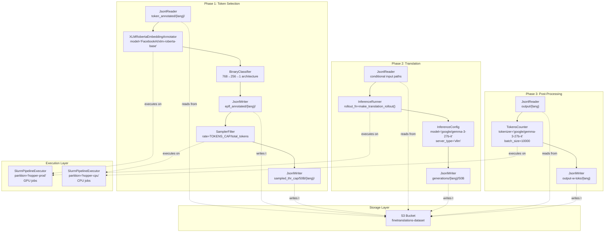
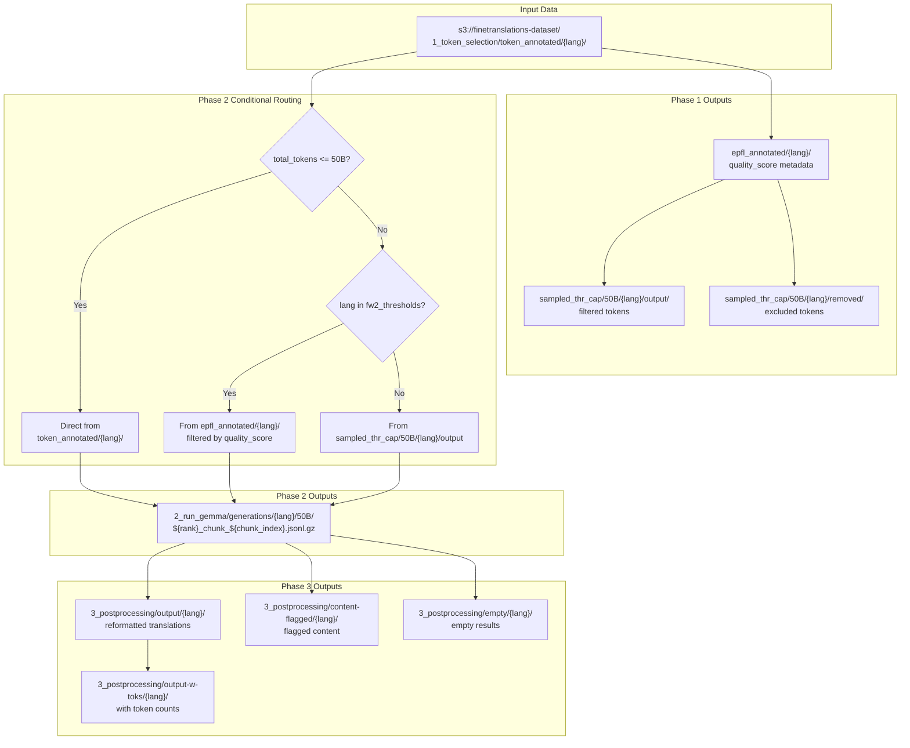
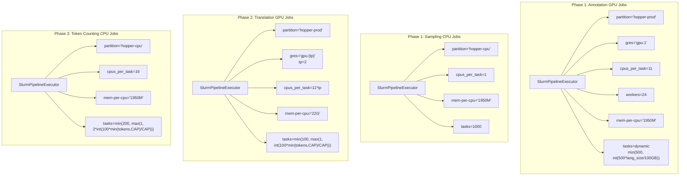
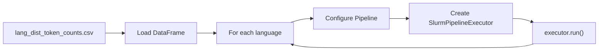
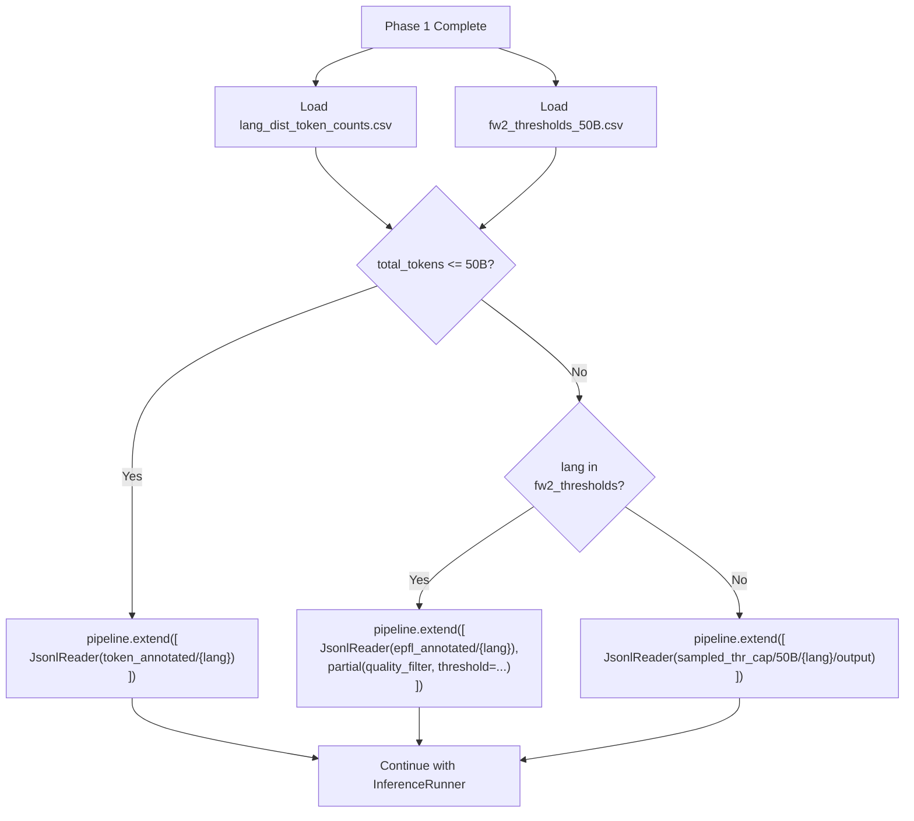

<!-- source: DeepWiki mcp.deepwiki.com · repo huggingface/finetranslations · page 2 System Architecture · fetched 2026-10-26 -->

# System Architecture

<details>
<summary>Relevant source files</summary>

The following files were used as context for generating this wiki page:

- [1_token_selection/4_sample_thr_cap.py](1_token_selection/4_sample_thr_cap.py)
- [1_token_selection/annotate_with_hq_cla.py](1_token_selection/annotate_with_hq_cla.py)
- [2_run_gemma/run_pipeline.py](2_run_gemma/run_pipeline.py)
- [3_postprocessing/2_count_toks.py](3_postprocessing/2_count_toks.py)

</details>


This document describes the high-level architecture of the finetranslations pipeline, detailing how the three main processing phases interconnect through S3 storage and execute on the Slurm cluster. It covers the data flow patterns, execution infrastructure, and coordination mechanisms that enable processing of 19 languages in parallel.

For details on individual phases, see [Token Selection System](#3), [Translation System](#4), and [Post-Processing System](#5). For infrastructure configuration details, see [Infrastructure and Configuration](#6).

## Overview

The finetranslations system implements a three-phase pipeline architecture where each phase reads from S3, processes data in parallel on Slurm, and writes results back to S3. The phases are:

1. **Token Selection**: Annotates tokens with quality scores using `XLMRobertaEmbeddingAnnotator` and filters/samples data based on thresholds
2. **Translation**: Translates selected tokens to English using `InferenceRunner` with Gemma models
3. **Post-Processing**: Reformats output, counts tokens using `TokensCounter`, and collects statistics

Each phase operates independently, with S3 serving as the primary coordination mechanism between phases. The `SlurmPipelineExecutor` distributes work across the cluster with language-specific task counts and resource allocations.

## Pipeline Architecture with Code Entities

The following diagram maps the conceptual pipeline phases to their concrete implementation in code:



**Sources:** [1_token_selection/annotate_with_hq_cla.py:1-182](), [1_token_selection/4_sample_thr_cap.py:1-37](), [2_run_gemma/run_pipeline.py:1-407](), [3_postprocessing/2_count_toks.py:1-39]()

## Storage Architecture

The S3 bucket `finetranslations-dataset` organizes data by phase and language. Each phase has specific input and output paths that form a directed acyclic graph of data dependencies.

### S3 Path Structure



The routing logic in Phase 2 is implemented in [2_run_gemma/run_pipeline.py:313-333]():

| Condition | Input Path | Logic |
|-----------|------------|-------|
| `total_tokens <= TOKENS_CAP` | `token_annotated/{lang}/` | Use all data directly |
| `lang in fw2_thresholds_df` | `epfl_annotated/{lang}/` | Filter by `quality_score >= threshold` |
| Otherwise | `sampled_thr_cap/50B/{lang}/output` | Use pre-sampled data |

**Sources:** [1_token_selection/4_sample_thr_cap.py:23-25](), [2_run_gemma/run_pipeline.py:313-333](), [3_postprocessing/2_count_toks.py:26-28]()

## Execution Architecture

The `SlurmPipelineExecutor` is the primary abstraction for distributing work across the Slurm cluster. Each phase uses different resource profiles based on computational requirements.

### Resource Allocation Patterns



### Task Scaling Formula

The number of tasks per language is dynamically calculated based on token volume relative to the `TOKENS_CAP` (50B):

| Phase | Formula | Code Reference |
|-------|---------|----------------|
| Annotation | `max(1, min(500, int(500 * lang_size / 100GB)))` | [1_token_selection/annotate_with_hq_cla.py:156]() |
| Translation | `min(100, max(1, int(100 * min(tokens, CAP) / CAP)))` | [2_run_gemma/run_pipeline.py:365]() |
| Token Counting | `min(200, max(1, 2 * int(100 * min(tokens, CAP) / CAP)))` | [3_postprocessing/2_count_toks.py:19]() |

Special case: Russian (`rus_Cyrl`) uses `tasks=1000` for annotation due to its large data volume [1_token_selection/annotate_with_hq_cla.py:156]().

**Sources:** [1_token_selection/annotate_with_hq_cla.py:158-182](), [1_token_selection/4_sample_thr_cap.py:27-36](), [2_run_gemma/run_pipeline.py:365-389](), [3_postprocessing/2_count_toks.py:19-39]()

## Pipeline Components

### Core Processing Classes

The following table maps pipeline stages to their implementing classes:

| Component | Class | Key Parameters | Purpose |
|-----------|-------|----------------|---------|
| Data Reading | `JsonlReader` | `data_folder` (S3 path) | Stream documents from S3 |
| Data Writing | `JsonlWriter` | `output_folder`, `output_filename` | Write documents to S3 |
| Quality Annotation | `XLMRobertaEmbeddingAnnotator` | `model`, `language`, `tokenizer_batch_size=5120`, `model_batch_size=5120` | Compute quality scores |
| Binary Classification | `BinaryClassifier` | `embedding_dim=768`, `hidden_dim=256` | Score embeddings 0-1 |
| Sampling | `SamplerFilter` | `rate`, `exclusion_writer` | Probabilistic filtering |
| Translation | `InferenceRunner` | `rollout_fn`, `config`, `output_writer` | Gemma inference orchestration |
| Token Counting | `TokensCounter` | `tokenizer_name_or_path`, `batch_size=10000` | Count Gemma tokens |

**Sources:** [1_token_selection/annotate_with_hq_cla.py:9-131](), [1_token_selection/4_sample_thr_cap.py:4](), [2_run_gemma/run_pipeline.py:286-363](), [3_postprocessing/2_count_toks.py:8]()

### Language Loop Pattern

All three phases iterate over languages using a common pattern:



Each phase reads `lang_dist_token_counts.csv` to determine which languages to process and their total token counts [1_token_selection/annotate_with_hq_cla.py:4](), [1_token_selection/4_sample_thr_cap.py:10-11](), [2_run_gemma/run_pipeline.py:296-297](), [3_postprocessing/2_count_toks.py:10-11](). The loop iterates over the `subset` column (language codes) and uses `total_tokens` to calculate task counts.

**Sources:** [1_token_selection/annotate_with_hq_cla.py:154-182](), [1_token_selection/4_sample_thr_cap.py:17-37](), [2_run_gemma/run_pipeline.py:306-401](), [3_postprocessing/2_count_toks.py:18-39]()

## Phase Interconnection Details

### Phase 1 → Phase 2 Handoff

The transition from token selection to translation involves conditional path selection implemented in [2_run_gemma/run_pipeline.py:312-333]():



The `quality_filter` function filters documents where `doc.metadata["quality_score"] >= threshold` [2_run_gemma/run_pipeline.py:320-323]().

**Sources:** [2_run_gemma/run_pipeline.py:306-333]()

### Phase 2 → Phase 3 Handoff

Translation output is written with a specific filename pattern that includes rank and chunk information:

```python
JsonlWriter(OUTPUT_PATH, output_filename="${rank}_chunk_${chunk_index}.jsonl.gz")
```

Post-processing reads all files from the output directory without needing to know the specific filenames [3_postprocessing/2_count_toks.py:26](). The `JsonlReader` automatically discovers and processes all JSONL files in the specified S3 prefix.

**Sources:** [2_run_gemma/run_pipeline.py:354](), [3_postprocessing/2_count_toks.py:26]()

## Configuration and Constants

### Global Constants

| Constant | Value | Usage | Code Reference |
|----------|-------|-------|----------------|
| `THRESHOLD` | `50` | Token cap in billions | Multiple files |
| `TOKENS_CAP` | `50e9` or `THRESHOLD * 1e9` | Maximum tokens per language | Multiple files |
| `MAX_CHUNK_SIZE` | `512` | Maximum tokens per translation chunk | [2_run_gemma/run_pipeline.py:12]() |
| `LINE_LIMIT_TO_DROP` | `int(MAX_CHUNK_SIZE * 1.2)` = `614` | Drop lines exceeding this | [2_run_gemma/run_pipeline.py:13]() |

### Configuration Files

The pipeline relies on two CSV files stored in the local assets directory:

1. **`lang_dist_token_counts.csv`**: Contains columns `subset` (language code), `name` (display name), `total_tokens`, `utf8_bytes` [1_token_selection/annotate_with_hq_cla.py:4]()
2. **`fw2_thresholds_50B.csv`**: Contains columns `lang` (language code), `threshold_score` (minimum quality score) [1_token_selection/4_sample_thr_cap.py:13-14]()

These files control which languages are processed and how data is routed between phases.

**Sources:** [1_token_selection/4_sample_thr_cap.py:7-14](), [2_run_gemma/run_pipeline.py:2-3, 12-13]()

## Error Handling and Retry Logic

### Translation Phase Retry

The translation phase implements exponential backoff for Slurm job submission failures [2_run_gemma/run_pipeline.py:392-400]():

```python
delay = 2  # start with 2 seconds
while True:
    try:
        executor.run()
        break
    except Exception as e:
        print(f"Error launching job: {e}")
        time.sleep(delay)
        delay = min(delay * 2, 60 * 60)  # cap at 60 minutes
```

### Context Length Handling

The `make_translation_rollout` function handles context length errors by splitting chunks in half when a `BadRequestError` with "maximum context length" is encountered [2_run_gemma/run_pipeline.py:256-264]():

```python
except InferenceError as error:
    error_message = str(error)
    if "maximum context length" in error_message and "BadRequestError" in error_message:
        split_chunks, split_tokens = _split_chunk_in_half(chunk, chunk_token_count)
        if not split_chunks:
            raise
        chunks[index : index + 1] = split_chunks
        chunk_tokens[index : index + 1] = split_tokens
        continue
    raise
```

**Sources:** [2_run_gemma/run_pipeline.py:254-265, 392-400]()

## Resource Isolation

Each phase maintains separate logging directories to avoid conflicts:

| Phase | Logging Pattern | Example |
|-------|-----------------|---------|
| Annotation | `/path/to/local/pipeline/1_token_selection/logs/epfl_anot/{lang}` | [1_token_selection/annotate_with_hq_cla.py:175]() |
| Sampling | `/path/to/local/pipeline/1_token_selection/logs/sampled_thr_cap/50B/{lang}` | [1_token_selection/4_sample_thr_cap.py:30]() |
| Translation | `/path/to/local/pipeline/3_launch_pipeline/logs/{lang}/50B` | [2_run_gemma/run_pipeline.py:379]() |
| Token Counting | `/path/to/local/pipeline/5_postprocessing/tok-logs/{lang}` | [3_postprocessing/2_count_toks.py:35]() |

Checkpoints for the translation phase are stored at `/path/to/local/pipeline/3_launch_pipeline/checkpoints/{lang}/50B` [2_run_gemma/run_pipeline.py:361]() to enable resumption after failures.

**Sources:** [1_token_selection/annotate_with_hq_cla.py:175](), [1_token_selection/4_sample_thr_cap.py:30](), [2_run_gemma/run_pipeline.py:361, 379](), [3_postprocessing/2_count_toks.py:35]()

---

