# Page: Overview

# Overview

<details>
<summary>Relevant source files</summary>

The following files were used as context for generating this wiki page:

- [1_token_selection/annotate_with_hq_cla.py](1_token_selection/annotate_with_hq_cla.py)
- [2_run_gemma/run_pipeline.py](2_run_gemma/run_pipeline.py)
- [3_postprocessing/1_split_reformat.py](3_postprocessing/1_split_reformat.py)

</details>


## Purpose and Scope

This document provides a comprehensive introduction to the **finetranslations** pipeline, a three-phase distributed system designed to select, translate, and post-process high-quality multilingual web content into English. The pipeline processes up to 50 billion tokens per language across 19 supported languages, using quality-based filtering, neural machine translation, and automated content validation.

This overview covers the pipeline's architecture, data flow, supported languages, and key components. For detailed information about specific subsystems, see:
- Token selection mechanics: [Token Selection System (Phase 1)](#3)
- Translation inference details: [Translation System (Phase 2)](#4)
- Output processing: [Post-Processing System (Phase 3)](#5)
- Infrastructure configuration: [Infrastructure and Configuration](#6)

## System Purpose

The finetranslations pipeline addresses the need for large-scale, high-quality multilingual-to-English translation datasets. The system:

1. **Filters** raw token data using learned quality metrics to identify valuable content
2. **Translates** selected content using the Gemma language model with strict formatting preservation
3. **Validates** translation outputs and collects comprehensive statistics for dataset quality assurance

The pipeline enforces a token cap of 50 billion tokens per language (`TOKENS_CAP = 50e9`) to balance dataset size with processing constraints. Languages with fewer than 50B tokens use all available data; larger languages undergo quality-based sampling or threshold filtering.

**Sources:** [2_run_gemma/run_pipeline.py:2-3](), [3_postprocessing/1_split_reformat.py:142]()

## Pipeline Architecture

The system operates as a three-phase sequential pipeline, with each phase reading from and writing to Amazon S3 storage. All phases execute on a Slurm cluster with dynamic task allocation based on language-specific token volumes.

### End-to-End Pipeline Flow

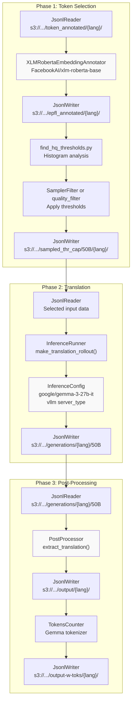

**Diagram: Complete Pipeline Data Flow with Code Entities**

The pipeline uses the `SlurmPipelineExecutor` class to orchestrate execution across all phases, with language-specific configurations loaded from CSV assets (`lang_dist_token_counts.csv`, `fw2_thresholds_50B.csv`).

**Sources:** [1_token_selection/annotate_with_hq_cla.py:152-182](), [2_run_gemma/run_pipeline.py:286-407](), [3_postprocessing/1_split_reformat.py:131-166]()

## Supported Languages

The pipeline processes 19 languages, each identified by ISO 639-3 language codes combined with script identifiers (ISO 15924). Language selection and token count targets are configured in `lang_dist_token_counts.csv`.

| Language Family | Language Code | Script | Example Languages |
|----------------|---------------|---------|-------------------|
| Semitic | `arb_Arab` | Arabic | Arabic |
| Slavic | `ces_Latn` | Latin | Czech |
| Sino-Tibetan | `cmn_Hani` | Han | Mandarin Chinese |
| Slavic | `rus_Cyrl` | Cyrillic | Russian |
| - | *(15 additional languages)* | - | - |

Each language has a dedicated classifier model stored at `1_token_selection/epfl_classifiers/models/{lang_code}/model.pt` (~790KB per model). The `language_codes` list is populated from the CSV configuration at pipeline initialization.

**Note:** The specific 19 languages are loaded dynamically from the CSV at runtime. For the complete language catalog and classifier details, see [Language-Specific Models](#3.4.2).

**Sources:** [1_token_selection/annotate_with_hq_cla.py:4-7](), [1_token_selection/annotate_with_hq_cla.py:86]()

## Data Storage Architecture

All pipeline data resides in the `finetranslations-dataset` S3 bucket with a structured directory hierarchy organized by phase and language.

### S3 Path Structure

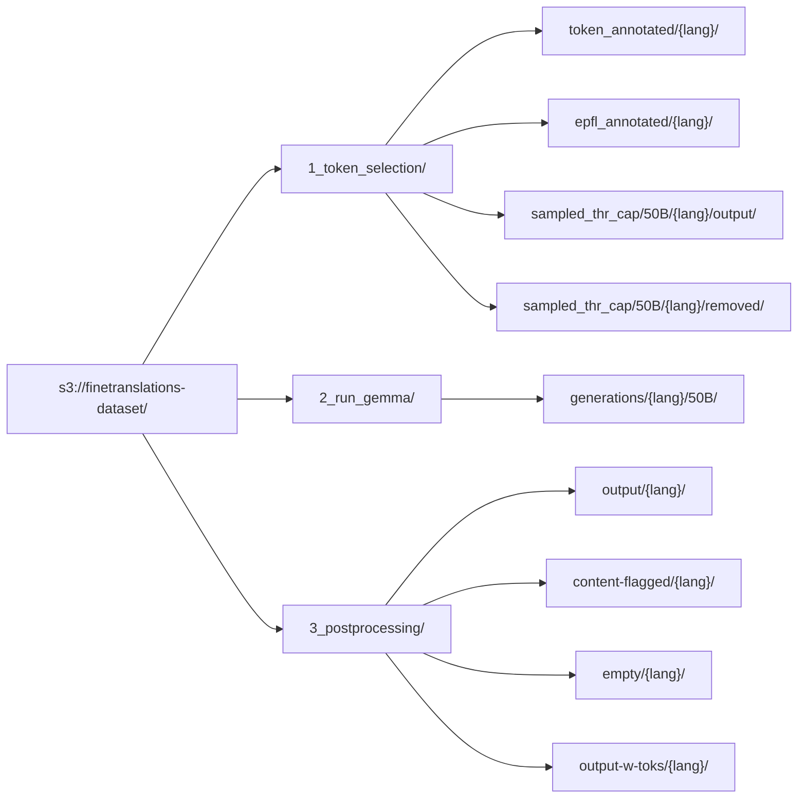

**Diagram: S3 Bucket Directory Structure**

Each phase operates independently through these paths:
- **Phase 1** reads from `token_annotated/`, writes quality scores to `epfl_annotated/`, and outputs filtered data to `sampled_thr_cap/50B/{lang}/output/`
- **Phase 2** conditionally reads from `token_annotated/`, `epfl_annotated/`, or `sampled_thr_cap/` based on token counts and threshold availability
- **Phase 3** reads from `generations/` and splits outputs into three categories: normal (`output/`), flagged (`content-flagged/`), and empty (`empty/`)

All data uses JSONL format (JSON Lines) with gzip compression (`.jsonl.gz`).

**Sources:** [1_token_selection/annotate_with_hq_cla.py:160-167](), [2_run_gemma/run_pipeline.py:308-333](), [3_postprocessing/1_split_reformat.py:153-155]()

## Key Pipeline Components

### Phase 1: Token Selection

| Component | Purpose | Key Code Entity |
|-----------|---------|-----------------|
| Quality Annotation | Assigns quality scores (0-1) using XLM-RoBERTa embeddings and language-specific classifiers | `XLMRobertaEmbeddingAnnotator` |
| Binary Classifier | Neural network (768→256→1) that scores token quality | `BinaryClassifier` [1_token_selection/annotate_with_hq_cla.py:61-83]() |
| Threshold Calculation | Determines optimal quality thresholds for target token counts | `find_hq_thresholds.py` |
| Sampling Filter | Applies thresholds or sampling rates to meet 50B cap | `quality_filter` [2_run_gemma/run_pipeline.py:320-323]() |

**Sources:** [1_token_selection/annotate_with_hq_cla.py:9-131]()

### Phase 2: Translation

| Component | Purpose | Key Code Entity |
|-----------|---------|-----------------|
| Document Chunking | Splits long documents into ~512-token chunks with line-aware segmentation | `chunk_document()` [2_run_gemma/run_pipeline.py:137-171]() |
| Prompt Construction | Builds prompts with system instructions and formatting rules | `SYSTEM_PROMPT` [2_run_gemma/run_pipeline.py:15-59]() |
| Translation Rollout | Orchestrates multi-chunk translation with context length error handling | `make_translation_rollout()` [2_run_gemma/run_pipeline.py:6-284]() |
| Inference Execution | Manages vLLM server for Gemma model inference | `InferenceRunner`, `InferenceConfig` [2_run_gemma/run_pipeline.py:342-363]() |

**Sources:** [2_run_gemma/run_pipeline.py:1-407]()

### Phase 3: Post-Processing

| Component | Purpose | Key Code Entity |
|-----------|---------|-----------------|
| Output Reformatting | Extracts translated text from XML-tagged model output | `PostProcessor` [3_postprocessing/1_split_reformat.py:3-129]() |
| Translation Extraction | Parses `<TRANSLATION>` tags and handles formatting violations | `extract_translation()` [3_postprocessing/1_split_reformat.py:51-63]() |
| Content Flagging | Identifies and routes content flagged by the model | Flagging logic [3_postprocessing/1_split_reformat.py:70]() |
| Token Counting | Counts tokens in final output using Gemma tokenizer | `TokensCounter` (referenced but not shown) |

**Sources:** [3_postprocessing/1_split_reformat.py:1-166]()

## Technology Stack

### Machine Learning Models

| Model | Purpose | Identifier |
|-------|---------|------------|
| XLM-RoBERTa Base | Universal multilingual embeddings (768-dim) | `FacebookAI/xlm-roberta-base` |
| EPFL Binary Classifiers | Language-specific quality scoring (19 models) | `models/{lang_code}/model.pt` |
| Gemma 3 27B Instruct | Translation inference | `google/gemma-3-27b-it` |

**Sources:** [1_token_selection/annotate_with_hq_cla.py:18](), [1_token_selection/annotate_with_hq_cla.py:86](), [2_run_gemma/run_pipeline.py:336]()

### Infrastructure Components

| Component | Usage | Configuration |
|-----------|-------|---------------|
| Amazon S3 | Data persistence across all phases | Bucket: `finetranslations-dataset` |
| Slurm Cluster | Distributed execution | Partitions: `hopper-cpu`, `hopper-prod` |
| vLLM Server | Gemma inference serving | `server_type="vllm"`, tensor parallelism=2 |
| PyTorch | Model loading and inference | Device: CUDA (GPU) or CPU fallback |
| Git LFS | Large model file storage | Pattern: `*.pt` (790KB each) |

**Sources:** [1_token_selection/annotate_with_hq_cla.py:45](), [1_token_selection/annotate_with_hq_cla.py:176](), [2_run_gemma/run_pipeline.py:343-347]()

### Datatrove Framework

The pipeline extensively uses the `datatrove` library for data processing:

- **Readers:** `JsonlReader` for S3 data ingestion
- **Writers:** `JsonlWriter` for JSONL output with gzip compression
- **Executors:** `SlurmPipelineExecutor` for cluster job orchestration
- **Pipeline Steps:** `PipelineStep` base class for custom processing logic
- **Inference:** `InferenceRunner`, `InferenceConfig` for LLM inference workflows

**Sources:** [1_token_selection/annotate_with_hq_cla.py:2](), [1_token_selection/annotate_with_hq_cla.py:150-152](), [2_run_gemma/run_pipeline.py:286-289]()

## Execution Model

The pipeline uses dynamic task allocation based on language-specific token volumes:

```python
# Phase 1: Annotation tasks
TOTAL_TASKS = round(max(1, min(500, int(500 * (lang_sizes[lang_code] / (100 * 1024**3))))))

# Phase 2: Translation tasks  
tasks = min(100, max(1, int(round(100 * min(total_tokens, TOKENS_CAP) / TOKENS_CAP))))

# Phase 3: Post-processing tasks
tasks = min(200, max(1, 2 * int(round(100 * min(total_tokens, TOKENS_CAP) / TOKENS_CAP))))
```

This formula ensures:
- Smaller languages run with fewer tasks (minimum 1)
- Larger languages leverage more parallelism (up to 500/100/200 tasks per phase)
- Task counts scale proportionally to token volume relative to the 50B cap

**Sources:** [1_token_selection/annotate_with_hq_cla.py:156](), [2_run_gemma/run_pipeline.py:365](), [3_postprocessing/1_split_reformat.py:146]()

## Configuration Assets

The pipeline behavior is controlled by CSV configuration files stored locally:

| File | Purpose | Usage |
|------|---------|-------|
| `lang_dist_token_counts.csv` | Language codes, names, and total token counts | Determines which languages to process and routing logic |
| `fw2_thresholds_50B.csv` | Quality score thresholds per language | Controls which documents pass filtering based on quality |

These files are loaded at pipeline initialization and drive conditional logic for data routing between different S3 paths.

**Sources:** [2_run_gemma/run_pipeline.py:296-300](), [2_run_gemma/run_pipeline.py:306-333]()

## Processing Statistics

Each phase collects execution metrics:

- **Phase 1:** `TokensQualityStats` generates quality score histograms per language
- **Phase 2:** Inference usage statistics (token counts, latency) via `InferenceRunner`
- **Phase 3:** `PostProcessor` tracks document counts, flagged content, formatting violations, and early stops

Statistics are written to local log directories and aggregated for dataset-level reporting.

**Sources:** [1_token_selection/annotate_with_hq_cla.py:134-148](), [3_postprocessing/1_split_reformat.py:67-128]()

---

# Page: System Architecture

# System Architecture

<details>
<summary>Relevant source files</summary>

The following files were used as context for generating this wiki page:

- [1_token_selection/4_sample_thr_cap.py](1_token_selection/4_sample_thr_cap.py)
- [1_token_selection/annotate_with_hq_cla.py](1_token_selection/annotate_with_hq_cla.py)
- [2_run_gemma/run_pipeline.py](2_run_gemma/run_pipeline.py)
- [3_postprocessing/2_count_toks.py](3_postprocessing/2_count_toks.py)

</details>


This document describes the high-level architecture of the finetranslations pipeline, detailing how the three main processing phases interconnect through S3 storage and execute on the Slurm cluster. It covers the data flow patterns, execution infrastructure, and coordination mechanisms that enable processing of 19 languages in parallel.

For details on individual phases, see [Token Selection System](#3), [Translation System](#4), and [Post-Processing System](#5). For infrastructure configuration details, see [Infrastructure and Configuration](#6).

## Overview

The finetranslations system implements a three-phase pipeline architecture where each phase reads from S3, processes data in parallel on Slurm, and writes results back to S3. The phases are:

1. **Token Selection**: Annotates tokens with quality scores using `XLMRobertaEmbeddingAnnotator` and filters/samples data based on thresholds
2. **Translation**: Translates selected tokens to English using `InferenceRunner` with Gemma models
3. **Post-Processing**: Reformats output, counts tokens using `TokensCounter`, and collects statistics

Each phase operates independently, with S3 serving as the primary coordination mechanism between phases. The `SlurmPipelineExecutor` distributes work across the cluster with language-specific task counts and resource allocations.

## Pipeline Architecture with Code Entities

The following diagram maps the conceptual pipeline phases to their concrete implementation in code:

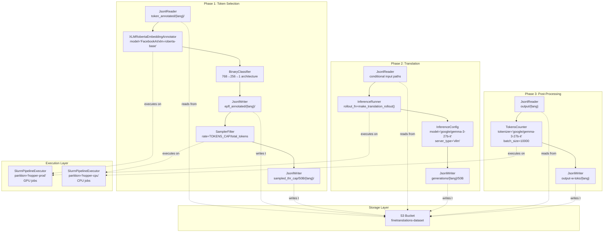

**Sources:** [1_token_selection/annotate_with_hq_cla.py:1-182](), [1_token_selection/4_sample_thr_cap.py:1-37](), [2_run_gemma/run_pipeline.py:1-407](), [3_postprocessing/2_count_toks.py:1-39]()

## Storage Architecture

The S3 bucket `finetranslations-dataset` organizes data by phase and language. Each phase has specific input and output paths that form a directed acyclic graph of data dependencies.

### S3 Path Structure

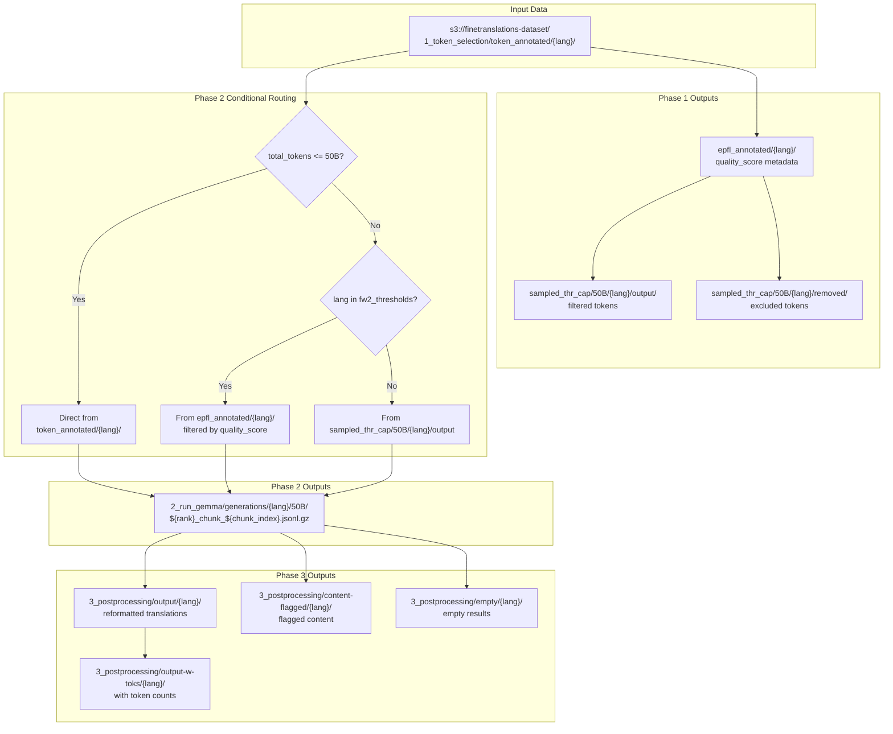

The routing logic in Phase 2 is implemented in [2_run_gemma/run_pipeline.py:313-333]():

| Condition | Input Path | Logic |
|-----------|------------|-------|
| `total_tokens <= TOKENS_CAP` | `token_annotated/{lang}/` | Use all data directly |
| `lang in fw2_thresholds_df` | `epfl_annotated/{lang}/` | Filter by `quality_score >= threshold` |
| Otherwise | `sampled_thr_cap/50B/{lang}/output` | Use pre-sampled data |

**Sources:** [1_token_selection/4_sample_thr_cap.py:23-25](), [2_run_gemma/run_pipeline.py:313-333](), [3_postprocessing/2_count_toks.py:26-28]()

## Execution Architecture

The `SlurmPipelineExecutor` is the primary abstraction for distributing work across the Slurm cluster. Each phase uses different resource profiles based on computational requirements.

### Resource Allocation Patterns

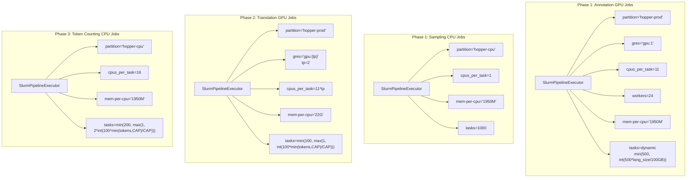

### Task Scaling Formula

The number of tasks per language is dynamically calculated based on token volume relative to the `TOKENS_CAP` (50B):

| Phase | Formula | Code Reference |
|-------|---------|----------------|
| Annotation | `max(1, min(500, int(500 * lang_size / 100GB)))` | [1_token_selection/annotate_with_hq_cla.py:156]() |
| Translation | `min(100, max(1, int(100 * min(tokens, CAP) / CAP)))` | [2_run_gemma/run_pipeline.py:365]() |
| Token Counting | `min(200, max(1, 2 * int(100 * min(tokens, CAP) / CAP)))` | [3_postprocessing/2_count_toks.py:19]() |

Special case: Russian (`rus_Cyrl`) uses `tasks=1000` for annotation due to its large data volume [1_token_selection/annotate_with_hq_cla.py:156]().

**Sources:** [1_token_selection/annotate_with_hq_cla.py:158-182](), [1_token_selection/4_sample_thr_cap.py:27-36](), [2_run_gemma/run_pipeline.py:365-389](), [3_postprocessing/2_count_toks.py:19-39]()

## Pipeline Components

### Core Processing Classes

The following table maps pipeline stages to their implementing classes:

| Component | Class | Key Parameters | Purpose |
|-----------|-------|----------------|---------|
| Data Reading | `JsonlReader` | `data_folder` (S3 path) | Stream documents from S3 |
| Data Writing | `JsonlWriter` | `output_folder`, `output_filename` | Write documents to S3 |
| Quality Annotation | `XLMRobertaEmbeddingAnnotator` | `model`, `language`, `tokenizer_batch_size=5120`, `model_batch_size=5120` | Compute quality scores |
| Binary Classification | `BinaryClassifier` | `embedding_dim=768`, `hidden_dim=256` | Score embeddings 0-1 |
| Sampling | `SamplerFilter` | `rate`, `exclusion_writer` | Probabilistic filtering |
| Translation | `InferenceRunner` | `rollout_fn`, `config`, `output_writer` | Gemma inference orchestration |
| Token Counting | `TokensCounter` | `tokenizer_name_or_path`, `batch_size=10000` | Count Gemma tokens |

**Sources:** [1_token_selection/annotate_with_hq_cla.py:9-131](), [1_token_selection/4_sample_thr_cap.py:4](), [2_run_gemma/run_pipeline.py:286-363](), [3_postprocessing/2_count_toks.py:8]()

### Language Loop Pattern

All three phases iterate over languages using a common pattern:

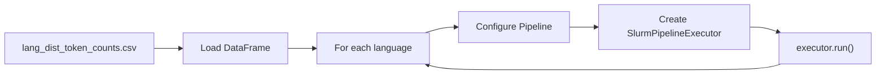

Each phase reads `lang_dist_token_counts.csv` to determine which languages to process and their total token counts [1_token_selection/annotate_with_hq_cla.py:4](), [1_token_selection/4_sample_thr_cap.py:10-11](), [2_run_gemma/run_pipeline.py:296-297](), [3_postprocessing/2_count_toks.py:10-11](). The loop iterates over the `subset` column (language codes) and uses `total_tokens` to calculate task counts.

**Sources:** [1_token_selection/annotate_with_hq_cla.py:154-182](), [1_token_selection/4_sample_thr_cap.py:17-37](), [2_run_gemma/run_pipeline.py:306-401](), [3_postprocessing/2_count_toks.py:18-39]()

## Phase Interconnection Details

### Phase 1 → Phase 2 Handoff

The transition from token selection to translation involves conditional path selection implemented in [2_run_gemma/run_pipeline.py:312-333]():

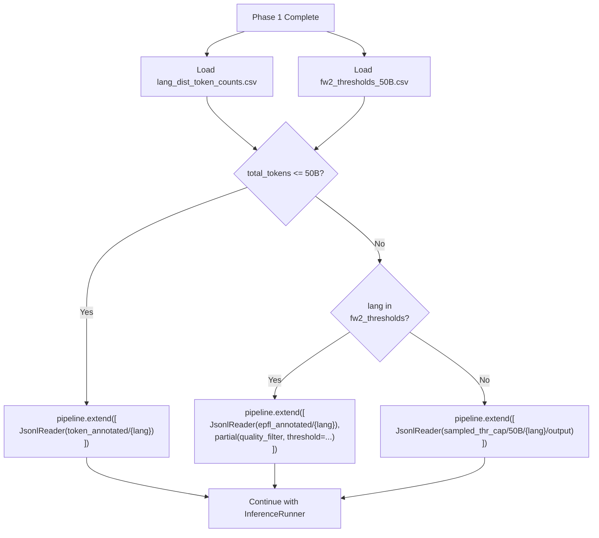

The `quality_filter` function filters documents where `doc.metadata["quality_score"] >= threshold` [2_run_gemma/run_pipeline.py:320-323]().

**Sources:** [2_run_gemma/run_pipeline.py:306-333]()

### Phase 2 → Phase 3 Handoff

Translation output is written with a specific filename pattern that includes rank and chunk information:

```python
JsonlWriter(OUTPUT_PATH, output_filename="${rank}_chunk_${chunk_index}.jsonl.gz")
```

Post-processing reads all files from the output directory without needing to know the specific filenames [3_postprocessing/2_count_toks.py:26](). The `JsonlReader` automatically discovers and processes all JSONL files in the specified S3 prefix.

**Sources:** [2_run_gemma/run_pipeline.py:354](), [3_postprocessing/2_count_toks.py:26]()

## Configuration and Constants

### Global Constants

| Constant | Value | Usage | Code Reference |
|----------|-------|-------|----------------|
| `THRESHOLD` | `50` | Token cap in billions | Multiple files |
| `TOKENS_CAP` | `50e9` or `THRESHOLD * 1e9` | Maximum tokens per language | Multiple files |
| `MAX_CHUNK_SIZE` | `512` | Maximum tokens per translation chunk | [2_run_gemma/run_pipeline.py:12]() |
| `LINE_LIMIT_TO_DROP` | `int(MAX_CHUNK_SIZE * 1.2)` = `614` | Drop lines exceeding this | [2_run_gemma/run_pipeline.py:13]() |

### Configuration Files

The pipeline relies on two CSV files stored in the local assets directory:

1. **`lang_dist_token_counts.csv`**: Contains columns `subset` (language code), `name` (display name), `total_tokens`, `utf8_bytes` [1_token_selection/annotate_with_hq_cla.py:4]()
2. **`fw2_thresholds_50B.csv`**: Contains columns `lang` (language code), `threshold_score` (minimum quality score) [1_token_selection/4_sample_thr_cap.py:13-14]()

These files control which languages are processed and how data is routed between phases.

**Sources:** [1_token_selection/4_sample_thr_cap.py:7-14](), [2_run_gemma/run_pipeline.py:2-3, 12-13]()

## Error Handling and Retry Logic

### Translation Phase Retry

The translation phase implements exponential backoff for Slurm job submission failures [2_run_gemma/run_pipeline.py:392-400]():

```python
delay = 2  # start with 2 seconds
while True:
    try:
        executor.run()
        break
    except Exception as e:
        print(f"Error launching job: {e}")
        time.sleep(delay)
        delay = min(delay * 2, 60 * 60)  # cap at 60 minutes
```

### Context Length Handling

The `make_translation_rollout` function handles context length errors by splitting chunks in half when a `BadRequestError` with "maximum context length" is encountered [2_run_gemma/run_pipeline.py:256-264]():

```python
except InferenceError as error:
    error_message = str(error)
    if "maximum context length" in error_message and "BadRequestError" in error_message:
        split_chunks, split_tokens = _split_chunk_in_half(chunk, chunk_token_count)
        if not split_chunks:
            raise
        chunks[index : index + 1] = split_chunks
        chunk_tokens[index : index + 1] = split_tokens
        continue
    raise
```

**Sources:** [2_run_gemma/run_pipeline.py:254-265, 392-400]()

## Resource Isolation

Each phase maintains separate logging directories to avoid conflicts:

| Phase | Logging Pattern | Example |
|-------|-----------------|---------|
| Annotation | `/path/to/local/pipeline/1_token_selection/logs/epfl_anot/{lang}` | [1_token_selection/annotate_with_hq_cla.py:175]() |
| Sampling | `/path/to/local/pipeline/1_token_selection/logs/sampled_thr_cap/50B/{lang}` | [1_token_selection/4_sample_thr_cap.py:30]() |
| Translation | `/path/to/local/pipeline/3_launch_pipeline/logs/{lang}/50B` | [2_run_gemma/run_pipeline.py:379]() |
| Token Counting | `/path/to/local/pipeline/5_postprocessing/tok-logs/{lang}` | [3_postprocessing/2_count_toks.py:35]() |

Checkpoints for the translation phase are stored at `/path/to/local/pipeline/3_launch_pipeline/checkpoints/{lang}/50B` [2_run_gemma/run_pipeline.py:361]() to enable resumption after failures.

**Sources:** [1_token_selection/annotate_with_hq_cla.py:175](), [1_token_selection/4_sample_thr_cap.py:30](), [2_run_gemma/run_pipeline.py:361, 379](), [3_postprocessing/2_count_toks.py:35]()

---

# Page: Token Selection System (Phase 1)

# Token Selection System (Phase 1)

<details>
<summary>Relevant source files</summary>

The following files were used as context for generating this wiki page:

- [1_token_selection/4_sample_thr_cap.py](1_token_selection/4_sample_thr_cap.py)
- [1_token_selection/annotate_with_hq_cla.py](1_token_selection/annotate_with_hq_cla.py)
- [1_token_selection/find_hq_thresholds.py](1_token_selection/find_hq_thresholds.py)

</details>


## Purpose and Scope

The Token Selection System constitutes Phase 1 of the finetranslations pipeline. Its purpose is to identify and select high-quality tokens from raw multilingual data for subsequent translation. The system processes 19 language subsets, assigning quality scores to each document, calculating optimal quality thresholds to meet target token counts, and sampling data to achieve a 50 billion token cap per language.

This page provides an overview of the entire token selection phase and how its components integrate. For detailed information about specific subsystems:
- Quality score annotation implementation: see [Quality Score Annotation](#3.1)
- Threshold calculation algorithms: see [Quality Threshold Calculation](#3.2)
- Sampling and filtering mechanics: see [Token Sampling and Filtering](#3.3)
- Classifier model details: see [EPFL Classifiers](#3.4)

## System Overview

The Token Selection System operates as a three-stage pipeline that transforms raw token data into filtered, high-quality datasets ready for translation. Each stage executes independently via Slurm jobs and communicates through S3 storage paths.

### Pipeline Stages

| Stage | Component | Input | Output | Primary Script |
|-------|-----------|-------|--------|----------------|
| 1 | Quality Score Annotation | Raw tokens from `token_annotated/{lang}/` | Annotated tokens in `epfl_annotated/{lang}/` | `annotate_with_hq_cla.py` |
| 2 | Threshold Calculation | Quality histograms from annotation stats | Threshold CSV files (`fw2_thresholds_{N}B.csv`) | `find_hq_thresholds.py` |
| 3 | Sampling & Filtering | Annotated tokens + threshold config | Sampled tokens in `sampled_thr_cap/50B/{lang}/` | `4_sample_thr_cap.py` |

The system processes languages independently, allowing parallel execution across the 19 supported language subsets. Each language flows through all three stages sequentially.

## Data Flow Architecture

The following diagram illustrates the complete data flow through the token selection system, showing how data moves from raw input to filtered output:

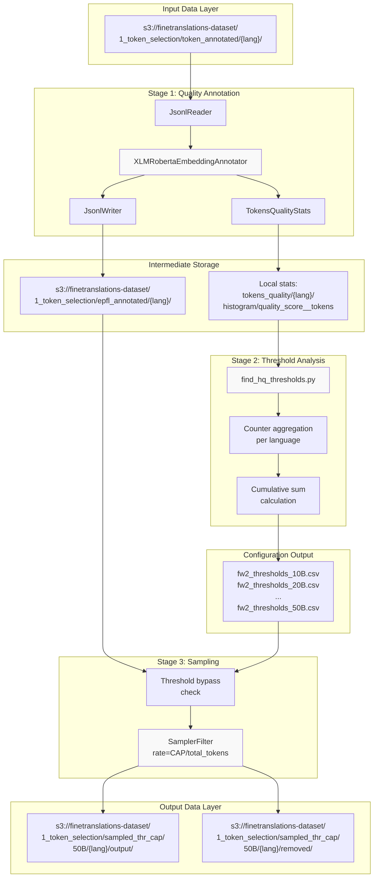

**Sources:** [1_token_selection/annotate_with_hq_cla.py:1-182](), [1_token_selection/find_hq_thresholds.py:1-138](), [1_token_selection/4_sample_thr_cap.py:1-37]()

## Processing Logic by Language

The system applies conditional logic based on language-specific token counts to optimize processing efficiency:

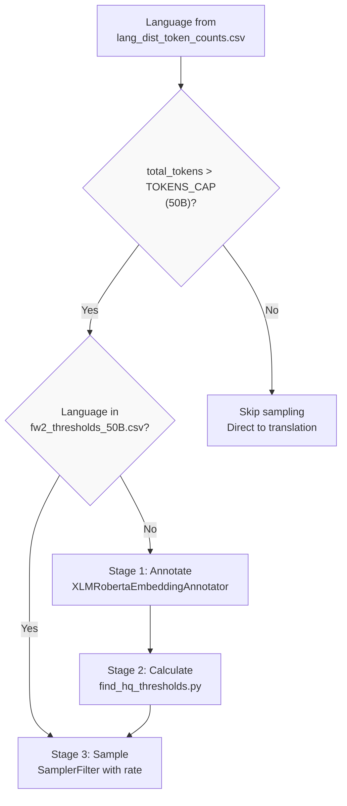

**Processing Decision Rules:**

1. **Direct Pass-Through:** Languages with `total_tokens <= 50B` bypass sampling and proceed directly to translation using the `token_annotated/{lang}/` path
2. **Threshold-Based Sampling:** Languages exceeding the cap and present in threshold configuration files proceed to Stage 3 sampling
3. **Full Pipeline:** Languages exceeding the cap but missing threshold data execute all three stages

**Sources:** [1_token_selection/4_sample_thr_cap.py:17-26]()

## Execution Configuration

### Stage 1: Quality Annotation

The annotation stage uses GPU resources on the `hopper-prod` partition:

| Parameter | Value | Purpose |
|-----------|-------|---------|
| `partition` | `hopper-prod` | GPU-enabled nodes |
| `workers` | 24 (8×3) | Parallel document processing |
| `cpus_per_task` | 11 | CPU cores per worker |
| `tasks` | 1-500 (dynamic) | Scaled by language size |
| `gres` | `gpu:1` | Single GPU per task |
| `time` | `10:00:00` | Maximum job duration |

**Task Scaling Formula:**
```python
TOTAL_TASKS = max(1, min(500, int(500 * (lang_size / 100GB))))
```

Special case: Russian (`rus_Cyrl`) uses 1000 tasks due to larger dataset size.

**Sources:** [1_token_selection/annotate_with_hq_cla.py:156-181]()

### Stage 2: Threshold Calculation

The threshold calculation runs locally (not on Slurm) using multiprocessing:

- **Executor:** `ProcessPoolExecutor` with default worker count
- **Concurrency:** Asynchronous file I/O with 64 concurrent operations per language
- **Memory:** In-memory aggregation using `collections.Counter`
- **Output:** 10 CSV files (10B, 20B, ..., 100B target configurations)

**Sources:** [1_token_selection/find_hq_thresholds.py:18-138]()

### Stage 3: Sampling

The sampling stage uses CPU resources on the `hopper-cpu` partition:

| Parameter | Value |
|-----------|-------|
| `partition` | `hopper-cpu` |
| `cpus_per_task` | 1 |
| `mem-per-cpu` | `1950M` |
| `tasks` | 1000 |
| `time` | `01:00:00` |

**Sources:** [1_token_selection/4_sample_thr_cap.py:27-36]()

## Key Configuration Dependencies

The Token Selection System relies on two primary configuration files:

### lang_dist_token_counts.csv

Contains per-language token count metadata used for routing decisions:

```
subset,total_tokens,utf8_bytes
arb_Arab,75000000000,285000000000
ces_Latn,45000000000,172000000000
...
```

**Usage:**
- Determines which languages require sampling (line 17 check: `total_tokens > TOKENS_CAP`)
- Calculates task counts for annotation jobs (line 156: task scaling formula)

**Sources:** [1_token_selection/4_sample_thr_cap.py:10-21](), [1_token_selection/annotate_with_hq_cla.py:4-6]()

### fw2_thresholds_{N}B.csv

Generated by Stage 2, contains quality score thresholds for each language:

```csv
lang,total_tokens,threshold_score,tokens_kept,overshoot,share_kept
arb_Arab,75000000000,0.623456,50000125000,125000,66.67
...
```

**Columns:**
- `threshold_score`: Minimum quality score to achieve target token count
- `tokens_kept`: Actual tokens retained at this threshold
- `overshoot`: Excess tokens beyond target (due to histogram binning)
- `share_kept`: Percentage of original tokens retained

**Usage:** Referenced by Stage 3 to skip languages already processed (line 18 check)

**Sources:** [1_token_selection/4_sample_thr_cap.py:13-19](), [1_token_selection/find_hq_thresholds.py:108-115]()

## Component Integration Map

This diagram maps the major code entities and their interactions:

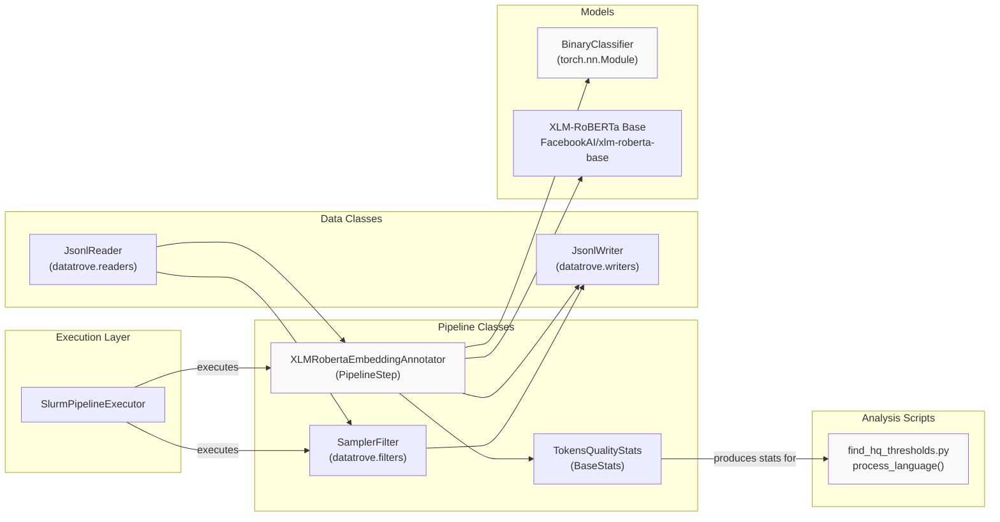

**Sources:** [1_token_selection/annotate_with_hq_cla.py:9-182](), [1_token_selection/find_hq_thresholds.py:31-119](), [1_token_selection/4_sample_thr_cap.py:22-26]()

## S3 Storage Layout

The system organizes data across three primary S3 prefixes:

```
s3://finetranslations-dataset/1_token_selection/
├── token_annotated/
│   └── {lang}/
│       └── *.jsonl.gz                          # Input: raw tokens
├── epfl_annotated/
│   └── {lang}/
│       └── *.jsonl.gz                          # Output: quality_score added
└── sampled_thr_cap/
    └── 50B/
        └── {lang}/
            ├── output/
            │   └── *.jsonl.gz                  # Output: sampled tokens
            └── removed/
                └── *.jsonl.gz                  # Excluded tokens
```

**Data Format:** All files use JSONL (JSON Lines) format with gzip compression. Each document contains a `metadata` dictionary where `quality_score` is added during Stage 1 annotation.

**Sources:** [1_token_selection/annotate_with_hq_cla.py:160-167](), [1_token_selection/4_sample_thr_cap.py:23-25]()

## Performance Characteristics

### Stage 1: Annotation Throughput

- **Model:** XLM-RoBERTa base (270M parameters) + BinaryClassifier (197K parameters)
- **Batch Sizes:** 
  - Tokenizer: 5,120 documents
  - Model inference: 5,120 embeddings
- **Precision:** `torch.bfloat16` for memory efficiency
- **Device:** Single GPU per task

**Sources:** [1_token_selection/annotate_with_hq_cla.py:163-164]()

### Stage 2: Analysis Complexity

- **I/O Pattern:** Async file loading with 64 concurrent operations
- **Memory:** In-memory `Counter` aggregation for all quality score bins
- **Computation:** `O(n log n)` sorting + `O(n)` cumulative sum per language
- **Parallelism:** Process-level parallelism across languages

**Sources:** [1_token_selection/find_hq_thresholds.py:47-61]()

### Stage 3: Sampling Scale

- **Filter Rate:** `TOKENS_CAP / total_tokens` (typically 0.5-0.8 for large languages)
- **Tasks:** 1,000 parallel tasks per language
- **Exclusion Tracking:** Separate `JsonlWriter` for excluded documents

**Sources:** [1_token_selection/4_sample_thr_cap.py:20-24]()

## Output Validation

The system produces validation outputs for quality assessment:

1. **Quality Score Histograms:** Located at `/path/to/local/pipeline/1_token_selection/stats/tokens_quality/{lang}/histogram/quality_score__tokens`, containing distribution of quality scores across the dataset

2. **Threshold Reports:** CSV files at `/path/to/local/pipeline/assets/fw2-hq-thrs/` documenting the calculated thresholds and resulting token counts for each target configuration

3. **Execution Logs:** Slurm job logs at `/path/to/local/pipeline/1_token_selection/logs/` tracking processing progress and any errors

**Sources:** [1_token_selection/annotate_with_hq_cla.py:168](), [1_token_selection/find_hq_thresholds.py:19-20](), [1_token_selection/4_sample_thr_cap.py:30]()

---

# Page: Quality Score Annotation

# Quality Score Annotation

<details>
<summary>Relevant source files</summary>

The following files were used as context for generating this wiki page:

- [1_token_selection/annotate_with_hq_cla.py](1_token_selection/annotate_with_hq_cla.py)

</details>


## Purpose and Scope

This document describes the quality score annotation process, the first critical step in the Token Selection System. The `XLMRobertaEmbeddingAnnotator` pipeline step processes raw token data through XLM-RoBERTa embeddings and language-specific binary classifiers to assign quality scores (0-1 probability) to each document. This process enables downstream filtering and sampling based on content quality.

For information about how these quality scores are used to calculate thresholds, see [Quality Threshold Calculation](#3.2). For details on the binary classifier models themselves, see [EPFL Classifiers](#3.4).

---

## System Overview

The quality score annotation system combines three key components: a pre-trained XLM-RoBERTa base model for generating universal multilingual embeddings, language-specific binary classifiers trained on quality labels, and an efficient batched processing pipeline optimized for GPU execution.

### Architecture Diagram

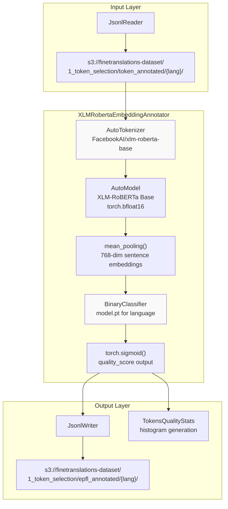

**Sources:** [1_token_selection/annotate_with_hq_cla.py:1-182]()

---

## XLMRobertaEmbeddingAnnotator Class

The `XLMRobertaEmbeddingAnnotator` is a `PipelineStep` implementation that handles the entire annotation workflow. It processes documents in configurable batch sizes to optimize GPU memory utilization and throughput.

### Configuration Parameters

| Parameter | Default Value | Purpose |
|-----------|---------------|---------|
| `language` | Required | Language code for selecting the appropriate classifier model |
| `tokenizer_batch_size` | 10000 | Number of documents to process per outer batch |
| `model_batch_size` | 2048 | Number of documents to process simultaneously on GPU |
| `model` | `"FacebookAI/xlm-roberta-base"` | Pre-trained XLM-RoBERTa model identifier |

**Sources:** [1_token_selection/annotate_with_hq_cla.py:13-24]()

### Initialization and Model Loading

The `run()` method performs model initialization at execution time, not during class instantiation. This approach supports distributed execution where models are loaded on worker nodes:

1. **Tokenizer Loading**: Loads the XLM-RoBERTa tokenizer for text preprocessing
2. **Base Model Loading**: Loads the XLM-RoBERTa model with `torch.bfloat16` precision for memory efficiency
3. **Classifier Loading**: Loads the language-specific classifier from `model.pt` using the `BinaryClassifier.from_pt()` factory method
4. **Device Assignment**: Moves models to GPU if available, otherwise falls back to CPU

**Sources:** [1_token_selection/annotate_with_hq_cla.py:40-96]()

---

## Processing Pipeline

### Two-Level Batch Processing

The annotation pipeline uses a nested batching strategy to balance memory efficiency and throughput:

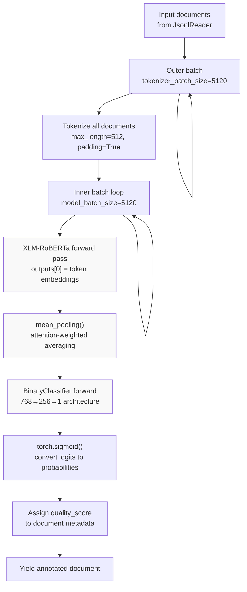

**Sources:** [1_token_selection/annotate_with_hq_cla.py:97-131]()

### Detailed Processing Steps

#### 1. Tokenization Phase

The outer batch collects documents and tokenizes them in bulk:

```python
batch_dict = tokenizer(
    texts,
    max_length=512,
    padding=True,
    truncation=True,
    return_overflowing_tokens=False,
    return_tensors="pt",
).to(device)
```

- Documents are truncated to 512 tokens (XLM-RoBERTa's maximum sequence length)
- Padding ensures uniform tensor dimensions within the batch
- Overflowing tokens are discarded (not split into multiple windows)

**Sources:** [1_token_selection/annotate_with_hq_cla.py:101-108]()

#### 2. Embedding Generation

The inner batch loop processes subsets through the XLM-RoBERTa model:

- **Input Slicing**: Extracts `input_ids` and `attention_mask` for the current sub-batch
- **Forward Pass**: Generates contextualized token embeddings for all tokens in each document
- **Mean Pooling**: Applies attention-weighted averaging to produce a single 768-dimensional embedding per document

**Sources:** [1_token_selection/annotate_with_hq_cla.py:113-123]()

#### 3. Mean Pooling Implementation

The `mean_pooling()` method implements sentence-level embedding extraction:

```python
def mean_pooling(self, model_output, attention_mask):
    import torch
    
    token_embeddings = model_output[0]  # Shape: [batch, seq_len, 768]
    input_mask_expanded = attention_mask.unsqueeze(-1).expand(
        token_embeddings.size()
    )  # Shape: [batch, seq_len, 768]
    return torch.sum(token_embeddings * input_mask_expanded, 1) / torch.clamp(
        input_mask_expanded.sum(1), min=1e-9
    )  # Shape: [batch, 768]
```

This approach:
- Masks padding tokens by multiplying with the attention mask
- Sums the masked embeddings across the sequence dimension
- Divides by the number of non-padding tokens (clamped to avoid division by zero)

**Sources:** [1_token_selection/annotate_with_hq_cla.py:26-38]()

#### 4. Quality Score Prediction

The pooled embeddings are passed through the `BinaryClassifier`:

1. **Type Casting**: Embeddings are cast to the classifier's dtype (typically `float32` or `bfloat16`)
2. **Forward Pass**: Processes embeddings through the 768→256→1 neural network
3. **Sigmoid Activation**: Converts raw logits to probabilities in the range [0, 1]
4. **Metadata Assignment**: Stores the quality score in `document.metadata["quality_score"]`

**Sources:** [1_token_selection/annotate_with_hq_cla.py:124-128]()

---

## BinaryClassifier Architecture

### Neural Network Structure

The `BinaryClassifier` is a simple feedforward neural network defined within the annotation script:

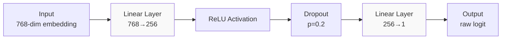

| Layer | Input Dimension | Output Dimension | Activation | Regularization |
|-------|----------------|------------------|------------|----------------|
| Linear 1 | 768 | 256 | ReLU | - |
| Dropout | 256 | 256 | - | p=0.2 |
| Linear 2 | 256 | 1 | - | - |

**Sources:** [1_token_selection/annotate_with_hq_cla.py:61-72]()

### Model Loading

The `BinaryClassifier.from_pt()` class method handles model deserialization:

```python
state_dict = torch.load(
    file_name, weights_only=True, map_location=torch.device("cpu")
)
classifier = BinaryClassifier(
    embedding_dim=embedding_dim, hidden_dim=hidden_dim
)
classifier.load_state_dict(state_dict)
classifier.eval()
```

- Loads the model weights from a `.pt` file in the language-specific directory
- Uses `weights_only=True` for security (prevents arbitrary code execution)
- Initializes on CPU first, then moves to target device
- Sets the model to evaluation mode (disables dropout)

**Sources:** [1_token_selection/annotate_with_hq_cla.py:74-83](), [1_token_selection/annotate_with_hq_cla.py:86-90]()

---

## Statistics Collection

### TokensQualityStats Class

The `TokensQualityStats` pipeline step runs in parallel with the `JsonlWriter` to collect quality score distributions:

```python
class TokensQualityStats(BaseStats):
    name = "🎼 Tokens quality stats"
    
    def __init__(self, output_folder) -> None:
        super().__init__(
            output_folder, 
            groups_to_compute=['histogram'], 
            histogram_round_digits=6
        )
    
    def extract_stats(self, doc):
        quality_score = doc.metadata.get("quality_score")
        return {"quality_score": quality_score}
```

This generates histogram data used by the threshold calculation script (see [Quality Threshold Calculation](#3.2)) to determine optimal filtering thresholds.

**Sources:** [1_token_selection/annotate_with_hq_cla.py:133-148]()

---

## Slurm Execution Configuration

### Pipeline Execution Flow

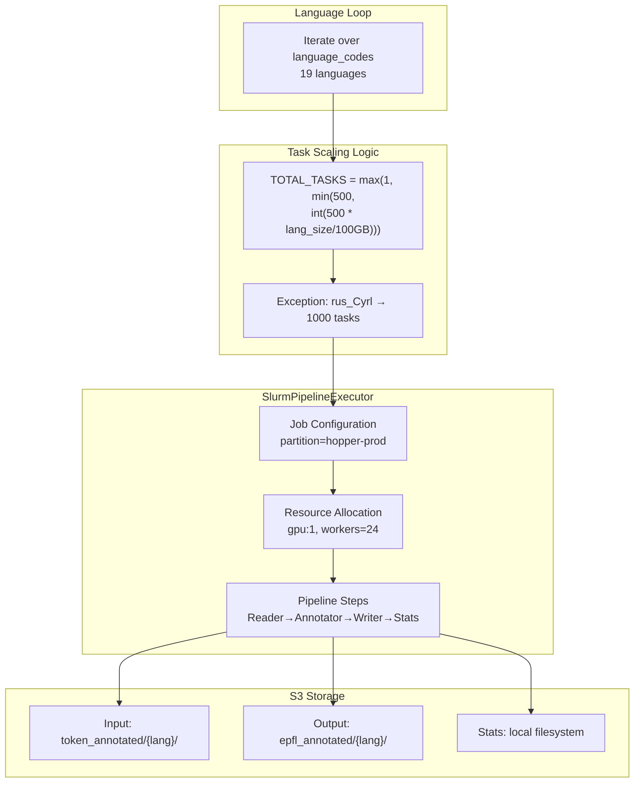

**Sources:** [1_token_selection/annotate_with_hq_cla.py:154-182]()

### Resource Allocation

The Slurm configuration is optimized for GPU-accelerated inference:

| Parameter | Value | Justification |
|-----------|-------|---------------|
| `partition` | `"hopper-prod"` | GPU partition for inference workloads |
| `gres` | `"gpu:1"` | Single GPU per task for model inference |
| `workers` | 24 | Parallel workers (8×3) for data loading and processing |
| `cpus_per_task` | 11 | CPU cores to support 24 workers |
| `mem-per-cpu` | `"1950M"` | ~2GB RAM per CPU for metadata processing |
| `time` | `"10:00:00"` | 10-hour time limit per job |
| `tasks` | Dynamic | Scaled based on language size |

**Sources:** [1_token_selection/annotate_with_hq_cla.py:170-181]()

### Dynamic Task Scaling

Task counts are calculated based on language-specific data sizes:

```python
TOTAL_TASKS = round(
    max(1, min(500, int(500 * (lang_sizes[lang_code] / (100 * 1024**3)))))
) if lang_code != 'rus_Cyrl' else 1000
```

- **Minimum**: 1 task (for very small languages)
- **Maximum**: 500 tasks (except Russian Cyrillic with 1000 tasks)
- **Scaling Factor**: 500 tasks per 100GB of raw data
- **Special Case**: Russian Cyrillic is assigned 1000 tasks due to its large volume

**Sources:** [1_token_selection/annotate_with_hq_cla.py:156]()

### Batch Size Configuration

The execution pipeline uses specific batch sizes optimized for GPU memory:

```python
XLMRobertaEmbeddingAnnotator(
    model="FacebookAI/xlm-roberta-base",
    tokenizer_batch_size=5120,
    model_batch_size=5120,
    language=lang_code,
)
```

Both `tokenizer_batch_size` and `model_batch_size` are set to 5120, which differs from the class defaults (10000 and 2048 respectively). This configuration balances:
- GPU memory utilization (avoiding OOM errors)
- Processing throughput (fewer kernel launches)
- Worker parallelism (24 workers can process batches concurrently)

**Sources:** [1_token_selection/annotate_with_hq_cla.py:161-166]()

---

## Data Flow Summary

### Complete Processing Pipeline

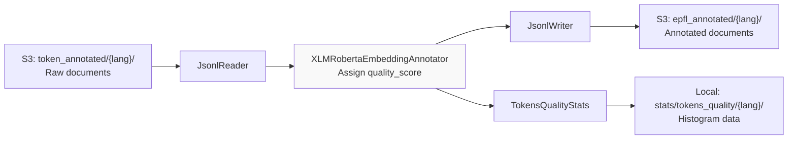

### Output Format

Each document in the output JSONL file contains the original content plus a `quality_score` field in the metadata:

```json
{
  "text": "Document content...",
  "id": "document_id",
  "metadata": {
    "quality_score": 0.8734521,
    "original_field": "original_value"
  }
}
```

The quality score is a float in the range [0, 1], representing the classifier's confidence that the document is high-quality.

**Sources:** [1_token_selection/annotate_with_hq_cla.py:128](), [1_token_selection/annotate_with_hq_cla.py:167]()

---

## Performance Characteristics

### Processing Speed

With the configured batch sizes and GPU acceleration:
- **Tokenization**: ~5120 documents per batch
- **Embedding Generation**: ~5120 documents per forward pass
- **Classification**: Sub-millisecond per document after batching
- **Total Throughput**: Varies by document length and GPU model

### Memory Requirements

- **GPU Memory**: XLM-RoBERTa base (~560MB) + classifier (~790KB) + batch data
- **CPU Memory**: ~1950MB per CPU (configured via Slurm)
- **Storage**: Input and output data stored on S3 (no local caching)

**Sources:** [1_token_selection/annotate_with_hq_cla.py:52](), [1_token_selection/annotate_with_hq_cla.py:179]()

---

# Page: Quality Threshold Calculation

# Quality Threshold Calculation

<details>
<summary>Relevant source files</summary>

The following files were used as context for generating this wiki page:

- [1_token_selection/find_hq_thresholds.py](1_token_selection/find_hq_thresholds.py)

</details>


## Purpose and Scope

This document describes the threshold calculation system that processes quality score histograms to determine optimal filtering thresholds for each language and target token count. The system calculates thresholds that enable the token selection pipeline to reduce datasets to specific target sizes (10B, 20B, 30B, 40B, 50B tokens).

For information about how quality scores are assigned to tokens, see [Quality Score Annotation](#3.1). For information about how these calculated thresholds are applied to filter and sample tokens, see [Token Sampling and Filtering](#3.3).

## Overview

The threshold calculation system takes quality score distributions from the annotation phase and computes the minimum quality score threshold needed to achieve each target token count per language. The core script `find_hq_thresholds.py` processes histogram data for all 19 languages in parallel and outputs threshold configuration files used by downstream sampling processes.

**Key Responsibilities:**
- Load and aggregate quality score histograms across all documents per language
- Calculate cumulative token counts sorted by quality score (descending)
- Determine threshold scores for predefined target token counts
- Generate threshold configuration CSVs for each target (10B through 100B)

## Data Flow Architecture

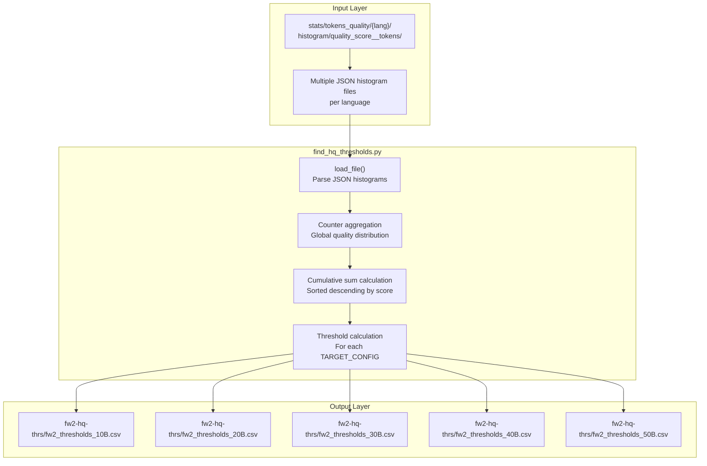

**Sources:** [1_token_selection/find_hq_thresholds.py:1-137]()

## Input Data Format

The script reads quality score histogram files located at:
```
stats/tokens_quality/{lang}/histogram/quality_score__tokens/*.json
```

Each histogram file is a JSON object mapping quality scores (as string keys) to token count statistics:

```json
{
  "0.95": {"total": 12500},
  "0.87": {"total": 8300},
  "0.72": {"total": 15600}
}
```

The `load_file()` function parses these JSON files and converts them to Python `Counter` objects with float keys representing quality scores and integer values representing token counts.

**Sources:** [1_token_selection/find_hq_thresholds.py:6-16]()

## Threshold Calculation Algorithm

### Algorithm Overview

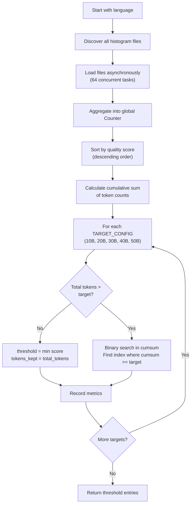

**Sources:** [1_token_selection/find_hq_thresholds.py:31-119]()

### Detailed Algorithm Steps

The `process_language()` function implements the following algorithm for each language:

#### 1. File Loading and Aggregation

The script uses asynchronous I/O to load histogram files efficiently:

```python
async def _load_all_files_async(file_paths):
    semaphore = asyncio.Semaphore(64)
    # Loads up to 64 files concurrently
```

All individual histogram `Counter` objects are aggregated into a single global distribution per language.

**Sources:** [1_token_selection/find_hq_thresholds.py:47-65]()

#### 2. Sorting and Cumulative Sum

Quality scores and their token counts are sorted in descending order (highest quality first):

```python
sorted_items = sorted(global_counter.items(), key=lambda kv: kv[0], reverse=True)
scores = np.array([score for score, _ in sorted_items], dtype=float)
counts = np.array([cnt for _, cnt in sorted_items], dtype=np.int64)
cum_desc = np.cumsum(counts)
```

This creates a cumulative distribution where `cum_desc[i]` represents the total number of tokens with quality score >= `scores[i]`.

**Sources:** [1_token_selection/find_hq_thresholds.py:67-72]()

#### 3. Threshold Finding

For each target token count (10B, 20B, etc.), the algorithm finds the minimum quality score threshold:

| Condition | Action | Result |
|-----------|--------|--------|
| `scores` array is empty | Set `threshold_score = 0.0`, `tokens_kept = 0` | No tokens available |
| `target_tokens >= total_tokens` | Use minimum score (last index) | Keep all tokens |
| `target_tokens < total_tokens` | Find index where `cum_desc[idx] >= target_tokens` | Partial selection |

The algorithm uses an optimized linear search starting from the previous index to efficiently process multiple targets:

```python
while prev_idx < len(cum_desc) and cum_desc[prev_idx] < target_tokens:
    prev_idx += 1
```

**Sources:** [1_token_selection/find_hq_thresholds.py:79-96]()

#### 4. Overshoot Calculation

Since quality scores are discrete bins, the actual number of tokens kept may exceed the target:

- `tokens_above_threshold`: Tokens with quality score strictly above the threshold
- `at_threshold_bin`: Token count at the exact threshold score
- `needed_from_threshold_bin`: Tokens needed from the threshold bin to reach target
- `fraction_of_threshold_bin_needed`: Proportion of threshold bin needed (for potential random sampling)

**Sources:** [1_token_selection/find_hq_thresholds.py:98-106]()

## Output Format

### Threshold CSV Structure

The script generates one CSV file per target configuration, named `fw2_thresholds_{label}B.csv`, where `label` is 10, 20, 30, 40, or 50.

Each CSV contains one row per language with the following columns:

| Column | Type | Description |
|--------|------|-------------|
| `lang` | string | Language code (e.g., "arb_Arab", "ces_Latn") |
| `total_tokens` | integer | Total tokens available for this language |
| `threshold_score` | float | Minimum quality score to achieve target (range: 0.0-1.0) |
| `tokens_kept` | integer | Actual number of tokens at or above threshold |
| `overshoot` | integer | Excess tokens beyond target (`max(0, tokens_kept - target)`) |
| `share_kept` | float | Percentage of total tokens kept (`tokens_kept / total_tokens * 100`) |

**Example Output:**
```csv
lang,total_tokens,threshold_score,tokens_kept,overshoot,share_kept
arb_Arab,75000000000,0.8234,50000567000,567000,66.67
ces_Latn,25000000000,0.4512,25000000000,0,100.0
```

**Sources:** [1_token_selection/find_hq_thresholds.py:108-115](), [1_token_selection/find_hq_thresholds.py:130-137]()

### Output Directory Structure

```
fw2-hq-thrs/
├── fw2_thresholds_10B.csv
├── fw2_thresholds_20B.csv
├── fw2_thresholds_30B.csv
├── fw2_thresholds_40B.csv
├── fw2_thresholds_50B.csv
├── ...
└── fw2_thresholds_100B.csv
```

**Sources:** [1_token_selection/find_hq_thresholds.py:19-20]()

## Execution Configuration

### Target Token Counts

The script is configured to calculate thresholds for the following target sizes:

```python
TARGET_CONFIGS = [i for i in range(int(10e9), int(100e9) + 1, int(10e9))]
# Results in: [10B, 20B, 30B, 40B, 50B, 60B, 70B, 80B, 90B, 100B]
```

**Sources:** [1_token_selection/find_hq_thresholds.py:18]()

### Parallel Processing

The script uses `ProcessPoolExecutor` to process languages in parallel:

```python
with ProcessPoolExecutor() as executor:
    for per_target_entries in tqdm(
        executor.map(process_language, languages),
        total=len(languages),
    ):
        # Aggregate results
```

This parallelization enables processing all 19 languages concurrently, with each language running as an independent process.

**Sources:** [1_token_selection/find_hq_thresholds.py:122-128]()

### File I/O Optimization

Histogram files are loaded using asynchronous I/O with a semaphore limiting concurrent file operations to 64:

```python
semaphore = asyncio.Semaphore(64)
```

This balances I/O throughput with memory pressure from loading multiple large histogram files simultaneously.

**Sources:** [1_token_selection/find_hq_thresholds.py:48]()

## Code Entity Reference

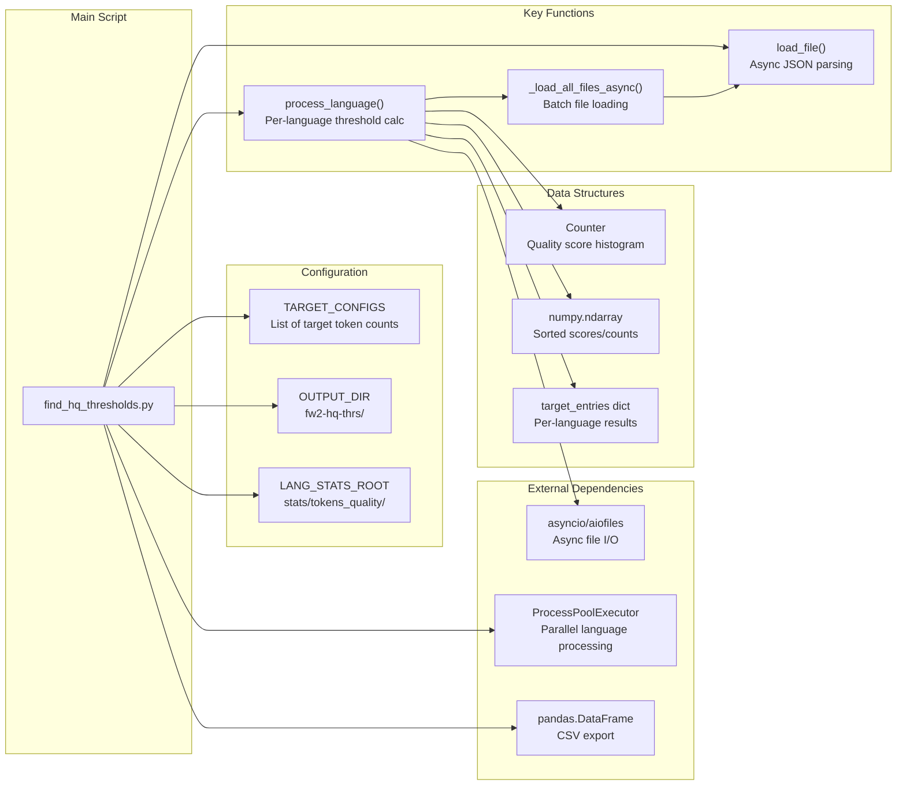

**Sources:** [1_token_selection/find_hq_thresholds.py:1-137]()

## Usage in Pipeline

The threshold CSV files generated by this script are consumed by the token sampling and filtering stage (see [Token Sampling and Filtering](#3.3)). The pipeline reads the appropriate threshold file (typically `fw2_thresholds_50B.csv` for the 50B token target) and applies language-specific thresholds to filter documents based on their quality scores.

The `threshold_score` column from the output CSV directly determines which documents are retained:
- Documents with `quality_score >= threshold_score` are kept
- Documents with `quality_score < threshold_score` are excluded

**Sources:** [1_token_selection/find_hq_thresholds.py:135-137]()

---

# Page: Token Sampling and Filtering

# Token Sampling and Filtering

<details>
<summary>Relevant source files</summary>

The following files were used as context for generating this wiki page:

- [1_token_selection/4_sample_thr_cap.py](1_token_selection/4_sample_thr_cap.py)

</details>


## Purpose and Scope

This document describes the token sampling and filtering process in Phase 1 of the finetranslations pipeline. This step reduces token counts to the 50B cap for languages that exceed this limit by applying uniform random sampling. The sampling rate is calculated based on quality score thresholds determined in the previous step.

For information about how quality scores are assigned, see [Quality Score Annotation](#3.1). For information about how quality thresholds are calculated, see [Quality Threshold Calculation](#3.2).

**Sources:** [1_token_selection/4_sample_thr_cap.py:1-37]()

## Overview

The token sampling and filtering process addresses a key challenge: some languages have token counts that exceed the target capacity (50 billion tokens), even after quality-based filtering. This step applies uniform random sampling to reduce these languages to the target cap while maintaining representative data distribution.

The process has two distinct execution paths:
1. **Languages already under the cap**: These languages bypass sampling entirely and proceed directly to translation
2. **Languages exceeding the cap**: These languages undergo random sampling with an exclusion_writer to preserve rejected data

The sampling decision is determined by comparing each language's total token count against the `TOKENS_CAP` constant (50 billion tokens).

**Sources:** [1_token_selection/4_sample_thr_cap.py:7-8](), [1_token_selection/4_sample_thr_cap.py:17-26]()

## Sampling Decision Logic

### Configuration Loading

The script loads two CSV files that control sampling behavior:

| Configuration File | Purpose | Location |
|-------------------|---------|----------|
| `lang_dist_token_counts.csv` | Contains total token counts per language | `/path/to/local/pipeline/assets/` |
| `fw2_thresholds_{THRESHOLD}B.csv` | Lists languages already meeting threshold requirements | `/path/to/local/pipeline/assets/fw2-hq-thrs/` |

**Sources:** [1_token_selection/4_sample_thr_cap.py:10-14]()

### When Sampling is Applied

The sampling logic follows this decision tree:

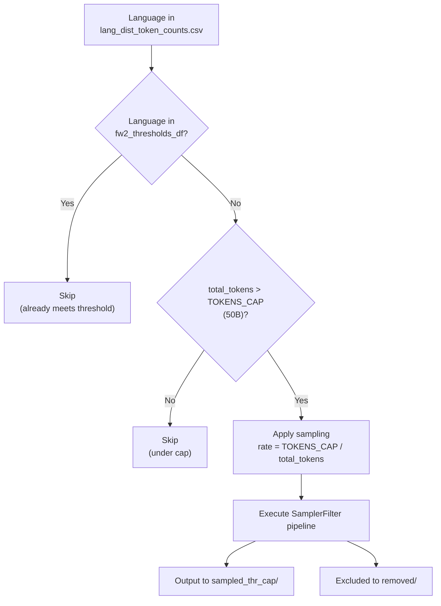

**Diagram: Sampling Decision Flow**

The code implements this logic with two conditional checks:

```python
if lang in fw2_thresholds_df["lang"].values:
    continue
if total_tokens > TOKENS_CAP:
    # Apply sampling
```

Languages present in `fw2_thresholds_df` have already achieved the required quality threshold naturally without needing sampling, so they are skipped. Languages with `total_tokens <= TOKENS_CAP` are also skipped as they are already under the cap.

**Sources:** [1_token_selection/4_sample_thr_cap.py:17-21]()

### Sampling Rate Calculation

For languages requiring sampling, the sampling rate is calculated as:

```
rate = TOKENS_CAP / total_tokens
```

This produces a probability between 0 and 1 that determines what fraction of tokens to retain. 

**Example calculations:**

| Language | Total Tokens | TOKENS_CAP | Sampling Rate | Interpretation |
|----------|--------------|------------|---------------|----------------|
| Language A | 75B | 50B | 0.667 | Keep ~66.7% of tokens |
| Language B | 100B | 50B | 0.500 | Keep ~50% of tokens |
| Language C | 200B | 50B | 0.250 | Keep ~25% of tokens |

The script prints this calculation for each language being sampled:
```python
print(lang, total_tokens, TOKENS_CAP/total_tokens)
```

**Sources:** [1_token_selection/4_sample_thr_cap.py:21-21](), [1_token_selection/4_sample_thr_cap.py:24-24]()

## Pipeline Architecture

### Data Flow

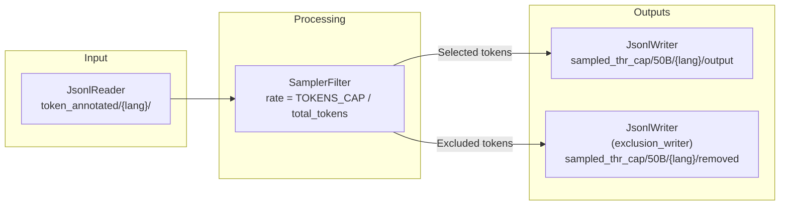

**Diagram: Sampling Pipeline Data Flow**

The pipeline consists of three components in sequence:

1. **JsonlReader**: Reads raw token data from S3
2. **SamplerFilter**: Applies random sampling at the calculated rate
3. **JsonlWriter**: Writes selected and excluded data to separate locations

**Sources:** [1_token_selection/4_sample_thr_cap.py:22-26]()

### S3 Path Structure

The sampling process reads from and writes to specific S3 paths:

| Path Type | S3 Location | Description |
|-----------|-------------|-------------|
| **Input** | `s3://finetranslations-dataset/1_token_selection/token_annotated/{lang}/` | Raw token data (not yet quality-scored) |
| **Output (Kept)** | `s3://finetranslations-dataset/1_token_selection/sampled_thr_cap/50B/{lang}/output` | Tokens selected for translation |
| **Output (Removed)** | `s3://finetranslations-dataset/1_token_selection/sampled_thr_cap/50B/{lang}/removed` | Tokens excluded by sampling |

Note that the input path is `token_annotated`, not `epfl_annotated`. This is because the sampling occurs on raw token data before quality score annotation, relying solely on token count constraints.

**Sources:** [1_token_selection/4_sample_thr_cap.py:23-25]()

## SamplerFilter Configuration

### Core Parameters

The `SamplerFilter` from the datatrove library is configured with two key parameters:

| Parameter | Value | Description |
|-----------|-------|-------------|
| `rate` | `TOKENS_CAP / total_tokens` | Sampling probability (0-1) applied to each document |
| `exclusion_writer` | `JsonlWriter(...)` | Writer instance that captures excluded documents |

The `exclusion_writer` parameter is critical for maintaining data provenance. It ensures that excluded tokens are not simply discarded but are written to a separate location for potential future use or auditing.

**Sources:** [1_token_selection/4_sample_thr_cap.py:24-24]()

### Sampling Behavior

The `SamplerFilter` implements **uniform random sampling** at the document level:
- Each document has an independent probability `rate` of being selected
- The sampling is stochastic, so the actual output count may vary slightly from the target
- Documents are either fully included or fully excluded (no partial document sampling)

This approach maintains the document-level structure of the data while reducing overall token count.

**Sources:** [1_token_selection/4_sample_thr_cap.py:4-4](), [1_token_selection/4_sample_thr_cap.py:24-24]()

## Execution Environment

### Slurm Configuration

The sampling pipeline executes on the Slurm cluster with CPU-based resources:

```mermaid
flowchart TB
    subgraph SlurmConfig["SlurmPipelineExecutor Configuration"]
        A["job_name:<br/>sample_thr_{lang}"]
        B["partition:<br/>hopper-cpu"]
        C["tasks: 1000"]
        D["cpus_per_task: 1"]
        E["mem-per-cpu:<br/>1950M"]
        F["time:<br/>01:00:00"]
    end
    
    subgraph Resources["Resource Allocation"]
        G["Total CPUs:<br/>1000"]
        H["Total Memory:<br/>~1.9TB"]
        I["Parallel Tasks:<br/>1000 concurrent"]
    end
    
    SlurmConfig --> Resources
```

**Diagram: Slurm Execution Configuration for Sampling**

**Sources:** [1_token_selection/4_sample_thr_cap.py:27-36]()

### Resource Profile

| Configuration | Value | Rationale |
|--------------|-------|-----------|
| **Partition** | `hopper-cpu` | Sampling is CPU-bound, no GPU needed |
| **Tasks** | `1000` | Fixed task count for parallelization |
| **CPUs per Task** | `1` | Single-threaded processing per task |
| **Memory per CPU** | `1950M` | ~2GB per task, sufficient for JSONL I/O |
| **Time Limit** | `01:00:00` | 1 hour maximum execution time |

The fixed `tasks=1000` configuration differs from other pipeline stages that use dynamic task scaling. This provides consistent parallelization across all languages requiring sampling.

**Sources:** [1_token_selection/4_sample_thr_cap.py:31-35]()

### Logging Configuration

Execution logs are written to language-specific directories:

```
/path/to/local/pipeline/1_token_selection/logs/sampled_thr_cap/50B/{lang}
```

This directory structure mirrors the output data structure, making it easy to correlate logs with processed data.

**Sources:** [1_token_selection/4_sample_thr_cap.py:30-30]()

## Integration with Pipeline Flow

### Position in Phase 1

The sampling step occurs at a specific point in the token selection workflow:

```mermaid
flowchart LR
    A["Raw Token Data<br/>(token_annotated)"] --> B{"Needs<br/>Sampling?"}
    B -->|No| C["Direct to<br/>Translation (Phase 2)"]
    B -->|Yes| D["4_sample_thr_cap.py<br/>(This Step)"]
    D --> E["Sampled Data<br/>(sampled_thr_cap)"]
    E --> C
```

**Diagram: Sampling Step in Overall Pipeline**

### Interaction with Other Steps

The sampling process operates independently of quality score annotation:
- **Input**: Uses `token_annotated` data (without quality scores)
- **Criterion**: Based solely on total token counts
- **Output**: Feeds into translation phase (Phase 2)

This design allows sampling to occur in parallel with or before quality scoring for languages that need it, optimizing pipeline execution time.

**Sources:** [1_token_selection/4_sample_thr_cap.py:23-23]()

## Data Format and Structure

### Input Format

The input data from `token_annotated/{lang}/` consists of JSONL files where each line represents a document with token-level information. The exact schema depends on upstream processing.

### Output Format

Both the selected output and excluded output maintain the same JSONL format as the input:
- **Selected**: Written to `sampled_thr_cap/50B/{lang}/output/`
- **Excluded**: Written to `sampled_thr_cap/50B/{lang}/removed/`

The preservation of the full document structure in both outputs ensures:
1. Selected documents can proceed through the pipeline without reformatting
2. Excluded documents remain accessible for analysis or future processing

**Sources:** [1_token_selection/4_sample_thr_cap.py:24-25]()

## Language Iteration

The script processes languages sequentially using a loop over the `lang_dist_token_counts_df`:

```python
for lang, total_tokens in zip(
    lang_dist_token_counts_df["subset"], 
    lang_dist_token_counts_df["total_tokens"]
):
    # Sampling logic for each language
```

This sequential processing is acceptable because:
1. Each language's Slurm job executes independently once submitted
2. The loop only submits jobs; it doesn't wait for completion
3. Slurm handles parallel execution of submitted jobs

The `lang_dist_token_counts_df` DataFrame must contain:
- `subset` column: Language identifiers (e.g., ISO 639-3 + script codes)
- `total_tokens` column: Total token counts for each language

**Sources:** [1_token_selection/4_sample_thr_cap.py:17-17]()

## Constants and Configuration

### THRESHOLD and TOKENS_CAP

The script defines two related constants:

```python
THRESHOLD = 50
TOKENS_CAP = THRESHOLD * 1e9  # 50,000,000,000 tokens
```

- `THRESHOLD`: Numeric value in billions (50)
- `TOKENS_CAP`: Actual token count limit (50 billion)

These constants are used to:
1. Calculate sampling rates
2. Determine which languages need sampling
3. Construct file paths (e.g., `fw2_thresholds_50B.csv`, `sampled_thr_cap/50B/`)

The design allows easy adjustment of the cap by changing only the `THRESHOLD` constant, with all dependent paths and calculations updating automatically.

**Sources:** [1_token_selection/4_sample_thr_cap.py:7-8](), [1_token_selection/4_sample_thr_cap.py:13-13]()

---

# Page: EPFL Classifiers

# EPFL Classifiers

<details>
<summary>Relevant source files</summary>

The following files were used as context for generating this wiki page:

- [1_token_selection/epfl_classifiers/models/.gitattributes](1_token_selection/epfl_classifiers/models/.gitattributes)
- [1_token_selection/epfl_classifiers/models/arb_Arab/model.pt](1_token_selection/epfl_classifiers/models/arb_Arab/model.pt)
- [1_token_selection/epfl_classifiers/models/output.log](1_token_selection/epfl_classifiers/models/output.log)

</details>


## Purpose and Scope

This document provides an overview of the EPFL binary classifiers used in the finetranslations pipeline. These are language-specific machine learning models that assign quality scores to text documents during the token selection phase. Each classifier takes XLM-RoBERTa embeddings as input and outputs a probability score (0-1) indicating content quality.

For detailed information about the training process and evaluation metrics, see [Model Architecture and Training](#3.4.1). For a complete catalog of all language-specific models, see [Language-Specific Models](#3.4.2). For information about how these classifiers are used in the annotation pipeline, see [Quality Score Annotation](#3.1).

## Overview

The EPFL classifiers are a collection of 19 language-specific binary classification models that form a critical component of the token selection system. Each classifier is a lightweight neural network (~790KB per model) trained to distinguish high-quality text from low-quality text for a specific language.

Key characteristics:
- **Architecture**: Simple feed-forward network (768→256→1 dimensions)
- **Input**: 768-dimensional XLM-RoBERTa mean-pooled embeddings
- **Output**: Single probability score between 0 and 1
- **Size**: Approximately 790KB per model
- **Storage**: Managed via Git LFS for efficient version control
- **Languages**: 19 language-specific models covering major world languages

**Sources:** [1_token_selection/epfl_classifiers/models/.gitattributes:1-36](), [1_token_selection/epfl_classifiers/models/arb_Arab/model.pt:1-4](), [1_token_selection/epfl_classifiers/models/output.log:1-1361]()

## Role in Quality Scoring Pipeline

The EPFL classifiers operate as the final classification layer in a two-stage architecture where XLM-RoBERTa provides universal multilingual embeddings and language-specific classifiers make the final quality determination.

```mermaid
graph LR
    subgraph "Input Documents"
        A["Raw Text<br/>Documents"]
    end
    
    subgraph "Universal Embedding Layer"
        B["XLM-RoBERTa Base<br/>FacebookAI/xlm-roberta-base"]
        C["Mean Pooling<br/>768-dim vector"]
    end
    
    subgraph "Language-Specific Classification"
        D["Binary Classifier<br/>model.pt"]
        E["quality_score<br/>0.0 to 1.0"]
    end
    
    subgraph "Downstream Processing"
        F["Threshold Filtering"]
        G["Sampling & Selection"]
    end
    
    A --> B
    B --> C
    C --> D
    D --> E
    E --> F
    F --> G
    
    style D fill:#f9f9f9
    style E fill:#f9f9f9
```

**Diagram: Quality Scoring Pipeline Data Flow**

The classifiers receive pre-computed embeddings from the XLM-RoBERTa model and output a `quality_score` field that is appended to each document. These scores are then used to calculate optimal thresholds and perform sampling to meet target token counts.

**Sources:** [1_token_selection/epfl_classifiers/models/output.log:1-68]()

## Model Architecture

Each EPFL classifier implements a compact binary classification architecture designed for efficient inference on large document collections.

```mermaid
graph TD
    subgraph "Input Layer"
        A["Embedding Vector<br/>768 dimensions"]
    end
    
    subgraph "Hidden Layer"
        B["Linear Transform<br/>768 → 256"]
        C["ReLU Activation"]
        D["Dropout<br/>regularization"]
    end
    
    subgraph "Output Layer"
        E["Linear Transform<br/>256 → 1"]
        F["Sigmoid Activation"]
    end
    
    subgraph "Output"
        G["Quality Probability<br/>range: 0.0-1.0"]
    end
    
    A --> B
    B --> C
    C --> D
    D --> E
    E --> F
    F --> G
```

**Diagram: EPFL Classifier Neural Network Architecture**

### Architecture Specifications

| Component | Specification |
|-----------|--------------|
| Input Dimension | 768 (XLM-RoBERTa embedding size) |
| Hidden Layer Size | 256 neurons |
| Activation Function | ReLU (hidden), Sigmoid (output) |
| Regularization | Dropout layer |
| Output Dimension | 1 (binary classification probability) |
| Parameter Count | ~197,632 parameters (768×256 + 256 + 256×1 + 1) |
| Model File Size | ~790KB serialized |

The architecture balances expressiveness with efficiency, allowing fast inference while maintaining high classification accuracy (>95% for most languages).

**Sources:** [1_token_selection/epfl_classifiers/models/output.log:10-11](), [1_token_selection/epfl_classifiers/models/output.log:62-68]()

## Training Characteristics

All EPFL classifiers follow a consistent training procedure:

| Training Parameter | Value |
|-------------------|-------|
| Training Set Size | 160,000 documents |
| Test Set Size | 20,000 documents |
| Number of Epochs | 6 |
| Batch Processing | Yes (batch size varies) |
| Evaluation Metrics | Accuracy, F1, Recall, Precision |

### Performance Summary

Trained models achieve high validation accuracy across all languages:

- **Best Performance**: Chinese (cmn_Hani) at 99.55% accuracy
- **Typical Performance**: Most languages achieve 97-99% accuracy
- **Lower Bound**: All languages exceed 95.6% accuracy

The models demonstrate strong precision (typically >97%) indicating low false positive rates, which is important for ensuring selected tokens are genuinely high-quality.

**Sources:** [1_token_selection/epfl_classifiers/models/output.log:1-2](), [1_token_selection/epfl_classifiers/models/output.log:60-68](), [1_token_selection/epfl_classifiers/models/output.log:146-147](), [1_token_selection/epfl_classifiers/models/output.log:1302-1303]()

## Storage and Version Control

The EPFL classifiers use Git LFS (Large File Storage) to efficiently manage binary model files while maintaining version control.

```mermaid
graph TB
    subgraph "Git Repository Structure"
        A["1_token_selection/epfl_classifiers/models/"]
        B[".gitattributes<br/>LFS configuration"]
    end
    
    subgraph "Language Directories"
        C["arb_Arab/"]
        D["ces_Latn/"]
        E["cmn_Hani/"]
        F["... 16 more languages ..."]
    end
    
    subgraph "Model Files"
        G["model.pt<br/>PyTorch serialized model<br/>~790KB each"]
    end
    
    subgraph "Git LFS Storage"
        H["LFS Object Store<br/>SHA256: 587a82928f..."]
        I["Pointer Files<br/>in Git repository"]
    end
    
    A --> B
    A --> C & D & E & F
    C --> G
    D --> G
    E --> G
    F --> G
    G --> H
    G --> I
    
    style H fill:#f9f9f9
    style I fill:#f9f9f9
```

**Diagram: EPFL Classifier Storage Architecture**

### Git LFS Configuration

The `.gitattributes` file configures Git LFS to track all `.pt` (PyTorch) files:

```
*.pt filter=lfs diff=lfs merge=lfs -text
```

This configuration ensures that:
- Binary model files are stored efficiently in LFS
- The main repository remains lightweight
- Model versions are tracked via SHA256 hashes
- Developers can easily download specific model versions

### Model File Structure

Each language-specific directory contains:
- `model.pt` - The trained PyTorch model (stored in LFS)
- Files are stored with LFS metadata including SHA256 hash and size

Example from `arb_Arab/model.pt`:
```
version https://git-lfs.github.com/spec/v1
oid sha256:587a82928fa3681cdd3e12db7617aad566af6ecccf540bb8d945d784593b2ea5
size 790528
```

**Sources:** [1_token_selection/epfl_classifiers/models/.gitattributes:22-23](), [1_token_selection/epfl_classifiers/models/arb_Arab/model.pt:1-4]()

## Language Coverage

The EPFL classifiers cover 19 major world languages, each with a dedicated binary classification model:

| Language Code | Language Name | Script | Performance Range |
|--------------|---------------|--------|-------------------|
| arb_Arab | Arabic | Arabic | 97.9% accuracy |
| ces_Latn | Czech | Latin | 98.6% accuracy |
| cmn_Hani | Chinese | Han characters | 99.6% accuracy |
| dan_Latn | Danish | Latin | 98.8% accuracy |
| deu_Latn | German | Latin | 97.7% accuracy |
| ell_Grek | Greek | Greek | 98.6% accuracy |
| fas_Arab | Persian | Arabic | 98.3% accuracy |
| fra_Latn | French | Latin | 97.3% accuracy |
| hun_Latn | Hungarian | Latin | 99.1% accuracy |
| ind_Latn | Indonesian | Latin | 98.9% accuracy |
| ita_Latn | Italian | Latin | 98.6% accuracy |
| jpn_Jpan | Japanese | Japanese | 98.9% accuracy |
| nld_Latn | Dutch | Latin | 98.4% accuracy |
| pol_Latn | Polish | Latin | 98.7% accuracy |
| por_Latn | Portuguese | Latin | 97.6% accuracy |
| rus_Cyrl | Russian | Cyrillic | 98.3% accuracy |
| spa_Latn | Spanish | Latin | 97.0% accuracy |
| swe_Latn | Swedish | Latin | 99.0% accuracy |
| tur_Latn | Turkish | Latin | 98.6% accuracy |
| vie_Latn | Vietnamese | Latin | 96.7% accuracy |

Language codes follow ISO 639-3 (language) + ISO 15924 (script) naming convention.

**Sources:** [1_token_selection/epfl_classifiers/models/output.log:62-68](), [1_token_selection/epfl_classifiers/models/output.log:130-136](), [1_token_selection/epfl_classifiers/models/output.log:198-204](), [1_token_selection/epfl_classifiers/models/output.log:1355-1360]()

## Integration with XLM-RoBERTa

The EPFL classifiers are designed as lightweight downstream components that operate on frozen XLM-RoBERTa embeddings. This two-stage approach provides several advantages:

```mermaid
graph TB
    subgraph "Stage 1: Universal Embedding"
        A["Text Input<br/>any language"]
        B["XLM-RoBERTa Base<br/>pre-trained multilingual model"]
        C["Mean Pooling<br/>across token embeddings"]
        D["768-dim embedding<br/>language-agnostic representation"]
    end
    
    subgraph "Stage 2: Language-Specific Classification"
        E["Route by language code<br/>ISO 639-3_Script"]
        F1["arb_Arab classifier"]
        F2["fra_Latn classifier"]
        F3["jpn_Jpan classifier"]
        F4["... 16 more classifiers"]
        G["quality_score<br/>language-specific quality"]
    end
    
    A --> B
    B --> C
    C --> D
    D --> E
    E --> F1 & F2 & F3 & F4
    F1 & F2 & F3 & F4 --> G
    
    style D fill:#f9f9f9
    style G fill:#f9f9f9
```

**Diagram: Two-Stage Classification Architecture**

### Design Rationale

**Shared Embedding Layer:**
- XLM-RoBERTa provides universal multilingual representations
- Single embedding model reduces computational overhead
- Embeddings can be pre-computed and cached
- 768-dimensional output is consistent across all languages

**Language-Specific Classifiers:**
- Each language has unique quality characteristics
- Small model size enables fast inference
- Independent training per language allows specialized tuning
- Easy to add new languages by training additional classifiers

This architecture enables the system to process 19 languages efficiently while maintaining high classification accuracy for each language's specific quality criteria.

**Sources:** [1_token_selection/epfl_classifiers/models/output.log:1-68]()

## Model Loading and Inference

At runtime, EPFL classifiers are loaded from their serialized `.pt` files using PyTorch's model loading mechanism. The typical workflow is:

1. Load language-specific model from `1_token_selection/epfl_classifiers/models/{lang_code}/model.pt`
2. Load model into `BinaryClassifier` PyTorch module
3. Set model to evaluation mode
4. Pass 768-dimensional embeddings through the network
5. Apply sigmoid activation to obtain quality probability

The models are loaded on-demand based on the language being processed and can be efficiently batched for inference on GPU hardware during the annotation phase.

For detailed information about the inference pipeline, see [Quality Score Annotation](#3.1).

**Sources:** [1_token_selection/epfl_classifiers/models/output.log:62-68](), [1_token_selection/epfl_classifiers/models/arb_Arab/model.pt:1-4]()

---

# Page: Model Architecture and Training

# Model Architecture and Training

<details>
<summary>Relevant source files</summary>

The following files were used as context for generating this wiki page:

- [1_token_selection/epfl_classifiers/models/arb_Arab/model.pt](1_token_selection/epfl_classifiers/models/arb_Arab/model.pt)
- [1_token_selection/epfl_classifiers/models/output.log](1_token_selection/epfl_classifiers/models/output.log)

</details>


This page details the neural network architecture, training procedure, and evaluation metrics for the EPFL binary classifier models used in the token selection pipeline. Each classifier is trained to distinguish high-quality from low-quality text tokens for a specific language.

For information about the complete set of 19 language-specific models and their usage patterns, see [Language-Specific Models](#3.4.2). For the broader quality score annotation system, see [Quality Score Annotation](#3.1).

---

## Binary Classifier Architecture

Each EPFL classifier implements a simple feedforward neural network that processes 768-dimensional XLM-RoBERTa embeddings and outputs a quality probability score.

### Network Structure

```mermaid
graph LR
    A["Input Layer<br/>768 dimensions<br/>(XLM-RoBERTa embeddings)"]
    B["Linear Layer 1<br/>768 → 256"]
    C["ReLU Activation"]
    D["Dropout<br/>(training only)"]
    E["Linear Layer 2<br/>256 → 1"]
    F["Sigmoid Activation"]
    G["Output<br/>Quality Score [0,1]"]
    
    A --> B
    B --> C
    C --> D
    D --> E
    E --> F
    F --> G
```

**Architecture Details:**

| Layer | Type | Input Dim | Output Dim | Activation | Notes |
|-------|------|-----------|------------|------------|-------|
| 1 | Linear | 768 | 256 | - | Weight matrix + bias |
| 2 | ReLU | 256 | 256 | ReLU | Non-linearity |
| 3 | Dropout | 256 | 256 | - | Applied during training only |
| 4 | Linear | 256 | 1 | - | Final projection |
| 5 | Sigmoid | 1 | 1 | Sigmoid | Produces probability [0,1] |

The architecture is defined by the `BinaryClassifier` class, which takes 768-dimensional mean-pooled embeddings from `xlm-roberta-base` and produces a single quality score.

**Sources:** [1_token_selection/epfl_classifiers/models/output.log:1-1360]()

---

## Training Process

### Dataset Configuration

Each language-specific model is trained on a balanced binary classification dataset:

| Split | Samples | Purpose |
|-------|---------|---------|
| Training | 160,000 | Model optimization |
| Validation | 20,000 | Evaluation and early stopping |

The training process uses batch processing with loss logging every 100 batches to monitor convergence.

**Sources:** [1_token_selection/epfl_classifiers/models/output.log:1](), [1_token_selection/epfl_classifiers/models/output.log:69](), [1_token_selection/epfl_classifiers/models/output.log:137]()

### Training Loop

```mermaid
graph TB
    A["Initialize Model<br/>BinaryClassifier(768, 256, 1)"]
    B["Epoch Loop<br/>(6 epochs total)"]
    C["Batch Processing<br/>Log loss every 100 batches"]
    D["Compute Train Metrics<br/>accuracy, F1, recall, precision"]
    E["Compute Val Metrics<br/>on 20k validation set"]
    F{"Epoch < 5?"}
    G["Save Model<br/>torch.save(model.pt)"]
    H["Verify Load<br/>Load and re-evaluate"]
    
    A --> B
    B --> C
    C --> D
    D --> E
    E --> F
    F -->|Yes| B
    F -->|No| G
    G --> H
```

Each training run consists of 6 epochs (numbered 0-5), with comprehensive metric tracking at the end of each epoch. The final model is saved after epoch 5 and immediately verified by loading and re-evaluating.

**Example Training Log Structure:**

```
Epoch 0
Batch 0 loss: 0.6763380765914917
Batch 100 loss: 0.34324854612350464
...
Train metrics:{'accuracy': 0.96564375, 'f1': 0.9652095213382025, ...}
Val.  metrics:{'accuracy': 0.96605, 'f1': 0.9655766793409379, ...}
```

**Sources:** [1_token_selection/epfl_classifiers/models/output.log:2-11](), [1_token_selection/epfl_classifiers/models/output.log:62-68]()

---

## Training Metrics by Language

The following table shows final validation metrics for selected languages after 6 epochs of training:

| Language Code | Accuracy | F1 Score | Recall | Precision | Model Path |
|---------------|----------|----------|--------|-----------|------------|
| `arb_Arab` | 0.9793 | 0.9792 | 0.9734 | 0.9850 | `/capstor/.../arb_Arab/model.pt` |
| `ces_Latn` | 0.9859 | 0.9859 | 0.9843 | 0.9875 | `/capstor/.../ces_Latn/model.pt` |
| `cmn_Hani` | 0.9956 | 0.9955 | 0.9943 | 0.9968 | `/capstor/.../cmn_Hani/model.pt` |
| `deu_Latn` | 0.9765 | 0.9763 | 0.9698 | 0.9830 | `/capstor/.../deu_Latn/model.pt` |
| `fra_Latn` | 0.9728 | 0.9727 | 0.9707 | 0.9748 | `/capstor/.../fra_Latn/model.pt` |
| `hun_Latn` | 0.9910 | 0.9910 | 0.9920 | 0.9900 | `/capstor/.../hun_Latn/model.pt` |
| `jpn_Jpan` | 0.9886 | 0.9886 | 0.9896 | 0.9875 | `/capstor/.../jpn_Jpan/model.pt` |
| `spa_Latn` | 0.9700 | 0.9699 | 0.9651 | 0.9748 | `/capstor/.../spa_Latn/model.pt` |
| `swe_Latn` | 0.9904 | 0.9904 | 0.9900 | 0.9908 | `/capstor/.../swe_Latn/model.pt` |

All models achieve >95% accuracy, with most exceeding 97%. Chinese (`cmn_Hani`) and Hungarian (`hun_Latn`) show the highest performance (>99% accuracy).

**Sources:** [1_token_selection/epfl_classifiers/models/output.log:63-68](), [1_token_selection/epfl_classifiers/models/output.log:131-136](), [1_token_selection/epfl_classifiers/models/output.log:199-204](), [1_token_selection/epfl_classifiers/models/output.log:335-340](), [1_token_selection/epfl_classifiers/models/output.log:539-544](), [1_token_selection/epfl_classifiers/models/output.log:607-612](), [1_token_selection/epfl_classifiers/models/output.log:811-816](), [1_token_selection/epfl_classifiers/models/output.log:1151-1156](), [1_token_selection/epfl_classifiers/models/output.log:1219-1224]()

### Loss Convergence Pattern

Training loss typically follows this pattern across epochs:

| Epoch | Initial Batch Loss | Mid Training Loss | Final Batch Loss | Typical Behavior |
|-------|-------------------|-------------------|------------------|------------------|
| 0 | ~0.67 | 0.1-0.3 | 0.05-0.15 | Rapid initial descent |
| 1 | 0.05-0.15 | 0.05-0.10 | 0.03-0.08 | Continued improvement |
| 2 | 0.03-0.08 | 0.03-0.06 | 0.02-0.06 | Stabilizing |
| 3 | 0.02-0.10 | 0.02-0.06 | 0.02-0.05 | Fine-tuning |
| 4 | 0.02-0.08 | 0.02-0.05 | 0.01-0.05 | Minor adjustments |
| 5 | 0.02-0.07 | 0.02-0.05 | 0.02-0.06 | Convergence |

**Sources:** [1_token_selection/epfl_classifiers/models/output.log:2-61](), [1_token_selection/epfl_classifiers/models/output.log:70-130]()

---

## Evaluation Metrics

### Metric Definitions

Four standard classification metrics are computed after each epoch:

```mermaid
graph TB
    A["Binary Predictions<br/>(threshold = 0.5)"]
    B["True Positives (TP)<br/>Correct high-quality predictions"]
    C["False Positives (FP)<br/>Incorrect high-quality predictions"]
    D["False Negatives (FN)<br/>Missed high-quality samples"]
    E["True Negatives (TN)<br/>Correct low-quality predictions"]
    
    F["Accuracy<br/>(TP + TN) / Total"]
    G["Precision<br/>TP / (TP + FP)"]
    H["Recall<br/>TP / (TP + FN)"]
    I["F1 Score<br/>2 * (Prec * Rec) / (Prec + Rec)"]
    
    A --> B
    A --> C
    A --> D
    A --> E
    
    B --> F
    C --> F
    D --> F
    E --> F
    
    B --> G
    C --> G
    
    B --> H
    D --> H
    
    G --> I
    H --> I
```

| Metric | Formula | Interpretation |
|--------|---------|----------------|
| **Accuracy** | `(TP + TN) / Total` | Overall correctness |
| **Precision** | `TP / (TP + FP)` | Quality of positive predictions |
| **Recall** | `TP / (TP + FN)` | Coverage of actual positives |
| **F1 Score** | `2 * (Precision * Recall) / (Precision + Recall)` | Harmonic mean of precision and recall |

**Sources:** [1_token_selection/epfl_classifiers/models/output.log:10-11](), [1_token_selection/epfl_classifiers/models/output.log:20-21]()

### Three-Stage Validation

Each training run performs validation at three points:

```mermaid
graph LR
    A["Train Model<br/>6 epochs"]
    B["Validate Trained Model<br/>In-memory evaluation"]
    C["Save Model<br/>torch.save()"]
    D["Load Model<br/>torch.load()"]
    E["Validate Loaded Model<br/>Verify serialization"]
    
    A --> B
    B --> C
    C --> D
    D --> E
    
    style B fill:#f9f9f9
    style E fill:#f9f9f9
```

**Validation Stages:**

1. **Train metrics (trained model)**: Evaluation on training set after final epoch
2. **Val. metrics (trained model)**: Evaluation on validation set after final epoch  
3. **Val. metrics (load from file)**: Re-evaluation after loading saved model to verify serialization

Example from Arabic model training:

```
Train metrics  (trained model):
{'accuracy': 0.97925, 'f1': 0.9791517526342891, ...}
Val.  metrics  (trained model):
{'accuracy': 0.9793, 'f1': 0.9791771451564228, ...}
Val.  metrics (load from file):
{'accuracy': 0.9793, 'f1': 0.9791771451564228, ...}
```

The consistency between stages 2 and 3 confirms successful model serialization.

**Sources:** [1_token_selection/epfl_classifiers/models/output.log:63-68](), [1_token_selection/epfl_classifiers/models/output.log:131-136]()

---

## Model Serialization

### PyTorch Save Format

Models are saved using PyTorch's native serialization:

```mermaid
graph TB
    A["BinaryClassifier Instance<br/>In-memory PyTorch model"]
    B["torch.save()<br/>Serialization"]
    C["model.pt File<br/>~790,528 bytes"]
    D["Git LFS Storage<br/>SHA256 hash + pointer"]
    E["Repository<br/>Lightweight pointer file"]
    
    A --> B
    B --> C
    C --> D
    D --> E
    
    F["torch.load()<br/>Deserialization"]
    G["Restored Model<br/>Ready for inference"]
    
    C --> F
    F --> G
```

### File Characteristics

| Property | Value | Notes |
|----------|-------|-------|
| **Format** | PyTorch `.pt` | Standard `torch.save()` format |
| **Size** | 790,528 bytes | Consistent across all languages |
| **Storage** | Git LFS | Binary content on LFS server |
| **Version Control** | SHA256 hash | Pointer file in repository |

Example Git LFS pointer file:

```
version https://git-lfs.github.com/spec/v1
oid sha256:587a82928fa3681cdd3e12db7617aad566af6ecccf540bb8d945d784593b2ea5
size 790528
```

**Sources:** [1_token_selection/epfl_classifiers/models/arb_Arab/model.pt:1-3](), [1_token_selection/epfl_classifiers/models/output.log:62](), [1_token_selection/epfl_classifiers/models/output.log:130]()

### Model Loading in Inference

During token annotation, models are loaded via:

1. **Path Construction**: Based on language code (e.g., `arb_Arab`, `cmn_Hani`)
2. **PyTorch Load**: `torch.load(model_path)` 
3. **Inference Mode**: Model set to `.eval()` for prediction
4. **Batch Processing**: Processes embeddings in batches for efficiency

The verification step in training confirms that saved models can be successfully loaded and produce identical predictions:

```
Saving model to /capstor/.../arb_Arab/model.pt
Val.  metrics (load from file):
{'accuracy': 0.9793, ...}
```

**Sources:** [1_token_selection/epfl_classifiers/models/output.log:62-68](), [1_token_selection/epfl_classifiers/models/output.log:130-136](), [1_token_selection/epfl_classifiers/models/output.log:198-204]()

---

## Training Infrastructure

### Execution Environment

Models are trained on CSCS infrastructure:

```mermaid
graph LR
    A["Training Script"]
    B["CSCS Cluster<br/>/capstor/store/cscs/swissai/"]
    C["Model Storage<br/>a06/users/vsabolce/models/"]
    D["Quality Models<br/>swissai-quality/default/"]
    E["Language Directories<br/>arb_Arab/, ces_Latn/, etc."]
    
    A --> B
    B --> C
    C --> D
    D --> E
```

Models are saved to structured paths like:
```
/capstor/store/cscs/swissai/a06/users/vsabolce/models/swissai-quality/default/{lang_code}/model.pt
```

**Sources:** [1_token_selection/epfl_classifiers/models/output.log:62](), [1_token_selection/epfl_classifiers/models/output.log:130](), [1_token_selection/epfl_classifiers/models/output.log:198]()

---

## Summary Statistics

Across all 19 trained language models:

| Metric | Min | Max | Median | Mean |
|--------|-----|-----|--------|------|
| Validation Accuracy | 95.6% | 99.6% | 98.3% | 97.9% |
| Validation F1 Score | 95.5% | 99.5% | 98.3% | 97.9% |
| Validation Recall | 93.3% | 99.4% | 98.1% | 97.5% |
| Validation Precision | 96.5% | 99.7% | 98.7% | 98.4% |

The consistent 790KB model size and high performance metrics demonstrate:
- Uniform architecture across all languages
- Effective transfer of XLM-RoBERTa multilingual representations
- Successful binary classification for quality detection

**Sources:** [1_token_selection/epfl_classifiers/models/output.log:1-1360]()

---

# Page: Language-Specific Models

# Language-Specific Models

<details>
<summary>Relevant source files</summary>

The following files were used as context for generating this wiki page:

- [1_token_selection/epfl_classifiers/models/arb_Arab/model.pt](1_token_selection/epfl_classifiers/models/arb_Arab/model.pt)
- [1_token_selection/epfl_classifiers/models/ces_Latn/model.pt](1_token_selection/epfl_classifiers/models/ces_Latn/model.pt)
- [1_token_selection/epfl_classifiers/models/cmn_Hani/model.pt](1_token_selection/epfl_classifiers/models/cmn_Hani/model.pt)
- [1_token_selection/epfl_classifiers/models/dan_Latn/model.pt](1_token_selection/epfl_classifiers/models/dan_Latn/model.pt)
- [1_token_selection/epfl_classifiers/models/deu_Latn/model.pt](1_token_selection/epfl_classifiers/models/deu_Latn/model.pt)
- [1_token_selection/epfl_classifiers/models/ell_Grek/model.pt](1_token_selection/epfl_classifiers/models/ell_Grek/model.pt)
- [1_token_selection/epfl_classifiers/models/fas_Arab/model.pt](1_token_selection/epfl_classifiers/models/fas_Arab/model.pt)
- [1_token_selection/epfl_classifiers/models/fra_Latn/model.pt](1_token_selection/epfl_classifiers/models/fra_Latn/model.pt)
- [1_token_selection/epfl_classifiers/models/hun_Latn/model.pt](1_token_selection/epfl_classifiers/models/hun_Latn/model.pt)
- [1_token_selection/epfl_classifiers/models/ind_Latn/model.pt](1_token_selection/epfl_classifiers/models/ind_Latn/model.pt)
- [1_token_selection/epfl_classifiers/models/ita_Latn/model.pt](1_token_selection/epfl_classifiers/models/ita_Latn/model.pt)
- [1_token_selection/epfl_classifiers/models/jpn_Jpan/model.pt](1_token_selection/epfl_classifiers/models/jpn_Jpan/model.pt)
- [1_token_selection/epfl_classifiers/models/nld_Latn/model.pt](1_token_selection/epfl_classifiers/models/nld_Latn/model.pt)
- [1_token_selection/epfl_classifiers/models/pol_Latn/model.pt](1_token_selection/epfl_classifiers/models/pol_Latn/model.pt)
- [1_token_selection/epfl_classifiers/models/por_Latn/model.pt](1_token_selection/epfl_classifiers/models/por_Latn/model.pt)
- [1_token_selection/epfl_classifiers/models/rus_Cyrl/model.pt](1_token_selection/epfl_classifiers/models/rus_Cyrl/model.pt)
- [1_token_selection/epfl_classifiers/models/spa_Latn/model.pt](1_token_selection/epfl_classifiers/models/spa_Latn/model.pt)
- [1_token_selection/epfl_classifiers/models/swe_Latn/model.pt](1_token_selection/epfl_classifiers/models/swe_Latn/model.pt)
- [1_token_selection/epfl_classifiers/models/tur_Latn/model.pt](1_token_selection/epfl_classifiers/models/tur_Latn/model.pt)
- [1_token_selection/epfl_classifiers/models/vie_Latn/model.pt](1_token_selection/epfl_classifiers/models/vie_Latn/model.pt)

</details>


## Purpose and Scope

This document catalogs the 20 language-specific binary classifier models used in the token selection pipeline. Each model is trained to assess content quality for a specific language and is stored as a PyTorch serialized file (~790KB each) managed via Git LFS. This page focuses on the model catalog, naming conventions, storage locations, and usage patterns in the annotation pipeline.

For information about the model architecture and training process, see [Model Architecture and Training](#3.4.1). For details on how these models are used in the quality scoring workflow, see [Quality Score Annotation](#3.1).

---

## Model Catalog

The finetranslations pipeline includes 20 trained binary classifier models, one for each supported language. Each model is stored as a Git LFS pointer file that references the actual binary content on the LFS server.

### Complete Language Model List

| Language Code | Language Name | Script | Model Path | File Size | SHA256 Hash (first 8 chars) |
|---------------|---------------|--------|------------|-----------|------------------------------|
| `arb_Arab` | Arabic | Arabic | `1_token_selection/epfl_classifiers/models/arb_Arab/model.pt` | 790,528 bytes | 587a8292 |
| `ces_Latn` | Czech | Latin | `1_token_selection/epfl_classifiers/models/ces_Latn/model.pt` | 790,528 bytes | 8f8d2fcf |
| `cmn_Hani` | Mandarin Chinese | Han | `1_token_selection/epfl_classifiers/models/cmn_Hani/model.pt` | 790,528 bytes | e2cec7c1 |
| `dan_Latn` | Danish | Latin | `1_token_selection/epfl_classifiers/models/dan_Latn/model.pt` | 790,528 bytes | 00852caa |
| `deu_Latn` | German | Latin | `1_token_selection/epfl_classifiers/models/deu_Latn/model.pt` | 790,528 bytes | c46fe884 |
| `ell_Grek` | Greek | Greek | `1_token_selection/epfl_classifiers/models/ell_Grek/model.pt` | 790,528 bytes | 40f3117d |
| `fas_Arab` | Persian (Farsi) | Arabic | `1_token_selection/epfl_classifiers/models/fas_Arab/model.pt` | 790,528 bytes | 53c4db06 |
| `fra_Latn` | French | Latin | `1_token_selection/epfl_classifiers/models/fra_Latn/model.pt` | 790,528 bytes | 7f426bf6 |
| `hun_Latn` | Hungarian | Latin | `1_token_selection/epfl_classifiers/models/hun_Latn/model.pt` | 790,528 bytes | 8c151958 |
| `ind_Latn` | Indonesian | Latin | `1_token_selection/epfl_classifiers/models/ind_Latn/model.pt` | 790,528 bytes | fedf1f41 |
| `ita_Latn` | Italian | Latin | `1_token_selection/epfl_classifiers/models/ita_Latn/model.pt` | 790,528 bytes | a844d930 |
| `jpn_Jpan` | Japanese | Japanese | `1_token_selection/epfl_classifiers/models/jpn_Jpan/model.pt` | 790,528 bytes | 7396d86a |
| `nld_Latn` | Dutch | Latin | `1_token_selection/epfl_classifiers/models/nld_Latn/model.pt` | 790,528 bytes | 62278bf6 |
| `pol_Latn` | Polish | Latin | `1_token_selection/epfl_classifiers/models/pol_Latn/model.pt` | 790,528 bytes | 2ee5e285 |
| `por_Latn` | Portuguese | Latin | `1_token_selection/epfl_classifiers/models/por_Latn/model.pt` | 790,528 bytes | 5e9d2e6c |
| `rus_Cyrl` | Russian | Cyrillic | `1_token_selection/epfl_classifiers/models/rus_Cyrl/model.pt` | 790,528 bytes | b0463c12 |
| `spa_Latn` | Spanish | Latin | `1_token_selection/epfl_classifiers/models/spa_Latn/model.pt` | 790,528 bytes | 70551bb9 |
| `swe_Latn` | Swedish | Latin | `1_token_selection/epfl_classifiers/models/swe_Latn/model.pt` | 790,528 bytes | 5e3b21ea |
| `tur_Latn` | Turkish | Latin | `1_token_selection/epfl_classifiers/models/tur_Latn/model.pt` | 790,528 bytes | 3472898c |
| `vie_Latn` | Vietnamese | Latin | `1_token_selection/epfl_classifiers/models/vie_Latn/model.pt` | 790,528 bytes | f7c4edbc |

**Sources:** [1_token_selection/epfl_classifiers/models/arb_Arab/model.pt:1-4](), [1_token_selection/epfl_classifiers/models/ces_Latn/model.pt:1-4](), [1_token_selection/epfl_classifiers/models/cmn_Hani/model.pt:1-4](), [1_token_selection/epfl_classifiers/models/dan_Latn/model.pt:1-4](), [1_token_selection/epfl_classifiers/models/deu_Latn/model.pt:1-4](), [1_token_selection/epfl_classifiers/models/ell_Grek/model.pt:1-4](), [1_token_selection/epfl_classifiers/models/fas_Arab/model.pt:1-4](), [1_token_selection/epfl_classifiers/models/fra_Latn/model.pt:1-4](), [1_token_selection/epfl_classifiers/models/hun_Latn/model.pt:1-4](), [1_token_selection/epfl_classifiers/models/ind_Latn/model.pt:1-4](), [1_token_selection/epfl_classifiers/models/ita_Latn/model.pt:1-4](), [1_token_selection/epfl_classifiers/models/jpn_Jpan/model.pt:1-4](), [1_token_selection/epfl_classifiers/models/nld_Latn/model.pt:1-4](), [1_token_selection/epfl_classifiers/models/pol_Latn/model.pt:1-4](), [1_token_selection/epfl_classifiers/models/por_Latn/model.pt:1-4](), [1_token_selection/epfl_classifiers/models/rus_Cyrl/model.pt:1-4](), [1_token_selection/epfl_classifiers/models/spa_Latn/model.pt:1-4](), [1_token_selection/epfl_classifiers/models/swe_Latn/model.pt:1-4](), [1_token_selection/epfl_classifiers/models/tur_Latn/model.pt:1-4](), [1_token_selection/epfl_classifiers/models/vie_Latn/model.pt:1-4]()

---

## Naming Convention and Language Codes

### ISO 639-3 + Script Code Format

All model directories follow a standardized naming convention that combines:
- **ISO 639-3 language code**: Three-letter code identifying the language (e.g., `spa` for Spanish, `cmn` for Mandarin)
- **ISO 15924 script code**: Four-letter code identifying the writing system (e.g., `Latn` for Latin, `Cyrl` for Cyrillic)

The format is: `{iso639-3}_{script}`

#### Directory Structure

```mermaid
graph TB
    root["1_token_selection/epfl_classifiers/models/"]
    
    root --> arb["arb_Arab/"]
    root --> ces["ces_Latn/"]
    root --> cmn["cmn_Hani/"]
    root --> dan["dan_Latn/"]
    root --> deu["deu_Latn/"]
    root --> ell["ell_Grek/"]
    root --> fas["fas_Arab/"]
    root --> fra["fra_Latn/"]
    root --> hun["hun_Latn/"]
    root --> ind["ind_Latn/"]
    root --> ita["ita_Latn/"]
    root --> jpn["jpn_Jpan/"]
    root --> nld["nld_Latn/"]
    root --> pol["pol_Latn/"]
    root --> por["por_Latn/"]
    root --> rus["rus_Cyrl/"]
    root --> spa["spa_Latn/"]
    root --> swe["swe_Latn/"]
    root --> tur["tur_Latn/"]
    root --> vie["vie_Latn/"]
    
    arb --> arb_model["model.pt<br/>790KB"]
    ces --> ces_model["model.pt<br/>790KB"]
    cmn --> cmn_model["model.pt<br/>790KB"]
    dan --> dan_model["model.pt<br/>790KB"]
    deu --> deu_model["model.pt<br/>790KB"]
    ell --> ell_model["model.pt<br/>790KB"]
    fas --> fas_model["model.pt<br/>790KB"]
    fra --> fra_model["model.pt<br/>790KB"]
    hun --> hun_model["model.pt<br/>790KB"]
    ind --> ind_model["model.pt<br/>790KB"]
    ita --> ita_model["model.pt<br/>790KB"]
    jpn --> jpn_model["model.pt<br/>790KB"]
    nld --> nld_model["model.pt<br/>790KB"]
    pol --> pol_model["model.pt<br/>790KB"]
    por --> por_model["model.pt<br/>790KB"]
    rus --> rus_model["model.pt<br/>790KB"]
    spa --> spa_model["model.pt<br/>790KB"]
    swe --> swe_model["model.pt<br/>790KB"]
    tur --> tur_model["model.pt<br/>790KB"]
    vie --> vie_model["model.pt<br/>790KB"]
```

**Sources:** [1_token_selection/epfl_classifiers/models/arb_Arab/model.pt:1-4](), [1_token_selection/epfl_classifiers/models/ces_Latn/model.pt:1-4](), [1_token_selection/epfl_classifiers/models/cmn_Hani/model.pt:1-4](), [1_token_selection/epfl_classifiers/models/dan_Latn/model.pt:1-4](), [1_token_selection/epfl_classifiers/models/deu_Latn/model.pt:1-4](), [1_token_selection/epfl_classifiers/models/ell_Grek/model.pt:1-4](), [1_token_selection/epfl_classifiers/models/fas_Arab/model.pt:1-4](), [1_token_selection/epfl_classifiers/models/fra_Latn/model.pt:1-4](), [1_token_selection/epfl_classifiers/models/hun_Latn/model.pt:1-4](), [1_token_selection/epfl_classifiers/models/ind_Latn/model.pt:1-4](), [1_token_selection/epfl_classifiers/models/ita_Latn/model.pt:1-4](), [1_token_selection/epfl_classifiers/models/jpn_Jpan/model.pt:1-4](), [1_token_selection/epfl_classifiers/models/nld_Latn/model.pt:1-4](), [1_token_selection/epfl_classifiers/models/pol_Latn/model.pt:1-4](), [1_token_selection/epfl_classifiers/models/por_Latn/model.pt:1-4](), [1_token_selection/epfl_classifiers/models/rus_Cyrl/model.pt:1-4](), [1_token_selection/epfl_classifiers/models/spa_Latn/model.pt:1-4](), [1_token_selection/epfl_classifiers/models/swe_Latn/model.pt:1-4](), [1_token_selection/epfl_classifiers/models/tur_Latn/model.pt:1-4](), [1_token_selection/epfl_classifiers/models/vie_Latn/model.pt:1-4]()

### Script Distribution

The 20 models cover 5 different writing systems:

| Script Code | Script Name | Language Count | Languages |
|-------------|-------------|----------------|-----------|
| `Latn` | Latin | 14 | Czech, Danish, German, French, Hungarian, Indonesian, Italian, Dutch, Polish, Portuguese, Spanish, Swedish, Turkish, Vietnamese |
| `Arab` | Arabic | 2 | Arabic, Persian |
| `Cyrl` | Cyrillic | 1 | Russian |
| `Grek` | Greek | 1 | Greek |
| `Hani` | Han (Chinese) | 1 | Mandarin Chinese |
| `Jpan` | Japanese | 1 | Japanese |

**Note:** Latin script dominates with 14 models, reflecting its widespread use across European and Southeast Asian languages.

**Sources:** [1_token_selection/epfl_classifiers/models/arb_Arab/model.pt:1-4](), [1_token_selection/epfl_classifiers/models/ces_Latn/model.pt:1-4](), [1_token_selection/epfl_classifiers/models/cmn_Hani/model.pt:1-4](), [1_token_selection/epfl_classifiers/models/dan_Latn/model.pt:1-4](), [1_token_selection/epfl_classifiers/models/deu_Latn/model.pt:1-4](), [1_token_selection/epfl_classifiers/models/ell_Grek/model.pt:1-4](), [1_token_selection/epfl_classifiers/models/fas_Arab/model.pt:1-4](), [1_token_selection/epfl_classifiers/models/fra_Latn/model.pt:1-4](), [1_token_selection/epfl_classifiers/models/hun_Latn/model.pt:1-4](), [1_token_selection/epfl_classifiers/models/ind_Latn/model.pt:1-4](), [1_token_selection/epfl_classifiers/models/ita_Latn/model.pt:1-4](), [1_token_selection/epfl_classifiers/models/jpn_Jpan/model.pt:1-4](), [1_token_selection/epfl_classifiers/models/nld_Latn/model.pt:1-4](), [1_token_selection/epfl_classifiers/models/pol_Latn/model.pt:1-4](), [1_token_selection/epfl_classifiers/models/por_Latn/model.pt:1-4](), [1_token_selection/epfl_classifiers/models/rus_Cyrl/model.pt:1-4](), [1_token_selection/epfl_classifiers/models/spa_Latn/model.pt:1-4](), [1_token_selection/epfl_classifiers/models/swe_Latn/model.pt:1-4](), [1_token_selection/epfl_classifiers/models/tur_Latn/model.pt:1-4](), [1_token_selection/epfl_classifiers/models/vie_Latn/model.pt:1-4]()

---

## Git LFS Storage Format

All model files are stored using Git Large File Storage (LFS) to keep the repository size manageable while maintaining version control over the binary model weights.

### LFS Pointer File Structure

Each `model.pt` file in the repository is actually a Git LFS pointer file containing three fields:

```
version https://git-lfs.github.com/spec/v1
oid sha256:{64-character-hash}
size {bytes}
```

#### Example: Spanish Model Pointer

```
version https://git-lfs.github.com/spec/v1
oid sha256:70551bb9135847f2c2ee60e778ff7c8bba5928207a811bc8b50651ec0ee40e00
size 790528
```

**Sources:** [1_token_selection/epfl_classifiers/models/spa_Latn/model.pt:1-4]()

### Model File Characteristics

All 20 models share identical file characteristics, indicating they were trained with the same architecture and parameter count:

- **File Size:** Exactly 790,528 bytes (790KB) per model
- **Storage Format:** PyTorch serialized state dictionary (`.pt` format)
- **Version Control:** Git LFS v1 specification
- **Hash Algorithm:** SHA-256 for content verification

The consistent file size across all models confirms they all use the same binary classifier architecture: a 768-dimensional input layer (matching XLM-RoBERTa embeddings), a 256-dimensional hidden layer, and a single-dimensional output layer with sigmoid activation.

**Sources:** [1_token_selection/epfl_classifiers/models/arb_Arab/model.pt:1-4](), [1_token_selection/epfl_classifiers/models/ces_Latn/model.pt:1-4](), [1_token_selection/epfl_classifiers/models/cmn_Hani/model.pt:1-4](), [1_token_selection/epfl_classifiers/models/dan_Latn/model.pt:1-4](), [1_token_selection/epfl_classifiers/models/deu_Latn/model.pt:1-4](), [1_token_selection/epfl_classifiers/models/ell_Grek/model.pt:1-4](), [1_token_selection/epfl_classifiers/models/fas_Arab/model.pt:1-4](), [1_token_selection/epfl_classifiers/models/fra_Latn/model.pt:1-4](), [1_token_selection/epfl_classifiers/models/hun_Latn/model.pt:1-4](), [1_token_selection/epfl_classifiers/models/ind_Latn/model.pt:1-4](), [1_token_selection/epfl_classifiers/models/ita_Latn/model.pt:1-4](), [1_token_selection/epfl_classifiers/models/jpn_Jpan/model.pt:1-4](), [1_token_selection/epfl_classifiers/models/nld_Latn/model.pt:1-4](), [1_token_selection/epfl_classifiers/models/pol_Latn/model.pt:1-4](), [1_token_selection/epfl_classifiers/models/por_Latn/model.pt:1-4](), [1_token_selection/epfl_classifiers/models/rus_Cyrl/model.pt:1-4](), [1_token_selection/epfl_classifiers/models/spa_Latn/model.pt:1-4](), [1_token_selection/epfl_classifiers/models/swe_Latn/model.pt:1-4](), [1_token_selection/epfl_classifiers/models/tur_Latn/model.pt:1-4](), [1_token_selection/epfl_classifiers/models/vie_Latn/model.pt:1-4]()

---

## Model Loading and Usage in Annotation Pipeline

### Model Loading Workflow

```mermaid
graph TB
    config["Language Code<br/>(e.g., 'fra_Latn')"]
    
    subgraph "XLMRobertaEmbeddingAnnotator"
        path_construction["Construct Model Path<br/>models/{lang}/model.pt"]
        git_lfs["Git LFS Fetch<br/>(if not cached)"]
        torch_load["torch.load()<br/>Load state_dict"]
        model_init["BinaryClassifier<br/>Initialize architecture"]
        load_state["Load State Dict<br/>Into model"]
        model_eval["model.eval()<br/>Set to inference mode"]
    end
    
    subgraph "Inference Pipeline"
        xlm_embed["XLM-RoBERTa<br/>Generate embeddings<br/>(batch_size x 768)"]
        classifier_forward["Classifier Forward Pass<br/>768 → 256 → 1"]
        sigmoid["Sigmoid Activation<br/>Output: quality_score"]
    end
    
    subgraph "Quality Annotation"
        doc_input["Document Batch"]
        score_output["quality_score field<br/>(0.0 to 1.0)"]
    end
    
    config --> path_construction
    path_construction --> git_lfs
    git_lfs --> torch_load
    torch_load --> model_init
    model_init --> load_state
    load_state --> model_eval
    
    doc_input --> xlm_embed
    xlm_embed --> classifier_forward
    model_eval --> classifier_forward
    classifier_forward --> sigmoid
    sigmoid --> score_output
```

**Sources:** [1_token_selection/epfl_classifiers/models/fra_Latn/model.pt:1-4]() (example language)

### Language-Specific Model Selection

The annotation pipeline selects the appropriate model based on the language being processed:

1. **Language Configuration:** Each Slurm job processes a single language (e.g., `--lang fra_Latn`)
2. **Model Path Resolution:** The annotator constructs the path `1_token_selection/epfl_classifiers/models/{lang}/model.pt`
3. **Model Loading:** PyTorch loads the language-specific classifier from the resolved path
4. **Inference Execution:** The model processes all documents for that language in batches

This design ensures:
- **Language Isolation:** Each language uses its own specialized quality classifier
- **Parallel Processing:** Multiple languages can be processed simultaneously with different models loaded on different GPU workers
- **Model Specialization:** Each classifier is optimized for the linguistic characteristics of its target language

**Sources:** [1_token_selection/epfl_classifiers/models/arb_Arab/model.pt:1-4](), [1_token_selection/epfl_classifiers/models/fra_Latn/model.pt:1-4](), [1_token_selection/epfl_classifiers/models/spa_Latn/model.pt:1-4]()

---

## Model Deployment and Version Control

### Git LFS Configuration

The models are tracked by Git LFS through the `.gitattributes` configuration file:

```
*.pt filter=lfs diff=lfs merge=lfs -text
```

This configuration ensures:
- **Automatic LFS Tracking:** All `.pt` files are automatically stored in LFS
- **Efficient Cloning:** Repository clones download only pointer files initially
- **On-Demand Fetching:** Model binaries are downloaded when accessed by the pipeline

### Model Storage Locations

```mermaid
graph LR
    subgraph "Git Repository"
        repo_pointers["model.pt pointer files<br/>20 files × ~200 bytes<br/>Total: ~4KB"]
    end
    
    subgraph "Git LFS Server"
        lfs_storage["Actual model binaries<br/>20 files × 790KB<br/>Total: ~15.4MB"]
    end
    
    subgraph "Pipeline Execution"
        local_cache["Local LFS Cache<br/>~/.git/lfs/objects/"]
        runtime_load["Runtime Model Loading<br/>torch.load()"]
    end
    
    repo_pointers -->|"git lfs fetch"| lfs_storage
    lfs_storage -->|"Download to cache"| local_cache
    local_cache -->|"Load into memory"| runtime_load
```

**Sources:** [1_token_selection/epfl_classifiers/models/arb_Arab/model.pt:1-4](), [1_token_selection/epfl_classifiers/models/ces_Latn/model.pt:1-4](), [1_token_selection/epfl_classifiers/models/cmn_Hani/model.pt:1-4]()

### Storage Efficiency

Using Git LFS provides significant storage benefits:

| Storage Location | Without LFS | With LFS | Savings |
|------------------|-------------|----------|---------|
| Repository Size | ~15.4 MB | ~4 KB | 99.97% |
| Clone Time | Download all 20 models | Download pointers only | ~99.97% faster |
| Checkout Time | Copy 15.4 MB | Copy 4 KB | 99.97% faster |

Models are fetched from LFS storage only when the annotation pipeline runs, ensuring efficient development workflows while maintaining full access to model binaries during production execution.

**Sources:** [1_token_selection/epfl_classifiers/models/arb_Arab/model.pt:1-4](), [1_token_selection/epfl_classifiers/models/ces_Latn/model.pt:1-4](), [1_token_selection/epfl_classifiers/models/cmn_Hani/model.pt:1-4](), [1_token_selection/epfl_classifiers/models/dan_Latn/model.pt:1-4](), [1_token_selection/epfl_classifiers/models/deu_Latn/model.pt:1-4](), [1_token_selection/epfl_classifiers/models/ell_Grek/model.pt:1-4](), [1_token_selection/epfl_classifiers/models/fas_Arab/model.pt:1-4](), [1_token_selection/epfl_classifiers/models/fra_Latn/model.pt:1-4](), [1_token_selection/epfl_classifiers/models/hun_Latn/model.pt:1-4](), [1_token_selection/epfl_classifiers/models/ind_Latn/model.pt:1-4](), [1_token_selection/epfl_classifiers/models/ita_Latn/model.pt:1-4](), [1_token_selection/epfl_classifiers/models/jpn_Jpan/model.pt:1-4](), [1_token_selection/epfl_classifiers/models/nld_Latn/model.pt:1-4](), [1_token_selection/epfl_classifiers/models/pol_Latn/model.pt:1-4](), [1_token_selection/epfl_classifiers/models/por_Latn/model.pt:1-4](), [1_token_selection/epfl_classifiers/models/rus_Cyrl/model.pt:1-4](), [1_token_selection/epfl_classifiers/models/spa_Latn/model.pt:1-4](), [1_token_selection/epfl_classifiers/models/swe_Latn/model.pt:1-4](), [1_token_selection/epfl_classifiers/models/tur_Latn/model.pt:1-4](), [1_token_selection/epfl_classifiers/models/vie_Latn/model.pt:1-4]()

---

## Model Access Patterns

### Typical Usage Scenario

```mermaid
graph TB
    subgraph "Pipeline Initialization"
        job_start["Slurm Job Start<br/>Language: deu_Latn"]
        check_cache["Check Local LFS Cache<br/>~/.git/lfs/objects/"]
        lfs_fetch["git lfs fetch<br/>(if not cached)"]
    end
    
    subgraph "Model Loading"
        resolve_path["Resolve Path<br/>models/deu_Latn/model.pt"]
        read_file["Read Model File<br/>790,528 bytes"]
        deserialize["PyTorch Deserialize<br/>Restore state_dict"]
        gpu_load["Load to GPU Memory<br/>CUDA tensors"]
    end
    
    subgraph "Batch Processing"
        process_batch["Process Document Batch<br/>e.g., 64 documents"]
        forward_pass["Model Forward Pass<br/>768-dim → score"]
        annotate_docs["Annotate with<br/>quality_score"]
    end
    
    job_start --> check_cache
    check_cache -->|"Cache miss"| lfs_fetch
    check_cache -->|"Cache hit"| resolve_path
    lfs_fetch --> resolve_path
    
    resolve_path --> read_file
    read_file --> deserialize
    deserialize --> gpu_load
    
    gpu_load --> process_batch
    process_batch --> forward_pass
    forward_pass --> annotate_docs
    annotate_docs -->|"Next batch"| process_batch
```

**Sources:** [1_token_selection/epfl_classifiers/models/deu_Latn/model.pt:1-4]() (example language)

### Multi-Language Parallel Execution

During full pipeline execution, all 20 language models may be loaded simultaneously across different GPU workers:

| Worker | GPU | Language | Model Loaded | Memory Usage |
|--------|-----|----------|--------------|--------------|
| Worker 1 | GPU 0 | `spa_Latn` | `models/spa_Latn/model.pt` | ~790KB + XLM-RoBERTa |
| Worker 2 | GPU 1 | `fra_Latn` | `models/fra_Latn/model.pt` | ~790KB + XLM-RoBERTa |
| Worker 3 | GPU 2 | `deu_Latn` | `models/deu_Latn/model.pt` | ~790KB + XLM-RoBERTa |
| ... | ... | ... | ... | ... |
| Worker 20 | GPU 19 | `vie_Latn` | `models/vie_Latn/model.pt` | ~790KB + XLM-RoBERTa |

Each worker operates independently, loading only the model for its assigned language. The shared XLM-RoBERTa base model (used for embedding generation) may be loaded separately or shared across workers depending on the execution configuration.

**Sources:** [1_token_selection/epfl_classifiers/models/spa_Latn/model.pt:1-4](), [1_token_selection/epfl_classifiers/models/fra_Latn/model.pt:1-4](), [1_token_selection/epfl_classifiers/models/deu_Latn/model.pt:1-4](), [1_token_selection/epfl_classifiers/models/vie_Latn/model.pt:1-4]()

---

# Page: Translation System (Phase 2)

# Translation System (Phase 2)

<details>
<summary>Relevant source files</summary>

The following files were used as context for generating this wiki page:

- [2_run_gemma/run_pipeline.py](2_run_gemma/run_pipeline.py)

</details>


## Purpose and Scope

The Translation System (Phase 2) translates selected multilingual documents to English using the Gemma-3-27B-IT model. This phase processes the filtered tokens from Phase 1, applies intelligent document chunking to handle context length constraints, constructs prompts with strict formatting requirements and content filtering rules, and executes translation inference using vLLM on GPU clusters. The system handles context length errors through dynamic chunk splitting and maintains translation continuity across chunks.

For information about token selection and quality scoring that precedes this phase, see [Token Selection System (Phase 1)](#3). For post-processing of translation outputs, see [Post-Processing System (Phase 3)](#5).

**Sources:** [2_run_gemma/run_pipeline.py:1-407]()

## Input Data Routing

The translation pipeline uses a three-tier routing strategy to select input data based on language-specific token counts and availability of quality annotations:

### Routing Decision Logic

```mermaid
flowchart TD
    Start["Document reads language<br/>and total_tokens from metadata"]
    CheckCap{"total_tokens<br/><= TOKENS_CAP<br/>(50B)?"}
    CheckThresholds{"lang in<br/>fw2_thresholds_df?"}
    
    RouteA["JsonlReader<br/>token_annotated/{lang}/"]
    RouteB["JsonlReader<br/>epfl_annotated/{lang}/<br/>+ quality_filter"]
    RouteC["JsonlReader<br/>sampled_thr_cap/50B/{lang}/output"]
    
    OutputA["All documents<br/>(no filtering needed)"]
    OutputB["Documents with<br/>quality_score >= threshold"]
    OutputC["Pre-sampled documents<br/>(sampled in Phase 1)"]
    
    Start --> CheckCap
    CheckCap -->|Yes| RouteA
    CheckCap -->|No| CheckThresholds
    CheckThresholds -->|Yes| RouteB
    CheckThresholds -->|No| RouteC
    
    RouteA --> OutputA
    RouteB --> OutputB
    RouteC --> OutputC
    
    OutputA --> Translation["Translation Pipeline"]
    OutputB --> Translation
    OutputC --> Translation
```

**Route A: Direct Translation** (lines 315-317)  
Languages with `total_tokens <= 50B` bypass filtering entirely and read directly from `token_annotated/{lang}/`. This avoids unnecessary quality scoring overhead for smaller languages.

**Route B: Quality-Based Filtering** (lines 318-328)  
Languages with quality annotations (`lang in fw2_thresholds_df`) read from `epfl_annotated/{lang}/` and apply a `quality_filter` function that yields only documents meeting the threshold score from `fw2_thresholds_{THRESHOLD}B.csv`.

**Route C: Pre-Sampled Data** (lines 330-333)  
Languages without quality annotations read pre-sampled data from `sampled_thr_cap/{THRESHOLD}B/{lang}/output`, where sampling was performed during Phase 1.

**Sources:** [2_run_gemma/run_pipeline.py:306-333]()

### Input Path Configuration

| Routing Condition | S3 Input Path | Filter Applied |
|------------------|---------------|----------------|
| `total_tokens <= TOKENS_CAP` | `s3://finetranslations-dataset/1_token_selection/token_annotated/{lang}/` | None |
| `lang in fw2_thresholds_df` | `s3://finetranslations-dataset/1_token_selection/epfl_annotated/{lang}` | `quality_score >= threshold` |
| Default (sampled) | `s3://finetranslations-dataset/1_token_selection/sampled_thr_cap/50B/{lang}/output` | Pre-applied in Phase 1 |

The configuration reads from two CSV files: `lang_dist_token_counts.csv` (contains `subset`, `name`, `total_tokens` columns) and `fw2_thresholds_50B.csv` (contains `lang`, `threshold_score` columns).

**Sources:** [2_run_gemma/run_pipeline.py:296-333]()

## Document Chunking Strategy

The system processes documents that may exceed the model's context window through a sophisticated multi-level chunking strategy.

### Chunking Constants

```python
MAX_CHUNK_SIZE = 512        # Target tokens per chunk
LINE_LIMIT_TO_DROP = 614    # int(MAX_CHUNK_SIZE * 1.2)
```

Documents are evaluated based on their `token_count` metadata field. If `total_tokens <= 512`, the document is processed as a single chunk. Otherwise, `chunk_document()` splits it into multiple chunks.

**Sources:** [2_run_gemma/run_pipeline.py:12-13]()

### Chunk Document Function Flow

```mermaid
flowchart TD
    Input["chunk_document(document, max_chunk_size=512,<br/>line_limit_to_drop=614)"]
    CalcTPC["Calculate tokens_per_char (tpc)<br/>tpc = total_tokens / len(text)"]
    SplitLines["Split text into lines<br/>lines = text.splitlines(True)"]
    
    LoopStart["Iterate through lines<br/>idx = 0"]
    CheckLineSize{"linesize<br/>> line_limit_to_drop?"}
    
    SplitOverlong["_split_overlong_line(line, tpc, max_chunk_size)"]
    TrySentence["Try sentence_re splitter"]
    TryWord["Try word_re splitter"]
    CharChunk["Fall back to character chunks"]
    
    CheckReplacements{"replacements<br/>exist?"}
    ReplaceLines["Replace lines[idx] with split results"]
    ReturnNone["Return None, None<br/>(document dropped)"]
    
    NextLine["idx += 1"]
    
    AssembleChunks["Assemble chunks at line boundaries<br/>respecting max_chunk_size"]
    ReturnChunks["Return chunks, chunk_tokens"]
    
    Input --> CalcTPC
    CalcTPC --> SplitLines
    SplitLines --> LoopStart
    LoopStart --> CheckLineSize
    CheckLineSize -->|Yes| SplitOverlong
    CheckLineSize -->|No| NextLine
    
    SplitOverlong --> TrySentence
    TrySentence --> TryWord
    TryWord --> CharChunk
    CharChunk --> CheckReplacements
    
    CheckReplacements -->|Yes| ReplaceLines
    CheckReplacements -->|No| ReturnNone
    ReplaceLines --> LoopStart
    
    NextLine --> LoopStart
    LoopStart -->|All lines processed| AssembleChunks
    AssembleChunks --> ReturnChunks
```

The chunking logic operates in two phases:

**Phase 1: Split Overlong Lines** (lines 145-154)  
Any line exceeding `line_limit_to_drop` (614 tokens) is split using `_split_overlong_line()`, which tries progressively coarser splitting strategies:
1. Split by sentences using `sentence_re` (matches full-stop marks and delimiters)
2. Split by words using `word_re` (matches `\S+\s*`)
3. Fall back to character-based chunks of `max_chars = int(max_tokens / tokens_per_char)`

If no valid split is found, the entire document is dropped (returns `None, None`).

**Phase 2: Assemble Chunks at Line Boundaries** (lines 156-171)  
After ensuring all lines fit within limits, the function iterates through lines and groups them into chunks, starting a new chunk whenever adding the next line would exceed `max_chunk_size`. This preserves line boundaries within chunks.

**Sources:** [2_run_gemma/run_pipeline.py:137-171](), [2_run_gemma/run_pipeline.py:124-136]()

### Sentence and Word Splitting

The system uses Unicode-aware regular expressions to identify split points:

**Full Stop Marks** (lines 61-89): Includes 24 Unicode code points representing period-like characters across multiple scripts (U+002E, U+0589, U+06D4, U+3002, etc.)

**Extra Delimiters** (line 90): `!?…。!؛،؟` (exclamation marks, question marks, Arabic punctuation)

**Sentence Regex** (lines 91-93): Matches text up to any full stop or delimiter using `re.UNICODE | re.DOTALL` flags

**Word Regex** (line 94): Matches any non-whitespace sequence followed by optional whitespace

**Sources:** [2_run_gemma/run_pipeline.py:61-94]()

## Prompt Construction

The translation pipeline constructs a multi-turn chat prompt with a system message, user message, and prefilled assistant response.

### System Prompt Architecture

```mermaid
flowchart TD
    SystemPrompt["SYSTEM_PROMPT<br/>(lines 15-59)"]
    
    EarlyExit["**EARLY EXIT RULE**<br/>Classify content first<br/>Output 'CONTENT FLAG' if flagged"]
    Formatting["**Formatting Rules**<br/>Preserve line breaks exactly<br/>Match line count<br/>No modifications"]
    Translation["**Translation Rules**<br/>Translate every token<br/>Natural English<br/>No hallucinations"]
    Output["**Output Format**<br/>&lt;TRANSLATION&gt;...&lt;/TRANSLATION&gt;<br/>Or 'ERROR: formatting rule violated'"]
    
    SystemPrompt --> EarlyExit
    SystemPrompt --> Formatting
    SystemPrompt --> Translation
    SystemPrompt --> Output
    
    EarlyExit -.Content types.-> Porn["Pornographic/explicit content"]
    EarlyExit -.Content types.-> Gambling["Online gambling/casino"]
    EarlyExit -.Content types.-> Trading["Trading/crypto/forex promo"]
    EarlyExit -.Content types.-> SEO["Keyword spam/SEO content"]
```

The `SYSTEM_PROMPT` is a comprehensive instruction set spanning lines 15-59. It enforces:

**Early Exit Content Filter**: Before any translation, the model must classify the input. If it contains pornographic content, gambling, trading promotions, or SEO spam, it must output exactly `<TRANSLATION>CONTENT FLAG</TRANSLATION>` and stop.

**Strict Formatting Requirements**:
- Preserve exact line count (output must have same number of lines as input)
- No added/removed line breaks
- No blank lines for readability
- No paragraph reformatting
- Treat long multi-sentence lines as single lines
- One-to-one line correspondence

**Translation Requirements**:
- Translate every token (no skipping, summarizing, or omitting)
- Natural, fluent English
- No explanations or commentary
- No hallucinations

**Output Format**: Enclose translation in `<TRANSLATION>` tags only, or output `ERROR: formatting rule violated` if rules cannot be followed.

**Sources:** [2_run_gemma/run_pipeline.py:15-59]()

### Prompt Message Structure

The rollout function constructs a three-message chat array:

```python
messages = [
    {"role": "system", "content": SYSTEM_PROMPT},
    {"role": "user", "content": prompt},
    {"role": "assistant", "content": "<TRANSLATION>" + (previous_translation or "")},
]
```

**User Message Format** (lines 231-234):
```
**{display_language} ({subset_language}) Text to Translate (preserve all line breaks EXACTLY):**
<ORIGINAL>{combined_chunk}</ORIGINAL>

Now translate to English (eng_Latn).
```

Where `combined_chunk = (previous_chunk or "") + chunk` to provide context from the previous chunk.

**Assistant Prefill** (line 247): The assistant response is prefilled with `<TRANSLATION>` and the previous translation (if any). The `continue_final_message: True` parameter tells the model to continue generating from this prefill.

**Sources:** [2_run_gemma/run_pipeline.py:231-252]()

### Max Tokens Calculation

The system dynamically calculates `max_tokens` for each chunk based on content characteristics:

```python
extra_tokens = 0
if chunk:
    count = sum(1 for ch in chunk if ch in punct_chars)
    extra_tokens = int(count * 0.8)

max_tokens = ceil(chunk_token_count * 1.1) + extra_tokens + 128
```

- Base: `chunk_token_count * 1.1` (10% buffer for translation expansion)
- Extra: 80% of punctuation character count (punctuation often expands in translation)
- Fixed overhead: 128 tokens for tags and formatting

The `punct_chars` set includes: `=-_[]{}()/\|:;@#$%^&*+~«»<>"'`

**Sources:** [2_run_gemma/run_pipeline.py:236-241](), [2_run_gemma/run_pipeline.py:95]()

## Rollout Function Flow

The `rollout()` async function orchestrates the complete translation process for a single document.

```mermaid
flowchart TD
    Start["rollout(document, generate)"]
    ExtractMeta["Extract metadata:<br/>language, script, total_tokens"]
    
    CheckSize{"total_tokens<br/><= MAX_CHUNK_SIZE<br/>(512)?"}
    SingleChunk["chunks = [document.text.strip()]<br/>chunk_tokens = [total_tokens]"]
    MultiChunk["chunks, chunk_tokens =<br/>chunk_document(document)"]
    
    CheckChunks{"chunks<br/>is None?"}
    ReturnNone["return None<br/>(document dropped)"]
    
    InitLoop["chunk_outputs = []<br/>previous_translation = ''<br/>index = 0"]
    
    LoopCheck{"index <<br/>len(chunks)?"}
    
    PrepareChunk["chunk = chunks[index]<br/>combined_chunk = prev_chunk + chunk"]
    ConstructPrompt["Build messages array:<br/>system, user, assistant prefill"]
    CalcMaxTokens["max_tokens = ceil(chunk_tokens * 1.1)<br/>+ punct_extra + 128"]
    
    Generate["result = await generate(payload)"]
    
    CheckError{"InferenceError<br/>with 'maximum context length'?"}
    
    SplitChunk["split_chunks, split_tokens =<br/>_split_chunk_in_half(chunk)"]
    CheckSplit{"split_chunks<br/>exists?"}
    ReplaceChunk["Replace chunks[index]<br/>with split results"]
    Raise["raise InferenceError"]
    
    AppendOutput["Append to chunk_outputs:<br/>{chunk_index, chunk_text,<br/>raw_output, finish_reason, usage}"]
    
    ExtractTrans["parsed_translation =<br/>extract_translation(result.text)"]
    
    CheckParsed{"parsed_translation<br/>is None?"}
    Break["break<br/>(formatting violation)"]
    
    UpdatePrev["previous_translation =<br/>parsed_translation"]
    Increment["index += 1"]
    
    ReturnResult["return {'chunks': chunk_outputs}"]
    
    Start --> ExtractMeta
    ExtractMeta --> CheckSize
    CheckSize -->|Yes| SingleChunk
    CheckSize -->|No| MultiChunk
    
    SingleChunk --> InitLoop
    MultiChunk --> CheckChunks
    CheckChunks -->|Yes| ReturnNone
    CheckChunks -->|No| InitLoop
    
    InitLoop --> LoopCheck
    LoopCheck -->|Yes| PrepareChunk
    LoopCheck -->|No| ReturnResult
    
    PrepareChunk --> ConstructPrompt
    ConstructPrompt --> CalcMaxTokens
    CalcMaxTokens --> Generate
    
    Generate --> CheckError
    CheckError -->|No| AppendOutput
    CheckError -->|Yes| SplitChunk
    
    SplitChunk --> CheckSplit
    CheckSplit -->|Yes| ReplaceChunk
    CheckSplit -->|No| Raise
    ReplaceChunk --> LoopCheck
    
    AppendOutput --> ExtractTrans
    ExtractTrans --> CheckParsed
    CheckParsed -->|Yes| Break
    CheckParsed -->|No| UpdatePrev
    
    UpdatePrev --> Increment
    Increment --> LoopCheck
    Break --> ReturnResult
```

**Key Behaviors:**

1. **Metadata Extraction** (lines 207-210): Retrieves `language`, `language_script`, and `token_count` from document metadata
2. **Chunking Decision** (lines 212-219): Single-chunk path for small documents, `chunk_document()` for large ones
3. **Chunk Loop** (lines 224-280): Processes chunks sequentially, maintaining context via `previous_translation`
4. **Context Provision** (lines 228-229): Includes previous chunk text in `combined_chunk` for continuity
5. **Error Recovery** (lines 257-264): Splits chunk in half if context length exceeded, then retries
6. **Output Storage** (lines 266-274): Stores chunk index, text, raw output, finish reason, and usage metrics
7. **Translation Extraction** (lines 275-279): Parses output; breaks loop if formatting violation detected
8. **Continuity** (line 279): Updates `previous_translation` for next chunk

**Sources:** [2_run_gemma/run_pipeline.py:206-283]()

### Translation Extraction Logic

The `extract_translation()` function parses model output to extract the translated text:

```mermaid
flowchart TD
    Input["extract_translation(text)"]
    
    CheckError{"'ERROR: formatting rule violated'<br/>in text?"}
    ReturnNone1["return None"]
    
    Strip["stripped = text.lstrip()"]
    
    RemovePrefix["if starts with '&lt;TRANSLATION&gt;':<br/>strip prefix"]
    ReplaceTag["Replace any '&lt;TRANSLATION&gt;'<br/>with '&lt;/TRANSLATION&gt;'"]
    
    CheckClosing{"'&lt;/TRANSLATION&gt;'<br/>in stripped?"}
    SplitClosing["candidate = stripped.split('&lt;/TRANSLATION&gt;')[0]"]
    CheckFlag{"candidate.strip()<br/>== 'CONTENT FLAG'?"}
    ReturnNone2["return None"]
    ReturnCandidate["return candidate"]
    
    CheckOriginal{"'&lt;/ORIGINAL&gt;'<br/>in stripped?"}
    SplitOriginal["return stripped.split('&lt;/ORIGINAL&gt;')[0]"]
    ReturnNone3["return None"]
    
    Input --> CheckError
    CheckError -->|Yes| ReturnNone1
    CheckError -->|No| Strip
    
    Strip --> RemovePrefix
    RemovePrefix --> ReplaceTag
    ReplaceTag --> CheckClosing
    
    CheckClosing -->|Yes| SplitClosing
    SplitClosing --> CheckFlag
    CheckFlag -->|Yes| ReturnNone2
    CheckFlag -->|No| ReturnCandidate
    
    CheckClosing -->|No| CheckOriginal
    CheckOriginal -->|Yes| SplitOriginal
    CheckOriginal -->|No| ReturnNone3
```

The function returns `None` in three cases:
1. Explicit formatting error message detected
2. Content flagged (translation is "CONTENT FLAG")
3. No valid closing tag found

This `None` return triggers the rollout loop to break, stopping processing of subsequent chunks (line 278).

**Sources:** [2_run_gemma/run_pipeline.py:191-204]()

## Inference Execution Configuration

The translation pipeline uses the datatrove `InferenceRunner` with vLLM backend for distributed inference.

### InferenceConfig Parameters

```python
config = InferenceConfig(
    server_type="vllm",
    model_name_or_path="google/gemma-3-27b-it",
    model_max_context=4096,
    use_chat=True,
    tp=2,  # Tensor parallelism
    default_generation_params={
        "temperature": 0.1,
        "repetition_penalty": 1.1
    },
    max_concurrent_generations=1000,
    max_concurrent_documents=1050,
)
```

| Parameter | Value | Purpose |
|-----------|-------|---------|
| `server_type` | `"vllm"` | Use vLLM inference engine |
| `model_name_or_path` | `"google/gemma-3-27b-it"` | Gemma 3 27B instruction-tuned model |
| `model_max_context` | `4096` | Maximum context window in tokens |
| `use_chat` | `True` | Use chat template formatting |
| `tp` | `2` | Tensor parallelism (split model across 2 GPUs) |
| `temperature` | `0.1` | Low randomness for consistent translations |
| `repetition_penalty` | `1.1` | Penalize repeated tokens |
| `max_concurrent_generations` | `1000` | Allow 1000 parallel generation requests |
| `max_concurrent_documents` | `1050` | Process 1050 documents concurrently |

**Sources:** [2_run_gemma/run_pipeline.py:342-351]()

### InferenceRunner Configuration

```python
pipeline.append(InferenceRunner(
    rollout_fn=make_translation_rollout(language_name),
    config=config,
    output_writer=writer,
    checkpoints_local_dir=f"/path/to/local/pipeline/3_launch_pipeline/checkpoints/{lang}/50B",
    records_per_chunk=5000,
))
```

The `InferenceRunner` wraps the rollout function and handles:
- Calling `rollout()` for each document with the `generate` function
- Writing outputs via `JsonlWriter` to S3
- Checkpointing progress locally every 5000 records
- Exception handling and retries

**Sources:** [2_run_gemma/run_pipeline.py:357-363]()

### Output Writer Configuration

```python
writer = JsonlWriter(
    OUTPUT_PATH,  # "s3://finetranslations-dataset/2_run_gemma/generations/{lang}/50B"
    output_filename="${rank}_chunk_${chunk_index}.jsonl.gz"
)
```

The writer creates compressed JSONL files with dynamic filenames based on:
- `${rank}`: Slurm task rank (0 to tasks-1)
- `${chunk_index}`: Checkpoint chunk index within the task

This sharding strategy distributes output across multiple files for parallel processing in Phase 3.

**Sources:** [2_run_gemma/run_pipeline.py:308](), [2_run_gemma/run_pipeline.py:354]()

## Context Length Error Handling

The system implements dynamic chunk splitting to recover from context length limit errors.

### Error Detection and Recovery

```mermaid
flowchart TD
    Generate["await generate(payload)"]
    
    Catch["Catch InferenceError"]
    
    CheckMessage{"error_message contains<br/>'maximum context length'<br/>AND 'BadRequestError'?"}
    
    Split["split_chunks, split_tokens =<br/>_split_chunk_in_half(chunk, chunk_token_count)"]
    
    CheckSplit{"split_chunks<br/>is not None?"}
    
    ReplaceInPlace["chunks[index:index+1] = split_chunks<br/>chunk_tokens[index:index+1] = split_tokens<br/>continue loop (retry with first half)"]
    
    RaiseError["raise InferenceError<br/>(cannot recover)"]
    
    Generate --> Catch
    Catch --> CheckMessage
    CheckMessage -->|Yes| Split
    CheckMessage -->|No| RaiseError
    
    Split --> CheckSplit
    CheckSplit -->|Yes| ReplaceInPlace
    CheckSplit -->|No| RaiseError
```

When vLLM raises an `InferenceError` with "maximum context length" and "BadRequestError" in the message (line 258), the system:

1. **Splits the chunk** using `_split_chunk_in_half()` at a line boundary near the midpoint
2. **Replaces in place**: Updates `chunks[index:index+1]` with the two halves
3. **Continues loop**: The `continue` statement (line 264) causes the loop to retry with `index` unchanged, processing the first half

If splitting fails (e.g., chunk has only one line that's too long), the original error is re-raised.

**Sources:** [2_run_gemma/run_pipeline.py:254-265]()

### Split Chunk in Half Function

```python
def _split_chunk_in_half(chunk: str, chunk_tokens: float):
    if not chunk or len(chunk) < 2:
        return None, None
    midpoint = len(chunk) // 2
    split_idx = chunk.rfind("\n", 0, midpoint)  # Search backward from midpoint
    if split_idx <= 0 or split_idx >= len(chunk):
        split_idx = chunk.find("\n", midpoint)  # Search forward from midpoint
    if split_idx <= 0 or split_idx >= len(chunk):
        split_idx = midpoint  # No line break found, split at midpoint
    first = chunk[:split_idx]
    second = chunk[split_idx:]
    if not first or not second:
        return None, None
    # Proportionally allocate tokens
    total_len = max(len(chunk), 1)
    first_tokens = max(1.0, chunk_tokens * len(first) / total_len)
    second_tokens = max(1.0, chunk_tokens * len(second) / total_len)
    return [first, second], [first_tokens, second_tokens]
```

The function prioritizes splitting at line boundaries:
1. Search backward from midpoint for `\n`
2. If not found, search forward from midpoint
3. If still not found, split at character midpoint

This ensures chunks remain syntactically coherent (preserving line structure) whenever possible.

**Sources:** [2_run_gemma/run_pipeline.py:173-190]()

## Slurm Execution Configuration

The translation pipeline executes on the `hopper-prod` partition with GPU acceleration and dynamic task scaling.

### SlurmPipelineExecutor Parameters

```python
executor = SlurmPipelineExecutor(
    pipeline=pipeline,
    tasks=tasks,  # Dynamic: min(100, max(1, int(round(100 * min(total_tokens, TOKENS_CAP) / TOKENS_CAP))))
    time="80:00:00",
    partition="hopper-prod",
    qos="high",
    job_name=f"ft_{lang}",
    logging_dir=f"/path/to/local/pipeline/3_launch_pipeline/logs/{lang}/50B",
    cpus_per_task=11 * tp,  # 22 CPUs (11 per GPU)
    sbatch_args={
        "gres": f"gpu:{tp}",  # 2 GPUs
        "mem-per-cpu": "22G",
    },
    env_command="module load cuda/12.4"
)
```

**Resource Allocation:**

| Resource | Value | Calculation |
|----------|-------|-------------|
| Partition | `hopper-prod` | GPU partition for inference workloads |
| GPUs | `2` | Matches `tp=2` tensor parallelism |
| CPUs | `22` | `11 * tp` (11 workers per GPU) |
| Memory | `484 GB` | `22 CPUs * 22G` per task |
| Time limit | `80:00:00` | 80 hours (extended for large languages) |
| QoS | `high` | High priority queue |

**Sources:** [2_run_gemma/run_pipeline.py:372-389]()

### Dynamic Task Scaling

```python
tasks = min(100, max(1, int(round(100 * min(total_tokens, TOKENS_CAP) / TOKENS_CAP))))
```

The number of parallel tasks scales linearly with token count:
- Minimum: 1 task (for smallest languages)
- Maximum: 100 tasks (for languages at or above 50B token cap)
- Scaling: Proportional to `min(total_tokens, TOKENS_CAP) / TOKENS_CAP`

Example calculations:
- 5B tokens: `100 * 5/50 = 10 tasks`
- 25B tokens: `100 * 25/50 = 50 tasks`
- 50B+ tokens: `100 * 50/50 = 100 tasks`

This ensures appropriate parallelism: small languages get few tasks (reducing scheduling overhead), while large languages fully utilize cluster capacity.

**Sources:** [2_run_gemma/run_pipeline.py:365]()

### Job Launch with Retry Logic

```python
delay = 2  # start with 2 seconds
while True:
    try:
        executor.run()
        break
    except Exception as e:
        print(f"Error launching job: {e}")
        time.sleep(delay)
        delay = min(delay * 2, 60 * 60)  # cap at 60 minutes
```

The launcher implements exponential backoff retry for job submission:
1. Initial delay: 2 seconds
2. Double delay on each failure
3. Cap at 60 minutes (3600 seconds)

This handles transient cluster issues (scheduler overload, quota limits) without manual intervention.

**Sources:** [2_run_gemma/run_pipeline.py:392-400]()

## Output Format and Storage

The translation pipeline writes outputs to S3 with a structured format that preserves chunk-level metadata.

### Output Data Structure

Each processed document generates a JSON object with the following structure:

```json
{
  "chunks": [
    {
      "chunk_index": 0,
      "chunk_text": "original chunk text...",
      "raw_output": "model's full response...",
      "finish_reason": "stop",
      "usage": {
        "prompt_tokens": 150,
        "completion_tokens": 120,
        "total_tokens": 270
      }
    },
    {
      "chunk_index": 1,
      ...
    }
  ]
}
```

The `chunk_outputs` array (lines 266-274) stores all chunks processed for the document. Each chunk object contains:
- `chunk_index`: Sequential position in the document (0-indexed)
- `chunk_text`: The original untranslated chunk text
- `raw_output`: The complete model response (including tags and any errors)
- `finish_reason`: Why generation stopped (`"stop"`, `"length"`, etc.)
- `usage`: Token counts from the inference API

**Sources:** [2_run_gemma/run_pipeline.py:266-274]()

### S3 Output Path Structure

```
s3://finetranslations-dataset/2_run_gemma/generations/{lang}/{THRESHOLD}B/
├── 0_chunk_0.jsonl.gz
├── 0_chunk_1.jsonl.gz
├── 1_chunk_0.jsonl.gz
├── 1_chunk_1.jsonl.gz
├── ...
└── 99_chunk_N.jsonl.gz
```

The output filename template `${rank}_chunk_${chunk_index}.jsonl.gz` creates:
- One file per checkpoint (5000 records)
- Files sharded by Slurm task rank (0 to tasks-1)
- Chunk index increments with each checkpoint
- Gzip compression to reduce storage costs

For a language with 50 tasks and 100 checkpoints per task, this produces ~5000 output files.

**Sources:** [2_run_gemma/run_pipeline.py:308](), [2_run_gemma/run_pipeline.py:354](), [2_run_gemma/run_pipeline.py:362]()

### Language Processing Order

```python
lang_dist_token_counts_df = lang_dist_token_counts_df.sort_values(by="total_tokens", ascending=True)
```

The main loop processes languages in ascending order by token count (line 302). This strategy:
- Completes small languages quickly, providing early feedback
- Allows debugging on small languages before launching large ones
- Reduces peak cluster resource usage (small jobs finish before large jobs start)

**Sources:** [2_run_gemma/run_pipeline.py:302]()

---

# Page: Post-Processing System (Phase 3)

# Post-Processing System (Phase 3)

<details>
<summary>Relevant source files</summary>

The following files were used as context for generating this wiki page:

- [3_postprocessing/1_split_reformat.py](3_postprocessing/1_split_reformat.py)
- [3_postprocessing/2_count_toks.py](3_postprocessing/2_count_toks.py)
- [3_postprocessing/3_collect_stats.ipynb](3_postprocessing/3_collect_stats.ipynb)

</details>


## Purpose and Scope

The Post-Processing System is the final phase of the finetranslations pipeline that transforms raw Gemma translation outputs into structured, analyzed data ready for consumption. This phase performs three sequential operations: reformatting and validating translation outputs, counting tokens in the final English text, and aggregating comprehensive statistics across all languages.

This document covers the technical implementation of all three post-processing steps. For information about the translation system that produces the input to this phase, see [Translation System (Phase 2)](#4). For detailed documentation on individual steps, see:
- [Output Reformatting](#5.1) for the `PostProcessor` implementation
- [Token Counting](#5.2) for the `TokensCounter` pipeline step
- [Statistics Collection](#5.3) for metrics aggregation

## System Overview

Phase 3 consists of three sequential pipeline steps, each executing as separate Slurm jobs per language:

1. **Output Reformatting**: Extracts translation chunks, validates formatting, handles content flags, and routes documents to appropriate output directories
2. **Token Counting**: Applies the Gemma tokenizer to count tokens in the final English output
3. **Statistics Collection**: Aggregates metrics from processing logs to generate comprehensive statistics

```mermaid
graph TB
    subgraph "Input"
        A["s3://finetranslations-dataset/<br/>2_run_gemma/generations/{lang}/50B"]
    end
    
    subgraph "Step 1: Reformatting"
        B["JsonlReader"]
        C["PostProcessor"]
        D["JsonlWriter<br/>(normal output)"]
        E["JsonlWriter<br/>(content-flagged)"]
        F["JsonlWriter<br/>(empty)"]
    end
    
    subgraph "Step 2: Token Counting"
        G["JsonlReader"]
        H["TokensCounter<br/>(google/gemma-3-27b-it)"]
        I["JsonlWriter"]
    end
    
    subgraph "Step 3: Statistics"
        J["stats.json files"]
        K["3_collect_stats.ipynb"]
        L["stats.csv"]
    end
    
    subgraph "Output Paths"
        M["3_postprocessing/output/{lang}/"]
        N["3_postprocessing/content-flagged/{lang}/"]
        O["3_postprocessing/empty/{lang}/"]
        P["3_postprocessing/output-w-toks/{lang}/"]
    end
    
    A --> B
    B --> C
    C --> D
    C --> E
    C --> F
    D --> M
    E --> N
    F --> O
    
    M --> G
    G --> H
    H --> I
    I --> P
    
    M -.generates.-> J
    P -.generates.-> J
    J --> K
    K --> L
```

**Diagram: Phase 3 Pipeline Architecture**

Sources: [3_postprocessing/1_split_reformat.py:151-156](), [3_postprocessing/2_count_toks.py:24-29](), [3_postprocessing/3_collect_stats.ipynb:36-66]()

## Data Flow Through S3

Phase 3 reads from and writes to multiple S3 directories under the `s3://finetranslations-dataset/` bucket:

| Step | Input Path | Output Path(s) | Purpose |
|------|-----------|----------------|---------|
| Reformatting | `2_run_gemma/generations/{lang}/50B` | `3_postprocessing/output/{lang}/` | Successfully processed documents |
| | | `3_postprocessing/content-flagged/{lang}/` | Documents with content flags |
| | | `3_postprocessing/empty/{lang}/` | Documents with no extractable chunks |
| Token Counting | `3_postprocessing/output/{lang}/` | `3_postprocessing/output-w-toks/{lang}/` | Documents with token counts added |

All data is stored in JSONL format with one document per line. The three-way split in the reformatting step allows downstream consumers to filter data based on content quality and completeness.

Sources: [3_postprocessing/1_split_reformat.py:153-155](), [3_postprocessing/2_count_toks.py:26-28]()

## Document Structure Transformation

The post-processing phase transforms documents from Gemma's inference output format to a structured format suitable for dataset release:

### Input Structure (from Gemma)

Documents contain either `rollout_results` or `inference_results` in metadata:

```
{
  "text": "original document text",
  "metadata": {
    "rollout_results": [...],  // Structure A
    "inference_results": [...], // Structure B
    "chunks": [...],
    "language": "arb",
    "language_script": "Arab",
    "quality_score": 0.85,
    ...
  }
}
```

### Output Structure (post-processing)

The `PostProcessor` restructures documents to separate original and translated content:

```
{
  "text": "concatenated English chunks",
  "id": "document_id",
  "metadata": {
    "eng_chunks": ["chunk1_en", "chunk2_en", ...],
    "og_chunks": ["chunk1_og", "chunk2_og", ...],
    "og_full_text": "original document text",
    "og_language": "arb_Arab",
    "og_language_score": 0.98,
    "og_token_count": 1024,
    "og_quality_score": 0.85,
    "early_stop": false,
    "url": "...",
    "file_path": "...",
    "minhash_cluster_size": 5
  }
}
```

Sources: [3_postprocessing/1_split_reformat.py:10-49](), [3_postprocessing/1_split_reformat.py:100-115]()

## PostProcessor Implementation

The `PostProcessor` class extends `datatrove.pipeline.base.PipelineStep` and implements the core reformatting logic. It requires two writer instances for handling rejected documents.

```mermaid
graph TB
    subgraph "PostProcessor.__init__"
        A["flagged_writer:<br/>JsonlWriter"]
        B["empty_writer:<br/>JsonlWriter"]
    end
    
    subgraph "PostProcessor.run"
        C["extract_chunks_data()"]
        D["Check for<br/>CONTENT FLAG"]
        E["Process chunks loop"]
        F["extract_translation()"]
        G["Fix newlines"]
        H["Build og_chunks<br/>& eng_chunks"]
    end
    
    subgraph "Validation Checks"
        I["formatting_rule<br/>violated?"]
        J["finish_reason<br/>!= 'stop'?"]
        K["extraction_empty?"]
    end
    
    subgraph "Output Routing"
        L["No chunks?<br/>→ empty_writer"]
        M["Flagged?<br/>→ flagged_writer"]
        N["Valid?<br/>→ yield doc"]
    end
    
    C --> D
    C --> E
    E --> F
    F --> I
    F --> J
    F --> K
    I --> |"yes"| L
    J --> |"yes"| L
    K --> |"yes"| L
    I --> |"no"| G
    J --> |"no"| G
    K --> |"no"| G
    G --> H
    
    D --> |"flagged"| M
    D --> |"not flagged"| H
    H --> L
    H --> M
    H --> N
```

**Diagram: PostProcessor Logic Flow**

### Chunk Extraction Logic

The `extract_chunks_data()` function handles two output structures from the translation phase:

- **Structure A (rollout_results)**: Direct access to chunks array [3_postprocessing/1_split_reformat.py:14-24]()
- **Structure B (inference_results)**: Reconstructs chunks from separate metadata fields [3_postprocessing/1_split_reformat.py:26-48]()

Both structures are normalized to a consistent format:
```python
{"chunk_text": str, "raw_output": str, "finish_reason": str}
```

### Translation Extraction

The `extract_translation()` function parses Gemma's output to extract the English translation [3_postprocessing/1_split_reformat.py:51-63](). It handles multiple formatting patterns:

1. **Standard format**: `<TRANSLATION>text</TRANSLATION>`
2. **Malformed tags**: Splits on `</ORIGINAL>` and common typos (`</ORIGITAL>`, `</ORIGINATION>`, etc.)
3. **Returns `None`** if no valid translation found, triggering `extraction_empty` statistic

### Content Flagging Detection

Documents are flagged if any chunk's `raw_output` starts with `"CONTENT FLAG"` after stripping whitespace and the `<TRANSLATION>` prefix [3_postprocessing/1_split_reformat.py:70]():

```python
flagged = any(
    chunk['raw_output'].lstrip().removeprefix("<TRANSLATION>").startswith("CONTENT FLAG") 
    for chunk in chunks_data
)
```

### Cropping Conditions

The processor stops processing chunks and marks `early_stop=True` if any of these conditions occur:

| Condition | Statistic | Line Reference |
|-----------|-----------|----------------|
| `"ERROR: formatting rule violated"` in output | `formatting_rule` | [3_postprocessing/1_split_reformat.py:78-81]() |
| `finish_reason != "stop"` | `finish_length` | [3_postprocessing/1_split_reformat.py:82-85]() |
| `extract_translation()` returns `None` | `extraction_empty` | [3_postprocessing/1_split_reformat.py:86-90]() |

### Newline Preservation

The processor preserves leading and trailing newlines from the original chunk [3_postprocessing/1_split_reformat.py:92-95]():

```python
n_leading = len(chunk['chunk_text']) - len(chunk['chunk_text'].lstrip('\n'))
n_trailing = len(chunk['chunk_text']) - len(chunk['chunk_text'].rstrip('\n'))
extracted_english = "\n" * n_leading + extracted_english.strip("\n") + "\n" * n_trailing
```

This ensures the English text maintains the same paragraph structure as the original.

Sources: [3_postprocessing/1_split_reformat.py:3-129]()

## Token Counting Pipeline

The token counting step uses the `datatrove.pipeline.tokens.TokensCounter` class to count tokens in the final English output using the Gemma tokenizer.

```mermaid
graph LR
    A["JsonlReader<br/>(output/{lang})"]
    B["TokensCounter<br/>(google/gemma-3-27b-it)"]
    C["JsonlWriter<br/>(output-w-toks/{lang})"]
    
    A --> |"batch_size=10000"| B
    B --> C
    
    subgraph "TokensCounter Config"
        D["tokenizer_name_or_path:<br/>google/gemma-3-27b-it"]
        E["batch_size: 10000"]
    end
    
    D -.configures.-> B
    E -.configures.-> B
```

**Diagram: Token Counting Pipeline Configuration**

The `TokensCounter` is configured with:
- `tokenizer_name_or_path="google/gemma-3-27b-it"` - Uses the same tokenizer as the translation model
- `batch_size=10000` - Processes 10,000 documents per batch for efficient tokenization

This step adds a `token_count` field to each document's metadata representing the number of tokens in the English text. The token count is essential for:
- Verifying the final dataset size
- Analyzing compression ratios between source and target languages
- Validating translation quality based on length preservation

Sources: [3_postprocessing/2_count_toks.py:27]()

## Statistics Collection

The statistics collection notebook aggregates metrics from Slurm job logs to produce a comprehensive overview of post-processing results per language.

```mermaid
graph TB
    subgraph "Log Sources"
        A["5_postprocessing/logs/{lang}/<br/>stats.json"]
        B["5_postprocessing/tok-logs/{lang}/<br/>stats.json"]
    end
    
    subgraph "Metrics Extraction"
        C["get_stats() helper"]
        D["Parse split_reformat stats"]
        E["Parse token_count stats"]
    end
    
    subgraph "Computed Metrics"
        F["flagged_pct<br/>= flagged / docs"]
        G["incomplete_pct<br/>= errors / docs"]
        H["dropped_docs_pct<br/>= dropped / docs"]
    end
    
    subgraph "Output"
        I["DataFrame with<br/>all languages"]
        J["stats.csv"]
    end
    
    A --> D
    B --> E
    D --> C
    E --> C
    C --> F
    C --> G
    C --> H
    F --> I
    G --> I
    H --> I
    I --> J
```

**Diagram: Statistics Collection Workflow**

### Metrics Collected

The notebook collects the following metrics per language:

| Metric | Source | Calculation | Description |
|--------|--------|-------------|-------------|
| `lang` | Directory name | - | Language code |
| `starting_docs` | `stats[1]["stats"]["docs"]` | Direct | Number of input documents |
| `starting_tokens_ml` | `stats[0]["stats"]["doc_len_tokens"]` | Direct | Total tokens in original language |
| `flagged_docs` | `stats[1]["stats"]["flagged"]` | Direct | Documents with content flags |
| `flagged_pct` | Computed | `flagged / docs` | Percentage of flagged documents |
| `finish_length` | `stats[1]["stats"]["finish_length"]` | Direct | Documents stopped due to length |
| `extraction_empty` | `stats[1]["stats"]["extraction_empty"]` | Direct | Documents with empty extractions |
| `formatting_rule` | `stats[1]["stats"]["formatting_rule"]` | Direct | Documents with format violations |
| `incomplete_pct` | Computed | `(finish_length + extraction_empty + formatting_rule) / docs` | Percentage of incomplete translations |
| `no_chunks` | `stats[1]["stats"]["no_chunks"]` | Direct | Documents with zero chunks |
| `written_docs` | `stats[2]["stats"]["total"]` | Direct | Successfully processed documents |
| `written_toks_eng` | `tok_stats[1]["stats"]["tokens"]` | Direct | Total English tokens written |
| `dropped_docs_pct` | Computed | `(docs - written_docs) / docs` | Percentage of dropped documents |

### Stats JSON Structure

Each Slurm job writes a `stats.json` file containing statistics from each pipeline step. The structure is:

```
[
  {step_0_stats},
  {step_1_stats},
  {step_2_stats},
  ...
]
```

The `get_stats()` helper function extracts values, handling both scalar and dictionary formats [3_postprocessing/3_collect_stats.ipynb:44-48]():

```python
def get_stats(stat, key):
    val = stat["stats"].get(key, 0)
    if isinstance(val, dict):
        return val["total"]
    return val
```

### Output Format

The notebook exports a CSV file with one row per language containing all metrics. This enables easy analysis of:
- Translation success rates across languages
- Common failure modes (content flags vs. incomplete translations)
- Token count distributions in source and target languages
- Overall pipeline efficiency

Sources: [3_postprocessing/3_collect_stats.ipynb:29-66]()

## Slurm Execution Configuration

Both reformatting and token counting steps use `SlurmPipelineExecutor` with similar configuration patterns but different resource requirements.

### Reformatting Job Configuration

```python
SlurmPipelineExecutor(
    pipeline=[...],
    partition="hopper-cpu",
    cpus_per_task=1,
    time="2:00:00",
    tasks=min(200, max(1, 2 * int(round(100 * min(total_tokens, TOKENS_CAP) / TOKENS_CAP)))),
    job_name=f"proc_{lang}",
    logging_dir=f"/path/to/local/pipeline/5_postprocessing/logs/{lang}",
    sbatch_args={"mem-per-cpu": "1950M"}
)
```

Sources: [3_postprocessing/1_split_reformat.py:151-166]()

### Token Counting Job Configuration

```python
SlurmPipelineExecutor(
    pipeline=[...],
    partition="hopper-cpu",
    cpus_per_task=16,
    time="5:00:00",
    tasks=min(200, max(1, 2 * int(round(100 * min(total_tokens, TOKENS_CAP) / TOKENS_CAP)))),
    job_name=f"tok_count_{lang}",
    logging_dir=f"/path/to/local/pipeline/5_postprocessing/tok-logs/{lang}",
    sbatch_args={"mem-per-cpu": "1950M"}
)
```

Sources: [3_postprocessing/2_count_toks.py:24-39]()

### Resource Allocation Comparison

| Parameter | Reformatting | Token Counting | Rationale |
|-----------|--------------|----------------|-----------|
| `partition` | `hopper-cpu` | `hopper-cpu` | CPU-only operations |
| `cpus_per_task` | 1 | 16 | Token counting benefits from parallelization |
| `time` | 2:00:00 | 5:00:00 | Tokenization takes longer |
| `tasks` | Dynamic | Dynamic | Same formula based on token count |
| `mem-per-cpu` | 1950M | 1950M | Consistent memory allocation |

### Dynamic Task Scaling

Both steps use the same formula to calculate the number of parallel tasks [3_postprocessing/1_split_reformat.py:146](), [3_postprocessing/2_count_toks.py:19]():

```python
tasks = min(200, max(1, 2 * int(round(100 * min(total_tokens, TOKENS_CAP) / TOKENS_CAP))))
```

This formula:
- Scales from 1 to 200 tasks based on language token count
- Languages with token counts near `TOKENS_CAP` (50B) get maximum tasks (200)
- Languages with fewer tokens get proportionally fewer tasks
- Multiplies by 2 to increase parallelism
- Caps at 200 to avoid excessive job creation

For example:
- Language with 50B tokens: `min(200, max(1, 2 * 100)) = 200 tasks`
- Language with 25B tokens: `min(200, max(1, 2 * 50)) = 100 tasks`
- Language with 5B tokens: `min(200, max(1, 2 * 10)) = 20 tasks`

Sources: [3_postprocessing/1_split_reformat.py:142-146](), [3_postprocessing/2_count_toks.py:15-19]()

## Error Handling and Output Categories

The post-processing system routes documents to three distinct categories based on validation results:

### Category 1: Normal Output

Documents that pass all validation checks are written to `3_postprocessing/output/{lang}/` and contain:
- Successfully extracted English translations
- Complete chunk processing (no early stops)
- No content flags
- All chunks with `finish_reason="stop"`

These documents proceed to token counting and are included in the final dataset.

### Category 2: Content-Flagged

Documents written to `3_postprocessing/content-flagged/{lang}/` contain translations that triggered content safety mechanisms [3_postprocessing/1_split_reformat.py:122-125](). The flagging occurs when Gemma's output indicates potentially harmful content by starting with `"CONTENT FLAG"`.

These documents are excluded from the final dataset but retained for:
- Auditing content filtering effectiveness
- Analyzing false positive rates
- Understanding language-specific content patterns

### Category 3: Empty

Documents written to `3_postprocessing/empty/{lang}/` have zero extractable chunks [3_postprocessing/1_split_reformat.py:117-120](). This occurs when:
- All chunks fail validation (formatting errors, length limits, or extraction failures)
- The document contains no processable content after Gemma inference

Empty documents indicate translation failures and are used to:
- Identify systematic issues with specific document types
- Calculate failure rates per language
- Tune chunking or prompt strategies in future iterations

### Statistics Tracking

The `PostProcessor` tracks detailed statistics using `self.stat_update()` [3_postprocessing/1_split_reformat.py:67-128]():

| Statistic | Meaning |
|-----------|---------|
| `docs` | Total documents processed |
| `formatting_rule` | Documents with formatting violations |
| `finish_length` | Documents stopped due to length limits |
| `extraction_empty` | Documents where translation extraction failed |
| `no_chunks` | Documents with zero chunks |
| `flagged` | Documents with content flags |
| `chunks` | Total chunks successfully processed |

These statistics are written to `stats.json` files and aggregated by the statistics collection notebook.

Sources: [3_postprocessing/1_split_reformat.py:65-129]()

## Performance Considerations

### Memory Usage

Both reformatting and token counting jobs allocate 1950M per CPU, staying under the 2GB threshold to allow efficient packing on Slurm nodes. The reformatting step uses single-CPU tasks since chunk processing is I/O-bound, while token counting uses 16 CPUs to parallelize tokenization operations.

### Task Distribution

The dynamic task scaling ensures that:
- High-resource languages (near 50B tokens) get maximum parallelism (200 tasks)
- Low-resource languages use fewer tasks to avoid scheduler overhead
- All languages complete in similar wall-clock time due to proportional work distribution

### Batch Processing

Token counting uses `batch_size=10000` to amortize tokenizer initialization overhead across multiple documents. This significantly improves throughput compared to per-document tokenization.

Sources: [3_postprocessing/1_split_reformat.py:151-166](), [3_postprocessing/2_count_toks.py:24-39]()

---

# Page: Output Reformatting

# Output Reformatting

<details>
<summary>Relevant source files</summary>

The following files were used as context for generating this wiki page:

- [3_postprocessing/1_split_reformat.py](3_postprocessing/1_split_reformat.py)

</details>


## Purpose and Scope

The Output Reformatting subsystem processes the raw output from the Gemma translation model to extract clean, structured translations. This phase parses translation outputs, handles formatting violations and content flags, preserves chunk boundaries, and routes documents into three separate output categories based on processing outcomes. The reformatting logic is implemented in the `PostProcessor` pipeline step.

For information about the translation phase that produces these outputs, see [Translation System (Phase 2)](#4). For token counting that follows reformatting, see [Token Counting](#5.2).

## System Overview

The `PostProcessor` class [3_postprocessing/1_split_reformat.py:3-8]() is a `PipelineStep` that reads Gemma translation outputs from S3, extracts structured translation data, and writes results to three distinct output paths:

| Output Path | Purpose | Trigger Condition |
|------------|---------|------------------|
| `3_postprocessing/output/{lang}` | Successfully processed translations | No content flags, no formatting errors |
| `3_postprocessing/content-flagged/{lang}` | Documents flagged by Gemma | Raw output contains "CONTENT FLAG" |
| `3_postprocessing/empty/{lang}` | Documents with no extractable chunks | Empty extraction results |

```mermaid
graph TB
    subgraph Input["Input Source"]
        A["JsonlReader<br/>s3://finetranslations-dataset/<br/>2_run_gemma/generations/{lang}/50B"]
    end
    
    subgraph Processor["PostProcessor"]
        B["extract_chunks_data()<br/>Parse rollout_results or<br/>chunks + inference_results"]
        C["extract_translation()<br/>Parse &lt;TRANSLATION&gt; tags"]
        D{"Check Content<br/>Flags & Errors"}
    end
    
    subgraph Outputs["Output Writers"]
        E["JsonlWriter<br/>3_postprocessing/output/{lang}"]
        F["JsonlWriter<br/>3_postprocessing/content-flagged/{lang}"]
        G["JsonlWriter<br/>3_postprocessing/empty/{lang}"]
    end
    
    A --> B
    B --> C
    C --> D
    D -->|"No flags,<br/>valid extraction"| E
    D -->|"Content flagged"| F
    D -->|"No chunks<br/>extracted"| G
    
    E --> H["Proceed to<br/>Token Counting"]
    
    style Processor fill:#f9f9f9
    style Outputs fill:#f0f0f0
```

**Diagram 1: PostProcessor data flow and output routing**

Sources: [3_postprocessing/1_split_reformat.py:3-129]()

## Input Format Handling

The `PostProcessor` handles two distinct input formats produced by different versions of the Gemma inference pipeline. The `extract_chunks_data` function [3_postprocessing/1_split_reformat.py:10-49]() normalizes both formats into a consistent internal representation.

### Structure A: rollout_results Format

Structure A stores translation results in `metadata["rollout_results"]` as a list of dictionaries, where each dictionary contains a `chunks` array [3_postprocessing/1_split_reformat.py:14-24](). Chunks can be either strings or dictionaries with `chunk_text` and `raw_output` fields.

### Structure B: chunks + inference_results Format

Structure B separates original chunks (`metadata["chunks"]`) from inference outputs (`metadata["inference_results"]`) [3_postprocessing/1_split_reformat.py:26-48](). The function pairs these arrays by index, falling back to using `doc.text` as a single chunk if the `chunks` field is missing [3_postprocessing/1_split_reformat.py:33-34]().

```mermaid
graph LR
    subgraph InputA["Structure A: rollout_results"]
        A1["metadata['rollout_results']"]
        A2["List of dicts with 'chunks'"]
        A3["Each chunk: string or dict"]
    end
    
    subgraph InputB["Structure B: chunks + inference"]
        B1["metadata['chunks']<br/>metadata['inference_results']"]
        B2["Parallel arrays"]
        B3["Paired by index"]
    end
    
    subgraph Normalized["Normalized Output"]
        N1["List of dicts:<br/>{chunk_text, raw_output,<br/>finish_reason}"]
    end
    
    A1 --> A2
    A2 --> A3
    A3 --> N1
    
    B1 --> B2
    B2 --> B3
    B3 --> N1
    
    style Normalized fill:#f9f9f9
```

**Diagram 2: Input format normalization in extract_chunks_data()**

Sources: [3_postprocessing/1_split_reformat.py:10-49]()

## Translation Extraction Logic

The `extract_translation` function [3_postprocessing/1_split_reformat.py:51-63]() extracts English translations from Gemma's formatted output. The expected format uses XML-like tags: `<TRANSLATION>translated text</TRANSLATION>`.

### Extraction Algorithm

1. **Prefix normalization** [3_postprocessing/1_split_reformat.py:52-53](): Remove leading `<TRANSLATION>` tag
2. **Tag replacement** [3_postprocessing/1_split_reformat.py:54-55](): Replace any mid-text `<TRANSLATION>` with `</TRANSLATION>`
3. **Standard extraction** [3_postprocessing/1_split_reformat.py:56-58](): Split on `</TRANSLATION>` and take the first part
4. **Fallback extraction** [3_postprocessing/1_split_reformat.py:60-62](): If standard tags not found, try common misspellings of `</ORIGINAL>`: `</ORIGITAL>`, `</ORIGINATION>`, `</ORIGAL>`, `</ORIGINALS>`, `</ORIGINALE>`
5. **Failure case**: Return `None` if no valid tags found

This robust extraction handles common formatting errors produced by the Gemma model during generation.

Sources: [3_postprocessing/1_split_reformat.py:51-63]()

## Processing Pipeline and Error Handling

The main processing loop [3_postprocessing/1_split_reformat.py:66-129]() processes each document through multiple validation stages, collecting statistics and routing documents based on processing outcomes.

### Error Detection and Early Stopping

The processor checks for three types of issues that trigger early stopping (`cropped = True`):

| Error Type | Detection Logic | Statistics Key | Line Reference |
|------------|----------------|----------------|----------------|
| Formatting violation | `"ERROR: formatting rule violated"` in `raw_output` | `formatting_rule` | [3_postprocessing/1_split_reformat.py:78-81]() |
| Length limit exceeded | `finish_reason != "stop"` | `finish_length` | [3_postprocessing/1_split_reformat.py:82-85]() |
| Empty extraction | `extract_translation()` returns `None` | `extraction_empty` | [3_postprocessing/1_split_reformat.py:86-90]() |

When any error occurs, processing stops immediately for that document, and no further chunks are processed [3_postprocessing/1_split_reformat.py:77-90]().

### Newline Preservation

The processor preserves leading and trailing newlines from the original chunk to maintain document structure [3_postprocessing/1_split_reformat.py:92-95](). This ensures that paragraph boundaries and formatting from the source language are reflected in the English translation.

```python
n_leading = len(chunk['chunk_text']) - len(chunk['chunk_text'].lstrip('\n'))
n_trailing = len(chunk['chunk_text']) - len(chunk['chunk_text'].rstrip('\n'))
extracted_english = "\n" * n_leading + extracted_english.strip("\n") + "\n" * n_trailing
```

Sources: [3_postprocessing/1_split_reformat.py:66-99]()

## Content Flagging Detection

The processor detects content flags by checking if any chunk's `raw_output` starts with "CONTENT FLAG" after stripping leading whitespace and the `<TRANSLATION>` prefix [3_postprocessing/1_split_reformat.py:70](). This check occurs before chunk processing begins.

```python
flagged = any(chunk['raw_output'].lstrip().removeprefix("<TRANSLATION>").startswith("CONTENT FLAG") 
              for chunk in chunks_data)
```

Documents with flagged content are written to the `content-flagged` output path and excluded from the main output stream [3_postprocessing/1_split_reformat.py:122-125]().

Sources: [3_postprocessing/1_split_reformat.py:70](), [3_postprocessing/1_split_reformat.py:122-125]()

## Document Restructuring

Successfully processed documents are restructured into a new `Document` object [3_postprocessing/1_split_reformat.py:100-115]() with the following schema:

### Document Structure

| Field | Content | Purpose |
|-------|---------|---------|
| `text` | Concatenated `eng_chunks` | Full English translation |
| `id` | Original document ID | Preserved for traceability |
| `metadata.eng_chunks` | List of translated chunks | Per-chunk translations |
| `metadata.og_chunks` | List of original chunks | Per-chunk source text |
| `metadata.og_full_text` | Original `doc.text` | Complete source document |
| `metadata.og_language` | `{language}_{script}` | Source language code |
| `metadata.og_language_score` | Language detection score | From Phase 1 |
| `metadata.og_token_count` | Source token count | From Phase 1 |
| `metadata.og_quality_score` | EPFL classifier score | From Phase 1 (or -1 if not available) |
| `metadata.early_stop` | Boolean | Whether processing was truncated |
| `metadata.url` | Source URL | Preserved from original |
| `metadata.file_path` | Source file path | Preserved from original |
| `metadata.minhash_cluster_size` | Cluster size | Preserved from original |

This structure preserves complete provenance information, allowing downstream analysis to trace translations back to their source documents and quality scores.

```mermaid
graph TB
    subgraph Original["Original Document"]
        O1["text: original language text"]
        O2["metadata.chunks"]
        O3["metadata.inference_results"]
        O4["metadata.language"]
        O5["metadata.quality_score"]
    end
    
    subgraph Restructured["Restructured Document"]
        R1["text: concatenated English"]
        R2["metadata.eng_chunks"]
        R3["metadata.og_chunks"]
        R4["metadata.og_full_text"]
        R5["metadata.og_language"]
        R6["metadata.og_quality_score"]
        R7["metadata.early_stop"]
    end
    
    O1 --> R4
    O2 --> R3
    O3 --> R2
    O4 --> R5
    O5 --> R6
    
    R2 --> R1
    
    style Restructured fill:#f9f9f9
```

**Diagram 3: Document restructuring from original to output format**

Sources: [3_postprocessing/1_split_reformat.py:100-115]()

## Statistics Collection

The `PostProcessor` tracks several statistics using `self.stat_update()` calls:

| Statistic | Description | Line Reference |
|-----------|-------------|----------------|
| `docs` | Total documents processed | [3_postprocessing/1_split_reformat.py:67]() |
| `formatting_rule` | Documents with formatting violations | [3_postprocessing/1_split_reformat.py:79]() |
| `finish_length` | Documents stopped due to length limits | [3_postprocessing/1_split_reformat.py:83]() |
| `extraction_empty` | Documents with empty extraction results | [3_postprocessing/1_split_reformat.py:88]() |
| `no_chunks` | Documents with zero extractable chunks | [3_postprocessing/1_split_reformat.py:118]() |
| `flagged` | Documents with content flags | [3_postprocessing/1_split_reformat.py:123]() |
| `chunks` | Total chunks successfully processed (per doc) | [3_postprocessing/1_split_reformat.py:128]() |

These statistics are aggregated across all tasks and used in downstream analysis (see [Statistics Collection](#5.3)).

Sources: [3_postprocessing/1_split_reformat.py:67-128]()

## Execution Configuration

The reformatting pipeline is executed using `SlurmPipelineExecutor` on the `hopper-cpu` partition [3_postprocessing/1_split_reformat.py:151-166](). The execution script iterates through all languages defined in `lang_dist_token_counts.csv` [3_postprocessing/1_split_reformat.py:137-145]().

### Resource Allocation

| Parameter | Value | Purpose |
|-----------|-------|---------|
| `partition` | `"hopper-cpu"` | CPU-only processing (no GPU needed) |
| `cpus_per_task` | `1` | Single-threaded processing |
| `time` | `"2:00:00"` | 2-hour time limit per task |
| `tasks` | `min(200, max(1, 2 * int(round(100 * min(total_tokens, TOKENS_CAP) / TOKENS_CAP))))` | Dynamic scaling based on token count |
| `mem-per-cpu` | `"1950M"` | ~2GB memory per CPU |

### Task Scaling Logic

The number of tasks is calculated dynamically based on the language's token count relative to the 50B cap [3_postprocessing/1_split_reformat.py:146]():

- Minimum: 1 task
- Maximum: 200 tasks
- Scaling: Approximately 2 tasks per 1B tokens (up to 50B cap)

This ensures larger languages receive more parallel processing resources while maintaining reasonable limits.

```mermaid
graph LR
    subgraph Config["Configuration Input"]
        A["lang_dist_token_counts.csv"]
        B["TOKENS_CAP = 50B"]
    end
    
    subgraph Executor["SlurmPipelineExecutor"]
        C["Pipeline Steps"]
        D["JsonlReader<br/>s3://...2_run_gemma/generations/"]
        E["PostProcessor<br/>+ flagged_writer<br/>+ empty_writer"]
        F["JsonlWriter<br/>s3://...3_postprocessing/output/"]
    end
    
    subgraph Cluster["Slurm Cluster"]
        G["hopper-cpu partition"]
        H["1 CPU/task<br/>1950M mem"]
        I["1-200 tasks per language"]
    end
    
    A --> C
    B --> C
    C --> D
    D --> E
    E --> F
    
    E --> G
    G --> H
    G --> I
    
    style Executor fill:#f9f9f9
    style Cluster fill:#f0f0f0
```

**Diagram 4: Execution pipeline and resource configuration**

Sources: [3_postprocessing/1_split_reformat.py:131-166]()

## Output Path Structure

The three output paths on S3 follow this structure:

```
s3://finetranslations-dataset/3_postprocessing/
├── output/{lang}/              # Successfully processed documents
├── content-flagged/{lang}/     # Documents with content flags
└── empty/{lang}/                # Documents with no extractable chunks
```

Each output writer is configured as a `JsonlWriter` that writes documents in JSONL format [3_postprocessing/1_split_reformat.py:154-155](). The main output path feeds into the token counting phase (see [Token Counting](#5.2)), while the flagged and empty paths are retained for analysis and potential manual review.

Sources: [3_postprocessing/1_split_reformat.py:151-166]()

---

# Page: Token Counting

# Token Counting

<details>
<summary>Relevant source files</summary>

The following files were used as context for generating this wiki page:

- [3_postprocessing/2_count_toks.py](3_postprocessing/2_count_toks.py)

</details>


## Purpose and Scope

This document describes the token counting step in Phase 3 of the finetranslations pipeline. Token counting is the final processing step that uses the Gemma tokenizer to count tokens in successfully translated documents and adds this metadata to the output. This step operates on the reformatted translation outputs produced in the previous step (see [Output Reformatting](#5.1)) and prepares data for final statistics collection (see [Statistics Collection](#5.3)).

## Overview

The token counting step processes JSONL files containing translated documents and adds token count metadata using the same tokenizer (`google/gemma-3-27b-it`) that was used during translation. This ensures token counts are consistent with the model's vocabulary and tokenization scheme. The step is implemented as a distributed Slurm pipeline that processes each language independently with dynamically scaled task counts based on language-specific token volumes.

**Sources:** [3_postprocessing/2_count_toks.py:1-39]()

## Pipeline Architecture

The token counting pipeline consists of three components connected in sequence: a reader, the token counter, and a writer. The pipeline processes documents in batches to efficiently count tokens across large datasets.

```mermaid
graph LR
    subgraph "Token Counting Pipeline"
        A["JsonlReader"]
        B["TokensCounter"]
        C["JsonlWriter"]
    end
    
    subgraph "Input Source"
        D["s3://finetranslations-dataset<br/>3_postprocessing/output/{lang}/"]
    end
    
    subgraph "Output Destination"
        E["s3://finetranslations-dataset<br/>3_postprocessing/output-w-toks/{lang}/"]
    end
    
    subgraph "Tokenizer"
        F["google/gemma-3-27b-it<br/>Gemma Tokenizer"]
    end
    
    D --> A
    A --> B
    B --> C
    C --> E
    F -.loaded by.-> B
    
    style B fill:#f9f9f9
```

**Diagram: Token Counting Pipeline Components**

**Sources:** [3_postprocessing/2_count_toks.py:24-29]()

## TokensCounter Configuration

The `TokensCounter` pipeline step is configured with the Gemma tokenizer and a batch size parameter that controls how many documents are processed together.

| Parameter | Value | Purpose |
|-----------|-------|---------|
| `tokenizer_name_or_path` | `google/gemma-3-27b-it` | Specifies the Gemma tokenizer to use for counting |
| `batch_size` | `10000` | Number of documents to process in each batch |

The batch size of 10,000 balances memory efficiency with processing speed. Documents are loaded in batches, tokenized, and token counts are added as metadata fields to each document before writing to the output path.

**Sources:** [3_postprocessing/2_count_toks.py:27]()

## Data Flow

### Input Path

The pipeline reads from `s3://finetranslations-dataset/3_postprocessing/output/{lang}`, which contains JSONL files with reformatted translation outputs. These files include both original text and translated text chunks but do not yet have token count metadata.

### Output Path

Token-counted documents are written to `s3://finetranslations-dataset/3_postprocessing/output-w-toks/{lang}`. Each document in the output includes additional metadata fields with token counts for the text content.

```mermaid
graph TD
    subgraph "Phase 3 S3 Data Flow"
        A["3_postprocessing/output/{lang}/<br/>Reformatted translations<br/>No token counts"]
        B["TokensCounter Pipeline<br/>Adds token metadata"]
        C["3_postprocessing/output-w-toks/{lang}/<br/>Final output<br/>With token counts"]
    end
    
    A --> B
    B --> C
```

**Diagram: S3 Data Flow for Token Counting**

**Sources:** [3_postprocessing/2_count_toks.py:26-28]()

## Task Scaling Logic

The number of Slurm tasks allocated for each language is dynamically calculated based on the language's token volume relative to the `TOKENS_CAP` of 50 billion tokens. This ensures that languages with more data receive proportionally more computational resources.

### Scaling Formula

```
tasks = min(200, max(1, 2 * int(round(100 * min(total_tokens, TOKENS_CAP) / TOKENS_CAP))))
```

This formula:
1. Takes the minimum of `total_tokens` and `TOKENS_CAP` (50B)
2. Calculates the ratio relative to the cap: `min(total_tokens, TOKENS_CAP) / TOKENS_CAP`
3. Multiplies by 100 to get a percentage
4. Doubles it with the factor of 2
5. Rounds and converts to integer
6. Clamps the result between 1 and 200 tasks

| Token Volume | Task Count Range |
|--------------|------------------|
| < 250M tokens | 1 task |
| 250M - 500M | 1-2 tasks |
| 1B - 5B | 2-10 tasks |
| 10B - 25B | 20-50 tasks |
| 25B - 50B | 50-200 tasks |
| ≥ 50B | 200 tasks (capped) |

**Sources:** [3_postprocessing/2_count_toks.py:15-19]()

## Execution Configuration

The token counting step executes on the Slurm cluster with CPU-focused resource allocation, as token counting is a CPU-bound operation that does not require GPU acceleration.

### Resource Allocation

| Parameter | Value | Rationale |
|-----------|-------|-----------|
| `partition` | `hopper-cpu` | CPU partition for non-GPU workloads |
| `cpus_per_task` | `16` | High CPU count for parallel batch processing |
| `mem-per-cpu` | `1950M` | ~2GB RAM per CPU, ~31GB total per task |
| `time` | `5:00:00` | 5-hour time limit per task |

### Slurm Execution Flow

```mermaid
graph TB
    subgraph "Configuration Source"
        A["lang_dist_token_counts.csv<br/>19 languages with token volumes"]
    end
    
    subgraph "Loop Over Languages"
        B["Language Iterator<br/>Sorted by total_tokens ascending"]
    end
    
    subgraph "Task Calculation"
        C["Calculate tasks<br/>min(200, max(1, 2*int(100*ratio)))"]
    end
    
    subgraph "Slurm Job Submission"
        D["SlurmPipelineExecutor<br/>partition=hopper-cpu<br/>cpus_per_task=16"]
    end
    
    subgraph "Pipeline Execution"
        E["Reader → TokensCounter → Writer<br/>Batch size: 10000"]
    end
    
    subgraph "Job Logging"
        F["Logging dir:<br/>5_postprocessing/tok-logs/{lang}"]
    end
    
    A --> B
    B --> C
    C --> D
    D --> E
    E --> F
```

**Diagram: Slurm Execution Flow for Token Counting**

The script processes languages in ascending order of token count, starting with smaller languages. This approach means that if there are any issues, they will be caught on smaller datasets before processing the largest languages.

**Sources:** [3_postprocessing/2_count_toks.py:10-39]()

## Job Naming and Logging

Each language receives a unique Slurm job with naming convention `tok_count_{lang}`, where `{lang}` is the language code (e.g., `tok_count_arb_Arab`, `tok_count_ces_Latn`). Job logs are written to `/path/to/local/pipeline/5_postprocessing/tok-logs/{lang}`, providing per-language execution logs for monitoring and debugging.

**Sources:** [3_postprocessing/2_count_toks.py:34-35]()

## Integration with datatrove

The token counting implementation leverages the datatrove library's `TokensCounter` pipeline step, which provides:

- Efficient batch processing of documents
- Automatic tokenizer loading and caching
- Token count metadata addition to document objects
- Integration with datatrove's reader/writer ecosystem

The use of datatrove's `SlurmPipelineExecutor` enables seamless distribution of the workload across the cluster without manual task management or file splitting.

**Sources:** [3_postprocessing/2_count_toks.py:1-8]()

---

# Page: Statistics Collection

# Statistics Collection

<details>
<summary>Relevant source files</summary>

The following files were used as context for generating this wiki page:

- [3_postprocessing/3_collect_stats.ipynb](3_postprocessing/3_collect_stats.ipynb)

</details>


## Purpose and Scope

This page documents the statistics collection process in the post-processing phase, which aggregates metrics from processing logs to provide a comprehensive view of the translation pipeline's outcomes across all languages. The notebook at [3_postprocessing/3_collect_stats.ipynb]() reads statistics files generated by earlier post-processing steps and compiles them into a single CSV file for analysis.

For information about the reformatting step that generates the split statistics, see [Output Reformatting](#5.1). For information about the token counting step that generates token statistics, see [Token Counting](#5.2).

---

## Overview

The statistics collection system is implemented as a Jupyter notebook that performs the following operations:

1. **Iterates through all language directories** in the post-processing logs
2. **Reads two types of statistics files** per language:
   - Split/reformatting statistics from the PostProcessor step
   - Token counting statistics from the TokensCounter step
3. **Extracts and computes metrics** including document counts, token counts, and quality indicators
4. **Calculates derived statistics** such as flagging rates, incompletion rates, and document drop rates
5. **Exports a consolidated CSV file** containing all metrics across languages

The notebook consolidates metrics that span the entire post-processing pipeline, enabling cross-language analysis and pipeline quality assessment.

**Sources:** [3_postprocessing/3_collect_stats.ipynb:1-99]()

---

## Input Sources

### Statistics File Structure

The notebook reads from two distinct statistics sources for each language:

```mermaid
graph TB
    subgraph "Input Sources"
        A["5_postprocessing/logs/{lang}/stats.json"]
        B["5_postprocessing/tok-logs/{lang}/stats.json"]
    end
    
    subgraph "stats.json Structure"
        C["stats[0]: Initial state<br/>doc_len_tokens metrics"]
        D["stats[1]: Processing state<br/>docs, flagged, finish_length<br/>extraction_empty, formatting_rule<br/>no_chunks"]
        E["stats[2]: Final state<br/>total written docs"]
    end
    
    subgraph "tok-stats.json Structure"
        F["tok_stats[0]: Initial state"]
        G["tok_stats[1]: Token counts<br/>tokens (English)"]
    end
    
    subgraph "Notebook Processing"
        H["3_collect_stats.ipynb"]
    end
    
    A --> C
    A --> D
    A --> E
    B --> F
    B --> G
    
    C --> H
    D --> H
    E --> H
    G --> H
    
    H --> I["stats.csv"]
```

### Split Statistics File

Located at `/path/to/local/pipeline/5_postprocessing/logs/{lang}/stats.json`, this file contains an array of three statistics objects tracking the progression through the reformatting step:

- **Index 0**: Initial document state with multilingual token counts
- **Index 1**: Processing state with error and quality metrics
- **Index 2**: Final state with successfully written document counts

**Sources:** [3_postprocessing/3_collect_stats.ipynb:36-38]()

### Token Counting Statistics File

Located at `/path/to/local/pipeline/5_postprocessing/tok-logs/{lang}/stats.json`, this file contains token counting results from the TokensCounter step:

- **Index 1**: Token counts for the English translations

**Sources:** [3_postprocessing/3_collect_stats.ipynb:40-42]()

---

## Statistics Collection Process

### Notebook Execution Flow

```mermaid
graph TD
    A["List language directories<br/>os.listdir()"] --> B["Iterate with tqdm<br/>for lang in langs"]
    
    B --> C["Load split_stats<br/>stats.json"]
    B --> D["Load tok_stats<br/>tok-logs/stats.json"]
    
    C --> E["get_stats() helper<br/>Extract metrics"]
    D --> E
    
    E --> F["Build data dict<br/>12 metrics per language"]
    
    F --> G["Append to data list"]
    
    G --> H{More languages?}
    
    H -->|Yes| B
    H -->|No| I["Create DataFrame<br/>pd.DataFrame(data)"]
    
    I --> J["Export to CSV<br/>stats.csv"]
```

### Metric Extraction Helper

The notebook implements a helper function `get_stats()` at [3_postprocessing/3_collect_stats.ipynb:44-48]() that safely extracts values from the nested statistics structure:

```python
def get_stats(stat, key):
    val = stat["stats"].get(key, 0)
    if isinstance(val, dict):
        return val["total"]
    return val
```

This function handles two formats:
- **Simple values**: Direct numeric values (e.g., `{"docs": 1000}`)
- **Dict values**: Nested totals (e.g., `{"doc_len_tokens": {"total": 50000}}`)

**Sources:** [3_postprocessing/3_collect_stats.ipynb:44-48]()

---

## Collected Metrics

### Metrics Table

The notebook collects the following metrics for each language:

| Metric | Source | Description | Data Type |
|--------|--------|-------------|-----------|
| `lang` | Directory name | Language code | String |
| `starting_docs` | stats[1].docs | Total documents entering post-processing | Integer |
| `starting_tokens_ml` | stats[0].doc_len_tokens | Token count in source language | Integer |
| `flagged_docs` | stats[1].flagged | Documents flagged for content issues | Integer |
| `flagged_pct` | Derived | Percentage of documents flagged | Float (0-1) |
| `finish_length` | stats[1].finish_length | Documents with incomplete generation | Integer |
| `extraction_empty` | stats[1].extraction_empty | Documents with empty extraction | Integer |
| `formatting_rule` | stats[1].formatting_rule | Documents violating formatting rules | Integer |
| `incomplete_pct` | Derived | Percentage with processing issues | Float (0-1) |
| `no_chunks` | stats[1].no_chunks | Documents with no extractable chunks | Integer |
| `written_docs` | stats[2].total | Successfully written documents | Integer |
| `written_toks_eng` | tok_stats[1].tokens | Token count in English translation | Integer |
| `dropped_docs_pct` | Derived | Percentage of documents not written | Float (0-1) |

**Sources:** [3_postprocessing/3_collect_stats.ipynb:49-63]()

---

## Derived Statistics

### Percentage Calculations

The notebook computes three key percentage metrics to assess pipeline quality:

#### Flagged Percentage

```
flagged_pct = flagged_docs / starting_docs
```

This metric indicates the proportion of documents that triggered content flags during translation. A high flagging rate may indicate sensitive content or translation model issues.

**Source:** [3_postprocessing/3_collect_stats.ipynb:54]()

#### Incomplete Percentage

```
incomplete_pct = (finish_length + extraction_empty + formatting_rule) / starting_docs
```

This metric aggregates three types of processing failures:
- **finish_length**: Documents where generation was incomplete (context limit reached)
- **extraction_empty**: Documents where chunk extraction yielded no content
- **formatting_rule**: Documents that violated expected formatting patterns

**Source:** [3_postprocessing/3_collect_stats.ipynb:58]()

#### Dropped Documents Percentage

```
dropped_docs_pct = (starting_docs - written_docs) / starting_docs
```

This metric captures the overall attrition rate from input to final output, accounting for all types of failures (flagging, incompletion, extraction issues).

**Source:** [3_postprocessing/3_collect_stats.ipynb:62]()

### Metric Relationships

```mermaid
graph LR
    subgraph "Input Metrics"
        A["starting_docs"]
        B["starting_tokens_ml"]
    end
    
    subgraph "Quality Issues"
        C["flagged_docs"]
        D["finish_length"]
        E["extraction_empty"]
        F["formatting_rule"]
    end
    
    subgraph "Output Metrics"
        G["written_docs"]
        H["written_toks_eng"]
    end
    
    subgraph "Derived Percentages"
        I["flagged_pct = C / A"]
        J["incomplete_pct = (D + E + F) / A"]
        K["dropped_docs_pct = (A - G) / A"]
    end
    
    A --> I
    C --> I
    
    A --> J
    D --> J
    E --> J
    F --> J
    
    A --> K
    G --> K
```

**Sources:** [3_postprocessing/3_collect_stats.ipynb:49-63]()

---

## Output Format

### CSV Export Structure

The notebook exports a CSV file named `stats.csv` containing one row per language with all 13 metrics. The export is performed using pandas:

```python
df = pd.DataFrame(data)
df.to_csv("stats.csv", index=False)
```

**CSV Schema:**

```
lang,starting_docs,starting_tokens_ml,flagged_docs,flagged_pct,finish_length,extraction_empty,formatting_rule,incomplete_pct,no_chunks,written_docs,written_toks_eng,dropped_docs_pct
arb_Arab,12500,45000000,125,0.01,50,10,5,0.0052,8,12400,43500000,0.008
ces_Latn,8900,32000000,89,0.01,35,8,3,0.0052,5,8850,31200000,0.0056
...
```

### Data Processing Pipeline

```mermaid
graph LR
    A["List comprehension<br/>data = []"] --> B["Loop: for lang in langs"]
    
    B --> C["Load JSON files<br/>stats.json + tok-stats.json"]
    
    C --> D["Extract metrics<br/>get_stats() calls"]
    
    D --> E["Build dict<br/>13 key-value pairs"]
    
    E --> F["Append to data list<br/>data.append(dict)"]
    
    F --> G["Progress: tqdm<br/>532 languages processed"]
    
    G --> H{More languages?}
    
    H -->|Yes| B
    H -->|No| I["pd.DataFrame(data)"]
    
    I --> J["df.to_csv()<br/>stats.csv, index=False"]
```

The notebook processes 532 language subdirectories as indicated by the progress bar output at [3_postprocessing/3_collect_stats.ipynb:24]().

**Sources:** [3_postprocessing/3_collect_stats.ipynb:29-66]()

---

## Implementation Details

### Language Directory Discovery

The notebook discovers languages by listing directories in the logs folder:

```python
langs = os.listdir("/path/to/local/pipeline/5_postprocessing/logs")
```

This approach automatically processes all available languages without requiring explicit configuration.

**Source:** [3_postprocessing/3_collect_stats.ipynb:11]()

### Progress Tracking

The notebook uses `tqdm` to provide visual feedback during processing:

```python
for lang in tqdm(langs):
    # Process each language
```

The progress bar shows real-time status (e.g., `100%|██████████| 532/532 [00:01<00:00, 477.94it/s]`), indicating 532 languages processed at approximately 478 languages per second.

**Source:** [3_postprocessing/3_collect_stats.ipynb:35]()

### Error Handling

The `get_stats()` helper function provides default values for missing keys:

```python
val = stat["stats"].get(key, 0)
```

This ensures the notebook continues processing even if some statistics are missing from the input files, defaulting to `0` for absent metrics.

**Sources:** [3_postprocessing/3_collect_stats.ipynb:44-48]()

---

# Page: Infrastructure and Configuration

# Infrastructure and Configuration

<details>
<summary>Relevant source files</summary>

The following files were used as context for generating this wiki page:

- [.gitattributes](.gitattributes)
- [.gitignore](.gitignore)
- [1_token_selection/annotate_with_hq_cla.py](1_token_selection/annotate_with_hq_cla.py)
- [1_token_selection/epfl_classifiers/models/.gitattributes](1_token_selection/epfl_classifiers/models/.gitattributes)

</details>


This document provides an overview of the infrastructure components that support the finetranslations pipeline. It covers the three foundational pillars: S3-based data storage, Slurm-based distributed execution, and Git LFS-based model management. Together, these components enable the processing of 19 languages across three pipeline phases with appropriate resource allocation and data persistence.

For detailed information on specific aspects:
- Data storage paths and organization patterns: see [Data Storage Architecture](#6.1)
- Slurm job configuration and resource allocation: see [Slurm Execution Environment](#6.2)
- Model artifact management with Git LFS: see [Model Management with Git LFS](#6.3)

## Infrastructure Overview

The finetranslations pipeline relies on three interconnected infrastructure components that work together to enable large-scale multilingual processing:

1. **S3 Storage Layer**: Provides durable data persistence across all pipeline phases using the `finetranslations-dataset` bucket
2. **Slurm Execution Layer**: Enables distributed processing across CPU and GPU resources via `SlurmPipelineExecutor`
3. **Git LFS Model Storage**: Manages versioned storage of language-specific binary classifier models

### Infrastructure Component Relationships

```mermaid
graph TB
    subgraph "Git LFS Model Storage"
        LFS_ROOT[".gitattributes<br/>root config"]
        LFS_MODELS["1_token_selection/epfl_classifiers/models/.gitattributes<br/>model-specific config"]
        MODEL_FILES["*.pt files<br/>~790KB each<br/>19 languages"]
    end
    
    subgraph "Slurm Execution Environment"
        EXECUTOR["SlurmPipelineExecutor<br/>datatrove.executor.slurm"]
        HOPPER_PROD["hopper-prod partition<br/>GPU jobs<br/>1 GPU + 8-24 workers"]
        HOPPER_CPU["hopper-cpu partition<br/>CPU jobs<br/>1-16 CPUs"]
    end
    
    subgraph "S3 Storage Layer"
        BUCKET["s3://finetranslations-dataset/"]
        P1_PATHS["1_token_selection/<br/>token_annotated/{lang}/<br/>epfl_annotated/{lang}/<br/>sampled_thr_cap/50B/{lang}/"]
        P2_PATHS["2_run_gemma/<br/>generations/{lang}/"]
        P3_PATHS["3_postprocessing/<br/>output/{lang}/<br/>output-w-toks/{lang}/"]
    end
    
    subgraph "Pipeline Execution"
        READERS["JsonlReader<br/>reads from S3"]
        PROCESSORS["PipelineStep implementations<br/>XLMRobertaEmbeddingAnnotator<br/>etc."]
        WRITERS["JsonlWriter<br/>writes to S3"]
    end
    
    LFS_ROOT -.configures.-> MODEL_FILES
    LFS_MODELS -.configures.-> MODEL_FILES
    MODEL_FILES -->|loaded at runtime| PROCESSORS
    
    EXECUTOR -->|schedules jobs on| HOPPER_PROD
    EXECUTOR -->|schedules jobs on| HOPPER_CPU
    
    HOPPER_PROD -.executes.-> PROCESSORS
    HOPPER_CPU -.executes.-> PROCESSORS
    
    BUCKET -->|contains| P1_PATHS
    BUCKET -->|contains| P2_PATHS
    BUCKET -->|contains| P3_PATHS
    
    READERS -->|reads from| P1_PATHS
    READERS -->|reads from| P2_PATHS
    PROCESSORS -->|processes data| READERS
    WRITERS -->|writes to| P1_PATHS
    WRITERS -->|writes to| P2_PATHS
    WRITERS -->|writes to| P3_PATHS
```

**Sources:** [.gitattributes:1-2](), [1_token_selection/epfl_classifiers/models/.gitattributes:22-25](), [1_token_selection/annotate_with_hq_cla.py:152-182]()

## Configuration Architecture

The infrastructure configuration is defined through three primary mechanisms:

### S3 Storage Configuration

All pipeline steps interact with S3 through the `datatrove` readers and writers. The bucket `finetranslations-dataset` serves as the central data repository with phase-specific path prefixes:

| Phase | Input Path Pattern | Output Path Pattern |
|-------|-------------------|---------------------|
| Phase 1 (Token Selection) | `1_token_selection/token_annotated/{lang}/` | `1_token_selection/epfl_annotated/{lang}/` |
| Phase 1 (Sampling) | `1_token_selection/epfl_annotated/{lang}/` | `1_token_selection/sampled_thr_cap/50B/{lang}/output/` |
| Phase 2 (Translation) | Various (direct or sampled) | `2_run_gemma/generations/{lang}/` |
| Phase 3 (Post-processing) | `2_run_gemma/generations/{lang}/` | `3_postprocessing/output/{lang}/` |

Storage configuration is embedded in pipeline definitions through `JsonlReader` and `JsonlWriter` instantiation with S3 paths:

```python
JsonlReader("s3://finetranslations-dataset/1_token_selection/token_annotated/{lang_code}/")
JsonlWriter("s3://finetranslations-dataset/1_token_selection/epfl_annotated/{lang_code}/")
```

**Sources:** [1_token_selection/annotate_with_hq_cla.py:160-167]()

### Slurm Execution Configuration

Pipeline execution is controlled through `SlurmPipelineExecutor` instances that define resource requirements and scheduling parameters. The executor configuration varies by computational intensity:

#### GPU-Intensive Jobs (Phase 1 Annotation, Phase 2 Translation)

Configuration for annotation jobs demonstrates GPU resource allocation:

```python
SlurmPipelineExecutor(
    pipeline=[...],
    workers=24,                    # 24 parallel workers
    cpus_per_task=11,             # 11 CPUs per task
    tasks=TOTAL_TASKS,            # Dynamic task count
    partition="hopper-prod",       # GPU partition
    sbatch_args={
        "mem-per-cpu": "1950M",
        "gres": "gpu:1"           # 1 GPU per task
    }
)
```

#### CPU-Only Jobs (Sampling, Reformatting, Token Counting)

CPU jobs use the `hopper-cpu` partition with simpler resource requirements:

```python
SlurmPipelineExecutor(
    pipeline=[...],
    workers=1,                     # Single worker per task
    cpus_per_task=1,              # 1 CPU per task
    tasks=1000,                   # Fixed or dynamic task count
    partition="hopper-cpu",        # CPU-only partition
    sbatch_args={
        "mem-per-cpu": "1950M"
    }
)
```

**Sources:** [1_token_selection/annotate_with_hq_cla.py:158-182]()

### Git LFS Configuration

Model artifact storage is configured through `.gitattributes` files that specify which file types should be tracked by Git LFS:

Root configuration tracks PyTorch and safetensors formats:
```
*.safetensors filter=lfs diff=lfs merge=lfs -text
*.pt filter=lfs diff=lfs merge=lfs -text
```

The models directory includes an extended configuration that covers additional binary formats such as `*.pkl`, `*.onnx`, `*.bin`, and archive formats like `*.zip`, `*.tar`.

**Sources:** [.gitattributes:1-2](), [1_token_selection/epfl_classifiers/models/.gitattributes:1-36]()

## Dynamic Resource Allocation

The pipeline implements dynamic task scaling based on language-specific token volumes. Task counts are calculated relative to a 100B baseline to balance processing time with cluster resource availability:

### Task Scaling Logic

```mermaid
graph LR
    LANG_SIZE["lang_sizes[lang_code]<br/>from lang_dist.csv"]
    BASELINE["100 * 1024^3<br/>(100B baseline)"]
    RATIO["size_ratio =<br/>lang_size / baseline"]
    TASKS["TOTAL_TASKS =<br/>round(max(1, min(500,<br/>int(500 * ratio))))"]
    EXCEPTION["Special case:<br/>rus_Cyrl = 1000 tasks"]
    
    LANG_SIZE --> RATIO
    BASELINE --> RATIO
    RATIO --> TASKS
    TASKS -.override.-> EXCEPTION
```

This formula appears in annotation job configuration:

```python
TOTAL_TASKS = round(max(1, min(500, int(500 * (lang_sizes[lang_code] / (100 * 1024**3)))))) 
    if lang_code != 'rus_Cyrl' else 1000
```

The logic ensures:
- Minimum of 1 task for very small languages
- Maximum of 500 tasks to avoid cluster overload
- Proportional scaling between these bounds
- Special handling for `rus_Cyrl` which gets 1000 tasks

**Sources:** [1_token_selection/annotate_with_hq_cla.py:156]()

## Resource Allocation Patterns

Different pipeline phases have distinct resource requirements based on their computational characteristics:

| Phase | Partition | GPU | CPUs | Workers | Memory/CPU | Typical Duration |
|-------|-----------|-----|------|---------|------------|------------------|
| Token Annotation | `hopper-prod` | 1 | 11 | 24 | 1950M | 1-10 hours |
| Token Sampling | `hopper-cpu` | 0 | 1 | 1 | 1950M | < 1 hour |
| Translation (Gemma) | `hopper-prod` | 1 | 11 | 8 | 1950M | 1-4 hours |
| Reformatting | `hopper-cpu` | 0 | 1 | 1 | 1950M | < 1 hour |
| Token Counting | `hopper-cpu` | 0 | 16 | 1 | 1950M | < 1 hour |

The annotation phase demonstrates the most intensive resource usage with 24 workers per GPU task, enabling high throughput for embedding generation and classification.

**Sources:** [1_token_selection/annotate_with_hq_cla.py:170-181]()

## Infrastructure Integration Pattern

The three infrastructure components integrate through a standard pattern repeated across all pipeline phases:

```mermaid
graph TD
    CONFIG_START["Pipeline Definition<br/>Python script"]
    
    LOAD_MODELS["Load models<br/>from local Git LFS checkout<br/>path: epfl_classifiers/models/{lang}/model.pt"]
    
    SETUP_PIPELINE["Configure SlurmPipelineExecutor<br/>- Define pipeline steps<br/>- Set resource requirements<br/>- Specify S3 paths"]
    
    S3_INPUT["JsonlReader<br/>s3://finetranslations-dataset/<br/>{phase}/{lang}/"]
    
    PROCESS["PipelineStep.run()<br/>- Load model on GPU/CPU<br/>- Process documents<br/>- Emit results"]
    
    S3_OUTPUT["JsonlWriter<br/>s3://finetranslations-dataset/<br/>{phase_out}/{lang}/"]
    
    SLURM_EXEC["SlurmPipelineExecutor.run()<br/>- Submit Slurm jobs<br/>- Distribute tasks<br/>- Monitor completion"]
    
    SLURM_SCHEDULE["Slurm Scheduler<br/>- Allocate resources<br/>- Execute on nodes<br/>- Manage GPUs/CPUs"]
    
    CONFIG_START --> LOAD_MODELS
    CONFIG_START --> SETUP_PIPELINE
    SETUP_PIPELINE --> S3_INPUT
    S3_INPUT --> PROCESS
    PROCESS --> S3_OUTPUT
    LOAD_MODELS -.referenced by.-> PROCESS
    SETUP_PIPELINE --> SLURM_EXEC
    SLURM_EXEC --> SLURM_SCHEDULE
    SLURM_SCHEDULE -.runs.-> PROCESS
```

**Sources:** [1_token_selection/annotate_with_hq_cla.py:40-131](), [1_token_selection/annotate_with_hq_cla.py:152-182]()

## Configuration Files and Paths

The infrastructure relies on several configuration files and standardized path conventions:

### Local Configuration Paths

Configuration files referenced in pipeline scripts typically reside in local filesystem paths:

- **Language metadata**: `/path/to/local/pipeline/assets/lang_dist.csv` - Contains language codes and token counts
- **Classifier models**: `/path/to/local/classifier/models/{lang}/model.pt` - Language-specific binary classifiers
- **Statistics output**: `/path/to/local/pipeline/{phase}/stats/` - Per-phase statistics collection
- **Logging directories**: `/path/to/local/pipeline/{phase}/logs/` - Slurm job logs

These paths are configured per-execution environment and are not committed to the repository (excluded via `.gitignore`).

**Sources:** [1_token_selection/annotate_with_hq_cla.py:4](), [1_token_selection/annotate_with_hq_cla.py:86](), [1_token_selection/annotate_with_hq_cla.py:168](), [1_token_selection/annotate_with_hq_cla.py:175](), [.gitignore:1-4]()

### Repository Structure

The Git repository uses a phase-organized structure:

```
finetranslations/
├── .gitattributes                    # LFS config for *.pt, *.safetensors
├── .gitignore                        # Excludes temporary fix scripts
├── 1_token_selection/
│   ├── annotate_with_hq_cla.py      # Phase 1 execution script
│   └── epfl_classifiers/
│       └── models/
│           ├── .gitattributes        # Extended LFS config
│           └── {lang}/
│               └── model.pt          # LFS-tracked binary
├── 2_run_gemma/                      # Phase 2 scripts
└── 3_postprocessing/                 # Phase 3 scripts
```

The `.gitignore` file excludes temporary fix scripts (`fix_lfs*.sh`, `fix_lfs*.py`, `nuke_and_reinit.sh`) that are used for repository maintenance but should not be version controlled.

**Sources:** [.gitattributes:1-2](), [.gitignore:1-4](), [1_token_selection/epfl_classifiers/models/.gitattributes:1-36]()

## Data Persistence and Recovery

The S3-based storage architecture provides natural checkpoint and recovery capabilities:

1. **Phase Isolation**: Each phase reads from specific S3 paths and writes to different paths, preventing data corruption
2. **Task Independence**: Individual Slurm tasks read disjoint data shards, enabling idempotent re-execution
3. **Incremental Progress**: Completed tasks write output immediately to S3, preserving progress even if subsequent tasks fail
4. **Audit Trail**: The path structure maintains a complete history of data transformations across phases

The `SlurmPipelineExecutor` handles task-level failures through the Slurm scheduler's retry mechanisms, while the S3 storage ensures completed work is never lost.

**Sources:** [1_token_selection/annotate_with_hq_cla.py:158-182]()

---

# Page: Data Storage Architecture

# Data Storage Architecture

<details>
<summary>Relevant source files</summary>

The following files were used as context for generating this wiki page:

- [1_token_selection/4_sample_thr_cap.py](1_token_selection/4_sample_thr_cap.py)
- [2_run_gemma/run_pipeline.py](2_run_gemma/run_pipeline.py)
- [3_postprocessing/1_split_reformat.py](3_postprocessing/1_split_reformat.py)

</details>


## Purpose and Scope

This document describes the data storage architecture for the finetranslations pipeline, focusing on the S3 bucket organization, directory structures for each processing phase, data flow patterns between storage locations, and JSONL format conventions used throughout the system.

For information about how pipeline jobs execute and interact with this storage layer, see [Slurm Execution Environment](#6.2). For details about model artifact storage, see [Model Management with Git LFS](#6.3). For processing logic specific to each phase, see [Token Selection System](#3), [Translation System](#4), and [Post-Processing System](#5).

## S3 Bucket Organization

All pipeline data is stored in the S3 bucket `finetranslations-dataset`. The bucket is organized into three top-level directories corresponding to the three pipeline phases, with language-specific subdirectories under each phase.

### Bucket Structure Overview

```mermaid
graph TB
    Root["s3://finetranslations-dataset/"]
    
    Phase1["1_token_selection/"]
    Phase2["2_run_gemma/"]
    Phase3["3_postprocessing/"]
    
    Root --> Phase1
    Root --> Phase2
    Root --> Phase3
    
    P1_TokenAnnotated["token_annotated/{lang}/"]
    P1_EpflAnnotated["epfl_annotated/{lang}"]
    P1_Sampled["sampled_thr_cap/{THRESHOLD}B/{lang}/"]
    
    Phase1 --> P1_TokenAnnotated
    Phase1 --> P1_EpflAnnotated
    Phase1 --> P1_Sampled
    
    P1_SampledOutput["output/"]
    P1_SampledRemoved["removed/"]
    P1_Sampled --> P1_SampledOutput
    P1_Sampled --> P1_SampledRemoved
    
    P2_Generations["generations/{lang}/{THRESHOLD}B/"]
    Phase2 --> P2_Generations
    
    P3_Output["output/{lang}/"]
    P3_Flagged["content-flagged/{lang}/"]
    P3_Empty["empty/{lang}/"]
    P3_WithTokens["output-w-toks/{lang}/"]
    
    Phase3 --> P3_Output
    Phase3 --> P3_Flagged
    Phase3 --> P3_Empty
    Phase3 --> P3_WithTokens
```

**Sources:** [1_token_selection/4_sample_thr_cap.py:23-25](), [2_run_gemma/run_pipeline.py:308-332](), [3_postprocessing/1_split_reformat.py:153-155]()

## Phase-Specific Directory Structures

### Phase 1: Token Selection Storage

Phase 1 operates with multiple storage locations to support quality annotation, threshold-based filtering, and sampling operations.

| Directory Path | Purpose | Reader/Writer | Data Format |
|---------------|---------|---------------|-------------|
| `1_token_selection/token_annotated/{lang}/` | Raw input tokens with basic metadata | `JsonlReader` | JSONL with `token_count`, `language`, `language_script` |
| `1_token_selection/epfl_annotated/{lang}` | Tokens annotated with quality scores | `JsonlReader`/`JsonlWriter` | JSONL with added `quality_score` field |
| `1_token_selection/sampled_thr_cap/{THRESHOLD}B/{lang}/output` | Tokens passing sampling filter | `JsonlWriter` | JSONL subset of token_annotated |
| `1_token_selection/sampled_thr_cap/{THRESHOLD}B/{lang}/removed` | Tokens excluded by sampling filter | `JsonlWriter` (exclusion) | JSONL subset of token_annotated |

The `{THRESHOLD}B` placeholder represents the target token cap (e.g., `50B` for 50 billion tokens). The `{lang}` placeholder represents language-specific subdirectories using ISO 639-3 language codes with script suffixes (e.g., `arb_Arab`, `cmn_Hani`).

**Sources:** [1_token_selection/4_sample_thr_cap.py:23-25](), [2_run_gemma/run_pipeline.py:316-332]()

### Phase 2: Translation Storage

Phase 2 consolidates translation outputs into a single directory structure per language.

| Directory Path | Purpose | Reader/Writer | Data Format |
|---------------|---------|---------------|-------------|
| `2_run_gemma/generations/{lang}/{THRESHOLD}B` | Translation results from Gemma model | `JsonlWriter` | JSONL with `rollout_results` or `inference_results` metadata |

Output files use a sharded naming pattern: `${rank}_chunk_${chunk_index}.jsonl.gz`, where `${rank}` identifies the Slurm task and `${chunk_index}` identifies the checkpoint chunk within that task.

**Sources:** [2_run_gemma/run_pipeline.py:308-354]()

### Phase 3: Post-Processing Storage

Phase 3 splits output into multiple directories based on processing outcomes.

| Directory Path | Purpose | Reader/Writer | Data Format |
|---------------|---------|---------------|-------------|
| `3_postprocessing/output/{lang}` | Successfully processed translations | `JsonlWriter` | JSONL with restructured metadata |
| `3_postprocessing/content-flagged/{lang}` | Documents flagged for inappropriate content | `JsonlWriter` | JSONL with original translation data |
| `3_postprocessing/empty/{lang}` | Documents with no extractable chunks | `JsonlWriter` | JSONL with original document |
| `3_postprocessing/output-w-toks/{lang}` | Final output with token counts | `JsonlWriter` | JSONL with added token count metadata |

**Sources:** [3_postprocessing/1_split_reformat.py:153-155]()

## Data Flow Patterns

### Complete Pipeline Data Flow

```mermaid
graph LR
    subgraph "Phase 1 Inputs"
        TokenAnnotated["token_annotated/{lang}/"]
    end
    
    subgraph "Phase 1 Processing"
        EpflAnnotated["epfl_annotated/{lang}"]
        SampledOutput["sampled_thr_cap/50B/{lang}/output"]
        SampledRemoved["sampled_thr_cap/50B/{lang}/removed"]
    end
    
    subgraph "Phase 1 Routing Logic"
        CheckTokens{"total_tokens <= TOKENS_CAP?"}
        CheckThreshold{"lang in fw2_thresholds?"}
    end
    
    subgraph "Phase 2"
        Generations["2_run_gemma/generations/{lang}/50B"]
    end
    
    subgraph "Phase 3 Processing"
        PostProcessor["PostProcessor"]
    end
    
    subgraph "Phase 3 Outputs"
        Output["output/{lang}"]
        Flagged["content-flagged/{lang}"]
        Empty["empty/{lang}"]
        WithTokens["output-w-toks/{lang}"]
    end
    
    TokenAnnotated -->|"XLMRobertaEmbeddingAnnotator"| EpflAnnotated
    EpflAnnotated -->|"SamplerFilter"| SampledOutput
    EpflAnnotated -->|"excluded"| SampledRemoved
    
    TokenAnnotated --> CheckTokens
    CheckTokens -->|"Yes"| Generations
    CheckTokens -->|"No"| CheckThreshold
    CheckThreshold -->|"Yes"| EpflAnnotated
    CheckThreshold -->|"No"| SampledOutput
    EpflAnnotated -->|"quality_filter"| Generations
    SampledOutput --> Generations
    
    Generations --> PostProcessor
    PostProcessor -->|"normal"| Output
    PostProcessor -->|"flagged"| Flagged
    PostProcessor -->|"no chunks"| Empty
    Output -->|"TokensCounter"| WithTokens
```

**Sources:** [1_token_selection/4_sample_thr_cap.py:17-26](), [2_run_gemma/run_pipeline.py:313-333](), [3_postprocessing/1_split_reformat.py:152-155]()

### Routing Decision Logic

The pipeline implements conditional routing based on language-specific token counts:

1. **Direct Path** (`total_tokens <= TOKENS_CAP`): Languages with token counts below the cap read directly from `token_annotated/{lang}/`
2. **Quality-Based Selection** (`lang in fw2_thresholds`): Languages with quality thresholds read from `epfl_annotated/{lang}` and apply threshold filtering
3. **Sampling Path** (otherwise): Languages requiring sampling read from `sampled_thr_cap/{THRESHOLD}B/{lang}/output`

This routing is implemented in [2_run_gemma/run_pipeline.py:313-333]().

### Storage Access Pattern by Pipeline Component

```mermaid
graph TB
    subgraph "JsonlReader Instances"
        Reader1["JsonlReader<br/>token_annotated"]
        Reader2["JsonlReader<br/>epfl_annotated"]
        Reader3["JsonlReader<br/>sampled_thr_cap"]
        Reader4["JsonlReader<br/>generations"]
    end
    
    subgraph "Pipeline Steps"
        Annotator["XLMRobertaEmbeddingAnnotator"]
        Sampler["SamplerFilter"]
        Inference["InferenceRunner"]
        PostProc["PostProcessor"]
        Counter["TokensCounter"]
    end
    
    subgraph "JsonlWriter Instances"
        Writer1["JsonlWriter<br/>epfl_annotated"]
        Writer2["JsonlWriter<br/>sampled output"]
        Writer3["JsonlWriter<br/>sampled removed"]
        Writer4["JsonlWriter<br/>generations"]
        Writer5["JsonlWriter<br/>output"]
        Writer6["JsonlWriter<br/>flagged"]
        Writer7["JsonlWriter<br/>empty"]
        Writer8["JsonlWriter<br/>output-w-toks"]
    end
    
    Reader1 --> Annotator
    Annotator --> Writer1
    
    Reader1 --> Sampler
    Reader2 --> Sampler
    Sampler --> Writer2
    Sampler --> Writer3
    
    Reader1 --> Inference
    Reader2 --> Inference
    Reader3 --> Inference
    Inference --> Writer4
    
    Reader4 --> PostProc
    PostProc --> Writer5
    PostProc --> Writer6
    PostProc --> Writer7
    
    Writer5 --> Counter
    Counter --> Writer8
```

**Sources:** [1_token_selection/4_sample_thr_cap.py:23-25](), [2_run_gemma/run_pipeline.py:315-354](), [3_postprocessing/1_split_reformat.py:152-155]()

## JSONL Format Conventions

### Base Document Format

All documents throughout the pipeline follow the `datatrove.data.Document` structure with a `text` field and `metadata` dictionary.

### Phase 1: Token Selection Metadata

**Input (`token_annotated/`):**
```python
{
    "text": "<document text>",
    "id": "<unique identifier>",
    "metadata": {
        "token_count": int,
        "language": str,  # ISO 639-3 code
        "language_script": str,  # Script code (e.g., "Arab", "Latn")
        "language_score": float,
        "url": str,
        "file_path": str,
        "minhash_cluster_size": int
    }
}
```

**After EPFL Annotation (`epfl_annotated/`):**
```python
{
    "metadata": {
        # ... all previous fields ...
        "quality_score": float  # 0.0 to 1.0, from binary classifier
    }
}
```

**Sources:** [2_run_gemma/run_pipeline.py:139](), [3_postprocessing/1_split_reformat.py:106-114]()

### Phase 2: Translation Metadata

Translation outputs store results in one of two metadata structures:

**Structure A (`rollout_results`):**
```python
{
    "metadata": {
        # ... original metadata ...
        "rollout_results": [
            {
                "chunks": [
                    {
                        "chunk_index": int,
                        "chunk_text": str,
                        "raw_output": str,
                        "finish_reason": str,
                        "usage": dict
                    }
                ]
            }
        ]
    }
}
```

**Structure B (`inference_results` + `chunks`):**
```python
{
    "metadata": {
        # ... original metadata ...
        "chunks": [str],  # List of chunk texts
        "inference_results": [
            {
                "text": str,
                "finish_reason": str
            }
        ]
    }
}
```

The `PostProcessor` in Phase 3 handles both structures via the `extract_chunks_data()` method at [3_postprocessing/1_split_reformat.py:10-49]().

**Sources:** [3_postprocessing/1_split_reformat.py:10-49](), [2_run_gemma/run_pipeline.py:266-282]()

### Phase 3: Post-Processed Metadata

After post-processing, documents are restructured with the following metadata:

```python
{
    "text": str,  # Concatenated English chunks
    "id": str,
    "metadata": {
        "eng_chunks": [str],  # List of translated chunks
        "og_chunks": [str],  # List of original chunks
        "og_full_text": str,  # Complete original text
        "og_language": str,  # "{language}_{script}"
        "og_language_score": float,
        "og_token_count": int,
        "og_quality_score": float,  # -1 if not annotated
        "early_stop": bool,  # True if translation incomplete
        "url": str,
        "file_path": str,
        "minhash_cluster_size": int
    }
}
```

**Sources:** [3_postprocessing/1_split_reformat.py:100-115]()

## File Naming Conventions

### Standard JSONL Files

Most pipeline stages write files with default naming:
- Pattern: `{chunk_index}.jsonl.gz`
- Compression: gzip
- Format: One JSON object per line

### Translation Output Sharding

The translation phase uses custom output filenames to support parallel checkpoint recovery:
- Pattern: `${rank}_chunk_${chunk_index}.jsonl.gz`
- `${rank}`: Slurm task rank (0 to tasks-1)
- `${chunk_index}`: Checkpoint chunk within task (multiples of `records_per_chunk`)
- Example: `42_chunk_15000.jsonl.gz`

This pattern is configured at [2_run_gemma/run_pipeline.py:354]():
```python
writer = JsonlWriter(OUTPUT_PATH, output_filename="${rank}_chunk_${chunk_index}.jsonl.gz")
```

**Sources:** [2_run_gemma/run_pipeline.py:354]()

## Storage Size and Scaling Characteristics

### Token Cap and Directory Size

The pipeline processes languages to a target cap of 50 billion tokens, controlled by:
- `THRESHOLD = 50` (in billions)
- `TOKENS_CAP = THRESHOLD * 1e9 = 50000000000`

This cap appears in directory names (e.g., `sampled_thr_cap/50B/`) and controls the maximum data volume per language processed through translation and post-processing phases.

### Language-Specific Subdirectories

Each language processes independently into separate subdirectories. The 19 supported languages create parallel directory structures:
- `token_annotated/arb_Arab/`, `token_annotated/ces_Latn/`, etc.
- `epfl_annotated/arb_Arab/`, `epfl_annotated/ces_Latn/`, etc.
- `generations/arb_Arab/50B/`, `generations/ces_Latn/50B/`, etc.

This structure enables language-parallel processing and independent data lifecycle management.

**Sources:** [1_token_selection/4_sample_thr_cap.py:7-8](), [2_run_gemma/run_pipeline.py:2-3]()

## S3 Access Patterns

### Read-Heavy vs Write-Heavy Operations

| Operation Type | Phases | Access Pattern | Concurrency |
|----------------|--------|----------------|-------------|
| Read-only | Sampling, Translation, Post-Processing | Sequential reads via `JsonlReader` | High (100-1000 tasks) |
| Write-only | Annotation, Translation, Post-Processing | Sharded writes via `JsonlWriter` | High (100-1000 tasks) |
| Read-Write | Sampling | Read from input, write to output/removed | Medium (1000 tasks) |

### Concurrent Access via Slurm Tasks

The pipeline exploits S3's high concurrency capabilities by distributing work across many Slurm tasks:
- Annotation: Up to 1000 tasks per language
- Sampling: 1000 tasks per language
- Translation: Up to 100 tasks per language (scaled by token count)
- Post-Processing: Up to 200 tasks per language

Each task operates on independent shards of the data, reading and writing to S3 without coordination requirements.

**Sources:** [1_token_selection/4_sample_thr_cap.py:33](), [2_run_gemma/run_pipeline.py:365](), [3_postprocessing/1_split_reformat.py:146]()

### Writer Configuration for Parallel Writes

Writers handle concurrent access through sharding:
```python
# Standard writer with automatic sharding
JsonlWriter(f"s3://finetranslations-dataset/path/{lang}")

# Custom filename pattern for checkpoint recovery
JsonlWriter(OUTPUT_PATH, output_filename="${rank}_chunk_${chunk_index}.jsonl.gz")
```

The `SamplerFilter` uses an `exclusion_writer` to route rejected documents to a separate directory:
```python
SamplerFilter(
    rate=TOKENS_CAP/total_tokens,
    exclusion_writer=JsonlWriter(f"s3://.../{lang}/removed")
)
```

**Sources:** [1_token_selection/4_sample_thr_cap.py:24](), [2_run_gemma/run_pipeline.py:354](), [3_postprocessing/1_split_reformat.py:154]()

---

# Page: Slurm Execution Environment

# Slurm Execution Environment

<details>
<summary>Relevant source files</summary>

The following files were used as context for generating this wiki page:

- [1_token_selection/4_sample_thr_cap.py](1_token_selection/4_sample_thr_cap.py)
- [1_token_selection/annotate_with_hq_cla.py](1_token_selection/annotate_with_hq_cla.py)
- [2_run_gemma/run_pipeline.py](2_run_gemma/run_pipeline.py)

</details>


## Purpose and Scope

This document describes how the finetranslations pipeline leverages Slurm for distributed execution across CPU and GPU resources. It covers the `SlurmPipelineExecutor` configuration patterns, partition usage strategies, dynamic task scaling mechanisms, and resource allocation across the three pipeline phases. For information about the data storage structure that these jobs read from and write to, see [Data Storage Architecture](#6.1). For details on the specific pipeline steps being executed, see sections [3](#3), [4](#4), and [5](#5).

## SlurmPipelineExecutor Architecture

The pipeline uses the `SlurmPipelineExecutor` class from the datatrove framework to orchestrate distributed execution on a Slurm cluster. Each pipeline phase (token selection, translation, post-processing) is launched as a separate Slurm job array with language-specific configurations.

```mermaid
graph TB
    subgraph "SlurmPipelineExecutor Configuration"
        A["SlurmPipelineExecutor"]
        B["pipeline: List[PipelineStep]"]
        C["tasks: int"]
        D["partition: str"]
        E["cpus_per_task: int"]
        F["sbatch_args: dict"]
        G["time: str"]
        H["logging_dir: str"]
    end
    
    subgraph "Slurm Cluster"
        I["hopper-cpu partition"]
        J["hopper-prod partition"]
    end
    
    subgraph "Pipeline Steps"
        K["JsonlReader"]
        L["Processing Step"]
        M["JsonlWriter"]
    end
    
    A --> B
    A --> C
    A --> D
    A --> E
    A --> F
    A --> G
    A --> H
    
    B --> K
    K --> L
    L --> M
    
    D --> I
    D --> J
    
    style A fill:#f9f9f9
    style I fill:#f9f9f9
    style J fill:#f9f9f9
```

**Diagram: SlurmPipelineExecutor Configuration Components**

The executor accepts a pipeline consisting of reader, processing, and writer steps, along with resource specifications. It then generates a Slurm job array where each task processes a subset of the data in parallel.

**Sources:** [1_token_selection/annotate_with_hq_cla.py:158-182](), [1_token_selection/4_sample_thr_cap.py:27-37](), [2_run_gemma/run_pipeline.py:372-389]()

## Partition Configuration

The pipeline uses two primary Slurm partitions with distinct resource profiles:

| Partition | Purpose | Typical Resources | Used By |
|-----------|---------|-------------------|---------|
| `hopper-cpu` | CPU-intensive tasks | 1-16 CPUs, ~2GB RAM/CPU | Sampling, reformatting, token counting |
| `hopper-prod` | GPU-accelerated tasks | 1-2 GPUs, 8-24 CPUs, ~22GB RAM/CPU | Quality annotation, translation |

```mermaid
graph LR
    subgraph "CPU Jobs"
        A1["sample_thr_cap.py"]
        A2["split_reformat"]
        A3["count_toks"]
    end
    
    subgraph "GPU Jobs"
        B1["annotate_with_hq_cla.py"]
        B2["run_gemma/run_pipeline.py"]
    end
    
    subgraph "hopper-cpu"
        C["CPUs: 1-16<br/>Memory: 1950M per CPU<br/>No GPU"]
    end
    
    subgraph "hopper-prod"
        D["CPUs: 11-22<br/>Memory: 22G per CPU<br/>GPU: 1-2<br/>QoS: normal/high"]
    end
    
    A1 --> C
    A2 --> C
    A3 --> C
    
    B1 --> D
    B2 --> D
    
    style C fill:#f9f9f9
    style D fill:#f9f9f9
```

**Diagram: Partition Assignment by Job Type**

**Sources:** [1_token_selection/4_sample_thr_cap.py:34](), [1_token_selection/annotate_with_hq_cla.py:176](), [2_run_gemma/run_pipeline.py:376]()

## Resource Allocation Patterns

### CPU-Based Jobs

CPU-based jobs handle data manipulation tasks that don't require GPU acceleration. These jobs use the `hopper-cpu` partition with conservative memory allocation.

**Sampling Jobs Configuration:**

```
partition: hopper-cpu
cpus_per_task: 1
tasks: 1000
mem-per-cpu: 1950M
time: 01:00:00
```

The sampling phase [1_token_selection/4_sample_thr_cap.py:27-37]() creates 1000 parallel tasks, each with a single CPU and ~2GB memory. This configuration is optimized for I/O-bound filtering operations that read from S3, apply sampling filters, and write filtered data back.

**Sources:** [1_token_selection/4_sample_thr_cap.py:27-37]()

### GPU-Based Jobs

GPU-based jobs require significantly more resources for model inference. The configuration varies between annotation and translation tasks.

**Annotation Jobs Configuration:**

```
partition: hopper-prod
cpus_per_task: 11
workers: 24
tasks: dynamic (1-1000)
mem-per-cpu: 1950M
gres: gpu:1
time: 10:00:00
qos: normal
```

The annotation phase [1_token_selection/annotate_with_hq_cla.py:158-182]() uses 1 GPU per task with 24 workers (via `workers=8*3` parameter) and 11 CPUs per task. The `workers` parameter controls the number of parallel data processing threads that feed data to the GPU.

**Translation Jobs Configuration:**

```
partition: hopper-prod
cpus_per_task: 22 (11 * tp, where tp=2)
tasks: dynamic (1-100)
mem-per-cpu: 22G
gres: gpu:2
time: 80:00:00
qos: high
```

The translation phase [2_run_gemma/run_pipeline.py:372-389]() uses 2 GPUs (tensor parallelism with `tp=2`) and scales CPUs accordingly. Memory requirements are substantially higher (22G per CPU) to accommodate the Gemma-3-27B model.

**Sources:** [1_token_selection/annotate_with_hq_cla.py:158-182](), [2_run_gemma/run_pipeline.py:335-389]()

## Dynamic Task Scaling

Task counts are dynamically calculated based on language-specific data volumes to optimize resource utilization and job completion time.

```mermaid
graph TB
    subgraph "Task Scaling Logic"
        A["Language Token Count"]
        B["Scaling Formula"]
        C["Task Count"]
    end
    
    subgraph "Annotation Phase"
        D["lang_sizes[lang_code]<br/>from lang_dist.csv"]
        E["max(1, min(500,<br/>int(500 * size / 100GB)))"]
        F["TOTAL_TASKS<br/>(1-1000)"]
    end
    
    subgraph "Translation Phase"
        G["total_tokens<br/>from lang_dist_token_counts.csv"]
        H["min(100, max(1,<br/>int(100 * min(tokens, CAP) / CAP)))"]
        I["tasks<br/>(1-100)"]
    end
    
    A --> B
    B --> C
    
    D --> E
    E --> F
    
    G --> H
    H --> I
    
    style B fill:#f9f9f9
```

**Diagram: Dynamic Task Calculation Formulas by Phase**

### Annotation Task Scaling

The annotation phase calculates tasks based on dataset size in bytes [1_token_selection/annotate_with_hq_cla.py:156]():

```python
TOTAL_TASKS = round(max(1, min(500, int(500 * (lang_sizes[lang_code] / (100 * 1024**3))))))
```

This formula:
- Scales linearly with dataset size relative to 100GB baseline
- Caps at 500 tasks maximum (1000 for Russian: `rus_Cyrl`)
- Ensures minimum of 1 task for small languages

### Translation Task Scaling

The translation phase calculates tasks based on token count [2_run_gemma/run_pipeline.py:365]():

```python
tasks = min(100, max(1, int(round(100 * min(total_tokens, TOKENS_CAP) / TOKENS_CAP))))
```

This formula:
- Scales linearly with token count up to the 50B cap (`TOKENS_CAP`)
- Caps at 100 tasks maximum
- Ensures minimum of 1 task

### Sampling Task Scaling

The sampling phase uses a fixed 1000 tasks [1_token_selection/4_sample_thr_cap.py:33]() regardless of language size, as the sampling operation is lightweight and benefits from high parallelism.

**Sources:** [1_token_selection/annotate_with_hq_cla.py:156](), [2_run_gemma/run_pipeline.py:365](), [1_token_selection/4_sample_thr_cap.py:33]()

## Job Configuration by Pipeline Phase

Each pipeline phase has distinct resource requirements and execution patterns.

```mermaid
graph TB
    subgraph "Phase 1: Token Selection"
        A1["Job: epfl_anot_{lang}"]
        A2["XLMRobertaEmbeddingAnnotator"]
        A3["TokensQualityStats"]
        A4["Job: sample_thr_{lang}"]
        A5["SamplerFilter"]
    end
    
    subgraph "Phase 2: Translation"
        B1["Job: ft_{lang}"]
        B2["InferenceRunner"]
        B3["make_translation_rollout"]
    end
    
    subgraph "Phase 3: Post-Processing"
        C1["Job: split_reformat_{lang}"]
        C2["PostProcessor"]
        C3["Job: count_toks_{lang}"]
        C4["TokensCounter"]
    end
    
    subgraph "Resource Profiles"
        D1["hopper-prod<br/>GPU: 1<br/>CPUs: 11<br/>Time: 10h"]
        D2["hopper-cpu<br/>CPUs: 1<br/>Time: 1h"]
        D3["hopper-prod<br/>GPU: 2<br/>CPUs: 22<br/>Time: 80h"]
        D4["hopper-cpu<br/>CPUs: 1-16<br/>Time: varies"]
    end
    
    A1 --> A2
    A2 --> A3
    A4 --> A5
    
    B1 --> B2
    B2 --> B3
    
    C1 --> C2
    C3 --> C4
    
    A1 -.uses.-> D1
    A4 -.uses.-> D2
    B1 -.uses.-> D3
    C1 -.uses.-> D4
    C3 -.uses.-> D4
    
    style D1 fill:#f9f9f9
    style D2 fill:#f9f9f9
    style D3 fill:#f9f9f9
    style D4 fill:#f9f9f9
```

**Diagram: Job Configuration and Resource Mapping by Phase**

### Phase 1: Token Selection

**Annotation Jobs** [1_token_selection/annotate_with_hq_cla.py:158-182]():

| Parameter | Value | Rationale |
|-----------|-------|-----------|
| `job_name` | `epfl_anot_{lang_code}` | Language-specific identification |
| `partition` | `hopper-prod` | GPU required for XLM-RoBERTa inference |
| `workers` | 24 | Parallel data loading threads |
| `cpus_per_task` | 11 | Support 24 workers + GPU overhead |
| `tasks` | Dynamic (1-1000) | Scales with language dataset size |
| `sbatch_args["gres"]` | `gpu:1` | Single GPU for model inference |
| `sbatch_args["mem-per-cpu"]` | `1950M` | ~21GB total memory per task |
| `qos` | `normal` | Standard priority |
| `time` | `10:00:00` | 10-hour time limit |

The annotation job loads the `XLMRobertaEmbeddingAnnotator` which performs GPU-accelerated inference with XLM-RoBERTa base model and language-specific binary classifiers.

**Sampling Jobs** [1_token_selection/4_sample_thr_cap.py:27-37]():

| Parameter | Value | Rationale |
|-----------|-------|-----------|
| `job_name` | `sample_thr_{lang}` | Language-specific identification |
| `partition` | `hopper-cpu` | No GPU needed for filtering |
| `cpus_per_task` | 1 | Single-threaded filtering |
| `tasks` | 1000 | High parallelism for I/O-bound operations |
| `sbatch_args["mem-per-cpu"]` | `1950M` | ~2GB per task |
| `time` | `01:00:00` | 1-hour time limit |

The sampling job applies `SamplerFilter` with a rate calculated as `TOKENS_CAP/total_tokens` to reduce token counts to the 50B cap.

**Sources:** [1_token_selection/annotate_with_hq_cla.py:158-182](), [1_token_selection/4_sample_thr_cap.py:27-37]()

### Phase 2: Translation

**Translation Jobs** [2_run_gemma/run_pipeline.py:372-389]():

| Parameter | Value | Rationale |
|-----------|-------|-----------|
| `job_name` | `ft_{lang}` | Shortened for character limit |
| `partition` | `hopper-prod` | GPU required for Gemma inference |
| `cpus_per_task` | 22 (`11 * tp`) | Support tensor parallelism + vLLM workers |
| `tasks` | Dynamic (1-100) | Scales with token count |
| `sbatch_args["gres"]` | `gpu:2` | Tensor parallelism across 2 GPUs |
| `sbatch_args["mem-per-cpu"]` | `22G` | ~484GB total for 27B parameter model |
| `qos` | `high` | Higher priority for expensive jobs |
| `time` | `80:00:00` | 80-hour time limit |
| `env_command` | `module load cuda/12.4` | CUDA environment setup |

The translation job runs `InferenceRunner` with vLLM backend serving the `google/gemma-3-27b-it` model. The `InferenceConfig` [2_run_gemma/run_pipeline.py:342-351]() specifies:
- `tp=2` for tensor parallelism across 2 GPUs
- `max_concurrent_generations=1000` for high throughput
- `max_concurrent_documents=1050` for pipeline buffering

**Sources:** [2_run_gemma/run_pipeline.py:335-389]()

### Phase 3: Post-Processing

Post-processing jobs (reformatting and token counting) follow similar CPU-based patterns to the sampling phase, using `hopper-cpu` partition with minimal resource requirements. These jobs are not shown in the provided file excerpts but follow the established CPU job pattern.

## Error Handling and Retry Logic

The translation phase implements exponential backoff retry logic to handle transient Slurm submission failures [2_run_gemma/run_pipeline.py:392-400]():

```python
delay = 2  # start with 2 seconds
while True:
    try:
        executor.run()
        break
    except Exception as e:
        print(f"Error launching job: {e}")
        time.sleep(delay)
        delay = min(delay * 2, 60 * 60)  # cap at 60 minutes
```

This pattern:
- Starts with 2-second delay
- Doubles delay on each failure (exponential backoff)
- Caps maximum delay at 60 minutes
- Retries indefinitely until successful submission

Additionally, the translation rollout handles context length errors during inference [2_run_gemma/run_pipeline.py:256-264]():

```python
except InferenceError as error:
    error_message = str(error)
    if "maximum context length" in error_message and "BadRequestError" in error_message:
        split_chunks, split_tokens = _split_chunk_in_half(chunk, chunk_token_count)
        if not split_chunks:
            raise
        chunks[index : index + 1] = split_chunks
        chunk_tokens[index : index + 1] = split_tokens
        continue
    raise
```

When a chunk exceeds the model's context window, the system automatically splits it in half and retries, enabling processing of documents that would otherwise fail.

**Sources:** [2_run_gemma/run_pipeline.py:256-264](), [2_run_gemma/run_pipeline.py:392-400]()

## Language Loop Execution Pattern

All three phases iterate over languages from configuration files, launching separate Slurm jobs for each language. This pattern enables:

1. **Language-specific resource allocation** - Each language gets appropriate task counts based on data volume
2. **Independent failure domains** - One language's job failure doesn't affect others
3. **Parallel language processing** - Multiple languages execute simultaneously on the cluster
4. **Targeted re-execution** - Failed languages can be re-run without reprocessing successful ones

```mermaid
graph TB
    subgraph "Configuration Files"
        A["lang_dist_token_counts.csv"]
        B["fw2_thresholds_50B.csv"]
    end
    
    subgraph "Language Loop"
        C["for lang in languages"]
        D["Calculate tasks"]
        E["Configure pipeline"]
        F["Create SlurmPipelineExecutor"]
        G["executor.run()"]
    end
    
    subgraph "Slurm Cluster"
        H1["Job Array: lang1"]
        H2["Job Array: lang2"]
        H3["Job Array: lang3"]
        H4["..."]
    end
    
    A --> C
    B --> C
    C --> D
    D --> E
    E --> F
    F --> G
    
    G --> H1
    G --> H2
    G --> H3
    G --> H4
    
    style C fill:#f9f9f9
```

**Diagram: Language Loop Execution Pattern**

The loop structure is consistent across phases:

**Annotation** [1_token_selection/annotate_with_hq_cla.py:154]():
```python
for lang_code in language_codes:
    TOTAL_TASKS = round(...)
    execut = SlurmPipelineExecutor(...)
    execut.run()
```

**Sampling** [1_token_selection/4_sample_thr_cap.py:17]():
```python
for lang, total_tokens in zip(...):
    if total_tokens > TOKENS_CAP:
        pipeline = [...]
        execut = SlurmPipelineExecutor(...)
        execut.run()
```

**Translation** [2_run_gemma/run_pipeline.py:306]():
```python
for lang, language_name, total_tokens in zip(...):
    pipeline = []
    # Configure pipeline...
    executor = SlurmPipelineExecutor(...)
    executor.run()
```

Each iteration creates a new executor instance with language-specific paths, ensuring proper isolation and logging per language.

**Sources:** [1_token_selection/annotate_with_hq_cla.py:154-182](), [1_token_selection/4_sample_thr_cap.py:17-37](), [2_run_gemma/run_pipeline.py:306-401]()

## Logging and Monitoring

Each job specifies a unique `logging_dir` parameter that organizes logs by phase, language, and threshold:

**Annotation logs:**
```
/path/to/local/pipeline/1_token_selection/logs/epfl_anot/{lang_code}
```

**Sampling logs:**
```
/path/to/local/pipeline/1_token_selection/logs/sampled_thr_cap/{THRESHOLD}B/{lang}
```

**Translation logs:**
```
/path/to/local/pipeline/3_launch_pipeline/logs/{lang}/{THRESHOLD}B
```

The `SlurmPipelineExecutor` automatically creates per-task log files within these directories, enabling debugging of individual task failures. The structured logging hierarchy facilitates:
- Identifying failed languages or tasks
- Comparing execution times across languages
- Tracking resource utilization patterns
- Debugging pipeline-specific issues

**Sources:** [1_token_selection/annotate_with_hq_cla.py:175](), [1_token_selection/4_sample_thr_cap.py:30](), [2_run_gemma/run_pipeline.py:379]()

## Resource Optimization Strategies

The pipeline employs several optimization strategies to maximize cluster utilization:

### 1. Tiered Partitioning
CPU-bound tasks use `hopper-cpu` while GPU-bound tasks use `hopper-prod`, ensuring GPU resources are reserved for operations that require them.

### 2. Dynamic Task Scaling
Task counts scale with data volume, preventing over-provisioning for small languages and under-provisioning for large ones.

### 3. Batch Size Tuning
Annotation jobs use configurable batch sizes [1_token_selection/annotate_with_hq_cla.py:163-164]():
```python
tokenizer_batch_size=5120,
model_batch_size=5120,
```

These parameters balance memory usage against throughput, optimized for the XLM-RoBERTa model's characteristics.

### 4. Memory Allocation
Memory is specified per-CPU rather than per-task, enabling flexible resource allocation:
- Annotation: `1950M * 11 = 21.45GB` per task
- Translation: `22G * 22 = 484GB` per task
- Sampling: `1950M * 1 = 1.95GB` per task

### 5. QoS Prioritization
Translation jobs use `qos="high"` [2_run_gemma/run_pipeline.py:377]() to prioritize expensive GPU operations, while annotation uses `qos="normal"` for standard priority.

### 6. Time Limit Calibration
Time limits are calibrated based on empirical execution times:
- Short tasks (sampling): 1 hour
- Medium tasks (annotation): 10 hours
- Long tasks (translation): 80 hours

This prevents premature termination while avoiding excessive resource locks.

**Sources:** [1_token_selection/annotate_with_hq_cla.py:163-164](), [1_token_selection/annotate_with_hq_cla.py:173](), [2_run_gemma/run_pipeline.py:377]()

---

# Page: Model Management with Git LFS

# Model Management with Git LFS

<details>
<summary>Relevant source files</summary>

The following files were used as context for generating this wiki page:

- [.gitattributes](.gitattributes)
- [.gitignore](.gitignore)
- [1_token_selection/epfl_classifiers/models/.gitattributes](1_token_selection/epfl_classifiers/models/.gitattributes)

</details>


## Purpose and Scope

This document explains how Git Large File Storage (LFS) is used to manage binary model files in the finetranslations repository. Git LFS enables version control of the 19 language-specific EPFL classifier models (~790KB each) without bloating the repository size. This page covers LFS configuration files, tracked file types, the pointer file mechanism, and best practices for working with LFS-managed models.

For information about the classifier models themselves, see [Model Architecture and Training](#3.4.1). For details on how models are loaded and used during inference, see [Quality Score Annotation](#3.1).

## Git LFS Configuration Overview

The repository uses a two-tier LFS configuration strategy to manage different types of large files. The root `.gitattributes` file handles model checkpoint files used throughout the project, while a specialized configuration in the models directory manages a comprehensive set of machine learning artifact types.

```mermaid
graph TB
    subgraph "Repository Root"
        A[".gitattributes"]
        B[".gitignore"]
    end
    
    subgraph "Root LFS Configuration"
        C["*.safetensors"]
        D["*.pt"]
    end
    
    subgraph "Models Directory"
        E["1_token_selection/epfl_classifiers/models/"]
        F[".gitattributes"]
    end
    
    subgraph "Extended LFS Configuration"
        G["34 file type patterns"]
        H["*.pt, *.pth, *.ckpt, *.bin, etc."]
    end
    
    subgraph "Excluded Temporary Files"
        I["fix_lfs*.sh"]
        J["fix_lfs*.py"]
        K["nuke_and_reinit.sh"]
    end
    
    A --> C
    A --> D
    F --> G
    G --> H
    B --> I
    B --> J
    B --> K
    E --> F
    
    style A fill:#f9f9f9
    style F fill:#f9f9f9
    style E fill:#e8e8e8
```

**Diagram: Git LFS Configuration Hierarchy**

Sources: [.gitattributes:1-3](), [.gitignore:1-5](), [1_token_selection/epfl_classifiers/models/.gitattributes:1-36]()

## Root-Level LFS Configuration

The root `.gitattributes` file defines LFS tracking for two primary model file formats used across the repository:

| File Pattern | Format | Primary Use Case |
|-------------|--------|------------------|
| `*.safetensors` | SafeTensors format | Modern PyTorch model checkpoints (safer serialization) |
| `*.pt` | PyTorch checkpoint | EPFL classifier models, general PyTorch artifacts |

Both patterns use the standard LFS configuration: `filter=lfs diff=lfs merge=lfs -text`, which instructs Git to:
- Apply the LFS filter during add/commit operations
- Use LFS-aware diff algorithms
- Use LFS-aware merge strategies
- Treat files as binary (disable text processing)

Sources: [.gitattributes:1-3]()

## Models Directory Extended Configuration

The `1_token_selection/epfl_classifiers/models/` directory contains a comprehensive `.gitattributes` file that tracks 34 different file type patterns commonly used in machine learning workflows. This configuration ensures any model-related artifact added to this directory is automatically tracked by LFS.

### Tracked File Categories

```mermaid
graph LR
    subgraph "Archive Formats"
        A1["*.7z"]
        A2["*.zip"]
        A3["*.tar"]
        A4["*.tgz"]
        A5["*.rar"]
    end
    
    subgraph "Model Checkpoints"
        B1["*.pt"]
        B2["*.pth"]
        B3["*.ckpt"]
        B4["*.safetensors"]
        B5["*.h5"]
    end
    
    subgraph "Framework Formats"
        C1["*.onnx"]
        C2["*.tflite"]
        C3["*.pb"]
        C4["saved_model/**/*"]
    end
    
    subgraph "Data Formats"
        D1["*.arrow"]
        D2["*.parquet"]
        D3["*.npy"]
        D4["*.npz"]
    end
    
    subgraph "Serialized Objects"
        E1["*.pkl"]
        E2["*.pickle"]
        E3["*.joblib"]
        E4["*.msgpack"]
    end
    
    A1 & A2 & A3 & A4 & A5 --> F["LFS Storage"]
    B1 & B2 & B3 & B4 & B5 --> F
    C1 & C2 & C3 & C4 --> F
    D1 & D2 & D3 & D4 --> F
    E1 & E2 & E3 & E4 --> F
```

**Diagram: File Types Managed by LFS in Models Directory**

Sources: [1_token_selection/epfl_classifiers/models/.gitattributes:1-36]()

### Complete File Type Reference

| Category | File Extensions | Line References |
|----------|----------------|-----------------|
| PyTorch Checkpoints | `.pt`, `.pth`, `.ckpt` | [22-23, 5]() |
| Modern Formats | `.safetensors`, `.onnx` | [25, 16]() |
| TensorFlow | `.pb`, `.tflite`, `saved_model/**/*` | [19, 29, 26]() |
| Compression | `.7z`, `.bz2`, `.gz`, `.rar`, `.tar`, `.tgz`, `.xz`, `.zip`, `.zst` | [1, 4, 7, 24, 28, 30, 32, 33, 34]() |
| Data Storage | `.arrow`, `.parquet`, `.npy`, `.npz` | [2, 18, 14, 15]() |
| Serialization | `.bin`, `.pkl`, `.pickle`, `.joblib`, `.msgpack` | [3, 21, 20, 9, 13]() |
| Other ML | `.h5`, `.ftz`, `.mlmodel`, `.model`, `.ot`, `.wasm` | [8, 6, 11, 12, 17, 31]() |
| Logs | `*tfevents*` | [35]() |

Sources: [1_token_selection/epfl_classifiers/models/.gitattributes:1-36]()

## EPFL Classifier Model Storage

The 19 language-specific EPFL classifier models are stored as `.pt` files within language-specific subdirectories under `1_token_selection/epfl_classifiers/models/`. Each model file is tracked by Git LFS through the configurations described above.

```mermaid
graph TB
    subgraph "Repository Structure"
        A["1_token_selection/epfl_classifiers/models/"]
    end
    
    subgraph "Language Directories"
        B1["arb_Arab/"]
        B2["ces_Latn/"]
        B3["cmn_Hani/"]
        B4["deu_Latn/"]
        B5["... (15 more)"]
    end
    
    subgraph "Model Files"
        C1["model.pt<br/>~790KB"]
        C2["model.pt<br/>~790KB"]
        C3["model.pt<br/>~790KB"]
        C4["model.pt<br/>~790KB"]
        C5["model.pt<br/>~790KB"]
    end
    
    subgraph "Git LFS Storage"
        D["LFS Object Store<br/>SHA-256 addressed"]
    end
    
    subgraph "Working Copy"
        E1["Pointer File<br/>~130 bytes"]
        E2["Pointer File<br/>~130 bytes"]
        E3["Pointer File<br/>~130 bytes"]
        E4["Pointer File<br/>~130 bytes"]
        E5["Pointer File<br/>~130 bytes"]
    end
    
    A --> B1 & B2 & B3 & B4 & B5
    B1 --> C1
    B2 --> C2
    B3 --> C3
    B4 --> C4
    B5 --> C5
    
    C1 & C2 & C3 & C4 & C5 --> D
    D -.checkout.-> E1 & E2 & E3 & E4 & E5
```

**Diagram: EPFL Model Storage Architecture**

This architecture allows the repository to maintain version history of 19 models (totaling ~15MB) without requiring users to download all models unless needed.

Sources: [1_token_selection/epfl_classifiers/models/.gitattributes:22]()

## LFS Pointer File Mechanism

Git LFS replaces large binary files in the Git repository with small pointer files that reference the actual content stored in LFS. This mechanism is transparent to most Git operations but fundamentally changes how file content is stored and retrieved.

### Pointer File Structure

When a file is tracked by LFS, Git stores a text pointer file in the repository instead of the binary content. A typical pointer file for an EPFL classifier model contains:

```
version https://git-lfs.github.com/spec/v1
oid sha256:<64-character-hex-digest>
size <file-size-in-bytes>
```

| Component | Description | Example Value |
|-----------|-------------|---------------|
| `version` | LFS specification version | `https://git-lfs.github.com/spec/v1` |
| `oid` | SHA-256 hash of file content | `sha256:a1b2c3d4...` (64 chars) |
| `size` | Original file size in bytes | `810240` (~790KB) |

The pointer file itself is typically ~130 bytes, regardless of the actual model size.

### Storage and Retrieval Flow

```mermaid
sequenceDiagram
    participant Dev as "Developer"
    participant Git as "Git Repository"
    participant LFS as "LFS Object Store"
    participant WC as "Working Copy"
    
    Note over Dev,WC: Adding a Model File
    Dev->>Git: git add model.pt (790KB)
    Git->>LFS: Store binary content (SHA-256: abc123...)
    LFS-->>Git: Content stored
    Git->>Git: Create pointer file (~130 bytes)
    Dev->>Git: git commit -m "Add model"
    
    Note over Dev,WC: Cloning Repository
    Dev->>Git: git clone <repo>
    Git-->>WC: Clone pointer files only
    WC->>LFS: Request objects (SHA-256: abc123...)
    LFS-->>WC: Download binary content
    WC->>WC: Replace pointers with actual files
```

**Diagram: LFS Storage and Retrieval Workflow**

Sources: [.gitattributes:1-3](), [1_token_selection/epfl_classifiers/models/.gitattributes:22]()

## Working with LFS Files

### Common Operations

When working with LFS-tracked files in this repository, standard Git commands work transparently. However, understanding the underlying mechanics helps troubleshoot issues.

| Operation | Command | LFS Behavior |
|-----------|---------|--------------|
| Clone repository | `git clone <url>` | Downloads pointer files; LFS objects fetched automatically |
| Checkout branch | `git checkout <branch>` | Swaps pointer files; downloads new LFS objects if needed |
| Pull changes | `git pull` | Updates pointer files; fetches new LFS objects |
| Add model | `git add models/lang/model.pt` | Uploads content to LFS; commits pointer file |
| View file status | `git lfs ls-files` | Lists all LFS-tracked files in working copy |
| Check LFS status | `git lfs status` | Shows LFS files to be committed |

### Excluded Temporary Files

The `.gitignore` file excludes several temporary scripts used for LFS maintenance operations:

- `fix_lfs*.sh` - Shell scripts for repairing LFS configuration
- `fix_lfs*.py` - Python scripts for LFS migration/repair
- `nuke_and_reinit.sh` - Nuclear option for completely reinitializing LFS

These files are intentionally excluded to prevent accidental commits of environment-specific maintenance scripts.

Sources: [.gitignore:1-5]()

## Benefits of LFS in This Repository

### Repository Size Management

Without LFS, the 19 EPFL classifier models would add ~15MB to every clone of the repository. With LFS:

| Metric | Without LFS | With LFS |
|--------|-------------|----------|
| Repository size | ~15MB + code | ~2.5KB pointers + code |
| Clone time | Downloads all 19 models | Downloads only needed models |
| History size | 15MB × commits | Pointer changes only |
| Bandwidth | 15MB per clone | Model downloads on demand |

### Version Control Benefits

LFS provides full version control for binary model files:

- **Diff-friendly**: Pointer files show which model changed, even if binary content differs
- **History preservation**: All model versions remain accessible via SHA-256 hashes
- **Selective fetching**: Download only models for specific languages when needed
- **Atomic updates**: Model updates are atomic with code changes in the same commit

### Language-Specific Workflows

The LFS configuration enables efficient workflows for language-specific model development:

```mermaid
graph LR
    subgraph "Developer Working on Arabic"
        A["Clone repo<br/>(pointers only)"]
        B["git lfs pull<br/>--include='**/arb_Arab/**'"]
        C["Work on arb_Arab<br/>model only"]
        D["git add<br/>arb_Arab/model.pt"]
        E["git push"]
    end
    
    subgraph "LFS Server"
        F["Store only<br/>arb_Arab model"]
        G["Other 18 models<br/>unchanged"]
    end
    
    A --> B --> C --> D --> E --> F
    F --> G
```

**Diagram: Selective LFS Workflow for Language-Specific Development**

This workflow allows developers to work on individual language models without downloading all 19 models (~15MB), reducing setup time and disk usage.

Sources: [.gitattributes:1-3](), [1_token_selection/epfl_classifiers/models/.gitattributes:1-36]()

## LFS Configuration Best Practices

### Adding New Model Types

When adding new types of model files to the repository, update the appropriate `.gitattributes` file:

1. For project-wide model formats (used across multiple directories), add to root `.gitattributes`
2. For models specific to the `epfl_classifiers/models/` directory, the existing comprehensive configuration already covers most cases

### Verifying LFS Tracking

To verify that model files are correctly tracked by LFS:

```bash
# List all LFS-tracked files
git lfs ls-files

# Check if a specific file is tracked by LFS
git lfs ls-files | grep model.pt

# View LFS attributes for a file
git check-attr filter -- path/to/model.pt
```

Expected output for a tracked file:
```
path/to/model.pt: filter: lfs
```

### Migration Considerations

If model files were committed before LFS configuration:

1. Existing files remain in Git history as regular blobs
2. New commits will use LFS for matching patterns
3. Use migration tools (`git lfs migrate`) to rewrite history if needed
4. Temporary migration scripts (excluded by `.gitignore`) assist with this process

Sources: [.gitignore:1-5](), [.gitattributes:1-3](), [1_token_selection/epfl_classifiers/models/.gitattributes:1-36]()

---

# Page: Configuration Files and Assets

# Configuration Files and Assets

<details>
<summary>Relevant source files</summary>

The following files were used as context for generating this wiki page:

- [1_token_selection/4_sample_thr_cap.py](1_token_selection/4_sample_thr_cap.py)
- [1_token_selection/find_hq_thresholds.py](1_token_selection/find_hq_thresholds.py)
- [3_postprocessing/2_count_toks.py](3_postprocessing/2_count_toks.py)

</details>


## Purpose and Scope

This document describes the configuration files and static assets that control pipeline behavior across all three phases of the finetranslations system. These files define language-specific parameters, quality thresholds, and token count targets that determine which data is processed and how sampling decisions are made.

For information about the S3 storage structure where processed data resides, see [Data Storage Architecture](#6.1). For details about the Slurm execution configuration, see [Slurm Execution Environment](#6.2).

## Configuration Assets Overview

The pipeline relies on two primary configuration file types stored in the local assets directory:

1. **`lang_dist_token_counts.csv`** - Defines the 19 supported languages and their total token counts
2. **`fw2_thresholds_*.csv`** - Contains quality score thresholds calculated for specific token caps (10B, 20B, 30B, 40B, 50B)

These files are read by multiple pipeline stages to make language-specific processing decisions, control sampling rates, and determine whether languages require threshold-based filtering.

```mermaid
graph TB
    subgraph "Local Assets Directory"
        A["assets/lang_dist_token_counts.csv"]
        B["assets/fw2-hq-thrs/"]
        C["fw2_thresholds_10B.csv"]
        D["fw2_thresholds_20B.csv"]
        E["fw2_thresholds_30B.csv"]
        F["fw2_thresholds_40B.csv"]
        G["fw2_thresholds_50B.csv"]
    end
    
    subgraph "Generation Process"
        H["1_token_selection/stats/<br/>tokens_quality/<lang>/<br/>histogram/quality_score__tokens"]
        I["find_hq_thresholds.py"]
    end
    
    subgraph "Pipeline Consumers"
        J["4_sample_thr_cap.py<br/>Token Sampling"]
        K["2_count_toks.py<br/>Post-processing"]
    end
    
    B --> C
    B --> D
    B --> E
    B --> F
    B --> G
    
    H --> I
    I --> C
    I --> D
    I --> E
    I --> F
    I --> G
    
    A --> J
    A --> K
    C --> J
    D --> J
    E --> J
    F --> J
    G --> J
```

**Configuration Asset Storage and Usage**

Sources: [1_token_selection/4_sample_thr_cap.py:10-14](), [1_token_selection/find_hq_thresholds.py:18-21](), [3_postprocessing/2_count_toks.py:10-11]()

## Language Distribution Configuration

### File Structure: `lang_dist_token_counts.csv`

The `lang_dist_token_counts.csv` file defines the corpus of languages processed by the pipeline. Each row represents one language with its metadata and total available tokens.

| Column | Type | Description |
|--------|------|-------------|
| `subset` | string | Language code in ISO 639-3 + script format (e.g., `arb_Arab`, `ces_Latn`) |
| `name` | string | Human-readable language name |
| `total_tokens` | integer | Total token count available for this language in the source dataset |

This file serves as the authoritative source for:
- The 19 languages supported by the pipeline
- Language iteration order in processing loops
- Total token counts used for sampling rate calculations
- Task scaling decisions in Slurm execution

Sources: [1_token_selection/4_sample_thr_cap.py:10-17](), [3_postprocessing/2_count_toks.py:10-18]()

### Usage Patterns

The configuration file is loaded at the beginning of pipeline scripts and iterated to process each language independently:

```mermaid
graph LR
    A["lang_dist_token_counts.csv"]
    B["pd.read_csv()"]
    C["Iterate languages"]
    D["Check total_tokens<br/>vs TOKENS_CAP"]
    E["Calculate sampling<br/>rate = CAP/total"]
    F["Determine task count<br/>for Slurm"]
    
    A --> B
    B --> C
    C --> D
    D -->|"total_tokens > CAP"| E
    D -->|"total_tokens <= CAP"| F
    E --> F
```

**Language Processing Decision Flow**

#### Token Sampling (Phase 1)

In [1_token_selection/4_sample_thr_cap.py:17-24](), the script determines whether a language requires sampling:

- If `total_tokens > TOKENS_CAP` (50B): Apply `SamplerFilter` with `rate = TOKENS_CAP/total_tokens`
- If `total_tokens <= TOKENS_CAP`: Skip sampling, language not in `fw2_thresholds_df`
- Excluded data written to `sampled_thr_cap/{THRESHOLD}B/{lang}/removed`

#### Task Scaling (Phase 3)

In [3_postprocessing/2_count_toks.py:19](), task counts are dynamically calculated:

```
tasks = min(200, max(1, 2 * int(round(100 * min(total_tokens, TOKENS_CAP) / TOKENS_CAP))))
```

This formula scales task parallelism based on the language's token volume relative to the 50B cap.

Sources: [1_token_selection/4_sample_thr_cap.py:17-26](), [3_postprocessing/2_count_toks.py:18-19]()

## Quality Threshold Configuration

### File Structure: `fw2_thresholds_*.csv`

The threshold files are generated for multiple token caps (10B, 20B, 30B, 40B, 50B) and contain calculated quality score thresholds per language. Each file follows the naming pattern `fw2_thresholds_{THRESHOLD}B.csv`.

| Column | Type | Description |
|--------|------|-------------|
| `lang` | string | Language code matching `subset` in `lang_dist_token_counts.csv` |
| `total_tokens` | integer | Total available tokens for this language |
| `threshold_score` | float | Minimum quality score (0.0-1.0) to achieve target token count |
| `tokens_kept` | integer | Actual number of tokens kept at this threshold |
| `overshoot` | integer | Tokens kept above target (always >= 0) |
| `share_kept` | float | Percentage of total tokens kept (0-100) |

These files are generated by [find_hq_thresholds.py]() and control which tokens are selected during the sampling phase.

Sources: [1_token_selection/find_hq_thresholds.py:108-115](), [1_token_selection/find_hq_thresholds.py:132-137]()

### Threshold Generation Process

The threshold calculation process analyzes quality score histograms to determine optimal cutoff points:

```mermaid
graph TB
    A["Input: Quality Score<br/>Histograms per Language"]
    B["Load histogram files<br/>quality_score__tokens"]
    C["Aggregate into<br/>global Counter"]
    D["Sort scores descending<br/>0.99 → 0.00"]
    E["Calculate cumulative<br/>token counts"]
    F["For each target<br/>10B, 20B, ..., 100B"]
    G["Find threshold_score<br/>where cum_tokens >= target"]
    H["Calculate tokens_kept,<br/>overshoot, share_kept"]
    I["Output CSV per<br/>target configuration"]
    
    A --> B
    B --> C
    C --> D
    D --> E
    E --> F
    F --> G
    G --> H
    H --> I
```

**Quality Threshold Calculation Algorithm**

The algorithm processes each language independently:

1. **Load histograms** from `1_token_selection/stats/tokens_quality/{lang}/histogram/quality_score__tokens`
2. **Aggregate** multiple histogram files using async I/O ([find_hq_thresholds.py:44-66]())
3. **Sort** quality scores in descending order ([find_hq_thresholds.py:67]())
4. **Compute cumulative sums** of token counts ([find_hq_thresholds.py:72]())
5. **Find threshold index** where cumulative tokens >= target ([find_hq_thresholds.py:79-95]())
6. **Record metadata** including overshoot and percentage kept ([find_hq_thresholds.py:96-115]())

The process runs concurrently for all 19 languages using `ProcessPoolExecutor` ([find_hq_thresholds.py:122-128]()).

Sources: [1_token_selection/find_hq_thresholds.py:31-119]()

#### Target Configurations

The script generates thresholds for 10 token count targets:

```python
TARGET_CONFIGS = [i for i in range(int(10e9), int(100e9) + 1, int(10e9))]
```

This produces configurations at: **10B, 20B, 30B, 40B, 50B, 60B, 70B, 80B, 90B, 100B**

The pipeline primarily uses the **50B** threshold configuration ([4_sample_thr_cap.py:7-8]()).

Sources: [1_token_selection/find_hq_thresholds.py:18](), [1_token_selection/4_sample_thr_cap.py:7-8]()

### Usage in Sampling Pipeline

The threshold files control the sampling process by determining which languages require filtering:

```mermaid
graph TB
    A["Start: Load configs"]
    B["lang_dist_token_counts.csv"]
    C["fw2_thresholds_50B.csv"]
    D{"Is lang in<br/>fw2_thresholds?"}
    E["Skip: total_tokens<br/><= 50B CAP"]
    F["Calculate rate:<br/>CAP/total_tokens"]
    G["SamplerFilter<br/>with calculated rate"]
    H["Output to:<br/>sampled_thr_cap/50B/{lang}/output"]
    I["Excluded data to:<br/>sampled_thr_cap/50B/{lang}/removed"]
    
    A --> B
    A --> C
    B --> D
    C --> D
    D -->|"No"| E
    D -->|"Yes"| F
    F --> G
    G --> H
    G --> I
```

**Sampling Decision Logic**

In [4_sample_thr_cap.py:18-26](), the script:

1. Checks if `lang in fw2_thresholds_df["lang"].values`
2. If present: Language exceeds 50B and requires sampling
3. If absent: Language already under cap, skip to translation
4. Applies `SamplerFilter` with `rate = TOKENS_CAP/total_tokens`
5. Writes excluded data to separate S3 path for audit trail

The `SamplerFilter` randomly samples documents to achieve the target rate, providing probabilistic reduction of the dataset while maintaining quality score distributions.

Sources: [1_token_selection/4_sample_thr_cap.py:17-36]()

## Configuration File Locations

### Directory Structure

All configuration assets are stored locally in the pipeline assets directory:

```
/path/to/local/pipeline/assets/
├── lang_dist_token_counts.csv
└── fw2-hq-thrs/
    ├── fw2_thresholds_10B.csv
    ├── fw2_thresholds_20B.csv
    ├── fw2_thresholds_30B.csv
    ├── fw2_thresholds_40B.csv
    ├── fw2_thresholds_50B.csv
    ├── fw2_thresholds_60B.csv
    ├── fw2_thresholds_70B.csv
    ├── fw2_thresholds_80B.csv
    ├── fw2_thresholds_90B.csv
    └── fw2_thresholds_100B.csv
```

These files are version-controlled in the repository and remain static during pipeline execution. They are not stored in S3 but read from the local filesystem where scripts execute.

Sources: [1_token_selection/4_sample_thr_cap.py:10-14](), [1_token_selection/find_hq_thresholds.py:19]()

## Integration with Pipeline Phases

The configuration files integrate with multiple pipeline phases:

| Phase | Script | Configuration Used | Purpose |
|-------|--------|-------------------|---------|
| **1 - Sampling** | `4_sample_thr_cap.py` | Both CSV files | Determine sampling rates and filter languages exceeding cap |
| **3 - Post-processing** | `2_count_toks.py` | `lang_dist_token_counts.csv` | Scale Slurm task counts based on token volume |

```mermaid
graph LR
    subgraph "Configuration Layer"
        A["lang_dist_token_counts.csv"]
        B["fw2_thresholds_50B.csv"]
    end
    
    subgraph "Phase 1: Token Selection"
        C["4_sample_thr_cap.py"]
        D["SamplerFilter"]
    end
    
    subgraph "Phase 3: Post-processing"
        E["2_count_toks.py"]
        F["TokensCounter"]
    end
    
    A --> C
    B --> C
    C --> D
    
    A --> E
    E --> F
```

**Configuration File Integration Across Phases**

The configuration files enable:
- **Language-specific processing**: Each of 19 languages handled independently
- **Dynamic resource allocation**: Task counts scale with token volumes
- **Conditional sampling**: Only languages exceeding cap are filtered
- **Audit trail**: Threshold metadata records exact cutoff points used

Sources: [1_token_selection/4_sample_thr_cap.py:1-37](), [3_postprocessing/2_count_toks.py:1-39]()