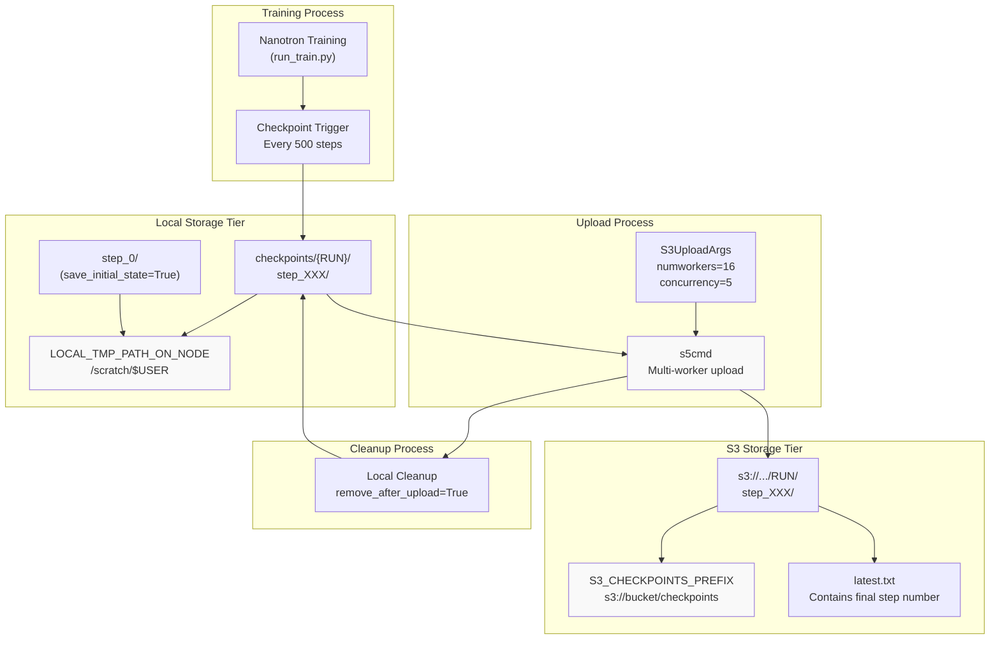
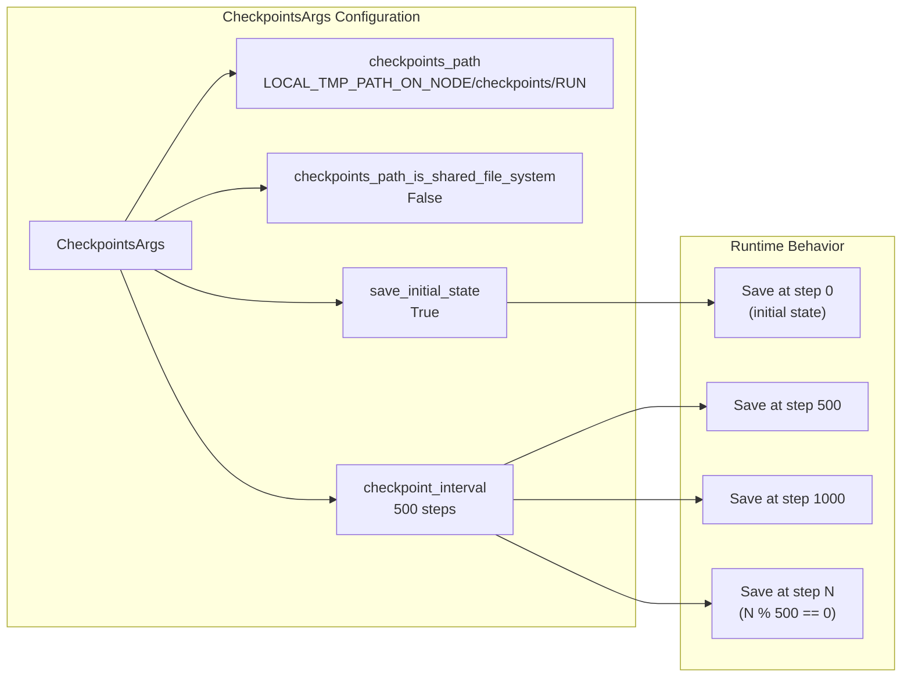
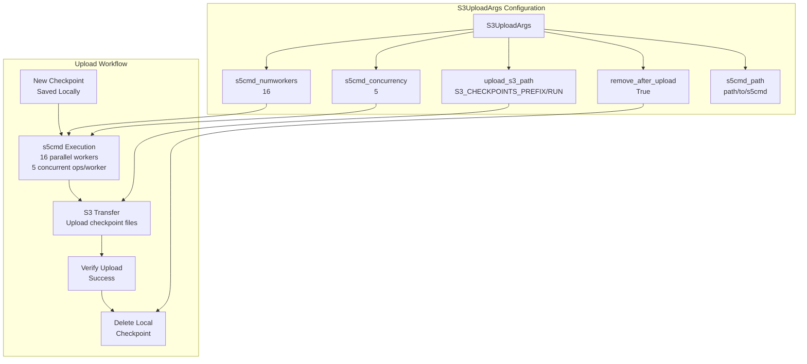
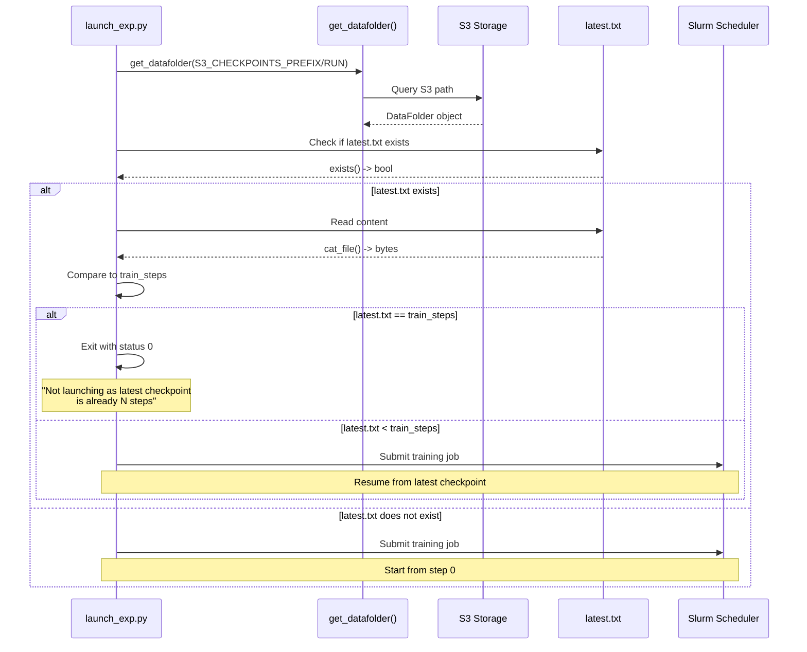
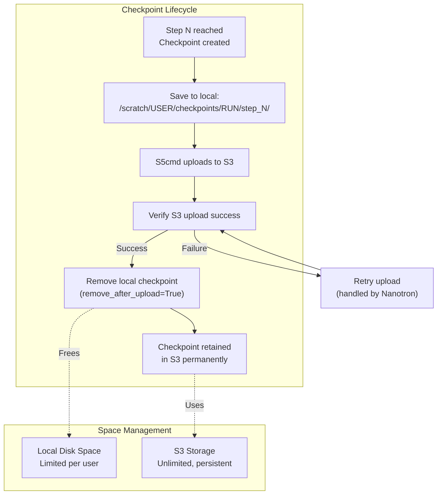
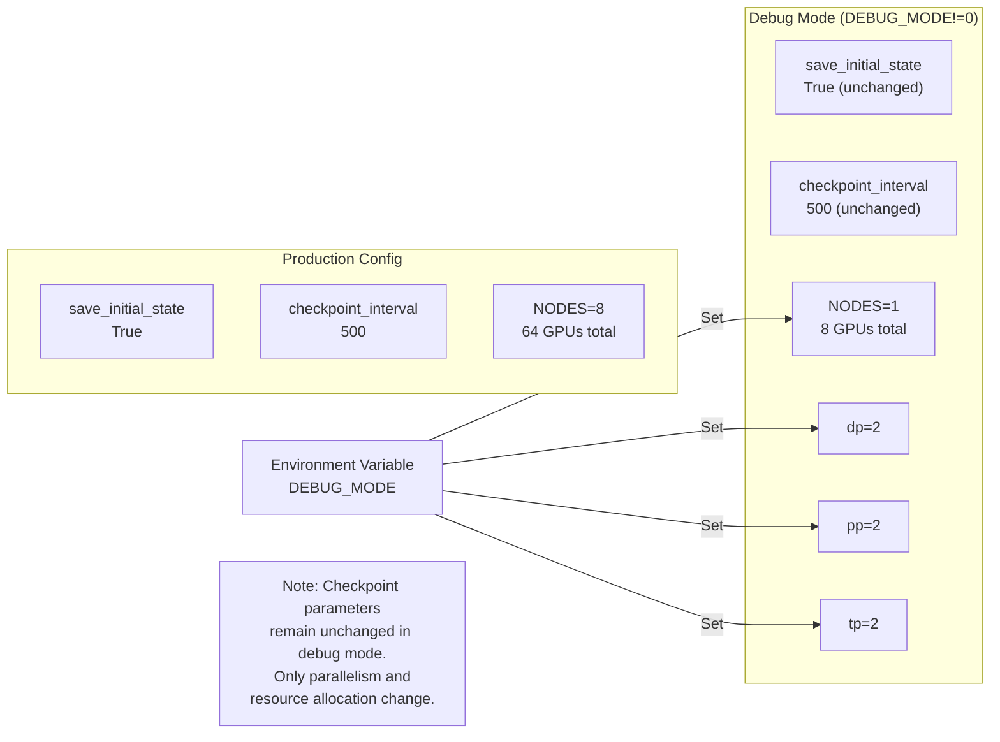
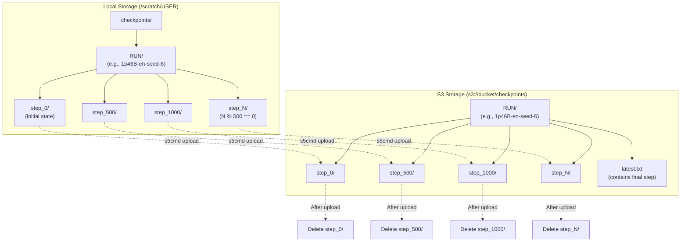

<!-- source: DeepWiki mcp.deepwiki.com · repo huggingface/fineweb-2 · page 5.3 Checkpoint Management · fetched 2026-10-26 -->

# Checkpoint Management

<details>
<summary>Relevant source files</summary>

The following files were used as context for generating this wiki page:

- [ablations/training/launch_exp.py](ablations/training/launch_exp.py)

</details>


## Purpose and Scope

This document explains the checkpoint management system in FineWeb 2's training pipeline, which implements a two-tier storage strategy combining local scratch space for active training with persistent S3 storage for long-term retention. The system handles checkpoint creation, automatic S3 upload, local cleanup, and verification to ensure reliable model persistence during distributed training.

For training configuration details, see [Training Configuration](#5.1). For distributed training setup, see [Distributed Training](#5.2). For Slurm job management, see [Slurm Job Configuration](#5.4).

---

## Two-Tier Storage Architecture

The checkpoint management system uses a two-tier storage architecture to balance performance and persistence:



**Diagram: Checkpoint Storage Flow**

The system separates storage into two tiers:

| Tier | Path | Purpose | Persistence |
|------|------|---------|-------------|
| **Local** | `/scratch/$USER/checkpoints/{RUN}` | Fast I/O during training | Temporary (deleted after upload) |
| **S3** | `s3://bucket/checkpoints/{RUN}` | Long-term checkpoint retention | Permanent |

**Sources:** [ablations/training/launch_exp.py:16](), [ablations/training/launch_exp.py:172-177](), [ablations/training/launch_exp.py:238-244]()

---

## Checkpoint Configuration

Checkpoint behavior is controlled by the `CheckpointsArgs` configuration object:



**Diagram: CheckpointsArgs Configuration Mapping**

### Configuration Parameters

| Parameter | Value | Purpose |
|-----------|-------|---------|
| `checkpoints_path` | `Path(f"{LOCAL_TMP_PATH_ON_NODE}/checkpoints/{RUN}")` | Local directory for checkpoint storage |
| `checkpoints_path_is_shared_file_system` | `False` | Indicates each node has independent local storage |
| `checkpoint_interval` | `500` | Save checkpoint every 500 training steps |
| `save_initial_state` | `True` | Save model state before training begins (step 0) |

The `RUN` variable is constructed as `{num_params}-{dataset_name}-seed-{SEED}`, creating unique paths for each experiment. For example: `1p46B-language_name-seed-6`.

**Sources:** [ablations/training/launch_exp.py:172-177](), [ablations/training/launch_exp.py:107]()

---

## S3 Upload Strategy

The S3 upload mechanism uses `s5cmd` for high-performance parallel transfers:



**Diagram: S3 Upload Mechanism**

### Upload Configuration

The `S3UploadArgs` object configures the upload behavior:

| Parameter | Value | Purpose |
|-----------|-------|---------|
| `upload_s3_path` | `f"{S3_CHECKPOINTS_PREFIX}/{RUN}"` | S3 destination path for checkpoints |
| `remove_after_upload` | `True` | Delete local checkpoint after successful S3 upload |
| `s5cmd_numworkers` | `16` | Number of parallel upload workers |
| `s5cmd_concurrency` | `5` | Concurrent operations per worker (total: 80 concurrent ops) |
| `s5cmd_path` | `S5CMD_PATH` | Path to s5cmd binary |

### Parallelization Strategy

The upload achieves high throughput through aggressive parallelization:
- **16 workers** × **5 concurrent operations** = **80 parallel transfers**
- Each checkpoint typically contains multiple files (model weights, optimizer state, configuration)
- Parallel upload significantly reduces upload time for large checkpoints

**Sources:** [ablations/training/launch_exp.py:238-244](), [ablations/training/launch_exp.py:21](), [ablations/training/launch_exp.py:23]()

---

## Checkpoint Verification

Before launching a training job, the system verifies whether training is already complete by checking S3:



**Diagram: Checkpoint Verification Sequence**

### Verification Logic

The verification process prevents redundant training runs:

1. **Query S3:** Use `get_datafolder()` to access the run's S3 directory
2. **Check `latest.txt`:** Determine if the file exists in S3
3. **Read Content:** If exists, read the step number stored in `latest.txt`
4. **Compare:** Check if stored step equals requested `train_steps`
5. **Decision:**
   - If equal: Skip job submission (training complete)
   - If less: Submit job to resume training
   - If missing: Submit job to start fresh training

This mechanism is implemented in [launch_exp.py:109-112]():

```python
df = get_datafolder(f"{S3_CHECKPOINTS_PREFIX}/{RUN}")
if df.exists("latest.txt") and df.cat_file("latest.txt") == bytes(str(args.train_steps), "utf-8"):
    print(f"Not launching as latest checkpoint is already {args.train_steps} steps")
    sys.exit(0)
```

**Sources:** [ablations/training/launch_exp.py:109-112]()

---

## Local Cleanup Process

The local cleanup process ensures efficient disk space usage on the cluster:



**Diagram: Checkpoint Cleanup Lifecycle**

### Cleanup Benefits

| Aspect | Benefit |
|--------|---------|
| **Disk Space** | Local `/scratch` directories have limited quota; cleanup prevents disk exhaustion |
| **Cost** | S3 storage is centralized and managed; local storage is more expensive per-node |
| **Performance** | Reduces clutter in local filesystem, improving I/O performance |
| **Reliability** | Single source of truth (S3) eliminates sync issues between local copies |

### Configuration Control

The cleanup behavior is controlled by the `remove_after_upload` flag:
- **`True`** (default): Delete local checkpoint after successful S3 upload
- **`False`**: Keep local checkpoint alongside S3 copy (useful for debugging)

In production, this is always set to `True` to maximize disk efficiency.

**Sources:** [ablations/training/launch_exp.py:240]()

---

## Debug Mode Checkpoint Behavior

Debug mode modifies checkpoint behavior for rapid testing:



**Diagram: Debug Mode Configuration Changes**

Debug mode (`DEBUG_MODE != "0"`) modifies parallelism and resources but **not** checkpoint configuration:

| Parameter | Production | Debug Mode |
|-----------|-----------|------------|
| `checkpoint_interval` | 500 | 500 (unchanged) |
| `save_initial_state` | True | True (unchanged) |
| `remove_after_upload` | True | True (unchanged) |
| `NODES` | 8 | 1 |
| Data parallelism | 64 | 2 |
| Pipeline parallelism | 1 | 2 |
| Tensor parallelism | 1 | 2 |

This design ensures checkpoint behavior is consistent between debugging and production, eliminating checkpoint-related bugs that only appear in production.

**Sources:** [ablations/training/launch_exp.py:262-271]()

---

## Checkpoint Directory Structure

The checkpoint system creates the following directory structure:



**Diagram: Checkpoint Directory Structure and Upload Flow**

### Directory Naming Convention

- **Run Directory:** `{num_params}-{dataset_name}-seed-{SEED}`
  - Example: `1p46B-english_data-seed-6`
- **Step Directories:** `step_{N}` where N is the training step number
  - Always includes `step_0` (initial state)
  - Subsequent checkpoints at multiples of 500

### File Contents

Each checkpoint directory contains:
- **Model weights:** PyTorch state dictionaries for model parameters
- **Optimizer state:** Adam optimizer momentum and variance buffers
- **Configuration:** YAML config used for the training run
- **Metadata:** Training step, global step, random state

**Sources:** [ablations/training/launch_exp.py:173](), [ablations/training/launch_exp.py:107](), [ablations/training/launch_exp.py:175]()

---

## Summary

The checkpoint management system implements a robust two-tier storage strategy:

1. **Local Tier:** Fast `/scratch` storage for active training (500-step intervals)
2. **S3 Tier:** Persistent cloud storage for long-term retention
3. **Upload:** Parallel s5cmd transfer (16 workers × 5 concurrent ops)
4. **Cleanup:** Automatic local deletion after successful S3 upload
5. **Verification:** Pre-training S3 check to avoid redundant runs

This architecture balances performance (local I/O), reliability (S3 persistence), and efficiency (automatic cleanup), enabling large-scale distributed training across multiple experiments and languages.

**Sources:** [ablations/training/launch_exp.py:109-244]()

---

