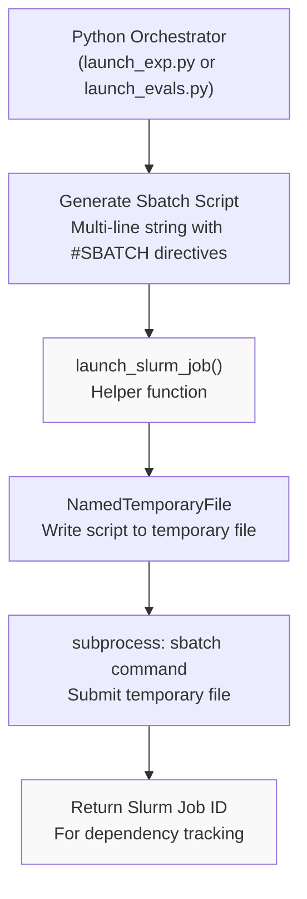
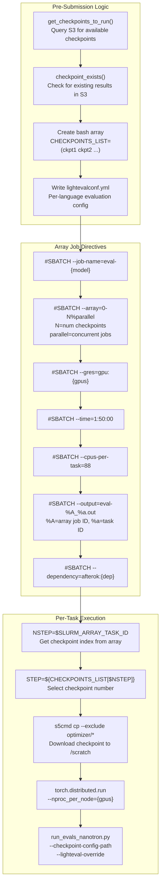
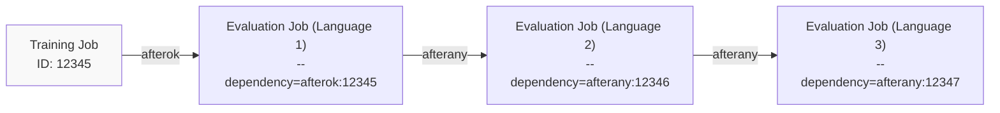

<!-- source: DeepWiki mcp.deepwiki.com · repo huggingface/fineweb-2 · page 5.4 Slurm Job Configuration · fetched 2026-10-26 -->

# Slurm Job Configuration

<details>
<summary>Relevant source files</summary>

The following files were used as context for generating this wiki page:

- [ablations/evaluation/launch_evals.py](ablations/evaluation/launch_evals.py)
- [ablations/training/launch_exp.py](ablations/training/launch_exp.py)

</details>


## Purpose and Scope

This page documents how Slurm batch scripts are dynamically generated and submitted for both training and evaluation jobs in FineWeb 2. The system uses a programmatic approach where Python scripts generate complete Slurm batch files with appropriate resource allocations, environment configurations, and job dependencies.

For details about the training parameters and model configuration that these jobs execute, see [Training Configuration](#5.1). For information about distributed parallelism strategies, see [Distributed Training](#5.2). For checkpoint storage and S3 upload mechanisms, see [Checkpoint Management](#5.3).

## Slurm Script Generation Pattern

Both training and evaluation systems use a common pattern for Slurm job submission implemented through the `launch_slurm_job()` helper function.

**Slurm Job Submission Flow**



Sources: [ablations/training/launch_exp.py:70-83](), [ablations/evaluation/launch_evals.py:49-66]()

The `launch_slurm_job()` function provides a reusable mechanism for submitting dynamically generated Slurm scripts:

| Component | Implementation | Purpose |
|-----------|----------------|---------|
| **Temporary File** | `tempfile.NamedTemporaryFile("w")` | Holds sbatch script content |
| **Script Writing** | `f.write(launch_file_contents)` followed by `f.flush()` | Writes multi-line script string to disk |
| **Submission** | `subprocess.check_output(["sbatch", *args, f.name])` | Executes sbatch command |
| **Job ID Extraction** | `.decode("utf-8").split()[-1]` | Parses job ID from sbatch output |

Sources: [ablations/training/launch_exp.py:70-83](), [ablations/evaluation/launch_evals.py:49-66]()

## Training Job Configuration

Training jobs are configured and submitted by `launch_exp.py`, which generates a complete Slurm batch script with resource allocation, environment setup, and distributed training launch commands.

**Training Job Script Structure**

```mermaid
graph TB
    subgraph "SBATCH Directives"
        JobName["#SBATCH --job-name"]
        Nodes["#SBATCH --nodes=8"]
        Tasks["#SBATCH --ntasks-per-node=1"]
        CPUs["#SBATCH --cpus-per-task=88"]
        GPUs["#SBATCH --gres=gpu:8"]
        Partition["#SBATCH --partition=hopper-prod"]
        QoS["#SBATCH --qos=normal"]
        Output["#SBATCH --output=<logs_path>"]
        Dependency["#SBATCH --dependency=afterok:<job_id>"]
        Requeue["#SBATCH --requeue"]
    end
    
    subgraph "Environment Setup"
        SlurmVars["Export SLURM environment:<br/>MASTER_ADDR, MASTER_PORT,<br/>COUNT_NODE, HOSTNAMES"]
        CudaVars["Export CUDA settings:<br/>CUDA_DEVICE_MAX_CONNECTIONS=1<br/>TMPDIR=/scratch/USER"]
        ModuleLoad["module load cuda/12.1"]
    end
    
    subgraph "Data Preparation"
        S3Download["srun s5cmd cp<br/>Copy dataset from S3 to local scratch"]
        Optional["(Only if dataset path starts with s3:)"]
    end
    
    subgraph "Distributed Launch"
        TorchRun["torch.distributed.run<br/>--nproc_per_node=8<br/>--nnodes=$COUNT_NODE<br/>--rdzv-backend=c10d"]
        NanotronScript["run_train.py<br/>--config-file=<yaml_path>"]
        Srun["srun bash -c<br/>Execute on all nodes"]
    end
    
    subgraph "Cleanup"
        RemoveData["rm -rf dataset/<br/>(Only if downloaded from S3)"]
    end
    
    JobName --> Nodes
    Nodes --> Tasks
    Tasks --> CPUs
    CPUs --> GPUs
    GPUs --> Partition
    Partition --> QoS
    QoS --> Output
    Output --> Dependency
    Dependency --> Requeue
    
    Requeue --> SlurmVars
    SlurmVars --> CudaVars
    CudaVars --> ModuleLoad
    
    ModuleLoad --> S3Download
    S3Download --> Optional
    
    Optional --> TorchRun
    TorchRun --> NanotronScript
    NanotronScript --> Srun
    
    Srun --> RemoveData
```



Sources: [ablations/training/launch_exp.py:286-375]()

### Resource Allocation Constants

The training system defines standard resource allocation constants:

| Constant | Value | Usage | File Location |
|----------|-------|-------|---------------|
| `NUM_GPUS` | 8 | GPUs per node | [ablations/training/launch_exp.py:32]() |
| `NUM_CPUS_IN_NODE` | 88 | Total CPUs per node | [ablations/training/launch_exp.py:33]() |
| `CPUS_PER_GPU` | 11 | Computed as `NUM_CPUS_IN_NODE // NUM_GPUS` | [ablations/training/launch_exp.py:34]() |
| `NODES` | 8 | Default node count (1 for DEBUG_MODE) | [ablations/training/launch_exp.py:261-271]() |
| `PARTITION` | "hopper-prod" | Slurm partition name | [ablations/training/launch_exp.py:292]() |

Sources: [ablations/training/launch_exp.py:32-34](), [ablations/training/launch_exp.py:261-271](), [ablations/training/launch_exp.py:292]()

### Slurm Directives for Training

The generated training script includes these key directives:

```bash
#SBATCH --job-name={run_name}-{SEED}
#SBATCH --nodes=8
#SBATCH --ntasks-per-node=1          # crucial - only 1 task per dist per node!
#SBATCH --cpus-per-task=88
#SBATCH --gres=gpu:8
#SBATCH --partition=hopper-prod
#SBATCH --qos={args.priority}
#SBATCH --output={LOGS_PATH}/{run_name}/train-{timestamp}-%x-%j
#SBATCH --requeue
#SBATCH --dependency=afterok:{args.d}  # if dependency specified
```

Sources: [ablations/training/launch_exp.py:287-300]()

The `--ntasks-per-node=1` directive is critical for distributed training—each node runs exactly one task that then launches multiple GPU processes via `torch.distributed.run`.

### Environment Configuration

The training script sets up the execution environment with Slurm-specific variables and CUDA settings:

**Slurm Environment Variables:**
- `HOSTNAMES`: All hostnames in the job allocation via `scontrol show hostnames`
- `MASTER_ADDR`: First hostname for rendezvous coordination
- `MASTER_PORT`: Randomly selected port in range 1024-65535
- `COUNT_NODE`: Number of nodes via `wc -l`

**CUDA Settings:**
- `TMPDIR`: Set to `/scratch/{USER}` for local temporary storage
- `CUDA_DEVICE_MAX_CONNECTIONS`: Set to "1" for performance optimization
- CUDA module: `module load cuda/12.1`

Sources: [ablations/training/launch_exp.py:326-338]()

### S3 Dataset Download

For datasets stored in S3, the script includes a conditional download step executed via `srun`:

```bash
srun --ntasks-per-node=1 rm -rf {LOCAL_TMP_PATH_ON_NODE}/dataset
srun --ntasks-per-node=1 s5cmd cp '{args.data}/*' {LOCAL_TMP_PATH_ON_NODE}/dataset/{RUN}/
```

This downloads the dataset to local scratch storage (`/scratch/{USER}/dataset/{RUN}/`) for faster training access. The cleanup command at the end removes this data after training completes.

Sources: [ablations/training/launch_exp.py:283](), [ablations/training/launch_exp.py:324](), [ablations/training/launch_exp.py:372-374]()

### Distributed Launch Command

The training job constructs a multi-level launch command:

**torch.distributed.run parameters:**
- `--nproc_per_node 8`: Launch 8 processes (one per GPU) on each node
- `--nnodes $COUNT_NODE`: Use all allocated nodes
- `--rdzv-backend c10d`: Use c10d rendezvous backend
- `--rdzv-endpoint $MASTER_ADDR:$MASTER_PORT`: Coordination endpoint
- `--rdzv-id $SLURM_JOB_ID`: Unique ID for this run
- `--node_rank $SLURM_PROCID`: Rank of this node
- `--max_restarts 0`: No automatic restarts
- `--tee 3`: Output to both stdout and stderr

**Execution via srun:**
```bash
srun -u bash -c "$LAUNCHER --node_rank $SLURM_PROCID --role $SLURMD_NODENAME: $CMD"
```

The `srun` command executes the launcher on all nodes, with each node receiving its unique `$SLURM_PROCID` as the node rank.

Sources: [ablations/training/launch_exp.py:347-367]()

## Evaluation Job Configuration

Evaluation jobs use Slurm array jobs to parallelize checkpoint evaluation across multiple model checkpoints. The configuration is more complex due to checkpoint discovery, filtering, and array job management.

**Evaluation Array Job Structure**



Sources: [ablations/evaluation/launch_evals.py:69-94](), [ablations/evaluation/launch_evals.py:195-268]()

### Checkpoint Discovery and Filtering

The `get_checkpoints_to_run()` function implements intelligent checkpoint selection:

**Checkpoint Discovery Process:**

1. **Query S3**: Uses `get_datafolder(s3_path).ls()` to list available checkpoints
2. **Parse Selection**: Splits comma-separated checkpoint list or uses all available
3. **Validate Existence**: Checks that requested checkpoints exist in S3
4. **Filter Completed**: Calls `checkpoint_exists()` to skip already-evaluated checkpoints
5. **Return List**: Returns only checkpoints needing evaluation

Sources: [ablations/evaluation/launch_evals.py:69-94]()

The `checkpoint_exists()` function checks for existing results:

```python
def checkpoint_exists(logging_dir: str, model_name: str, checkpoint: str, reference_date: Optional[datetime]) -> bool:
    fs, path = url_to_fs(logging_dir)
    result_files = fs.glob(f"{path}/results/{model_name}/{checkpoint}/results_*.json")
    
    if len(result_files) == 0:
        return False
    
    if reference_date is None:
        return True
    
    # Check if any results are newer than reference date
    timestamps = [datetime.strptime(re.search(r'results_(.*)\.json$', f).group(1), "%Y-%m-%dT%H-%M-%S.%f") for f in result_files]
    return any(timestamp > reference_date for timestamp in timestamps)
```

This function supports the `--after-date` parameter to re-evaluate checkpoints after a specific date.

Sources: [ablations/evaluation/launch_evals.py:31-46]()

### Array Job Configuration

Slurm array jobs enable parallel evaluation of multiple checkpoints:

**Array Job Directives:**

```bash
#SBATCH --array=0-{N-1}%{parallel}
```

Where:
- `N` is the number of checkpoints to evaluate
- `parallel` (default 5) limits concurrent array tasks

This creates N individual tasks, each with a unique `$SLURM_ARRAY_TASK_ID`, with at most `parallel` tasks running simultaneously.

Sources: [ablations/evaluation/launch_evals.py:201]()

### LightEval Configuration Generation

Each evaluation job generates a language-specific `lightevalconf.yml` file:

**Generated Configuration:**

```yaml
batch_size: {4 or 6 or 8}  # Language-dependent
checkpoints_path: null
generation: null
logging:
  logging_dir: {args.logging_dir}
  save_details: true
  save_results: true
parallelism:
  dp: {args.gpus}
  expert_parallel_size: 1
  pp: 1
  tp: 1
tasks:
  custom_tasks: lighteval.community_tasks.multilingual.configs.{language}
  dataset_loading_processes: {n_cpus}
  max_samples: 1000
  tasks: {args.tasks}
```

Batch sizes are tuned per language:
- Chinese (`zh`): 4
- Arabic (`ar`) and Swahili (`sw`): 6
- All others: 8

Sources: [ablations/evaluation/launch_evals.py:162-187]()

### Resource Allocation for Evaluation

Evaluation jobs use dynamic resource allocation:

| Parameter | Default | Configurable | Notes |
|-----------|---------|--------------|-------|
| **Nodes** | 1 | No | Single-node evaluation |
| **GPUs per node** | 8 | Yes (`--gpus`) | Can be reduced for smaller evaluations |
| **CPUs per task** | 88 | No | All CPUs on node |
| **CPUs per GPU** | `88 // gpus` | Computed | Used for data loading workers |
| **Time limit** | 1:50:00 | Yes (`--time_limit`) | Just under 2 hours |
| **Parallel tasks** | 5 | Yes (`--parallel`) | Concurrent array tasks |
| **QoS** | normal | Yes (`--qos`) | Slurm quality of service |

Sources: [ablations/evaluation/launch_evals.py:15-19](), [ablations/evaluation/launch_evals.py:128-132](), [ablations/evaluation/launch_evals.py:159]()

### Checkpoint Download in Array Tasks

Each array task downloads its assigned checkpoint:

```bash
CHECKPOINTS_LIST=(1000 2000 3000 ...)  # Generated from selected checkpoints
NSTEP=$((SLURM_ARRAY_TASK_ID))
STEP=${CHECKPOINTS_LIST[$NSTEP]}

LOCAL_DOWNLOAD_CHECKPOINT_FOLDER=/scratch/USER/checkpoint/{model_name}/$STEP
mkdir -p $LOCAL_DOWNLOAD_CHECKPOINT_FOLDER
s5cmd cp --exclude "optimizer/*" {s3_path}/$STEP/* $LOCAL_DOWNLOAD_CHECKPOINT_FOLDER
```

The `--exclude "optimizer/*"` flag skips optimizer state files, significantly reducing download time and storage requirements.

Sources: [ablations/evaluation/launch_evals.py:244-255]()

## Job Dependency Management

Both systems support job dependencies to chain operations:

**Dependency Patterns:**



Sources: [ablations/training/launch_exp.py:300](), [ablations/evaluation/launch_evals.py:189-207]()

### Dependency Types

**Training Dependencies:**
- Uses `--dependency=afterok:{job_id}` when `-d` argument provided
- Requires previous job to complete successfully before starting

**Evaluation Dependencies:**
- Supports `--dependency` via `-d` argument for external dependencies
- Chains evaluation jobs using `afterany:{previous_job_id}`
- `afterok` for explicit dependencies (job must succeed)
- `afterany` for sequential processing (job runs regardless of previous status)

Sources: [ablations/training/launch_exp.py:96](), [ablations/training/launch_exp.py:300](), [ablations/evaluation/launch_evals.py:135](), [ablations/evaluation/launch_evals.py:189-207]()

### Evaluation Job Chaining

The evaluation launcher implements automatic job chaining when processing multiple models:

```python
job_id = None
for model_name, seed in itertools.product(args.model_name.split(","), args.seed.split(",")):
    # ... checkpoint discovery and script generation ...
    
    deps = []
    if args.d:
        deps.append(f"afterok:{args.d}")
    if job_id:
        deps.append(f"afterany:{job_id}")
    
    # ... sbatch script with dependency ...
    launched_id = launch_slurm_job(launch_script)
    job_id = launched_id  # Chain next job to this one
```

This creates a sequential dependency chain across all model/seed combinations, ensuring evaluations don't overwhelm the cluster.

Sources: [ablations/evaluation/launch_evals.py:144-272]()

## Path Configuration

Both systems rely on centralized path constants that must be adapted to the deployment environment:

**Training Paths:**

| Constant | Default Value | Purpose |
|----------|---------------|---------|
| `LOCAL_TMP_PATH_ON_NODE` | `/scratch/{USER}` | Local scratch storage |
| `LAUNCH_CONFIGS_PATH` | `path/to/launch-configs` | Saved Nanotron configs |
| `LOGS_PATH` | `path/to/slurm-logs` | Slurm output logs |
| `S3_CHECKPOINTS_PREFIX` | `path/to/where_to_save_checkpoints` | S3 checkpoint storage |
| `NANOTRON_RUN_TRAIN_SCRIPT` | `path/to/run_train.py` | Nanotron training script |
| `S5CMD_PATH` | `path/to/s5cmd` | S3 transfer utility |

Sources: [ablations/training/launch_exp.py:16-21]()

**Evaluation Paths:**

| Constant | Default Value | Purpose |
|----------|---------------|---------|
| `EVAL_LOGS_PATH` | `/path/to/eval-logs` | Evaluation output logs and configs |
| `CPUS_PER_NODE` | 88 | Node CPU count |
| `GPUS_PER_NODE` | 8 | Node GPU count |
| `PARTITION` | "partition" | Slurm partition name |
| `NODES` | 1 | Nodes for evaluation (always 1) |

Sources: [ablations/evaluation/launch_evals.py:15-19]()

All paths marked with `path/to/` must be customized for the deployment environment as noted in the generated scripts with `# [BEGINING] ADAPT TO YOUR ENVIRONMENT` comments.

Sources: [ablations/training/launch_exp.py:303-306](), [ablations/evaluation/launch_evals.py:210-223]()

## Debug Mode

The training system supports a DEBUG_MODE for testing with reduced resources:

**Debug Mode Transformations:**

| Parameter | Production | Debug Mode |
|-----------|------------|------------|
| Nodes | 8 | 1 |
| Data Parallelism | 64 | 2 |
| Pipeline Parallelism | 1 | 2 |
| Tensor Parallelism | 1 | 2 |
| Micro Batch Size | 4 | 3 |
| Batch Accumulation | 4 | 2 |

Enabled via environment variable: `export DEBUG_MODE=1`

This mode allows testing the full training pipeline on a single node with mixed parallelism before launching expensive multi-node runs.

Sources: [ablations/training/launch_exp.py:262-271]()

---

