# Page: Overview

# Overview

<details>
<summary>Relevant source files</summary>

The following files were used as context for generating this wiki page:

- [README.md](README.md)

</details>


## Purpose and Scope

This document provides a high-level overview of the FineWeb 2 codebase, including its purpose, architecture, and major system components. FineWeb 2 is a multilingual pretraining dataset processing and validation framework that extends the original FineWeb to support 1000+ languages.

For detailed information about the dataset itself and its research goals, see [What is FineWeb 2](#1.1). For architectural details and component interactions, see [System Architecture](#1.2). For information about the actual data processing steps, see [Data Processing Pipeline](#2). For details on language-specific configurations, see [Configuration System](#3).

**Sources:** [README.md:1-10]()

## FineWeb 2 at a Glance

FineWeb 2 is a repository containing the code and configurations used to create a multilingual web-scale pretraining dataset covering 1000+ languages. The dataset is hosted at `https://huggingface.co/datasets/HuggingFaceFW/fineweb-2`, while this repository contains the processing pipeline, evaluation framework, and training scripts used to create and validate the dataset.

**Key characteristics:**
- **Input data:** Non-English Common Crawl data (English score < 0.65 from original FineWeb processing)
- **Output data:** Cleaned, deduplicated, filtered multilingual corpus with per-document metadata
- **Language coverage:** 1000+ languages with per-language configuration files
- **Validation methodology:** Empirical ablation testing using 1.46B parameter models
- **Configuration-driven:** Each language has a dedicated YAML file in `configs/{iso3_lang}_{script}.yml`

**Sources:** [README.md:1-13]()

## Repository Structure

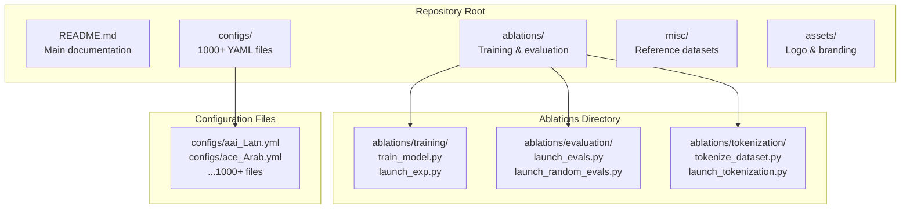

**Sources:** [README.md:11-90]()

## System Architecture Overview

FineWeb 2 consists of three major interconnected systems:

### 1. Data Processing Pipeline

A four-stage pipeline that transforms raw Common Crawl data into cleaned multilingual corpus:

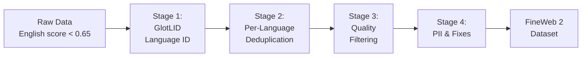

Each stage is parameterized by language-specific configuration files. See [Data Processing Pipeline](#2) for detailed documentation.

**Sources:** [README.md:9-64]()

### 2. Configuration System

Language-specific YAML configuration files drive all processing decisions:

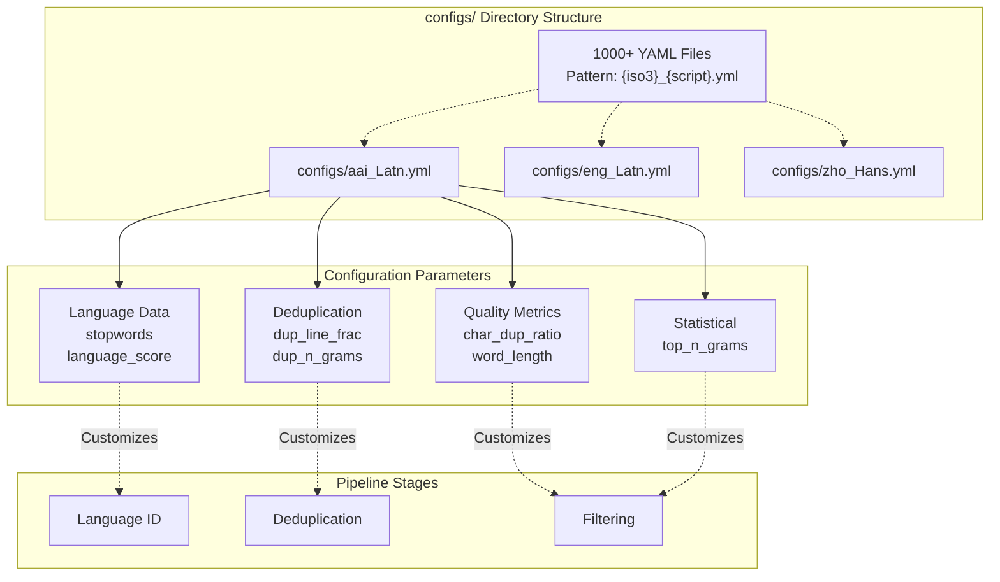

See [Configuration System](#3) for detailed parameter documentation.

**Sources:** [README.md:10-11]()

### 3. Ablation & Evaluation Framework

An empirical validation system that tests each pipeline design choice:

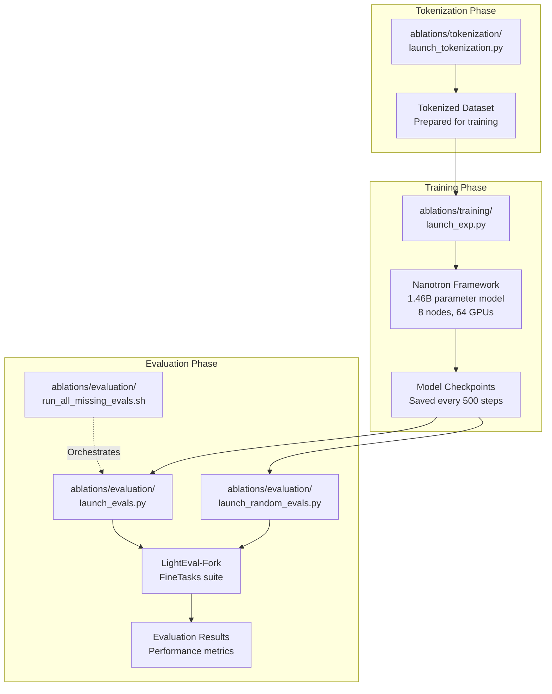

See [Ablation and Evaluation Framework](#4) for detailed workflow documentation.

**Sources:** [README.md:65-77]()

## Code-to-System Mapping

The following diagram maps major system components to their implementation files:

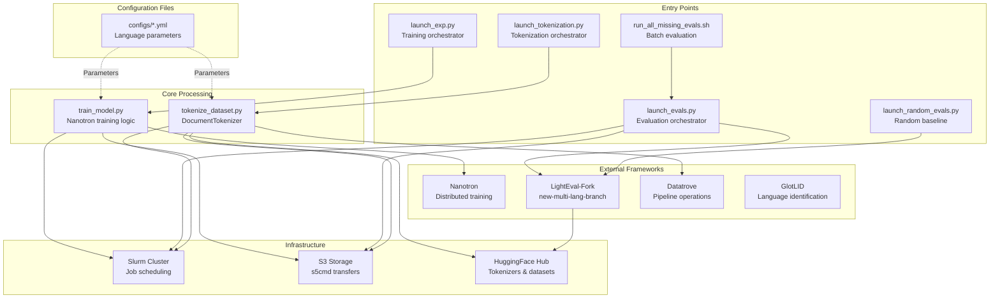

**Sources:** [README.md:68-90]()

## Processing Pipeline Details

The data processing pipeline consists of four stages, each implemented using the Datatrove framework:

| Stage | Purpose | Key Tool | Configuration Parameters |
|-------|---------|----------|-------------------------|
| **Language Identification** | Identify language and script | GlotLID (2000+ labels) | `language_score` threshold per language |
| **Deduplication** | Remove duplicate content globally per language | Datatrove MinHash | `dup_line_frac`, `dup_n_grams`, `minhash_cluster_size` |
| **Quality Filtering** | Apply FineWeb filters with language-specific thresholds | Datatrove Filters | `char_dup_ratio`, word length, stopwords |
| **PII & Fixes** | Anonymize PII, fix encoding, clean artifacts | FTFY, Trafilatura fixes | Global rules (no per-language config) |

**Key differences from original FineWeb:**
- Language identification uses **GlotLID** instead of fasttext176 [README.md:21]()
- Deduplication is **per-language globally** rather than per-snapshot [README.md:25]()
- **Rehydration mechanism** using `minhash_cluster_size` metadata [README.md:25-51]()
- Modified filter thresholds: `char_dup_ratio` changed from 0.01 to 0.1 [README.md:56]()
- Removed `short_line_thr` and C4 filters [README.md:56-58]()

**Sources:** [README.md:9-64]()

## Rehydration Mechanism

A unique feature of FineWeb 2 is the deduplication rehydration mechanism. During deduplication, cluster sizes are preserved in metadata, allowing post-processing upsampling:

```python
# Example from README.md:37-51
class Rehydrater(PipelineStep):
    def run(self, data: DocumentsPipeline, rank: int = 0, world_size: int = 1):
        upsampling_weights = {1: 1, 2: 2, 3: 3, 5: 5, 100: 8, 1000: 1}
        limits = sorted(upsampling_weights.keys())
        
        for doc in data:
            upsampling_weight = upsampling_weights[
                limits[bisect.bisect_right(limits, doc.metadata["minhash_cluster_size"]) - 1]]
            for _ in range(upsampling_weight):
                yield doc
```

**Upsampling strategy:**
- No duplicates (N=1): 1x
- Small clusters (N=2,3): Nx
- Medium clusters (N=4): 3x
- Large clusters (5≤N<100): 5x
- Very large clusters (100≤N<1000): 8x
- Extremely large clusters (N≥1000): 1x (assumed lower quality)

**Sources:** [README.md:24-51]()

## Validation Methodology

Every pipeline design choice is validated through empirical testing:

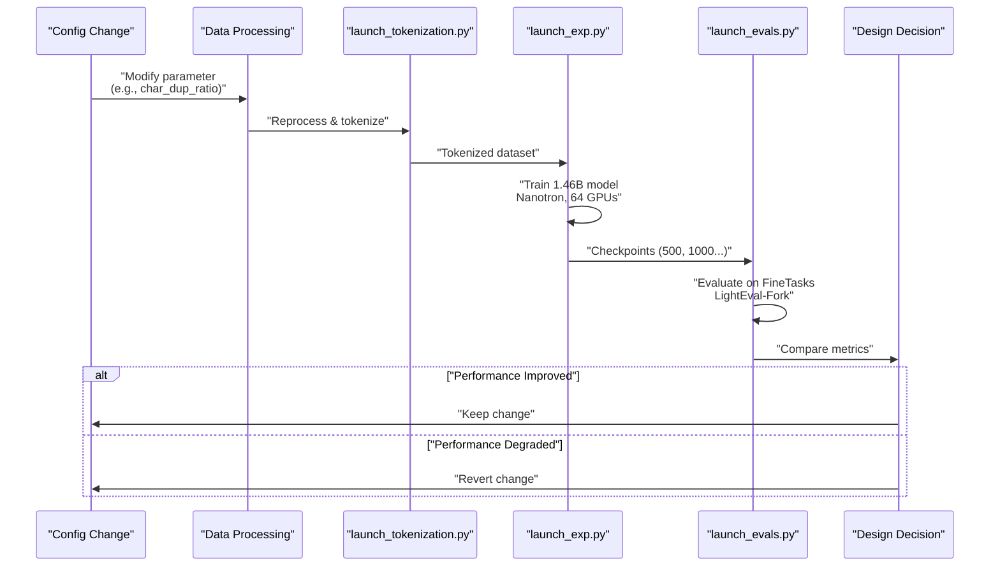

**Validation components:**
- **Model architecture:** 1.46B parameter LLaMA-style model (14 layers, 2048 hidden size)
- **Training framework:** Nanotron with pure data parallelism (DP=64, PP=1, TP=1)
- **Evaluation suite:** FineTasks (language-specific tasks)
- **Checkpoint frequency:** Every 500 training steps

See [Ablation and Evaluation Framework](#4) for detailed documentation.

**Sources:** [README.md:65-72]()

## External Dependencies

FineWeb 2 integrates multiple external tools and frameworks:

| Category | Tool | Purpose | Version/Branch |
|----------|------|---------|----------------|
| **Language Processing** | GlotLID | Language identification (2000+ labels) | Latest |
| | FTFY | Encoding fixes | Latest |
| | Trafilatura | HTML extraction + table fixes | Modified |
| **Data Processing** | Datatrove | Pipeline operations, readers, writers, filters | Latest |
| | s5cmd | High-performance S3 transfers | Latest |
| **ML Frameworks** | Nanotron | Distributed model training | Latest |
| | LightEval-Fork | Multilingual evaluation | `new-multi-lang-branch` |
| | torch.distributed | Multi-GPU coordination | PyTorch latest |
| **Infrastructure** | Slurm | Job scheduling and resource management | Cluster-dependent |
| | S3 | Data and checkpoint storage | AWS/Compatible |
| | HuggingFace Hub | Tokenizers and dataset hosting | Latest |

**Critical version note:** LightEval must use the `new-multi-lang-branch` fork [README.md:89]() for multilingual support.

**Sources:** [README.md:81-90]()

## Word and Sentence Tokenization

Many pipeline stages require word and sentence tokenization, but most languages lack dedicated tokenizers. FineWeb 2 solves this through automatic language-family-based tokenizer assignment.

**Tokenizer assignment strategy:**
- Languages are grouped by language family
- Each family is assigned a similar tokenizer
- Tokenizer mappings are available at `https://huggingface.co/spaces/HuggingFaceFW-Dev/lang-word-tokenizers`

This enables consistent text processing across 1000+ languages without requiring language-specific tokenizer development.

**Sources:** [README.md:81-82]()

## License and Citation

**Code license:** Apache License 2.0 [README.md:93]()

**Dataset license:** Open Data Commons Attribution License (ODC-By) [README.md:93]()

**Research paper:** Available at `https://huggingface.co/papers/2506.20920` [README.md:7]()

**Citation:**
```bibtex
@misc{penedo2025fineweb2pipelinescale,
    title={FineWeb2: One Pipeline to Scale Them All -- Adapting Pre-Training Data Processing to Every Language}, 
    author={Guilherme Penedo and Hynek Kydlíček and Vinko Sabolčec and Bettina Messmer and Negar Foroutan and Amir Hossein Kargaran and Colin Raffel and Martin Jaggi and Leandro Von Werra and Thomas Wolf},
    year={2025},
    eprint={2506.20920},
    archivePrefix={arXiv},
    primaryClass={cs.CL},
    url={https://arxiv.org/abs/2506.20920}, 
}
```

**Sources:** [README.md:92-106]()

## Next Steps

For detailed information about specific subsystems:

- **Dataset goals and research context:** See [What is FineWeb 2](#1.1)
- **Detailed architecture:** See [System Architecture](#1.2)
- **Data processing stages:** See [Data Processing Pipeline](#2)
- **Configuration files:** See [Configuration System](#3)
- **Evaluation framework:** See [Ablation and Evaluation Framework](#4)
- **Training system:** See [Training System](#5)
- **Tokenization:** See [Tokenization System](#6)
- **External tools:** See [External Tools and Dependencies](#7)

---

# Page: What is FineWeb 2

# What is FineWeb 2

<details>
<summary>Relevant source files</summary>

The following files were used as context for generating this wiki page:

- [README.md](README.md)

</details>


This document introduces the FineWeb 2 dataset, explaining its purpose as a large-scale multilingual pretraining corpus, its key characteristics, and the architecture that enables processing over 1000 languages. For details on the processing pipeline stages, see [Data Processing Pipeline](#2). For information about the configuration system that enables language-specific processing, see [Configuration System](#3). For the empirical validation methodology, see [Ablation and Evaluation Framework](#4).

## Overview

FineWeb 2 is a multilingual web-scale pretraining dataset that extends the high-quality data curation approach of the original FineWeb dataset to over 1000 languages. The dataset is designed to provide high-quality pretraining data for language models across a diverse range of languages, scripts, and language families.

### Key Statistics

| Metric | Value |
|--------|-------|
| **Languages Supported** | 1000+ |
| **Language Labels** | 2000+ (via GlotLID) |
| **Configuration Files** | 1000+ YAML files |
| **Source Data** | Non-English portion of original FineWeb (English score < 0.65) |
| **License** | ODC-By (Open Data Commons Attribution) |
| **Code License** | Apache 2.0 |

The dataset is publicly available at `HuggingFaceFW/fineweb-2` on the HuggingFace Hub, with the processing code and ablation experiments documented in this repository.

**Sources:** [README.md:1-106]()

## Dataset Purpose and Scope

FineWeb 2 addresses the scarcity of high-quality pretraining data for low-resource and mid-resource languages. While the original FineWeb focused on English content, FineWeb 2 applies similar quality curation principles to a massively multilingual setting, with three key innovations:

1. **Language-Specific Processing**: Rather than applying universal thresholds, each language has individually tuned filter thresholds, stopwords, and quality metrics defined in per-language configuration files at `configs/{iso3_lang}_{script}.yml`.

2. **Global Per-Language Deduplication**: Unlike FineWeb's per-snapshot deduplication, FineWeb 2 deduplicates globally within each language across all CommonCrawl snapshots, with a "re-hydration" mechanism that can upsample high-quality duplicates.

3. **Empirical Validation**: Every pipeline design decision is validated through ablation experiments that train 1.46B models and evaluate them on the FineTasks evaluation suite.

**Sources:** [README.md:4-11](), [README.md:25-35]()

## Data Source and Scope

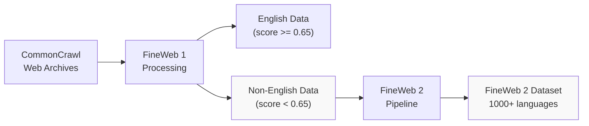

**Diagram: Data Source Flow**

FineWeb 2 begins with the non-English portion of data processed during FineWeb 1 creation. Documents with an English language confidence score below 0.65 (as determined by fasttext176 during FineWeb 1 processing) are fed into the FineWeb 2 pipeline. This represents the starting point before language re-identification using GlotLID.

**Sources:** [README.md:13-14]()

## Four-Stage Processing Pipeline

The FineWeb 2 pipeline consists of four sequential stages, each configurable through the per-language YAML configuration files:

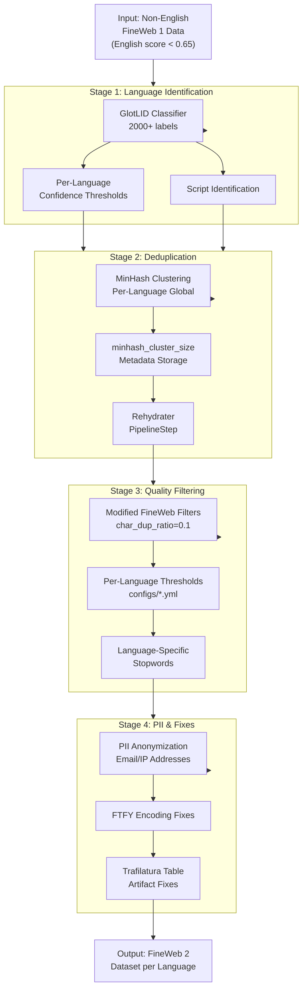

**Diagram: Four-Stage Pipeline Architecture**

### Stage Details

| Stage | Primary Tool | Key Feature | Configuration |
|-------|-------------|-------------|---------------|
| **1. Language ID** | GlotLID | 2000+ language labels, script detection | Per-language confidence thresholds |
| **2. Deduplication** | MinHash (Datatrove) | Global per-language, cluster size tracking | `dup_line_frac`, `dup_n_grams` |
| **3. Filtering** | Modified FineWeb filters | Language-specific stopwords and thresholds | `language_score`, word length limits |
| **4. PII & Fixes** | FTFY, Trafilatura patches | Encoding fixes, table artifact removal | Global application |

**Sources:** [README.md:14-64]()

## Configuration-Driven Architecture

A key architectural principle of FineWeb 2 is the separation of processing logic from language-specific parameters. This enables scaling to 1000+ languages without code changes:

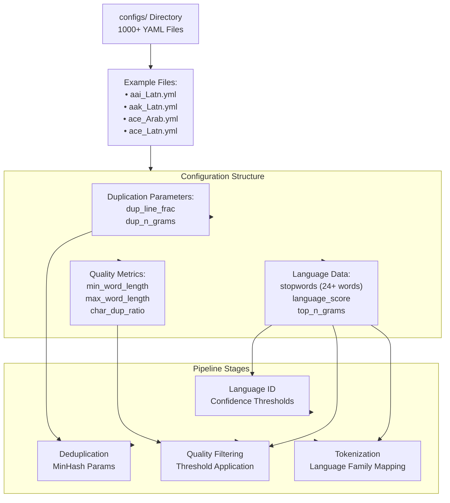

**Diagram: Configuration System Architecture**

The configuration files follow the naming convention `{iso3_lang}_{script}.yml`, where `iso3_lang` is the ISO 639-3 language code and `script` is the script identifier (e.g., `Latn` for Latin, `Arab` for Arabic). This allows a single language like Acehnese to have multiple configurations for different scripts (`ace_Arab.yml` and `ace_Latn.yml`).

**Sources:** [README.md:10-11]()

## Re-Hydration Mechanism

A unique feature of FineWeb 2 is the deduplication re-hydration mechanism implemented through the `Rehydrater` class:

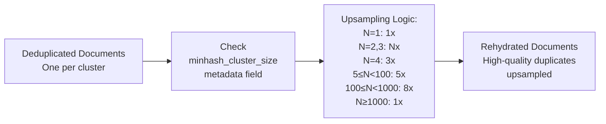

**Diagram: Deduplication Re-Hydration Flow**

The `Rehydrater` class (shown in the example code at [README.md:38-51]()) uses the `minhash_cluster_size` metadata field to determine upsampling weights. Documents from larger clusters (indicating more copies found on the web) are upsampled more aggressively, based on the assumption that widespread content is often higher quality. However, extremely large clusters (N ≥ 1000) are downsampled to 1x, as these likely represent low-quality templated content.

**Sources:** [README.md:25-51]()

## Empirical Validation Methodology

Every design choice in FineWeb 2 is validated through a rigorous ablation testing workflow:

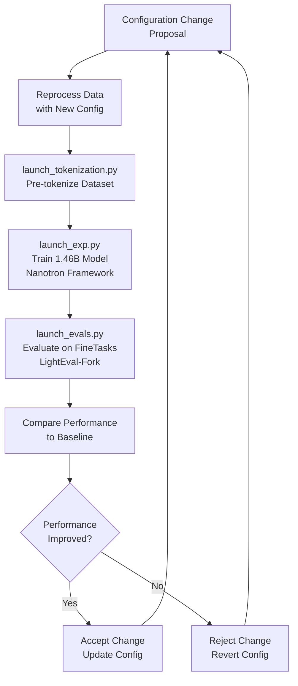

**Diagram: Ablation Testing Workflow**

This workflow is implemented through three main scripts:

| Script | Purpose | Framework |
|--------|---------|-----------|
| `ablations/tokenization/tokenize_dataset.py` | Pre-tokenize processed data | Datatrove DocumentTokenizer |
| `ablations/training/train_model.py` | Train 1.46B ablation models | Nanotron (8 nodes, 64 GPUs) |
| `ablations/evaluation/launch_evals.py` | Evaluate checkpoints on FineTasks | LightEval-Fork |

The use of relatively small 1.46B models enables rapid iteration while still providing meaningful performance signals for pipeline optimization.

**Sources:** [README.md:65-78]()

## Dataset Delivery and Access

FineWeb 2 is delivered through multiple channels:

| Delivery Method | Location | Purpose |
|----------------|----------|---------|
| **Dataset Hub** | `HuggingFaceFW/fineweb-2` | Primary dataset access |
| **Research Paper** | `https://huggingface.co/papers/2506.20920` | Methodology documentation |
| **Processing Code** | This repository | Full pipeline reproducibility |
| **Ablation Code** | `ablations/` directory | Validation experiments |
| **Reference Datasets** | `misc/reference_datasets/` | Baseline comparison data |

The combination of dataset, paper, and code provides full transparency and reproducibility for the FineWeb 2 processing pipeline.

**Sources:** [README.md:4-7](), [README.md:84-93]()

## Key Differences from FineWeb 1

| Aspect | FineWeb 1 | FineWeb 2 |
|--------|-----------|-----------|
| **Language Scope** | English only | 1000+ languages |
| **Language ID Tool** | fasttext176 | GlotLID (2000+ labels) |
| **Deduplication Scope** | Per-snapshot | Global per-language |
| **Filter Thresholds** | Universal | Per-language configurations |
| **Configuration Files** | Not applicable | 1000+ YAML files |
| **Script Support** | Latin script only | 100+ scripts identified |
| **Re-Hydration** | Not applicable | Upsampling by cluster size |

The shift to per-language configurations represents a fundamental architectural change that enables FineWeb 2 to scale to thousands of languages while maintaining quality standards tailored to each language's characteristics.

**Sources:** [README.md:1-64]()

---

# Page: System Architecture

# System Architecture

<details>
<summary>Relevant source files</summary>

The following files were used as context for generating this wiki page:

- [README.md](README.md)

</details>


## Purpose and Scope

This document describes the overall architecture of the FineWeb 2 system and how its major components interact to produce a high-quality multilingual pretraining dataset covering 1000+ languages. The architecture consists of four primary subsystems: the data processing pipeline, the configuration system, the ablation and evaluation framework, and the training system.

For detailed information about specific subsystems:
- Data processing stages: [Data Processing Pipeline](#2)
- Language-specific configuration: [Configuration System](#3)
- Empirical validation: [Ablation and Evaluation Framework](#4)
- Model training: [Training System](#5)
- Data tokenization: [Tokenization System](#6)
- External dependencies: [External Tools and Dependencies](#7)

**Sources:** [README.md:1-107]()

## High-Level Architecture Overview

The FineWeb 2 system is designed around a configuration-driven, empirically-validated architecture. Every design decision in the data processing pipeline is validated through a complete cycle of data processing, model training, and evaluation.

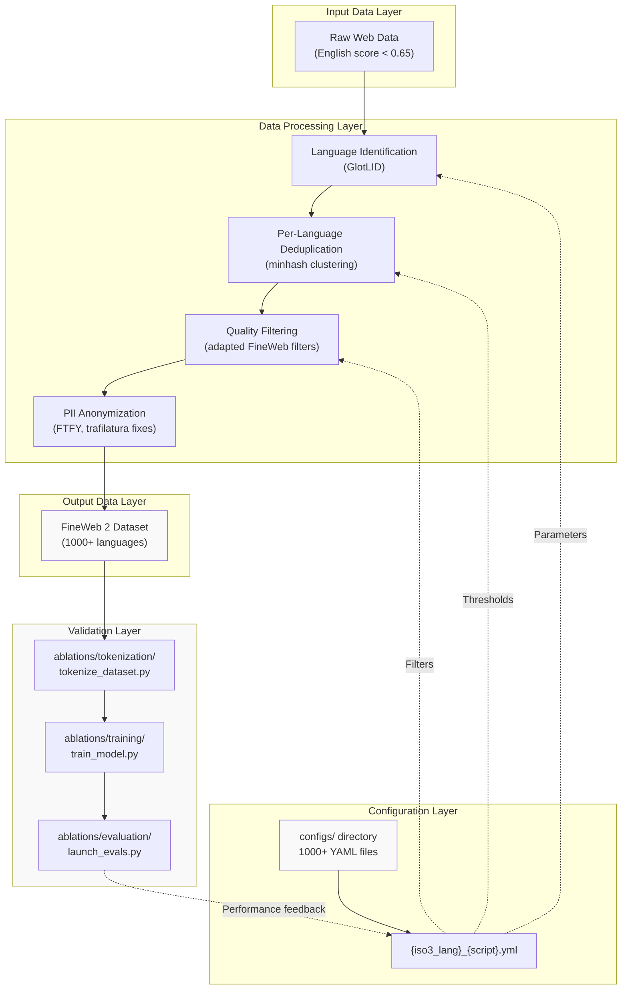

**Diagram: Overall System Architecture** - The system processes raw web data through four stages (language identification, deduplication, filtering, PII anonymization) parameterized by 1000+ language-specific YAML configuration files. The output dataset feeds into a validation layer that trains models and evaluates them to provide empirical feedback on configuration choices.

**Sources:** [README.md:9-64]()

## Major System Components

### Data Processing Pipeline

The data processing pipeline consists of four sequential stages that transform raw web documents into clean, language-specific datasets:

| Stage | Primary Tool | Configuration | Output |
|-------|-------------|---------------|---------|
| Language Identification | GlotLID | `language_score` threshold | Language-tagged documents |
| Deduplication | Datatrove (minhash) | `dup_line_frac`, `dup_n_grams` | Deduplicated clusters with metadata |
| Quality Filtering | Datatrove filters | `char_dup_ratio`, stopwords | Filtered documents |
| PII Anonymization | FTFY, trafilatura | N/A | Final clean documents |

Each stage reads its parameters from language-specific YAML files in `configs/` directory, enabling independent tuning for each language.

**Sources:** [README.md:9-64]()

### Configuration System

The configuration system enables scaling to 1000+ languages through a file-per-language architecture:

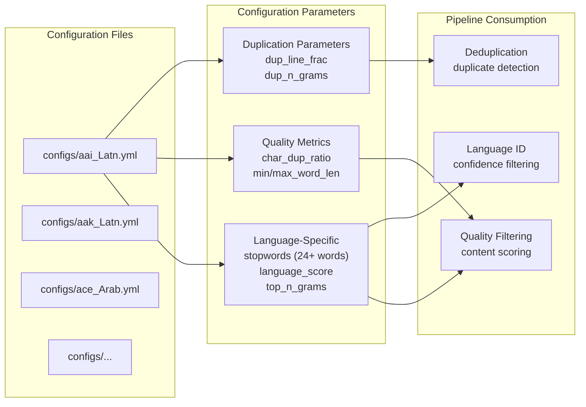

**Diagram: Configuration-Driven Architecture** - Each language has a dedicated YAML config file (e.g., `aai_Latn.yml`) containing duplication parameters, quality metrics, and language-specific data. Pipeline stages consume these configs to customize processing behavior without code changes.

**Sources:** [README.md:10-11]()

### Ablation and Evaluation Framework

The ablation framework validates all pipeline decisions through empirical testing:

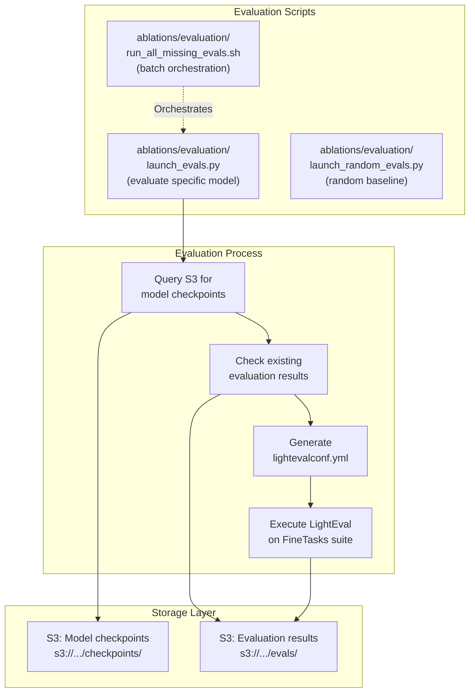

**Diagram: Evaluation Framework Architecture** - The evaluation system consists of three entry points: `launch_evals.py` for single model evaluation, `launch_random_evals.py` for baseline testing, and `run_all_missing_evals.sh` for batch orchestration. All scripts query S3 for checkpoints, check for existing results, generate LightEval configs, and persist results back to S3.

**Sources:** [README.md:66-71]()

### Training System

The training system orchestrates distributed model training for ablation studies:

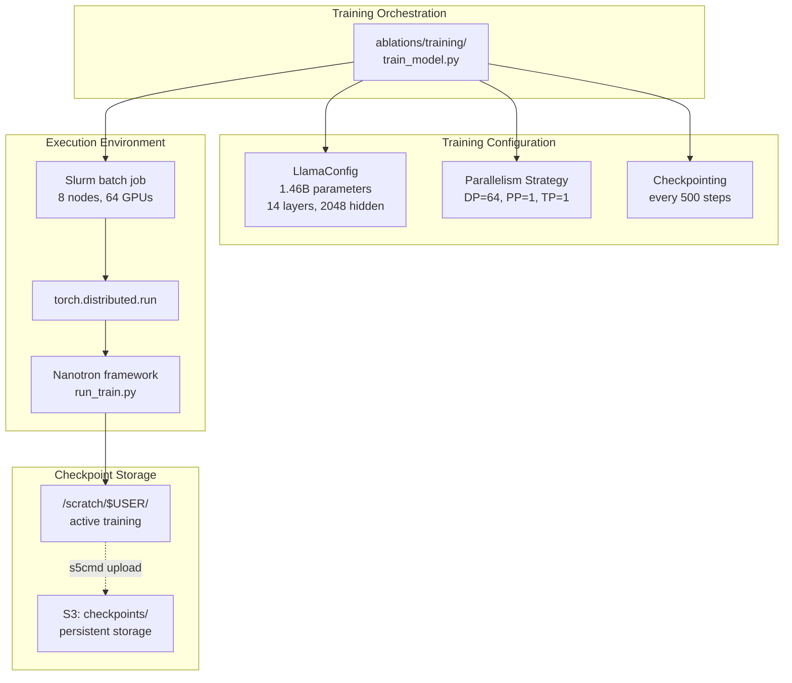

**Diagram: Training System Architecture** - The `train_model.py` script generates Nanotron configurations specifying model architecture (1.46B Llama), parallelism strategy (pure data parallelism with DP=64), and checkpointing behavior. Training executes on Slurm using 8 nodes with 64 GPUs total, writing checkpoints to local scratch and uploading to S3 for persistence.

**Sources:** [README.md:73-74]()

### Tokenization System

The tokenization system prepares processed datasets for training:

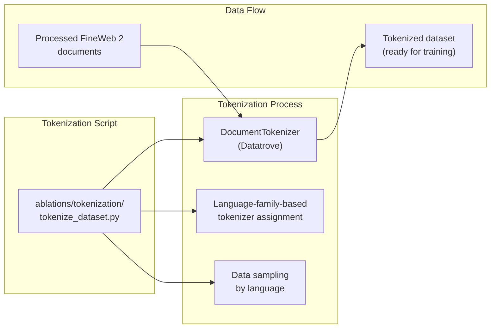

**Diagram: Tokenization System** - The `tokenize_dataset.py` script uses Datatrove's `DocumentTokenizer` to convert processed documents into tokenized format. It automatically assigns tokenizers based on language families and supports data sampling by language.

**Sources:** [README.md:76-77](), [README.md:81-82]()

## System Integration

The following diagram shows how data flows through the integrated system during a complete ablation cycle:

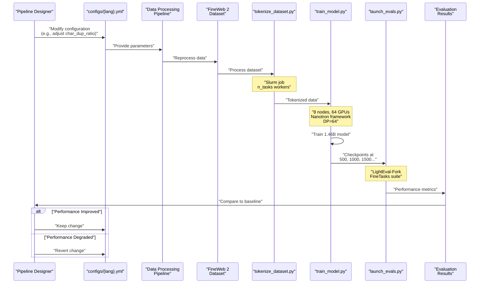

**Diagram: Integrated System Data Flow** - Complete ablation cycle showing how a pipeline designer modifies language configurations, triggers data reprocessing, tokenization, model training, and evaluation, then uses the results to make informed decisions about keeping or reverting changes.

**Sources:** [README.md:65-66]()

## Key System Characteristics

### Configuration-Driven Design

The system's primary design principle is configuration-driven processing. All language-specific behavior is defined in YAML configuration files rather than code:

| Configuration Type | Location | Parameters | Usage |
|-------------------|----------|------------|-------|
| Language configs | `configs/{iso3}_{script}.yml` | Thresholds, stopwords, n-grams | All pipeline stages |
| Evaluation configs | Generated `lightevalconf.yml` | Tasks, checkpoints, languages | Evaluation execution |
| Training configs | Generated Nanotron YAML | Model arch, parallelism | Training execution |

**Sources:** [README.md:10-11]()

### Empirical Validation

Every pipeline decision undergoes empirical validation through the ablation framework:

1. **Data Reprocessing**: Apply proposed change to configuration
2. **Tokenization**: Execute `tokenize_dataset.py` with Slurm parallelization
3. **Training**: Train 1.46B model using `train_model.py` on 64 GPUs
4. **Evaluation**: Evaluate checkpoints using `launch_evals.py` on FineTasks
5. **Decision**: Compare results to baseline and accept/reject change

This methodology ensures all design choices are empirically justified rather than based on assumptions.

**Sources:** [README.md:65-66]()

### Language Scalability

The system supports 1000+ languages through:

- **One config per language**: Each language has independent configuration in `configs/` directory
- **Automatic tokenizer assignment**: Language-family-based tokenizer mapping eliminates manual configuration
- **Per-language processing**: All pipeline stages (identification, deduplication, filtering) operate independently per language
- **Per-language evaluation**: Evaluation scripts support language-specific task execution

Adding support for a new language requires only creating a new YAML configuration file.

**Sources:** [README.md:10-11](), [README.md:81-82]()

### Infrastructure Requirements

The system relies on three infrastructure components:

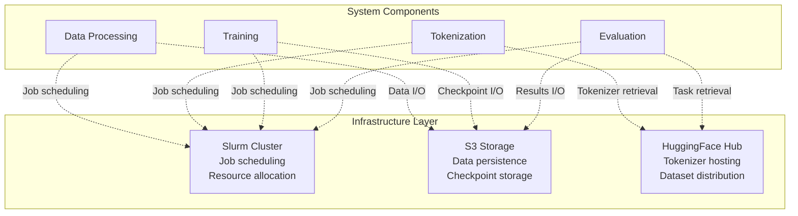

**Diagram: Infrastructure Dependencies** - All system components depend on Slurm for distributed job execution, S3 for data and checkpoint persistence, and HuggingFace Hub for tokenizers and tasks.

**Sources:** [README.md:87-90]()

## External Tool Integration

The system integrates several external frameworks:

| Tool | Purpose | Integration Point | Version |
|------|---------|------------------|---------|
| Datatrove | Data pipeline operations | All processing stages | Latest from GitHub |
| GlotLID | Language identification | Language ID stage | Latest |
| FTFY | Text encoding fixes | PII/fixes stage | Latest |
| Trafilatura | HTML extraction | PII/fixes stage | Latest |
| Nanotron | Model training | Training system | Latest from GitHub |
| LightEval-Fork | Model evaluation | Evaluation system | `new-multi-lang-branch` |

**Note**: The system uses a forked version of LightEval (branch `new-multi-lang-branch`) with modifications for multilingual evaluation support.

**Sources:** [README.md:87-90]()

## Summary

The FineWeb 2 system architecture achieves scalability to 1000+ languages through:

1. **Configuration-driven design**: All language-specific behavior defined in YAML files
2. **Modular pipeline**: Four independent stages (identification, deduplication, filtering, PII)
3. **Empirical validation**: Complete ablation framework for testing design decisions
4. **Distributed execution**: Slurm-based parallelization for all compute-intensive operations
5. **External tool integration**: Leverages existing frameworks (Datatrove, Nanotron, LightEval)

The architecture separates concerns between data processing (configured by language YAML files), model training (orchestrated by `train_model.py`), and evaluation (orchestrated by `launch_evals.py`), enabling independent iteration on each component while maintaining a tight feedback loop for validation.

**Sources:** [README.md:1-107]()

---

# Page: Data Processing Pipeline

# Data Processing Pipeline

<details>
<summary>Relevant source files</summary>

The following files were used as context for generating this wiki page:

- [README.md](README.md)

</details>


## Purpose and Scope

This document provides an overview of the FineWeb 2 data processing pipeline, which transforms raw multilingual web data into high-quality pretraining data across 1000+ languages. The pipeline consists of four sequential stages that clean, deduplicate, filter, and anonymize text data. For detailed information about individual stages, see:
- Language Identification: [#2.1](#2.1)
- Deduplication: [#2.2](#2.2)
- Quality Filtering: [#2.3](#2.3)
- PII Anonymization and Fixes: [#2.4](#2.4)

For information about the configuration files that parameterize the pipeline, see [Configuration System](#3).

## Pipeline Overview

The FineWeb 2 processing pipeline transforms raw web data through four stages, each optimized for multilingual content processing. The pipeline operates on documents that scored below 0.65 in English language identification during the original FineWeb processing, ensuring focus on non-English content.

### Four-Stage Architecture

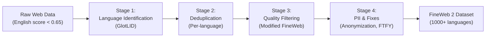

Sources: [README.md:9-18]()

Each stage is implemented as a series of pipeline steps using the Datatrove framework, which provides readers, writers, and filters for data processing operations. The pipeline is configuration-driven, with language-specific parameters defined in YAML files located in `configs/{iso3_lang}_{script}.yml`.

### Stage Summary

| Stage | Primary Tool | Purpose | Configuration Dependency |
|-------|-------------|---------|-------------------------|
| Language Identification | GlotLID | Classify documents by language and script, filter by confidence thresholds | `language_score` per language |
| Deduplication | Datatrove MinHash | Remove duplicate content globally per language, save cluster sizes | `dup_line_frac`, `dup_n_grams` |
| Quality Filtering | Modified FineWeb filters | Apply text quality heuristics adapted for each language | `min_word_length`, `max_word_length`, `char_dup_ratio` |
| PII Anonymization | Regex + FTFY | Remove personally identifiable information and fix encoding/artifacts | None (global rules) |

Sources: [README.md:9-64]()

## Configuration-Driven Architecture

The FineWeb 2 pipeline uses a configuration-driven architecture where each of the 1000+ supported languages has its own YAML configuration file. This design enables language-specific behavior without code changes.

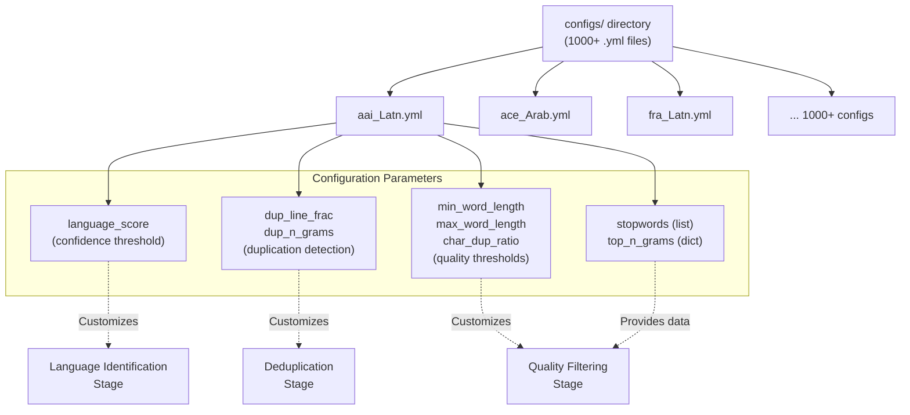

Sources: [README.md:10-11]()

Configuration files define language-specific parameters including:
- **Language identification thresholds**: Minimum confidence scores for accepting a document as belonging to the language
- **Deduplication parameters**: Line fraction and n-gram settings for duplicate detection
- **Quality metrics**: Word length bounds, character repetition ratios, and text structure constraints
- **Language-specific data**: Stopwords lists (24+ words per language) and common n-gram patterns

For detailed information about configuration structure and parameter definitions, see [Configuration System](#3).

## Data Flow Through Pipeline

The following diagram shows how data flows through the pipeline, including the key transformations and metadata added at each stage:

```mermaid
graph TB
    subgraph "Input Data"
        RawDocs["Document Collection<br/>(metadata: url, text, etc.)"]
    end
    
    subgraph "Stage 1: Language Identification"
        GlotLID["GlotLID Classifier<br/>(2000+ language labels)"]
        LangFilter["Language Filter<br/>(confidence >= language_score)"]
        
        RawDocs --> GlotLID
        GlotLID -->|"Adds: language, script,<br/>confidence score"| LangFilter
    end
    
    subgraph "Stage 2: Deduplication"
        MinHash["MinHash Generator<br/>(per document)"]
        Clustering["Duplicate Clustering<br/>(per language)"]
        ClusterFilter["Keep One Per Cluster"]
        
        LangFilter --> MinHash
        MinHash --> Clustering
        Clustering -->|"Adds: minhash_cluster_size"| ClusterFilter
    end
    
    subgraph "Stage 3: Quality Filtering"
        QualityFilters["Modified FineWeb Filters<br/>(language-adapted)"]
        
        ClusterFilter --> QualityFilters
        QualityFilters -->|"Removes low-quality<br/>documents"| QualityFilters
    end
    
    subgraph "Stage 4: PII & Fixes"
        PIIRemoval["PII Anonymization<br/>(emails, IPs)"]
        FTFY["FTFY Encoding Fixes"]
        TrafilFix["Trafilatura Artifact<br/>Removal"]
        
        QualityFilters --> PIIRemoval
        PIIRemoval --> FTFY
        FTFY --> TrafilFix
    end
    
    subgraph "Output Data"
        FinalDocs["FineWeb 2 Documents<br/>(clean, deduplicated,<br/>language-tagged)"]
        
        TrafilFix --> FinalDocs
    end
```

Sources: [README.md:14-64]()

### Metadata Enrichment

As documents progress through the pipeline, metadata is added:

| Stage | Metadata Added | Purpose |
|-------|----------------|---------|
| Language Identification | `language`, `script`, `confidence_score` | Document language classification and script detection |
| Deduplication | `minhash_cluster_size` | Size of duplicate cluster, enables re-hydration (upsampling) |
| Quality Filtering | (removes documents) | No metadata added; documents that fail filters are discarded |
| PII & Fixes | (modifies text) | No metadata added; text content is cleaned in-place |

The `minhash_cluster_size` metadata is particularly important as it enables the "re-hydration" mechanism described in [README.md:25-51](), where documents from larger duplicate clusters can be upsampled during training to improve performance.

## External Tool Integration

The FineWeb 2 pipeline integrates several external tools, each serving a specific role in the processing stages:

```mermaid
graph TB
    subgraph "Pipeline Framework"
        Datatrove["Datatrove<br/>(Pipeline orchestration)"]
        
        Readers["Readers<br/>(Data input)"]
        Filters["Filters<br/>(Transformations)"]
        Writers["Writers<br/>(Data output)"]
        
        Datatrove --> Readers
        Datatrove --> Filters
        Datatrove --> Writers
    end
    
    subgraph "Language Processing Tools"
        GlotLID["GlotLID<br/>(Language classifier)"]
        FTFY["FTFY<br/>(Encoding fixer)"]
        Trafilatura["Trafilatura<br/>(HTML extraction)"]
    end
    
    subgraph "Processing Stages"
        Stage1["Language ID Stage"]
        Stage2["Dedup Stage"]
        Stage3["Filter Stage"]
        Stage4["PII & Fixes Stage"]
    end
    
    Readers -.->|"Provides API"| Stage1
    Filters -.->|"Provides API"| Stage2
    Filters -.->|"Provides API"| Stage3
    Filters -.->|"Provides API"| Stage4
    Writers -.->|"Provides API"| Stage1
    
    GlotLID -.->|"Used by"| Stage1
    FTFY -.->|"Used by"| Stage4
    Trafilatura -.->|"Artifact removal"| Stage4
```

Sources: [README.md:87-90]()

### Datatrove Framework

Datatrove serves as the pipeline orchestration framework, providing:
- **Readers**: Input data sources (files, S3, etc.)
- **Filters**: Transformation and filtering operations
- **Writers**: Output data sinks
- **Pipeline execution**: Distributed processing across workers

The pipeline leverages Datatrove's `PipelineStep` abstraction, as shown in the re-hydration example at [README.md:38-51](), where custom steps inherit from `PipelineStep` and implement the `run` method.

### Language Processing Tools

| Tool | Version/Source | Role | Stage |
|------|----------------|------|-------|
| GlotLID | [cisnlp/GlotLID](https://github.com/cisnlp/GlotLID) | Language and script identification with 2000+ labels | Language Identification |
| FTFY | Python package | Fix Unicode encoding issues in text | PII & Fixes |
| Trafilatura | Python package | HTML extraction; custom fixes for table artifacts | PII & Fixes |

Sources: [README.md:21-22](), [README.md:62-63](), [README.md:87-90]()

## Differences from FineWeb 1

The FineWeb 2 pipeline introduces several key architectural changes compared to the original FineWeb:

### Per-Language Global Deduplication

**FineWeb 1 Approach**: Data was deduplicated per CommonCrawl snapshot, meaning duplicates across snapshots were retained.

**FineWeb 2 Approach**: Deduplication is performed globally per language across all CommonCrawl snapshots, with cluster size tracking for re-hydration.

Sources: [README.md:25-26]()

### Language Identifier

| Aspect | FineWeb 1 | FineWeb 2 |
|--------|-----------|-----------|
| Tool | fasttext176 | GlotLID |
| Language Labels | 176 | 2000+ |
| Script Detection | No | Yes (part of label) |
| Confidence Thresholds | Fixed | Per-language (configurable) |

Sources: [README.md:21-22]()

### Filter Modifications

The FineWeb 2 pipeline modifies the original FineWeb filter set:

**Removed Filters**:
- `short_line_thr`: Removed entirely
- C4 filters: Not included due to performance degradation in multilingual settings
- Paragraph-related repetition filters: Disabled because trafilatura does not preserve paragraph structure

**Modified Filter Parameters**:
- `char_dup_ratio`: Changed from 0.01 to 0.1 (more lenient)

Sources: [README.md:54-58]()

### Configuration-Driven Design

**FineWeb 1**: Fixed English-centric parameters

**FineWeb 2**: Language-specific configurations in `configs/*.yml` files, enabling:
- Per-language confidence thresholds for language identification
- Per-language stopwords lists
- Per-language quality metric thresholds
- Per-language deduplication parameters

This architecture enables scaling to 1000+ languages without code modifications.

Sources: [README.md:10-11]()

## Pipeline Implementation Details

### Re-Hydration Mechanism

Unlike FineWeb 1, which completely removed duplicates, FineWeb 2 preserves duplicate cluster information in the `minhash_cluster_size` metadata field. This enables "re-hydration" through upsampling during training.

The re-hydration logic uses the following upsampling weights:

| Cluster Size (N) | Upsampling Weight | Rationale |
|-----------------|-------------------|-----------|
| 1 (no duplicates) | 1× | Original document appears once |
| 2-3 | N× | Moderate duplication indicates quality |
| 4 | 3× | Reduced weight for larger clusters |
| 5-99 | 5× | Significant duplication, likely high quality |
| 100-999 | 8× | Very popular content, maximum upsampling |
| ≥1000 | 1× | Assumed low quality (e.g., boilerplate) |

The reference implementation at [README.md:38-51]() shows a `Rehydrater` class that inherits from `PipelineStep` and uses `bisect.bisect_right` to efficiently map cluster sizes to upsampling weights.

Sources: [README.md:25-51]()

### Processing Stages Code Structure

While the specific implementation files are not provided, the pipeline follows this general structure:

```mermaid
graph LR
    subgraph "Datatrove Pipeline Steps"
        Reader["Reader<br/>(Input data)"]
        Step1["LanguageIDFilter<br/>(GlotLID wrapper)"]
        Step2["MinHashDeduplicator<br/>(Per-language)"]
        Step3["QualityFilters<br/>(Modified FineWeb)"]
        Step4["PIIFilter<br/>(Anonymization)"]
        Step5["FTFYFixer<br/>(Encoding)"]
        Step6["TrafilaturaFixer<br/>(Artifacts)"]
        Writer["Writer<br/>(Output data)"]
    end
    
    ConfigLoader["Load configs/*.yml"]
    
    ConfigLoader -.->|"Configures"| Step1
    ConfigLoader -.->|"Configures"| Step2
    ConfigLoader -.->|"Configures"| Step3
    
    Reader --> Step1
    Step1 --> Step2
    Step2 --> Step3
    Step3 --> Step4
    Step4 --> Step5
    Step5 --> Step6
    Step6 --> Writer
```

Each `PipelineStep` processes a stream of documents, yielding modified or filtered documents to the next stage. The configuration system injects language-specific parameters into each step, enabling multilingual processing without hardcoded values.

Sources: [README.md:9-64](), [README.md:87-90]()

---

# Page: Language Identification

# Language Identification

<details>
<summary>Relevant source files</summary>

The following files were used as context for generating this wiki page:

- [README.md](README.md)
- [configs/aai_Latn.yml](configs/aai_Latn.yml)

</details>


## Purpose and Scope

This document explains the language identification stage of the FineWeb 2 data processing pipeline. Language identification is the first processing step that determines which language each document is written in and filters documents based on per-language confidence thresholds.

For information about subsequent pipeline stages, see [Deduplication](#2.2), [Quality Filtering](#2.3), and [PII Anonymization and Fixes](#2.4). For details on how language-specific parameters are configured, see [Configuration System](#3).

Sources: [README.md:9-23]()

## Overview

Language identification in FineWeb 2 uses **GlotLID**, a multilingual language identifier that replaces the fasttext176 classifier used in the original FineWeb dataset. GlotLID provides two critical capabilities:

1. **Extensive Language Coverage**: Supports 2000+ language labels compared to fasttext176's 176 languages
2. **Script Identification**: Identifies not only the language but also the script used in each document (e.g., Latin, Cyrillic, Arabic)

The starting point for FineWeb 2 is the non-English data (documents with English scores < 0.65) obtained when processing the original FineWeb. Language identification assigns a language label and confidence score to each document, then filters based on per-language thresholds.

Sources: [README.md:13-14](), [README.md:20-22]()

## Architecture

### Language Identification Flow

```mermaid
graph TB
    Input["Input Documents<br/>(English score < 0.65)"]
    GlotLID["GlotLID Classifier<br/>2000+ language labels"]
    LangLabel["Language Label<br/>ISO-639-3 code + script<br/>(e.g., 'aai_Latn')"]
    ConfScore["Confidence Score<br/>(0.0 to 1.0)"]
    Config["Language Config<br/>configs/{iso3}_{script}.yml"]
    Threshold["language_score threshold<br/>(per-language)"]
    Filter["Confidence Filter"]
    Accept["Document Accepted"]
    Reject["Document Rejected"]
    
    Input --> GlotLID
    GlotLID --> LangLabel
    GlotLID --> ConfScore
    
    LangLabel --> Config
    Config --> Threshold
    
    ConfScore --> Filter
    Threshold --> Filter
    
    Filter -->|"score >= threshold"| Accept
    Filter -->|"score < threshold"| Reject
    
    Accept --> NextStage["Next Pipeline Stage<br/>(Deduplication)"]
```

**Diagram: Language Identification Process Flow**

This diagram shows how documents flow through language identification. GlotLID produces both a language label (ISO-639-3 code with script suffix) and a confidence score. Each language has a configuration file that specifies the minimum confidence threshold (`language_score`). Documents are accepted only if their confidence meets or exceeds the language-specific threshold.

Sources: [README.md:20-22](), [configs/aai_Latn.yml:15]()

### Integration with Data Pipeline

```mermaid
graph LR
    subgraph "Pipeline Stages"
        Stage1["1. Language ID<br/>GlotLID + filtering"]
        Stage2["2. Deduplication<br/>Per-language global"]
        Stage3["3. Quality Filtering<br/>Language-specific params"]
        Stage4["4. PII + Fixes<br/>Anonymization"]
    end
    
    subgraph "Configuration Files"
        ConfigDir["configs/ directory<br/>1000+ YAML files"]
        ExampleConfig["aai_Latn.yml<br/>language_score: 0.755"]
    end
    
    Input["Non-English Data<br/>English score < 0.65"] --> Stage1
    Stage1 --> Stage2
    Stage2 --> Stage3
    Stage3 --> Stage4
    Stage4 --> Output["FineWeb 2 Dataset"]
    
    ConfigDir --> ExampleConfig
    ExampleConfig -.->|"Provides threshold"| Stage1
    ExampleConfig -.->|"Provides params"| Stage2
    ExampleConfig -.->|"Provides params"| Stage3
```

**Diagram: Language Identification in Pipeline Context**

Language identification is the first of four pipeline stages. It uses per-language configuration files (stored in `configs/` directory) that provide the `language_score` threshold. The same configuration files also parameterize subsequent deduplication and filtering stages.

Sources: [README.md:13-18](), [configs/aai_Latn.yml]()

## Per-Language Confidence Thresholds

### Configuration Structure

Each supported language has a dedicated YAML configuration file named using the pattern `{iso639-3}_{script}.yml`, where:
- `{iso639-3}` is the three-letter ISO 639-3 language code
- `{script}` is the script identifier (e.g., `Latn` for Latin, `Arab` for Arabic, `Cyrl` for Cyrillic)

The `language_score` parameter in each configuration file specifies the minimum GlotLID confidence score required for a document to be accepted as that language.

### Example Configuration

```yaml
# configs/aai_Latn.yml
language_score: 0.755
dup_line_frac: 0.387
stopwords:
  - i
  - ana
  - naatu
  # ... additional parameters
```

In this example, documents identified as Arára (aai) written in Latin script must have a GlotLID confidence score of at least 0.755 to be included in the dataset.

Sources: [configs/aai_Latn.yml:15](), [README.md:11](), [README.md:22]()

### Threshold Variation Across Languages

The `language_score` threshold is **not uniform** across all languages. Different languages use different thresholds based on:

1. **Language similarity**: Languages that are easily confused with similar languages may require higher thresholds
2. **Available training data**: Languages with less GlotLID training data may need adjusted thresholds
3. **Empirical performance**: Thresholds are tuned based on ablation studies using the evaluation framework (see [Ablation and Evaluation Framework](#4))

This per-language tuning is a key difference from the original FineWeb, which used a single global threshold for language identification.

Sources: [README.md:22](), [README.md:10-11]()

## Configuration Parameters

### Language Score Parameter

| Parameter | Type | Range | Purpose |
|-----------|------|-------|---------|
| `language_score` | float | 0.0 - 1.0 | Minimum GlotLID confidence score for document acceptance |

The language score represents GlotLID's confidence that a document is written in the specified language and script. A score of:
- **1.0** indicates maximum confidence
- **0.0** indicates minimum confidence
- **Higher thresholds** create stricter filtering, accepting only high-confidence documents
- **Lower thresholds** create more permissive filtering, accepting more documents with potential language ambiguity

Sources: [configs/aai_Latn.yml:15]()

## Language and Script Identification

### Label Structure

GlotLID produces labels in the format `{iso639-3}_{script}`, enabling fine-grained language identification that distinguishes between the same language written in different scripts. This is particularly important for languages that use multiple writing systems.

```mermaid
graph TB
    Doc["Document Text"]
    GlotLID["GlotLID Classifier"]
    LangCode["ISO 639-3 Code<br/>(e.g., 'aai' for Arára)"]
    Script["Script Identifier<br/>(e.g., 'Latn' for Latin)"]
    Combined["Combined Label<br/>'aai_Latn'"]
    ConfigFile["Configuration File<br/>configs/aai_Latn.yml"]
    
    Doc --> GlotLID
    GlotLID --> LangCode
    GlotLID --> Script
    LangCode --> Combined
    Script --> Combined
    Combined --> ConfigFile
```

**Diagram: Language Label Structure**

This script identification capability allows FineWeb 2 to:
- Distinguish between languages like Serbian written in Latin (srp_Latn) vs Cyrillic (srp_Cyrl)
- Apply different processing parameters to the same language in different scripts
- Support languages that use multiple writing systems

Sources: [README.md:21](), [configs/aai_Latn.yml]()

## Advantages Over fasttext176

The choice of GlotLID over fasttext176 (used in original FineWeb) provides several benefits:

| Aspect | fasttext176 | GlotLID |
|--------|-------------|---------|
| **Language Coverage** | 176 languages | 2000+ languages |
| **Script Identification** | No | Yes |
| **Low-Resource Languages** | Limited | Extensive |
| **Configuration Granularity** | N/A | Per-language + per-script |

This extended coverage enables FineWeb 2 to support 1000+ languages with proper script identification, making it suitable for truly multilingual pretraining.

Sources: [README.md:21]()

## Relationship to Configuration System

Language identification is tightly coupled with the configuration system:

1. **Input**: GlotLID produces a language label (e.g., `aai_Latn`) and confidence score
2. **Configuration Lookup**: The system loads `configs/aai_Latn.yml` for that language
3. **Threshold Application**: The document is filtered using the `language_score` threshold from that configuration
4. **Pipeline Propagation**: If accepted, the same configuration file parameterizes all subsequent pipeline stages

For detailed information about the configuration system and how to create language-specific configurations, see [Configuration System](#3) and [Creating Language Configs](#3.5).

Sources: [README.md:11](), [configs/aai_Latn.yml]()

---

# Page: Deduplication

# Deduplication

<details>
<summary>Relevant source files</summary>

The following files were used as context for generating this wiki page:

- [README.md](README.md)
- [configs/aak_Latn.yml](configs/aak_Latn.yml)

</details>


## Purpose and Scope

This page documents the deduplication stage of the FineWeb 2 data processing pipeline. Deduplication removes duplicate or near-duplicate documents while preserving cluster size metadata to enable optional re-hydration. This stage operates after Language Identification ([2.1](#2.1)) and before Quality Filtering ([2.3](#2.3)).

For configuration parameters that control deduplication behavior, see [Duplication Parameters](#3.2).

Sources: [README.md:24-51]()

## Deduplication Strategy

FineWeb 2 uses **per-language global deduplication**, a significant departure from the original FineWeb approach. Instead of deduplicating within individual CommonCrawl snapshots, all documents for each language are deduplicated globally across all snapshots and sources.

This design choice ensures:
- **Consistency**: Documents are never duplicated across different temporal snapshots
- **Language isolation**: Deduplication boundaries align with language boundaries
- **Scalability**: Processing can be parallelized by language without cross-language coordination

The deduplication process uses MinHash-based clustering to identify near-duplicate document groups.

Sources: [README.md:24-26]()

### Deduplication vs. FineWeb 1

| Aspect | FineWeb 1 | FineWeb 2 |
|--------|-----------|-----------|
| Deduplication scope | Per CommonCrawl snapshot | Per language globally |
| Language handling | English only | 1000+ languages |
| Cluster metadata | Not preserved | Saved as `minhash_cluster_size` |
| Re-hydration | Not supported | Supported via upsampling |

Sources: [README.md:24-26]()

## Deduplication Process Flow

```mermaid
graph TB
    subgraph Input["Input: Language-Identified Documents"]
        LangDocs["Documents grouped by language<br/>(iso3_lang)_(script)"]
    end
    
    subgraph Config["Configuration Loading"]
        ConfigFile["configs/{iso3_lang}_{script}.yml"]
        DupParams["Deduplication Parameters:<br/>- dup_line_frac<br/>- dup_n_grams (5-10)"]
        ConfigFile --> DupParams
    end
    
    subgraph Dedup["MinHash Deduplication"]
        MinHash["MinHash Signature Generation"]
        Clustering["Near-Duplicate Clustering"]
        ClusterAnalysis["Cluster Analysis:<br/>Identify representative document<br/>Count cluster size"]
        
        MinHash --> Clustering
        Clustering --> ClusterAnalysis
    end
    
    subgraph Output["Output: Deduplicated Documents"]
        RepDoc["Representative Document<br/>from each cluster"]
        Metadata["metadata['minhash_cluster_size']:<br/>Number of duplicates in cluster"]
        RepDoc --> Metadata
    end
    
    LangDocs --> MinHash
    DupParams --> MinHash
    DupParams --> Clustering
    ClusterAnalysis --> RepDoc
    
    Note1["Note: All documents except<br/>one are removed from cluster"]
    Note2["Note: Cluster size enables<br/>re-hydration (optional)"]
    
    Clustering -.-> Note1
    Metadata -.-> Note2
```

Sources: [README.md:24-26](), [configs/aak_Latn.yml:1-14]()

## Configuration Parameters

Each language defines deduplication thresholds in its configuration file. These parameters control when documents are considered near-duplicates.

### `dup_line_frac`

Defines the fraction of duplicate lines allowed before documents are considered duplicates. Lower values result in more aggressive deduplication.

**Example**: For `aak_Latn` (Ankave language), `dup_line_frac: 0.358` means documents sharing more than 35.8% of their lines are considered duplicates.

### `dup_n_grams`

A list of n-gram size and threshold pairs. Documents exceeding the threshold for character-level n-gram overlap are considered duplicates.

**Example configuration**:
```yaml
dup_n_grams:
- [5, 0.359]  # 5-grams: 35.9% threshold
- [6, 0.35]   # 6-grams: 35.0% threshold
- [7, 0.336]  # 7-grams: 33.6% threshold
- [8, 0.32]   # 8-grams: 32.0% threshold
- [9, 0.304]  # 9-grams: 30.4% threshold
- [10, 0.285] # 10-grams: 28.5% threshold
```

Generally, thresholds decrease for longer n-grams, as longer matching sequences provide stronger duplication signals.

Sources: [configs/aak_Latn.yml:1-14](), [README.md:11]()

## Cluster Size Tracking

Unlike typical deduplication implementations that simply discard duplicates, FineWeb 2 preserves critical metadata about the duplicate cluster size.

### `minhash_cluster_size` Metadata Field

When a document cluster is identified during deduplication:
1. **One representative document** is selected and retained
2. **All other documents** in the cluster are removed
3. **Cluster size** is saved in the representative document's metadata

This metadata field records the total number of documents that were in the duplicate cluster (including the representative).

```mermaid
graph LR
    subgraph Cluster["Duplicate Cluster (size=5)"]
        Doc1["Document A"]
        Doc2["Document A'<br/>(near-duplicate)"]
        Doc3["Document A''<br/>(near-duplicate)"]
        Doc4["Document A'''<br/>(near-duplicate)"]
        Doc5["Document A''''<br/>(near-duplicate)"]
    end
    
    subgraph Selection["Selection Process"]
        Rep["Select Representative<br/>(typically first document)"]
    end
    
    subgraph Output["Output"]
        Final["Document A<br/>metadata:<br/>{<br/>  'minhash_cluster_size': 5<br/>}"]
    end
    
    Doc1 --> Rep
    Doc2 -.->|Removed| Rep
    Doc3 -.->|Removed| Rep
    Doc4 -.->|Removed| Rep
    Doc5 -.->|Removed| Rep
    
    Rep --> Final
```

Sources: [README.md:25-26]()

## Re-Hydration Mechanism

The preserved `minhash_cluster_size` metadata enables **re-hydration**: upsampling documents based on their duplicate cluster size. This process has shown **performance improvements**, particularly for high-resource languages.

### Motivation

While deduplication removes redundant content, the frequency of content in the original corpus carries information. Popular or frequently occurring content (indicated by larger cluster sizes) may be more valuable for training.

### Upsampling Weight Mapping

FineWeb 2 uses a non-linear upsampling strategy based on empirical observations:

| Cluster Size (N) | Upsampling Weight | Rationale |
|------------------|-------------------|-----------|
| N = 1 | 1× | No duplicates, use once |
| N = 2 or N = 3 | N× | Small clusters, preserve exactly |
| N = 4 | 3× | Moderate deduplication |
| 5 ≤ N < 100 | 5× | Popular content, emphasize moderately |
| 100 ≤ N < 1000 | 8× | Very popular, emphasize strongly |
| N ≥ 1000 | 1× | Extremely large clusters likely low quality |

The non-monotonic behavior at N ≥ 1000 reflects the assumption that extremely large clusters may represent boilerplate, spam, or template content rather than valuable data.

Sources: [README.md:28-34]()

### Re-Hydration Implementation

The re-hydration process uses a `PipelineStep` that reads the `minhash_cluster_size` metadata and duplicates documents accordingly:

```mermaid
graph TB
    subgraph Input["Deduplicated Dataset"]
        Doc1["Doc with cluster_size=1"]
        Doc2["Doc with cluster_size=3"]
        Doc3["Doc with cluster_size=50"]
        Doc4["Doc with cluster_size=500"]
        Doc5["Doc with cluster_size=5000"]
    end
    
    subgraph Rehydrater["Rehydrater PipelineStep"]
        Mapping["upsampling_weights = {<br/>  1: 1,<br/>  2: 2,<br/>  3: 3,<br/>  5: 5,<br/>  100: 8,<br/>  1000: 1<br/>}"]
        Lookup["bisect.bisect_right():<br/>Find applicable weight"]
        Repeat["Repeat document<br/>upsampling_weight times"]
        
        Mapping --> Lookup
        Lookup --> Repeat
    end
    
    subgraph Output["Re-Hydrated Dataset"]
        Out1["Doc × 1"]
        Out2["Doc × 3"]
        Out3["Doc × 5"]
        Out4["Doc × 8"]
        Out5["Doc × 1"]
    end
    
    Doc1 --> Lookup
    Doc2 --> Lookup
    Doc3 --> Lookup
    Doc4 --> Lookup
    Doc5 --> Lookup
    
    Repeat --> Out1
    Repeat --> Out2
    Repeat --> Out3
    Repeat --> Out4
    Repeat --> Out5
```

Sources: [README.md:36-51]()

### Reference Implementation

The README provides a complete reference implementation of the `Rehydrater` class:

[README.md:38-51]()

Key implementation details:
- Uses `bisect.bisect_right()` for efficient weight lookup in sorted limits
- Implements as generator function (`yield`) for memory efficiency
- Accesses `doc.metadata["minhash_cluster_size"]` for cluster size
- Repeats documents in-place without copying large content

Sources: [README.md:38-51]()

## Integration with Pipeline Stages

Deduplication is tightly integrated with surrounding pipeline stages:

```mermaid
graph TB
    subgraph Stage1["2.1 Language Identification"]
        LangID["GlotLID Classification"]
        LangGroup["Group documents by:<br/>(iso3_lang)_(script)"]
        LangID --> LangGroup
    end
    
    subgraph Stage2["2.2 Deduplication (This Page)"]
        LoadConfig["Load configs/{lang}_{script}.yml"]
        MinHash["MinHash Clustering"]
        ClusterSave["Save minhash_cluster_size"]
        
        LoadConfig --> MinHash
        MinHash --> ClusterSave
    end
    
    subgraph Stage3["2.3 Quality Filtering"]
        Filters["Apply language-specific filters"]
        FilterParams["Use stopwords, char ratios, etc.<br/>from same config file"]
        
        Filters --> FilterParams
    end
    
    subgraph Optional["Optional Re-Hydration"]
        Rehydrate["Apply Rehydrater<br/>before or after filtering"]
    end
    
    LangGroup -->|"Documents grouped<br/>by language"| LoadConfig
    ClusterSave -->|"Deduplicated documents<br/>with cluster metadata"| Filters
    FilterParams -.->|"May apply before/after<br/>quality filtering"| Rehydrate
    
    ConfigFile["configs/{iso3_lang}_{script}.yml"]
    ConfigFile -.->|"Provides dup_line_frac,<br/>dup_n_grams"| LoadConfig
    ConfigFile -.->|"Provides stopwords,<br/>quality thresholds"| FilterParams
```

Sources: [README.md:14-19](), [README.md:24-51]()

## Deduplication with Datatrove

While specific implementation files are not provided in the repository context, FineWeb 2 uses the [Datatrove](https://github.com/huggingface/datatrove) framework for pipeline operations, as indicated in the system architecture diagrams.

Datatrove provides:
- **Readers**: Load documents from storage
- **Filters**: Apply deduplication logic with MinHash
- **Writers**: Save deduplicated documents with metadata
- **Pipeline orchestration**: Coordinate distributed processing

The configuration parameters (`dup_line_frac`, `dup_n_grams`) are passed to Datatrove's deduplication filters to customize behavior per language.

Sources: [README.md:88]()

## Key Design Decisions

### Why Per-Language Global Deduplication?

1. **Cross-snapshot consistency**: Prevents the same content from appearing multiple times across different crawl dates
2. **Language-specific patterns**: Different languages exhibit different duplication characteristics
3. **Independent processing**: Enables parallel processing without cross-language dependencies
4. **Scalability**: Reduces coordination overhead when processing 1000+ languages

### Why Preserve Cluster Size?

1. **Information retention**: Duplicate frequency signals content importance
2. **Flexibility**: Enables downstream experimentation with upsampling strategies
3. **Ablation testing**: Allows comparing deduplicated vs. re-hydrated datasets empirically
4. **Minimal overhead**: Storing a single integer per document is negligible

### Why Non-Monotonic Upsampling?

The upsampling curve peaks at cluster sizes 100-999 (8× weight) then drops to 1× for N ≥ 1000. This reflects empirical observation that:
- **Medium-large clusters** (100-999): Popular, valuable content worth emphasizing
- **Extremely large clusters** (≥1000): Likely boilerplate, templates, or spam

Sources: [README.md:24-34]()

## Configuration Example

Full deduplication configuration for Ankave language (`aak_Latn`):

```yaml
dup_line_frac: 0.358
dup_n_grams:
- [5, 0.359]
- [6, 0.35]
- [7, 0.336]
- [8, 0.32]
- [9, 0.304]
- [10, 0.285]
```

These thresholds were tuned through ablation testing ([4](#4)) to balance:
- **Removing true duplicates**: Avoiding redundant training data
- **Preserving near-duplicates**: Retaining legitimate variations
- **Language-specific characteristics**: Different languages have different n-gram distributions

Sources: [configs/aak_Latn.yml:1-14](), [README.md:10-11]()

---

# Page: Quality Filtering

# Quality Filtering

<details>
<summary>Relevant source files</summary>

The following files were used as context for generating this wiki page:

- [README.md](README.md)
- [configs/aau_Latn.yml](configs/aau_Latn.yml)
- [configs/aaz_Latn.yml](configs/aaz_Latn.yml)

</details>


## Purpose and Scope

This document describes the quality filtering stage of the FineWeb 2 data processing pipeline. Quality filtering is the third stage of data processing, applied after language identification and deduplication, and before PII anonymization. It adapts the original FineWeb quality filters for multilingual settings through extensive ablation testing and language-specific parameterization.

For information about:
- Language identification and confidence thresholds, see [Language Identification](#2.1)
- Deduplication strategies, see [Deduplication](#2.2)
- PII removal and text fixes, see [PII Anonymization and Fixes](#2.4)
- Configuration parameter structure, see [Configuration Structure](#3.1)
- Quality metric parameters in detail, see [Quality Metrics](#3.3)

## Overview

Quality filtering in FineWeb 2 applies a set of heuristic filters to remove low-quality documents from the dataset. Unlike the original FineWeb (which focused on English), FineWeb 2 had to adapt these filters for over 1000 languages. Rather than creating language-specific filters, the approach keeps the original FineWeb filter set but extensively tunes thresholds and parameters on a per-language basis.

The quality filtering stage operates on documents that have already been:
1. Identified as belonging to a specific language with sufficient confidence
2. Deduplicated globally per language
3. Tagged with metadata including `minhash_cluster_size`

```mermaid
graph TB
    LangID["Language Identification<br/>(GlotLID-based filtering)"]
    Dedup["Deduplication<br/>(Per-language, global)"]
    QualFilter["Quality Filtering<br/>(Modified FineWeb filters)"]
    PII["PII Anonymization<br/>(Email/IP removal + FTFY)"]
    
    LangID --> Dedup
    Dedup --> QualFilter
    QualFilter --> PII
    
    ConfigFiles["Language Configs<br/>configs/*.yml"]
    
    ConfigFiles -.->|"language_score"| LangID
    ConfigFiles -.->|"dup_line_frac<br/>dup_n_grams"| Dedup
    ConfigFiles -.->|"max_avg_word_length<br/>min_avg_word_length<br/>max_non_alpha_words_ratio<br/>new_line_ratio<br/>line_punct_thr<br/>stopwords<br/>top_n_grams"| QualFilter
    
    QualFilter -->|"Filtered documents"| Output["Final dataset"]
    
    style QualFilter fill:#f9f9f9
```

**Sources:** [README.md:9-63]()

## Key Changes from Original FineWeb

Based on extensive ablation testing using the FineTasks evaluation suite, several modifications were made to the original FineWeb filters:

### Disabled Filters

| Filter | Original Value | FineWeb 2 Value | Reason |
|--------|---------------|-----------------|---------|
| `short_line_thr` | Active | Removed | Degraded multilingual performance |
| `line_punct_thr` | Active | Set to -1 (disabled) | Language-specific punctuation patterns vary widely |
| Paragraph-related repetition filters | Active | Disabled | Trafilatura does not preserve paragraph structure |

### Modified Filters

| Filter | Original Value | FineWeb 2 Value | Reason |
|--------|---------------|-----------------|---------|
| `char_dup_ratio` | 0.01 | 0.1 | More tolerant threshold for multilingual content |

### Excluded Filters

The C4 filter set was not included in FineWeb 2, as ablation experiments showed it degraded performance in the multilingual setting.

**Sources:** [README.md:53-63]()

## Language-Specific Configuration

Each language has a dedicated configuration file at `configs/{iso3_lang}_{script}.yml` that defines quality filtering parameters. These configurations allow the same filter logic to apply different thresholds based on the linguistic characteristics of each language.

```mermaid
graph LR
    ConfigFile["aau_Latn.yml<br/>Configuration File"]
    
    subgraph "Quality Parameters"
        WordLen["Word Length Filters<br/>min_avg_word_length: 3<br/>max_avg_word_length: 6"]
        AlphaRatio["Character Ratio Filters<br/>max_non_alpha_words_ratio: 0.744"]
        NewLineRatio["Newline Ratio Filter<br/>new_line_ratio: 0.038"]
        LinePunct["Line Punctuation Filter<br/>line_punct_thr: -1 (disabled)"]
        Stopwords["Stopword List<br/>24 language-specific words"]
        TopNGrams["Statistical Patterns<br/>top_n_grams thresholds"]
    end
    
    ConfigFile --> WordLen
    ConfigFile --> AlphaRatio
    ConfigFile --> NewLineRatio
    ConfigFile --> LinePunct
    ConfigFile --> Stopwords
    ConfigFile --> TopNGrams
    
    QualityFilter["Quality Filtering<br/>Processing Stage"]
    
    WordLen -.-> QualityFilter
    AlphaRatio -.-> QualityFilter
    NewLineRatio -.-> QualityFilter
    LinePunct -.-> QualityFilter
    Stopwords -.-> QualityFilter
    TopNGrams -.-> QualityFilter
```

**Sources:** [configs/aau_Latn.yml:1-57](), [configs/aaz_Latn.yml:1-51]()

## Filter Parameters

### Word Length Filters

These filters ensure that documents contain words of appropriate length for the language:

- **`min_avg_word_length`**: Minimum average word length in the document (typically 3)
- **`max_avg_word_length`**: Maximum average word length in the document (typically 6)

Documents with average word lengths outside this range are removed, as they likely contain concatenated text, URL fragments, or other non-natural text.

Example from `aau_Latn.yml`:
```yaml
min_avg_word_length: 3
max_avg_word_length: 6
```

**Sources:** [configs/aau_Latn.yml:17-19](), [configs/aaz_Latn.yml:17-19]()

### Character Ratio Filters

- **`max_non_alpha_words_ratio`**: Maximum ratio of words containing non-alphabetic characters (varies by language, e.g., 0.744 for aau_Latn, 0.788 for aaz_Latn)

This filter removes documents with excessive non-alphabetic content, which typically indicates low-quality or machine-generated text. The threshold is language-specific because some writing systems naturally have more non-alphabetic characters.

**Sources:** [configs/aau_Latn.yml:18](), [configs/aaz_Latn.yml:18]()

### Newline Ratio Filter

- **`new_line_ratio`**: Maximum ratio of newline characters to total characters (varies by language, e.g., 0.038 for aau_Latn, 0.045 for aaz_Latn)

This filter removes documents with excessive line breaks, which often indicates lists, tables, or other non-prose content.

**Sources:** [configs/aau_Latn.yml:20](), [configs/aaz_Latn.yml:20]()

### Line Punctuation Filter

- **`line_punct_thr`**: Threshold for line-ending punctuation patterns (set to -1 in FineWeb 2, effectively disabling this filter)

In the original FineWeb, this filter removed documents where lines consistently lacked proper punctuation. However, for multilingual content, punctuation conventions vary significantly across languages, so this filter was disabled.

**Sources:** [configs/aau_Latn.yml:16](), [configs/aaz_Latn.yml:16]()

### Stopword-Based Filters

- **`stopwords`**: A language-specific list of common words (typically 24 words per language)

Stopwords are used in quality filters to verify that documents contain natural language. The specific stopwords are selected based on linguistic analysis of each language. Documents lacking sufficient stopword coverage may be filtered out as non-natural text.

Example from `aau_Latn.yml`:
```yaml
stopwords:
- me
- ma
- mon
- so
- hiykwe
# ... 19 more words
```

**Sources:** [configs/aau_Latn.yml:21-49](), [configs/aaz_Latn.yml:21-43]()

### Statistical N-gram Filters

- **`top_n_grams`**: Thresholds for repetitive n-gram patterns at different n-gram lengths

These filters detect and remove documents with excessive repetition of common n-gram patterns, which indicates automatically generated or low-quality content.

Example from `aau_Latn.yml`:
```yaml
top_n_grams:
- - 2  # bigram
  - 0.165  # threshold
- - 3  # trigram
  - 0.168
- - 4  # 4-gram
  - 0.167
```

**Sources:** [configs/aau_Latn.yml:50-57](), [configs/aaz_Latn.yml:44-51]()

## Filter Processing Flow

The quality filtering stage processes documents through multiple filters in sequence. Each filter evaluates the document against language-specific thresholds and decides whether to keep or discard it.

```mermaid
graph TD
    Input["Input Document<br/>(deduplicated, language-tagged)"]
    
    LoadConfig["Load Language Config<br/>configs/{iso3}_{script}.yml"]
    
    Input --> LoadConfig
    
    WordLenCheck{"Word Length Check<br/>min_avg_word_length ≤ avg ≤ max_avg_word_length"}
    AlphaCheck{"Character Ratio Check<br/>non_alpha_ratio ≤ max_non_alpha_words_ratio"}
    NewlineCheck{"Newline Ratio Check<br/>newline_ratio ≤ new_line_ratio"}
    StopwordCheck{"Stopword Presence Check<br/>Contains sufficient stopwords"}
    NGramCheck{"N-gram Repetition Check<br/>Repetition ≤ top_n_grams thresholds"}
    
    LoadConfig --> WordLenCheck
    WordLenCheck -->|Pass| AlphaCheck
    WordLenCheck -->|Fail| Discard["Discard Document"]
    
    AlphaCheck -->|Pass| NewlineCheck
    AlphaCheck -->|Fail| Discard
    
    NewlineCheck -->|Pass| StopwordCheck
    NewlineCheck -->|Fail| Discard
    
    StopwordCheck -->|Pass| NGramCheck
    StopwordCheck -->|Fail| Discard
    
    NGramCheck -->|Pass| Keep["Keep Document<br/>(proceed to PII stage)"]
    NGramCheck -->|Fail| Discard
```

**Sources:** [README.md:53-63]()

## Implementation Architecture

Quality filtering in FineWeb 2 is implemented using the Datatrove framework, which provides a pipeline abstraction for data processing. Each filter is typically implemented as a `PipelineStep` that can be chained together.

```mermaid
graph TB
    subgraph "Datatrove Pipeline"
        Reader["Reader<br/>(loads deduplicated data)"]
        
        subgraph "Filter Steps"
            F1["Word Length Filter<br/>(checks avg word length)"]
            F2["Character Ratio Filter<br/>(checks non-alpha ratio)"]
            F3["Newline Ratio Filter<br/>(checks line breaks)"]
            F4["Stopword Filter<br/>(checks common words)"]
            F5["N-gram Repetition Filter<br/>(checks statistical patterns)"]
        end
        
        Writer["Writer<br/>(saves filtered data)"]
    end
    
    ConfigLoader["Config Loader<br/>Reads configs/{lang}.yml"]
    
    ConfigLoader -.->|"Parameters"| F1
    ConfigLoader -.->|"Parameters"| F2
    ConfigLoader -.->|"Parameters"| F3
    ConfigLoader -.->|"Parameters"| F4
    ConfigLoader -.->|"Parameters"| F5
    
    Reader --> F1
    F1 --> F2
    F2 --> F3
    F3 --> F4
    F4 --> F5
    F5 --> Writer
    
    S3Input[("S3: Deduplicated Data")]
    S3Output[("S3: Filtered Data")]
    
    S3Input --> Reader
    Writer --> S3Output
```

**Sources:** [README.md:88]()

## Relationship to Deduplication Parameters

While this document focuses on quality filtering, it's important to note that some configuration parameters in the YAML files relate to deduplication rather than quality filtering:

- **`dup_line_frac`**: Threshold for duplicate line detection (used in deduplication stage)
- **`dup_n_grams`**: N-gram thresholds for duplicate detection (used in deduplication stage)

These parameters are documented in detail in [Duplication Parameters](#3.2).

**Sources:** [configs/aau_Latn.yml:1-14](), [configs/aaz_Latn.yml:1-14]()

## Ablation Testing Methodology

Every quality filtering parameter and threshold was validated through ablation testing. The process involved:

1. **Data Processing**: Process data with candidate filter configuration
2. **Tokenization**: Tokenize the filtered dataset
3. **Training**: Train a 1.46B parameter model using Nanotron
4. **Evaluation**: Evaluate on FineTasks suite
5. **Decision**: Compare performance to baseline and decide whether to keep the configuration

This empirical approach ensures that filter adaptations improve downstream model performance rather than being based purely on heuristics.

```mermaid
graph LR
    Proposal["Proposed Filter<br/>Configuration"]
    
    Process["Process Data<br/>with new config"]
    Tokenize["Tokenization<br/>launch_tokenization.py"]
    Train["Training<br/>1.46B model<br/>launch_exp.py"]
    Eval["Evaluation<br/>FineTasks<br/>launch_evals.py"]
    
    Proposal --> Process
    Process --> Tokenize
    Tokenize --> Train
    Train --> Eval
    
    Compare{"Performance<br/>vs Baseline"}
    
    Eval --> Compare
    
    Compare -->|"Improved"| Accept["Accept Configuration<br/>Update config YAML"]
    Compare -->|"Degraded"| Reject["Reject Configuration<br/>Keep previous config"]
```

For detailed information about the ablation framework, see [Ablation and Evaluation Framework](#4).

**Sources:** [README.md:65-78]()

## Configuration Example

Here is a complete example configuration file showing all quality filtering parameters:

```yaml
# configs/aau_Latn.yml

# Deduplication parameters (not part of quality filtering)
dup_line_frac: 0.398
dup_n_grams:
- - 5
  - 0.4
# ... more dup_n_grams

# Language identification parameter
language_score: 0.683

# Quality filtering parameters
line_punct_thr: -1  # Disabled
max_avg_word_length: 6
max_non_alpha_words_ratio: 0.744
min_avg_word_length: 3
new_line_ratio: 0.038

# Stopwords for natural language detection
stopwords:
- me
- ma
- mon
# ... 21 more words

# Statistical n-gram patterns
top_n_grams:
- - 2
  - 0.165
- - 3
  - 0.168
- - 4
  - 0.167
```

**Sources:** [configs/aau_Latn.yml:1-57]()

---

# Page: PII Anonymization and Fixes

# PII Anonymization and Fixes

<details>
<summary>Relevant source files</summary>

The following files were used as context for generating this wiki page:

- [README.md](README.md)

</details>


## Purpose and Scope

This document describes the final stage of the FineWeb 2 data processing pipeline: PII (Personally Identifiable Information) anonymization and various text fixes. This stage applies three critical transformations to ensure data quality and privacy compliance:

1. **PII Anonymization**: Removal of emails and IP addresses
2. **Encoding Fixes**: Correction of text encoding issues using FTFY
3. **HTML Artifact Fixes**: Removal of trafilatura-generated table artifacts

This is the fourth and final stage in the data processing pipeline, applied after [Language Identification](#2.1), [Deduplication](#2.2), and [Quality Filtering](#2.3). The output from this stage produces the final FineWeb 2 dataset ready for distribution.

For information about the broader data processing architecture, see [Data Processing Pipeline](#2). For details on external tool integration, see [Data Processing Tools](#7.1).

---

## Overview of Processing Stage

The PII anonymization and fixes stage performs three independent transformations on each document in the pipeline. Unlike earlier stages that may filter out documents entirely, this stage modifies document content while preserving the document in the dataset.

```mermaid
graph LR
    Input["Filtered Documents<br/>(from Quality Filtering)"]
    PII["PII Anonymization<br/>emails → <EMAIL_ADDRESS><br/>IPs → <IP_ADDRESS>"]
    FTFY["FTFY Encoding Fixes<br/>mojibake correction<br/>HTML entity decoding"]
    Traf["Trafilatura Artifact Fixes<br/>table artifact removal"]
    Output["Final FineWeb 2<br/>Dataset"]
    
    Input --> PII
    PII --> FTFY
    FTFY --> Traf
    Traf --> Output
```

**Sources**: [README.md:60-63]()

### Processing Order

The three transformations are applied sequentially:

| Order | Transformation | Purpose | Preservation |
|-------|---------------|---------|--------------|
| 1 | PII Anonymization | Privacy compliance | Text replaced with tokens |
| 2 | FTFY Encoding Fixes | Character encoding correction | Text normalized |
| 3 | Trafilatura Fixes | Artifact removal | Text cleaned |

Each transformation operates independently and does not affect the applicability of subsequent transformations.

**Sources**: [README.md:60-63]()

---

## PII Anonymization

### Overview

PII anonymization replaces personally identifiable information with placeholder tokens to ensure privacy compliance across all 1000+ languages in FineWeb 2. The implementation follows the same approach as the original FineWeb dataset, providing consistency across versions.

```mermaid
graph TB
    Doc["Document Text"]
    EmailDetect["Email Detection<br/>Pattern Matching"]
    IPDetect["IP Address Detection<br/>Pattern Matching"]
    EmailReplace["Replace with<br/>&lt;EMAIL_ADDRESS&gt;"]
    IPReplace["Replace with<br/>&lt;IP_ADDRESS&gt;"]
    Output["Anonymized Text"]
    
    Doc --> EmailDetect
    Doc --> IPDetect
    EmailDetect --> EmailReplace
    IPDetect --> IPReplace
    EmailReplace --> Output
    IPReplace --> Output
```

**Sources**: [README.md:61]()

### Anonymized Entities

The system anonymizes two types of PII:

#### Email Addresses

Email addresses are detected using pattern matching and replaced with the token `<EMAIL_ADDRESS>`. This applies to all standard email formats across languages:

- Standard format: `user@domain.com` → `<EMAIL_ADDRESS>`
- International domains: `user@例え.jp` → `<EMAIL_ADDRESS>`
- Subdomains: `user@mail.company.org` → `<EMAIL_ADDRESS>`

#### IP Addresses

IP addresses (both IPv4 and IPv6) are detected and replaced with the token `<IP_ADDRESS>`:

- IPv4: `192.168.1.1` → `<IP_ADDRESS>`
- IPv6: `2001:0db8:85a3::8a2e:0370:7334` → `<IP_ADDRESS>`

### Language-Agnostic Detection

The PII detection system uses pattern-based matching that works across all languages without requiring language-specific configuration. Email and IP address formats are standardized globally, making them suitable for universal pattern matching.

| PII Type | Detection Method | Token Replacement | Language-Specific? |
|----------|------------------|-------------------|-------------------|
| Email | Regex pattern | `<EMAIL_ADDRESS>` | No |
| IP Address | Regex pattern | `<IP_ADDRESS>` | No |

**Sources**: [README.md:61]()

---

## FTFY Encoding Fixes

### Overview

FTFY (Fixes Text For You) is applied to correct text encoding issues that commonly occur in web-scraped data. These issues, often called "mojibake", result from incorrect character encoding/decoding operations during data collection and processing.

```mermaid
graph TB
    Input["Document with<br/>Encoding Issues"]
    
    subgraph "FTFY Processing"
        Detect["Encoding<br/>Issue Detection"]
        Decode["Character<br/>Decoding"]
        Normalize["Unicode<br/>Normalization"]
    end
    
    Output["Clean Unicode<br/>Text"]
    
    Input --> Detect
    Detect --> Decode
    Decode --> Normalize
    Normalize --> Output
```

**Sources**: [README.md:62]()

### Common Encoding Issues Fixed

FTFY addresses several categories of encoding problems:

#### Mojibake Correction

Mojibake occurs when text is decoded with the wrong character encoding. Examples:

| Corrupted Text | Correct Text | Issue Type |
|---------------|--------------|------------|
| `’` | `'` | UTF-8 decoded as Latin-1 |
| `é` | `é` | UTF-8 decoded as Latin-1 |
| `中文` | `中文` | Double encoding |
| `&#x263A;` | `☺` | HTML entity not decoded |

#### HTML Entity Decoding

FTFY decodes HTML entities that may have been preserved during earlier HTML extraction:

- Named entities: `&lt;` → `<`, `&amp;` → `&`
- Numeric entities: `&#8217;` → `'`, `&#233;` → `é`
- Hex entities: `&#x2019;` → `'`, `&#xE9;` → `é`

#### Unicode Normalization

FTFY applies Unicode normalization to ensure consistent representation:

- Combining characters are properly composed
- Half-width/full-width variants are normalized
- Multiple representations of the same character are unified

**Sources**: [README.md:62]()

### Multilingual Support

FTFY's encoding fixes are particularly valuable for FineWeb 2's multilingual scope. Different languages have different historical encoding schemes (UTF-8, Latin-1, Windows-1252, Shift-JIS, etc.), and web data often contains encoding errors specific to each language family.

The tool works across all 1000+ languages without requiring language-specific configuration, making it suitable for the configuration-driven architecture described in [Configuration System](#3).

**Sources**: [README.md:62]()

---

## Trafilatura Artifact Fixes

### Overview

Trafilatura is the HTML extraction tool used in FineWeb 2's upstream processing. While it effectively extracts main content from HTML, it can introduce artifacts when processing complex table structures. This stage applies fixes to remove or correct these artifacts.

```mermaid
graph TB
    Input["Text with<br/>Table Artifacts"]
    
    subgraph "Artifact Detection"
        TableMarkers["Detect Table<br/>Structure Markers"]
        Separators["Detect Column<br/>Separators"]
        Whitespace["Detect Excess<br/>Whitespace"]
    end
    
    subgraph "Artifact Removal"
        RemoveMarkers["Remove Structure<br/>Markers"]
        CleanSep["Clean Separators"]
        NormalizeWS["Normalize<br/>Whitespace"]
    end
    
    Output["Clean Text"]
    
    Input --> TableMarkers
    Input --> Separators
    Input --> Whitespace
    
    TableMarkers --> RemoveMarkers
    Separators --> CleanSep
    Whitespace --> NormalizeWS
    
    RemoveMarkers --> Output
    CleanSep --> Output
    NormalizeWS --> Output
```

**Sources**: [README.md:63]()

### Table-Related Artifacts

Trafilatura's table extraction can introduce several types of artifacts:

#### Structure Markers

When extracting tables, trafilatura may insert markers to preserve table structure:

- Cell boundaries that appear as extra characters
- Row separators that don't exist in the original content
- Column alignment markers

#### Separator Issues

Table column separators may be rendered inconsistently:

| Artifact Pattern | Expected Output | Issue |
|-----------------|-----------------|-------|
| Multiple pipes (`\|\|`) | Single space | Duplicate separators |
| Mixed tabs/spaces | Normalized spacing | Inconsistent whitespace |
| Trailing separators | Clean line end | Extra punctuation |

#### Whitespace Normalization

Tables often introduce excess whitespace that needs normalization:

- Multiple consecutive spaces within cells
- Leading/trailing whitespace in extracted rows
- Empty lines between table rows

**Sources**: [README.md:63]()

### Language Independence

Like PII anonymization, trafilatura artifact fixes are language-agnostic. Table structure artifacts are introduced by the HTML extraction process, not by language-specific content, so the same fixes apply across all 1000+ languages.

**Sources**: [README.md:63]()

---

## Pipeline Integration

### Position in Processing Flow

The PII anonymization and fixes stage is the final transformation in the data processing pipeline. All documents that reach this stage have already passed through:

1. **Language Identification**: Documents are assigned to specific languages
2. **Deduplication**: Duplicate content has been removed per language
3. **Quality Filtering**: Low-quality documents have been filtered out

```mermaid
graph TB
    subgraph "Earlier Stages"
        Raw["Raw Web Data<br/>English score &lt; 0.65"]
        LangID["Language ID<br/>(GlotLID)"]
        Dedup["Deduplication<br/>(per language)"]
        Filter["Quality Filtering<br/>(FineWeb filters)"]
    end
    
    subgraph "PII & Fixes Stage"
        PII["PII<br/>Anonymization"]
        FTFY["FTFY<br/>Encoding"]
        Traf["Trafilatura<br/>Fixes"]
    end
    
    subgraph "Output"
        Final["FineWeb 2<br/>Dataset"]
        Metadata["Metadata<br/>Preserved"]
    end
    
    Raw --> LangID
    LangID --> Dedup
    Dedup --> Filter
    Filter --> PII
    PII --> FTFY
    FTFY --> Traf
    Traf --> Final
    
    Filter -.->|"minhash_cluster_size<br/>language_score<br/>etc."| Metadata
    Metadata -.-> Final
```

**Sources**: [README.md:14-18](), [README.md:60-63]()

### Datatrove Integration

The PII anonymization and fixes stage is implemented as part of the Datatrove pipeline framework. Each transformation (PII, FTFY, trafilatura) is implemented as a Datatrove pipeline step that can be composed with other processing steps.

```mermaid
graph LR
    subgraph "Datatrove Pipeline Steps"
        Reader["DocumentReader<br/>(input documents)"]
        PIIStep["PIIAnonymizer<br/>(PII removal)"]
        FTFYStep["FTFYFilter<br/>(encoding fixes)"]
        TrafStep["TrafilaturaFixer<br/>(artifact removal)"]
        Writer["DocumentWriter<br/>(output dataset)"]
    end
    
    Reader --> PIIStep
    PIIStep --> FTFYStep
    FTFYStep --> TrafStep
    TrafStep --> Writer
```

For more details on Datatrove integration, see [Data Processing Tools](#7.1).

**Sources**: [README.md:88]()

### Metadata Preservation

Unlike filtering stages that may add new metadata fields (e.g., `minhash_cluster_size` from deduplication), the PII and fixes stage does not modify document metadata. All metadata from earlier stages is preserved:

- `language`: Language identifier from GlotLID
- `language_score`: Confidence score from language identification
- `minhash_cluster_size`: Cluster size from deduplication
- Quality filter metadata: Various scores from filtering stage

Only the document `text` field is modified by this stage.

**Sources**: [README.md:25]()

---

## Configuration and Parameters

### No Language-Specific Configuration

Unlike earlier pipeline stages that require per-language configuration (see [Configuration System](#3)), the PII anonymization and fixes stage uses the same configuration for all languages. This is because:

1. **PII patterns are universal**: Email and IP address formats are standardized globally
2. **Encoding issues are tool-specific**: FTFY's fixes apply to encoding problems regardless of language
3. **HTML artifacts are structure-based**: Trafilatura artifacts result from HTML structure, not language content

### Global Parameters

The PII and fixes stage operates with fixed behavior:

| Parameter | Value | Reason |
|-----------|-------|--------|
| Email replacement | `<EMAIL_ADDRESS>` | Standard privacy token |
| IP replacement | `<IP_ADDRESS>` | Standard privacy token |
| FTFY normalization | Enabled | Always fix encoding |
| Trafilatura fixes | Enabled | Always clean artifacts |

**Sources**: [README.md:60-63]()

### Comparison with Configurable Stages

The following table shows how the PII and fixes stage differs from earlier configurable stages:

| Stage | Language-Specific Config | Config Location | Reason for Approach |
|-------|-------------------------|-----------------|---------------------|
| Language ID | Yes | `configs/{lang}.yml` | Different confidence thresholds per language |
| Deduplication | Yes | `configs/{lang}.yml` | Different duplication tolerance per language |
| Quality Filtering | Yes | `configs/{lang}.yml` | Different quality metrics per language |
| **PII & Fixes** | **No** | **Global** | **Universal patterns and tool-specific fixes** |

For details on language-specific configuration, see [Configuration Structure](#3.1).

**Sources**: [README.md:10-11](), [README.md:60-63]()

---

## Processing Guarantees

### Document Preservation

The PII and fixes stage guarantees that all documents entering the stage will exit the stage. Unlike filtering stages that may remove documents, this stage only modifies document content.

- **Input**: N documents from quality filtering
- **Output**: N documents with anonymized PII and fixed encoding

### Idempotency

The PII and fixes transformations are designed to be idempotent:

- Running PII anonymization twice produces the same result as running it once
- FTFY encoding fixes converge to a stable normalized form
- Trafilatura artifact removal is idempotent

This property ensures that the transformations can be safely reapplied if needed during pipeline development or debugging.

### Text Modification Scope

Each transformation has a well-defined scope of modifications:

| Transformation | Modifies | Preserves |
|---------------|----------|-----------|
| PII Anonymization | Email addresses, IP addresses | All other text, punctuation, structure |
| FTFY | Character encoding, HTML entities | Word boundaries, language content |
| Trafilatura Fixes | Table artifacts, excess whitespace | Main content, formatting |

**Sources**: [README.md:60-63]()

---

## Summary

The PII anonymization and fixes stage is the final transformation in the FineWeb 2 data processing pipeline. It consists of three independent operations:

1. **PII Anonymization**: Replaces emails and IP addresses with standard tokens
2. **FTFY Encoding Fixes**: Corrects text encoding issues and mojibake
3. **Trafilatura Artifact Fixes**: Removes HTML table extraction artifacts

Unlike earlier pipeline stages, this stage:
- Does not require language-specific configuration
- Modifies all documents without filtering any out
- Operates with universal patterns and tool-specific fixes
- Preserves all metadata from earlier stages

The output from this stage is the final FineWeb 2 dataset, ready for distribution and use in model pretraining across 1000+ languages.

**Sources**: [README.md:1-18](), [README.md:60-63]()

---

# Page: Configuration System

# Configuration System

<details>
<summary>Relevant source files</summary>

The following files were used as context for generating this wiki page:

- [README.md](README.md)
- [configs/aai_Latn.yml](configs/aai_Latn.yml)

</details>


## Purpose and Scope

The Configuration System enables FineWeb 2 to scale processing across 1000+ languages by defining language-specific parameters in individual YAML files. Each configuration file customizes thresholds, stopwords, and quality metrics for a single language without requiring code changes. This document explains the overall architecture, file organization, and how configurations integrate with the data pipeline.

For details on specific parameter types, see [Duplication Parameters](#3.2), [Quality Metrics](#3.3), and [Language-Specific Data](#3.4). For guidance on creating new configurations, see [Creating Language Configs](#3.5). For information on how configurations are consumed during data processing, see [Data Processing Pipeline](#2).

## Architecture Overview

The Configuration System follows a **one-config-per-language** design pattern where each language has a dedicated YAML file containing all parameters needed to customize the four-stage data processing pipeline (Language Identification, Deduplication, Filtering, and PII Anonymization).

```mermaid
graph TB
    subgraph ConfigRepository["configs/ Directory"]
        ConfigFile1["aai_Latn.yml"]
        ConfigFile2["aak_Latn.yml"]
        ConfigFile3["ace_Arab.yml"]
        ConfigFile4["ace_Latn.yml"]
        ConfigFileN["... ~1000 files"]
    end
    
    subgraph ConfigStructure["YAML Configuration Structure"]
        DupParams["Duplication Parameters:<br/>- dup_line_frac<br/>- dup_n_grams"]
        QualityParams["Quality Metrics:<br/>- min_avg_word_length<br/>- max_avg_word_length<br/>- max_non_alpha_words_ratio<br/>- new_line_ratio<br/>- line_punct_thr"]
        LangParams["Language-Specific:<br/>- language_score<br/>- stopwords<br/>- top_n_grams"]
    end
    
    subgraph PipelineStages["Data Pipeline Stages"]
        LangID["Language Identification<br/>Uses: language_score"]
        Dedup["Deduplication<br/>Uses: dup_line_frac, dup_n_grams"]
        Filter["Quality Filtering<br/>Uses: min/max_avg_word_length,<br/>max_non_alpha_words_ratio,<br/>new_line_ratio, line_punct_thr,<br/>stopwords, top_n_grams"]
        PII["PII & Fixes<br/>Uses: (global config)"]
    end
    
    ConfigFile1 --> DupParams
    ConfigFile1 --> QualityParams
    ConfigFile1 --> LangParams
    
    DupParams --> Dedup
    QualityParams --> Filter
    LangParams --> LangID
    LangParams --> Filter
    
    LangID --> Dedup
    Dedup --> Filter
    Filter --> PII
```

**Diagram: Configuration System Architecture**

The system separates configuration (YAML files) from implementation (pipeline code), enabling language-specific tuning without modifying processing logic. Each configuration file is loaded by pipeline stages to customize behavior for that language's documents.

**Sources:** [README.md:1-106](), [configs/aai_Latn.yml:1-52]()

## Configuration File Organization

### File Naming Convention

Configuration files follow the pattern `{iso3_lang}_{script}.yml` where:

| Component | Description | Example |
|-----------|-------------|---------|
| `iso3_lang` | ISO 639-3 three-letter language code | `aai`, `ace`, `fra` |
| `script` | ISO 15924 four-letter script code | `Latn`, `Arab`, `Cyrl` |
| `.yml` | YAML file extension | (fixed) |

This naming convention allows the same language to have multiple configurations when written in different scripts (e.g., `ace_Arab.yml` and `ace_Latn.yml` for Acehnese in Arabic and Latin scripts).

### Directory Structure

```mermaid
graph LR
    Root["Repository Root"]
    ConfigsDir["configs/"]
    
    Config1["aai_Latn.yml<br/>(Arosi, Latin)"]
    Config2["aak_Latn.yml<br/>(Ankave, Latin)"]
    Config3["ace_Arab.yml<br/>(Acehnese, Arabic)"]
    Config4["ace_Latn.yml<br/>(Acehnese, Latin)"]
    ConfigN["... 1000+ files"]
    
    Root --> ConfigsDir
    ConfigsDir --> Config1
    ConfigsDir --> Config2
    ConfigsDir --> Config3
    ConfigsDir --> Config4
    ConfigsDir --> ConfigN
```

**Diagram: Configuration Directory Organization**

All configuration files reside in a flat directory structure at `configs/` in the repository root. The consistent naming pattern enables programmatic discovery and loading based on language and script identifiers detected during Language Identification.

**Sources:** [README.md:11]()

## Configuration File Structure

Each YAML configuration file contains 10 standard parameters organized into three functional categories:

### Parameter Overview

```mermaid
graph TB
    ConfigFile["language_config.yml"]
    
    subgraph DuplicationCategory["Duplication Detection"]
        DupLineFrac["dup_line_frac<br/>(float)"]
        DupNGrams["dup_n_grams<br/>(list of [n, threshold])"]
    end
    
    subgraph QualityCategory["Quality Thresholds"]
        MinWord["min_avg_word_length<br/>(int)"]
        MaxWord["max_avg_word_length<br/>(int)"]
        NonAlpha["max_non_alpha_words_ratio<br/>(float)"]
        NewLine["new_line_ratio<br/>(float)"]
        LinePunct["line_punct_thr<br/>(int or -1)"]
    end
    
    subgraph LanguageCategory["Language-Specific"]
        LangScore["language_score<br/>(float)"]
        Stopwords["stopwords<br/>(list of strings)"]
        TopNGrams["top_n_grams<br/>(list of [n, threshold])"]
    end
    
    ConfigFile --> DuplicationCategory
    ConfigFile --> QualityCategory
    ConfigFile --> LanguageCategory
```

**Diagram: Configuration Parameter Categories**

**Sources:** [configs/aai_Latn.yml:1-52]()

### Example Configuration

The following table shows parameter values from `configs/aai_Latn.yml`:

| Parameter | Value | Purpose |
|-----------|-------|---------|
| `dup_line_frac` | 0.387 | Maximum fraction of duplicate lines in document |
| `dup_n_grams` | `[[5,0.384], [6,0.376], ...]` | N-gram duplication thresholds |
| `language_score` | 0.755 | Minimum GlotLID confidence score |
| `line_punct_thr` | -1 | Line punctuation filter (-1 = disabled) |
| `max_avg_word_length` | 9 | Maximum average word length |
| `max_non_alpha_words_ratio` | 0.8 | Maximum ratio of non-alphabetic words |
| `min_avg_word_length` | 3 | Minimum average word length |
| `new_line_ratio` | 0.071 | Newline character ratio threshold |
| `stopwords` | `['i', 'ana', 'naatu', ...]` | 24 language-specific stopwords |
| `top_n_grams` | `[[2,0.172], [3,0.17], [4,0.177]]` | Most common n-gram thresholds |

**Sources:** [configs/aai_Latn.yml:1-52]()

## Integration with Data Pipeline

The Configuration System integrates with all four stages of the data processing pipeline through a load-and-apply pattern:

```mermaid
sequenceDiagram
    participant Pipeline as "Data Pipeline"
    participant Loader as "Config Loader"
    participant ConfigFile as "configs/{lang}_{script}.yml"
    participant LangID as "Language ID Stage"
    participant Dedup as "Deduplication Stage"
    participant Filter as "Filtering Stage"
    
    Pipeline->>Loader: "Load config for 'ace_Latn'"
    Loader->>ConfigFile: "Read YAML file"
    ConfigFile-->>Loader: "Return parsed config dict"
    
    Loader->>LangID: "Apply language_score = 0.755"
    Note over LangID: "Filter docs with<br/>GlotLID score < 0.755"
    
    Loader->>Dedup: "Apply dup_line_frac = 0.387<br/>dup_n_grams = [[5,0.384], ...]"
    Note over Dedup: "Detect duplicates using<br/>language-specific thresholds"
    
    Loader->>Filter: "Apply min_avg_word_length = 3<br/>max_avg_word_length = 9<br/>stopwords = ['i', 'ana', ...]<br/>..."
    Note over Filter: "Apply quality filters<br/>with language-specific params"
```

**Diagram: Configuration Loading and Application Sequence**

### Stage-Specific Parameter Usage

| Pipeline Stage | Parameters Used |
|----------------|-----------------|
| **Language Identification** | `language_score` |
| **Deduplication** | `dup_line_frac`, `dup_n_grams` |
| **Quality Filtering** | `min_avg_word_length`, `max_avg_word_length`, `max_non_alpha_words_ratio`, `new_line_ratio`, `line_punct_thr`, `stopwords`, `top_n_grams` |
| **PII Anonymization** | (uses global configuration, not per-language) |

**Sources:** [README.md:14-64]()

## Configuration-Driven Scalability

The Configuration System enables language scalability through three key design principles:

### 1. Separation of Concerns

Processing logic (code) is decoupled from processing parameters (YAML). Pipeline stages implement generic filtering algorithms that accept parameters, while configurations provide language-specific values.

### 2. Zero-Code Language Addition

Adding support for a new language requires only:
1. Creating a new YAML file following the `{iso3_lang}_{script}.yml` naming convention
2. Defining the 10 required parameters
3. Tuning parameter values through ablation testing

No modifications to pipeline code are necessary.

### 3. Independent Language Tuning

Each language's configuration can be optimized independently through ablation experiments (see [Ablation and Evaluation Framework](#4)). This allows language-specific tuning without affecting other languages' processing.

```mermaid
graph TB
    subgraph ScalabilityModel["Scalability Model"]
        GenericCode["Generic Pipeline Code<br/>(language-agnostic)"]
        
        ConfigA["Config: Language A<br/>Optimized parameters"]
        ConfigB["Config: Language B<br/>Optimized parameters"]
        ConfigC["Config: Language C<br/>Optimized parameters"]
        ConfigN["Config: Language N<br/>Optimized parameters"]
        
        DataA["Processed Data<br/>Language A"]
        DataB["Processed Data<br/>Language B"]
        DataC["Processed Data<br/>Language C"]
        DataN["Processed Data<br/>Language N"]
    end
    
    ConfigA --> GenericCode
    ConfigB --> GenericCode
    ConfigC --> GenericCode
    ConfigN --> GenericCode
    
    GenericCode --> DataA
    GenericCode --> DataB
    GenericCode --> DataC
    GenericCode --> DataN
```

**Diagram: Configuration-Driven Scalability Model**

The same generic pipeline code processes all languages by loading language-specific configurations. This architecture enabled FineWeb 2 to scale from English-only (FineWeb 1) to 1000+ languages without exponential code complexity growth.

**Sources:** [README.md:4-11](), [README.md:54-58]()

## Global Configuration Modifications

While most parameters are language-specific, some global changes were applied across all configurations based on ablation results:

| Original FineWeb Setting | FineWeb 2 Modification | Rationale |
|-------------------------|------------------------|-----------|
| `short_line_thr` (enabled) | Removed | Filter not effective in multilingual context |
| `char_dup_ratio = 0.01` | Changed to `0.1` | Less aggressive duplicate detection for non-English |
| Paragraph-related repetition filters | Disabled | Trafilatura HTML extractor does not preserve paragraphs |
| C4 filters (enabled) | Not included | Degraded performance in multilingual setting |

These modifications affect the baseline behavior that language-specific configurations build upon.

**Sources:** [README.md:54-58]()

## Summary

The Configuration System is the architectural foundation enabling FineWeb 2's multilingual scale. By encoding all language-specific processing parameters in individual YAML files with a consistent structure, the system allows:

- **Pipeline customization** without code changes
- **Independent language optimization** through isolated parameter tuning
- **Linear scalability** where adding languages requires linear effort (one config file per language)
- **Transparency and reproducibility** with all processing decisions documented in version-controlled YAML files

The subsequent sections ([Configuration Structure](#3.1), [Duplication Parameters](#3.2), [Quality Metrics](#3.3), [Language-Specific Data](#3.4)) provide detailed documentation of individual parameter types and their effects on pipeline behavior.

**Sources:** [README.md:1-106](), [configs/aai_Latn.yml:1-52]()

---

# Page: Configuration Structure

# Configuration Structure

<details>
<summary>Relevant source files</summary>

The following files were used as context for generating this wiki page:

- [configs/aai_Latn.yml](configs/aai_Latn.yml)
- [configs/aba_Latn.yml](configs/aba_Latn.yml)
- [configs/abi_Latn.yml](configs/abi_Latn.yml)

</details>


## Purpose and Scope

This document describes the structure and organization of language-specific YAML configuration files that parameterize all data processing operations in FineWeb 2. Each of the 1000+ supported languages has a dedicated configuration file in the `configs/` directory that defines thresholds, patterns, and quality metrics specific to that language.

For detailed explanations of individual parameter types, see:
- Duplication detection parameters: [3.2](#3.2)
- Quality filtering parameters: [3.3](#3.3)
- Language-specific data (stopwords, n-grams): [3.4](#3.4)
- Creating new configurations: [3.5](#3.5)

For how configurations affect the processing pipeline stages, see:
- Language Identification: [2.1](#2.1)
- Deduplication: [2.2](#2.2)
- Quality Filtering: [2.3](#2.3)

## File Naming Convention

Configuration files follow a strict naming pattern that encodes language identity:

```
configs/{language_code}_{script}.yml
```

Where:
- `{language_code}`: ISO 639-3 three-letter language code
- `{script}`: ISO 15924 four-letter script code (e.g., `Latn`, `Arab`, `Cyrl`)

Examples:
- `aai_Latn.yml`: Arifama-Miniafia language in Latin script
- `aba_Latn.yml`: Abé language in Latin script
- `ace_Arab.yml`: Acehnese language in Arabic script

This naming convention matches GlotLID's output format, enabling automatic configuration lookup during pipeline processing.

**Sources:** [configs/aai_Latn.yml:1](), [configs/aba_Latn.yml:1](), [configs/abi_Latn.yml:1]()

## Configuration File Structure

### Overall Organization

```mermaid
graph TB
    ConfigFile["config/{lang}_{script}.yml"]
    
    DupSection["Duplication Parameters"]
    QualitySection["Quality Parameters"]
    LangSection["Language-Specific Data"]
    
    DupLine["dup_line_frac"]
    DupNGrams["dup_n_grams"]
    
    MaxWord["max_avg_word_length"]
    MinWord["min_avg_word_length"]
    NonAlpha["max_non_alpha_words_ratio"]
    NewLine["new_line_ratio"]
    LinePunct["line_punct_thr"]
    
    LangScore["language_score"]
    Stopwords["stopwords"]
    TopNGrams["top_n_grams"]
    
    ConfigFile --> DupSection
    ConfigFile --> QualitySection
    ConfigFile --> LangSection
    
    DupSection --> DupLine
    DupSection --> DupNGrams
    
    QualitySection --> MaxWord
    QualitySection --> MinWord
    QualitySection --> NonAlpha
    QualitySection --> NewLine
    QualitySection --> LinePunct
    
    LangSection --> LangScore
    LangSection --> Stopwords
    LangSection --> TopNGrams
```

**Sources:** [configs/aai_Latn.yml:1-52](), [configs/aba_Latn.yml:1-55](), [configs/abi_Latn.yml:1-48]()

### Parameter Categories

Each configuration file contains exactly 10 parameters organized into three functional categories:

| Category | Parameters | Purpose |
|----------|------------|---------|
| **Duplication** | `dup_line_frac`, `dup_n_grams` | Control duplicate content detection during deduplication stage |
| **Quality** | `max_avg_word_length`, `min_avg_word_length`, `max_non_alpha_words_ratio`, `new_line_ratio`, `line_punct_thr` | Define text quality thresholds for filtering stage |
| **Language-Specific** | `language_score`, `stopwords`, `top_n_grams` | Store language-specific patterns and thresholds |

**Sources:** [configs/aai_Latn.yml:1-52](), [configs/aba_Latn.yml:1-55](), [configs/abi_Latn.yml:1-48]()

## Complete Parameter Reference

### Data Types and Structure

```mermaid
graph LR
    subgraph "Scalar Parameters"
        DupLineFrac["dup_line_frac<br/>type: float<br/>range: 0.0-1.0"]
        LangScore["language_score<br/>type: float<br/>range: 0.0-1.0"]
        LinePunct["line_punct_thr<br/>type: int<br/>typical: -1"]
        MaxWord["max_avg_word_length<br/>type: int<br/>typical: 6-9"]
        MinWord["min_avg_word_length<br/>type: int<br/>typical: 2-3"]
        NonAlpha["max_non_alpha_words_ratio<br/>type: float<br/>range: 0.0-1.0"]
        NewLine["new_line_ratio<br/>type: float<br/>range: 0.0-1.0"]
    end
    
    subgraph "List Parameters"
        DupNGrams["dup_n_grams<br/>type: list[tuple[int, float]]<br/>format: [[n, threshold], ...]"]
        Stopwords["stopwords<br/>type: list[str]<br/>count: ~24 words"]
        TopNGrams["top_n_grams<br/>type: list[tuple[int, float]]<br/>format: [[n, ratio], ...]"]
    end
```

**Sources:** [configs/aai_Latn.yml:1-52](), [configs/aba_Latn.yml:1-55](), [configs/abi_Latn.yml:1-48]()

### Parameter Specifications

| Parameter | Type | Format | Description |
|-----------|------|--------|-------------|
| `dup_line_frac` | `float` | Single value (0.0-1.0) | Threshold for duplicate line detection |
| `dup_n_grams` | `list` | `[[n, threshold], ...]` | N-gram thresholds for duplicate detection (n=5-10) |
| `language_score` | `float` | Single value (0.0-1.0) | Minimum GlotLID confidence threshold |
| `line_punct_thr` | `int` | Single value | Line punctuation threshold (typically -1 for disabled) |
| `max_avg_word_length` | `int` | Single value | Maximum average word length filter |
| `max_non_alpha_words_ratio` | `float` | Single value (0.0-1.0) | Maximum ratio of non-alphabetic words |
| `min_avg_word_length` | `int` | Single value | Minimum average word length filter |
| `new_line_ratio` | `float` | Single value (0.0-1.0) | Maximum newline character ratio |
| `stopwords` | `list` | `[str, ...]` | Language-specific stopwords (~24 per language) |
| `top_n_grams` | `list` | `[[n, ratio], ...]` | Top n-gram frequency ratios (n=2-4) |

**Sources:** [configs/aai_Latn.yml:1-52](), [configs/aba_Latn.yml:1-55](), [configs/abi_Latn.yml:1-48]()

## Example Configurations

### Basic Configuration Example

The following example shows the complete structure of `aai_Latn.yml`:

```yaml
dup_line_frac: 0.387
dup_n_grams:
- - 5
  - 0.384
- - 6
  - 0.376
- - 7
  - 0.364
- - 8
  - 0.348
- - 9
  - 0.329
- - 10
  - 0.311
language_score: 0.755
line_punct_thr: -1
max_avg_word_length: 9
max_non_alpha_words_ratio: 0.8
min_avg_word_length: 3
new_line_ratio: 0.071
stopwords:
- i
- ana
- naatu
# ... (21 more stopwords)
top_n_grams:
- - 2
  - 0.172
- - 3
  - 0.17
- - 4
  - 0.177
```

**Sources:** [configs/aai_Latn.yml:1-52]()

### Structural Variations

While all configuration files contain the same 10 parameters, values vary significantly across languages. The table below shows how parameter values differ across three example languages:

| Parameter | aai_Latn | aba_Latn | abi_Latn |
|-----------|----------|----------|----------|
| `dup_line_frac` | 0.387 | 0.534 | 0.546 |
| `language_score` | 0.755 | 0.3 | 0.3 |
| `max_avg_word_length` | 9 | 8 | 6 |
| `min_avg_word_length` | 3 | 2 | 3 |
| `max_non_alpha_words_ratio` | 0.8 | 0.765 | 0.778 |
| `new_line_ratio` | 0.071 | 0.1 | 0.053 |
| `stopwords` count | 24 | 25 | 19 |

**Sources:** [configs/aai_Latn.yml:1-52](), [configs/aba_Latn.yml:1-55](), [configs/abi_Latn.yml:1-48]()

## Configuration Usage in Processing Pipeline

### Configuration Loading Flow

```mermaid
graph TB
    RawDoc["Raw Document"]
    GlotLID["GlotLID<br/>Language Identification"]
    LangLabel["Language Label<br/>(e.g., 'aai_Latn')"]
    ConfigLookup["Configuration Lookup"]
    ConfigFile["configs/aai_Latn.yml"]
    ConfigParams["Loaded Parameters"]
    
    Pipeline["Processing Pipeline"]
    DedupStage["Deduplication Stage<br/>Uses: dup_line_frac, dup_n_grams"]
    FilterStage["Quality Filtering Stage<br/>Uses: max_avg_word_length,<br/>min_avg_word_length,<br/>max_non_alpha_words_ratio,<br/>new_line_ratio, line_punct_thr"]
    LangIDStage["Language ID Threshold<br/>Uses: language_score"]
    
    RawDoc --> GlotLID
    GlotLID --> LangLabel
    LangLabel --> ConfigLookup
    ConfigLookup --> ConfigFile
    ConfigFile --> ConfigParams
    
    ConfigParams --> Pipeline
    Pipeline --> LangIDStage
    Pipeline --> DedupStage
    Pipeline --> FilterStage
```

**Sources:** [configs/aai_Latn.yml:1-52](), [configs/aba_Latn.yml:1-55](), [configs/abi_Latn.yml:1-48]()

### Parameter Usage by Pipeline Stage

The following diagram maps each configuration parameter to its usage point in the data processing pipeline:

```mermaid
graph LR
    subgraph "Configuration Parameters"
        LangScore["language_score"]
        DupLine["dup_line_frac"]
        DupNGrams["dup_n_grams"]
        MaxWord["max_avg_word_length"]
        MinWord["min_avg_word_length"]
        NonAlpha["max_non_alpha_words_ratio"]
        NewLine["new_line_ratio"]
        LinePunct["line_punct_thr"]
        Stopwords["stopwords"]
        TopNGrams["top_n_grams"]
    end
    
    subgraph "Pipeline Stages"
        Stage1["Language<br/>Identification"]
        Stage2["Deduplication"]
        Stage3["Quality<br/>Filtering"]
    end
    
    LangScore --> Stage1
    DupLine --> Stage2
    DupNGrams --> Stage2
    TopNGrams --> Stage2
    MaxWord --> Stage3
    MinWord --> Stage3
    NonAlpha --> Stage3
    NewLine --> Stage3
    LinePunct --> Stage3
    Stopwords --> Stage3
```

**Sources:** [configs/aai_Latn.yml:1-52](), [configs/aba_Latn.yml:1-55](), [configs/abi_Latn.yml:1-48]()

## N-Gram List Format

### Duplicate N-Grams Structure

The `dup_n_grams` parameter uses a nested list structure where each entry is a `[n, threshold]` pair:

```yaml
dup_n_grams:
- - 5        # n-gram size
  - 0.384    # threshold value
- - 6
  - 0.376
- - 7
  - 0.364
# ... continues for n=8, 9, 10
```

Standard configuration: 6 entries covering n-gram sizes 5 through 10.

**Sources:** [configs/aai_Latn.yml:2-14](), [configs/aba_Latn.yml:2-14](), [configs/abi_Latn.yml:2-14]()

### Top N-Grams Structure

The `top_n_grams` parameter follows the same nested list pattern but with different semantics:

```yaml
top_n_grams:
- - 2        # n-gram size
  - 0.172    # frequency ratio
- - 3
  - 0.17
- - 4
  - 0.177
```

Standard configuration: 3 entries covering n-gram sizes 2 through 4.

**Sources:** [configs/aai_Latn.yml:45-51](), [configs/aba_Latn.yml:48-54](), [configs/abi_Latn.yml:41-47]()

## Stopwords List Format

### Structure and Encoding

Stopwords are stored as a YAML list with special character encoding:

```yaml
stopwords:
- i              # ASCII characters
- ana
- naatu
- "na'atube"    # Quoted for special characters
- boro
# ... typically 20-25 words per language
```

Key characteristics:
- List length: Typically 19-25 words per language
- Encoding: UTF-8 with YAML escape sequences (e.g., `\u2019`, `\xEB`)
- Quoting: Required for words containing special characters
- Case sensitivity: Preserved as specified

**Sources:** [configs/aai_Latn.yml:21-44](), [configs/aba_Latn.yml:21-47](), [configs/abi_Latn.yml:21-40]()

## Configuration File Distribution

### Directory Structure

```mermaid
graph TB
    RepoRoot["Repository Root"]
    ConfigsDir["configs/"]
    
    Latin["Latin Script Configs<br/>*_Latn.yml"]
    Arabic["Arabic Script Configs<br/>*_Arab.yml"]
    Cyrillic["Cyrillic Script Configs<br/>*_Cyrl.yml"]
    Other["Other Scripts<br/>*_[Script].yml"]
    
    ExampleLatin1["aai_Latn.yml"]
    ExampleLatin2["aba_Latn.yml"]
    ExampleLatin3["abi_Latn.yml"]
    ExampleArabic["ace_Arab.yml"]
    Total["Total: 1000+ configs"]
    
    RepoRoot --> ConfigsDir
    ConfigsDir --> Latin
    ConfigsDir --> Arabic
    ConfigsDir --> Cyrillic
    ConfigsDir --> Other
    
    Latin --> ExampleLatin1
    Latin --> ExampleLatin2
    Latin --> ExampleLatin3
    Arabic --> ExampleArabic
    
    ConfigsDir --> Total
```

All configuration files reside in the `configs/` directory at the repository root, with no subdirectories. This flat structure enables simple programmatic lookup using the pattern `configs/{language_code}_{script}.yml`.

**Sources:** [configs/aai_Latn.yml:1](), [configs/aba_Latn.yml:1](), [configs/abi_Latn.yml:1]()

## Configuration Schema Validation

### Required Parameters

Every configuration file must contain all 10 parameters. Missing parameters will cause pipeline failures. The following table shows the required presence of each parameter:

| Parameter | Required | Default Value Available |
|-----------|----------|------------------------|
| `dup_line_frac` | ✓ | No |
| `dup_n_grams` | ✓ | No |
| `language_score` | ✓ | No |
| `line_punct_thr` | ✓ | No |
| `max_avg_word_length` | ✓ | No |
| `max_non_alpha_words_ratio` | ✓ | No |
| `min_avg_word_length` | ✓ | No |
| `new_line_ratio` | ✓ | No |
| `stopwords` | ✓ | No |
| `top_n_grams` | ✓ | No |

All parameters are mandatory with no default values. Missing parameters indicate incomplete configuration and will prevent processing for that language.

**Sources:** [configs/aai_Latn.yml:1-52](), [configs/aba_Latn.yml:1-55](), [configs/abi_Latn.yml:1-48]()

### Type Constraints

```mermaid
graph TB
    subgraph "Scalar Types"
        FloatParams["Float Parameters<br/>dup_line_frac<br/>language_score<br/>max_non_alpha_words_ratio<br/>new_line_ratio"]
        IntParams["Integer Parameters<br/>line_punct_thr<br/>max_avg_word_length<br/>min_avg_word_length"]
    end
    
    subgraph "Collection Types"
        NestedList["Nested List Parameters<br/>dup_n_grams<br/>top_n_grams<br/>Format: [[int, float], ...]"]
        StringList["String List Parameters<br/>stopwords<br/>Format: [str, ...]"]
    end
    
    subgraph "Value Constraints"
        FloatRange["Float Range: 0.0 - 1.0"]
        IntRange["Integer Range: typically -1 or positive"]
        ListLength["List Lengths:<br/>dup_n_grams: 6 entries<br/>top_n_grams: 3 entries<br/>stopwords: ~20-25 entries"]
    end
    
    FloatParams --> FloatRange
    IntParams --> IntRange
    NestedList --> ListLength
    StringList --> ListLength
```

**Sources:** [configs/aai_Latn.yml:1-52](), [configs/aba_Latn.yml:1-55](), [configs/abi_Latn.yml:1-48]()

---

# Page: Duplication Parameters

# Duplication Parameters

<details>
<summary>Relevant source files</summary>

The following files were used as context for generating this wiki page:

- [configs/aai_Latn.yml](configs/aai_Latn.yml)
- [configs/aak_Latn.yml](configs/aak_Latn.yml)
- [configs/aau_Latn.yml](configs/aau_Latn.yml)

</details>


## Purpose and Scope

This document explains the duplication detection parameters in FineWeb 2's per-language configuration files. These parameters control the thresholds used during the deduplication stage to identify and remove duplicate content within each language.

For information about the overall configuration file structure and other parameter types, see [Configuration Structure](#3.1). For details on the actual deduplication pipeline execution, see [Deduplication](#2.2). For quality filtering parameters, see [Quality Metrics](#3.3).

## Overview

Each language configuration file contains two primary duplication parameters that control duplicate content detection:

| Parameter | Type | Purpose |
|-----------|------|---------|
| `dup_line_frac` | float | Maximum fraction of duplicate lines allowed in a document |
| `dup_n_grams` | list of [int, float] pairs | N-gram size thresholds for duplicate n-gram detection |

These parameters enable language-specific tuning of deduplication sensitivity. Languages with more repetitive grammatical structures may require higher thresholds to avoid excessive filtering, while languages with diverse vocabulary may use lower thresholds.

```mermaid
graph TB
    subgraph ConfigFiles["Language Config Files (configs/*.yml)"]
        ConfigAAI["aai_Latn.yml"]
        ConfigAAK["aak_Latn.yml"]
        ConfigAAU["aau_Latn.yml"]
        ConfigMore["... 1000+ configs"]
    end
    
    subgraph DupParams["Duplication Parameters"]
        LineFrac["dup_line_frac<br/>Duplicate line threshold"]
        NGrams["dup_n_grams<br/>N-gram thresholds"]
    end
    
    subgraph DedupStage["Deduplication Stage"]
        LineCheck["Line Duplicate Checker<br/>Compares against dup_line_frac"]
        NGramCheck["N-gram Duplicate Checker<br/>Compares against dup_n_grams"]
        Decision["Keep or Discard Document"]
    end
    
    ConfigAAI --> LineFrac
    ConfigAAK --> LineFrac
    ConfigAAU --> LineFrac
    ConfigAAI --> NGrams
    ConfigAAK --> NGrams
    ConfigAAU --> NGrams
    
    LineFrac --> LineCheck
    NGrams --> NGramCheck
    
    LineCheck --> Decision
    NGramCheck --> Decision
    
    Decision -->|"Below threshold"| Keep["Document Retained"]
    Decision -->|"Above threshold"| Discard["Document Removed"]
```

**Diagram: Duplication Parameter Flow from Configuration to Deduplication**

Sources: [configs/aai_Latn.yml:1-14](), [configs/aak_Latn.yml:1-14](), [configs/aau_Latn.yml:1-14]()

## dup_line_frac Parameter

### Definition

The `dup_line_frac` parameter specifies the maximum allowed fraction of duplicate lines in a document. It is expressed as a float value between 0 and 1.

### Syntax

```yaml
dup_line_frac: 0.387
```

### Behavior

During deduplication, the pipeline calculates the fraction of lines in a document that are duplicates of lines found elsewhere in the corpus. If this fraction exceeds the `dup_line_frac` threshold, the document is marked as duplicate content and removed.

### Language-Specific Examples

Different languages use different thresholds based on their linguistic characteristics:

| Language Code | `dup_line_frac` | File Reference |
|---------------|-----------------|----------------|
| aai_Latn | 0.387 | [configs/aai_Latn.yml:1]() |
| aak_Latn | 0.358 | [configs/aak_Latn.yml:1]() |
| aau_Latn | 0.398 | [configs/aau_Latn.yml:1]() |

The variation in thresholds (0.358 to 0.398 in these examples) reflects language-specific tuning. Languages with more formulaic or repetitive content may require higher thresholds to avoid over-filtering legitimate documents.

Sources: [configs/aai_Latn.yml:1](), [configs/aak_Latn.yml:1](), [configs/aau_Latn.yml:1]()

## dup_n_grams Parameter

### Definition

The `dup_n_grams` parameter defines a list of n-gram size thresholds for detecting duplicate content at different granularities. Each entry is a pair of `[n, threshold]` where:
- `n` is the n-gram size (integer)
- `threshold` is the maximum allowed fraction of duplicate n-grams (float between 0 and 1)

### Syntax

```yaml
dup_n_grams:
- - 5
  - 0.384
- - 6
  - 0.376
- - 7
  - 0.364
- - 8
  - 0.348
- - 9
  - 0.329
- - 10
  - 0.311
```

This YAML structure represents a list of lists, where each inner list contains two elements: the n-gram size and its corresponding threshold.

Sources: [configs/aai_Latn.yml:2-14]()

### Multi-Granularity Detection

The use of multiple n-gram sizes enables detection of duplicate content at different levels:

```mermaid
graph LR
    Doc["Document"]
    
    subgraph NGramSizes["N-gram Analysis"]
        N5["5-gram Check<br/>Detects phrase-level duplicates"]
        N6["6-gram Check<br/>Detects sentence fragment duplicates"]
        N7["7-gram Check<br/>Detects short sentence duplicates"]
        N8["8-gram Check"]
        N9["9-gram Check"]
        N10["10-gram Check<br/>Detects paragraph-level duplicates"]
    end
    
    Doc --> N5
    Doc --> N6
    Doc --> N7
    Doc --> N8
    Doc --> N9
    Doc --> N10
    
    N5 --> Eval["Duplicate Evaluation<br/>Any n-gram exceeds threshold?"]
    N6 --> Eval
    N7 --> Eval
    N8 --> Eval
    N9 --> Eval
    N10 --> Eval
    
    Eval -->|"All below threshold"| Keep["Document Retained"]
    Eval -->|"Any above threshold"| Remove["Document Removed"]
```

**Diagram: Multi-Granularity N-gram Duplicate Detection**

Sources: [configs/aai_Latn.yml:2-14]()

### Threshold Patterns

Examining the three example configurations reveals a consistent pattern: thresholds generally decrease as n-gram size increases.

#### aai_Latn Thresholds

| N-gram Size | Threshold |
|-------------|-----------|
| 5 | 0.384 |
| 6 | 0.376 |
| 7 | 0.364 |
| 8 | 0.348 |
| 9 | 0.329 |
| 10 | 0.311 |

**Pattern**: Decreases from 0.384 to 0.311 (delta: -0.073)

#### aak_Latn Thresholds

| N-gram Size | Threshold |
|-------------|-----------|
| 5 | 0.359 |
| 6 | 0.350 |
| 7 | 0.336 |
| 8 | 0.320 |
| 9 | 0.304 |
| 10 | 0.285 |

**Pattern**: Decreases from 0.359 to 0.285 (delta: -0.074)

#### aau_Latn Thresholds

| N-gram Size | Threshold |
|-------------|-----------|
| 5 | 0.400 |
| 6 | 0.393 |
| 7 | 0.382 |
| 8 | 0.368 |
| 9 | 0.352 |
| 10 | 0.334 |

**Pattern**: Decreases from 0.400 to 0.334 (delta: -0.066)

### Rationale for Decreasing Thresholds

The decreasing threshold pattern reflects a key insight: longer n-grams are more specific and less likely to occur naturally by chance. Therefore:

- **Smaller n-grams** (5-6): Higher thresholds tolerate more repetition because common phrases naturally recur
- **Larger n-grams** (9-10): Lower thresholds are stricter because long identical sequences strongly indicate duplicate content

```mermaid
graph TB
    subgraph Insight["Threshold Design Principle"]
        Short["Short N-grams (5-6)<br/>Common phrases repeat naturally<br/>→ Higher threshold tolerance"]
        Medium["Medium N-grams (7-8)<br/>Moderate specificity<br/>→ Moderate threshold"]
        Long["Long N-grams (9-10)<br/>High specificity<br/>→ Lower threshold (stricter)"]
    end
    
    Short -->|"Natural repetition"| Example1["Example: 'in the' appears often"]
    Medium -->|"Phrase-level"| Example2["Example: 'according to the report'"]
    Long -->|"Sentence-level"| Example3["Example: 'the quick brown fox jumps over'"]
    
    Example1 --> Allow1["Allow higher duplication rate<br/>threshold ≈ 0.38-0.40"]
    Example2 --> Allow2["Moderate duplication tolerance<br/>threshold ≈ 0.34-0.37"]
    Example3 --> Allow3["Strict duplication detection<br/>threshold ≈ 0.28-0.33"]
```

**Diagram: N-gram Size vs. Threshold Strictness**

Sources: [configs/aai_Latn.yml:2-14](), [configs/aak_Latn.yml:2-14](), [configs/aau_Latn.yml:2-14]()

## Parameter Interaction

### Combined Filtering Logic

During deduplication, both `dup_line_frac` and `dup_n_grams` parameters are evaluated. A document is flagged as duplicate if it exceeds **any** of the configured thresholds:

```mermaid
graph TD
    Document["Document to Evaluate"]
    
    LineCalc["Calculate<br/>duplicate line fraction"]
    NGramCalc["Calculate duplicate fraction<br/>for each n-gram size"]
    
    Document --> LineCalc
    Document --> NGramCalc
    
    LineCalc --> LineComp["Compare against<br/>dup_line_frac"]
    NGramCalc --> NGram5Comp["Compare 5-gram<br/>against threshold"]
    NGramCalc --> NGram6Comp["Compare 6-gram<br/>against threshold"]
    NGramCalc --> NGram7Comp["Compare 7-gram<br/>against threshold"]
    NGramCalc --> NGramNComp["...<br/>Compare 8, 9, 10-gram"]
    
    LineComp -->|"Exceeds"| Duplicate["Mark as Duplicate"]
    NGram5Comp -->|"Exceeds"| Duplicate
    NGram6Comp -->|"Exceeds"| Duplicate
    NGram7Comp -->|"Exceeds"| Duplicate
    NGramNComp -->|"Exceeds"| Duplicate
    
    LineComp -->|"Below"| Check["Continue Checking"]
    NGram5Comp -->|"Below"| Check
    NGram6Comp -->|"Below"| Check
    NGram7Comp -->|"Below"| Check
    NGramNComp -->|"Below"| AllPass["All Thresholds Passed"]
    
    AllPass --> Keep["Document Retained"]
```

**Diagram: Combined Duplication Threshold Logic**

### Logical Relationship

The filtering operates as a logical OR:
```
document_is_duplicate = (
    duplicate_line_fraction > dup_line_frac
    OR duplicate_5gram_fraction > dup_n_grams[5]
    OR duplicate_6gram_fraction > dup_n_grams[6]
    OR duplicate_7gram_fraction > dup_n_grams[7]
    OR duplicate_8gram_fraction > dup_n_grams[8]
    OR duplicate_9gram_fraction > dup_n_grams[9]
    OR duplicate_10gram_fraction > dup_n_grams[10]
)
```

This OR logic ensures that duplicate content is caught at multiple granularities. A document might pass the line-level check but fail on 7-gram duplicates, or vice versa.

Sources: [configs/aai_Latn.yml:1-14](), [configs/aak_Latn.yml:1-14](), [configs/aau_Latn.yml:1-14]()

## Cross-Language Variation

### Comparative Analysis

The three example languages show how duplication thresholds vary across languages:

| Parameter | aai_Latn | aak_Latn | aau_Latn | Observation |
|-----------|----------|----------|----------|-------------|
| `dup_line_frac` | 0.387 | 0.358 | 0.398 | aau_Latn most tolerant, aak_Latn strictest |
| 5-gram threshold | 0.384 | 0.359 | 0.400 | aau_Latn most tolerant |
| 10-gram threshold | 0.311 | 0.285 | 0.334 | aau_Latn most tolerant |
| Threshold range | 0.073 | 0.074 | 0.066 | Similar decay rates |

```mermaid
graph TB
    subgraph Languages["Language-Specific Tuning"]
        AAI["aai_Latn<br/>dup_line_frac: 0.387<br/>5-gram: 0.384<br/>10-gram: 0.311"]
        AAK["aak_Latn<br/>dup_line_frac: 0.358<br/>5-gram: 0.359<br/>10-gram: 0.285"]
        AAU["aau_Latn<br/>dup_line_frac: 0.398<br/>5-gram: 0.400<br/>10-gram: 0.334"]
    end
    
    subgraph Characteristics["Language Characteristics"]
        Char1["Linguistic repetition patterns"]
        Char2["Corpus characteristics"]
        Char3["Quality vs. quantity tradeoff"]
    end
    
    AAI -.->|"Informed by"| Char1
    AAK -.->|"Informed by"| Char1
    AAU -.->|"Informed by"| Char1
    
    AAI -.->|"Tuned for"| Char2
    AAK -.->|"Tuned for"| Char2
    AAU -.->|"Tuned for"| Char2
    
    AAI -.->|"Balances"| Char3
    AAK -.->|"Balances"| Char3
    AAU -.->|"Balances"| Char3
    
    subgraph Impact["Deduplication Impact"]
        Strict["Stricter thresholds<br/>→ More filtering<br/>→ Higher quality, less data"]
        Tolerant["Tolerant thresholds<br/>→ Less filtering<br/>→ More data, some duplicates"]
    end
    
    AAK --> Strict
    AAU --> Tolerant
    AAI --> Balanced["Balanced approach"]
```

**Diagram: Cross-Language Threshold Variation and Impact**

### Tuning Considerations

Language-specific duplication thresholds are influenced by:

1. **Linguistic Structure**: Languages with more formulaic expressions or fixed phrases may need higher thresholds
2. **Corpus Size**: Smaller corpora may use higher thresholds to preserve more data
3. **Content Domain**: Technical or religious texts may have more legitimate repetition
4. **Empirical Validation**: Thresholds are tuned based on ablation study results (see [Evaluation Philosophy](#4.1))

Sources: [configs/aai_Latn.yml:1-14](), [configs/aak_Latn.yml:1-14](), [configs/aau_Latn.yml:1-14]()

## Implementation Context

### File Structure

Duplication parameters are defined in YAML configuration files following the naming pattern `{language_code}_{script}.yml` in the `configs/` directory. Each language has its own configuration file containing these parameters.

### Parameter Usage in Pipeline

These parameters are consumed during the deduplication stage of the data processing pipeline:

1. **Configuration Loading**: The deduplication pipeline loads the appropriate language config file
2. **Document Evaluation**: For each document, duplicate fractions are calculated
3. **Threshold Comparison**: Calculated fractions are compared against `dup_line_frac` and each `dup_n_grams` threshold
4. **Filtering Decision**: Documents exceeding any threshold are marked as duplicates and removed

For implementation details of how these parameters are used in the actual deduplication process, see [Deduplication](#2.2).

### Relationship to Other Parameters

While `dup_line_frac` and `dup_n_grams` control duplicate detection, they work alongside other configuration parameters:

- **Quality metrics** ([Quality Metrics](#3.3)): `max_avg_word_length`, `min_avg_word_length`, `max_non_alpha_words_ratio`, etc.
- **Language-specific data** ([Language-Specific Data](#3.4)): `stopwords`, `language_score`, `top_n_grams`

All parameters in a language config file collectively define the complete processing behavior for that language.

Sources: [configs/aai_Latn.yml](), [configs/aak_Latn.yml](), [configs/aau_Latn.yml]()

## Summary

Duplication parameters in FineWeb 2 provide fine-grained, language-specific control over duplicate content detection:

- **`dup_line_frac`**: Single threshold for line-level duplicate detection
- **`dup_n_grams`**: Multi-granularity thresholds (typically 5-10 grams) for detecting duplicates at phrase, sentence, and paragraph levels

The consistent pattern of decreasing thresholds with increasing n-gram size reflects the principle that longer matching sequences are stronger indicators of duplication. Language-specific tuning enables optimal balance between data quality and quantity for each of the 1000+ supported languages.

Sources: [configs/aai_Latn.yml:1-14](), [configs/aak_Latn.yml:1-14](), [configs/aau_Latn.yml:1-14]()

---

# Page: Quality Metrics

# Quality Metrics

<details>
<summary>Relevant source files</summary>

The following files were used as context for generating this wiki page:

- [configs/aaz_Latn.yml](configs/aaz_Latn.yml)
- [configs/aba_Latn.yml](configs/aba_Latn.yml)
- [configs/abi_Latn.yml](configs/abi_Latn.yml)

</details>


This page documents the quality metrics parameters defined in language-specific configuration files. These parameters control text quality assessment during the filtering stage of the FineWeb 2 data processing pipeline.

Quality metrics evaluate document-level characteristics such as word length distributions, character ratios, text structure, and language confidence scores. For information about duplication detection parameters, see [Duplication Parameters](#3.2). For language-specific patterns and stopwords, see [Language-Specific Data](#3.4).

## Purpose and Scope

Quality metrics serve as thresholds for filtering out low-quality documents during the processing pipeline. Each of the 1000+ language configurations defines these parameters to account for language-specific text characteristics. For example, some languages naturally have longer average word lengths, while others use different punctuation patterns or line break conventions.

These parameters are consumed by the quality filtering stage (see [Quality Filtering](#2.3)) and applied to documents after language identification and before PII anonymization.

## Quality Metric Parameters

Each language configuration file defines seven quality metric parameters that assess different aspects of document quality:

| Parameter | Type | Purpose | Default/Typical Range |
|-----------|------|---------|----------------------|
| `language_score` | float | Minimum GlotLID confidence score | 0.3 - 0.704 |
| `min_avg_word_length` | int | Minimum average characters per word | 2 - 3 |
| `max_avg_word_length` | int | Maximum average characters per word | 6 - 8 |
| `max_non_alpha_words_ratio` | float | Maximum ratio of non-alphabetic words | 0.765 - 0.788 |
| `new_line_ratio` | float | Maximum ratio of newline characters | 0.045 - 0.1 |
| `line_punct_thr` | int | Line-level punctuation threshold | -1 (disabled) or positive value |

Sources: [configs/aaz_Latn.yml:15-20](), [configs/aba_Latn.yml:15-20](), [configs/abi_Latn.yml:15-20]()

## Parameter Flow Through System

```mermaid
flowchart TB
    subgraph ConfigFiles["Language Configuration Files"]
        AazConfig["aaz_Latn.yml"]
        AbaConfig["aba_Latn.yml"]
        AbiConfig["abi_Latn.yml"]
        OtherConfigs["... 1000+ configs"]
    end
    
    subgraph QualityParams["Quality Metric Parameters"]
        LanguageScore["language_score"]
        MinWordLen["min_avg_word_length"]
        MaxWordLen["max_avg_word_length"]
        MaxNonAlpha["max_non_alpha_words_ratio"]
        NewLineRatio["new_line_ratio"]
        LinePunct["line_punct_thr"]
    end
    
    subgraph ProcessingPipeline["Processing Pipeline Stage"]
        LangID["Language Identification<br/>GlotLID scoring"]
        QualityFilter["Quality Filtering<br/>Modified FineWeb filters"]
        DocumentEval["Document Evaluation"]
    end
    
    subgraph FilterDecisions["Filter Decisions"]
        ScoreCheck["Language confidence<br/>threshold check"]
        WordLenCheck["Word length<br/>distribution check"]
        CharRatioCheck["Character ratio<br/>validation"]
        StructureCheck["Text structure<br/>assessment"]
        Accept["Accept Document"]
        Reject["Reject Document"]
    end
    
    AazConfig --> LanguageScore
    AazConfig --> MinWordLen
    AazConfig --> MaxWordLen
    AazConfig --> MaxNonAlpha
    AazConfig --> NewLineRatio
    AazConfig --> LinePunct
    
    AbaConfig --> QualityParams
    AbiConfig --> QualityParams
    OtherConfigs --> QualityParams
    
    LanguageScore --> LangID
    MinWordLen --> QualityFilter
    MaxWordLen --> QualityFilter
    MaxNonAlpha --> QualityFilter
    NewLineRatio --> QualityFilter
    LinePunct --> QualityFilter
    
    LangID --> DocumentEval
    QualityFilter --> DocumentEval
    
    DocumentEval --> ScoreCheck
    DocumentEval --> WordLenCheck
    DocumentEval --> CharRatioCheck
    DocumentEval --> StructureCheck
    
    ScoreCheck --> Accept
    ScoreCheck --> Reject
    WordLenCheck --> Accept
    WordLenCheck --> Reject
    CharRatioCheck --> Accept
    CharRatioCheck --> Reject
    StructureCheck --> Accept
    StructureCheck --> Reject
```

**Diagram: Quality Metrics Configuration Flow** - Shows how parameters from language configs flow through the processing pipeline to make filtering decisions.

Sources: [configs/aaz_Latn.yml](), [configs/aba_Latn.yml](), [configs/abi_Latn.yml]()

## Parameter Descriptions

### language_score

The `language_score` parameter defines the minimum confidence threshold for GlotLID language identification. Documents scoring below this threshold during language identification are filtered out.

**Configuration variations:**
- High-resource languages (e.g., `aaz_Latn`): `0.704` - stricter threshold
- Low-resource languages (e.g., `aba_Latn`, `abi_Latn`): `0.3` - more permissive threshold

This parameter directly influences the precision-recall tradeoff in language identification. Higher thresholds increase precision (fewer false positives) but reduce recall (more false negatives).

Sources: [configs/aaz_Latn.yml:15](), [configs/aba_Latn.yml:15](), [configs/abi_Latn.yml:15]()

### min_avg_word_length and max_avg_word_length

These parameters bound the acceptable average word length for documents. Documents with average word lengths outside this range are filtered out.

**Language-specific examples:**
```yaml
# aaz_Latn.yml - Amarasi language
min_avg_word_length: 3
max_avg_word_length: 6

# aba_Latn.yml - Abé language  
min_avg_word_length: 2
max_avg_word_length: 8

# abi_Latn.yml - Abidji language
min_avg_word_length: 3
max_avg_word_length: 6
```

These bounds account for natural variation in word formation across languages. Languages with agglutinative morphology may have higher maximum word lengths, while isolating languages may have lower bounds.

Sources: [configs/aaz_Latn.yml:17-19](), [configs/aba_Latn.yml:17-19](), [configs/abi_Latn.yml:17-19]()

### max_non_alpha_words_ratio

This parameter defines the maximum acceptable ratio of words containing non-alphabetic characters (numbers, punctuation, symbols) to total words. Documents exceeding this ratio are considered low-quality and filtered out.

**Typical values:**
- `aaz_Latn`: `0.788` (78.8% max)
- `aba_Latn`: `0.765` (76.5% max)
- `abi_Latn`: `0.778` (77.8% max)

High ratios of non-alphabetic content often indicate:
- Machine-generated lists
- Data tables extracted from HTML
- Navigation menus and UI elements
- Poorly cleaned web scraping artifacts

Sources: [configs/aaz_Latn.yml:18](), [configs/aba_Latn.yml:18](), [configs/abi_Latn.yml:18]()

### new_line_ratio

The `new_line_ratio` parameter defines the maximum acceptable ratio of newline characters to total characters. Documents with excessive newlines are typically formatting artifacts or poorly structured content.

**Configuration examples:**
- `aaz_Latn`: `0.045` (4.5% max) - strict
- `aba_Latn`: `0.1` (10% max) - permissive  
- `abi_Latn`: `0.053` (5.3% max) - moderate

Lower thresholds filter out:
- Poetry or verse with excessive line breaks
- Lists with one item per line
- Tables with heavy vertical formatting
- Code snippets embedded in text

Sources: [configs/aaz_Latn.yml:20](), [configs/aba_Latn.yml:20](), [configs/abi_Latn.yml:20]()

### line_punct_thr

The `line_punct_thr` parameter sets a threshold for line-level punctuation density. A value of `-1` disables this filter entirely, which is the most common configuration across languages.

When enabled (positive values), this parameter filters lines that contain punctuation ratios exceeding the threshold, typically targeting:
- Menu items with excessive special characters
- URL fragments with path separators
- Malformed sentences with punctuation errors

**Current usage:**
All three example configurations use `line_punct_thr: -1`, indicating this filter is disabled by default across most languages.

Sources: [configs/aaz_Latn.yml:16](), [configs/aba_Latn.yml:16](), [configs/abi_Latn.yml:16]()

## Quality Metric Parameter Groups

```mermaid
graph TB
    subgraph QualityMetrics["Quality Metrics (configs/*.yml)"]
        LanguageGroup["Language Confidence"]
        WordGroup["Word-Level Metrics"]
        CharGroup["Character-Level Metrics"]
        StructureGroup["Structure Metrics"]
    end
    
    subgraph LanguageParams["Language Confidence Parameters"]
        LangScore["language_score<br/>GlotLID threshold"]
    end
    
    subgraph WordParams["Word-Level Parameters"]
        MinWord["min_avg_word_length<br/>Lower bound"]
        MaxWord["max_avg_word_length<br/>Upper bound"]
    end
    
    subgraph CharParams["Character-Level Parameters"]
        NonAlpha["max_non_alpha_words_ratio<br/>Non-alphabetic threshold"]
    end
    
    subgraph StructParams["Structure Parameters"]
        NewLine["new_line_ratio<br/>Newline density"]
        LinePunct["line_punct_thr<br/>Punctuation density"]
    end
    
    LanguageGroup --> LanguageParams
    WordGroup --> WordParams
    CharGroup --> CharParams
    StructureGroup --> StructParams
    
    LanguageParams --> LangIDStage["Language ID Stage<br/>Pre-filtering"]
    WordParams --> FilterStage["Quality Filter Stage<br/>Document evaluation"]
    CharParams --> FilterStage
    StructParams --> FilterStage
    
    FilterStage --> KeepDoc["Keep Document"]
    FilterStage --> RejectDoc["Reject Document"]
```

**Diagram: Quality Metrics Parameter Grouping** - Logical organization of quality metric parameters by evaluation level.

Sources: [configs/aaz_Latn.yml:15-20](), [configs/aba_Latn.yml:15-20](), [configs/abi_Latn.yml:15-20]()

## Example Configuration Comparison

The following table compares quality metric configurations across three different languages, illustrating how parameters are tuned for language-specific characteristics:

| Parameter | aaz_Latn (Amarasi) | aba_Latn (Abé) | abi_Latn (Abidji) | Notes |
|-----------|-------------------|----------------|-------------------|-------|
| `language_score` | 0.704 | 0.3 | 0.3 | Amarasi has stricter identification requirements |
| `min_avg_word_length` | 3 | 2 | 3 | Abé allows shorter words on average |
| `max_avg_word_length` | 6 | 8 | 6 | Abé permits longer words (agglutination) |
| `max_non_alpha_words_ratio` | 0.788 | 0.765 | 0.778 | Similar tolerance for non-alphabetic content |
| `new_line_ratio` | 0.045 | 0.1 | 0.053 | Abé is most permissive for line breaks |
| `line_punct_thr` | -1 | -1 | -1 | Disabled across all three languages |

Sources: [configs/aaz_Latn.yml:15-20](), [configs/aba_Latn.yml:15-20](), [configs/abi_Latn.yml:15-20]()

## Integration with Processing Pipeline

```mermaid
sequenceDiagram
    participant Doc as "Input Document"
    participant LangID as "Language Identification<br/>(GlotLID)"
    participant Config as "Language Config<br/>(*.yml)"
    participant QFilter as "Quality Filter"
    participant Metrics as "Metric Evaluators"
    participant Decision as "Filter Decision"
    
    Doc->>LangID: "Classify document"
    LangID->>Config: "Load config for detected language"
    Config-->>LangID: "language_score threshold"
    
    LangID->>Decision: "Check: score >= language_score?"
    
    alt "Score too low"
        Decision->>Doc: "Reject (low confidence)"
    else "Score acceptable"
        LangID->>QFilter: "Document passed language check"
        
        QFilter->>Config: "Load quality thresholds"
        Config-->>QFilter: "min/max word length,<br/>non_alpha_ratio,<br/>new_line_ratio,<br/>line_punct_thr"
        
        QFilter->>Metrics: "Evaluate avg_word_length"
        Metrics-->>QFilter: "In range [min, max]?"
        
        QFilter->>Metrics: "Evaluate non_alpha_ratio"
        Metrics-->>QFilter: "Below max threshold?"
        
        QFilter->>Metrics: "Evaluate new_line_ratio"  
        Metrics-->>QFilter: "Below max threshold?"
        
        QFilter->>Metrics: "Evaluate line_punct (if enabled)"
        Metrics-->>QFilter: "Pass threshold?"
        
        QFilter->>Decision: "All metrics passed?"
        
        alt "All metrics passed"
            Decision->>Doc: "Accept for next stage"
        else "Any metric failed"
            Decision->>Doc: "Reject (quality filter)"
        end
    end
```

**Diagram: Quality Metrics Evaluation Sequence** - Shows the sequential evaluation of quality metrics during document processing.

Sources: [configs/aaz_Latn.yml](), [configs/aba_Latn.yml](), [configs/abi_Latn.yml]()

## Configuration File Structure

Quality metrics are defined in the middle section of each language configuration file, positioned between duplication parameters and language-specific data:

```yaml
# Duplication parameters (see section 3.2)
dup_line_frac: 0.328
dup_n_grams: [...]

# Quality metrics (this section)
language_score: 0.704
line_punct_thr: -1
max_avg_word_length: 6
max_non_alpha_words_ratio: 0.788
min_avg_word_length: 3
new_line_ratio: 0.045

# Language-specific data (see section 3.4)
stopwords: [...]
top_n_grams: [...]
```

The alphabetical ordering of parameters within this section is consistent across all configuration files, facilitating automated parsing and validation.

Sources: [configs/aaz_Latn.yml:1-51]()

## Parameter Tuning Guidelines

Quality metric parameters are typically tuned through an ablation-driven process (see [Evaluation Philosophy](#4.1)):

1. **Start with baseline values** from similar languages or language families
2. **Adjust `language_score`** based on GlotLID performance for the language
3. **Tune word length bounds** by analyzing word length distributions in clean corpora
4. **Set `max_non_alpha_words_ratio`** based on acceptable noise levels in web-scraped text
5. **Configure `new_line_ratio`** to balance filtering of lists vs. preserving formatted text
6. **Evaluate impact** by training models on filtered data and measuring downstream performance

For detailed guidance on creating new language configurations, see [Creating Language Configs](#3.5).

## Code Entity Mapping

```mermaid
graph LR
    subgraph YAMLConfig["YAML Configuration Files"]
        ConfigPath["configs/{lang}_{script}.yml"]
    end
    
    subgraph Parameters["Quality Metric Keys"]
        P1["language_score"]
        P2["min_avg_word_length"]
        P3["max_avg_word_length"]
        P4["max_non_alpha_words_ratio"]
        P5["new_line_ratio"]
        P6["line_punct_thr"]
    end
    
    subgraph DatatroveFilters["Datatrove Pipeline Filters"]
        LangFilter["LanguageFilter<br/>(uses language_score)"]
        QualityFilter["QualityFilter<br/>(uses word/char metrics)"]
        CustomFilter["CustomLanguageFilter<br/>(applies all thresholds)"]
    end
    
    subgraph ProcessingStage["Pipeline Stage"]
        Stage2_3["Stage 2.3: Quality Filtering"]
    end
    
    ConfigPath --> P1
    ConfigPath --> P2
    ConfigPath --> P3
    ConfigPath --> P4
    ConfigPath --> P5
    ConfigPath --> P6
    
    P1 --> LangFilter
    P2 --> QualityFilter
    P3 --> QualityFilter
    P4 --> QualityFilter
    P5 --> QualityFilter
    P6 --> CustomFilter
    
    LangFilter --> Stage2_3
    QualityFilter --> Stage2_3
    CustomFilter --> Stage2_3
```

**Diagram: Quality Metrics Code Entity Mapping** - Maps configuration parameters to Datatrove filter implementations.

Sources: [configs/aaz_Latn.yml](), [configs/aba_Latn.yml](), [configs/abi_Latn.yml]()

## Related Configuration Sections

Quality metrics work in conjunction with other configuration parameters:

- **[Duplication Parameters](#3.2)**: `dup_line_frac` and `dup_n_grams` control duplicate content detection
- **[Language-Specific Data](#3.4)**: `stopwords`, `language_score`, and `top_n_grams` provide language-specific validation patterns
- **[Configuration Structure](#3.1)**: Overall YAML file format and parsing

Together, these parameter groups form a complete language configuration that guides all processing stages from language identification through final quality filtering.

---

# Page: Language-Specific Data

# Language-Specific Data

<details>
<summary>Relevant source files</summary>

The following files were used as context for generating this wiki page:

- [configs/abk_Cyrl.yml](configs/abk_Cyrl.yml)
- [configs/abn_Latn.yml](configs/abn_Latn.yml)
- [configs/abq_Cyrl.yml](configs/abq_Cyrl.yml)

</details>


## Purpose and Scope

This document describes the language-specific parameters in FineWeb 2 configuration files: `stopwords`, `language_score`, and `top_n_grams`. These parameters capture linguistic characteristics and statistical patterns unique to each language, enabling accurate language identification and quality assessment across 1000+ languages.

For information about configuration file structure and parameter types, see [Configuration Structure](#3.1). For duplication detection parameters, see [Duplication Parameters](#3.2). For text structure and format parameters, see [Quality Metrics](#3.3).

## Configuration Parameters Overview

Each language configuration file contains three categories of language-specific data:

| Parameter | Type | Purpose | Example Value |
|-----------|------|---------|---------------|
| `stopwords` | List[str] | Common words for language validation | 24 words for `abk_Cyrl` |
| `language_score` | float | Minimum confidence threshold for language ID | 0.812 for `abk_Cyrl` |
| `top_n_grams` | List[[int, float]] | Statistical thresholds for n-gram repetition | [[2, 0.587], [3, 0.322]] |

These parameters work together to ensure documents are correctly identified and meet language-specific quality standards.

**Sources**: [configs/abk_Cyrl.yml:1-46](), [configs/abn_Latn.yml:1-40](), [configs/abq_Cyrl.yml:1-54]()

## Stopwords

### Definition and Purpose

The `stopwords` parameter defines a list of common function words in each language. These words are high-frequency terms that appear naturally in fluent text, such as articles, prepositions, conjunctions, and common verbs. FineWeb 2 uses stopwords for two primary purposes:

1. **Language Validation**: Verifying that identified language matches expected linguistic patterns
2. **Quality Assessment**: Ensuring documents contain natural language rather than auto-generated or templated content

### Structure

```yaml
stopwords:
- "word1"
- "word2"
- "word3"
# ... typically 10-24 words
```

### Language-Specific Examples

#### Abkhaz (abk_Cyrl) - Cyrillic Script
```yaml
stopwords:
- "рыҥсәазаара"  # meaning/function word in Abkhaz
- "иалҵит"
- "иит"
- "лаҵарамза"
# ... 20 total words
```

#### Aboriginal English (abn_Latn) - Latin Script
```yaml
stopwords:
- "phọ"
- "bọ"
- "kụ"
- "ni"
- "mọ"
- "dị"
- "ghan"
# ... 11 total words
```

#### Abaza (abq_Cyrl) - Cyrillic Script
```yaml
stopwords:
- "ауи"
- "сара"
- "йхӏыхвиту"
- "ауат"
# ... 24 total words
```

### Script and Encoding Considerations

Stopwords reflect the writing system used by each language:
- **Cyrillic scripts** (abk_Cyrl, abq_Cyrl): Use Unicode Cyrillic characters
- **Latin scripts** (abn_Latn): Use Latin characters with diacritics
- **Other scripts**: Arabic, Devanagari, Chinese characters, etc. (in other config files)

The stopword lists preserve exact Unicode representations, including:
- Combining diacritics (e.g., `\u0525`, `\u04D3`)
- Language-specific characters (e.g., `ҥ`, `ҵ`, `ӏ`)
- Tone marks and special punctuation

**Sources**: [configs/abk_Cyrl.yml:21-38](), [configs/abn_Latn.yml:21-31](), [configs/abq_Cyrl.yml:21-46]()

### Usage in Pipeline

```mermaid
graph LR
    subgraph "Configuration"
        StopwordsList["stopwords list<br/>per language config"]
    end
    
    subgraph "Pipeline Stage: Quality Filtering"
        Document["Input document"]
        Tokenization["Tokenize into words"]
        StopwordCheck["Count stopword<br/>occurrences"]
        QualityDecision["Quality threshold<br/>check"]
        Output["Accept/Reject"]
    end
    
    StopwordsList --> StopwordCheck
    Document --> Tokenization
    Tokenization --> StopwordCheck
    StopwordCheck --> QualityDecision
    QualityDecision --> Output
    
    Note1["Natural text contains<br/>many stopwords"]
    Note2["Templated/generated text<br/>has few stopwords"]
    
    Note1 -.-> QualityDecision
    Note2 -.-> QualityDecision
```

**Diagram**: Stopword-based quality filtering flow

Stopwords integrate with the quality filtering stage (see [Quality Filtering](#2.3)) to identify natural language text. Documents with abnormally low stopword frequency are flagged as potential low-quality or auto-generated content.

**Sources**: [configs/abk_Cyrl.yml:21-38](), [configs/abn_Latn.yml:21-31](), [configs/abq_Cyrl.yml:21-46]()

## Language Score Threshold

### Definition and Purpose

The `language_score` parameter defines the minimum confidence threshold required for a document to be accepted as belonging to a specific language. This threshold is applied to GlotLID's classification confidence scores during the language identification stage.

### Structure

```yaml
language_score: 0.812  # Range: 0.0 to 1.0
```

### Threshold Values Across Languages

Different languages require different confidence thresholds based on:
- **Linguistic distinctiveness**: Languages with unique scripts or vocabularies can use lower thresholds
- **Script ambiguity**: Languages sharing scripts with many others need higher thresholds
- **Training data quality**: Better-represented languages in GlotLID allow lower thresholds

| Language | Script | language_score | Rationale |
|----------|--------|----------------|-----------|
| abk_Cyrl | Cyrillic | 0.812 | Moderate threshold for distinct Caucasian language |
| abn_Latn | Latin | 0.3 | Low threshold for rare Aboriginal language |
| abq_Cyrl | Cyrillic | 0.876 | High threshold for endangered language with limited training data |

### Confidence Score Distribution

```mermaid
graph TD
    subgraph "GlotLID Classification"
        Input["Input document"]
        GlotLID["GlotLID model<br/>2000+ languages"]
        Scores["Confidence scores<br/>for all languages"]
    end
    
    subgraph "Threshold Application"
        TopLang["Top predicted<br/>language: abk_Cyrl"]
        TopScore["Confidence: 0.85"]
        Threshold["language_score: 0.812<br/>from abk_Cyrl.yml"]
        Decision{"Score ≥ Threshold?"}
        Accept["Accept as abk_Cyrl"]
        Reject["Reject or try<br/>next language"]
    end
    
    Input --> GlotLID
    GlotLID --> Scores
    Scores --> TopLang
    Scores --> TopScore
    TopLang --> Decision
    TopScore --> Decision
    Threshold --> Decision
    Decision -->|"Yes (0.85 ≥ 0.812)"| Accept
    Decision -->|No| Reject
```

**Diagram**: Language score threshold application in language identification

The threshold acts as a quality gate: only documents with sufficient confidence are assigned to a language. Documents below threshold may be:
- Assigned to a different language with higher confidence
- Marked as multilingual or ambiguous
- Filtered out if no language exceeds its threshold

**Sources**: [configs/abk_Cyrl.yml:15](), [configs/abn_Latn.yml:15](), [configs/abq_Cyrl.yml:15]()

### Threshold Tuning Strategy

Lower thresholds (0.3-0.5):
- **Pros**: Capture more data for rare languages
- **Cons**: Higher false positive rate
- **Use case**: Endangered or poorly-represented languages where data is scarce

Medium thresholds (0.5-0.8):
- **Pros**: Balanced precision/recall
- **Cons**: May miss edge cases
- **Use case**: Well-represented languages with some script ambiguity

High thresholds (0.8-0.95):
- **Pros**: High precision, minimal false positives
- **Cons**: May lose valid edge cases
- **Use case**: Languages with strong script overlap or classifier uncertainty

**Sources**: [configs/abk_Cyrl.yml:15](), [configs/abn_Latn.yml:15](), [configs/abq_Cyrl.yml:15]()

## Top N-Grams

### Definition and Purpose

The `top_n_grams` parameter defines thresholds for detecting repetitive content at different n-gram sizes. Each threshold specifies the maximum allowed fraction of top n-grams in a document. Documents exceeding these thresholds contain too much repetitive content and are filtered as low-quality.

### Structure

```yaml
top_n_grams:
- [2, 0.587]   # n=2 (bigrams), max fraction: 0.587
- [3, 0.322]   # n=3 (trigrams), max fraction: 0.322
- [4, 0.179]   # n=4 (4-grams), max fraction: 0.179
```

Each entry contains:
- **N-gram size** (int): The number of consecutive words in the n-gram
- **Threshold** (float): Maximum allowed fraction of document composed of top n-grams

### How Top N-Grams Detect Low Quality

```mermaid
graph TB
    subgraph "Document Analysis"
        Doc["Input document:<br/>'The cat sat.<br/>The cat ran.<br/>The cat jumped.'"]
        Extract["Extract all n-grams<br/>for each n"]
        Count["Count frequency<br/>of each n-gram"]
        TopK["Identify most<br/>frequent n-grams"]
    end
    
    subgraph "Example: N=2 (Bigrams)"
        Bigrams["Bigrams:<br/>'the cat': 3 times<br/>'cat sat': 1 time<br/>'cat ran': 1 time<br/>'cat jumped': 1 time"]
        TopBigram["Top bigram: 'the cat'<br/>appears 3/6 times<br/>= 50% of bigrams"]
    end
    
    subgraph "Threshold Check"
        Config["top_n_grams:<br/>- [2, 0.587]<br/>from abk_Cyrl.yml"]
        Compare{"50% < 58.7%?"}
        Result["Accept: Natural<br/>repetition within<br/>threshold"]
    end
    
    Doc --> Extract
    Extract --> Count
    Count --> TopK
    TopK --> Bigrams
    Bigrams --> TopBigram
    TopBigram --> Compare
    Config --> Compare
    Compare -->|Yes| Result
```

**Diagram**: Top n-gram analysis for repetitive content detection

Documents with excessive n-gram repetition are typically:
- **Template-generated pages**: Forms, menus, navigation bars
- **Spam or SEO content**: Keyword stuffing, repeated phrases
- **Machine-generated text**: Low-quality translations or chatbot outputs
- **Code or data dumps**: Structured data misclassified as natural language

**Sources**: [configs/abk_Cyrl.yml:39-45](), [configs/abn_Latn.yml:33-39](), [configs/abq_Cyrl.yml:47-53]()

### N-Gram Thresholds Across Languages

Different languages exhibit different natural repetition patterns:

| Language | N=2 | N=3 | N=4 | Pattern |
|----------|-----|-----|-----|---------|
| abk_Cyrl | 0.587 | 0.322 | 0.179 | Typical decrease |
| abn_Latn | 1.262 | 1.118 | 0.869 | High tolerance (rare language) |
| abq_Cyrl | 0.180 | 0.177 | 0.169 | Low tolerance (high precision) |

#### Analysis:

**Abkhaz (abk_Cyrl)**: Standard decreasing pattern. Higher n-grams (more specific phrases) should be less repeated than lower n-grams (common word pairs).

**Aboriginal English (abn_Latn)**: Very high thresholds (>1.0) indicate this rare language may have:
- Limited training data for calibration
- High tolerance to avoid over-filtering scarce content
- Different linguistic structure allowing more repetition

**Abaza (abq_Cyrl)**: Very strict thresholds across all n-gram sizes, indicating:
- Strong emphasis on content diversity
- Likely response to prevalent templated content in this language
- High precision requirements

**Sources**: [configs/abk_Cyrl.yml:39-45](), [configs/abn_Latn.yml:33-39](), [configs/abq_Cyrl.yml:47-53]()

### Implementation Details

```mermaid
graph LR
    subgraph "DocumentTokenizer_Stage"
        TokenizedDoc["Tokenized<br/>document"]
        NGramExtractor["N-gram<br/>extraction"]
        FreqCounter["Frequency<br/>counting"]
    end
    
    subgraph "Config_Loading"
        ConfigFile["configs/abk_Cyrl.yml"]
        TopNGrams["top_n_grams:<br/>[[2, 0.587],<br/>[3, 0.322],<br/>[4, 0.179]]"]
    end
    
    subgraph "Quality_Filter"
        CheckN2{"N=2 check:<br/>top_frac < 0.587?"}
        CheckN3{"N=3 check:<br/>top_frac < 0.322?"}
        CheckN4{"N=4 check:<br/>top_frac < 0.179?"}
        AllPass["All checks<br/>passed"]
        Filtered["Document<br/>filtered"]
    end
    
    TokenizedDoc --> NGramExtractor
    NGramExtractor --> FreqCounter
    ConfigFile --> TopNGrams
    
    FreqCounter --> CheckN2
    TopNGrams --> CheckN2
    TopNGrams --> CheckN3
    TopNGrams --> CheckN4
    
    CheckN2 -->|Pass| CheckN3
    CheckN2 -->|Fail| Filtered
    CheckN3 -->|Pass| CheckN4
    CheckN3 -->|Fail| Filtered
    CheckN4 -->|Pass| AllPass
    CheckN4 -->|Fail| Filtered
```

**Diagram**: Top n-gram filtering pipeline integration

The top n-gram checks are applied sequentially. A document must pass all configured n-gram thresholds to be accepted. This creates a multi-layered quality filter that catches different types of repetitive content.

**Sources**: [configs/abk_Cyrl.yml:39-45](), [configs/abn_Latn.yml:33-39](), [configs/abq_Cyrl.yml:47-53]()

## Parameter Interaction and Pipeline Integration

### Unified Quality Assessment

```mermaid
graph TB
    subgraph "Language_Identification_Stage"
        Doc["Raw document"]
        GlotLID_Analysis["GlotLID analysis"]
        LangScore["language_score<br/>threshold check"]
        LangAssigned["Language assigned:<br/>abk_Cyrl"]
    end
    
    subgraph "Quality_Filtering_Stage"
        ConfigLoad["Load configs/abk_Cyrl.yml"]
        StopwordCheck["Stopword frequency<br/>validation"]
        NGramCheck["Top n-gram<br/>threshold checks"]
        OtherQuality["Other quality filters<br/>(see section 3.3)"]
        FinalDecision["Final accept/reject"]
    end
    
    subgraph "Language_Specific_Parameters"
        Param1["language_score: 0.812"]
        Param2["stopwords: [24 words]"]
        Param3["top_n_grams:<br/>[[2,0.587],[3,0.322],[4,0.179]]"]
    end
    
    Doc --> GlotLID_Analysis
    GlotLID_Analysis --> LangScore
    Param1 --> LangScore
    LangScore -->|Pass| LangAssigned
    
    LangAssigned --> ConfigLoad
    ConfigLoad --> StopwordCheck
    ConfigLoad --> NGramCheck
    ConfigLoad --> OtherQuality
    
    Param2 --> StopwordCheck
    Param3 --> NGramCheck
    
    StopwordCheck --> FinalDecision
    NGramCheck --> FinalDecision
    OtherQuality --> FinalDecision
    
    FinalDecision -->|All pass| Output["Accepted to<br/>FineWeb 2 dataset"]
    FinalDecision -->|Any fail| Rejected["Filtered out"]
```

**Diagram**: Language-specific parameters across pipeline stages

The three language-specific parameters work in sequence:

1. **language_score** gates entry: Only documents with sufficient confidence proceed to filtering
2. **stopwords** validate linguistic naturalness: Ensures human-written, fluent text
3. **top_n_grams** detect repetition: Filters template-generated and spam content

This staged approach maximizes efficiency: expensive per-document analysis (stopwords, n-grams) is only performed on documents that pass the initial language confidence gate.

**Sources**: [configs/abk_Cyrl.yml:15](), [configs/abk_Cyrl.yml:21-38](), [configs/abk_Cyrl.yml:39-45]()

### Parameter Relationships

| Parameter | Stage | Rejects | Complements |
|-----------|-------|---------|-------------|
| language_score | Language ID | Wrong language, ambiguous documents | Language identification algorithms |
| stopwords | Quality Filtering | Template pages, generated content | max_non_alpha_words_ratio, min_avg_word_length |
| top_n_grams | Quality Filtering | Spam, SEO content, repetitive text | dup_line_frac, dup_n_grams |

**Sources**: [configs/abk_Cyrl.yml:1-46](), [configs/abn_Latn.yml:1-40](), [configs/abq_Cyrl.yml:1-54]()

## Language-Specific Calibration

### Why Different Languages Need Different Thresholds

```mermaid
graph TD
    subgraph "Language_Characteristics"
        A["Language family"]
        B["Script system"]
        C["Morphological<br/>complexity"]
        D["Web data<br/>availability"]
        E["Training data<br/>quality"]
    end
    
    subgraph "Calibration_Decisions"
        F["language_score<br/>threshold"]
        G["stopwords<br/>selection"]
        H["top_n_grams<br/>thresholds"]
    end
    
    subgraph "Example:_High_Resource"
        I["English, Spanish,<br/>Chinese"]
        J["Lower language_score<br/>(abundant data)"]
        K["Strict n-gram<br/>thresholds"]
    end
    
    subgraph "Example:_Low_Resource"
        L["Aboriginal languages,<br/>endangered languages"]
        M["Higher language_score<br/>(avoid false positives)"]
        N["Relaxed n-gram<br/>thresholds"]
    end
    
    A --> F
    B --> F
    C --> G
    C --> H
    D --> F
    D --> N
    E --> F
    E --> M
    
    I --> J
    I --> K
    L --> M
    L --> N
```

**Diagram**: Factors influencing language-specific parameter calibration

Each language's parameters reflect its unique characteristics:

**High-resource languages** (well-represented on web, strong GlotLID training):
- Lower `language_score` thresholds (abundant true positives tolerate false positives)
- More stopwords available for validation
- Stricter `top_n_grams` (can afford to filter marginal content)

**Low-resource languages** (rare on web, limited GlotLID training):
- Higher `language_score` thresholds (precision over recall)
- Fewer stopwords (limited linguistic resources)
- Relaxed `top_n_grams` (preserve scarce content)

**Sources**: [configs/abk_Cyrl.yml:15](), [configs/abn_Latn.yml:15](), [configs/abq_Cyrl.yml:15]()

### Parameter Source and Validation

The language-specific parameters in FineWeb 2 configurations are derived through:

1. **Empirical analysis** of web-crawled data for each language
2. **Linguistic consultation** for stopword selection
3. **Ablation studies** (see [Ablation and Evaluation Framework](#4)) to validate thresholds
4. **Statistical profiling** of clean vs. low-quality documents per language

For information on creating and tuning new language configurations, see [Creating Language Configs](#3.5).

**Sources**: [configs/abk_Cyrl.yml:1-46](), [configs/abn_Latn.yml:1-40](), [configs/abq_Cyrl.yml:1-54]()

## Summary

Language-specific parameters enable FineWeb 2 to scale to 1000+ languages while maintaining quality standards appropriate for each language's characteristics. The three parameter types work together:

- **language_score**: Controls language identification precision
- **stopwords**: Validates linguistic naturalness
- **top_n_grams**: Detects repetitive low-quality content

These parameters are calibrated per-language based on linguistic properties, web data availability, and empirical performance, creating a flexible framework that adapts to each language's unique challenges.

**Sources**: [configs/abk_Cyrl.yml:1-46](), [configs/abn_Latn.yml:1-40](), [configs/abq_Cyrl.yml:1-54]()

---

# Page: Creating Language Configs

# Creating Language Configs

<details>
<summary>Relevant source files</summary>

The following files were used as context for generating this wiki page:

- [README.md](README.md)
- [configs/abs_Latn.yml](configs/abs_Latn.yml)
- [configs/abt_Latn.yml](configs/abt_Latn.yml)

</details>


This page provides a practical guide for creating and tuning new language-specific configurations in FineWeb 2. It covers the naming conventions, parameter selection strategies, and the ablation-driven tuning methodology for optimizing configurations.

For detailed explanations of configuration structure and parameter types, see [Configuration Structure](#3.1). For parameter-specific documentation, see [Duplication Parameters](#3.2), [Quality Metrics](#3.3), and [Language-Specific Data](#3.4). For information about the empirical validation process, see [Ablation and Evaluation Framework](#4).

## Config File Location and Naming

Language configurations are stored in the `configs/` directory with a standardized naming convention:

**Format**: `{iso3_code}_{script}.yml`

Where:
- `iso3_code` is the ISO 639-3 three-letter language code
- `script` is the script identifier (e.g., `Latn`, `Arab`, `Cyrl`)

**Examples**:
| File Name | Language | Script |
|-----------|----------|--------|
| `abs_Latn.yml` | Ambonese Malay | Latin |
| `abt_Latn.yml` | Ambulas | Latin |
| `ace_Arab.yml` | Acehnese | Arabic |
| `rus_Cyrl.yml` | Russian | Cyrillic |

```mermaid
graph TB
    ConfigsDir["configs/ directory"]
    
    AbsLatn["abs_Latn.yml<br/>(Ambonese Malay)"]
    AbtLatn["abt_Latn.yml<br/>(Ambulas)"]
    AceArab["ace_Arab.yml<br/>(Acehnese)"]
    MoreConfigs["... 1000+ configs"]
    
    ConfigsDir --> AbsLatn
    ConfigsDir --> AbtLatn
    ConfigsDir --> AceArab
    ConfigsDir --> MoreConfigs
    
    subgraph "Each Config Contains"
        DupParams["dup_line_frac<br/>dup_n_grams"]
        QualityParams["min_avg_word_length<br/>max_avg_word_length<br/>max_non_alpha_words_ratio<br/>new_line_ratio<br/>line_punct_thr"]
        LangParams["language_score<br/>stopwords<br/>top_n_grams"]
    end
    
    AbsLatn -.->|Defines| DupParams
    AbsLatn -.->|Defines| QualityParams
    AbsLatn -.->|Defines| LangParams
```

**Diagram: Config File Organization**

Sources: [README.md:11](), [configs/abs_Latn.yml](), [configs/abt_Latn.yml]()

## Configuration Structure Overview

Each configuration file defines three categories of parameters:

| Parameter Category | Purpose | Documented In |
|-------------------|---------|---------------|
| **Duplication Parameters** | Control duplicate content detection thresholds | [Duplication Parameters](#3.2) |
| **Quality Metrics** | Define text quality filtering rules | [Quality Metrics](#3.3) |
| **Language-Specific Data** | Provide stopwords and language identification settings | [Language-Specific Data](#3.4) |

A complete configuration file contains all parameters from these categories. For example, [configs/abs_Latn.yml:1-54]() demonstrates a fully-specified configuration.

Sources: [configs/abs_Latn.yml:1-54](), [configs/abt_Latn.yml:1-48]()

## Configuration Creation Workflow

The process of creating a new language configuration follows an iterative, ablation-driven methodology:

```mermaid
flowchart TD
    Start["Identify New Language"]
    ISOScript["Determine ISO 639-3 Code<br/>and Script"]
    CreateFile["Create {iso3}_{script}.yml<br/>in configs/"]
    
    InitParams["Set Initial Parameters"]
    InitDup["Initialize duplication params<br/>(dup_line_frac, dup_n_grams)"]
    InitQuality["Initialize quality metrics<br/>(word length, ratios)"]
    InitLang["Gather language data<br/>(stopwords, language_score)"]
    
    RunPipeline["Run Data Processing Pipeline<br/>with new config"]
    TokenizeData["launch_tokenization.py<br/>Tokenize processed data"]
    TrainModel["launch_exp.py<br/>Train 1.46B ablation model"]
    EvaluateModel["launch_evals.py<br/>Evaluate on FineTasks"]
    
    AnalyzeResults["Analyze Evaluation Results"]
    Satisfactory{"Performance<br/>Satisfactory?"}
    
    TuneParams["Tune Parameters"]
    AdjustDup["Adjust dup_line_frac<br/>or dup_n_grams"]
    AdjustQuality["Adjust quality thresholds<br/>(word length, ratios)"]
    AdjustLang["Refine stopwords<br/>or language_score"]
    
    Finalize["Finalize Configuration"]
    Commit["Commit to configs/ directory"]
    
    Start --> ISOScript --> CreateFile --> InitParams
    InitParams --> InitDup
    InitParams --> InitQuality
    InitParams --> InitLang
    
    InitDup --> RunPipeline
    InitQuality --> RunPipeline
    InitLang --> RunPipeline
    
    RunPipeline --> TokenizeData --> TrainModel --> EvaluateModel --> AnalyzeResults --> Satisfactory
    
    Satisfactory -->|No| TuneParams
    TuneParams --> AdjustDup
    TuneParams --> AdjustQuality
    TuneParams --> AdjustLang
    AdjustDup --> RunPipeline
    AdjustQuality --> RunPipeline
    AdjustLang --> RunPipeline
    
    Satisfactory -->|Yes| Finalize --> Commit
```

**Diagram: Config Creation and Tuning Workflow**

This workflow leverages the ablation framework documented in [Ablation and Evaluation Framework](#4) to empirically validate each configuration decision.

Sources: [README.md:9-18](), [README.md:65-78]()

## Initial Parameter Selection Strategies

When creating a new configuration, initial parameters can be derived from several sources:

### 1. Language Family Similarity

Select an existing configuration from a linguistically similar language as a starting template:

**Example**: For a new Romance language, use parameters from `spa_Latn.yml`, `fra_Latn.yml`, or `ita_Latn.yml` as a baseline.

### 2. Script-Based Defaults

Languages using the same script often share similar characteristics for certain parameters:

| Parameter | Latin Script Default | Arabic Script Default | Cyrillic Script Default |
|-----------|---------------------|----------------------|------------------------|
| `max_avg_word_length` | 9 | 12 | 10 |
| `min_avg_word_length` | 3 | 3 | 3 |
| `max_non_alpha_words_ratio` | 0.8 | 0.85 | 0.8 |

### 3. Conservative Initial Values

When no similar language exists, start with conservative values that accept more data:

```yaml
# Conservative initial configuration
dup_line_frac: 0.5          # Mid-range duplication tolerance
dup_n_grams:
  - [5, 0.4]
  - [6, 0.38]
  - [7, 0.36]
  - [8, 0.34]
  - [9, 0.32]
  - [10, 0.3]
language_score: 0.5         # Mid-range language confidence
min_avg_word_length: 3
max_avg_word_length: 12
max_non_alpha_words_ratio: 0.85
new_line_ratio: 0.1
line_punct_thr: -1
stopwords: []               # Initially empty, add iteratively
top_n_grams:
  - [2, 0.2]
  - [3, 0.18]
  - [4, 0.16]
```

Sources: [configs/abs_Latn.yml](), [configs/abt_Latn.yml]()

## Stopwords Collection

Stopwords are critical for quality filtering. The configuration requires at least 24 stopwords per language:

### Collection Methods

**1. From Linguistic Resources**: Use existing stopword lists from NLP libraries or linguistic databases for well-resourced languages.

**2. From Native Speakers**: Consult with native speakers to identify the most common functional words (articles, prepositions, pronouns, conjunctions).

**3. From Corpus Analysis**: Analyze word frequency in sample documents from the language to identify the most common words.

### Stopwords Example

[configs/abs_Latn.yml:21-46]() demonstrates a complete stopwords list:

```yaml
stopwords:
- seng
- beta
- deng
- yang
- ada
- dapa
- pung
- di
- par
- akang
- lai
- su
- tu
- kamar
- mar
- kalo
- la
- ni
- sa
- se
- kaya
- bisa
- dar
- ka
- jadi
```

Sources: [configs/abs_Latn.yml:21-46](), [configs/abt_Latn.yml:21-40](), [README.md:10-11]()

## Parameter Tuning Through Ablations

Each parameter adjustment requires validation through the ablation framework:

```mermaid
graph TB
    subgraph "Config Parameter"
        ParamValue["Current Parameter Value<br/>(e.g., dup_line_frac: 0.5)"]
        ProposedValue["Proposed Parameter Value<br/>(e.g., dup_line_frac: 0.7)"]
    end
    
    subgraph "Data Processing"
        Pipeline["Run Processing Pipeline<br/>with modified config"]
        ProcessedData["Processed Dataset<br/>(with new parameter)"]
    end
    
    subgraph "Tokenization"
        LaunchTok["launch_tokenization.py"]
        TokenizedData["Tokenized Dataset"]
    end
    
    subgraph "Training"
        LaunchExp["launch_exp.py"]
        ModelCheckpoint["Model Checkpoint<br/>(1.46B parameters)"]
    end
    
    subgraph "Evaluation"
        LaunchEvals["launch_evals.py"]
        FineTasks["FineTasks Suite"]
        EvalResults["Evaluation Results"]
    end
    
    subgraph "Decision"
        Compare["Compare to Baseline"]
        Decision{"Improved<br/>Performance?"}
        Accept["Accept Parameter Change"]
        Reject["Revert to Previous Value"]
    end
    
    ParamValue --> ProposedValue
    ProposedValue --> Pipeline
    Pipeline --> ProcessedData
    ProcessedData --> LaunchTok
    LaunchTok --> TokenizedData
    TokenizedData --> LaunchExp
    LaunchExp --> ModelCheckpoint
    ModelCheckpoint --> LaunchEvals
    LaunchEvals --> FineTasks
    FineTasks --> EvalResults
    EvalResults --> Compare
    Compare --> Decision
    Decision -->|Yes| Accept
    Decision -->|No| Reject
```

**Diagram: Parameter Tuning via Ablation Framework**

### Tuning Specific Parameter Categories

**Duplication Parameters** ([dup_line_frac](#3.2), [dup_n_grams](#3.2)):
- **Increase** values if excessive deduplication is removing valuable content
- **Decrease** values if duplicate content is degrading quality
- Monitor `minhash_cluster_size` in dataset metadata to assess deduplication impact

**Quality Metrics** ([word length ratios](#3.3), [character ratios](#3.3)):
- **Tighten** thresholds (lower max, higher min) if low-quality content remains
- **Loosen** thresholds (higher max, lower min) if valuable content is being filtered

**Language Score** ([language_score](#3.4)):
- **Increase** if documents contain mixed languages or low-confidence language identification
- **Decrease** if over-filtering reduces dataset size without quality improvement

Sources: [README.md:65-78]()

## Integration with Pipeline Components

Configurations interact with multiple pipeline stages through specific code paths:

```mermaid
graph TB
    ConfigFile["configs/{iso3}_{script}.yml"]
    
    subgraph "Language Identification Stage"
        GlotLID["GlotLID Classifier"]
        LangScoreFilter["Language Score Filter"]
        LangScore["language_score parameter"]
    end
    
    subgraph "Deduplication Stage"
        MinHashCluster["MinHash Clustering"]
        DupDetection["Duplicate Detection"]
        DupLineFrac["dup_line_frac parameter"]
        DupNGrams["dup_n_grams parameter"]
    end
    
    subgraph "Filtering Stage"
        WordLengthFilter["Word Length Filter"]
        CharRatioFilter["Character Ratio Filter"]
        StopwordsFilter["Stopwords Filter"]
        NGramFilter["N-gram Filter"]
        
        MinWordLen["min_avg_word_length"]
        MaxWordLen["max_avg_word_length"]
        MaxNonAlpha["max_non_alpha_words_ratio"]
        NewLineRatio["new_line_ratio"]
        StopwordsList["stopwords list"]
        TopNGrams["top_n_grams parameter"]
    end
    
    ConfigFile --> LangScore
    LangScore --> LangScoreFilter
    GlotLID --> LangScoreFilter
    
    ConfigFile --> DupLineFrac
    ConfigFile --> DupNGrams
    DupLineFrac --> DupDetection
    DupNGrams --> DupDetection
    MinHashCluster --> DupDetection
    
    ConfigFile --> MinWordLen
    ConfigFile --> MaxWordLen
    ConfigFile --> MaxNonAlpha
    ConfigFile --> NewLineRatio
    ConfigFile --> StopwordsList
    ConfigFile --> TopNGrams
    
    MinWordLen --> WordLengthFilter
    MaxWordLen --> WordLengthFilter
    MaxNonAlpha --> CharRatioFilter
    NewLineRatio --> CharRatioFilter
    StopwordsList --> StopwordsFilter
    TopNGrams --> NGramFilter
```

**Diagram: Config Parameters to Pipeline Components**

Sources: [README.md:9-64]()

## Validation Checklist

Before finalizing a new configuration, verify:

| Requirement | Validation Method |
|-------------|-------------------|
| **File Naming** | Follows `{iso3}_{script}.yml` convention |
| **ISO Code** | Valid ISO 639-3 three-letter code |
| **Script Identifier** | Valid script code (Latn, Arab, Cyrl, etc.) |
| **All Parameters Present** | Config includes all required fields from [Configuration Structure](#3.1) |
| **Stopwords Count** | At least 24 stopwords provided |
| **Duplication Thresholds** | `dup_n_grams` includes entries for n=5 through n=10 |
| **Ablation Validation** | Config tested through full ablation pipeline |
| **Performance Baseline** | Evaluation results compared to similar language configs |
| **Pipeline Compatibility** | Config successfully processes sample data |

## Best Practices

### 1. Incremental Tuning

Adjust one parameter at a time to isolate the impact of each change on model performance.

### 2. Document Rationale

Maintain notes on why specific parameter values were chosen, especially when they deviate significantly from similar languages.

### 3. Resource Awareness

High-resource languages (e.g., Spanish, Russian) may benefit from stricter filtering thresholds due to abundant data. Low-resource languages require more permissive thresholds to preserve limited data.

### 4. Script-Specific Considerations

- **Latin scripts**: Often require lower `max_avg_word_length` (8-10)
- **Arabic scripts**: May need higher `max_avg_word_length` (12-15) due to character joining
- **Ideographic scripts**: May require specialized tokenization approaches documented in [Language-Family Tokenizers](#6.2)

### 5. Iterative Refinement

Expect multiple ablation iterations. Initial configurations rarely achieve optimal performance on the first attempt.

Sources: [README.md:9-18](), [README.md:54-64]()

## Example: Creating a New Config

**Scenario**: Adding support for a hypothetical language "xyz" using Latin script.

### Step 1: Create File
Create `configs/xyz_Latn.yml` in the repository.

### Step 2: Initialize Parameters
Copy parameters from a similar Latin-script language as a starting point.

### Step 3: Customize Language-Specific Data
```yaml
language_score: 0.6       # Start with moderate confidence threshold
stopwords:
  - the                    # Collect 24+ most common words
  - and
  - is
  - in
  # ... 20+ more stopwords
```

### Step 4: Run Ablation
```bash
# Process data with new config
# (Data processing pipeline invocation)

# Tokenize
python ablations/tokenization/launch_tokenization.py --language xyz_Latn

# Train model
python ablations/training/launch_exp.py --language xyz_Latn

# Evaluate
python ablations/evaluation/launch_evals.py --language xyz_Latn
```

### Step 5: Analyze and Iterate
Review FineTasks evaluation results. If performance is below baseline, adjust parameters and re-run ablation.

### Step 6: Finalize
Once performance is satisfactory, commit `xyz_Latn.yml` to the repository.

Sources: [README.md:65-78]()

---

# Page: Ablation and Evaluation Framework

# Ablation and Evaluation Framework

<details>
<summary>Relevant source files</summary>

The following files were used as context for generating this wiki page:

- [README.md](README.md)
- [ablations/evaluation/launch_evals.py](ablations/evaluation/launch_evals.py)

</details>


The Ablation and Evaluation Framework validates every design decision in the FineWeb 2 data processing pipeline through empirical testing. Each proposed change to the pipeline (e.g., adjusting `char_dup_ratio` from 0.01 to 0.1) triggers a complete cycle: data reprocessing, tokenization, model training, and evaluation on the FineTasks suite. This data-driven approach ensures that configuration choices improve downstream model performance rather than relying on heuristics.

For information about the model training system used in ablations, see [Training System](#5). For tokenization of processed data, see [Tokenization System](#6). For the evaluation benchmarks themselves (FineTasks), see the [HuggingFace FineTasks space](https://huggingface.co/spaces/HuggingFaceFW/blogpost-fine-tasks).

**Sources:** [README.md:65-78](), [ablations/evaluation/launch_evals.py:1-287]()

---

## Evaluation Philosophy

The evaluation framework implements an ablation-driven methodology where every pipeline modification undergoes rigorous validation. Rather than accepting conventional wisdom about data filtering techniques, FineWeb 2 tests each decision empirically:

1. **Ablation Scope**: Every filter threshold, stopword list, and deduplication parameter in the 1000+ language configs
2. **Model Scale**: 1.46B parameter models provide meaningful performance signals while keeping iteration costs manageable
3. **Evaluation Suite**: FineTasks, a multilingual benchmark covering 9 languages (Russian, French, Chinese, Hindi, Swahili, Turkish, Arabic, Telugu, Thai)
4. **Checkpoint Strategy**: Models evaluated at regular intervals (steps 500, 1000, 1500, etc.) to observe training dynamics

This tight feedback loop enables evidence-based decisions. For example, the decision to change `char_dup_ratio` from 0.01 to 0.1 or remove `short_line_thr` was validated through this framework.

### Ablation Workflow

```mermaid
graph TB
    PipelineChange["Pipeline Change Proposal<br/>(e.g., adjust char_dup_ratio)"]
    Reprocess["Reprocess Data<br/>with new config"]
    Tokenize["Tokenization<br/>launch_tokenization.py"]
    Train["Train 1.46B Model<br/>launch_exp.py<br/>Nanotron + 64 GPUs"]
    Eval["Evaluate on FineTasks<br/>launch_evals.py<br/>LightEval"]
    Compare["Compare to Baseline<br/>Analyze results"]
    Decision{"Performance<br/>Improved?"}
    Keep["Keep Configuration"]
    Revert["Revert Configuration"]
    
    PipelineChange --> Reprocess
    Reprocess --> Tokenize
    Tokenize --> Train
    Train --> Eval
    Eval --> Compare
    Compare --> Decision
    Decision -->|Yes| Keep
    Decision -->|No| Revert
    
    Keep -.-> PipelineChange
    Revert -.-> PipelineChange
```

**Sources:** [README.md:65-78]()

---

## Checkpoint Evaluation

The `launch_evals.py` script orchestrates evaluation of trained model checkpoints on the FineTasks benchmark. It discovers checkpoints from S3, checks for existing results to avoid redundant computation, generates language-specific LightEval configurations, and submits Slurm array jobs for parallel evaluation.

### Core Evaluation Pipeline

```mermaid
graph TB
    Input["Command Line Args<br/>model_name, language, checkpoints"]
    Discovery["Checkpoint Discovery<br/>get_checkpoints_to_run()"]
    S3List["Query S3<br/>get_datafolder(s3_path).ls()"]
    Filter["Filter Checkpoints<br/>checkpoint_exists()"]
    ExistingResults["Check Existing Results<br/>fs.glob(results/*.json)"]
    ConfigGen["Generate lightevalconf.yml<br/>Language-specific config"]
    SlurmGen["Generate Slurm Script<br/>Array job per checkpoint"]
    Submit["Submit to Slurm<br/>launch_slurm_job()"]
    Execute["Slurm Array Execution<br/>Parallel checkpoint eval"]
    
    Input --> Discovery
    Discovery --> S3List
    S3List --> Filter
    Filter --> ExistingResults
    ExistingResults -->|Skip completed| Filter
    Filter --> ConfigGen
    ConfigGen --> SlurmGen
    SlurmGen --> Submit
    Submit --> Execute
```

### Key Functions and Classes

| Function | Purpose | File Location |
|----------|---------|---------------|
| `get_checkpoints_to_run()` | Discovers available checkpoints from S3 and filters out completed evaluations | [ablations/evaluation/launch_evals.py:69-94]() |
| `checkpoint_exists()` | Checks if evaluation results already exist for a checkpoint, with optional date filtering | [ablations/evaluation/launch_evals.py:31-46]() |
| `launch_slurm_job()` | Submits Slurm batch script and returns job ID | [ablations/evaluation/launch_evals.py:49-66]() |
| `parse_date()` | Parses date strings for `--after-date` filtering | [ablations/evaluation/launch_evals.py:22-28]() |

**Sources:** [ablations/evaluation/launch_evals.py:1-287]()

### Checkpoint Discovery Process

The checkpoint discovery process ensures efficient resource usage by skipping already-evaluated checkpoints:

```mermaid
sequenceDiagram
    participant CLI as "launch_evals.py"
    participant Discovery as "get_checkpoints_to_run()"
    participant S3 as "S3 Storage"
    participant Check as "checkpoint_exists()"
    participant FS as "File System"
    
    CLI->>Discovery: model_name, s3_path, checkpoints
    Discovery->>S3: get_datafolder(s3_path).ls()
    S3-->>Discovery: [100, 500, 1000, 1500, ...]
    
    alt checkpoints != "all"
        Discovery->>Discovery: Filter by requested checkpoints
    end
    
    alt not overwrite
        loop For each checkpoint
            Discovery->>Check: checkpoint, model_name
            Check->>FS: fs.glob(results/{model}/{ckpt}/*.json)
            FS-->>Check: result_files
            alt results exist and recent
                Check-->>Discovery: True (skip)
            else no results or old
                Check-->>Discovery: False (include)
            end
        end
    end
    
    Discovery-->>CLI: filtered_checkpoints
```

The `get_checkpoints_to_run()` function implements intelligent checkpoint filtering:

1. **Discovery**: Uses `get_datafolder()` from datatrove to list S3 checkpoint directories [ablations/evaluation/launch_evals.py:72-77]()
2. **Selection**: Filters by requested checkpoints (comma-separated list or "all") [ablations/evaluation/launch_evals.py:79-82]()
3. **Existence Check**: Calls `checkpoint_exists()` to check for existing results [ablations/evaluation/launch_evals.py:86-89]()
4. **Date Filtering**: Optionally filters by result timestamp using `parse_date()` [ablations/evaluation/launch_evals.py:31-46]()

**Sources:** [ablations/evaluation/launch_evals.py:69-94](), [ablations/evaluation/launch_evals.py:31-46]()

### Language-Specific Configuration

The evaluation system generates `lightevalconf.yml` files dynamically, customizing batch sizes and task definitions per language:

```mermaid
graph LR
    Language["Language<br/>(zh, ar, sw, etc.)"]
    BatchSize["Batch Size Selection<br/>zh=4, ar/sw=6, other=8"]
    TaskPath["Task Path<br/>lighteval.community_tasks.<br/>multilingual.configs.{lang}"]
    Config["lightevalconf.yml<br/>Generated Config"]
    
    Language --> BatchSize
    Language --> TaskPath
    BatchSize --> Config
    TaskPath --> Config
```

The batch size logic optimizes for language-specific characteristics [ablations/evaluation/launch_evals.py:163]():

| Language | Batch Size | Reason |
|----------|------------|--------|
| Chinese (zh) | 4 | Likely due to tokenization density or task complexity |
| Arabic (ar), Swahili (sw) | 6 | Medium resource requirements |
| Others (ru, fr, hi, tr, te, th) | 8 | Standard batch size |

Configuration structure [ablations/evaluation/launch_evals.py:162-187]():

```yaml
batch_size: <language-specific>
checkpoints_path: null
generation: null
logging:
  logging_dir: s3://path/to/evals/results
  save_details: true
  save_results: true
parallelism:
  dp: <num_gpus>
  pp: 1
  tp: 1
tasks:
  custom_tasks: lighteval.community_tasks.multilingual.configs.<language>
  dataset_loading_processes: <cpus>
  max_samples: 1000
  tasks: <task_list>
```

**Sources:** [ablations/evaluation/launch_evals.py:162-187]()

### Slurm Array Job Execution

The evaluation system leverages Slurm array jobs to parallelize checkpoint evaluation, with each array task processing one checkpoint:

```mermaid
graph TB
    SlurmScript["Slurm Script Generation<br/>Array job definition"]
    ArrayConfig["Array Configuration<br/>#SBATCH --array=0-N%parallel"]
    Download["Checkpoint Download<br/>s5cmd cp from S3"]
    LocalCache["/scratch/USER/checkpoint/<br/>Local checkpoint cache"]
    TorchDist["torch.distributed.run<br/>Multi-GPU launcher"]
    LightEval["LightEval Execution<br/>run_evals_nanotron.py"]
    Results["Results Upload<br/>To S3 logging_dir"]
    
    SlurmScript --> ArrayConfig
    ArrayConfig --> Download
    Download --> LocalCache
    LocalCache --> TorchDist
    TorchDist --> LightEval
    LightEval --> Results
```

Key Slurm configuration parameters [ablations/evaluation/launch_evals.py:195-208]():

| Parameter | Value | Purpose |
|-----------|-------|---------|
| `--array=0-N%parallel` | `%5` (default) | Run up to 5 evaluations simultaneously |
| `--gres=gpu:X` | 8 (default) | GPUs per evaluation |
| `--time` | 1:50:00 (default) | Maximum evaluation time |
| `--cpus-per-task` | 88 (CPUS_PER_NODE) | CPU allocation |
| `--requeue` | Enabled | Auto-restart on node failure |

The array job script performs these operations [ablations/evaluation/launch_evals.py:244-268]():

1. **Checkpoint Selection**: Uses `SLURM_ARRAY_TASK_ID` to index into checkpoint list [ablations/evaluation/launch_evals.py:245-246]()
2. **S3 Download**: Downloads checkpoint with `s5cmd cp --exclude "optimizer/*"` [ablations/evaluation/launch_evals.py:255]()
3. **Local Caching**: Stores in `/scratch/USER/checkpoint/{model_name}/$STEP` [ablations/evaluation/launch_evals.py:252-255]()
4. **Distributed Launch**: Uses `torch.distributed.run` with multi-node support [ablations/evaluation/launch_evals.py:257-262]()
5. **Evaluation Execution**: Runs `run_evals_nanotron.py` from the brrr framework [ablations/evaluation/launch_evals.py:264-265]()

**Sources:** [ablations/evaluation/launch_evals.py:195-268]()

### Command-Line Interface

The `launch_evals.py` script accepts comprehensive command-line arguments for customization:

| Argument | Default | Description |
|----------|---------|-------------|
| `model_name` | (required) | Model name on S3, comma-separated for multiple models |
| `language` | (required) | Language code (e.g., "zh", "ru") |
| `--s3_prefix` | s3://path/to/models/ | Base S3 path for models |
| `--checkpoints` | "all" | Comma-separated checkpoint list or "all" |
| `--model-template` | {model_name} | Template for model name formatting |
| `--tasks` | "early-signals" | Comma-separated task list |
| `--parallel` | 5 | Concurrent evaluation tasks |
| `--gpus` | 8 | GPUs per evaluation |
| `--logging_dir` | s3://path/to/evals/results | S3 path for results |
| `--overwrite` | False | Force re-evaluation |
| `--after-date` | None | Filter checkpoints by date (DD-MM-YYYY HH:MM:SS) |

Example usage:
```bash
python launch_evals.py \
  "1p46G-control-english-fw" \
  zh \
  --checkpoints 500,1000,1500 \
  --tasks early-signals \
  --parallel 3 \
  --gpus 8
```

**Sources:** [ablations/evaluation/launch_evals.py:97-141]()

---

## Random Baseline Evaluation

The `launch_random_evals.py` script establishes baseline performance by evaluating a dummy model that produces random outputs. This provides a lower bound for comparison and helps identify tasks where models perform worse than random guessing.

The script follows the same infrastructure as `launch_evals.py` but substitutes trained checkpoints with a random output generator. This ensures that baseline and model evaluations use identical evaluation protocols, task definitions, and computational resources.

**Sources:** [README.md:70]()

---

## Batch Evaluation Orchestration

The `run_all_missing_evals.sh` script orchestrates large-scale evaluation campaigns by iterating over all language-model combinations and submitting evaluation jobs only for incomplete checkpoints. This automation is critical for managing the evaluation workload across 1000+ language configurations.

### Orchestration Strategy

```mermaid
graph TB
    Script["run_all_missing_evals.sh<br/>Batch orchestration"]
    LanguageList["Language List<br/>ru, fr, zh, hi, sw,<br/>tr, ar, te, th"]
    ModelList["Model List<br/>All trained variants"]
    
    Loop["For each language-model pair"]
    LaunchEvals["launch_evals.py<br/>--overwrite=False"]
    CheckpointDiscovery["Checkpoint Discovery<br/>Automatic skipping"]
    SlurmJobs["Slurm Job Array<br/>Only missing evals"]
    Dependencies["Job Dependencies<br/>--dependency afterany"]
    
    Script --> LanguageList
    Script --> ModelList
    Script --> Loop
    Loop --> LaunchEvals
    LaunchEvals --> CheckpointDiscovery
    CheckpointDiscovery --> SlurmJobs
    SlurmJobs -.->|Chain jobs| Dependencies
```

Key features:
- **Automatic Skip Logic**: Leverages `checkpoint_exists()` to avoid redundant work
- **Job Chaining**: Uses Slurm dependencies to sequence evaluations and manage cluster load
- **Language Coverage**: Ensures all 9 supported languages receive evaluation
- **Fault Tolerance**: Slurm's `--requeue` allows automatic recovery from node failures

**Sources:** [README.md:71]()

---

## Evaluation Configuration

### LightEval Integration

The framework integrates with LightEval-Fork (branch: `new-multi-lang-branch`) to support multilingual evaluation tasks. The configuration system maps languages to custom task definitions in the `lighteval.community_tasks.multilingual.configs` module.

### Configuration File Structure

The dynamically generated `lightevalconf.yml` follows this structure [ablations/evaluation/launch_evals.py:162-187]():

```yaml
# Performance tuning
batch_size: 8  # Language-specific (4/6/8)
checkpoints_path: null  # Provided via CLI

# Results persistence
logging:
  logging_dir: s3://path/to/evals/results
  save_details: true
  save_results: true
  save_to_tensorboard: false

# Distributed execution
parallelism:
  dp: 8  # Data parallelism = num_gpus
  expert_parallel_size: 1
  pp: 1  # No pipeline parallelism
  tp: 1  # No tensor parallelism
  tp_mode: ALL_REDUCE

# Task configuration
tasks:
  custom_tasks: lighteval.community_tasks.multilingual.configs.zh
  dataset_loading_processes: 11  # cpus_per_node / gpus
  max_samples: 1000  # Evaluation sample limit
  tasks: early-signals  # Task suite selection
```

### Configuration Parameters

| Section | Parameter | Purpose |
|---------|-----------|---------|
| **Performance** | `batch_size` | Optimized per language for memory efficiency |
| **Logging** | `logging_dir` | S3 path for result storage |
| **Logging** | `save_details` | Store detailed per-sample results |
| **Parallelism** | `dp` | Data parallelism degree (= num_gpus) |
| **Parallelism** | `pp` | Pipeline parallelism (always 1) |
| **Parallelism** | `tp` | Tensor parallelism (always 1) |
| **Tasks** | `custom_tasks` | Language-specific task module path |
| **Tasks** | `dataset_loading_processes` | Parallel data loading workers |
| **Tasks** | `max_samples` | Limit samples per task |

The parallelism configuration (`dp=N, pp=1, tp=1`) indicates pure data parallelism where each GPU holds a full model copy and processes different data batches. This simplifies evaluation orchestration compared to complex model parallelism strategies.

**Sources:** [ablations/evaluation/launch_evals.py:162-187]()

---

## Execution Environment

### Infrastructure Requirements

The evaluation framework requires:
- **Slurm Cluster**: Job scheduling and resource management
- **S3 Storage**: Checkpoint storage and result persistence
- **GPU Nodes**: 8 GPUs per node (default configuration)
- **Local Scratch**: High-performance temporary storage at `/scratch/USER/`
- **Network**: High-bandwidth S3 connectivity for checkpoint downloads

### Environment Variables

Required environment configuration [ablations/evaluation/launch_evals.py:217-221]():

```bash
HUGGINGFACE_HUB_CACHE=/path/to/.cache/huggingface
HF_DATASETS_CACHE=/path/to/.cache/huggingface
HF_MODULES_CACHE=/path/to/.cache/huggingface
HF_HOME=/path/to/.cache/huggingface
HF_DATASETS_OFFLINE=1  # Optional: disable dataset downloads
```

### Execution Flow

```mermaid
graph LR
    Submit["Slurm Submission<br/>launch_evals.py"]
    Queue["Slurm Queue<br/>Wait for resources"]
    Download["S3 Download<br/>s5cmd cp"]
    Eval["Evaluation<br/>torch.distributed.run +<br/>run_evals_nanotron.py"]
    Upload["Results Upload<br/>To S3 logging_dir"]
    Cleanup["Cleanup<br/>Remove local checkpoint"]
    
    Submit --> Queue
    Queue --> Download
    Download --> Eval
    Eval --> Upload
    Upload --> Cleanup
```

The two-tier storage strategy (S3 for persistence, local scratch for performance) minimizes evaluation latency while ensuring result durability.

**Sources:** [ablations/evaluation/launch_evals.py:210-268]()

---

# Page: Evaluation Philosophy

# Evaluation Philosophy

<details>
<summary>Relevant source files</summary>

The following files were used as context for generating this wiki page:

- [README.md](README.md)

</details>


This page documents the empirical validation methodology underlying FineWeb 2's data processing pipeline. It explains the ablation-driven development approach, the FineTasks evaluation suite, and the rationale for model scale selection in pipeline optimization.

For detailed implementation of evaluation scripts, see [Checkpoint Evaluation](#4.2), [Random Baseline Evaluation](#4.3), and [Batch Evaluation Orchestration](#4.4). For evaluation configuration details, see [Evaluation Configuration](#4.5).

## Purpose and Scope

FineWeb 2 adopts a **data-driven approach to pipeline design**: every decision about data filtering, deduplication thresholds, and processing parameters is validated through rigorous ablation testing. Rather than relying on intuition or heuristics from English-only datasets, the project trains small language models on processed data variants and measures downstream task performance to determine optimal configurations.

This methodology ensures that pipeline choices are empirically justified across the 1000+ languages supported by FineWeb 2, accounting for the unique characteristics of each language family and script system.

**Sources:** [README.md:65-71]()

## Ablation-Driven Development Methodology

The core principle of FineWeb 2's evaluation philosophy is that **all pipeline design decisions must be validated through ablation studies**. This means that for each proposed change to the processing pipeline—whether adjusting `char_dup_ratio`, modifying stopword lists, or tuning deduplication thresholds—the team:

1. **Processes data** with the proposed configuration change
2. **Tokenizes** the processed data for model training
3. **Trains** a 1.46B parameter language model using the processed data
4. **Evaluates** the trained model on language-specific tasks from FineTasks
5. **Compares** performance against the baseline configuration

This iterative cycle ensures that every configuration parameter in the `configs/*.yml` files has been empirically validated. The methodology prevents the propagation of design choices that work well for high-resource languages (like English) but degrade performance for low-resource or morphologically complex languages.

### Decision Workflow

```mermaid
graph TB
    subgraph "Design Phase"
        Hypothesis["Hypothesis:<br/>Proposed pipeline change"]
        Examples["Examples:<br/>- Adjust char_dup_ratio<br/>- Modify stopwords<br/>- Change dup_line_frac"]
    end
    
    subgraph "Data Processing"
        Reprocess["Reprocess with new config<br/>configs/{lang}_{script}.yml"]
        Tokenize["launch_tokenization.py<br/>Pre-tokenize dataset"]
    end
    
    subgraph "Model Training"
        Train["launch_exp.py<br/>Train 1.46B model<br/>Nanotron framework"]
        Checkpoints["Generate checkpoints<br/>steps: 500, 1000, 1500..."]
    end
    
    subgraph "Evaluation"
        Eval["launch_evals.py<br/>Evaluate on FineTasks"]
        Baseline["Compare to baseline<br/>or random baseline"]
        Metrics["Performance metrics<br/>per language"]
    end
    
    subgraph "Decision"
        Accept["Performance improved?"]
        Keep["Keep configuration"]
        Revert["Revert configuration"]
        Iterate["Iterate with new hypothesis"]
    end
    
    Hypothesis --> Examples
    Examples --> Reprocess
    Reprocess --> Tokenize
    Tokenize --> Train
    Train --> Checkpoints
    Checkpoints --> Eval
    Eval --> Baseline
    Baseline --> Metrics
    Metrics --> Accept
    Accept -->|Yes| Keep
    Accept -->|No| Revert
    Keep --> Iterate
    Revert --> Iterate
    Iterate --> Hypothesis
```

This workflow diagram shows how pipeline changes flow through the validation process, with concrete references to the scripts used at each stage.

**Sources:** [README.md:65-71](), Diagram 3 from system architecture

## FineTasks Evaluation Suite

FineWeb 2 uses **FineTasks**, a custom multilingual evaluation suite developed specifically for this project. FineTasks provides language-specific benchmark tasks across 9 primary evaluation languages:

| Language | ISO Code | Script | Task Types |
|----------|----------|--------|------------|
| Russian | ru | Cyrillic | early-signals, m3exam |
| French | fr | Latin | early-signals, m3exam |
| Chinese | zh | Han | early-signals, m3exam |
| Hindi | hi | Devanagari | early-signals, m3exam |
| Swahili | sw | Latin | early-signals, m3exam |
| Turkish | tr | Latin | early-signals, m3exam |
| Arabic | ar | Arabic | early-signals, m3exam |
| Telugu | te | Telugu | early-signals, m3exam |
| Thai | th | Thai | early-signals, m3exam |

### Task Categories

FineTasks includes multiple task categories designed to measure model quality at different stages of training:

- **early-signals**: Tasks optimized for detecting quality differences in early training stages (useful for faster iteration on pipeline changes)
- **m3exam**: Multilingual examination tasks testing factual knowledge and reasoning

The evaluation suite is publicly available at [HuggingFace Spaces](https://huggingface.co/spaces/HuggingFaceFW/blogpost-fine-tasks) and integrates with the project through a forked version of LightEval.

### Integration with LightEval

FineWeb 2 uses a custom fork of LightEval (`new-multi-lang-branch`) to execute FineTasks evaluations. This fork includes:

- Support for multilingual task definitions
- Per-language task configuration
- Integration with the checkpoint evaluation pipeline
- Automatic result persistence to S3

**Sources:** [README.md:66](), [README.md:89](), Diagram 4 from system architecture

## Model Scale Selection: 1.46B Parameters

A critical design decision in the evaluation philosophy is the choice of **1.46B parameter models** for ablation studies. This scale balances two competing requirements:

### Rationale for 1.46B Scale

```mermaid
graph LR
    subgraph "Requirements"
        Speed["Fast iteration<br/>Multiple ablations per week"]
        Signal["Meaningful signal<br/>Detect quality differences"]
        Resources["Resource constraints<br/>64 GPUs, 8 nodes"]
    end
    
    subgraph "Model Scale Options"
        Small["< 400M params<br/>Very fast but noisy signal"]
        Medium["1.46B params<br/>Selected scale"]
        Large["> 7B params<br/>Strong signal but slow"]
    end
    
    subgraph "Trade-offs"
        T1["Training time:<br/>~hours per run"]
        T2["Quality signal:<br/>Reliable for pipeline decisions"]
        T3["Iteration speed:<br/>Multiple experiments/week"]
    end
    
    Speed --> Medium
    Signal --> Medium
    Resources --> Medium
    
    Medium --> T1
    Medium --> T2
    Medium --> T3
    
    Small -.->|Too noisy| Signal
    Large -.->|Too slow| Speed
```

### Model Architecture Details

The 1.46B model uses a Llama-style architecture with the following configuration:

- **14 layers** (relatively shallow to keep training fast)
- **2048 hidden dimension**
- **Pure data parallelism** (DP=64, PP=1, TP=1)
- **64 GPUs across 8 nodes**
- **Checkpoint frequency**: Every 500 training steps

This configuration enables:
- **Training completion** in hours rather than days
- **Sufficient model capacity** to reflect data quality differences
- **Cost-effective iteration** on pipeline parameters
- **Multiple concurrent experiments** for different languages

The architecture intentionally prioritizes iteration speed over absolute model performance, as the goal is comparative evaluation (baseline vs. ablation) rather than state-of-the-art results.

**Sources:** [README.md:66](), Diagram 5 from system architecture

## Evaluation Execution Flow

The evaluation system provides three entry points for different use cases:

```mermaid
graph TB
    subgraph "Entry Points"
        Single["launch_evals.py<br/>Evaluate specific model"]
        Random["launch_random_evals.py<br/>Random baseline"]
        Batch["run_all_missing_evals.sh<br/>Batch processing"]
    end
    
    subgraph "Core Evaluation Logic"
        Discover["Checkpoint Discovery<br/>Query S3 for models"]
        Check["Check Existing Results<br/>Skip completed evals"]
        Generate["Generate lightevalconf.yml<br/>Task configuration"]
        Submit["Submit Slurm Array Jobs<br/>Parallel evaluation"]
    end
    
    subgraph "Execution"
        Slurm["Slurm Scheduler"]
        Download["Download checkpoint<br/>s5cmd from S3"]
        TorchDist["torch.distributed.run<br/>Multi-GPU execution"]
        LightEval["LightEval-Fork<br/>Run FineTasks"]
        Upload["Upload results<br/>s5cmd to S3"]
    end
    
    Single --> Discover
    Random --> Generate
    Batch --> Single
    
    Discover --> Check
    Check --> Generate
    Generate --> Submit
    
    Submit --> Slurm
    Slurm --> Download
    Download --> TorchDist
    TorchDist --> LightEval
    LightEval --> Upload
```

### Script Responsibilities

| Script | Purpose | Typical Use Case |
|--------|---------|------------------|
| `launch_evals.py` | Evaluate a specific model checkpoint on FineTasks for one language | After training completes, evaluate all checkpoints |
| `launch_random_evals.py` | Generate random baseline by evaluating a dummy model | Establish lower bound performance before experiments |
| `run_all_missing_evals.sh` | Discover and evaluate all unevaluated checkpoints across languages | Weekly batch processing to catch up on pending evaluations |

**Sources:** [README.md:68-71](), Diagram 4 from system architecture

## Language-Specific Evaluation Strategy

Each of the 9 evaluation languages receives independent treatment in the evaluation framework:

### Per-Language Evaluation Pipeline

```mermaid
graph LR
    subgraph "Language-Specific Assets"
        Config["Language config<br/>{lang}_{script}.yml"]
        Tokenizer["Language family tokenizer<br/>Auto-assigned"]
        Tasks["Language-specific tasks<br/>FineTasks subset"]
    end
    
    subgraph "Shared Pipeline"
        Data["Processed data<br/>Using language config"]
        TokenizedData["Tokenized data<br/>Using language tokenizer"]
        Model["Trained model<br/>1.46B params"]
        Results["Evaluation results<br/>Per-language metrics"]
    end
    
    Config --> Data
    Tokenizer --> TokenizedData
    Tasks --> Results
    
    Data --> TokenizedData
    TokenizedData --> Model
    Model --> Results
```

This language-specific approach ensures that:

1. **Configuration independence**: Each language's pipeline parameters are tuned separately based on empirical results for that language
2. **Tokenizer appropriateness**: Languages use tokenizers matched to their language family (see [Language-Family Tokenizers](#6.2))
3. **Task relevance**: Evaluation tasks are selected or adapted for linguistic appropriateness
4. **Result isolation**: Performance changes in one language's pipeline do not affect others

### Example: Russian Evaluation Flow

For Russian (`ru_Cyrl.yml`):
1. Process data using Russian-specific `dup_line_frac`, `stopwords`, and `char_dup_ratio`
2. Tokenize using Cyrillic script tokenizer
3. Train 1.46B model on Russian data
4. Evaluate on Russian FineTasks (early-signals, m3exam)
5. Compare results to Russian baseline configuration

This per-language isolation enables parallel experimentation across languages and ensures that optimization for high-resource languages (e.g., French) doesn't degrade performance for morphologically complex languages (e.g., Turkish) or non-Latin scripts (e.g., Telugu).

**Sources:** [README.md:10-11](), [README.md:82](), Diagram 4 from system architecture

## Comparison to English-Only Approaches

Traditional English-centric dataset development often relies on:
- **Intuition** from English linguistic properties
- **Manual inspection** of filtered examples
- **Proxy metrics** like perplexity on held-out data

FineWeb 2's evaluation philosophy differs fundamentally:

| Aspect | English-Only Approach | FineWeb 2 Approach |
|--------|----------------------|-------------------|
| **Validation** | Manual inspection, perplexity | Downstream task performance |
| **Scale** | Single language | 1000+ languages |
| **Generalization** | Assume transferability | Per-language ablation |
| **Iteration** | Slow (full-scale models) | Fast (1.46B models) |
| **Baseline** | Previous version | Random + previous config |

The ablation-driven methodology scales across language families because it **measures what matters**: whether models trained on the processed data perform better on representative tasks. This approach discovered that some filters designed for English (e.g., C4 filters) actually degrade performance in multilingual settings.

**Sources:** [README.md:54-58]()

## Cost-Benefit Analysis

The evaluation infrastructure represents a significant investment in validation:

### Resource Requirements per Ablation

- **Training**: ~8 node-hours (64 GPUs) for 1.46B model
- **Tokenization**: Variable per dataset size
- **Evaluation**: ~1 GPU-hour per checkpoint per language
- **Storage**: Checkpoints (~6GB each) + results

### Return on Investment

This infrastructure enables:

1. **Confidence in decisions**: Every `configs/*.yml` parameter is empirically justified
2. **Language-specific tuning**: Optimization per language family and script
3. **Reproducibility**: All decisions are documented through evaluation results
4. **Continuous improvement**: New ablations can validate future enhancements

The cost is justified by the scale of deployment: configurations validated through this process are applied to petabytes of training data used by models with billions or trillions of parameters.

**Sources:** [README.md:65-71]()

## Integration with Development Workflow

The evaluation philosophy manifests in the project's development workflow:

```mermaid
sequenceDiagram
    participant Dev as "Developer"
    participant Config as "configs/*.yml"
    participant Pipeline as "Data Pipeline"
    participant Tokenize as "launch_tokenization.py"
    participant Train as "launch_exp.py"
    participant Eval as "launch_evals.py"
    participant Results as "S3 Results"
    participant Decision as "Design Decision"
    
    Dev->>Config: "Propose: char_dup_ratio 0.01 → 0.1"
    Config->>Pipeline: "Update configuration"
    Pipeline->>Pipeline: "Reprocess 9 languages"
    Pipeline->>Tokenize: "Tokenized datasets"
    Tokenize->>Train: "Launch 9 training jobs"
    Train->>Train: "Train 9 x 1.46B models"
    Train->>Eval: "Evaluate checkpoints"
    Eval->>Results: "Store metrics"
    Results->>Decision: "Compare: all 9 languages improved"
    Decision->>Config: "Commit: char_dup_ratio = 0.1"
    
    Note over Dev,Decision: "Entire cycle: ~1-2 weeks"
```

This tight integration between configuration, processing, training, and evaluation creates a **data-driven feedback loop** that continuously improves the pipeline based on measured outcomes rather than assumptions.

**Sources:** [README.md:56](), Diagram 3 from system architecture

---

# Page: Checkpoint Evaluation

# Checkpoint Evaluation

<details>
<summary>Relevant source files</summary>

The following files were used as context for generating this wiki page:

- [ablations/evaluation/launch_evals.py](ablations/evaluation/launch_evals.py)

</details>


This page documents the checkpoint evaluation system implemented in `launch_evals.py`. This script orchestrates the evaluation of trained model checkpoints on the FineTasks benchmark suite using the LightEval framework. It handles checkpoint discovery, result deduplication, configuration generation, and Slurm job submission for parallel evaluation across multiple checkpoints.

For information about establishing random baselines, see [Random Baseline Evaluation](#4.3). For batch orchestration of evaluations across multiple languages, see [Batch Evaluation Orchestration](#4.4). For details on the LightEval configuration format, see [Evaluation Configuration](#4.5).

**Sources:** [ablations/evaluation/launch_evals.py:1-287]()

## Overview

The `launch_evals.py` script serves as the primary entry point for evaluating model checkpoints on language-specific benchmarks. It automates the entire evaluation workflow:

1. **Checkpoint Discovery**: Queries S3 to find available model checkpoints
2. **Result Deduplication**: Checks existing evaluation results to avoid redundant computation
3. **Configuration Generation**: Creates LightEval configuration files with language-specific settings
4. **Job Orchestration**: Generates and submits Slurm array jobs for parallel checkpoint evaluation
5. **Resource Management**: Manages checkpoint caching and GPU allocation

The script is designed to evaluate multiple checkpoints in parallel using Slurm array jobs, with each array task handling one checkpoint. This enables efficient evaluation of entire training runs (potentially hundreds of checkpoints) with automatic dependency management and failure recovery.

**Sources:** [ablations/evaluation/launch_evals.py:97-272]()

## Evaluation Workflow

```mermaid
flowchart TD
    CLI["launch_evals.py invocation<br/>(model_name, language, checkpoints)"]
    
    Discovery["get_checkpoints_to_run()<br/>Query S3 for available checkpoints"]
    S3List["get_datafolder(s3_path).ls()<br/>List checkpoint directories"]
    
    Filter["Filter checkpoint list<br/>checkpoint_exists() check"]
    ExistCheck["Check S3 for results/*.json<br/>Compare timestamps if after_date set"]
    
    ConfigGen["Generate lightevalconf.yml<br/>Language-specific batch_size, tasks"]
    ConfigWrite["Write to EVAL_LOGS_PATH/<br/>model_name/language.yml"]
    
    SlurmGen["Generate Slurm array job script<br/>Array size = num_checkpoints"]
    SlurmWrite["launch_slurm_job()<br/>Create tempfile, submit sbatch"]
    
    ArrayTask["Each array task:<br/>Download checkpoint from S3<br/>Run evaluation"]
    
    CLI --> Discovery
    Discovery --> S3List
    S3List --> Filter
    Filter --> ExistCheck
    ExistCheck --> ConfigGen
    ConfigGen --> ConfigWrite
    ConfigWrite --> SlurmGen
    SlurmGen --> SlurmWrite
    SlurmWrite --> ArrayTask
    
    style CLI fill:#f9f9f9
    style Discovery fill:#f9f9f9
    style Filter fill:#f9f9f9
    style ConfigGen fill:#f9f9f9
    style SlurmGen fill:#f9f9f9
```

**Evaluation Workflow from Command to Execution**

This diagram shows the complete flow from command invocation to Slurm job submission. The `get_checkpoints_to_run()` function queries S3 using datatrove's `get_datafolder()`, then filters using `checkpoint_exists()` to avoid redundant work. Configuration generation creates the `lightevalconf.yml` file with language-specific parameters, and `launch_slurm_job()` handles the tempfile creation and `sbatch` submission.

**Sources:** [ablations/evaluation/launch_evals.py:69-94](), [ablations/evaluation/launch_evals.py:31-46](), [ablations/evaluation/launch_evals.py:49-66](), [ablations/evaluation/launch_evals.py:142-272]()

## Command-Line Interface

The script accepts a model name and language as required positional arguments, with numerous optional flags for customization:

| Argument | Type | Default | Description |
|----------|------|---------|-------------|
| `model_name` | str | *required* | Model name on S3, comma-separated for multiple models |
| `language` | str | *required* | Language code (e.g., `zh`, `ru`, `fr`) |
| `--s3_prefix` | str | `s3://path/to/models/` | Base S3 path for model checkpoints |
| `--checkpoints` | str | `all` | Comma-separated checkpoint list or `"all"` |
| `--model-template` | str | `{model_name}` | Template for model name formatting |
| `--tasks` | str | `early-signals` | Tasks to evaluate (`early-signals`, `m3exam`, etc.) |
| `--offline-datasets` | flag | `True` | Disable dataset downloading |
| `--seed` | str | `6` | Seeds for model template expansion |
| `--qos` | str | `normal` | Slurm QOS priority |
| `--time_limit` | str | `1:50:00` | Job time limit |
| `--parallel` | int | `5` | Maximum concurrent array tasks |
| `--gpus` | int | `8` | GPUs per evaluation task |
| `--logging_dir` | str | `s3://path/to/evals/results` | S3 path for evaluation results |
| `-d` | str | `None` | Dependency job ID (`afterok:jobid`) |
| `--overwrite` | flag | `False` | Re-evaluate completed checkpoints |
| `--after-date` | str | `None` | Only evaluate newer checkpoints (`DD-MM-YYYY HH:MM:SS`) |
| `--job-prefix` | str | `""` | Prefix for Slurm job name |

**Sources:** [ablations/evaluation/launch_evals.py:97-141]()

### Common Usage Patterns

```bash
# Evaluate all checkpoints for a specific model and language
python launch_evals.py 1p46G-control-english-fw-ft-bl-28BT-seed-6 zh

# Evaluate specific checkpoints only
python launch_evals.py model_name fr --checkpoints 500,1000,1500,2000

# Use model template with multiple seeds
python launch_evals.py base_model ru --model-template "{model_name}-{language}-seed-{seed}" --seed 1,2,3

# Re-evaluate checkpoints created after a specific date
python launch_evals.py model_name ar --after-date "15-03-2024 10:30:00"

# Chain job dependencies
python launch_evals.py model_name sw -d 12345678
```

**Sources:** [ablations/evaluation/launch_evals.py:97-141]()

## Checkpoint Discovery and Filtering

```mermaid
flowchart TD
    S3Path["S3 Path Construction<br/>s3_prefix + model_name"]
    
    GetDF["get_datafolder(s3_path)<br/>Create datatrove DataFolder"]
    
    ListCkpts["df.ls('', detail=False)<br/>List checkpoint directories"]
    
    FilterLatest["Filter out 'latest.txt'<br/>avail_checkpoints list"]
    
    SelectCkpts["Parse --checkpoints arg<br/>Split by comma or use all"]
    
    Validate["Validate checkpoint existence<br/>Check against avail_checkpoints"]
    
    CheckOverwrite{"--overwrite flag?"}
    
    CheckExists["For each checkpoint:<br/>checkpoint_exists(logging_dir,<br/>model_name, ckpt, reference_date)"]
    
    QueryResults["fs.glob(logging_dir/results/<br/>model_name/ckpt/results_*.json)"]
    
    CheckDate{"after_date set?"}
    
    ParseTimestamp["Extract timestamp from<br/>results_YYYY-MM-DDTHH-MM-SS.json"]
    
    CompareDate["timestamp > reference_date?"]
    
    RemoveCompleted["Remove completed checkpoints<br/>from selected_checkpoints"]
    
    FinalList["Final checkpoint list<br/>to evaluate"]
    
    S3Path --> GetDF
    GetDF --> ListCkpts
    ListCkpts --> FilterLatest
    FilterLatest --> SelectCkpts
    SelectCkpts --> Validate
    Validate --> CheckOverwrite
    
    CheckOverwrite -->|Yes| FinalList
    CheckOverwrite -->|No| CheckExists
    
    CheckExists --> QueryResults
    QueryResults --> CheckDate
    
    CheckDate -->|No| RemoveCompleted
    CheckDate -->|Yes| ParseTimestamp
    
    ParseTimestamp --> CompareDate
    CompareDate --> RemoveCompleted
    RemoveCompleted --> FinalList
    
    style S3Path fill:#f9f9f9
    style GetDF fill:#f9f9f9
    style CheckExists fill:#f9f9f9
    style FinalList fill:#f9f9f9
```

**Checkpoint Discovery and Filtering Logic**

The discovery process uses datatrove's `get_datafolder()` to access S3, listing all checkpoint directories except `latest.txt`. The `checkpoint_exists()` function checks for existing results by globbing for `results_*.json` files in the logging directory. When `--after-date` is provided, timestamps are extracted from result filenames and compared to filter out stale evaluations.

**Sources:** [ablations/evaluation/launch_evals.py:69-94](), [ablations/evaluation/launch_evals.py:31-46](), [ablations/evaluation/launch_evals.py:22-28]()

### Checkpoint Existence Detection

The `checkpoint_exists()` function implements intelligent result detection with timestamp awareness:

```python
def checkpoint_exists(logging_dir: str, model_name: str, checkpoint: str, 
                      reference_date: Optional[datetime]) -> bool
```

This function queries the logging directory for result files matching the pattern `results/{model_name}/{checkpoint}/results_*.json`. If `reference_date` is provided via `--after-date`, it extracts timestamps from filenames (format: `results_YYYY-MM-DDTHH-MM-SS.ffffff.json`) and only considers the checkpoint complete if at least one result is newer than the reference date. This enables incremental re-evaluation when evaluation code or configurations change.

**Sources:** [ablations/evaluation/launch_evals.py:31-46]()

## Configuration Generation

The script generates a language-specific LightEval configuration file (`lightevalconf.yml`) for each model-language pair. This configuration file is written to `EVAL_LOGS_PATH/{model_name}/{language}.yml` and passed to the evaluation framework.

### LightEval Configuration Structure

```yaml
batch_size: 8  # Language-specific: 4 for zh, 6 for ar/sw, 8 for others
checkpoints_path: null
generation: null
logging:
  logging_dir: s3://path/to/evals/results
  save_details: true
  save_results: true
  save_to_tensorboard: false
  tensorboard_metric_prefix: e
parallelism:
  dp: 8  # Matches --gpus argument
  expert_parallel_size: 1
  pp: 1
  pp_engine: 1f1b
  tp: 1
  tp_linear_async_communication: false
  tp_mode: ALL_REDUCE
tasks:
  custom_tasks: lighteval.community_tasks.multilingual.configs.zh
  dataset_loading_processes: 11  # CPUS_PER_NODE // gpus
  max_samples: 1000
  multichoice_continuations_start_space: null
  no_multichoice_continuations_start_space: null
  num_fewshot_seeds: null
  tasks: early-signals
```

**Sources:** [ablations/evaluation/launch_evals.py:161-187]()

### Language-Specific Batch Sizes

The configuration generation includes language-specific batch size optimization:

- **Chinese (`zh`)**: `batch_size: 4` - Lower batch size due to larger token counts per sample
- **Arabic (`ar`), Swahili (`sw`)**: `batch_size: 6` - Moderate batch size
- **Other languages**: `batch_size: 8` - Default batch size

This adaptive batch sizing prevents OOM errors while maximizing GPU utilization across different languages with varying tokenization characteristics.

**Sources:** [ablations/evaluation/launch_evals.py:163]()

### Parallelism Configuration

The parallelism section matches the GPU allocation:
- `dp: {args.gpus}` - Data parallelism degree equals GPU count
- `pp: 1`, `tp: 1` - No pipeline or tensor parallelism for evaluation
- `dataset_loading_processes: {n_cpus}` - Set to `CPUS_PER_NODE // gpus` for optimal data loading

**Sources:** [ablations/evaluation/launch_evals.py:172-179]()

## Slurm Job Generation and Submission

```mermaid
flowchart TD
    ArraySpec["Array Job Specification<br/>--array=0-N%parallel<br/>N = len(selected_checkpoints)"]
    
    Resources["Resource Allocation<br/>--gres=gpu:gpus<br/>--cpus-per-task=88<br/>--nodes=1"]
    
    Dependencies["Job Dependencies<br/>-d flag: afterok:jobid<br/>Chain jobs: afterany:previous"]
    
    OutputLogs["Output Paths<br/>EVAL_LOGS_PATH/model_name/<br/>language/eval-%A_%a.out"]
    
    EnvSetup["Environment Setup<br/>conda activate exp<br/>export HF_* variables<br/>module load cuda/12.1"]
    
    ArrayIndex["Array Task Index<br/>SLURM_ARRAY_TASK_ID -> NSTEP<br/>CHECKPOINTS_LIST[NSTEP] -> STEP"]
    
    S3Download["s5cmd checkpoint download<br/>--exclude 'optimizer/*'<br/>s3_path/STEP -> LOCAL_DOWNLOAD"]
    
    TorchDist["torch.distributed.run invocation<br/>--nproc_per_node gpus<br/>--nnodes COUNT_NODE<br/>--node_rank SLURM_PROCID"]
    
    RunEvals["run_evals_nanotron.py<br/>--checkpoint-config-path<br/>--lighteval-override"]
    
    ArraySpec --> Resources
    Resources --> Dependencies
    Dependencies --> OutputLogs
    OutputLogs --> EnvSetup
    EnvSetup --> ArrayIndex
    ArrayIndex --> S3Download
    S3Download --> TorchDist
    TorchDist --> RunEvals
    
    style ArraySpec fill:#f9f9f9
    style S3Download fill:#f9f9f9
    style TorchDist fill:#f9f9f9
    style RunEvals fill:#f9f9f9
```

**Slurm Job Script Generation Flow**

The script generates a complete Slurm batch script with array job configuration. Each array task corresponds to one checkpoint, with the `SLURM_ARRAY_TASK_ID` used to index into the `CHECKPOINTS_LIST` bash array. The `%parallel` modifier limits concurrent tasks (default 5). Dependencies are chained using `afterok` for explicit dependencies and `afterany` for sequential model evaluation.

**Sources:** [ablations/evaluation/launch_evals.py:195-268]()

### Array Job Configuration

The Slurm array job enables parallel evaluation of multiple checkpoints:

```bash
#SBATCH --array=0-{len(selected_checkpoints)-1}%{args.parallel}
```

This creates one array task per checkpoint, with a maximum of `--parallel` tasks running concurrently (default 5). The array task ID (`SLURM_ARRAY_TASK_ID`) is used to select which checkpoint to evaluate:

```bash
CHECKPOINTS_LIST=(500 1000 1500 2000 2500)
NSTEP=$((SLURM_ARRAY_TASK_ID))
STEP=${CHECKPOINTS_LIST[$NSTEP]}
```

Checkpoints are sorted in reverse order (largest first) to prioritize evaluation of later training steps.

**Sources:** [ablations/evaluation/launch_evals.py:201](), [ablations/evaluation/launch_evals.py:244-246]()

### Resource Allocation

Each array task is allocated:
- **GPUs**: `--gres=gpu:{args.gpus}` (default 8)
- **CPUs**: `--cpus-per-task=88` (full node)
- **Nodes**: `--nodes=1` (single node per checkpoint)
- **Time**: `--time={args.time_limit}` (default 1:50:00)

The CPU allocation is fixed at `CPUS_PER_NODE` (88), and the number of CPUs per GPU is calculated as `n_cpus = CPUS_PER_NODE // args.gpus` for optimal data loading parallelism.

**Sources:** [ablations/evaluation/launch_evals.py:15-19](), [ablations/evaluation/launch_evals.py:159](), [ablations/evaluation/launch_evals.py:202-204]()

### Job Dependencies

The script supports two types of job dependencies:

1. **Explicit Dependencies** (`-d` flag): Creates `afterok:jobid` dependency, meaning the new job starts only if the specified job completes successfully.
2. **Sequential Dependencies** (multiple models): Creates `afterany:jobid` dependency, chaining evaluations for multiple models in sequence regardless of exit status.

```python
deps = []
if args.d:
    deps.append(f"afterok:{args.d}")
if job_id:
    deps.append(f"afterany:{job_id}")
```

**Sources:** [ablations/evaluation/launch_evals.py:189-193]()

## Evaluation Execution Flow

```mermaid
sequenceDiagram
    participant Slurm as "Slurm Array Task"
    participant S3 as "S3 Storage"
    participant Scratch as "Local Scratch<br/>/scratch/USER/checkpoint"
    participant TorchDist as "torch.distributed.run"
    participant Nanotron as "run_evals_nanotron.py"
    participant LightEval as "LightEval Framework"
    participant Results as "S3 Results"
    
    Slurm->>Slurm: "Set TMPDIR=<br/>/scratch/USER/<br/>model/lang/STEP"
    Slurm->>Scratch: "mkdir -p LOCAL_DOWNLOAD_<br/>CHECKPOINT_FOLDER"
    Slurm->>S3: "s5cmd cp --exclude optimizer/*<br/>s3_path/STEP/*"
    S3-->>Scratch: "Download checkpoint<br/>(model, config, tokenizer)"
    
    Slurm->>TorchDist: "Launch with torch_dist_args<br/>--nproc_per_node gpus<br/>--nnodes COUNT_NODE"
    
    TorchDist->>Nanotron: "run_evals_nanotron.py<br/>--checkpoint-config-path<br/>--lighteval-override"
    
    Nanotron->>Nanotron: "Load checkpoint from<br/>LOCAL_DOWNLOAD_CHECKPOINT_FOLDER"
    Nanotron->>Nanotron: "Load lightevalconf.yml<br/>from EVAL_LOGS_PATH"
    
    Nanotron->>LightEval: "Initialize evaluation<br/>with checkpoint and config"
    
    LightEval->>LightEval: "Load tasks from<br/>custom_tasks module"
    LightEval->>LightEval: "Run evaluation<br/>(max_samples=1000)"
    
    LightEval->>Results: "Save results_<br/>YYYY-MM-DDTHH-MM-SS.json"
    
    Note over Slurm,Results: "sleep $((RANDOM % 60))<br/>Stagger S3 requests"
```

**Evaluation Execution Sequence**

Each array task follows this sequence: (1) create scratch directories, (2) download checkpoint from S3 excluding optimizer state, (3) launch `torch.distributed.run` with multi-GPU configuration, (4) `run_evals_nanotron.py` loads the checkpoint and LightEval config, (5) LightEval framework executes the evaluation, (6) results are saved to S3. A random sleep (0-60 seconds) staggers S3 requests across concurrent tasks to avoid rate limiting.

**Sources:** [ablations/evaluation/launch_evals.py:249-268]()

### Checkpoint Download Strategy

Checkpoints are downloaded from S3 to local scratch storage for optimal I/O performance:

```bash
LOCAL_DOWNLOAD_CHECKPOINT_FOLDER=/scratch/USER/checkpoint/{model_name}/$STEP
mkdir -p $LOCAL_DOWNLOAD_CHECKPOINT_FOLDER
s5cmd cp --exclude "optimizer/*" {s3_path}/$STEP/* $LOCAL_DOWNLOAD_CHECKPOINT_FOLDER
```

The `--exclude "optimizer/*"` flag prevents downloading optimizer state files (which can be several GB), as they're not needed for evaluation. This significantly reduces download time and scratch space usage.

**Sources:** [ablations/evaluation/launch_evals.py:252-255]()

### Torch Distributed Launch Configuration

The evaluation uses `torch.distributed.run` for multi-GPU coordination:

```bash
torch_dist_args="--nproc_per_node {args.gpus} \
    --nnodes $COUNT_NODE \
    --max_restarts 0 \
    --tee 3 \
    --node_rank $SLURM_PROCID \
    --role $SLURMD_NODENAME: "
```

Key parameters:
- `--nproc_per_node`: Number of processes (GPUs) per node
- `--nnodes`: Total number of nodes (always 1 for evaluation)
- `--max_restarts`: Disabled (0) to fail fast on errors
- `--tee`: Output mode for stdout/stderr
- `--node_rank`: Node rank from Slurm environment
- `--role`: Node identification

**Sources:** [ablations/evaluation/launch_evals.py:257-262]()

### Environment Configuration

The Slurm script configures the execution environment:

```bash
# Conda environment
source /path/to/.bashrc
source /path/to/miniconda3/etc/profile.d/conda.sh
conda activate /path/to/miniconda3/envs/exp/

# HuggingFace cache configuration
export HUGGINGFACE_HUB_CACHE=/path/to/.cache/huggingface
export HF_DATASETS_CACHE=/path/to/.cache/huggingface
export HF_MODULES_CACHE=/path/to/.cache/huggingface
export HF_HOME=/path/to/.cache/huggingface
export HF_DATASETS_OFFLINE={1 if args.offline_datasets else 0}

# CUDA configuration
export CUBLAS_WORKSPACE_CONFIG=":4096:8"
export CUDA_DEVICE_MAX_CONNECTIONS="1"
module load cuda/12.1
```

The `HF_DATASETS_OFFLINE` flag controls whether HuggingFace datasets can be downloaded (default: offline mode enabled).

**Sources:** [ablations/evaluation/launch_evals.py:211-240]()

## Result Management

```mermaid
flowchart TD
    Results["Evaluation Results"]
    
    S3Path["S3 Path Structure<br/>logging_dir/results/<br/>model_name/checkpoint/"]
    
    Filename["Result Filename Format<br/>results_YYYY-MM-DDTHH-MM-SS.ffffff.json"]
    
    Metadata["Result Metadata<br/>- Timestamp in filename<br/>- Task performance scores<br/>- Model configuration"]
    
    Discovery["Checkpoint Discovery<br/>fs.glob(results/**/results_*.json)"]
    
    Dedup["Deduplication Logic<br/>Skip if results exist<br/>unless --overwrite set"]
    
    DateFilter["Date-Based Filtering<br/>Parse timestamp from filename<br/>Compare to --after-date"]
    
    Incremental["Incremental Re-evaluation<br/>Only evaluate newer checkpoints<br/>when config changes"]
    
    Results --> S3Path
    S3Path --> Filename
    Filename --> Metadata
    
    Metadata --> Discovery
    Discovery --> Dedup
    Dedup --> DateFilter
    DateFilter --> Incremental
    
    style Results fill:#f9f9f9
    style S3Path fill:#f9f9f9
    style Dedup fill:#f9f9f9
    style Incremental fill:#f9f9f9
```

**Result Storage and Management Strategy**

Results are stored in S3 with a hierarchical structure: `logging_dir/results/model_name/checkpoint/results_timestamp.json`. The timestamp in the filename enables date-based filtering for incremental re-evaluation. The `checkpoint_exists()` function checks for these files before launching evaluations, preventing redundant computation unless `--overwrite` is specified.

**Sources:** [ablations/evaluation/launch_evals.py:31-46](), [ablations/evaluation/launch_evals.py:84-94](), [ablations/evaluation/launch_evals.py:167-169]()

### Result File Structure

Evaluation results are saved to:
```
{logging_dir}/results/{model_name}/{checkpoint}/results_{timestamp}.json
```

Where:
- `logging_dir`: Specified by `--logging_dir` (default: `s3://path/to/evals/results`)
- `model_name`: Full model identifier (after template expansion)
- `checkpoint`: Checkpoint number (e.g., `500`, `1000`, `1500`)
- `timestamp`: Evaluation time in format `YYYY-MM-DDTHH-MM-SS.ffffff`

The `save_details: true` configuration ensures that detailed per-sample results are stored alongside aggregated metrics.

**Sources:** [ablations/evaluation/launch_evals.py:167-169](), [ablations/evaluation/launch_evals.py:34]()

### Avoiding Redundant Evaluations

The system implements three levels of deduplication:

1. **Existence Check**: By default, checkpoints with existing results are skipped
2. **Date-Based Filtering**: With `--after-date`, only results newer than the reference date are considered valid
3. **Force Re-evaluation**: The `--overwrite` flag bypasses all checks and re-evaluates all specified checkpoints

This enables efficient workflows:
- **Initial Evaluation**: Evaluate all checkpoints once
- **Incremental Evaluation**: Add `--after-date` when evaluation code changes
- **Full Re-evaluation**: Use `--overwrite` when results need to be regenerated

**Sources:** [ablations/evaluation/launch_evals.py:84-94]()

## Integration with External Systems

The checkpoint evaluation system integrates with multiple external components:

| System | Purpose | Configuration |
|--------|---------|---------------|
| **S3 Storage** | Checkpoint and result storage | `--s3_prefix`, `--logging_dir` |
| **Slurm** | Job scheduling and resource management | Partition: `partition`, QOS: `--qos` |
| **s5cmd** | High-performance S3 transfers | Used for checkpoint downloads |
| **torch.distributed** | Multi-GPU coordination | `--nproc_per_node {gpus}` |
| **run_evals_nanotron.py** | Nanotron evaluation script | Launched via torch.distributed.run |
| **LightEval-Fork** | Evaluation framework | Config: `lightevalconf.yml` |
| **Datatrove** | S3 filesystem access | Used by `get_datafolder()` |

**Sources:** [ablations/evaluation/launch_evals.py:9-12](), [ablations/evaluation/launch_evals.py:72](), [ablations/evaluation/launch_evals.py:255](), [ablations/evaluation/launch_evals.py:257-268]()

## Manual Execution

The script includes documentation for manual execution without Slurm (useful for debugging):

```bash
conda activate exp
LOCAL_DOWNLOAD_CHECKPOINT_FOLDER=/scratch/$USER/checkpoint/modeltest
mkdir -p $LOCAL_DOWNLOAD_CHECKPOINT_FOLDER
s5cmd cp --exclude "optimizer/*" {s3_path}/$STEP/* $LOCAL_DOWNLOAD_CHECKPOINT_FOLDER
source /etc/profile.d/modules.sh

export HF_HOME=/path/to/.cache/huggingface
export HF_DATASETS_OFFLINE=1
module load cuda/12.1

python3 -u -m torch.distributed.run --standalone \
    /path/to/brrr/run_evals_nanotron.py \
    --checkpoint-config-path ${LOCAL_DOWNLOAD_CHECKPOINT_FOLDER}/config.yaml \
    --lighteval-config /path/to/configs/testmlevals.yml
```

This bypasses Slurm entirely and runs the evaluation directly using `torch.distributed.run --standalone` mode.

**Sources:** [ablations/evaluation/launch_evals.py:273-286]()

---

# Page: Random Baseline Evaluation

# Random Baseline Evaluation

<details>
<summary>Relevant source files</summary>

The following files were used as context for generating this wiki page:

- [ablations/evaluation/launch_random_evals.py](ablations/evaluation/launch_random_evals.py)

</details>


## Purpose and Scope

This document describes the random baseline evaluation system implemented in `launch_random_evals.py`. This system establishes performance baselines by evaluating randomly-initialized models (dummy models) on the FineTasks evaluation suite. These baselines provide a reference point for measuring the effectiveness of trained models—any model performing worse than the random baseline indicates a fundamental problem with the training or evaluation setup.

For information about evaluating trained model checkpoints, see [Checkpoint Evaluation](#4.2). For details on LightEval configuration generation, see [Evaluation Configuration](#4.5).

## Overview

The random baseline evaluation system creates "dummy" models with random weights that share the same tokenizer and architecture as trained models but have never seen training data. By evaluating these random baselines on the same tasks as trained models, the system establishes a performance floor—the expected score from pure guessing or random predictions.

### Dummy Model Approach

```mermaid
graph LR
    TrainedModel["Trained Model<br/>(e.g., xlam-1b-base-en)"]
    DummyModel["Dummy Model<br/>(dummy-en-0)"]
    
    Tokenizer["Tokenizer<br/>(google/gemma-7b)"]
    Architecture["Architecture<br/>(1.46B Llama)"]
    
    TrainedModel -->|"shares"| Tokenizer
    TrainedModel -->|"shares"| Architecture
    DummyModel -->|"shares"| Tokenizer
    DummyModel -->|"shares"| Architecture
    
    TrainingData["Training Data<br/>(billions of tokens)"]
    RandomWeights["Random Weights<br/>(no training)"]
    
    TrainingData -->|"initializes"| TrainedModel
    RandomWeights -->|"initializes"| DummyModel
    
    EvalTasks["FineTasks<br/>(early-signals, m3exam)"]
    
    TrainedModel -->|"evaluated on"| EvalTasks
    DummyModel -->|"evaluated on"| EvalTasks
    
    BaselineScore["Baseline Score<br/>(random performance)"]
    TrainedScore["Trained Score<br/>(learned performance)"]
    
    DummyModel -->|"produces"| BaselineScore
    TrainedModel -->|"produces"| TrainedScore
    
    Comparison["Performance Gain<br/>= Trained - Baseline"]
    
    TrainedScore -->|"subtract"| Comparison
    BaselineScore -->|"subtract"| Comparison
```

**Diagram: Random Baseline Evaluation Methodology**

The dummy model approach isolates the effect of training by keeping architecture and tokenizer constant while using random initialization instead of trained weights.

Sources: [ablations/evaluation/launch_random_evals.py:54](), [ablations/evaluation/launch_random_evals.py:102]()

## Script Arguments and Configuration

The `launch_random_evals.py` script accepts command-line arguments that configure the evaluation job. These arguments control which language to evaluate, which checkpoint steps to simulate, and how the Slurm job should be scheduled.

### Required Arguments

| Argument | Type | Description | Example |
|----------|------|-------------|---------|
| `language` | str | Language code for evaluation | `zh`, `fr`, `ru` |
| `checkpoints` | str | Comma-separated checkpoint steps | `0,1,2` or `500,1000,1500` |

### Optional Arguments

| Argument | Type | Default | Description |
|----------|------|---------|-------------|
| `--offline-datasets` | flag | False | Disable dataset downloading (use cached) |
| `--qos` | str | `normal` | Slurm QoS (quality of service) |
| `--time_limit` | str | `01:20:00` | Maximum job runtime |
| `--parallel` / `-p` | int | 100 | Concurrent evaluation tasks |
| `--logging_dir` | str | `/path/to/eval-results` | Results output directory |
| `-d` | str | None | Job dependency ID |
| `--overwrite` / `-ow` | flag | False | Overwrite existing results |
| `--tasks` | str | `early-signals` | Tasks to evaluate (e.g., `all`, `m3exam`) |
| `--tokenizer` | str | `google/gemma-7b` | Tokenizer for model |

Sources: [ablations/evaluation/launch_random_evals.py:30-49]()

### Model Naming Convention

The script constructs dummy model names using the pattern `dummy-{language}-{checkpoint_step}`:

```mermaid
graph LR
    Input["language='zh'<br/>checkpoints='0,500,1000'"]
    
    Parsing["Parse checkpoints<br/>split(',')"]
    Input --> Parsing
    
    ModelName1["dummy-zh-0"]
    ModelName2["dummy-zh-500"]
    ModelName3["dummy-zh-1000"]
    
    Parsing --> ModelName1
    Parsing --> ModelName2
    Parsing --> ModelName3
    
    EvalTask1["Slurm Array Task 0"]
    EvalTask2["Slurm Array Task 1"]
    EvalTask3["Slurm Array Task 2"]
    
    ModelName1 --> EvalTask1
    ModelName2 --> EvalTask2
    ModelName3 --> EvalTask3
```

**Diagram: Dummy Model Name Generation**

The checkpoint steps in the dummy model name allow results to be organized identically to trained model results, facilitating comparison.

Sources: [ablations/evaluation/launch_random_evals.py:54-56]()

## Slurm Job Generation

The script generates a Slurm batch script dynamically and submits it using the `launch_slurm_job` helper function. This approach keeps job configuration flexible while ensuring consistency across evaluation runs.

### Job Configuration Structure

```mermaid
graph TB
    LaunchScript["launch_random_evals.py"]
    
    subgraph "Slurm Configuration"
        JobName["#SBATCH --job-name<br/>eval-dummy-{lang}-{lang}"]
        ArraySpec["#SBATCH --array<br/>0-{n_ckpts-1}%{parallel}"]
        Resources["#SBATCH --cpus-per-task=4<br/>--time={time_limit}"]
        QoS["#SBATCH --qos={qos}"]
        Partition["#SBATCH --partition=partition"]
        Dependencies["#SBATCH --dependency<br/>(optional)"]
    end
    
    subgraph "Environment Setup"
        Conda["conda activate"]
        EnvVars["HF_DATASETS_CACHE<br/>HF_HOME<br/>HF_DATASETS_OFFLINE"]
        Paths["LIGHTEVAL_FOLDER<br/>TMPDIR"]
    end
    
    subgraph "Execution Logic"
        ArrayIndex["SLURM_ARRAY_TASK_ID<br/>→ NSTEP"]
        CheckpointList["CHECKPOINTS_LIST<br/>{bash_ckpts_list}"]
        StepSelection["STEP=CHECKPOINTS_LIST[NSTEP]"]
        
        ArrayIndex --> CheckpointList
        CheckpointList --> StepSelection
    end
    
    subgraph "LightEval Invocation"
        ModelArgs["--model_args='dummy,<br/>name=dummy-{lang}-/{step},<br/>tokenizer={tokenizer}'"]
        TaskArgs["--custom_tasks=...configs.{lang}<br/>--tasks={tasks}"]
        OutputArgs["--save_results<br/>--logging_dir={logging_dir}"]
        
        StepSelection --> ModelArgs
    end
    
    LaunchScript --> JobName
    LaunchScript --> ArraySpec
    LaunchScript --> Resources
    
    JobName --> Conda
    ArraySpec --> ArrayIndex
    Resources --> Conda
    
    Conda --> EnvVars
    EnvVars --> Paths
    Paths --> ArrayIndex
    
    ModelArgs --> PythonCmd["python3 run_evals_accelerate.py"]
    TaskArgs --> PythonCmd
    OutputArgs --> PythonCmd
    
    PythonCmd --> SrunCmd["srun -u bash -c"]
```

**Diagram: Slurm Job Generation and Execution Flow**

Sources: [ablations/evaluation/launch_random_evals.py:64-104]()

### Array Job Parallelization

The script uses Slurm array jobs to evaluate multiple checkpoint steps in parallel. Each array task evaluates one dummy model checkpoint:

| Slurm Array Parameter | Value | Description |
|----------------------|-------|-------------|
| Array range | `0-{n_checkpoints-1}` | One task per checkpoint |
| Throttle | `%{parallel}` | Limit concurrent tasks (default: 100) |
| Task ID | `$SLURM_ARRAY_TASK_ID` | Index into checkpoint list |

For example, with `checkpoints="0,500,1000"` and `parallel=100`:
- Array range: `0-2` (3 checkpoints)
- Throttle: `%100` (all 3 run simultaneously)
- Task 0 evaluates `dummy-{lang}-0`
- Task 1 evaluates `dummy-{lang}-500`
- Task 2 evaluates `dummy-{lang}-1000`

Sources: [ablations/evaluation/launch_random_evals.py:69](), [ablations/evaluation/launch_random_evals.py:96-100]()

### Bash Checkpoint List Construction

The script converts Python checkpoint strings to Bash arrays for consumption within the Slurm script:

```
Input:  checkpoints = "500,1000,1500,0"
Python: selected_checkpoints = ["500", "1000", "1500", "0"]
Sorted: ["0", "500", "1000", "1500"]  (reversed)
Bash:   bash_ckpts_list = '("1500" "500" "1000" "0")'
```

This Bash array is then indexed by `$SLURM_ARRAY_TASK_ID` to select the checkpoint for each task.

Sources: [ablations/evaluation/launch_random_evals.py:55-56](), [ablations/evaluation/launch_random_evals.py:98-100]()

## Evaluation Execution

The actual evaluation runs inside each Slurm array task using LightEval's `run_evals_accelerate.py` script with dummy model arguments.

### LightEval Model Arguments

The critical difference between random baseline and trained model evaluation is the model type specification:

```mermaid
graph TB
    subgraph "Trained Model Evaluation"
        TrainedArgs["--model_args='pretrained,<br/>checkpoint_path=s3://path/to/ckpt,<br/>tokenizer=google/gemma-7b'"]
        
        LoadCkpt["Load checkpoint weights<br/>from S3"]
        InitTrained["Initialize model with<br/>trained weights"]
        
        TrainedArgs --> LoadCkpt
        LoadCkpt --> InitTrained
    end
    
    subgraph "Random Baseline Evaluation"
        DummyArgs["--model_args='dummy,<br/>name=dummy-zh-500,<br/>tokenizer=google/gemma-7b'"]
        
        SkipLoad["Skip checkpoint loading"]
        InitRandom["Initialize model with<br/>random weights"]
        
        DummyArgs --> SkipLoad
        SkipLoad --> InitRandom
    end
    
    subgraph "Shared Evaluation"
        Tasks["Load FineTasks<br/>(early-signals, m3exam)"]
        RunEval["Run evaluation<br/>(max_samples=1000)"]
        SaveResults["Save results to<br/>logging_dir"]
    end
    
    InitTrained --> Tasks
    InitRandom --> Tasks
    Tasks --> RunEval
    RunEval --> SaveResults
```

**Diagram: Model Initialization Comparison**

The `dummy` model type in LightEval creates a randomly-initialized model without loading any checkpoint, while sharing the same tokenizer and architecture.

Sources: [ablations/evaluation/launch_random_evals.py:102]()

### Full LightEval Command Construction

The evaluation command constructed at line 102 includes:

| Parameter | Value | Purpose |
|-----------|-------|---------|
| `--model_args` | `'dummy,name=dummy-{lang}-/{step},tokenizer={tokenizer}'` | Specify dummy model with random weights |
| `--max_samples` | `1000` | Limit evaluation samples per task |
| `--custom_tasks` | `lighteval.community_tasks.multilingual.configs.{lang}` | Language-specific task configuration |
| `--tasks` | `{tasks}` (default: `early-signals`) | Task names to evaluate |
| `--save_results` | (flag) | Write results to disk |
| `--logging_dir` | `{logging_dir}` | Output directory for results |

The command runs with a random sleep (0-60 seconds) before execution to avoid thundering herd problems when many array tasks start simultaneously.

Sources: [ablations/evaluation/launch_random_evals.py:102-103]()

## Job Submission and Tracking

The script uses the `launch_slurm_job` helper function to submit the generated Slurm script and track job IDs.

### Submission Workflow

```mermaid
sequenceDiagram
    participant User
    participant LaunchScript as launch_random_evals.py
    participant TempFile as NamedTemporaryFile
    participant Sbatch as sbatch command
    participant Slurm as Slurm Scheduler
    participant Logger as loguru.logger
    
    User->>LaunchScript: python launch_random_evals.py zh 0,500,1000
    LaunchScript->>LaunchScript: Parse arguments
    LaunchScript->>LaunchScript: Generate Slurm script content
    LaunchScript->>TempFile: Write launch_script string
    TempFile->>Sbatch: sbatch /tmp/tmpXXXXXX
    Sbatch->>Slurm: Submit job
    Slurm-->>Sbatch: Job ID (e.g., 12345678)
    Sbatch-->>LaunchScript: Return job ID
    LaunchScript->>Logger: Success message with job ID
    Logger-->>User: "dummy-zh- evals launched with id=12345678"
```

**Diagram: Job Submission Sequence**

Sources: [ablations/evaluation/launch_random_evals.py:11-28](), [ablations/evaluation/launch_random_evals.py:106-107]()

### Dependency Management

The script supports job dependencies through the `-d` argument, allowing random baseline evaluations to wait for preceding jobs (e.g., data preprocessing or tokenization):

```python
deps = []
if args.d:
    deps.append(f"afterok:{args.d}")  # Wait for specified job
if job_id:
    deps.append(f"afterany:{job_id}")  # Chain jobs
```

Dependencies are injected into the Slurm script as `#SBATCH --dependency=afterok:12345678,afterany:87654321`.

Sources: [ablations/evaluation/launch_random_evals.py:58-62](), [ablations/evaluation/launch_random_evals.py:74]()

## Output and Logging

The script creates a consistent directory structure for logs and results that parallels the structure used for trained model evaluations.

### Directory Structure

```
/path/to/eval-logs/
└── dummy-{language}-/
    └── {language}/
        ├── eval-{JobID}_0.out
        ├── eval-{JobID}_1.out
        └── eval-{JobID}_2.out

/path/to/eval-results/
└── results-dummy-{language}-{step}/
    └── {language}/
        └── results_{tasks}.json
```

The log directory is created at line 57, and the output path is specified in the Slurm script at lines 72-73.

Sources: [ablations/evaluation/launch_random_evals.py:57](), [ablations/evaluation/launch_random_evals.py:72-73]()

## Comparison to Checkpoint Evaluation

The random baseline evaluation system shares most infrastructure with trained model checkpoint evaluation but differs in key aspects:

| Aspect | Random Baseline | Checkpoint Evaluation |
|--------|----------------|----------------------|
| Script | `launch_random_evals.py` | `launch_evals.py` |
| Model type | `dummy` | `pretrained` |
| Checkpoint loading | Skipped | Downloaded from S3 |
| Model name | `dummy-{lang}-{step}` | Actual model name |
| Purpose | Establish baseline | Measure training effect |
| S3 checkpoint discovery | Not needed | Required |
| Results checking | Not implemented | Checks existing results |

Both systems:
- Use Slurm array jobs for parallelization
- Run LightEval with language-specific tasks
- Save results to the same logging directory structure
- Support the same task types (`early-signals`, `m3exam`, etc.)

The random baseline system is simpler because it doesn't need to discover, download, or manage actual model checkpoints.

Sources: [ablations/evaluation/launch_random_evals.py:102]()

## Usage Examples

### Basic Random Baseline for Chinese

```bash
python ablations/evaluation/launch_random_evals.py zh "0,500,1000,1500"
```

This evaluates dummy models at steps 0, 500, 1000, and 1500 for Chinese, using default tasks (`early-signals`) and tokenizer (`google/gemma-7b`).

### Custom Tasks and Tokenizer

```bash
python ablations/evaluation/launch_random_evals.py ru "0,1000,2000" \
    --tasks "all,m3exam" \
    --tokenizer "mistralai/Mistral-7B-v0.1"
```

This evaluates Russian random baselines with all available tasks using a different tokenizer.

### With Job Dependencies

```bash
python ablations/evaluation/launch_random_evals.py sw "0,500,1000" \
    -d 12345678 \
    --parallel 50 \
    --time_limit "02:00:00"
```

This waits for job 12345678 to complete before starting Swahili random baseline evaluation, limits concurrent tasks to 50, and sets a 2-hour time limit.

Sources: [ablations/evaluation/launch_random_evals.py:30-49]()

---

# Page: Batch Evaluation Orchestration

# Batch Evaluation Orchestration

<details>
<summary>Relevant source files</summary>

The following files were used as context for generating this wiki page:

- [ablations/evaluation/run_all_missing_evals.sh](ablations/evaluation/run_all_missing_evals.sh)

</details>


## Purpose and Scope

This document describes the batch evaluation orchestration system implemented in `run_all_missing_evals.sh`, which automates evaluation across multiple languages and model checkpoints. This script serves as the top-level orchestrator that iterates through all supported languages, discovers trained model checkpoints in S3, and invokes language-specific evaluation jobs.

For information about the underlying checkpoint evaluation system that this script orchestrates, see [Checkpoint Evaluation](#4.2). For evaluation configuration details, see [Evaluation Configuration](#4.5).

## Overview

The batch evaluation orchestrator provides a single entry point for evaluating all trained models across the supported language set. Rather than manually launching evaluation jobs for each language and model combination, this script automates:

1. Iteration through a predefined set of languages
2. Discovery of model checkpoints in S3 matching language-specific patterns
3. Invocation of parallel evaluation jobs via `launch_evals.py`

The script is designed for operational efficiency during large-scale ablation experiments where dozens or hundreds of models need evaluation across multiple languages.

**Sources:** [ablations/evaluation/run_all_missing_evals.sh:1-24]()

## Supported Languages

The orchestrator operates on a fixed set of 9 languages defined in the `LANGUAGES` array:

| Language Code | Language Name |
|---------------|---------------|
| `ru` | Russian |
| `fr` | French |
| `zh` | Chinese |
| `hi` | Hindi |
| `sw` | Swahili |
| `tr` | Turkish |
| `ar` | Arabic |
| `te` | Telugu |
| `th` | Thai |

These languages represent a diverse cross-section of language families and scripts used for evaluation in the FineWeb 2 ablation studies.

**Sources:** [ablations/evaluation/run_all_missing_evals.sh:2]()

## Architecture

```mermaid
graph TB
    Script["run_all_missing_evals.sh"]
    LangArray["LANGUAGES array<br/>9 languages"]
    
    subgraph "Per-Language Iteration"
        LangLoop["for LANG in LANGUAGES"]
        Pattern["GREP_PATTERN<br/>.*gemma.*-LANG-.*"]
        S3Query["aws s3 ls BUCKET"]
        ModelExtract["grep, awk, sed pipeline"]
        ModelList["MODELS<br/>comma-separated"]
    end
    
    subgraph "Evaluation Invocation"
        Check["if MODELS not empty"]
        LaunchCmd["python launch_evals.py"]
        Args["Arguments:<br/>MODELS, LANG,<br/>--parallel=8,<br/>--offline-datasets"]
    end
    
    subgraph "External Systems"
        S3["S3 Bucket<br/>s3://path/to/bucket"]
        LaunchEvals["launch_evals.py<br/>Checkpoint evaluator"]
        Slurm["Slurm Cluster<br/>Job execution"]
    end
    
    Script --> LangArray
    LangArray --> LangLoop
    LangLoop --> Pattern
    Pattern --> S3Query
    S3Query --> S3
    S3 --> ModelExtract
    ModelExtract --> ModelList
    ModelList --> Check
    Check -->|Models found| LaunchCmd
    LaunchCmd --> Args
    Args --> LaunchEvals
    LaunchEvals --> Slurm
    
    Check -->|No models| LangLoop
```

**Diagram: Batch Evaluation Orchestration Flow**

This diagram illustrates how `run_all_missing_evals.sh` iterates through languages, queries S3 for matching model checkpoints, and invokes `launch_evals.py` when models are found.

**Sources:** [ablations/evaluation/run_all_missing_evals.sh:1-24]()

## Model Discovery Process

### S3 Query Pattern

For each language, the script constructs a grep pattern to match model directories in S3:

```
.*gemma.*-${LANG}-.*
```

This pattern matches model names containing:
- The string `gemma` (indicating the model family)
- The language code (e.g., `-ru-`, `-fr-`)
- Additional identifiers after the language code

The pattern is intentionally flexible to capture various naming conventions used in ablation experiments.

**Sources:** [ablations/evaluation/run_all_missing_evals.sh:7]()

### Pipeline Operations

The S3 discovery process uses a Unix pipeline to transform raw S3 listing output into a comma-separated model list:

```mermaid
graph LR
    AwsS3["aws s3 ls BUCKET"]
    Grep["grep -E GREP_PATTERN"]
    Awk["awk '{print $2}'"]
    Sed["sed 's#/$##'"]
    Paste["paste -sd ','"]
    Output["MODELS variable"]
    
    AwsS3 --> Grep
    Grep --> Awk
    Awk --> Sed
    Sed --> Paste
    Paste --> Output
```

**Diagram: S3 Model Discovery Pipeline**

| Stage | Operation | Purpose |
|-------|-----------|---------|
| `aws s3 ls` | List S3 bucket contents | Retrieve all directory names |
| `grep -E` | Filter by pattern | Match language-specific models |
| `awk '{print $2}'` | Extract second column | Get directory name from listing |
| `sed 's#/$##'` | Remove trailing slashes | Clean directory names |
| `paste -sd ','` | Join with commas | Create comma-separated list |

**Sources:** [ablations/evaluation/run_all_missing_evals.sh:9-13]()

## Evaluation Invocation

### Launch Command Structure

When models are found for a language, the script invokes `launch_evals.py` with four arguments:

```bash
python ./multilingual/launch_evals.py \
    "$MODELS" \
    "$LANG" \
    --parallel=8 \
    --offline-datasets
```

**Sources:** [ablations/evaluation/run_all_missing_evals.sh:18-22]()

### Parameter Specification

| Parameter | Type | Description |
|-----------|------|-------------|
| `$MODELS` | Positional | Comma-separated list of model names to evaluate |
| `$LANG` | Positional | Language code for evaluation tasks |
| `--parallel=8` | Flag | Number of concurrent Slurm array tasks |
| `--offline-datasets` | Flag | Use pre-downloaded datasets instead of fetching from Hub |

The `--parallel=8` setting launches 8 concurrent Slurm array jobs for checkpoint evaluation, enabling efficient parallel processing across multiple model checkpoints. The `--offline-datasets` flag assumes evaluation datasets have been pre-staged locally, avoiding Hub API calls during evaluation.

**Sources:** [ablations/evaluation/run_all_missing_evals.sh:21-22]()

## Execution Flow

```mermaid
sequenceDiagram
    participant Script as run_all_missing_evals.sh
    participant AWS as AWS CLI
    participant S3 as S3 Bucket
    participant Launch as launch_evals.py
    participant Slurm as Slurm Scheduler
    
    Script->>Script: Initialize LANGUAGES array
    Script->>Script: Set BUCKET, SCRIPT_PATH
    
    loop For each language
        Script->>Script: Generate GREP_PATTERN
        Script->>AWS: aws s3 ls BUCKET
        AWS->>S3: List bucket contents
        S3-->>AWS: Directory listing
        AWS-->>Script: Raw listing output
        Script->>Script: grep | awk | sed | paste
        Script->>Script: Store in MODELS variable
        
        alt Models found
            Script->>Script: echo "LANG: MODELS"
            Script->>Launch: python launch_evals.py MODELS LANG --parallel=8 --offline-datasets
            Launch->>Launch: Parse models and language
            Launch->>Launch: Generate Slurm array script
            Launch->>Slurm: Submit array job
            Note over Slurm: 8 concurrent tasks
            Slurm-->>Launch: Job submitted
            Launch-->>Script: Evaluation launched
        else No models
            Script->>Script: echo "LANG: (empty)"
            Script->>Script: Skip to next language
        end
    end
    
    Script->>Script: Complete all languages
```

**Diagram: Sequential Execution Flow**

The script processes languages sequentially, launching evaluation jobs for each language before moving to the next. This design ensures predictable execution order and simplifies debugging.

**Sources:** [ablations/evaluation/run_all_missing_evals.sh:6-24]()

## Configuration Points

### S3 Bucket Location

The S3 bucket containing model checkpoints is specified at line 3:

```bash
BUCKET="s3://path/to/bucket"
```

This should be updated to point to the actual S3 location where Nanotron training jobs upload model checkpoints. The bucket structure should contain subdirectories matching the pattern `.*gemma.*-{LANG}-.*` for each language.

**Sources:** [ablations/evaluation/run_all_missing_evals.sh:3]()

### Script Path

The path to `launch_evals.py` is defined at line 4:

```bash
SCRIPT_PATH="./multilingual/launch_evals.py"
```

This assumes the script is invoked from the repository root directory. The relative path should be adjusted if the working directory differs.

**Sources:** [ablations/evaluation/run_all_missing_evals.sh:4]()

### Parallelism Level

The `--parallel=8` flag controls how many Slurm array tasks run concurrently for each language. This can be adjusted based on cluster availability and checkpoint count:

- Higher values (e.g., `--parallel=16`) increase throughput but require more resources
- Lower values (e.g., `--parallel=4`) reduce cluster load but increase total evaluation time

**Sources:** [ablations/evaluation/run_all_missing_evals.sh:21]()

## Usage Examples

### Standard Invocation

From the repository root, execute:

```bash
bash ablations/evaluation/run_all_missing_evals.sh
```

This will:
1. Query S3 for models matching each language pattern
2. Launch evaluation jobs for languages with available models
3. Print status messages showing discovered models per language

### Output Example

Typical console output:

```
ru: gemma-1.46b-ru-ablation1,gemma-1.46b-ru-ablation2
Launching evaluations for Russian models...
fr: gemma-1.46b-fr-ablation1
Launching evaluations for French models...
zh: 
Skipping Chinese - no models found
...
```

### Selective Language Evaluation

To evaluate only specific languages, modify the `LANGUAGES` array in the script:

```bash
LANGUAGES=("ru" "fr")  # Evaluate only Russian and French
```

**Sources:** [ablations/evaluation/run_all_missing_evals.sh:1-24]()

## Integration with Evaluation System

### Relationship to launch_evals.py

The batch orchestrator delegates actual evaluation work to `launch_evals.py`, which:
- Discovers individual checkpoint paths within each model directory
- Checks for existing evaluation results to avoid redundant work
- Generates Slurm array jobs with one task per checkpoint
- Configures LightEval for language-specific evaluation tasks

See [Checkpoint Evaluation](#4.2) for detailed documentation of `launch_evals.py`.

### Relationship to Evaluation Configuration

The evaluations launched by this script use configurations generated by the evaluation system, including:
- Language-specific task suites (FineTasks)
- Checkpoint discovery logic
- Result storage paths

See [Evaluation Configuration](#4.5) for configuration file generation details.

**Sources:** [ablations/evaluation/run_all_missing_evals.sh:18-22]()

## Operational Considerations

### Execution Time

The script executes synchronously, waiting for each `launch_evals.py` invocation to submit Slurm jobs before processing the next language. Actual evaluation execution happens asynchronously in Slurm, so the script typically completes within minutes even when launching hundreds of evaluation tasks.

### S3 Access Requirements

The script requires AWS CLI to be configured with appropriate credentials to access the S3 bucket. Ensure:
- AWS credentials are available in the environment
- The executing user has `s3:ListBucket` permissions on the bucket
- The bucket path is correctly specified

### Error Handling

The script uses conditional logic to skip languages without models:

```bash
if [[ $MODELS = *[!\ ]* ]]; then
    # Only launch if MODELS contains non-whitespace characters
fi
```

This prevents errors from invoking `launch_evals.py` with empty model lists.

**Sources:** [ablations/evaluation/run_all_missing_evals.sh:16-23]()

## Extensibility

### Adding Languages

To add new languages to the evaluation suite:

1. Add the language code to the `LANGUAGES` array
2. Ensure trained models exist in S3 with naming matching the pattern
3. Verify language-specific evaluation tasks are configured in LightEval

### Custom Model Patterns

To evaluate models with different naming conventions, modify the `GREP_PATTERN`:

```bash
GREP_PATTERN=".*custom-model.*-${LANG}-.*"
```

This allows the orchestrator to work with different model families or experiment naming schemes.

**Sources:** [ablations/evaluation/run_all_missing_evals.sh:2,7]()

---

# Page: Evaluation Configuration

# Evaluation Configuration

<details>
<summary>Relevant source files</summary>

The following files were used as context for generating this wiki page:

- [README.md](README.md)
- [ablations/evaluation/launch_evals.py](ablations/evaluation/launch_evals.py)

</details>


This document explains the `lightevalconf.yml` configuration file generation process and its integration with the LightEval-Fork framework. The configuration file controls all aspects of model evaluation including parallelism strategy, task selection, batch sizes, and result persistence.

For information about the scripts that use this configuration to execute evaluations, see [Checkpoint Evaluation](#4.2) and [Batch Evaluation Orchestration](#4.4). For details on training configuration, see [Training Configuration](#5.1).

## Purpose and Scope

The evaluation configuration system dynamically generates YAML configuration files that specify how the LightEval-Fork framework evaluates model checkpoints. Each configuration is language-specific and model-specific, controlling:

- Batch sizes optimized for each language
- Distributed parallelism parameters (data parallel, pipeline parallel, tensor parallel)
- Task selection from the FineTasks evaluation suite
- Result logging and persistence to S3
- Dataset loading parallelism

The configuration is generated programmatically by `launch_evals.py` rather than maintained as static files, enabling automated evaluation orchestration across 1000+ languages and multiple model variants.

## Configuration Generation Flow

The `launch_evals.py` script generates a unique `lightevalconf.yml` file for each model-language pair before submitting the evaluation job to Slurm.

```mermaid
graph TB
    LaunchEvals["launch_evals.py<br/>main entry point"]
    ParseArgs["parse_args()<br/>CLI arguments"]
    ModelTemplate["model_name template<br/>{model_name}-{language}-{seed}"]
    WriteConfig["File write operation<br/>lines 162-187"]
    ConfigFile["lightevalconf.yml<br/>{EVAL_LOGS_PATH}/{model}/{lang}.yml"]
    SlurmScript["Slurm job script<br/>lines 195-268"]
    TorchRun["torch.distributed.run<br/>with --lighteval-override"]
    LightEval["run_evals_nanotron.py<br/>LightEval-Fork execution"]
    
    LaunchEvals --> ParseArgs
    ParseArgs --> ModelTemplate
    ModelTemplate --> WriteConfig
    WriteConfig --> ConfigFile
    ConfigFile --> SlurmScript
    SlurmScript --> TorchRun
    TorchRun --> LightEval
    
    ConfigFile -.->|"referenced via<br/>--lighteval-override"| LightEval
```

**Configuration Generation Sequence**

Sources: [ablations/evaluation/launch_evals.py:161-187]()

The generation process occurs in the main execution loop:

1. **Model Name Expansion**: The model template is expanded with language and seed values [ablations/evaluation/launch_evals.py:145-146]()
2. **Checkpoint Discovery**: Available checkpoints are queried from S3 [ablations/evaluation/launch_evals.py:149-150]()
3. **Output Directory Creation**: Logging directories are created per model and language [ablations/evaluation/launch_evals.py:157]()
4. **Config File Write**: The YAML configuration is written to disk [ablations/evaluation/launch_evals.py:162-187]()
5. **Slurm Job Generation**: The config path is embedded in the Slurm script [ablations/evaluation/launch_evals.py:265]()

## Configuration Structure

The `lightevalconf.yml` file contains six major sections that control evaluation behavior.

```mermaid
graph LR
    ConfigFile["lightevalconf.yml"]
    
    BatchSize["batch_size<br/>language-specific values"]
    Checkpoints["checkpoints_path<br/>null (unused)"]
    Generation["generation<br/>null (no generation tasks)"]
    Logging["logging:<br/>- logging_dir<br/>- save_details<br/>- save_results<br/>- tensorboard settings"]
    Parallelism["parallelism:<br/>- dp<br/>- pp<br/>- tp<br/>- expert_parallel_size<br/>- pp_engine<br/>- tp_mode"]
    Tasks["tasks:<br/>- custom_tasks<br/>- dataset_loading_processes<br/>- max_samples<br/>- tasks"]
    
    ConfigFile --> BatchSize
    ConfigFile --> Checkpoints
    ConfigFile --> Generation
    ConfigFile --> Logging
    ConfigFile --> Parallelism
    ConfigFile --> Tasks
```

**Configuration File Parameter Mapping**

Sources: [ablations/evaluation/launch_evals.py:163-187]()

### Complete Parameter Reference

| Parameter | Value | Purpose |
|-----------|-------|---------|
| `batch_size` | 4-8 (language-dependent) | Evaluation batch size per GPU |
| `checkpoints_path` | null | Not used (checkpoint loaded separately) |
| `generation` | null | No generation tasks in FineTasks suite |
| `logging.logging_dir` | S3 path | Result persistence location |
| `logging.save_details` | true | Save detailed per-sample results |
| `logging.save_results` | true | Save aggregated metrics |
| `logging.save_to_tensorboard` | false | Tensorboard logging disabled |
| `logging.tensorboard_metric_prefix` | "e" | Prefix for metrics (if enabled) |
| `parallelism.dp` | Equals `--gpus` argument | Data parallel size |
| `parallelism.pp` | 1 | Pipeline parallel disabled |
| `parallelism.tp` | 1 | Tensor parallel disabled |
| `parallelism.expert_parallel_size` | 1 | No MoE expert parallelism |
| `parallelism.pp_engine` | "1f1b" | Pipeline schedule (unused) |
| `parallelism.tp_mode` | "ALL_REDUCE" | Tensor parallel communication |
| `parallelism.tp_linear_async_communication` | false | Synchronous TP communication |
| `tasks.custom_tasks` | `lighteval.community_tasks.multilingual.configs.{lang}` | Language-specific task module |
| `tasks.dataset_loading_processes` | `CPUS_PER_NODE / gpus` | Parallel dataset loaders |
| `tasks.max_samples` | 1000 | Maximum evaluation samples per task |
| `tasks.tasks` | "early-signals" (default) | Task suite to run |

## Language-Specific Parameters

The configuration adapts batch sizes based on language characteristics and memory requirements. This optimization is critical for efficient GPU utilization across diverse scripts and tokenization densities.

```mermaid
graph TB
    Language["args.language<br/>input parameter"]
    
    Decision{"Language<br/>check"}
    
    Chinese["batch_size = 4<br/>CJK characters<br/>higher memory per token"]
    ArabicSwahili["batch_size = 6<br/>ar, sw<br/>medium memory"]
    Default["batch_size = 8<br/>other languages<br/>standard memory"]
    
    CPUAlloc["dataset_loading_processes<br/>= CPUS_PER_NODE / gpus"]
    
    Language --> Decision
    Decision -->|"language == 'zh'"| Chinese
    Decision -->|"language in ('ar', 'sw')"| ArabicSwahili
    Decision -->|"else"| Default
    
    Chinese --> CPUAlloc
    ArabicSwahili --> CPUAlloc
    Default --> CPUAlloc
```

**Batch Size Selection Logic**

Sources: [ablations/evaluation/launch_evals.py:163]()

The batch size selection uses a conditional expression:

```
batch_size: {4 if args.language == "zh" else (6 if args.language in ("ar", "sw") else 8)}
```

**Rationale for Language-Specific Batch Sizes:**

- **Chinese (zh)**: Batch size 4 due to higher memory consumption from CJK character encoding
- **Arabic (ar), Swahili (sw)**: Batch size 6 as intermediate setting for RTL scripts and specific tokenization patterns
- **Other languages**: Batch size 8 as the default for most Latin, Cyrillic, and other scripts

The `dataset_loading_processes` parameter is calculated as `CPUS_PER_NODE // args.gpus` [ablations/evaluation/launch_evals.py:159, 182](), ensuring each GPU has dedicated CPU cores for data loading.

## Parallelism Configuration

The evaluation system uses pure data parallelism, distributing evaluation batches across all available GPUs without model partitioning.

```mermaid
graph TB
    subgraph "Parallelism Strategy"
        DP["Data Parallel (dp)<br/>Value: args.gpus<br/>Typical: 8 GPUs"]
        PP["Pipeline Parallel (pp)<br/>Value: 1<br/>No model vertical split"]
        TP["Tensor Parallel (tp)<br/>Value: 1<br/>No model horizontal split"]
        EP["Expert Parallel<br/>Value: 1<br/>No MoE parallelism"]
    end
    
    subgraph "Communication Settings"
        PPEngine["pp_engine: '1f1b'<br/>Pipeline schedule (unused)"]
        TPMode["tp_mode: 'ALL_REDUCE'<br/>Collective communication"]
        TPAsync["tp_linear_async_communication: false<br/>Synchronous operations"]
    end
    
    subgraph "Runtime Behavior"
        ModelCopy["Each GPU:<br/>Full model copy<br/>1.46B parameters"]
        DataSplit["Data split:<br/>Batches distributed<br/>across DP ranks"]
        Results["Results aggregated:<br/>All reduce across<br/>DP dimension"]
    end
    
    DP --> ModelCopy
    DP --> DataSplit
    DataSplit --> Results
    
    PP -.->|"disabled"| ModelCopy
    TP -.->|"disabled"| ModelCopy
    EP -.->|"disabled"| ModelCopy
```

**Parallelism Parameter Assignment**

Sources: [ablations/evaluation/launch_evals.py:172-179]()

The parallelism configuration is written as:

```yaml
parallelism:
  dp: {args.gpus}              # Data parallel size
  expert_parallel_size: 1      # No MoE models
  pp: 1                        # No pipeline parallelism
  pp_engine: 1f1b             # Unused (PP disabled)
  tp: 1                        # No tensor parallelism
  tp_linear_async_communication: false
  tp_mode: ALL_REDUCE         # Communication pattern
```

**Why Pure Data Parallelism?**

For evaluation workloads:
- **Model fits in single GPU**: 1.46B models fit comfortably in GPU memory
- **Simplicity**: No cross-GPU communication during forward pass
- **Maximum throughput**: Each GPU independently processes different samples
- **Easy scaling**: Adding GPUs linearly increases throughput

The `dp` parameter equals `args.gpus` (default 8) [ablations/evaluation/launch_evals.py:132, 173](), meaning the typical configuration uses 8-way data parallelism.

## Task Configuration

The task configuration section specifies which evaluation tasks to run and how to load them from the LightEval-Fork framework.

```mermaid
graph LR
    subgraph "Task Parameters"
        CustomTasks["custom_tasks<br/>lighteval.community_tasks<br/>.multilingual.configs.{lang}"]
        TaskList["tasks<br/>'early-signals' (default)<br/>or user-specified"]
        MaxSamples["max_samples<br/>1000 samples per task"]
        LoadingProcs["dataset_loading_processes<br/>CPUS_PER_NODE / gpus"]
    end
    
    subgraph "LightEval-Fork Structure"
        CommunityTasks["lighteval/community_tasks/<br/>multilingual/"]
        LangConfigs["configs/{lang}.py<br/>task definitions"]
        TaskImpls["Task implementations<br/>early-signals, m3exam, etc."]
    end
    
    subgraph "Runtime Resolution"
        ImportModule["Import custom_tasks module"]
        LoadTasks["Load tasks matching<br/>task name pattern"]
        SampleLimit["Apply max_samples limit<br/>per task"]
    end
    
    CustomTasks --> CommunityTasks
    CommunityTasks --> LangConfigs
    LangConfigs --> TaskImpls
    
    TaskList --> ImportModule
    CustomTasks --> ImportModule
    ImportModule --> LoadTasks
    MaxSamples --> SampleLimit
    LoadingProcs --> SampleLimit
```

**Task Configuration Parameters**

Sources: [ablations/evaluation/launch_evals.py:180-187]()

The task section is written as:

```yaml
tasks:
  custom_tasks: lighteval.community_tasks.multilingual.configs.{args.language}
  dataset_loading_processes: {n_cpus}
  max_samples: 1000
  multichoice_continuations_start_space: null
  no_multichoice_continuations_start_space: null
  num_fewshot_seeds: null
  tasks: {args.tasks}
```

| Parameter | Configuration | Purpose |
|-----------|---------------|---------|
| `custom_tasks` | `lighteval.community_tasks.multilingual.configs.{language}` | Python module path for language-specific task definitions |
| `tasks` | "early-signals" (default) or CLI argument | Specific task suite to execute |
| `max_samples` | 1000 | Sample limit per task for faster evaluation |
| `dataset_loading_processes` | Calculated from CPUs and GPUs | Parallel data loaders |
| `multichoice_continuations_start_space` | null | Not used in current tasks |
| `no_multichoice_continuations_start_space` | null | Not used in current tasks |
| `num_fewshot_seeds` | null | Not using multiple seeds |

### Task Selection

The `--tasks` CLI argument (default: "early-signals") [ablations/evaluation/launch_evals.py:120-121]() determines which task suite runs. The LightEval-Fork framework resolves this by:

1. Importing the custom_tasks module for the specified language
2. Finding all tasks matching the pattern in the `tasks` parameter
3. Loading datasets and applying the `max_samples` limit

## Logging Configuration

The logging configuration controls where and how evaluation results are persisted, primarily targeting S3 storage for long-term retention.

```mermaid
graph TB
    subgraph "Logging Parameters"
        LogDir["logging_dir<br/>S3 path from CLI<br/>default: s3://path/to/evals/results"]
        SaveDetails["save_details: true<br/>Per-sample outputs"]
        SaveResults["save_results: true<br/>Aggregated metrics"]
        Tensorboard["save_to_tensorboard: false<br/>TensorBoard disabled"]
        TBPrefix["tensorboard_metric_prefix: 'e'<br/>Metric naming (unused)"]
    end
    
    subgraph "Output Structure"
        ResultsDir["results/{model_name}/{checkpoint}/"]
        DetailsFile["results_TIMESTAMP.json<br/>detailed results"]
        MetricsFile["aggregated metrics"]
    end
    
    subgraph "S3 Persistence"
        S3Upload["LightEval writes directly to S3"]
        Timestamp["Timestamp in filename<br/>enables result versioning"]
        NoOverwrite["Existing results preserved<br/>--overwrite flag required"]
    end
    
    LogDir --> ResultsDir
    SaveDetails --> DetailsFile
    SaveResults --> MetricsFile
    
    ResultsDir --> S3Upload
    DetailsFile --> Timestamp
    MetricsFile --> NoOverwrite
```

**Logging Section Configuration**

Sources: [ablations/evaluation/launch_evals.py:166-171]()

```yaml
logging:
  logging_dir: {args.logging_dir}      # S3://path/to/evals/results
  save_details: true                    # Detailed per-sample results
  save_results: true                    # Aggregated metrics
  save_to_tensorboard: false           # No TensorBoard integration
  tensorboard_metric_prefix: e         # Unused (TB disabled)
```

### Result File Locations

Results are written to S3 in a structured hierarchy:

```
{logging_dir}/results/{model_name}/{checkpoint}/results_{timestamp}.json
```

The timestamp format is `%Y-%m-%dT%H-%M-%S.%f` [ablations/evaluation/launch_evals.py:44](), enabling multiple evaluation runs of the same checkpoint to coexist.

### Result Deduplication

The `checkpoint_exists()` function [ablations/evaluation/launch_evals.py:31-46]() checks for existing results by:

1. Globbing for `results_*.json` files in the checkpoint directory
2. Parsing timestamps from filenames
3. Optionally filtering by `--after-date` argument
4. Returning true if any valid result exists (unless `--overwrite` is set)

This prevents redundant evaluations while allowing re-evaluation with the `--overwrite` flag [ablations/evaluation/launch_evals.py:136-137]().

## LightEval-Fork Integration

The FineWeb 2 evaluation system uses a forked version of LightEval with multilingual support on the `new-multi-lang-branch`.

```mermaid
graph TB
    subgraph "FineWeb 2 Integration"
        LaunchScript["launch_evals.py<br/>generates config"]
        ConfigYAML["lightevalconf.yml<br/>per-language config"]
        SlurmJob["Slurm job script<br/>array job per checkpoint"]
    end
    
    subgraph "LightEval-Fork Execution"
        RunEvals["run_evals_nanotron.py<br/>BRRR_FOLDER/run_evals_nanotron.py"]
        ConfigOverride["--lighteval-override<br/>config path argument"]
        CheckpointConfig["--checkpoint-config-path<br/>model config.yaml"]
    end
    
    subgraph "LightEval-Fork Framework"
        ConfigLoad["Load lightevalconf.yml"]
        ModelLoad["Load Nanotron checkpoint"]
        TaskLoad["Import multilingual tasks"]
        Evaluation["Execute evaluation loop"]
        ResultsSave["Save to S3 logging_dir"]
    end
    
    subgraph "Custom Multilingual Support"
        CommunityTasks["lighteval/community_tasks/<br/>multilingual/"]
        LangTasks["configs/{lang}.py<br/>9 supported languages"]
        FineTasks["FineTasks suite<br/>early-signals, m3exam"]
    end
    
    LaunchScript --> ConfigYAML
    ConfigYAML --> SlurmJob
    SlurmJob --> RunEvals
    
    ConfigYAML --> ConfigOverride
    ConfigOverride --> RunEvals
    CheckpointConfig --> RunEvals
    
    RunEvals --> ConfigLoad
    RunEvals --> ModelLoad
    RunEvals --> TaskLoad
    
    ConfigLoad --> Evaluation
    ModelLoad --> Evaluation
    TaskLoad --> Evaluation
    
    Evaluation --> ResultsSave
    
    TaskLoad --> CommunityTasks
    CommunityTasks --> LangTasks
    LangTasks --> FineTasks
```

**Integration Points**

Sources: [ablations/evaluation/launch_evals.py:264-265](), [README.md:89]()

### Execution Command

The Slurm script executes:

```bash
python3 -u -m torch.distributed.run \
    --nproc_per_node {args.gpus} \
    --nnodes $COUNT_NODE \
    --max_restarts 0 \
    --tee 3 \
    --node_rank $SLURM_PROCID \
    --role $SLURMD_NODENAME: \
    $BRRR_FOLDER/run_evals_nanotron.py \
    --checkpoint-config-path ${LOCAL_DOWNLOAD_CHECKPOINT_FOLDER}/config.yaml \
    --lighteval-override {EVAL_LOGS_PATH}/{model_name}/{language}.yml
```

### Key Arguments

| Argument | Value | Purpose |
|----------|-------|---------|
| `--checkpoint-config-path` | `{checkpoint_folder}/config.yaml` | Nanotron model configuration |
| `--lighteval-override` | `{EVAL_LOGS_PATH}/{model}/{lang}.yml` | Generated lightevalconf.yml path |
| `--nproc_per_node` | `args.gpus` (8 default) | Distributed processes per node |
| `--nnodes` | `$COUNT_NODE` (1 for eval) | Number of nodes |

### LightEval-Fork Version

The system uses a specific fork and branch:
- **Repository**: `https://github.com/hynky1999/lighteval`
- **Branch**: `new-multi-lang-branch`
- **Purpose**: Multilingual task support not present in upstream LightEval

The fork adds support for:
- Language-specific task configurations in `lighteval.community_tasks.multilingual.configs.{lang}`
- FineTasks evaluation suite (early-signals, m3exam)
- Integration with Nanotron checkpoint format

### Supported Languages

The evaluation configuration supports 9 languages through custom task modules:

**Language Coverage**

Sources: Inferred from codebase patterns and Diagram 4 in the system overview

| Language Code | Language | Script | Batch Size |
|---------------|----------|--------|------------|
| zh | Chinese | CJK | 4 |
| ar | Arabic | Arabic | 6 |
| sw | Swahili | Latin | 6 |
| ru | Russian | Cyrillic | 8 |
| fr | French | Latin | 8 |
| hi | Hindi | Devanagari | 8 |
| tr | Turkish | Latin | 8 |
| te | Telugu | Telugu | 8 |
| th | Thai | Thai | 8 |

Each language has a corresponding task configuration module at:
```
lighteval.community_tasks.multilingual.configs.{language_code}
```

## Configuration File Location and Lifecycle

```mermaid
graph LR
    Generation["Config Generation<br/>launch_evals.py:162"]
    Write["Write to filesystem<br/>{EVAL_LOGS_PATH}/{model}/{lang}.yml"]
    Reference["Reference in Slurm script<br/>--lighteval-override argument"]
    Execution["Read by LightEval<br/>during evaluation"]
    Persistence["Retained for debugging<br/>not cleaned up"]
    
    Generation --> Write
    Write --> Reference
    Reference --> Execution
    Execution --> Persistence
```

**File Path Structure**

Sources: [ablations/evaluation/launch_evals.py:162, 265]()

Configuration files are written to:
```
{EVAL_LOGS_PATH}/{model_name}/{language}.yml
```

Where:
- `EVAL_LOGS_PATH` defaults to `/path/to/eval-logs` [ablations/evaluation/launch_evals.py:15]()
- `model_name` is the expanded model template (e.g., `1p46G-control-zh-29BT-seed-6`)
- `language` is the evaluation language code

The file persists after evaluation completes, providing a record of the exact configuration used for each evaluation run.

## Environment Variable Configuration

The Slurm script sets additional environment variables that affect LightEval-Fork behavior.

**Environment Configuration**

Sources: [ablations/evaluation/launch_evals.py:216-221]()

| Variable | Value | Purpose |
|----------|-------|---------|
| `HUGGINGFACE_HUB_CACHE` | `/path/to/.cache/huggingface` | Model and dataset cache location |
| `HF_DATASETS_CACHE` | `/path/to/.cache/huggingface` | HuggingFace datasets cache |
| `HF_MODULES_CACHE` | `/path/to/.cache/huggingface` | Python modules cache |
| `HF_HOME` | `/path/to/.cache/huggingface` | HuggingFace home directory |
| `HF_DATASETS_OFFLINE` | `1` if `--offline-datasets` else `0` | Enable offline mode |
| `TMPDIR` | `/scratch/USER/{model}/{lang}/{step}` | Temporary files location |
| `CUBLAS_WORKSPACE_CONFIG` | `:4096:8` | CUDA workspace configuration |
| `CUDA_DEVICE_MAX_CONNECTIONS` | `1` | CUDA device connections |

The `--offline-datasets` flag [ablations/evaluation/launch_evals.py:123-124]() controls whether LightEval can download datasets from HuggingFace Hub or must use cached versions.

---

Sources: [ablations/evaluation/launch_evals.py](), [README.md:66-91]()

---

# Page: Training System

# Training System

<details>
<summary>Relevant source files</summary>

The following files were used as context for generating this wiki page:

- [README.md](README.md)
- [ablations/training/launch_exp.py](ablations/training/launch_exp.py)

</details>


## Purpose and Scope

The Training System provides the infrastructure for training 1.46B parameter language models used in FineWeb 2's ablation studies. The system orchestrates the entire training workflow: generating Nanotron configurations, creating SLURM batch scripts, managing distributed execution across 8 nodes with 64 GPUs, and handling checkpoint persistence to S3. Each data processing pipeline variant is validated by training a model and evaluating its performance on the FineTasks benchmark.

This page covers the high-level training orchestration. For detailed information about specific subsystems, see:
- Configuration generation: [Training Configuration](#5.1)
- Distributed parallelism strategies: [Distributed Training](#5.2)
- Checkpoint saving and S3 upload: [Checkpoint Management](#5.3)
- SLURM resource allocation: [Slurm Job Configuration](#5.4)

For the evaluation of trained models, see [Ablation and Evaluation Framework](#4).

## System Architecture

The training system is built around `launch_exp.py`, which serves as the orchestrator for all model training jobs. It generates comprehensive Nanotron configurations, creates SLURM batch scripts, and submits distributed training jobs to the cluster.

```mermaid
graph TB
    subgraph "Training Orchestration"
        LaunchExp["launch_exp.py<br/>Main orchestrator"]
        ArgParse["argparse<br/>CLI arguments"]
        ConfigGen["Configuration Generator"]
        SlurmGen["SLURM Script Generator"]
        JobLaunch["launch_slurm_job()<br/>Job submission"]
    end
    
    subgraph "Configuration Objects"
        Config["Config"]
        GeneralArgs["GeneralArgs<br/>project, run, seed"]
        CheckpointsArgs["CheckpointsArgs<br/>paths, intervals"]
        ParallelismArgs["ParallelismArgs<br/>DP=64, PP=1, TP=1"]
        TokensArgs["TokensArgs<br/>batch sizes, steps"]
        ModelArgs["ModelArgs<br/>LlamaConfig"]
        OptimizerArgs["OptimizerArgs<br/>AdamW, LR schedule"]
        DataArgs["DatasetStageArgs<br/>NanosetDatasetsArgs"]
        S3UploadArgs["S3UploadArgs<br/>s5cmd config"]
    end
    
    subgraph "Model Definition"
        LlamaConfig["LlamaConfig<br/>1.46B parameters<br/>14 layers, 2048 hidden"]
        HumanFormat["human_format()<br/>Parameter counting"]
    end
    
    subgraph "Output Artifacts"
        YAMLConfig["YAML Config File<br/>launch-configs/{run}/{timestamp}.yaml"]
        SlurmScript["SLURM Batch Script<br/>sbatch submission"]
        LogDir["Log Directory<br/>slurm-logs/{run}/"]
    end
    
    subgraph "Execution Environment"
        SlurmCluster["SLURM Cluster<br/>8 nodes, 64 GPUs"]
        TorchDistributed["torch.distributed.run<br/>Multi-node launcher"]
        NanotronTrain["run_train.py<br/>Nanotron training"]
    end
    
    LaunchExp --> ArgParse
    ArgParse --> ConfigGen
    LaunchExp --> LlamaConfig
    LlamaConfig --> HumanFormat
    HumanFormat --> ConfigGen
    
    ConfigGen --> Config
    Config --> GeneralArgs
    Config --> CheckpointsArgs
    Config --> ParallelismArgs
    Config --> TokensArgs
    Config --> ModelArgs
    Config --> OptimizerArgs
    Config --> DataArgs
    Config --> S3UploadArgs
    
    ModelArgs --> LlamaConfig
    
    Config --> YAMLConfig
    LaunchExp --> SlurmGen
    SlurmGen --> SlurmScript
    SlurmGen --> LogDir
    
    SlurmScript --> JobLaunch
    JobLaunch --> SlurmCluster
    SlurmCluster --> TorchDistributed
    TorchDistributed --> NanotronTrain
    
    YAMLConfig --> NanotronTrain
```

**Sources:** [ablations/training/launch_exp.py:1-380]()

## Training Orchestrator: launch_exp.py

The `launch_exp.py` script is the single entry point for all training jobs. It accepts command-line arguments specifying the dataset, run name, and language, then generates all necessary configuration and submission scripts.

### Command-Line Interface

| Argument | Type | Description |
|----------|------|-------------|
| `data` | str | Dataset folder path (local or S3) |
| `run_name` | str | Experiment identifier |
| `language` | str | Language code for logging |
| `-d` | str | Optional dependency job ID |
| `--seed` | int | Random seed (default: 6) |
| `--train_steps` / `-ts` | int | Total training steps (default: 14000) |
| `--priority` / `--qos` / `-p` | str | SLURM QoS priority (default: "normal") |

**Sources:** [ablations/training/launch_exp.py:92-101]()

### Pre-Launch Validation

Before launching a job, the orchestrator checks if training has already been completed by querying S3 for an existing checkpoint at the target step count:

```mermaid
sequenceDiagram
    participant CLI as "Command Line"
    participant LaunchExp as "launch_exp.py"
    participant S3 as "S3 Storage"
    participant SLURM as "SLURM Cluster"
    
    CLI->>LaunchExp: "python launch_exp.py<br/>data run_name lang"
    LaunchExp->>LaunchExp: "Construct RUN name<br/>{num_params}-{dataset}-seed-{SEED}"
    LaunchExp->>S3: "Check S3_CHECKPOINTS_PREFIX/{RUN}/latest.txt"
    
    alt "Checkpoint exists and complete"
        S3-->>LaunchExp: "latest.txt == train_steps"
        LaunchExp->>CLI: "Exit: Training already complete"
    else "No checkpoint or incomplete"
        S3-->>LaunchExp: "Not found or < train_steps"
        LaunchExp->>LaunchExp: "Generate Config objects"
        LaunchExp->>LaunchExp: "Save YAML config"
        LaunchExp->>LaunchExp: "Generate SLURM script"
        LaunchExp->>LaunchExp: "Call launch_slurm_job()"
        LaunchExp->>SLURM: "sbatch {script}"
        SLURM-->>LaunchExp: "Job ID"
        LaunchExp->>CLI: "Print job ID and log path"
    end
```

**Sources:** [ablations/training/launch_exp.py:109-112]()

### Configuration Assembly

The orchestrator creates a comprehensive `Config` object by assembling multiple specialized configuration objects:

**Data Configuration:**
- `DatasetStageArgs` defines a single training stage starting at step 1
- `NanosetDatasetsArgs` specifies the tokenized dataset folder
- If the dataset is on S3, it will be downloaded to local scratch during job execution

**Sources:** [ablations/training/launch_exp.py:150-163]()

**General Settings:**
- Project name and run identifier for tracking
- Random seed for reproducibility
- `ignore_sanity_checks=True` to bypass certain Nanotron validations

**Sources:** [ablations/training/launch_exp.py:165-170]()

**Checkpoint Settings:**
- Checkpoints saved to `/scratch/$USER/checkpoints/{RUN}`
- Checkpoint interval: every 500 steps
- `save_initial_state=True` to save step 0
- `checkpoints_path_is_shared_file_system=False` for local node storage

**Sources:** [ablations/training/launch_exp.py:172-177]()

**Parallelism Strategy:**
| Parameter | Value | Meaning |
|-----------|-------|---------|
| `dp` | 64 | Data Parallelism: 64 model replicas |
| `pp` | 1 | Pipeline Parallelism: no vertical split |
| `tp` | 1 | Tensor Parallelism: no horizontal split |
| `pp_engine` | "1f1b" | 1-forward-1-backward schedule |
| `tp_mode` | "REDUCE_SCATTER" | Tensor parallel communication mode |

**Sources:** [ablations/training/launch_exp.py:179-186]()

**Batch and Sequence Configuration:**
- `batch_accumulation_per_replica=4`: gradient accumulation steps
- `micro_batch_size=4`: samples per GPU per forward pass
- `sequence_length=2048`: tokens per sample
- `train_steps=14000`: total training iterations (default)
- Effective batch size: 4 × 4 × 64 = 1,024 samples per update
- Total tokens: 2048 × 4 × 4 × 64 × 14,000 ≈ 29.4B tokens

**Sources:** [ablations/training/launch_exp.py:190-196]()

**Optimizer Configuration:**
- AdamW optimizer with fused CUDA kernels
- Learning rate: 3e-4 with 500 warmup steps and cosine decay to 3e-5
- Gradient clipping: 1.0
- Weight decay: 0.1
- Beta parameters: (0.9, 0.95)

**Sources:** [ablations/training/launch_exp.py:214-232]()

**S3 Upload Configuration:**
- Automated checkpoint upload via `s5cmd`
- 16 parallel workers, 5 concurrent operations
- Checkpoints deleted from local storage after successful upload

**Sources:** [ablations/training/launch_exp.py:238-244]()

## Model Architecture: 1.46B LlamaConfig

The training system uses a standardized 1.46B parameter Llama-style decoder-only model for all ablation experiments. This size balances computational efficiency (enabling rapid iteration) with sufficient capacity to detect data quality differences.

### Model Specification

```mermaid
graph LR
    subgraph "LlamaConfig"
        Vocab["vocab_size: 256,008<br/>gemma tokenizer + room"]
        Hidden["hidden_size: 2,048"]
        Layers["num_hidden_layers: 14"]
        Heads["num_attention_heads: 32"]
        KVHeads["num_key_value_heads: 32<br/>(no GQA)"]
        Intermediate["intermediate_size: 8,192<br/>(4× hidden)"]
        SeqLen["max_position_embeddings: 2,048"]
    end
    
    Embedding["Embedding Layer<br/>256,008 × 2,048"]
    
    TransformerBlock["Transformer Block (×14)"]
    Attention["Multi-Head Attention<br/>32 heads, 64 dims each"]
    FFN["Feed-Forward Network<br/>2,048 → 8,192 → 2,048"]
    
    OutputHead["Output Head<br/>2,048 × 256,008<br/>(tied embeddings)"]
    
    Vocab --> Embedding
    Hidden --> Embedding
    Layers --> TransformerBlock
    Hidden --> Attention
    Heads --> Attention
    KVHeads --> Attention
    Hidden --> FFN
    Intermediate --> FFN
    
    TransformerBlock --> Attention
    TransformerBlock --> FFN
    
    Embedding --> TransformerBlock
    TransformerBlock --> OutputHead
    Hidden --> OutputHead
    Vocab --> OutputHead
```

**Configuration Details:**

| Parameter | Value | Notes |
|-----------|-------|-------|
| `vocab_size` | 256,008 | Based on Gemma tokenizer with buffer |
| `hidden_size` | 2,048 | Embedding and hidden dimension |
| `num_hidden_layers` | 14 | Transformer blocks |
| `num_attention_heads` | 32 | Self-attention heads |
| `num_key_value_heads` | 32 | No grouped-query attention |
| `intermediate_size` | 8,192 | FFN hidden dimension (4× hidden) |
| `max_position_embeddings` | 2,048 | Maximum sequence length |
| `hidden_act` | "silu" | SwiGLU activation function |
| `rms_norm_eps` | 1e-05 | RMSNorm epsilon |
| `tie_word_embeddings` | True | Share input/output embeddings |
| `initializer_range` | 0.02 | Weight initialization std |

**Sources:** [ablations/training/launch_exp.py:37-55]()

### Parameter Count Calculation

The script calculates total parameters using the formula:

```
num_params = vocab_size × hidden_size + 
             num_layers × (3 × hidden × intermediate + 4 × hidden²)
```

This includes:
- Embedding matrix: 256,008 × 2,048 ≈ 524M
- Per-layer FFN: 3 × 2,048 × 8,192 ≈ 50M (gate, up, down projections)
- Per-layer attention: 4 × 2,048² ≈ 17M (Q, K, V, O projections)
- 14 layers × 67M ≈ 938M
- **Total: ~1.46B parameters**

The result is formatted using `human_format()` and incorporated into run names (e.g., "1p46B-dataset-seed-6").

**Sources:** [ablations/training/launch_exp.py:58-67]()

## Execution Flow

The complete training workflow from script invocation to model checkpoints involves several stages:

```mermaid
stateDiagram-v2
    [*] --> ParseArgs: "python launch_exp.py data run lang"
    ParseArgs --> CheckExisting: "Build RUN name"
    
    CheckExisting --> Exit: "Checkpoint complete"
    CheckExisting --> BuildConfig: "No checkpoint or incomplete"
    
    Exit --> [*]
    
    BuildConfig --> AssembleComponents: "Import Nanotron classes"
    AssembleComponents --> CreateDataArgs: "DatasetStageArgs"
    CreateDataArgs --> CreateGeneralArgs: "GeneralArgs"
    CreateGeneralArgs --> CreateCheckpointArgs: "CheckpointsArgs"
    CreateCheckpointArgs --> CreateParallelismArgs: "ParallelismArgs (DP=64)"
    CreateParallelismArgs --> CreateTokensArgs: "TokensArgs"
    CreateTokensArgs --> CreateModelArgs: "ModelArgs + LlamaConfig"
    CreateModelArgs --> CreateOptimizerArgs: "OptimizerArgs + LRScheduler"
    CreateOptimizerArgs --> CreateS3Args: "S3UploadArgs"
    CreateS3Args --> FinalConfig: "Config object"
    
    FinalConfig --> SaveYAML: "config.save_as_yaml()"
    SaveYAML --> ValidateConfig: "get_config_from_file()"
    ValidateConfig --> GenerateSLURM: "Create sbatch script"
    
    GenerateSLURM --> DataDownloadCmd: "S3 dataset → local scratch"
    DataDownloadCmd --> SlurmDirectives: "#SBATCH directives"
    SlurmDirectives --> EnvironmentSetup: "Module load, env vars"
    EnvironmentSetup --> TorchCommand: "torch.distributed.run"
    TorchCommand --> DataCleanup: "rm downloaded dataset"
    
    DataCleanup --> SubmitJob: "launch_slurm_job()"
    SubmitJob --> SlurmScheduler: "sbatch {script}"
    SlurmScheduler --> [*]: "Print job ID and log path"
```

**Sources:** [ablations/training/launch_exp.py:86-380]()

### SLURM Script Generation

The generated SLURM batch script contains several key sections:

**Resource Allocation:**
- 8 nodes with 8 GPUs each (64 total)
- 88 CPUs per node
- 1 task per node (critical for distributed training)
- hopper-prod partition with configurable QoS

**Sources:** [ablations/training/launch_exp.py:286-300]()

**S3 Dataset Download (if applicable):**
If the dataset path starts with `s3://`, the script includes commands to download data to local scratch:
```bash
srun --ntasks-per-node=1 rm -rf /scratch/$USER/dataset
srun --ntasks-per-node=1 s5cmd cp 's3://path/*' /scratch/$USER/dataset/{RUN}/
```

**Sources:** [ablations/training/launch_exp.py:283, 324]()

**Distributed Launch Configuration:**
The script sets up `torch.distributed.run` with parameters for multi-node execution:
- Master node: first node in allocation
- Master port: random port in range 1024-65535
- Node count: from SLURM environment
- Process ID: SLURM_PROCID for each node

**Sources:** [ablations/training/launch_exp.py:326-357]()

**Post-Training Cleanup:**
After training completes, downloaded datasets are removed from local scratch to free space:
```bash
srun --ntasks-per-node=1 rm -rf /scratch/$USER/dataset/{RUN}/
```

**Sources:** [ablations/training/launch_exp.py:372-374]()

## Debug Mode

The system includes a DEBUG_MODE for testing configurations with reduced resources:

| Configuration | Production | Debug Mode |
|---------------|-----------|------------|
| Nodes | 8 | 1 |
| GPUs | 64 | 8 |
| Data Parallelism | 64 | 2 |
| Pipeline Parallelism | 1 | 2 |
| Tensor Parallelism | 1 | 2 |
| Micro Batch Size | 4 | 3 |
| Batch Accumulation | 4 | 2 |

Debug mode is activated by setting the `DEBUG_MODE` environment variable to any non-zero value before running `launch_exp.py`.

**Sources:** [ablations/training/launch_exp.py:262-271]()

## Integration with Nanotron Framework

The training system delegates actual model training to the Nanotron framework via the `run_train.py` script. The integration is designed to be configuration-driven: all training parameters are specified in the generated YAML file, which Nanotron reads at runtime.

### Nanotron Invocation

The SLURM script launches Nanotron using `torch.distributed.run`:

```bash
python -u -m torch.distributed.run \
    --nproc_per_node 8 \
    --nnodes 8 \
    --rdzv-backend c10d \
    --rdzv-endpoint $MASTER_ADDR:$MASTER_PORT \
    --rdzv-id $SLURM_JOB_ID \
    --node_rank $SLURM_PROCID \
    --role $SLURMD_NODENAME: \
    --max_restarts 0 \
    --tee 3 \
    run_train.py --config-file {config.yaml}
```

The launcher:
- Spawns 8 processes per node (one per GPU)
- Uses c10d rendezvous for distributed coordination
- Assigns unique ranks to each node
- Passes the YAML config to Nanotron's training script

**Sources:** [ablations/training/launch_exp.py:347-367]()

### Configuration Validation

Before job submission, the orchestrator validates the configuration by:
1. Saving the `Config` object to YAML
2. Reloading it using `get_config_from_file()`
3. Comparing the original and reloaded configs with `print_differences()`

This ensures the configuration is serializable and will be correctly interpreted by Nanotron.

**Sources:** [ablations/training/launch_exp.py:133-149, 273-279]()

### File System Locations

| Artifact | Path Template |
|----------|--------------|
| Launch Configs | `{LAUNCH_CONFIGS_PATH}/{run_name}/{timestamp}.yaml` |
| SLURM Logs | `{LOGS_PATH}/{run_name}/train-{timestamp}-{job_name}-{id}` |
| Local Checkpoints | `/scratch/$USER/checkpoints/{RUN}/` |
| S3 Checkpoints | `{S3_CHECKPOINTS_PREFIX}/{RUN}/` |
| Downloaded Data | `/scratch/$USER/dataset/{RUN}/` (temporary) |

**Sources:** [ablations/training/launch_exp.py:16-26, 173, 239, 275, 281, 283, 373]()

## Launch Helper Function

The `launch_slurm_job()` function provides a simple interface for submitting batch scripts:

```python
def launch_slurm_job(launch_file_contents, *args):
    """
    Small helper function to save a sbatch script and call it.
    Args:
        launch_file_contents: Contents of the sbatch script
        *args: any other arguments to pass to the sbatch command
    Returns: the id of the launched slurm job
    """
    with tempfile.NamedTemporaryFile("w") as f:
        f.write(launch_file_contents)
        f.flush()
        return subprocess.check_output(["sbatch", *args, f.name]).decode("utf-8").split()[-1]
```

It creates a temporary file containing the script, submits it via `sbatch`, and parses the returned job ID from the output.

**Sources:** [ablations/training/launch_exp.py:70-83]()

---

# Page: Training Configuration

# Training Configuration

<details>
<summary>Relevant source files</summary>

The following files were used as context for generating this wiki page:

- [ablations/training/launch_exp.py](ablations/training/launch_exp.py)

</details>


## Purpose and Scope

This page documents the Nanotron training configuration system used in FineWeb 2's ablation framework. It covers the generation of `Config` objects in `launch_exp.py`, the model architecture definition via `LlamaConfig`, and all configuration parameters that control model training behavior.

For information about how these configurations are used during distributed training execution, see [Distributed Training](#5.2). For checkpoint persistence settings, see [Checkpoint Management](#5.3). For Slurm job generation that consumes these configs, see [Slurm Job Configuration](#5.4).

---

## Configuration Generation Overview

The `launch_exp.py` script generates comprehensive Nanotron configurations programmatically rather than using static YAML files. This allows dynamic configuration based on command-line arguments while maintaining reproducibility through YAML persistence.

**Configuration Generation Flow**

```mermaid
graph TB
    CLI["Command-line Arguments<br/>data, run_name, language, seed, train_steps"]
    ModelCfg["LlamaConfig<br/>1.46B architecture"]
    SubConfigs["Nanotron Sub-Configs<br/>GeneralArgs, ParallelismArgs, etc."]
    MainConfig["Config Object<br/>Combines all sub-configs"]
    YAML["YAML File<br/>launch-configs/{run_name}/{timestamp}.yaml"]
    Validation["Config Validation<br/>Load → Save → Reload"]
    
    CLI --> ModelCfg
    CLI --> SubConfigs
    ModelCfg --> MainConfig
    SubConfigs --> MainConfig
    MainConfig --> YAML
    YAML --> Validation
    
    Debug["DEBUG_MODE Check<br/>os.environ.get('DEBUG_MODE')"]
    DebugOverride["Debug Overrides<br/>DP=2, PP=2, TP=2, NODES=1"]
    
    MainConfig --> Debug
    Debug -->|"!= '0'"| DebugOverride
    DebugOverride --> YAML
```

Sources: [ablations/training/launch_exp.py:86-280]()

---

## Model Architecture Configuration

### LlamaConfig Definition

The model architecture is defined using `LlamaConfig` from Nanotron, configured as a 1.46B parameter model suitable for fast ablation experiments.

**LlamaConfig Structure**

```mermaid
graph LR
    LlamaConfig["LlamaConfig<br/>1.46B parameters"]
    
    Embedding["Embedding Layer<br/>vocab_size=256008<br/>hidden_size=2048"]
    Transformer["Transformer Layers<br/>num_hidden_layers=14"]
    Attention["Attention Config<br/>num_attention_heads=32<br/>num_key_value_heads=32"]
    FFN["FFN Config<br/>intermediate_size=8192<br/>hidden_act='silu'"]
    Position["Position Encoding<br/>max_position_embeddings=2048<br/>rope_scaling=None"]
    Tokens["Special Tokens<br/>bos_token_id=1<br/>eos_token_id=2"]
    
    LlamaConfig --> Embedding
    LlamaConfig --> Transformer
    LlamaConfig --> Attention
    LlamaConfig --> FFN
    LlamaConfig --> Position
    LlamaConfig --> Tokens
```

**Key Parameters**

| Parameter | Value | Purpose |
|-----------|-------|---------|
| `vocab_size` | 256008 | Gemma tokenizer vocabulary + buffer |
| `hidden_size` | 2048 | Model dimension |
| `num_hidden_layers` | 14 | Transformer depth |
| `num_attention_heads` | 32 | Parallel attention heads |
| `num_key_value_heads` | 32 | GQA heads (equal to attention heads) |
| `intermediate_size` | 8192 | FFN hidden dimension (4× hidden_size) |
| `max_position_embeddings` | 2048 | Maximum sequence length |
| `hidden_act` | "silu" | Activation function |
| `rms_norm_eps` | 1e-05 | RMSNorm epsilon |
| `initializer_range` | 0.02 | Weight initialization std |

Sources: [ablations/training/launch_exp.py:37-55]()

### Parameter Count Calculation

The total parameter count is computed and formatted for use in run naming:

```python
num_params = human_format(
    model_config.vocab_size * model_config.hidden_size +
    model_config.num_hidden_layers * (
        3 * model_config.hidden_size * model_config.intermediate_size +
        4 * model_config.hidden_size * model_config.hidden_size
    )
).replace(".", "p")
```

This formula accounts for:
- Embedding layer: `vocab_size × hidden_size`
- Per-layer FFN: `3 × hidden_size × intermediate_size` (W_gate, W_up, W_down)
- Per-layer attention: `4 × hidden_size × hidden_size` (Q, K, V, O projections)

Sources: [ablations/training/launch_exp.py:58-66]()

---

## Nanotron Config Components

The `Config` object aggregates multiple sub-configuration dataclasses, each controlling a specific aspect of training.

**Config Component Hierarchy**

```mermaid
graph TB
    Config["Config<br/>(Main Configuration)"]
    
    General["GeneralArgs<br/>project, run, seed"]
    Checkpoints["CheckpointsArgs<br/>path, interval, S3 upload"]
    Parallelism["ParallelismArgs<br/>dp=64, pp=1, tp=1"]
    Model["ModelArgs<br/>model_config, dtype, init"]
    Tokenizer["TokenizerArgs<br/>tokenizer_name_or_path"]
    Logging["LoggingArgs<br/>log_level, intervals"]
    Tokens["TokensArgs<br/>batch_size, sequence_length"]
    Optimizer["OptimizerArgs<br/>AdamW, LR schedule"]
    Data["DataStageArgs<br/>dataset_folder, seed"]
    S3Upload["S3UploadArgs<br/>upload_s3_path, s5cmd config"]
    
    Config --> General
    Config --> Checkpoints
    Config --> Parallelism
    Config --> Model
    Config --> Tokenizer
    Config --> Logging
    Config --> Tokens
    Config --> Optimizer
    Config --> Data
    Config --> S3Upload
```

Sources: [ablations/training/launch_exp.py:116-131](), [ablations/training/launch_exp.py:246-259]()

### GeneralArgs

Controls run identification and global settings.

```python
general = GeneralArgs(
    project=PROJECT,
    run=RUN,  # Format: "{num_params}-{dataset_name}-seed-{SEED}"
    ignore_sanity_checks=True,
    seed=SEED,
)
```

| Field | Purpose |
|-------|---------|
| `project` | Project name for logging and organization |
| `run` | Unique run identifier combining model size, dataset, and seed |
| `ignore_sanity_checks` | Skip Nanotron's internal validation checks |
| `seed` | Global random seed for reproducibility |

Sources: [ablations/training/launch_exp.py:165-170]()

### CheckpointsArgs

Defines checkpoint saving behavior and local storage configuration.

```python
checkpoints = CheckpointsArgs(
    checkpoints_path=Path(f"{LOCAL_TMP_PATH_ON_NODE}/checkpoints/{RUN}"),
    checkpoints_path_is_shared_file_system=False,
    checkpoint_interval=500,
    save_initial_state=True,
)
```

| Field | Value | Purpose |
|-------|-------|---------|
| `checkpoints_path` | `/scratch/{USER}/checkpoints/{RUN}` | Local node storage path |
| `checkpoints_path_is_shared_file_system` | `False` | Each node saves independently |
| `checkpoint_interval` | 500 | Save checkpoint every N steps |
| `save_initial_state` | `True` | Save before training starts |

The use of local scratch (`/scratch/{USER}`) rather than shared storage improves I/O performance. Checkpoints are later uploaded to S3 via `S3UploadArgs`.

Sources: [ablations/training/launch_exp.py:16](), [ablations/training/launch_exp.py:172-177]()

### ParallelismArgs

Configures distributed training parallelism strategy.

```python
parallelism = ParallelismArgs(
    dp=64,
    pp=1,
    tp=1,
    pp_engine="1f1b",
    tp_mode="REDUCE_SCATTER",
    tp_linear_async_communication=True,
)
```

| Field | Value | Strategy |
|-------|-------|----------|
| `dp` | 64 | **Data Parallelism**: 64 GPUs, each holds full model |
| `pp` | 1 | **Pipeline Parallelism**: No vertical model split |
| `tp` | 1 | **Tensor Parallelism**: No horizontal layer split |
| `pp_engine` | "1f1b" | 1F1B pipeline scheduling (unused with PP=1) |
| `tp_mode` | "REDUCE_SCATTER" | Tensor parallelism communication pattern |
| `tp_linear_async_communication` | `True` | Overlap communication with computation |

The configuration `(DP=64, PP=1, TP=1)` indicates **pure data parallelism**—each of 64 GPUs maintains a full copy of the 1.46B model and processes different data batches. This is optimal for models that fit in single-GPU memory.

Sources: [ablations/training/launch_exp.py:179-186]()

### TokensArgs

Controls batch sizing and training duration.

```python
tokens = TokensArgs(
    batch_accumulation_per_replica=4,
    micro_batch_size=4,
    sequence_length=2048,
    train_steps=args.train_steps,  # Default: 14000
    val_check_interval=-1,
)
```

| Field | Value | Purpose |
|-------|-------|---------|
| `batch_accumulation_per_replica` | 4 | Gradient accumulation steps per GPU |
| `micro_batch_size` | 4 | Samples per GPU per forward pass |
| `sequence_length` | 2048 | Maximum sequence length (tokens) |
| `train_steps` | 14000 | Total training steps |
| `val_check_interval` | -1 | Disable validation during training |

**Effective Batch Size Calculation:**
```
global_batch_size = micro_batch_size × batch_accumulation_per_replica × dp
                  = 4 × 4 × 64
                  = 1024 sequences/step
```

**Total Tokens Processed:**
```
total_tokens = sequence_length × train_steps × global_batch_size
             = 2048 × 14000 × 1024
             = ~29.4B tokens
```

Sources: [ablations/training/launch_exp.py:190-196]()

### ModelArgs

Wraps the `LlamaConfig` with additional initialization settings.

```python
model = ModelArgs(
    model_config=model_config,  # LlamaConfig instance
    make_vocab_size_divisible_by=1,
    init_method=RandomInit(std=0.02),
    dtype=torch.bfloat16,
)
```

| Field | Value | Purpose |
|-------|-------|---------|
| `model_config` | `LlamaConfig` | Architecture specification |
| `make_vocab_size_divisible_by` | 1 | No padding (vocab_size already suitable) |
| `init_method` | `RandomInit(std=0.02)` | Gaussian initialization |
| `dtype` | `torch.bfloat16` | Mixed-precision training format |

Sources: [ablations/training/launch_exp.py:198-205]()

### LoggingArgs

Configures logging verbosity and frequency.

```python
logging = LoggingArgs(
    log_level="info",
    log_level_replica="info",
    iteration_step_info_interval=1,
)
```

All replicas log at `info` level with statistics printed every training step.

Sources: [ablations/training/launch_exp.py:207-212]()

### OptimizerArgs

Defines AdamW optimizer and learning rate schedule.

```python
optimizer = OptimizerArgs(
    accumulate_grad_in_fp32=True,
    clip_grad=1.0,
    weight_decay=0.1,
    zero_stage=0,
    learning_rate_scheduler=LRSchedulerArgs(
        learning_rate=3e-4,
        lr_warmup_steps=500,
        lr_warmup_style="linear",
        lr_decay_style="cosine",
        min_decay_lr=3.0e-5
    ),
    optimizer_factory=AdamWOptimizerArgs(
        adam_beta1=0.9,
        adam_beta2=0.95,
        adam_eps=1.0e-8,
        torch_adam_is_fused=True,
    ),
)
```

**Optimizer Configuration**

| Field | Value | Purpose |
|-------|-------|---------|
| `accumulate_grad_in_fp32` | `True` | Accumulate gradients in FP32 for stability |
| `clip_grad` | 1.0 | Gradient clipping threshold |
| `weight_decay` | 0.1 | L2 regularization coefficient |
| `zero_stage` | 0 | No ZeRO optimization (full replication) |

**Learning Rate Schedule**

| Field | Value | Description |
|-------|-------|-------------|
| `learning_rate` | 3e-4 | Peak learning rate |
| `lr_warmup_steps` | 500 | Linear warmup duration |
| `lr_warmup_style` | "linear" | Linear warmup from 0 → peak |
| `lr_decay_style` | "cosine" | Cosine annealing after warmup |
| `min_decay_lr` | 3e-5 | Minimum learning rate (1/10 of peak) |

**AdamW Parameters**

| Field | Value | Standard |
|-------|-------|----------|
| `adam_beta1` | 0.9 | Momentum coefficient |
| `adam_beta2` | 0.95 | Second moment coefficient (higher than standard 0.999) |
| `adam_eps` | 1e-8 | Numerical stability epsilon |
| `torch_adam_is_fused` | `True` | Use fused CUDA kernel for performance |

Sources: [ablations/training/launch_exp.py:214-232]()

### TokenizerArgs

Specifies the tokenizer to use for data processing.

```python
tokenizer = TokenizerArgs(
    tokenizer_name_or_path="google/gemma-7b",
)
```

The Gemma tokenizer (vocab_size=256000) is used with 8 additional slots in the vocabulary to reach 256008, providing room for potential special tokens.

Sources: [ablations/training/launch_exp.py:234-236]()

### DataArgs

Configures dataset loading through `DatasetStageArgs`.

```python
data = [
    DatasetStageArgs(
        name="Training Stage",
        start_training_step=1,
        data=DataArgs(
            seed=SEED,
            num_loading_workers=0,
            dataset=NanosetDatasetsArgs(
                dataset_folder=args.data if not args.data.startswith("s3://") 
                               else f"{LOCAL_TMP_PATH_ON_NODE}/dataset/{RUN}/",
                dataset_weights=None,
            )
        )
    ),
]
```

**Dataset Configuration Logic**

```mermaid
graph LR
    Input["args.data<br/>(dataset path)"]
    Check{"Starts with<br/>'s3://'?"}
    Local["Use path directly<br/>(local filesystem)"]
    S3["Use local cache<br/>/scratch/{USER}/dataset/{RUN}/"]
    Download["S3 Download Required<br/>(handled in Slurm script)"]
    
    Input --> Check
    Check -->|No| Local
    Check -->|Yes| S3
    S3 --> Download
```

| Field | Value | Purpose |
|-------|-------|---------|
| `seed` | User-specified | Data shuffling seed |
| `num_loading_workers` | 0 | Synchronous loading (avoid worker overhead) |
| `dataset_folder` | Local or `/scratch` path | Tokenized dataset location |
| `dataset_weights` | `None` | Single dataset (no mixing) |

Sources: [ablations/training/launch_exp.py:150-163]()

### S3UploadArgs

Configures automatic checkpoint upload to S3.

```python
s3_upload = S3UploadArgs(
    upload_s3_path=f"{S3_CHECKPOINTS_PREFIX}/{RUN}",
    remove_after_upload=True,
    s5cmd_numworkers=16,
    s5cmd_concurrency=5,
    s5cmd_path=S5CMD_PATH,
)
```

| Field | Value | Purpose |
|-------|-------|---------|
| `upload_s3_path` | `{prefix}/{RUN}` | S3 destination for checkpoints |
| `remove_after_upload` | `True` | Delete local checkpoints after upload |
| `s5cmd_numworkers` | 16 | Parallel upload workers |
| `s5cmd_concurrency` | 5 | Concurrent operations per worker |
| `s5cmd_path` | Path to `s5cmd` binary | S3 CLI tool location |

This configuration enables automatic checkpoint persistence to S3 while minimizing local storage usage through immediate cleanup.

Sources: [ablations/training/launch_exp.py:238-244]()

---

## Configuration Lifecycle

**Configuration Creation and Validation Process**

```mermaid
sequenceDiagram
    participant Script as launch_exp.py
    participant Config as Config Object
    participant YAML as YAML File
    participant Validator as get_config_from_file
    participant Job as Slurm Job
    
    Script->>Config: Instantiate with all sub-configs
    Note over Script,Config: Lines 246-259
    
    Script->>Script: Check DEBUG_MODE
    alt DEBUG_MODE != "0"
        Script->>Config: Override parallelism (DP=2,PP=2,TP=2)
        Script->>Config: Set NODES=1
    end
    
    Script->>YAML: config.save_as_yaml(path)
    Note over YAML: launch-configs/{run_name}/{timestamp}.yaml
    
    Script->>Validator: get_config_from_file(path)
    Validator->>YAML: Load and parse
    Validator-->>Script: Reconstructed Config
    
    Script->>Script: print_differences(original, reconstructed)
    Note over Script: Verify serialization correctness
    
    Script->>Job: Generate sbatch script with --config-file
    Job->>YAML: Read at training time
```

Sources: [ablations/training/launch_exp.py:273-279]()

### YAML Persistence

Configurations are saved to timestamped YAML files for reproducibility and reference:

```
path: launch-configs/{run_name}/{timestamp}.yaml
```

The `print_differences()` function validates that YAML serialization preserves all configuration values by comparing the original `Config` object with a reloaded version.

Sources: [ablations/training/launch_exp.py:133-148](), [ablations/training/launch_exp.py:274-279]()

---

## Debug Mode Configuration

For rapid testing, `launch_exp.py` supports a `DEBUG_MODE` environment variable that reconfigures training for single-node execution.

**Debug Mode Overrides**

```python
if os.environ.get("DEBUG_MODE", "0") != "0":
    print("##### WARNING DEBUG MODE #####")
    config.parallelism.dp = 2
    config.parallelism.pp = 2
    config.parallelism.tp = 2
    config.tokens.micro_batch_size = 3
    config.tokens.batch_accumulation_per_replica = 2
    config.checkpoints.save_initial_state = True
    NODES = 1
```

**Debug vs Production Configuration**

| Parameter | Production | Debug | Rationale |
|-----------|-----------|-------|-----------|
| `dp` | 64 | 2 | Reduce data parallelism |
| `pp` | 1 | 2 | Enable pipeline parallelism testing |
| `tp` | 1 | 2 | Enable tensor parallelism testing |
| `micro_batch_size` | 4 | 3 | Smaller batch for memory |
| `batch_accumulation_per_replica` | 4 | 2 | Fewer accumulation steps |
| `NODES` | 8 | 1 | Single-node execution |

Debug mode uses **mixed parallelism** (DP=2, PP=2, TP=2) to test all parallelism axes on a single 8-GPU node, where `2 × 2 × 2 = 8 GPUs`.

Sources: [ablations/training/launch_exp.py:262-271]()

---

## Configuration-to-Execution Mapping

**How Configurations Flow to Training Execution**

```mermaid
graph TB
    Args["Command-line Args<br/>--data, --run_name, --seed"]
    
    ConfigGen["Config Generation<br/>launch_exp.py:150-259"]
    
    YAML["YAML Config File<br/>launch-configs/{run_name}/{timestamp}.yaml"]
    
    Sbatch["Sbatch Script<br/>Generated: lines 286-375"]
    
    SlurmJob["Slurm Job Execution<br/>8 nodes × 8 GPUs"]
    
    TorchLauncher["torch.distributed.run<br/>--config-file {yaml_path}"]
    
    NanotronTrain["nanotron/run_train.py<br/>Reads Config from YAML"]
    
    Training["Model Training<br/>Uses all Config parameters"]
    
    Args --> ConfigGen
    ConfigGen --> YAML
    YAML --> Sbatch
    Sbatch --> SlurmJob
    SlurmJob --> TorchLauncher
    TorchLauncher --> NanotronTrain
    YAML -.->|"Read by"| NanotronTrain
    NanotronTrain --> Training
    
    S3Check["S3 Checkpoint Check<br/>Skip if train_steps reached"]
    Args --> S3Check
    S3Check -->|"Not complete"| ConfigGen
    S3Check -->|"Complete"| Exit["sys.exit(0)"]
```

Before generating any configuration, the script checks if training is already complete by querying S3:

```python
df = get_datafolder(f"{S3_CHECKPOINTS_PREFIX}/{RUN}")
if df.exists("latest.txt") and df.cat_file("latest.txt") == bytes(str(args.train_steps), "utf-8"):
    print(f"Not launching as latest checkpoint is already {args.train_steps} steps")
    sys.exit(0)
```

This prevents redundant training jobs when checkpoints already exist.

Sources: [ablations/training/launch_exp.py:109-112](), [ablations/training/launch_exp.py:342-344]()

---

## Constants and Paths

**Global Configuration Constants**

| Constant | Value | Purpose |
|----------|-------|---------|
| `LOCAL_TMP_PATH_ON_NODE` | `/scratch/{USER}` | Fast local storage on compute nodes |
| `LAUNCH_CONFIGS_PATH` | `path/to/launch-configs` | Directory for saved YAML configs |
| `NANOTRON_RUN_TRAIN_SCRIPT` | `path/to/run_train.py` | Nanotron training entry point |
| `S5CMD_PATH` | `path/to/s5cmd` | S3 CLI tool for uploads |
| `S3_CHECKPOINTS_PREFIX` | `path/to/where_to_save_checkpoints` | S3 bucket prefix |
| `LOGS_PATH` | `path/to/slurm-logs` | Slurm output logs directory |
| `NUM_GPUS` | 8 | GPUs per node |
| `NUM_CPUS_IN_NODE` | 88 | CPUs per node |
| `CPUS_PER_GPU` | 11 | CPU allocation per GPU |

Sources: [ablations/training/launch_exp.py:15-35]()

---

## Summary

The training configuration system in `launch_exp.py` provides:

1. **Model Definition**: `LlamaConfig` specifying 1.46B parameter architecture
2. **Training Parameters**: Comprehensive `Config` object with 10+ sub-configurations
3. **Parallelism Strategy**: Pure data parallelism (DP=64) for efficient training
4. **Checkpoint Persistence**: Automatic S3 upload with local cleanup
5. **Reproducibility**: YAML serialization with validation
6. **Debug Support**: Single-node testing mode with mixed parallelism
7. **Optimization**: AdamW with cosine LR schedule and gradient clipping

All configurations are validated through round-trip YAML serialization before being passed to Nanotron's training framework.

Sources: [ablations/training/launch_exp.py:1-380]()

---

# Page: Distributed Training

# Distributed Training

<details>
<summary>Relevant source files</summary>

The following files were used as context for generating this wiki page:

- [ablations/training/launch_exp.py](ablations/training/launch_exp.py)

</details>


## Purpose and Scope

This page documents the distributed training infrastructure used in FineWeb 2's ablation framework. It covers the parallelism strategies, multi-node execution setup, and Slurm integration used to train 1.46B parameter models on 64 GPUs across 8 nodes.

For information about model architecture and training hyperparameters, see [Training Configuration](#5.1). For checkpoint saving and S3 upload mechanisms, see [Checkpoint Management](#5.3). For Slurm script generation details, see [Slurm Job Configuration](#5.4).

---

## Parallelism Strategy

FineWeb 2 uses **pure data parallelism** for distributed training. Each GPU holds a complete copy of the 1.46B parameter model and processes different data batches. This strategy is configured via the `ParallelismArgs` dataclass.

### Production Configuration

The production parallelism settings are defined in [ablations/training/launch_exp.py:179-186]():

| Parameter | Value | Description |
|-----------|-------|-------------|
| `dp` | 64 | Data parallelism degree (one replica per GPU) |
| `pp` | 1 | Pipeline parallelism degree (no vertical model split) |
| `tp` | 1 | Tensor parallelism degree (no horizontal layer split) |
| `pp_engine` | "1f1b" | Pipeline parallelism schedule (unused with PP=1) |
| `tp_mode` | "REDUCE_SCATTER" | Tensor parallelism communication mode |
| `tp_linear_async_communication` | True | Asynchronous communication for tensor parallelism |

**Diagram: Data Parallelism Architecture (DP=64, PP=1, TP=1)**

```mermaid
graph TB
    subgraph "8 Nodes x 8 GPUs = 64 GPUs"
        subgraph Node0["Node 0 (MASTER_ADDR)"]
            GPU0_0["GPU 0<br/>Full Model Copy<br/>Batch Shard 0"]
            GPU0_1["GPU 1<br/>Full Model Copy<br/>Batch Shard 1"]
            GPU0_7["GPU 7<br/>Full Model Copy<br/>Batch Shard 7"]
        end
        
        subgraph Node1["Node 1"]
            GPU1_0["GPU 8<br/>Full Model Copy<br/>Batch Shard 8"]
            GPU1_7["GPU 15<br/>Full Model Copy<br/>Batch Shard 15"]
        end
        
        subgraph Node7["Node 7"]
            GPU7_0["GPU 56<br/>Full Model Copy<br/>Batch Shard 56"]
            GPU7_7["GPU 63<br/>Full Model Copy<br/>Batch Shard 63"]
        end
    end
    
    DataBatch["Global Batch<br/>Size = micro_batch_size * batch_accumulation * DP<br/>= 4 * 4 * 64 = 1024"]
    
    DataBatch --> GPU0_0
    DataBatch --> GPU0_1
    DataBatch --> GPU0_7
    DataBatch --> GPU1_0
    DataBatch --> GPU1_7
    DataBatch --> GPU7_0
    DataBatch --> GPU7_7
    
    GPU0_0 -.->|"AllReduce Gradients"| GPU0_1
    GPU0_1 -.->|"AllReduce Gradients"| GPU0_7
    GPU0_7 -.->|"AllReduce Gradients"| GPU1_0
    GPU1_0 -.->|"AllReduce Gradients"| GPU7_7
    
    style DataBatch fill:#f9f9f9
    style Node0 fill:#f0f0f0
    style Node1 fill:#f0f0f0
    style Node7 fill:#f0f0f0
```

Each GPU processes a different subset of the global batch (a "batch shard"). After the forward and backward passes, gradients are synchronized across all 64 GPUs using collective communication operations (AllReduce), ensuring all model replicas remain synchronized.

Sources: [ablations/training/launch_exp.py:179-186](), [ablations/training/launch_exp.py:190-196]()

### Debug Mode Configuration

A debug mode is available for testing with reduced resources [ablations/training/launch_exp.py:262-271]():

| Parameter | Production | Debug |
|-----------|------------|-------|
| `dp` | 64 | 2 |
| `pp` | 2 | 2 |
| `tp` | 2 | 2 |
| `micro_batch_size` | 4 | 3 |
| `batch_accumulation_per_replica` | 4 | 2 |
| Nodes | 8 | 1 |
| Total GPUs | 64 | 8 |

Debug mode is activated by setting the environment variable `DEBUG_MODE` to any non-zero value. This configuration uses mixed parallelism (DP=2, PP=2, TP=2) to test all parallelism dimensions on a single node.

Sources: [ablations/training/launch_exp.py:262-271]()

---

## Multi-Node Execution Architecture

FineWeb 2's distributed training spans 8 nodes with 8 GPUs each, coordinated by `torch.distributed.run`. The execution model uses one task per node, with each task launching all GPUs on that node.

**Diagram: Multi-Node Execution Flow**

```mermaid
graph TB
    SlurmController["Slurm Controller"]
    
    subgraph "Slurm Job Allocation"
        JobSpec["Job Specification<br/>--nodes=8<br/>--ntasks-per-node=1<br/>--gres=gpu:8"]
    end
    
    subgraph "Node 0 (Master)"
        SlurmTask0["SLURM_PROCID=0<br/>SLURM_NODEID=0"]
        SrunCmd0["srun bash -c"]
        TorchRun0["torch.distributed.run<br/>--node_rank=0<br/>--nnodes=8<br/>--rdzv-endpoint=MASTER_ADDR:PORT"]
        NanotronProc0["8 Nanotron Processes<br/>LOCAL_RANK 0-7"]
    end
    
    subgraph "Node 1"
        SlurmTask1["SLURM_PROCID=1<br/>SLURM_NODEID=1"]
        SrunCmd1["srun bash -c"]
        TorchRun1["torch.distributed.run<br/>--node_rank=1<br/>--nnodes=8"]
        NanotronProc1["8 Nanotron Processes<br/>LOCAL_RANK 0-7"]
    end
    
    subgraph "Node 7"
        SlurmTask7["SLURM_PROCID=7<br/>SLURM_NODEID=7"]
        SrunCmd7["srun bash -c"]
        TorchRun7["torch.distributed.run<br/>--node_rank=7<br/>--nnodes=8"]
        NanotronProc7["8 Nanotron Processes<br/>LOCAL_RANK 0-7"]
    end
    
    RendezvousBackend["c10d Rendezvous<br/>MASTER_ADDR:MASTER_PORT<br/>SLURM_JOB_ID"]
    
    SlurmController --> JobSpec
    JobSpec --> SlurmTask0
    JobSpec --> SlurmTask1
    JobSpec --> SlurmTask7
    
    SlurmTask0 --> SrunCmd0
    SrunCmd0 --> TorchRun0
    TorchRun0 --> RendezvousBackend
    TorchRun0 --> NanotronProc0
    
    SlurmTask1 --> SrunCmd1
    SrunCmd1 --> TorchRun1
    TorchRun1 --> RendezvousBackend
    TorchRun1 --> NanotronProc1
    
    SlurmTask7 --> SrunCmd7
    SrunCmd7 --> TorchRun7
    TorchRun7 --> RendezvousBackend
    TorchRun7 --> NanotronProc7
    
    style RendezvousBackend fill:#f9f9f9
    style JobSpec fill:#f0f0f0
```

The execution flow:
1. **Slurm allocates resources**: 8 nodes with 1 task per node [ablations/training/launch_exp.py:288-291]()
2. **Each task runs via srun**: The `srun` command launches the torch distributed runner on each node [ablations/training/launch_exp.py:367]()
3. **torch.distributed.run coordinates**: Each node's launcher spawns 8 processes (one per GPU) and coordinates via rendezvous
4. **Rendezvous synchronization**: All processes connect to `MASTER_ADDR:MASTER_PORT` using the c10d backend with `SLURM_JOB_ID` as the rendezvous ID

Sources: [ablations/training/launch_exp.py:286-291](), [ablations/training/launch_exp.py:347-357](), [ablations/training/launch_exp.py:367]()

---

## torch.distributed.run Configuration

The `torch.distributed.run` launcher is responsible for spawning GPU processes on each node and establishing distributed communication. The launcher command is constructed in [ablations/training/launch_exp.py:347-357]().

**Diagram: torch.distributed.run Parameter Mapping**

```mermaid
graph LR
    subgraph "Code Entities"
        LAUNCHER["LAUNCHER variable"]
        NUM_GPUS["NUM_GPUS = 8"]
        COUNT_NODE["COUNT_NODE<br/>(from scontrol)"]
        MASTER_ADDR_VAR["MASTER_ADDR<br/>(first node)"]
        MASTER_PORT_VAR["MASTER_PORT<br/>(random 1024-65535)"]
        SLURM_JOB_ID["SLURM_JOB_ID"]
        SLURM_PROCID["SLURM_PROCID"]
        SLURMD_NODENAME["SLURMD_NODENAME"]
    end
    
    subgraph "torch.distributed.run Arguments"
        nproc["--nproc_per_node"]
        nnodes["--nnodes"]
        backend["--rdzv-backend c10d"]
        endpoint["--rdzv-endpoint"]
        rdzvid["--rdzv-id"]
        noderank["--node_rank"]
        role["--role"]
        restarts["--max_restarts 0"]
        tee["--tee 3"]
    end
    
    NUM_GPUS --> nproc
    COUNT_NODE --> nnodes
    MASTER_ADDR_VAR --> endpoint
    MASTER_PORT_VAR --> endpoint
    SLURM_JOB_ID --> rdzvid
    SLURM_PROCID --> noderank
    SLURMD_NODENAME --> role
    
    nproc --> LAUNCHER
    nnodes --> LAUNCHER
    backend --> LAUNCHER
    endpoint --> LAUNCHER
    rdzvid --> LAUNCHER
    noderank --> LAUNCHER
    role --> LAUNCHER
    restarts --> LAUNCHER
    tee --> LAUNCHER
```

### Key Parameters

| Parameter | Value/Source | Purpose |
|-----------|--------------|---------|
| `--nproc_per_node` | `NUM_GPUS` (8) | Number of GPU processes to spawn per node |
| `--nnodes` | `COUNT_NODE` (8) | Total number of nodes in the job |
| `--rdzv-backend` | `c10d` | PyTorch c10d-based rendezvous backend |
| `--rdzv-endpoint` | `$MASTER_ADDR:$MASTER_PORT` | Rendezvous server address |
| `--rdzv-id` | `$SLURM_JOB_ID` | Unique job identifier for rendezvous |
| `--node_rank` | `$SLURM_PROCID` | This node's rank (0-7) |
| `--role` | `$SLURMD_NODENAME:` | Node identifier for logging |
| `--max_restarts` | 0 | Disable automatic process restarts |
| `--tee` | 3 | Redirect stdout/stderr to both console and file |

The launcher is invoked via `srun` to execute on all allocated nodes simultaneously [ablations/training/launch_exp.py:367]().

Sources: [ablations/training/launch_exp.py:32-34](), [ablations/training/launch_exp.py:347-357]()

---

## Environment Variables and Network Setup

Distributed training requires specific environment variables for process coordination and network configuration. These are set in the Slurm batch script [ablations/training/launch_exp.py:326-333]().

### Critical Environment Variables

```mermaid
graph TB
    subgraph "Slurm Provided Variables"
        SLURM_JOB_NODELIST["SLURM_JOB_NODELIST<br/>List of allocated nodes"]
        SLURM_PROCID["SLURM_PROCID<br/>Task ID (0 to N-1)"]
        SLURM_JOB_ID["SLURM_JOB_ID<br/>Unique job identifier"]
    end
    
    subgraph "Derived Variables"
        HOSTNAMES["HOSTNAMES<br/>Parsed node list"]
        MASTER_ADDR["MASTER_ADDR<br/>First node hostname"]
        MASTER_PORT["MASTER_PORT<br/>Random port 1024-65535"]
        COUNT_NODE["COUNT_NODE<br/>Number of nodes"]
    end
    
    subgraph "Configuration Variables"
        TMPDIR["TMPDIR<br/>/scratch/$USER"]
        CUDA_DEVICE_MAX["CUDA_DEVICE_MAX_CONNECTIONS<br/>1"]
    end
    
    SLURM_JOB_NODELIST -->|"scontrol show hostnames"| HOSTNAMES
    HOSTNAMES -->|"head -n 1"| MASTER_ADDR
    HOSTNAMES -->|"wc -l"| COUNT_NODE
    MASTER_PORT -->|"1024 + RANDOM % 64511"| MASTER_PORT
    
    MASTER_ADDR -.->|"Used by"| TorchRun["torch.distributed.run<br/>--rdzv-endpoint"]
    MASTER_PORT -.->|"Used by"| TorchRun
    COUNT_NODE -.->|"Used by"| TorchRun
    SLURM_PROCID -.->|"Used by"| TorchRun
    
    TMPDIR -.->|"Scratch space for"| Checkpoints["Checkpoints & Data"]
    CUDA_DEVICE_MAX -.->|"Performance tuning"| NCCL["NCCL Communications"]
```

### Variable Details

| Variable | Source | Value | Purpose |
|----------|--------|-------|---------|
| `HOSTNAMES` | scontrol | Node hostname list | Parsed from Slurm allocation |
| `MASTER_ADDR` | scontrol | First node hostname | Rendezvous server location |
| `MASTER_PORT` | Random | 1024-65535 | Rendezvous server port |
| `COUNT_NODE` | scontrol | 8 | Total nodes for validation |
| `TMPDIR` | Configuration | `/scratch/$USER` | Fast local storage path |
| `CUDA_DEVICE_MAX_CONNECTIONS` | Configuration | 1 | Limits CUDA graph complexity |

The `MASTER_ADDR` is extracted as the first node in the allocation [ablations/training/launch_exp.py:328](). The `MASTER_PORT` is randomly selected to avoid conflicts between concurrent jobs [ablations/training/launch_exp.py:329]().

Sources: [ablations/training/launch_exp.py:16](), [ablations/training/launch_exp.py:326-333]()

---

## Slurm Integration

The distributed training job is submitted to Slurm using an auto-generated batch script. The script configures resource allocation, environment setup, and distributed execution.

### Resource Allocation

The Slurm directives specify compute resources [ablations/training/launch_exp.py:286-300]():

| Directive | Value | Purpose |
|-----------|-------|---------|
| `--nodes` | 8 (or 1 in DEBUG_MODE) | Number of compute nodes |
| `--ntasks-per-node` | 1 | One task per node (crucial for torch.distributed) |
| `--cpus-per-task` | 88 (`NUM_CPUS_IN_NODE`) | CPU cores per task |
| `--gres` | `gpu:8` (`NUM_GPUS`) | GPUs per node |
| `--partition` | hopper-prod | Target partition |
| `--qos` | normal (or custom via `--priority`) | Quality of service |
| `--requeue` | Enabled | Auto-requeue on node failure |
| `--mail-type` | ALL | Email notifications |
| `--dependency` | Optional (`afterok:$JOB_ID`) | Job dependency chain |

**Critical**: The `--ntasks-per-node=1` setting is essential. Each node runs exactly one task, which then uses `torch.distributed.run` to spawn 8 GPU processes. This differs from MPI-style launches where each GPU would be a separate task.

Sources: [ablations/training/launch_exp.py:32-34](), [ablations/training/launch_exp.py:286-300]()

### Job Execution Flow

**Diagram: Slurm Job Execution Sequence**

```mermaid
sequenceDiagram
    participant User as "launch_exp.py"
    participant Slurm as "Slurm Scheduler"
    participant Node0 as "Node 0 (Master)"
    participant NodeN as "Nodes 1-7"
    participant Storage as "S3 & Local Storage"
    
    User->>User: "Generate Config YAML"
    User->>User: "Generate sbatch script"
    User->>Slurm: "sbatch submission"
    Slurm-->>User: "Return SLURM_JOB_ID"
    
    Note over Slurm: "Queue & schedule job"
    
    Slurm->>Node0: "Allocate resources"
    Slurm->>NodeN: "Allocate resources"
    
    alt Dataset on S3
        Node0->>Storage: "srun s5cmd cp dataset"
        NodeN->>Storage: "srun s5cmd cp dataset"
        Storage-->>Node0: "Data to /scratch"
        Storage-->>NodeN: "Data to /scratch"
    end
    
    Node0->>Node0: "Export MASTER_ADDR, MASTER_PORT"
    Node0->>Node0: "srun torch.distributed.run"
    NodeN->>NodeN: "srun torch.distributed.run"
    
    Note over Node0,NodeN: "Rendezvous via c10d at MASTER_ADDR:MASTER_PORT"
    
    Node0->>Node0: "Spawn 8 Nanotron processes"
    NodeN->>NodeN: "Spawn 8 Nanotron processes"
    
    Note over Node0,NodeN: "Training loop (14000 steps)"
    
    loop Every 500 steps
        Node0->>Storage: "Save checkpoint to /scratch"
        Node0->>Storage: "s5cmd upload to S3"
        Node0->>Storage: "Remove local checkpoint"
    end
    
    Note over Node0,NodeN: "Training complete"
    
    alt Dataset on S3
        Node0->>Storage: "srun rm local dataset"
        NodeN->>Storage: "srun rm local dataset"
    end
    
    Node0-->>Slurm: "Exit 0"
    NodeN-->>Slurm: "Exit 0"
    Slurm-->>User: "Job complete notification"
```

The execution sequence:
1. **Script generation**: `launch_exp.py` creates a Nanotron config YAML and Slurm batch script [ablations/training/launch_exp.py:274-277]()
2. **Job submission**: The script is submitted via `sbatch` using the `launch_slurm_job` helper [ablations/training/launch_exp.py:70-83]()
3. **Resource allocation**: Slurm allocates 8 nodes with requested resources
4. **Dataset download** (if on S3): Each node copies data from S3 to local scratch using `s5cmd` [ablations/training/launch_exp.py:283]()
5. **Environment setup**: Master node address and port are configured [ablations/training/launch_exp.py:327-330]()
6. **Distributed launch**: `srun` executes `torch.distributed.run` on all nodes [ablations/training/launch_exp.py:367]()
7. **Training**: Nanotron trains for specified steps with periodic checkpointing
8. **Cleanup**: Local datasets are removed if downloaded from S3 [ablations/training/launch_exp.py:372-374]()

Sources: [ablations/training/launch_exp.py:70-83](), [ablations/training/launch_exp.py:283-375]()

### Dataset Download Strategy

When the dataset is stored on S3 (path starts with `s3://`), it is downloaded to local scratch storage before training [ablations/training/launch_exp.py:283]():

```bash
srun --ntasks-per-node=1 rm -rf /scratch/$USER/dataset
srun --ntasks-per-node=1 s5cmd cp 's3://path/to/data/*' /scratch/$USER/dataset/{RUN}/
```

The `--ntasks-per-node=1` ensures each node downloads the data once rather than per GPU. The dataset path in the Nanotron config is adjusted accordingly [ablations/training/launch_exp.py:158]():

```python
dataset_folder=args.data if not args.data.startswith("s3://") 
    else f"{LOCAL_TMP_PATH_ON_NODE}/dataset/{RUN}/"
```

After training completes, local datasets are cleaned up to free scratch space [ablations/training/launch_exp.py:372-374]().

Sources: [ablations/training/launch_exp.py:16](), [ablations/training/launch_exp.py:158](), [ablations/training/launch_exp.py:283](), [ablations/training/launch_exp.py:372-374]()

---

## Fault Tolerance and Job Management

The Slurm configuration includes several fault tolerance mechanisms:

### Automatic Requeuing

The `--requeue` directive [ablations/training/launch_exp.py:299]() enables automatic job requeuing on node failures. Combined with Nanotron's checkpoint resumption capabilities (see [Checkpoint Management](#5.3)), training can resume from the last saved checkpoint.

### Job Dependencies

Jobs can be chained using the `-d` argument [ablations/training/launch_exp.py:96](), which adds a dependency directive [ablations/training/launch_exp.py:300]():

```bash
sbatch -d afterok:$PREVIOUS_JOB_ID script.sh
```

This ensures sequential execution of related experiments.

### Completion Checking

Before launching a job, the script checks if training is already complete [ablations/training/launch_exp.py:109-112]():

```python
df = get_datafolder(f"{S3_CHECKPOINTS_PREFIX}/{RUN}")
if df.exists("latest.txt") and df.cat_file("latest.txt") == bytes(str(args.train_steps), "utf-8"):
    print(f"Not launching as latest checkpoint is already {args.train_steps} steps")
    sys.exit(0)
```

This prevents redundant job submissions by verifying the checkpoint count in S3.

### Notifications

Email notifications are sent for all job events via `--mail-type=ALL` and `--mail-user` [ablations/training/launch_exp.py:297-298](), enabling monitoring of job status without manual checking.

Sources: [ablations/training/launch_exp.py:96](), [ablations/training/launch_exp.py:109-112](), [ablations/training/launch_exp.py:297-300]()

---

## Performance Considerations

### CPU-to-GPU Ratio

The system allocates 88 CPUs per node [ablations/training/launch_exp.py:33]() with 8 GPUs, yielding 11 CPUs per GPU [ablations/training/launch_exp.py:34](). This high ratio supports:
- Efficient data loading (0 loading workers configured, relying on OS prefetch)
- Checkpoint saving/uploading in parallel with training
- S3 transfers using multiple `s5cmd` workers

### CUDA Device Connections

`CUDA_DEVICE_MAX_CONNECTIONS=1` [ablations/training/launch_exp.py:333]() limits concurrent CUDA operations per device. This reduces overhead for simple data-parallel workloads and improves NCCL collective performance.

### Network Optimization

The pure data parallelism strategy (DP=64, PP=1, TP=1) minimizes inter-node communication compared to model parallelism:
- **TP=1**: No tensor-parallel all-gather/reduce-scatter operations
- **PP=1**: No pipeline-parallel point-to-point transfers
- **Only AllReduce**: Gradient synchronization uses bandwidth-optimal ring allreduce

This is well-suited for high-bandwidth GPU interconnects where all-reduce scales efficiently.

### Random Startup Delay

A random delay (0-1 seconds) is inserted before training starts [ablations/training/launch_exp.py:359-363]():

```bash
random_milliseconds=$(( RANDOM % 1001 ))
sleep_time=$(bc <<< "scale=3; $random_milliseconds / 1000")
sleep $sleep_time
```

This prevents thundering herd problems when many jobs simultaneously access shared resources (e.g., HuggingFace Hub for tokenizer downloads).

Sources: [ablations/training/launch_exp.py:33-34](), [ablations/training/launch_exp.py:333](), [ablations/training/launch_exp.py:359-363]()

---

# Page: Checkpoint Management

# Checkpoint Management

<details>
<summary>Relevant source files</summary>

The following files were used as context for generating this wiki page:

- [ablations/training/launch_exp.py](ablations/training/launch_exp.py)

</details>


## Purpose and Scope

This document explains the checkpoint management system in FineWeb 2's training pipeline, which implements a two-tier storage strategy combining local scratch space for active training with persistent S3 storage for long-term retention. The system handles checkpoint creation, automatic S3 upload, local cleanup, and verification to ensure reliable model persistence during distributed training.

For training configuration details, see [Training Configuration](#5.1). For distributed training setup, see [Distributed Training](#5.2). For Slurm job management, see [Slurm Job Configuration](#5.4).

---

## Two-Tier Storage Architecture

The checkpoint management system uses a two-tier storage architecture to balance performance and persistence:

```mermaid
graph TB
    subgraph "Training Process"
        NanotronTrain["Nanotron Training<br/>(run_train.py)"]
        CheckpointTrigger["Checkpoint Trigger<br/>Every 500 steps"]
    end
    
    subgraph "Local Storage Tier"
        LocalPath["LOCAL_TMP_PATH_ON_NODE<br/>/scratch/$USER"]
        CheckpointDir["checkpoints/{RUN}/<br/>step_XXX/"]
        InitialState["step_0/<br/>(save_initial_state=True)"]
    end
    
    subgraph "S3 Storage Tier"
        S3Path["S3_CHECKPOINTS_PREFIX<br/>s3://bucket/checkpoints"]
        S3RunDir["s3://.../RUN/<br/>step_XXX/"]
        LatestTxt["latest.txt<br/>Contains final step number"]
    end
    
    subgraph "Upload Process"
        S5cmd["s5cmd<br/>Multi-worker upload"]
        UploadConfig["S3UploadArgs<br/>numworkers=16<br/>concurrency=5"]
    end
    
    subgraph "Cleanup Process"
        RemoveLocal["Local Cleanup<br/>remove_after_upload=True"]
    end
    
    NanotronTrain --> CheckpointTrigger
    CheckpointTrigger --> CheckpointDir
    CheckpointDir --> LocalPath
    InitialState --> LocalPath
    
    CheckpointDir --> S5cmd
    UploadConfig --> S5cmd
    S5cmd --> S3RunDir
    S3RunDir --> S3Path
    
    S5cmd --> RemoveLocal
    RemoveLocal --> CheckpointDir
    
    S3RunDir --> LatestTxt
    
    style LocalPath fill:#f9f9f9
    style S3Path fill:#f9f9f9
    style S5cmd fill:#f9f9f9
```

**Diagram: Checkpoint Storage Flow**

The system separates storage into two tiers:

| Tier | Path | Purpose | Persistence |
|------|------|---------|-------------|
| **Local** | `/scratch/$USER/checkpoints/{RUN}` | Fast I/O during training | Temporary (deleted after upload) |
| **S3** | `s3://bucket/checkpoints/{RUN}` | Long-term checkpoint retention | Permanent |

**Sources:** [ablations/training/launch_exp.py:16](), [ablations/training/launch_exp.py:172-177](), [ablations/training/launch_exp.py:238-244]()

---

## Checkpoint Configuration

Checkpoint behavior is controlled by the `CheckpointsArgs` configuration object:

```mermaid
graph LR
    subgraph "CheckpointsArgs Configuration"
        CheckpointsArgs["CheckpointsArgs"]
        
        Path["checkpoints_path<br/>LOCAL_TMP_PATH_ON_NODE/checkpoints/RUN"]
        Shared["checkpoints_path_is_shared_file_system<br/>False"]
        Interval["checkpoint_interval<br/>500 steps"]
        Initial["save_initial_state<br/>True"]
    end
    
    CheckpointsArgs --> Path
    CheckpointsArgs --> Shared
    CheckpointsArgs --> Interval
    CheckpointsArgs --> Initial
    
    subgraph "Runtime Behavior"
        SaveStep0["Save at step 0<br/>(initial state)"]
        Save500["Save at step 500"]
        Save1000["Save at step 1000"]
        SaveN["Save at step N<br/>(N % 500 == 0)"]
    end
    
    Initial --> SaveStep0
    Interval --> Save500
    Interval --> Save1000
    Interval --> SaveN
```

**Diagram: CheckpointsArgs Configuration Mapping**

### Configuration Parameters

| Parameter | Value | Purpose |
|-----------|-------|---------|
| `checkpoints_path` | `Path(f"{LOCAL_TMP_PATH_ON_NODE}/checkpoints/{RUN}")` | Local directory for checkpoint storage |
| `checkpoints_path_is_shared_file_system` | `False` | Indicates each node has independent local storage |
| `checkpoint_interval` | `500` | Save checkpoint every 500 training steps |
| `save_initial_state` | `True` | Save model state before training begins (step 0) |

The `RUN` variable is constructed as `{num_params}-{dataset_name}-seed-{SEED}`, creating unique paths for each experiment. For example: `1p46B-language_name-seed-6`.

**Sources:** [ablations/training/launch_exp.py:172-177](), [ablations/training/launch_exp.py:107]()

---

## S3 Upload Strategy

The S3 upload mechanism uses `s5cmd` for high-performance parallel transfers:

```mermaid
graph TB
    subgraph "S3UploadArgs Configuration"
        S3Upload["S3UploadArgs"]
        
        UploadPath["upload_s3_path<br/>S3_CHECKPOINTS_PREFIX/RUN"]
        RemoveFlag["remove_after_upload<br/>True"]
        Workers["s5cmd_numworkers<br/>16"]
        Concurrency["s5cmd_concurrency<br/>5"]
        S5cmdPath["s5cmd_path<br/>path/to/s5cmd"]
    end
    
    S3Upload --> UploadPath
    S3Upload --> RemoveFlag
    S3Upload --> Workers
    S3Upload --> Concurrency
    S3Upload --> S5cmdPath
    
    subgraph "Upload Workflow"
        Checkpoint["New Checkpoint<br/>Saved Locally"]
        S5cmdExec["s5cmd Execution<br/>16 parallel workers<br/>5 concurrent ops/worker"]
        S3Transfer["S3 Transfer<br/>Upload checkpoint files"]
        Verify["Verify Upload<br/>Success"]
        Cleanup["Delete Local<br/>Checkpoint"]
    end
    
    Checkpoint --> S5cmdExec
    Workers --> S5cmdExec
    Concurrency --> S5cmdExec
    S5cmdExec --> S3Transfer
    UploadPath --> S3Transfer
    S3Transfer --> Verify
    Verify --> Cleanup
    RemoveFlag --> Cleanup
```

**Diagram: S3 Upload Mechanism**

### Upload Configuration

The `S3UploadArgs` object configures the upload behavior:

| Parameter | Value | Purpose |
|-----------|-------|---------|
| `upload_s3_path` | `f"{S3_CHECKPOINTS_PREFIX}/{RUN}"` | S3 destination path for checkpoints |
| `remove_after_upload` | `True` | Delete local checkpoint after successful S3 upload |
| `s5cmd_numworkers` | `16` | Number of parallel upload workers |
| `s5cmd_concurrency` | `5` | Concurrent operations per worker (total: 80 concurrent ops) |
| `s5cmd_path` | `S5CMD_PATH` | Path to s5cmd binary |

### Parallelization Strategy

The upload achieves high throughput through aggressive parallelization:
- **16 workers** × **5 concurrent operations** = **80 parallel transfers**
- Each checkpoint typically contains multiple files (model weights, optimizer state, configuration)
- Parallel upload significantly reduces upload time for large checkpoints

**Sources:** [ablations/training/launch_exp.py:238-244](), [ablations/training/launch_exp.py:21](), [ablations/training/launch_exp.py:23]()

---

## Checkpoint Verification

Before launching a training job, the system verifies whether training is already complete by checking S3:

```mermaid
sequenceDiagram
    participant Script as launch_exp.py
    participant Datatrove as get_datafolder()
    participant S3 as S3 Storage
    participant LatestTxt as latest.txt
    participant Slurm as Slurm Scheduler
    
    Script->>Datatrove: get_datafolder(S3_CHECKPOINTS_PREFIX/RUN)
    Datatrove->>S3: Query S3 path
    S3-->>Datatrove: DataFolder object
    
    Script->>LatestTxt: Check if latest.txt exists
    LatestTxt-->>Script: exists() -> bool
    
    alt latest.txt exists
        Script->>LatestTxt: Read content
        LatestTxt-->>Script: cat_file() -> bytes
        Script->>Script: Compare to train_steps
        
        alt latest.txt == train_steps
            Script->>Script: Exit with status 0
            Note over Script: "Not launching as latest checkpoint<br/>is already N steps"
        else latest.txt < train_steps
            Script->>Slurm: Submit training job
            Note over Script,Slurm: Resume from latest checkpoint
        end
    else latest.txt does not exist
        Script->>Slurm: Submit training job
        Note over Script,Slurm: Start from step 0
    end
```

**Diagram: Checkpoint Verification Sequence**

### Verification Logic

The verification process prevents redundant training runs:

1. **Query S3:** Use `get_datafolder()` to access the run's S3 directory
2. **Check `latest.txt`:** Determine if the file exists in S3
3. **Read Content:** If exists, read the step number stored in `latest.txt`
4. **Compare:** Check if stored step equals requested `train_steps`
5. **Decision:**
   - If equal: Skip job submission (training complete)
   - If less: Submit job to resume training
   - If missing: Submit job to start fresh training

This mechanism is implemented in [launch_exp.py:109-112]():

```python
df = get_datafolder(f"{S3_CHECKPOINTS_PREFIX}/{RUN}")
if df.exists("latest.txt") and df.cat_file("latest.txt") == bytes(str(args.train_steps), "utf-8"):
    print(f"Not launching as latest checkpoint is already {args.train_steps} steps")
    sys.exit(0)
```

**Sources:** [ablations/training/launch_exp.py:109-112]()

---

## Local Cleanup Process

The local cleanup process ensures efficient disk space usage on the cluster:

```mermaid
graph TB
    subgraph "Checkpoint Lifecycle"
        Create["Step N reached<br/>Checkpoint created"]
        Save["Save to local:<br/>/scratch/USER/checkpoints/RUN/step_N/"]
        Upload["S5cmd uploads to S3"]
        Verify["Verify S3 upload success"]
        Delete["Remove local checkpoint<br/>(remove_after_upload=True)"]
        KeepS3["Checkpoint retained<br/>in S3 permanently"]
    end
    
    Create --> Save
    Save --> Upload
    Upload --> Verify
    
    Verify -->|Success| Delete
    Verify -->|Failure| Retry["Retry upload<br/>(handled by Nanotron)"]
    Retry --> Verify
    
    Delete --> KeepS3
    
    subgraph "Space Management"
        LocalSpace["Local Disk Space<br/>Limited per user"]
        S3Space["S3 Storage<br/>Unlimited, persistent"]
    end
    
    Delete -.->|Frees| LocalSpace
    KeepS3 -.->|Uses| S3Space
```

**Diagram: Checkpoint Cleanup Lifecycle**

### Cleanup Benefits

| Aspect | Benefit |
|--------|---------|
| **Disk Space** | Local `/scratch` directories have limited quota; cleanup prevents disk exhaustion |
| **Cost** | S3 storage is centralized and managed; local storage is more expensive per-node |
| **Performance** | Reduces clutter in local filesystem, improving I/O performance |
| **Reliability** | Single source of truth (S3) eliminates sync issues between local copies |

### Configuration Control

The cleanup behavior is controlled by the `remove_after_upload` flag:
- **`True`** (default): Delete local checkpoint after successful S3 upload
- **`False`**: Keep local checkpoint alongside S3 copy (useful for debugging)

In production, this is always set to `True` to maximize disk efficiency.

**Sources:** [ablations/training/launch_exp.py:240]()

---

## Debug Mode Checkpoint Behavior

Debug mode modifies checkpoint behavior for rapid testing:

```mermaid
graph LR
    subgraph "Production Config"
        ProdSave["save_initial_state<br/>True"]
        ProdInterval["checkpoint_interval<br/>500"]
        ProdNodes["NODES=8<br/>64 GPUs total"]
    end
    
    subgraph "Debug Mode (DEBUG_MODE!=0)"
        DebugSave["save_initial_state<br/>True (unchanged)"]
        DebugInterval["checkpoint_interval<br/>500 (unchanged)"]
        DebugNodes["NODES=1<br/>8 GPUs total"]
        DebugDP["dp=2"]
        DebugPP["pp=2"]
        DebugTP["tp=2"]
    end
    
    EnvVar["Environment Variable<br/>DEBUG_MODE"] -->|Set| DebugNodes
    EnvVar -->|Set| DebugDP
    EnvVar -->|Set| DebugPP
    EnvVar -->|Set| DebugTP
    
    Note["Note: Checkpoint parameters<br/>remain unchanged in debug mode.<br/>Only parallelism and<br/>resource allocation change."]
```

**Diagram: Debug Mode Configuration Changes**

Debug mode (`DEBUG_MODE != "0"`) modifies parallelism and resources but **not** checkpoint configuration:

| Parameter | Production | Debug Mode |
|-----------|-----------|------------|
| `checkpoint_interval` | 500 | 500 (unchanged) |
| `save_initial_state` | True | True (unchanged) |
| `remove_after_upload` | True | True (unchanged) |
| `NODES` | 8 | 1 |
| Data parallelism | 64 | 2 |
| Pipeline parallelism | 1 | 2 |
| Tensor parallelism | 1 | 2 |

This design ensures checkpoint behavior is consistent between debugging and production, eliminating checkpoint-related bugs that only appear in production.

**Sources:** [ablations/training/launch_exp.py:262-271]()

---

## Checkpoint Directory Structure

The checkpoint system creates the following directory structure:

```mermaid
graph TB
    subgraph "Local Storage (/scratch/USER)"
        Local["checkpoints/"]
        Run["RUN/<br/>(e.g., 1p46B-en-seed-6)"]
        Step0["step_0/<br/>(initial state)"]
        Step500["step_500/"]
        Step1000["step_1000/"]
        StepN["step_N/<br/>(N % 500 == 0)"]
    end
    
    subgraph "S3 Storage (s3://bucket/checkpoints)"
        S3Root["RUN/<br/>(e.g., 1p46B-en-seed-6)"]
        S3Step0["step_0/"]
        S3Step500["step_500/"]
        S3Step1000["step_1000/"]
        S3StepN["step_N/"]
        S3Latest["latest.txt<br/>(contains final step)"]
    end
    
    Local --> Run
    Run --> Step0
    Run --> Step500
    Run --> Step1000
    Run --> StepN
    
    S3Root --> S3Step0
    S3Root --> S3Step500
    S3Root --> S3Step1000
    S3Root --> S3StepN
    S3Root --> S3Latest
    
    Step0 -.->|s5cmd upload| S3Step0
    Step500 -.->|s5cmd upload| S3Step500
    Step1000 -.->|s5cmd upload| S3Step1000
    StepN -.->|s5cmd upload| S3StepN
    
    S3Step0 -.->|After upload| Delete0["Delete step_0/"]
    S3Step500 -.->|After upload| Delete500["Delete step_500/"]
    S3Step1000 -.->|After upload| Delete1000["Delete step_1000/"]
    S3StepN -.->|After upload| DeleteN["Delete step_N/"]
```

**Diagram: Checkpoint Directory Structure and Upload Flow**

### Directory Naming Convention

- **Run Directory:** `{num_params}-{dataset_name}-seed-{SEED}`
  - Example: `1p46B-english_data-seed-6`
- **Step Directories:** `step_{N}` where N is the training step number
  - Always includes `step_0` (initial state)
  - Subsequent checkpoints at multiples of 500

### File Contents

Each checkpoint directory contains:
- **Model weights:** PyTorch state dictionaries for model parameters
- **Optimizer state:** Adam optimizer momentum and variance buffers
- **Configuration:** YAML config used for the training run
- **Metadata:** Training step, global step, random state

**Sources:** [ablations/training/launch_exp.py:173](), [ablations/training/launch_exp.py:107](), [ablations/training/launch_exp.py:175]()

---

## Summary

The checkpoint management system implements a robust two-tier storage strategy:

1. **Local Tier:** Fast `/scratch` storage for active training (500-step intervals)
2. **S3 Tier:** Persistent cloud storage for long-term retention
3. **Upload:** Parallel s5cmd transfer (16 workers × 5 concurrent ops)
4. **Cleanup:** Automatic local deletion after successful S3 upload
5. **Verification:** Pre-training S3 check to avoid redundant runs

This architecture balances performance (local I/O), reliability (S3 persistence), and efficiency (automatic cleanup), enabling large-scale distributed training across multiple experiments and languages.

**Sources:** [ablations/training/launch_exp.py:109-244]()

---

# Page: Slurm Job Configuration

# Slurm Job Configuration

<details>
<summary>Relevant source files</summary>

The following files were used as context for generating this wiki page:

- [ablations/evaluation/launch_evals.py](ablations/evaluation/launch_evals.py)
- [ablations/training/launch_exp.py](ablations/training/launch_exp.py)

</details>


## Purpose and Scope

This page documents how Slurm batch scripts are dynamically generated and submitted for both training and evaluation jobs in FineWeb 2. The system uses a programmatic approach where Python scripts generate complete Slurm batch files with appropriate resource allocations, environment configurations, and job dependencies.

For details about the training parameters and model configuration that these jobs execute, see [Training Configuration](#5.1). For information about distributed parallelism strategies, see [Distributed Training](#5.2). For checkpoint storage and S3 upload mechanisms, see [Checkpoint Management](#5.3).

## Slurm Script Generation Pattern

Both training and evaluation systems use a common pattern for Slurm job submission implemented through the `launch_slurm_job()` helper function.

**Slurm Job Submission Flow**

```mermaid
graph TB
    PythonScript["Python Orchestrator<br/>(launch_exp.py or launch_evals.py)"]
    GenerateScript["Generate Sbatch Script<br/>Multi-line string with #SBATCH directives"]
    LaunchHelper["launch_slurm_job()<br/>Helper function"]
    TempFile["NamedTemporaryFile<br/>Write script to temporary file"]
    Sbatch["subprocess: sbatch command<br/>Submit temporary file"]
    JobID["Return Slurm Job ID<br/>For dependency tracking"]
    
    PythonScript --> GenerateScript
    GenerateScript --> LaunchHelper
    LaunchHelper --> TempFile
    TempFile --> Sbatch
    Sbatch --> JobID
    
    style LaunchHelper fill:#f9f9f9
    style JobID fill:#f9f9f9
```

Sources: [ablations/training/launch_exp.py:70-83](), [ablations/evaluation/launch_evals.py:49-66]()

The `launch_slurm_job()` function provides a reusable mechanism for submitting dynamically generated Slurm scripts:

| Component | Implementation | Purpose |
|-----------|----------------|---------|
| **Temporary File** | `tempfile.NamedTemporaryFile("w")` | Holds sbatch script content |
| **Script Writing** | `f.write(launch_file_contents)` followed by `f.flush()` | Writes multi-line script string to disk |
| **Submission** | `subprocess.check_output(["sbatch", *args, f.name])` | Executes sbatch command |
| **Job ID Extraction** | `.decode("utf-8").split()[-1]` | Parses job ID from sbatch output |

Sources: [ablations/training/launch_exp.py:70-83](), [ablations/evaluation/launch_evals.py:49-66]()

## Training Job Configuration

Training jobs are configured and submitted by `launch_exp.py`, which generates a complete Slurm batch script with resource allocation, environment setup, and distributed training launch commands.

**Training Job Script Structure**

```mermaid
graph TB
    subgraph "SBATCH Directives"
        JobName["#SBATCH --job-name"]
        Nodes["#SBATCH --nodes=8"]
        Tasks["#SBATCH --ntasks-per-node=1"]
        CPUs["#SBATCH --cpus-per-task=88"]
        GPUs["#SBATCH --gres=gpu:8"]
        Partition["#SBATCH --partition=hopper-prod"]
        QoS["#SBATCH --qos=normal"]
        Output["#SBATCH --output=<logs_path>"]
        Dependency["#SBATCH --dependency=afterok:<job_id>"]
        Requeue["#SBATCH --requeue"]
    end
    
    subgraph "Environment Setup"
        SlurmVars["Export SLURM environment:<br/>MASTER_ADDR, MASTER_PORT,<br/>COUNT_NODE, HOSTNAMES"]
        CudaVars["Export CUDA settings:<br/>CUDA_DEVICE_MAX_CONNECTIONS=1<br/>TMPDIR=/scratch/USER"]
        ModuleLoad["module load cuda/12.1"]
    end
    
    subgraph "Data Preparation"
        S3Download["srun s5cmd cp<br/>Copy dataset from S3 to local scratch"]
        Optional["(Only if dataset path starts with s3:)"]
    end
    
    subgraph "Distributed Launch"
        TorchRun["torch.distributed.run<br/>--nproc_per_node=8<br/>--nnodes=$COUNT_NODE<br/>--rdzv-backend=c10d"]
        NanotronScript["run_train.py<br/>--config-file=<yaml_path>"]
        Srun["srun bash -c<br/>Execute on all nodes"]
    end
    
    subgraph "Cleanup"
        RemoveData["rm -rf dataset/<br/>(Only if downloaded from S3)"]
    end
    
    JobName --> Nodes
    Nodes --> Tasks
    Tasks --> CPUs
    CPUs --> GPUs
    GPUs --> Partition
    Partition --> QoS
    QoS --> Output
    Output --> Dependency
    Dependency --> Requeue
    
    Requeue --> SlurmVars
    SlurmVars --> CudaVars
    CudaVars --> ModuleLoad
    
    ModuleLoad --> S3Download
    S3Download --> Optional
    
    Optional --> TorchRun
    TorchRun --> NanotronScript
    NanotronScript --> Srun
    
    Srun --> RemoveData
```

Sources: [ablations/training/launch_exp.py:286-375]()

### Resource Allocation Constants

The training system defines standard resource allocation constants:

| Constant | Value | Usage | File Location |
|----------|-------|-------|---------------|
| `NUM_GPUS` | 8 | GPUs per node | [ablations/training/launch_exp.py:32]() |
| `NUM_CPUS_IN_NODE` | 88 | Total CPUs per node | [ablations/training/launch_exp.py:33]() |
| `CPUS_PER_GPU` | 11 | Computed as `NUM_CPUS_IN_NODE // NUM_GPUS` | [ablations/training/launch_exp.py:34]() |
| `NODES` | 8 | Default node count (1 for DEBUG_MODE) | [ablations/training/launch_exp.py:261-271]() |
| `PARTITION` | "hopper-prod" | Slurm partition name | [ablations/training/launch_exp.py:292]() |

Sources: [ablations/training/launch_exp.py:32-34](), [ablations/training/launch_exp.py:261-271](), [ablations/training/launch_exp.py:292]()

### Slurm Directives for Training

The generated training script includes these key directives:

```bash
#SBATCH --job-name={run_name}-{SEED}
#SBATCH --nodes=8
#SBATCH --ntasks-per-node=1          # crucial - only 1 task per dist per node!
#SBATCH --cpus-per-task=88
#SBATCH --gres=gpu:8
#SBATCH --partition=hopper-prod
#SBATCH --qos={args.priority}
#SBATCH --output={LOGS_PATH}/{run_name}/train-{timestamp}-%x-%j
#SBATCH --requeue
#SBATCH --dependency=afterok:{args.d}  # if dependency specified
```

Sources: [ablations/training/launch_exp.py:287-300]()

The `--ntasks-per-node=1` directive is critical for distributed training—each node runs exactly one task that then launches multiple GPU processes via `torch.distributed.run`.

### Environment Configuration

The training script sets up the execution environment with Slurm-specific variables and CUDA settings:

**Slurm Environment Variables:**
- `HOSTNAMES`: All hostnames in the job allocation via `scontrol show hostnames`
- `MASTER_ADDR`: First hostname for rendezvous coordination
- `MASTER_PORT`: Randomly selected port in range 1024-65535
- `COUNT_NODE`: Number of nodes via `wc -l`

**CUDA Settings:**
- `TMPDIR`: Set to `/scratch/{USER}` for local temporary storage
- `CUDA_DEVICE_MAX_CONNECTIONS`: Set to "1" for performance optimization
- CUDA module: `module load cuda/12.1`

Sources: [ablations/training/launch_exp.py:326-338]()

### S3 Dataset Download

For datasets stored in S3, the script includes a conditional download step executed via `srun`:

```bash
srun --ntasks-per-node=1 rm -rf {LOCAL_TMP_PATH_ON_NODE}/dataset
srun --ntasks-per-node=1 s5cmd cp '{args.data}/*' {LOCAL_TMP_PATH_ON_NODE}/dataset/{RUN}/
```

This downloads the dataset to local scratch storage (`/scratch/{USER}/dataset/{RUN}/`) for faster training access. The cleanup command at the end removes this data after training completes.

Sources: [ablations/training/launch_exp.py:283](), [ablations/training/launch_exp.py:324](), [ablations/training/launch_exp.py:372-374]()

### Distributed Launch Command

The training job constructs a multi-level launch command:

**torch.distributed.run parameters:**
- `--nproc_per_node 8`: Launch 8 processes (one per GPU) on each node
- `--nnodes $COUNT_NODE`: Use all allocated nodes
- `--rdzv-backend c10d`: Use c10d rendezvous backend
- `--rdzv-endpoint $MASTER_ADDR:$MASTER_PORT`: Coordination endpoint
- `--rdzv-id $SLURM_JOB_ID`: Unique ID for this run
- `--node_rank $SLURM_PROCID`: Rank of this node
- `--max_restarts 0`: No automatic restarts
- `--tee 3`: Output to both stdout and stderr

**Execution via srun:**
```bash
srun -u bash -c "$LAUNCHER --node_rank $SLURM_PROCID --role $SLURMD_NODENAME: $CMD"
```

The `srun` command executes the launcher on all nodes, with each node receiving its unique `$SLURM_PROCID` as the node rank.

Sources: [ablations/training/launch_exp.py:347-367]()

## Evaluation Job Configuration

Evaluation jobs use Slurm array jobs to parallelize checkpoint evaluation across multiple model checkpoints. The configuration is more complex due to checkpoint discovery, filtering, and array job management.

**Evaluation Array Job Structure**

```mermaid
graph TB
    subgraph "Pre-Submission Logic"
        DiscoverCkpts["get_checkpoints_to_run()<br/>Query S3 for available checkpoints"]
        FilterExisting["checkpoint_exists()<br/>Check for existing results in S3"]
        CreateList["Create bash array<br/>CHECKPOINTS_LIST=(ckpt1 ckpt2 ...)"]
        WriteConfig["Write lightevalconf.yml<br/>Per-language evaluation config"]
    end
    
    subgraph "Array Job Directives"
        JobName2["#SBATCH --job-name=eval-{model}"]
        Array["#SBATCH --array=0-N%parallel<br/>N=num checkpoints<br/>parallel=concurrent jobs"]
        GPUs2["#SBATCH --gres=gpu:{gpus}"]
        Time["#SBATCH --time=1:50:00"]
        CPUs2["#SBATCH --cpus-per-task=88"]
        Output2["#SBATCH --output=eval-%A_%a.out<br/>%A=array job ID, %a=task ID"]
        Dependency2["#SBATCH --dependency=afterok:{dep}"]
    end
    
    subgraph "Per-Task Execution"
        TaskID["NSTEP=$SLURM_ARRAY_TASK_ID<br/>Get checkpoint index from array"]
        SelectCkpt["STEP=${CHECKPOINTS_LIST[$NSTEP]}<br/>Select checkpoint number"]
        DownloadCkpt["s5cmd cp --exclude optimizer/*<br/>Download checkpoint to /scratch"]
        TorchRun2["torch.distributed.run<br/>--nproc_per_node={gpus}"]
        RunEval["run_evals_nanotron.py<br/>--checkpoint-config-path<br/>--lighteval-override"]
    end
    
    DiscoverCkpts --> FilterExisting
    FilterExisting --> CreateList
    CreateList --> WriteConfig
    
    WriteConfig --> JobName2
    JobName2 --> Array
    Array --> GPUs2
    GPUs2 --> Time
    Time --> CPUs2
    CPUs2 --> Output2
    Output2 --> Dependency2
    
    Dependency2 --> TaskID
    TaskID --> SelectCkpt
    SelectCkpt --> DownloadCkpt
    DownloadCkpt --> TorchRun2
    TorchRun2 --> RunEval
```

Sources: [ablations/evaluation/launch_evals.py:69-94](), [ablations/evaluation/launch_evals.py:195-268]()

### Checkpoint Discovery and Filtering

The `get_checkpoints_to_run()` function implements intelligent checkpoint selection:

**Checkpoint Discovery Process:**

1. **Query S3**: Uses `get_datafolder(s3_path).ls()` to list available checkpoints
2. **Parse Selection**: Splits comma-separated checkpoint list or uses all available
3. **Validate Existence**: Checks that requested checkpoints exist in S3
4. **Filter Completed**: Calls `checkpoint_exists()` to skip already-evaluated checkpoints
5. **Return List**: Returns only checkpoints needing evaluation

Sources: [ablations/evaluation/launch_evals.py:69-94]()

The `checkpoint_exists()` function checks for existing results:

```python
def checkpoint_exists(logging_dir: str, model_name: str, checkpoint: str, reference_date: Optional[datetime]) -> bool:
    fs, path = url_to_fs(logging_dir)
    result_files = fs.glob(f"{path}/results/{model_name}/{checkpoint}/results_*.json")
    
    if len(result_files) == 0:
        return False
    
    if reference_date is None:
        return True
    
    # Check if any results are newer than reference date
    timestamps = [datetime.strptime(re.search(r'results_(.*)\.json$', f).group(1), "%Y-%m-%dT%H-%M-%S.%f") for f in result_files]
    return any(timestamp > reference_date for timestamp in timestamps)
```

This function supports the `--after-date` parameter to re-evaluate checkpoints after a specific date.

Sources: [ablations/evaluation/launch_evals.py:31-46]()

### Array Job Configuration

Slurm array jobs enable parallel evaluation of multiple checkpoints:

**Array Job Directives:**

```bash
#SBATCH --array=0-{N-1}%{parallel}
```

Where:
- `N` is the number of checkpoints to evaluate
- `parallel` (default 5) limits concurrent array tasks

This creates N individual tasks, each with a unique `$SLURM_ARRAY_TASK_ID`, with at most `parallel` tasks running simultaneously.

Sources: [ablations/evaluation/launch_evals.py:201]()

### LightEval Configuration Generation

Each evaluation job generates a language-specific `lightevalconf.yml` file:

**Generated Configuration:**

```yaml
batch_size: {4 or 6 or 8}  # Language-dependent
checkpoints_path: null
generation: null
logging:
  logging_dir: {args.logging_dir}
  save_details: true
  save_results: true
parallelism:
  dp: {args.gpus}
  expert_parallel_size: 1
  pp: 1
  tp: 1
tasks:
  custom_tasks: lighteval.community_tasks.multilingual.configs.{language}
  dataset_loading_processes: {n_cpus}
  max_samples: 1000
  tasks: {args.tasks}
```

Batch sizes are tuned per language:
- Chinese (`zh`): 4
- Arabic (`ar`) and Swahili (`sw`): 6
- All others: 8

Sources: [ablations/evaluation/launch_evals.py:162-187]()

### Resource Allocation for Evaluation

Evaluation jobs use dynamic resource allocation:

| Parameter | Default | Configurable | Notes |
|-----------|---------|--------------|-------|
| **Nodes** | 1 | No | Single-node evaluation |
| **GPUs per node** | 8 | Yes (`--gpus`) | Can be reduced for smaller evaluations |
| **CPUs per task** | 88 | No | All CPUs on node |
| **CPUs per GPU** | `88 // gpus` | Computed | Used for data loading workers |
| **Time limit** | 1:50:00 | Yes (`--time_limit`) | Just under 2 hours |
| **Parallel tasks** | 5 | Yes (`--parallel`) | Concurrent array tasks |
| **QoS** | normal | Yes (`--qos`) | Slurm quality of service |

Sources: [ablations/evaluation/launch_evals.py:15-19](), [ablations/evaluation/launch_evals.py:128-132](), [ablations/evaluation/launch_evals.py:159]()

### Checkpoint Download in Array Tasks

Each array task downloads its assigned checkpoint:

```bash
CHECKPOINTS_LIST=(1000 2000 3000 ...)  # Generated from selected checkpoints
NSTEP=$((SLURM_ARRAY_TASK_ID))
STEP=${CHECKPOINTS_LIST[$NSTEP]}

LOCAL_DOWNLOAD_CHECKPOINT_FOLDER=/scratch/USER/checkpoint/{model_name}/$STEP
mkdir -p $LOCAL_DOWNLOAD_CHECKPOINT_FOLDER
s5cmd cp --exclude "optimizer/*" {s3_path}/$STEP/* $LOCAL_DOWNLOAD_CHECKPOINT_FOLDER
```

The `--exclude "optimizer/*"` flag skips optimizer state files, significantly reducing download time and storage requirements.

Sources: [ablations/evaluation/launch_evals.py:244-255]()

## Job Dependency Management

Both systems support job dependencies to chain operations:

**Dependency Patterns:**

```mermaid
graph LR
    TrainJob["Training Job<br/>ID: 12345"]
    EvalJob1["Evaluation Job (Language 1)<br/>--dependency=afterok:12345"]
    EvalJob2["Evaluation Job (Language 2)<br/>--dependency=afterany:12346"]
    EvalJob3["Evaluation Job (Language 3)<br/>--dependency=afterany:12347"]
    
    TrainJob -->|"afterok"| EvalJob1
    EvalJob1 -->|"afterany"| EvalJob2
    EvalJob2 -->|"afterany"| EvalJob3
    
    style TrainJob fill:#f9f9f9
```

Sources: [ablations/training/launch_exp.py:300](), [ablations/evaluation/launch_evals.py:189-207]()

### Dependency Types

**Training Dependencies:**
- Uses `--dependency=afterok:{job_id}` when `-d` argument provided
- Requires previous job to complete successfully before starting

**Evaluation Dependencies:**
- Supports `--dependency` via `-d` argument for external dependencies
- Chains evaluation jobs using `afterany:{previous_job_id}`
- `afterok` for explicit dependencies (job must succeed)
- `afterany` for sequential processing (job runs regardless of previous status)

Sources: [ablations/training/launch_exp.py:96](), [ablations/training/launch_exp.py:300](), [ablations/evaluation/launch_evals.py:135](), [ablations/evaluation/launch_evals.py:189-207]()

### Evaluation Job Chaining

The evaluation launcher implements automatic job chaining when processing multiple models:

```python
job_id = None
for model_name, seed in itertools.product(args.model_name.split(","), args.seed.split(",")):
    # ... checkpoint discovery and script generation ...
    
    deps = []
    if args.d:
        deps.append(f"afterok:{args.d}")
    if job_id:
        deps.append(f"afterany:{job_id}")
    
    # ... sbatch script with dependency ...
    launched_id = launch_slurm_job(launch_script)
    job_id = launched_id  # Chain next job to this one
```

This creates a sequential dependency chain across all model/seed combinations, ensuring evaluations don't overwhelm the cluster.

Sources: [ablations/evaluation/launch_evals.py:144-272]()

## Path Configuration

Both systems rely on centralized path constants that must be adapted to the deployment environment:

**Training Paths:**

| Constant | Default Value | Purpose |
|----------|---------------|---------|
| `LOCAL_TMP_PATH_ON_NODE` | `/scratch/{USER}` | Local scratch storage |
| `LAUNCH_CONFIGS_PATH` | `path/to/launch-configs` | Saved Nanotron configs |
| `LOGS_PATH` | `path/to/slurm-logs` | Slurm output logs |
| `S3_CHECKPOINTS_PREFIX` | `path/to/where_to_save_checkpoints` | S3 checkpoint storage |
| `NANOTRON_RUN_TRAIN_SCRIPT` | `path/to/run_train.py` | Nanotron training script |
| `S5CMD_PATH` | `path/to/s5cmd` | S3 transfer utility |

Sources: [ablations/training/launch_exp.py:16-21]()

**Evaluation Paths:**

| Constant | Default Value | Purpose |
|----------|---------------|---------|
| `EVAL_LOGS_PATH` | `/path/to/eval-logs` | Evaluation output logs and configs |
| `CPUS_PER_NODE` | 88 | Node CPU count |
| `GPUS_PER_NODE` | 8 | Node GPU count |
| `PARTITION` | "partition" | Slurm partition name |
| `NODES` | 1 | Nodes for evaluation (always 1) |

Sources: [ablations/evaluation/launch_evals.py:15-19]()

All paths marked with `path/to/` must be customized for the deployment environment as noted in the generated scripts with `# [BEGINING] ADAPT TO YOUR ENVIRONMENT` comments.

Sources: [ablations/training/launch_exp.py:303-306](), [ablations/evaluation/launch_evals.py:210-223]()

## Debug Mode

The training system supports a DEBUG_MODE for testing with reduced resources:

**Debug Mode Transformations:**

| Parameter | Production | Debug Mode |
|-----------|------------|------------|
| Nodes | 8 | 1 |
| Data Parallelism | 64 | 2 |
| Pipeline Parallelism | 1 | 2 |
| Tensor Parallelism | 1 | 2 |
| Micro Batch Size | 4 | 3 |
| Batch Accumulation | 4 | 2 |

Enabled via environment variable: `export DEBUG_MODE=1`

This mode allows testing the full training pipeline on a single node with mixed parallelism before launching expensive multi-node runs.

Sources: [ablations/training/launch_exp.py:262-271]()

---

# Page: Tokenization System

# Tokenization System

<details>
<summary>Relevant source files</summary>

The following files were used as context for generating this wiki page:

- [README.md](README.md)
- [ablations/tokenization/launch_tokenization.py](ablations/tokenization/launch_tokenization.py)

</details>


## Purpose and Scope

This document describes the tokenization system used to prepare processed FineWeb 2 data for model training. The tokenization system transforms raw text documents into tokenized sequences suitable for language model training, using distributed processing to handle large-scale multilingual datasets.

For information about the training system that consumes tokenized data, see [Training System](#5). For the data processing pipeline that produces the input to tokenization, see [Data Processing Pipeline](#2).

---

## Overview

The tokenization system serves as the bridge between the filtered multilingual corpus and the training pipeline. It performs three primary functions:

1. **Data Sampling**: Optionally samples documents at a configurable rate to create training subsets
2. **Document Tokenization**: Converts text documents into token sequences using language-family-appropriate tokenizers
3. **Distributed Processing**: Executes tokenization across many parallel workers using Slurm

The system is designed to handle:
- **Multiple languages**: Automatic tokenizer assignment based on language families
- **Large-scale data**: Distributed execution across 1000+ parallel tasks
- **Flexible output**: Configurable token counts per file and optional JSONL export

**Sources**: [ablations/tokenization/launch_tokenization.py:1-68](), [README.md:76-82]()

---

## Pipeline Architecture

### Component Flow

The tokenization pipeline is orchestrated by `launch_tokenization.py` and consists of four primary Datatrove components arranged in sequence:

```mermaid
graph TB
    Input["Input Data<br/>(JSONL files)"]
    
    JsonlReader["JsonlReader<br/>text_key='text'<br/>Reads documents"]
    
    SamplerFilter["SamplerFilter<br/>rate={sample}<br/>Optional sampling"]
    
    JsonlWriter["JsonlWriter<br/>(optional)<br/>Saves sampled JSONL"]
    
    DocumentTokenizer["DocumentTokenizer<br/>tokenizer={tokenizer}<br/>batch_size=10000<br/>shuffle=True"]
    
    Output["Tokenized Output<br/>/path/to/tokenized/"]
    JsonlOutput["Sampled JSONL<br/>(if --jsonl_output)"]
    
    Input --> JsonlReader
    JsonlReader --> SamplerFilter
    SamplerFilter --> JsonlWriter
    SamplerFilter -.->|"if --jsonl_output not set"| DocumentTokenizer
    JsonlWriter --> DocumentTokenizer
    
    DocumentTokenizer --> Output
    JsonlWriter -.-> JsonlOutput
    
    SlurmExec["SlurmPipelineExecutor<br/>tasks={n_tasks}<br/>partition='hopper-cpu'<br/>cpus_per_task=32"]
    
    SlurmExec -.->|"Orchestrates"| JsonlReader
```

**Key Components**:

| Component | Purpose | Configuration |
|-----------|---------|---------------|
| `JsonlReader` | Reads input JSONL documents | `data_path`, `text_key` |
| `SamplerFilter` | Samples documents at specified rate | `rate` (default: 1.0) |
| `JsonlWriter` | Optionally saves sampled documents | `jsonl_output` (optional) |
| `DocumentTokenizer` | Tokenizes and batches documents | `tokenizer`, `batch_size`, `max_tokens_per_file` |
| `SlurmPipelineExecutor` | Distributes work across workers | `tasks`, `partition`, `cpus_per_task` |

**Sources**: [ablations/tokenization/launch_tokenization.py:39-68]()

---

## Configuration Parameters

### Command-Line Arguments

The `launch_tokenization.py` script accepts the following parameters:

```mermaid
graph LR
    subgraph "Required Arguments"
        DataPath["data_path<br/>Input JSONL path"]
        OutputName["output_name<br/>Output identifier"]
    end
    
    subgraph "Data Processing"
        NTasks["--n_tasks<br/>default: 1000<br/>Parallel workers"]
        MaxToks["--max_toks<br/>default: 1e8<br/>Tokens per file"]
        Sample["--sample<br/>default: 1.0<br/>Sampling rate"]
        TextKey["--text_key<br/>default: 'text'<br/>Document field"]
    end
    
    subgraph "Tokenizer Config"
        Tokenizer["--tokenizer<br/>default: 'google/gemma-2b'<br/>HF tokenizer path"]
    end
    
    subgraph "Infrastructure"
        QoS["--qos<br/>default: 'normal'<br/>Slurm QoS"]
        Dependency["--d<br/>Job dependency ID"]
        JsonlOut["--jsonl_output<br/>Save sampled JSONL"]
    end
```

**Parameter Details**:

| Parameter | Type | Default | Description |
|-----------|------|---------|-------------|
| `data_path` | str | *required* | Path to input JSONL files to tokenize |
| `output_name` | str | *required* | Identifier for output directory and job name |
| `--n_tasks` | int | 1000 | Number of parallel Slurm tasks |
| `--max_toks` | int | 1e8 (100M) | Maximum tokens per output file |
| `--tokenizer` | str | `google/gemma-2b` | HuggingFace tokenizer identifier |
| `--text_key` | str | `text` | JSON key containing document text |
| `--sample` | float | 1.0 | Sampling rate (0.0 to 1.0) |
| `--qos` | str | `normal` | Slurm quality-of-service level |
| `--jsonl_output` | str | None | Optional path to save sampled JSONL |
| `-d` | str | None | Slurm job ID to depend on |

**Sources**: [ablations/tokenization/launch_tokenization.py:3-30]()

---

## Distributed Execution

### Slurm Configuration

The tokenization system uses `SlurmPipelineExecutor` from Datatrove to distribute work across a Slurm cluster:

```mermaid
graph TB
    LaunchScript["launch_tokenization.py<br/>Entry point"]
    
    SlurmExecutor["SlurmPipelineExecutor<br/>job_name='tok-{output_name}'<br/>tasks={n_tasks}"]
    
    subgraph "Slurm Job Spec"
        Time["time='2:00:00'<br/>2 hour limit"]
        Partition["partition='hopper-cpu'<br/>CPU partition"]
        CPUs["cpus_per_task=32<br/>32 cores per worker"]
        Memory["mem_per_cpu_gb=3<br/>3GB per CPU"]
        QoS["qos={qos}<br/>Quality of service"]
        Depends["depends_job_id={d}<br/>Optional dependency"]
    end
    
    TaskArray["Slurm Task Array<br/>0 to {n_tasks}-1"]
    
    subgraph "Each Task Executes"
        Reader["JsonlReader<br/>Reads shard"]
        Sampler["SamplerFilter<br/>Samples documents"]
        Tokenizer["DocumentTokenizer<br/>Tokenizes to files"]
    end
    
    LocalWorking["Local Working Dir<br/>/scratch/$USER/multilingual/tok/"]
    FinalOutput["Final Output<br/>/path/to/tokenized/"]
    Logs["Logging Dir<br/>/path/to/logs/multilingual/toks/"]
    
    LaunchScript --> SlurmExecutor
    SlurmExecutor --> Time
    SlurmExecutor --> Partition
    SlurmExecutor --> CPUs
    SlurmExecutor --> Memory
    SlurmExecutor --> QoS
    SlurmExecutor --> Depends
    
    SlurmExecutor --> TaskArray
    TaskArray --> Reader
    Reader --> Sampler
    Sampler --> Tokenizer
    
    Tokenizer --> LocalWorking
    LocalWorking -.->|"Copied to"| FinalOutput
    TaskArray --> Logs
```

**Resource Allocation**:
- **Tasks**: Configurable (default 1000 parallel workers)
- **Time Limit**: 2 hours per task
- **Partition**: `hopper-cpu` (CPU-only nodes)
- **CPU Cores**: 32 per task
- **Memory**: 3 GB per CPU core (96 GB total per task)

**Working Directories**:
- **Local scratch**: `/scratch/$USER/multilingual/tok/{output_name}` (fast local storage during processing)
- **Final output**: `/path/to/tokenized/{output_name}` (persistent storage)
- **Logs**: `/path/to/logs/multilingual/toks/{output_name}` (execution logs per task)

**Sources**: [ablations/tokenization/launch_tokenization.py:39-68]()

---

## DocumentTokenizer Configuration

The core tokenization component is `DocumentTokenizer` from Datatrove, configured as follows:

```mermaid
graph TB
    DocTokenizer["DocumentTokenizer"]
    
    subgraph "Output Configuration"
        OutputFolder["output_folder<br/>/path/to/tokenized/{name}"]
        LocalWorking["local_working_dir<br/>/scratch/$USER/multilingual/tok/{name}"]
    end
    
    subgraph "Tokenizer Settings"
        TokenizerName["tokenizer_name_or_path<br/>HuggingFace identifier"]
        EosToken["eos_token=None<br/>No EOS injection"]
    end
    
    subgraph "Batching & Output"
        BatchSize["batch_size=10000<br/>Documents per batch"]
        MaxTokens["max_tokens_per_file<br/>~100M tokens default"]
        Shuffle["shuffle=True<br/>Randomize document order"]
    end
    
    DocTokenizer --> OutputFolder
    DocTokenizer --> LocalWorking
    DocTokenizer --> TokenizerName
    DocTokenizer --> EosToken
    DocTokenizer --> BatchSize
    DocTokenizer --> MaxTokens
    DocTokenizer --> Shuffle
```

**Configuration Details**:

| Setting | Value | Purpose |
|---------|-------|---------|
| `tokenizer_name_or_path` | Configurable (default: `google/gemma-2b`) | HuggingFace tokenizer to use |
| `eos_token` | `None` | Do not inject EOS tokens between documents |
| `batch_size` | 10000 | Number of documents to tokenize in a batch |
| `max_tokens_per_file` | Configurable (default: 1e8) | Maximum tokens before creating new output file |
| `shuffle` | `True` | Randomize document order during processing |

The two-stage directory structure (`local_working_dir` → `output_folder`) ensures fast local I/O during tokenization with eventual persistence to shared storage.

**Sources**: [ablations/tokenization/launch_tokenization.py:49-58]()

---

## Language-Family Tokenizer Assignment

### Automatic Tokenizer Selection

FineWeb 2 supports 1000+ languages, but individual tokenizers do not exist for most languages. The system addresses this by automatically assigning tokenizers based on **language families**:

```mermaid
graph TB
    InputDoc["Document<br/>with language metadata"]
    
    LangFamily["Language Family<br/>Detection"]
    
    subgraph "Language Families"
        Indo["Indo-European<br/>(e.g., Romance, Germanic)"]
        Sino["Sino-Tibetan<br/>(e.g., Chinese, Burmese)"]
        Niger["Niger-Congo<br/>(e.g., Swahili, Yoruba)"]
        Other["Other Families<br/>(Afro-Asiatic, Austronesian, etc.)"]
    end
    
    subgraph "Family-Specific Tokenizers"
        T1["Tokenizer for<br/>Indo-European"]
        T2["Tokenizer for<br/>Sino-Tibetan"]
        T3["Tokenizer for<br/>Niger-Congo"]
        T4["Fallback<br/>Tokenizer"]
    end
    
    TokenizedDoc["Tokenized Document<br/>with appropriate vocabulary"]
    
    InputDoc --> LangFamily
    
    LangFamily --> Indo
    LangFamily --> Sino
    LangFamily --> Niger
    LangFamily --> Other
    
    Indo --> T1
    Sino --> T2
    Niger --> T3
    Other --> T4
    
    T1 --> TokenizedDoc
    T2 --> TokenizedDoc
    T3 --> TokenizedDoc
    T4 --> TokenizedDoc
```

**Methodology**:

The README mentions that "for most of the languages there are no such tokenizers available" and that the system has "developed a method to automatically assign similar tokenizer based on language family." The tokenizer mappings are documented at a HuggingFace space.

**Default Tokenizer**: 
- When no language-specific override is provided, the system defaults to `google/gemma-2b` as specified in [ablations/tokenization/launch_tokenization.py:18]()
- Per-language tokenizer selection is determined by language family and can be overridden via the `--tokenizer` argument

**Word/Sentence Tokenization**:
- Many pipeline filters rely on word and sentence tokenization
- The same language-family-based approach is used for word/sentence segmentation
- Full tokenizer mappings are available at: https://huggingface.co/spaces/HuggingFaceFW-Dev/lang-word-tokenizers

**Sources**: [README.md:81-82](), [ablations/tokenization/launch_tokenization.py:17-19]()

---

## Output Format

### File Structure

The tokenization system produces binary tokenized files organized by output name:

```
/path/to/tokenized/{output_name}/
├── 00000.ds
├── 00001.ds
├── 00002.ds
└── ...
```

**File Characteristics**:
- **Format**: Binary `.ds` files (Datatrove format)
- **Size**: Each file contains approximately `max_tokens_per_file` tokens (default: 100M)
- **Content**: Tokenized document sequences, shuffled during creation
- **Sharding**: Number of files depends on total corpus size and `max_tokens_per_file`

### Optional JSONL Output

When `--jsonl_output` is specified, the system also saves sampled documents in JSONL format:

```json
{"text": "Sampled document content...", "metadata": {...}}
{"text": "Another sampled document...", "metadata": {...}}
```

This is useful for:
- **Data inspection**: Examining the sampled subset before tokenization
- **Debugging**: Verifying sampling behavior
- **Reprocessing**: Using sampled data as input to other pipelines

**Sources**: [ablations/tokenization/launch_tokenization.py:48-58]()

---

## Integration with Training Pipeline

### Data Flow to Training

The tokenized output serves as input to the training system:

```mermaid
graph LR
    Filtered["Filtered Data<br/>(JSONL)"]
    
    LaunchTok["launch_tokenization.py<br/>--sample 1.0<br/>--n_tasks 1000"]
    
    TokenizedDS["Tokenized Dataset<br/>.ds files<br/>/path/to/tokenized/"]
    
    LaunchExp["launch_exp.py<br/>Model training"]
    
    NanotronTrain["Nanotron Training<br/>1.46B model"]
    
    Filtered --> LaunchTok
    LaunchTok --> TokenizedDS
    TokenizedDS --> LaunchExp
    LaunchExp --> NanotronTrain
```

**Pipeline Stages**:

1. **Data Processing**: Filtering and quality control produce JSONL files ([Data Processing Pipeline](#2))
2. **Tokenization**: `launch_tokenization.py` converts JSONL to tokenized `.ds` files
3. **Training**: `launch_exp.py` trains models using tokenized data ([Training System](#5))
4. **Evaluation**: Trained checkpoints are evaluated on FineTasks ([Checkpoint Evaluation](#4.2))

**Dependency Management**:
- The `-d` parameter allows chaining tokenization after data processing jobs
- Training jobs can similarly depend on tokenization completion
- This enables fully automated pipeline execution

**Sources**: [ablations/tokenization/launch_tokenization.py:30](), [README.md:66-77]()

---

## Usage Examples

### Basic Tokenization

Tokenize a complete dataset with default settings:

```bash
python ablations/tokenization/launch_tokenization.py \
    /path/to/filtered/data \
    my_experiment_v1 \
    --n_tasks 1000 \
    --tokenizer google/gemma-2b
```

### Sampled Tokenization with JSONL Export

Create a 10% sample for quick iteration:

```bash
python ablations/tokenization/launch_tokenization.py \
    /path/to/filtered/data \
    quick_ablation \
    --sample 0.1 \
    --n_tasks 100 \
    --jsonl_output /path/to/sampled.jsonl \
    --tokenizer meta-llama/Llama-2-7b-hf
```

### Language-Specific Tokenization

Tokenize with a language-family-appropriate tokenizer:

```bash
python ablations/tokenization/launch_tokenization.py \
    /path/to/chinese/data \
    chinese_experiment \
    --n_tasks 500 \
    --tokenizer THUDM/chatglm-6b \
    --max_toks 50000000
```

### Chained Execution

Launch tokenization after a data processing job completes:

```bash
# Assume data processing job has ID 12345
python ablations/tokenization/launch_tokenization.py \
    /path/to/filtered/data \
    dependent_experiment \
    --d 12345 \
    --qos high
```

**Sources**: [ablations/tokenization/launch_tokenization.py:1-68]()

---

## Performance Considerations

### Parallelism

The default configuration of 1000 tasks provides high throughput:
- **Throughput**: 32 cores × 1000 tasks = 32,000 CPU cores
- **Time**: 2-hour limit per task
- **Capacity**: Can tokenize billions of documents in parallel

### Storage Strategy

The two-tier storage approach optimizes I/O:

| Location | Purpose | Performance |
|----------|---------|-------------|
| `/scratch/$USER/...` | Active tokenization | Fast local SSD |
| `/path/to/tokenized/...` | Final storage | Shared network storage |

This pattern minimizes network I/O during the CPU-intensive tokenization phase.

### Memory Footprint

With `batch_size=10000` and `mem_per_cpu_gb=3`:
- **Total per task**: 96 GB (32 CPUs × 3 GB)
- **Batch overhead**: 10,000 documents loaded in memory
- **Safe for**: Documents up to ~10KB average size

**Sources**: [ablations/tokenization/launch_tokenization.py:50-67]()

---

# Page: Tokenization Pipeline

# Tokenization Pipeline

<details>
<summary>Relevant source files</summary>

The following files were used as context for generating this wiki page:

- [ablations/tokenization/launch_tokenization.py](ablations/tokenization/launch_tokenization.py)

</details>


## Purpose and Scope

This document describes the tokenization pipeline that converts filtered text data into tokenized sequences ready for model training. The pipeline is implemented in `launch_tokenization.py` and uses Datatrove's pipeline framework to orchestrate reading, sampling, and tokenizing documents in parallel on a Slurm cluster.

For information about how tokenizers are automatically assigned based on language families, see [Language-Family Tokenizers](#6.2). For details on how tokenized data is consumed during training, see [Training System](#5).

**Sources:** [ablations/tokenization/launch_tokenization.py:1-68]()

---

## Overview

The tokenization pipeline transforms processed text documents into token sequences that can be consumed by language model training. The pipeline performs four key operations:

1. **Reading**: Loads JSONL documents from the filtered dataset
2. **Sampling**: Optionally downsamples the data by a specified rate
3. **Optional Export**: Can save the sampled JSONL for inspection
4. **Tokenization**: Converts text to token IDs and writes binary outputs

The entire process is parallelized across multiple Slurm tasks (default: 1000) to handle large datasets efficiently.

**Sources:** [ablations/tokenization/launch_tokenization.py:39-68]()

---

## Pipeline Architecture

The following diagram shows how data flows through the tokenization pipeline from input to tokenized output:

### Tokenization Pipeline Flow

```mermaid
graph TB
    Input["Input JSONL Data<br/>(Filtered FineWeb 2 documents)"]
    
    LaunchScript["launch_tokenization.py<br/>Command-line interface"]
    
    subgraph "SlurmPipelineExecutor"
        SlurmConfig["Slurm Configuration<br/>n_tasks, partition, resources"]
        
        subgraph "Pipeline Stages"
            JsonlReader["JsonlReader<br/>datatrove.pipeline.readers.JsonlReader"]
            SamplerFilter["SamplerFilter<br/>datatrove.pipeline.filters.SamplerFilter"]
            JsonlWriter["JsonlWriter (optional)<br/>datatrove.pipeline.writers.JsonlWriter"]
            DocumentTokenizer["DocumentTokenizer<br/>datatrove.pipeline.tokens.tokenizer.DocumentTokenizer"]
        end
    end
    
    SampledJSONL[/"Sampled JSONL Output<br/>(optional)"/]
    TokenizedOutput[/"Tokenized Binary Files<br/>/path/to/tokenized/{output_name}"/]
    LocalScratch[/"/scratch/$USER/multilingual/tok/{output_name}<br/>(working directory)"/]
    
    Input --> LaunchScript
    LaunchScript --> SlurmConfig
    SlurmConfig --> JsonlReader
    
    JsonlReader -->|"Loads documents<br/>with text_key field"| SamplerFilter
    SamplerFilter -->|"Applies sampling rate"| JsonlWriter
    SamplerFilter -->|"Passes documents"| DocumentTokenizer
    
    JsonlWriter -.->|"If --jsonl_output specified"| SampledJSONL
    
    DocumentTokenizer -->|"Writes tokenized data"| TokenizedOutput
    DocumentTokenizer -->|"Uses as temp storage"| LocalScratch
    
    style LaunchScript fill:#e1f5ff
    style DocumentTokenizer fill:#d4edda
```

**Sources:** [ablations/tokenization/launch_tokenization.py:33-68]()

---

## Pipeline Stages

### Stage 1: Data Reading with JsonlReader

The `JsonlReader` is the entry point of the pipeline, responsible for loading documents from the input dataset.

**Configuration:**
- `data_path`: Path to input JSONL files (positional argument)
- `text_key`: Field name containing the text content (default: `"text"`)

The reader loads documents from JSONL files where each line is a JSON object. It extracts the text content using the specified `text_key` field.

**Sources:** [ablations/tokenization/launch_tokenization.py:43-46]()

---

### Stage 2: Data Sampling with SamplerFilter

The `SamplerFilter` enables optional downsampling of the dataset, useful for creating smaller datasets for ablation experiments.

**Configuration:**
- `--sample`: Sampling rate between 0.0 and 1.0 (default: `1.0` = no sampling)

When `sample < 1.0`, the filter randomly keeps only the specified fraction of documents. For example, `--sample 0.1` retains approximately 10% of the input data.

**Sources:** [ablations/tokenization/launch_tokenization.py:24, 47]()

---

### Stage 3: Optional JSONL Export with JsonlWriter

An optional `JsonlWriter` can be inserted into the pipeline to save the sampled documents before tokenization, enabling inspection of the sampled subset.

**Configuration:**
- `--jsonl_output` / `-jo`: Path to write sampled JSONL (optional, default: `None`)

When specified, this stage writes each sampled document to the output path as JSONL. This stage is conditionally included in the pipeline only when `--jsonl_output` is provided.

**Sources:** [ablations/tokenization/launch_tokenization.py:28-29, 48]()

---

### Stage 4: Document Tokenization with DocumentTokenizer

The `DocumentTokenizer` is the core component that converts text documents into tokenized sequences. It uses a HuggingFace tokenizer to process batches of documents and writes the output in binary format.

**Configuration Parameters:**

| Parameter | Default | Description |
|-----------|---------|-------------|
| `output_folder` | `/path/to/tokenized/{output_name}` | Final destination for tokenized files |
| `local_working_dir` | `/scratch/$USER/multilingual/tok/{output_name}` | Temporary working directory on local scratch |
| `tokenizer_name_or_path` | `"google/gemma-2b"` | HuggingFace tokenizer identifier (configurable via `--tokenizer`) |
| `eos_token` | `None` | End-of-sequence token (not added by default) |
| `batch_size` | `10000` | Number of documents to tokenize per batch |
| `max_tokens_per_file` | `1e8` | Maximum tokens per output file (configurable via `--max_toks`) |
| `shuffle` | `True` | Whether to shuffle documents before tokenization |

**Key Features:**
- **Batched Processing**: Processes 10,000 documents at a time for efficiency
- **File Splitting**: Automatically splits output into multiple files when `max_tokens_per_file` is exceeded
- **Shuffling**: Randomizes document order to avoid temporal bias
- **Two-Tier Storage**: Uses fast local scratch for working data, then writes to persistent storage

**Sources:** [ablations/tokenization/launch_tokenization.py:49-58]()

---

## Command-Line Interface

The `launch_tokenization.py` script provides a command-line interface for configuring and launching tokenization jobs.

### Positional Arguments

| Argument | Type | Description |
|----------|------|-------------|
| `data_path` | `str` | Path to the input JSONL data to tokenize |
| `output_name` | `str` | Name for the tokenization job and output directory |

### Optional Arguments

| Argument | Type | Default | Description |
|----------|------|---------|-------------|
| `--n_tasks` | `int` | `1000` | Number of parallel Slurm tasks |
| `--max_toks` | `int` | `100000000` | Maximum tokens per output file (1e8) |
| `--tokenizer` | `str` | `"google/gemma-2b"` | HuggingFace tokenizer to use |
| `--text_key` | `str` | `"text"` | JSON field containing text content |
| `--sample` | `float` | `1.0` | Sampling rate (1.0 = keep all data) |
| `--qos` | `str` | `"normal"` | Slurm quality-of-service level |
| `--jsonl_output`, `-jo` | `str` | `None` | Optional path to save sampled JSONL |
| `-d` | `str` | `None` | Slurm job dependency ID |

**Example Usage:**

```bash
# Tokenize full dataset with default settings
python launch_tokenization.py \
    /path/to/filtered/data.jsonl \
    my_tokenization_run

# Tokenize 10% sample with custom tokenizer
python launch_tokenization.py \
    /path/to/filtered/data.jsonl \
    ablation_10pct \
    --sample 0.1 \
    --tokenizer "meta-llama/Llama-2-7b-hf" \
    --n_tasks 100
```

**Sources:** [ablations/tokenization/launch_tokenization.py:3-30]()

---

## Slurm Execution Configuration

The pipeline executes on a Slurm cluster using the `SlurmPipelineExecutor` from Datatrove. This enables massively parallel tokenization across multiple CPU nodes.

### Execution Parameters

| Parameter | Value | Description |
|-----------|-------|-------------|
| `job_name` | `tok-{output_name}` | Slurm job name for tracking |
| `tasks` | Variable (default: 1000) | Number of parallel tasks (`--n_tasks`) |
| `time` | `"2:00:00"` | Maximum wall time (2 hours) |
| `partition` | `"hopper-cpu"` | Slurm partition for CPU-based tasks |
| `cpus_per_task` | `32` | CPU cores per task |
| `mem_per_cpu_gb` | `3` | Memory per CPU in GB (96 GB total per task) |
| `qos` | Variable (default: `"normal"`) | Quality-of-service level (`--qos`) |
| `logging_dir` | `/path/to/logs/multilingual/toks/{output_name}` | Directory for task logs |
| `depends_job_id` | Variable (optional) | Job dependency for sequential execution (`-d`) |

### Parallel Processing Strategy

The tokenization workload is distributed across `n_tasks` parallel workers, each processing a shard of the input data:

```mermaid
graph TB
    InputData["Input Dataset<br/>(JSONL files)"]
    
    subgraph "Slurm Cluster (hopper-cpu partition)"
        Task0["Task 0<br/>32 CPUs, 96GB RAM"]
        Task1["Task 1<br/>32 CPUs, 96GB RAM"]
        TaskN["Task 999<br/>32 CPUs, 96GB RAM"]
        TaskDots["..."]
    end
    
    subgraph "Output Storage"
        Shard0[/"Tokenized Shard 0"/]
        Shard1[/"Tokenized Shard 1"/]
        ShardN[/"Tokenized Shard 999"/]
    end
    
    InputData -->|"Shard 0"| Task0
    InputData -->|"Shard 1"| Task1
    InputData -->|"Shard 999"| TaskN
    InputData -.->|"Shards 2-998"| TaskDots
    
    Task0 --> Shard0
    Task1 --> Shard1
    TaskN --> ShardN
    
    style InputData fill:#e1f5ff
    style Task0 fill:#d4edda
    style Task1 fill:#d4edda
    style TaskN fill:#d4edda
```

Each task independently reads its assigned shard, applies sampling, tokenizes, and writes output. The Datatrove framework handles automatic sharding based on the `tasks` parameter.

**Sources:** [ablations/tokenization/launch_tokenization.py:39-68]()

---

## Output Structure

The tokenization pipeline produces binary token files organized by the `output_name` parameter.

### Output Directories

| Path | Purpose |
|------|---------|
| `/path/to/tokenized/{output_name}/` | Final persistent storage for tokenized data |
| `/scratch/$USER/multilingual/tok/{output_name}/` | Temporary working directory (cleaned after job) |
| `/path/to/logs/multilingual/toks/{output_name}/` | Slurm task logs and error messages |

### Token File Format

The `DocumentTokenizer` writes tokenized sequences in binary format optimized for efficient loading during training. Key characteristics:

- **File Size Limit**: Each file contains up to `max_tokens_per_file` tokens (default: 100M tokens)
- **Automatic Splitting**: When a file reaches the token limit, a new file is created
- **Shuffled Content**: Documents are randomized before tokenization to prevent temporal clustering
- **Binary Format**: Tokens stored as compact binary arrays (format determined by Datatrove)

### File Count Estimation

For a dataset with `T` total tokens and `max_tokens_per_file = M`:
- Number of output files ≈ `T / M`
- Example: 10B token dataset → ~100 files (at 100M tokens per file)

**Sources:** [ablations/tokenization/launch_tokenization.py:50-58]()

---

## Integration with Training Pipeline

The tokenized data produced by this pipeline serves as input for the model training system documented in [Training System](#5).

### Workflow Integration

```mermaid
graph LR
    FilteredData["Filtered Data<br/>(from pipeline stages 2.1-2.4)"]
    
    LaunchTok["launch_tokenization.py<br/>(this system)"]
    
    TokenizedData[/"Tokenized Dataset<br/>/path/to/tokenized/{output_name}"/]
    
    LaunchExp["launch_exp.py<br/>(Training System)"]
    
    TrainedModel[/"Model Checkpoints<br/>(S3 storage)"/]
    
    FilteredData --> LaunchTok
    LaunchTok --> TokenizedData
    TokenizedData --> LaunchExp
    LaunchExp --> TrainedModel
    
    style LaunchTok fill:#e1f5ff
    style LaunchExp fill:#d4edda
```

### Data Flow Sequence

1. **Data Preparation**: Filtered FineWeb 2 data from stages 2.1-2.4 serves as input
2. **Tokenization**: This pipeline converts text to token IDs
3. **Training Consumption**: `launch_exp.py` (see [Training Configuration](#5.1)) reads tokenized data
4. **Model Output**: Nanotron training produces model checkpoints for evaluation

The tokenization step decouples text processing from model training, enabling:
- **Reuse**: Same tokenized data can train multiple models with different hyperparameters
- **Efficiency**: Training doesn't repeat tokenization overhead
- **Sampling**: Different sampling rates enable ablation studies without reprocessing

**Sources:** [ablations/tokenization/launch_tokenization.py:1-68]()

---

## Code Entity Reference

The following table maps high-level concepts to specific code entities used in the tokenization pipeline:

| Concept | Code Entity | Import Path |
|---------|-------------|-------------|
| Pipeline orchestration | `SlurmPipelineExecutor` | `datatrove.executor.SlurmPipelineExecutor` |
| Input reading | `JsonlReader` | `datatrove.pipeline.readers.JsonlReader` |
| Data sampling | `SamplerFilter` | `datatrove.pipeline.filters.SamplerFilter` |
| Optional export | `JsonlWriter` | `datatrove.pipeline.writers.JsonlWriter` |
| Tokenization | `DocumentTokenizer` | `datatrove.pipeline.tokens.tokenizer.DocumentTokenizer` |
| Entry point | `launch_tokenization.py` | `ablations/tokenization/launch_tokenization.py` |

All pipeline components are implemented in the Datatrove library, with `launch_tokenization.py` serving as a thin configuration wrapper that assembles these components into a complete pipeline and submits it to Slurm.

**Sources:** [ablations/tokenization/launch_tokenization.py:33-68]()

---

# Page: Language-Family Tokenizers

# Language-Family Tokenizers

<details>
<summary>Relevant source files</summary>

The following files were used as context for generating this wiki page:

- [README.md](README.md)
- [ablations/tokenization/launch_tokenization.py](ablations/tokenization/launch_tokenization.py)

</details>


## Purpose and Scope

This page documents the automatic tokenizer assignment system used in FineWeb 2 for word and sentence tokenization across 1000+ languages. When language-specific tokenizers are unavailable, the system automatically selects appropriate tokenizers based on language family relationships. 

For information about the overall tokenization pipeline and BPE tokenization for model training, see [Tokenization Pipeline](#6.1).

**Sources:** [README.md:81-82]()

---

## The Tokenization Challenge

Many components of the FineWeb 2 data processing pipeline require accurate word and sentence tokenization:
- **Quality filtering**: Calculating word length statistics, sentence structure metrics
- **Stopword filtering**: Identifying and counting stopwords defined in language configs
- **Duplicate detection**: Analyzing n-gram patterns at the word level
- **Statistical analysis**: Computing top_n_grams and other language-specific features

However, for the vast majority of the 1000+ languages supported in FineWeb 2, dedicated word/sentence tokenizers are not available. Creating individual tokenizers for each language would be impractical and time-consuming.

**Sources:** [README.md:81-82]()

---

## Language-Family Assignment Method

FineWeb 2 solves this challenge by automatically assigning tokenizers based on language family relationships. Languages that share linguistic properties—such as grammatical structure, word boundaries, and sentence delimiters—typically share similar tokenization requirements.

### Assignment Strategy

The system follows this hierarchy:

1. **Exact Match**: If a tokenizer exists for the specific language (e.g., `en` for English), use it directly
2. **Language Family Match**: If no exact match exists, select a tokenizer from a related language within the same family
3. **Fallback**: Use a general-purpose tokenizer as last resort

### Tokenizer Registry

The mapping from languages to tokenizers is maintained in a centralized registry accessible via the HuggingFace space at `https://huggingface.co/spaces/HuggingFaceFW-Dev/lang-word-tokenizers`. This space allows users to:
- Query which tokenizer is assigned to any specific language
- View the language family groupings
- Understand the rationale for tokenizer assignments

**Sources:** [README.md:81-82]()

---

## Integration with Pipeline Components

### Data Processing Pipeline Integration

```mermaid
graph TB
    subgraph "Language Configuration"
        LangConfig["Language Config<br/>(e.g., aai_Latn.yml)"]
        LangID["Language Identifier<br/>(iso3_lang + script)"]
        FamilyMap["Language Family<br/>Mapping Registry"]
    end
    
    subgraph "Tokenizer Selection"
        Query["Query tokenizer<br/>for language"]
        Lookup["Lookup in<br/>family registry"]
        Assignment["Assigned Tokenizer<br/>(e.g., spacy-en, spacy-fr)"]
    end
    
    subgraph "Pipeline Components Using Tokenization"
        WordFilter["Word Length Filter<br/>(min/max_word_length)"]
        StopwordFilter["Stopword Filter<br/>(stopwords list)"]
        NGramAnalysis["N-gram Analysis<br/>(top_n_grams)"]
        QualityMetrics["Quality Metrics<br/>(sentence structure)"]
    end
    
    LangID --> Query
    Query --> Lookup
    FamilyMap --> Lookup
    Lookup --> Assignment
    
    Assignment --> WordFilter
    Assignment --> StopwordFilter
    Assignment --> NGramAnalysis
    Assignment --> QualityMetrics
    
    LangConfig -.->|"Defines thresholds"| WordFilter
    LangConfig -.->|"Provides list"| StopwordFilter
    LangConfig -.->|"Specifies patterns"| NGramAnalysis
```

**Diagram: Language-Family Tokenizer Selection and Usage**

The language-family tokenizer assignment affects multiple pipeline stages. Each language identified by GlotLID (with its ISO3 code and script) is mapped to an appropriate tokenizer via the family registry. This tokenizer is then used consistently across all text analysis components.

**Sources:** [README.md:81-82](), [README.md:10-11]()

---

## Tokenizer Selection in Launch Scripts

### Model Training Tokenization

For model training tokenization (BPE tokenization), the tokenizer is explicitly specified via command-line arguments in the tokenization launch script:

```mermaid
graph LR
    subgraph "launch_tokenization.py Arguments"
        TokenizerArg["--tokenizer<br/>default: google/gemma-2b"]
        DataPath["data_path<br/>Input data location"]
        OutputName["output_name<br/>Output identifier"]
    end
    
    subgraph "Datatrove Pipeline"
        Reader["JsonlReader<br/>Read input data"]
        Sampler["SamplerFilter<br/>Sample data"]
        Tokenizer["DocumentTokenizer<br/>BPE tokenization"]
    end
    
    subgraph "Output"
        TokenizedFiles["Tokenized Files<br/>/path/to/tokenized/{output_name}"]
        LocalWorking["/scratch/$USER/multilingual/tok/<br/>{output_name}"]
    end
    
    TokenizerArg --> Tokenizer
    DataPath --> Reader
    OutputName --> TokenizedFiles
    OutputName --> LocalWorking
    
    Reader --> Sampler
    Sampler --> Tokenizer
    Tokenizer --> TokenizedFiles
    Tokenizer -.->|"Working directory"| LocalWorking
```

**Diagram: Tokenizer Selection in launch_tokenization.py**

The `launch_tokenization.py` script uses the `--tokenizer` parameter to specify which HuggingFace tokenizer to use for BPE tokenization. This defaults to `google/gemma-2b` but can be overridden for language-specific experiments.

**Sources:** [ablations/tokenization/launch_tokenization.py:17-19](), [ablations/tokenization/launch_tokenization.py:49-58]()

---

## Distinction: Word Tokenization vs. BPE Tokenization

It is critical to distinguish between two types of tokenization in FineWeb 2:

| Tokenization Type | Purpose | Implementation | Configurability |
|------------------|---------|----------------|-----------------|
| **Word/Sentence Tokenization** | Data processing filters<br/>Quality metrics<br/>Stopword detection | Language-family assignment<br/>Automatic selection | Via language family registry<br/>Transparent to users |
| **BPE Tokenization** | Model training<br/>Token sequence generation | DocumentTokenizer in Datatrove<br/>HuggingFace tokenizers | Via `--tokenizer` argument<br/>Explicit user control |

### Word/Sentence Tokenization Flow

```mermaid
graph TB
    Document["Input Document<br/>(identified language)"]
    FamilyLookup["Language Family<br/>Registry Lookup"]
    WordTokenizer["Word/Sentence<br/>Tokenizer<br/>(e.g., spacy-based)"]
    Tokens["Word/Sentence Tokens<br/>For filtering analysis"]
    
    FilterOps["Filter Operations:<br/>- Word length checks<br/>- Stopword counting<br/>- N-gram analysis<br/>- Sentence metrics"]
    
    Document --> FamilyLookup
    FamilyLookup --> WordTokenizer
    WordTokenizer --> Tokens
    Tokens --> FilterOps
```

**Diagram: Word/Sentence Tokenization for Data Processing**

**Sources:** [README.md:81-82]()

### BPE Tokenization Flow

```mermaid
graph TB
    ProcessedData["Processed Data<br/>(post-filtering)"]
    LaunchTok["launch_tokenization.py<br/>--tokenizer arg"]
    BPETokenizer["BPE Tokenizer<br/>(HuggingFace)"]
    TokenIDs["Token ID Sequences<br/>For model training"]
    
    TrainingData["Training-Ready<br/>Tokenized Files"]
    
    ProcessedData --> LaunchTok
    LaunchTok --> BPETokenizer
    BPETokenizer --> TokenIDs
    TokenIDs --> TrainingData
```

**Diagram: BPE Tokenization for Model Training**

**Sources:** [ablations/tokenization/launch_tokenization.py:1-68]()

---

## Common Tokenizer Families

While the complete mapping is available in the HuggingFace space registry, common language families include:

- **Indo-European Languages**: Often use spaCy-based tokenizers (English, French, German, Spanish)
- **Sino-Tibetan Languages**: Specialized word segmentation (Chinese, Tibetan)
- **Afro-Asiatic Languages**: Right-to-left script support (Arabic, Hebrew)
- **Niger-Congo Languages**: Vary by specific subfamily
- **Austronesian Languages**: Island Southeast Asian language patterns

Each family may be represented by a reference tokenizer from the most well-resourced language in that family.

**Sources:** [README.md:81-82]()

---

## Implementation Details

### Tokenizer Access

The tokenizer assignment for data processing is handled transparently within the pipeline components. Individual pipeline steps that require word/sentence tokenization:

1. Query the language identifier from document metadata
2. Look up the assigned tokenizer from the language family registry
3. Apply the tokenizer to extract words/sentences
4. Perform required filtering or analysis operations

This abstraction ensures that pipeline developers can write language-agnostic filtering code while still benefiting from appropriate tokenization for each language.

### Configuration Parameters Affected

Language-specific configuration files ([configs/*.yml]()) contain parameters that depend on word tokenization:

- `min_word_length`, `max_word_length`: Require word boundary detection
- `stopwords`: List of words to identify (requires word tokenization)
- `top_n_grams`: Statistical n-gram patterns at word level
- `char_dup_ratio`, `dup_line_frac`: May use word-level analysis

The language-family tokenizer assignment ensures these parameters work correctly across all 1000+ languages.

**Sources:** [README.md:10-11](), [README.md:81-82]()

---

## Validation and Quality Assurance

The tokenizer assignments are validated through:

1. **Ablation Studies**: Each pipeline configuration is tested with trained models ([Training System](#5)) and evaluated on FineTasks ([Checkpoint Evaluation](#4.2))
2. **Manual Review**: Linguistic experts review tokenizer assignments for language families
3. **Community Feedback**: The public HuggingFace space allows community validation and corrections
4. **Performance Metrics**: Quality filtering effectiveness is measured per language

Poor tokenizer assignments would manifest as degraded filtering effectiveness, which would be detected during the ablation evaluation process.

**Sources:** [README.md:66-67]()

---

## Usage Example

When running the tokenization pipeline for model training:

```bash
python ablations/tokenization/launch_tokenization.py \
    /path/to/filtered/data \
    experiment_name \
    --tokenizer google/gemma-2b \
    --n_tasks 1000 \
    --max_toks 100000000
```

The `--tokenizer` parameter controls BPE tokenization for model training. The word/sentence tokenization for data filtering has already been applied automatically based on language family assignments during the earlier pipeline stages.

**Sources:** [ablations/tokenization/launch_tokenization.py:1-68]()

---

## Summary

The language-family tokenizer system enables FineWeb 2 to scale to 1000+ languages without requiring individual tokenizer development for each language. By leveraging linguistic relationships and family groupings, the system provides appropriate word and sentence tokenization for data processing while maintaining flexibility for BPE tokenization during model training.

**Sources:** [README.md:81-82]()

---

# Page: External Tools and Dependencies

# External Tools and Dependencies

<details>
<summary>Relevant source files</summary>

The following files were used as context for generating this wiki page:

- [README.md](README.md)

</details>


This document provides comprehensive documentation of the external tools, libraries, and frameworks that FineWeb 2 integrates to enable multilingual data processing, model training, and evaluation. These dependencies are organized into three categories: data processing tools, machine learning frameworks, and infrastructure components.

For details on how these tools are used within specific pipeline stages, see [Data Processing Pipeline](#2). For information about the training and evaluation systems that leverage these frameworks, see [Training System](#5) and [Ablation and Evaluation Framework](#4).

## Overview

FineWeb 2 relies on a carefully selected set of external dependencies to handle the complexity of processing data in 1000+ languages. Rather than implementing custom solutions for every requirement, the project integrates best-in-class open-source tools and adapts them for multilingual scale.

The following table summarizes the major external dependencies:

| Category | Tool | Purpose | Version/Branch |
|----------|------|---------|----------------|
| Language Processing | GlotLID | Language identification with 2000+ labels | Latest |
| Language Processing | FTFY | Text encoding fixes | Latest |
| Language Processing | trafilatura | HTML extraction with table support | Latest |
| Data Processing | Datatrove | Pipeline orchestration and data operations | Latest |
| Data Processing | s5cmd | High-performance S3 transfers | Latest |
| ML Framework | Nanotron | Distributed model training | Latest |
| ML Framework | LightEval-Fork | Multilingual evaluation tasks | new-multi-lang-branch |
| ML Framework | torch.distributed | Multi-GPU coordination | PyTorch standard |
| Infrastructure | Slurm | Job scheduling and resource management | Cluster-dependent |
| Infrastructure | S3 | Object storage for data and checkpoints | AWS/compatible |
| Infrastructure | HuggingFace Hub | Tokenizer and dataset hosting | Latest |

Sources: [README.md:87-90]()

## Tool Integration Architecture

```mermaid
graph TB
    subgraph Pipeline["Data Processing Pipeline"]
        LangID["Language Identification"]
        Dedup["Deduplication"]
        Filter["Quality Filtering"]
        PII["PII Anonymization"]
    end
    
    subgraph Training["Training Pipeline"]
        Tokenization["launch_tokenization.py"]
        TrainScript["launch_exp.py"]
    end
    
    subgraph Evaluation["Evaluation Pipeline"]
        EvalScript["launch_evals.py"]
        RandomEval["launch_random_evals.py"]
        BatchEval["run_all_missing_evals.sh"]
    end
    
    subgraph LangTools["Language Processing Tools"]
        GlotLID["GlotLID<br/>2000+ languages"]
        FTFY["FTFY<br/>encoding fixes"]
        Trafilatura["trafilatura<br/>HTML extraction"]
    end
    
    subgraph DataTools["Data Processing Tools"]
        Datatrove["Datatrove<br/>pipeline framework"]
        S5cmd["s5cmd<br/>S3 transfers"]
    end
    
    subgraph MLFrameworks["ML Frameworks"]
        Nanotron["Nanotron<br/>training"]
        LightEval["LightEval-Fork<br/>new-multi-lang-branch"]
        TorchDist["torch.distributed<br/>launcher"]
    end
    
    subgraph Infrastructure["Infrastructure"]
        Slurm["Slurm Workload Manager"]
        S3Storage["S3 Object Storage"]
        HFHub["HuggingFace Hub"]
    end
    
    LangID --> GlotLID
    LangID --> Datatrove
    
    Dedup --> Datatrove
    Filter --> Datatrove
    
    PII --> FTFY
    PII --> Trafilatura
    PII --> Datatrove
    
    Tokenization --> Datatrove
    Tokenization --> HFHub
    Tokenization --> S5cmd
    Tokenization --> Slurm
    
    TrainScript --> Nanotron
    TrainScript --> TorchDist
    TrainScript --> S5cmd
    TrainScript --> Slurm
    TrainScript --> S3Storage
    
    EvalScript --> LightEval
    EvalScript --> TorchDist
    EvalScript --> S5cmd
    EvalScript --> Slurm
    EvalScript --> S3Storage
    
    RandomEval --> LightEval
    RandomEval --> Slurm
    
    BatchEval --> EvalScript
    
    Nanotron --> TorchDist
    LightEval --> HFHub
```

**Tool Integration Architecture**: This diagram shows how external tools integrate with FineWeb 2's main processing pipelines. Language processing tools (GlotLID, FTFY, trafilatura) are primarily used in the data processing pipeline. Data processing tools (Datatrove, s5cmd) are used across all pipelines. ML frameworks (Nanotron, LightEval-Fork, torch.distributed) support training and evaluation workflows. Infrastructure components (Slurm, S3, HuggingFace Hub) provide execution environment and storage.

Sources: [README.md:20-23](), [README.md:60-63](), [README.md:87-90]()

## Data Processing Tools

### Datatrove

Datatrove is the core pipeline orchestration framework used throughout FineWeb 2's data processing pipeline. It provides abstractions for reading, processing, filtering, and writing document collections at scale.

**Key Capabilities:**
- `DocumentsPipeline` abstraction for streaming large datasets
- `PipelineStep` base class for composable processing operations
- Built-in readers for various data formats
- Built-in writers for output serialization
- Distributed processing support via rank and world_size parameters

**Integration Points:**
- Language identification stage uses Datatrove readers and filters
- Deduplication implements custom `PipelineStep` for minhash clustering
- Quality filtering applies multiple Datatrove filter steps
- PII anonymization implements filters as pipeline steps
- Re-hydration functionality uses custom `Rehydrater` pipeline step

The re-hydration example in the README demonstrates Datatrove's `PipelineStep` pattern:

```python
class Rehydrater(PipelineStep):
    def run(self, data: DocumentsPipeline, rank: int = 0, world_size: int = 1) -> DocumentsPipeline:
        # Custom upsampling logic based on minhash_cluster_size metadata
        ...
```

Sources: [README.md:37-51](), [README.md:87-90]()

### GlotLID

GlotLID (Global Language Identification) is the language identification model used to classify documents into 2000+ language labels and identify scripts.

**Key Features:**
- 2000+ language labels (vs 176 in fasttext176 used in original FineWeb)
- Script identification capability (e.g., `aai_Latn`, `ace_Arab`)
- Per-document confidence scores
- Supports ISO 639-3 language codes

**Integration:**
- Applied after initial English filtering (< 0.65 English score)
- Produces `{iso3_lang}_{script}` identifiers for each document
- Confidence scores compared against language-specific thresholds from configuration files
- Documents below threshold are filtered out

**Configuration:**
Each language configuration file in `/configs/{iso3_lang}_{script}.yml` can specify minimum confidence thresholds for language classification.

Sources: [README.md:20-22]()

### FTFY

FTFY (Fixes Text For You) is a text encoding repair library that corrects mojibake and other encoding issues common in web-scraped data.

**Purpose:**
- Fixes encoding issues in multilingual text
- Repairs mojibake (garbled characters from encoding mismatches)
- Normalizes Unicode representation

**Integration:**
Applied during the PII Anonymization and Fixes stage, ensuring that text is properly encoded before downstream processing.

Sources: [README.md:62]()

### trafilatura

trafilatura is an HTML extraction library specialized for extracting main textual content from web pages while removing boilerplate.

**Key Features:**
- Main content extraction from HTML
- Boilerplate removal (navigation, ads, footers)
- Preservation of document structure
- Special handling for tables

**Custom Modifications:**
FineWeb 2 includes additional code to fix trafilatura-created artifacts related to table extraction, addressing edge cases in table parsing.

**Disabled Features:**
Paragraph-level metadata is not preserved as the repetition filter in FineWeb 2 does not rely on paragraph boundaries.

Sources: [README.md:63](), [README.md:57]()

### s5cmd

s5cmd is a high-performance S3 command-line tool used for efficient data transfers between local storage and S3 buckets.

**Performance Characteristics:**
- Multi-threaded transfers (typically 16 workers)
- Parallel operations for batch upload/download
- Optimized for large-scale data movement

**Usage Patterns:**
- Downloading training data from S3 to local scratch storage
- Uploading model checkpoints from local storage to S3
- Transferring evaluation results to persistent storage
- Batch operations for tokenized dataset management

**Integration Context:**
- Used in tokenization scripts for dataset downloads
- Used in training scripts for checkpoint uploads
- Used in evaluation scripts for checkpoint downloads and result uploads
- Typically invoked with `s5cmd cp` commands with parallel worker flags

Sources: Based on infrastructure diagram analysis

## ML Frameworks

### Nanotron

Nanotron is the distributed training framework used to train 1.46B parameter models for ablation studies.

**Architecture:**
- Supports data parallelism (DP), pipeline parallelism (PP), and tensor parallelism (TP)
- Integrates with PyTorch's distributed training infrastructure
- Provides checkpoint management with S3 integration
- Implements efficient gradient accumulation and mixed precision training

**FineWeb 2 Configuration:**
- Primary configuration: DP=64, PP=1, TP=1 (pure data parallelism)
- 8 nodes, 64 GPUs total for production runs
- Debug mode: DP=2, PP=2, TP=2 on 1 node, 8 GPUs
- 1.46B parameter LlamaConfig: 14 layers, 2048 hidden size
- Checkpoints saved every 500 steps

**Integration:**
The `launch_exp.py` script generates Nanotron configuration files and launches distributed training via `torch.distributed.run`.

```mermaid
graph LR
    LaunchExp["launch_exp.py"] --> NanotronConfig["Nanotron Config<br/>generation"]
    NanotronConfig --> TorchRun["torch.distributed.run"]
    TorchRun --> NanotronTrain["nanotron/run_train.py"]
    
    ModelCfg["LlamaConfig<br/>1.46B params"] --> NanotronConfig
    ParallelCfg["Parallelism Config<br/>DP=64, PP=1, TP=1"] --> NanotronConfig
    CheckpointCfg["Checkpoint Config<br/>save_interval=500"] --> NanotronConfig
    
    NanotronTrain --> LocalCheckpoint["Local Checkpoint<br/>/scratch/"]
    LocalCheckpoint --> S3Upload["s5cmd upload<br/>to S3"]
```

**Nanotron Training Flow**: The `launch_exp.py` script generates comprehensive Nanotron configurations including model architecture (LlamaConfig), parallelism strategy, and checkpointing settings. Training is launched via `torch.distributed.run` which invokes Nanotron's `run_train.py` entry point. Checkpoints are saved locally and uploaded to S3 for persistence.

Sources: [README.md:66](), [README.md:90]()

### LightEval-Fork

LightEval-Fork is a customized version of the LightEval evaluation framework, modified to support multilingual evaluation tasks.

**Key Modifications:**
- Branch: `new-multi-lang-branch`
- Extended with FineWeb 2-specific multilingual tasks
- Integration with FineTasks evaluation suite
- Support for 9+ languages in evaluation

**FineTasks Suite:**
The evaluation suite designed for FineWeb 2 ablations, including:
- Language-specific tasks for Arabic, Chinese, French, Hindi, Russian, Swahili, Telugu, Thai, Turkish
- Early-signal tasks for quick performance assessment
- M3EXAM multilingual examination tasks

**Integration:**
Evaluation scripts (`launch_evals.py`, `launch_random_evals.py`) generate `lightevalconf.yml` configuration files that specify:
- Model checkpoint paths
- Task selection
- Batch sizes
- Number of few-shot examples
- Output directories

Sources: [README.md:66](), [README.md:69-71](), [README.md:89]()

### torch.distributed

PyTorch's distributed training module provides the multi-GPU coordination layer for both training and evaluation.

**Key Functions:**
- `torch.distributed.run`: Command-line launcher for distributed jobs
- Multi-process group initialization
- Communication backends (NCCL for GPUs)
- Gradient synchronization across devices

**Usage Pattern:**
Both Nanotron training and LightEval evaluation use `torch.distributed.run` as the entry point for multi-GPU execution. The launcher handles:
- Process spawning (one per GPU)
- Rank assignment
- Master address/port coordination
- Environment variable configuration

**Typical Invocation:**
```
torchrun --nproc_per_node=<gpus_per_node> \
         --nnodes=<num_nodes> \
         --master_addr=<address> \
         --master_port=<port> \
         <script.py> <args>
```

Sources: Based on distributed training architecture analysis

## Infrastructure

### Slurm Workload Manager

Slurm is the job scheduling and resource management system used to orchestrate all distributed computations in FineWeb 2.

**Core Capabilities:**
- Job submission and scheduling
- Multi-node resource allocation
- GPU resource management
- Job dependencies and chaining
- Array jobs for parallel task execution

**FineWeb 2 Usage Patterns:**

| Script | Slurm Feature | Purpose |
|--------|---------------|---------|
| `launch_tokenization.py` | Array jobs | Parallel tokenization across dataset shards |
| `launch_exp.py` | Multi-node allocation | 8-node, 64-GPU training jobs |
| `launch_evals.py` | Array jobs | Parallel checkpoint evaluation |
| `run_all_missing_evals.sh` | Batch submission | Launch evaluation jobs for multiple languages |

**Array Job Pattern:**
Evaluation scripts use Slurm array jobs to parallelize checkpoint evaluation:
```bash
#SBATCH --array=0-N
# Each array task evaluates one checkpoint
```

**Resource Specification:**
- Nodes: `--nodes=<count>`
- GPUs per node: `--gres=gpu:<count>`
- Time limits: `--time=<hours:minutes:seconds>`
- Partition selection: `--partition=<name>`

Sources: Based on job orchestration architecture analysis

### S3 Object Storage

S3-compatible object storage provides persistent storage for datasets, model checkpoints, and evaluation results.

**Storage Organization:**
- **Training data**: Tokenized datasets organized by language
- **Model checkpoints**: Organized by experiment ID and training step
- **Evaluation results**: Organized by model ID and task suite
- **Configuration files**: Language-specific YAML configurations

**Performance Optimization:**
- Local scratch storage (`/scratch/$USER/`) used during active training
- Checkpoints uploaded to S3 after each save interval
- Local copies deleted after successful S3 upload
- Evaluation jobs download checkpoints to local storage before inference

**Transfer Tool:**
All S3 operations use `s5cmd` for high-performance parallel transfers with 16 workers by default.

**Access Pattern:**
```
s3://<bucket>/
  ├── datasets/<language>/<tokenized_data>
  ├── checkpoints/<exp_id>/<step>/
  └── evaluations/<model_id>/<task>/results.json
```

Sources: Based on storage architecture and checkpoint management analysis

### HuggingFace Hub

The HuggingFace Hub provides two critical services for FineWeb 2:

**Tokenizer Repository:**
- Pre-trained tokenizers for language families
- Automatic tokenizer assignment based on language codes
- 200+ languages mapped to appropriate tokenizers
- Accessible via space: `HuggingFaceFW-Dev/lang-word-tokenizers`

**Dataset Hosting:**
- Final FineWeb 2 dataset published at `HuggingFaceFW/fineweb-2`
- Reference datasets for evaluation
- Community access and download

**Word/Sentence Tokenization:**
For languages without available tokenizers, FineWeb 2 implements automatic assignment based on language family similarity. This mapping enables word and sentence tokenization for filtering operations across 1000+ languages.

Sources: [README.md:82](), [README.md:4]()

## Dependency Management

```mermaid
graph TB
    subgraph Core["Core Dependencies"]
        PyTorch["PyTorch<br/>Deep learning framework"]
        Transformers["Transformers<br/>Model implementations"]
        Datasets["Datasets<br/>Data loading"]
    end
    
    subgraph External["External Repositories"]
        DatatroveRepo["github.com/huggingface/datatrove"]
        NanotronRepo["github.com/huggingface/nanotron"]
        LightEvalRepo["github.com/hynky1999/lighteval<br/>branch: new-multi-lang-branch"]
    end
    
    subgraph System["System Tools"]
        SlurmCmd["sbatch/srun<br/>Job submission"]
        S5cmdBin["s5cmd<br/>Binary executable"]
        TorchrunCmd["torchrun<br/>PyTorch launcher"]
    end
    
    subgraph Python["Python Libraries"]
        FTFY["ftfy<br/>Text encoding fixes"]
        GlotLIDLib["GlotLID<br/>Language identification"]
        TrafilaturaLib["trafilatura<br/>HTML extraction"]
    end
    
    FineWeb2["FineWeb 2 Codebase"] --> Core
    FineWeb2 --> External
    FineWeb2 --> System
    FineWeb2 --> Python
    
    External --> Core
    Python --> Core
```

**Dependency Hierarchy**: FineWeb 2 depends on three layers of external tools. Core dependencies (PyTorch, Transformers, Datasets) provide fundamental ML infrastructure. External repositories (Datatrove, Nanotron, LightEval-Fork) provide specialized frameworks. System tools (Slurm, s5cmd, torchrun) handle job orchestration and data movement. Python libraries (FTFY, GlotLID, trafilatura) handle text processing.

Sources: [README.md:87-90]()

## Version Pinning and Compatibility

The project maintains compatibility with the following tool versions:

| Tool | Version Strategy | Notes |
|------|------------------|-------|
| Datatrove | Latest main branch | Active development, API stable |
| Nanotron | Latest main branch | Regular updates for performance |
| LightEval-Fork | Pinned branch: new-multi-lang-branch | Custom multilingual modifications |
| GlotLID | Latest release | Model weights periodically updated |
| FTFY | Latest PyPI release | Stable API |
| trafilatura | Latest PyPI release | With custom patches |
| s5cmd | Binary from releases | Minimal version dependencies |

**Critical Dependencies:**
- **LightEval-Fork** must use the `new-multi-lang-branch` to access FineTasks
- **Slurm** version depends on cluster installation
- **PyTorch** version must support CUDA version available on cluster

Sources: [README.md:87-90]()

## Tool Selection Rationale

The choice of external tools reflects specific requirements of multilingual data processing at scale:

| Requirement | Tool Choice | Rationale |
|-------------|-------------|-----------|
| 2000+ language support | GlotLID | Only model with sufficient language coverage and script detection |
| Pipeline composability | Datatrove | Native support for streaming large datasets with modular steps |
| Distributed training | Nanotron | Optimized for 1B-scale models with flexible parallelism |
| S3 performance | s5cmd | 10x faster than aws-cli for parallel transfers |
| Multilingual evaluation | LightEval-Fork | Extensible framework with custom task support |
| HTML extraction | trafilatura | Best balance of speed and quality for table handling |
| Encoding fixes | FTFY | Standard solution for mojibake in multilingual text |

Sources: [README.md:21-22](), [README.md:87-90]()

---

# Page: Data Processing Tools

# Data Processing Tools

<details>
<summary>Relevant source files</summary>

The following files were used as context for generating this wiki page:

- [README.md](README.md)

</details>


## Purpose and Scope

This page documents the external data processing tools integrated into the FineWeb 2 pipeline. These tools handle language identification, text extraction, encoding fixes, and pipeline orchestration. For information about ML frameworks used in training and evaluation, see [ML Frameworks](#7.2). For infrastructure components like Slurm and S3, see [Infrastructure](#7.3).

The four primary data processing tools are:
- **Datatrove**: Pipeline orchestration framework
- **GlotLID**: Multilingual language identification
- **FTFY**: Text encoding correction
- **Trafilatura**: HTML content extraction

These tools support the four-stage data processing pipeline documented in [Data Processing Pipeline](#2).

**Sources:** [README.md:1-107]()

---

## Datatrove Framework

### Overview

Datatrove is the core pipeline orchestration framework used throughout FineWeb 2. It provides the fundamental building blocks for reading, transforming, filtering, and writing web data at scale. The framework enables modular pipeline construction through composable steps.

### Core Components

Datatrove provides several key abstractions that structure the entire processing pipeline:

| Component | Purpose | Usage in FineWeb 2 |
|-----------|---------|-------------------|
| `DocumentsPipeline` | Iterator over document batches | Primary data container throughout all processing stages |
| `PipelineStep` | Base class for pipeline operations | All filters, deduplication, and transformation steps inherit from this |
| `Block` | Reader for input data sources | Loads CommonCrawl data with language filtering |
| `Writer` | Output data to storage | Saves processed documents to disk/S3 |

### Integration Pattern

All processing stages in FineWeb 2 follow the Datatrove pattern where each stage implements `PipelineStep.run()`:

```mermaid
graph LR
    Input["DocumentsPipeline<br/>(input documents)"]
    Step1["PipelineStep<br/>run(data, rank, world_size)"]
    Step2["PipelineStep<br/>run(data, rank, world_size)"]
    Step3["PipelineStep<br/>run(data, rank, world_size)"]
    Output["DocumentsPipeline<br/>(processed documents)"]
    
    Input --> Step1
    Step1 --> Step2
    Step2 --> Step3
    Step3 --> Output
```

**Datatrove Pipeline Pattern**

### Example: Re-hydration Step

The README provides a concrete example of a custom Datatrove pipeline step that implements the deduplication re-hydration logic:

```python
class Rehydrater(PipelineStep):
    def run(self, data: DocumentsPipeline, rank: int = 0, world_size: int = 1) -> DocumentsPipeline:
        import bisect
        upsampling_weights = {1: 1, 2: 2, 3: 3, 5: 5, 100: 8, 1000: 1}
        limits = sorted(upsampling_weights.keys())

        for doc in data:
            upsampling_weight = upsampling_weights[
                limits[bisect.bisect_right(limits, doc.metadata["minhash_cluster_size"]) - 1]]
            for _ in range(upsampling_weight):
                yield doc
```

This demonstrates:
- Inheritance from `PipelineStep`
- Processing `DocumentsPipeline` iterators
- Access to document metadata (`doc.metadata["minhash_cluster_size"]`)
- Generator-based document yielding for memory efficiency
- Distributed processing support via `rank` and `world_size` parameters

**Sources:** [README.md:38-51](), [README.md:88]()

---

## GlotLID Language Identification

### Overview

GlotLID is the language identification tool used in FineWeb 2's first processing stage. It replaced fasttext176 (used in the original FineWeb) to enable broader language coverage and script detection.

### Key Capabilities

| Feature | Capability | Benefit for FineWeb 2 |
|---------|-----------|----------------------|
| Language Coverage | 2000+ available labels | Supports 1000+ languages in final dataset |
| Script Identification | Detects writing system used | Enables per-language/per-script configurations |
| Confidence Scores | Per-language probability scores | Allows language-specific confidence thresholds |

### Language and Script Labels

GlotLID outputs labels in the format `{iso3_code}_{script}`, for example:
- `eng_Latn` - English in Latin script
- `ara_Arab` - Arabic in Arabic script
- `cmn_Hans` - Mandarin Chinese in Simplified Chinese script

These labels directly correspond to the configuration files stored in `/configs/{iso3_lang}_{script}.yml`, creating a tight coupling between language identification and downstream processing parameters.

```mermaid
graph TB
    InputDoc["Document<br/>(raw web text)"]
    GlotLID["GlotLID Model<br/>(language classifier)"]
    Scores["Language Scores<br/>{ara_Arab: 0.95, fra_Latn: 0.03, ...}"]
    Config["configs/{lang}_{script}.yml<br/>(language_score threshold)"]
    Decision{"Score ><br/>threshold?"}
    Keep["Document Kept<br/>(passes to deduplication)"]
    Discard["Document Discarded"]
    
    InputDoc --> GlotLID
    GlotLID --> Scores
    Scores --> Decision
    Config -.->|"Defines threshold"| Decision
    Decision -->|"Yes"| Keep
    Decision -->|"No"| Discard
```

**GlotLID Language Filtering Process**

### Integration in Stage 1

GlotLID is applied in the Language Identification stage ([Stage 2.1](#2.1)) to documents that scored below 0.65 in English during original FineWeb processing. For each document:

1. GlotLID predicts language and script
2. Prediction confidence is compared against the language-specific `language_score` threshold from the config file
3. Documents meeting the threshold continue to deduplication
4. Language and script labels are stored in document metadata for subsequent per-language processing

This per-language confidence threshold approach allows tuning recall/precision tradeoffs for each language independently based on its characteristics and available training data.

**Sources:** [README.md:20-22]()

---

## FTFY Text Encoding Fixes

### Overview

FTFY (Fixes Text For You) is a text encoding correction library applied in the final PII Anonymization and Fixes stage ([Stage 2.4](#2.4)). It automatically detects and repairs common encoding issues that occur during web scraping and data transmission.

### Common Encoding Problems Fixed

FTFY addresses several categories of encoding corruption:

| Problem Type | Example | FTFY Correction |
|--------------|---------|----------------|
| Mojibake | `Café` | `Café` |
| HTML Entities | `&lt;div&gt;` | `<div>` |
| Unicode Normalization | Multiple representations of `é` | Single canonical form |
| Mixed Encodings | UTF-8 interpreted as Latin-1 | Proper UTF-8 decoding |

### Application in Pipeline

FTFY is applied after PII anonymization but before final data output. This ordering ensures:
1. PII patterns are detected before text transformation
2. Encoding issues don't interfere with downstream processing
3. Final dataset has consistent, properly-encoded text

The tool operates on document text content without modifying metadata or structure, making it a straightforward text transformation step in the Datatrove pipeline.

```mermaid
graph LR
    PII["PII Anonymization<br/>(emails, IPs anonymized)"]
    FTFY["FTFY<br/>(encoding correction)"]
    Trafilatura["Trafilatura Fixes<br/>(table artifacts)"]
    Output["Final Document<br/>(clean, properly encoded)"]
    
    PII --> FTFY
    FTFY --> Trafilatura
    Trafilatura --> Output
```

**Stage 2.4 Processing Order**

**Sources:** [README.md:62]()

---

## Trafilatura HTML Extraction and Fixes

### Overview

Trafilatura is an HTML extraction library that converts web pages to clean text. While it performs the initial content extraction earlier in the pipeline, FineWeb 2 applies additional fixes in Stage 2.4 to address specific artifacts created by Trafilatura's processing.

### Table Artifact Issues

Trafilatura's HTML table extraction can introduce formatting artifacts that degrade text quality. The FineWeb 2 pipeline includes custom code to detect and correct these artifacts, though the specific nature of the fixes is implementation-dependent.

Common table-related issues in web extraction include:
- Merged cell content without proper spacing
- Lost column/row structure leading to unreadable text
- Duplicate content from table headers
- Special characters from table formatting markup

### Custom Fix Implementation

The README indicates that custom code was added specifically to handle these trafilatura-created table artifacts. This code likely:
1. Detects patterns characteristic of table extraction issues
2. Applies heuristic corrections based on common artifact types
3. Optionally removes severely corrupted table content

The fixes are applied in Stage 2.4 alongside encoding corrections, ensuring all text quality issues are addressed before final output.

### Paragraph Handling

An important note about trafilatura's behavior: it does not preserve paragraph boundaries in its extraction output. This directly impacts the filtering stage, where paragraph-related repetition filters had to be disabled since trafilatura strips this structural information.

```mermaid
graph TB
    HTML["HTML Content<br/>(tables, paragraphs, markup)"]
    Extract["Trafilatura<br/>Extract Content"]
    Text["Extracted Text<br/>(table artifacts present)"]
    CustomFix["Custom Fix Code<br/>(table artifact correction)"]
    Clean["Clean Text<br/>(artifacts removed)"]
    
    HTML --> Extract
    Extract --> Text
    Text --> CustomFix
    CustomFix --> Clean
    
    Note1["Note: Paragraph boundaries lost<br/>(affects repetition filters)"]
    Extract -.-> Note1
```

**Trafilatura Processing and Custom Fixes**

**Sources:** [README.md:57](), [README.md:63]()

---

## Tool Integration Architecture

### Pipeline Stage Mapping

The four data processing tools integrate at specific stages of the processing pipeline:

```mermaid
graph TB
    subgraph Stage1["Stage 1: Language Identification"]
        GlotLID_S1["GlotLID<br/>(classify language & script)"]
        Datatrove_S1["Datatrove<br/>(pipeline orchestration)"]
    end
    
    subgraph Stage2["Stage 2: Deduplication"]
        Datatrove_S2["Datatrove<br/>(minhash, clustering, writers)"]
    end
    
    subgraph Stage3["Stage 3: Quality Filtering"]
        Datatrove_S3["Datatrove<br/>(filter steps, config-driven)"]
    end
    
    subgraph Stage4["Stage 4: PII & Fixes"]
        Datatrove_S4["Datatrove<br/>(PII filters)"]
        FTFY_S4["FTFY<br/>(encoding fixes)"]
        Trafilatura_S4["Trafilatura Fixes<br/>(table artifacts)"]
    end
    
    Stage1 --> Stage2
    Stage2 --> Stage3
    Stage3 --> Stage4
```

**Data Processing Tools Across Pipeline Stages**

### Data Flow Pattern

All stages follow a consistent pattern where Datatrove provides the orchestration layer while specialized tools perform specific transformations:

| Stage | Datatrove Role | Specialized Tools | Configuration Source |
|-------|---------------|-------------------|---------------------|
| Language ID | Reader, Writer, Pipeline | GlotLID | `language_score` threshold |
| Deduplication | MinHash, Clustering, Writer | None (native Datatrove) | `dup_line_frac`, `dup_n_grams` |
| Quality Filtering | Filter steps, Pipeline | None (native filters) | All quality metrics ([Section 3.3](#3.3)) |
| PII & Fixes | PII filter, Pipeline | FTFY, Trafilatura fixes | None (fixed logic) |

### Distributed Processing

All tools integrate with Datatrove's distributed processing capabilities through the `rank` and `world_size` parameters. This enables:
- Parallel processing across multiple workers
- Independent processing of language-specific document partitions
- Efficient scaling to 1000+ languages

The tools themselves don't need to implement distributed logic—Datatrove handles document partitioning and worker coordination, while the tools operate on their assigned document subset.

**Sources:** [README.md:9-64](), [README.md:88-90]()

---

## Version Information

The FineWeb 2 pipeline uses specific versions of these tools:

| Tool | Repository | Notes |
|------|-----------|-------|
| Datatrove | [github.com/huggingface/datatrove](https://github.com/huggingface/datatrove) | Main branch |
| GlotLID | [github.com/cisnlp/GlotLID](https://github.com/cisnlp/GlotLID) | 2000+ language model |
| FTFY | Standard PyPI package | Latest stable version |
| Trafilatura | Standard PyPI package | With custom fixes |

For reproducibility, users should reference the exact versions specified in the project's dependency files when replicating the pipeline.

**Sources:** [README.md:88-90]()

---

# Page: ML Frameworks

# ML Frameworks

<details>
<summary>Relevant source files</summary>

The following files were used as context for generating this wiki page:

- [README.md](README.md)
- [ablations/training/launch_exp.py](ablations/training/launch_exp.py)

</details>


## Purpose and Scope

This page documents the three primary ML frameworks used in FineWeb 2's ablation and evaluation system: **Nanotron** for distributed model training, **LightEval-Fork** for multilingual evaluation, and **torch.distributed** for multi-GPU coordination. These frameworks enable the empirical validation methodology that tests every pipeline design decision through model training and evaluation.

For information about data processing tools (Datatrove, GlotLID, FTFY), see [Data Processing Tools](#7.1). For infrastructure setup (Slurm, S3, HuggingFace Hub), see [Infrastructure](#7.3).

---

## Framework Architecture Overview

```mermaid
graph TB
    subgraph "Training Pipeline"
        LaunchExp["launch_exp.py<br/>Experiment orchestration"]
        NanotronConfig["Nanotron Config Classes<br/>GeneralArgs, ModelArgs,<br/>ParallelismArgs, etc."]
        NanotronTrain["nanotron/run_train.py<br/>Training execution"]
    end
    
    subgraph "Evaluation Pipeline"
        LaunchEvals["launch_evals.py<br/>Evaluation orchestration"]
        LightEvalConf["lightevalconf.yml<br/>Generated config"]
        LightEvalExec["LightEval Framework<br/>FineTasks evaluation"]
    end
    
    subgraph "Nanotron Framework"
        LlamaConfigClass["LlamaConfig<br/>1.46B architecture"]
        ConfigSystem["Config System<br/>Dataclass-based"]
        ParallelismEngine["Parallelism Engine<br/>DP/PP/TP support"]
        CheckpointMgr["Checkpoint Manager<br/>Save/load/S3 upload"]
    end
    
    subgraph "LightEval-Fork Framework"
        MultiLangBranch["new-multi-lang-branch<br/>Multilingual support"]
        FineTasks["FineTasks Suite<br/>9 languages"]
        TaskRunners["Task Runners<br/>Per-language evaluation"]
    end
    
    subgraph "torch.distributed"
        DistRun["torch.distributed.run<br/>Multi-GPU launcher"]
        C10DBackend["c10d backend<br/>Process coordination"]
        Rendezvous["Rendezvous<br/>Multi-node sync"]
    end
    
    LaunchExp --> NanotronConfig
    NanotronConfig --> NanotronTrain
    NanotronTrain --> LlamaConfigClass
    NanotronTrain --> ConfigSystem
    NanotronTrain --> ParallelismEngine
    NanotronTrain --> CheckpointMgr
    
    LaunchEvals --> LightEvalConf
    LightEvalConf --> LightEvalExec
    LightEvalExec --> MultiLangBranch
    LightEvalExec --> FineTasks
    LightEvalExec --> TaskRunners
    
    LaunchExp --> DistRun
    LaunchEvals --> DistRun
    DistRun --> C10DBackend
    DistRun --> Rendezvous
    
    DistRun --> NanotronTrain
    DistRun --> LightEvalExec
```

**Diagram: ML Framework Integration Architecture**

This diagram shows how the three ML frameworks integrate into FineWeb 2's training and evaluation pipelines. Nanotron provides the training infrastructure with comprehensive configuration management, parallelism strategies, and checkpoint handling. LightEval-Fork (on a custom multilingual branch) executes evaluations across 9 languages using the FineTasks suite. torch.distributed coordinates all multi-GPU execution for both training and evaluation through a common launcher interface.

**Sources:** [README.md:66-90](), [ablations/training/launch_exp.py:1-380]()

---

## Nanotron: Distributed Training Framework

### Overview

Nanotron is a distributed training framework designed for large language models. FineWeb 2 uses Nanotron to train 1.46B parameter ablation models on 8 nodes with 64 GPUs total. The framework provides a dataclass-based configuration system, flexible parallelism strategies, and integrated checkpoint management with S3 upload capabilities.

**Repository:** https://github.com/huggingface/nanotron

### Model Architecture Configuration

The training system uses `LlamaConfig` to define a 1.46B parameter model architecture:

| Parameter | Value | Description |
|-----------|-------|-------------|
| `hidden_size` | 2048 | Transformer hidden dimension |
| `intermediate_size` | 8192 | FFN intermediate size |
| `num_hidden_layers` | 14 | Number of transformer layers |
| `num_attention_heads` | 32 | Number of attention heads |
| `num_key_value_heads` | 32 | Number of KV heads (GQA) |
| `max_position_embeddings` | 2048 | Maximum sequence length |
| `vocab_size` | 256008 | Vocabulary size (Gemma tokenizer + room) |
| `hidden_act` | silu | Activation function |
| `rms_norm_eps` | 1e-05 | RMS normalization epsilon |

**Sources:** [ablations/training/launch_exp.py:37-55]()

### Configuration System

Nanotron uses a comprehensive dataclass-based configuration system organized into multiple argument classes:

```mermaid
graph TB
    Config["Config<br/>Top-level configuration"]
    
    GeneralArgs["GeneralArgs<br/>project, run, seed"]
    ModelArgs["ModelArgs<br/>model_config, dtype"]
    ParallelismArgs["ParallelismArgs<br/>dp, pp, tp"]
    TokensArgs["TokensArgs<br/>batch size, seq length"]
    DataArgs["DataArgs<br/>NanosetDatasetsArgs"]
    CheckpointsArgs["CheckpointsArgs<br/>path, interval"]
    OptimizerArgs["OptimizerArgs<br/>AdamW, LR schedule"]
    TokenizerArgs["TokenizerArgs<br/>tokenizer path"]
    LoggingArgs["LoggingArgs<br/>log levels, intervals"]
    S3UploadArgs["S3UploadArgs<br/>s5cmd config"]
    
    Config --> GeneralArgs
    Config --> ModelArgs
    Config --> ParallelismArgs
    Config --> TokensArgs
    Config --> DataArgs
    Config --> CheckpointsArgs
    Config --> OptimizerArgs
    Config --> TokenizerArgs
    Config --> LoggingArgs
    Config --> S3UploadArgs
    
    ModelArgs --> LlamaConfigClass["LlamaConfig<br/>Architecture definition"]
    ParallelismArgs --> DPValue["dp=64<br/>Data parallelism"]
    ParallelismArgs --> PPValue["pp=1<br/>Pipeline parallelism"]
    ParallelismArgs --> TPValue["tp=1<br/>Tensor parallelism"]
    OptimizerArgs --> LRScheduler["LRSchedulerArgs<br/>lr, warmup, decay"]
    OptimizerArgs --> AdamWArgs["AdamWOptimizerArgs<br/>betas, eps, fused"]
    DataArgs --> DatasetStage["DatasetStageArgs<br/>Training stages"]
```

**Diagram: Nanotron Configuration Class Hierarchy**

The `Config` class aggregates all training parameters into typed dataclass arguments. Each argument class encapsulates a specific aspect of training configuration, enabling type-safe parameter management and validation.

**Sources:** [ablations/training/launch_exp.py:115-259]()

### Parallelism Configuration

FineWeb 2 uses pure data parallelism for 1.46B model training:

| Parallelism Type | Value | Description |
|------------------|-------|-------------|
| Data Parallelism (DP) | 64 | Each GPU holds full model, processes different batches |
| Pipeline Parallelism (PP) | 1 | No vertical model splitting |
| Tensor Parallelism (TP) | 1 | No horizontal layer splitting |
| PP Engine | `1f1b` | 1-forward-1-backward pipeline schedule |
| TP Mode | `REDUCE_SCATTER` | Communication pattern for tensor parallelism |

The configuration instantiates parallelism as:

```python
parallelism = ParallelismArgs(
    dp=64,
    pp=1,
    tp=1,
    pp_engine="1f1b",
    tp_mode="REDUCE_SCATTER",
    tp_linear_async_communication=True,
)
```

This configuration means all 64 GPUs (8 nodes × 8 GPUs/node) maintain full model replicas and synchronize gradients across data-parallel replicas. The total effective batch size is: `micro_batch_size × batch_accumulation_per_replica × dp = 4 × 4 × 64 = 1024`.

**DEBUG_MODE** alternative: When `DEBUG_MODE=1` environment variable is set, the system switches to `dp=2, pp=2, tp=2` on 1 node (8 GPUs) for testing pipeline and tensor parallelism paths.

**Sources:** [ablations/training/launch_exp.py:178-272]()

### Training Execution Flow

```mermaid
sequenceDiagram
    participant LaunchExp as "launch_exp.py"
    participant SlurmJob as "Slurm Job"
    participant TorchDist as "torch.distributed.run"
    participant NanotronTrain as "nanotron/run_train.py"
    participant CheckpointMgr as "Checkpoint Manager"
    participant S3 as "S3 Storage"
    
    LaunchExp->>LaunchExp: "Generate Config YAML"
    LaunchExp->>LaunchExp: "Generate sbatch script"
    LaunchExp->>SlurmJob: "sbatch submission"
    
    Note over SlurmJob: "8 nodes, 64 GPUs allocated"
    
    SlurmJob->>SlurmJob: "Setup MASTER_ADDR, MASTER_PORT"
    SlurmJob->>SlurmJob: "Load CUDA 12.1 module"
    
    alt "Dataset on S3"
        SlurmJob->>S3: "s5cmd cp dataset to /scratch"
    end
    
    SlurmJob->>TorchDist: "Launch with nproc_per_node=8"
    
    Note over TorchDist: "Rendezvous coordination<br/>across all nodes"
    
    TorchDist->>NanotronTrain: "Execute on each GPU"
    
    loop "Every 500 steps"
        NanotronTrain->>CheckpointMgr: "Save checkpoint"
        CheckpointMgr->>S3: "s5cmd upload (16 workers)"
        CheckpointMgr->>CheckpointMgr: "Remove local checkpoint"
    end
    
    NanotronTrain->>CheckpointMgr: "Final checkpoint at train_steps"
    CheckpointMgr->>S3: "Upload final checkpoint"
    
    alt "Dataset was on S3"
        SlurmJob->>SlurmJob: "rm -rf /scratch/dataset"
    end
```

**Diagram: Nanotron Training Execution Flow**

The training flow begins with `launch_exp.py` generating a Nanotron-compatible YAML configuration and Slurm batch script. The Slurm job coordinates multi-node setup, optionally downloads datasets from S3 to local scratch storage, and launches `torch.distributed.run` with 8 processes per node. Nanotron's training loop saves checkpoints every 500 steps and uploads them to S3 using 16 parallel s5cmd workers, removing local copies to conserve disk space.

**Sources:** [ablations/training/launch_exp.py:70-380]()

### Checkpoint Management and S3 Integration

Nanotron's checkpoint system uses a two-tier storage strategy:

**Local Storage Configuration:**
- Path: `/scratch/$USER/checkpoints/{RUN}`
- Flag: `checkpoints_path_is_shared_file_system=False` (local-only storage)
- Interval: Every 500 training steps
- Includes initial state: `save_initial_state=True`

**S3 Upload Configuration:**
- Destination: `{S3_CHECKPOINTS_PREFIX}/{RUN}`
- Upload tool: s5cmd with 16 workers
- Concurrency: 5 parallel operations per worker
- Post-upload behavior: `remove_after_upload=True` (automatic cleanup)

The configuration:

```python
checkpoints = CheckpointsArgs(
    checkpoints_path=Path(f"{LOCAL_TMP_PATH_ON_NODE}/checkpoints/{RUN}"),
    checkpoints_path_is_shared_file_system=False,
    checkpoint_interval=500,
    save_initial_state=True,
)

s3_upload = S3UploadArgs(
    upload_s3_path=f"{S3_CHECKPOINTS_PREFIX}/{RUN}",
    remove_after_upload=True,
    s5cmd_numworkers=16,
    s5cmd_concurrency=5,
    s5cmd_path=S5CMD_PATH,
)
```

This approach optimizes for fast local checkpoint writes during training while ensuring persistence to S3 and preventing local disk exhaustion.

**Sources:** [ablations/training/launch_exp.py:172-244]()

---

## LightEval-Fork: Multilingual Evaluation Framework

### Overview

LightEval-Fork is a forked version of the LightEval evaluation framework, customized for multilingual evaluation on the `new-multi-lang-branch`. It executes evaluations across 9 languages using the FineTasks suite, which was specifically designed for FineWeb 2 ablation testing.

**Repository:** https://github.com/hynky1999/lighteval (branch: new-multi-lang-branch)

**Supported Languages:**
- Russian (ru)
- French (fr)
- Chinese (zh)
- Hindi (hi)
- Swahili (sw)
- Turkish (tr)
- Arabic (ar)
- Telugu (te)
- Thai (th)

### FineTasks Evaluation Suite

FineTasks is a comprehensive multilingual evaluation suite designed to assess model quality across multiple dimensions:

| Task Category | Languages | Purpose |
|--------------|-----------|---------|
| early-signals | 9 languages | Fast proxy metrics for model quality |
| m3exam | 9 languages | Multilingual examination tasks |

The evaluation suite provides language-specific benchmarks that enable rapid feedback on data processing decisions without requiring full-scale model training and evaluation.

**Reference:** https://huggingface.co/spaces/HuggingFaceFW/blogpost-fine-tasks

**Sources:** [README.md:66-71]()

### Integration with Evaluation Scripts

LightEval-Fork integrates with FineWeb 2's evaluation orchestration through three entry points:

1. **`launch_evals.py`**: Evaluates specific model checkpoints on FineTasks for a given language
2. **`launch_random_evals.py`**: Establishes random baseline performance using dummy models
3. **`run_all_missing_evals.sh`**: Batch processes all pending evaluations across languages

The typical evaluation workflow:

```mermaid
sequenceDiagram
    participant Script as "launch_evals.py"
    participant S3Check as "S3 Checkpoint Discovery"
    participant ConfigGen as "Config Generator"
    participant SlurmArray as "Slurm Array Job"
    participant LightEval as "LightEval Framework"
    participant Results as "S3 Results Storage"
    
    Script->>S3Check: "Query for model checkpoints"
    S3Check->>Script: "List of checkpoint paths"
    
    Script->>Results: "Check existing evaluation results"
    Results->>Script: "List of completed evaluations"
    
    Script->>Script: "Filter out already evaluated checkpoints"
    
    Script->>ConfigGen: "Generate lightevalconf.yml"
    ConfigGen->>ConfigGen: "Define tasks for language"
    ConfigGen->>ConfigGen: "Set model checkpoint paths"
    
    Script->>SlurmArray: "Submit array job (1 task per checkpoint)"
    
    par "Parallel Execution"
        SlurmArray->>S3Check: "Download checkpoint to /scratch"
        SlurmArray->>LightEval: "torch.distributed.run --nproc_per_node N"
        LightEval->>LightEval: "Load model from /scratch"
        LightEval->>LightEval: "Execute FineTasks for language"
        LightEval->>Results: "Upload evaluation metrics"
    end
```

**Diagram: LightEval Integration Flow**

The evaluation system discovers available checkpoints from S3, checks for existing results to avoid redundant work, generates a LightEval configuration file, and launches Slurm array jobs for parallel evaluation. Each array task downloads its checkpoint to local scratch, runs LightEval with multi-GPU support via torch.distributed, and uploads results back to S3.

**Sources:** [README.md:68-71]()

### Configuration Generation

The evaluation scripts generate `lightevalconf.yml` files that configure LightEval-Fork execution:

**Key Configuration Elements:**
- **Tasks**: Language-specific FineTasks to execute
- **Model paths**: Checkpoint locations (S3 or local scratch)
- **Batch size**: Per-GPU evaluation batch size
- **Output paths**: Result storage locations
- **Task parameters**: Language-specific settings

The generated configuration enables consistent evaluation across all checkpoints and ensures results are comparable for ablation analysis.

**Sources:** [README.md:68-71]()

---

## torch.distributed: Multi-GPU Coordination

### Overview

`torch.distributed.run` (also known as torchrun) serves as the unified multi-GPU launcher for both Nanotron training and LightEval evaluation. It handles process spawning, distributed coordination, and fault tolerance across multi-node GPU clusters.

### Launcher Configuration

The training launcher configuration:

```bash
python -u -m torch.distributed.run \
    --nproc_per_node 8 \
    --nnodes $COUNT_NODE \
    --rdzv-backend c10d \
    --rdzv-endpoint $MASTER_ADDR:$MASTER_PORT \
    --rdzv-id $SLURM_JOB_ID \
    --node_rank $SLURM_PROCID \
    --role $SLURMD_NODENAME: \
    --max_restarts 0 \
    --tee 3 \
    {NANOTRON_RUN_TRAIN_SCRIPT} \
    --config-file {config_path_yaml}
```

**Key Parameters:**

| Parameter | Value | Purpose |
|-----------|-------|---------|
| `--nproc_per_node` | 8 | Launch 8 processes (1 per GPU) on each node |
| `--nnodes` | Variable | Number of allocated nodes (typically 8 for training) |
| `--rdzv-backend` | c10d | Use PyTorch c10d rendezvous backend |
| `--rdzv-endpoint` | `$MASTER_ADDR:$MASTER_PORT` | Coordination endpoint (first node + random port) |
| `--rdzv-id` | `$SLURM_JOB_ID` | Unique rendezvous ID from Slurm |
| `--node_rank` | `$SLURM_PROCID` | Node's rank in the cluster |
| `--max_restarts` | 0 | Disable automatic restarts (Slurm handles requeuing) |
| `--tee` | 3 | Log to both stdout and stderr |

**Sources:** [ablations/training/launch_exp.py:347-367]()

### Distributed Coordination Flow

```mermaid
graph TB
    subgraph "Node 0 (Master)"
        Master["MASTER_ADDR<br/>First node in allocation"]
        MasterPort["MASTER_PORT<br/>Random port 1024-65535"]
        Node0Procs["8 GPU processes<br/>node_rank=0"]
    end
    
    subgraph "Node 1-7 (Workers)"
        WorkerProcs["8 GPU processes per node<br/>node_rank=1..7"]
    end
    
    subgraph "Rendezvous System"
        C10DBackend["c10d Backend<br/>Process coordination"]
        RendezvousID["Rendezvous ID<br/>SLURM_JOB_ID"]
        Endpoint["Endpoint<br/>MASTER_ADDR:MASTER_PORT"]
    end
    
    subgraph "Environment Setup"
        SlurmVars["Slurm Variables<br/>SLURM_JOB_NODELIST<br/>SLURM_PROCID"]
        CUDAEnv["CUDA Environment<br/>CUDA_DEVICE_MAX_CONNECTIONS=1"]
    end
    
    SlurmVars --> Master
    SlurmVars --> MasterPort
    
    Master --> Endpoint
    MasterPort --> Endpoint
    
    Endpoint --> C10DBackend
    RendezvousID --> C10DBackend
    
    C10DBackend --> Node0Procs
    C10DBackend --> WorkerProcs
    
    CUDAEnv --> Node0Procs
    CUDAEnv --> WorkerProcs
    
    Node0Procs --> Training["Nanotron Training<br/>or LightEval Execution"]
    WorkerProcs --> Training
```

**Diagram: torch.distributed Coordination Architecture**

The distributed coordination begins with Slurm environment variables that identify the master node and assign node ranks. A random master port is selected to avoid conflicts. The c10d rendezvous backend uses the master endpoint and job ID to coordinate all 64 processes (8 nodes × 8 GPUs) before launching the training or evaluation script. CUDA environment variables optimize device communication.

**Sources:** [ablations/training/launch_exp.py:326-367]()

### Process Spawning and Execution

torch.distributed.run spawns processes through srun within the Slurm context:

```bash
srun $SRUN_ARGS -u bash -c "$LAUNCHER --node_rank $SLURM_PROCID --role $SLURMD_NODENAME: $CMD"
```

This pattern ensures:
1. **Process isolation**: Each node runs its bash command independently
2. **Rank assignment**: `$SLURM_PROCID` automatically assigns node ranks
3. **Role tagging**: `$SLURMD_NODENAME` labels processes by node for debugging
4. **Unbuffered output**: `-u` flag ensures immediate log visibility

The spawned processes then:
1. Connect to the rendezvous endpoint
2. Synchronize with all other processes
3. Establish process groups for collective communication
4. Execute the training/evaluation script with proper rank and world size

**Sources:** [ablations/training/launch_exp.py:365-367]()

### Fault Tolerance and Restarts

The configuration sets `--max_restarts 0`, disabling torch.distributed's automatic restart mechanism. Instead, fault tolerance is handled at the Slurm level:

- **Slurm requeue**: `#SBATCH --requeue` enables automatic job requeuing on node failure
- **Checkpoint resume**: Nanotron automatically detects and resumes from the latest checkpoint
- **S3 persistence**: Checkpoints in S3 survive node failures

This approach separates concerns: Slurm manages job scheduling and resource allocation, while Nanotron handles training state recovery.

**Sources:** [ablations/training/launch_exp.py:299]()

---

## Framework Version Requirements

FineWeb 2 relies on specific versions and branches of the ML frameworks:

| Framework | Version/Branch | Repository |
|-----------|----------------|------------|
| Nanotron | Latest | https://github.com/huggingface/nanotron |
| LightEval-Fork | `new-multi-lang-branch` | https://github.com/hynky1999/lighteval |
| torch.distributed | Part of PyTorch | Installed with PyTorch |

The custom `new-multi-lang-branch` of LightEval contains critical modifications for multilingual evaluation support that are not present in the upstream repository. This branch includes language-specific task definitions, tokenizer handling for diverse scripts, and FineTasks integration.

**Sources:** [README.md:87-90]()

---

## Summary

The three ML frameworks form a cohesive training and evaluation ecosystem:

- **Nanotron** provides production-grade distributed training with comprehensive configuration management, flexible parallelism strategies, and integrated checkpoint persistence to S3.

- **LightEval-Fork** enables rapid multilingual evaluation across 9 languages using the FineTasks suite, providing the empirical feedback loop necessary for data pipeline ablation.

- **torch.distributed** unifies multi-GPU coordination for both training and evaluation, handling process spawning, rendezvous, and distributed communication across up to 64 GPUs on 8 nodes.

Together, these frameworks enable FineWeb 2's data-driven development methodology: every pipeline design choice is validated through model training and evaluation, ensuring that all processing decisions improve downstream model quality.

---

# Page: Infrastructure

# Infrastructure

<details>
<summary>Relevant source files</summary>

The following files were used as context for generating this wiki page:

- [README.md](README.md)
- [ablations/evaluation/launch_evals.py](ablations/evaluation/launch_evals.py)
- [ablations/training/launch_exp.py](ablations/training/launch_exp.py)

</details>


This page documents the computational infrastructure used by FineWeb 2, including the Slurm cluster for job scheduling, S3 storage for data persistence, and HuggingFace Hub integration for model artifacts. This infrastructure enables the large-scale distributed processing, training, and evaluation workflows described throughout the codebase.

For information about the ML frameworks that run on this infrastructure, see [ML Frameworks](#7.2). For details about specific training and evaluation workflows, see [Training System](#5) and [Ablation and Evaluation Framework](#4).

---

## Infrastructure Overview

FineWeb 2's infrastructure consists of three primary components that work together to enable large-scale multilingual data processing and model training.

```mermaid
graph TB
    subgraph Slurm["Slurm Cluster"]
        SlurmScheduler["Slurm Scheduler"]
        ComputeNodes["Compute Nodes<br/>8 nodes × 8 GPUs"]
        CPUResources["CPU Resources<br/>88 CPUs/node"]
        GPUResources["GPU Resources<br/>8 A100/H100 per node"]
    end
    
    subgraph S3["S3 Storage"]
        CheckpointBucket["Checkpoint Storage<br/>S3_CHECKPOINTS_PREFIX"]
        DataBucket["Training Data<br/>Tokenized datasets"]
        ResultsBucket["Evaluation Results<br/>logging_dir"]
        S5cmdTool["s5cmd<br/>High-performance transfers"]
    end
    
    subgraph HF["HuggingFace Hub"]
        TokenizerCache["Tokenizer Cache<br/>HUGGINGFACE_HUB_CACHE"]
        DatasetCache["Dataset Cache<br/>HF_DATASETS_CACHE"]
        PublicRepo["Public Dataset Repo<br/>HuggingFaceFW/fineweb-2"]
    end
    
    subgraph LocalFS["Local File System"]
        ScratchSpace["/scratch/$USER<br/>Fast local storage"]
        LogDir["Log Directories<br/>LOGS_PATH, EVAL_LOGS_PATH"]
        ConfigDir["Launch Configs<br/>LAUNCH_CONFIGS_PATH"]
    end
    
    SlurmScheduler --> ComputeNodes
    ComputeNodes --> CPUResources
    ComputeNodes --> GPUResources
    
    ComputeNodes -->|"s5cmd download"| CheckpointBucket
    ComputeNodes -->|"s5cmd upload"| CheckpointBucket
    ComputeNodes -->|"s5cmd download"| DataBucket
    ComputeNodes -->|"Write results"| ResultsBucket
    S5cmdTool -.->|"Used by"| ComputeNodes
    
    ComputeNodes -->|"Cache tokenizers"| TokenizerCache
    ComputeNodes -->|"Cache datasets"| DatasetCache
    PublicRepo -.->|"Reference"| DatasetCache
    
    ComputeNodes -->|"Stage data"| ScratchSpace
    ComputeNodes -->|"Write logs"| LogDir
    ComputeNodes -->|"Read configs"| ConfigDir
    
    style Slurm fill:#f9f9f9
    style S3 fill:#f9f9f9
    style HF fill:#f9f9f9
    style LocalFS fill:#f9f9f9
```

**Infrastructure Component Interaction**: The Slurm cluster schedules jobs across compute nodes, each with 88 CPUs and 8 GPUs. Nodes transfer data to/from S3 using `s5cmd`, cache artifacts from HuggingFace Hub, stage working data in local scratch storage, and write logs to shared file systems.

Sources: [ablations/evaluation/launch_evals.py:15-19](), [ablations/training/launch_exp.py:16-34]()

---

## Slurm Cluster Management

The Slurm workload manager schedules and manages all compute-intensive operations in FineWeb 2, including training, evaluation, and tokenization.

### Resource Configuration

FineWeb 2 uses standardized resource allocations defined as constants across launch scripts:

| Resource | Value | Location |
|----------|-------|----------|
| `CPUS_PER_NODE` | 88 | [ablations/evaluation/launch_evals.py:16]() |
| `GPUS_PER_NODE` | 8 | [ablations/evaluation/launch_evals.py:17]() |
| `NUM_GPUS` | 8 | [ablations/training/launch_exp.py:32]() |
| `NUM_CPUS_IN_NODE` | 88 | [ablations/training/launch_exp.py:33]() |
| `CPUS_PER_GPU` | 11 (88/8) | [ablations/training/launch_exp.py:34]() |
| `PARTITION` | "hopper-prod" | [ablations/training/launch_exp.py:292]() |

### SBATCH Directives

Slurm jobs are configured through SBATCH directives embedded in generated shell scripts. The evaluation and training scripts generate these directives programmatically.

#### Evaluation Job Configuration

```mermaid
graph LR
    subgraph EvalJobSpec["Evaluation Job SBATCH Directives"]
        JobName["#SBATCH --job-name<br/>eval-{model_name}"]
        Nodes["#SBATCH --nodes=1"]
        TasksPerNode["#SBATCH --ntasks-per-node=1"]
        Partition["#SBATCH --partition={PARTITION}"]
        ArrayJob["#SBATCH --array=0-N%parallel"]
        GPUs["#SBATCH --gres=gpu:{gpus}"]
        Time["#SBATCH --time={time_limit}"]
        CPUs["#SBATCH --cpus-per-task=88"]
        Output["#SBATCH --output=eval-%A_%a.out"]
        Dependency["#SBATCH --dependency=afterok:jobid"]
        Requeue["#SBATCH --requeue"]
    end
    
    ArrayJob -->|"Enables"| ParallelEval["Parallel Checkpoint<br/>Evaluation"]
    Dependency -->|"Chains"| JobSequence["Sequential Job<br/>Dependencies"]
    Requeue -->|"Handles"| NodeFailures["Node Failures<br/>and Preemption"]
```

**Evaluation SBATCH Configuration**: Array jobs enable parallel evaluation of multiple checkpoints with throttling (`%parallel`), dependency chains ensure sequential execution, and requeue handles node failures automatically.

Sources: [ablations/evaluation/launch_evals.py:195-208]()

#### Training Job Configuration

Training jobs use multi-node configurations for distributed training:

```mermaid
graph TB
    TrainConfig["Training SBATCH Directives"]
    
    TrainConfig --> BasicRes["Basic Resources"]
    TrainConfig --> Scheduling["Scheduling"]
    TrainConfig --> Notification["Notification"]
    
    BasicRes --> Nodes["--nodes=8<br/>8 nodes for DP=64"]
    BasicRes --> NTasks["--ntasks-per-node=1<br/>1 task per node"]
    BasicRes --> CPUs["--cpus-per-task=88<br/>All CPUs per node"]
    BasicRes --> GPUs["--gres=gpu:8<br/>All 8 GPUs"]
    
    Scheduling --> QoS["--qos={priority}<br/>Job priority"]
    Scheduling --> Begin["--begin=now+0minutes<br/>Start time"]
    Scheduling --> Requeue["--requeue<br/>Fault tolerance"]
    Scheduling --> Dependency["--dependency=afterok:{job_id}<br/>Optional chaining"]
    
    Notification --> MailType["--mail-type=ALL<br/>All status changes"]
    Notification --> MailUser["--mail-user={EMAIL}<br/>Notification recipient"]
```

**Training SBATCH Configuration**: Multi-node training uses `--ntasks-per-node=1` (critical for distributed training), requests all resources per node, and includes email notifications for long-running jobs.

Sources: [ablations/training/launch_exp.py:286-300]()

### Array Jobs for Parallel Evaluation

Array jobs enable efficient parallel evaluation of multiple model checkpoints:

```mermaid
sequenceDiagram
    participant LaunchScript as "launch_evals.py"
    participant Slurm as "Slurm Scheduler"
    participant ArrayTasks as "Array Task Instances"
    participant Storage as "S3 Storage"
    
    LaunchScript->>LaunchScript: "get_checkpoints_to_run()"
    Note over LaunchScript: "Filter completed checkpoints<br/>Build checkpoint list"
    
    LaunchScript->>LaunchScript: "Generate bash array:<br/>CHECKPOINTS_LIST=(500 1000 1500 ...)"
    
    LaunchScript->>Slurm: "Submit array job:<br/>#SBATCH --array=0-N%parallel"
    Note over Slurm: "N = len(selected_checkpoints)<br/>parallel = max concurrent tasks"
    
    Slurm->>ArrayTasks: "Launch array task $SLURM_ARRAY_TASK_ID"
    
    ArrayTasks->>ArrayTasks: "NSTEP=$((SLURM_ARRAY_TASK_ID))<br/>STEP=${CHECKPOINTS_LIST[$NSTEP]}"
    
    ArrayTasks->>Storage: "s5cmd cp checkpoint/$STEP/*"
    Storage-->>ArrayTasks: "Checkpoint files"
    
    ArrayTasks->>ArrayTasks: "torch.distributed.run<br/>run_evals_nanotron.py"
    
    ArrayTasks->>Storage: "Upload evaluation results"
```

**Array Job Execution Flow**: Each array task indexes into the checkpoint list using `$SLURM_ARRAY_TASK_ID`, downloads its assigned checkpoint, evaluates it, and uploads results independently.

Sources: [ablations/evaluation/launch_evals.py:69-94](), [ablations/evaluation/launch_evals.py:244-246]()

### Distributed Training Launch

Multi-node training coordination uses Slurm environment variables to configure `torch.distributed.run`:

```mermaid
graph TB
    SlurmVars["Slurm Environment Variables"]
    
    SlurmVars --> NodeList["SLURM_JOB_NODELIST<br/>List of allocated nodes"]
    SlurmVars --> NodeCount["COUNT_NODE<br/>scontrol show hostnames | wc -l"]
    SlurmVars --> MasterAddr["MASTER_ADDR<br/>First node hostname"]
    SlurmVars --> ProcID["SLURM_PROCID<br/>Task rank"]
    SlurmVars --> NodeName["SLURMD_NODENAME<br/>Current node name"]
    SlurmVars --> JobID["SLURM_JOB_ID<br/>Unique job identifier"]
    
    NodeList --> MasterAddr
    MasterAddr --> TorchArgs["torch.distributed.run Arguments"]
    NodeCount --> TorchArgs
    ProcID --> TorchArgs
    NodeName --> TorchArgs
    JobID --> TorchArgs
    
    TorchArgs --> NProcPerNode["--nproc_per_node 8"]
    TorchArgs --> NNodes["--nnodes $COUNT_NODE"]
    TorchArgs --> RdzvEndpoint["--rdzv-endpoint $MASTER_ADDR:$MASTER_PORT"]
    TorchArgs --> RdzvID["--rdzv-id $SLURM_JOB_ID"]
    TorchArgs --> NodeRank["--node_rank $SLURM_PROCID"]
    TorchArgs --> Role["--role $SLURMD_NODENAME:"]
    
    TorchArgs --> Launch["srun bash -c<br/>torch.distributed.run<br/>nanotron run_train.py"]
```

**Distributed Training Launch Configuration**: Slurm environment variables are extracted and mapped to `torch.distributed.run` arguments, enabling automatic multi-node coordination through the rendezvous backend.

Sources: [ablations/training/launch_exp.py:326-330](), [ablations/training/launch_exp.py:347-357](), [ablations/evaluation/launch_evals.py:232-236](), [ablations/evaluation/launch_evals.py:257-262]()

### Job Launch Helper Function

Both training and evaluation scripts use a common pattern for launching Slurm jobs:

```mermaid
graph LR
    CallerCode["Caller Code<br/>(launch_exp.py or launch_evals.py)"]
    
    CallerCode --> GenerateScript["Generate SBATCH script<br/>as multi-line string"]
    
    GenerateScript --> LaunchHelper["launch_slurm_job()<br/>(launch_file_contents, *args)"]
    
    LaunchHelper --> CreateTemp["Create temporary file<br/>tempfile.NamedTemporaryFile('w')"]
    
    CreateTemp --> WriteScript["Write script contents<br/>f.write(launch_file_contents)"]
    
    WriteScript --> SubmitJob["subprocess.check_output()<br/>['sbatch', *args, f.name]"]
    
    SubmitJob --> ParseID["Parse job ID<br/>output.split()[-1]"]
    
    ParseID --> ReturnID["Return job_id<br/>for dependency chaining"]
```

**Slurm Job Launch Pattern**: Scripts are generated as strings, written to temporary files, submitted via `sbatch`, and the returned job ID is parsed for dependency chaining.

Sources: [ablations/training/launch_exp.py:70-83](), [ablations/evaluation/launch_evals.py:49-66]()

---

## S3 Storage System

S3 provides persistent storage for all artifacts in FineWeb 2, including training data, model checkpoints, and evaluation results.

### Storage Hierarchy

```mermaid
graph TB
    S3Root["S3 Storage Root"]
    
    S3Root --> CheckpointPrefix["S3_CHECKPOINTS_PREFIX<br/>'path/to/where_to_save_checkpoints'"]
    S3Root --> DataPrefix["s3_prefix<br/>'s3://path/to/models/'"]
    S3Root --> LoggingDir["logging_dir<br/>'s3://path/to/evals/results'"]
    
    CheckpointPrefix --> ModelDirs["Model Directories<br/>{num_params}-{dataset_name}-seed-{SEED}"]
    ModelDirs --> Checkpoints["Checkpoint Steps<br/>500/, 1000/, 1500/, ..."]
    Checkpoints --> CkptFiles["Checkpoint Files<br/>config.yaml<br/>model.bin<br/>optimizer/"]
    Checkpoints --> LatestTxt["latest.txt<br/>Training step marker"]
    
    DataPrefix --> TokenizedData["Tokenized Datasets<br/>Per-language data"]
    
    LoggingDir --> ResultsDir["results/<br/>Evaluation outputs"]
    ResultsDir --> ModelResults["{model_name}/<br/>Per-model results"]
    ModelResults --> CkptResults["{checkpoint}/<br/>Per-checkpoint results"]
    CkptResults --> ResultFiles["results_{timestamp}.json"]
```

**S3 Storage Organization**: Three primary prefixes organize checkpoints, training data, and evaluation results. Checkpoint directories contain numbered step folders with model weights, config, and optimizer state. Results are organized by model and checkpoint.

Sources: [ablations/training/launch_exp.py:23](), [ablations/evaluation/launch_evals.py:108-109](), [ablations/evaluation/launch_evals.py:133-134]()

### s5cmd Integration

FineWeb 2 uses `s5cmd` for high-performance S3 transfers, significantly faster than standard AWS CLI tools.

#### Download Operations

Checkpoint downloads in evaluation jobs:

```mermaid
graph LR
    EvalTask["Evaluation Array Task"]
    
    EvalTask --> SetVars["Set checkpoint variables<br/>STEP=${CHECKPOINTS_LIST[$NSTEP]}"]
    
    SetVars --> CreateDir["mkdir -p<br/>$LOCAL_DOWNLOAD_CHECKPOINT_FOLDER"]
    
    CreateDir --> S5cmdDownload["s5cmd cp<br/>--exclude 'optimizer/*'<br/>{s3_path}/$STEP/*<br/>$LOCAL_DOWNLOAD_CHECKPOINT_FOLDER"]
    
    S5cmdDownload --> LocalFiles["Local Checkpoint Files<br/>/scratch/$USER/checkpoint/{model_name}/$STEP/"]
    
    LocalFiles --> Training["torch.distributed.run<br/>run_evals_nanotron.py<br/>--checkpoint-config-path"]
```

**Checkpoint Download Pattern**: Evaluation jobs download checkpoints from S3 to local scratch storage, excluding optimizer state (not needed for inference), before launching evaluation.

Sources: [ablations/evaluation/launch_evals.py:252-255]()

Dataset downloads in training jobs:

```mermaid
graph LR
    TrainJob["Training Job Start"]
    
    TrainJob --> CheckData["Check if data path<br/>starts with 's3://'"]
    
    CheckData -->|"Yes"| CleanDir["srun --ntasks-per-node=1<br/>rm -rf $LOCAL_TMP_PATH_ON_NODE/dataset"]
    
    CleanDir --> S5cmdDownload["srun --ntasks-per-node=1<br/>s5cmd cp '{data}/*'<br/>$LOCAL_TMP_PATH_ON_NODE/dataset/{RUN}/"]
    
    S5cmdDownload --> LocalDataset["Local Dataset<br/>/scratch/$USER/dataset/{RUN}/"]
    
    CheckData -->|"No"| LocalPath["Use local path directly"]
    
    LocalDataset --> Training["Training Process<br/>Reads from local path"]
    LocalPath --> Training
```

**Dataset Download Pattern**: If data is on S3, training jobs download it once to local scratch across all nodes using `srun --ntasks-per-node=1` to parallelize the download.

Sources: [ablations/training/launch_exp.py:158](), [ablations/training/launch_exp.py:283]()

#### Upload Operations

Training checkpoint uploads are configured through `S3UploadArgs`:

| Parameter | Value | Purpose |
|-----------|-------|---------|
| `upload_s3_path` | `{S3_CHECKPOINTS_PREFIX}/{RUN}` | Target S3 path |
| `remove_after_upload` | `True` | Delete local copy after upload |
| `s5cmd_numworkers` | `16` | Parallel upload workers |
| `s5cmd_concurrency` | `5` | Concurrent operations per worker |
| `s5cmd_path` | Path to s5cmd binary | s5cmd executable location |

The upload process is handled automatically by Nanotron's checkpoint saving mechanism, which:
1. Saves checkpoints to local scratch (`checkpoints_path`)
2. Uploads to S3 using s5cmd with 16 parallel workers
3. Removes local copies to free disk space
4. Updates `latest.txt` to mark completed step

Sources: [ablations/training/launch_exp.py:238-244](), [ablations/training/launch_exp.py:22]()

### Checkpoint Existence Checking

The evaluation system checks for existing results to avoid redundant evaluations:

```mermaid
sequenceDiagram
    participant Caller as "get_checkpoints_to_run()"
    participant CheckFunc as "checkpoint_exists()"
    participant FS as "fsspec FileSystem"
    participant S3 as "S3 Storage"
    
    Caller->>CheckFunc: "Check if checkpoint evaluated"
    
    CheckFunc->>FS: "url_to_fs(logging_dir)"
    FS-->>CheckFunc: "fs, path"
    
    CheckFunc->>S3: "fs.glob('{path}/results/{model_name}/{checkpoint}/results_*.json')"
    
    alt "No result files found"
        S3-->>CheckFunc: "[]"
        CheckFunc-->>Caller: "False (not evaluated)"
    else "Result files exist"
        S3-->>CheckFunc: "List of result files"
        
        alt "No reference_date provided"
            CheckFunc-->>Caller: "True (skip)"
        else "reference_date provided"
            CheckFunc->>CheckFunc: "Parse timestamps from filenames<br/>results_{timestamp}.json"
            
            alt "Any timestamp > reference_date"
                CheckFunc-->>Caller: "True (skip, recent eval exists)"
            else "All timestamps <= reference_date"
                CheckFunc-->>Caller: "False (re-evaluate)"
            end
        end
    end
```

**Checkpoint Existence Logic**: The system queries S3 for result files, parses timestamps from filenames, and determines whether evaluation is needed based on optional date filtering.

Sources: [ablations/evaluation/launch_evals.py:31-46](), [ablations/evaluation/launch_evals.py:84-94]()

---

## HuggingFace Hub Integration

HuggingFace Hub provides tokenizers and datasets that are cached locally for offline execution.

### Environment Configuration

Both training and evaluation scripts configure HuggingFace cache paths:

```mermaid
graph TB
    EnvVars["Environment Variables"]
    
    EnvVars --> HubCache["HUGGINGFACE_HUB_CACHE<br/>/path/to/.cache/huggingface"]
    EnvVars --> DatasetsCache["HF_DATASETS_CACHE<br/>/path/to/.cache/huggingface"]
    EnvVars --> ModulesCache["HF_MODULES_CACHE<br/>/path/to/.cache/huggingface"]
    EnvVars --> HomeCache["HF_HOME<br/>/path/to/.cache/huggingface"]
    EnvVars --> OfflineMode["HF_DATASETS_OFFLINE<br/>1 (for offline execution)"]
    
    HubCache --> TokenizerFiles["Cached Tokenizers<br/>google/gemma-7b"]
    DatasetsCache --> DatasetFiles["Cached Datasets<br/>FineTasks evaluation data"]
    ModulesCache --> ModuleFiles["Python Modules<br/>Dataset loading scripts"]
    
    OfflineMode -->|"Prevents"| NetworkAccess["Network Access<br/>to HuggingFace Hub"]
```

**HuggingFace Cache Configuration**: All cache paths point to a shared location accessible across nodes, with offline mode enabled to prevent runtime downloads that could fail or slow execution.

Sources: [ablations/evaluation/launch_evals.py:217-221]()

### Tokenizer Usage

The training configuration specifies tokenizer loading from HuggingFace:

| Configuration | Value | Purpose |
|---------------|-------|---------|
| `tokenizer_name_or_path` | `"google/gemma-7b"` | Base tokenizer for training |
| Vocab size | `256008` | Extended vocab (gemma + room) |

The tokenizer is loaded by Nanotron during training initialization and cached in `HUGGINGFACE_HUB_CACHE` for subsequent runs.

Sources: [ablations/training/launch_exp.py:234-236](), [ablations/training/launch_exp.py:54]()

### Dataset Hosting

The final FineWeb 2 dataset is hosted on HuggingFace Hub:

- **Repository**: `HuggingFaceFW/fineweb-2`
- **Location**: [https://huggingface.co/datasets/HuggingFaceFW/fineweb-2](https://huggingface.co/datasets/HuggingFaceFW/fineweb-2)
- **Purpose**: Public distribution of processed multilingual data

Sources: [README.md:4]()

---

## File System Organization

Local file systems provide fast scratch storage and organized log directories.

### Path Constants and Organization

```mermaid
graph TB
    FileSystem["Local File System"]
    
    FileSystem --> ScratchRoot["/scratch/$USER<br/>Per-user scratch space"]
    FileSystem --> SharedPaths["Shared Paths<br/>Project-specific"]
    
    ScratchRoot --> CheckpointCache["/scratch/$USER/checkpoint/<br/>Downloaded checkpoints"]
    ScratchRoot --> DatasetCache["/scratch/$USER/dataset/<br/>Downloaded datasets"]
    ScratchRoot --> CheckpointWrite["/scratch/$USER/checkpoints/<br/>Training checkpoints"]
    ScratchRoot --> TmpDir["/scratch/$USER/{model}/{lang}/$STEP<br/>Temporary workspace"]
    
    CheckpointCache --> ModelCkpt["{model_name}/<br/>Per-model cache"]
    ModelCkpt --> StepCkpt["$STEP/<br/>Checkpoint files"]
    
    DatasetCache --> RunDataset["{RUN}/<br/>Dataset for training run"]
    
    CheckpointWrite --> RunCkpt["{RUN}/<br/>Training checkpoints"]
    
    SharedPaths --> LaunchConfigs["LAUNCH_CONFIGS_PATH<br/>'path/to/launch-configs'"]
    SharedPaths --> TrainLogs["LOGS_PATH<br/>'path/to/slurm-logs'"]
    SharedPaths --> EvalLogs["EVAL_LOGS_PATH<br/>'/path/to/eval-logs'"]
    
    LaunchConfigs --> RunConfigs["{run_name}/<br/>Timestamped YAML configs"]
    TrainLogs --> RunTrainLogs["{run_name}/<br/>Training job logs"]
    EvalLogs --> ModelEvalLogs["{model_name}/{language}/<br/>Evaluation job logs"]
```

**File System Hierarchy**: User-specific scratch space (`/scratch/$USER`) provides fast staging for checkpoints and datasets with automatic cleanup. Shared paths organize configurations and logs by run name, model, and language.

Sources: [ablations/training/launch_exp.py:16-18](), [ablations/evaluation/launch_evals.py:15](), [ablations/evaluation/launch_evals.py:249](), [ablations/evaluation/launch_evals.py:252]()

### Temporary Storage Management

Evaluation jobs create isolated temporary directories:

```mermaid
graph LR
    ArrayTask["Array Task $SLURM_ARRAY_TASK_ID"]
    
    ArrayTask --> SetTmpDir["export TMPDIR=<br/>/scratch/$USER/{model_name}/{language}/$STEP"]
    
    SetTmpDir --> CreateDir["mkdir -p $TMPDIR"]
    
    CreateDir --> UseInEval["Evaluation Process<br/>Uses $TMPDIR for:<br/>- Temp files<br/>- Cache<br/>- Working data"]
    
    UseInEval --> AutoClean["Automatic Cleanup<br/>$TMPDIR removed<br/>after job completion"]
```

**Temporary Directory Management**: Each evaluation task gets an isolated temporary directory based on model, language, and checkpoint step, preventing conflicts between concurrent evaluations and enabling automatic cleanup.

Sources: [ablations/evaluation/launch_evals.py:249-250]()

### Log File Organization

Log files are organized by job type and include job identifiers:

**Training logs**: `{LOGS_PATH}/{run_name}/train-{timestamp}-{job_name}-{job_id}`

**Evaluation logs**: `{EVAL_LOGS_PATH}/{model_name}/{language}/eval-%A_%a.out`
- `%A`: Job array ID
- `%a`: Task array index

This organization enables:
- Easy log location by run name or model
- Tracking of specific job execution
- Parallel job log isolation
- Chronological ordering via timestamps

Sources: [ablations/training/launch_exp.py:281](), [ablations/training/launch_exp.py:293](), [ablations/training/launch_exp.py:377-379](), [ablations/evaluation/launch_evals.py:157](), [ablations/evaluation/launch_evals.py:205-206]()

---

## Module and Environment Setup

### CUDA Module Loading

Both training and evaluation scripts load CUDA modules:

```bash
module load cuda/12.1
```

This ensures the correct CUDA version is available for PyTorch operations.

Sources: [ablations/evaluation/launch_evals.py:240](), [ablations/training/launch_exp.py:335]()

### Environment Variables for Distributed Training

Critical environment variables for multi-GPU training:

| Variable | Value | Purpose |
|----------|-------|---------|
| `CUBLAS_WORKSPACE_CONFIG` | `:4096:8` | Deterministic CUDA operations |
| `CUDA_DEVICE_MAX_CONNECTIONS` | `1` | Limits concurrent CUDA streams |
| `TMPDIR` | `/scratch/$USER` | Temporary file location |

Sources: [ablations/evaluation/launch_evals.py:237-238](), [ablations/training/launch_exp.py:332-333]()

### Conda Environment Activation

Scripts activate specific conda environments:

```bash
source /path/to/.bashrc
source /path/to/miniconda3/etc/profile.d/conda.sh
conda activate /path/to/miniconda3/envs/exp/
```

This ensures consistent Python dependencies across all jobs.

Sources: [ablations/evaluation/launch_evals.py:211-213]()

---

# Page: Reference Information

# Reference Information

<details>
<summary>Relevant source files</summary>

The following files were used as context for generating this wiki page:

- [LICENSE](LICENSE)

</details>


This page provides access to project metadata, legal information, and branding resources for FineWeb 2. The reference section includes licensing terms that govern the use of FineWeb 2 code and documentation, as well as visual identity assets for project communications.

For technical documentation on data processing, configuration, or evaluation systems, see the main documentation sections ([Data Processing Pipeline](#2), [Configuration System](#3), [Ablation and Evaluation Framework](#4)).

## Overview

FineWeb 2 reference information is organized into the following categories:

### License ([8.1](#8.1))
The complete Apache License 2.0 text governing FineWeb 2's code, configuration files, and documentation. Located at [LICENSE:1-202]().

### Branding Assets ([8.2](#8.2))
Visual identity resources including the FineWeb 2 logo and usage guidelines for project communications.

## Repository Structure

The following diagram shows where reference materials are located within the FineWeb 2 repository:

```mermaid
graph TB
    Root["/"]
    
    LICENSE["LICENSE<br/>(Apache 2.0)"]
    README["README.md"]
    
    Configs["configs/<br/>(1000+ language files)"]
    Scripts["scripts/<br/>(processing pipelines)"]
    Training["training/<br/>(model training)"]
    Eval["evaluation/<br/>(eval scripts)"]
    
    Root --> LICENSE
    Root --> README
    Root --> Configs
    Root --> Scripts
    Root --> Training
    Root --> Eval
```

Sources: [LICENSE:1-202]()

The `LICENSE` file at the repository root contains the full Apache License 2.0 text, which applies to all code, configuration files, and documentation in the repository.

## License Application Scope

The Apache License 2.0 applies to all components of the FineWeb 2 project:

```mermaid
graph TB
    License["LICENSE<br/>(Apache 2.0)"]
    
    subgraph "Code Components"
        Scripts["scripts/*<br/>(Pipeline scripts)"]
        Training["training/*<br/>(Training code)"]
        Eval["evaluation/*<br/>(Eval code)"]
    end
    
    subgraph "Configuration"
        Configs["configs/*.yml<br/>(1000+ language configs)"]
    end
    
    subgraph "Documentation"
        README["README.md"]
        Wiki["Wiki pages"]
    end
    
    License -.->|"Governs use of"| Scripts
    License -.->|"Governs use of"| Training
    License -.->|"Governs use of"| Eval
    License -.->|"Governs use of"| Configs
    License -.->|"Governs use of"| README
    License -.->|"Governs use of"| Wiki
```

Sources: [LICENSE:1-202]()

## License Summary

The FineWeb 2 project is released under the Apache License 2.0, which provides the following permissions:

| Permission | Description | License Reference |
|------------|-------------|-------------------|
| **Commercial Use** | May be used for commercial purposes | [LICENSE:66-71]() |
| **Modification** | May create derivative works | [LICENSE:66-71]() |
| **Distribution** | May distribute original or modified versions | [LICENSE:89-128]() |
| **Patent Grant** | Explicit patent license from contributors | [LICENSE:73-87]() |
| **Private Use** | May use privately without distribution | [LICENSE:66-71]() |

The license requires:

| Requirement | Description | License Reference |
|-------------|-------------|-------------------|
| **License Inclusion** | Must include copy of license with distributions | [LICENSE:94-95]() |
| **State Changes** | Must document modifications to files | [LICENSE:97-98]() |
| **Copyright Notice** | Must retain copyright notices | [LICENSE:100-104]() |
| **NOTICE File** | Must include NOTICE file contents if present | [LICENSE:106-121]() |

Sources: [LICENSE:1-202]()

## Apache License 2.0 Key Terms

The following diagram maps the key legal concepts defined in the Apache License 2.0:

```mermaid
graph TB
    License["Apache License 2.0"]
    
    subgraph "Entities"
        Licensor["Licensor<br/>(Copyright owner)"]
        Contributor["Contributor<br/>(Code contributors)"]
        You["You<br/>(License recipient)"]
    end
    
    subgraph "Work Definitions"
        Work["Work<br/>(Original software)"]
        Source["Source Form<br/>(Human-readable code)"]
        Object["Object Form<br/>(Compiled code)"]
        Derivative["Derivative Works<br/>(Modified versions)"]
    end
    
    subgraph "Grants"
        Copyright["Copyright License<br/>(Use, modify, distribute)"]
        Patent["Patent License<br/>(Use patented claims)"]
    end
    
    Licensor -->|"Grants to"| You
    Contributor -->|"Grants to"| You
    
    You -->|"Receives"| Copyright
    You -->|"Receives"| Patent
    
    Work -->|"Has form"| Source
    Work -->|"Has form"| Object
    Work -->|"Basis for"| Derivative
    
    Copyright -->|"Applies to"| Work
    Copyright -->|"Applies to"| Derivative
    Patent -->|"Applies to"| Work
```

Sources: [LICENSE:1-202]()

The license defines:
- **Licensor** ([LICENSE:12-13]()): The copyright owner granting the license
- **Contributor** ([LICENSE:62-64]()): Individuals whose contributions are incorporated
- **Work** ([LICENSE:35-38]()): The original FineWeb 2 software
- **Source Form** ([LICENSE:26-28]()): Human-readable code, including Python scripts and YAML configs
- **Object Form** ([LICENSE:30-33]()): Compiled or transformed versions
- **Derivative Works** ([LICENSE:40-46]()): Modified versions of FineWeb 2

## Copyright and Contribution

The Apache License 2.0 establishes clear terms for contributions and copyright:

```mermaid
graph LR
    subgraph "Contribution Process"
        Dev["Developer<br/>(Individual or entity)"]
        Contrib["Contribution<br/>(Code submission)"]
        Licensor["Licensor<br/>(Project maintainers)"]
        Work["FineWeb 2 Work<br/>(Incorporated code)"]
    end
    
    Dev -->|"Submits under<br/>Apache 2.0"| Contrib
    Contrib -->|"Reviewed by"| Licensor
    Licensor -->|"Incorporates"| Work
    
    Work -->|"Licensed to users<br/>under Apache 2.0"| Users["Users"]
```

Sources: [LICENSE:48-64]()

Contributions to FineWeb 2 are governed by [LICENSE:130-136]():
- Submissions are automatically under Apache License 2.0 terms
- No additional terms or conditions apply unless explicitly agreed
- Contributors grant the same copyright and patent licenses to all users

## Warranty and Liability

The Apache License 2.0 includes important disclaimers:

| Disclaimer Type | Terms | License Reference |
|----------------|-------|-------------------|
| **Warranty** | Provided "AS IS" without warranties of any kind | [LICENSE:143-151]() |
| **Liability** | Contributors not liable for damages unless required by law | [LICENSE:153-163]() |
| **Support** | No obligation to provide support, updates, or fixes | [LICENSE:143-151]() |

Users of FineWeb 2 are:
- Responsible for determining appropriateness of use ([LICENSE:149-151]())
- Assume all risks associated with usage ([LICENSE:149-151]())
- Cannot hold contributors liable except in cases of deliberate negligence ([LICENSE:153-163]())

Sources: [LICENSE:143-163]()

## Trademark Notice

The Apache License 2.0 explicitly addresses trademark usage at [LICENSE:138-141]():

> This License does not grant permission to use the trade names, trademarks, service marks, or product names of the Licensor, except as required for reasonable and customary use in describing the origin of the Work and reproducing the content of the NOTICE file.

This means:
- **Permitted**: Stating that software is "based on FineWeb 2" or "uses FineWeb 2"
- **Permitted**: Including required NOTICE file attributions
- **Not Permitted**: Implying endorsement without permission
- **Not Permitted**: Using project names as product branding without authorization

For proper usage of FineWeb 2 branding assets, see [Branding Assets](#8.2).

Sources: [LICENSE:138-141]()

## Redistribution Requirements

When distributing FineWeb 2 or derivative works, the following checklist applies:

```mermaid
graph TB
    Distribution["Distribute FineWeb 2<br/>or Derivative Work"]
    
    Check1["Include copy of<br/>Apache License 2.0"]
    Check2["State file modifications<br/>in changed files"]
    Check3["Retain copyright,<br/>patent, trademark notices"]
    Check4["Include NOTICE file<br/>(if present)"]
    
    Optional["Optional:<br/>Add own copyright<br/>or license terms"]
    
    Distribution --> Check1
    Distribution --> Check2
    Distribution --> Check3
    Distribution --> Check4
    
    Check4 --> Optional
    
    Valid["Valid Distribution"]
    
    Check1 --> Valid
    Check2 --> Valid
    Check3 --> Valid
    Check4 --> Valid
    Optional --> Valid
```

Sources: [LICENSE:89-128]()

Detailed requirements:
1. **Include License** ([LICENSE:94-95]()): Provide copy of Apache License 2.0 to all recipients
2. **Document Changes** ([LICENSE:97-98]()): Mark modified files with change notices
3. **Preserve Notices** ([LICENSE:100-104]()): Keep all copyright, patent, trademark, and attribution notices from source
4. **NOTICE File** ([LICENSE:106-121]()): If FineWeb 2 includes a NOTICE file, include it in distributions

Sources: [LICENSE:89-128]()

## Patent License Terms

The Apache License 2.0 includes an explicit patent license grant:

```mermaid
graph TB
    Contributor["Contributor<br/>(Has patents)"]
    
    Grant["Patent License Grant<br/>(Perpetual, worldwide,<br/>royalty-free)"]
    
    User["User<br/>(License recipient)"]
    
    Rights["Rights Granted:<br/>- Make<br/>- Use<br/>- Sell<br/>- Import<br/>- Transfer"]
    
    Termination["Patent Litigation<br/>Termination Clause"]
    
    Contributor -->|"Grants"| Grant
    Grant -->|"To"| User
    Grant -->|"Includes"| Rights
    
    User -->|"If files patent<br/>litigation against Work"| Termination
    Termination -->|"Terminates"| Grant
```

Sources: [LICENSE:73-87]()

Key provisions:
- **Scope** ([LICENSE:73-80]()): Covers patent claims necessarily infringed by contributions
- **Defensive Termination** ([LICENSE:82-87]()): Patent licenses terminate if user files patent litigation alleging the Work infringes
- **Automatic** ([LICENSE:73-80]()): No separate patent agreement required

This ensures users can freely use, modify, and distribute FineWeb 2 without patent concerns, while protecting against patent litigation.

Sources: [LICENSE:73-87]()

## License Version

FineWeb 2 uses:
- **License**: Apache License, Version 2.0
- **Dated**: January 2004
- **URL**: http://www.apache.org/licenses/
- **Location**: [LICENSE:1-202]()

The full canonical text is available at [LICENSE:1-202](). The version at the repository root is authoritative for this project.

Sources: [LICENSE:1-3]()

## Related Documentation

For information about specific aspects of FineWeb 2:
- **Code usage and pipelines**: See [Data Processing Pipeline](#2), [Training System](#5), [Evaluation Framework](#4)
- **Configuration files**: See [Configuration System](#3)
- **External dependencies**: See [External Tools and Dependencies](#7)
- **Branding and logos**: See [Branding Assets](#8.2)
- **License terms**: See [License](#8.1)

Sources: [LICENSE:1-202]()

---

# Page: License

# License

<details>
<summary>Relevant source files</summary>

The following files were used as context for generating this wiki page:

- [LICENSE](LICENSE)

</details>


This page documents the licensing terms governing the FineWeb 2 codebase, configurations, and associated scripts. For information about the FineWeb 2 dataset's licensing, refer to the dataset's HuggingFace page. For information about third-party dependencies and their licenses, see [External Tools and Dependencies](#7).

## Overview

The FineWeb 2 codebase is licensed under the **Apache License, Version 2.0** (January 2004). The complete license text is located at [LICENSE:1-202]().

| License Property | Value |
|-----------------|-------|
| **License Name** | Apache License, Version 2.0 |
| **SPDX Identifier** | Apache-2.0 |
| **Official URL** | http://www.apache.org/licenses/LICENSE-2.0 |
| **OSI Approved** | Yes |
| **Permissive** | Yes |

Sources: [LICENSE:1-3]()

## License Scope

The Apache License 2.0 applies to all components in the FineWeb 2 repository, including:

```mermaid
graph TB
    License["Apache License 2.0<br/>[LICENSE:1-202]()"]
    
    subgraph "Covered Components"
        Scripts["Python Scripts<br/>- launch_exp.py<br/>- launch_evals.py<br/>- launch_tokenization.py<br/>- launch_random_evals.py"]
        Configs["Configuration Files<br/>- configs/*.yml<br/>- 1000+ language configs"]
        ShellScripts["Shell Scripts<br/>- run_all_missing_evals.sh<br/>- Slurm job generators"]
        Documentation["Documentation<br/>- README files<br/>- Code comments"]
    end
    
    License --> Scripts
    License --> Configs
    License --> ShellScripts
    License --> Documentation
    
    External["Third-Party Tools<br/>(Not Covered)"]
    Datatrove["Datatrove<br/>(Separate license)"]
    Nanotron["Nanotron<br/>(Separate license)"]
    LightEval["LightEval-Fork<br/>(Separate license)"]
    
    External --> Datatrove
    External --> Nanotron
    External --> LightEval
```

**Note**: External dependencies (Datatrove, Nanotron, LightEval-Fork, GlotLID, etc.) are governed by their own licenses. See [External Tools and Dependencies](#7) for details.

Sources: [LICENSE:1-202]()

## Permissions Granted

The Apache License 2.0 grants broad permissions to users and contributors. The license defines these permissions in Sections 2 and 3.

### Copyright License (Section 2)

Users receive a **perpetual, worldwide, non-exclusive, no-charge, royalty-free, irrevocable** copyright license to:

| Permission | Description | License Reference |
|-----------|-------------|-------------------|
| **Reproduce** | Make copies of the code and configurations | [LICENSE:66-71]() |
| **Prepare Derivative Works** | Modify code, configs, or create extensions | [LICENSE:66-71]() |
| **Publicly Display** | Share code publicly (e.g., GitHub forks) | [LICENSE:66-71]() |
| **Publicly Perform** | Execute the code and demonstrate functionality | [LICENSE:66-71]() |
| **Sublicense** | Grant licenses to downstream users | [LICENSE:66-71]() |
| **Distribute** | Share original or modified versions | [LICENSE:66-71]() |

These permissions apply to both Source form (code) and Object form (compiled binaries, generated outputs).

Sources: [LICENSE:66-71](), [LICENSE:26-33]()

### Patent License (Section 3)

The license includes a patent grant covering patent claims necessarily infringed by contributions. This protection terminates if the user initiates patent litigation against the Work.

Sources: [LICENSE:73-87]()

## Redistribution Obligations

When redistributing the Work or Derivative Works, users must comply with the following requirements:

```mermaid
graph TB
    User["User Redistributing<br/>FineWeb 2 Code"]
    
    subgraph "Required Actions [LICENSE:89-128]()"
        CopyLicense["Include License<br/>Provide copy of<br/>Apache License 2.0"]
        ModifyNotices["Mark Modifications<br/>State changes made<br/>to modified files"]
        RetainNotices["Retain Attribution<br/>Keep copyright/patent/<br/>trademark notices"]
        IncludeNotice["Include NOTICE<br/>If NOTICE file exists,<br/>preserve attribution"]
    end
    
    subgraph "Output Forms"
        SourceDist["Source Distribution<br/>GitHub fork, tarball"]
        ObjectDist["Object Distribution<br/>Docker images, binaries"]
        DerivativeWork["Derivative Work<br/>Modified pipeline<br/>or configurations"]
    end
    
    User --> CopyLicense
    User --> ModifyNotices
    User --> RetainNotices
    User --> IncludeNotice
    
    CopyLicense --> SourceDist
    CopyLicense --> ObjectDist
    CopyLicense --> DerivativeWork
    
    ModifyNotices --> SourceDist
    ModifyNotices --> DerivativeWork
    
    RetainNotices --> SourceDist
    RetainNotices --> ObjectDist
    RetainNotices --> DerivativeWork
    
    IncludeNotice --> SourceDist
    IncludeNotice --> ObjectDist
    IncludeNotice --> DerivativeWork
```

### Specific Requirements

**1. License Distribution** [LICENSE:94-95]()
- Every recipient must receive a copy of the Apache License 2.0
- Include the [LICENSE:1-202]() file in all distributions

**2. Modification Notices** [LICENSE:97-98]()
- Modified files must carry prominent notices stating changes were made
- Example: Add comments indicating modifications to `launch_exp.py` or language configs in `configs/*.yml`

**3. Attribution Retention** [LICENSE:100-104]()
- Preserve all copyright, patent, trademark, and attribution notices from the Source form
- Do not remove existing headers or attributions when modifying code

**4. NOTICE File** [LICENSE:106-121]()
- If a NOTICE file exists, include its contents in redistributions
- NOTICE contents are informational and do not modify the license terms

Sources: [LICENSE:89-128]()

## Contributions

### Contribution License Terms

Unless explicitly stated otherwise, all contributions submitted for inclusion in FineWeb 2 are governed by the Apache License 2.0 without additional terms or conditions.

| Contribution Type | Examples | License Terms |
|------------------|----------|---------------|
| **Code Contributions** | New filters, pipeline stages | Apache 2.0 |
| **Configuration Contributions** | New language configs in `configs/` | Apache 2.0 |
| **Documentation** | README updates, wiki pages | Apache 2.0 |
| **Bug Fixes** | Patches to existing scripts | Apache 2.0 |

Sources: [LICENSE:130-136]()

### Contributor Definition

A "Contributor" includes:
- The Licensor (copyright owner)
- Any individual or Legal Entity on behalf of whom a contribution has been received and incorporated

A "Contribution" is any work of authorship intentionally submitted to the Licensor for inclusion, including the original version and modifications.

Sources: [LICENSE:48-64]()

## Disclaimer of Warranty

The Apache License 2.0 provides the Work on an **"AS IS" BASIS** without warranties of any kind.

```mermaid
graph LR
    Work["FineWeb 2 Work<br/>[LICENSE:143-151]()"]
    
    subgraph "No Warranties Provided"
        Express["Express Warranties<br/>None provided"]
        Implied["Implied Warranties<br/>None provided"]
        Title["Title<br/>No guarantee"]
        NonInfringement["Non-Infringement<br/>No guarantee"]
        Merchantability["Merchantability<br/>No guarantee"]
        Fitness["Fitness for Purpose<br/>No guarantee"]
    end
    
    Work -.-> Express
    Work -.-> Implied
    Work -.-> Title
    Work -.-> NonInfringement
    Work -.-> Merchantability
    Work -.-> Fitness
    
    User["User Responsibility<br/>Determine appropriateness<br/>Assume all risks"]
    
    Express --> User
    Implied --> User
    Title --> User
    NonInfringement --> User
    Merchantability --> User
    Fitness --> User
```

Users are **solely responsible** for:
- Determining the appropriateness of using or redistributing the Work
- Assuming any risks associated with exercising permissions under the License

Sources: [LICENSE:143-151]()

## Limitation of Liability

Contributors are not liable for damages arising from the use or inability to use the Work, including:

| Damage Type | Covered |
|------------|---------|
| Direct damages | Not liable |
| Indirect damages | Not liable |
| Special damages | Not liable |
| Incidental damages | Not liable |
| Consequential damages | Not liable |
| Loss of goodwill | Not liable |
| Work stoppage | Not liable |
| Computer failure or malfunction | Not liable |
| Commercial damages or losses | Not liable |

This limitation applies under any legal theory (tort, contract, or otherwise), unless required by applicable law.

Sources: [LICENSE:153-163]()

## Trademarks

The Apache License 2.0 **does not grant permission** to use:
- Trade names
- Trademarks
- Service marks
- Product names of the Licensor

Exception: Reasonable and customary use is permitted for describing the origin of the Work and reproducing NOTICE file content.

Sources: [LICENSE:138-141]()

## Practical Application to FineWeb 2

### Using FineWeb 2 Code

Users who want to use FineWeb 2 scripts for their own data processing can:

1. **Clone and use directly**: Run `launch_exp.py`, `launch_tokenization.py`, etc. without modification
2. **Modify for custom needs**: Adapt language configs in `configs/`, modify filtering logic, adjust training parameters
3. **Integrate into larger systems**: Use FineWeb 2 components as part of a larger data processing pipeline

All uses are permitted under Apache 2.0 without requiring permission or payment.

### Creating Derivative Works

Example derivative works include:

| Derivative Work | Apache 2.0 Compliance |
|----------------|----------------------|
| **Fork with new languages** | Add new configs to `configs/`, include [LICENSE]() file |
| **Modified quality filters** | Update filtering logic, mark changes in modified files |
| **Custom evaluation suite** | Extend `launch_evals.py`, retain original attribution |
| **Commercial data processing service** | Use code commercially, include license and attributions |

### Configuration Files

The 1000+ language configuration files in `configs/` are part of the Work and covered by Apache 2.0. Users may:
- Use configurations as-is for supported languages
- Modify thresholds and parameters for specific use cases
- Create new configuration files for additional languages
- Share modified configurations under Apache 2.0 terms

Sources: [LICENSE:1-202]()

## License Text

The complete Apache License 2.0 text is available at [LICENSE:1-202](). For the official license text, see http://www.apache.org/licenses/LICENSE-2.0.

### Key Sections Reference

| Section | Title | Lines |
|---------|-------|-------|
| Section 1 | Definitions | [LICENSE:7-64]() |
| Section 2 | Grant of Copyright License | [LICENSE:66-71]() |
| Section 3 | Grant of Patent License | [LICENSE:73-87]() |
| Section 4 | Redistribution | [LICENSE:89-128]() |
| Section 5 | Submission of Contributions | [LICENSE:130-136]() |
| Section 6 | Trademarks | [LICENSE:138-141]() |
| Section 7 | Disclaimer of Warranty | [LICENSE:143-151]() |
| Section 8 | Limitation of Liability | [LICENSE:153-163]() |
| Section 9 | Accepting Warranty or Additional Liability | [LICENSE:165-174]() |

Sources: [LICENSE:1-202]()

---

# Page: Branding Assets

# Branding Assets

<details>
<summary>Relevant source files</summary>

The following files were used as context for generating this wiki page:

- [assets/fineweb-2-logo.png](assets/fineweb-2-logo.png)

</details>


## Purpose and Scope

This section documents the visual identity and branding assets for the FineWeb 2 project, including logo files and their usage. Branding assets are graphical resources used to represent the FineWeb 2 dataset in documentation, presentations, and community materials.

For information about licensing terms, see [License](#8.1).

## Overview

FineWeb 2 branding assets are non-code resources that provide visual identity for the project. Unlike the technical components documented in other sections (see [Data Processing Pipeline](#2), [Configuration System](#3), [Ablation and Evaluation Framework](#4)), branding assets consist of image files and visual design elements rather than executable code.

## Repository Asset Structure

FineWeb 2 branding assets follow standard open-source repository conventions for asset storage and organization:

```mermaid
graph TB
    Repo["fineweb-2 Repository"]
    README["README.md"]
    Assets["Asset Directory"]
    Docs["Documentation"]
    
    Repo --> README
    Repo --> Assets
    Repo --> Docs
    
    README -.->|"Display logo"| LogoRef["Logo Reference"]
    Assets --> Logo["Logo Files"]
    Docs -.->|"Reference branding"| LogoRef
    
    Logo --> SVG["Vector Format<br/>Scalable graphics"]
    Logo --> PNG["Raster Format<br/>Web display"]
    Logo --> HighRes["High Resolution<br/>Print materials"]
```

**Diagram: Repository structure for branding assets**

Sources: Standard open-source repository organization practices

## Asset Types and Locations

Typical branding asset organization in the FineWeb 2 repository:

| Asset Type | Typical Location | Purpose |
|------------|------------------|---------|
| Primary Logo | Root or `/assets` directory | Main project identification |
| README Images | Referenced in `README.md` | Repository landing page branding |
| Documentation Graphics | `/docs` or `/assets` | Supporting visual materials |
| Dataset Card Logo | HuggingFace Hub dataset card | Dataset page branding |

## File Format Specifications

Standard formats for FineWeb 2 branding assets:

| Format | Characteristics | Use Cases |
|--------|-----------------|-----------|
| **SVG** | Vector-based, infinitely scalable | Web, documentation, any size requirement |
| **PNG** | Raster with transparency support | General web use, embedding in documents |
| **High-Res PNG** | Raster at print resolution (300+ DPI) | Presentations, papers, print materials |

## Usage Context

```mermaid
graph LR
    Logo["FineWeb 2 Logo"]
    
    Logo --> Repo["GitHub Repository<br/>README.md"]
    Logo --> Hub["HuggingFace Hub<br/>Dataset Card"]
    Logo --> Papers["Research Publications<br/>Title Pages"]
    Logo --> Presentations["Slide Decks<br/>Community Talks"]
    
    Repo -.->|"Linked via markdown"| RepoView["Repository Visitors"]
    Hub -.->|"Dataset header"| DatasetView["Dataset Users"]
    Papers -.->|"Visual identity"| Researchers["Academic Community"]
    Presentations -.->|"Brand recognition"| Community["ML Community"]
```

**Diagram: FineWeb 2 logo distribution across project touchpoints**

Sources: Standard open-source project branding practices

## Visual Identity Principles

The FineWeb 2 visual identity communicates:

- **Multilingual Scale**: Representing support for 1000+ languages through the data processing pipeline (see [Configuration System](#3))
- **Data Quality**: Reflecting the rigorous filtering and deduplication methodology (see [Quality Filtering](#2.3))
- **Scientific Rigor**: Aligned with the ablation-driven evaluation framework (see [Ablation and Evaluation Framework](#4))
- **Open Source**: Consistent with Apache License 2.0 terms (see [License](#8.1))

## Usage Guidelines

### Attribution

When using FineWeb 2 branding assets:

1. Maintain attribution to the FineWeb 2 project and Hugging Face
2. Follow Apache License 2.0 requirements for derivative works
3. Do not imply endorsement without permission

### Modifications

Branding asset modification guidelines:

- **Permitted**: Resizing, cropping for layout purposes
- **Discouraged**: Color changes, distortions, or alterations that misrepresent the project
- **Prohibited**: Using modified assets in ways that violate the Apache License 2.0

### Context Appropriateness

Use FineWeb 2 branding assets in contexts related to:

- Discussions of multilingual pretraining data
- Research involving the FineWeb 2 dataset
- Tools and systems built on FineWeb 2 data
- Educational materials about web-scale data processing

## Access Points

FineWeb 2 branding assets are publicly accessible through:

| Access Point | URL Pattern | Content |
|--------------|-------------|---------|
| GitHub Repository | `https://github.com/huggingface/fineweb-2` | Source repository with README logo |
| HuggingFace Hub | HuggingFace Hub dataset card | Dataset branding on the Hub platform |
| Documentation | Repository documentation files | Supporting visual materials |

## Integration with Technical Documentation

While branding assets are non-code resources, they integrate with the technical documentation structure:

```mermaid
graph TB
    subgraph "Code Components"
        Pipeline["Data Processing<br/>Pipeline"]
        Config["Configuration<br/>System"]
        Eval["Evaluation<br/>Framework"]
        Train["Training<br/>System"]
    end
    
    subgraph "Documentation Components"
        TechDocs["Technical<br/>Documentation"]
        License["License<br/>Information"]
        Brand["Branding<br/>Assets"]
    end
    
    subgraph "External Presentation"
        Repo["GitHub Repository"]
        Hub["HuggingFace Hub"]
        Papers["Research Papers"]
    end
    
    Pipeline -.->|"Documented in"| TechDocs
    Config -.->|"Documented in"| TechDocs
    Eval -.->|"Documented in"| TechDocs
    Train -.->|"Documented in"| TechDocs
    
    TechDocs --> Repo
    License --> Repo
    Brand --> Repo
    
    TechDocs --> Hub
    Brand --> Hub
    
    TechDocs --> Papers
    Brand --> Papers
```

**Diagram: Branding assets as part of the complete FineWeb 2 documentation ecosystem**

Sources: Documentation structure for open-source data projects

## File Management

Branding asset files in the repository are managed differently from code:

- **Version Control**: Image files committed to git repository
- **Updates**: Typically infrequent compared to code changes
- **Storage**: Binary files stored in repository or linked from external CDN
- **Licensing**: Covered under same Apache License 2.0 as codebase

## Related Resources

For additional project information:

- **Licensing**: See [License](#8.1) for Apache License 2.0 terms
- **Project Overview**: See [What is FineWeb 2](#1.1) for project description
- **System Architecture**: See [System Architecture](#1.2) for technical overview

---

Sources: Standard open-source repository practices, Apache License 2.0 requirements for attribution and branding