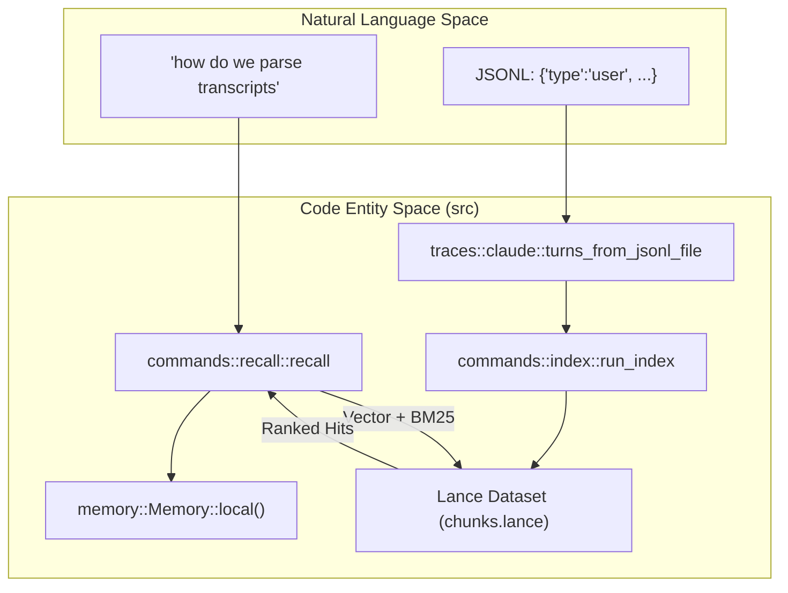
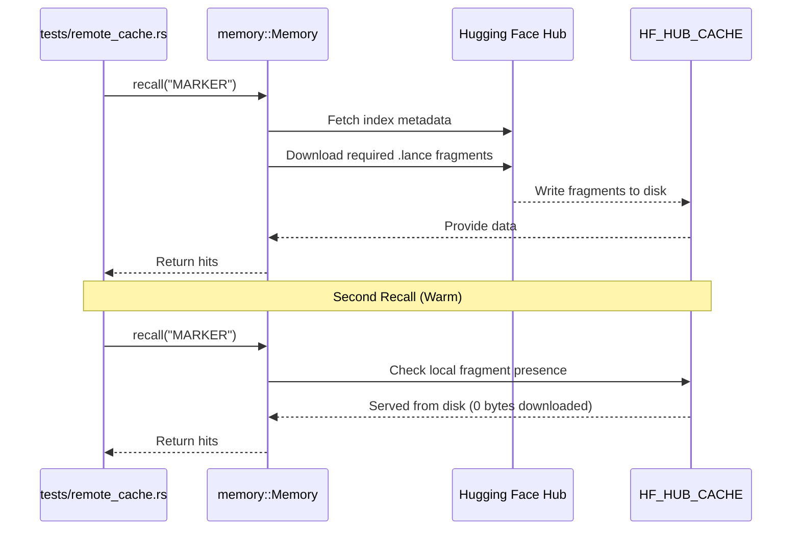

<!-- source: DeepWiki mcp.deepwiki.com · repo huggingface/funes · page 10.1 Integration Tests: Indexing and Recall · fetched 2026-10-26 -->

# Integration Tests: Indexing and Recall

Relevant source files

The following files were used as context for generating this wiki page:

- [tests/ask_grounding.rs](tests/ask_grounding.rs)
- [tests/ask_no_agent.rs](tests/ask_no_agent.rs)
- [tests/first_index.rs](tests/first_index.rs)
- [tests/fixtures/claude_session.jsonl](tests/fixtures/claude_session.jsonl)
- [tests/fixtures/codex_session.jsonl](tests/fixtures/codex_session.jsonl)
- [tests/fixtures/pi_session.jsonl](tests/fixtures/pi_session.jsonl)
- [tests/index_recall.rs](tests/index_recall.rs)
- [tests/no_index.rs](tests/no_index.rs)
- [tests/parse_real_sessions.rs](tests/parse_real_sessions.rs)
- [tests/recall_no_harness_column.rs](tests/recall_no_harness_column.rs)
- [tests/reindex_incremental.rs](tests/reindex_incremental.rs)
- [tests/remote_cache.rs](tests/remote_cache.rs)
- [tests/remote_recall.rs](tests/remote_recall.rs)
- [tests/remove.rs](tests/remove.rs)
- [tests/support/mod.rs](tests/support/mod.rs)

This page covers the integration testing suite for the indexing and retrieval pipelines. These tests validate the end-to-end flow from raw agent transcripts to searchable vector and FTS indices, ensuring stability across harness format changes and remote synchronization.

## Overview

The integration tests reside in the `tests/` directory and are designed to run against real local environments or gated remote Hugging Face Hub fixtures. Unlike unit tests, these exercise the full `LanceDB` storage layer, the `BGE` embedding models, and the `RRF` (Reciprocal Rank Fusion) recall pipeline [tests/index_recall.rs:1-4]().

### Key Test Categories
*   **Local Indexing:** Validates parsing, chunking, and indexing of synthetic and real transcripts.
*   **Recall Surface:** Exercises `recall`, `scan`, `get`, and `status` commands.
*   **Incremental Stability:** Ensures that appending turns to a session results in deterministic index states.
*   **Remote Recall:** Validates `hf://` transport and read-through caching using live Hub datasets.

---

## Data Flow: From Transcript to Recallable Hit

The following diagram illustrates the data flow exercised by `index_then_read_surface` in `tests/index_recall.rs`.

### System Entity Map: Indexing and Search

Sources: [tests/index_recall.rs:28-58](), [src/commands/index.rs](), [src/commands/recall.rs]()

---

## Core Integration Tests

### 1. Indexing and Recall Surface (`index_recall.rs`)
This test validates the primary "read surface" of `funes`. It creates a synthetic Claude-style transcript, indexes it, and then verifies:
*   **`status`**: Reports non-zero chunk counts [tests/index_recall.rs:41-44]().
*   **`recall`**: Surfaces the correct session and workdir provenance [tests/index_recall.rs:47-67]().
*   **`scan`**: Performs literal needle-in-haystack searches and returns the correct `→ get` range [tests/index_recall.rs:85-103]().
*   **`sessions`**: Lists indexed sessions with accurate turn counts [tests/index_recall.rs:153-164]().

### 2. Incremental and Budgeted Indexing (`reindex_incremental.rs`, `first_index.rs`)
These tests ensure the "local-first, append-only" philosophy is maintained.
*   **Convergence:** `incremental_reindex_matches_from_scratch` proves that indexing 4 turns and then appending 2 more yields the exact same state as indexing 6 turns from scratch [tests/reindex_incremental.rs:32-68]().
*   **Self-Healing:** If the `memory/` directory is deleted but `state.json` remains, `run_index_budgeted` detects the missing physical storage and rebuilds the index [tests/first_index.rs:69-76]().

### 3. Real Session Parsing (`parse_real_sessions.rs`)
To prevent regression against evolving agent formats, `funes` includes trimmed, secret-scanned native sessions from real harnesses.

| Harness | Fixture File | Validation Logic |
| :--- | :--- | :--- |
| **Claude** | `claude_session.jsonl` | Verifies `uuid` stability and skipping of `queue-operation` lines [tests/parse_real_sessions.rs:123-148](). |
| **Codex** | `codex_session.jsonl` | Validates `thinking` and `tool` role mapping [tests/parse_real_sessions.rs:67-97](). |
| **Pi** | `pi_session.jsonl` | Ensures `tool_result` correlation and stable `turn_uuid` [tests/parse_real_sessions.rs:100-120](). |

Sources: [tests/parse_real_sessions.rs:1-148]()

---

## Remote Recall and Caching

The `remote_recall.rs` and `remote_cache.rs` tests are gated by the `HF_FUNES_TEST_TOKEN` environment variable. They validate the `hf://` transport layer.

### Remote Recall Workflow

Sources: [tests/remote_cache.rs:48-82](), [tests/remote_recall.rs:15-52]()

---

## Regression Testing: Schema Evolution

### `recall_no_harness_column.rs`
This test handles backward compatibility for memories created before the `harness` facet was introduced.
1.  It builds a standard index [tests/recall_no_harness_column.rs:31-33]().
2.  It manually drops the `harness` column using `ds.drop_columns` [tests/recall_no_harness_column.rs:35-38]().
3.  It verifies that standard `recall` still works by adapting its projection [tests/recall_no_harness_column.rs:46-61]().
4.  It verifies that filtering by `--harness` on such a memory provides a clear error message instead of a database crash [tests/recall_no_harness_column.rs:65-80]().

---

## Test Support Infrastructure

The `tests/support/mod.rs` module provides utilities for simulating agent environments without requiring the actual agent binaries (e.g., `claude`, `codex`) to be installed.

*   **`fake_cli`**: Creates a shell script that logs its own calls to a temporary file, allowing the test to assert that `funes` invoked the correct registration commands [tests/support/mod.rs:6-15]().
*   **`run_remove`**: Executes the `funes remove` command in a sanitized environment, ensuring that the test does not accidentally modify the developer's actual `$HOME` or `$FUNES_HOME` [tests/support/mod.rs:17-30]().

Sources: [tests/support/mod.rs:1-40]()

---

