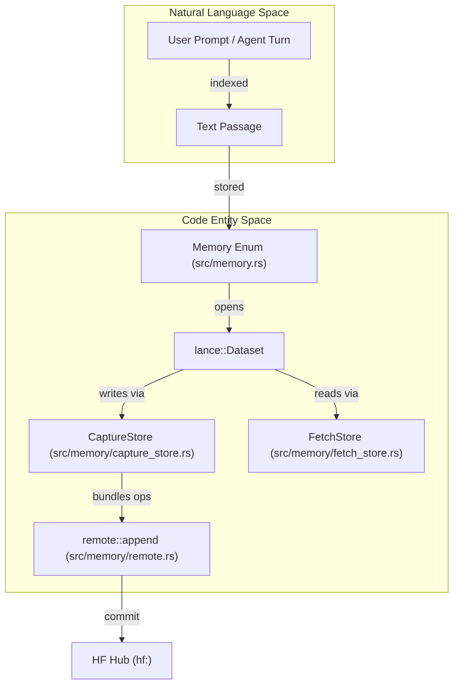
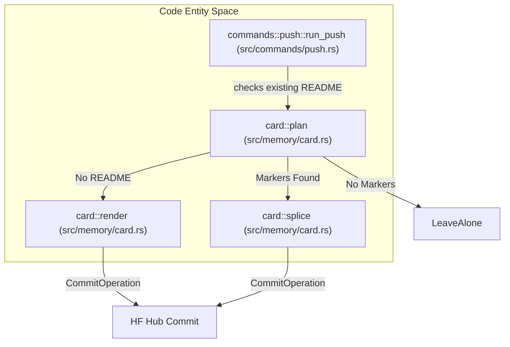

<!-- source: DeepWiki mcp.deepwiki.com · repo huggingface/funes · page 2.3 Memory Storage Layer · fetched 2026-10-26 -->

# Memory Storage Layer

Relevant source files

The following files were used as context for generating this wiki page:

- [docs/configuration.md](docs/configuration.md)
- [docs/storage.md](docs/storage.md)
- [scripts/automation/funes-index.sh](scripts/automation/funes-index.sh)
- [scripts/automation/funes-push.sh](scripts/automation/funes-push.sh)
- [scripts/backfill_remote_repo.rs](scripts/backfill_remote_repo.rs)
- [src/memory.rs](src/memory.rs)
- [src/memory/capture_store.rs](src/memory/capture_store.rs)
- [src/memory/card.rs](src/memory/card.rs)
- [src/memory/fetch_store.rs](src/memory/fetch_store.rs)
- [src/memory/lock.rs](src/memory/lock.rs)
- [src/memory/remote.rs](src/memory/remote.rs)
- [tests/push_card.rs](tests/push_card.rs)
- [tests/store_lock.rs](tests/store_lock.rs)

The Memory Storage Layer is responsible for the physical persistence, indexing, and concurrency control of agent memories. It utilizes the **Lance** columnar data format to provide high-performance vector search (ANN) and full-text search (FTS) capabilities both locally and over the Hugging Face Hub.

## Lance Dataset Layout

A funes memory is stored as a single Lance dataset named `chunks.lance`. The layout follows the standard Lance specification but is managed by funes to ensure atomic commits and efficient remote synchronization.

| Directory / File | Purpose | Growth Factor |
| :--- | :--- | :--- |
| `data/` | Contains `.lance` fragments holding row data (text, embeddings, metadata). | Linear with chunks × content. |
| `_indices/` | Stores IVF_PQ (vector) and BM25 (FTS) index generations. | Sublinear (saturating vocabulary). |
| `_versions/` | Manifest files (`.manifest`) for each committed version. | Per index/push commit. |
| `_transactions/` | Transaction logs for ACID compliance. | Negligible. |

**Sources:** [docs/storage.md:29-39](), [src/memory.rs:1-13]()

### Storage Cost Model
The storage footprint is dominated by the embedding vectors. Using the default `bge-small-en-v1.5` model (`DIM = 384`), the cost breakdown per chunk is approximately:
*   **Vector Floor:** 1,536 B (Fixed-size Float32 array).
*   **Text & Metadata:** ~500–600 B.
*   **Index Overhead:** ~180 B.
*   **Total Budget:** **~2.30 KB per chunk**.

**Sources:** [docs/storage.md:49-93]()

---

## Schema and Indexing

The `chunks.lance` dataset uses a fixed Arrow schema designed to support both semantic recall and precise provenance tracking.

### Columns
| Column | Type | Role |
| :--- | :--- | :--- |
| `id` | Utf8 | Deterministic CID (SHA1 of content). |
| `text` | Utf8 | The chunked passage text. |
| `embedding` | `FixedSizeList<F32, 384>` | Vector representation for ANN. |
| `session_id` | Utf8 | UUID of the agent session. |
| `repo` | Utf8 | Resolved git repository name. |
| `ts` | Timestamp | ISO8601 creation time. |
| `harness` | Utf8 | Agent type (e.g., `claude`, `codex`). |

**Sources:** [scripts/backfill_remote_repo.rs:75-88](), [docs/storage.md:59-63]()

### Index Construction
Funes constructs two primary indices to support hybrid search:
1.  **IVF_PQ (Inverted File with Product Quantization):** Used for vector similarity search. It uses ~24 B per vector for PQ codes.
2.  **FTS (Full-Text Search):** A BM25-based inverted index for keyword matching.

**Sources:** [docs/storage.md:67-86](), [src/memory/remote.rs:3-7]()

---

## Concurrency and Locking

To prevent data corruption or orphaned rows during local mutations, funes implements an advisory locking model.

### MemoryLock
The `MemoryLock` class (defined in `src/memory/lock.rs`) uses an exclusive `flock` on a file named `store.lock` located in the `$FUNES_HOME` directory.

*   **Exclusive Writers:** Only one process can acquire the lock to write to the local memory.
*   **Non-blocking Readers:** Readers do not take a lock; Lance provides them with a consistent snapshot of the dataset.
*   **Contention:** If a writer (e.g., `funes index` or `funes scrub`) attempts to acquire the lock while another is active, it fails loudly with an error message: *"another funes memory operation is in progress"*.

**Sources:** [src/memory/lock.rs:1-59](), [tests/store_lock.rs:1-37]()

---

## Object-Store Wrappers

Funes uses custom decorators for the `object_store` trait to manage how Lance interacts with the Hugging Face Hub. This allows funes to treat a Git-based Hub repo as an atomic transactional store.

### Data Flow: Code Entity to Storage
The following diagram illustrates how high-level memory operations map to the underlying storage abstractions.

**Sources:** [src/memory.rs:34-41](), [src/memory/remote.rs:9-37](), [src/memory/capture_store.rs:1-21]()

### CaptureStore
`CaptureStore` intercepts all `put` operations from Lance. Instead of writing files one-by-one to the Hub (which would create multiple Git commits), it buffers them in memory. These captured files are then shipped as a single atomic `create_commit` to the Hugging Face Hub.
**Sources:** [src/memory/capture_store.rs:40-53](), [src/memory/remote.rs:18-30]()

### FetchStore
`FetchStore` provides a read-through cache for remote memories. It pins reads to a specific head commit (SHA) to ensure a consistent view of the dataset even if a push occurs mid-read.
**Sources:** [src/memory/fetch_store.rs]() (implied), [src/memory.rs:105-122]()

---

## Dataset Card (README.md) Management

Every published memory includes a `README.md` (Dataset Card) that makes the memory discoverable on the Hub via the `funes` tag.

### README Synchronization Logic
Funes manages the card through a "splice" mechanism:
1.  **Creation:** If no README exists, funes generates a full card with usage instructions and metadata.
2.  **Stats Refresh:** Funes looks for markers `<!-- funes:stats -->` and `<!-- /funes:stats -->`. If found, it updates the chunk count and timestamp within these markers.
3.  **Hands-off Policy:** If a user hand-writes a README without these markers, funes respects the user's content and stops updating the card.

**Sources:** [src/memory/card.rs:9-72](), [tests/push_card.rs:58-132]()

### Card Metadata
The card includes Hub-standard frontmatter:
*   **Tags:** `funes`, `agent-memory`, `embeddings`, `lance`.
*   **Size Categories:** Automatically computed (e.g., `1K<n<10K`) based on the chunk count.

**Sources:** [src/memory/card.rs:14-31](), [src/memory/card.rs:76-111]()

---

