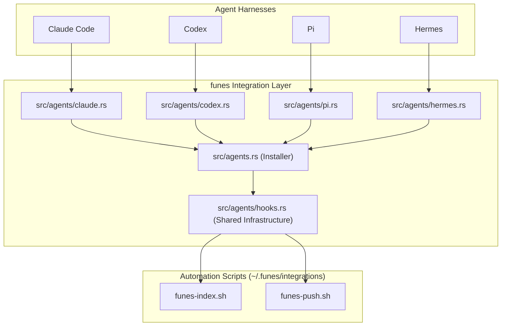
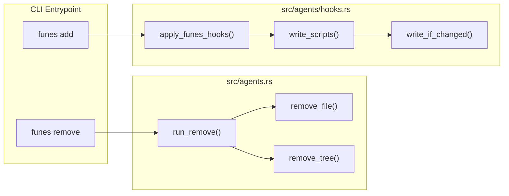

<!-- source: DeepWiki mcp.deepwiki.com · repo huggingface/funes · page 5 Agent Integrations · fetched 2026-10-26 -->

# Agent Integrations

Relevant source files

The following files were used as context for generating this wiki page:

- [docs/add.md](docs/add.md)
- [docs/automation.md](docs/automation.md)
- [src/agents.rs](src/agents.rs)

The `funes` system integrates directly into AI coding agents to automate the lifecycle of memory capture and recall. By using `funes add <agent>`, the system wires itself into the agent's native hook or plugin architecture, ensuring that every interaction is indexed locally and, if a remote memory is bound, published to the Hugging Face Hub.

### Integration Architecture

Funes treats each agent harness as a first-class integration target, utilizing specific modules in `src/agents/` to handle installation, lifecycle hooks, and tool registration.

**Sources:** [src/agents.rs:1-9](), [docs/automation.md:79-82](), [docs/add.md:3-6]()

---

### Supported Integrations

Each integration provides two primary capabilities:
1.  **Read Tools**: Exposing `recall`, `get`, and `status` to the agent via MCP or native tool protocols [docs/add.md:62-69]().
2.  **Automation Hooks**: Triggering indexing and synchronization without manual user intervention [docs/automation.md:14-25]().

| Agent | Mechanism | Per-Turn Indexing | Session-Boundary Publish |
| :--- | :--- | :--- | :--- |
| **Claude Code** | Marketplace Plugin | `TurnComplete` | `SessionStart` / `SessionEnd` |
| **Codex** | `hooks.json` + Skill | Shell Hook | `SessionStart` / `SessionEnd` |
| **Pi** | TS Extension | `turn_end` | `session_shutdown` |
| **Hermes** | `config.yaml` | `post_llm_call` | `on_session_finalize` |

**Sources:** [docs/add.md:26-32](), [docs/automation.md:94-99]()

---

### [Claude Code Integration](#5.1)
Claude Code utilizes a formal plugin system. `funes` installs a hooks-only plugin located at `~/.funes/integrations/claude-plugin` and registers it using the Claude CLI [docs/automation.md:48-52](). It leverages the Model Context Protocol (MCP) for tool delivery.

For details, see [Claude Code Integration](#5.1).

### [Codex Integration](#5.2)
Codex integration involves writing to `~/.codex/hooks.json` and installing a "Skill" at `~/.codex/skills/funes/` [docs/automation.md:57-61](). Codex requires manual trust of hooks via the `/hooks` command before they will execute [docs/automation.md:62-65]().

For details, see [Codex Integration](#5.2).

### [Pi Integration](#5.3)
Pi uses a TypeScript-based extension model. The integration includes a `FunesMcp` stdio client and registers tools dynamically via `pi.registerTool` [docs/automation.md:53-56](). The Rust installer manages version guards and asset extraction [src/agents/pi.rs:1-10]().

For details, see [Pi Integration](#5.3).

### [Hermes Integration](#5.4)
Hermes (currently in **beta**) integrates via shell hooks declared in `~/.hermes/config.yaml` [docs/automation.md:66-70](). Funes manages the `shell-hooks-allowlist.json` to ensure hooks are pre-approved and execute seamlessly [docs/automation.md:70-72]().

For details, see [Hermes Integration](#5.4).

---

### [Automation Hooks and Shared Infrastructure](#5.5)
All integrations rely on a shared set of shell scripts and Rust utilities to ensure non-blocking execution.

*   **`funes-index.sh`**: Runs `funes index` incrementally after every turn [docs/automation.md:79-82]().
*   **`funes-push.sh`**: Runs `funes push` at session boundaries to sync with the Hub [docs/automation.md:79-82]().
*   **Detached Workers**: Hooks re-exec as detached processes to return control to the agent in under a second [docs/automation.md:80-83]().
*   **Advisory Locking**: The `funes` binary uses locks to prevent concurrent mutation of the local Lance dataset [docs/automation.md:102-105]().

For details, see [Automation Hooks and Shared Infrastructure](#5.5).

---

### Code Entity Mapping

This diagram maps the logical integration steps to the specific Rust functions and files responsible for managing the agent lifecycle.

**Sources:** [src/agents.rs:49-55](), [src/agents.rs:78-84](), [src/agents.rs:87-94](), [docs/automation.md:79-83]()

---

