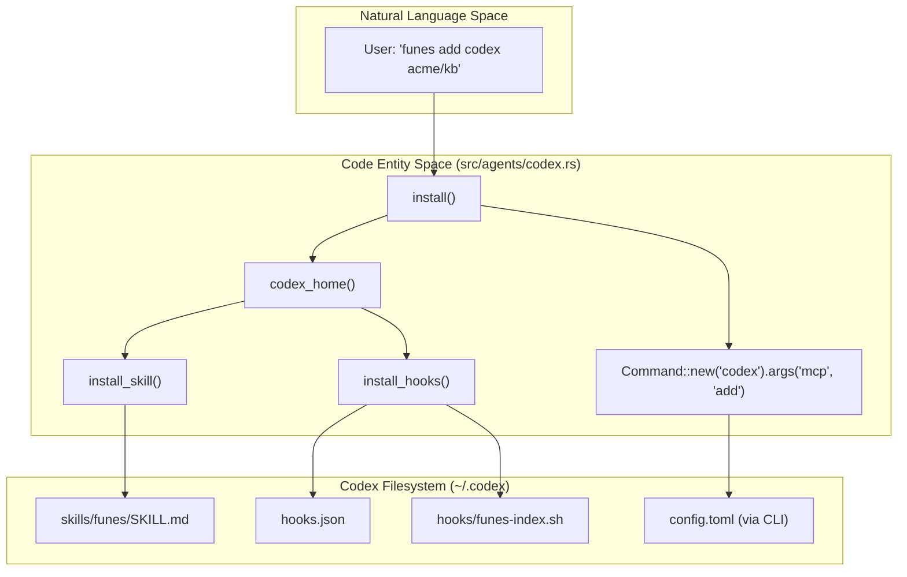

<!-- source: DeepWiki mcp.deepwiki.com · repo huggingface/funes · page 5.2 Codex Integration · fetched 2026-10-26 -->

# Codex Integration

<details>
<summary>Relevant source files</summary>

The following files were used as context for generating this wiki page:

- [integrations/codex/SKILL.md](integrations/codex/SKILL.md)
- [src/agents/codex.rs](src/agents/codex.rs)
- [tests/add_claude_plugin.rs](tests/add_claude_plugin.rs)
- [tests/add_codex_hooks.rs](tests/add_codex_hooks.rs)

</details>


The Codex integration enables `funes` to serve as a persistent memory layer for the Codex AI agent. This integration utilizes Codex's native Model Context Protocol (MCP) support for tool execution and its hook system for automated background indexing and memory synchronization.

The integration consists of three primary components:
1.  **MCP Server Registration**: Exposing `recall`, `get`, `sessions`, `scan`, `sketch`, and `status` tools to Codex via `stdio`.
2.  **Skill Metadata**: A `SKILL.md` file that informs Codex of the memory's purpose before tools are dynamically loaded.
3.  **Automation Hooks**: Entries in `hooks.json` that trigger `funes-index.sh` and `funes-push.sh` scripts at session boundaries.

## Architecture and Data Flow

The integration bridges the Natural Language Space (where the user asks about past sessions) and the Code Entity Space (where `src/agents/codex.rs` manages file system state and CLI calls).

### System Mapping: Natural Language to Code Entities

| User Concept | Code Entity / Implementation | Purpose |
| :--- | :--- | :--- |
| "Codex Memory" | `integrations/codex/SKILL.md` [integrations/codex/SKILL.md:1-15]() | Defines the agent's identity and tool descriptions for the LLM. |
| "Index on Stop" | `Stop` hook in `hooks.json` [src/agents/codex.rs:12-16]() | Triggers indexing of the current turn immediately after completion. |
| "Auto-Sync" | `SessionStart` / `SessionEnd` hooks [src/agents/codex.rs:12-16]() | Triggers pushing local memory to a remote Hugging Face repository. |
| "MCP Tools" | `mcp_add_args` [src/agents/codex.rs:37-46]() | Registers the `funes mcp` command with the Codex CLI. |

### Integration Logic Flow
This diagram illustrates how `src/agents/codex.rs` interacts with the Codex environment during installation.


**Sources:** [src/agents/codex.rs:48-90](), [src/agents/codex.rs:126-138]()

## Lifecycle Management

### Installation (`funes add codex`)
The installation process performed by `src/agents/codex.rs` involves several steps to ensure the environment is correctly configured:

1.  **Version Validation**: If a remote memory is provided, `funes` checks the Codex version. It requires a minimum version (0.151.0) to ensure the `SessionEnd` hook is available for reliable memory publishing [src/agents/codex.rs:31-34](), [src/agents/codex.rs:50-59]().
2.  **Home Resolution**: The integration determines the Codex home directory by calling `codex doctor --json`. If the CLI is unavailable, it falls back to the `CODEX_HOME` environment variable or `~/.codex` [src/agents/codex.rs:126-151]().
3.  **Skill Deployment**: A `SKILL.md` file is written to `~/.codex/skills/funes/`. This file contains the name and description used by Codex to identify the memory capability [integrations/codex/SKILL.md:1-15](), [src/agents/codex.rs:63-64]().
4.  **Hook Configuration**:
    *   `Stop`: Executes `funes-index.sh` to parse the session and update the local Lance dataset [src/agents/codex.rs:12-13](), [tests/add_codex_hooks.rs:49-54]().
    *   `SessionStart` / `SessionEnd`: If a remote memory (e.g., `acme/kb`) is bound, these hooks execute `funes-push.sh` to synchronize local changes to the Hugging Face Hub [src/agents/codex.rs:13-16](), [tests/add_codex_hooks.rs:55-61]().
5.  **MCP Registration**: The installer executes `codex mcp add funes -- funes mcp [memory]` to register the toolset [src/agents/codex.rs:37-46](), [src/agents/codex.rs:67-77]().

### Uninstallation (`funes remove codex`)
The `uninstall` function in `src/agents/codex.rs` performs a "clean" removal:
*   It unregisters the MCP server using `codex mcp remove funes` [src/agents/codex.rs:95-99]().
*   It removes the `SKILL.md` file and prunes the `funes` skill directory [src/agents/codex.rs:102-106]().
*   It removes `funes` entries from `hooks.json` and deletes the associated shell scripts in `~/.codex/hooks/` [src/agents/codex.rs:102-106](), [tests/add_codex_hooks.rs:72-87]().

**Sources:** [src/agents/codex.rs:48-124](), [tests/add_codex_hooks.rs:11-88]()

## Hook Mechanics and Merging

The integration is designed to be non-destructive. When writing to `~/.codex/hooks.json`, `funes` performs an append-or-replace merge. Existing user hooks (e.g., a `PreToolUse` guard) are preserved while `funes`-specific hooks are updated or added [tests/add_codex_hooks.rs:11-29](), [tests/add_codex_hooks.rs:69-71]().

### Hook Structure in `hooks.json`

| Event | Script | Purpose |
| :--- | :--- | :--- |
| `Stop` | `funes-index.sh codex` | Runs after every turn to index the latest interaction. |
| `SessionStart` | `funes-push.sh <memory>` | Catches up on any missed pushes from previous sessions. |
| `SessionEnd` | `funes-push.sh <memory>` | Publishes the indexed session data to the remote repository. |

**Sources:** [src/agents/codex.rs:12-16](), [tests/add_codex_hooks.rs:49-61]()

## Filesystem Layout

The integration populates the following structure within the Codex home directory (typically `~/.codex/`):

```text
~/.codex/
├── hooks.json              # Merged hook configurations
├── hooks/
│   ├── funes-index.sh      # Detached indexing script
│   └── funes-push.sh       # Detached push/sync script
└── skills/
    └── funes/
        └── SKILL.md        # Agent identity and tool descriptions
```

**Sources:** [src/agents/codex.rs:12-16](), [src/agents/codex.rs:61-66](), [tests/add_codex_hooks.rs:38-46](), [tests/add_codex_hooks.rs:63-65]()

---

