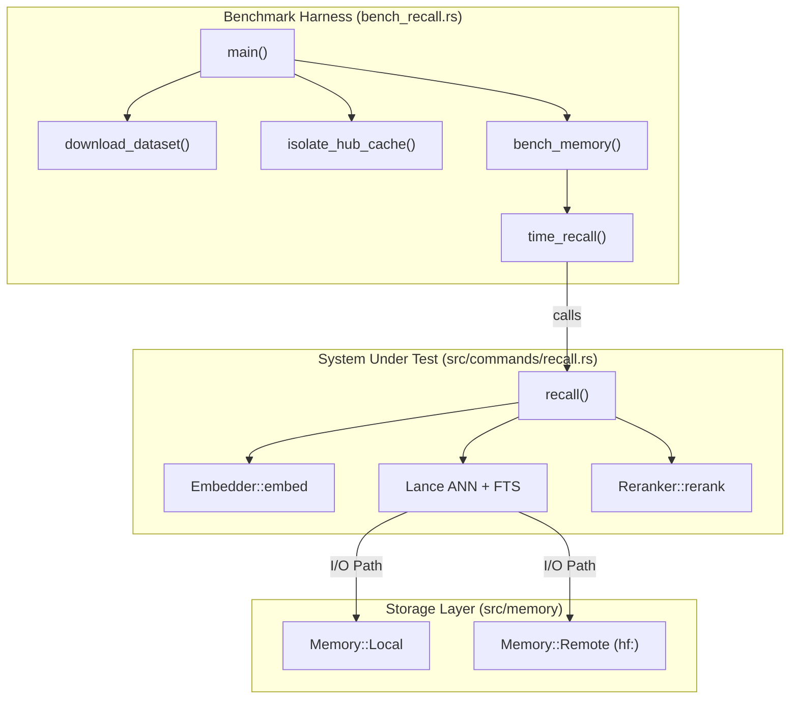
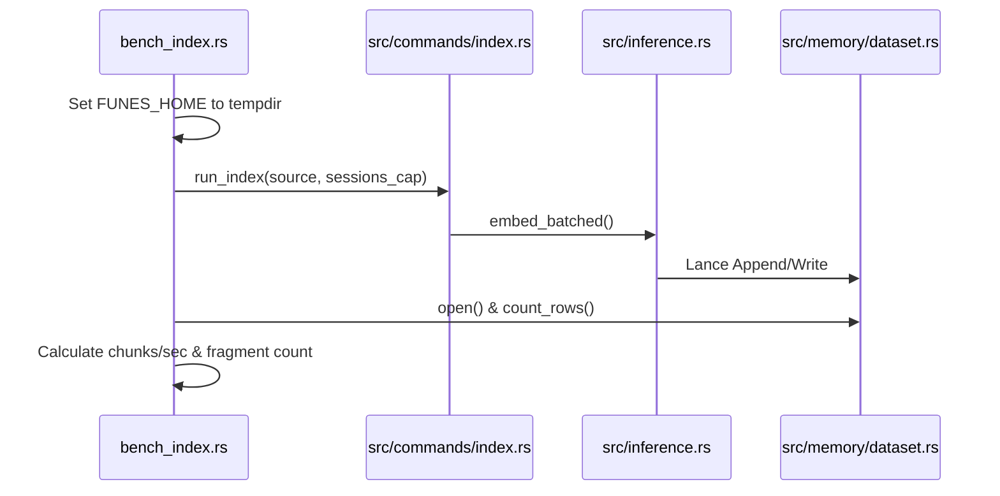
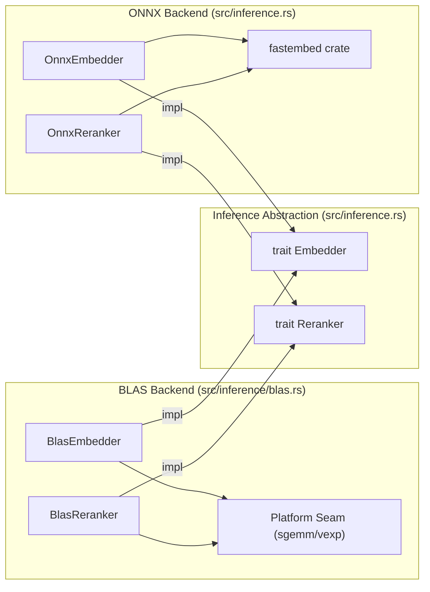

<!-- source: DeepWiki mcp.deepwiki.com · repo huggingface/funes · page 9.3 Benchmarks · fetched 2026-10-26 -->

# Benchmarks

Relevant source files

The following files were used as context for generating this wiki page:

- [benchmark/README.md](benchmark/README.md)
- [benchmark/bench_backends.rs](benchmark/bench_backends.rs)
- [benchmark/bench_index.rs](benchmark/bench_index.rs)
- [benchmark/bench_recall.rs](benchmark/bench_recall.rs)
- [src/commands/scrub.rs](src/commands/scrub.rs)
- [src/inference.rs](src/inference.rs)
- [src/inference/blas.rs](src/inference/blas.rs)

The `funes` codebase includes a suite of specialized benchmarks designed to measure retrieval latency, indexing throughput, and the performance/accuracy trade-offs of different inference backends. These tools are located in the `benchmark/` directory and are intended to be run as release-mode examples.

## 1. Recall Latency (`bench_recall`)

`bench_recall` measures the end-to-end latency of the `recall()` pipeline. It is specifically designed to isolate the I/O overhead of remote memories (`hf://`) compared to local disk access [benchmark/README.md:9-15]().

### What it Measures
The benchmark times the full retrieval sequence:
1.  **Query Embedding:** Converting the query string into a dense vector.
2.  **Hybrid Search:** Concurrent Vector ANN (Lance) and BM25 FTS (Lance) scans.
3.  **RRF Fusion:** Reciprocal Rank Fusion of candidates.
4.  **Cross-Encoder Rerank:** Scoring candidates against the query.
5.  **Post-processing:** Recency reweighting and neighbor expansion [benchmark/README.md:18-22]().

### Measurement Strategy
To ensure a fair comparison, the benchmark downloads the target remote dataset to a temporary directory first. It then runs the same query against both the local copy and the `hf://` remote version [benchmark/README.md:12-14]().

*   **Remote Cold:** Uses a fresh `HF_HUB_CACHE` via `isolate_hub_cache()` to force a true download of index fragments and data during the first read [benchmark/bench_recall.rs:105-113]().
*   **Remote Warm:** Subsequent calls where the `hf-hub` file cache is already populated; performance should approach local speeds [benchmark/README.md:34-35]().
*   **Local:** The baseline measurement using the local disk copy [benchmark/README.md:36-37]().

### Code Entity Map: Recall Benchmark
The following diagram maps the benchmark logic to the core retrieval functions.

**Sources:** [benchmark/bench_recall.rs:57-74](), [benchmark/bench_recall.rs:81-99](), [benchmark/bench_recall.rs:105-113](), [benchmark/README.md:21-27]()

---

## 2. Indexing Throughput (`bench_index`)

`bench_index` measures the efficiency of the indexing pipeline, focusing on build time, embedding throughput (chunks/second), and the compactness of the resulting Lance dataset [benchmark/README.md:124-128]().

### Implementation Details
The benchmark creates a throwaway `FUNES_HOME` using `tempfile` to avoid mutating the user's actual memory [benchmark/bench_index.rs:55-58](). It executes `run_index` with a configurable session cap to provide a steady-state measurement of the indexing pipeline [benchmark/bench_index.rs:61]().

Key metrics reported:
*   **Throughput:** Calculated as `total chunks / elapsed time` [benchmark/bench_index.rs:93]().
*   **Compactness:** Measured by the number of Lance fragments in `chunks.lance/data`. A single fragment indicates an efficient bulk import (common in Parquet indexing), while many fragments suggest fragmented appends [benchmark/bench_index.rs:85-86]().
*   **Memory Size:** Total on-disk footprint in MB [benchmark/bench_index.rs:84]().

### Data Flow: Indexing Benchmark

**Sources:** [benchmark/bench_index.rs:55-62](), [benchmark/bench_index.rs:67-95](), [benchmark/README.md:124-131]()

---

## 3. Inference Backends (`bench_backends`)

`bench_backends` provides an A/B comparison between the two primary inference stacks: **BLAS** (the default from-scratch forward pass) and **ONNX** (via `fastembed`/`ort`) [benchmark/bench_backends.rs:1-5]().

### Workloads
The benchmark tests two distinct scenarios:
1.  **16×short:** Small documents that stress per-call overhead like tokenization and thread synchronization [benchmark/bench_backends.rs:106]().
2.  **30×~500tok:** Documents at the 512-token truncation limit, stressing GEMM (General Matrix Multiply) throughput and memory bandwidth [benchmark/bench_backends.rs:106]().

### Agreement and Accuracy
Because `funes` relies on deterministic retrieval, the backends must agree on their outputs. The benchmark calculates:
*   **Cosine Agreement:** The minimum cosine similarity between embeddings produced by different backends [benchmark/bench_backends.rs:130]().
*   **Rerank Delta:** The maximum absolute difference in scores between rerankers [benchmark/bench_backends.rs:131-136]().

### Backend Implementations
| Feature | Implementation | Seam / Library |
| :--- | :--- | :--- |
| **BLAS (macOS)** | `BlasEmbedder` / `BlasReranker` | Accelerate (`cblas_sgemm`, `vvexpf`) [src/inference/blas.rs:20-43]() |
| **BLAS (Linux)** | `BlasEmbedder` / `BlasReranker` | `faer` (GEMM) + custom vectorized `vexp` [src/inference/blas.rs:97-166]() |
| **ONNX** | `OnnxEmbedder` / `OnnxReranker` | `fastembed` + `ort` [src/inference.rs:47-91]() |

**Sources:** [src/inference.rs:15-44](), [src/inference/blas.rs:1-5](), [benchmark/bench_backends.rs:114-144]()

---

## 4. Benchmark Execution Summary

| Benchmark | Command | Primary Metric |
| :--- | :--- | :--- |
| **Recall** | `cargo run --release --example bench_recall` | Local vs Remote ratio [benchmark/README.md:5-15]() |
| **Index** | `cargo run --release --example bench_index` | Throughput (chunks/s) [benchmark/README.md:6]() |
| **Backends** | `cargo run --release --features onnx --example bench_backends` | Latency & Cosine Agreement [benchmark/README.md:7]() |

**Sources:** [benchmark/README.md:3-7]()

---

