# Page: Overview

# Overview

<details>
<summary>Relevant source files</summary>

The following files were used as context for generating this wiki page:

- [CONTRIBUTING.md](CONTRIBUTING.md)
- [README.md](README.md)
- [SECURITY.md](SECURITY.md)
- [docs/RATIONALE.md](docs/RATIONALE.md)
- [docs/README.md](docs/README.md)
- [docs/ask.md](docs/ask.md)
- [docs/demo/cross-agents.tape](docs/demo/cross-agents.tape)
- [docs/hub-caching.md](docs/hub-caching.md)
- [docs/landscape.md](docs/landscape.md)
- [docs/sessions.md](docs/sessions.md)
- [src/hub.rs](src/hub.rs)
- [src/lib.rs](src/lib.rs)
- [src/main.rs](src/main.rs)

</details>


`funes` provides durable, long-term memory for AI coding agents. It indexes past sessions across multiple harnesses—including **Claude Code**, **Codex**, **pi**, and **Hermes**—allowing agents to recall prior decisions, rationale, and findings mid-task [README.md:1-6]().

The system is designed as a local-first, append-only event log. By treating memory as a versioned dataset that can be published to the **Hugging Face Hub**, `funes` enables seamless memory sharing across machines and teams [README.md:17-19]().

## Core Design Philosophy

The architecture of `funes` is guided by four deliberate constraints intended to keep the system faithful, stable, and secure [docs/RATIONALE.md:16-20]().

*   **Append-Only Event Log**: `funes` never overwrites or mutates data. Every chunk is an immutable, timestamped record of "what was said when." Conflicting or updated information is resolved at **read-time** via recency weighting [docs/RATIONALE.md:21-25]().
*   **Deterministic Ingest**: There is no LLM in the indexing pipeline. The system performs `parse → chunk → embed`. This ensures that recalled passages are verbatim and maintain exact provenance (linking back to specific `session_id` and `turn_uuid`) [docs/RATIONALE.md:36-40]().
*   **Local-First & Model-Agnostic**: Embedding and reranking happen on the local machine using pinned models (e.g., `BAAI/bge-small-en-v1.5`). This keeps sensitive data under your control and ensures the memory outlives any specific generative model [docs/RATIONALE.md:57-61]().
*   **Pull-Based Retrieval**: `funes` never proactively injects memory into an agent's context. Recall is a tool that the model (or user) must explicitly call. This keeps the context window clean and ensures memory is only used when relevant [docs/RATIONALE.md:83-87]().

For a deeper dive into these decisions, see [Design Rationale and Landscape](#1.2).

## System Map

The codebase is organized into distinct layers, each responsible for a specific stage of the memory lifecycle [src/lib.rs:8-21]().

### Data Flow: From Transcript to Recall
The following diagram illustrates how raw session data from various agent harnesses is processed into a searchable Lance dataset and subsequently retrieved.

**Diagram: Memory Lifecycle (Ingest to Retrieval)**
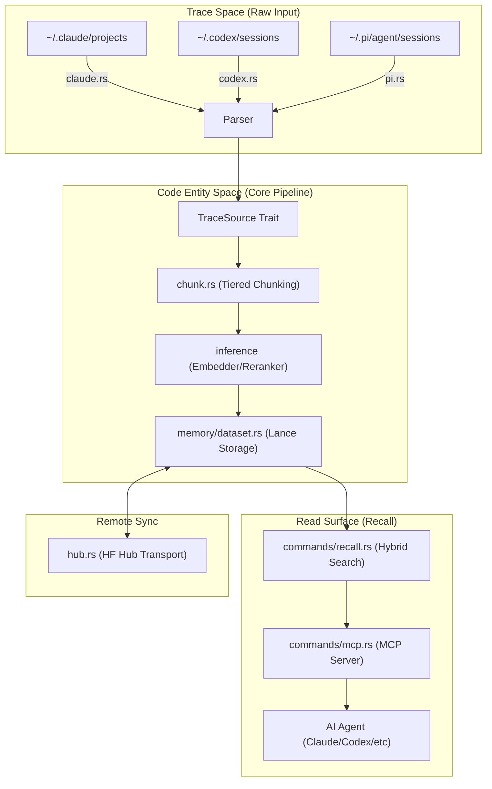
Sources: [src/lib.rs:10-21](), [src/main.rs:84-103](), [src/hub.rs:1-3]()

### Code Subsystems
| Layer | Responsibility | Key Files |
| :--- | :--- | :--- |
| **Traces** | Parsing harness-specific transcripts into a unified `Turn`/`Block` model. | `src/traces/` [src/lib.rs:10]() |
| **Inference** | Local embedding and reranking via BLAS or ONNX backends. | `src/inference/` [src/lib.rs:14]() |
| **Memory** | Mechanics of the Lance dataset and local/remote object storage. | `src/memory/` [src/lib.rs:17]() |
| **Hub** | Transport layer for Hugging Face Hub authentication and dataset management. | `src/hub.rs` [src/lib.rs:15]() |
| **Agents** | Integration logic for registering `funes` as an MCP tool or via automation hooks. | `src/agents/` [src/lib.rs:21]() |

## Key Capabilities

### Multi-Agent Integration
`funes` acts as a bridge between different AI tools. You can start a task in **Claude Code**, switch to **Codex**, and the latter can recall the history of the former because they both index into the same local memory [README.md:62-69]().
For setup instructions, see [Getting Started](#1.1).

### Remote Synchronization
By running `funes push <user/org>/<repo>`, your local memory is synchronized to a Hugging Face dataset repository [README.md:88-91](). 
*   **Security**: `funes` redacts credentials at index time and uses an egress gate (via `trufflehog`) to prevent secrets from being pushed [SECURITY.md:28-36]().
*   **Caching**: Remote recall uses a read-through cache, fetching only the immutable Lance files required for a specific query [docs/RATIONALE.md:63-66]().

### Grounded Question Answering
The `funes ask <agent> <question>` command allows you to "borrow" an agent for a single grounded answer without a full installation. `funes` performs the retrieval locally and hands the context to the agent in a single turn [docs/ask.md:1-5]().

**Diagram: `funes ask` Command Execution**
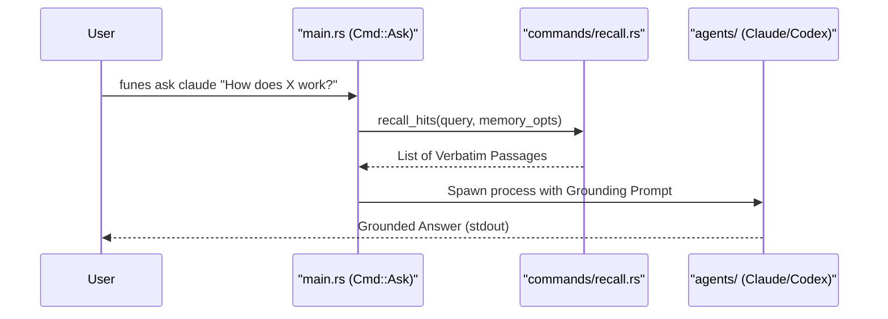
Sources: [src/main.rs:79-82](), [docs/ask.md:18-22](), [src/lib.rs:19-21]()

## Getting Started
To install `funes` and integrate it with your preferred agent, refer to the [Getting Started](#1.1) guide. This covers the installation script, environment variables like `HF_TOKEN`, and the `funes add` onboarding flow [README.md:24-38]().

---

# Page: Getting Started

# Getting Started

<details>
<summary>Relevant source files</summary>

The following files were used as context for generating this wiki page:

- [.github/dependabot.yml](.github/dependabot.yml)
- [.gitignore](.gitignore)
- [docs/add.md](docs/add.md)
- [docs/configuration.md](docs/configuration.md)
- [docs/storage.md](docs/storage.md)
- [scripts/bootstrap-protoc.sh](scripts/bootstrap-protoc.sh)
- [scripts/install.sh](scripts/install.sh)
- [scripts/test-install.sh](scripts/test-install.sh)

</details>


This page covers the installation, environment configuration, and initial onboarding flow for `funes`. It details how to set up the local environment and wire the memory system into supported AI agents.

## Installation

`funes` provides a streamlined installation script for Linux and macOS. The installer detects the host platform, fetches the matching prebuilt binary from the Hugging Face bucket, and verifies it against a cryptographic manifest.

### install.sh
The `install.sh` script is the primary entry point for users. It supports flags for custom installation directories (`-b`) and specific version tags (`-v`) [scripts/install.sh:8-9]().

**Platform Support:**
The script currently targets three architectures:
- `Linux-x86_64` [scripts/install.sh:34]()
- `Linux-aarch64` / `Linux-arm64` [scripts/install.sh:35]()
- `Darwin-arm64` / `Darwin-aarch64` [scripts/install.sh:36]()

**Verification Logic:**
1. **Manifest Fetch:** Downloads `VERSION` and `SHA256SUMS` from the release bucket [scripts/install.sh:134-135]().
2. **Checksum Validation:** Uses `sha256sum` or `shasum` to ensure the downloaded binary matches the manifest [scripts/install.sh:154-157]().
3. **Self-Reported Version:** Executes the binary with `--version` to confirm it matches the requested tag before moving it to the final destination [scripts/install.sh:160-163]().

### Build-time Dependencies
If building from source, `funes` requires `protoc` (Protocol Buffer compiler) because the underlying `lance` storage engine uses it during the build process [scripts/bootstrap-protoc.sh:3](). The `scripts/bootstrap-protoc.sh` script automates downloading a pinned version (28.3) into a local `.tools/` directory to avoid system-wide conflicts [scripts/bootstrap-protoc.sh:11-12]().

### Test-Install Script
The `scripts/test-install.sh` script serves as a CI validator for the installer itself. It mocks the Hugging Face bucket environment using a temporary directory and a shimmed `curl` command to verify that the installer correctly handles valid binaries and rejects those with checksum mismatches [scripts/test-install.sh:14-29, 54-58]().

**Sources:** `scripts/install.sh`, `scripts/bootstrap-protoc.sh`, `scripts/test-install.sh`

---

## Environment Variables

`funes` behavior is controlled through several environment variables. There is no global configuration file; state is determined by these variables or baked into agent-specific configurations during the `funes add` process [docs/configuration.md:3-5]().

| Variable | Role | Default |
| :--- | :--- | :--- |
| `FUNES_HOME` | Primary state directory (Lance DB, state.json, receipts). | `~/.funes` |
| `HF_TOKEN` | Hugging Face Hub authentication for private memories and pushing. | (None) |
| `FUNES_TRUFFLEHOG` | Path to the `trufflehog` binary for secret scanning. | Found on `PATH` |
| `HF_HUB_CACHE` | Location for cached remote memory files and model weights. | `~/.cache/huggingface/hub` |

### Path Resolution Logic
For authentication, `funes` checks for tokens in the following precedence [docs/configuration.md:49-55]():
1. `HF_TOKEN`
2. `HUGGING_FACE_HUB_TOKEN`
3. `HUGGINGFACE_TOKEN`
4. `~/.cache/huggingface/token` (created by `hf auth login`)

**Sources:** `docs/configuration.md`

---

## The Onboarding Flow (`funes add`)

The `funes add <agent> [memory]` command is the core onboarding mechanism. It performs a "one-click" integration that includes building the initial index and installing automation hooks [docs/add.md:3-6]().

### Implementation Sequence
When a user runs `funes add`, the system executes the following steps:

1. **Memory Binding:** The command associates the agent with a specific memory (a local path, an `<org>/<repo>` shorthand, or a full `hf://` URI) [docs/add.md:85]().
2. **Initial Indexing:** A fast, text-first pass is performed over existing agent transcripts to populate the local Lance dataset [docs/add.md:106-107]().
3. **Hook Installation:** Automation scripts (e.g., `funes-index.sh`) are written to the agent's specific configuration directory (e.g., `~/.codex/hooks/` or `~/.hermes/hooks/`) [docs/configuration.md:37-42]().
4. **MCP Registration:** The agent is configured to launch `funes mcp` as a stdio-based Model Context Protocol server [docs/add.md:38-46]().
5. **Wrong-Memory Guard:** A "first push" is performed to clear the safety gate that prevents automated background scripts from pushing to an uninitialized or incorrect remote repository [docs/add.md:111, 114]().

### Data Flow: Onboarding to Recall

The following diagram illustrates how the `funes add` command sets up the system for future retrieval.

**System Initialization Flow**
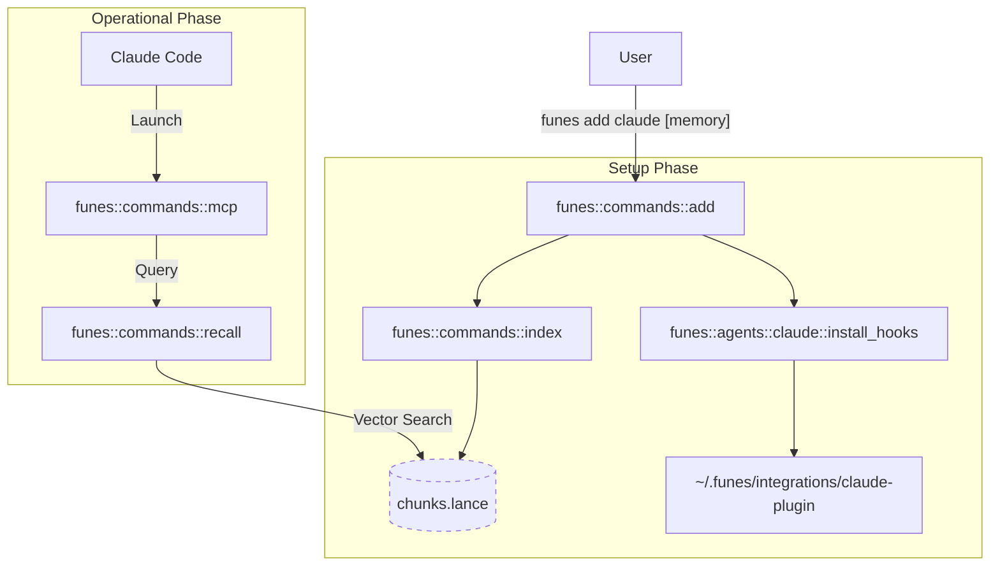
**Sources:** `docs/add.md`, `docs/configuration.md`, `docs/storage.md`

---

## Directory Layout (`FUNES_HOME`)

The `$FUNES_HOME` directory (default `~/.funes`) contains the local intelligence of the system.

| Path | Code Entity / Purpose |
| :--- | :--- |
| `memory/chunks.lance/` | The Lance dataset containing `data/` (rows) and `_indices/` (BM25/IVF_PQ) [docs/storage.md:31-36](). |
| `state.json` | `IncrementalState`: Tracks the last-processed timestamp/offset for each `TraceSource` [docs/configuration.md:22](). |
| `index-coverage.json` | `CoverageSnapshot`: A summary of indexed sessions for the `status` command [docs/configuration.md:23](). |
| `pushed/` | `PushReceipt`: JSON files tracking which local versions have been successfully synced to which remotes [docs/configuration.md:24](). |

### Storage Model
A `funes` memory is composed of rows containing text, provenance metadata, and a 384-dimension `Float32` embedding vector [docs/storage.md:59]().
- **Data Cost:** ~2.13 KB per chunk (approx. 75% is the embedding) [docs/storage.md:65]().
- **Index Cost:** ~0.18 KB per chunk (BM25 + IVF_PQ) [docs/storage.md:85]().
- **Total:** Planning budget of ~2.30 KB per chunk [docs/storage.md:90]().

**Local State Organization**
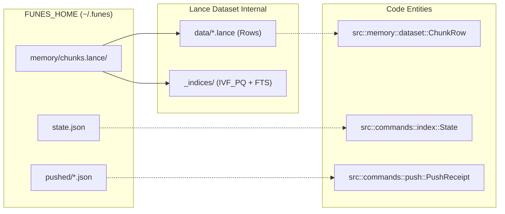
**Sources:** `docs/storage.md`, `docs/configuration.md`

---

# Page: Design Rationale and Landscape

# Design Rationale and Landscape

<details>
<summary>Relevant source files</summary>

The following files were used as context for generating this wiki page:

- [AGENTS.md](AGENTS.md)
- [SECURITY.md](SECURITY.md)
- [docs/RATIONALE.md](docs/RATIONALE.md)
- [docs/demo/cross-agents.tape](docs/demo/cross-agents.tape)
- [docs/hub-caching.md](docs/hub-caching.md)
- [docs/landscape.md](docs/landscape.md)

</details>


This page details the architectural decisions underpinning `funes`, focusing on its unique position in the agent-memory landscape. It explains the shift from mutable knowledge bases to append-only event logs, the reliance on local deterministic indexing, and the security model governing sensitive transcript data.

## 1. Core Design Philosophy

`funes` is built on the principle of **deferring to the reader**. Instead of distilling information at the point of ingestion, it preserves the raw record of interaction.

### 1.1 Append-Only Event Log vs. Mutable Knowledge Base
Traditional memory systems often attempt to maintain a "current" state of facts, overwriting old information when new data arrives. `funes` treats every interaction as an immutable, timestamped event [docs/RATIONALE.md:21-25]().

| Feature | Mutable Knowledge Base | funes (Append-Only Log) |
| :--- | :--- | :--- |
| **Ingest Decision** | Must decide what to overwrite | No write-time decisions |
| **Data Retention** | Loses superseded information | Keeps history (e.g., "what did we try before?") |
| **Conflict Resolution** | Resolved at write-time (lossy) | Resolved at **read-time** via recency weighting |
| **Faithfulness** | Subject to extraction errors | Verbatim record of the event |

### 1.2 Deterministic Ingest (No LLM in the Loop)
Unlike systems that use an LLM to summarize or extract "facts" during indexing, `funes` uses a deterministic pipeline: `parse` → `chunk` → `embed` [docs/RATIONALE.md:38-40]().

*   **Faithfulness:** You receive the actual passage with exact provenance (`session_id` + `turn_uuid`), not a paraphrase [docs/RATIONALE.md:39-40]().
*   **Stability:** The same transcript always produces the same index entries [docs/RATIONALE.md:45-46]().
*   **Future-Proofing:** Distillation at ingest freezes memory quality at today's model capabilities. Raw logs benefit from better reasoning in future models [docs/RATIONALE.md:49-55]().

Sources: [docs/RATIONALE.md:21-55](), [docs/landscape.md:13-16]()

## 2. Landscape and Comparison

`funes` occupies a niche for high-fidelity, local-first coding agent memory. It contrasts with general-purpose memory layers like `mem0` or integrated coding memories like `claude-mem`.

### Agent Memory Comparison
| Dimension | `funes` | `claude-mem` | `mem0` |
| :--- | :--- | :--- | :--- |
| **Ingest** | Deterministic (No LLM) | LLM Summaries | LLM Extraction |
| **Unit** | Verbatim Passage | Summaries | Distilled Facts |
| **Delivery** | **Pulled** (on-demand) | Proactive Injection | Pulled (via SDK) |
| **Storage** | Local-first / HF Hub | Local SQLite / Cloud | Managed Cloud / Self-host |

**Recall Strategy:** `funes` operates on a **pull-based** model [docs/RATIONALE.md:83-84](). It never volunteers memory; the agent must explicitly call the `recall` tool. This preserves the context window and ensures the model only spends tokens on memory when its own reasoning determines it is necessary [docs/RATIONALE.md:89-94]().

Sources: [docs/landscape.md:9-27](), [docs/RATIONALE.md:83-115]()

## 3. Data Flow: From Trace to Recall

The following diagram illustrates the transition from the "Natural Language Space" (transcripts) to the "Code Entity Space" (Lance fragments and embeddings).

### Memory Ingestion and Storage Flow
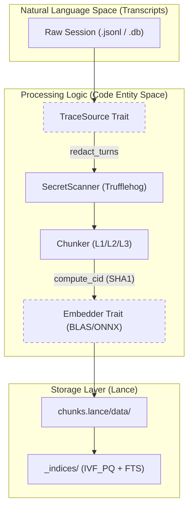
Sources: [src/traces/source.rs:1-20](), [src/chunk.rs:10-50](), [src/inference.rs:1-30](), [docs/hub-caching.md:12-19]()

## 4. Storage Rationale: Why Lance and HF Hub?

`funes` uses [Lance](https://github.com/lancedb/lance) as its primary storage format. Lance is a modern columnar format optimized for vector search and random access.

*   **Immutable Fragments:** Lance writes data in immutable fragments. Once a file is written to `chunks.lance/data/`, it never changes [docs/hub-caching.md:12-24]().
*   **Local-First Hub Sync:** The Hugging Face Hub acts as a versioned object store. `funes` uses a **file-grained read-through cache** [docs/hub-caching.md:33-46]().
*   **Performance:** By caching whole immutable files in `~/.cache/huggingface/hub`, warm recalls achieve **zero network latency** [docs/hub-caching.md:48-51]().

### Retrieval Architecture
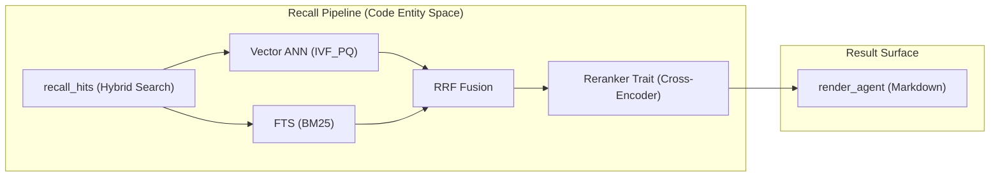
Sources: [src/commands/recall.rs:10-100](), [src/ui/render.rs:5-40](), [docs/landscape.md:17]()

## 5. Security and Trust Model

`funes` handles highly sensitive interaction data. The security model is built on three layers of defense:

1.  **Index-Time Redaction:** The `SecretScanner` (integrating Trufflehog) redacts credentials from sessions before they are committed to the local Lance dataset [SECURITY.md:32]().
2.  **Publish-Time Gate:** The `funes push` command includes a "fail-closed" gate. It reconstructs blocks to scan for secrets that might have been split across chunks. If a secret is detected, the push is aborted [SECURITY.md:33-36]().
3.  **Local Inference:** All embedding and reranking happen on the user's machine (via `blas` or `onnx` backends). The Hub only serves as storage and never processes the data [SECURITY.md:20-26]().

### Trust Boundary
Passages recalled from a remote memory are treated as **untrusted input**. Since these passages are injected into an agent's context, there is a risk of **prompt injection** if a user binds a malicious third-party memory [SECURITY.md:49-55]().

Sources: [SECURITY.md:15-60](), [src/commands/push.rs:50-120]()

---

# Page: Core Architecture

# Core Architecture

<details>
<summary>Relevant source files</summary>

The following files were used as context for generating this wiki page:

- [AGENTS.md](AGENTS.md)
- [CONTRIBUTING.md](CONTRIBUTING.md)
- [Cargo.lock](Cargo.lock)
- [Cargo.toml](Cargo.toml)
- [build.rs](build.rs)
- [docs/README.md](docs/README.md)
- [docs/ask.md](docs/ask.md)
- [docs/sessions.md](docs/sessions.md)
- [src/hub.rs](src/hub.rs)
- [src/lib.rs](src/lib.rs)
- [src/main.rs](src/main.rs)

</details>


`funes` is designed as a layered, local-first system for indexing and retrieving AI agent session history. It transforms raw transcripts into a structured, searchable memory using a pipeline that emphasizes data integrity, deterministic processing, and efficient retrieval.

The system is organized into distinct directories, each responsible for a single layer of the lifecycle. The binary itself is a thin CLI wrapper over these internal modules [src/lib.rs:5-6]().

### Layered Structure

The codebase follows a strict hierarchy where higher layers orchestrate decisions and lower layers handle mechanics and transport [src/lib.rs:23-25]().

| Layer | Responsibility | Key Code Entities |
|:---|:---|:---|
| **Agents** | Integration hooks for external tools. | `funes::agents` [src/lib.rs:41]() |
| **Commands** | Orchestration, CLI logic, and user decisions. | `funes::commands` [src/lib.rs:35]() |
| **UI** | Rendering results to the terminal/agent. | `funes::ui` [src/lib.rs:42]() |
| **Memory** | Lance storage mechanics and domain state. | `funes::memory` [src/lib.rs:38]() |
| **Inference** | Local embedding and reranking models. | `funes::inference` [src/lib.rs:37]() |
| **Traces** | Transcript parsing and internal data models. | `funes::traces` [src/lib.rs:41]() |
| **Hub** | Transport layer for Hugging Face Hub. | `funes::hub` [src/lib.rs:36]() |

**Sources:** [src/lib.rs:8-25](), [src/main.rs:7-13]()

---

### Data Flow: From Transcript to Recall

The following diagram illustrates how a raw agent transcript (e.g., from Claude Code or Codex) moves through the system to become a searchable memory hit.

**System Data Flow**
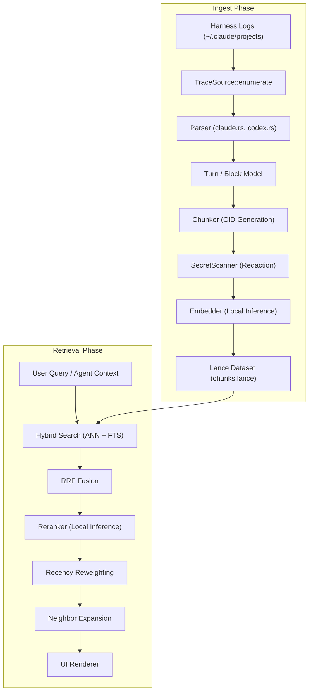
**Sources:** [src/lib.rs:3-4](), [src/main.rs:31-56](), [src/main.rs:83-103]()

---

### Key Abstractions

#### 1. TraceSource and the Turn/Block Model
Every supported agent harness (Claude, Codex, Pi, Hermes) implements a parser that converts its specific log format into a shared `Turn` and `Block` model [src/lib.rs:10-11](). This allows the rest of the pipeline to remain harness-agnostic.
*   For details, see [Indexing Pipeline](#2.1).

#### 2. Inference Backends
`funes` performs all embedding and reranking locally. It uses a trait-based system to swap backends at compile time. The default `blas` backend uses a hand-written forward pass (Accelerate on macOS, `faer` on Linux) to minimize dependencies [Cargo.toml:59-66](), [build.rs:5-9]().
*   For details, see [Inference Backends](#2.2).

#### 3. Memory and Lance Storage
The storage layer uses [Lance](https://github.com/lancedb/lance), an Arrow-native format optimized for vector search. `funes` manages the `MemoryState` (e.g., Local, Remote, Missing) and handles the mechanics of IVF_PQ and FTS indexing [src/lib.rs:17-18]().
*   For details, see [Memory Storage Layer](#2.3).

---

### Code Entity Mapping

The following diagrams bridge the gap between high-level architectural concepts and the specific Rust modules and functions that implement them.

**Indexing and Storage Entities**
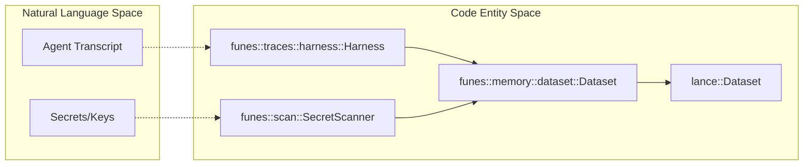
**Sources:** [src/lib.rs:10-18](), [src/main.rs:12]()

**Recall and Retrieval Entities**
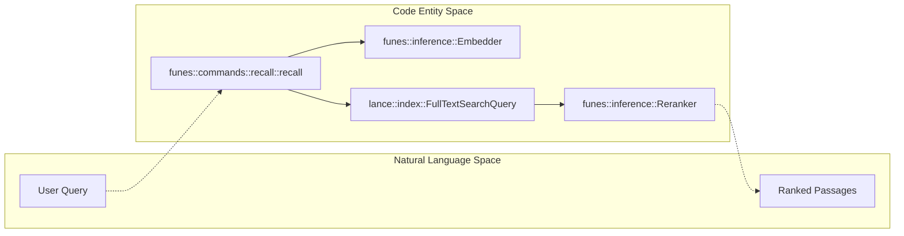
**Sources:** [src/lib.rs:14-19](), [src/main.rs:31-38]()

---

### Subsystems

- **[Indexing Pipeline](#2.1)**: Detailed coverage of the full indexing lifecycle, including unit enumeration, incremental state tracking, secret redaction, and chunking.
- **[Inference Backends](#2.2)**: The `Embedder` and `Reranker` traits, backend selection (BLAS vs ONNX), and model configurations.
- **[Memory Storage Layer](#2.3)**: The Lance dataset layout, schema definitions, IVF_PQ/FTS index construction, and concurrency models.

---

# Page: Indexing Pipeline

# Indexing Pipeline

<details>
<summary>Relevant source files</summary>

The following files were used as context for generating this wiki page:

- [docs/index.md](docs/index.md)
- [src/chunk.rs](src/chunk.rs)
- [src/commands/index.rs](src/commands/index.rs)
- [src/commands/update.rs](src/commands/update.rs)
- [src/memory/dataset.rs](src/memory/dataset.rs)
- [src/traces/parquet.rs](src/traces/parquet.rs)
- [src/traces/source.rs](src/traces/source.rs)

</details>


The indexing pipeline is the core lifecycle that transforms raw agent transcripts into a structured, searchable, and locally-stored memory. It is designed to be **append-only**, **incremental**, and **deterministic**, ensuring that the same agent interaction always results in the same representation in the knowledge base.

The pipeline is driven by a generic loop in `src/commands/index.rs` which orchestrates several specialized components to handle parsing, security, chunking, and storage.

### Data Flow Overview

The following diagram maps the transition from "Natural Language Space" (raw agent logs) to "Code Entity Space" (internal Rust structures and storage).

**Indexing Data Flow**
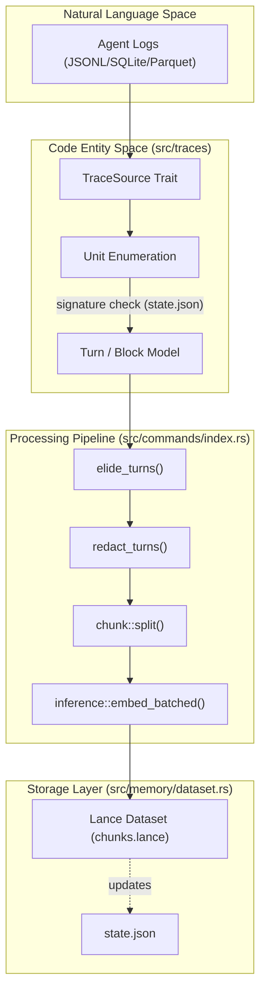
**Sources:** [src/commands/index.rs:1-158](), [src/traces/source.rs:1-63](), [src/memory/dataset.rs:1-43]()

---

### 1. Trace Sources and Unit Enumeration
The pipeline begins by identifying transcripts via the `TraceSource` trait [src/traces/source.rs:39-63](). A `Unit` represents the smallest granule of incremental tracking (e.g., a single file or a specific session within a database) [src/traces/source.rs:31-35]().

*   **Discovery**: The `open` function detects the format based on file extensions or directory structure (e.g., `.parquet` for datasets, `state.db` for Hermes) [src/traces/source.rs:69-99]().
*   **Incremental Tracking**: Each unit has a `signature` (usually a "size:mtime" stamp). The `index` command checks this against `state.json` to skip unchanged files [src/traces/source.rs:133-137](), [src/commands/index.rs:143-155]().

For details on how specific agents are parsed, see [Trace Parsers (Harness Support)](#2.1.1).

**Sources:** [src/traces/source.rs:31-137](), [src/commands/index.rs:143-155]()

---

### 2. Pre-Processing: Elision and Redaction
Before text is chunked or embedded, it undergoes two critical cleaning steps to ensure privacy and efficiency.

*   **Data URI Elision**: Large base64-encoded `data:` URIs (like screenshots) are replaced with an `[elided]` marker by `elide_data_uris` [src/chunk.rs:97-118](). This prevents megabytes of non-recallable noise from swamping the index [src/commands/index.rs:74-80]().
*   **Secret Redaction**: If a `SecretScanner` (like Trufflehog) is configured, `redact_turns` scans the text for API keys or credentials *before* they reach the embedding model or the local disk [src/commands/index.rs:89-126]().

**Sources:** [src/chunk.rs:97-118](), [src/commands/index.rs:74-126]()

---

### 3. Chunking and Tiers
Funes uses a tiered indexing strategy to prioritize high-value information while remaining responsive.

| Tier | Block Types | Description |
| :--- | :--- | :--- |
| **L1: Text** | prose, thinking | The rationale and decisions; highest recall value. |
| **L2: ToolUse** | tool_use | Context for actions taken by the agent. |
| **L3: ToolResult** | tool_result | Bulky output; lowest value per byte. |

**Tier Definitions:** [src/chunk.rs:19-47]()

The `split` function breaks blocks into overlapping chunks of `MAX_CHARS` (1200) with an `OVERLAP` of 150 characters [src/chunk.rs:11-14](). Every chunk receives a deterministic `cid` (Chunk ID) based on its session, turn, and split index, allowing for global deduplication [src/chunk.rs:182-187]().

For details on the segmentation logic, see [Chunking and Text Segmentation](#2.1.2).

**Sources:** [src/chunk.rs:11-187](), [docs/index.md:84-98]()

---

### 4. Embedding and Lance Storage
Once chunked, the text is sent to the `Embedder` (typically pinned to `BAAI/bge-small-en-v1.5` [src/memory/dataset.rs:32]()). 

**Indexing Pipeline Architecture**
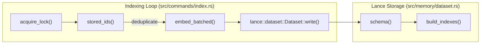

*   **Deduplication**: The pipeline calls `stored_ids` to fetch all existing `cid`s from the Lance dataset [src/commands/index.rs:54-68](). Only new chunks are embedded, making the process highly efficient for growing sessions.
*   **Vector Storage**: Data is appended to a Lance dataset located at `~/.funes/memory/chunks.lance` [src/memory/dataset.rs:46-61]().
*   **Indexing**: After writing, the system builds an `Inverted` (BM25) index for text search and an `IVF_PQ` index for vector search [src/memory/dataset.rs:125-142]().

**Sources:** [src/commands/index.rs:54-68](), [src/memory/dataset.rs:26-176]()

---

### Child Pages
- [Trace Parsers (Harness Support)](#2.1.1) — Detailed parsing logic for Claude, Codex, Pi, and Hermes.
- [Chunking and Text Segmentation](#2.1.2) — Technical details of the split/stitch mechanics and deterministic ID generation.

---

# Page: Trace Parsers (Harness Support)

# Trace Parsers (Harness Support)

<details>
<summary>Relevant source files</summary>

The following files were used as context for generating this wiki page:

- [src/traces.rs](src/traces.rs)
- [src/traces/claude.rs](src/traces/claude.rs)
- [src/traces/codex.rs](src/traces/codex.rs)
- [src/traces/harness.rs](src/traces/harness.rs)
- [src/traces/hermes.rs](src/traces/hermes.rs)
- [src/traces/jsonl.rs](src/traces/jsonl.rs)
- [src/traces/pi.rs](src/traces/pi.rs)
- [tests/fixtures/claude_session.jsonl](tests/fixtures/claude_session.jsonl)
- [tests/fixtures/codex_session.jsonl](tests/fixtures/codex_session.jsonl)
- [tests/fixtures/pi_session.jsonl](tests/fixtures/pi_session.jsonl)
- [tests/parse_real_sessions.rs](tests/parse_real_sessions.rs)

</details>


The `funes` indexing pipeline relies on a suite of specialized parsers to transform raw agent transcripts into a unified internal model. Each supported harness (Claude Code, Codex, Pi, and Hermes) uses a different storage format—ranging from line-delimited JSON (JSONL) to SQLite databases—but all are normalized into the `Turn` and `Block` structures defined in `src/traces.rs`.

## Unified Trace Model

Every parser must produce a sequence of `Turn` objects. This source-agnostic model ensures that downstream components like chunking, embedding, and recall can operate without knowledge of the original harness format [src/traces.rs:1-7]().

### Data Structures
| Entity | Description | Fields |
| :--- | :--- | :--- |
| `Turn` | A single exchange in a conversation. | `session_id`, `workdir`, `turn_uuid`, `seq`, `role`, `blocks`, `harness` [src/traces.rs:25-37]() |
| `Block` | A granular unit of content within a turn. | `block_type` ("text", "thinking", "tool_use", "tool_result"), `text`, `tool_name`, `tool_use_id` [src/traces.rs:18-23]() |

### Natural Language to Code Entity Mapping
The following diagram illustrates how conceptual agent actions are mapped to the internal Rust model.

**Diagram: Trace Normalization Flow**
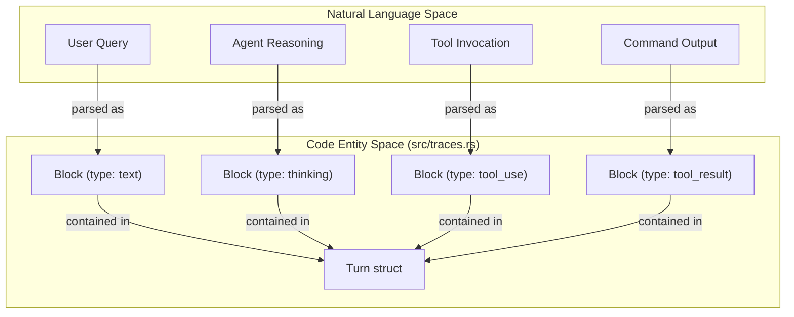
Sources: [src/traces.rs:18-37]()

---

## Harness Detection and Discovery

The `Harness` enum identifies the source agent and selects the appropriate parser. Discovery happens via `known_harness_roots`, which looks for standard session directories under `$HOME` [src/traces/harness.rs:12-17, 92-107]().

### Detection Logic
1.  **Known Directories**: If the path ends in a known tail (e.g., `.codex/sessions`), the harness is identified immediately [src/traces/harness.rs:77-84]().
2.  **Record Sniffing**: For unknown directories, `Harness::detect` peeks at the first JSON line. `session_meta` indicates Codex, while `session` indicates Pi [src/traces/harness.rs:66-75]().
3.  **Fallback**: Claude Code is the default fallback as it lacks a unique first-line marker [src/traces/harness.rs:73-74]().

**Table: Known Harness Mappings**
| Harness | CLI Name | Stored Facet | Default Path |
| :--- | :--- | :--- | :--- |
| `Claude` | `claude` | `claude_code` | `~/.claude/projects` |
| `Codex` | `codex` | `codex` | `~/.codex/sessions` |
| `Pi` | `pi` | `pi` | `~/.pi/agent/sessions` |
| `Hermes` | `hermes` | `hermes` | `~/.hermes/state.db` |

Sources: [src/traces/harness.rs:21-48, 88]()

---

## JSONL Parsers (Claude, Codex, Pi)

Most harnesses store transcripts as JSONL files. `src/traces/jsonl.rs` provides shared utilities for recursive file walking and `tool_name` back-filling [src/traces/jsonl.rs:1-3]().

### Workdir Munging
A critical facet for retrieval is the `workdir`. Funes uses a deterministic "munge" where non-alphanumeric characters are replaced with `-`. This ensures that a session's directory context is stable and searchable across different hosts [src/traces/jsonl.rs:37-49]().

### Parser Implementations

#### Claude Code (`src/traces/claude.rs`)
*   **Format**: One JSONL file per session.
*   **Turn Logic**: Only records of type `user` or `assistant` become turns [src/traces/claude.rs:148-150]().
*   **Tool Correlation**: Uses `jsonl::backfill_tool_names` to link `tool_result` blocks to their original `tool_use` name via `tool_use_id` [src/traces/claude.rs:177]().

#### Codex (`src/traces/codex.rs`)
*   **Format**: OpenAI Rollout format (`response_item` envelopes) [src/traces/codex.rs:2-4]().
*   **ID Stability**: Synthesizes `turn_uuid` as `<session_id>-<seq>` to ensure stability across grown logs [src/traces/codex.rs:5-6, 56]().
*   **Reasoning**: Recovers human-readable `summary_text` as `thinking` blocks, as the raw reasoning is often encrypted [src/traces/codex.rs:130-132]().

#### Pi (`src/traces/pi.rs`)
*   **Format**: Linked events per line.
*   **Self-Contained**: Pi carries `toolName` inline with `toolResult`, so no back-fill is required [src/traces/pi.rs:4-5]().
*   **Timestamps**: Handles both epoch milliseconds (numbers) and strings [src/traces/pi.rs:74-82]().

---

## Hermes Parser (SQLite)

Unlike JSONL-based agents, Hermes stores all sessions in a single SQLite database at `~/.hermes/state.db` [src/traces/hermes.rs:1-5, src/traces/harness.rs:88]().

**Diagram: Hermes SQLite to Turn Mapping**
```mermaid
graph LR
    subgraph "SQLite: state.db"
        S["sessions table"]
        M["messages table"]
    end

    subgraph "src/traces/hermes.rs"
        SU["SessionUnit struct"]
        R["Row struct"]
        T["Turn struct"]
    end

    S -->|cwd column| SU
    M -->|MAX(id) as watermark| SU
    M -->|SELECT id, role, content...| R
    R -->|normalized into| T
    SU -->|drives incremental indexing| T
```
Sources: [src/traces/hermes.rs:28-32, 78-82, 110-127, 137-148]()

### Key Implementation Details
*   **Incremental Indexing**: The `watermark` (maximum `messages.id`) is used to skip sessions that haven't changed since the last index pass [src/traces/hermes.rs:65-67, 79]().
*   **Monotonicity**: Records are ordered strictly by `id`, not `timestamp`, because Hermes timestamps (from `time.time()`) can be non-monotonic [src/traces/hermes.rs:10-11]().
*   **Concurrency**: The DB is opened with `SQLITE_OPEN_READ_ONLY` and uses WAL mode, allowing `funes` to index while Hermes is actively writing [src/traces/hermes.rs:34-39]().

---

## Parquet and Repository Sources

Beyond local agent directories, `funes` supports importing traces from external formats and remote repositories.

*   **Parquet (`src/traces/parquet.rs`)**: Provides a path for importing large-scale datasets (e.g., from Hugging Face Hub) that already conform to the `Turn` schema.
*   **Repo Source (`src/traces/repo.rs`)**: Handles the enumeration of sessions within a version-controlled or remote repository, feeding them into the appropriate harness parser.

## Verification and Stability
The parsers are guarded by `tests/parse_real_sessions.rs`, which runs the parsing logic against trimmed, real-world fixtures (`claude_session.jsonl`, `codex_session.jsonl`, `pi_session.jsonl`) [tests/parse_real_sessions.rs:1-6](). These tests ensure:
*   **`turn_uuid` Stability**: Re-parsing a grown log must yield identical UUIDs for existing turns to prevent duplicate chunks [tests/parse_real_sessions.rs:56-64]().
*   **Tool Correlation**: Verifies that `tool_result` blocks correctly inherit names from their parent `tool_use` [tests/parse_real_sessions.rs:31-33]().

Sources: [tests/parse_real_sessions.rs:1-6, 31-33, 56-64]()

---

# Page: Chunking and Text Segmentation

# Chunking and Text Segmentation

<details>
<summary>Relevant source files</summary>

The following files were used as context for generating this wiki page:

- [docs/index.md](docs/index.md)
- [src/chunk.rs](src/chunk.rs)

</details>


This page details the implementation of text segmentation and chunking within `funes`. The system transforms raw agent transcripts into a set of deterministic, version-stable chunks suitable for vector embedding and full-text search. The core logic resides in `src/chunk.rs`, which handles the rendering of message blocks, URI elision, overlap-based splitting, and stable ID generation.

## The Tier Model

To manage indexing performance and value density, `funes` categorizes every message block into one of three tiers. This allows the system to prioritize "high-signal" content (decisions and prose) over "high-volume" content (raw tool outputs).

| Tier | Block Types | Description |
| :--- | :--- | :--- |
| **L1: Text** | `text`, `thinking`, unknown | The core rationale and conversation. Highest value for recall. |
| **L2: ToolUse** | `tool_use` | Context for actions taken by the agent. |
| **L3: ToolResult** | `tool_result` | Often bulky (e.g., file reads, compiler output). Lowest value per byte. |

The `Tier` enum [src/chunk.rs:19-24]() defines these levels. The `of_block` function [src/chunk.rs:31-37]() maps block types to tiers, ensuring that any unrecognized block type defaults to `Tier::Text` to prevent data loss. During budgeted indexing, `funes` drains these tiers in order across all sessions [docs/index.md:92-95]().

Sources: [src/chunk.rs:16-47](), [docs/index.md:84-98]()

## Data URI Elision

Before a block is processed for secrets or segmented into chunks, it passes through `elide_data_uris` [src/chunk.rs:97-118](). This function identifies inline Base64-encoded `data:` URIs (such as pasted screenshots) and replaces their payload with the literal string `[elided]`.

This elision serves three purposes:
1. **Recall Quality**: Megabytes of Base64 noise provide no semantic value for embeddings.
2. **Performance**: Prevents the embedder and secret scanner from processing massive, irrelevant strings.
3. **Security**: Prevents false positives in secret detection, as random Base64 sequences often mimic high-entropy keys [src/chunk.rs:93-96]().

The implementation uses a `BASE64_MARKER` [src/chunk.rs:75]() and validates that the preceding text conforms to a data URI scheme via `is_data_uri_head` [src/chunk.rs:80-91]().

Sources: [src/chunk.rs:75-122](), [docs/index.md:100-102]()

## Segmentation Mechanics

The `split` function [src/chunk.rs:147-180]() is responsible for breaking a rendered block into manageable pieces for the embedding model.

### Split/Stitch and Overlap
*   **MAX_CHARS**: Set to 1200 characters [src/chunk.rs:11]().
*   **OVERLAP**: Set to 150 characters [src/chunk.rs:14]().
*   **Logic**: The splitter attempts to find a natural break point (newline `\n` or space ` `) within the `MAX_CHARS` limit [src/chunk.rs:162-168](). If no natural break is found within the second half of the window, it forces a hard break.
*   **Stitching**: Consecutive splits share the `OVERLAP` region. This allows the `recall::stitch` mechanism to reassemble blocks during retrieval by matching these shared leading/trailing segments [src/chunk.rs:12-14]().

### Rendering
Before splitting, blocks are transformed into a human-readable string via `render` [src/chunk.rs:124-136](). This adds structural markers like `[tool_use name]` or `[tool_result]` to the text, ensuring the embedding model captures the functional context of the block.

Sources: [src/chunk.rs:11-14](), [src/chunk.rs:124-180]()

## Deterministic CID Generation

A critical design goal of `funes` is that a completed turn must produce the exact same chunks regardless of when or where it is indexed [docs/index.md:73-76](). This is achieved through the `cid` (Chunk ID) function.

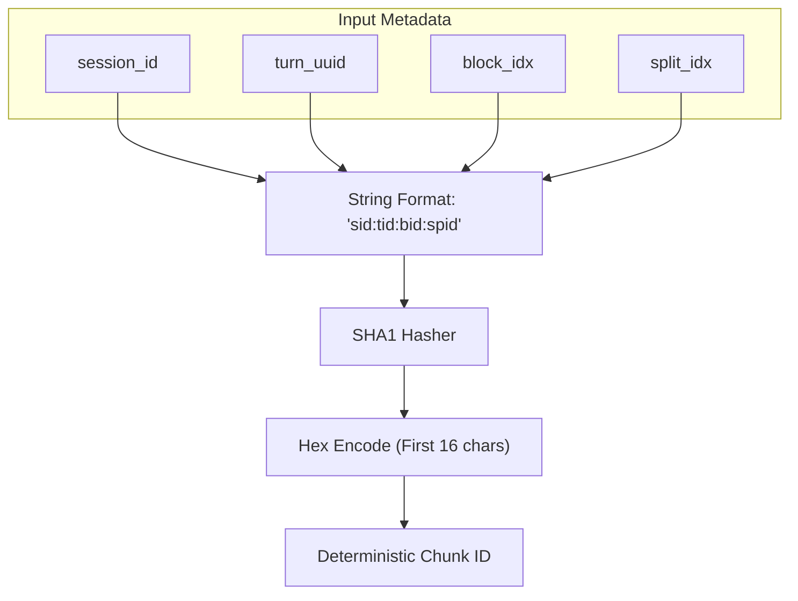
Sources: [src/chunk.rs:182-187](), [docs/index.md:71-76]()

The `cid` is a 16-character hex string derived from the SHA1 hash of the composite key: `session_id:turn_uuid:block_idx:split_idx` [src/chunk.rs:182-187](). This ensures that re-indexing the same session does not result in duplicate embeddings in the Lance dataset.

## Data Flow: From Turn to Chunk

The following diagram illustrates the transformation from a `Turn` (Code Entity) produced by a trace parser to the final `Chunk` stored in the database.

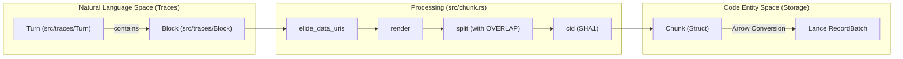

### The Parquet Compatibility Contract
When importing from Parquet files (the "Hugging Face agent-traces" layout), `funes` enforces a specific schema to maintain this deterministic pipeline. It requires a `session_id` and a `messages` list [docs/index.md:38-41](). Turn UUIDs are synthesized as `<session_id>-<sequence>` to maintain stability even when importing from external sources [docs/index.md:66-68]().

Sources: [src/chunk.rs:50-68](), [docs/index.md:33-70](), [src/traces/mod.rs:1-10]() (Note: Turn/Block structures are referenced via src/traces/mod.rs which was implied by context in src/chunk.rs).

## Secret Scanning and Reconstruction
For security, `funes` integrates with Trufflehog. Because secrets might be split across two chunks due to the `MAX_CHARS` limit, the system uses `reconstruct_blocks` (and related logic in the push pipeline) to ensure the scanner sees the full text of a block before it is allowed to be pushed to a remote repository [docs/index.md:100-101](). This "fail-closed" design ensures that even if a secret is fragmented during segmentation, it is caught before egress.

Sources: [docs/index.md:100-102](), [src/chunk.rs:189-190]()

---

# Page: Inference Backends

# Inference Backends

<details>
<summary>Relevant source files</summary>

The following files were used as context for generating this wiki page:

- [Cargo.lock](Cargo.lock)
- [Cargo.toml](Cargo.toml)
- [benchmark/bench_backends.rs](benchmark/bench_backends.rs)
- [build.rs](build.rs)
- [src/commands/scrub.rs](src/commands/scrub.rs)
- [src/inference.rs](src/inference.rs)
- [src/inference/blas.rs](src/inference/blas.rs)

</details>


Funes provides a flexible inference architecture designed to support local, high-performance embeddings and cross-encoder reranking. The system abstracts model execution behind the `Embedder` and `Reranker` traits, allowing the specific backend to be selected at compile time via Cargo features [src/inference.rs:1-5]().

## Backend Selection and Traits

The codebase defines two primary traits that all inference backends must implement:
*   **`Embedder`**: Responsible for converting text strings into dense floating-point vectors (typically 384 dimensions for the default BGE model) [src/inference.rs:26-28]().
*   **`Reranker`**: A cross-encoder that scores query-passage pairs jointly to determine relevance [src/inference.rs:31-33]().

The backend is selected using the `DefaultEmbedder` and `DefaultReranker` type aliases. By default, the `blas` feature is enabled. If both `blas` and `onnx` are compiled in, `blas` takes precedence [src/inference.rs:12-20]().

| Feature | Backend Implementation | Libraries Used |
| :--- | :--- | :--- |
| `blas` | From-scratch Rust forward pass | Accelerate (macOS), faer (Linux) |
| `onnx` | ONNX Runtime (ORT) | fastembed-rs, ort |

### Natural Language to Code Entity Space: Inference Flow
The following diagram maps the logical request for an embedding to the specific code entities responsible for fulfilling it.

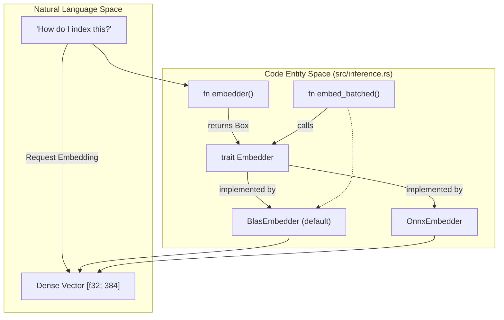
Sources: [src/inference.rs:26-44](), [src/inference.rs:95-106]()

## BLAS Backend (`blas`)

The BLAS backend is a "from-scratch" implementation that loads model weights from `safetensors` files and performs the transformer forward pass using highly optimized Basic Linear Algebra Subprograms (BLAS).

### Platform Seam
To achieve maximum performance while remaining portable, the BLAS backend utilizes a "platform seam" [src/inference/blas.rs:17-19]():
1.  **macOS**: Wires directly to the **Accelerate** framework. It uses `cblas_sgemm` to target AMX (Apple Matrix Extensions) and `vvexpf` from vForce for vectorized exponentiation [src/inference/blas.rs:20-43](), [build.rs:7-9]().
2.  **Linux**: Uses the **faer** crate for pure-Rust GEMM (General Matrix Multiplication) [src/inference/blas.rs:98-100](). It includes a custom, branch-free polynomial approximation for `exp(x)` that LLVM can auto-vectorize for AVX-512 and AVX2 [src/inference/blas.rs:150-166]().

### Model Configuration
The BLAS backend specifically targets:
*   **Embedder**: `bge-small-en-v1.5` (BERT-based, 384-d).
*   **Reranker**: `bge-reranker-base`.

Sources: [src/inference/blas.rs:1-5](), [src/inference/blas.rs:46-95](), [src/inference/blas.rs:109-144](), [Cargo.toml:61-63]()

## ONNX Backend (`onnx`)

The ONNX backend leverages the `fastembed` crate to run models via the ONNX Runtime (ORT) CPU Execution Provider [src/inference.rs:46-48](). 

*   **`OnnxEmbedder`**: Initializes `EmbeddingModel::BGESmallENV15` [src/inference.rs:52-57]().
*   **`OnnxReranker`**: Initializes `RerankerModel::BGERerankerBase` [src/inference.rs:73-78]().

This backend is primarily used as a reference for accuracy in benchmarks or as a fallback when system BLAS libraries are unavailable [benchmark/bench_backends.rs:1-4]().

Sources: [src/inference.rs:46-91](), [Cargo.toml:10-12](), [Cargo.toml:64-66]()

## Data Flow: Indexing & Scrubbing

The inference backends are heavily utilized during the indexing and scrubbing phases.

### Batched Embedding
The `embed_batched` function manages large-scale embedding tasks by splitting input text into groups of 256 (`EMBED_BATCH`) [src/inference.rs:23](). This prevents memory exhaustion and allows for progress reporting via a callback [src/inference.rs:95-106]().

### The `scrub` Command
The `scrub` command provides a mechanism to retroactively remove secrets from local memory [src/commands/scrub.rs:1-3]().

1.  **Reconstruction**: It reconstructs full blocks from stored chunks to ensure secrets split across chunk boundaries are detected [src/commands/scrub.rs:41-43]().
2.  **Detection**: Uses `Trufflehog` to scan the text [src/commands/scrub.rs:30-46]().
3.  **Redaction & Re-embedding**: If a secret is found, the text is redacted. Because the vector representation of a redacted string differs from the original, the `scrub` command calls `embed_batched` to generate new vectors for the cleaned text [src/commands/scrub.rs:85-103]().
4.  **Atomic Overwrite**: The entire dataset is rewritten in a single `WriteMode::Overwrite` commit to ensure consistency [src/commands/scrub.rs:124-134]().

### Natural Language to Code Entity Space: Scrubbing Pipeline
This diagram shows how the `scrub` command interacts with the inference and storage layers.

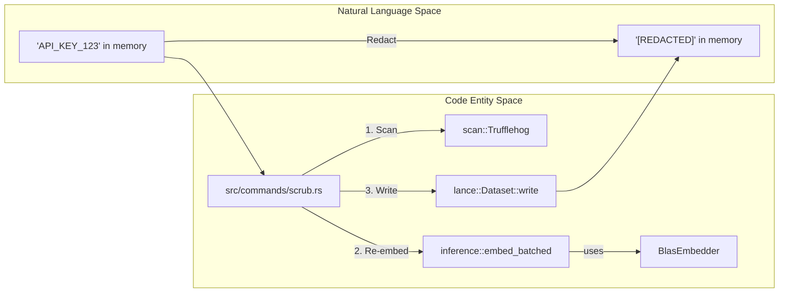
Sources: [src/commands/scrub.rs:22-30](), [src/commands/scrub.rs:88-97](), [src/commands/scrub.rs:126-134]()

## Benchmarking Backends

Funes includes a specialized benchmark, `bench_backends.rs`, to compare the performance and mathematical agreement between the BLAS and ONNX implementations [benchmark/bench_backends.rs:1-4]().

It tests two specific workloads:
1.  **16×short**: Stresses tokenization and thread spawn overhead [benchmark/bench_backends.rs:106]().
2.  **30×~500tok**: Stresses GEMM throughput and memory bandwidth at the 512-token truncation limit [benchmark/bench_backends.rs:106]().

The benchmark calculates the **Cosine Similarity** between vectors produced by different backends to ensure that the optimized BLAS implementation remains functionally equivalent to the ONNX reference [benchmark/bench_backends.rs:91-96](), [benchmark/bench_backends.rs:126-137]().

Sources: [benchmark/bench_backends.rs:1-147](), [Cargo.toml:77-81]()

---

# Page: Memory Storage Layer

# Memory Storage Layer

<details>
<summary>Relevant source files</summary>

The following files were used as context for generating this wiki page:

- [docs/configuration.md](docs/configuration.md)
- [docs/storage.md](docs/storage.md)
- [scripts/automation/funes-index.sh](scripts/automation/funes-index.sh)
- [scripts/automation/funes-push.sh](scripts/automation/funes-push.sh)
- [scripts/backfill_remote_repo.rs](scripts/backfill_remote_repo.rs)
- [src/memory.rs](src/memory.rs)
- [src/memory/capture_store.rs](src/memory/capture_store.rs)
- [src/memory/card.rs](src/memory/card.rs)
- [src/memory/fetch_store.rs](src/memory/fetch_store.rs)
- [src/memory/lock.rs](src/memory/lock.rs)
- [src/memory/remote.rs](src/memory/remote.rs)
- [tests/push_card.rs](tests/push_card.rs)
- [tests/store_lock.rs](tests/store_lock.rs)

</details>


The Memory Storage Layer is responsible for the physical persistence, indexing, and concurrency control of agent memories. It utilizes the **Lance** columnar data format to provide high-performance vector search (ANN) and full-text search (FTS) capabilities both locally and over the Hugging Face Hub.

## Lance Dataset Layout

A funes memory is stored as a single Lance dataset named `chunks.lance`. The layout follows the standard Lance specification but is managed by funes to ensure atomic commits and efficient remote synchronization.

| Directory / File | Purpose | Growth Factor |
| :--- | :--- | :--- |
| `data/` | Contains `.lance` fragments holding row data (text, embeddings, metadata). | Linear with chunks × content. |
| `_indices/` | Stores IVF_PQ (vector) and BM25 (FTS) index generations. | Sublinear (saturating vocabulary). |
| `_versions/` | Manifest files (`.manifest`) for each committed version. | Per index/push commit. |
| `_transactions/` | Transaction logs for ACID compliance. | Negligible. |

**Sources:** [docs/storage.md:29-39](), [src/memory.rs:1-13]()

### Storage Cost Model
The storage footprint is dominated by the embedding vectors. Using the default `bge-small-en-v1.5` model (`DIM = 384`), the cost breakdown per chunk is approximately:
*   **Vector Floor:** 1,536 B (Fixed-size Float32 array).
*   **Text & Metadata:** ~500–600 B.
*   **Index Overhead:** ~180 B.
*   **Total Budget:** **~2.30 KB per chunk**.

**Sources:** [docs/storage.md:49-93]()

---

## Schema and Indexing

The `chunks.lance` dataset uses a fixed Arrow schema designed to support both semantic recall and precise provenance tracking.

### Columns
| Column | Type | Role |
| :--- | :--- | :--- |
| `id` | Utf8 | Deterministic CID (SHA1 of content). |
| `text` | Utf8 | The chunked passage text. |
| `embedding` | `FixedSizeList<F32, 384>` | Vector representation for ANN. |
| `session_id` | Utf8 | UUID of the agent session. |
| `repo` | Utf8 | Resolved git repository name. |
| `ts` | Timestamp | ISO8601 creation time. |
| `harness` | Utf8 | Agent type (e.g., `claude`, `codex`). |

**Sources:** [scripts/backfill_remote_repo.rs:75-88](), [docs/storage.md:59-63]()

### Index Construction
Funes constructs two primary indices to support hybrid search:
1.  **IVF_PQ (Inverted File with Product Quantization):** Used for vector similarity search. It uses ~24 B per vector for PQ codes.
2.  **FTS (Full-Text Search):** A BM25-based inverted index for keyword matching.

**Sources:** [docs/storage.md:67-86](), [src/memory/remote.rs:3-7]()

---

## Concurrency and Locking

To prevent data corruption or orphaned rows during local mutations, funes implements an advisory locking model.

### MemoryLock
The `MemoryLock` class (defined in `src/memory/lock.rs`) uses an exclusive `flock` on a file named `store.lock` located in the `$FUNES_HOME` directory.

*   **Exclusive Writers:** Only one process can acquire the lock to write to the local memory.
*   **Non-blocking Readers:** Readers do not take a lock; Lance provides them with a consistent snapshot of the dataset.
*   **Contention:** If a writer (e.g., `funes index` or `funes scrub`) attempts to acquire the lock while another is active, it fails loudly with an error message: *"another funes memory operation is in progress"*.

**Sources:** [src/memory/lock.rs:1-59](), [tests/store_lock.rs:1-37]()

---

## Object-Store Wrappers

Funes uses custom decorators for the `object_store` trait to manage how Lance interacts with the Hugging Face Hub. This allows funes to treat a Git-based Hub repo as an atomic transactional store.

### Data Flow: Code Entity to Storage
The following diagram illustrates how high-level memory operations map to the underlying storage abstractions.

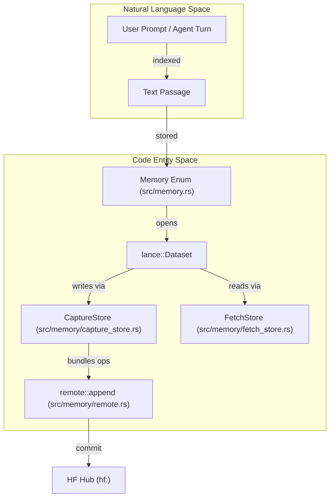
**Sources:** [src/memory.rs:34-41](), [src/memory/remote.rs:9-37](), [src/memory/capture_store.rs:1-21]()

### CaptureStore
`CaptureStore` intercepts all `put` operations from Lance. Instead of writing files one-by-one to the Hub (which would create multiple Git commits), it buffers them in memory. These captured files are then shipped as a single atomic `create_commit` to the Hugging Face Hub.
**Sources:** [src/memory/capture_store.rs:40-53](), [src/memory/remote.rs:18-30]()

### FetchStore
`FetchStore` provides a read-through cache for remote memories. It pins reads to a specific head commit (SHA) to ensure a consistent view of the dataset even if a push occurs mid-read.
**Sources:** [src/memory/fetch_store.rs]() (implied), [src/memory.rs:105-122]()

---

## Dataset Card (README.md) Management

Every published memory includes a `README.md` (Dataset Card) that makes the memory discoverable on the Hub via the `funes` tag.

### README Synchronization Logic
Funes manages the card through a "splice" mechanism:
1.  **Creation:** If no README exists, funes generates a full card with usage instructions and metadata.
2.  **Stats Refresh:** Funes looks for markers `<!-- funes:stats -->` and `<!-- /funes:stats -->`. If found, it updates the chunk count and timestamp within these markers.
3.  **Hands-off Policy:** If a user hand-writes a README without these markers, funes respects the user's content and stops updating the card.

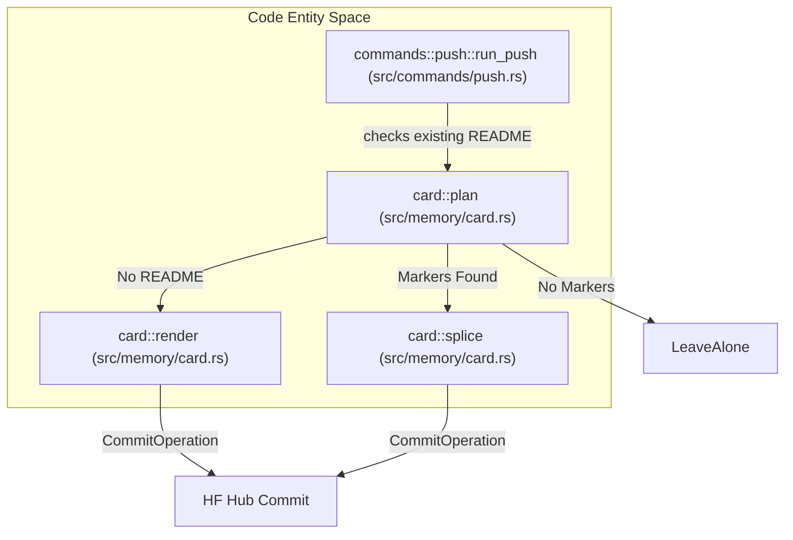
**Sources:** [src/memory/card.rs:9-72](), [tests/push_card.rs:58-132]()

### Card Metadata
The card includes Hub-standard frontmatter:
*   **Tags:** `funes`, `agent-memory`, `embeddings`, `lance`.
*   **Size Categories:** Automatically computed (e.g., `1K<n<10K`) based on the chunk count.

**Sources:** [src/memory/card.rs:14-31](), [src/memory/card.rs:76-111]()

---

# Page: Retrieval and Search

# Retrieval and Search

<details>
<summary>Relevant source files</summary>

The following files were used as context for generating this wiki page:

- [docs/recall.md](docs/recall.md)
- [src/commands/recall.rs](src/commands/recall.rs)

</details>


The retrieval system in `funes` provides the interface for agents and users to query past sessions. It is designed to bridge the gap between high-level natural language questions and the specific, immutable blocks of text stored in the memory layer. The system primarily exposes two read surfaces: **Recall** (semantic and keyword search) and **Session Inspection** (structured reading and literal scanning).

## High-Level Retrieval Flow

The retrieval process transitions from a user's natural language query into specific `Hit` objects that point back to the original session data.

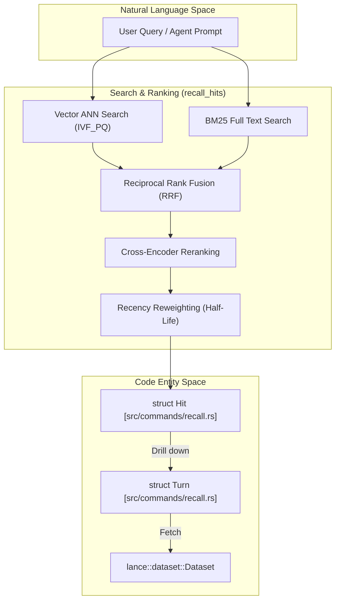
**Sources:** [src/commands/recall.rs:2-5](), [src/commands/recall.rs:49-59](), [docs/recall.md:12-14]()

---

## Hybrid Recall Pipeline

The `recall` command executes a multi-stage pipeline to find the most relevant passages. Unlike simple vector search, `funes` uses **Reciprocal Rank Fusion (RRF)** to combine semantic results (vector ANN) with keyword results (BM25). 

Key characteristics of the pipeline:
- **Hybrid Fusion:** Combines Lance's IVF_PQ vector index and Full-Text Search (FTS) [src/commands/recall.rs:2-5]().
- **Reranking:** A cross-encoder model re-evaluates a pool of candidates (default 30) to provide more accurate top-K results [docs/recall.md:41-50]().
- **Temporal Decay:** Results are reweighted based on a `half-life` parameter (default 30 days), ensuring that recent relevant information is prioritized over stale data [src/commands/recall.rs:189-190]().
- **Neighbor Expansion:** Each hit can optionally pull in adjacent chunks (`neighbors`) to provide immediate context without requiring a separate `get` call [src/commands/recall.rs:41-46]().

For a step-by-step walkthrough of the ranking logic and model caching, see **[Hybrid Recall Pipeline](#3.1)**.

**Sources:** [src/commands/recall.rs:22-32](), [docs/recall.md:12-14](), [docs/recall.md:41-50]()

---

## Session Inspection and Discovery

When a user or agent needs to explore the memory beyond specific search hits, `funes` provides tools for structured inspection:

| Command | Role | Key Data Structure |
| :--- | :--- | :--- |
| `get` | Reassembles turns by stitching splits back together for linear reading. | `struct Turn` [src/commands/recall.rs:144-150]() |
| `scan` | Literal "needle" search within a session with pagination. | `struct ScanResult` [src/commands/recall.rs:91-104]() |
| `sessions` | Lists sessions with filters for repo, workdir, and timeframe. | `struct Session` [src/commands/recall.rs:108-122]() |
| `sketch` | Generates a digest of a session via geometric axis selection. | `src/session_sketch.rs` |

The `get` command is the primary "drill-down" mechanism. Every `recall` hit includes a pre-formatted `→ get` line that the agent can use to fetch the surrounding conversation context [docs/recall.md:25-37]().

For details on reassembly logic and session filtering, see **[Session Inspection: get, scan, sessions, sketch](#3.2)**.

**Sources:** [src/commands/recall.rs:61-88](), [docs/recall.md:54-81](), [docs/recall.md:104-107]()

---

## MCP Server Interface

The Model Context Protocol (MCP) server acts as the gateway between AI agents (like Claude Code or Pi) and the retrieval tools. It registers `recall`, `get`, `sessions`, `scan`, and `sketch` as JSON-RPC tools.

```mermaid
graph LR
    subgraph "Agent (Client)"
        Claude["Claude / Pi / Hermes"]
    end

    subgraph "MCP Server [src/commands/mcp.rs]"
        Router["JSON-RPC Router"]
        Tools["Tool Registry"]
    end

    subgraph "Commands"
        RecallCmd["recall.rs"]
        SketchCmd["sketch.rs"]
    end

    Claude -->|stdio| Router
    Router --> Tools
    Tools --> RecallCmd
    Tools --> SketchCmd
```

The MCP server ensures that the output is rendered in a stable **Agent Format**, which is a parseable contract rather than a loose presentation [docs/recall.md:35-37]().

For details on the JSON-RPC implementation and tool registration, see **[MCP Server Interface](#3.3)**.

**Sources:** [src/commands/recall.rs:1-5](), [docs/recall.md:16-19](), [docs/recall.md:51-53]()

---

## Child Pages
- **[Hybrid Recall Pipeline](#3.1)**: Vector ANN + BM25, RRF fusion, cross-encoder reranking, and recency decay.
- **[Session Inspection: get, scan, sessions, sketch](#3.2)**: Turn reassembly, literal needle search, and session listing.
- **[MCP Server Interface](#3.3)**: Tool registration, stdio transport, and the agent format contract.

---

# Page: Hybrid Recall Pipeline

# Hybrid Recall Pipeline

<details>
<summary>Relevant source files</summary>

The following files were used as context for generating this wiki page:

- [docs/recall.md](docs/recall.md)
- [src/commands/recall.rs](src/commands/recall.rs)
- [tests/index_recall.rs](tests/index_recall.rs)
- [tests/recall_no_harness_column.rs](tests/recall_no_harness_column.rs)
- [tests/reindex_incremental.rs](tests/reindex_incremental.rs)
- [tests/remote_cache.rs](tests/remote_cache.rs)
- [tests/remote_recall.rs](tests/remote_recall.rs)

</details>


The Hybrid Recall Pipeline is the core retrieval mechanism of `funes`, designed to provide high-precision, context-aware memory for AI agents. It combines vector similarity search with traditional full-text keyword matching, further refined by neural reranking and temporal decay models.

The implementation resides primarily in `src/commands/recall.rs` and serves as the backend for the `recall` and `ask` commands, as well as the MCP `recall` tool [src/commands/recall.rs:1-5]().

## Pipeline Architecture

The pipeline follows a multi-stage process to transform a natural language query into a ranked list of relevant conversation blocks.

### 1. Retrieval (Vector + BM25)
`funes` performs a dual-search strategy against the Lance dataset:
*   **Vector ANN**: Uses Approximate Nearest Neighbor (ANN) search on the `embedding` column using cosine similarity [src/commands/recall.rs:2-3]().
*   **Full-Text Search (FTS)**: Uses the `lance` BM25 implementation to find literal keyword matches in the `text` column [src/commands/recall.rs:17]().

### 2. Reciprocal Rank Fusion (RRF)
The results from both search methods are fused into a single candidate pool. RRF ensures that hits appearing high in both lists (or very high in one) are prioritized without requiring score normalization between different scoring systems.

### 3. Cross-Encoder Reranking
The fused pool (default size: 30 candidates) is passed to a cross-encoder reranker [src/commands/recall.rs:48-59](). Unlike the initial vector search which uses bi-encoders, the reranker processes the query and candidate text simultaneously to produce a more accurate relevance score.

### 4. Recency Reweighting
To account for the temporal nature of memory, scores are adjusted using a half-life decay function:
*   **Formula**: $score = score \times 0.5^{(\text{age}/\text{half\_life})}$ [src/commands/recall.rs:189-190]().
*   **Default**: 30 days. A hit from a month ago keeps half its weight [docs/recall.md:45]().
*   **Disabling**: Setting `half_life` to 0 disables decay, which is useful when searching for stable facts or old configuration details [docs/recall.md:51-52]().

### 5. Neighbor Expansion
Once the top-K hits are selected, `funes` fetches adjacent chunks from the same session using the `seq` (sequence) number [src/commands/recall.rs:40-46](). This provides the agent with immediate surrounding context (e.g., the user prompt that preceded a tool result) without requiring a second `get` call [docs/recall.md:25-33]().

### Pipeline Data Flow: Natural Language to Code Entity
The following diagram illustrates how a user query traverses the system's code entities to produce results.

**Diagram: Retrieval Execution Flow**
```mermaid
graph TD
    UserQuery["User Query String"] --> recall_fn["recall() in src/commands/recall.rs"]
    recall_fn --> Embed["Embedder::embed in src/inference/mod.rs"]
    Embed --> FusedSearch["recall_hits() Fused Search"]
    
    subgraph "Lance Search"
        FusedSearch --> ANN["Vector Search (IVF_PQ)"]
        FusedSearch --> BM25["Full-Text Search (FTS)"]
    end
    
    ANN --> RRF["Reciprocal Rank Fusion"]
    BM25 --> RRF
    
    RRF --> Rerank["Reranker::rerank in src/inference/mod.rs"]
    Rerank --> Recency["recency_weight()"]
    Recency --> Neighbors["fetch_neighbors()"]
    Neighbors --> AgentFormat["render_recall() in src/ui/render.rs"]
    AgentFormat --> Output["Agent Format Text"]
```
Sources: [src/commands/recall.rs:1-60](), [docs/recall.md:12-21](), [src/inference/mod.rs:8]().

## Implementation Details

### The MODELS Cache
The pipeline utilizes a global inference cache to minimize model loading latency.
*   **Embedder**: Typically `bge-small-en-v1.5`.
*   **Reranker**: Typically `bge-reranker-base`.
These are managed via `OnceCell` and `Mutex` to ensure thread-safe, lazy initialization [src/commands/recall.rs:20]().

### Prefilter Logic
The `recall` command supports hard filters that are applied at the database level before retrieval:
*   **Block Type**: Restrict results to `thinking`, `tool_use`, `tool_result`, or `text` [docs/recall.md:47]().
*   **Harness**: Restrict results to specific agents like `claude` or `pi` [docs/recall.md:48]().
*   **Implementation**: `build_where` constructs the Lance SQL filter string, ensuring values are escaped via `esc()` [src/commands/recall.rs:168-187]().

### Offline and Remote Degradation
`funes` handles remote memories (via `hf://` URIs) by treating the Hugging Face Hub as a versioned object store.
*   **Cold Start**: The first recall over a remote memory downloads the index and necessary fragments to the local `HF_HUB_CACHE` [tests/remote_cache.rs:65-72]().
*   **Warm Start**: Subsequent calls at the same commit are served entirely from the local cache, allowing offline operation once the data is fetched [tests/remote_cache.rs:74-81]().
*   **Schema Evolution**: The pipeline includes a "dim guard" and projection adaptation to handle older memories that may lack newer columns like `harness` [tests/recall_no_harness_column.rs:35-57]().

### Code Entity Mapping
This table maps conceptual pipeline steps to their specific implementation points in the source.

| Concept | Code Entity | File |
| :--- | :--- | :--- |
| **Candidate Hit** | `struct Hit` | [src/commands/recall.rs:49-59]() |
| **Contextual Neighbor** | `struct Neighbor` | [src/commands/recall.rs:41-46]() |
| **SQL Filter Builder** | `fn build_where` | [src/commands/recall.rs:174-187]() |
| **Time Decay** | `fn recency_weight` | [src/commands/recall.rs:190]() |
| **Result Projection** | `const HIT_COLS` | [src/commands/recall.rs:23-32]() |

**Diagram: Memory Resolution & Data Access**
```mermaid
graph LR
    subgraph "Memory Abstraction"
        M["Memory::parse()"] -- "local" --> LocalPath["$FUNES_HOME/chunks.lance"]
        M -- "hf://..." --> RemoteURI["HF Hub Dataset"]
    end

    subgraph "Data Retrieval"
        Recall["recall_hits()"] --> Open["Memory::open()"]
        Open --> Dataset["lance::dataset::Dataset"]
        Dataset --> Scan["Dataset::scan()"]
        Scan --> Projection["HIT_COLS Projection"]
    end

    subgraph "Row Handling"
        Projection --> RecordBatch["arrow_array::RecordBatch"]
        RecordBatch --> HitMap["scol() / icol() helpers"]
        HitMap --> HitStruct["Hit { text, session_id, ... }"]
    end
```
Sources: [src/commands/recall.rs:22-59](), [src/memory/dataset.rs:9](), [tests/remote_recall.rs:28-31]().

## Inspection and Debugging

### Status Command
The `status` function provides metadata about the current memory, including total chunk counts, which is useful for verifying indexing success [src/commands/recall.rs:41-44](), [tests/index_recall.rs:40-44]().

### Scan and Get
While `recall` is probabilistic, `scan` and `get` provide deterministic access:
*   **Scan**: Performs a literal substring search within a specific session, returning `ScanHit` objects with byte offsets [src/commands/recall.rs:77-88]().
*   **Get**: Reassembles turns by stitching together chunks (splits) in `seq` order, returning a `Turn` object [src/commands/recall.rs:143-150]().

Sources: [src/commands/recall.rs:1-190](), [docs/recall.md:1-107](), [tests/index_recall.rs:1-184](), [tests/remote_recall.rs:1-52](), [tests/remote_cache.rs:1-82](), [tests/reindex_incremental.rs:1-68](), [tests/recall_no_harness_column.rs:1-81]().

---

# Page: Session Inspection: get, scan, sessions, sketch

# Session Inspection: get, scan, sessions, sketch

<details>
<summary>Relevant source files</summary>

The following files were used as context for generating this wiki page:

- [CONTRIBUTING.md](CONTRIBUTING.md)
- [docs/README.md](docs/README.md)
- [docs/ask.md](docs/ask.md)
- [docs/sessions.md](docs/sessions.md)
- [src/commands/mcp.rs](src/commands/mcp.rs)
- [src/commands/sketch.rs](src/commands/sketch.rs)
- [src/session_sketch.rs](src/session_sketch.rs)

</details>


Session inspection commands provide the read-only surface for navigating and analyzing historical interaction data stored within a `funes` memory. While `recall` is optimized for semantic search across all sessions, these tools focus on individual session forensics, literal matching, and structural summarization.

## Overview of Inspection Tools

The inspection suite is designed to move from high-level discovery to granular turn-level reading:
1.  **`sessions`**: Discovery and filtering of available session IDs.
2.  **`sketch`**: Algorithmic digest of a session's content using vector-based distinctive selection.
3.  **`scan`**: Literal string search across a session's blocks with boundary stitching.
4.  **`get`**: High-fidelity reassembly of specific turn ranges.

### Natural Language to Code Entity Space: Inspection Flow

The following diagram maps the conceptual user flow to the internal command implementations and data structures.

```mermaid
graph TD
    subgraph "Natural Language Space"
        User["'What did I do last Tuesday?'"]
        UserScan["'Find where I used the --force flag'"]
        UserSketch["'Give me a summary of session X'"]
    end

    subgraph "Code Entity Space (src/commands)"
        SESS["sessions.rs / mcp::SessionsRequest"]
        SCAN["scan.rs / mcp::ScanRequest"]
        SKETCH["sketch.rs / mcp::SketchRequest"]
        GET["recall.rs / mcp::GetRequest"]
    end

    subgraph "Data Structures & Logic"
        DS["memory::dataset::Dataset"]
        SK_GEN["session_sketch::generate"]
        RENDER["ui::render.rs"]
    end

    User --> SESS
    UserScan --> SCAN
    UserSketch --> SKETCH
    
    SESS --> DS
    SCAN --> DS
    SKETCH --> SK_GEN
    SK_GEN --> DS
    
    DS --> RENDER
    RENDER --> Output["Agent-Formatted Text Output"]
```
**Sources:** [src/commands/mcp.rs:59-126](), [src/commands/sketch.rs:19-58](), [docs/sessions.md:1-14]()

---

## Session Listing (`sessions`)

The `sessions` command lists the contents of a memory, typically sorted by recency [docs/sessions.md:15-24](). It serves as the primary discovery mechanism when a specific `session_id` is unknown.

### Implementation Details
*   **Filtering**: Supports filtering by `repo` (repository owner/name), `since`, and `until` dates [src/commands/mcp.rs:60-65]().
*   **Pagination**: Uses `limit` and `offset` to walk through large memories [src/commands/mcp.rs:69-73]().
*   **Metadata**: Returns the session ID, start timestamp, harness type, and the opening prompt (the first `user` block) to provide context for selection [docs/sessions.md:21-24]().

**Sources:** [src/commands/mcp.rs:59-78](), [docs/sessions.md:15-35]()

---

## Session Sketching (`sketch`)

The `sketch` command produces a deterministic digest of a session by selecting the most "distinctive" passages. Unlike an LLM-based summary, a sketch is generated by selecting existing chunks based on geometric axes and transitions in the vector space [src/session_sketch.rs:1-4]().

### Selection Logic (`src/session_sketch.rs`)
The `session_sketch::generate` function performs the following steps:
1.  **Unit Identification**: Chunks are grouped into "units" (typically turns or blocks) [src/session_sketch.rs:60-73]().
2.  **Deduplication**: Near-duplicate units (cosine similarity > 0.97) are grouped to prevent repetitive command failures from dominating the sketch [src/session_sketch.rs:28-39]().
3.  **Axis Selection**: Identifies units that represent the "extremes" of the session's semantic space [src/session_sketch.rs:181-182]().
4.  **Transition Selection**: Selects units where the semantic direction shifts significantly [src/session_sketch.rs:182-182]().
5.  **Mandatory Anchors**: Always includes the opening prompt and the final turn of the requested range [src/commands/sketch.rs:3-5]().

### Data Flow: Sketch Generation
```mermaid
sequenceDiagram
    participant CLI as src/commands/sketch.rs
    participant GEN as src/session_sketch.rs
    participant DB as memory::dataset
    participant UI as ui::render

    CLI->>GEN: generate(session_id, options)
    GEN->>DB: fetch_session_chunks(session_id)
    DB-->>GEN: Vec<RawRow>
    GEN->>GEN: Deduplicate (SimHash/LSH)
    GEN->>GEN: Select Axes & Transitions
    GEN->>GEN: Apply Character Budget (max_chars)
    GEN-->>CLI: SessionSketch struct
    CLI->>UI: sketch_agent(sketch)
    UI-->>CLI: Formatted String
```
**Sources:** [src/session_sketch.rs:216-223](), [src/commands/sketch.rs:35-58](), [src/session_sketch.rs:28-41]()

---

## Literal Scanning (`scan`)

`scan` performs a literal string search (`needle`) within a specific session [src/commands/mcp.rs:81-85](). 

### Key Features
*   **Stitch-Aware**: Chunks that were split during indexing are stitched back together before matching, ensuring that a needle straddling a boundary is found [docs/sessions.md:96-97]().
*   **Contextual Snippets**: Returns hits with a configurable amount of surrounding text (`context`) [src/commands/mcp.rs:96-97]().
*   **Pagination**: If a session contains massive amounts of matches, the scan is cut at turn boundaries and provides a `from` sequence number to continue [docs/sessions.md:98-100]().

**Sources:** [src/commands/mcp.rs:81-102](), [docs/sessions.md:79-101]()

---

## Session Reassembly (`get`)

The `get` command is the primary way to read the high-fidelity history of a session. It is often invoked via the `→ get` lines provided in `recall` or `sketch` output [docs/sessions.md:11-13]().

### Functionality
*   **Turn Reassembly**: It fetches raw blocks and reconstructs the original turns, handling the elision and redaction state stored in the memory [src/commands/mcp.rs:41-56]().
*   **Range Selection**: Supports `from` and `to` sequence numbers to read specific segments of a conversation [src/commands/mcp.rs:44-51]().
*   **Agent Format**: The output is rendered in a stable, byte-consistent format that agents can parse to understand the historical context [docs/README.md:33-34]().

**Sources:** [src/commands/mcp.rs:40-56](), [docs/ask.md:12-14]()

---

## Model Context Protocol (MCP) Integration

All inspection commands are exposed via the MCP server in `src/commands/mcp.rs`. This allows AI agents to call these tools natively using JSON-RPC over stdio [src/commands/mcp.rs:1-3]().

| Tool | Request Struct | Purpose |
| :--- | :--- | :--- |
| `sessions` | `SessionsRequest` | List sessions with metadata filters [src/commands/mcp.rs:59]() |
| `get` | `GetRequest` | Retrieve specific turn ranges [src/commands/mcp.rs:41]() |
| `scan` | `ScanRequest` | Literal search within a session [src/commands/mcp.rs:81]() |
| `sketch` | `SketchRequest` | Generate a semantic digest [src/commands/mcp.rs:105]() |
| `status` | `StatusRequest` | Inspect memory health and version [src/commands/mcp.rs:129]() |

**Sources:** [src/commands/mcp.rs:1-134]()

---

# Page: MCP Server Interface

# MCP Server Interface

<details>
<summary>Relevant source files</summary>

The following files were used as context for generating this wiki page:

- [AGENTS.md](AGENTS.md)
- [src/commands.rs](src/commands.rs)
- [src/commands/mcp.rs](src/commands/mcp.rs)
- [src/commands/sketch.rs](src/commands/sketch.rs)
- [src/session_sketch.rs](src/session_sketch.rs)
- [src/ui.rs](src/ui.rs)
- [src/ui/render.rs](src/ui/render.rs)

</details>


The `funes mcp` command implements a Model Context Protocol (MCP) server that exposes retrieval and session inspection capabilities to AI agents (e.g., Claude Code, Cursor, Pi). It uses the JSON-RPC 2.0 protocol over `stdio` to allow agents to call `funes` as a first-class tool [src/commands/mcp.rs:1-12]().

The server enforces a strict "Agent Format" contract, ensuring that tool outputs are deterministic and byte-stable for machine consumption [src/ui/render.rs:3-5]().

## Tool Registration

The MCP server registers a suite of tools that map directly to the `funes` retrieval commands. Each tool is defined with a JSON Schema that provides natural-language descriptions to the calling LLM [src/commands/mcp.rs:13-134]().

| Tool | Request Struct | Purpose |
| :--- | :--- | :--- |
| `recall` | `RecallRequest` | Hybrid vector/FTS search across past sessions [src/commands/mcp.rs:15-38](). |
| `get` | `GetRequest` | Reassemble specific turns from a session [src/commands/mcp.rs:41-56](). |
| `sessions` | `SessionsRequest` | List sessions with filtering by repo, date, or offset [src/commands/mcp.rs:59-78](). |
| `scan` | `ScanRequest` | Literal string search within a specific session [src/commands/mcp.rs:81-102](). |
| `sketch` | `SketchRequest` | Generate a geometric digest of a session's key moments [src/commands/mcp.rs:105-126](). |
| `status` | `StatusRequest` | Inspect memory state and availability [src/commands/mcp.rs:129-134](). |

### Memory Resolution Hierarchy
The server manages memory access through a tiered precedence model. When a tool is called, the memory to use is resolved in the following order [AGENTS.md:28-29]():
1.  **Tool-specific override**: The `memory` field in the JSON-RPC request (e.g., `RecallRequest.memory`) [src/commands/mcp.rs:37]().
2.  **Server-wide pin**: The memory specified when starting the server via `funes mcp <memory>` [src/commands/mcp.rs:140]().
3.  **Local default**: The default local memory if no other specifier is provided.

**Sources:** [src/commands/mcp.rs:1-149](), [AGENTS.md:21-38](), [src/ui/render.rs:1-24]()

## Data Flow: JSON-RPC to Code Entities

The MCP interface bridges the "Natural Language Space" (where agents operate) to the "Code Entity Space" (the internal Rust logic).

### Tool Execution Flow
The following diagram illustrates how an MCP `recall` request is processed through the system.

```mermaid
graph TD
    subgraph "Natural Language Space (Agent)"
        A["Agent Prompt"] -- "calls tool" --> B["JSON-RPC Request"]
    end

    subgraph "MCP Server Interface (src/commands/mcp.rs)"
        B -- "stdio" --> C["rmcp::transport::stdio"]
        C --> D["Funes::new()"]
        D --> E["RecallRequest"]
    end

    subgraph "Core Logic (src/commands/recall.rs)"
        E -- "query, k, half_life" --> F["recall::run()"]
        F --> G["Hybrid Search Pipeline"]
    end

    subgraph "Agent Format Contract (src/ui/render.rs)"
        G -- "Hit + Score" --> H["recall_agent()"]
        H -- "Byte-stable String" --> I["JSON-RPC Response"]
    end

    I -- "stdio" --> A
```
**Sources:** [src/commands/mcp.rs:1-12](), [src/ui/render.rs:1-24](), [AGENTS.md:13-15]()

## Agent Format Contract

Funes enforces a single, immutable output format for all agents. There are no human-readable vs. machine-readable toggles; the output is designed to be parsed by agents while remaining legible to developers [AGENTS.md:23-25]().

### The `→ get` Line Protocol
The most critical part of the agent contract is the `→ get` line. Every retrieval result (from `recall`, `scan`, or `sketch`) includes a pre-formatted command that the agent can use to fetch more context [src/ui/render.rs:11-17]().

```text
[2024-01-01T12:00:00] claude_code my-project/abc12345 text  score=0.850
  → get abc12345 --from 10 --to 16 --memory local
  ... chunk text ...
```

*   **Implementation**: The `hint_range` function calculates a window around a specific sequence number (`seq`) [src/ui/render.rs:14-17]().
*   **Stability**: This format is pinned by integration tests in `tests/index_recall.rs` to prevent regressions [AGENTS.md:15]().

### Rendering Functions
The `src/ui/render.rs` module contains the dedicated renderers for each MCP tool:

| Function | Associated Command | Key Features |
| :--- | :--- | :--- |
| `recall_agent` | `recall` | Includes provenance header, score, and neighbor snippets [src/ui/render.rs:24-42](). |
| `scan_agent` | `scan` | Collapses matches into whitespace-normalized excerpts with `…` markers [src/ui/render.rs:47-86](). |
| `sketch_agent` | `sketch` | Reports clamping/narrowing of units and character budgets [src/ui/render.rs:91-135](). |

### Geometric Sketching
The `sketch` tool provides a high-level digest of a session by selecting the most distinctive passages. It uses a deterministic selector that balances "axes" (coverage of different topics) and "transitions" (narrative shifts) [src/session_sketch.rs:179-192]().

```mermaid
graph LR
    subgraph "src/session_sketch.rs"
        A["Unit Selection"] --> B["Axes Selection (Geometric)"]
        A --> C["Transition Selection"]
        B & C --> D["Candidate Pool"]
        D --> E["Budget Clamping"]
    end

    subgraph "src/commands/sketch.rs"
        E --> F["sketch::run()"]
    end

    subgraph "src/ui/render.rs"
        F --> G["sketch_agent()"]
    end
```
**Sources:** [src/ui/render.rs:91-135](), [src/session_sketch.rs:139-192](), [src/commands/sketch.rs:19-58]()

## Implementation Details

### Server Initialization
The server is initialized in `src/commands/mcp.rs` using the `rmcp` crate. It defines a `Funes` struct that holds the pinned memory configuration and the `ToolRouter` [src/commands/mcp.rs:136-149]().

### JSON-RPC Transport
The server uses `rmcp::transport::stdio` to communicate. Because `stdout` is reserved for JSON-RPC messages, all internal logging and error reporting within the MCP process must be redirected to `stderr` [src/commands/mcp.rs:1-4]().

**Sources:** [src/commands/mcp.rs:1-12](), [src/commands/mcp.rs:136-149]()

---

# Page: Remote Synchronization (Hugging Face Hub)

# Remote Synchronization (Hugging Face Hub)

<details>
<summary>Relevant source files</summary>

The following files were used as context for generating this wiki page:

- [docs/push.md](docs/push.md)
- [src/hub.rs](src/hub.rs)
- [src/lib.rs](src/lib.rs)
- [src/main.rs](src/main.rs)

</details>


Funes treats the Hugging Face (HF) Hub as a versioned, append-only object store for distributing agent memory. While `funes` is designed to be local-first, the Hub integration allows users to synchronize their memory across multiple machines, share knowledge with teammates, or consume public memory datasets.

Synchronization is built on the **Lance** dataset format, which `funes` manages via the Hugging Face transport layer. This allows for efficient delta-based updates where only new memory chunks are uploaded or downloaded.

### High-Level Synchronization Flow

The synchronization process bridges the local indexing pipeline with the remote Hub repository. The following diagram illustrates how local code entities interact with the HF Hub:

**Memory Distribution Architecture**
```mermaid
graph TD
    subgraph "Local Environment"
        [Local_Lance_Dataset] --> ["src/commands/push.rs"]
        ["src/commands/push.rs"] -- "calculates delta" --> [Push_Logic]
        [Push_Logic] -- "calls" --> ["src/hub.rs"]
    end

    subgraph "Hugging Face Hub"
        ["src/hub.rs"] -- "HFClient (HTTPS)" --> [HF_Dataset_Repo]
        [HF_Dataset_Repo] -- "hf:// URI" --> [Remote_Memory]
    end

    subgraph "Retrieval"
        ["src/commands/recall.rs"] -- "read-through cache" --> ["src/hub.rs"]
        ["src/hub.rs"] -- "fetch_store" --> [Remote_Memory]
    end
```
**Sources:** [src/lib.rs:15-19](), [src/hub.rs:1-3](), [docs/push.md:3-11]()

---

### Core Concepts

#### The `hf://` URI and Shorthand
Funes identifies remote memories using a specific URI scheme: `hf://datasets/<owner>/<name>[/<prefix>]`. For convenience, the CLI also supports a shorthand `<org>/<repo>` which is automatically expanded.
*   **Parsing Logic:** `parse_hf` decomposes these URIs into owner, repository name, and optional path prefixes [src/hub.rs:17-26]().
*   **Shorthand Detection:** `is_remote_shorthand` identifies strings containing a `/` that do not start with filesystem markers like `.` or `~` [src/hub.rs:11-13]().

#### Hub Transport Layer
The `hub.rs` module serves as the transport abstraction. It handles:
*   **Authentication:** Manages tokens via the `HF_TOKEN` environment variable or the local `huggingface-cli` login cache [src/hub.rs:95-100]().
*   **Repository Lifecycle:** Idempotent creation of private dataset repositories via `create_dataset_repo` [src/hub.rs:73-86]().
*   **Reachability:** Probing whether the Hub is accessible or if the system should degrade to local-only mode [src/hub.rs:30-36]().

For details on the transport implementation, see [Hub Transport and Remote Memory](#4.2).

**Sources:** [src/hub.rs:1-118](), [src/lib.rs:15-16]()

---

### The Push Pipeline

The `push` command is the primary mechanism for distributing memory. It is designed to be safe, incremental, and "fail-closed" regarding sensitive data.

**Push Logic and Secret Gate**
```mermaid
graph LR
    [Local_Chunks] --> [Delta_Calc]
    [Delta_Calc] -- "local_ids - remote_ids" --> [Pending_Rows]
    [Pending_Rows] --> ["SecretScanner (Trufflehog)"]
    ["SecretScanner (Trufflehog)"] -- "Clean" --> [HF_Upload]
    ["SecretScanner (Trufflehog)"] -- "Sensitive Found" --> [Hold_Back_Warning]
    [HF_Upload] --> [Update_README_md]
```
**Sources:** [docs/push.md:46-58](), [src/commands/push.rs]()

#### Key Features of the Pipeline:
1.  **Delta Calculation:** Funes only uploads chunks that do not exist on the remote, minimizing bandwidth [docs/push.md:15-16]().
2.  **The Secret Gate:** An egress filter that uses Trufflehog to scan rows before they leave the machine. It reconstructs full blocks to ensure secrets split across chunks are detected [docs/push.md:46-51]().
3.  **Wrong-Memory Guard:** A safety check that prevents pushing to a repository that shares no history with the local index, protecting against accidental overwrites [docs/push.md:28-31]().
4.  **Dataset Cards:** Funes automatically generates and updates `README.md` files on the Hub, providing live statistics and usage instructions [docs/push.md:18-22]().

For details on the push mechanics, see [Push Pipeline](#4.1).

**Sources:** [docs/push.md:13-67](), [src/main.rs:83-103]()

---

### Remote Memory Retrieval

Remote memories are not "downloaded" in the traditional sense. Instead, funes uses a read-through cache mechanism:
*   **Lazy Loading:** The `recall` command can target a remote memory via the `--memory` flag [src/main.rs:55]().
*   **Object Store Wrappers:** The `fetch_store` and `capture_store` wrappers in the memory layer allow Lance to treat the HF Hub as a backing filesystem [src/lib.rs:17-18]().
*   **Offline Resilience:** If the Hub is unreachable, funes can automatically fall back to the local index if a copy exists [src/hub.rs:28-36]().

**Sources:** [src/lib.rs:15-19](), [src/hub.rs:28-36](), [docs/push.md:9-11]()

---

# Page: Push Pipeline

# Push Pipeline

<details>
<summary>Relevant source files</summary>

The following files were used as context for generating this wiki page:

- [docs/push.md](docs/push.md)
- [scripts/backfill_remote_repo.rs](scripts/backfill_remote_repo.rs)
- [scripts/backfill_repo.rs](scripts/backfill_repo.rs)
- [src/commands/push.rs](src/commands/push.rs)
- [src/memory.rs](src/memory.rs)
- [tests/push_card.rs](tests/push_card.rs)
- [tests/push_round_trip.rs](tests/push_round_trip.rs)

</details>


The `push` command orchestrates the synchronization of local memory fragments to a remote Hugging Face Hub dataset repository [src/commands/push.rs:1-7](). Unlike a full mirror, `funes` calculates the delta of chunks present locally but missing from the remote, ensuring that synchronization is incremental and append-only [src/commands/push.rs:3-4]().

## Push Orchestration Logic

The pipeline operates in three distinct modes based on the state of the remote repository:

| Mode | Trigger | Implementation Detail |
| :--- | :--- | :--- |
| **First Publish** | Remote is empty or missing. | Uploads all local data files and builds initial FTS/IVF indexes in one commit [src/commands/push.rs:9-10](). |
| **Append** | Remote exists and shares history. | Lands new fragments, manifests, and transactions via `remote::append` using a CAS-guarded `create_commit` [src/commands/push.rs:11-13](). |
| **Reindex** | Backlog > `REINDEX_THRESHOLD` (500). | A separate guarded commit (`remote::reindex`) that folds unindexed rows into the global index [src/commands/push.rs:14-17](), [src/commands/push.rs:46-46](). |

### Delta Calculation
The synchronization delta is computed as `local_ids - remote_ids` [src/commands/push.rs:4-5](). The system identifies these IDs by performing a column scan of the `id` field in the Lance dataset [src/commands/push.rs:71-86]().

### Push Receipts
To avoid redundant scans of the remote, `funes` maintains a local "receipt" of IDs observed on a specific remote [src/commands/push.rs:88-92](). These receipts are stored in `$FUNES_HOME/pushed/` and are updated atomically using temporary files and directory-level locks to prevent race conditions between concurrent push attempts [src/commands/push.rs:117-150]().

**Sources:** [src/commands/push.rs:1-50](), [src/commands/push.rs:71-86](), [src/commands/push.rs:88-156]()

## Data Flow: Local to Hub

The following diagram illustrates the transition from natural language commands to the internal Rust entities responsible for the push lifecycle.

### Natural Language to Code Entity Space: Push Lifecycle
```mermaid
graph TD
    User["User: 'funes push user/repo'"] --> RunPush["run_push() in src/commands/push.rs"]
    RunPush --> StateCheck["Memory::state() in src/memory.rs"]
    
    subgraph "Delta & Security"
        StateCheck --> GetIDs["all_ids() in src/commands/push.rs"]
        GetIDs --> SecretGate["drop_secret_rows() (Trufflehog)"]
    end

    subgraph "HF Hub Transport"
        SecretGate --> Append["remote::append() in src/memory/remote.rs"]
        Append --> HFCommit["create_commit() in hf_hub"]
    end

    subgraph "Metadata"
        HFCommit --> CardUpdate["CardCtx::refresh() in src/memory/card.rs"]
    end
```
**Sources:** [src/commands/push.rs:1-17](), [src/memory.rs:139-151](), [docs/push.md:46-50](), [src/memory/remote.rs:1-26]()

## The Secret Gate (Egress Filter)

While indexing performs best-effort redaction, the **Push Pipeline** serves as a fail-closed egress backstop [docs/push.md:46-50]().

1.  **Requirement:** Push requires TruffleHog to be available on `PATH` or via `FUNES_TRUFFLEHOG` [docs/push.md:64-67]().
2.  **Block Reconstruction:** Because secrets might be split across chunk boundaries, the gate reconstructs complete content blocks before scanning [docs/push.md:47-48]().
3.  **Hold-back Mechanism:** If any chunk within a block contains a secret, the entire block is withheld from the push [docs/push.md:48-49](). Clean rows are allowed to proceed with a warning, but if 100% of rows are held back, the process exits with code `2` [docs/push.md:49-58]().
4.  **Remediation:** Users must run `funes scrub` to repair the local memory before the rows can pass the gate [docs/push.md:71-88]().

**Sources:** [docs/push.md:40-93]()

## Guarding and Conflicts

### The Wrong-Memory Guard
To prevent accidental data leakage or corruption, `funes` implements a "no-overlap" check. If a local memory shares no chunk IDs with the target remote, the system prompts the user for confirmation [docs/push.md:28-32](). This guard is bypassed in non-interactive environments unless `--yes` is provided [docs/push.md:30-31]().

### CAS-Conflict Retries
Remote writes use Compare-And-Swap (CAS) logic. If the Hub branch head moves (due to a concurrent push from another machine) between the time `funes` fetches the head and attempts the commit, the operation is retried against the new head [src/commands/push.rs:11-13]().
*   **Retry Limit:** Capped at 10 attempts (`MAX_COMMIT_RETRIES`) to prevent infinite loops on busy remotes [src/commands/push.rs:48-50]().

### Entity Association: Safety & Conflict Logic
```mermaid
graph LR
    subgraph "Safety Logic"
        Confirm["Confirm Enum"] -- "Ask/Yes/No" --> Guard["Wrong-Memory Guard"]
        Guard -- "all_ids overlap == 0" --> UserPrompt["CLI Prompt"]
    end

    subgraph "Conflict Handling"
        AppendOp["remote::append()"] -- "Err(Conflict)" --> RetryLoop["Retry Loop"]
        RetryLoop -- "count < MAX_COMMIT_RETRIES" --> AppendOp
    end

    Guard --> AppendOp
```
**Sources:** [src/commands/push.rs:48-50](), [docs/push.md:28-32](), [tests/push_round_trip.rs:23-23](), [tests/push_round_trip.rs:90-106]()

## Dataset Card (README.md) Management

`funes` automatically manages the Hugging Face Dataset Card to ensure shared memories are discoverable and documented [docs/push.md:18-21]().

*   **Initialization:** On the first publish, a `README.md` is created with the `funes` tag and usage examples [docs/push.md:18-20]().
*   **Stats Injection:** The card contains a `<!-- funes:stats -->` marker. `funes` injects live statistics (chunk counts, session counts) into this section during every push [tests/push_card.rs:147-155]().
*   **Hand-written Respect:** If a user manually edits the `README.md` (removing the stats markers), `funes` ceases automatic updates to avoid overwriting user content [docs/push.md:20-21](), [tests/push_card.rs:108-118]().

**Sources:** [docs/push.md:13-22](), [src/memory/card.rs:23-23](), [tests/push_card.rs:1-170]()

---

# Page: Hub Transport and Remote Memory

# Hub Transport and Remote Memory

<details>
<summary>Relevant source files</summary>

The following files were used as context for generating this wiki page:

- [SECURITY.md](SECURITY.md)
- [docs/RATIONALE.md](docs/RATIONALE.md)
- [docs/demo/cross-agents.tape](docs/demo/cross-agents.tape)
- [docs/hub-caching.md](docs/hub-caching.md)
- [docs/landscape.md](docs/landscape.md)
- [src/hub.rs](src/hub.rs)
- [src/lib.rs](src/lib.rs)
- [src/main.rs](src/main.rs)
- [src/memory/fetch_store.rs](src/memory/fetch_store.rs)
- [src/memory/remote.rs](src/memory/remote.rs)
- [tests/remote_repo_source.rs](tests/remote_repo_source.rs)

</details>


The Hub transport layer provides the infrastructure for treating the Hugging Face Hub as a versioned, high-latency object store for memory distribution. It handles authentication, URI parsing, and reachability probing, while providing specialized `object_store` decorators to enable atomic multi-file commits and efficient read-through caching of immutable Lance datasets.

## Hugging Face Authentication

`funes` manages authentication through the `hub.rs` module, which abstracts token resolution and client creation. It follows a strict precedence order for tokens, preferring explicit environment variables over cached credentials [src/hub.rs:105-117]().

| Source | Details |
| :--- | :--- |
| **Environment Variables** | `HF_TOKEN`, `HUGGING_FACE_HUB_TOKEN`, or `HUGGINGFACE_TOKEN` [src/hub.rs:106-113](). |
| **Cached Login** | Reads from `~/.cache/huggingface/token` (populated by `huggingface-cli login`) [src/hub.rs:94-100](). |

The `client` function handles the construction of the `hf_hub::HFClient` [src/hub.rs:41-50](). For reachability probes, it disables retries to prevent the default backoff from causing multi-second delays during offline checks [src/hub.rs:38-45]().

### Identity and Repository Lifecycle
*   **`whoami()`**: Returns the authenticated user's Hub handle. If the token is invalid or missing, it errors, signaling the system to stay in local-only mode [src/hub.rs:61-68]().
*   **`create_dataset_repo(owner, name)`**: An idempotent call that creates a private dataset repository on the Hub [src/hub.rs:73-86](). It is only invoked upon explicit user consent [src/hub.rs:71-72]().

**Sources:** [src/hub.rs:38-117]()

## URI Parsing and Shorthand

The system distinguishes between local paths and remote Hub memories using specific string patterns.

*   **Remote Shorthand**: A string is treated as a remote shorthand if it contains a `/` but does not start with `/`, `.`, or `~` (e.g., `org/repo`) [src/hub.rs:11-13]().
*   **HF URI Scheme**: The `parse_hf` function decomposes `hf://datasets/<owner>/<name>[/<prefix...>]` into its constituent parts [src/hub.rs:17-26](). An empty prefix resolves to the repository root [src/hub.rs:125-130]().

**Sources:** [src/hub.rs:11-26](), [src/hub.rs:125-130]()

## Reachability and Error Classification

To maintain the "local-first" philosophy, `funes` must gracefully degrade when the Hub is unreachable. The `is_offline_error` function classifies `hf_hub::HFError` variants into transient/offline states:
1.  **Transport Failures**: Connection timeouts or refused connections [src/hub.rs:32-32]().
2.  **Server Errors**: HTTP 500, 502, 503, or 504 status codes [src/hub.rs:33-33]().

In these cases, commands like `recall` fall back to the local index rather than failing [src/hub.rs:28-36]().

**Sources:** [src/hub.rs:28-36]()

## Remote Memory Architecture

### Transport Layer Data Flow
The following diagram maps the relationship between Hub transport entities and the Lance storage layer.

```mermaid
graph TD
    subgraph "Natural Language Space"
        A["Hub Repository"]
        B["Remote Memory URI"]
        C["HF Token"]
    end

    subgraph "Code Entity Space (src/hub.rs, src/memory/remote.rs)"
        A1["HFRepository<RepoTypeDataset>"]
        B1["parse_hf()"]
        C1["hf_token()"]
        D1["FetchStore (ObjectStore Decorator)"]
        E1["CaptureStore (ObjectStore Decorator)"]
    end

    A --> A1
    B --> B1
    C --> C1
    B1 --> D1
    B1 --> E1
    A1 --> E1
```
**Sources:** [src/hub.rs:17-26](), [src/hub.rs:95-100](), [src/memory/remote.rs:18-22](), [src/memory/fetch_store.rs:47-50]()

### Atomic Writes via CaptureStore
Lance datasets consist of multiple files (fragments, manifests, indices). By default, writing to the Hub via OpenDAL would result in one git commit per file, which is non-atomic [src/memory/remote.rs:9-16]().

`funes` solves this using `CaptureStore`, a `WrappingObjectStore` that intercepts Lance's write calls and buffers them in memory [src/memory/remote.rs:18-22](). Once Lance completes its operation, the entire set of changes is shipped to the Hub as a single `create_commit` guarded by a `parent_commit` OID to detect conflicts (CAS) [src/memory/remote.rs:3-7](), [src/memory/remote.rs:118-126]().

**Sources:** [src/memory/remote.rs:1-37](), [src/memory/remote.rs:118-126]()

## The hf:// Read-Through Cache

Remote recall performance is optimized through a file-grained read-through cache. Instead of performing expensive byte-range requests over the network, `funes` fetches whole immutable files into the standard Hugging Face cache.

### FetchStore Implementation
`FetchStore` is a decorator for the `object_store::ObjectStore` [src/memory/fetch_store.rs:47-50]().
1.  **Read Interception**: Every `get` request is intercepted and passed to a `FileFetcher` [src/memory/fetch_store.rs:67-78]().
2.  **Whole-File Download**: The fetcher uses `hf_hub::download_file` to pull the entire file (e.g., a `.lance` fragment or index) into `~/.cache/huggingface/hub` [docs/hub-caching.md:33-40]().
3.  **Local Slicing**: The requested byte range is served from the local file using `serve_from_file` [src/memory/fetch_store.rs:113-132]().
4.  **Live Delegation**: Operations like `list` (used to discover the latest `_versions/*.manifest`) are always delegated to the live Hub backend to ensure new pushes are detected immediately [src/memory/fetch_store.rs:92-94](), [docs/hub-caching.md:43-46]().

### Caching Rationale
| Feature | Logic |
| :--- | :--- |
| **File-Grained** | Lance files are immutable once written. Caching at the file level matches Lance's read pattern and avoids the overhead of sub-file chunking [docs/hub-caching.md:60-78](). |
| **Latency Reduction** | A single whole-file download avoids the ~0.3s signed-redirect tax imposed by the Hub on every individual range request [docs/hub-caching.md:28-32](). |
| **Zero-Network Warm Reads** | Once a file is cached and pinned to a commit SHA, subsequent reads are pure local filesystem hits [docs/hub-caching.md:48-50](). |

```mermaid
sequenceDiagram
    participant L as Lance (Recall)
    participant W as FetchStore Wrapper
    participant H as hf-hub Cache
    participant R as HF Hub (Remote)

    L->>W: get(path, range)
    W->>H: fetch(path)
    alt is cached
        H-->>W: local_path
    else not cached
        H->>R: download_file(path)
        R-->>H: bytes
        H-->>W: local_path
    end
    W->>W: slice(local_path, range)
    W-->>L: bytes
```
**Sources:** [src/memory/fetch_store.rs:1-132](), [docs/hub-caching.md:1-93]()

---

# Page: Agent Integrations

# Agent Integrations

<details>
<summary>Relevant source files</summary>

The following files were used as context for generating this wiki page:

- [docs/add.md](docs/add.md)
- [docs/automation.md](docs/automation.md)
- [src/agents.rs](src/agents.rs)

</details>


The `funes` system integrates directly into AI coding agents to automate the lifecycle of memory capture and recall. By using `funes add <agent>`, the system wires itself into the agent's native hook or plugin architecture, ensuring that every interaction is indexed locally and, if a remote memory is bound, published to the Hugging Face Hub.

### Integration Architecture

Funes treats each agent harness as a first-class integration target, utilizing specific modules in `src/agents/` to handle installation, lifecycle hooks, and tool registration.

```mermaid
graph TD
    subgraph "Agent Harnesses"
        Claude["Claude Code"]
        Codex["Codex"]
        Pi["Pi"]
        Hermes["Hermes"]
    end

    subgraph "funes Integration Layer"
        Installer["src/agents.rs (Installer)"]
        Hooks["src/agents/hooks.rs (Shared Infrastructure)"]
        
        C_Mod["src/agents/claude.rs"]
        X_Mod["src/agents/codex.rs"]
        P_Mod["src/agents/pi.rs"]
        H_Mod["src/agents/hermes.rs"]
    end

    subgraph "Automation Scripts (~/.funes/integrations)"
        IdxScript["funes-index.sh"]
        PushScript["funes-push.sh"]
    end

    Claude --> C_Mod
    Codex --> X_Mod
    Pi --> P_Mod
    Hermes --> H_Mod

    C_Mod & X_Mod & P_Mod & H_Mod --> Installer
    Installer --> Hooks
    Hooks --> IdxScript
    Hooks --> PushScript
```
**Sources:** [src/agents.rs:1-9](), [docs/automation.md:79-82](), [docs/add.md:3-6]()

---

### Supported Integrations

Each integration provides two primary capabilities:
1.  **Read Tools**: Exposing `recall`, `get`, and `status` to the agent via MCP or native tool protocols [docs/add.md:62-69]().
2.  **Automation Hooks**: Triggering indexing and synchronization without manual user intervention [docs/automation.md:14-25]().

| Agent | Mechanism | Per-Turn Indexing | Session-Boundary Publish |
| :--- | :--- | :--- | :--- |
| **Claude Code** | Marketplace Plugin | `TurnComplete` | `SessionStart` / `SessionEnd` |
| **Codex** | `hooks.json` + Skill | Shell Hook | `SessionStart` / `SessionEnd` |
| **Pi** | TS Extension | `turn_end` | `session_shutdown` |
| **Hermes** | `config.yaml` | `post_llm_call` | `on_session_finalize` |

**Sources:** [docs/add.md:26-32](), [docs/automation.md:94-99]()

---

### [Claude Code Integration](#5.1)
Claude Code utilizes a formal plugin system. `funes` installs a hooks-only plugin located at `~/.funes/integrations/claude-plugin` and registers it using the Claude CLI [docs/automation.md:48-52](). It leverages the Model Context Protocol (MCP) for tool delivery.

For details, see [Claude Code Integration](#5.1).

### [Codex Integration](#5.2)
Codex integration involves writing to `~/.codex/hooks.json` and installing a "Skill" at `~/.codex/skills/funes/` [docs/automation.md:57-61](). Codex requires manual trust of hooks via the `/hooks` command before they will execute [docs/automation.md:62-65]().

For details, see [Codex Integration](#5.2).

### [Pi Integration](#5.3)
Pi uses a TypeScript-based extension model. The integration includes a `FunesMcp` stdio client and registers tools dynamically via `pi.registerTool` [docs/automation.md:53-56](). The Rust installer manages version guards and asset extraction [src/agents/pi.rs:1-10]().

For details, see [Pi Integration](#5.3).

### [Hermes Integration](#5.4)
Hermes (currently in **beta**) integrates via shell hooks declared in `~/.hermes/config.yaml` [docs/automation.md:66-70](). Funes manages the `shell-hooks-allowlist.json` to ensure hooks are pre-approved and execute seamlessly [docs/automation.md:70-72]().

For details, see [Hermes Integration](#5.4).

---

### [Automation Hooks and Shared Infrastructure](#5.5)
All integrations rely on a shared set of shell scripts and Rust utilities to ensure non-blocking execution.

*   **`funes-index.sh`**: Runs `funes index` incrementally after every turn [docs/automation.md:79-82]().
*   **`funes-push.sh`**: Runs `funes push` at session boundaries to sync with the Hub [docs/automation.md:79-82]().
*   **Detached Workers**: Hooks re-exec as detached processes to return control to the agent in under a second [docs/automation.md:80-83]().
*   **Advisory Locking**: The `funes` binary uses locks to prevent concurrent mutation of the local Lance dataset [docs/automation.md:102-105]().

For details, see [Automation Hooks and Shared Infrastructure](#5.5).

---

### Code Entity Mapping

This diagram maps the logical integration steps to the specific Rust functions and files responsible for managing the agent lifecycle.

```mermaid
graph LR
    subgraph "CLI Entrypoint"
        AddCmd["funes add"]
        RemCmd["funes remove"]
    end

    subgraph "src/agents.rs"
        RunRem["run_remove()"]
        RemFile["remove_file()"]
        RemTree["remove_tree()"]
    end

    subgraph "src/agents/hooks.rs"
        Apply["apply_funes_hooks()"]
        WriteS["write_scripts()"]
        WriteC["write_if_changed()"]
    end

    AddCmd --> Apply
    Apply --> WriteS
    WriteS --> WriteC
    
    RemCmd --> RunRem
    RunRem --> RemFile
    RunRem --> RemTree
```
**Sources:** [src/agents.rs:49-55](), [src/agents.rs:78-84](), [src/agents.rs:87-94](), [docs/automation.md:79-83]()

---

# Page: Claude Code Integration

# Claude Code Integration

<details>
<summary>Relevant source files</summary>

The following files were used as context for generating this wiki page:

- [integrations/claude-plugin/.claude-plugin/marketplace.json](integrations/claude-plugin/.claude-plugin/marketplace.json)
- [integrations/claude-plugin/funes/.claude-plugin/plugin.json](integrations/claude-plugin/funes/.claude-plugin/plugin.json)
- [src/agents/claude.rs](src/agents/claude.rs)
- [src/agents/hermes.rs](src/agents/hermes.rs)
- [src/agents/hooks.rs](src/agents/hooks.rs)

</details>


The Claude Code integration enables two primary capabilities within the Anthropic Claude Code CLI: **Recall** (via the Model Context Protocol) and **Automation** (via a native Claude plugin). The integration allows Claude to search through past sessions using the `recall` tool and ensures that new interactions are indexed and published to the memory automatically.

## Integration Architecture

The integration is split into a "Read Surface" (MCP) and a "Write Surface" (Hooks).

*   **MCP Server**: Registered at the `user` scope, providing tools like `recall`, `get`, and `sessions` to Claude.
*   **Hooks Plugin**: A local Claude plugin that triggers indexing and pushing scripts at specific lifecycle events.

### Component Relationship

The following diagram illustrates how the `src/agents/claude.rs` installer configures the Claude environment to interact with `funes`.

**Claude Code Integration Map**
```mermaid
graph TD
    subgraph "Claude Code CLI Space"
        CC["Claude CLI"]
        SP["settings.json (MCP Config)"]
        MP["~/.claude/plugins (Marketplace)"]
    end

    subgraph "Code Entity Space (src/agents/claude.rs)"
        CL_INS["install()"]
        CL_HOOKS["install_hooks()"]
        CL_MCP["mcp_add_args()"]
    end

    subgraph "Funes Integration Files"
        PLUGIN["~/.funes/integrations/claude-plugin/"]
        H_JSON["hooks/hooks.json"]
        S_IDX["scripts/funes-index.sh"]
        S_PSH["scripts/funes-push.sh"]
    end

    CL_INS -->|executes| CL_MCP
    CL_MCP -->|claude mcp add| SP
    CL_INS -->|calls| CL_HOOKS
    CL_HOOKS -->|extracts| PLUGIN
    CL_HOOKS -->|registers| MP
    CC -->|reads config| SP
    CC -->|triggers events| H_JSON
    H_JSON -->|executes| S_IDX
    H_JSON -->|executes| S_PSH
```
Sources: [src/agents/claude.rs:1-12](), [src/agents/claude.rs:39-76](), [src/agents/claude.rs:169-170]()

## MCP Server Registration

Funes is consumed as a stdio-based MCP server. The registration is performed using the `claude mcp add` command.

1.  **Scope**: Registered at the `user` scope to ensure availability across all projects [src/agents/claude.rs:3-6]().
2.  **Command**: The registration command is constructed by `mcp_add_args` [src/agents/claude.rs:28-37](). It points to the `funes` binary (configurable via `FUNES_BIN`) and passes the `mcp` subcommand.
3.  **Memory Binding**: If a specific memory is provided during `funes add claude <memory>`, it is appended to the MCP arguments, pinning the agent's recall to that specific dataset [src/agents/claude.rs:33-35]().

To prevent registration conflicts, `install()` attempts to run `claude mcp remove funes` before adding the new configuration, ensuring that memory binding updates are applied [src/agents/claude.rs:52-56]().

## Automation Hooks Plugin

Claude Code supports a plugin system for lifecycle hooks. Funes utilizes a "hooks-only" plugin located at `~/.funes/integrations/claude-plugin` [src/agents/claude.rs:8-11]().

### Plugin Structure
The plugin is composed of embedded assets extracted at installation time:
*   **Marketplace Metadata**: `marketplace.json` defines the `huggingface` marketplace [integrations/claude-plugin/.claude-plugin/marketplace.json:1-11]().
*   **Plugin Definition**: `plugin.json` defines the `funes@huggingface` plugin [integrations/claude-plugin/funes/.claude-plugin/plugin.json:1-6]().
*   **Hook Logic**: The plugin executes detached shell scripts that handle the actual indexing and pushing.

### Lifecycle Events
The integration maps Claude lifecycle events to `funes` automation scripts via `desired_hooks()` [src/agents/claude.rs:145-165]():

| Claude Event | Funes Script | Purpose |
| :--- | :--- | :--- |
| `Stop` | `funes-index.sh` | Indexes the turn immediately after the LLM stops generating [src/agents/claude.rs:147-150](). |
| `SessionStart` | `funes-push.sh` | Performs a "catch-up" push when a new session begins [src/agents/claude.rs:154-157](). |
| `SessionEnd` | `funes-push.sh` | Publishes the session data to the remote memory [src/agents/claude.rs:159-162](). |

Sources: [src/agents/claude.rs:145-165](), [src/agents/hooks.rs:13-14]()

## Implementation Details

### Drift Detection and Reinstall Logic
The integration uses `write_if_changed` and `write_scripts` from the `hooks` module to maintain the integrity of the plugin files [src/agents/hooks.rs:93-119]().
*   **Idempotency**: Scripts are only rewritten if the embedded content differs from the disk version [src/agents/hooks.rs:111-113]().
*   **Permissions**: The `funes-index.sh` and `funes-push.sh` scripts are explicitly granted executable permissions (`0o755`) during every installation or update check [src/agents/hooks.rs:101-103]().

### Data Flow: Turn Completion to Index
When a turn completes in Claude Code, the following sequence occurs:

**Turn Indexing Data Flow**
```mermaid
sequenceDiagram
    participant C as Claude Code
    participant H as hooks.json
    participant S as funes-index.sh
    participant F as funes CLI
    participant L as Lance Dataset

    C->>H: Trigger "Stop" Event
    H->>S: Spawn bash "funes-index.sh" (detached)
    S->>F: exec funes index --path <session_path>
    F->>F: Parse Claude JSONL
    F->>L: Append new Chunks
```
Sources: [src/agents/claude.rs:146-150](), [src/agents/hooks.rs:13-18](), [src/agents/hooks.rs:30-36]()

### Uninstallation
The `uninstall()` function performs a clean removal of all integration surfaces [src/agents/claude.rs:80-105]():
1.  **MCP Removal**: Calls `claude mcp remove funes` [src/agents/claude.rs:114-118]().
2.  **Plugin Removal**: Calls `claude plugin uninstall funes@huggingface` [src/agents/claude.rs:122-126]().
3.  **Marketplace Removal**: Calls `claude plugin marketplace remove huggingface` [src/agents/claude.rs:127-131]().
4.  **Filesystem Cleanup**: Deletes the `~/.funes/integrations/claude-plugin` directory [src/agents/claude.rs:135-143]().

If the `claude` CLI is not found on the system PATH during uninstallation, the files are removed, and the user is provided with manual instructions to clean up the Claude configuration [src/agents/claude.rs:94-98]().

Sources: [src/agents/claude.rs:80-143]()

---

# Page: Codex Integration

# Codex Integration

<details>
<summary>Relevant source files</summary>

The following files were used as context for generating this wiki page:

- [integrations/codex/SKILL.md](integrations/codex/SKILL.md)
- [src/agents/codex.rs](src/agents/codex.rs)
- [tests/add_claude_plugin.rs](tests/add_claude_plugin.rs)
- [tests/add_codex_hooks.rs](tests/add_codex_hooks.rs)

</details>


The Codex integration enables `funes` to serve as a persistent memory layer for the Codex AI agent. This integration utilizes Codex's native Model Context Protocol (MCP) support for tool execution and its hook system for automated background indexing and memory synchronization.

The integration consists of three primary components:
1.  **MCP Server Registration**: Exposing `recall`, `get`, `sessions`, `scan`, `sketch`, and `status` tools to Codex via `stdio`.
2.  **Skill Metadata**: A `SKILL.md` file that informs Codex of the memory's purpose before tools are dynamically loaded.
3.  **Automation Hooks**: Entries in `hooks.json` that trigger `funes-index.sh` and `funes-push.sh` scripts at session boundaries.

## Architecture and Data Flow

The integration bridges the Natural Language Space (where the user asks about past sessions) and the Code Entity Space (where `src/agents/codex.rs` manages file system state and CLI calls).

### System Mapping: Natural Language to Code Entities

| User Concept | Code Entity / Implementation | Purpose |
| :--- | :--- | :--- |
| "Codex Memory" | `integrations/codex/SKILL.md` [integrations/codex/SKILL.md:1-15]() | Defines the agent's identity and tool descriptions for the LLM. |
| "Index on Stop" | `Stop` hook in `hooks.json` [src/agents/codex.rs:12-16]() | Triggers indexing of the current turn immediately after completion. |
| "Auto-Sync" | `SessionStart` / `SessionEnd` hooks [src/agents/codex.rs:12-16]() | Triggers pushing local memory to a remote Hugging Face repository. |
| "MCP Tools" | `mcp_add_args` [src/agents/codex.rs:37-46]() | Registers the `funes mcp` command with the Codex CLI. |

### Integration Logic Flow
This diagram illustrates how `src/agents/codex.rs` interacts with the Codex environment during installation.

```mermaid
graph TD
    subgraph "Natural Language Space"
        A["User: 'funes add codex acme/kb'"]
    end

    subgraph "Code Entity Space (src/agents/codex.rs)"
        B["install()"]
        C["codex_home()"]
        D["install_skill()"]
        E["install_hooks()"]
        F["Command::new('codex').args('mcp', 'add')"]
    end

    subgraph "Codex Filesystem (~/.codex)"
        G["skills/funes/SKILL.md"]
        H["hooks.json"]
        I["hooks/funes-index.sh"]
        J["config.toml (via CLI)"]
    end

    A --> B
    B --> C
    C --> D
    C --> E
    B --> F
    D --> G
    E --> H
    E --> I
    F --> J
```
**Sources:** [src/agents/codex.rs:48-90](), [src/agents/codex.rs:126-138]()

## Lifecycle Management

### Installation (`funes add codex`)
The installation process performed by `src/agents/codex.rs` involves several steps to ensure the environment is correctly configured:

1.  **Version Validation**: If a remote memory is provided, `funes` checks the Codex version. It requires a minimum version (0.151.0) to ensure the `SessionEnd` hook is available for reliable memory publishing [src/agents/codex.rs:31-34](), [src/agents/codex.rs:50-59]().
2.  **Home Resolution**: The integration determines the Codex home directory by calling `codex doctor --json`. If the CLI is unavailable, it falls back to the `CODEX_HOME` environment variable or `~/.codex` [src/agents/codex.rs:126-151]().
3.  **Skill Deployment**: A `SKILL.md` file is written to `~/.codex/skills/funes/`. This file contains the name and description used by Codex to identify the memory capability [integrations/codex/SKILL.md:1-15](), [src/agents/codex.rs:63-64]().
4.  **Hook Configuration**:
    *   `Stop`: Executes `funes-index.sh` to parse the session and update the local Lance dataset [src/agents/codex.rs:12-13](), [tests/add_codex_hooks.rs:49-54]().
    *   `SessionStart` / `SessionEnd`: If a remote memory (e.g., `acme/kb`) is bound, these hooks execute `funes-push.sh` to synchronize local changes to the Hugging Face Hub [src/agents/codex.rs:13-16](), [tests/add_codex_hooks.rs:55-61]().
5.  **MCP Registration**: The installer executes `codex mcp add funes -- funes mcp [memory]` to register the toolset [src/agents/codex.rs:37-46](), [src/agents/codex.rs:67-77]().

### Uninstallation (`funes remove codex`)
The `uninstall` function in `src/agents/codex.rs` performs a "clean" removal:
*   It unregisters the MCP server using `codex mcp remove funes` [src/agents/codex.rs:95-99]().
*   It removes the `SKILL.md` file and prunes the `funes` skill directory [src/agents/codex.rs:102-106]().
*   It removes `funes` entries from `hooks.json` and deletes the associated shell scripts in `~/.codex/hooks/` [src/agents/codex.rs:102-106](), [tests/add_codex_hooks.rs:72-87]().

**Sources:** [src/agents/codex.rs:48-124](), [tests/add_codex_hooks.rs:11-88]()

## Hook Mechanics and Merging

The integration is designed to be non-destructive. When writing to `~/.codex/hooks.json`, `funes` performs an append-or-replace merge. Existing user hooks (e.g., a `PreToolUse` guard) are preserved while `funes`-specific hooks are updated or added [tests/add_codex_hooks.rs:11-29](), [tests/add_codex_hooks.rs:69-71]().

### Hook Structure in `hooks.json`

| Event | Script | Purpose |
| :--- | :--- | :--- |
| `Stop` | `funes-index.sh codex` | Runs after every turn to index the latest interaction. |
| `SessionStart` | `funes-push.sh <memory>` | Catches up on any missed pushes from previous sessions. |
| `SessionEnd` | `funes-push.sh <memory>` | Publishes the indexed session data to the remote repository. |

**Sources:** [src/agents/codex.rs:12-16](), [tests/add_codex_hooks.rs:49-61]()

## Filesystem Layout

The integration populates the following structure within the Codex home directory (typically `~/.codex/`):

```text
~/.codex/
├── hooks.json              # Merged hook configurations
├── hooks/
│   ├── funes-index.sh      # Detached indexing script
│   └── funes-push.sh       # Detached push/sync script
└── skills/
    └── funes/
        └── SKILL.md        # Agent identity and tool descriptions
```

**Sources:** [src/agents/codex.rs:12-16](), [src/agents/codex.rs:61-66](), [tests/add_codex_hooks.rs:38-46](), [tests/add_codex_hooks.rs:63-65]()

---

# Page: Pi Integration

# Pi Integration

<details>
<summary>Relevant source files</summary>

The following files were used as context for generating this wiki page:

- [integrations/pi/README.md](integrations/pi/README.md)
- [integrations/pi/index.ts](integrations/pi/index.ts)
- [integrations/pi/package.json](integrations/pi/package.json)
- [src/agents/pi.rs](src/agents/pi.rs)

</details>


The Pi integration enables [pi](https://github.com/earendil-works/pi) to access funes memory via the Model Context Protocol (MCP) and automates the indexing of active sessions. Because Pi does not natively include an MCP client, funes provides a TypeScript-based extension that acts as a bridge, spawning a persistent `funes mcp` instance over stdio to serve tools and handle lifecycle hooks [integrations/pi/index.ts:4-8]().

## System Architecture

The integration consists of three primary components:
1.  **Rust Installer (`src/agents/pi.rs`)**: Manages the extraction of embedded assets and registration with the `pi` CLI [src/agents/pi.rs:3-12]().
2.  **TypeScript Bridge (`integrations/pi/index.ts`)**: A minimal MCP client that maintains a "warm" `funes mcp` process to avoid the overhead of reloading embeddings and rerankers on every turn [integrations/pi/index.ts:4-7]().
3.  **Automation Scripts**: Shared shell scripts (`funes-index.sh`, `funes-push.sh`) triggered by Pi lifecycle events to keep the local and remote memories synchronized [integrations/pi/README.md:13-16]().

### Data Flow: Natural Language to Code Entities

The following diagram illustrates how a natural language request from a user in Pi traverses the integration layers to reach the funes memory.

**Pi Tool Execution Flow**
```mermaid
graph TD
    User["User Prompt"] -- "Natural Language" --> PiAgent["Pi Coding Agent"]
    PiAgent -- "Tool Call (JSON-RPC)" --> PiExtension["pi-funes-bridge (integrations/pi/index.ts)"]
    
    subgraph "Bridge Process"
        PiExtension -- "FunesMcp.request()" --> StdIO["Stdio Pipe"]
        StdIO -- "JSON-RPC over Stdio" --> FunesMCP["funes mcp (src/commands/mcp.rs)"]
    }
    
    FunesMCP -- "recall_hits()" --> LanceDB["Lance Dataset (chunks.lance)"]
    LanceDB -- "Recalled Passages" --> FunesMCP
    FunesMCP -- "Tool Result" --> PiExtension
    PiExtension -- "Formatted Context" --> PiAgent
    PiAgent -- "Final Response" --> User
```
**Sources:** [integrations/pi/index.ts:58-64](), [integrations/pi/README.md:6-11](), [src/agents/pi.rs:3-6]()

## The TypeScript Bridge (`FunesMcp`)

The bridge is implemented in `integrations/pi/index.ts` as the `FunesMcp` class. It performs dynamic tool registration by querying the `funes mcp` server's `tools/list` capability and registering those tools within Pi using `pi.registerTool` [integrations/pi/index.ts:10-12]().

### Key Lifecycle Hooks
The extension utilizes Pi's extension API to hook into session events:
*   **`session_start`**: Initializes the MCP connection and ensures the environment is ready.
*   **`turn_end`**: Triggers `funes-index.sh` to parse the latest turn and append it to the local Lance dataset [integrations/pi/README.md:13-16]().
*   **`session_shutdown`**: If a remote memory is bound, triggers `funes-push.sh` to synchronize local changes to the Hugging Face Hub [integrations/pi/README.md:13-16]().

### Memory Resolution Hierarchy
The extension resolves which memory to use (local vs. remote) following this precedence:
1.  **`FUNES_MEMORY`**: Environment variable override [integrations/pi/index.ts:25]().
2.  **Bound Memory**: The memory specified during `funes add pi <memory>`, stored in a `memory` file within the extension directory [integrations/pi/index.ts:26-27]().
3.  **Default**: Local memory if no other configuration is found [integrations/pi/index.ts:28-29]().

**Sources:** [integrations/pi/index.ts:39-48](), [integrations/pi/README.md:46-49]()

## Installation and Management

The `src/agents/pi.rs` module handles the installation lifecycle. It embeds the extension's source code using `include_str!` and extracts it to a fixed location at `~/.funes/integrations/pi` [src/agents/pi.rs:24-25, 42]().

### Version Guarding
The installer enforces a minimum Pi version (`0.84.0`). This is required because funes MCP tools use nullable-union arguments in their JSON schemas, which older versions of Pi fail to validate correctly [src/agents/pi.rs:27-30, 61-69]().

### Asset Extraction
The `extract` function is responsible for:
*   Writing `index.ts` and `package.json` [src/agents/pi.rs:126-131]().
*   Extracting the shared automation scripts into a `scripts/` subdirectory via `hooks::write_scripts` [src/agents/pi.rs:131]().
*   Creating the `memory` binding file if a remote repository is specified [src/agents/pi.rs:121-125]().

**Installation Sequence**
```mermaid
sequenceDiagram
    participant CLI as funes add pi
    participant RS as src/agents/pi.rs
    participant Pi as pi CLI
    participant FS as ~/.funes/integrations/pi/

    CLI->>RS: install(memory, force)
    RS->>RS: check pi --version (min 0.84.0)
    RS->>FS: extract(index.ts, package.json, scripts)
    RS->>FS: write memory (if provided)
    RS->>Pi: pi install ~/.funes/integrations/pi/
    Pi-->>RS: Success
    RS-->>CLI: Completion Message
```
**Sources:** [src/agents/pi.rs:37-89](), [src/agents/pi.rs:126-131]()

## Technical Specifications

| Feature | Implementation Detail |
| :--- | :--- |
| **Communication** | JSON-RPC 2.0 over Stdio [integrations/pi/index.ts:56-57]() |
| **Timeout (Call)** | 120,000 ms [integrations/pi/index.ts:50]() |
| **Timeout (Handshake)** | 10,000 ms [integrations/pi/index.ts:51]() |
| **Protocol Version** | 2024-11-05 [integrations/pi/index.ts:49]() |
| **Binary Override** | `FUNES_BIN` environment variable [integrations/pi/index.ts:36]() |
| **Installation Path** | `~/.funes/integrations/pi` (Fixed) [src/agents/pi.rs:38-42]() |

**Sources:** [integrations/pi/index.ts:36-51](), [src/agents/pi.rs:42]()

---

# Page: Hermes Integration

# Hermes Integration

<details>
<summary>Relevant source files</summary>

The following files were used as context for generating this wiki page:

- [src/agents/claude.rs](src/agents/claude.rs)
- [src/agents/hermes.rs](src/agents/hermes.rs)
- [src/agents/hooks.rs](src/agents/hooks.rs)

</details>


The Hermes integration provides automated indexing and retrieval for the Hermes agent harness. It manages two distinct integration surfaces within the `~/.hermes` directory: a native **Model Context Protocol (MCP) server** for recall and **shell hooks** for automated background indexing and memory publishing [src/agents/hermes.rs:1-17]().

## Integration Architecture

The integration is implemented in `src/agents/hermes.rs` and utilizes shared infrastructure from `src/agents/hooks.rs` to manage lifecycle events.

### Component Overview
| Component | Responsibility | Implementation |
| :--- | :--- | :--- |
| **MCP Server** | Provides `recall`, `get`, `sessions`, `scan`, and `sketch` tools to Hermes. | Registered via `hermes mcp add` [src/agents/hermes.rs:4-6]() |
| **Automation Hooks** | Triggers indexing and publishing scripts on agent events. | Configured in `config.yaml` [src/agents/hermes.rs:7-12]() |
| **Consent Allowlist** | Pre-approves funes scripts to bypass Hermes shell security prompts. | Managed in `shell-hooks-allowlist.json` [src/agents/hermes.rs:10-12]() |
| **Detached Workers** | `funes-index.sh` and `funes-push.sh` run the heavy lifting out-of-process. | Embedded in `src/agents/hooks.rs` [src/agents/hooks.rs:13-14]() |

### Data Flow: Natural Language to Code Entities
The following diagram illustrates how a user command to add Hermes flows through the system to configure the underlying Hermes YAML and JSON files.

**Hermes Setup Flow**
```mermaid
graph TD
    User["User Command: 'funes add hermes --memory my-kb'"]
    InstallFn["src/agents/hermes.rs: install()"]
    
    subgraph "Code Entity Space"
        HooksWrite["hooks::write_scripts()"]
        ConfigWrite["write_config_hooks()"]
        AllowlistWrite["write_allowlist()"]
        MCPReg["register_recall()"]
    end
    
    subgraph "Hermes Configuration Space"
        ScriptsDir["~/.hermes/hooks/*.sh"]
        ConfigYaml["~/.hermes/config.yaml"]
        AllowlistJson["~/.hermes/shell-hooks-allowlist.json"]
        HermesCLI["'hermes mcp add'"]
    end

    User --> InstallFn
    InstallFn --> HooksWrite
    InstallFn --> ConfigWrite
    InstallFn --> AllowlistWrite
    InstallFn --> MCPReg

    HooksWrite -.-> ScriptsDir
    ConfigWrite -.-> ConfigYaml
    AllowlistWrite -.-> AllowlistJson
    MCPReg -.-> HermesCLI
```
Sources: [src/agents/hermes.rs:31-36](), [src/agents/hermes.rs:84-95]()

## Automation Hooks

Hermes fires shell hooks declared in its `config.yaml`. Funes registers three specific lifecycle events to ensure the memory remains synchronized without blocking the agent's execution.

### Lifecycle Events
1.  **`post_llm_call`**: Fired after every completed turn. Invokes `funes-index.sh` to perform local incremental indexing [src/agents/hermes.rs:7-9]().
2.  **`on_session_start`**: Fired when a session begins. Invokes `funes-push.sh` to catch up with any remote changes [src/agents/hermes.rs:78]().
3.  **`on_session_finalize`**: Fired at the true session boundary. Invokes `funes-push.sh` to publish new turns to the Hugging Face Hub [src/agents/hermes.rs:79]().

### Pre-approval (Allowlist)
Hermes gates shell hooks behind a consent mechanism. To provide a seamless experience, `funes` pre-writes the `(event, command)` pairs into `~/.hermes/shell-hooks-allowlist.json` [src/agents/hermes.rs:10-12](). This ensures the scripts run from the very first turn without interrupting the user with security prompts.

### Atomic Writes
Because Hermes may be running while `funes` modifies its configuration, all file updates to `config.yaml` and `shell-hooks-allowlist.json` are performed atomically using a temporary file and rename strategy [src/agents/hermes.rs:14-17]().

Sources: [src/agents/hermes.rs:7-17](), [src/agents/hermes.rs:73-82]()

## MCP Registration

The recall functionality is provided by registering `funes` as an MCP server.

**Recall Registration Logic**
```mermaid
graph LR
    subgraph "src/agents/hermes.rs"
        RegRecall["register_recall()"]
        ArgsFn["mcp_add_args()"]
    end

    subgraph "External Process"
        HermesBin["hermes executable"]
    end

    RegRecall --> ArgsFn
    RegRecall -- "Command::new('hermes')" --> HermesBin
    HermesBin -- "mcp add funes --command funes --args mcp [memory]" --> Config["Hermes MCP Config"]
```

The registration command uses `hermes mcp add funes`. If a specific memory is bound during `funes add`, it is passed as a variadic argument to the `mcp` subcommand, pinning the agent's recall to that specific memory [src/agents/hermes.rs:4-6]().

Sources: [src/agents/hermes.rs:4-6](), [src/agents/hermes.rs:35-36]()

## Implementation Details

### Shared Hook Infrastructure
The integration relies on `src/agents/hooks.rs` for generating the shell command strings and merging hook groups into existing configurations.

*   **`command(script, args)`**: Constructs a double-quoted bash command string, ensuring that paths and arguments are properly escaped for shell execution while preserving environment variable expansion (e.g., `${HOOK_ROOT}`) [src/agents/hooks.rs:30-36]().
*   **`write_scripts(dir)`**: Extracts the embedded `funes-index.sh` and `funes-push.sh` to the target directory and sets the executable bit (0o755) [src/agents/hooks.rs:95-106]().
*   **`apply_funes_hooks(cfg, desired)`**: An idempotent function that removes existing funes-owned hooks and inserts the new desired set, preserving non-funes hooks [src/agents/hooks.rs:47-75]().

### Idempotency and Uninstallation
The `uninstall` function in `src/agents/hermes.rs` reverses the integration by:
1.  Running `hermes mcp remove funes` to unregister the toolset [src/agents/hermes.rs:43-47]().
2.  Parsing `config.yaml` and removing only the funes-owned mapping entries [src/agents/hermes.rs:116-132]().
3.  Removing the corresponding approvals from `shell-hooks-allowlist.json` [src/agents/hermes.rs:138-141]().
4.  Deleting the extracted hook scripts [src/agents/hermes.rs:38-39]().

The Hermes session database and the underlying Lance memory dataset are deliberately left untouched during uninstallation to prevent data loss [src/agents/hermes.rs:39-40]().

Sources: [src/agents/hooks.rs:30-42](), [src/agents/hooks.rs:47-75](), [src/agents/hermes.rs:38-66]()

---

# Page: Automation Hooks and Shared Infrastructure

# Automation Hooks and Shared Infrastructure

<details>
<summary>Relevant source files</summary>

The following files were used as context for generating this wiki page:

- [docs/automation.md](docs/automation.md)
- [scripts/automation/funes-index.sh](scripts/automation/funes-index.sh)
- [scripts/automation/funes-push.sh](scripts/automation/funes-push.sh)
- [src/agents/claude.rs](src/agents/claude.rs)
- [src/agents/hermes.rs](src/agents/hermes.rs)
- [src/agents/hooks.rs](src/agents/hooks.rs)
- [src/memory/lock.rs](src/memory/lock.rs)
- [tests/remove.rs](tests/remove.rs)
- [tests/support/mod.rs](tests/support/mod.rs)

</details>


Automation in `funes` ensures that memory capture is invisible and continuous. By wiring indexing and synchronization into the lifecycle of AI agents, `funes` maintains a fresh local memory and an updated remote repository without manual intervention. The infrastructure relies on a set of shared shell scripts and Rust utilities that handle background execution, advisory locking, and idempotent configuration management.

## Execution Model and Detached Workers

To prevent memory operations from blocking the agent's UI or tripping hook timeouts, `funes` employs a two-stage execution model. When an agent triggers a hook, it executes a shell script in the foreground which immediately hands off the actual work to a detached background process.

### The Turn vs. Session Boundary Model

The system distinguishes between two types of automation events:
1.  **Per-Turn Indexing**: Triggered after every completed turn (e.g., Claude's `Stop` hook or Hermes' `post_llm_call`). This runs `funes-index.sh`, which performs a local-only, incremental sweep to ensure the memory is fresh even if a session is killed mid-flight [docs/automation.md:19-22]().
2.  **Session-Boundary Publishing**: Triggered at the start and end of sessions (e.g., `SessionStart`, `SessionEnd`). This runs `funes-push.sh`, which first ensures local turns are indexed and then publishes the delta to the Hugging Face Hub [docs/automation.md:23-25]().

### Script Architecture: `funes-index.sh` and `funes-push.sh`

Both scripts share a common "worker re-exec" pattern. The foreground process drains `stdin` (to satisfy hook runners that provide payloads) and launches itself in the background using `nohup` and `disown` [scripts/automation/funes-index.sh:66-73](), [scripts/automation/funes-push.sh:90-97]().

| Script | Purpose | Key Commands |
| :--- | :--- | :--- |
| `funes-index.sh` | Local indexing of a specific harness. | `funes index --harness <agent>` [scripts/automation/funes-index.sh:51]() |
| `funes-push.sh` | Remote synchronization with Hub. | `funes index` (retry loop) + `funes push <remote>` [scripts/automation/funes-push.sh:61-74]() |

**Sources:** [docs/automation.md:14-25](), [scripts/automation/funes-index.sh:1-21](), [scripts/automation/funes-push.sh:1-27]().

## Shared Infrastructure (hooks.rs)

The `src/agents/hooks.rs` module provides the building blocks for installing these scripts into various agent environments.

### Key Utilities
*   **`write_scripts(dir)`**: Extracts the embedded `INDEX_SH` and `PUSH_SH` constants to the filesystem and sets them as executable (0o755) [src/agents/hooks.rs:95-106]().
*   **`command(script, args)`**: Constructs a robust shell command string. It double-quotes paths and arguments while escaping internal quotes, but leaves `$` intact to allow for environment variable expansion by the agent's hook runner [src/agents/hooks.rs:30-36]().
*   **`apply_funes_hooks(cfg, desired)`**: A JSON-aware utility that performs idempotent updates to hook configurations. it removes existing `funes` hooks (identified by script name) and inserts the `desired` set, preserving unrelated user hooks [src/agents/hooks.rs:47-75]().
*   **`write_if_changed(path, content)`**: Atomically writes files only if the content has drifted, preventing unnecessary reloads or plugin reinstalls [src/agents/hooks.rs:110-119]().

**Sources:** [src/agents/hooks.rs:1-124]().

## Advisory Locking

Because multiple automation scripts (or manual CLI commands) might attempt to write to the local memory simultaneously, `funes` uses an advisory locking mechanism to prevent data corruption.

### `MemoryLock` Implementation
The `MemoryLock` struct in `src/memory/lock.rs` utilizes a file-based `flock` on a specific file path: `$FUNES_HOME/store.lock` [src/memory/lock.rs:39-45]().

*   **Exclusive Access**: Only one process can hold the lock at a time.
*   **Non-Blocking**: The `acquire()` function fails immediately with an error message if the lock is held, rather than waiting [src/memory/lock.rs:55-59]().
*   **Automatic Release**: The lock is released when the `MemoryLock` handle is dropped or if the process terminates unexpectedly [src/memory/lock.rs:15-21]().

**Sources:** [src/memory/lock.rs:1-59]().

## Safety Guards

### The Wrong-Memory Guard
During the first push to a remote repository, `funes` performs a safety check. If the local memory shares no history (chunks) with the remote repository, the push is refused unless run interactively. This prevents accidentally overwriting a shared memory with unrelated local data. The `funes-push.sh` script notes that this guard "fails closed" when run off a terminal, requiring the user to run the first push manually [scripts/automation/funes-push.sh:23-24]().

### Secret Gate
The `funes push` command includes a mandatory secret scanner check. If `funes-push.sh` receives exit code `2` from the binary, it logs a warning that secrets were held back and instructs the user to run `funes scrub` [scripts/automation/funes-push.sh:76-80]().

## Integration Flow

The following diagram illustrates how the shared infrastructure bridges the gap between the Agent's lifecycle and the `funes` core.

### Automation Data Flow
```mermaid
graph TD
    subgraph "Agent Space"
        A["Agent Event (e.g., TurnComplete)"] --> B["Hook Command (bash funes-index.sh)"]
    end

    subgraph "Automation Scripts (Shell)"
        B --> C["Foreground Script"]
        C --> D["Detached Worker (nohup bash --worker)"]
        D --> E["find_bin('funes')"]
    end

    subgraph "Code Entity Space (Rust)"
        E --> F["src/commands/index.rs"]
        F --> G["MemoryLock::acquire()"]
        G --> H["src/memory/lock.rs (flock store.lock)"]
        H --> I["Lance Dataset Mutation"]
    end
    
    subgraph "Shared Utils"
        J["src/agents/hooks.rs"] -- "write_scripts" --> C
        J -- "apply_funes_hooks" --> B
    end
```
**Sources:** [src/agents/hooks.rs:95-106](), [scripts/automation/funes-index.sh:66-73](), [src/memory/lock.rs:55-59]().

### Configuration and Persistence
```mermaid
graph LR
    subgraph "Natural Language Concepts"
        M["Memory Storage"]
        H["Agent Hooks"]
        L["Concurrency Control"]
    end

    subgraph "Code Entity Space"
        M --- DS["src/memory/dataset.rs"]
        H --- HK["src/agents/hooks.rs"]
        L --- ML["src/memory/lock.rs"]
        
        HK -- "generates" --> IS["funes-index.sh"]
        HK -- "generates" --> PS["funes-push.sh"]
        ML -- "manages" --> SL["store.lock"]
    end
```
**Sources:** [src/agents/hooks.rs:13-15](), [src/memory/lock.rs:44](), [scripts/automation/funes-index.sh:1-5]().

---

# Page: Security and Secret Management

# Security and Secret Management

<details>
<summary>Relevant source files</summary>

The following files were used as context for generating this wiki page:

- [SECURITY.md](SECURITY.md)
- [docs/RATIONALE.md](docs/RATIONALE.md)
- [docs/demo/cross-agents.tape](docs/demo/cross-agents.tape)
- [docs/hub-caching.md](docs/hub-caching.md)
- [docs/landscape.md](docs/landscape.md)
- [src/scan.rs](src/scan.rs)
- [tests/scrub_drops_all.rs](tests/scrub_drops_all.rs)

</details>


Funes is designed to handle highly sensitive data: the verbatim transcripts of your interactions with AI agents. To protect this data, the system implements a multi-layer security model focused on **local-first processing**, **deterministic redaction**, and **fail-closed secret gates**.

The security architecture ensures that credentials never reach the vector index or the Hugging Face Hub, while maintaining a clear trust boundary between the local memory and third-party models.

### Security Architecture Overview

The following diagram illustrates how security measures are integrated into the data lifecycle, from initial indexing to remote synchronization.

**Security Controls in the Data Pipeline**
```mermaid
graph TD
    subgraph "Local Environment"
        [Raw_Transcript] --> [index_command]
        subgraph "Indexing Pipeline"
            [index_command] --> |"redact_turns"| [SecretScanner_Trait]
            [SecretScanner_Trait] --> [Trufflehog_Impl]
            [Trufflehog_Impl] --> |"excise"| [Redacted_Turns]
        end
        [Redacted_Turns] --> [Lance_Dataset]
        
        subgraph "Egress Gate"
            [push_command] --> |"drop_secret_rows"| [SecretScanner_Trait]
            [SecretScanner_Trait] --> |"Fail-Closed"| [HF_Hub_Upload]
        end
    end

    subgraph "External"
        [HF_Hub_Upload] --> [HF_Dataset_Repo]
        [HF_Dataset_Repo] --> |"recall_hits"| [Agent_Context]
    end

    [scrub_command] -.-> |"Retroactive Cleaning"| [Lance_Dataset]
```
**Sources:** [docs/RATIONALE.md:57-82](), [SECURITY.md:28-39](), [src/scan.rs:1-12]()

---

### Core Security Principles

Funes operates under four load-bearing security and privacy principles:

| Principle | Implementation | Code Reference |
| :--- | :--- | :--- |
| **Local-First** | Embeddings, reranking, and indexing happen entirely on the local machine. | [docs/RATIONALE.md:57-61]() |
| **Fail-Closed** | If the `SecretScanner` (Trufflehog) is missing or errors, indexing and pushing are blocked. | [src/scan.rs:11-11](), [src/scan.rs:48-49]() |
| **Data Ownership** | Remote sync uses standard HF Dataset repos owned and gated by the user's `HF_TOKEN`. | [SECURITY.md:23-24](), [docs/RATIONALE.md:63-69]() |
| **Verbatim Ingest** | No LLM summarizes data during ingest, preventing "hallucinated" or distorted memories. | [docs/RATIONALE.md:36-47]() |

**Sources:** [docs/RATIONALE.md:1-82](), [SECURITY.md:15-27]()

---

### Secret Management Layers

Funes utilizes [Trufflehog](https://github.com/trufflesecurity/trufflehog) via the `SecretScanner` trait to identify and neutralize credentials at three distinct stages.

#### 1. Index-Time Redaction
During the `index` command, the `redact_turns` function scans incoming text. Findings are handled based on their encoding: `PLAIN` findings are redacted in-place using `excise`, while encoded findings (e.g., inside Base64) result in the entire block being dropped to prevent reconstruction.
*For details, see [Secret Redaction and Scrubbing](#6.1).*

#### 2. Push-Time Egress Gate
Before data is uploaded to the Hugging Face Hub, the `push` command runs a final `drop_secret_rows` filter. This acts as a safety net to catch secrets that might have bypassed initial redaction or were introduced via manual dataset manipulation.
*For details, see [Secret Redaction and Scrubbing](#6.1).*

#### 3. Retroactive Scrubbing
The `scrub` command allows users to clean an existing local memory. It performs an atomic overwrite of the Lance dataset, removing any rows where secrets are detected. This is essential if a scanner was previously disabled or if new detection patterns are added to Trufflehog.
*For details, see [Secret Redaction and Scrubbing](#6.1).*

**Sources:** [SECURITY.md:28-39](), [src/scan.rs:22-43](), [tests/scrub_drops_all.rs:66-68]()

---

### Trust Boundaries and Prompt Injection

Funes maintains a strict trust boundary between the **Memory Storage** and the **Model Context**.

**Trust Boundary Diagram**
```mermaid
graph LR
    subgraph "Trusted Zone (Local)"
        [Lance_DB]
        [funes_recall]
    end

    subgraph "Untrusted Zone (Third-Party)"
        [Third_Party_Memory]
    end

    subgraph "Execution Zone"
        [Agent_LLM]
    end

    [Lance_DB] --> |"Verbatim Passages"| [funes_recall]
    [Third_Party_Memory] -.-> |"Potential Injection"| [funes_recall]
    [funes_recall] --> |"Injected Context"| [Agent_LLM]
    
    style [Third_Party_Memory] stroke-dasharray: 5 5
```

When an agent calls `recall`, the returned passages are inserted directly into the prompt. If a user binds a third-party memory (a memory they do not own), there is a risk of **Prompt Injection**. A malicious memory could contain passages designed to hijack the agent's instructions. Funes mitigates this via the `wrong-memory guard` and by encouraging per-call usage for untrusted sources.

*For details, see [Trust Model and Prompt Injection Risks](#6.2).*

**Sources:** [SECURITY.md:49-55](), [docs/RATIONALE.md:78-82]()

---

### Child Pages

*   **[Secret Redaction and Scrubbing](#6.1)**
    Deep dive into the `SecretScanner` implementation, the `Trufflehog` binary discovery via `FUNES_TRUFFLEHOG`, the `excise` logic, and the atomic overwrite mechanics of the `scrub` command.
*   **[Trust Model and Prompt Injection Risks](#6.2)**
    Detailed analysis of security boundaries, the risks associated with third-party memories, and the `require_scanner` check that enforces the fail-closed principle during remote synchronization.

---

# Page: Secret Redaction and Scrubbing

# Secret Redaction and Scrubbing

<details>
<summary>Relevant source files</summary>

The following files were used as context for generating this wiki page:

- [benchmark/bench_backends.rs](benchmark/bench_backends.rs)
- [src/commands/scrub.rs](src/commands/scrub.rs)
- [src/inference.rs](src/inference.rs)
- [src/inference/blas.rs](src/inference/blas.rs)
- [src/scan.rs](src/scan.rs)
- [tests/redact_on_index.rs](tests/redact_on_index.rs)
- [tests/scrub.rs](tests/scrub.rs)
- [tests/scrub_drops_all.rs](tests/scrub_drops_all.rs)
- [tests/scrub_drops_escaped_key.rs](tests/scrub_drops_escaped_key.rs)

</details>


Funes implements a multi-layered security model designed to prevent the accidental leakage of sensitive information (e.g., API keys, private keys, credentials) into its memory stores or the Hugging Face Hub. This is achieved through a **fail-closed** integration with secret scanning engines, primarily **Trufflehog**.

The system operates across three distinct phases:
1.  **Ingress Redaction**: Scanning and redacting text during the initial indexing pipeline.
2.  **Egress Filtering**: A "secret gate" that prevents publishing memory rows containing secrets to remote repositories.
3.  **Retroactive Scrubbing**: In-place atomic overwrites of existing local memory to clean data indexed before redaction rules were active.

## Secret Detection Engine

The core of the scanning logic is encapsulated in the `SecretScanner` trait [src/scan.rs:47-50](), which allows for pluggable detection engines. Funes provides a default implementation using `Trufflehog` [src/scan.rs:53-55]().

### Fail-Closed Design
The integration is strictly fail-closed. If the scanner is configured but fails to execute (e.g., binary missing, non-zero exit code other than the "found" status), Funes refuses to treat the text as clean and aborts the operation [src/scan.rs:11-11](), [src/scan.rs:95-99]().

### Detection Logic
The scanner operates on plain text blobs. When a secret is found, it is returned as a `Finding` [src/scan.rs:38-43]().

| Field | Description |
| :--- | :--- |
| `detector` | The name of the Trufflehog detector (e.g., `PrivateKey`, `AmazonAWS`). |
| `raw` | The canonical matched value. |
| `line` | The 1-based line number where the match begins. Used for robust location [src/scan.rs:32-33](). |
| `decoder` | The encoding method (`PLAIN`, `BASE64`, etc.). |

### Trufflehog Integration Flow
The `Trufflehog::scan` implementation stages text to a temporary file and executes the binary with specific flags to ensure exhaustive, offline detection [src/scan.rs:67-85]().

Sources: [src/scan.rs:1-160]()

## Indexing Pipeline: In-Place Redaction

During the indexing process (`funes index`), the `SecretScanner` is invoked within the `redact_turns` phase. This occurs after the raw trace has been parsed into `Turn` and `Block` entities but **before** chunking and embedding.

### Redaction vs. Dropping
*   **Redaction**: If a secret is found with the `PLAIN` decoder, Funes attempts to excise the value from the text, replacing it with a marker like `[REDACTED:DetectorName]` [src/scan.rs:22-24]().
*   **Dropping**: If the secret is inside an encoded region (e.g., Base64 or UTF-16), the entire block is dropped because the original bytes cannot be reliably reconstructed and re-verified [src/scan.rs:34-36]().

Sources: [src/scan.rs:22-43](), [tests/redact_on_index.rs:51-69]()

## The Scrub Command

The `scrub` command (`funes scrub`) provides a mechanism to clean existing local memories. Unlike re-indexing, which requires the original source transcripts, `scrub` operates directly on the stored Lance rows [src/commands/scrub.rs:1-3]().

### Implementation: Atomic Overwrite
Scrubbing follows a strict sequence to ensure data integrity and security:

1.  **Locking**: Acquires a `MemoryLock` to ensure exclusive write access [src/commands/scrub.rs:24-24]().
2.  **Reconstruction**: Chunks are loaded and passed to `reconstruct_blocks` to ensure secrets split across chunk boundaries are caught [src/commands/scrub.rs:41-43]().
3.  **Scanning**: The `scan_blocks` function performs a single-pass scan of all reconstructed text [src/commands/scrub.rs:46-46]().
4.  **Verification**: After redaction, the resulting text is scanned **again**. A redaction is only accepted if the second scan returns clean [src/commands/scrub.rs:67-67]().
5.  **Re-Embedding**: Only the modified (redacted) rows are re-sent to the `Embedder` [src/commands/scrub.rs:85-103]().
6.  **Atomic Commit**: The memory is rewritten using `WriteMode::Overwrite` in a single commit [src/commands/scrub.rs:126-134](). This prevents an interrupt from leaving the memory in a partially deleted state.

### Handling Escaped Secrets
A critical feature of the scrub command is its ability to handle JSON-escaped secrets (e.g., a private key where newlines are replaced by `\n`). Even if the scanner's canonical `raw` form doesn't match the stored bytes, `scrub` attempts to match the JSON-escaped version to excise it in place [tests/scrub_drops_escaped_key.rs:1-6]().

### Data Flow: Scrubbing Pipeline

```mermaid
graph TD
    subgraph "Local Storage"
        [chunks.lance]
    end

    subgraph "src/commands/scrub.rs"
        [dataset::scan_rows] --> [chunk::reconstruct_blocks]
        [chunk::reconstruct_blocks] --> [scan::scan_blocks]
        [scan::scan_blocks] --> [scan::excise]
        [scan::excise] --> [Verification Scan]
        [Verification Scan] --> [inference::embed_batched]
        [inference::embed_batched] --> [Dataset::write]
    end

    [chunks.lance] -.-> [dataset::scan_rows]
    [Dataset::write] -.-> |"Overwrite Commit"| [chunks.lance]
```

Sources: [src/commands/scrub.rs:22-150](), [tests/scrub.rs:73-88](), [tests/scrub_drops_escaped_key.rs:84-105]()

## Egress Filter: The Push Gate

When running `funes push`, the system implements a "secret gate" via the `drop_secret_rows` filter. This acts as a final safety check before data leaves the local machine.

1.  **Block Reconstruction**: Just like the scrub command, the push pipeline reconstructs full blocks to catch secrets that were split during the chunking process.
2.  **Fail-Closed Publishing**: If a secret is detected in a row destined for the Hub, that row is excluded from the upload. If the environment variable `FUNES_TRUFFLEHOG` is set but the binary cannot be found, the push operation is aborted to prevent accidental leakage.

### Interaction with Inference Backends
Redaction and scrubbing are computationally expensive because they require re-calculating embeddings for any modified text. Funes uses the `Embedder` trait to abstract this, ensuring that whether using the `blas` or `onnx` backend, the resulting vectors are consistent with the redacted text [src/commands/scrub.rs:88-97](), [benchmark/bench_backends.rs:50-54]().

### Code Entity Space: Security Components

```mermaid
classDiagram
    class SecretScanner {
        <<trait>>
        +scan(blob: &str) Result~Vec~Finding~~
    class Trufflehog {
        +bin: PathBuf
        +find() Result~Self~
        +scan(blob: &str) Result~Vec~Finding~~
    }
    class Finding {
        +detector: String
        +raw: String
        +line: Option~usize~
        +decoder: String
    }
    class ScrubCommand {
        +run() Result<()>
    }
    
    SecretScanner <|-- Trufflehog
    ScrubCommand --> SecretScanner : uses
    ScrubCommand --> Embedder : re-embeds redacted
    Trufflehog ..> Finding : produces
```

Sources: [src/scan.rs:38-66](), [src/commands/scrub.rs:88-88](), [src/inference.rs:26-28]()

---

# Page: Trust Model and Prompt Injection Risks

# Trust Model and Prompt Injection Risks

<details>
<summary>Relevant source files</summary>

The following files were used as context for generating this wiki page:

- [SECURITY.md](SECURITY.md)
- [docs/RATIONALE.md](docs/RATIONALE.md)
- [docs/demo/cross-agents.tape](docs/demo/cross-agents.tape)
- [docs/hub-caching.md](docs/hub-caching.md)
- [docs/landscape.md](docs/landscape.md)
- [src/commands/push.rs](src/commands/push.rs)
- [tests/push_round_trip.rs](tests/push_round_trip.rs)

</details>


The `funes` trust model is designed around **local-first processing**, **user-owned storage**, and **deterministic ingest**. Security is enforced through multi-layer secret redaction and a "wrong-memory" guard that prevents accidental data leakage between distinct projects or identities.

## Security Trust Boundaries

`funes` operates across three primary trust boundaries: the local machine, the Hugging Face Hub (remote storage), and the Agent context (the reader).

1.  **Local-Only Processing**: By default, all indexing, embedding, and reranking occur on the user's machine [SECURITY.md:20-22](). The memory is stored as a local Lance dataset [SECURITY.md:21-22]().
2.  **User-Owned Remote Storage**: Remote synchronization is optional. When enabled, data is pushed to a Hugging Face dataset repository owned by the user and gated by their `HF_TOKEN` [SECURITY.md:23-24]().
3.  **The Reader Boundary**: Recalled passages are injected into the agent's context. The agent (or the user via `funes ask`) is the consumer of these passages and must be treated as the final arbiter of truth [docs/RATIONALE.md:78-82]().

### Trust Model Flow

The following diagram illustrates the data flow and the points where trust is evaluated.

**Trust and Data Flow Architecture**
```mermaid
graph TD
    subgraph "Local Trust Zone"
        A["TraceSource (Local Logs)"] --> B["Indexing Pipeline"]
        B --> C["Local Lance DB (chunks.lance)"]
        D["SecretScanner (Trufflehog)"] -.-> B
    end

    subgraph "Egress Gate"
        C --> E{"push --sessions"}
        E --> F["drop_secret_rows"]
        F --> G["require_scanner check"]
    end

    subgraph "Remote Trust Zone (HF Hub)"
        G --> H["User Dataset Repo"]
    end

    subgraph "Agent Consumption"
        H --> I["Recall Pipeline"]
        C --> I
        I --> J["Agent Context (Prompt Injection Risk)"]
    end

    style J stroke-dasharray: 5 5
```
Sources: [src/commands/push.rs:1-20](), [SECURITY.md:15-28](), [SECURITY.md:49-55]()

---

## Prompt Injection via Recalled Passages

Because `funes` recalls verbatim passages without LLM distillation [docs/RATIONALE.md:36-40](), it is susceptible to **indirect prompt injection**. If a memory contains malicious instructions (e.g., from a compromised session or a third-party memory), those instructions may be executed by the agent upon recall.

*   **Untrusted Memories**: A memory published by a third party is considered **untrusted input** [SECURITY.md:51-52]().
*   **Risk Mitigation**: Users are advised to bind only trusted memories as defaults. For one-off inspections of third-party data, the per-call `--memory` flag is preferred over permanent binding [SECURITY.md:53-55]().

---

## The Wrong-Memory Guard

The "wrong-memory" guard is a safety mechanism in `src/commands/push.rs` that prevents a user from accidentally pushing a local memory into the wrong remote repository (e.g., pushing personal work history into a corporate shared memory).

### Implementation: No-Overlap Confirmation
When performing a `push`, `funes` checks for an intersection between local chunk IDs and remote chunk IDs.

1.  **First Publish**: If the remote is empty or shares no common IDs with the local index, `funes` prompts the user for confirmation [tests/push_round_trip.rs:6-8]().
2.  **Append**: If the local and remote already share history (indicating they are the same logical memory), the push proceeds without prompting [tests/push_round_trip.rs:8-9]().
3.  **Fail-Closed**: If the user declines the confirmation, the process aborts and nothing is uploaded [tests/push_round_trip.rs:145-146]().

**Wrong-Memory Guard Logic**
```mermaid
sequenceDiagram
    participant CLI as "src/commands/push::run_push"
    participant Remote as "src/memory/remote"
    participant Local as "src/memory/dataset"

    CLI->>Remote: memory_ids(remote_uri)
    Remote-->>CLI: HashSet<RemoteIDs>
    CLI->>Local: all_ids(local_ds)
    Local-->>CLI: HashSet<LocalIDs>
    
    Note over CLI: Intersection = LocalIDs ∩ RemoteIDs
    
    alt Intersection is Empty
        CLI->>User: Confirm::Ask("First publish or no overlap. Proceed?")
        alt User Declines
            CLI-->>User: Abort (Upload Nothing)
        else User Accepts
            CLI->>Remote: first_publish()
        end
    else Intersection Exists
        CLI->>Remote: append(delta)
    end
```
Sources: [src/commands/push.rs:54-59](), [tests/push_round_trip.rs:144-157]()

---

## Secret Management and the Egress Gate

`funes` employs a multi-layer strategy to prevent secret leakage, centered around the `FUNES_TRUFFLEHOG` environment variable and the `require_scanner` check.

### 1. FUNES_TRUFFLEHOG Variable
This variable specifies the path to the `trufflehog` binary. If not set, `funes` attempts to find `trufflehog` on the system `PATH`.

### 2. Redaction vs. Filtering
*   **Index-Time Redaction**: `SecretScanner` attempts to redact secrets during the initial indexing of traces [SECURITY.md:32]().
*   **Push-Time Filtering**: The `drop_secret_rows` function in `src/commands/push.rs` acts as a final egress backstop. It reconstructs blocks from chunks to ensure secrets that were split across chunk boundaries are detected [src/commands/push.rs:5-7]().

### 3. require_scanner Check
The push pipeline is **fail-closed**. Before any data is transmitted to the Hub, `funes` verifies the presence of the scanner. If `trufflehog` is missing or fails to execute, the push is aborted [SECURITY.md:35-36]().

| Feature | Component | Role |
| :--- | :--- | :--- |
| **Scanner Path** | `FUNES_TRUFFLEHOG` | Env var locating the Trufflehog binary. |
| **Egress Filter** | `drop_secret_rows` | Removes rows containing secrets before they reach `remote::append`. |
| **Retroactive Clean** | `funes scrub` | Atomically overwrites local rows to remove secrets [SECURITY.md:37-38](). |
| **Validation** | `require_scanner` | Ensures the push cannot proceed without an active scanner. |

Sources: [src/commands/push.rs:1-17](), [SECURITY.md:30-39](), [tests/push_round_trip.rs:118-121]()

---

# Page: CLI Reference

# CLI Reference

<details>
<summary>Relevant source files</summary>

The following files were used as context for generating this wiki page:

- [src/commands.rs](src/commands.rs)
- [src/hub.rs](src/hub.rs)
- [src/lib.rs](src/lib.rs)
- [src/main.rs](src/main.rs)
- [src/ui.rs](src/ui.rs)
- [src/ui/render.rs](src/ui/render.rs)

</details>


The `funes` CLI is the primary interface for managing and querying AI agent memory. It follows a subcommand pattern where each command maps to a specific operation in the [Core Architecture](#2). The CLI is designed to be "local-first," with many commands supporting a `--memory` flag to target remote Hugging Face Hub datasets.

## Command Overview

The CLI commands are categorized into three functional groups:
1.  **Retrieval and Inspection**: Searching and reading session data (`recall`, `get`, `scan`, `sessions`, `sketch`).
2.  **Memory Management**: Building and synchronizing the index (`index`, `push`, `scrub`, `update`).
3.  **Integration and Utility**: Connecting to agents and status reporting (`mcp`, `ask`, `add`, `remove`, `status`).

### System-to-Code Mapping: CLI Dispatch
The following diagram illustrates how the `Cli` parser in `src/main.rs` dispatches to specific command implementations.

```mermaid
graph TD
    subgraph "main.rs: Cli Parser"
        CMD["Cmd Enum [src/main.rs:30-155]"]
    end

    subgraph "Command Modules [src/commands/]"
        RECALL["recall::run() [src/commands/recall.rs]"]
        INDEX["index::run() [src/commands/index.rs]"]
        PUSH["push::run() [src/commands/push.rs]"]
        SCRUB["scrub::run() [src/commands/scrub.rs]"]
        SKETCH["sketch::run() [src/commands/sketch.rs]"]
        ASK["ask::run() [src/commands/ask.rs]"]
        MCP["mcp::run() [src/commands/mcp.rs]"]
    end

    CMD -->|"Recall"| RECALL
    CMD -->|"Index"| INDEX
    CMD -->|"Push"| PUSH
    CMD -->|"Scrub"| SCRUB
    CMD -->|"Sketch"| SKETCH
    CMD -->|"Ask"| ASK
    CMD -->|"Mcp"| MCP
```
Sources: [src/main.rs:22-155](), [src/lib.rs:19-21](), [src/commands.rs:1-13]()

---

## Retrieval and Retrieval Commands

These commands are used by both human users and AI agents (via the MCP server) to find information within past sessions.

*   **`recall`**: The primary search command. It uses a hybrid pipeline (Vector ANN + BM25 FTS) followed by a cross-encoder reranker and recency decay to find relevant passages [src/main.rs:32-56]().
*   **`get`**: Reassembles and displays a specific range of turns from a session using the session's own sequence IDs [src/main.rs:58-68]().
*   **`scan`**: Performs a literal, unranked needle search across all blocks in a specific session [src/main.rs:105-126]().
*   **`sessions`**: Lists sessions stored in the memory, with support for filtering by repository, date ranges, and offsets [src/main.rs:128-145]().
*   **`sketch`**: Generates a "digest" of a session by selecting the most distinctive passages without requiring a search query [src/main.rs:147-155]().

The output of these commands for agents is "byte-stable," featuring a specific `→ get` line format that agents use to drill down into sessions [src/ui/render.rs:3-5]().

For detailed parameter references and output formats, see **[Recall and Retrieval Commands (#7.1)]**.

---

## Indexing and Memory Management

These commands handle the ingestion of raw traces into the Lance-based memory and the synchronization of that memory with the Hugging Face Hub.

*   **`index`**: Parses session transcripts from supported harnesses (Claude, Codex, Pi, Hermes) or explicit paths/parquets, chunks the text, and appends it to the local dataset [src/main.rs:84-103]().
*   **`push`**: Synchronizes the local memory to a remote Hugging Face dataset repo. It includes a "secret gate" that uses Trufflehog to prevent leaking sensitive information [src/main.rs:157-175]().
*   **`scrub`**: retroactively removes sensitive data from the local memory based on secret scanning results [src/commands/scrub.rs]().
*   **`update`**: Handles self-updating of the `funes` binary [src/commands/update.rs]().
*   **`ask`**: A utility command that allows asking a question to a "borrowed" agent (like Claude) grounded in a specific memory without requiring a full local installation [src/main.rs:69-82]().

### Data Flow: Ingestion to Storage
The diagram below maps the CLI `index` command to the underlying storage and processing entities.

```mermaid
graph LR
    subgraph "CLI Entry"
        IDX_CMD["index command [src/main.rs:84]"]
    end

    subgraph "Processing [src/traces/]"
        H_DET["Harness detection [src/traces/harness.rs]"]
        PARSER["Trace Parsers (Claude/Pi/etc)"]
    end

    subgraph "Storage [src/memory/]"
        LANCE["Lance Dataset [src/memory/dataset.rs]"]
        CHUNKS["chunks.lance [src/memory/dataset.rs]"]
    end

    IDX_CMD --> H_DET
    H_DET --> PARSER
    PARSER -->|"Turn/Block model"| LANCE
    LANCE --> CHUNKS
```
Sources: [src/lib.rs:10-18](), [src/main.rs:84-103](), [src/traces/harness.rs]()

For detailed coverage of budgeted indexing, the `Confirm` enum, and push mechanics, see **[Indexing and Memory Management Commands (#7.2)]**.

---

## Integration and Global Options

*   **`mcp`**: Starts the Model Context Protocol (MCP) server, allowing agents to call `recall`, `get`, and other tools via JSON-RPC over stdio [src/commands/mcp.rs]().
*   **`add` / `remove`**: Manage the registration of `funes` hooks and plugins within specific agent environments (e.g., adding the `funes` plugin to Claude Code) [src/main.rs:188-212]().
*   **`status`**: Displays the current state of the local memory, including the number of sessions, disk usage, and synchronization status with the Hub [src/main.rs:214-221]().

### Common Memory Options
Most read and sync commands share a set of `MemoryOpts` [src/main.rs:55, 67, 125]():
*   `--memory <SPEC>`: Specifies a local path or a remote Hugging Face shorthand (`org/repo`) to target.
*   `--prefix <PATH>`: Restricts the operation to a specific sub-path within a remote memory [src/hub.rs:17-26]().

Sources: [src/main.rs:22-221](), [src/hub.rs:10-26](), [src/ui/render.rs:19-23]()

---

# Page: Recall and Retrieval Commands

# Recall and Retrieval Commands

<details>
<summary>Relevant source files</summary>

The following files were used as context for generating this wiki page:

- [CONTRIBUTING.md](CONTRIBUTING.md)
- [docs/README.md](docs/README.md)
- [docs/ask.md](docs/ask.md)
- [docs/recall.md](docs/recall.md)
- [docs/sessions.md](docs/sessions.md)
- [src/commands.rs](src/commands.rs)
- [src/commands/recall.rs](src/commands/recall.rs)
- [src/ui.rs](src/ui.rs)
- [src/ui/render.rs](src/ui/render.rs)

</details>


This page details the implementation and interface of the `funes` read surface. Retrieval in `funes` is designed to be deterministic and pull-based, allowing agents and users to navigate historical session data through a hybrid search pipeline and precise session-drilling tools.

## Hybrid Recall Pipeline

The `recall` command is the primary entry point for semantic and keyword-based retrieval. It implements a multi-stage pipeline to transform a natural language query into a ranked list of relevant passages.

### Implementation Flow

1.  **Hybrid Search**: Executes a parallel search using Vector ANN (Approximate Nearest Neighbor) for semantic relevance and BM25 FTS (Full-Text Search) for keyword matching [src/commands/recall.rs:1-15]().
2.  **RRF Fusion**: Combines the results from both search methods using Reciprocal Rank Fusion (RRF) to produce a unified candidate pool [src/commands/recall.rs:12-13]().
3.  **Cross-Encoder Reranking**: Re-evaluates the top candidates (default 30) using a cross-encoder model to refine the ranking based on deep query-passage interaction [src/commands/recall.rs:44-45]().
4.  **Recency Reweighting**: Applies a time-based decay function ($0.5^{\text{age}/\text{half\_life}}$) to prioritize more recent sessions [src/commands/recall.rs:189-190]().
5.  **Neighbor Expansion**: Pulls in adjacent chunks (by `seq` order) for each hit to provide immediate context without requiring a separate `get` call [src/commands/recall.rs:40-59]().

### Recall Logic Diagram

```mermaid
graph TD
    subgraph "Natural Language Space"
        Query["User Query String"]
    end

    subgraph "Code Entity Space (src/commands/recall.rs)"
        Embed["Embedder::embed"]
        Search["Hybrid Search Pipeline"]
        RRF["Reciprocal Rank Fusion"]
        Rerank["Reranker::rerank"]
        Decay["recency_weight()"]
        Expand["Neighbor Expansion"]
    end

    Query --> Embed
    Embed --> Search
    Search --> RRF
    RRF --> Rerank
    Rerank --> Decay
    Decay --> Expand
    Expand --> Output["recall_agent() (src/ui/render.rs)"]
```
Sources: [src/commands/recall.rs:1-60](), [src/ui/render.rs:24-42](), [docs/recall.md:12-14]()

### Parameters and Flags

| Flag | Default | Code Reference | Description |
| :--- | :--- | :--- | :--- |
| `-k` | 8 | `recall.rs` | Number of final hits returned to the user. |
| `--candidates` | 30 | `recall.rs` | Size of the pool passed to the cross-encoder reranker. |
| `--half-life` | 30 | `recency_weight` | Decay in days; `0` disables recency bias. |
| `--neighbors` | 1 | `Neighbor` struct | Adjacent chunks to attach to each hit. |
| `--memory` | `local` | `Memory` trait | The memory label (local path or `hf://` URI). |

Sources: [docs/recall.md:41-52](), [src/commands/recall.rs:189-190]()

---

## Session Retrieval (`get`)

The `get` command is the "drill-down" tool. While `recall` returns individual chunks, `get` reassembles turns from the underlying Lance storage, stitching split chunks back into their original block format.

### Reassembly Mechanics
The `get_turns` function queries the dataset for a specific `session_id` and a range of sequence numbers (`seq`). It uses the `TurnRow` type to fetch `(seq, turn_uuid, ts, role, block_idx, split_idx, text)` [src/commands/recall.rs:37-38](). The `Turn` struct then holds the reassembled blocks [src/commands/recall.rs:144-150]().

### Data Flow: Hit to Get

```mermaid
sequenceDiagram
    participant A as Agent/User
    participant R as recall_agent (src/ui/render.rs)
    participant G as get (src/commands/recall.rs)
    participant L as Lance Dataset (src/memory/dataset.rs)

    A->>R: Request Recall
    R->>A: Output "→ get [session_id] --from [seq-3] --to [seq+3]"
    A->>G: Run suggested 'get' command
    G->>L: Query rows where session_id=ID AND seq BETWEEN start AND end
    L-->>G: Return TurnRow segments
    G->>G: Stitch splits by (block_idx, split_idx)
    G-->>A: Return reassembled Turn objects
```
Sources: [src/ui/render.rs:11-17](), [src/commands/recall.rs:143-150](), [docs/recall.md:60-71]()

---

## Session Browsing and Inspection

### `sessions` (Listing)
Lists sessions stored in a memory, ordered by start time. It provides high-level provenance including the `harness`, `workdir`, and the `first_prompt` (the session's purpose) [src/commands/recall.rs:108-122]().
*   **Filters**: `--repo`, `--since`, `--until`.
*   **Pagination**: `--limit` (default 50, max 200) and `--offset` [src/commands/recall.rs:137-141]().

### `scan` (Literal Search)
Performs a literal needle search within a single session. Unlike `recall`, it is not semantic; it is used to find exact strings across stitched blocks [src/commands/recall.rs:77-88]().
*   **ScanCut**: If a session is "crowded" (too many hits in one turn) or exceeds the `SCAN_HIT_CAP` (200), it returns a `ScanCut` to allow the user to resume the scan from a specific `seq` [src/commands/recall.rs:61-74]().

### `sketch` (Geometric Digest)
Generates a deterministic digest of a session by selecting the most "distinctive" passages using vector transitions.
*   **Determinism**: Whole-session sketches are cached [docs/sessions.md:72-73]().
*   **Evidence**: Always includes the opening prompt and the final turn [docs/sessions.md:42-45]().

Sources: [src/commands/recall.rs:61-122](), [docs/sessions.md:1-101](), [src/ui/render.rs:47-86]()

---

## Output Formats and Agent Contract

All read commands produce the **Agent Format** via `src/ui/render.rs`. This format is byte-stable and serves as a published contract for agents to parse [src/ui/render.rs:1-5]().

### The `→ get` Line Format
Every hit in `recall`, `scan`, or `sketch` includes a "ready-to-run" drill-down line:
`→ get <session_id> --from <seq> --to <seq> --memory <label>`

The `hint_range` function calculates the `--from` and `--to` values by applying a `HINT_WINDOW` of 3 turns around the target `seq` [src/ui/render.rs:11-17]().

### Rendering Components
| Function | Output Content |
| :--- | :--- |
| `recall_agent` | Provenance header, score, `→ get` line, full chunk text, neighbor snippets [src/ui/render.rs:24-42](). |
| `scan_agent` | Needle match count, `→ get` line per match, text excerpt with context [src/ui/render.rs:47-86](). |
| `sketch_agent` | Digest metadata, evidence blocks with `role` and `block_type`, `→ get` lines [src/ui/render.rs:91-135](). |

Sources: [src/ui/render.rs:1-135](), [docs/recall.md:23-38]()

---

# Page: Indexing and Memory Management Commands

# Indexing and Memory Management Commands

<details>
<summary>Relevant source files</summary>

The following files were used as context for generating this wiki page:

- [src/commands/ask.rs](src/commands/ask.rs)
- [src/commands/index.rs](src/commands/index.rs)
- [src/commands/push.rs](src/commands/push.rs)
- [src/commands/update.rs](src/commands/update.rs)
- [src/memory/dataset.rs](src/memory/dataset.rs)
- [src/traces/parquet.rs](src/traces/parquet.rs)
- [src/traces/source.rs](src/traces/source.rs)
- [tests/push_round_trip.rs](tests/push_round_trip.rs)

</details>


This section provides a technical reference for the commands and internal subsystems responsible for the lifecycle of funes memory: ingestion (`index`), synchronization (`push`), maintenance (`scrub`, `update`), and transient grounding (`ask`).

## 1. The Indexing Pipeline (`index`)

The `index` command transforms raw agent transcripts into a searchable Lance dataset. It follows a pull-based, incremental model that drives a generic loop across various transcript formats.

### Implementation and Data Flow
The pipeline is orchestrated in `src/commands/index.rs`. It operates by opening a `TraceSource` [src/traces/source.rs:39-63](), which enumerates discrete "units" (files or database entries).

1.  **Lock Acquisition**: The process begins by attempting to acquire a `MemoryLock` [src/commands/index.rs:31-48]().
2.  **State Comparison**: For each `Unit`, the indexer compares its current signature (usually `size:mtime`) against `state.json` [src/commands/index.rs:143-155]().
3.  **Deduplication**: Even if a unit is re-read (e.g., a growing session), only chunk IDs not already present in the Lance dataset are processed [src/commands/index.rs:54-68]().
4.  **Transformation**:
    *   **Elision**: Inline base64 data URIs are stripped to prevent entropy-based false positives in secret scanning [src/commands/index.rs:74-80]().
    *   **Redaction**: If a `SecretScanner` (Trufflehog) is available, it redacts secrets before chunking to ensure long keys aren't split across chunks [src/commands/index.rs:89-126]().
    *   **Embedding**: Text is converted to vectors using the `BAAI/bge-small-en-v1.5` model [src/memory/dataset.rs:32-33]().
5.  **Commit**: New chunks are appended to the local Lance dataset.

### Trace Sources and Parsers
The `TraceSource` trait abstracts different storage layouts:
*   **JsonlTree**: Standard directory of `.jsonl` files (Claude, Codex, Pi) [src/traces/source.rs:142-155]().
*   **HermesDb**: SQLite-based state storage [src/traces/source.rs:85-89]().
*   **ParquetDataset**: Bulk import from HF auto-converted datasets [src/traces/parquet.rs:1-11]().

### Budgeted Indexing
The `--limit` flag in the `index` command bounds the number of sessions processed, allowing for "budgeted" indexing during benchmarks or initial setup [src/traces/source.rs:67-69]().

**Natural Language to Code Entity Mapping: Indexing Flow**

```mermaid
graph TD
    A["funes index [PATH]"] --> B["acquire_lock()"]
    B --> C["source::open(path)"]
    C --> D["TraceSource::units()"]
    D --> E{"unit_current()?"}
    E -- "No" --> F["TraceSource::read()"]
    F --> G["redact_turns()"]
    G --> H["chunk::generate()"]
    H --> I["embed_batched()"]
    I --> J["lance::dataset::Dataset::write()"]
    E -- "Yes" --> K["Skip Unit"]
    
    subgraph "Code Entities"
    B[src/commands/index.rs:31]
    C[src/traces/source.rs:69]
    G[src/commands/index.rs:89]
    J[src/memory/dataset.rs:20]
    end
```
Sources: [src/commands/index.rs:1-158](), [src/traces/source.rs:1-170](), [src/memory/dataset.rs:1-176]()

---

## 2. Remote Synchronization (`push`)

The `push` command publishes local memory to the Hugging Face Hub. It is designed to be streamed and atomic, never requiring a full mirror of the remote dataset.

### Push Logic and Retries
`push` calculates the delta as `local_ids − remote_ids` [src/commands/push.rs:3-4](). 

*   **First Publish**: If the remote is empty, funes builds the full dataset (data + FTS/IVF indexes) and uploads it in a single commit [src/commands/push.rs:9-10]().
*   **Append**: New fragments are landed via `remote::append` using a parent-commit-guarded write. If a concurrent push occurs, the operation is retried up to `MAX_COMMIT_RETRIES` (10) [src/commands/push.rs:11-13, 50]().
*   **Reindex**: When unindexed rows exceed `REINDEX_THRESHOLD` (500), a separate reindexing commit is triggered [src/commands/push.rs:14-17, 46]().

### The Confirmation Gate (`Confirm` Enum)
To prevent accidental pushes to the wrong remote (e.g., pushing a private project to a public global memory), `push` uses a "no-overlap" gate. If the local memory and remote memory share zero common chunk IDs, the user is prompted [tests/push_round_trip.rs:6-9, 144-146]().

### Data Integrity and Receipts
Local receipts of pushed IDs are stored in `$FUNES_HOME/pushed/` to avoid redundant remote scans [src/commands/push.rs:88-92]().

Sources: [src/commands/push.rs:1-156](), [tests/push_round_trip.rs:1-157]()

---

## 3. Maintenance and Grounding

### Scrub
The `scrub` command provides retroactive cleaning of the local memory. While `index` redacts at ingestion, `scrub` is used to remove rows that were already indexed but later found to contain secrets. It performs an in-place atomic overwrite of the Lance dataset.

### Update
The `update` command replaces the running `funes` binary.
*   **Discovery**: It fetches the `VERSION` marker from the `huggingface/funes` bucket [src/commands/update.rs:22-24, 60]().
*   **Verification**: It downloads the asset matching the host's target triple, verifies the SHA256 checksum, and ensures the new binary reports the correct version [src/commands/update.rs:37-45, 118-130]().
*   **Atomic Swap**: It uses a same-filesystem rename to replace the binary, ensuring the live process continues running until restart [src/commands/update.rs:138-146]().

### Ask (Grounding Without Installation)
The `ask` command allows users to query a memory via an AI agent (Claude or Codex) without installing funes as an MCP tool.

1.  **In-Process Recall**: It runs the hybrid recall pipeline locally to gather passages [src/commands/ask.rs:119-130]().
2.  **Prompt Injection**: It constructs a `grounded_prompt` where the recalled passages are baked into the context [src/commands/ask.rs:68-79]().
3.  **Streaming**: It executes the agent CLI with flags to stream JSONL events, which are used to animate the UI banner [src/commands/ask.rs:8-9, 31-63]().

**Natural Language to Code Entity Mapping: Ask & Update**

```mermaid
graph LR
    subgraph "funes ask"
    Q["Question"] --> R["recall_hits()"]
    R --> P["grounded_prompt()"]
    P --> EXE["Command::new(agent)"]
    end

    subgraph "funes update"
    V["fetch_latest_version()"] --> B["BucketDownload"]
    B --> S["install_verified()"]
    S --> REN["std::fs::rename"]
    end

    subgraph "Source Entities"
    R[src/commands/ask.rs:119]
    P[src/commands/ask.rs:68]
    V[src/commands/update.rs:60]
    S[src/commands/update.rs:118]
    end
```
Sources: [src/commands/ask.rs:1-172](), [src/commands/update.rs:1-149]()

---

# Page: Storage and Configuration Reference

# Storage and Configuration Reference

<details>
<summary>Relevant source files</summary>

The following files were used as context for generating this wiki page:

- [Cargo.lock](Cargo.lock)
- [Cargo.toml](Cargo.toml)
- [build.rs](build.rs)
- [docs/configuration.md](docs/configuration.md)
- [docs/storage.md](docs/storage.md)

</details>


This page provides a technical reference for how `funes` manages data on disk, handles environment configuration, and structures its underlying storage schema. `funes` is designed as a local-first, append-only system that utilizes the Lance columnar format for efficient vector and full-text search.

## The Funes Home Directory

The primary state for `funes` is stored in a directory controlled by the `FUNES_HOME` environment variable. By default, this is located at `~/.funes` [docs/configuration.md:9-9](). This directory contains the local memory, incremental indexing state, and metadata about synchronization with remote repositories.

### Directory Layout

| Path below `$FUNES_HOME` | Purpose |
| --- | --- |
| `memory/chunks.lance/` | The core Lance dataset containing passages, embeddings, and search indices [docs/configuration.md:21-21](). |
| `state.json` | Tracks the high-water mark for incremental indexing per source [docs/configuration.md:22-22](). |
| `index-coverage.json` | A snapshot of indexed data used to populate `funes status` [docs/configuration.md:23-23](). |
| `pushed/` | Contains receipts for successful pushes to Hugging Face Hub [docs/configuration.md:24-24](). |
| `integrations/` | Shared integration assets (e.g., `claude-plugin`, `pi` bridge) [docs/configuration.md:39-42](). |

For a deep dive into the physical file structure and the reaping of old versions, see [Lance Dataset Schema and Layout](#8.1).

---

## Environment Variables

`funes` uses environment variables for authentication, path overrides, and feature toggles.

### Core Configuration
- `FUNES_HOME`: Changes the state directory (default: `~/.funes`) [docs/configuration.md:75-75]().
- `FUNES_TRUFFLEHOG`: Path to the TruffleHog binary for secret scanning [docs/configuration.md:78-78]().
- `FUNES_MEMORY`: Per-run memory override (primarily for the `pi` extension) [docs/configuration.md:77-77]().

### Hugging Face Integration
Authentication follows a strict precedence: `HF_TOKEN` > `HUGGING_FACE_HUB_TOKEN` > `HUGGINGFACE_TOKEN` > `~/.cache/huggingface/token` [docs/configuration.md:52-55]().
- `HF_HOME`: Relocates the broader Hugging Face home, including model weights [docs/configuration.md:80-80]().
- `HF_HUB_CACHE`: Relocates the file-grained cache for remote `hf://` memories [docs/configuration.md:81-81]().

For a complete list of variables and their effects on agent hooks, see [Configuration and Environment Variables](#8.2).

---

## Storage Cost Model

A `funes` memory is composed of four main parts within the Lance dataset: `data/` (rows), `_indices/` (search structures), `_versions/` (manifests), and `_transactions/` [docs/storage.md:33-38]().

### Per-Chunk Breakdown
Based on a planning budget at six-figure scale, each chunk consumes approximately **2.30 KB** [docs/storage.md:88-92]().

| Component | Size per Chunk | Details |
| --- | --- | --- |
| **Vector Embedding** | 1,536 B | Fixed floor for 384-dimension float32 vectors [docs/storage.md:59-59](). |
| **Text & Metadata** | ~500-600 B | Bounded by ~1,200 character split logic [docs/storage.md:61-63](). |
| **BM25 Index** | ~146 B | Sublinear growth following Heaps' Law [docs/storage.md:73-78](). |
| **Vector Index** | ~31 B | IVF_PQ codes and codebook overhead [docs/storage.md:74-81](). |

### Growth Projections
At a heavy development rate (~2,700 chunks/day), a memory grows by roughly **6.2 MB/day** [docs/storage.md:108-111](). 1 million chunks (approx. 2.3 GB) represents roughly one year of sustained heavy use.

Sources: [docs/storage.md:49-111]()

---

## Data Entity Mapping

The following diagrams bridge the gap between high-level storage concepts and the specific Rust entities and file paths that implement them.

### Storage Subsystem Architecture
This diagram maps storage concepts to the `lance` and `object_store` abstractions used in the codebase.

```mermaid
graph TD
    subgraph "Natural Language Space"
        A["Memory Storage"]
        B["Search Indices"]
        C["Remote Sync"]
    end

    subgraph "Code Entity Space"
        A --> D["lance::dataset::Dataset"]
        D --> E["src/memory/dataset.rs"]
        B --> F["IVF_PQ Index"]
        B --> G["BM25 / FTS Index"]
        F --> H["lance_linalg::distance::MetricType"]
        G --> I["lance_index::scalar::FullTextSearchQuery"]
        C --> J["lance_io::object_store::WrappingObjectStore"]
        J --> K["src/memory/capture_store.rs"]
    end
```
Sources: [Cargo.toml:18-23](), [src/memory/dataset.rs](), [src/memory/capture_store.rs]()

### Configuration and Integration Mapping
This diagram shows how environment variables and agent configurations relate to the underlying hook infrastructure.

```mermaid
graph LR
    subgraph "Environment Variables"
        FH["FUNES_HOME"]
        HT["HF_TOKEN"]
        FT["FUNES_TRUFFLEHOG"]
    end

    subgraph "Agent Config Files"
        CC["~/.funes/integrations/claude-plugin"]
        CX["~/.codex/hooks.json"]
        HM["~/.hermes/config.yaml"]
    end

    subgraph "Code Implementation"
        FH --> L["src/commands/index.rs"]
        HT --> M["src/memory/hub.rs"]
        FT --> N["src/chunk.rs (SecretScanner)"]
        CC --> O["src/agents/claude.rs"]
        CX --> P["src/agents/codex.rs"]
        HM --> Q["src/agents/hermes.rs"]
        O & P & Q --> R["src/agents/hooks.rs"]
    end
```
Sources: [docs/configuration.md:37-42](), [docs/configuration.md:73-81](), [src/agents/hooks.rs]()

---

## Detailed References

For specific implementation details, refer to the following child pages:

- **[Lance Dataset Schema and Layout](#8.1)**: Details on the Arrow schema, `chunks.lance` physical layout, and the lifecycle of version reaping.
- **[Configuration and Environment Variables](#8.2)**: Comprehensive list of all variables, per-agent config paths, and the model weight caching strategy.

---

# Page: Lance Dataset Schema and Layout

# Lance Dataset Schema and Layout

<details>
<summary>Relevant source files</summary>

The following files were used as context for generating this wiki page:

- [docs/configuration.md](docs/configuration.md)
- [docs/storage.md](docs/storage.md)
- [src/commands/index.rs](src/commands/index.rs)
- [src/commands/update.rs](src/commands/update.rs)
- [src/memory/dataset.rs](src/memory/dataset.rs)
- [src/traces/parquet.rs](src/traces/parquet.rs)
- [src/traces/source.rs](src/traces/source.rs)

</details>


This page details the physical and logical structure of the `funes` memory storage layer. `funes` uses **Lance**, a modern columnar data format optimized for high-performance vector search and random access, to store agent transcripts, embeddings, and provenance metadata.

## Physical Layout

The local memory is stored within the `funes` home directory (defaulting to `~/.funes/memory/`) as a single Lance dataset named `chunks.lance` [src/memory/dataset.rs:3-5](). The directory structure follows the standard Lance specification:

| Directory | Content Description | Growth Characteristic |
| :--- | :--- | :--- |
| `data/` | Contains the actual row data: text fragments, provenance metadata, and the raw `float32` embedding vectors [docs/storage.md:35](). | Linear with chunk count and content size. |
| `_indices/` | Holds the specialized search indices: the BM25 inverted index for full-text search and the IVF_PQ index for vector similarity [docs/storage.md:36](). | Sublinear as vocabulary and vector space saturate. |
| `_versions/` | Stores manifests for every committed version of the dataset. Each `funes index` or `funes push` creates a new version [docs/storage.md:37](). | Grows with the number of commits. |
| `_transactions/` | Records of atomic transactions to ensure dataset integrity during concurrent operations [docs/storage.md:38](). | Negligible overhead. |

### Data Storage Cost Model
The embedding vector represents the "storage floor" for every chunk. `funes` uses `BAAI/bge-small-en-v1.5` which produces vectors of dimension 384 [src/memory/dataset.rs:32-33](). At 4 bytes per `float32`, each chunk incurs a fixed **1,536 bytes** of vector data, totaling approximately **2.30 KB/chunk** when including text and indices [docs/storage.md:59-65]().

## Arrow Schema

The `chunks.lance` table uses a fixed Arrow schema. Column order is load-bearing for Lance performance and compatibility [src/memory/dataset.rs:168-169]().

| Column | Type | Purpose |
| :--- | :--- | :--- |
| `id` | `Utf8` | Deterministic SHA1 hash of the chunk content for global deduplication [src/commands/index.rs:50-53](). |
| `text` | `Utf8` | The actual text fragment of the agent transcript. |
| `embedding` | `FixedSizeList<F32, 384>` | The 384-dimensional vector produced by the `Embedder` [src/memory/dataset.rs:33](). |
| `session_id` | `Utf8` | UUID or identifier of the agent session the chunk belongs to. |
| `turn_uuid` | `Utf8` | Identifier for the specific turn within the session. |
| `block_idx` | `Int64` | The index of the block within the turn. |
| `split_idx` | `Int64` | If a block was split into multiple chunks, its sequence number. |
| `seq` | `Int64` | Monotonic sequence number for the turn in the session. |
| `ts` | `Utf8` | ISO8601 timestamp of the turn. |
| `harness` | `Utf8` | The agent harness that produced the trace (e.g., `claude`, `pi`, `hermes`) [src/traces/parquet.rs:145](). |
| `workdir` | `Utf8` | The working directory where the agent was operating [src/traces/parquet.rs:148-151](). |
| `repo` | `Utf8` | The repository name associated with the session. |
| `block_type` | `Utf8` | Type of block (e.g., `text`, `thinking`, `tool_use`, `tool_output`). |

### Schema to Code Mapping
The following diagram bridges the conceptual "Natural Language Space" of agent traces to the physical "Code Entity Space" of the Lance schema.

**Diagram: Trace to Schema Mapping**
```mermaid
graph TD
    subgraph "Natural Language Space (Agent Traces)"
        A["Agent Session"] --> B["Turn (User/Assistant)"]
        B --> C["Block (Text/Thinking/Tool)"]
        C --> D["Chunk (Split text)"]
    end

    subgraph "Code Entity Space (src/memory/dataset.rs)"
        D --> E["'id' (SHA1 CID)"]
        D --> F["'text' (Fragment)"]
        D --> G["'embedding' (BGE Vector)"]
        B --> H["'session_id'"]
        B --> I["'turn_uuid'"]
        C --> J["'block_type'"]
        B --> K["'workdir'"]
    end

    E -.-> L["lance::dataset::Dataset"]
    F -.-> L
    G -.-> L
```
Sources: [src/memory/dataset.rs:168-176](), [src/commands/index.rs:50-53](), [src/traces/parquet.rs:1-11]().

## Indexing Implementation

`funes` implements hybrid search by maintaining two distinct index types on the `chunks` table [src/memory/dataset.rs:119-125]().

### 1. Full-Text Search (FTS/BM25)
An `InvertedIndex` is built on the `text` column. This enables literal keyword matching and BM25 ranking, which is fused with vector results during recall [src/memory/dataset.rs:127-135]().

### 2. Vector Index (IVF_PQ)
For semantic search, `funes` constructs an **IVF_PQ** (Inverted File Index with Product Quantization) index on the `vector` column [src/memory/dataset.rs:136-141]().
- **Metric**: L2 distance [src/memory/dataset.rs:162]().
- **Product Quantization (PQ)**: Vectors are compressed into 8-bit codes. The number of sub-vectors is dynamically calculated based on the dimension (typically `384 / 16 = 24` sub-vectors) [src/memory/dataset.rs:152-159]().
- **Training**: Lance requires a minimum of ~256 rows to train the IVF codebook. If the dataset is smaller, recall automatically falls back to brute-force exact search [src/memory/dataset.rs:119-120]().

**Diagram: Indexing and Search Pipeline**
```mermaid
graph LR
    subgraph "Indexing (src/commands/index.rs)"
        Source["TraceSource"] --> Parse["read()"]
        Parse --> Chunk["chunk::split()"]
        Chunk --> Embed["embed_batched()"]
        Embed --> Write["lance::Dataset::append()"]
        Write --> Index["build_indexes()"]
    end

    subgraph "Storage (chunks.lance)"
        Index --> BM25["Inverted Index (text)"]
        Index --> IVFPQ["IVF_PQ Index (vector)"]
    end

    subgraph "Recall (src/commands/recall.rs)"
        Query["User Query"] --> VSearch["Vector Search"]
        Query --> FTSearch["FTS Search"]
        VSearch --> IVFPQ
        FTSearch --> BM25
    end
```
Sources: [src/memory/dataset.rs:125-142](), [src/commands/index.rs:1-8](), [src/traces/source.rs:39-47]().

## Reaping and Lifecycle

Because Lance is an append-only format, re-indexing or scrubbing data creates new data fragments and manifest versions without immediately deleting the old ones.

### The Reaping Process
`funes` manages storage growth by "reaping" superseded generations:
1. **Version Control**: Every commit creates a new entry in `_versions/` [docs/storage.md:37]().
2. **Cleanup**: After a successful local re-index, `funes` identifies orphaned data fragments and old index generations that are no longer referenced by the latest manifest [docs/storage.md:117-119]().
3. **Grace Window**: A short grace period is maintained to ensure that concurrent read operations (e.g., a background `recall` or `mcp` server) are not interrupted by the deletion of data they are currently accessing [docs/storage.md:118-119]().

### Incremental State Tracking
To avoid redundant processing, `funes` maintains a `state.json` file in `$FUNES_HOME`. This file stores a `UnitState` for every indexed artifact [src/commands/index.rs:142-149]():
- **Signature (`sig`)**: A "size:mtime" stamp of the source file [src/traces/source.rs:132-137]().
- **Tier (`level`)**: The highest processing tier (L1/L2/L3) the unit has reached [src/commands/index.rs:148]().

If the signature matches and the stored tier meets the target, the unit is skipped during the next indexing sweep [src/commands/index.rs:151-155]().

Sources: [docs/storage.md:113-121](), [src/commands/index.rs:143-155](), [src/traces/source.rs:26-35]().

---

# Page: Configuration and Environment Variables

# Configuration and Environment Variables

<details>
<summary>Relevant source files</summary>

The following files were used as context for generating this wiki page:

- [docs/automation.md](docs/automation.md)
- [docs/configuration.md](docs/configuration.md)
- [docs/storage.md](docs/storage.md)

</details>


This page provides a technical reference for the configuration mechanisms, environment variables, and filesystem layout used by `funes`. The system follows a **local-first, deterministic** design where global configuration files are avoided in favor of explicit environment overrides and per-agent integration manifests.

## Environment Variables

`funes` utilizes environment variables to control storage locations, authentication, and security scanning behavior.

| Variable | Role | Implementation Detail |
| :--- | :--- | :--- |
| `FUNES_HOME` | Defines the state directory. Default: `~/.funes`. | Used in `Paths::home()` to resolve all local data [docs/configuration.md:7-10](). |
| `HF_TOKEN` | Primary Hugging Face authentication token. | Checked first in the auth precedence chain [docs/configuration.md:49-55](). |
| `FUNES_TRUFFLEHOG` | Path to the TruffleHog binary. | Required for `push` and `scrub` commands to perform secret redaction [docs/configuration.md:78-78](). |
| `HF_HUB_CACHE` | Relocates the Hub file-grained cache. | Affects `hf://` transport for remote memory [docs/configuration.md:81-81](). |
| `RUST_MIN_STACK` | Stack size for the Rust runtime. | Required (typically `8388608`) for deep recursion in some parsers during CI [docs/configuration.md:87](). |
| `FUNES_MEMORY` | Per-run memory override. | Primarily used by the `pi` extension bridge [docs/configuration.md:77-77](). |
| `NO_COLOR` | Disables ANSI terminal styling. | Applied to human-facing CLI output [docs/configuration.md:82-82](). |

### Authentication Precedence
For private memory access or `push` operations, `funes` resolves tokens in the following order:
1. `HF_TOKEN`
2. `HUGGING_FACE_HUB_TOKEN`
3. `HUGGINGFACE_TOKEN`
4. `~/.cache/huggingface/token` (via `hf auth login`)
[docs/configuration.md:49-55]()

**Sources:** [docs/configuration.md:7-17](), [docs/configuration.md:49-55](), [docs/configuration.md:73-84]()

---

## Local Filesystem Layout ($FUNES_HOME)

The `$FUNES_HOME` directory (default `~/.funes`) acts as the primary node for local state. It is designed to be reconstructible from original trace sources.

### Core State Files
- **`memory/chunks.lance/`**: The physical storage layer. Contains the `data/` fragments (Parquet-like), `_indices/` (IVF_PQ and FTS), and `_versions/` (manifests) [docs/storage.md:31-39]().
- **`state.json`**: Tracks the high-water mark for incremental indexing. It maps `TraceSource` identifiers to the last processed byte/line to avoid redundant work [docs/configuration.md:22-22]().
- **`index-coverage.json`**: A summary of the indexed corpus used by `funes status` to report memory health [docs/configuration.md:23-23]().
- **`pushed/`**: Contains "push receipts"—JSON files mapping a remote repository to the local version ID last successfully synchronized [docs/configuration.md:24-24]().

### Integration Assets
- **`integrations/claude-plugin/`**: Extracted source for the Claude Code plugin [docs/configuration.md:39-39]().
- **`integrations/pi/`**: The TypeScript bridge and MCP registration for the `pi` harness [docs/configuration.md:42-42]().

### Data Flow: State Resolution
```mermaid
graph TD
    subgraph "Environment"
      ENV_HOME["FUNES_HOME"]
      ENV_TOKEN["HF_TOKEN"]
    end

    subgraph "Local State ($FUNES_HOME)"
      STATE["state.json (High-water marks)"]
      LANCE["chunks.lance (Vector/FTS Data)"]
      RECEIPTS["pushed/*.json (Sync State)"]
    end

    subgraph "Code Entities"
      IDX_CMD["src/commands/index.rs"]
      PUSH_CMD["src/commands/push.rs"]
      HUB_TRANS["src/hub.rs"]
    end

    ENV_HOME -->|Resolves| STATE
    ENV_HOME -->|Resolves| LANCE
    ENV_TOKEN -->|Auth| HUB_TRANS
    STATE -->|Incremental Logic| IDX_CMD
    LANCE -->|Read/Write| IDX_CMD
    LANCE -->|Read| PUSH_CMD
    PUSH_CMD -->|Writes| RECEIPTS
    HUB_TRANS -->|Transport| PUSH_CMD
```
**Sources:** [docs/configuration.md:19-25](), [docs/storage.md:31-39](), [docs/automation.md:48-56]()

---

## Per-Agent Configuration Paths

When `funes add <agent>` is executed, it modifies specific configuration files belonging to the target harness to inject hooks and MCP tools.

| Agent | Target Configuration File | Injection Method |
| :--- | :--- | :--- |
| **Claude Code** | `~/.funes/integrations/claude-plugin` | Registered via `claude plugin marketplace add` [docs/automation.md:48-52](). |
| **Codex** | `~/.codex/hooks.json` | Keyed append-or-replace in the hooks array [docs/automation.md:57-61](). |
| **Hermes** | `~/.hermes/config.yaml` | YAML merge for `post_llm_call` and `on_session_finalize` [docs/automation.md:66-72](). |
| **Pi** | `~/.funes/integrations/pi/` | Direct extension loading via `pi` lifecycle events [docs/automation.md:53-56](). |

### Security: Hook Allowlists
For Hermes, `funes` also modifies `~/.hermes/shell-hooks-allowlist.json` to pre-approve the `funes-index.sh` and `funes-push.sh` scripts, ensuring automation works without interactive prompts [docs/automation.md:70-72]().

**Sources:** [docs/automation.md:41-72](), [docs/configuration.md:32-46]()

---

## Model Weight Cache Locations

`funes` relies on two distinct cache locations for embedding and reranking models, depending on the compile-time feature flags.

### 1. Hugging Face Hub Cache
Used by the default BLAS/Accelerate backend.
- **Path**: `$HF_HOME/hub` (defaults to `~/.cache/huggingface/hub`).
- **Models**: `bge-small-en-v1.5` (Embedder) and `bge-reranker-base` (Reranker).
- **Relocation**: Controlled by `HF_HOME` or `HF_HUB_CACHE` [docs/configuration.md:62-69]().

### 2. Fastembed Cache
Used by the optional ONNX backend.
- **Path**: `.fastembed_cache` relative to the current working directory.
- **Behavior**: This is a library-specific default that can be overridden by library-level environment variables [docs/configuration.md:63-65]().

### Model Resolution Logic
```mermaid
graph LR
    subgraph "Cache Locations"
      HF_HUB["$HF_HOME/hub"]
      FAST_CACHE[".fastembed_cache"]
    end

    subgraph "Code Logic"
      EMBED_TRAIT["Embedder Trait"]
      RERANK_TRAIT["Reranker Trait"]
      ONNX_FEAT["Feature: onnx"]
      BLAS_FEAT["Feature: blas"]
    end

    BLAS_FEAT -->|Downloads to| HF_HUB
    ONNX_FEAT -->|Downloads to| FAST_CACHE
    EMBED_TRAIT -->|Calls| BLAS_FEAT
    EMBED_TRAIT -->|Calls| ONNX_FEAT
    RERANK_TRAIT -->|Calls| BLAS_FEAT
```
**Sources:** [docs/configuration.md:60-70](), [docs/storage.md:59-65]()

---

## Storage Cost Model

The physical size of a memory is dominated by the embedding vectors. The following model is derived from production measurements:

- **Data Floor**: ~2.13 KB per chunk.
  - **Vector**: 1,536 bytes (Fixed `384` dimensions × 4-byte `float32`).
  - **Text/Metadata**: ~0.5–0.6 KB [docs/storage.md:53-65]().
- **Index Overhead**: ~0.18 KB per chunk (BM25 + IVF_PQ) [docs/storage.md:69-86]().
- **Growth Rate**: Approximately **6.2 MB per active development day** (~2,700 chunks/day) [docs/storage.md:108-111]().

**Sources:** [docs/storage.md:49-92](), [docs/storage.md:108-112]()

---

# Page: CI/CD, Build, and Release

# CI/CD, Build, and Release

<details>
<summary>Relevant source files</summary>

The following files were used as context for generating this wiki page:

- [.github/workflows/ci.yml](.github/workflows/ci.yml)
- [.github/workflows/release.yml](.github/workflows/release.yml)
- [Cargo.lock](Cargo.lock)
- [Cargo.toml](Cargo.toml)
- [build.rs](build.rs)

</details>


This page provides a high-level overview of the `funes` lifecycle, from continuous integration and cross-compilation to the automated release process and performance benchmarking. The system is designed for high-performance local inference while maintaining a strict glibc floor for broad Linux compatibility.

## System Overview: Build to Release

The `funes` build system bridges the gap between high-level AI agent integration and low-level hardware acceleration. It utilizes specialized Rust profiles to balance developer productivity with optimized distribution binaries.

### Pipeline Relationship Diagram

The following diagram illustrates how code moves from the repository through various validation stages into a release artifact.

"Build and Release Flow"
```mermaid
graph TD
    subgraph "Natural Language Space"
        A["Feature / Fix Request"] --> B["Conventional Commits"]
    end

    subgraph "Code Entity Space"
        B --> C["GitHub Actions: ci.yml"]
        C --> D{"Lint & Test Pass?"}
        D -- "Yes" --> E["GitHub Actions: release.yml"]
        
        subgraph "Build Profiles (Cargo.toml)"
            F["profile.ci"]
            G["profile.release"]
            H["profile.dist"]
        end

        E --> I["Cross-Compilation"]
        I --> J["x86_64-linux"]
        I --> K["aarch64-linux"]
        I --> L["arm64-apple-darwin"]
        
        J --> M["Binary Stamping & Upload"]
        K --> M
        L --> M
    end

    M --> N["GitHub Release / HF Bucket"]
```
**Sources:** [.github/workflows/ci.yml:1-150](), [.github/workflows/release.yml:1-150](), [Cargo.toml:93-118]()

---

## Continuous Integration (CI)

The CI pipeline ensures code quality across multiple inference backends. It handles heavy dependencies like `lance` and `protobuf` while managing large model weights for integration testing.

- **Linting & Unit Tests**: Validates code formatting, Clippy warnings for both `blas` and `onnx` features, and runs hermetic unit tests.
- **Integration Testing**: Executes the full indexing and recall pipeline using real model weights. It requires `HF_FUNES_TEST_TOKEN` for Hub-related tests and utilizes a high `RUST_MIN_STACK` (16MB) to prevent stack overflows during complex async operations.
- **Model Caching**: Uses `actions/cache` to store ~1.2 GB of safetensors for the BLAS backend and ONNX models for the `fastembed` variant, significantly reducing runner execution time.

For details, see [Continuous Integration](#9.1).

**Sources:** [.github/workflows/ci.yml:28-77](), [.github/workflows/ci.yml:78-137](), [.github/workflows/ci.yml:141-182]()

---

## Build Profiles and Backends

`funes` uses distinct Cargo profiles and features to optimize the binary for different environments.

| Profile | Purpose | Characteristics |
|:---|:---|:---|
| `dev` | Local development | Debug info, incremental compilation enabled. |
| `ci` | GitHub Actions | Strips dependency debug info to save disk space; keeps line tables for backtraces. |
| `release` | Standard optimization | `opt-level = 3`, default for local builds. |
| `dist` | Distribution | Thin LTO for cross-crate dead-code elimination, stripped symbols. |

The inference backend is selected via features:
- **`blas` (Default)**: Uses `Accelerate` on macOS and `faer` on Linux for high-performance local tensor operations.
- **`onnx`**: Optional backend using `fastembed` and the ONNX Runtime.

For details on cross-compilation and the `dist` profile, see [Release Pipeline and Cross-Compilation](#9.2).

**Sources:** [Cargo.toml:58-67](), [Cargo.toml:93-118](), [build.rs:1-10]()

---

## Release Process

The release pipeline is triggered by `workflow_dispatch` or version tags. It automates versioning based on conventional commits and performs cross-compilation for three primary targets.

### Release Architecture

"Release Component Mapping"
```mermaid
graph LR
    subgraph "Source Control"
        CC["Conventional Commits"]
        VT["Version Tags"]
    end

    subgraph "Build Engine"
        MD["rui314/setup-mold"]
        BP["scripts/bootstrap-protoc.sh"]
        TC["dtolnay/rust-toolchain"]
    end

    subgraph "Artifacts"
        LNX["funes-x86_64-unknown-linux-gnu"]
        ARM["funes-aarch64-unknown-linux-gnu"]
        MAC["funes-apple-darwin"]
    end

    CC --> MD
    VT --> MD
    BP --> TC
    TC --> LNX
    TC --> ARM
    TC --> MAC
```

Key release constraints:
- **glibc Floor**: Linux binaries are built in an `ubuntu:22.04` container to enforce a `glibc 2.35` floor, ensuring compatibility with older distributions like Ubuntu 22.04.
- **Linker**: Uses `mold` to handle the heavy linking requirements of the `lance` and `arrow` stacks within CI resource limits.

For details, see [Release Pipeline and Cross-Compilation](#9.2).

**Sources:** [.github/workflows/release.yml:49-99](), [.github/workflows/release.yml:100-165](), [Cargo.toml:11-22]()

---

## Benchmarks

`funes` includes a suite of benchmarks to validate performance across different hardware and backends. These are located in the `benchmark/` directory and run as Cargo examples.

- **`bench_recall`**: Measures latency for local vs. remote search and RRF fusion timing.
- **`bench_index`**: Evaluates indexing throughput and fragment compactness.
- **`bench_backends`**: Performs A/B testing between BLAS and ONNX backends for latency and cosine similarity agreement.

For details, see [Benchmarks](#9.3).

**Sources:** [Cargo.toml:68-82](), [benchmark/bench_recall.rs:1-10](), [benchmark/bench_backends.rs:1-10]()

---

# Page: Continuous Integration

# Continuous Integration

<details>
<summary>Relevant source files</summary>

The following files were used as context for generating this wiki page:

- [.github/workflows/ci.yml](.github/workflows/ci.yml)
- [.github/workflows/release.yml](.github/workflows/release.yml)
- [scripts/install.sh](scripts/install.sh)
- [scripts/test-install.sh](scripts/test-install.sh)

</details>


The `funes` codebase utilizes GitHub Actions to ensure code quality, cross-platform compatibility, and functional correctness across its two primary inference backends (BLAS and ONNX). The CI pipeline is designed to handle heavy dependencies—such as the Lance columnar engine and large transformer model weights—within the constraints of standard runner environments.

## CI Workflow Overview

The primary CI entry point is defined in `.github/workflows/ci.yml`. It is triggered on every pull request to `main` and on every push to the `main` branch [[.github/workflows/ci.yml:3-14]](). To optimize runner usage, the workflow employs a concurrency policy that cancels superseded runs on pull requests [[.github/workflows/ci.yml:16-18]]().

### Job Hierarchy and Dependencies

The workflow is divided into three logical stages:
1.  **lint-test**: Fast validation of code style, linter rules, and hermetic unit tests.
2.  **integration-test**: Heavyweight tests using the default BLAS backend and real model weights.
3.  **onnx-variant**: Validation of the optional ONNX runtime backend (executed only on merges to `main`).

| Job | Purpose | Feature Set | Triggers |
| :--- | :--- | :--- | :--- |
| `lint-test` | Style, Clippy, Unit Tests | `default` + `onnx` | PR, Push |
| `integration-test` | End-to-end functionality | `default` (BLAS) | PR, Push |
| `onnx-variant` | ONNX Backend validation | `--no-default-features --features onnx` | Push (Main) |

Sources: [[.github/workflows/ci.yml:27-146]]()

---

## The lint-test Job

The `lint-test` job serves as the first line of defense. It ensures that the code is formatted correctly and that Clippy is satisfied for both backend configurations.

### Implementation Details
- **Toolchain**: Uses `dtolnay/rust-toolchain` pinned to version `1.95.0` with `rustfmt` and `clippy` components [[.github/workflows/ci.yml:35-37]]().
- **Multi-Backend Linting**: Since `funes` supports two distinct inference backends, Clippy is run twice:
    1.  Default (BLAS): `cargo clippy --all-targets --profile ci -- -D warnings` [[.github/workflows/ci.yml:58-59]]().
    2.  ONNX: `cargo clippy --all-targets --profile ci --no-default-features --features onnx -- -D warnings` [[.github/workflows/ci.yml:61-62]]().
- **Unit Testing**: Executes hermetic tests (`cargo test --lib`) that do not require network access or heavy model weights [[.github/workflows/ci.yml:72-73]]().
- **Installer Validation**: Runs `scripts/test-install.sh` to verify that the `install.sh` script correctly handles checksum verification and platform detection using a mocked environment [[.github/workflows/ci.yml:75-76]](), [[scripts/test-install.sh:1-61]]().

Sources: [[.github/workflows/ci.yml:28-77]](), [[scripts/test-install.sh:1-61]]()

---

## Integration Testing and Model Caching

The `integration-test` job performs functional testing using real model weights for the BGE-small-en-v1.5 embedder and BGE-reranker-base.

### RUST_MIN_STACK Requirement
The integration suite involves complex asynchronous operations, including simultaneous embedding, Lance dataset writes, and Hub uploads. To prevent stack overflows in the CI toolchain during these deep future chains, `RUST_MIN_STACK` is explicitly set to `16777216` (16 MB) [[.github/workflows/ci.yml:83-86]]().

### Model Caching Strategy
To avoid downloading ~1.2 GB of model weights on every run, the CI uses a persistent cache for Hugging Face Hub assets.

- **Cache Key**: `hf-models-blas-v1` [[.github/workflows/ci.yml:118]]().
- **Path**: `~/.cache/huggingface/hub/models--BAAI--bge-*` [[.github/workflows/ci.yml:116-117]]().
- **Save Policy**: To conserve the 10 GB GitHub repository limit, caches are only saved on pushes to `main`, while PRs are restricted to read-only restoration [[.github/workflows/ci.yml:130-136]]().

### Secret Management
Integration tests involving the Hugging Face Hub (such as `push` round-trips) require a valid token. The CI uses `HF_FUNES_TEST_TOKEN` stored in GitHub Secrets [[.github/workflows/ci.yml:125-126]](). If this secret is missing (e.g., in a fork), the relevant tests are designed to skip themselves gracefully [[.github/workflows/ci.yml:120-123]]().

Sources: [[.github/workflows/ci.yml:78-137]]()

---

## The ONNX Variant Job

The `onnx-variant` job validates the `fastembed` based inference path. This job is gated to run only on merges to `main` to save CI resources, as the `lint-test` job already covers the compilation and linting of this feature on PRs [[.github/workflows/ci.yml:138-143]]().

### Model Caching (Fastembed)
The ONNX backend uses `fastembed`, which maintains its own cache directory distinct from the standard HF Hub cache.
- **Cache Key**: `fastembed-models-v1` [[.github/workflows/ci.yml:172]]().
- **Path**: `.fastembed_cache` [[.github/workflows/ci.yml:171]]().

Sources: [[.github/workflows/ci.yml:141-172]]()

---

## Infrastructure and Build Tooling

### External Dependencies
Both `lint-test` and `integration-test` install essential system-level dependencies:
- **Mold Linker**: Used via `rui314/setup-mold` to keep the memory-intensive Lance linking process within runner limits [[.github/workflows/ci.yml:45-46]]().
- **Protoc**: The `protobuf-compiler` is required by `lance-encoding` during the build script execution [[.github/workflows/ci.yml:48-50]]().
- **Trufflehog**: Pinned to version `v3.95.5`, this is required for unit and integration tests of the secret redaction and egress filtering logic [[.github/workflows/ci.yml:65-68]]().

### CI Workflow Data Flow

The following diagram illustrates how code moves through the CI pipeline and how various caches are utilized.

**CI Pipeline Data Flow**
```mermaid
graph TD
    subgraph "Triggers"
        PR["Pull Request"]
        PUSH["Push to Main"]
    end

    subgraph "lint-test (Ubuntu Latest)"
        FMT["cargo fmt"]
        CL_BLAS["clippy (default)"]
        CL_ONNX["clippy (onnx)"]
        UNIT["cargo test --lib"]
        INST["test-install.sh"]
    end

    subgraph "integration-test (Ubuntu Latest)"
        direction TB
        M_RESTORE["cache/restore (hf-models-blas-v1)"]
        TEST_RUN["cargo test --profile ci"]
        M_SAVE["cache/save (Main only)"]
        
        M_RESTORE --> TEST_RUN
        TEST_RUN --> M_SAVE
    end

    subgraph "onnx-variant (Push Only)"
        ONNX_RUN["cargo test --features onnx"]
    end

    PR --> lint-test
    PUSH --> lint-test
    lint-test --> integration-test
    PUSH --> onnx-variant

    subgraph "External Entities"
        TH["Trufflehog Binary"]
        HF_HUB["HF Hub (Test Repo)"]
        MODELS["HF Model Weights"]
    end

    UNIT -.-> TH
    TEST_RUN -.-> MODELS
    TEST_RUN -.-> HF_HUB
    TEST_RUN -.-> TH
```
Sources: [[.github/workflows/ci.yml:1-172]]()

### Code-to-System Mapping

The following diagram maps CI environment configurations to the specific Rust entities and shell scripts they validate.

**System Entity Mapping**
```mermaid
graph LR
    subgraph "CI Environment"
        RS_MIN["RUST_MIN_STACK=16MB"]
        HF_TOKEN["HF_FUNES_TEST_TOKEN"]
        CI_PROF["--profile ci"]
    end

    subgraph "Code Entities"
        subgraph "Inference"
            EMB["Embedder Trait"]
            RERANK["Reranker Trait"]
        end
        
        subgraph "Storage"
            LANCE["Lance Dataset"]
        end

        subgraph "Egress"
            SCRUB["scrub command"]
            GATE["secret gate (push.rs)"]
        end
    end

    RS_MIN --> EMB
    RS_MIN --> LANCE
    HF_TOKEN --> GATE
    CI_PROF --> EMB
    CI_PROF --> RERANK
```
Sources: [[.github/workflows/ci.yml:83-86]](), [[.github/workflows/ci.yml:125-126]](), [[.github/workflows/ci.yml:127]]()

---

# Page: Release Pipeline and Cross-Compilation

# Release Pipeline and Cross-Compilation

<details>
<summary>Relevant source files</summary>

The following files were used as context for generating this wiki page:

- [.github/workflows/ci.yml](.github/workflows/ci.yml)
- [.github/workflows/release.yml](.github/workflows/release.yml)
- [Cargo.lock](Cargo.lock)
- [Cargo.toml](Cargo.toml)
- [build.rs](build.rs)

</details>


The `funes` release pipeline is designed to produce high-performance, portable binaries for multiple architectures while maintaining a strict compatibility floor for Linux environments. The pipeline automates versioning based on commit history, enforces binary optimization through specialized profiles, and manages distribution to both GitHub and Hugging Face.

## Release Pipeline Overview

The release process is governed by `.github/workflows/release.yml`, which splits the lifecycle into three distinct phases: version computation, cross-platform building, and artifact publication.

### Pipeline Data Flow

The following diagram illustrates the transition from commit messages in the "Natural Language Space" to the final distributed artifacts.

**Figure 1: Release Pipeline Data Flow**
```mermaid
graph TD
    subgraph "Natural Language Space (Commits)"
        C1["feat: add FTS support"]
        C2["fix: memory leak in recall"]
        C3["BREAKING CHANGE: new schema"]
    end

    subgraph "Code Entity Space (release.yml)"
        COMPUTE["compute job"]
        DETECT["Detect bump type"]
        STAMP["Compute new version"]
        
        BUILD_L["build-linux job"]
        BUILD_M["build-macos job"]
        
        PROF_DIST["profile.dist (Cargo.toml)"]
        GLIBC_CHK["glibc floor check"]
    end

    C1 --> DETECT
    C2 --> DETECT
    C3 --> DETECT
    
    DETECT --> STAMP
    STAMP --> COMPUTE
    
    COMPUTE -- "version (e.g. 1.3.0)" --> BUILD_L
    COMPUTE -- "version (e.g. 1.3.0)" --> BUILD_M
    
    BUILD_L --> PROF_DIST
    BUILD_L --> GLIBC_CHK
    
    PROF_DIST --> RELEASE["GitHub Releases / HF Bucket"]
```
**Sources:** [.github/workflows/release.yml:49-100](), [Cargo.toml:102-106]()

## Versioning Strategy

`funes` uses a semantic versioning scheme with a `+dev` suffix for development builds [Cargo.toml:3](). The release pipeline automatically determines the next version by analyzing the commit range since the last tag [.github/workflows/release.yml:61-75]():

| Commit Prefix | Bump Type |
| :--- | :--- |
| `feat(...):!` or `BREAKING CHANGE` | **Major** |
| `feat:` | **Minor** |
| `fix:` or `perf:` | **Patch** |

The `compute` job strips the `+dev` metadata, increments the version, and outputs a clean tag (e.g., `v1.3.0`) for use in the subsequent build steps [.github/workflows/release.yml:85-98]().

## Cross-Compilation and Target Environments

The pipeline targets three primary platforms. Linux builds are performed within a `ubuntu:22.04` container to ensure compatibility with older systems [.github/workflows/release.yml:108-112]().

### Build Targets
1.  **x86_64-unknown-linux-gnu**: Standard Linux x86_64.
2.  **aarch64-unknown-linux-gnu**: ARM64 Linux, cross-compiled using `vendored-openssl` to avoid target sysroot dependencies [.github/workflows/release.yml:126-129](), [Cargo.toml:44-46]().
3.  **aarch64-apple-darwin**: Apple Silicon (M1/M2/M3).

### glibc Floor Enforcement
To maintain a compatibility floor of **glibc 2.35** (Ubuntu 22.04), the pipeline includes a post-build check using `objdump`. It scans the binary for symbol versions and fails if it detects dependencies on `GLIBC_2.38` or higher [.github/workflows/release.yml:108-111](). This is particularly critical because the `onnx` backend (via `ort`) often binds to newer glibc versions, which is why the `blas` backend is the default for releases [.Cargo.toml:10-12]().

**Sources:** [.github/workflows/release.yml:101-130](), [Cargo.toml:58-66]()

## Build Optimization: The `dist` Profile

`funes` utilizes a specialized Cargo profile named `dist` for official releases. This profile is optimized for binary size and execution speed while respecting the resource limits of CI runners.

| Feature | Configuration | Purpose |
| :--- | :--- | :--- |
| **Optimization Level** | `opt-level = 3` | Maximum performance optimizations [Cargo.toml:94](). |
| **LTO** | `lto = "thin"` | Cross-crate dead-code elimination without the memory exhaustion of "fat" LTO [Cargo.toml:104](). |
| **Stripping** | `strip = "symbols"` | Removes symbol tables to reduce binary size for distribution [Cargo.toml:105](). |
| **Linker** | `mold` | High-speed linker used to keep the heavy `lance` and `arrow` link times within CI budgets [.github/workflows/release.yml:157-158](). |

**Sources:** [Cargo.toml:93-106](), [.github/workflows/release.yml:157-158]()

## Infrastructure and Tooling

The release pipeline relies on several specialized scripts and tools to manage the build environment:

*   **`bootstrap-protoc.sh`**: Installs a specific version of the Protocol Buffers compiler required by the `lance` storage engine, as the system-provided versions in Ubuntu 22.04 are often too old [.github/workflows/release.yml:160-164]().
*   **`build.rs`**: A custom build script that conditionally links the **Accelerate** framework when building the `blas` backend for macOS [build.rs:1-10]().
*   **`rust-cache`**: Utilizes a specific keying strategy (`release-ubuntu22.04-${{ matrix.target }}-${{ env.PROFILE }}`) to prevent cache contamination between different build profiles and glibc environments [.github/workflows/release.yml:147-153]().

### Build-to-Binary Association

The following diagram maps the build configuration entities to their resulting binary characteristics.

**Figure 2: Build Configuration to Binary Mapping**
```mermaid
graph LR
    subgraph "Configuration Entities"
        FEAT_BLAS["feature = 'blas'"]
        FEAT_VEND["feature = 'vendored-openssl'"]
        PROF_DIST["profile.dist"]
        TARGET_LINUX["target = 'aarch64-unknown-linux-gnu'"]
    end

    subgraph "Binary Characteristics"
        B_ACCEL["macOS: Accelerate Framework"]
        B_FAER["Linux: faer (pure Rust GEMM)"]
        B_THIN["Thin LTO + Stripped"]
        B_STATIC["Static OpenSSL Link"]
    end

    FEAT_BLAS --> B_ACCEL
    FEAT_BLAS --> B_FAER
    PROF_DIST --> B_THIN
    FEAT_VEND --> B_STATIC
    TARGET_LINUX --> B_STATIC
```
**Sources:** [build.rs:5-9](), [Cargo.toml:52-63](), [Cargo.toml:102-106](), [.github/workflows/release.yml:128]()

## Distribution

Once builds are validated and glibc checks pass, the pipeline:
1.  Stamps the version into the `Cargo.toml`.
2.  Generates SHA256 checksums for all binaries [Cargo.toml:37]().
3.  Uploads the binaries to **GitHub Releases**.
4.  Pushes the optimized binaries to a dedicated **Hugging Face bucket** for use by the `funes update` command and the `install.sh` bootstrap script.

**Sources:** [.github/workflows/release.yml:1-30](), [Cargo.toml:37-38]()

---

# Page: Benchmarks

# Benchmarks

<details>
<summary>Relevant source files</summary>

The following files were used as context for generating this wiki page:

- [benchmark/README.md](benchmark/README.md)
- [benchmark/bench_backends.rs](benchmark/bench_backends.rs)
- [benchmark/bench_index.rs](benchmark/bench_index.rs)
- [benchmark/bench_recall.rs](benchmark/bench_recall.rs)
- [src/commands/scrub.rs](src/commands/scrub.rs)
- [src/inference.rs](src/inference.rs)
- [src/inference/blas.rs](src/inference/blas.rs)

</details>


The `funes` codebase includes a suite of specialized benchmarks designed to measure retrieval latency, indexing throughput, and the performance/accuracy trade-offs of different inference backends. These tools are located in the `benchmark/` directory and are intended to be run as release-mode examples.

## 1. Recall Latency (`bench_recall`)

`bench_recall` measures the end-to-end latency of the `recall()` pipeline. It is specifically designed to isolate the I/O overhead of remote memories (`hf://`) compared to local disk access [benchmark/README.md:9-15]().

### What it Measures
The benchmark times the full retrieval sequence:
1.  **Query Embedding:** Converting the query string into a dense vector.
2.  **Hybrid Search:** Concurrent Vector ANN (Lance) and BM25 FTS (Lance) scans.
3.  **RRF Fusion:** Reciprocal Rank Fusion of candidates.
4.  **Cross-Encoder Rerank:** Scoring candidates against the query.
5.  **Post-processing:** Recency reweighting and neighbor expansion [benchmark/README.md:18-22]().

### Measurement Strategy
To ensure a fair comparison, the benchmark downloads the target remote dataset to a temporary directory first. It then runs the same query against both the local copy and the `hf://` remote version [benchmark/README.md:12-14]().

*   **Remote Cold:** Uses a fresh `HF_HUB_CACHE` via `isolate_hub_cache()` to force a true download of index fragments and data during the first read [benchmark/bench_recall.rs:105-113]().
*   **Remote Warm:** Subsequent calls where the `hf-hub` file cache is already populated; performance should approach local speeds [benchmark/README.md:34-35]().
*   **Local:** The baseline measurement using the local disk copy [benchmark/README.md:36-37]().

### Code Entity Map: Recall Benchmark
The following diagram maps the benchmark logic to the core retrieval functions.

```mermaid
graph TD
    subgraph "Benchmark Harness (bench_recall.rs)"
        A["main()"] --> B["download_dataset()"]
        A --> C["isolate_hub_cache()"]
        A --> D["bench_memory()"]
        D --> E["time_recall()"]
    end

    subgraph "System Under Test (src/commands/recall.rs)"
        E -- "calls" --> F["recall()"]
        F --> G["Embedder::embed"]
        F --> H["Lance ANN + FTS"]
        F --> I["Reranker::rerank"]
    end

    subgraph "Storage Layer (src/memory)"
        H -- "I/O Path" --> J["Memory::Local"]
        H -- "I/O Path" --> K["Memory::Remote (hf:)"]
    end
```
**Sources:** [benchmark/bench_recall.rs:57-74](), [benchmark/bench_recall.rs:81-99](), [benchmark/bench_recall.rs:105-113](), [benchmark/README.md:21-27]()

---

## 2. Indexing Throughput (`bench_index`)

`bench_index` measures the efficiency of the indexing pipeline, focusing on build time, embedding throughput (chunks/second), and the compactness of the resulting Lance dataset [benchmark/README.md:124-128]().

### Implementation Details
The benchmark creates a throwaway `FUNES_HOME` using `tempfile` to avoid mutating the user's actual memory [benchmark/bench_index.rs:55-58](). It executes `run_index` with a configurable session cap to provide a steady-state measurement of the indexing pipeline [benchmark/bench_index.rs:61]().

Key metrics reported:
*   **Throughput:** Calculated as `total chunks / elapsed time` [benchmark/bench_index.rs:93]().
*   **Compactness:** Measured by the number of Lance fragments in `chunks.lance/data`. A single fragment indicates an efficient bulk import (common in Parquet indexing), while many fragments suggest fragmented appends [benchmark/bench_index.rs:85-86]().
*   **Memory Size:** Total on-disk footprint in MB [benchmark/bench_index.rs:84]().

### Data Flow: Indexing Benchmark
```mermaid
sequenceDiagram
    participant B as bench_index.rs
    participant I as src/commands/index.rs
    participant E as src/inference.rs
    participant L as src/memory/dataset.rs

    B->>B: Set FUNES_HOME to tempdir
    B->>I: run_index(source, sessions_cap)
    I->>E: embed_batched()
    E->>L: Lance Append/Write
    B->>L: open() & count_rows()
    B->>B: Calculate chunks/sec & fragment count
```
**Sources:** [benchmark/bench_index.rs:55-62](), [benchmark/bench_index.rs:67-95](), [benchmark/README.md:124-131]()

---

## 3. Inference Backends (`bench_backends`)

`bench_backends` provides an A/B comparison between the two primary inference stacks: **BLAS** (the default from-scratch forward pass) and **ONNX** (via `fastembed`/`ort`) [benchmark/bench_backends.rs:1-5]().

### Workloads
The benchmark tests two distinct scenarios:
1.  **16×short:** Small documents that stress per-call overhead like tokenization and thread synchronization [benchmark/bench_backends.rs:106]().
2.  **30×~500tok:** Documents at the 512-token truncation limit, stressing GEMM (General Matrix Multiply) throughput and memory bandwidth [benchmark/bench_backends.rs:106]().

### Agreement and Accuracy
Because `funes` relies on deterministic retrieval, the backends must agree on their outputs. The benchmark calculates:
*   **Cosine Agreement:** The minimum cosine similarity between embeddings produced by different backends [benchmark/bench_backends.rs:130]().
*   **Rerank Delta:** The maximum absolute difference in scores between rerankers [benchmark/bench_backends.rs:131-136]().

### Backend Implementations
| Feature | Implementation | Seam / Library |
| :--- | :--- | :--- |
| **BLAS (macOS)** | `BlasEmbedder` / `BlasReranker` | Accelerate (`cblas_sgemm`, `vvexpf`) [src/inference/blas.rs:20-43]() |
| **BLAS (Linux)** | `BlasEmbedder` / `BlasReranker` | `faer` (GEMM) + custom vectorized `vexp` [src/inference/blas.rs:97-166]() |
| **ONNX** | `OnnxEmbedder` / `OnnxReranker` | `fastembed` + `ort` [src/inference.rs:47-91]() |

```mermaid
graph LR
    subgraph "Inference Abstraction (src/inference.rs)"
        T1["trait Embedder"]
        T2["trait Reranker"]
    end

    subgraph "BLAS Backend (src/inference/blas.rs)"
        B1["BlasEmbedder"] -- "impl" --> T1
        B2["BlasReranker"] -- "impl" --> T2
        B1 & B2 --> S["Platform Seam (sgemm/vexp)"]
    end

    subgraph "ONNX Backend (src/inference.rs)"
        O1["OnnxEmbedder"] -- "impl" --> T1
        O2["OnnxReranker"] -- "impl" --> T2
        O1 & O2 --> FE["fastembed crate"]
    end
```
**Sources:** [src/inference.rs:15-44](), [src/inference/blas.rs:1-5](), [benchmark/bench_backends.rs:114-144]()

---

## 4. Benchmark Execution Summary

| Benchmark | Command | Primary Metric |
| :--- | :--- | :--- |
| **Recall** | `cargo run --release --example bench_recall` | Local vs Remote ratio [benchmark/README.md:5-15]() |
| **Index** | `cargo run --release --example bench_index` | Throughput (chunks/s) [benchmark/README.md:6]() |
| **Backends** | `cargo run --release --features onnx --example bench_backends` | Latency & Cosine Agreement [benchmark/README.md:7]() |

**Sources:** [benchmark/README.md:3-7]()

---

# Page: Testing

# Testing

<details>
<summary>Relevant source files</summary>

The following files were used as context for generating this wiki page:

- [tests/index_recall.rs](tests/index_recall.rs)
- [tests/reindex_incremental.rs](tests/reindex_incremental.rs)
- [tests/remote_recall.rs](tests/remote_recall.rs)
- [tests/remove.rs](tests/remove.rs)
- [tests/support/mod.rs](tests/support/mod.rs)

</details>


The `funes` test suite is designed to ensure the integrity of the agent-memory contract, the security of the data synchronization pipeline, and the correctness of the hybrid retrieval system. It spans unit tests for core logic, fixture-based integration tests using real model weights, and gated remote tests against the Hugging Face Hub.

### Test Strategy Overview

The testing architecture prioritizes end-to-end correctness by executing the real `BGE` embedder and `Lance` indexing pipeline against temporary environments.

| Test Category | Description | Primary Location |
|:---|:---|:---|
| **Unit Tests** | Logic verification for chunking, CIDs, and parsing. | `src/` (inline) |
| **Integration Tests** | E2E flows: Index → Recall, Push → Pull, Hook Installation. | `tests/*.rs` |
| **Fixture Tests** | Validating parsers against static session snapshots. | `tests/parse_real_sessions.rs` |
| **Remote Tests** | Gated tests requiring `HF_FUNES_TEST_TOKEN` for Hub sync. | `tests/remote_recall.rs` |

---

### Test Environment and Support

Integration tests utilize a `support` module to isolate the execution environment. This includes creating `fake_cli` binaries to intercept calls to agent CLIs (like `claude` or `codex`) and redirecting `$FUNES_HOME` to temporary directories to prevent interference with local developer setups.

**Test Support Flow**
```mermaid
graph TD
    subgraph "Test Execution"
        [test_runner] --> [tempfile::tempdir]
        [tempfile::tempdir] --> [ENV: FUNES_HOME]
        [test_runner] --> [support::fake_cli]
        [support::fake_cli] --> [ENV: PATH]
    end

    subgraph "Verification"
        [funes_binary] -- "executes" --> [fake_cli]
        [fake_cli] -- "logs to" --> [cli.log]
        [test_runner] -- "asserts" --> [cli.log]
    end
```
Sources: [tests/support/mod.rs:6-30](), [tests/index_recall.rs:29-33](), [tests/remove.rs:11-21]()

---

### Integration Tests: Indexing and Recall

These tests verify the core "read surface" of `funes`. They ensure that when a transcript is indexed, the resulting `Lance` dataset can be queried via vector search and full-text search (FTS), and that session provenance (e.g., `workdir`, `session_id`) is preserved.

*   **`index_recall.rs`**: Exercises `run_index` [tests/index_recall.rs:36-38]() followed by `recall`, `scan`, `sessions`, and `status`. It verifies that type filters (e.g., `tool_use`) correctly restrict results [tests/index_recall.rs:70-82]().
*   **`reindex_incremental.rs`**: Ensures that appending turns to an existing session and re-indexing converges to the same state as indexing from scratch, preventing data duplication [tests/reindex_incremental.rs:32-68]().
*   **`remote_recall.rs`**: A gated test that opens a stable fixture on the HF Hub using `hf://` and performs a hybrid recall to find a `UNIQUEMARKERXYZZY` [tests/remote_recall.rs:11-52]().

For details, see [Integration Tests: Indexing and Recall](#10.1).

---

### Integration Tests: Push and Remote

These tests cover the synchronization lifecycle between local memory and the Hugging Face Hub. They focus on the delta calculation (local vs. remote IDs) and the integrity of the `Dataset Card` (README.md).

*   **`push_round_trip.rs`**: Validates the full flow of creating a remote repository, pushing initial chunks, and appending new ones.
*   **`store_lock.rs`**: Tests the `MemoryLock` concurrency model to ensure multiple processes don't corrupt the local Lance dataset during synchronization.
*   **`push_card.rs`**: Verifies that the metadata in the `README.md` on the Hub correctly reflects the memory's provenance and harness types.

For details, see [Integration Tests: Push and Remote](#10.2).

---

### Integration Tests: Security and Agent Hooks

Security tests verify the "Secret Gate" and redaction capabilities, while hook tests ensure that `funes` can correctly inject itself into various agent environments without breaking existing user configurations.

*   **Secret Detection**: Tests like `redact_on_index` and `scrub_drops_all` verify that `Trufflehog` integration correctly identifies and removes sensitive keys during both indexing and the `scrub` command.
*   **Agent Integration**: Tests in `remove.rs` and `add_*.rs` verify that installing or removing `funes` from agents like Claude, Codex, or Hermes is idempotent and preserves unrelated user hooks [tests/remove.rs:39-83]().

**Agent Hook Verification**
```mermaid
graph LR
    subgraph "Agent Config Space"
        [hooks.json]
        [config.yaml]
        [shell-hooks-allowlist.json]
    end

    subgraph "Code Entities"
        [funes::agents::claude]
        [funes::agents::codex]
        [funes::agents::hermes]
    end

    [tests/remove.rs] -- "verifies removal of" --> [funes-index.sh]
    [tests/remove.rs] -- "verifies removal of" --> [funes-push.sh]
    [funes::agents::hermes] -- "modifies" --> [config.yaml]
    [funes::agents::codex] -- "modifies" --> [hooks.json]
```
Sources: [tests/remove.rs:98-121](), [tests/remove.rs:51-66](), [tests/remove.rs:1-3]()

For details, see [Integration Tests: Security and Agent Hooks](#10.3).

---

# Page: Integration Tests: Indexing and Recall

# Integration Tests: Indexing and Recall

<details>
<summary>Relevant source files</summary>

The following files were used as context for generating this wiki page:

- [tests/ask_grounding.rs](tests/ask_grounding.rs)
- [tests/ask_no_agent.rs](tests/ask_no_agent.rs)
- [tests/first_index.rs](tests/first_index.rs)
- [tests/fixtures/claude_session.jsonl](tests/fixtures/claude_session.jsonl)
- [tests/fixtures/codex_session.jsonl](tests/fixtures/codex_session.jsonl)
- [tests/fixtures/pi_session.jsonl](tests/fixtures/pi_session.jsonl)
- [tests/index_recall.rs](tests/index_recall.rs)
- [tests/no_index.rs](tests/no_index.rs)
- [tests/parse_real_sessions.rs](tests/parse_real_sessions.rs)
- [tests/recall_no_harness_column.rs](tests/recall_no_harness_column.rs)
- [tests/reindex_incremental.rs](tests/reindex_incremental.rs)
- [tests/remote_cache.rs](tests/remote_cache.rs)
- [tests/remote_recall.rs](tests/remote_recall.rs)
- [tests/remove.rs](tests/remove.rs)
- [tests/support/mod.rs](tests/support/mod.rs)

</details>


This page covers the integration testing suite for the indexing and retrieval pipelines. These tests validate the end-to-end flow from raw agent transcripts to searchable vector and FTS indices, ensuring stability across harness format changes and remote synchronization.

## Overview

The integration tests reside in the `tests/` directory and are designed to run against real local environments or gated remote Hugging Face Hub fixtures. Unlike unit tests, these exercise the full `LanceDB` storage layer, the `BGE` embedding models, and the `RRF` (Reciprocal Rank Fusion) recall pipeline [tests/index_recall.rs:1-4]().

### Key Test Categories
*   **Local Indexing:** Validates parsing, chunking, and indexing of synthetic and real transcripts.
*   **Recall Surface:** Exercises `recall`, `scan`, `get`, and `status` commands.
*   **Incremental Stability:** Ensures that appending turns to a session results in deterministic index states.
*   **Remote Recall:** Validates `hf://` transport and read-through caching using live Hub datasets.

---

## Data Flow: From Transcript to Recallable Hit

The following diagram illustrates the data flow exercised by `index_then_read_surface` in `tests/index_recall.rs`.

### System Entity Map: Indexing and Search
```mermaid
graph TD
    subgraph "Natural Language Space"
        UserQuery["'how do we parse transcripts'"]
        Transcript["JSONL: {'type':'user', ...}"]
    end

    subgraph "Code Entity Space (src)"
        Parser["traces::claude::turns_from_jsonl_file"]
        Indexer["commands::index::run_index"]
        Memory["memory::Memory::local()"]
        Recall["commands::recall::recall"]
        Lance["Lance Dataset (chunks.lance)"]
    end

    Transcript --> Parser
    Parser --> Indexer
    Indexer --> Lance
    UserQuery --> Recall
    Recall -- "Vector + BM25" --> Lance
    Lance -- "Ranked Hits" --> Recall
    Recall --> Memory
```
Sources: [tests/index_recall.rs:28-58](), [src/commands/index.rs](), [src/commands/recall.rs]()

---

## Core Integration Tests

### 1. Indexing and Recall Surface (`index_recall.rs`)
This test validates the primary "read surface" of `funes`. It creates a synthetic Claude-style transcript, indexes it, and then verifies:
*   **`status`**: Reports non-zero chunk counts [tests/index_recall.rs:41-44]().
*   **`recall`**: Surfaces the correct session and workdir provenance [tests/index_recall.rs:47-67]().
*   **`scan`**: Performs literal needle-in-haystack searches and returns the correct `→ get` range [tests/index_recall.rs:85-103]().
*   **`sessions`**: Lists indexed sessions with accurate turn counts [tests/index_recall.rs:153-164]().

### 2. Incremental and Budgeted Indexing (`reindex_incremental.rs`, `first_index.rs`)
These tests ensure the "local-first, append-only" philosophy is maintained.
*   **Convergence:** `incremental_reindex_matches_from_scratch` proves that indexing 4 turns and then appending 2 more yields the exact same state as indexing 6 turns from scratch [tests/reindex_incremental.rs:32-68]().
*   **Self-Healing:** If the `memory/` directory is deleted but `state.json` remains, `run_index_budgeted` detects the missing physical storage and rebuilds the index [tests/first_index.rs:69-76]().

### 3. Real Session Parsing (`parse_real_sessions.rs`)
To prevent regression against evolving agent formats, `funes` includes trimmed, secret-scanned native sessions from real harnesses.

| Harness | Fixture File | Validation Logic |
| :--- | :--- | :--- |
| **Claude** | `claude_session.jsonl` | Verifies `uuid` stability and skipping of `queue-operation` lines [tests/parse_real_sessions.rs:123-148](). |
| **Codex** | `codex_session.jsonl` | Validates `thinking` and `tool` role mapping [tests/parse_real_sessions.rs:67-97](). |
| **Pi** | `pi_session.jsonl` | Ensures `tool_result` correlation and stable `turn_uuid` [tests/parse_real_sessions.rs:100-120](). |

Sources: [tests/parse_real_sessions.rs:1-148]()

---

## Remote Recall and Caching

The `remote_recall.rs` and `remote_cache.rs` tests are gated by the `HF_FUNES_TEST_TOKEN` environment variable. They validate the `hf://` transport layer.

### Remote Recall Workflow
```mermaid
sequenceDiagram
    participant Test as tests/remote_cache.rs
    participant Mem as memory::Memory
    participant Hub as Hugging Face Hub
    participant Cache as HF_HUB_CACHE

    Test->>Mem: recall("MARKER")
    Mem->>Hub: Fetch index metadata
    Mem->>Hub: Download required .lance fragments
    Hub-->>Cache: Write fragments to disk
    Cache-->>Mem: Provide data
    Mem-->>Test: Return hits

    Note over Test, Cache: Second Recall (Warm)
    
    Test->>Mem: recall("MARKER")
    Mem->>Cache: Check local fragment presence
    Cache-->>Mem: Served from disk (0 bytes downloaded)
    Mem-->>Test: Return hits
```
Sources: [tests/remote_cache.rs:48-82](), [tests/remote_recall.rs:15-52]()

---

## Regression Testing: Schema Evolution

### `recall_no_harness_column.rs`
This test handles backward compatibility for memories created before the `harness` facet was introduced.
1.  It builds a standard index [tests/recall_no_harness_column.rs:31-33]().
2.  It manually drops the `harness` column using `ds.drop_columns` [tests/recall_no_harness_column.rs:35-38]().
3.  It verifies that standard `recall` still works by adapting its projection [tests/recall_no_harness_column.rs:46-61]().
4.  It verifies that filtering by `--harness` on such a memory provides a clear error message instead of a database crash [tests/recall_no_harness_column.rs:65-80]().

---

## Test Support Infrastructure

The `tests/support/mod.rs` module provides utilities for simulating agent environments without requiring the actual agent binaries (e.g., `claude`, `codex`) to be installed.

*   **`fake_cli`**: Creates a shell script that logs its own calls to a temporary file, allowing the test to assert that `funes` invoked the correct registration commands [tests/support/mod.rs:6-15]().
*   **`run_remove`**: Executes the `funes remove` command in a sanitized environment, ensuring that the test does not accidentally modify the developer's actual `$HOME` or `$FUNES_HOME` [tests/support/mod.rs:17-30]().

Sources: [tests/support/mod.rs:1-40]()

---

# Page: Integration Tests: Push and Remote

# Integration Tests: Push and Remote

<details>
<summary>Relevant source files</summary>

The following files were used as context for generating this wiki page:

- [scripts/backfill_remote_repo.rs](scripts/backfill_remote_repo.rs)
- [src/memory.rs](src/memory.rs)
- [tests/push_card.rs](tests/push_card.rs)
- [tests/remote_repo_source.rs](tests/remote_repo_source.rs)
- [tests/store_lock.rs](tests/store_lock.rs)

</details>


This section covers the integration testing infrastructure for the remote synchronization and Hub-resident memory features. These tests validate the full lifecycle of memory distribution, including the creation of remote repositories, incremental appends, the security gate (secret scanning), and the management of Hugging Face Dataset Cards.

## Overview of Remote Tests

The remote integration tests are designed as "gated live tests." They require network access and specific environment variables to interact with the Hugging Face Hub. 

| Test File | Scope | Key Features Tested |
|:---|:---|:---|
| `tests/push_card.rs` | Dataset Card Lifecycle | Automatic README creation, stat refreshing, and hand-edit preservation. |
| `tests/push_round_trip.rs` | End-to-End Push | Create, Append, and Reindex operations; delta calculation. |
| `tests/remote_repo_source.rs` | Parquet Resolution | `refs/convert/parquet` resolution and remote shard parsing. |
| `tests/store_lock.rs` | Concurrency | Advisory locking via `flock` to prevent data corruption. |

**Sources:** [tests/push_card.rs:1-12](), [tests/remote_repo_source.rs:1-9](), [tests/store_lock.rs:1-5]()

---

## Push Lifecycle and Dataset Cards

The `push_card.rs` test suite validates how `funes` manages the `README.md` (Dataset Card) on the Hugging Face Hub. It ensures that the card serves as both a human-readable landing page and a machine-readable metadata store for memory statistics.

### Data Flow: Card Management
When a user executes `funes push`, the system determines the state of the remote repository and the existing card.

1.  **First Publish**: `run_push` detects a new repository and creates a `README.md` containing `<!-- funes:stats -->` markers [tests/push_card.rs:93-95](), [tests/push_card.rs:147-151]().
2.  **Append/Refresh**: Subsequent pushes update the stats (e.g., chunk counts) within the markers while preserving other content [tests/push_card.rs:105-106](), [tests/push_card.rs:168-169]().
3.  **Hand-Edit Protection**: If a user manually edits the README, `funes` detects the change and ceases automatic updates to avoid overwriting user content [tests/push_card.rs:108-132]().

### Code Entity Mapping: Card Lifecycle
The following diagram bridges the high-level card operations to the internal implementation.

```mermaid
graph TD
    subgraph "Natural Language Space"
        A["User runs 'funes push'"]
        B["Initial Setup"]
        C["Stats Update"]
        D["User Edit Protection"]
    end

    subgraph "Code Entity Space"
        A --> E["run_push()"]
        E --> F["Memory::parse()"]
        F --> G["Memory::Remote"]
        G --> H["root_readme()"]
        H --> I["hf_hub::HFRepository"]
        I --> J["CommitOperation::add_file()"]
    end
    
    subgraph "Verification"
        J --> K["assert!(contains('funes:stats'))"]
        J --> L["assert!(contains('Chunks'))"]
    end
```
**Sources:** [tests/push_card.rs:58-132](), [src/memory.rs:36-41](), [src/memory.rs:57-71]()

---

## Remote Source Resolution

The `remote_repo_source.rs` test focuses on the `funes index <org/repo>` path, specifically how `funes` treats remote datasets as a source of raw traces.

### Parquet Shard Resolution
Funes leverages the Hugging Face "Auto-train" conversion service, which mirrors JSONL datasets into Parquet files on a hidden branch.
- **Branch**: `refs/convert/parquet` [tests/remote_repo_source.rs:37-37]().
- **Signature**: Every shard is validated for a commit OID signature to support incremental indexing [tests/remote_repo_source.rs:42-45]().
- **Harness Inheritance**: The parser ensures that remote rows correctly inherit their harness metadata (e.g., `pi`, `claude`) during the download [tests/remote_repo_source.rs:49-53]().

**Sources:** [tests/remote_repo_source.rs:30-53](), [src/traces/source.rs:11-11]()

---

## Concurrency and Locking

To prevent data corruption during local indexing or scrubbing, `funes` employs an advisory locking mechanism. The `store_lock.rs` test ensures that only one process can mutate the memory at a time.

### The MemoryLock Mechanism
The `MemoryLock` uses `flock` (file locking) on a lockfile within the `$FUNES_HOME` directory.

- **Contention Handling**: If a second process attempts to call `MemoryLock::acquire()`, it receives an error immediately rather than waiting, ensuring the CLI remains responsive and deterministic [tests/store_lock.rs:15-23]().
- **Command Integration**: Commands like `scrub` are gated by this lock. If a lock is held, `run_scrub` will fail loudly [tests/store_lock.rs:25-31]().

### Code Entity Mapping: Concurrency
```mermaid
sequenceDiagram
    participant P1 as "Process 1 (Indexer)"
    participant L as "MemoryLock (flock)"
    participant P2 as "Process 2 (Scrubber)"
    
    Note over P1, L: acquire()
    P1->>L: Open lockfile
    L-->>P1: Lock Granted
    
    Note over P2, L: acquire()
    P2->>L: Open lockfile
    L-->>P2: EWOULDBLOCK / Lock Denied
    
    Note over P2: "another funes memory... in progress"
    
    P1->>L: drop(held)
    L-->>P1: Lock Released
    
    P2->>L: acquire()
    L-->>P2: Lock Granted
```
**Sources:** [tests/store_lock.rs:10-37](), [src/memory/lock.rs:7-7]()

---

## Test Requirements and Environment

Due to the "Live" nature of these tests, specific configuration is required:

| Variable | Purpose |
|:---|:---|
| `HF_FUNES_TEST_TOKEN` | A Hugging Face token with write access to a test organization (typically `optimum-internal-testing`). |
| `HF_TOKEN` | Automatically set by the test runner using the value from `HF_FUNES_TEST_TOKEN` [tests/push_card.rs:71-71](). |
| `RUST_MIN_STACK` | Must be set to at least `16777216` (16MB) to accommodate large Lance/Arrow operations during tests [tests/push_card.rs:12-12](). |
| `trufflehog` | Must be on the system `PATH`. The push command's secret gate is **fail-closed**; if the scanner is missing, the push will be aborted [tests/push_card.rs:67-70](). |

**Sources:** [tests/push_card.rs:6-12](), [tests/push_card.rs:59-71](), [tests/remote_repo_source.rs:20-27]()

---

# Page: Integration Tests: Security and Agent Hooks

# Integration Tests: Security and Agent Hooks

<details>
<summary>Relevant source files</summary>

The following files were used as context for generating this wiki page:

- [src/scan.rs](src/scan.rs)
- [tests/add_claude_plugin.rs](tests/add_claude_plugin.rs)
- [tests/add_codex_hooks.rs](tests/add_codex_hooks.rs)
- [tests/ask_grounding.rs](tests/ask_grounding.rs)
- [tests/ask_no_agent.rs](tests/ask_no_agent.rs)
- [tests/first_index.rs](tests/first_index.rs)
- [tests/no_index.rs](tests/no_index.rs)
- [tests/redact_on_index.rs](tests/redact_on_index.rs)
- [tests/scrub.rs](tests/scrub.rs)
- [tests/scrub_drops_all.rs](tests/scrub_drops_all.rs)
- [tests/scrub_drops_escaped_key.rs](tests/scrub_drops_escaped_key.rs)

</details>


This section covers the integration tests verifying the security boundaries of `funes` and the correctness of its agent automation hooks. These tests ensure that secret redaction is robust against escaping, that the `scrub` command handles edge cases like all-dropped blocks, and that agent installations are idempotent and respect existing user configurations.

## Security and Secret Management Tests

The security suite validates the integration with `Trufflehog` for secret detection. It ensures that sensitive data is either redacted in-place or dropped entirely before it reaches the local memory or the Hugging Face Hub.

### Redaction at Index Time
The `redact_on_index` test verifies that secrets are intercepted during the initial indexing pipeline.
*   **Process**: A throwaway Ed25519 key is generated using `ssh-keygen` and planted in a `.jsonl` transcript [tests/redact_on_index.rs:18-49]().
*   **Verification**: When `run_index` is called, the `SecretScanner` identifies the key and replaces it with a `[REDACTED:PrivateKey]` marker [tests/redact_on_index.rs:52-67](). The test confirms the raw key body is absent from the resulting Lance dataset [tests/redact_on_index.rs:68-69]().

### The Scrub Command
The `scrub` tests exercise the retroactive cleaning of existing memories. This is critical for users who may have indexed secrets before enabling the scanner or who wish to rotate detection patterns.

| Test Case | Scenario | Outcome |
| :--- | :--- | :--- |
| `scrub_redacts_an_existing_secret_in_place` | A memory is built using a no-op scanner (`/usr/bin/true`), then scrubbed with the real scanner [tests/scrub.rs:57-75](). | The secret is replaced by a redaction marker in the Lance table [tests/scrub.rs:83-87](). |
| `scrub_redacts_an_escaped_key_in_place` | A secret is stored with JSON-escaped newlines (`\n`), matching the format of tool inputs [tests/scrub_drops_escaped_key.rs:41-52](). | The scanner's canonical match is byte-matched against the escaped form, successfully redacting the key in-place [tests/scrub_drops_escaped_key.rs:84-105](). |
| `scrub_dropping_every_block_leaves_a_valid_empty_memory` | Every block in the memory contains an unredactable secret (e.g., inside Base64) [tests/scrub_drops_all.rs:37-58](). | The `Overwrite` commit produces a valid Lance dataset with 0 rows, rather than crashing on an empty write [tests/scrub_drops_all.rs:68-79](). |

### Data Flow: Secret Detection and Redaction
The following diagram illustrates how the `SecretScanner` trait mediates between raw transcript data and the stored memory.

```mermaid
graph TD
    subgraph "Natural Language Space"
        A["Transcript (.jsonl)"] --> B["Raw Text with Secret"]
    end

    subgraph "Code Entity Space"
        B --> C["run_index() / run_index_seed()"]
        C --> D["SecretScanner::scan()"]
        D --> E["Trufflehog::scan()"]
        E --> F["interpret_scan_output()"]
        F --> G["Finding { detector, raw, line, decoder }"]
        G --> H["excise() / redact_turns()"]
        H --> I["Lance Dataset (chunks.lance)"]
    end

    subgraph "Security Boundary"
        I -- "scrub command" --> J["run_scrub()"]
        J --> D
    end
```
**Sources:** [src/scan.rs:47-86](), [tests/redact_on_index.rs:52-69](), [tests/scrub.rs:73-88]()

## Agent Hook Integrations

These tests ensure that `funes add <agent>` correctly modifies agent configuration files and installs the necessary automation scripts (`funes-index.sh` and `funes-push.sh`).

### Codex Hook Installation
The `add_codex_hooks` test validates the lifecycle of the Codex integration [tests/add_codex_hooks.rs:10-11]().
*   **Idempotency**: It verifies that running `codex::install` multiple times does not create duplicate hooks [tests/add_codex_hooks.rs:73-83]().
*   **Preservation**: It ensures that existing user hooks in `~/.codex/hooks.json` are preserved during the merge [tests/add_codex_hooks.rs:22-28, 69-71]().
*   **Cleanup**: It checks that stale skills from older `funes` versions are pruned from the shared `.agents` directory [tests/add_codex_hooks.rs:30-33, 63-67]().

### Claude Code Plugin
The `add_claude_plugin` test checks the generation of the `funes` plugin for Claude Code [tests/add_claude_plugin.rs:12-13]().
*   **Tree Generation**: It verifies that the marketplace and plugin manifests are correctly written to `~/.funes/integrations/claude-plugin` [tests/add_claude_plugin.rs:25-33]().
*   **Script Bundling**: It ensures the index and push scripts are present and marked as executable [tests/add_claude_plugin.rs:35-43]().
*   **Variable Baking**: It confirms that the memory repository name is baked into the `hooks.json` command strings [tests/add_claude_plugin.rs:46-57]().

### Hook Execution Model
Agent integrations use shared automation infrastructure to trigger indexing and pushing.

```mermaid
graph LR
    subgraph "Agent Runtime"
        A["Claude / Codex / Hermes"] -- "Stop / SessionEnd" --> B["funes-index.sh"]
        A -- "SessionStart / SessionEnd" --> C["funes-push.sh"]
    end

    subgraph "Funes Automation"
        B --> D["funes index --budgeted"]
        C --> E["funes push --sessions"]
    end

    subgraph "Code Entities"
        D --> F["run_index_budgeted()"]
        E --> G["run_push()"]
        F --> H["src/commands/index.rs"]
        G --> I["src/commands/push.rs"]
    end
```
**Sources:** [tests/add_codex_hooks.rs:38-61](), [tests/add_claude_plugin.rs:35-57]()

## Grounding and Onboarding

### Ask Grounding
The `ask_grounding` test verifies the "grounded" prompt generation logic [tests/ask_grounding.rs:25-26]().
*   **Passage Retrieval**: It confirms that relevant passages from the local memory are successfully retrieved and embedded into the prompt [tests/ask_grounding.rs:35-50]().
*   **Provenance**: It ensures the session ID (provenance) is included in the prompt so the agent can reference its source [tests/ask_grounding.rs:51-52]().

### Onboarding Flow
The `no_index` test ensures that a user who has not yet run `funes add` is guided toward onboarding [tests/no_index.rs:7-8]().
*   **Recall Guard**: Instead of returning an empty result or a raw error, `recall` returns an actionable message pointing to `funes add` [tests/no_index.rs:14-27]().
*   **Status Report**: The `status` command reports "no index yet" and provides the onboarding command [tests/no_index.rs:29-38]().

**Sources:**
*   `tests/add_codex_hooks.rs`: [1-88]()
*   `src/scan.rs`: [1-155]()
*   `tests/add_claude_plugin.rs`: [1-58]()
*   `tests/scrub_drops_escaped_key.rs`: [1-122]()
*   `tests/first_index.rs`: [1-76]()
*   `tests/scrub.rs`: [1-88]()
*   `tests/scrub_drops_all.rs`: [1-97]()
*   `tests/redact_on_index.rs`: [1-69]()
*   `tests/ask_grounding.rs`: [1-52]()
*   `tests/ask_no_agent.rs`: [1-20]()
*   `tests/no_index.rs`: [1-39]()

---

# Page: Glossary

# Glossary

<details>
<summary>Relevant source files</summary>

The following files were used as context for generating this wiki page:

- [Cargo.lock](Cargo.lock)
- [Cargo.toml](Cargo.toml)
- [SECURITY.md](SECURITY.md)
- [benchmark/bench_backends.rs](benchmark/bench_backends.rs)
- [build.rs](build.rs)
- [docs/RATIONALE.md](docs/RATIONALE.md)
- [docs/configuration.md](docs/configuration.md)
- [docs/demo/cross-agents.tape](docs/demo/cross-agents.tape)
- [docs/hub-caching.md](docs/hub-caching.md)
- [docs/index.md](docs/index.md)
- [docs/landscape.md](docs/landscape.md)
- [docs/storage.md](docs/storage.md)
- [src/chunk.rs](src/chunk.rs)
- [src/commands/index.rs](src/commands/index.rs)
- [src/commands/mcp.rs](src/commands/mcp.rs)
- [src/commands/push.rs](src/commands/push.rs)
- [src/commands/recall.rs](src/commands/recall.rs)
- [src/commands/scrub.rs](src/commands/scrub.rs)
- [src/commands/sketch.rs](src/commands/sketch.rs)
- [src/commands/update.rs](src/commands/update.rs)
- [src/hub.rs](src/hub.rs)
- [src/inference.rs](src/inference.rs)
- [src/inference/blas.rs](src/inference/blas.rs)
- [src/lib.rs](src/lib.rs)
- [src/main.rs](src/main.rs)
- [src/memory/dataset.rs](src/memory/dataset.rs)
- [src/session_sketch.rs](src/session_sketch.rs)
- [src/traces/parquet.rs](src/traces/parquet.rs)
- [src/traces/source.rs](src/traces/source.rs)
- [tests/push_round_trip.rs](tests/push_round_trip.rs)

</details>


This page defines the core terminology, domain concepts, and technical jargon used within the `funes` codebase. It serves as a reference for onboarding engineers to understand the mapping between conceptual "Natural Language Space" and the underlying "Code Entity Space".

## Core Domain Concepts

### Memory
A **Memory** is the primary unit of storage and retrieval in `funes`. It represents a collection of indexed agent sessions stored as a **Lance** dataset. A memory can be **Local** (stored in `~/.funes`) or **Remote** (hosted on the Hugging Face Hub).
*   **Implementation:** The `Memory` struct [src/memory/mod.rs:38-43]() handles the resolution of memory URIs (e.g., `hf://...` vs local paths) and provides an abstraction for opening the underlying `Dataset` [src/memory/mod.rs:55-59]().
*   **Storage Layout:** Physically, a memory consists of `chunks.lance` and associated Arrow files [docs/storage.md:8-15]().

### Trace / Transcript
The raw input to `funes`. A **Trace** is a historical record of an AI agent session. These are typically stored in JSONL format (Claude, Codex, Pi) or SQLite (Hermes).
*   **Code Entity:** `Turn` and `Block` models [src/traces/mod.rs:11-18]().
*   **Parser Seam:** The `TraceSource` trait [src/traces/source.rs:39-63]() defines how these transcripts are enumerated and read.

### Unit
The smallest granule of incremental indexing. In most harnesses, a `Unit` corresponds to a single transcript file.
*   **Implementation:** Defined in `src/traces/source.rs` [src/traces/source.rs:31-35]().
*   **Signature:** A "size:mtime" stamp used by `state.json` to determine if a unit needs re-indexing [src/traces/source.rs:133-137]().

### Chunk
A segment of a `Block` that has been processed for indexing. Chunks are the atomic units stored in the Lance dataset and are associated with a vector embedding.
*   **Code Entity:** The `Chunk` struct [src/chunk.rs:50-68]().
*   **CID:** A deterministic ID generated by hashing the session, turn, block, and split indices [src/chunk.rs:182-187]().

### Hybrid Recall
The retrieval strategy combining vector search (ANN) and keyword search (BM25/FTS), fused using **Reciprocal Rank Fusion (RRF)** and then refined by a **Cross-Encoder Reranker**.
*   **Logic:** Orchestrated in `recall_hits` [src/commands/recall.rs:1-5]().

---

## Data Flow: From Trace to Recall

The following diagram bridges the gap between natural language concepts (like "a conversation") and the specific code entities that handle them.

### Trace Ingestion Pipeline
"Natural Language Space" (Transcripts) $\rightarrow$ "Code Entity Space" (Lance/Arrow)

```mermaid
graph TD
    subgraph "Natural Language Space"
        A["Agent Transcripts (JSONL/SQLite)"]
    end

    subgraph "Code Entity Space (Indexing)"
        B["TraceSource::units()"]
        C["TraceSource::read()"]
        D["Turn / Block Model"]
        E["chunk::split()"]
        F["Embedder::embed()"]
        G["dataset::append()"]
    end

    A --> B
    B -- "Unit" --> C
    C -- "Vec<Turn>" --> D
    D --> E
    E -- "Vec<Chunk>" --> F
    F --> G
    G -- "Lance Dataset" --> H[("chunks.lance")]
```
**Sources:** [src/traces/source.rs:39-63](), [src/chunk.rs:147-180](), [src/memory/dataset.rs:1-20]().

---

## Retrieval Mechanics

### Recall & Reranking
"Query" $\rightarrow$ "Ranked Passages"

```mermaid
graph TD
    subgraph "Input"
        Q["User Query (String)"]
    end

    subgraph "Code Entity Space (Retrieval)"
        R["recall::recall_hits()"]
        V["vector_search (ANN)"]
        FTS["FullTextSearchQuery (BM25)"]
        RRF["RRF Fusion"]
        RR["Reranker::rerank()"]
        RW["recency_weight()"]
    end

    Q --> R
    R --> V
    R --> FTS
    V --> RRF
    FTS --> RRF
    RRF --> RR
    RR --> RW
    RW -- "Vec<Hit>" --> Result["Agent-formatted Text"]
```
**Sources:** [src/commands/recall.rs:1-5](), [src/inference.rs:8-14](), [src/commands/recall.rs:190-210]().

---

## Technical Jargon & Abbreviations

| Term | Definition | Code Pointer |
| :--- | :--- | :--- |
| **ANN** | Approximate Nearest Neighbor search, used for vector similarity. | [src/memory/dataset.rs]() |
| **BLAS** | Basic Linear Algebra Subprograms. A backend feature for local inference using Accelerate (macOS) or faer (Linux). | [Cargo.toml:59-63](), [src/inference/blas.rs]() |
| **BM25** | The ranking function used by Lance's Full-Text Search (FTS). | [src/commands/recall.rs:17-18]() |
| **CAS** | Check-And-Set. Used in `push` to ensure atomic commits to the Hub by checking the `parent_commit` SHA. | [src/commands/push.rs:9-17]() |
| **FTS** | Full-Text Search. The keyword-based index in Lance. | [src/memory/dataset.rs]() |
| **Harness** | An abstraction for a specific AI agent's environment (e.g., `Claude`, `Codex`, `Pi`, `Hermes`). | [src/traces/harness.rs]() |
| **IVF_PQ** | Inverted File System with Product Quantization. The vector index type used for ANN. | [src/memory/dataset.rs]() |
| **MCP** | Model Context Protocol. The protocol used to expose `funes` tools to agents like Claude Code. | [src/commands/mcp.rs:1-12]() |
| **ONNX** | Open Neural Network Exchange. An alternative inference backend using `fastembed`/`ort`. | [Cargo.toml:64-66]() |
| **RRF** | Reciprocal Rank Fusion. A method to combine multiple ranked result lists into a single ranking. | [src/commands/recall.rs:2-5]() |
| **Stitch** | The process of reassembling `Chunk` objects back into a contiguous `Turn` by resolving overlaps. | [src/chunk.rs:189-210](), [src/commands/recall.rs:143-150]() |
| **Tier** | A classification for block types (`Text`, `ToolUse`, `ToolResult`) determining their indexing priority. | [src/chunk.rs:19-47]() |

---

## Security Terms

### Secret Gate
A fail-closed egress filter in the `push` pipeline that prevents chunks containing secrets (detected via `trufflehog`) from being uploaded to a remote memory.
*   **Logic:** [src/commands/push.rs:4-8]().

### Redaction
The process of masking sensitive information during the indexing phase.
*   **Logic:** Handled via the `SecretScanner` during the indexing pipeline [src/commands/index.rs]().

### Scrub
A command to retroactively and permanently remove passages from a memory, usually following a secret detection.
*   **Logic:** [src/commands/scrub.rs]().

**Sources:** [src/main.rs:1-155](), [Cargo.toml:1-118](), [src/lib.rs:1-42](), [src/hub.rs:1-163](), [src/commands/push.rs:1-156](), [src/commands/mcp.rs:1-149](), [src/chunk.rs:1-190](), [tests/push_round_trip.rs:1-157](), [src/commands/recall.rs:1-190](), [src/traces/source.rs:1-170](), [docs/RATIONALE.md:1-115]().