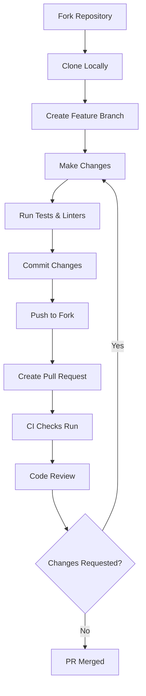
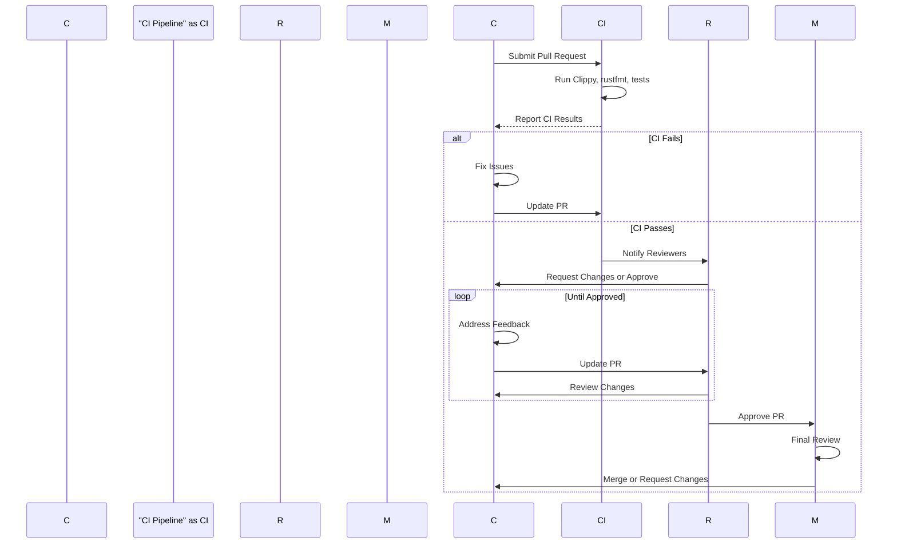
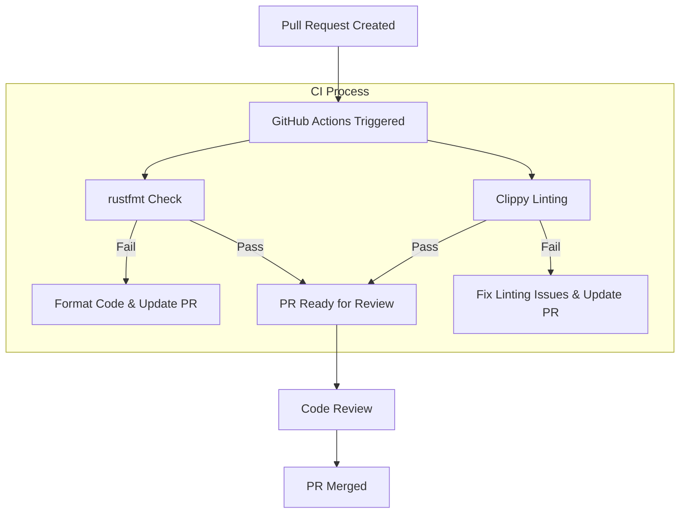
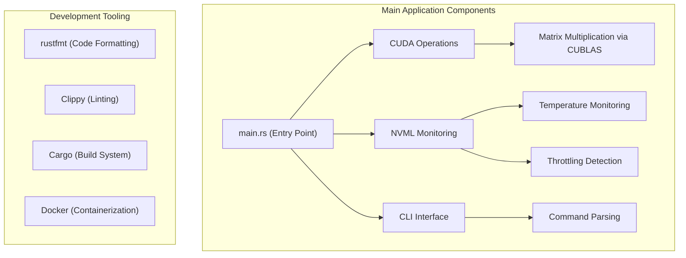

<!-- source: DeepWiki mcp.deepwiki.com · repo huggingface/gpu-fryer · page 5.3 Contributing Guidelines · fetched 2026-10-26 -->

# Contributing Guidelines

<details>
<summary>Relevant source files</summary>

The following files were used as context for generating this wiki page:

- [.github/workflows/rust.yaml](.github/workflows/rust.yaml)
- [.gitignore](.gitignore)
- [README.md](README.md)

</details>


This document provides guidelines for contributing to the GPU-Fryer project. It outlines the development process, coding standards, and workflow for submitting changes. For information about building the project from source code, see [Building from Source](#5.1). For details about the CI/CD pipeline, see [CI/CD Pipeline](#5.2).

## Introduction

GPU-Fryer is an open-source tool designed to stress test GPUs and detect thermal throttling or performance degradation. Contributions that improve functionality, performance, documentation, or fix bugs are welcomed.

Sources: [README.md:1-9]()

## Development Environment Setup

### Prerequisites

- Rust development environment
- CUDA toolkit
- Git
- Docker (optional, but recommended for testing)

### Setting Up Your Development Environment

1. **Fork and clone the repository**:
   ```bash
   git clone https://github.com/YOUR-USERNAME/gpu-fryer.git
   cd gpu-fryer
   ```

2. **Install Rust dependencies**:
   ```bash
   cargo build
   ```

3. **Verify your setup**:
   ```bash
   cargo run -- 10  # Run a short 10-second test
   ```

## Code Style and Standards

GPU-Fryer follows standard Rust coding conventions and uses tools to enforce them.

### Formatting

We use `rustfmt` with nightly toolchain for code formatting. Always format your code before submitting:

```bash
cargo +nightly fmt
```

### Linting

We use Clippy to catch common mistakes and ensure code quality:

```bash
cargo clippy -- -Dwarnings
```

Sources: [.github/workflows/rust.yaml:11-54]()

## Contribution Workflow

The diagram below illustrates the contribution workflow from fork to merged pull request:



Sources: [.github/workflows/rust.yaml:1-54]()

### Branch Naming

Use descriptive branch names prefixed with the type of change:

- `feature/your-feature-name` - For new features
- `fix/issue-description` - For bug fixes
- `docs/documentation-update` - For documentation updates
- `refactor/component-name` - For code refactoring

### Commit Messages

Write clear, concise commit messages that explain the changes made:

```
[type]: Short description (50 chars or less)

More detailed explanatory text, if necessary. Wrap it to about 72
characters. The blank line separating the summary from the body is
critical.
```

Types:
- `feat`: A new feature
- `fix`: A bug fix
- `docs`: Documentation changes
- `style`: Formatting, missing semicolons, etc; no code change
- `refactor`: Code refactoring
- `test`: Adding tests
- `chore`: Maintenance tasks

## Pull Request Process

### PR Checklist

Before submitting a Pull Request, ensure:

1. Code is formatted with `rustfmt`
2. All Clippy warnings are addressed
3. Tests are added for new functionality
4. Documentation is updated
5. CI pipeline passes

### Code Review Process

The diagram below illustrates the code review process:



Sources: [.github/workflows/rust.yaml:1-54]()

## CI/CD System Integration

When you submit a pull request, the following CI checks will run automatically:



Sources: [.github/workflows/rust.yaml:1-54]()

## Testing Guidelines

### Running Tests Locally

Before submitting code, run tests to ensure your changes don't break existing functionality:

```bash
cargo test
```

### Testing With Docker

To ensure your changes work in the containerized environment:

```bash
docker build -t gpu-fryer-test .
docker run --gpus all gpu-fryer-test 30
```

## Documentation Guidelines

### Code Documentation

- Document all public functions, structs, and modules with Rust doc comments (`///`)
- Include examples where appropriate
- Explain complex algorithms or non-obvious code

### README Updates

When adding new features, ensure the README.md is updated to reflect:
- New functionality
- Changed command-line options
- Updated installation or usage instructions

Sources: [README.md:13-66]()

## GPU-Fryer Project Structure

Understanding the project structure is essential for making effective contributions:



Sources: [README.md:67-85]()

## File Structure and Important Components

| Component | Description | Purpose |
|-----------|-------------|---------|
| `src/main.rs` | Main entry point | Contains application logic, CLI parsing, and GPU operations |
| `Cargo.toml` | Rust package manifest | Defines dependencies and project metadata |
| `Dockerfile` | Docker configuration | Defines containerized build environment |
| `.github/workflows/` | CI/CD configuration | GitHub Actions for automated testing and building |
| `README.md` | Documentation | User guide and project overview |

## Common Issues and Solutions

| Issue | Solution |
|-------|----------|
| Clippy/rustfmt failures | Run `cargo clippy` and `cargo +nightly fmt` locally before pushing |
| CUDA compatibility issues | Test with specific CUDA versions and document compatibility |
| CI pipeline failure | Check the GitHub Actions logs for specific error messages |
| GPU detection issues | Ensure NVML library path is correctly specified |

## Legal Requirements

### License Compliance

All contributions must comply with the project's license. Make sure any third-party code or libraries you include are compatible with the project's license.

### Developer Certificate of Origin

By contributing to this project, you certify that your contribution adheres to the Developer Certificate of Origin (DCO) as defined at [https://developercertificate.org/](https://developercertificate.org).

## Communication

- Use GitHub Issues for bug reports and feature requests
- Use Pull Requests for code contributions
- Be respectful and constructive in all communications

Sources: [README.md:1-9](), [.gitignore:37-51]()