# Page: Overview

# Overview

<details>
<summary>Relevant source files</summary>

The following files were used as context for generating this wiki page:

- [README.md](README.md)
- [src/main.rs](src/main.rs)

</details>


GPU-Fryer is a specialized tool designed to stress test NVIDIA GPUs and detect abnormal thermal throttling or performance degradation. It's particularly valuable for testing GPUs running ML inference or training workloads where overall system performance is dictated by the slowest GPU. Hugging Face uses this tool to monitor their HPC clusters and ensure all GPUs are running at peak performance.

For detailed installation instructions, see [Installation and Setup](#2).

Sources: [README.md:1-9]()

## System Architecture

GPU-Fryer is implemented in Rust and consists of several core components that work together to stress test GPUs and analyze their performance.

### Component Architecture

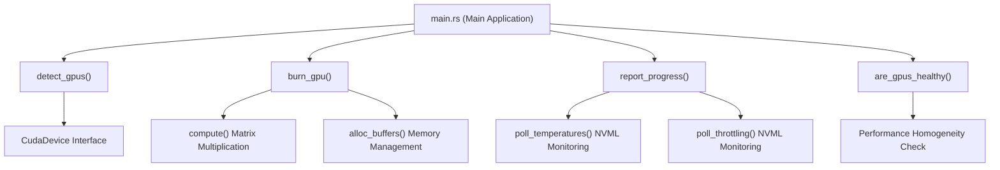

The codebase is centered around key functions and structures in the main application file:

- **GPU Detection**: `detect_gpus()` [src/main.rs:572-580]() identifies available NVIDIA GPUs
- **Matrix Multiplication**: `compute()` [src/main.rs:545-570]() performs CUBLAS operations
- **GPU Stress Testing**: `burn_gpu()` [src/main.rs:483-517]() runs the core stress test
- **Progress Reporting**: `report_progress()` [src/main.rs:327-448]() monitors and displays results
- **Health Checking**: `are_gpus_healthy()` [src/main.rs:450-481]() evaluates GPU health

The application leverages these critical external dependencies:

- `cudarc`: CUDA operations and CUBLAS matrix multiplication
- `nvml-wrapper`: GPU monitoring via NVIDIA Management Library
- `tokio`: Asynchronous execution for parallel GPU testing
- `clap`: Command-line argument parsing
- `half`: BF16 precision floating-point support

Sources: [src/main.rs:1-19](), [src/main.rs:572-580](), [src/main.rs:545-570](), [src/main.rs:483-517](), [src/main.rs:327-448](), [src/main.rs:450-481]()

## Workflow and Data Flow

The operational workflow of GPU-Fryer follows this sequence:

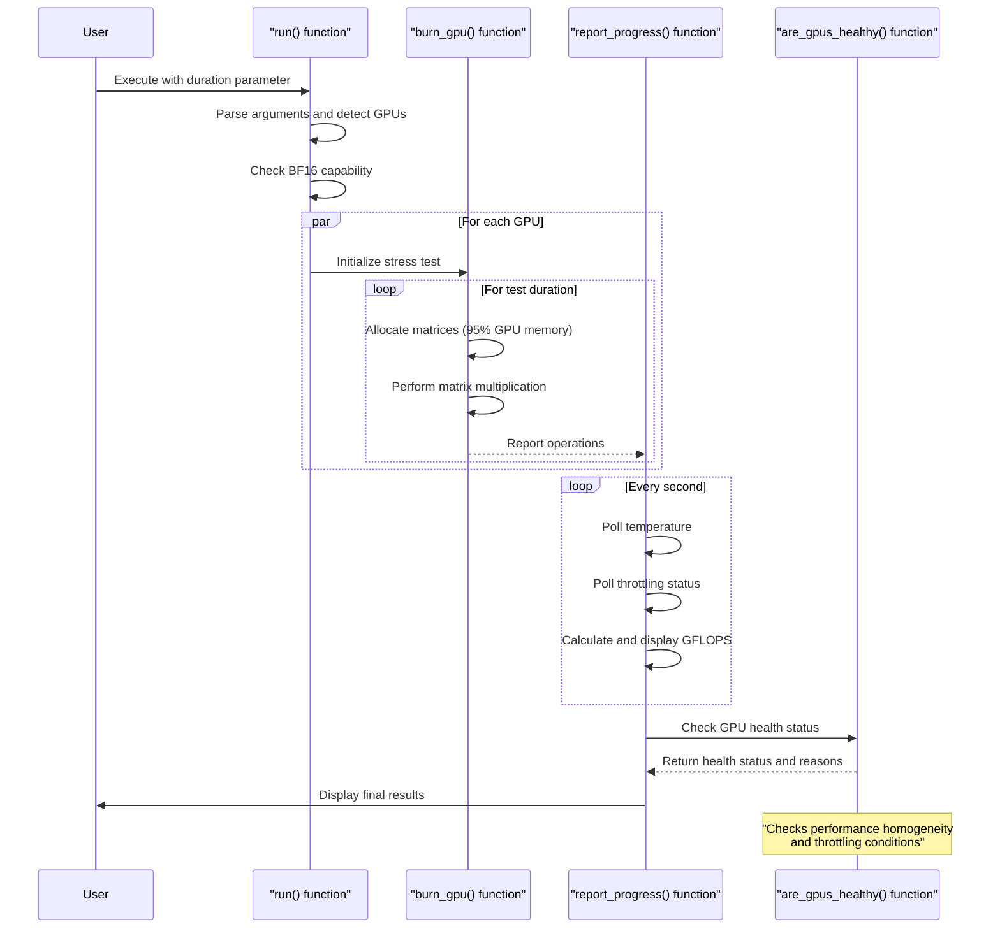

The main execution flow in `main()` [src/main.rs:143-170]() parses arguments, calls the `run()` function [src/main.rs:184-221](), which then spawns asynchronous tasks for stress testing and monitoring each GPU.

Sources: [src/main.rs:143-170](), [src/main.rs:184-221](), [src/main.rs:483-517](), [src/main.rs:327-448](), [src/main.rs:450-481]()

## Key Technical Implementation Details

### Matrix Multiplication Mechanism

GPU-Fryer creates two 8192×8192 matrices and performs matrix multiplication using CUBLAS. The key parameters are:

```
const SIZE: usize = 8192;         // Matrix dimension
const MEM_TO_USE_PCT: f64 = 0.9;  // Percentage of GPU memory to use
```

The stress test works by:
1. Creating random matrices filled with data (using `SmallRng`)
2. Allocating ~90% of GPU memory via `alloc_buffers()` [src/main.rs:529-543]()
3. Performing continuous matrix multiplication operations
4. Writing results to a ring buffer to maintain memory pressure

Matrix multiplication is implemented using the CUBLAS `gemm` function, configured in [src/main.rs:554-565]().

Sources: [src/main.rs:20-22](), [src/main.rs:529-543](), [src/main.rs:545-570](), [README.md:75-77]()

### Data Structures and Results Tracking

Performance metrics and test results are tracked in the `BurnResult` struct [src/main.rs:52-65]():

```rust
struct BurnResult {
    gpu_idx: usize,
    flops_max: usize,
    flops_min: usize,
    flops_sum: usize,
    n_iters: usize,
    temp_max: usize,
    temp_sum: usize,
    temp_min: usize,
    throttling_hw: usize,
    throttling_thermal_sw: usize,
    throttling_thermal_hw: usize,
}
```

This structure maintains statistics on:
- FLOPS (minimum, maximum, average)
- Temperature (minimum, maximum, average)
- Throttling conditions (hardware, software thermal, hardware thermal)

Sources: [src/main.rs:52-65](), [src/main.rs:67-96]()

### Precision Modes

The application supports two precision modes:

1. **FP32 (single precision)**: Default mode for all GPUs
2. **BF16 (brain floating point)**: Used when all GPUs support it (requires compute capability ≥ 8.0)

The precision selection logic [src/main.rs:200-214]() determines whether to use BF16 based on explicit configuration and GPU capabilities. The `supports_bf16()` function [src/main.rs:317-325]() checks if a GPU has the necessary compute capability.

This is implemented using the generic `run_with_precision<T>()` function [src/main.rs:223-297]() and the `VariablePrecisionFloat` trait [src/main.rs:125-129]().

Sources: [src/main.rs:125-141](), [src/main.rs:200-214](), [src/main.rs:317-325](), [README.md:78-78]()

### Performance Monitoring

GPU-Fryer collects and analyzes several critical metrics:

| Metric | Description | Implementation |
|--------|-------------|----------------|
| GFLOPS | Floating-point operations per second | `flops = nops[i] * SIZE * SIZE * SIZE * 2` [src/main.rs:349]() |
| Temperature | GPU temperature in Celsius | `poll_temperatures()` [src/main.rs:299-306]() |
| Throttling | Hardware and thermal throttling detection | `poll_throttling()` [src/main.rs:308-315]() |

The monitoring loop in `report_progress()` [src/main.rs:327-448]() polls these metrics once per second and updates the corresponding `BurnResult` structures.

Sources: [src/main.rs:299-315](), [src/main.rs:327-448]()

### Health Assessment

GPU-Fryer determines GPU health based on two primary criteria:

1. **Performance homogeneity**: All GPUs should perform within a specified tolerance (default 10%) of the best-performing GPU
2. **Throttling detection**: No throttling should be detected (with an option to tolerate software throttling)

The health check algorithm `are_gpus_healthy()` [src/main.rs:450-481]() returns both a boolean health status and a list of reasons for any unhealthy state.

Sources: [src/main.rs:450-481](), [README.md:58-60]()

## Configuration and Usage

The command-line interface is defined using the `clap` crate [src/main.rs:31-50]():

| Option | Description | Default |
|--------|-------------|---------|
| `duration_secs` | Duration in seconds to run the test | 60 |
| `nvml_lib_path` | Path to NVIDIA Management Library | /usr/lib/x86_64-linux-gnu/libnvidia-ml.so.1 |
| `tolerate_software_throttling` | Whether to tolerate software throttling | false |
| `tflops_tolerance` | Acceptable percentage deviation between GPUs | 10% |
| `use_bf16` | Whether to use BF16 precision | Auto-detect |

Example usage:
```bash
# Run test for 60 seconds
gpu-fryer 60
```

Sample output:
```
GPU #7:  51494 Gflops/s (min: 50577.53, max: 51677.05, dev: 51493.79)
         Temperature: 48.83°C (min: 47.00, max: 50.00)
         Throttling HW: false, Thermal SW: false, Thermal HW: false
All GPUs seem healthy
```

For reference, typical performance metrics:

| GPU | TFLOPS | Precision |
|-----|--------|-----------|
| NVIDIA H100 80GB HBM3 | ~51 | FP32 |
| NVIDIA H100 80GB HBM3 | ~676 | BF16 |

Sources: [src/main.rs:31-50](), [README.md:23-30](), [README.md:60-65]()

## Deployment Options

GPU-Fryer can be deployed using:

1. **Docker**: 
   ```bash
   docker run --gpus all ghcr.io/huggingface/gpu-fryer:1.0.0 60
   ```

2. **Cargo**: 
   ```bash
   cargo install gpu-fryer
   gpu-fryer 60
   ```

For additional deployment details, see [Installation and Setup](#2).

Sources: [README.md:15-19](), [README.md:67-71]()

---

# Page: Purpose and Capabilities

# Purpose and Capabilities

<details>
<summary>Relevant source files</summary>

The following files were used as context for generating this wiki page:

- [README.md](README.md)
- [assets/tensorcores.png](assets/tensorcores.png)
- [src/main.rs](src/main.rs)

</details>


This page provides an overview of the purpose, capabilities, and core functionality of GPU Fryer. It explains what problems the tool solves and outlines its key features.

## Introduction

GPU Fryer is a specialized utility designed to stress test NVIDIA GPUs by performing intensive matrix multiplication operations while simultaneously monitoring key performance metrics. The tool is particularly valuable for detecting abnormal thermal throttling or performance degradation in GPU clusters used for machine learning workloads.

Sources: [README.md:1-9]()

## Core Purpose

The primary purposes of GPU Fryer are:

1. **Stress Testing**: To apply a consistent, heavy computational load on GPUs to test their performance under pressure
2. **Performance Validation**: To verify that GPUs perform optimally and consistently under load
3. **Throttling Detection**: To identify GPUs that experience thermal throttling or other performance limitations
4. **Homogeneity Verification**: To ensure all GPUs in a multi-GPU system perform similarly, as ML workloads are often constrained by the slowest GPU

This tool is especially valuable for organizations running high-performance computing (HPC) clusters for machine learning tasks, where consistent GPU performance is critical for effective workload distribution.

Sources: [README.md:3-9](), [src/main.rs:24-27]()

## Operational Workflow

The following diagram illustrates how GPU Fryer operates from initialization to result reporting:

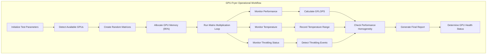

Sources: [src/main.rs:144-170](), [src/main.rs:184-221](), [src/main.rs:327-448]()

## Key Capabilities

### 1. GPU Stress Testing

GPU Fryer creates a consistent and intensive computational load through matrix multiplication operations:

- Creates two 8192×8192 matrices filled with random values
- Performs repeated matrix multiplication using CUBLAS
- Allocates 95% of available GPU memory to store results in a ring buffer
- Maintains high GPU utilization throughout the test duration

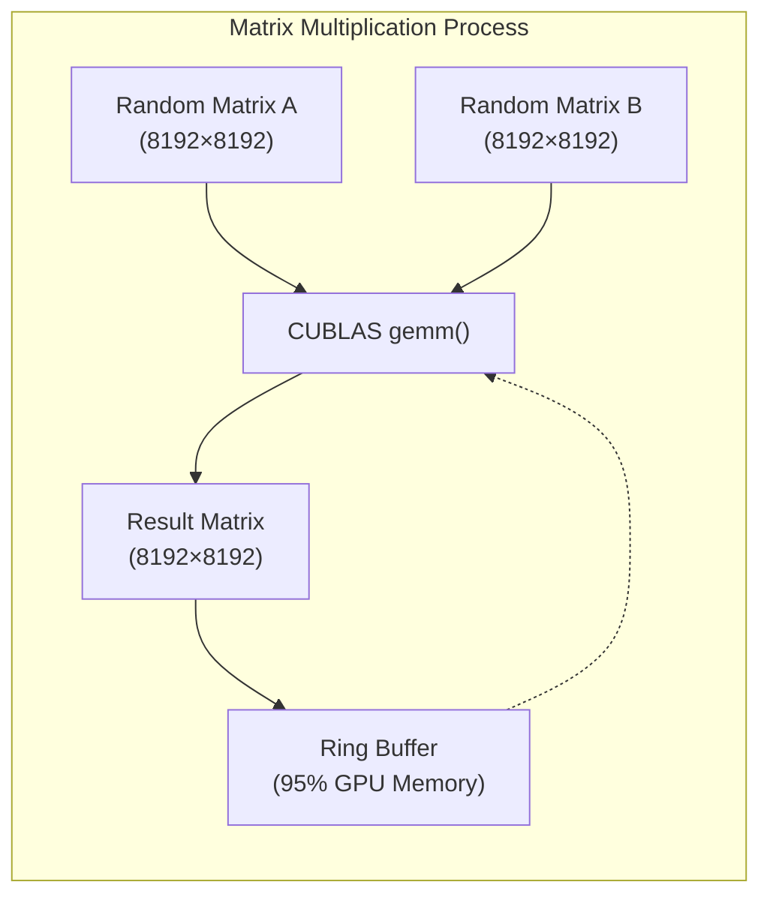

Sources: [README.md:75-76](), [src/main.rs:483-517](), [src/main.rs:20-22]()

### 2. Precision Options

GPU Fryer can operate in different precision modes to test various GPU capabilities:

- **FP32 (single precision)**: Standard mode for all NVIDIA GPUs
- **BF16 (brain floating point)**: For testing Tensor Cores on compatible GPUs (compute capability ≥ 8.0)

The tool automatically detects GPU capabilities and can select the appropriate precision mode:

| Precision | Data Type | Primarily Tests | GPU Requirements |
|-----------|-----------|-----------------|------------------|
| FP32      | 32-bit floating point | Standard CUDA cores | All NVIDIA GPUs |
| BF16      | 16-bit brain float | Tensor Cores | Compute capability ≥ 8.0 |

Sources: [README.md:78-78](), [src/main.rs:317-325](), [src/main.rs:200-214]()

### 3. Performance Monitoring

GPU Fryer provides comprehensive performance monitoring during testing:

- Calculates and reports GFLOPS (Giga Floating Point Operations Per Second)
- Tracks minimum, maximum, and average performance metrics
- Monitors performance consistency across multiple iterations
- Detects performance outliers or degradation

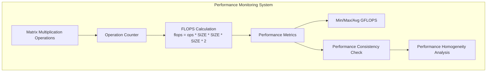

Sources: [src/main.rs:348-363](), [src/main.rs:410-418](), [src/main.rs:450-481]()

### 4. Temperature and Throttling Detection

GPU Fryer continuously monitors GPU temperature and throttling status using NVIDIA Management Library (NVML):

- Records minimum, maximum, and average GPU temperatures
- Detects different throttling conditions:
  - Hardware throttling
  - Software thermal throttling
  - Hardware thermal throttling
- Reports throttling events and their frequency

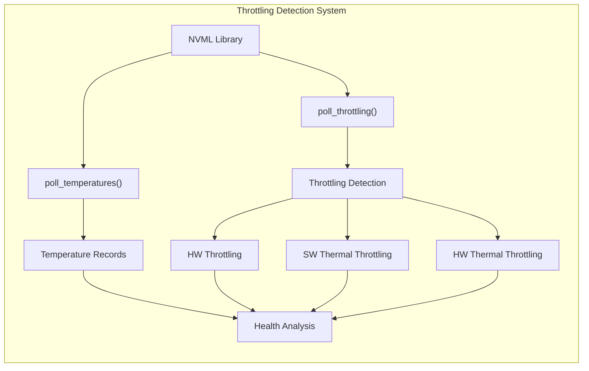

Sources: [src/main.rs:299-315](), [src/main.rs:366-407](), [src/main.rs:419-430]()

### 5. Multi-GPU Support

GPU Fryer can simultaneously test multiple GPUs in a system:

- Automatically detects all available GPUs
- Runs tests in parallel across all GPUs
- Compares performance between GPUs to ensure homogeneity
- Identifies underperforming GPUs within a configurable tolerance range

Sources: [src/main.rs:572-580](), [src/main.rs:450-481]()

## Technical Implementation Details

### Core Components

The GPU Fryer tool is built around several key components that work together:

1. **GPU Detection**: Identifies available NVIDIA GPUs in the system
2. **Matrix Operations**: Creates and manipulates matrices for stress testing
3. **CUDA Integration**: Interfaces with CUDA for GPU computations
4. **NVML Monitoring**: Uses NVIDIA Management Library for hardware metrics
5. **Performance Analysis**: Analyzes and reports on test results

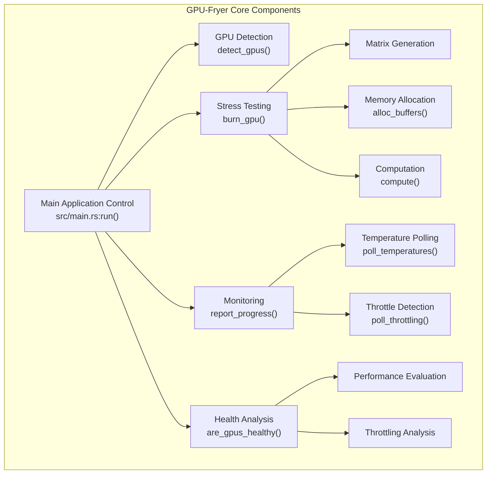

Sources: [src/main.rs:144-170](), [src/main.rs:184-221](), [src/main.rs:483-517](), [src/main.rs:327-448]()

### Configuration Options

GPU Fryer offers several configuration options to customize the testing process:

| Option | Description | Default | Code Reference |
|--------|-------------|---------|----------------|
| `duration_secs` | Duration to run the test in seconds | 60 | [src/main.rs:36]() |
| `nvml_lib_path` | Path to NVIDIA Management Library | `/usr/lib/x86_64-linux-gnu/libnvidia-ml.so.1` | [src/main.rs:38-39]() |
| `tolerate_software_throttling` | Ignore software throttling if performance is acceptable | `false` | [src/main.rs:40-42]() |
| `tflops_tolerance` | Acceptable performance deviation percentage between GPUs | 10% | [src/main.rs:43-45]() |
| `use_bf16` | Use BF16 precision instead of FP32 | Auto-detect | [src/main.rs:45-47]() |

Sources: [src/main.rs:31-50](), [README.md:32-50]()

## Performance Metrics

GPU Fryer provides detailed performance metrics for each GPU tested:

1. **Computational Performance**:
   - Average GFLOPS
   - Minimum and maximum GFLOPS
   - Performance consistency

2. **Thermal Performance**:
   - Average temperature
   - Minimum and maximum temperature
   - Temperature stability

3. **Throttling Status**:
   - Hardware throttling events
   - Software thermal throttling events
   - Hardware thermal throttling events

For reference, the expected performance metrics for high-end GPUs:

| GPU Model | FP32 TFLOPS | BF16 TFLOPS |
|-----------|-------------|-------------|
| NVIDIA H100 80GB HBM3 | ~51 | ~676 |

Sources: [README.md:60-65](), [src/main.rs:410-430]()

## Use Cases

GPU Fryer is particularly valuable for:

1. **Cluster Validation**: Testing newly deployed GPU clusters to ensure optimal performance
2. **Performance Troubleshooting**: Identifying problematic GPUs in an existing cluster
3. **Thermal Management Verification**: Validating cooling solutions for GPU deployments
4. **Homogeneity Testing**: Ensuring consistent performance across multiple GPUs
5. **Hardware Quality Assurance**: Detecting manufacturing defects or degradation in GPUs

Sources: [README.md:3-9]()

## Related Pages

- For detailed installation instructions, see [Installation and Setup](#2)
- For usage examples and command-line options, see [Usage Guide](#3)
- For technical architecture details, see [Technical Architecture](#4)
- For understanding how the stress testing mechanism works, see [GPU Stress Testing Mechanism](#4.2)

---

# Page: Key Concepts

# Key Concepts

<details>
<summary>Relevant source files</summary>

The following files were used as context for generating this wiki page:

- [README.md](README.md)
- [assets/utilization.png](assets/utilization.png)
- [src/main.rs](src/main.rs)

</details>


This document explains the core concepts and terminology related to GPU stress testing and performance monitoring in the GPU-fryer tool. Understanding these concepts is essential for effectively using the tool and interpreting its results.

For detailed usage instructions, see [Usage Guide](#3) and [Command-Line Interface](#3.1).

## GPU Stress Testing Fundamentals

GPU-fryer performs intensive matrix multiplication operations to stress test NVIDIA GPUs. This approach helps detect performance inconsistencies, thermal throttling issues, and other problems that might affect GPU performance in production environments, particularly for machine learning workloads.

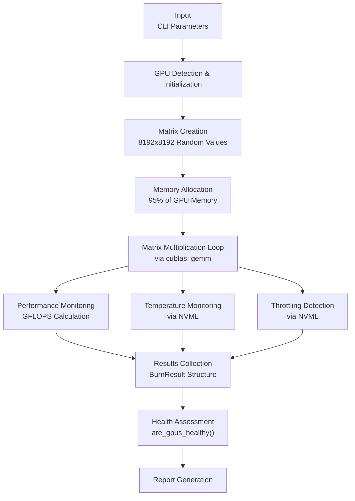

Sources: [src/main.rs:483-517](), [README.md:73-79]()

## Matrix Multiplication Operations

The core stress mechanism is matrix multiplication using CUBLAS (CUDA Basic Linear Algebra Subroutines). The tool creates two random 8192x8192 matrices and repeatedly multiplies them.

### Matrix Operation Details

- **Matrix Size**: 8192×8192 (defined in [src/main.rs:20]())
- **Operation**: General Matrix Multiplication (GEMM) using CUBLAS
- **Computational Intensity**: Approximately 2 × N³ floating-point operations per multiplication (where N=8192)
- **Implementation**: The `compute()` function in [src/main.rs:545-570]()

Matrix multiplication is particularly effective for stress testing because:
1. It's compute-intensive, maximizing utilization of GPU cores
2. It has predictable performance characteristics
3. It efficiently uses memory bandwidth
4. It leverages specialized hardware like Tensor Cores (when using BF16 precision)

Sources: [src/main.rs:545-570](), [README.md:75]()

## Memory Management

GPU-fryer intentionally consumes a large portion of available GPU memory to create realistic stress conditions. This simulates memory-intensive workloads like those found in machine learning applications.

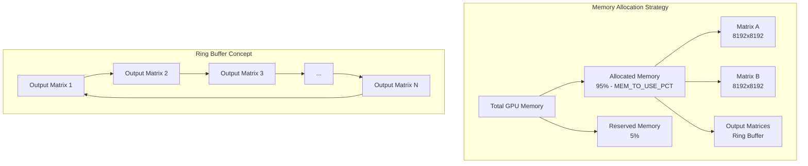

Key aspects of memory management:
- **Memory Usage**: 95% of available GPU memory (defined by `MEM_TO_USE_PCT` in [src/main.rs:22]())
- **Ring Buffer**: Results are written to a ring buffer to maintain continuous operation without new allocations
- **Buffer Allocation**: Implementation in `alloc_buffers()` function [src/main.rs:529-543]()
- **Memory Calculation**: The number of output matrices is determined dynamically based on available memory [src/main.rs:493-505]()

Sources: [src/main.rs:22](), [src/main.rs:529-543](), [README.md:76-77]()

## Performance Metrics and Monitoring

### GFLOPS Calculation

The primary performance metric in GPU-fryer is GFLOPS (Giga Floating Point Operations Per Second), which measures computational throughput.

For an 8192×8192 matrix multiplication:
- **Operations per multiplication**: 2 × 8192³ ≈ 1.1 trillion operations
- **GFLOPS calculation**: Operations ÷ Time (seconds) ÷ 10⁹

Expected performance varies by GPU model and precision mode:

| GPU | TFLOPS (FP32) | TFLOPS (BF16) |
|-----|--------------|---------------|
| NVIDIA H100 80GB HBM3 | ~51 | ~676 |

The reporting logic collects and processes this data in the `report_progress()` function [src/main.rs:327-448]().

Sources: [src/main.rs:327-448](), [README.md:60-66]()

## Temperature and Throttling Detection

GPU-fryer uses NVML (NVIDIA Management Library) to monitor GPU temperatures and detect throttling conditions during the stress test.

### Throttling Types

The tool monitors three types of GPU throttling:

1. **Hardware Throttling (HW)**: General hardware-level performance reduction
2. **Thermal Software Throttling (Thermal SW)**: Software-initiated throttling at lower temperature thresholds
3. **Thermal Hardware Throttling (Thermal HW)**: Hardware-initiated throttling at higher temperature thresholds to prevent damage

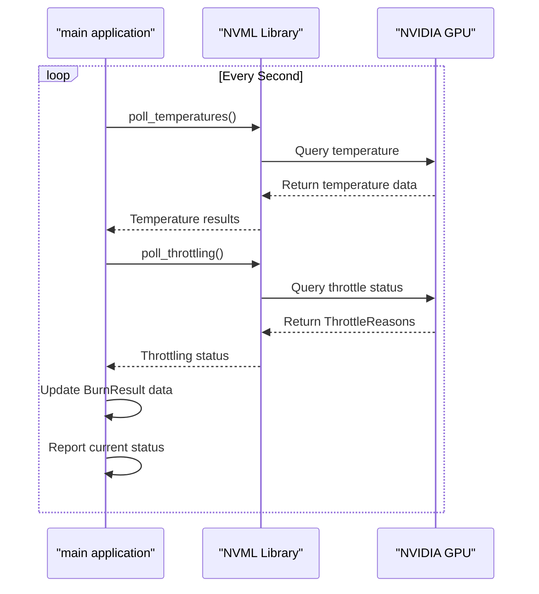

Implementation details:
- **Temperature Polling**: `poll_temperatures()` function [src/main.rs:299-306]()
- **Throttling Detection**: `poll_throttling()` function [src/main.rs:308-315]()
- **Throttling Analysis**: Throttling status analysis in [src/main.rs:383-407]()

Sources: [src/main.rs:299-315](), [src/main.rs:383-407]()

## Precision Modes

GPU-fryer supports two floating-point precision modes for matrix multiplication:

1. **FP32 (32-bit Floating Point)**: Standard single-precision floating-point
2. **BF16 (Brain Floating Point 16-bit)**: Reduced-precision format optimized for machine learning

### Precision Selection Logic

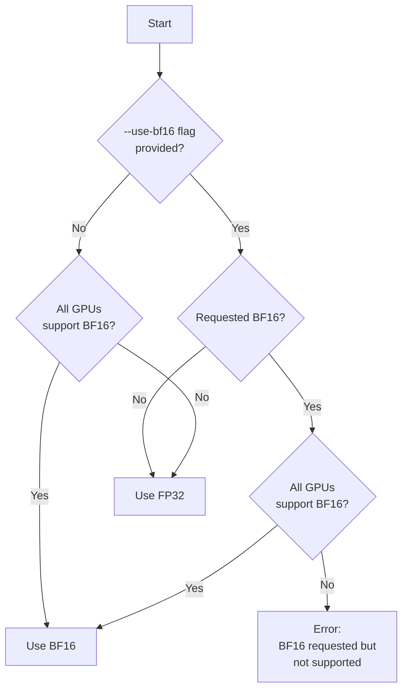

Important details:
- **BF16 Support Detection**: `supports_bf16()` function [src/main.rs:317-325]()
- **Precision Selection**: Logic in [src/main.rs:200-214]()
- **Implementation**: Type-parametrized code using `VariablePrecisionFloat` trait [src/main.rs:125-141]()
- **Performance Impact**: BF16 significantly increases throughput on GPUs with Tensor Cores

Sources: [src/main.rs:200-214](), [src/main.rs:317-325](), [README.md:78-79]()

## Performance Homogeneity

A key feature of GPU-fryer is its ability to assess performance consistency across multiple GPUs in a system. This is critical for machine learning workloads where overall system performance is limited by the slowest GPU.

### Homogeneity Assessment Process

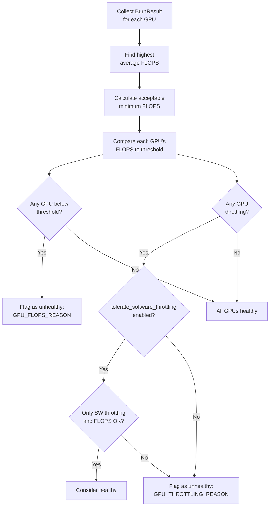

Key implementation details:
- **Health Assessment**: `are_gpus_healthy()` function [src/main.rs:450-481]()
- **Tolerance Configuration**: `--tflops-tolerance` parameter (default: 10%)
- **Software Throttling Handling**: `--tolerate-software-throttling` flag

Sources: [src/main.rs:450-481](), [src/main.rs:31-50](), [README.md:58-59]()

## Key Data Structures

### BurnResult Structure

The central data structure for collecting and analyzing GPU performance metrics:

```
struct BurnResult {
    gpu_idx: usize,              // GPU index
    flops_max: usize,            // Maximum FLOPS recorded
    flops_min: usize,            // Minimum FLOPS recorded
    flops_sum: usize,            // Sum of all FLOPS measurements
    n_iters: usize,              // Number of iterations
    temp_max: usize,             // Maximum temperature
    temp_sum: usize,             // Sum of all temperature measurements
    temp_min: usize,             // Minimum temperature
    throttling_hw: usize,        // Hardware throttling count
    throttling_thermal_sw: usize, // Thermal software throttling count
    throttling_thermal_hw: usize, // Thermal hardware throttling count
}
```

This structure tracks all essential metrics for each GPU during the stress test and provides methods to calculate averages and determine throttling status.

### Configuration Structure

```
struct Config {
    duration_secs: u64,              // Test duration in seconds
    nvml_lib_path: String,           // Path to NVML library
    tflops_tolerance: f64,           // Allowable performance variation
    tolerate_software_throttling: bool, // Whether to tolerate SW throttling
    use_bf16: Option<bool>,          // Precision mode selection
}
```

Sources: [src/main.rs:52-96](), [src/main.rs:116-123]()

## System Architecture

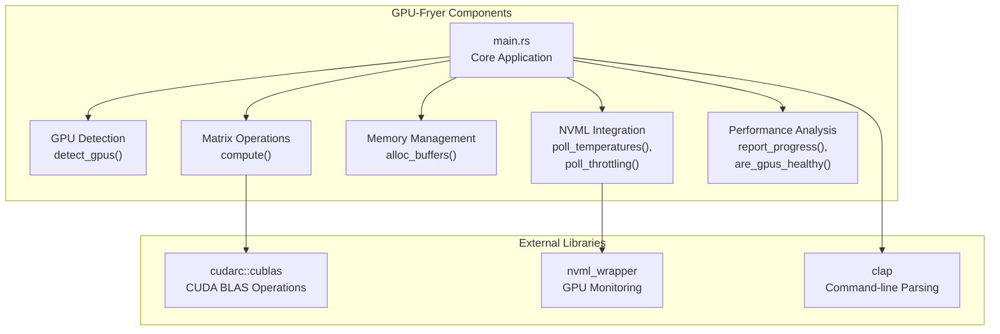

Sources: [src/main.rs:1-18](), [README.md:53-56]()

## Conclusion

Understanding these key concepts provides the foundation for effectively using GPU-fryer and interpreting its results. The tool combines intensive matrix multiplication operations with comprehensive monitoring to detect thermal issues and performance inconsistencies across GPUs, making it valuable for qualifying and maintaining GPU systems for machine learning and other high-performance workloads.

For specific usage guidelines, refer to the [Usage Guide](#3) section.

---

# Page: Installation and Setup

# Installation and Setup

<details>
<summary>Relevant source files</summary>

The following files were used as context for generating this wiki page:

- [Dockerfile](Dockerfile)
- [README.md](README.md)

</details>


This document provides comprehensive instructions for installing and configuring GPU-fryer, a tool designed to stress test GPUs and detect anomalies in performance or thermal behavior. For specific details about how to use the tool after installation, please refer to the [Usage Guide](#3).

## System Requirements

Before installing GPU-fryer, ensure your system meets the following requirements:

- NVIDIA GPU hardware
- NVIDIA driver installed (compatible with CUDA 12.1.0 or later recommended)
- CUDA toolkit installed (the tool relies on CUDA for stress testing operations)
- NVIDIA Management Library (NVML) for GPU monitoring
- Docker (for container-based installation) or Rust toolchain (for building from source)

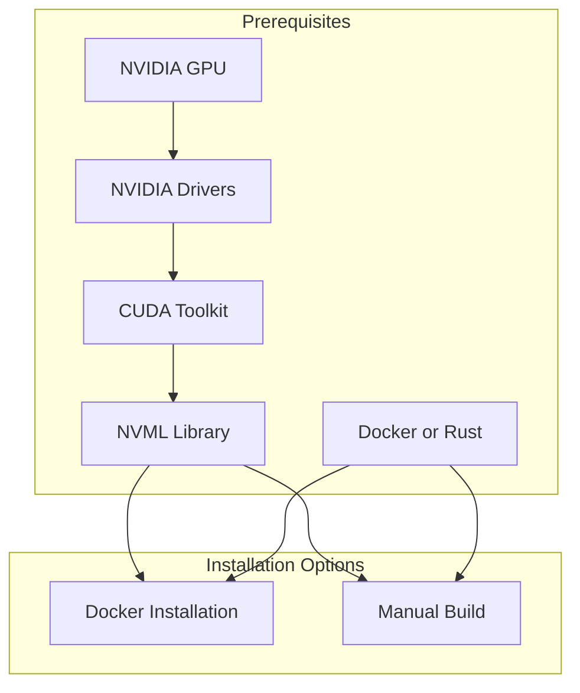

Sources: [README.md:53-56]()

## Installation Methods

GPU-fryer can be installed using one of two methods:

1. **Docker Installation**: Quick and easy deployment with minimal setup
2. **Manual Installation**: Building the tool from source using Cargo

### Docker Installation

The Docker installation method is the quickest way to get started with GPU-fryer, requiring minimal configuration.

#### Steps:

1. Ensure Docker is installed on your system
2. Verify the NVIDIA Container Toolkit is installed and configured
3. Run GPU-fryer using the provided Docker image

```bash
docker run --gpus all ghcr.io/huggingface/gpu-fryer:1.0.0 60
```

This command runs the GPU-fryer tool for 60 seconds on all available GPUs. You can adjust the duration as needed.

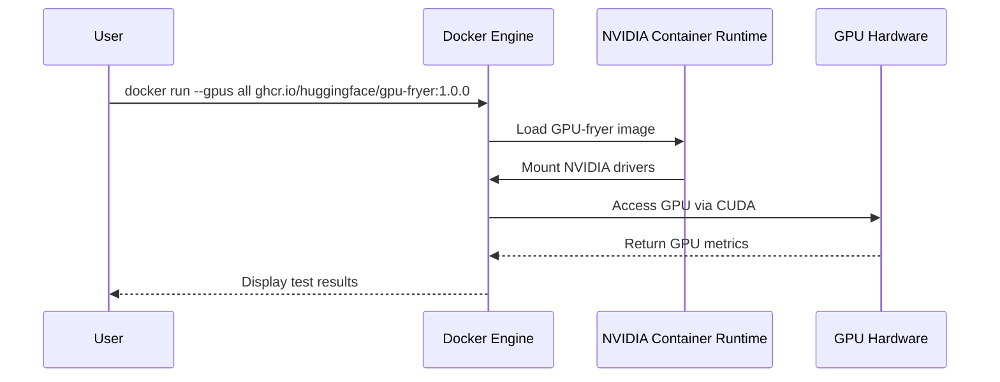

Sources: [README.md:15-19](), [Dockerfile:1-17]()

#### Docker Image Architecture

The Docker image is built in two stages:

1. **Builder stage**: Compiles the GPU-fryer application from source
2. **Final stage**: Creates a minimal runtime image with just the compiled binary

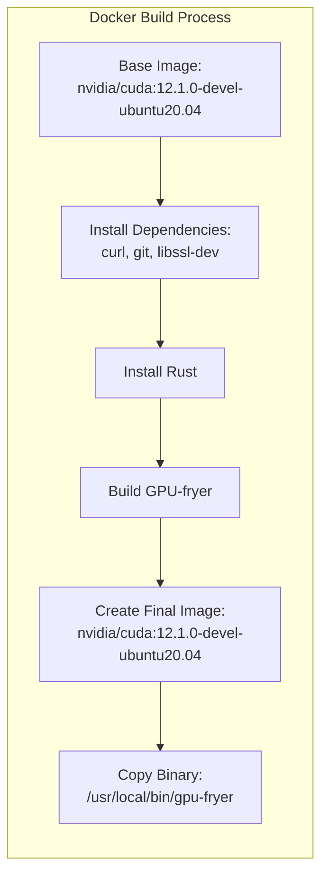

Sources: [Dockerfile:1-17]()

### Manual Installation

For users who prefer to build the tool from source or need customization options, the manual installation method using Cargo (Rust's package manager) is available.

#### Prerequisites:

- Rust programming language and Cargo package manager installed
- CUDA toolkit and development libraries
- Git (to clone the repository if not downloading directly)

#### Installation Steps:

```bash
# Install using Cargo directly from crates.io
cargo install gpu-fryer

# OR clone the repository and build locally
git clone https://github.com/huggingface/gpu-fryer
cd gpu-fryer
cargo build --release
```

After building locally, the binary will be available at `./target/release/gpu-fryer`

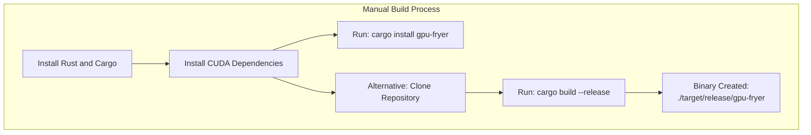

Sources: [README.md:67-71]()

## Post-Installation Verification

After installation, verify that GPU-fryer is working correctly by running a short test:

```bash
# For Docker installation
docker run --gpus all ghcr.io/huggingface/gpu-fryer:1.0.0 10

# For manual installation
gpu-fryer 10
```

You should see output similar to:

```
GPU #0:  51494 Gflops/s (min: 50577.53, max: 51677.05, dev: 51493.79)
         Temperature: 48.83°C (min: 47.00, max: 50.00)
         Throttling HW: false, Thermal SW: false, Thermal HW: false
All GPUs seem healthy
```

If you encounter any issues with NVML library detection, you may need to specify the path to the NVML library:

```bash
gpu-fryer --nvml-lib-path /path/to/libnvidia-ml.so 10
```

Sources: [README.md:23-30](), [README.md:53-56]()

## Configuration Considerations

### NVML Library Path

GPU-fryer uses NVML to monitor GPU temperature and throttling. By default, it looks for `libnvidia-ml.so` at:
- `/usr/lib/x86_64-linux-gnu/libnvidia-ml.so.1`

If your NVML library is installed at a different location, you'll need to specify the path using the `--nvml-lib-path` option.

### GPU Precision Mode

GPU-fryer can operate in two precision modes:
- FP32 (single precision): Default mode
- BF16 (brain floating point): Used if GPUs support it, provides higher stress on Tensor Cores

The precision mode affects both the stress level and reported performance metrics.

| GPU | TFLOPS | Precision |
|-----|--------|-----------|
| NVIDIA H100 80GB HBM3 | ~51 | FP32 |
| NVIDIA H100 80GB HBM3 | ~676 | BF16 |

Sources: [README.md:60-66](), [README.md:75-78]()

## Installation Workflow Overview

The following diagram shows the complete installation workflow and where GPU-fryer fits into your GPU testing infrastructure:

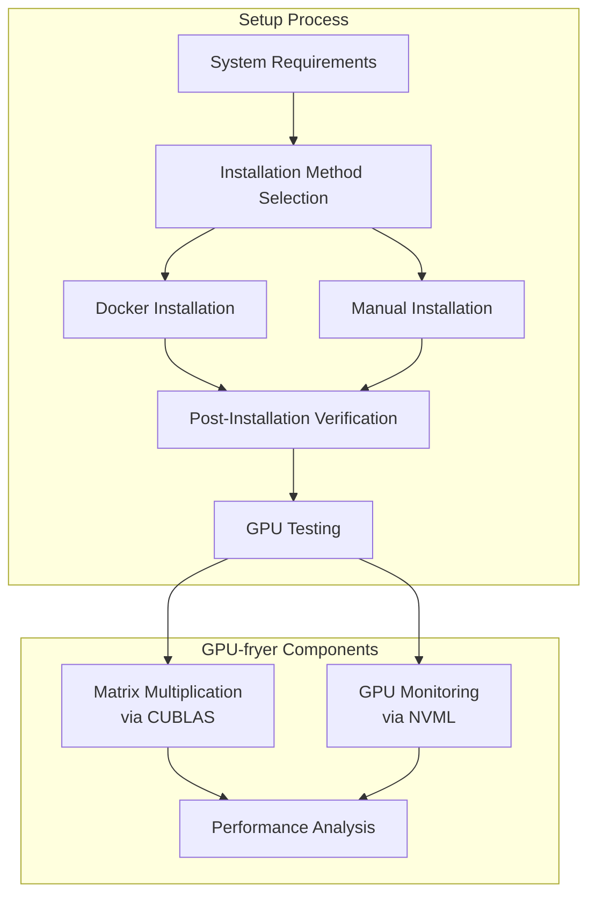

Sources: [README.md:73-84]()

For detailed information on using GPU-fryer after installation, including command-line options and interpreting results, please refer to the [Usage Guide](#3) and [Command-Line Interface](#3.1) documentation.

---

# Page: Docker Installation

# Docker Installation

<details>
<summary>Relevant source files</summary>

The following files were used as context for generating this wiki page:

- [.dockerignore](.dockerignore)
- [Dockerfile](Dockerfile)
- [README.md](README.md)

</details>


This document provides instructions for installing and running GPU-Fryer using Docker. For instructions on building and installing the tool from source, see [Manual Installation](#2.2).

## Prerequisites

Before using the GPU-Fryer Docker image, ensure that your system meets these requirements:

- Docker Engine installed (version 19.03 or newer)
- NVIDIA GPU with compatible drivers installed
- NVIDIA Container Toolkit (nvidia-docker) installed
- At least one CUDA-compatible GPU available

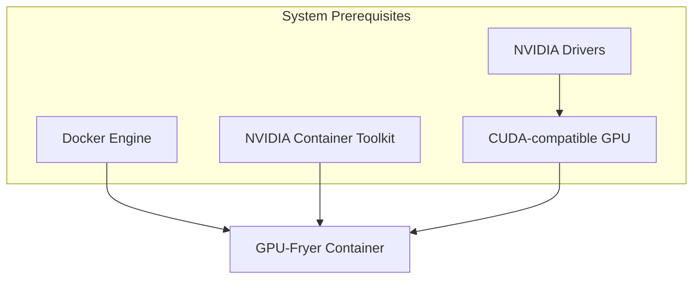

Sources: [Dockerfile:15-16](), [README.md:15-19]()

## Docker Image Structure

The GPU-Fryer Docker image is built in two stages to minimize the final image size while maintaining all required functionality.

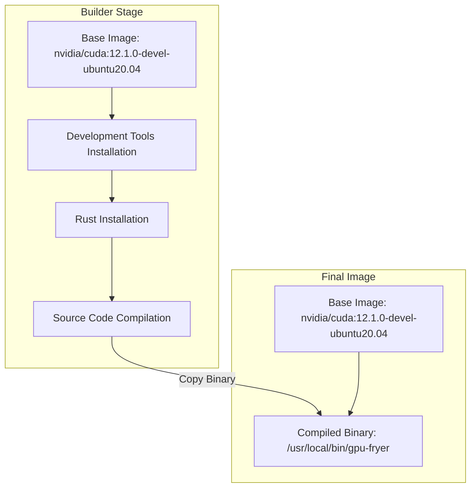

Sources: [Dockerfile:1-16]()

## Running GPU-Fryer with Docker

To run GPU-Fryer using the pre-built Docker image, use the following command:

```bash
docker run --gpus all ghcr.io/huggingface/gpu-fryer:1.0.0 60
```

This command:
- `--gpus all`: Grants the container access to all available GPUs
- `ghcr.io/huggingface/gpu-fryer:1.0.0`: Specifies the image to use (version 1.0.0)
- `60`: Runs the test for 60 seconds (default duration if not specified)

Sources: [README.md:15-19](), [README.md:24-29]()

## Command-Line Options

When running GPU-Fryer through Docker, you can pass the same command-line options as you would with the native executable. Append these options after the Docker run command:

```bash
docker run --gpus all ghcr.io/huggingface/gpu-fryer:1.0.0 [DURATION_SECS] [OPTIONS]
```

Available options include:

| Option | Description | Default |
|--------|-------------|---------|
| `--nvml-lib-path <PATH>` | Path to NVIDIA Management Library | `/usr/lib/x86_64-linux-gnu/libnvidia-ml.so.1` |
| `--tolerate-software-throttling` | Tolerate SW throttling if TFLOPS are acceptable | Disabled |
| `--tflops-tolerance <PERCENTAGE>` | TFLOPS tolerance (%) compared to best GPU | 10% |
| `--use-bf16 <BOOLEAN>` | Use BF16 precision instead of FP32 | Auto-detect |

```mermaid
flowchart LR
    subgraph "Docker Run Command Structure"
        A["docker run"]
        B["Container Options"]
        C["Image Reference"]
        D["Duration Parameter"]
        E["GPU-Fryer Options"]
        
        A --> B --> C --> D --> E
        
        subgraph "Container Options"
            B1["--gpus all"]
            B2["Other Docker options..."]
        end
        
        subgraph "GPU-Fryer Options"
            E1["--nvml-lib-path"]
            E2["--tolerate-software-throttling"]
            E3["--tflops-tolerance"]
            E4["--use-bf16"]
        end
    end
```

Sources: [README.md:32-51]()

## Example Output

When running GPU-Fryer, you'll see output similar to this:

```
GPU #7:  51494 Gflops/s (min: 50577.53, max: 51677.05, dev: 51493.79)
         Temperature: 48.83°C (min: 47.00, max: 50.00)
         Throttling HW: false, Thermal SW: false, Thermal HW: false
All GPUs seem healthy
```

For detailed information about interpreting the output results, see [Output Interpretation](#3.3).

Sources: [README.md:24-30]()

## Docker Image Internals

The Docker image contains:

1. Base CUDA runtime (CUDA 12.1.0 on Ubuntu 20.04)
2. The GPU-Fryer compiled binary at `/usr/local/bin/gpu-fryer`
3. All necessary CUDA and NVML runtime libraries

The image is configured to run GPU-Fryer as its entry point, making it possible to pass arguments directly.

```mermaid
flowchart TD
    subgraph "Host System"
        A["NVIDIA GPU Driver"]
        B["Docker Engine"]
        C["NVIDIA Container Toolkit"]
    end
    
    subgraph "GPU-Fryer Container"
        D["CUDA 12.1 Runtime"]
        E["GPU-Fryer Binary<br>/usr/local/bin/gpu-fryer"]
        F["NVML Library"]
    end
    
    A -->|"Device Access"| D
    B -->|"Container Management"| D
    C -->|"GPU Passthrough"| D
    D -->|"CUDA Operations"| E
    F -->|"GPU Monitoring"| E
```

Sources: [Dockerfile:15-17](), [README.md:53-56]()

## Troubleshooting

### Common Issues

1. **Missing GPU Access**
   - Error: "No CUDA GPUs are visible"
   - Solution: Ensure you're using the `--gpus all` flag and have the NVIDIA Container Toolkit installed

2. **NVML Library Not Found**
   - Error: "Cannot load NVML library"
   - Solution: The default NVML path in the container may differ from your host. Use `--nvml-lib-path` to specify the correct path.

3. **Docker Pull Failures**
   - Error: "Unable to pull image"
   - Solution: Verify network connectivity and that you have access to the GitHub Container Registry (ghcr.io)

Sources: [README.md:53-56]()

## Version Compatibility

The GPU-Fryer Docker image is built with CUDA 12.1.0, but it should be compatible with systems running different NVIDIA driver versions, as long as they support the required CUDA version.

| Component | Minimum Version |
|-----------|----------------|
| NVIDIA Driver | 530.30.02+ |
| CUDA Compatibility | 12.1+ |
| Docker | 19.03+ |
| NVIDIA Container Toolkit | 1.13.0+ |

Sources: [Dockerfile:1-15]()

---

# Page: Manual Installation

# Manual Installation

<details>
<summary>Relevant source files</summary>

The following files were used as context for generating this wiki page:

- [.gitignore](.gitignore)
- [Cargo.toml](Cargo.toml)
- [README.md](README.md)

</details>


This page provides detailed instructions for building and installing the GPU-Fryer tool from source code. If you prefer to use the pre-built Docker container instead, see [Docker Installation](#2.1).

## Prerequisites

Before manually installing GPU-Fryer, ensure your system meets the following requirements:

- **Rust toolchain** (latest stable version recommended)
- **NVIDIA CUDA toolkit** (CUDA 12.0 or later recommended)
- **NVIDIA Management Library (NVML)**
- **NVIDIA GPU(s)** with appropriate drivers installed
- **Git** (for cloning the repository)

```mermaid
flowchart TD
    A["Prerequisites"] --> B["Rust Toolchain"]
    A --> C["CUDA Toolkit"]
    A --> D["NVML Library"]
    A --> E["NVIDIA Drivers"]
    A --> F["NVIDIA GPU(s)"]
    
    B --> G["GPU-Fryer Installation"]
    C --> G
    D --> G
    E --> G
    F --> G
```

Sources: [README.md:53-56](), [Cargo.toml:6-13]()

## Installation Methods

There are two primary methods for manual installation:

### Method 1: Installing via Cargo

The simplest way to install GPU-Fryer is using Cargo, Rust's package manager:

1. Ensure Rust and Cargo are installed (if not, install from [https://rustup.rs/](https://rustup.rs))
2. Run the following command:

```bash
cargo install gpu-fryer
```

This command will download, compile, and install the GPU-Fryer binary to your Cargo bin directory (typically `~/.cargo/bin/`).

Sources: [README.md:67-71]()

### Method 2: Building from Source

For more control over the build process or to make modifications:

1. Clone the repository:
   ```bash
   git clone https://github.com/huggingface/gpu-fryer.git
   cd gpu-fryer
   ```

2. Build the project:
   ```bash
   cargo build --release
   ```

3. The compiled binary will be available at `./target/release/gpu-fryer`

4. (Optional) Install the binary to your PATH:
   ```bash
   cargo install --path .
   ```

```mermaid
flowchart TD
    A["Manual Installation Options"] --> B["Via Cargo"]
    A --> C["From Source"]
    
    B --> B1["cargo install gpu-fryer"]
    B --> B2["Binary in ~/.cargo/bin/"]
    
    C --> C1["git clone repository"]
    C1 --> C2["cargo build --release"]
    C2 --> C3["Binary in ./target/release/"]
    C3 --> C4["Optional: cargo install --path ."]
```

Sources: [README.md:67-71]()

## Dependency Structure

GPU-Fryer relies on several Rust crates to function properly:

| Dependency | Version | Purpose |
|------------|---------|---------|
| cudarc | 0.13.0 | CUDA runtime API wrapper with CUDA 12.0.6 and F16 support |
| nvml-wrapper | 0.10.0 | Interface to NVIDIA Management Library |
| tokio | 1.42 | Asynchronous runtime for parallel operations |
| clap | 4.5.26 | Command-line argument parsing |
| anyhow | 1.0.95 | Error handling |
| rand | 0.8.5 | Random number generation |
| half | 2.4.1 | Half-precision floating point support |

```mermaid
graph TD
    subgraph "GPU-Fryer Dependencies"
        A["gpu-fryer"] --> B["cudarc\n(CUDA Operations)"]
        A --> C["nvml-wrapper\n(GPU Monitoring)"]
        A --> D["tokio\n(Async Runtime)"]
        A --> E["clap\n(CLI Interface)"]
        A --> F["anyhow\n(Error Handling)"]
        A --> G["rand\n(RNG)"]
        A --> H["half\n(BF16 Support)"]
    end
    
    subgraph "External Requirements"
        I["CUDA Toolkit"]
        J["NVIDIA Driver"]
        K["NVML Library"]
    end
    
    B --> I
    C --> K
    K --> J
```

Sources: [Cargo.toml:6-13]()

## System Requirements

GPU-Fryer is designed to work with NVIDIA GPUs. The computational requirements depend on the size of the matrices being multiplied during the stress test (by default 8192×8192).

- **Memory**: GPU-Fryer will use approximately 95% of available GPU memory
- **Storage**: Minimal (~10MB for the binary)
- **CPU**: Minimal requirements (primarily used for coordination)

## Post-Installation Configuration

After installation, you may need to configure GPU-Fryer for your specific environment:

### NVML Library Path

If your NVML library is not in the default location (`/usr/lib/x86_64-linux-gnu/libnvidia-ml.so.1`), you'll need to specify its path when running GPU-Fryer:

```bash
gpu-fryer --nvml-lib-path /path/to/libnvidia-ml.so 60
```

### Custom Build Configurations

When building from source, you can modify the `Cargo.toml` file to adjust features or dependency versions if needed.

```mermaid
flowchart TD
    A["Installation Locations"] --> B["Cargo Install\n~/.cargo/bin/gpu-fryer"]
    A --> C["Manual Build\n./target/release/gpu-fryer"]
    
    D["Configuration Options"] --> E["NVML Library Path\n--nvml-lib-path"]
    D --> F["Customized Build\nCargo.toml modifications"]
```

Sources: [README.md:53-56](), [Cargo.toml:1-13]()

## Verifying the Installation

After installing GPU-Fryer, verify the installation by running a short test:

```bash
gpu-fryer --version  # Should display the version number
gpu-fryer 5  # Run a quick 5-second test
```

A successful run will display GPU performance metrics and temperature information for all detected GPUs.

## Troubleshooting

### Common Issues

1. **CUDA not found**: Ensure CUDA toolkit is installed and in your PATH
   ```bash
   # Check CUDA installation
   nvcc --version
   ```

2. **NVML library not found**: Specify the correct path using `--nvml-lib-path`
   ```bash
   # Find NVML library location
   find /usr -name "libnvidia-ml.so*"
   ```

3. **Permission issues**: Ensure you have permissions to access the GPU
   ```bash
   # Check GPU access
   nvidia-smi
   ```

4. **Rust toolchain errors**: Update Rust to the latest stable version
   ```bash
   rustup update stable
   ```

5. **Build fails with dependency errors**: Try updating dependencies in Cargo.toml if building from source

### Cleaning Up

If you need to uninstall GPU-Fryer:

```bash
# If installed via cargo
cargo uninstall gpu-fryer

# If built from source
# Simply remove the binary or the cloned repository
```

Sources: [README.md:53-56](), [.gitignore:38-48]()

## Compatibility Notes

- GPU-Fryer is primarily tested on Linux systems with NVIDIA GPUs
- For optimal performance, ensure your GPU drivers are up to date
- Performance metrics will vary significantly between different GPU models
- BF16 precision is only used if the GPU supports it, otherwise FP32 is used

---

# Page: Usage Guide

# Usage Guide

<details>
<summary>Relevant source files</summary>

The following files were used as context for generating this wiki page:

- [README.md](README.md)
- [src/main.rs](src/main.rs)

</details>


This guide provides comprehensive instructions for using GPU-Fryer, a tool designed to stress test GPUs and detect abnormal thermal throttling or performance degradation. For installation instructions, see [Installation and Setup](#2).

## Overview

GPU-Fryer tests the performance of NVIDIA GPUs by running intensive matrix multiplication operations that utilize the full computational capacity of the GPUs. The tool is particularly useful for systems running ML inference or training workloads where overall performance is limited by the slowest GPU.

```mermaid
flowchart TD
    subgraph "GPU-Fryer Usage Flow"
        A["Invoke GPU-Fryer<br>Command"] --> B["Parse Arguments<br>& Configure"]
        B --> C["Initialize CUDA<br>& NVML"]
        C --> D["Create Test Matrices"]
        D --> E["Run GPU Stress Test"]
        E --> F["Monitor Performance<br>& Temperature"]
        F --> G["Generate Report"]
    end

    classDef default stroke-width:1px;
```

Sources: [README.md:3-5](), [src/main.rs:143-170]()

## Basic Usage

The most basic way to run GPU-Fryer is with the default settings, which will test all detected GPUs for 60 seconds:

```
gpu-fryer
```

Alternatively, you can specify a custom duration in seconds:

```
gpu-fryer 120  # Run for 120 seconds
```

When running, GPU-Fryer will display real-time performance metrics and, upon completion, provide a summary of results for each GPU.

```mermaid
sequenceDiagram
    participant User
    participant GPU_Fryer as "GPU-Fryer"
    participant GPUs as "GPUs"
    participant NVML as "NVML Library"
    
    User->>GPU_Fryer: "Execute with parameters"
    GPU_Fryer->>GPUs: "Detect available GPUs"
    GPU_Fryer->>NVML: "Initialize monitoring"
    
    loop For test duration
        GPU_Fryer->>GPUs: "Run matrix multiplication"
        GPU_Fryer->>NVML: "Poll temperature and throttling"
        GPU_Fryer->>User: "Display progress"
    end
    
    GPU_Fryer->>User: "Report final results"
```

Sources: [README.md:20-30](), [src/main.rs:143-170](), [src/main.rs:184-221]()

## Command-Line Interface

GPU-Fryer supports several command-line options to customize the test:

| Option | Description | Default |
|--------|-------------|---------|
| `DURATION_SECS` | Duration in seconds to run the test | 60 |
| `--nvml-lib-path` | Path to NVIDIA Management Library | `/usr/lib/x86_64-linux-gnu/libnvidia-ml.so.1` |
| `--tolerate-software-throttling` | Allow software throttling if TFLOPS are acceptable | `false` |
| `--tflops-tolerance` | Percentage tolerance compared to best GPU | 10 |
| `--use-bf16` | Use BF16 precision instead of FP32 | Auto-detect |
| `-h, --help` | Display help information | - |
| `-V, --version` | Display version information | - |

### Example Commands

```
# Run for 300 seconds with increased tolerance
gpu-fryer 300 --tflops-tolerance 15

# Use BF16 precision explicitly
gpu-fryer --use-bf16 true

# Specify a custom NVML library path
gpu-fryer --nvml-lib-path /path/to/libnvidia-ml.so
```

Sources: [README.md:32-50](), [src/main.rs:31-50]()

## Test Execution Process

When you run GPU-Fryer, it performs the following operations:

1. **Detection**: Identifies all available NVIDIA GPUs in the system
2. **Initialization**: Sets up CUDA environment and NVML monitoring
3. **Matrix Creation**: Generates two 8192×8192 matrices with random values
4. **Memory Allocation**: Allocates approximately 90% of available GPU memory
5. **Execution**: Performs continuous matrix multiplication operations
6. **Monitoring**: Tracks GFLOPS, temperature, and throttling status
7. **Analysis**: Evaluates performance homogeneity across GPUs
8. **Reporting**: Provides detailed results for each GPU

```mermaid
flowchart TD
    subgraph "Test Execution"
        A["detect_gpus()"] --> B["run_with_precision()"]
        B --> C["Create Random<br>Matrices"]
        C --> D["burn_gpu()"]
        D --> E["alloc_buffers()"]
        E --> F["compute()"]
        
        G["report_progress()"] --> H["poll_temperatures()"]
        G --> I["poll_throttling()"]
        G --> J["are_gpus_healthy()"]
    end
    
    D -.-> G
    F -.-> D
```

Sources: [src/main.rs:172-297](), [src/main.rs:483-517](), [src/main.rs:327-448]()

## Understanding Output

During test execution, GPU-Fryer displays real-time metrics for each GPU:

1. **Operations count and GFLOPS/s**: Shows computational performance
2. **Temperature**: Current temperature in degrees Celsius
3. **Throttling status**: Indicates if any throttling is occurring

After completion, a summary is displayed for each GPU:

```
GPU #0: 51494 Gflops/s (min: 50577.53, max: 51677.05, dev: 51493.79)
        Temperature: 48.83°C (min: 47.00, max: 50.00)
        Throttling HW: false, Thermal SW: false, Thermal HW: false
```

This summary shows:
- Average, minimum, and maximum GFLOPS performance
- Average, minimum, and maximum temperature 
- Three types of throttling indicators:
  - HW: Hardware throttling
  - Thermal SW: Software thermal throttling
  - Thermal HW: Hardware thermal throttling

The test concludes with an overall health assessment:
```
All GPUs seem healthy
```
or
```
Some GPUs are not healthy. Reasons:
  - GPU 2 - GPU is throttled. Check the throttling reasons and temperatures
```

Sources: [README.md:23-29](), [src/main.rs:410-445]()

## Performance Analysis

GPU-Fryer evaluates GPU health based on two main criteria:

1. **Performance Homogeneity**: All GPUs should deliver similar computational performance
2. **Thermal Management**: GPUs should not exhibit thermal throttling

```mermaid
flowchart TD
    subgraph "Health Analysis"
        A["GPU Performance<br>Data"] --> B{"are_gpus_healthy()"}
        B --> C{"Check Performance<br>Against Tolerance"}
        B --> D{"Check Throttling<br>Status"}
        
        C --> E["Within Tolerance?"]
        D --> F["No Throttling?"]
        
        E -- "Yes" --> G["Performance OK"]
        E -- "No" --> H["Performance Issue"]
        
        F -- "Yes" --> I["Thermal OK"]
        F -- "No" --> J["Thermal Issue"]
        
        G --> K["Report Healthy"]
        I --> K
        
        H --> L["Report Unhealthy"]
        J --> L
    end
```

Sources: [src/main.rs:450-481]()

### Understanding Throttling

Three types of throttling can be reported:

1. **Hardware (HW) Throttling**: General hardware throttling
2. **Software Thermal (Thermal SW)**: Operating system-level thermal throttling
3. **Hardware Thermal (Thermal HW)**: GPU hardware thermal protection

The presence of any throttling typically indicates a problem, although software thermal throttling can be tolerated with the `--tolerate-software-throttling` flag if performance remains acceptable.

Sources: [src/main.rs:383-401](), [src/main.rs:463-477]()

## Advanced Configuration

### Precision Settings

GPU-Fryer supports both FP32 (single precision) and BF16 (Brain Floating Point) precision modes:

- By default, it will use BF16 if all detected GPUs support it, otherwise FP32
- You can explicitly set the precision mode with `--use-bf16 true` or `--use-bf16 false`
- BF16 is only available on NVIDIA GPUs with compute capability 8.0 or higher

### Performance Tolerance

The `--tflops-tolerance` parameter controls how much performance variation is acceptable between GPUs:

- Default is 10%, meaning all GPUs must perform within 10% of the best GPU
- Increase this value if you expect some performance variation
- Decrease for stricter homogeneity requirements

Sources: [src/main.rs:197-214](), [src/main.rs:456-462]()

## Docker Usage

For containerized environments, use the Docker image:

```bash
docker run --gpus all ghcr.io/huggingface/gpu-fryer:1.0.0 60
```

This runs GPU-Fryer for 60 seconds on all available GPUs. You can add command-line options after the duration:

```bash
docker run --gpus all ghcr.io/huggingface/gpu-fryer:1.0.0 120 --tflops-tolerance 15
```

Sources: [README.md:15-19]()

## Troubleshooting

### Common Issues

1. **NVML Library Not Found**: If you encounter errors about NVML initialization:
   - Verify NVIDIA drivers are installed
   - Check if the NVML library exists at the default path
   - Use `--nvml-lib-path` to specify the correct path

2. **BF16 Not Supported**: If you explicitly request BF16 but your GPUs don't support it:
   - Remove the `--use-bf16` flag to let GPU-Fryer auto-detect the best precision
   - Or use `--use-bf16 false` to force FP32 mode

3. **Test Duration Too Short**: Tests shorter than 10 seconds are not accepted:
   - Always use a minimum of 10 seconds for meaningful results

4. **Docker GPU Access**: If Docker can't access GPUs:
   - Ensure the NVIDIA Container Toolkit is installed
   - Verify the `--gpus all` flag is included in your Docker run command

Sources: [src/main.rs:145-153](), [src/main.rs:204-207](), [src/main.rs:262-264]()

## Test Internals

GPU-Fryer uses CUBLAS for matrix multiplication and NVML for GPU monitoring:

```mermaid
flowchart TD
    subgraph "Matrix Multiplication"
        A["SIZE: 8192x8192"] --> B["create_random_matrices()"]
        B --> C["alloc_buffers()"]
        C --> D["compute()"]
        D --> E["CUBLAS gemm()"]
    end
    
    subgraph "GPU Monitoring"
        F["Nvml::init()"] --> G["poll_temperatures()"]
        G --> H["device_by_index()"]
        H --> I["temperature()"]
        
        F --> J["poll_throttling()"]
        J --> K["device_by_index()"]
        K --> L["current_throttle_reasons()"]
    end
```

The test creates two 8192×8192 matrices filled with random values and performs continuous matrix multiplication. Results are written to a ring buffer that uses approximately 90% of available GPU memory. This approach:

1. Maximizes computational load
2. Efficiently utilizes GPU memory
3. Exercises the GPU's thermal management systems

Sources: [src/main.rs:20-22](), [src/main.rs:483-570](), [src/main.rs:299-315]()

---

# Page: Command-Line Interface

# Command-Line Interface

<details>
<summary>Relevant source files</summary>

The following files were used as context for generating this wiki page:

- [README.md](README.md)
- [src/main.rs](src/main.rs)

</details>


This document describes the command-line interface of GPU-Fryer, a tool for stress testing GPUs and detecting thermal throttling or performance degradation. The CLI provides a user-friendly way to initiate, configure, and monitor GPU stress tests.

For information about the configuration options and their effects, see [Configuration Options](#3.2). For detailed explanation of the output, see [Output Interpretation](#3.3).

## Basic Usage

GPU-Fryer provides a simple command-line interface designed to be easy to use while offering extensive configuration options:

```
$ gpu-fryer [OPTIONS] [DURATION_SECS]
```

At its simplest, you can run a GPU stress test for 60 seconds (the default duration) with:

```
$ gpu-fryer
```

Or specify a custom duration:

```
$ gpu-fryer 120  # Run for 120 seconds
```

Sources: [README.md:23-30](), [src/main.rs:32-50]()

## Command-Line Arguments

The following table lists all available arguments and options:

| Argument/Option | Type | Default | Description |
|-----------------|------|---------|-------------|
| `DURATION_SECS` | u64 | 60 | Duration in seconds to burn the GPUs |
| `--nvml-lib-path <PATH>` | String | /usr/lib/x86_64-linux-gnu/libnvidia-ml.so.1 | Path to NVIDIA Management Library |
| `--tolerate-software-throttling` | bool | false | Tolerate software throttling if TFLOPS are acceptable |
| `--tflops-tolerance <PCT>` | f64 | 10 | TFLOPS tolerance (%) compared to best GPU |
| `--use-bf16 <BOOL>` | Optional<bool> | auto | Use BF16 precision instead of FP32 |
| `-h`, `--help` | - | - | Print help information |
| `-V`, `--version` | - | - | Print version information |

Sources: [README.md:32-50](), [src/main.rs:31-50]()

## Arguments and Options in Detail

### DURATION_SECS

This positional argument sets the test duration in seconds. The minimum allowed value is 10 seconds, which is enforced by the `MIN_DURATION_SECS` constant:

```rust
const MIN_DURATION_SECS: u64 = 10;
```

If a value less than 10 is specified, the program will exit with an error message.

Sources: [src/main.rs:22](), [src/main.rs:146-149]()

### --nvml-lib-path

Path to the NVIDIA Management Library (libnvidia-ml.so), which is used for monitoring GPU temperature and throttling states. This option is useful if your NVIDIA drivers are installed in a non-standard location.

Sources: [src/main.rs:37-39]()

### --tolerate-software-throttling

When set to `true`, the test will pass even if software throttling is detected, as long as the TFLOPS are within the acceptable range specified by `--tflops-tolerance`. By default, any throttling is considered a failure.

Sources: [src/main.rs:41-42](), [src/main.rs:471-476]()

### --tflops-tolerance

Specifies the maximum allowed percentage deviation in performance (measured in TFLOPS) between the tested GPUs and the best-performing GPU. Must be between 0 and 100. Default is 10%.

Sources: [src/main.rs:44-46](), [src/main.rs:150-153]()

### --use-bf16

Controls whether to use BF16 (Brain Float 16) precision instead of FP32 (32-bit floating point):
- If not specified: Automatically uses BF16 if all detected GPUs support it
- If `true`: Uses BF16 (fails if any GPU doesn't support it)
- If `false`: Uses FP32 for all GPUs

Sources: [src/main.rs:47-49](), [src/main.rs:200-214]()

## CLI Architecture

The following diagram illustrates how the CLI components interact:

**CLI Command Processing Flow**
```mermaid
sequenceDiagram
    participant User
    participant MainFn as "main() function"
    participant ArgsParser as "Args::parse()"
    participant ConfigStruct as "Config struct"
    participant RunFn as "run() function"
    participant PrecisionFn as "run_with_precision<T>()"
    participant GPUDetect as "detect_gpus()"
    participant BurnGPU as "burn_gpu<T>()"
    participant Reporter as "report_progress()"

    User->>MainFn: "Execute command"
    MainFn->>ArgsParser: "Parse command line"
    ArgsParser->>MainFn: "Return parsed Args"
    MainFn->>MainFn: "Validate args (MIN_DURATION_SECS)"
    MainFn->>ConfigStruct: "Create Config"
    MainFn->>RunFn: "Pass config"
    RunFn->>GPUDetect: "Detect available GPUs"
    RunFn->>RunFn: "Determine precision (FP32/BF16)"
    RunFn->>PrecisionFn: "Execute with selected precision"
    PrecisionFn->>BurnGPU: "Start GPU stress test"
    PrecisionFn->>Reporter: "Monitor performance"
    BurnGPU-->>Reporter: "Send performance data"
    Reporter->>User: "Display results"
```

Sources: [src/main.rs:143-170](), [src/main.rs:184-221](), [src/main.rs:223-297]()

## CLI Components and Their Relationships

**CLI Components Diagram**
```mermaid
graph TD
    MainFunction["main()\nsrc/main.rs:143-170"]
    ArgsStruct["Args struct\nsrc/main.rs:31-50"]
    ConfigStruct["Config struct\nsrc/main.rs:116-123"]
    RunFunction["run()\nsrc/main.rs:184-221"]
    RunWithPrecision["run_with_precision<T>()\nsrc/main.rs:223-297"]
    BurnGPU["burn_gpu<T>()\nsrc/main.rs:483-517"]
    ReportProgress["report_progress()\nsrc/main.rs:327-448"]
    ShutdownSignal["shutdown_signal()\nsrc/main.rs:582-602"]
    AreGPUsHealthy["are_gpus_healthy()\nsrc/main.rs:450-481"]

    MainFunction-->ArgsStruct
    MainFunction-->ConfigStruct
    MainFunction-->RunFunction
    RunFunction-->RunWithPrecision
    RunWithPrecision-->BurnGPU
    RunWithPrecision-->ReportProgress
    RunWithPrecision-->ShutdownSignal
    ReportProgress-->AreGPUsHealthy
```

Sources: [src/main.rs:143-170](), [src/main.rs:223-297](), [src/main.rs:327-448]()

## Implementation Details

The CLI is built using the `clap` crate, which provides a declarative way to define command-line arguments:

```rust
#[derive(Parser, Debug)]
#[clap(author, version, about, long_about = None)]
struct Args {
    // CLI arguments defined here
}
```

When executed, the CLI follows these steps:

1. Parse command-line arguments using `Args::parse()`
2. Validate the arguments (e.g., duration must be at least 10 seconds)
3. Create a `Config` struct from the validated arguments
4. Call the `run()` function with the configuration
5. Detect available GPUs
6. Determine precision mode (BF16 or FP32)
7. Execute the stress test with the selected precision
8. Monitor and report progress during the test
9. Evaluate test results and print a summary
10. Return appropriate exit code (0 for success, 1 for failure)

Sources: [src/main.rs:143-170](), [src/main.rs:184-221]()

## Error Handling

The CLI implements several error handling mechanisms:

1. **Argument validation**: Values outside acceptable ranges trigger error messages and exit
2. **GPU detection errors**: Handled with descriptive error messages
3. **Signal handling**: Gracefully handles Ctrl+C and termination signals
4. **Runtime errors**: Propagated up and displayed to the user

Example error messages:

```
Duration must be at least 10 seconds
```

```
TFLOPS tolerance must be between 0 and 100
```

```
BF16 was explicitly requested but not all GPUs support it. Remove the --use-bf16 flag
```

Sources: [src/main.rs:146-153](), [src/main.rs:163-169](), [src/main.rs:202-207]()

## Integration with Core Components

**CLI and Core Component Integration**
```mermaid
graph TD
    CLI["Command-Line Interface"]
    Args["Args Parser\nsrc/main.rs:31-50"]
    Matrix["Matrix Operations\nSIZE: 8192x8192"]
    CUDA["CUDA/CUBLAS Operations"]
    NVML["NVML GPU Monitoring"]
    Reporter["Performance Reporter"]
    
    CLI-->Args
    Args-->Matrix
    Args-->NVML
    Matrix-->CUDA
    CUDA-->Reporter
    NVML-->Reporter
    Reporter-->CLI
    
    subgraph "CLI Configuration Parameters"
        Duration["duration_secs"]
        NVMLPath["nvml_lib_path"]
        Throttling["tolerate_software_throttling"]
        Tolerance["tflops_tolerance"]
        Precision["use_bf16"]
    end
    
    Args-->Duration
    Args-->NVMLPath
    Args-->Throttling
    Args-->Tolerance
    Args-->Precision
```

Sources: [src/main.rs:31-50](), [src/main.rs:116-123](), [src/main.rs:327-448]()

## Usage Examples

### Basic Usage

Run a stress test for the default duration (60 seconds):

```bash
$ gpu-fryer
```

Run a stress test for 5 minutes:

```bash
$ gpu-fryer 300
```

### Advanced Usage

Run with custom NVML library path:

```bash
$ gpu-fryer --nvml-lib-path /opt/nvidia/lib64/libnvidia-ml.so.1 120
```

Run with increased tolerance for performance differences:

```bash
$ gpu-fryer --tflops-tolerance 15 60
```

Force FP32 precision even if BF16 is supported:

```bash
$ gpu-fryer --use-bf16 false 60
```

Tolerate software throttling if performance is acceptable:

```bash
$ gpu-fryer --tolerate-software-throttling 60
```

Combine multiple options:

```bash
$ gpu-fryer --tflops-tolerance 20 --use-bf16 true --tolerate-software-throttling 120
```

Sources: [README.md:23-30](), [README.md:32-50]()

## Docker Usage

GPU-Fryer can also be executed using Docker with the same command-line interface:

```bash
docker run --gpus all ghcr.io/huggingface/gpu-fryer:1.0.0 60
```

Additional options can be passed to the Docker command:

```bash
docker run --gpus all ghcr.io/huggingface/gpu-fryer:1.0.0 --tflops-tolerance 15 120
```

For more information about Docker installation and usage, see [Docker Installation](#2.1).

Sources: [README.md:15-19]()

---

# Page: Configuration Options

# Configuration Options

<details>
<summary>Relevant source files</summary>

The following files were used as context for generating this wiki page:

- [README.md](README.md)
- [src/main.rs](src/main.rs)

</details>


This document provides a comprehensive reference for all configuration options available in GPU-Fryer. These options control how GPU-Fryer runs its stress tests, monitors hardware, and evaluates the health of NVIDIA GPUs. For information about running GPU-Fryer, see [Command-Line Interface](#3.1), and for interpreting the results, see [Output Interpretation](#3.3).

## Command-Line Arguments

GPU-Fryer accepts several command-line arguments that modify its behavior. These arguments allow you to customize the test duration, tolerance thresholds, and precision settings.

| Argument | Type | Default | Description |
|----------|------|---------|-------------|
| `DURATION_SECS` | Integer | 60 | Duration in seconds to burn the GPUs |
| `--nvml-lib-path` | String | /usr/lib/x86_64-linux-gnu/libnvidia-ml.so.1 | Path to NVIDIA Management Library |
| `--tolerate-software-throttling` | Boolean | false | Tolerate software throttling if TFLOPS are in acceptable range |
| `--tflops-tolerance` | Float | 10.0 | TFLOPS tolerance (%) compared to best GPU |
| `--use-bf16` | Boolean | Auto | Use BF16 precision instead of FP32 |
| `-h, --help` | Flag | - | Print help message |
| `-V, --version` | Flag | - | Print version information |

Sources: [README.md:32-50](), [src/main.rs:31-50]()

### Usage Examples

Basic usage with default options (60 seconds test):
```bash
gpu-fryer
```

Run a longer test (5 minutes):
```bash
gpu-fryer 300
```

Run with custom NVML library path:
```bash
gpu-fryer --nvml-lib-path /path/to/libnvidia-ml.so 60
```

Allow software throttling if performance is acceptable:
```bash
gpu-fryer --tolerate-software-throttling 60
```

Set a stricter TFLOPS tolerance (5%):
```bash
gpu-fryer --tflops-tolerance 5 60
```

Explicitly use FP32 precision:
```bash
gpu-fryer --use-bf16 false 60
```

Sources: [README.md:15-25]()

## Detailed Configuration Options

### Duration Settings

The `DURATION_SECS` argument specifies how long GPU-Fryer should run the stress test. The minimum allowed duration is 10 seconds, as specified by the `MIN_DURATION_SECS` constant.

```mermaid
flowchart TD
    subgraph "Duration Configuration"
        A["User Input: DURATION_SECS"] --> B{"duration_secs < MIN_DURATION_SECS?"}
        B -->|"Yes"| C["Error: Duration must be at least 10 seconds"]
        B -->|"No"| D["Run test for specified duration"]
        D --> E["Burn GPUs"]
    end
```

The test duration affects the reliability of the results. Longer durations provide more accurate measurements but take more time. The recommended minimum is 60 seconds for reliable results.

Sources: [src/main.rs:22](), [src/main.rs:146-149]()

### NVML Library Path

The `--nvml-lib-path` option specifies the path to the NVIDIA Management Library (NVML), which is used to monitor GPU temperatures and throttling status. This option is primarily useful in non-standard installations where the library is not in the default location.

```mermaid
flowchart LR
    subgraph "NVML Configuration"
        A["--nvml-lib-path"] --> B["Nvml::builder().lib_path()"]
        B --> C["Initialize NVML"]
        C --> D["Monitor temperatures"]
        C --> E["Detect throttling"]
    end
```

Sources: [src/main.rs:263](), [src/main.rs:299-315]()

### Precision Mode (FP32/BF16)

GPU-Fryer can run in either FP32 (single precision) or BF16 (brain float 16) mode. BF16 is used to stress the Tensor Cores on compatible GPUs.

The `--use-bf16` option controls precision mode selection:
- If set to `true`, BF16 is explicitly requested (error if not all GPUs support it)
- If set to `false`, FP32 is used regardless of GPU capabilities
- If not specified, BF16 is automatically used if all GPUs support it, otherwise FP32 is used

```mermaid
flowchart TD
    subgraph "Precision Configuration"
        A["--use-bf16 option"] --> B{"Option specified?"}
        B -->|"Yes"| C{"Requested BF16?"}
        B -->|"No"| D{"All GPUs support BF16?"}
        C -->|"Yes"| E{"All GPUs support BF16?"}
        C -->|"No"| F["Use FP32"]
        D -->|"Yes"| G["Use BF16"]
        D -->|"No"| F
        E -->|"Yes"| G
        E -->|"No"| H["Error: BF16 requested but not supported"]
    end
```

BF16 mode provides higher TFLOPS on compatible GPUs. For reference:
- NVIDIA H100 80GB HBM3: ~51 TFLOPS in FP32 mode
- NVIDIA H100 80GB HBM3: ~676 TFLOPS in BF16 mode

Sources: [src/main.rs:200-222](), [README.md:62-65]()

### Performance Tolerance Settings

GPU-Fryer includes two important settings for determining when GPUs are considered healthy:

1. **TFLOPS Tolerance** (`--tflops-tolerance`): Specifies the acceptable percentage difference in performance between GPUs. Default is 10%, meaning all GPUs should be within 10% of the best-performing GPU.

2. **Software Throttling Tolerance** (`--tolerate-software-throttling`): If set to `true`, allows software thermal throttling as long as the performance (TFLOPS) is within the acceptable range.

```mermaid
flowchart TD
    subgraph "Health Determination"
        A["GPU performance data"] --> B{"Performance within tolerance?"}
        B -->|"No"| C["Flag as unhealthy: Low FLOPS"]
        B -->|"Yes"| D{"Any throttling detected?"}
        D -->|"No"| E["GPU is healthy"]
        D -->|"Yes"| F{"tolerate-software-throttling enabled?"}
        F -->|"No"| G["Flag as unhealthy: Throttling"]
        F -->|"Yes"| H{"Hardware throttling?"}
        H -->|"Yes"| G
        H -->|"No"| I["GPU is healthy (despite SW throttling)"]
    end
```

Sources: [src/main.rs:433-446](), [src/main.rs:450-481]()

## Internal Configuration Constants

Besides command-line arguments, GPU-Fryer has internal constants that affect its behavior:

| Constant | Value | Description |
|----------|-------|-------------|
| `SIZE` | 8192 | Size of matrices used for multiplication (8192×8192) |
| `MEM_TO_USE_PCT` | 0.9 | Percentage of GPU memory to use (90%) |
| `MIN_DURATION_SECS` | 10 | Minimum allowed test duration in seconds |

These constants determine the intensity of the stress test and resource utilization:

- The matrix size (`SIZE`) affects computational intensity - larger matrices create more computational load
- Memory usage percentage (`MEM_TO_USE_PCT`) determines how much GPU memory is utilized during the test
- Matrix multiplications are performed using CUBLAS to maximize GPU utilization

Sources: [src/main.rs:20-22]()

## Configuration and System Components Interaction

The following diagram illustrates how configuration options affect different components of GPU-Fryer:

```mermaid
flowchart TD
    subgraph "Configuration Options"
        duration["DURATION_SECS"]
        nvml_path["--nvml-lib-path"]
        tflops_tol["--tflops-tolerance"]
        sw_throttle["--tolerate-software-throttling"]
        precision["--use-bf16"]
        matrix_size["SIZE constant"]
        mem_pct["MEM_TO_USE_PCT constant"]
    end

    subgraph "System Components"
        stress["Matrix Multiplication Module"]
        monitor["GPU Monitoring Module"]
        health["Health Check Module"]
        report["Reporting Module"]
    end

    duration --> stress
    matrix_size --> stress
    mem_pct --> stress
    precision --> stress
    
    nvml_path --> monitor
    
    tflops_tol --> health
    sw_throttle --> health
    
    stress --> report
    monitor --> report
    health --> report
```

Sources: [src/main.rs:143-170](), [src/main.rs:183-221]()

## Configuration Data Flow

This diagram shows how configuration data flows through the system during execution:

```mermaid
sequenceDiagram
    participant User
    participant CLI as "Command Line Parser"
    participant Config as "Config Struct"
    participant GPU as "GPU Stress Module"
    participant Monitor as "NVML Monitor"
    participant Health as "Health Check"

    User->>CLI: Input arguments
    CLI->>CLI: Parse and validate
    CLI->>Config: Create Config object
    Config->>GPU: Configure test parameters
    Config->>Monitor: Configure NVML path
    
    loop For test duration
        GPU->>GPU: Perform matrix multiplication
        Monitor->>Monitor: Check temperature and throttling
    end
    
    GPU->>Health: Report performance metrics
    Monitor->>Health: Report thermal status
    Config->>Health: Configure tolerance thresholds
    Health->>User: Report GPU health status
```

Sources: [src/main.rs:143-170](), [src/main.rs:183-221]()

## Best Practices for Configuration

### For General Testing

- Use the default duration of 60 seconds for routine checks
- Keep the default TFLOPS tolerance of 10% unless you need stricter homogeneity
- Use automatic precision detection (don't specify `--use-bf16`)

### For Detailed Analysis

- Run longer tests (300 seconds or more) for more accurate results
- Use stricter TFLOPS tolerance (5% or less) to catch subtle performance variations
- Manually specify precision mode based on your workload (FP32 or BF16)

### For Production Environments

- Set appropriate throttling tolerance based on your cooling infrastructure
- If your environment has controlled cooling but allows some thermal throttling, enable `--tolerate-software-throttling`
- Use longer duration tests for pre-deployment validation

Sources: [README.md:13-29](), [src/main.rs:433-446]()

## Configuration Impact on Results

The configuration options directly affect what GPU-Fryer considers "healthy" behavior:

1. With default settings (`--tflops-tolerance 10`):
   - All GPUs must be within 10% performance of the best GPU
   - No throttling of any kind is allowed

2. With `--tolerate-software-throttling`:
   - Software thermal throttling is allowed if performance is acceptable
   - Hardware throttling is never allowed

3. With stricter tolerance (`--tflops-tolerance 5`):
   - All GPUs must be within 5% performance of the best GPU
   - More likely to detect subtle performance variations

The precision mode also affects expected performance numbers:
- FP32 mode typically shows lower TFLOPS values
- BF16 mode shows higher TFLOPS on supported GPUs due to tensor core utilization

Sources: [src/main.rs:450-481]()

---

# Page: Output Interpretation

# Output Interpretation

<details>
<summary>Relevant source files</summary>

The following files were used as context for generating this wiki page:

- [README.md](README.md)
- [assets/utilization.png](assets/utilization.png)
- [src/main.rs](src/main.rs)

</details>


This page provides a comprehensive guide to understanding and analyzing the output generated by the GPU-Fryer tool. You'll learn how to interpret performance metrics, identify potential GPU issues, and determine if your GPUs are performing as expected. For information on configuration options, see [Configuration Options](#3.2).

## Output Format Overview

GPU-Fryer produces both real-time and summary output during and after the stress test. The real-time output displays current performance, temperatures, and throttling status, while the summary output provides aggregated statistics and a final health assessment.

```mermaid
flowchart TD
    subgraph "GPU-Fryer Output"
        A["Real-time Output"] --> B["Operations Count"]
        A --> C["GFLOPS Calculation"]
        A --> D["Temperature Readings"]
        A --> E["Throttling Status"]
        
        F["Summary Output"] --> G["Performance Statistics<br>(min/max/avg GFLOPS)"]
        F --> H["Temperature Statistics<br>(min/max/avg)"]
        F --> I["Throttling Indicators"]
        F --> J["Health Assessment"]
    end
```

Sources: [src/main.rs:335-447](), [README.md:23-29]()

## Real-time Output

During the test, GPU-Fryer prints real-time statistics every second:

```
123 (409 Gflops/s) - 123 (409 Gflops/s) | Temperatures: 47°C - 49°C | Throttling: None - None
```

This line shows:
- Operations count (matrix multiplications) performed in the last second
- Calculated GFLOPS for each GPU (operations × matrix size²)
- Current temperature of each GPU in Celsius
- Throttling status for each GPU

The real-time output is useful for observing sudden changes in performance or temperature during the test.

Sources: [src/main.rs:347-407]()

## Summary Output

After the test completes, GPU-Fryer displays a comprehensive summary for each GPU:

```
GPU #7:  51494 Gflops/s (min: 50577.53, max: 51677.05, dev: 51493.79)
         Temperature: 48.83°C (min: 47.00, max: 50.00)
         Throttling HW: false, Thermal SW: false, Thermal HW: false
All GPUs seem healthy
```

### Performance Statistics

The first line contains performance statistics for each GPU:
- Average GFLOPS/s achieved during the test
- Minimum GFLOPS/s recorded
- Maximum GFLOPS/s recorded
- Standard deviation value (labeled as "dev")

The GFLOPS value represents Giga Floating Point Operations Per Second, calculated by multiplying the number of matrix operations by the computational complexity: `operations × SIZE × SIZE × SIZE × 2` and dividing by 10^9.

Reference performance values for NVIDIA GPUs (from README.md):

| GPU                   | TFLOPS | Precision |
|-----------------------|--------|-----------|
| NVIDIA H100 80GB HBM3 | ~51    | FP32      |
| NVIDIA H100 80GB HBM3 | ~676   | BF16      |

Sources: [src/main.rs:410-418](), [README.md:60-65]()

### Temperature Statistics

The second line contains temperature statistics for each GPU:
- Average temperature in Celsius
- Minimum temperature recorded
- Maximum temperature recorded

High temperatures (above 85°C) may indicate cooling issues, which can lead to thermal throttling.

Sources: [src/main.rs:419-424]()

### Throttling Indicators

The third line contains throttling indicators:
- `Throttling HW`: Hardware slowdown throttling
- `Thermal SW`: Software thermal throttling
- `Thermal HW`: Hardware thermal throttling

A `true` value for any throttling indicator suggests that the GPU reduced its performance during the test to protect itself.

```mermaid
flowchart TD
    subgraph "Throttling Types"
        A["Throttling Detection"] --> B["Hardware Slowdown<br>(Throttling HW)"]
        A --> C["Software Thermal Throttling<br>(Thermal SW)"]
        A --> D["Hardware Thermal Throttling<br>(Thermal HW)"]
    end
    
    B --> E["Power or Current Limit Reached"]
    C --> F["NVIDIA Driver Reduced Clock Speed<br>Due to Temperature"]
    D --> G["GPU Hardware Automatically<br>Reduced Performance"]
```

Sources: [src/main.rs:425-430](), [src/main.rs:382-407]()

### Health Assessment

The final line provides an overall health assessment:
- `All GPUs seem healthy`: All GPUs are performing as expected
- `Some GPUs are not healthy. Reasons:`: Lists specific issues detected

The health assessment is determined by two main factors:

1. **Performance Homogeneity**: Comparing each GPU's performance to the best-performing GPU in the system. By default, a GPU is considered healthy if its performance is within 10% of the best GPU (configurable with `--tflops-tolerance`).

2. **Throttling Status**: By default, any throttling is considered unhealthy. With the `--tolerate-software-throttling` option, software thermal throttling is acceptable if performance remains within tolerance.

```mermaid
flowchart TD
    subgraph "Health Assessment Logic"
        A["are_gpus_healthy()" ] --> B{"Check Performance<br>Homogeneity"}
        B -->|"Performance < Acceptable"| C["Mark Unhealthy<br>(GPU_FLOPS_REASON)"]
        B -->|"Performance >= Acceptable"| D{"Check Throttling"}
        
        D -->|"Any Throttling Detected"| E{"Tolerate SW<br>Throttling?"}
        E -->|"Yes"| F{"Only SW<br>Throttling?"}
        F -->|"Yes"| G["Mark Healthy"]
        F -->|"No"| H["Mark Unhealthy<br>(GPU_THROTTLING_REASON)"]
        E -->|"No"| H
        D -->|"No Throttling"| G
    end
```

Sources: [src/main.rs:433-447](), [src/main.rs:450-481]()

## Performance Interpretation

### Comparing Performance Across GPUs

In multi-GPU systems, performance should be relatively consistent across all GPUs. Significant variations can indicate problems:

1. **Thermal Issues**: GPUs with higher temperatures may throttle, reducing performance
2. **Hardware Problems**: Damaged or defective GPUs may underperform
3. **Power Delivery Issues**: Insufficient power can cause performance drops
4. **Cooling Differences**: GPUs with better cooling may maintain higher performance

Sources: [src/main.rs:450-481]()

### Expected Performance

The expected GFLOPS depends on:
1. **GPU Model**: Different GPUs have different theoretical maximum performance
2. **Precision Mode**: BF16 precision (if supported) delivers significantly higher performance than FP32
3. **Matrix Size**: GPU-Fryer uses 8192×8192 matrices, optimized for maximum utilization

```mermaid
flowchart LR
    subgraph "Performance Analysis Flow"
        A["report_progress()" ] --> B["Collect Performance<br>Data"]
        B --> C["Calculate GFLOPS"]
        C --> D["Track Statistics<br>(min/max/avg)"]
        D --> E["Compare Against<br>Expected Values"]
        E --> F["Generate Health<br>Assessment"]
    end
```

Sources: [src/main.rs:327-447](), [README.md:73-78]()

## Warning Signs

### Performance Degradation

Warning signs from the performance metrics:
- GFLOPS significantly below expected values for your GPU model
- Large variation between minimum and maximum GFLOPS
- Performance much lower than other identical GPUs in the system

Sources: [src/main.rs:450-469]()

### Thermal Issues

Warning signs from the temperature metrics:
- High average temperatures (>80°C)
- Large temperature fluctuations
- Different temperature patterns across identical GPUs

Sources: [src/main.rs:299-306](), [src/main.rs:366-380]()

### Throttling Detection

Any throttling is typically a warning sign:
- `Thermal SW: true`: Software thermal throttling (NVIDIA driver reducing clock speeds)
- `Thermal HW: true`: Hardware thermal throttling (GPU protecting itself from damage)
- `Throttling HW: true`: Hardware throttling (power or current limits reached)

Throttling indicates that the GPU cannot maintain its full performance under the test conditions.

Sources: [src/main.rs:307-315](), [src/main.rs:381-407]()

## Diagnostic Examples

### Healthy System Example

```
GPU #0:  51494 Gflops/s (min: 50577.53, max: 51677.05, dev: 51493.79)
         Temperature: 48.83°C (min: 47.00, max: 50.00)
         Throttling HW: false, Thermal SW: false, Thermal HW: false
All GPUs seem healthy
```

Analysis:
- Consistent performance (small difference between min and max)
- Low temperature with small variations
- No throttling detected
- Performance meets expectations for the GPU model

Sources: [README.md:23-29]()

### Problematic System Examples

```
GPU #0:  32494 Gflops/s (min: 20577.53, max: 51677.05, dev: 35493.79)
         Temperature: 88.83°C (min: 75.00, max: 92.00)
         Throttling HW: false, Thermal SW: true, Thermal HW: false
Some GPUs are not healthy. Reasons:
  - GPU 0 - GPU is throttled. Check the throttling reasons and temperatures
```

Analysis:
- Large variations in performance
- Very high temperature with concerning peaks
- Software thermal throttling detected
- Performance significantly below expectations

```
GPU #0:  51494 Gflops/s (min: 50577.53, max: 51677.05, dev: 51493.79)
GPU #1:  41494 Gflops/s (min: 40577.53, max: 42677.05, dev: 41493.79)
         Temperature: 48.83°C (min: 47.00, max: 50.00)
         Temperature: 72.83°C (min: 68.00, max: 76.00)
         Throttling HW: false, Thermal SW: false, Thermal HW: false
         Throttling HW: false, Thermal SW: false, Thermal HW: false
Some GPUs are not healthy. Reasons:
  - GPU 1 - GPU is not performing as expected. Check the flops values and temperatures
```

Analysis:
- GPU #1 performing ~20% worse than GPU #0
- Higher temperature on GPU #1
- No throttling detected, but performance discrepancy flagged

Sources: [src/main.rs:433-447](), [src/main.rs:450-481]()

## Troubleshooting Actions

Based on output interpretation, here are recommended actions for various issues:

| Issue | Possible Cause | Recommended Action |
|-------|----------------|-------------------|
| `GPU is throttled` | Thermal issues | Check cooling, clean dust, improve airflow |
| `GPU is not performing as expected` | Underperforming hardware | Check power connections, update drivers |
| High temperatures | Poor cooling | Improve case airflow, clean heat sinks |
| Consistent throttling | Inadequate cooling solution | Consider better cooling system |
| Performance degradation over time | Thermal paste degradation | Reapply thermal paste |
| Inconsistent performance | Power delivery issues | Check PCIe slot and power connectors |

Sources: [src/main.rs:24-27]()

## Programmatic Use of Output

GPU-Fryer's exit code can be used in scripts to automatically detect issues:
- Exit code 0: All GPUs healthy
- Exit code 1: One or more GPUs not healthy

This allows for integration with monitoring systems or CI/CD pipelines to automate GPU health checks.

Sources: [src/main.rs:163-169](), [src/main.rs:292-296]()

---

# Page: Technical Architecture

# Technical Architecture

<details>
<summary>Relevant source files</summary>

The following files were used as context for generating this wiki page:

- [Cargo.toml](Cargo.toml)
- [src/main.rs](src/main.rs)

</details>


This document provides a detailed explanation of GPU-Fryer's internal architecture and design. It describes the core components, their interactions, and implementation details that enable effective GPU stress testing and performance monitoring.

For information about how to use the tool, please refer to the [Usage Guide](#3). For information about building or contributing to the project, see the [Development Guide](#5).

## System Overview

GPU-Fryer is designed to stress test NVIDIA GPUs by performing intensive matrix multiplication operations while monitoring key performance metrics. The system uses cuBLAS for computation and NVML (NVIDIA Management Library) for monitoring GPU temperatures and throttling conditions.

```mermaid
graph TD
    subgraph "Core Application"
        CLI["Command Line Interface"]
        Core["Core Engine"]
        GPUOps["GPU Operations"]
        Monitor["Monitoring System"]
        Analysis["Results Analysis"]
    end
    
    subgraph "External Libraries"
        CUDA["CUDA/cuBLAS API"]
        NVML["NVIDIA Management Library"]
        Tokio["Async Runtime (Tokio)"]
    end
    
    CLI --> Core
    Core --> GPUOps
    Core --> Monitor
    GPUOps --> CUDA
    Monitor --> NVML
    Monitor --> Analysis
    Core --> Tokio
```

Sources: [src/main.rs:1-9](), [Cargo.toml:6-13]()

## Component Architecture

The application is structured around several key components that work together to provide comprehensive GPU stress testing.

```mermaid
flowchart TD
    main["main()"] --> run["run()"]
    run --> detect_gpus["detect_gpus()"]
    run --> run_with_precision["run_with_precision<T>()"]
    
    run_with_precision --> burn_gpu["burn_gpu<T>()"]
    run_with_precision --> report_progress["report_progress()"]
    
    burn_gpu --> compute["compute<T>()"]
    burn_gpu -- "Operations Count" --> report_progress
    
    report_progress --> poll_temperatures["poll_temperatures()"]
    report_progress --> poll_throttling["poll_throttling()"]
    report_progress --> are_gpus_healthy["are_gpus_healthy()"]
```

Sources: [src/main.rs:143-169](), [src/main.rs:184-221](), [src/main.rs:223-297]()

### Key Components and Functions

| Component | Primary Function | Purpose |
|-----------|------------------|---------|
| Command Line Interface | `Args` struct | Parses user configuration options |
| GPU Detection | `detect_gpus()` | Identifies available NVIDIA GPUs |
| Precision Management | `VariablePrecisionFloat` trait | Supports both FP32 and BF16 operations |
| Matrix Multiplication | `compute<T>()` | Performs GEMM operations via cuBLAS |
| GPU Monitoring | `poll_temperatures()`, `poll_throttling()` | Collects GPU health metrics |
| Results Analysis | `are_gpus_healthy()` | Determines if GPUs are functioning properly |

Sources: [src/main.rs:31-50](), [src/main.rs:125-141](), [src/main.rs:299-315](), [src/main.rs:450-481]()

## Data Flow

The following sequence diagram illustrates how data flows through the system during operation:

```mermaid
sequenceDiagram
    participant User
    participant Main as "main()"
    participant GPU as "burn_gpu()"
    participant Monitor as "report_progress()"
    participant NVML as "NVML Functions"
    
    User->>Main: Start with parameters
    Main->>Main: Detect GPUs
    Main->>Main: Generate test matrices
    
    par For each GPU
        Main->>GPU: Start stress test
        loop Until completion
            GPU->>GPU: Perform matrix multiplication
            GPU->>Monitor: Send operations count
        end
    and Monitoring
        Main->>Monitor: Start monitoring
        loop Until completion
            Monitor->>NVML: Get temperatures
            Monitor->>NVML: Check throttling
            Monitor->>User: Display progress
        end
    end
    
    Monitor->>Monitor: Analyze results
    Monitor->>User: Report GPU health status
```

Sources: [src/main.rs:223-297](), [src/main.rs:327-448](), [src/main.rs:483-517]()

## Core Subsystems

### 1. GPU Detection and Initialization

The system begins by identifying available GPUs and their capabilities:

```mermaid
flowchart TD
    detect_gpus["detect_gpus()"] --> count["CudaDevice::count()"]
    count --> loop["Loop through GPU indices"]
    loop --> create["CudaDevice::new(i)"]
    create --> return["Return GPU devices"]
    
    run["run()"] --> detect_gpus
    run --> check_bf16["Check BF16 support"]
    check_bf16 -- "All GPUs support BF16" --> use_bf16["Use BF16 precision"]
    check_bf16 -- "Some GPUs lack BF16" --> use_fp32["Use FP32 precision"]
```

Sources: [src/main.rs:184-221](), [src/main.rs:572-580]()

### 2. Memory Management

GPU-Fryer allocates memory efficiently to maximize GPU utilization:

- Targets 90% of available GPU memory (`MEM_TO_USE_PCT` = 0.9)
- Uses fixed matrix size of 8192×8192 (defined by `SIZE` constant)
- Creates multiple output matrices as a ring buffer

```mermaid
flowchart TD
    burn_gpu["burn_gpu()"] --> get_mem["get_gpu_memory()"]
    get_mem -- "Free memory" --> calculate["Calculate memory to use (90%)"]
    calculate --> determine["Determine number of output matrices"]
    determine --> alloc_buffers["alloc_buffers()"]
    
    alloc_buffers --> copy_a["Copy matrix A to GPU"]
    alloc_buffers --> copy_b["Copy matrix B to GPU"]
    alloc_buffers --> alloc_out["Allocate output matrices"]
```

Sources: [src/main.rs:20-22](), [src/main.rs:483-517](), [src/main.rs:523-543]()

### 3. Matrix Multiplication Engine

The core stress testing mechanism uses matrix multiplication:

```mermaid
flowchart TD
    compute["compute<T>()"] --> cfg["Configure GEMM operation"]
    cfg --> gemm["cuBLAS::gemm()"]
    gemm --> result["Return Result"]
    
    burn_gpu["burn_gpu()"] --> loop["Loop until stop signal"]
    loop --> out_loop["Iterate through output matrices"]
    out_loop --> compute
    out_loop --> send["Send operation count"]
```

Sources: [src/main.rs:483-517](), [src/main.rs:545-570]()

Key characteristics:
- Uses cuBLAS for optimized matrix multiplication
- Supports both FP32 and BF16 precision through generic implementation
- Continuously performs operations, cycling through output buffers

### 4. Monitoring System

While the stress test runs, the monitoring component:

```mermaid
flowchart TD
    report_progress["report_progress()"] --> setup["Setup monitoring interval"]
    setup --> loop["Loop at 1-second intervals"]
    
    loop --> collect["Collect operations counts"]
    loop --> calc["Calculate FLOPS"]
    loop --> temps["poll_temperatures()"]
    loop --> throttle["poll_throttling()"]
    
    loop --> update["Update BurnResult records"]
    loop --> display["Display progress"]
    
    end_test["End of test"] --> analyze["Analyze results"]
    analyze --> report["Report GPU health"]
```

Sources: [src/main.rs:327-448](), [src/main.rs:299-315]()

The `BurnResult` structure [src/main.rs:52-113]() tracks per-GPU metrics including:
- FLOPS (min, max, average)
- Temperature (min, max, average)
- Throttling events (hardware, thermal software, thermal hardware)

### 5. Results Analysis

After testing completes, GPU-Fryer analyzes results to determine GPU health:

```mermaid
flowchart TD
    are_gpus_healthy["are_gpus_healthy()"] --> acceptable["Calculate acceptable FLOPS threshold"]
    acceptable --> check_loop["Check each GPU"]
    
    check_loop --> check_flops["Check if FLOPS below threshold"]
    check_loop --> check_throttle["Check for throttling events"]
    
    check_flops -- "Performance too low" --> add_reason["Add to reason list"]
    check_throttle -- "Throttling detected" --> add_reason
    
    add_reason --> return["Return health status and reasons"]
```

Sources: [src/main.rs:450-481]()

Health determination is based on:
- Performance consistency (within configurable tolerance of the best GPU)
- Presence of throttling events (with option to tolerate software throttling)

## Implementation Details

### Precision Management

GPU-Fryer supports both FP32 and BF16 precision modes through a trait-based approach:

```rust
trait VariablePrecisionFloat:
    Copy + Debug + Send + Sync + Unpin + DeviceRepr + ValidAsZeroBits + 'static
{
    fn from_f32(f: f32) -> Self;
}
```

Sources: [src/main.rs:125-141]()

This trait allows the core computation functions to be generic over the floating-point type, with specializations for both `f32` and `half::bf16`.

### Asynchronous Execution Model

The application leverages Rust's async/await with Tokio:

```mermaid
graph TD
    subgraph "Main Task"
        main["main()"]
        run["run()"]
    end
    
    subgraph "GPU Tasks"
        gpu1["burn_gpu() for GPU 0"]
        gpu2["burn_gpu() for GPU 1"]
        gpuN["burn_gpu() for GPU N"]
    end
    
    subgraph "Support Tasks"
        monitor["report_progress()"]
        signal["shutdown_signal()"]
        timer["Duration timer"]
    end
    
    main --> run
    run --> gpu1
    run --> gpu2
    run --> gpuN
    run --> monitor
    run --> signal
    run --> timer
    
    gpu1 -- "Channel" --> monitor
    gpu2 -- "Channel" --> monitor
    gpuN -- "Channel" --> monitor
    
    signal -- "AtomicBool" --> gpu1
    signal -- "AtomicBool" --> gpu2
    signal -- "AtomicBool" --> gpuN
    signal -- "AtomicBool" --> monitor
    timer -- "AtomicBool" --> signal
```

Sources: [src/main.rs:242-288](), [src/main.rs:582-602]()

This design enables:
- Parallel operation across multiple GPUs
- Responsive monitoring and user feedback
- Graceful shutdown on timeout or user interruption

### Cross-Thread Communication

Components communicate using:
- Tokio's unbounded channels (`UnboundedSender`/`UnboundedReceiver`) for operation counts
- Shared atomic boolean (`Arc<AtomicBool>`) for coordinating shutdown
- Tokio's task spawning mechanism for parallel execution

Sources: [src/main.rs:16-18](), [src/main.rs:242-253]()

## Dependencies

GPU-Fryer relies on several key dependencies:

| Dependency | Version | Purpose |
|------------|---------|---------|
| cudarc | 0.13.0 | CUDA runtime and cuBLAS operations |
| nvml-wrapper | 0.10.0 | GPU monitoring via NVIDIA Management Library |
| tokio | 1.42 | Async runtime and concurrency |
| clap | 4.5.26 | Command-line argument parsing |
| rand | 0.8.5 | Random number generation for test matrices |
| half | 2.4.1 | BF16 floating-point support |
| anyhow | 1.0.95 | Error handling |

Sources: [Cargo.toml:6-13]()

## Conclusion

GPU-Fryer's architecture is designed for effective GPU stress testing through heavy matrix multiplication workloads while monitoring performance and health metrics. The system's modular design, asynchronous execution model, and comprehensive monitoring capabilities enable accurate detection of GPU performance issues, thermal throttling, and other potential problems.

For more detailed information about specific components, refer to the following pages:
- [GPU Stress Testing Mechanism](#4.2)
- [Performance Monitoring](#4.3)
- [CUDA Integration](#4.4)

---

# Page: Core Components

# Core Components

<details>
<summary>Relevant source files</summary>

The following files were used as context for generating this wiki page:

- [Cargo.toml](Cargo.toml)
- [src/main.rs](src/main.rs)

</details>


This page documents the core architectural components of GPU-Fryer and how they interact with each other. The documentation focuses on the internal structure of the system rather than its usage patterns or installation processes. For information on how to use the system, see [Usage Guide](#3).

## System Overview

GPU-Fryer consists of several key components working together to perform GPU stress testing and monitoring. The following diagram shows the high-level architecture of the system:

```mermaid
flowchart TD
    subgraph "GPU-Fryer Core Components"
        CLI["Command-Line Interface (Args struct)"] --> Config["Configuration (Config struct)"]
        Config --> Runner["Test Runner (run, run_with_precision)"]
        
        Runner --> GPUDetector["GPU Detection (detect_gpus)"]
        Runner --> MatrixOps["Matrix Multiplication (burn_gpu, compute)"]
        Runner --> Monitor["Performance Monitoring (report_progress)"]
        
        MatrixOps --> CUDA["CUDA Operations (CudaDevice, CudaBlas)"]
        Monitor --> NVML["NVML Integration (poll_temperatures, poll_throttling)"]
        Monitor --> Results["Result Analysis (BurnResult, are_gpus_healthy)"]
    end
    
    subgraph "External Dependencies"
        CUDA --> Cudarc["cudarc library"]
        NVML --> NVMLWrapper["nvml-wrapper library"]
        CLI --> Clap["clap library"]
        Runner --> Tokio["tokio runtime"]
    end
```

Sources: [src/main.rs:31-50](), [src/main.rs:116-123](), [src/main.rs:184-221](), [src/main.rs:223-297](), [src/main.rs:572-580](), [Cargo.toml:7-13]()

## Command-Line Interface

The Command-Line Interface component handles user input via command-line arguments, configuring the test parameters through the `Args` struct. This is implemented using the `clap` library with the `derive` feature for a declarative approach.

```mermaid
classDiagram
    class Args {
        +u64 duration_secs
        +String nvml_lib_path
        +bool tolerate_software_throttling
        +f64 tflops_tolerance
        +Option~bool~ use_bf16
    }
    
    class Config {
        +u64 duration_secs
        +String nvml_lib_path
        +f64 tflops_tolerance
        +bool tolerate_software_throttling
        +Option~bool~ use_bf16
    }
    
    Args --> Config : "converted to"
```

Key parameters configurable through the CLI:
- Test duration in seconds (default: 60)
- Path to NVIDIA Management Library (default: "/usr/lib/x86_64-linux-gnu/libnvidia-ml.so.1")
- Tolerance for software throttling (default: false)
- TFLOPS tolerance percentage compared to best GPU (default: 10%)
- Precision mode selection (FP32 or BF16)

Command-line arguments are parsed using the `clap` crate's `derive` feature and validated in the `main` function before being converted to the internal `Config` struct.

Sources: [src/main.rs:31-50](), [src/main.rs:116-123](), [src/main.rs:143-170](), [Cargo.toml:8]()

## GPU Detection and Management

The GPU Detection component identifies and initializes available GPUs on the system. It's responsible for detecting GPU capabilities, retrieving GPU information, and preparing GPUs for testing.

```mermaid
flowchart TD
    detect_gpus["detect_gpus()"] --> count["CudaDevice::count()"]
    detect_gpus --> new["CudaDevice::new()"]
    detect_gpus --> return["Return Vec<Arc<CudaDevice>>"]
    
    supports_bf16["supports_bf16()"] --> attribute["gpu.attribute()"]
    supports_bf16 --> return_bool["Return bool"]
    
    get_gpu_memory["get_gpu_memory()"] --> mem_get_info["mem_get_info()"]
    get_gpu_memory --> return_mem["Return (free, total)"]
```

Key functions:
- `detect_gpus()`: Returns a vector of CUDA devices available on the system
- `supports_bf16()`: Checks if a GPU supports BF16 precision by querying compute capability
- `get_gpu_memory()`: Retrieves available and total memory for a GPU

This component interacts with the CUDA runtime through the `cudarc` library to enumerate devices and query their capabilities.

Sources: [src/main.rs:572-580](), [src/main.rs:317-325](), [src/main.rs:523-527](), [Cargo.toml:9]()

## Matrix Multiplication Engine

The Matrix Multiplication Engine is the core stress testing component, responsible for allocating GPU memory and performing intensive matrix multiplications to stress the GPU.

```mermaid
flowchart TD
    burn_gpu["burn_gpu()"] --> alloc_buffers["alloc_buffers()"]
    burn_gpu --> compute["compute()"]
    
    alloc_buffers --> htod_copy["gpu.htod_copy()"]
    alloc_buffers --> alloc_zeros["gpu.alloc_zeros()"]
    
    compute --> gemm["handle.gemm()"]
    
    subgraph "Memory Usage"
        SIZE["SIZE = 8192"]
        MEM_TO_USE_PCT["MEM_TO_USE_PCT = 0.9"]
    end
```

Key functions and constants:
- `SIZE`: Matrix dimension (8192×8192), selected for GPU stress testing
- `MEM_TO_USE_PCT`: Percentage of GPU memory to utilize (90%)
- `burn_gpu()`: Main function that orchestrates the GPU stress testing
- `alloc_buffers()`: Allocates GPU memory for matrices
- `compute()`: Performs matrix multiplication using cuBLAS

The engine generates random matrices and performs repeated matrix multiplications using the CUDA Basic Linear Algebra Subroutines (cuBLAS) library. It's designed to use approximately 90% of available GPU memory to ensure thorough stress testing.

Sources: [src/main.rs:20-21](), [src/main.rs:483-517](), [src/main.rs:529-543](), [src/main.rs:545-570]()

## Precision Handling

GPU-Fryer supports different numerical precision modes through the `VariablePrecisionFloat` trait. This allows the system to use either 32-bit floating point (FP32) or Brain Floating Point (BF16) precision depending on GPU capabilities.

```mermaid
classDiagram
    class VariablePrecisionFloat {
        <<trait>>
        +from_f32(f32) Self
    }
    
    class f32 {
        +from_f32(f32) Self
    }
    
    class bf16 {
        +from_f32(f32) Self
    }
    
    VariablePrecisionFloat <|.. f32 : implements
    VariablePrecisionFloat <|.. bf16 : implements
    
    run_with_precision~T~ ..> VariablePrecisionFloat : "constrained by"
```

The precision mode is determined through the following process:
1. Check if user explicitly requested BF16 or FP32 via command-line arguments
2. If not specified, detect if all GPUs support BF16 precision
3. Select appropriate precision implementation and call `run_with_precision<T>()`

The implementation uses generic programming to share code between precision modes while maintaining type safety.

Sources: [src/main.rs:125-141](), [src/main.rs:200-214](), [src/main.rs:223-227](), [Cargo.toml:13]()

## Performance Monitoring

The Performance Monitoring component tracks GPU metrics during stress testing, including temperature, throttling status, and computational performance (FLOPS).

```mermaid
flowchart TD
    report_progress["report_progress()"] --> poll_temperatures["poll_temperatures()"]
    report_progress --> poll_throttling["poll_throttling()"]
    report_progress --> burn_results["BurnResult collection"]
    report_progress --> are_gpus_healthy["are_gpus_healthy()"]
    
    poll_temperatures --> nvml_temp["gpu.temperature(Gpu)"]
    poll_throttling --> nvml_throttle["gpu.current_throttle_reasons()"]
    
    burn_results --> flops_avg["flops_avg()"]
    burn_results --> temp_avg["temp_avg()"]
    burn_results --> is_throttled["is_throttled()"]
```

Key functions:
- `report_progress()`: Monitors and reports GPU performance metrics
- `poll_temperatures()`: Retrieves current temperatures from all GPUs
- `poll_throttling()`: Checks for throttling conditions on all GPUs
- `BurnResult`: Struct that tracks performance metrics for each GPU

The monitoring component uses the NVIDIA Management Library (NVML) to obtain real-time information about GPU status. It tracks:
- Temperature readings
- Throttling conditions (hardware slowdown, thermal slowdown)
- Performance metrics (GFLOPS, operation counts)

Sources: [src/main.rs:52-113](), [src/main.rs:299-315](), [src/main.rs:327-448](), [Cargo.toml:10]()

## Result Analysis

The Result Analysis component evaluates the collected performance data to determine if GPUs are operating properly or experiencing issues.

```mermaid
flowchart TD
    are_gpus_healthy["are_gpus_healthy()"] --> check_flops["Check FLOPS against tolerance"]
    are_gpus_healthy --> check_throttling["Check throttling conditions"]
    are_gpus_healthy --> reasons["Generate problem reasons"]
    
    check_flops --> acceptable_flops["Calculate acceptable_flops threshold"]
    check_flops --> compare_flops["Compare each GPU's FLOPS"]
    
    check_throttling --> is_throttled["Check BurnResult.is_throttled()"]
    check_throttling --> tolerate_sw["Consider tolerate_software_throttling flag"]
    
    reasons --> return["Return (healthy, reasons)"]
```

Key components:
- `are_gpus_healthy()`: Main analysis function that determines overall GPU health
- `BurnResult.is_throttled()`: Helper method to check for any throttling condition
- Tolerance parameters that control acceptable performance variation

The analysis considers two main factors:
1. **Performance homogeneity**: Whether all GPUs are performing within the configured tolerance range
2. **Throttling detection**: Whether any GPUs are experiencing throttling, with configurable tolerance for software throttling

Sources: [src/main.rs:94-95](), [src/main.rs:450-481]()

## Runtime Workflow

The following diagram illustrates the data flow and execution sequence during a typical GPU-Fryer run:

```mermaid
sequenceDiagram
    participant Main as "main()"
    participant Run as "run()"
    participant Precision as "run_with_precision<T>()"
    participant Burn as "burn_gpu()"
    participant Monitor as "report_progress()"
    participant Analysis as "are_gpus_healthy()"
    
    Main->>Run: Args, Config
    Run->>Run: Detect GPUs
    Run->>Run: Determine precision mode
    Run->>Precision: Config, GPUs
    
    activate Precision
    Precision->>Burn: Launch per-GPU tasks
    activate Burn
    Burn->>Burn: Allocate memory
    Burn->>Burn: Start matrix operations
    
    Precision->>Monitor: Launch monitoring task
    activate Monitor
    
    loop For test duration
        Burn-->>Monitor: Send operations count
        Monitor->>Monitor: Poll temperatures
        Monitor->>Monitor: Poll throttling
        Monitor->>Monitor: Update BurnResult
    end
    
    deactivate Burn
    
    Monitor->>Analysis: Check GPU health
    Analysis-->>Monitor: Return health status
    Monitor-->>Precision: Return overall status
    deactivate Monitor
    
    Precision-->>Run: Return result
    deactivate Precision
    Run-->>Main: Return result
```

Sources: [src/main.rs:143-170](), [src/main.rs:184-221](), [src/main.rs:223-297](), [src/main.rs:483-517](), [src/main.rs:327-448](), [src/main.rs:450-481]()

## Key Dependencies

GPU-Fryer relies on several external libraries to provide its functionality:

| Dependency | Version | Purpose |
|------------|---------|---------|
| cudarc | 0.13.0 | CUDA runtime interface for GPU operations |
| nvml-wrapper | 0.10.0 | Interface to NVIDIA Management Library for monitoring |
| tokio | 1.42 | Asynchronous runtime for concurrent operations |
| clap | 4.5.26 | Command-line argument parsing |
| anyhow | 1.0.95 | Error handling |
| rand | 0.8.5 | Random number generation for test matrices |
| half | 2.4.1 | Support for BF16 precision |

Each dependency plays a critical role:
- **cudarc**: Provides safe Rust bindings to CUDA, enabling GPU computation
- **nvml-wrapper**: Enables monitoring of GPU temperature and throttling status
- **tokio**: Powers the asynchronous architecture, allowing concurrent GPU testing and monitoring
- **clap**: Provides the command-line interface with argument parsing and validation
- **half**: Implements the BF16 floating-point format for precision testing

Sources: [Cargo.toml:7-13]()

## Summary

The GPU-Fryer architecture consists of several well-defined components that work together to stress test GPUs and detect performance issues:

1. **Command-Line Interface**: Configures test parameters through user input
2. **GPU Detection**: Identifies available GPUs and their capabilities
3. **Matrix Multiplication Engine**: Stresses GPUs through intensive computation
4. **Precision Handling**: Supports different floating-point precision modes
5. **Performance Monitoring**: Tracks GPU metrics in real-time
6. **Result Analysis**: Evaluates GPU health based on performance data

These components are orchestrated by the main execution flow in `run()` and `run_with_precision<T>()` functions, which manage the lifecycle of the stress test from initialization to result reporting.

For more detailed information about specific aspects of the system, see:
- [GPU Stress Testing Mechanism](#4.2) for details on the matrix multiplication approach
- [Performance Monitoring](#4.3) for more on temperature and throttling detection
- [CUDA Integration](#4.4) for information about how GPU-Fryer interfaces with NVIDIA GPUs

Sources: [src/main.rs](), [Cargo.toml]()

---

# Page: GPU Stress Testing Mechanism

# GPU Stress Testing Mechanism

<details>
<summary>Relevant source files</summary>

The following files were used as context for generating this wiki page:

- [assets/tensorcores.png](assets/tensorcores.png)
- [src/main.rs](src/main.rs)

</details>


## Purpose and Scope

This document details the GPU stress testing mechanism implemented in the gpu-fryer tool. The stress testing mechanism is designed to push GPUs to their thermal and computational limits by performing intensive matrix multiplication operations while monitoring performance metrics, temperature, and throttling status. This page explains how the stress test is implemented, how matrix multiplication is used to load the GPU, and how the system detects performance degradation.

For information about how the tool monitors GPU performance during testing, see [Performance Monitoring](#4.3).

Sources: [src/main.rs:483-517]()

## Overview of the Stress Testing Approach

The GPU-Fryer tool uses matrix multiplication as its primary stress testing method. This operation is computationally intensive, predictable in its resource usage, and scales well across different GPU architectures. The stress test:

1. Creates large matrices filled with random data
2. Allocates nearly all available GPU memory (90% by default)
3. Performs continuous matrix multiplications for a specified duration
4. Monitors temperature, throttling conditions, and computational throughput
5. Reports on GPU health based on performance consistency

```mermaid
flowchart TD
    subgraph "Stress Testing Mechanism"
        A["Command Line<br>Interface"] --> B["run()"]
        B --> C["run_with_precision<T>()"]
        C --> D["burn_gpu()"]
        D --> E["compute()"]
    end
    
    subgraph "Matrix Operations"
        E --> F["CUBLAS gemm()"]
        F --> G["Matrix Multiplication<br>8192x8192"]
    end
    
    subgraph "GPU Monitoring"
        H["report_progress()"] --> I["poll_temperatures()"]
        H --> J["poll_throttling()"]
        H --> K["are_gpus_healthy()"]
    end
    
    D -- "Reports operations" --> H
    
    classDef default stroke:#333,stroke-width:1px;
```

Sources: [src/main.rs:183-221](), [src/main.rs:223-297](), [src/main.rs:483-517]()

## Matrix Multiplication Implementation

### Matrix Configuration

The stress test uses square matrices with a size of 8192×8192. This size was specifically chosen for several reasons:

- Large enough to create significant computational load
- Optimized for Tensor Core operations (size is divisible by 16)
- Creates predictable memory usage patterns

```mermaid
graph TD
    subgraph "Matrix Configuration"
        A["SIZE = 8192<br>Square Matrices"] --> B["MEM_TO_USE_PCT = 0.9<br>90% Memory Usage"]
        A --> C["Matrix A<br>8192x8192"]
        A --> D["Matrix B<br>8192x8192"]
        C --> E["Matrix Multiplication<br>C = A × B"]
        D --> E
    end
    
    subgraph "Memory Allocation"
        F["alloc_buffers()"] --> G["GPU Memory"]
        G --- H["Matrix A<br>GPU Memory"]
        G --- I["Matrix B<br>GPU Memory"]
        G --- J["Output Matrices<br>Multiple Slices"]
    end
    
    classDef default stroke:#333,stroke-width:1px;
```

Sources: [src/main.rs:20-21](), [src/main.rs:529-543]()

### Precision Modes

The tool supports two floating-point precision modes:

1. **FP32** (32-bit floating point) - Default mode, supported by all NVIDIA GPUs
2. **BF16** (16-bit brain floating point) - More memory efficient, but requires GPU architecture support (Compute Capability ≥ 8.0)

The choice of precision affects both memory usage and computational performance. BF16 operations can potentially run faster and allow more matrices to fit in memory, but are only available on newer GPU architectures.

Sources: [src/main.rs:125-141](), [src/main.rs:200-214](), [src/main.rs:317-325]()

## Stress Testing Process

### Initialization Phase

1. **GPU Detection**: The system automatically detects all available NVIDIA GPUs
2. **Precision Mode Selection**: Determines whether to use FP32 or BF16 based on GPU capabilities
3. **Matrix Creation**: Initializes input matrices with random values
4. **Memory Allocation**: Allocates GPU memory for input and output matrices

```mermaid
sequenceDiagram
    participant CLI as "Command Line Interface"
    participant Application as "run()"
    participant Precision as "run_with_precision<T>()"
    participant GPU as "burn_gpu()"
    participant Memory as "alloc_buffers()"
    
    CLI->>Application: Start with configuration
    Application->>Application: detect_gpus()
    Application->>Application: Check BF16 support
    Application->>Precision: Choose precision mode
    Precision->>Precision: Create random matrices
    Precision->>GPU: Launch burn_gpu for each GPU
    GPU->>Memory: Calculate memory to use
    Memory->>Memory: Allocate GPU memory
    Memory->>GPU: Return allocated buffers
    
    Note over GPU: Begin stress test loop
```

Sources: [src/main.rs:183-221](), [src/main.rs:484-505](), [src/main.rs:529-543](), [src/main.rs:572-580]()

### Execution Phase

The stress test runs continuously for the specified duration (default: 60 seconds), performing these operations:

1. **Matrix Multiplication**: Uses CUBLAS `gemm` operation to multiply matrices
2. **Ring Buffer**: Continuously rotates through multiple output buffers to maximize GPU usage
3. **Operation Counting**: Tracks the number of matrix operations performed
4. **Monitoring**: Collects temperature, throttling status, and performance metrics

Sources: [src/main.rs:507-517](), [src/main.rs:545-570]()

### Matrix Multiplication Details

The core computational work is performed using the CUBLAS General Matrix Multiply (GEMM) operation:

```
C = α × op(A) × op(B) + β × C
```

Where:
- A, B are input matrices (8192×8192)
- C is the output matrix (8192×8192)
- op() represents optional transpose operations
- α, β are scaling factors (α=1.0, β=0.0 in this implementation)

The operation is configured in the `compute` function:

Sources: [src/main.rs:545-570]()

## Memory Management

### Memory Allocation Strategy

The stress test aims to use approximately 90% of available GPU memory (`MEM_TO_USE_PCT = 0.9`). This strategy:

1. Leaves some memory available for GPU system operations
2. Maximizes the stress on the memory subsystem
3. Prevents out-of-memory errors that would terminate the test

The number of output matrices that can be allocated depends on:
- Total available GPU memory
- Size of input matrices
- Precision mode (FP32 vs BF16)

```mermaid
graph TD
    subgraph "Memory Allocation Strategy"
        A["get_gpu_memory()"] --> B["Calculate Available Memory"]
        B --> C["Determine Memory to Use<br>90% of Available"]
        C --> D["Calculate Number of<br>Output Matrices"]
        D --> E["alloc_buffers()"]
        E --> F["Allocate Input Matrices"]
        E --> G["Allocate Multiple<br>Output Matrices"]
    end
    
    classDef default stroke:#333,stroke-width:1px;
```

Sources: [src/main.rs:496-504](), [src/main.rs:523-527](), [src/main.rs:529-543]()

### Buffer Management

The stress test uses a ring buffer approach for output matrices:

1. Multiple output matrices are allocated upfront
2. The test cycles through these matrices during execution
3. This approach maintains constant memory pressure
4. Avoids memory allocation/deallocation overhead during the test

Sources: [src/main.rs:503-505](), [src/main.rs:508-514](), [src/main.rs:529-543]()

## Performance Monitoring and Metrics

### Real-time Metrics Collection

During the stress test, the system collects and reports:

1. **FLOPS (Floating Point Operations Per Second)**: Measures computational throughput
2. **Temperature**: Monitors GPU temperature in real-time
3. **Throttling Status**: Detects whether the GPU is throttling due to thermal or other constraints

These metrics are collected at regular intervals and displayed during the test.

| Metric | Description | Calculation |
|--------|-------------|-------------|
| FLOPS | Computational throughput | operations × SIZE³ × 2 |
| Temperature | GPU temperature in °C | Direct NVML reading |
| Throttling | Detection of throttling events | NVML throttling reasons |

Sources: [src/main.rs:327-448](), [src/main.rs:299-315]()

### Performance Analysis

After the stress test completes, the system analyzes the collected metrics to determine GPU health:

1. **FLOPS Consistency**: Checks if any GPU's performance is significantly lower than others
2. **Throttling Events**: Identifies any thermal or hardware throttling events
3. **Temperature Profile**: Analyzes temperature patterns during the test

The system uses these metrics to determine if GPUs are healthy based on:
- Performance within tolerance of the best-performing GPU
- Absence of hardware throttling
- Configurable tolerance for software throttling

```mermaid
flowchart TD
    subgraph "Performance Analysis"
        A["Collect Performance Data"] --> B["Calculate Average FLOPS"]
        A --> C["Track Temperature Range"]
        A --> D["Count Throttling Events"]
        
        B --> E["Compare Against<br>Best-performing GPU"]
        C --> F["Check Temperature<br>Patterns"]
        D --> G["Classify Throttling<br>Types"]
        
        E --> H["are_gpus_healthy()"]
        F --> H
        G --> H
        
        H -- "Healthy" --> I["Pass"]
        H -- "Unhealthy" --> J["Fail<br>With Detailed Reasons"]
    end
    
    classDef default stroke:#333,stroke-width:1px;
```

Sources: [src/main.rs:433-447](), [src/main.rs:450-481]()

## Throttling Detection

The system checks for three types of GPU throttling:

1. **Hardware Throttling** (`HW_SLOWDOWN`): General hardware throttling
2. **Software Thermal Throttling** (`SW_THERMAL_SLOWDOWN`): Driver-level thermal throttling
3. **Hardware Thermal Throttling** (`HW_THERMAL_SLOWDOWN`): Hardware-level thermal throttling

Throttling detection is implemented using the NVIDIA Management Library (NVML) and is used to determine GPU health.

Sources: [src/main.rs:308-315](), [src/main.rs:382-407](), [src/main.rs:450-481]()

## Precision Mode Implementation

### VariablePrecisionFloat Trait

The stress testing mechanism supports multiple precision modes through a trait-based approach:

```mermaid
classDiagram
    class "VariablePrecisionFloat" {
        <<trait>>
        +from_f32(f32) -> Self
    }
    
    class "f32" {
        +from_f32(f32) -> Self
    }
    
    class "half::bf16" {
        +from_f32(f32) -> Self
    }
    
    VariablePrecisionFloat <|-- f32
    VariablePrecisionFloat <|-- half::bf16
    
    class "run_with_precision<T>" {
        <<function>>
        +where T: VariablePrecisionFloat
        +where CudaBlas: Gemm<T>
    }
    
    class "burn_gpu<T>" {
        <<function>>
        +where T: VariablePrecisionFloat
        +where CudaBlas: Gemm<T>
    }
    
    class "compute<T>" {
        <<function>>
        +where T: VariablePrecisionFloat
        +where CudaBlas: Gemm<T>
    }
    
    run_with_precision <-- f32
    run_with_precision <-- half::bf16
    run_with_precision --> burn_gpu
    burn_gpu --> compute
```

This trait allows the system to use the same code for both FP32 and BF16 operations, with the precision type determined at runtime based on GPU capabilities.

Sources: [src/main.rs:125-141](), [src/main.rs:223-297](), [src/main.rs:483-517](), [src/main.rs:545-570]()

## Safety and Error Handling

The stress testing mechanism includes several safety measures:

1. **Graceful Shutdown**: Handles interruption signals (Ctrl+C or terminate)
2. **Error Handling**: Uses Rust's `anyhow` for robust error handling
3. **Memory Management**: Carefully manages GPU memory to prevent crashes
4. **Tolerance Configuration**: Allows configurable tolerance for performance variations and throttling

Sources: [src/main.rs:582-602](), [src/main.rs:143-170]()

## Summary

The GPU stress testing mechanism in gpu-fryer provides a robust way to evaluate GPU performance and reliability under load. By using matrix multiplication, the system creates a predictable, intensive workload that stresses both the computational units and memory subsystems of the GPU.

The key strengths of this approach are:
- Consistent load pattern across different GPU architectures
- Precise memory usage control
- Real-time performance and thermal monitoring
- Comprehensive analysis of GPU health based on multiple metrics

This mechanism allows users to identify potential issues with GPU performance, cooling, or power delivery by pushing the GPU to its limits in a controlled, measurable way.

Sources: [src/main.rs:20-597]()

---

# Page: Performance Monitoring

# Performance Monitoring

<details>
<summary>Relevant source files</summary>

The following files were used as context for generating this wiki page:

- [assets/utilization.png](assets/utilization.png)
- [src/main.rs](src/main.rs)

</details>


This page explains how the GPU-Fryer tool monitors GPU performance, temperature, and throttling status during stress testing. It covers the internal mechanisms used to collect metrics, detect issues, and evaluate GPU health. For information about the stress testing mechanism itself, see [GPU Stress Testing Mechanism](#4.2).

## Overview of Performance Monitoring Architecture

GPU-Fryer implements a comprehensive monitoring system that runs alongside the stress testing process. This monitoring system continuously tracks several key metrics:

1. **Performance (FLOPS)** - Measures computational throughput
2. **Temperature** - Tracks GPU temperature
3. **Throttling Status** - Detects when GPUs are throttling performance

The monitoring runs in a dedicated Tokio task and provides real-time reporting while collecting data for final evaluation.

```mermaid
flowchart TD
    subgraph "Performance Monitoring System"
        A["report_progress()" ] --> B["poll_temperatures()"]
        A --> C["poll_throttling()"]
        A --> D["FLOPS Calculation"]
        
        B --> E["Temperature Tracking<br>Min/Max/Avg"]
        C --> F["Throttling Detection<br>HW/SW/Thermal"]
        D --> G["Performance Tracking<br>Min/Max/Avg"]
        
        E --> H["BurnResult"]
        F --> H
        G --> H
        
        H --> I["are_gpus_healthy()"]
        I --> J["Health Evaluation"]
    end
```

Sources: [src/main.rs:327-448](), [src/main.rs:299-315](), [src/main.rs:450-481]()

## Data Collection Architecture

The `BurnResult` structure serves as the central data repository for all monitoring metrics. It accumulates data during the test run and provides methods to calculate averages and determine throttling status.

```mermaid
classDiagram
    class BurnResult {
        +usize gpu_idx
        +usize flops_max
        +usize flops_min
        +usize flops_sum
        +usize n_iters
        +usize temp_max
        +usize temp_min
        +usize temp_sum
        +usize throttling_hw
        +usize throttling_thermal_sw
        +usize throttling_thermal_hw
        +flops_avg() float
        +temp_avg() float
        +is_throttled() bool
    }
    
    BurnResult --> "report_progress()"
    BurnResult --> "are_gpus_healthy()"
```

Sources: [src/main.rs:52-96]()

## Temperature Monitoring

Temperature monitoring is implemented using the NVIDIA Management Library (NVML) to query GPU temperatures at regular intervals.

### Temperature Monitoring Process

```mermaid
sequenceDiagram
    participant RP as "report_progress()"
    participant PT as "poll_temperatures()"
    participant NVML as "NVML Library"
    participant BR as "BurnResult"
    
    RP->>PT: Poll GPU temperatures (every 1s)
    PT->>NVML: Query temperature for each GPU
    NVML-->>PT: Return temperature values
    PT-->>RP: Return temperature array
    RP->>BR: Update temp_min, temp_max, temp_sum
    Note over BR: Calculate temp_avg during reporting
```

The system polls temperatures for all GPUs once per second and records:
- Current temperature (displayed in real-time)
- Minimum temperature observed
- Maximum temperature observed
- Average temperature (calculated at the end)

Temperature monitoring is especially important for detecting thermal throttling and evaluating cooling efficiency.

Sources: [src/main.rs:299-306](), [src/main.rs:366-380]()

## Throttling Detection

GPU-Fryer detects three distinct types of throttling conditions:

| Throttling Type | Description | Code Reference |
|-----------------|-------------|----------------|
| SW Thermal Slowdown | Software-initiated thermal throttling | `ThrottleReasons::SW_THERMAL_SLOWDOWN` |
| HW Thermal Slowdown | Hardware-initiated thermal throttling | `ThrottleReasons::HW_THERMAL_SLOWDOWN` |
| HW Slowdown | General hardware throttling | `ThrottleReasons::HW_SLOWDOWN` |

Throttling detection works by:
1. Polling the NVML library for current throttle reasons
2. Incrementing counters in `BurnResult` when throttling is detected
3. Flagging GPUs that experienced throttling during the test

The system can be configured to tolerate software thermal throttling through the `tolerate_software_throttling` flag, which can be useful when maximum performance is not a critical requirement.

Sources: [src/main.rs:308-315](), [src/main.rs:382-407](), [src/main.rs:93-95]()

## Performance Measurement

GPU-Fryer measures performance in FLOPS (Floating Point Operations Per Second), which indicates the computational throughput of each GPU.

### Performance Calculation Process

```mermaid
flowchart LR
    A["Matrix Multiplication<br>Operations"] --> B["Operation Counter<br>nops[gpu_idx]"]
    B --> C["FLOPS Calculation<br>nops * SIZE * SIZE * SIZE * 2"]
    C --> D["Performance Tracking<br>BurnResult"]
    D --> E["Real-time Display<br>Gflops/s"]
    D --> F["Final Statistics<br>Min/Max/Avg"]
```

Performance is calculated by:
1. Counting the number of matrix multiplications performed
2. Multiplying by the operation count per multiplication (2 × SIZE³)
3. Converting to GFLOPS for readability

The system tracks:
- Current performance (displayed in real-time)
- Minimum performance observed
- Maximum performance observed 
- Average performance (for health evaluation)

Sources: [src/main.rs:343-363](), [src/main.rs:410-418]()

## GPU Health Evaluation

After the stress test completes, GPU-Fryer evaluates the health of each GPU using the collected monitoring data. This evaluation is performed by the `are_gpus_healthy()` function.

### Health Evaluation Process

```mermaid
flowchart TD
    A["are_gpus_healthy()"] --> B{"Calculate acceptable_flops<br>Best FLOPS * (100-tolerance)/100"}
    B --> C{"Check each GPU"}
    
    C -->|"FLOPS < acceptable_flops"| D["Flag as unhealthy<br>GPU_FLOPS_REASON"]
    C -->|"is_throttled() == true"| E{"Check throttling type"}
    
    E -->|"HW or Thermal HW<br>OR tolerate_software_throttling=false"| F["Flag as unhealthy<br>GPU_THROTTLING_REASON"]
    E -->|"SW only AND<br>tolerate_software_throttling=true"| G["Allow SW throttling"]
    
    D --> H["Return health status<br>and reasons"]
    F --> H
    G --> H
```

The health evaluation considers:

1. **Performance Homogeneity**: Compares each GPU's average FLOPS against the best performing GPU, allowing for a specified tolerance percentage.

2. **Throttling Occurrences**: Flags GPUs that experienced throttling, with the option to tolerate software thermal throttling.

The system provides detailed reasons for any unhealthy GPUs, which helps diagnose issues like:
- "GPU is not performing as expected. Check the flops values and temperatures"
- "GPU is throttled. Check the throttling reasons and temperatures"

Sources: [src/main.rs:450-481](), [src/main.rs:433-447]()

## Integration with Test Flow

Performance monitoring is tightly integrated with the stress testing flow in GPU-Fryer.

```mermaid
sequenceDiagram
    participant Main as "main()"
    participant Run as "run_with_precision()"
    participant Burn as "burn_gpu()"
    participant Report as "report_progress()"
    participant NVML as "NVML Functions"
    
    Main->>Run: Start stress test
    Run->>Burn: Launch GPU burn tasks
    Run->>Report: Launch monitoring task
    
    loop For test duration
        Burn->>Run: Send operation counts
        Run->>Report: Forward operation counts
        Report->>NVML: Query temperatures
        Report->>NVML: Query throttling status
        Report->>Report: Update metrics display
    end
    
    Report->>Report: Calculate final statistics
    Report->>Report: Evaluate GPU health
    Report->>Run: Return health status
```

The monitoring system operates in parallel with the GPU stress testing:

1. While `burn_gpu()` tasks stress each GPU with matrix multiplications, they send operation counts through a channel
2. The `report_progress()` task receives these counts, polls temperature and throttling status, and updates metrics
3. At test completion, the monitoring system evaluates GPU health and returns results

This parallel architecture ensures continuous monitoring with minimal impact on the stress test itself.

Sources: [src/main.rs:225-296](), [src/main.rs:327-448]()

## Configuration Options

GPU-Fryer provides several configuration options that affect performance monitoring:

| Option | CLI Flag | Description | Default |
|--------|----------|-------------|---------|
| TFLOPS Tolerance | `--tflops-tolerance` | Acceptable performance deviation (%) compared to best GPU | 10% |
| Tolerate Software Throttling | `--tolerate-software-throttling` | Whether to tolerate SW thermal throttling if FLOPS are acceptable | false |
| NVML Library Path | `--nvml-lib-path` | Path to NVIDIA Management Library | "/usr/lib/x86_64-linux-gnu/libnvidia-ml.so.1" |

These options allow users to customize the monitoring sensitivity based on their specific requirements and environment.

Sources: [src/main.rs:31-50](), [src/main.rs:433-447]()

## Performance Reporting

During test execution, GPU-Fryer provides real-time monitoring information displayed in the console:

1. **Operation counts and GFLOPS** for each GPU
2. **Temperatures** for each GPU
3. **Throttling status** for each GPU

After test completion, it provides a comprehensive summary including:

1. **Average GFLOPS** for each GPU with min/max values
2. **Average temperature** for each GPU with min/max values
3. **Throttling occurrences** for each GPU
4. **Health evaluation** with detailed reasons for any unhealthy GPUs

This detailed reporting helps identify performance issues, thermal problems, and inconsistencies between GPUs in multi-GPU environments.

Sources: [src/main.rs:350-407](), [src/main.rs:410-447]()

---

# Page: CUDA Integration

# CUDA Integration

<details>
<summary>Relevant source files</summary>

The following files were used as context for generating this wiki page:

- [Cargo.toml](Cargo.toml)
- [src/main.rs](src/main.rs)

</details>


This page documents how the GPU-Fryer application integrates with NVIDIA's CUDA platform to perform GPU stress testing through intensive matrix multiplication operations. The page focuses specifically on the low-level CUDA implementation details, memory management, and computational operations that enable the stress testing functionality.

For information about the overall GPU stress testing mechanism, see [GPU Stress Testing Mechanism](#4.2). For details on how performance metrics are monitored and measured, see [Performance Monitoring](#4.3).

## CUDA Framework Integration

GPU-Fryer leverages the CUDA platform through the Rust `cudarc` crate, which provides safe Rust bindings to CUDA functionality. The application specifically uses CUBLAS (CUDA Basic Linear Algebra Subroutines) for performing matrix multiplication operations.

```mermaid
graph TD
    A["GPU-Fryer Application"] --> B["cudarc Crate"]
    B --> C["CUDA Driver API"]
    B --> D["CUBLAS API"]
    C --> E["NVIDIA GPU Hardware"]
    D --> E
    
    F["NVML Wrapper"] --> G["NVIDIA Management Library"]
    G --> E
    A --> F
```

Sources: [src/main.rs:2-6](), [Cargo.toml:9]()

## GPU Detection and Initialization

The application begins by detecting available CUDA-capable GPUs on the system using the CUDA Driver API. Each GPU is initialized as a `CudaDevice` from the `cudarc` crate.

```mermaid
flowchart TD
    A["detect_gpus()"] --> B["CudaDevice::count()"]
    B --> C["Loop through available GPUs"]
    C --> D["CudaDevice::new(i)"]
    D --> E["Return Vector of CudaDevices"]
    
    F["run()"] --> G["detect_gpus()"]
    F --> H["Check BF16 support"]
    H --> I["run_with_precision()"]
```

Sources: [src/main.rs:572-580](), [src/main.rs:184-221]()

The application detects all available GPUs and checks their capabilities to determine which precision mode (FP32 or BF16) to use. BF16 is used automatically if all GPUs support it, or if explicitly requested via command-line parameters.

## Memory Management and Buffer Allocation

GPU-Fryer employs a specific memory allocation strategy to maximize GPU utilization. It allocates approximately 90% of available GPU memory for matrices used in stress testing.

```mermaid
flowchart TD
    A["burn_gpu()"] --> B["Calculate memory to use<br>(90% of free memory)"]
    B --> C["Calculate number of output matrices"]
    C --> D["alloc_buffers()"]
    
    D --> E["htod_copy for input matrices A and B"]
    D --> F["Allocate output slices"]
    F --> G["Return allocated buffers tuple"]
```

Sources: [src/main.rs:493-517](), [src/main.rs:529-543](), [src/main.rs:20-21]()

The application uses the following memory allocation pattern:
1. Determine available GPU memory using `mem_get_info()`
2. Allocate 90% of that memory (controlled by `MEM_TO_USE_PCT` constant)
3. Copy input matrices A and B from host to device memory
4. Allocate as many output matrices as possible with the remaining memory

## Matrix Multiplication Implementation

The core stress testing mechanism uses matrix multiplication operations via CUBLAS. The application performs general matrix multiplication (GEMM) operations on large matrices (8192×8192) to stress the GPU.

### Precision Modes

GPU-Fryer supports two precision modes:
- FP32 (32-bit floating-point)
- BF16 (Brain Floating Point 16-bit) for newer GPUs with Tensor Cores

| Precision | Data Type | Support Detection | Matrix Size |
|-----------|-----------|-------------------|-------------|
| FP32 | `f32` | Supported on all CUDA GPUs | 8192×8192 |
| BF16 | `half::bf16` | Compute capability ≥ 8.0 | 8192×8192 |

```mermaid
flowchart TD
    A["run()"] --> B{"BF16 requested or auto-detected?"}
    B -->|"Yes"| C["run_with_precision::<half::bf16>()"]
    B -->|"No"| D["run_with_precision::<f32>()"]
    
    C --> E["burn_gpu()"]
    D --> E
    E --> F["compute() using CUBLAS GEMM"]
```

Sources: [src/main.rs:200-220](), [src/main.rs:316-325](), [src/main.rs:545-570](), [src/main.rs:20]()

### CUBLAS GEMM Operation

Matrix multiplication is performed using the CUBLAS GEMM operation, which is configured through the `GemmConfig` struct:

```
C = α × op(A) × op(B) + β × C
```

Where:
- A, B are input matrices (8192×8192)
- C is the output matrix
- α = 1.0, β = 0.0
- op() is based on the transpose operation settings

Sources: [src/main.rs:545-570]()

## CUDA Operation Workflow

The overall workflow of CUDA operations in GPU-Fryer follows this sequence:

```mermaid
sequenceDiagram
    participant Main as "Main Application"
    participant GPU as "CudaDevice"
    participant Memory as "GPU Memory"
    participant CUBLAS as "CUBLAS"
    
    Main->>GPU: detect_gpus()
    GPU-->>Main: Vector of available GPUs
    
    Main->>GPU: Check BF16 support
    GPU-->>Main: Capability information
    
    Main->>GPU: Allocate memory for matrices
    Main->>Memory: Create random matrices A and B
    Main->>Memory: Copy A and B to GPU (htod_copy)
    Main->>Memory: Allocate output matrices
    
    loop For test duration
        Main->>CUBLAS: compute() matrix multiplication
        CUBLAS->>Memory: Write results to output matrices
        Main->>Main: Send operation count to reporter
    end
```

Sources: [src/main.rs:483-517](), [src/main.rs:222-297]()

## Performance Measurement

CUDA operations are measured to calculate GPU performance in terms of FLOPS (Floating Point Operations Per Second):

```
FLOPS = operations × matrix_size³ × 2
```

For the default matrix size of 8192×8192, each matrix multiplication operation performs approximately:
- 8192³ × 2 = 1,099,511,627,776 floating-point operations

The application reports performance metrics for each GPU including:
- Average GFLOPS (Giga FLOPS)
- Minimum and maximum GFLOPS
- Temperature correlation with performance

Sources: [src/main.rs:343-364](), [src/main.rs:410-425]()

## Integration with Device Monitoring

While CUDA handles the computational aspects, GPU-Fryer uses NVML (NVIDIA Management Library) in parallel to monitor device status:

```mermaid
flowchart TD
    A["burn_gpu() Thread"] --> B["CUDA Operations"]
    C["report_progress() Thread"] --> D["NVML Monitoring"]
    
    B --> E["Matrix Multiplication<br>via CUBLAS"]
    D --> F["Temperature Monitoring"]
    D --> G["Throttling Detection"]
    
    E --> H["Performance Data Channel"]
    H --> I["Performance Analysis"]
    F --> I
    G --> I
```

The two systems work in tandem:
1. CUDA operations generate computational load and measure raw performance
2. NVML monitors the physical state of the GPU during the load

Sources: [src/main.rs:327-447](), [src/main.rs:299-315]()

## Error Handling and Device Management

GPU-Fryer implements proper error handling for CUDA operations, with error propagation using the `anyhow` crate. The application also manages device resources correctly, including proper initialization and memory allocation.

The application gracefully handles:
- Missing CUDA devices
- Insufficient GPU memory
- CUDA operation failures
- Precision mode compatibility

Sources: [src/main.rs:162-169](), [src/main.rs:183-221]()

---

# Page: Development Guide

# Development Guide

<details>
<summary>Relevant source files</summary>

The following files were used as context for generating this wiki page:

- [.github/workflows/rust.yaml](.github/workflows/rust.yaml)
- [.gitignore](.gitignore)
- [Cargo.toml](Cargo.toml)

</details>


This guide provides information for developers who want to contribute to or modify the GPU-fryer project. It covers development environment setup, building from source, the CI/CD pipeline, and contribution guidelines. For information about using the tool, see the [Usage Guide](#3).

## Development Environment Setup

### Prerequisites

To develop for GPU-fryer, you need:

1. **Rust toolchain** - The project uses Rust with edition 2021
2. **CUDA toolkit** - Compatible with CUDA 12.0+
3. **NVIDIA GPU and drivers** - For testing
4. **Git** - For version control

### Environment Setup Steps

1. Clone the repository:
   ```bash
   git clone https://github.com/huggingface/gpu-fryer.git
   cd gpu-fryer
   ```

2. Install the Rust toolchain with `rustup`:
   ```bash
   curl --proto '=https' --tlsv1.2 -sSf https://sh.rustup.rs | sh
   rustup default stable
   # For formatting checks
   rustup component add rustfmt
   # For linting
   rustup component add clippy
   ```

3. Verify CUDA installation:
   ```bash
   nvcc --version
   ```

Sources: [Cargo.toml:1-14]()

## Project Structure

```mermaid
graph TD
    subgraph "Project Structure"
        A["src/main.rs<br>(Main Application)"]
        B["Cargo.toml<br>(Dependencies)"]
        C["Dockerfile<br>(Container Definition)"]
        D[".github/workflows/<br>(CI/CD Configuration)"]
    end

    A --- B
    A --- C
    A --- D

    subgraph "Dependencies"
        B --- E["cudarc<br>(CUDA Operations)"]
        B --- F["nvml-wrapper<br>(GPU Monitoring)"]
        B --- G["tokio<br>(Async Runtime)"]
        B --- H["clap<br>(CLI Interface)"]
        B --- I["half<br>(BF16 Support)"]
        B --- J["anyhow<br>(Error Handling)"]
        B --- K["rand<br>(Random Generation)"]
    end
```

Sources: [Cargo.toml:1-14]()

## Building from Source

### Local Development Build

1. Build the project in debug mode:
   ```bash
   cargo build
   ```

2. Build with optimizations for testing performance:
   ```bash
   cargo build --release
   ```

3. Run the application:
   ```bash
   cargo run -- --help
   cargo run --release -- --duration 60
   ```

### Docker Build

For containerized development and testing:

```bash
docker build -t gpu-fryer:dev .
docker run --gpus all gpu-fryer:dev --duration 60
```

Sources: [Cargo.toml:1-14]()

## Code Style and Standards

### Formatting and Linting

The project uses:
- **rustfmt** for code formatting
- **clippy** for linting

Run these checks locally before submitting changes:

```bash
# Check formatting
cargo fmt --all -- --check

# Run clippy
cargo clippy -- -Dwarnings
```

Both of these checks are enforced in the CI pipeline.

Sources: [.github/workflows/rust.yaml:1-54]()

## Development Workflow

```mermaid
flowchart TD
    A["Fork Repository"] --> B["Clone Repository"]
    B --> C["Create Branch"]
    C --> D["Make Changes"]
    D --> E["Run Local Tests"]
    E --> F["Format Code<br>(cargo fmt)"]
    F --> G["Lint Code<br>(cargo clippy)"]
    G --> H["Commit Changes"]
    H --> I["Push to Fork"]
    I --> J["Create Pull Request"]
    J --> K["CI Checks Run"]
    K --> L["Review Process"]
    L --> M["Merge to Main"]

    style A fill:#f5f5f5,stroke:#333
    style B fill:#f5f5f5,stroke:#333
    style C fill:#f5f5f5,stroke:#333
    style D fill:#f5f5f5,stroke:#333
    style E fill:#f5f5f5,stroke:#333
    style F fill:#f5f5f5,stroke:#333
    style G fill:#f5f5f5,stroke:#333
    style H fill:#f5f5f5,stroke:#333
    style I fill:#f5f5f5,stroke:#333
    style J fill:#f5f5f5,stroke:#333
    style K fill:#f5f5f5,stroke:#333
    style L fill:#f5f5f5,stroke:#333
    style M fill:#f5f5f5,stroke:#333
```

Sources: [.github/workflows/rust.yaml:1-54]()

## CI/CD Pipeline

The project uses GitHub Actions for continuous integration and deployment.

### CI Components

```mermaid
graph TD
    A["Git Push/PR"] --> B["build_ci.yaml"]
    
    B --> C["Rust Checks<br>(rust.yaml)"]
    C --> C1["rustfmt<br>(Code Formatting)"]
    C --> C2["clippy<br>(Code Linting)"]
    
    B --> D["Docker Build<br>(build.yaml)"]
    D --> D1["Build Container"]
    D --> D2["Push to Registry"]
    
    B --> E["Security Scan<br>(trufflehog.yaml)"]
    
    style A fill:#f5f5f5,stroke:#333
    style B fill:#f5f5f5,stroke:#333
    style C fill:#f5f5f5,stroke:#333
    style C1 fill:#f5f5f5,stroke:#333
    style C2 fill:#f5f5f5,stroke:#333
    style D fill:#f5f5f5,stroke:#333
    style D1 fill:#f5f5f5,stroke:#333
    style D2 fill:#f5f5f5,stroke:#333
    style E fill:#f5f5f5,stroke:#333
```

### Rust Workflow

The Rust workflow (`rust.yaml`) performs two main checks:

1. **Format check** using `rustfmt` - Ensures code follows formatting guidelines
2. **Linting** using `clippy` - Checks for code quality issues and potential bugs

The CI pipeline will fail if either of these checks fails, ensuring code quality standards are maintained.

Sources: [.github/workflows/rust.yaml:1-54]()

## Contributing Guidelines

### Pull Request Process

1. **Fork the repository** to your own GitHub account
2. **Create a branch** with a descriptive name
3. **Make your changes** following the code style guidelines
4. **Run local tests** to ensure functionality
5. **Submit a pull request** with a clear description of changes
6. **Address review comments** if any are provided

### Commit Message Guidelines

Follow conventional commit message format:
- `feat:` for new features
- `fix:` for bug fixes
- `docs:` for documentation changes
- `test:` for test additions or modifications
- `refactor:` for code refactoring

### Code Review Checklist

| Aspect | Check |
|--------|-------|
| Functionality | Does the code work as expected? |
| Performance | Is the code optimized for GPU operations? |
| Error Handling | Are errors properly handled and reported? |
| Tests | Are there appropriate tests for new functionality? |
| Documentation | Is the code well-documented? |
| Code Style | Does the code follow project style guidelines? |

Sources: [.gitignore:1-55](), [.github/workflows/rust.yaml:1-54]()

## Debugging and Testing

### Debugging

For debugging GPU operations, use:
1. **CUDA-GDB** for device-side debugging
2. **Rust's standard debug tools** for host-side code

### Testing GPU Performance

To validate performance changes:
1. Run on multiple GPU types if possible
2. Test with different precision modes (FP32/BF16)
3. Compare GFLOPS measurements with baseline

## Project Architecture

This diagram shows the relationship between code modules and GPU operations:

```mermaid
graph TD
    subgraph "Application Entry"
        A["main.rs<br>(Entry Point)"]
    end
    
    subgraph "GPU Operations"
        B["MatrixMultiplication<br>(CUBLAS via cudarc)"]
        C["GPUMonitoring<br>(NVML via nvml-wrapper)"]
    end
    
    subgraph "Performance Analysis"
        D["GFLOPSCalculation"]
        E["HomogeneityCheck"]
    end
    
    A --> B
    A --> C
    B --> D
    C --> E
    
    B -.-> |Precision Modes| F["FP32/BF16<br>(via half crate)"]
    
    style A fill:#f5f5f5,stroke:#333
    style B fill:#f5f5f5,stroke:#333
    style C fill:#f5f5f5,stroke:#333
    style D fill:#f5f5f5,stroke:#333
    style E fill:#f5f5f5,stroke:#333
    style F fill:#f5f5f5,stroke:#333
```

Sources: [Cargo.toml:1-14]()

## Dependencies Management

The project uses several key dependencies:

| Dependency | Version | Purpose |
|------------|---------|---------|
| `cudarc` | 0.13.0 | CUDA operations with CUDA 12.06+ support |
| `nvml-wrapper` | 0.10.0 | GPU monitoring via NVIDIA Management Library |
| `tokio` | 1.42 | Async runtime for concurrent operations |
| `clap` | 4.5.26 | Command-line argument parsing |
| `half` | 2.4.1 | BF16 precision support |
| `anyhow` | 1.0.95 | Error handling |
| `rand` | 0.8.5 | Random number generation |

When updating dependencies, ensure compatibility with existing CUDA operations.

Sources: [Cargo.toml:1-14]()

## Advanced Development Topics

### Adding New GPU Operations

To extend with new stress testing operations:
1. Add new CUDA kernel functions
2. Implement proper memory management
3. Add monitoring for the new operations
4. Update the CLI interface to expose new options

### Performance Optimization

For optimizing GPU operations:
1. Minimize host-device memory transfers
2. Use appropriate memory access patterns
3. Consider mixed precision for compute-heavy operations

Sources: [Cargo.toml:1-14]()

---

# Page: Building from Source

# Building from Source

<details>
<summary>Relevant source files</summary>

The following files were used as context for generating this wiki page:

- [.gitignore](.gitignore)
- [Cargo.toml](Cargo.toml)
- [Dockerfile](Dockerfile)

</details>


This guide provides detailed instructions for building the GPU-Fryer tool from source code. For users who prefer to use the pre-built Docker image instead, please refer to [Docker Installation](#2.1).

## Prerequisites

Before building GPU-Fryer from source, ensure your system meets the following requirements:

### Hardware Requirements

- NVIDIA GPU(s) with CUDA support
- Sufficient system memory (recommended 8GB+)

### Software Requirements

The following software components are required:

| Component | Minimum Version | Purpose |
|-----------|----------------|---------|
| CUDA Toolkit | 12.0 | Required for GPU operations |
| Rust | 1.70+ | Programming language and build system |
| Git | Any recent version | To clone the repository |
| libssl-dev | Any recent version | Required by Rust dependencies |

Sources: [Dockerfile:2-6](), [Cargo.toml:6-13]()

## Build Process Overview

The build process for GPU-Fryer follows standard Rust project practices, utilizing Cargo as the build system.

```mermaid
flowchart TD
    A["Clone Repository"] --> B["Install Dependencies"]
    B --> C["Build with Cargo"]
    C --> D["Run Tests (Optional)"]
    D --> E["Binary in ./target/release/"]
    
    subgraph "Development Environment"
        A
        B
        C
        D
    end
    
    subgraph "Artifacts"
        E
    end
```

Sources: [Dockerfile:11-13]()

## Step-by-Step Build Instructions

### 1. Install Rust and CUDA

First, ensure you have Rust installed via rustup:

```bash
curl --proto '=https' --tlsv1.2 -sSf https://sh.rustup.rs | sh
```

Install the CUDA Toolkit (12.x recommended) from the NVIDIA website or your distribution's package manager.

### 2. Install Required System Dependencies

On Ubuntu/Debian-based systems:

```bash
sudo apt-get update
sudo apt-get install -y git libssl-dev
```

On other distributions, install the equivalent packages.

Sources: [Dockerfile:2-6]()

### 3. Clone the Repository

```bash
git clone https://github.com/huggingface/gpu-fryer
cd gpu-fryer
```

### 4. Build the Project

```bash
cargo build --release
```

The compiled binary will be available at `./target/release/gpu-fryer`.

Sources: [Dockerfile:13]()

## Dependency Structure

GPU-Fryer relies on several Rust crates to provide its functionality. Understanding these dependencies can help when troubleshooting build issues.

```mermaid
flowchart TD
    A["gpu-fryer"] --> B["cudarc"]
    A --> C["nvml-wrapper"]
    A --> D["tokio"]
    A --> E["clap"]
    A --> F["anyhow"]
    A --> G["rand"]
    A --> H["half"]
    
    B --> B1["CUDA Operations"]
    C --> C1["GPU Monitoring"]
    D --> D1["Async Runtime"]
    E --> E1["CLI Interface"]
    F --> F1["Error Handling"]
    G --> G1["Random Number Generation"]
    H --> H1["Half-Precision Numerics"]
    
    subgraph "External Dependencies"
        B
        C
        D
        E
        F
        G
        H
    end
    
    subgraph "Functionality"
        B1
        C1
        D1
        E1
        F1
        G1
        H1
    end
```

Sources: [Cargo.toml:6-13]()

## Detailed Dependency Information

The table below lists the dependencies and their specific features used in GPU-Fryer:

| Dependency | Version | Features | Purpose |
|------------|---------|----------|---------|
| cudarc | 0.13.0 | cuda-12060, f16 | CUDA runtime and computation |
| nvml-wrapper | 0.10.0 | - | NVIDIA Management Library for monitoring |
| tokio | 1.42 | rt, rt-multi-thread, macros, time, sync, signal | Async runtime |
| clap | 4.5.26 | derive | Command-line argument parsing |
| anyhow | 1.0.95 | - | Error handling |
| rand | 0.8.5 | small_rng | Random number generation |
| half | 2.4.1 | - | Half-precision floating point support |

Sources: [Cargo.toml:6-13]()

## Build Artifacts and Structure

After building the project, the following structure will be created:

```mermaid
flowchart TD
    A["Source Code"] --> B["Build Process"]
    B --> C["Debug Builds<br>./target/debug/"]
    B --> D["Release Builds<br>./target/release/"]
    
    D --> E["gpu-fryer<br>Executable"]
    
    C -.-> F["Test Artifacts"]
    
    subgraph "Source Repository"
        A
    end
    
    subgraph "Build Artifacts"
        C
        D
        E
        F
    end
```

Sources: [.gitignore:38-51]()

## Building with Docker

As an alternative to building directly on your system, you can use Docker to build and run GPU-Fryer.

### Build Docker Image

```bash
docker build -t gpu-fryer .
```

### Run with Docker

```bash
docker run --gpus all gpu-fryer [options]
```

The Dockerfile uses a multi-stage build process to create a minimal final image:

```mermaid
flowchart LR
    A["Base Image<br>nvidia/cuda:12.1.0-devel-ubuntu20.04"] --> B["Builder Stage"]
    B --> C["Install Dependencies"]
    C --> D["Install Rust"]
    D --> E["Copy Source Code"]
    E --> F["Build Release Binary"]
    
    A --> G["Final Image"]
    F --> H["Copy Binary from Builder"]
    H --> G
    
    subgraph "Stage 1: Builder"
        B
        C
        D
        E
        F
    end
    
    subgraph "Stage 2: Runtime"
        G
        H
    end
```

Sources: [Dockerfile:1-17]()

## Troubleshooting Common Build Issues

### CUDA Version Compatibility

The project is configured to use CUDA 12.x. If you have a different version, you may need to adjust the `cudarc` dependency in `Cargo.toml`.

### Linker Errors

If you encounter linker errors related to CUDA libraries, ensure the CUDA installation paths are correctly set in your environment.

### Build Performance

Building with the `--release` flag will produce optimized binaries but takes longer. For development and testing, you can omit this flag for faster builds.

## Platform-Specific Considerations

### Linux

Linux is the primary development platform for GPU-Fryer and should build without issues on most distributions with the prerequisites installed.

### Windows and macOS

While Rust supports cross-platform development, GPU-Fryer relies on NVIDIA CUDA and NVML which have limited support on non-Linux platforms. Building on Windows may require additional configuration, and macOS support is limited due to NVIDIA's reduced support for macOS.

Sources: [.gitignore:4-35]()

## Verifying the Build

After building, you can verify the installation by running:

```bash
./target/release/gpu-fryer --help
```

This should display the help information for the GPU-Fryer tool.

---

# Page: CI/CD Pipeline

# CI/CD Pipeline

<details>
<summary>Relevant source files</summary>

The following files were used as context for generating this wiki page:

- [.github/workflows/build.yaml](.github/workflows/build.yaml)
- [.github/workflows/build_ci.yaml](.github/workflows/build_ci.yaml)
- [.github/workflows/rust.yaml](.github/workflows/rust.yaml)
- [.github/workflows/trufflehog.yaml](.github/workflows/trufflehog.yaml)

</details>


This document describes the Continuous Integration and Continuous Deployment (CI/CD) pipeline used in the GPU-Fryer project. The pipeline automates testing, building, and deployment processes to ensure code quality and streamline releases. For information about building the project from source manually, see [Building from Source](#5.1).

## Pipeline Overview

GPU-Fryer employs GitHub Actions to automate its CI/CD process. The pipeline consists of code quality checks, security scanning, and Docker image building and publishing.

```mermaid
flowchart TD
    A["GitHub Event<br>(Push/PR/Tag/Manual)"] --> B["build_ci.yaml<br>Main Workflow Orchestrator"]
    B --> C["Rust Checks<br>(rust.yaml)"]
    C --> D["Docker Build<br>(build.yaml)"]
    
    C --> C1["Format Check<br>(rustfmt)"]
    C --> C2["Lint Check<br>(clippy)"]
    
    D --> D1["Build Docker Image"]
    D --> D2["Push to GitHub Container Registry"]
    
    E["Push Event"] --> F["Secret Scanning<br>(trufflehog.yaml)"]
    
    style A fill:#f9f9f9,stroke:#333
    style B fill:#f9f9f9,stroke:#333
    style C fill:#f9f9f9,stroke:#333
    style D fill:#f9f9f9,stroke:#333
    style E fill:#f9f9f9,stroke:#333
    style F fill:#f9f9f9,stroke:#333
    style C1 fill:#f9f9f9,stroke:#333
    style C2 fill:#f9f9f9,stroke:#333
    style D1 fill:#f9f9f9,stroke:#333
    style D2 fill:#f9f9f9,stroke:#333
```

Sources: [.github/workflows/build_ci.yaml:1-32](), [.github/workflows/rust.yaml:1-55](), [.github/workflows/build.yaml:1-70](), [.github/workflows/trufflehog.yaml:1-19]()

## Workflow Triggers

The CI/CD pipeline can be triggered in several ways:

| Trigger Type | Description | Source |
|--------------|-------------|--------|
| Push to `main` | Automatically run on any push to the main branch | [.github/workflows/build_ci.yaml:6-8]() |
| Tag push | Run when a version tag (`v*`) is pushed | [.github/workflows/build_ci.yaml:9-10]() |
| Pull Request | Run on PRs targeting the main branch | [.github/workflows/build_ci.yaml:11-13]() |
| Manual | Can be triggered manually via GitHub UI | [.github/workflows/build_ci.yaml:4]() |

The pipeline uses GitHub's concurrency features to avoid running multiple instances of the same workflow unnecessarily:

```mermaid
flowchart LR
    A["New Workflow Trigger"] --> B{"Same group<br>already running?"}
    B -->|Yes| C["Cancel in-progress workflow"]
    B -->|No| D["Run workflow"]
    C --> D
    
    style A fill:#f9f9f9,stroke:#333
    style B fill:#f9f9f9,stroke:#333
    style C fill:#f9f9f9,stroke:#333
    style D fill:#f9f9f9,stroke:#333
```

Sources: [.github/workflows/build_ci.yaml:15-17]()

## Pipeline Components

### Main Workflow Orchestrator

The `build_ci.yaml` workflow serves as the main entry point and orchestrator for the CI/CD pipeline. It coordinates the different stages and ensures they run in the correct order.

```mermaid
flowchart TD
    A["build_ci.yaml"] --> B["rust job"]
    B --> C["build job"]
    
    B -.->|uses| D["rust.yaml"]
    C -.->|uses| E["build.yaml"]
    C -.->|needs| B
    
    style A fill:#f9f9f9,stroke:#333
    style B fill:#f9f9f9,stroke:#333
    style C fill:#f9f9f9,stroke:#333
    style D fill:#f9f9f9,stroke:#333
    style E fill:#f9f9f9,stroke:#333
```

Sources: [.github/workflows/build_ci.yaml:19-32]()

### Rust Checks

The first phase of the pipeline performs code quality checks on the Rust codebase through the `rust.yaml` workflow:

1. **Formatting Check** (fmt): Ensures consistent code style using `rustfmt` with the nightly toolchain
2. **Linting** (clippy): Identifies potential issues, bugs, and suboptimal code using the Clippy linter

Both checks run on AWS GitHub runners with at least 8 cores (`aws-general-8-plus`).

```mermaid
flowchart TD
    A["rust.yaml"] --> B["fmt job"]
    A --> C["clippy job"]
    
    B --> B1["Checkout code"]
    B --> B2["Install nightly toolchain<br>with rustfmt"]
    B --> B3["Run cargo fmt --check"]
    
    C --> C1["Checkout code"]
    C --> C2["Install stable toolchain<br>with clippy"]
    C --> C3["Cache dependencies"]
    C --> C4["Run clippy with<br>warnings as errors"]
    
    style A fill:#f9f9f9,stroke:#333
    style B fill:#f9f9f9,stroke:#333
    style C fill:#f9f9f9,stroke:#333
    style B1 fill:#f9f9f9,stroke:#333
    style B2 fill:#f9f9f9,stroke:#333
    style B3 fill:#f9f9f9,stroke:#333
    style C1 fill:#f9f9f9,stroke:#333
    style C2 fill:#f9f9f9,stroke:#333
    style C3 fill:#f9f9f9,stroke:#333
    style C4 fill:#f9f9f9,stroke:#333
```

Sources: [.github/workflows/rust.yaml:1-55]()

### Docker Build and Push

After the Rust checks pass, the `build.yaml` workflow builds and publishes the Docker image to GitHub Container Registry:

1. Checks out the repository
2. Sets up Docker Buildx
3. Logs in to GitHub Container Registry
4. Extracts metadata for Docker image tagging
5. Builds and pushes the Docker image

```mermaid
flowchart TD
    A["build.yaml"] --> B["Checkout code"]
    B --> C["Initialize Docker Buildx"]
    C --> D["Login to GitHub Container Registry"]
    D --> E{"Pull Request?"}
    
    E -->|Yes| F["Generate PR-specific tags<br>(sha-SHORT_HASH)"]
    E -->|No| G["Generate branch/tag-specific tags<br>(latest, semver, sha-SHORT_HASH)"]
    
    F --> H["Build and push Docker image"]
    G --> H
    
    style A fill:#f9f9f9,stroke:#333
    style B fill:#f9f9f9,stroke:#333
    style C fill:#f9f9f9,stroke:#333
    style D fill:#f9f9f9,stroke:#333
    style E fill:#f9f9f9,stroke:#333
    style F fill:#f9f9f9,stroke:#333
    style G fill:#f9f9f9,stroke:#333
    style H fill:#f9f9f9,stroke:#333
```

Sources: [.github/workflows/build.yaml:1-70]()

### Security Scanning

In addition to the main workflow, there's a separate security scanning workflow that runs on every push to detect accidentally committed secrets or sensitive information:

```mermaid
flowchart TD
    A["trufflehog.yaml"] --> B["Checkout code<br>with full git history"]
    B --> C["Run TruffleHog scanner"]
    C --> D["Report any found secrets"]
    
    style A fill:#f9f9f9,stroke:#333
    style B fill:#f9f9f9,stroke:#333
    style C fill:#f9f9f9,stroke:#333
    style D fill:#f9f9f9,stroke:#333
```

Sources: [.github/workflows/trufflehog.yaml:1-19]()

## Docker Image Tagging Strategy

The CI/CD pipeline uses different tagging strategies depending on the event that triggered the workflow:

| Event Type | Tags Generated | Example |
|------------|----------------|---------|
| Pull Request | `sha-<SHORT_COMMIT_HASH>` | `sha-a1b2c3d` |
| Push to main | `latest`, `sha-<SHORT_COMMIT_HASH>` | `latest`, `sha-a1b2c3d` |
| Tag push (v1.2.3) | `1.2.3`, `1.2`, `latest`, `sha-<SHORT_COMMIT_HASH>` | `1.2.3`, `1.2`, `latest`, `sha-a1b2c3d` |

This tagging strategy ensures that:
- Each PR has its own uniquely identified Docker image for testing
- The `latest` tag always points to the most recent build from the main branch
- Version tags follow semantic versioning for stable releases
- Every image can be traced back to its source commit via the SHA tag

```mermaid
flowchart TD
    A["Docker Image Tagging"] --> B{"Event Type?"}
    
    B -->|"PR"| C["sha-SHORT_HASH"]
    B -->|"Push to main"| D["latest<br>sha-SHORT_HASH"]
    B -->|"Tag (v1.2.3)"| E["1.2.3<br>1.2<br>latest<br>sha-SHORT_HASH"]
    
    C --> F["ghcr.io/huggingface/gpu-fryer:TAG"]
    D --> F
    E --> F
    
    style A fill:#f9f9f9,stroke:#333
    style B fill:#f9f9f9,stroke:#333
    style C fill:#f9f9f9,stroke:#333
    style D fill:#f9f9f9,stroke:#333
    style E fill:#f9f9f9,stroke:#333
    style F fill:#f9f9f9,stroke:#333
```

Sources: [.github/workflows/build.yaml:32-56]()

## GitHub Actions File Structure

The CI/CD pipeline is defined by the following GitHub Actions workflow files:

| File | Purpose |
|------|---------|
| `build_ci.yaml` | Main workflow orchestrator that coordinates all processes |
| `rust.yaml` | Runs Rust code quality checks (formatting and linting) |
| `build.yaml` | Builds and pushes the Docker image to GitHub Container Registry |
| `trufflehog.yaml` | Scans for accidentally committed secrets |

The workflows use reusable components through the `workflow_call` trigger, allowing the main workflow to call the others as needed:

```mermaid
graph TD
    subgraph "GitHub Workflow Files"
        A[".github/workflows/build_ci.yaml"] 
        B[".github/workflows/rust.yaml"]
        C[".github/workflows/build.yaml"]
        D[".github/workflows/trufflehog.yaml"]
    end
    
    A -->|"uses"| B
    A -->|"uses"| C
    
    style A fill:#f9f9f9,stroke:#333
    style B fill:#f9f9f9,stroke:#333
    style C fill:#f9f9f9,stroke:#333
    style D fill:#f9f9f9,stroke:#333
```

Sources: [.github/workflows/build_ci.yaml:1-32](), [.github/workflows/rust.yaml:3-5](), [.github/workflows/build.yaml:3-5]()

## Pipeline Access Control

The CI/CD pipeline uses GitHub's permission system to control what workflows can access:

| Workflow | Permissions | Purpose |
|----------|-------------|---------|
| Rust Checks | `pull-requests: write`<br>`contents: read` | Allows commenting on PRs with linting results |
| Docker Build | `packages: write`<br>`contents: read` | Allows pushing to GitHub Container Registry |

This follows the principle of least privilege, giving each workflow only the permissions it needs.

Sources: [.github/workflows/build_ci.yaml:21-25](), [.github/workflows/build_ci.yaml:27-30](), [.github/workflows/rust.yaml:6-8](), [.github/workflows/build.yaml:12-14]()

## Conclusion

The GPU-Fryer CI/CD pipeline provides automated testing, building, and deployment of the project. It ensures code quality through formatting and linting checks, builds Docker images with appropriate tags, and scans for security issues. This automation helps maintain project quality and simplifies the release process.

---

# Page: Contributing Guidelines

# Contributing Guidelines

<details>
<summary>Relevant source files</summary>

The following files were used as context for generating this wiki page:

- [.github/workflows/rust.yaml](.github/workflows/rust.yaml)
- [.gitignore](.gitignore)
- [README.md](README.md)

</details>


This document provides guidelines for contributing to the GPU-Fryer project. It outlines the development process, coding standards, and workflow for submitting changes. For information about building the project from source code, see [Building from Source](#5.1). For details about the CI/CD pipeline, see [CI/CD Pipeline](#5.2).

## Introduction

GPU-Fryer is an open-source tool designed to stress test GPUs and detect thermal throttling or performance degradation. Contributions that improve functionality, performance, documentation, or fix bugs are welcomed.

Sources: [README.md:1-9]()

## Development Environment Setup

### Prerequisites

- Rust development environment
- CUDA toolkit
- Git
- Docker (optional, but recommended for testing)

### Setting Up Your Development Environment

1. **Fork and clone the repository**:
   ```bash
   git clone https://github.com/YOUR-USERNAME/gpu-fryer.git
   cd gpu-fryer
   ```

2. **Install Rust dependencies**:
   ```bash
   cargo build
   ```

3. **Verify your setup**:
   ```bash
   cargo run -- 10  # Run a short 10-second test
   ```

## Code Style and Standards

GPU-Fryer follows standard Rust coding conventions and uses tools to enforce them.

### Formatting

We use `rustfmt` with nightly toolchain for code formatting. Always format your code before submitting:

```bash
cargo +nightly fmt
```

### Linting

We use Clippy to catch common mistakes and ensure code quality:

```bash
cargo clippy -- -Dwarnings
```

Sources: [.github/workflows/rust.yaml:11-54]()

## Contribution Workflow

The diagram below illustrates the contribution workflow from fork to merged pull request:

```mermaid
flowchart TD
    A["Fork Repository"] --> B["Clone Locally"]
    B --> C["Create Feature Branch"]
    C --> D["Make Changes"]
    D --> E["Run Tests & Linters"]
    E --> F["Commit Changes"]
    F --> G["Push to Fork"]
    G --> H["Create Pull Request"]
    H --> I["CI Checks Run"]
    I --> J["Code Review"]
    J --> K{"Changes Requested?"}
    K -->|"Yes"| D
    K -->|"No"| L["PR Merged"]
    
    style A stroke-width:1px
    style B stroke-width:1px
    style C stroke-width:1px
    style D stroke-width:1px
    style E stroke-width:1px
    style F stroke-width:1px
    style G stroke-width:1px
    style H stroke-width:1px
    style I stroke-width:1px
    style J stroke-width:1px
    style K stroke-width:1px
    style L stroke-width:1px
```

Sources: [.github/workflows/rust.yaml:1-54]()

### Branch Naming

Use descriptive branch names prefixed with the type of change:

- `feature/your-feature-name` - For new features
- `fix/issue-description` - For bug fixes
- `docs/documentation-update` - For documentation updates
- `refactor/component-name` - For code refactoring

### Commit Messages

Write clear, concise commit messages that explain the changes made:

```
[type]: Short description (50 chars or less)

More detailed explanatory text, if necessary. Wrap it to about 72
characters. The blank line separating the summary from the body is
critical.
```

Types:
- `feat`: A new feature
- `fix`: A bug fix
- `docs`: Documentation changes
- `style`: Formatting, missing semicolons, etc; no code change
- `refactor`: Code refactoring
- `test`: Adding tests
- `chore`: Maintenance tasks

## Pull Request Process

### PR Checklist

Before submitting a Pull Request, ensure:

1. Code is formatted with `rustfmt`
2. All Clippy warnings are addressed
3. Tests are added for new functionality
4. Documentation is updated
5. CI pipeline passes

### Code Review Process

The diagram below illustrates the code review process:

```mermaid
sequenceDiagram
    participant "Contributor" as C
    participant "CI Pipeline" as CI
    participant "Reviewers" as R
    participant "Maintainer" as M
    
    C->>CI: Submit Pull Request
    CI->>CI: Run Clippy, rustfmt, tests
    CI-->>C: Report CI Results
    
    alt CI Fails
        C->>C: Fix Issues
        C->>CI: Update PR
    else CI Passes
        CI->>R: Notify Reviewers
        R->>C: Request Changes or Approve
        
        loop Until Approved
            C->>C: Address Feedback
            C->>R: Update PR
            R->>C: Review Changes
        end
        
        R->>M: Approve PR
        M->>M: Final Review
        M->>C: Merge or Request Changes
    end
```

Sources: [.github/workflows/rust.yaml:1-54]()

## CI/CD System Integration

When you submit a pull request, the following CI checks will run automatically:

```mermaid
graph TD
    A["Pull Request Created"] --> B["GitHub Actions Triggered"]
    
    subgraph "CI Process"
        B --> C["rustfmt Check"]
        B --> D["Clippy Linting"]
        
        C -->|"Fail"| E["Format Code & Update PR"]
        C -->|"Pass"| F["PR Ready for Review"]
        
        D -->|"Fail"| G["Fix Linting Issues & Update PR"]
        D -->|"Pass"| F
    end
    
    F --> H["Code Review"]
    H --> I["PR Merged"]
    
    style A stroke-width:1px
    style B stroke-width:1px
    style C stroke-width:1px
    style D stroke-width:1px
    style E stroke-width:1px
    style F stroke-width:1px
    style G stroke-width:1px
    style H stroke-width:1px
    style I stroke-width:1px
```

Sources: [.github/workflows/rust.yaml:1-54]()

## Testing Guidelines

### Running Tests Locally

Before submitting code, run tests to ensure your changes don't break existing functionality:

```bash
cargo test
```

### Testing With Docker

To ensure your changes work in the containerized environment:

```bash
docker build -t gpu-fryer-test .
docker run --gpus all gpu-fryer-test 30
```

## Documentation Guidelines

### Code Documentation

- Document all public functions, structs, and modules with Rust doc comments (`///`)
- Include examples where appropriate
- Explain complex algorithms or non-obvious code

### README Updates

When adding new features, ensure the README.md is updated to reflect:
- New functionality
- Changed command-line options
- Updated installation or usage instructions

Sources: [README.md:13-66]()

## GPU-Fryer Project Structure

Understanding the project structure is essential for making effective contributions:

```mermaid
graph TD
    subgraph "Main Application Components"
        A["main.rs (Entry Point)"] --> B["CUDA Operations"]
        A --> C["NVML Monitoring"]
        A --> D["CLI Interface"]
        
        B --> E["Matrix Multiplication via CUBLAS"]
        C --> F["Temperature Monitoring"]
        C --> G["Throttling Detection"]
        D --> H["Command Parsing"]
    end
    
    subgraph "Development Tooling"
        I["rustfmt (Code Formatting)"]
        J["Clippy (Linting)"]
        K["Cargo (Build System)"]
        L["Docker (Containerization)"]
    end
    
    style A stroke-width:1px
    style B stroke-width:1px
    style C stroke-width:1px
    style D stroke-width:1px
    style E stroke-width:1px
    style F stroke-width:1px
    style G stroke-width:1px
    style H stroke-width:1px
    style I stroke-width:1px
    style J stroke-width:1px
    style K stroke-width:1px
    style L stroke-width:1px
```

Sources: [README.md:67-85]()

## File Structure and Important Components

| Component | Description | Purpose |
|-----------|-------------|---------|
| `src/main.rs` | Main entry point | Contains application logic, CLI parsing, and GPU operations |
| `Cargo.toml` | Rust package manifest | Defines dependencies and project metadata |
| `Dockerfile` | Docker configuration | Defines containerized build environment |
| `.github/workflows/` | CI/CD configuration | GitHub Actions for automated testing and building |
| `README.md` | Documentation | User guide and project overview |

## Common Issues and Solutions

| Issue | Solution |
|-------|----------|
| Clippy/rustfmt failures | Run `cargo clippy` and `cargo +nightly fmt` locally before pushing |
| CUDA compatibility issues | Test with specific CUDA versions and document compatibility |
| CI pipeline failure | Check the GitHub Actions logs for specific error messages |
| GPU detection issues | Ensure NVML library path is correctly specified |

## Legal Requirements

### License Compliance

All contributions must comply with the project's license. Make sure any third-party code or libraries you include are compatible with the project's license.

### Developer Certificate of Origin

By contributing to this project, you certify that your contribution adheres to the Developer Certificate of Origin (DCO) as defined at [https://developercertificate.org/](https://developercertificate.org).

## Communication

- Use GitHub Issues for bug reports and feature requests
- Use Pull Requests for code contributions
- Be respectful and constructive in all communications

Sources: [README.md:1-9](), [.gitignore:37-51]()