# Page: Overview

# Overview

<details>
<summary>Relevant source files</summary>

The following files were used as context for generating this wiki page:

- [README.md](README.md)
- [package.json](package.json)

</details>


This document provides a comprehensive introduction to gsplat.js, a JavaScript library for rendering 3D Gaussian Splatting scenes in web browsers. For detailed information on specific components, please refer to their respective documentation pages in this wiki.

## What is gsplat.js?

gsplat.js is an open-source JavaScript library that enables real-time rendering of 3D Gaussian Splatting models in web browsers. It provides functionality similar to three.js but specifically for Gaussian Splatting rendering. The library offers a complete solution for loading, manipulating, and rendering 3D point-based scenes represented as Gaussian splats.

Sources: [README.md:3-5](), [package.json:2-4]()

## Key Capabilities

gsplat.js provides the following core capabilities:

- **WebGL-based rendering** of Gaussian splats with custom shader implementations
- **Efficient scene management** through a hierarchical scene graph
- **Multiple camera control options** including orbit and first-person controls
- **Support for various file formats** including .ply and the optimized .splat format
- **High-performance processing** through WebAssembly for critical operations
- **Multi-threaded depth sorting** using Web Workers
- **Real-time editing and transformation** of Gaussian splat scenes
- **Intersection testing** for object selection in 3D space

Sources: [README.md:5-74]()

## System Architecture

The gsplat.js library is built on a modular architecture that separates concerns between scene management, rendering, data loading, and user interaction:

```mermaid
graph TD
    subgraph "Public API"
        Scene["Scene"] --> Object3D["Object3D"]
        Object3D --> Splat["Splat"]
        Camera["Camera"] --> Object3D
        WebGLRenderer["WebGLRenderer"]
        Controls["Controls (Orbit/FPS)"]
        Loader["Loader/PLYLoader"]
    end

    subgraph "Rendering Pipeline"
        WebGLRenderer --> RenderProgram["RenderProgram"]
        RenderProgram --> ShaderProgram["ShaderProgram"]
        RenderProgram --> RenderData["RenderData"]
        SortWorker["SortWorker (Web Worker)"] --> RenderProgram
    end

    subgraph "WASM Modules"
        SortWASM["sort.wasm"]
        DataWASM["data.wasm"]
        SortWorker --> SortWASM
    end

    subgraph "Math Utilities"
        Vector3["Vector3"]
        Matrix4["Matrix4"]
        Quaternion["Quaternion"]
    end

    Scene --> |"manages"| Splat
    WebGLRenderer --> |"renders"| Scene
    WebGLRenderer --> |"uses"| Camera
    Controls --> |"manipulates"| Camera
    Object3D --> |"uses"| Math Utilities
    Loader --> |"creates"| Splat
```

Sources: [README.md:40-74]()

## Data Flow

The following diagram illustrates the primary data flow from file loading to rendering:

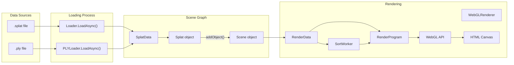

Sources: [README.md:56-59]()

## Core Components

### Scene Management

The Scene class serves as the container for all objects in a 3D environment. It manages the hierarchical organization of Object3D instances, which include Splat objects representing Gaussian splats. This system provides an intuitive way to organize and manipulate 3D elements.

For more details on scene management, see [Scene Management](#3.1).

Sources: [README.md:51]()

### Rendering System

The WebGLRenderer is the central component for rendering, working with the RenderProgram and custom shader implementations to efficiently render Gaussian splats. The rendering pipeline includes:

1. Preparing splat data for rendering
2. Sorting splats by depth (using WebAssembly for performance)
3. Rendering splats using custom WebGL shaders optimized for Gaussian splatting

For more information on the rendering system, see [Rendering System](#4).

Sources: [README.md:53]()

### Camera System

The Camera provides the viewpoint for rendering the scene. The library includes:

- Perspective camera implementation
- Integration with control systems for navigation
- View and projection matrix generation

For more on the camera system, see [Camera System](#3.3).

Sources: [README.md:52]()

### User Interaction

gsplat.js provides several control mechanisms for user interaction:

- **OrbitControls**: Allows orbiting around a target point with mouse or touch input
- **FPSControls**: First-person controls for navigating through the scene

For more details on user interaction, see [User Interaction](#7).

Sources: [README.md:54]()

### Data Loading

The library supports loading Gaussian splat data from different file formats:

- **.splat files**: A compact binary format optimized for quick loading
- **.ply files**: Point cloud format that can include spherical harmonics for view-dependent coloring

The Loader and PLYLoader classes handle fetching and parsing these files, constructing the appropriate data structures for rendering.

For more information on data loading, see [Data Loading](#5).

Sources: [README.md:78-92]()

## Getting Started

To use gsplat.js in your project:

1. Install the library:
   ```
   npm install --save gsplat
   ```

2. Create a basic scene:
   ```javascript
   import * as SPLAT from "gsplat";

   const scene = new SPLAT.Scene();
   const camera = new SPLAT.Camera();
   const renderer = new SPLAT.WebGLRenderer();
   const controls = new SPLAT.OrbitControls(camera, renderer.canvas);

   async function main() {
       const url = "path/to/your/model.splat";
       await SPLAT.Loader.LoadAsync(url, scene, () => {});

       const frame = () => {
           controls.update();
           renderer.render(scene, camera);
           requestAnimationFrame(frame);
       };

       requestAnimationFrame(frame);
   }

   main();
   ```

The library supports both ES6 modules and provides TypeScript definitions. For more examples and detailed usage instructions, see the [Examples](#8) section.

Sources: [README.md:13-74]()

## Compatibility and Performance

gsplat.js is designed to work in modern web browsers with WebGL support. Performance optimizations include:

- WebAssembly modules for computationally intensive operations like depth sorting
- Multi-threaded processing using Web Workers
- Efficient memory management for large Gaussian splat datasets
- Optimized WebGL shader implementations

For development and contribution information, see the [Development Guide](#9).

Sources: [README.md:94-106]()

---

# Page: Architecture

# Architecture

<details>
<summary>Relevant source files</summary>

The following files were used as context for generating this wiki page:

- [.gitattributes](.gitattributes)
- [README.md](README.md)
- [package.json](package.json)
- [src/index.ts](src/index.ts)
- [src/wasm/sort.d.ts](src/wasm/sort.d.ts)
- [wasm/sort.cpp](wasm/sort.cpp)

</details>


This document outlines the high-level architecture of gsplat.js, a JavaScript library for rendering 3D Gaussian Splatting scenes in web browsers. It describes the core systems, their components, and how they interact with each other to provide efficient rendering of Gaussian splats. For specific details about individual components, please refer to their dedicated pages in the wiki.

## Core System Architecture

The gsplat.js library employs a modular architecture inspired by other 3D libraries like three.js, but specialized for Gaussian splatting. The architecture consists of several interconnected systems working together to provide a complete rendering solution.

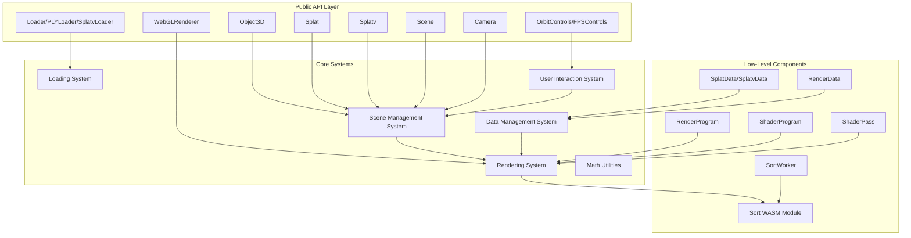

Sources: [src/index.ts:1-29](), [package.json:1-58]()

## System Components and Relationships

The gsplat.js architecture includes the following key systems and their relationships:

| System | Purpose | Main Components |
|--------|---------|----------------|
| Scene Management | Manages 3D objects and their relationships | `Scene`, `Object3D`, `Splat`, `Splatv` |
| Rendering | Handles WebGL rendering of Gaussian splats | `WebGLRenderer`, `RenderProgram`, `ShaderProgram` |
| Data Management | Stores and processes Gaussian splat data | `SplatData`, `SplatvData`, `RenderData` |
| Loading | Loads data from various file formats | `Loader`, `PLYLoader`, `SplatvLoader` |
| Math Utilities | Provides mathematical operations for 3D rendering | `Vector3`, `Matrix4`, `Quaternion` |
| User Interaction | Handles user input for camera control | `OrbitControls`, `FPSControls` |
| WebAssembly | Accelerates performance-critical operations | `sort.wasm` |

The architecture follows a layered approach:

1. **Public API Layer**: Exposes user-facing classes for scene creation and rendering
2. **Core Systems**: Implements the main functionality 
3. **Low-Level Components**: Handles specific tasks like shader management and WASM integration

Sources: [src/index.ts:1-29]()

## Data Flow Architecture

Data flow in gsplat.js follows a clear path from loading to rendering:

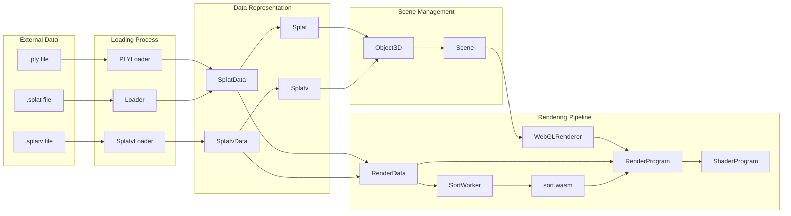

Sources: [src/index.ts:1-29](), [src/wasm/sort.d.ts:1-19](), [wasm/sort.cpp:1-61]()

## WebAssembly Integration

The gsplat.js library leverages WebAssembly for performance-critical operations, particularly for depth sorting of Gaussian splats:

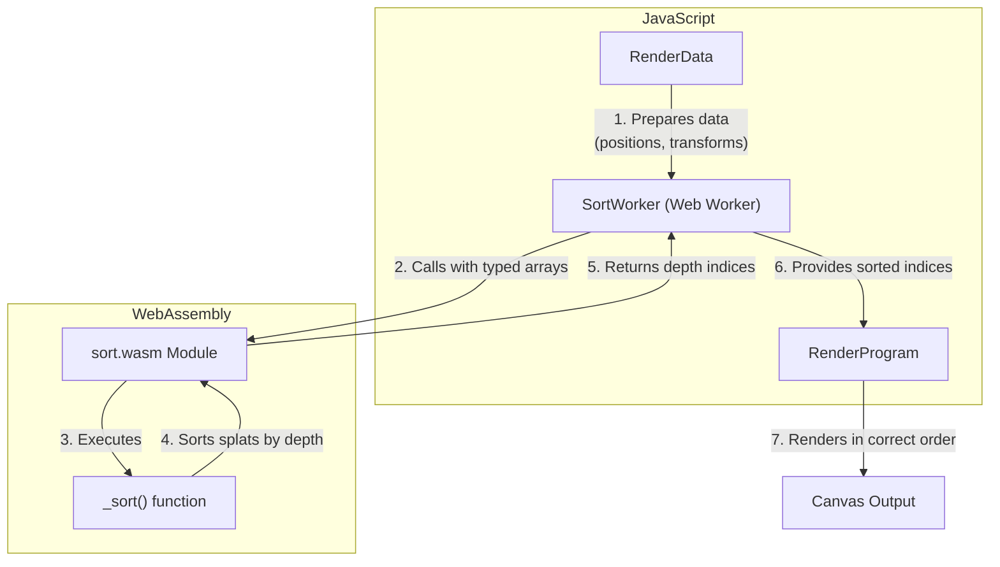

The WebAssembly module (`sort.wasm`) handles depth sorting of the Gaussian splats, which is crucial for correct rendering. The sorting process:

1. Takes camera view projection matrix and splat transforms
2. Computes the projected depth of each splat
3. Sorts splats by depth for correct back-to-front rendering
4. Returns a sorted index array for rendering

This operation is performed in a separate Web Worker thread to avoid blocking the main thread during sorting.

Sources: [wasm/sort.cpp:1-61](), [src/wasm/sort.d.ts:1-19]()

## Rendering Pipeline

The rendering pipeline in gsplat.js transforms Gaussian splat data into a rendered image on the canvas:

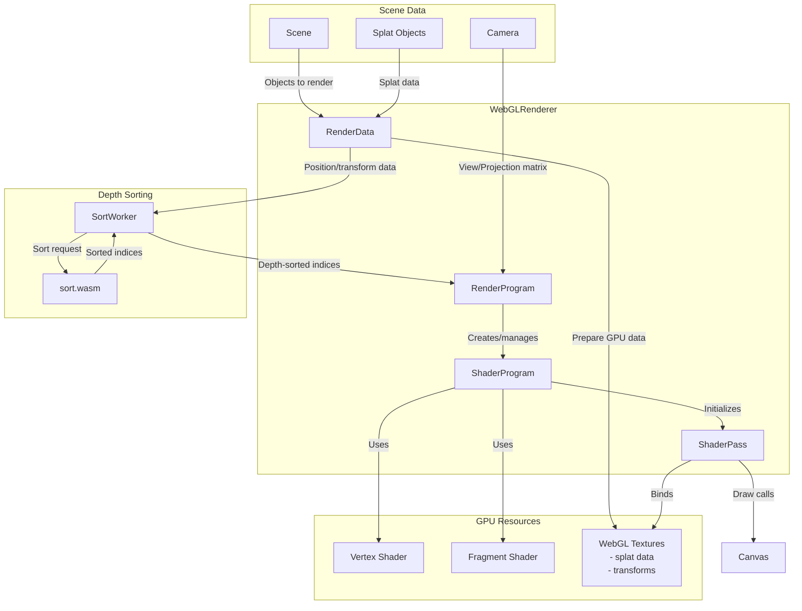

The key components of the rendering pipeline:

1. **WebGLRenderer**: Coordinates the overall rendering process
2. **RenderProgram**: Manages the specific rendering program for Gaussian splats
3. **RenderData**: Prepares splat data for GPU rendering
4. **ShaderProgram**: Handles WebGL shader setup and management
5. **ShaderPass**: Represents a rendering pass with specific shader settings
6. **SortWorker**: Performs depth sorting in a separate thread using WebAssembly

Sources: [src/index.ts:1-29]()

## API Design Philosophy

The gsplat.js API is designed to be familiar to web 3D developers, particularly those with experience using three.js. Key design principles include:

1. **Object-Oriented API**: Classes like `Scene`, `Camera`, and `WebGLRenderer` provide an intuitive, object-oriented interface
2. **Extensibility**: Core classes can be extended for specialized functionality
3. **Separation of Concerns**: Clear separation between scene management, rendering, and user interaction
4. **Performance Optimization**: Performance-critical operations are offloaded to WebAssembly
5. **Web Standards**: Built on standard web technologies (WebGL, WebAssembly, Web Workers)

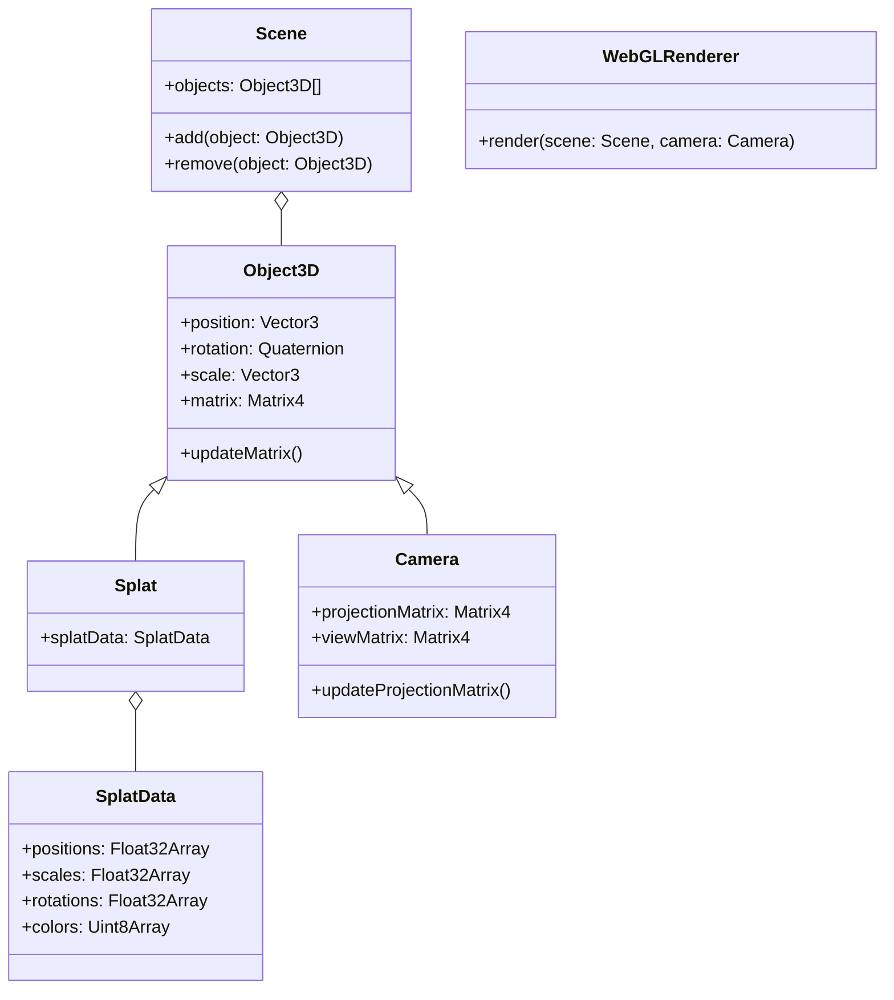

Sources: [src/index.ts:1-29](), [README.md:1-107]()

## Summary

The gsplat.js architecture provides a robust foundation for rendering 3D Gaussian Splatting scenes in web browsers. Its modular design separates concerns into distinct systems while maintaining clear relationships between components. The use of WebAssembly for performance-critical operations allows for efficient rendering, even with large numbers of Gaussian splats.

The architecture balances ease of use with rendering performance, making it suitable for a wide range of web-based 3D visualization applications. Future developments can build upon this architecture to extend functionality while maintaining backward compatibility.

Sources: [package.json:1-58](), [README.md:1-107](), [src/index.ts:1-29]()

---

# Page: Core Components

# Core Components

<details>
<summary>Relevant source files</summary>

The following files were used as context for generating this wiki page:

- [README.md](README.md)
- [src/core/Scene.ts](src/core/Scene.ts)

</details>


## Purpose and Scope

This document provides an overview of the main components that form the foundation of the gsplat.js library. These components work together to enable the rendering of 3D Gaussian Splatting scenes in web browsers. This page covers the core architectural elements and their relationships, but does not delve into implementation details of each component - those are covered in dedicated pages for each subsystem.

For detailed information about Scene Management, see [Scene Management](#3.1). For specific implementation of Gaussian splats, see [Splat Objects](#3.2). For camera implementation details, see [Camera System](#3.3).

## Component Architecture Overview

The core components of gsplat.js are organized in a layered architecture that separates concerns between scene management, data representation, rendering, and user interaction.

```mermaid
classDiagram
    class "Scene" {
        +objects: Object3D[]
        +addObject(object)
        +removeObject(object)
        +findObject(predicate)
        +reset()
    }
    
    class "Object3D" {
        +position: Vector3
        +rotation: Quaternion
        +scale: Vector3
        +matrix: Matrix4
        +updateMatrix()
    }
    
    class "Splat" {
        +data: SplatData
        +applyPosition()
        +applyRotation()
        +applyScale()
    }
    
    class "Camera" {
        +position: Vector3
        +projectionMatrix: Matrix4
        +viewMatrix: Matrix4
        +updateMatrices()
    }
    
    class "WebGLRenderer" {
        +canvas: HTMLCanvasElement
        +renderProgram: RenderProgram
        +render(scene, camera)
    }
    
    class "Controls" {
        +camera: Camera
        +update()
    }
    
    class "SplatData" {
        +vertexCount: number
        +positions: Float32Array
        +rotations: Float32Array
        +scales: Float32Array
        +colors: Uint8Array
    }
    
    Object3D <|-- Splat
    Object3D <|-- Camera
    Scene o-- "many" Object3D
    Splat o-- SplatData
    Controls --> Camera
    WebGLRenderer --> Scene
    WebGLRenderer --> Camera
```

Sources: [src/core/Scene.ts:1-117]()

## Key Component Groups

The core components of gsplat.js can be grouped into the following functional categories:

| Component Group | Key Classes | Purpose |
|-----------------|-------------|---------|
| Scene Management | Scene, Object3D | Manages the 3D scene graph and objects |
| Data Representation | Splat, SplatData | Represents Gaussian splat data and properties |
| Rendering | WebGLRenderer, RenderProgram | Handles the rendering pipeline via WebGL |
| Camera & Viewing | Camera | Defines how the scene is viewed |
| User Interaction | OrbitControls, FPSControls | Enables user navigation of the scene |
| Data Loading | Loader, PLYLoader | Loads splat data from various file formats |
| Math Utilities | Vector3, Matrix4, Quaternion | Provides mathematical operations for 3D transforms |

## Scene Management System

The Scene class serves as the central container for all 3D objects in gsplat.js. It manages an array of Object3D instances and provides methods for adding, removing, and finding objects.

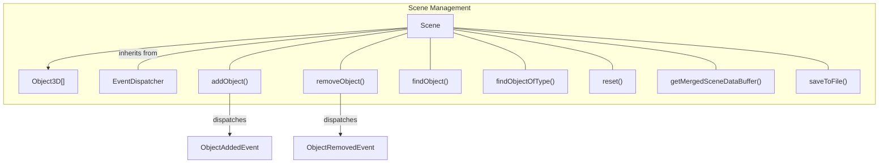

The Scene class extends EventDispatcher, enabling it to dispatch events when objects are added or removed. This allows other components to react to changes in the scene graph.

Key methods:
- `addObject(object)`: Adds an Object3D to the scene
- `removeObject(object)`: Removes an Object3D from the scene
- `findObject(predicate)`: Finds an object matching a predicate function
- `findObjectOfType(type)`: Finds an object of a specific type
- `getMergedSceneDataBuffer(format)`: Exports the scene data to a buffer
- `saveToFile(name, format)`: Saves the scene to a file

Sources: [src/core/Scene.ts:8-117]()

## Object Hierarchy

At the core of gsplat.js is a clear object hierarchy that defines how 3D elements are represented and manipulated.

```mermaid
classDiagram
    class "Object3D" {
        +position: Vector3
        +rotation: Quaternion
        +scale: Vector3
        +matrix: Matrix4
        +updateMatrix()
    }
    
    class "EventDispatcher" {
        +addEventListener()
        +removeEventListener()
        +dispatchEvent()
    }
    
    class "Splat" {
        +data: SplatData
        +applyPosition()
        +applyRotation()
        +applyScale()
    }
    
    class "Camera" {
        +projectionMatrix: Matrix4
        +viewMatrix: Matrix4
        +updateMatrices()
    }
    
    EventDispatcher <|-- Object3D
    Object3D <|-- Splat
    Object3D <|-- Camera
```

The Object3D class serves as the base class for all 3D objects in the scene. It provides:
- 3D transform properties (position, rotation, scale)
- Matrix calculations for transformations
- Event handling through its parent EventDispatcher

Splat extends Object3D to specifically represent Gaussian splats, adding specialized methods for applying transformations to splat data.

Camera also extends Object3D, adding functionality for defining view and projection matrices that determine how the scene is rendered.

Sources: [src/core/Scene.ts:1-1]()

## Data Representation

Gaussian splats in gsplat.js are represented through two main classes: Splat and SplatData.

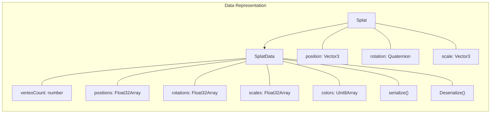

The Splat class extends Object3D and contains a reference to a SplatData instance, which stores the actual Gaussian splat data:

- `vertexCount`: The number of Gaussian splats
- `positions`: 3D coordinates of each splat
- `rotations`: Rotations of each splat (as quaternions)
- `scales`: Scale factors for each splat
- `colors`: RGB colors and opacity for each splat

The SplatData class provides methods for serializing and deserializing data, making it possible to save and load splat scenes.

Sources: [src/core/Scene.ts:2-3]()

## Rendering System

The rendering system in gsplat.js is responsible for drawing Gaussian splats to the screen using WebGL.

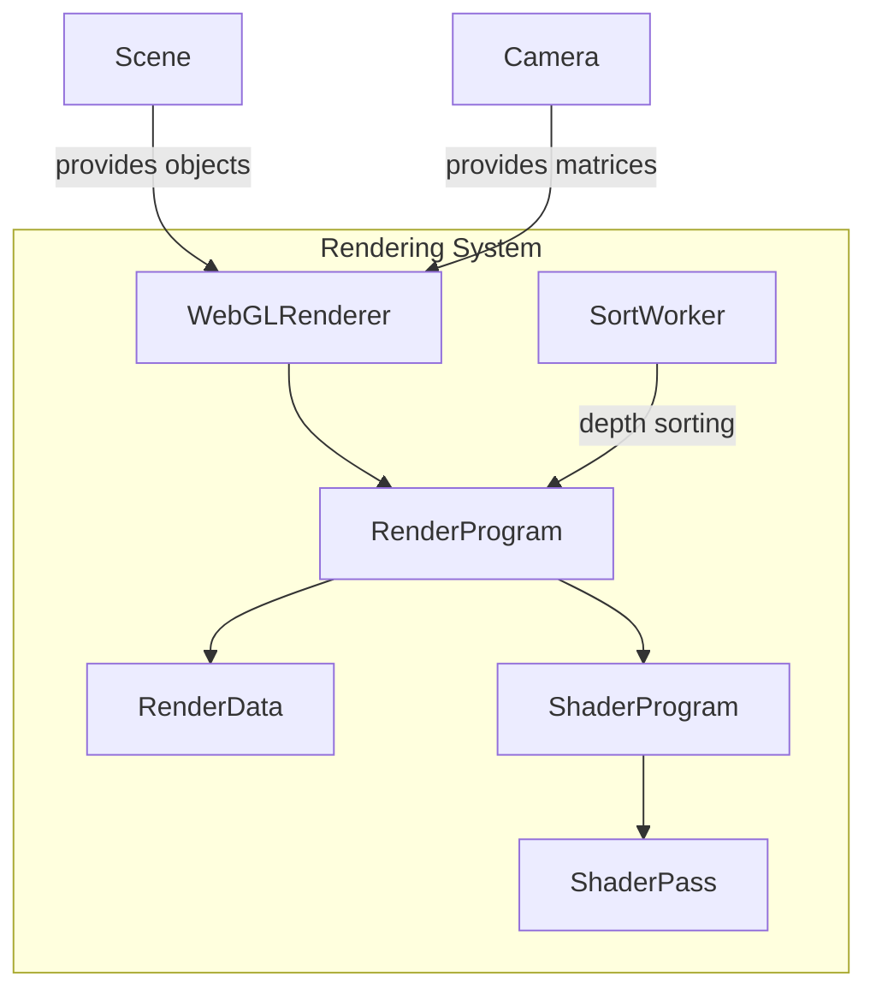

The WebGLRenderer class is the main entry point for rendering, with these key responsibilities:
- Managing the WebGL context and canvas
- Maintaining the render program for Gaussian splats
- Coordinating between scene data and shader programs

The RenderProgram handles the specialized shader pipeline for Gaussian splats, including:
- Creating and managing WebGL buffers and textures
- Coordinating with SortWorker for depth sorting
- Managing the render passes

Sources: [README.md:52-53]()

## Camera System

The Camera class defines how the 3D scene is viewed and projected onto the 2D canvas.

```mermaid
flowchart LR
    subgraph "Camera System"
        Camera["Camera"]
        Position["position: Vector3"]
        ViewMatrix["viewMatrix: Matrix4"]
        ProjectionMatrix["projectionMatrix: Matrix4"]
        UpdateMatrices["updateMatrices()"]
    end
    
    Camera --- Position
    Camera --- ViewMatrix
    Camera --- ProjectionMatrix
    Camera --- UpdateMatrices
    
    Object3D["Object3D"] --> |"extends"| Camera
    Camera --> |"used by"| WebGLRenderer["WebGLRenderer"]
    Camera <-- |"controlled by"| Controls["Controls"]
```

As a subclass of Object3D, Camera inherits position, rotation, and scale properties. It adds specialized properties and methods for:
- Generating view matrices based on the camera's position and orientation
- Creating projection matrices that define the viewing frustum
- Updating these matrices when the camera moves or the viewport changes

The camera's matrices are used by the WebGLRenderer to transform scene objects appropriately during rendering.

Sources: [README.md:52-53]()

## User Interaction System

gsplat.js provides camera control systems that allow users to navigate the 3D scene.

```mermaid
flowchart TD
    subgraph "User Interaction"
        Controls["Controls"]
        OrbitControls["OrbitControls"]
        FPSControls["FPSControls"]
        
        Update["update()"]
        HandleEvents["event handlers"]
    end
    
    Controls --- Update
    Controls --- HandleEvents
    
    Controls --> OrbitControls
    Controls --> FPSControls
    
    Camera["Camera"] <-- |"controls"| Controls
    UserInput["DOM Events"] --> |"triggers"| HandleEvents
```

The control systems intercept user input (mouse, touch, keyboard) and translate it into camera movements. OrbitControls enables orbiting around a target point, while FPSControls provides first-person navigation.

The Controls classes typically:
- Attach event listeners to the canvas
- Process input events to determine camera movement
- Update the camera's position and orientation
- Provide constraints to limit camera movement

Sources: [README.md:54-54]()

## Loading System

gsplat.js provides loaders for importing Gaussian splat data from various file formats.

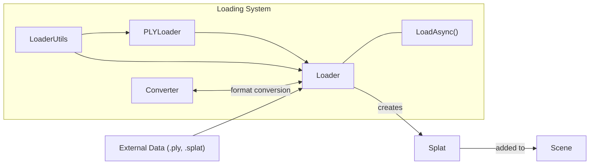

The loading system supports:
- Loading from URLs or local files
- Parsing different file formats (PLY, splat)
- Converting between formats
- Asynchronous loading with progress callbacks

Sources: [src/core/Scene.ts:6-6]()

## Math Utilities

The math utilities in gsplat.js provide the foundation for 3D transformations and calculations.

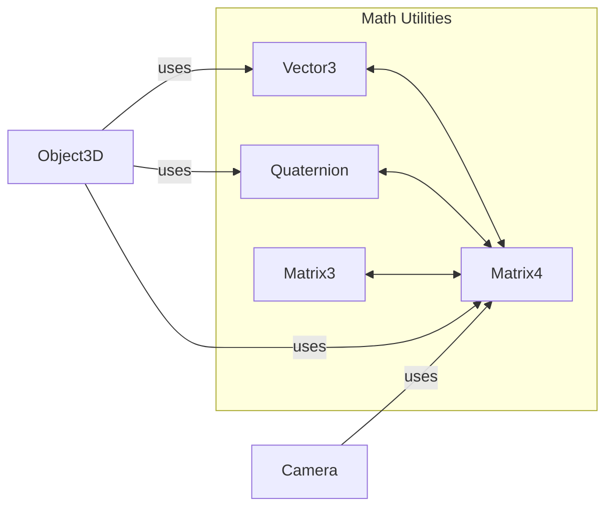

These utilities provide operations for:
- Vector mathematics (addition, subtraction, dot and cross products)
- Quaternion-based rotations
- Matrix transformations (scaling, rotation, translation)
- Coordinate space conversions

The math utilities are used throughout the library for tasks such as:
- Transforming objects in the scene
- Computing camera matrices
- Performing ray-casting for interactions
- Processing Gaussian splat transformations

Sources: [src/core/Scene.ts:1-1]()

## Integration and Relationships

The core components of gsplat.js work together in a well-defined flow to render Gaussian splats.

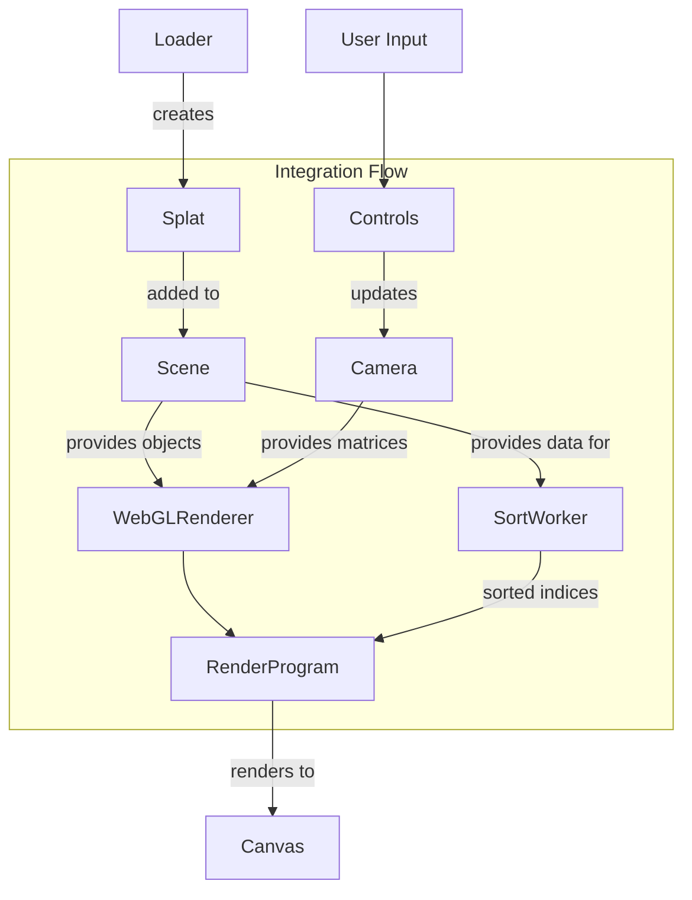

The typical rendering flow is:
1. Gaussian splat data is loaded and added to the Scene
2. User input is processed by Controls to update the Camera
3. WebGLRenderer combines Scene objects and Camera matrices
4. SortWorker sorts splats by depth
5. RenderProgram uses shaders to render the sorted splats to the Canvas

This integration demonstrates how the core components collaborate to provide a complete rendering pipeline for Gaussian splats.

Sources: [README.md:56-71]()

## Summary

The core components of gsplat.js provide a comprehensive foundation for working with Gaussian splats in a web environment. The architecture follows a clear separation of concerns, with specialized components for scene management, data representation, rendering, and user interaction.

The modular design enables:
- Easy integration into existing web projects
- Extensibility for custom requirements
- Efficient rendering of Gaussian splats
- Intuitive control systems

For detailed information about specific components, refer to their dedicated wiki pages:
- [Scene Management](#3.1) for more details on the Scene class
- [Splat Objects](#3.2) for in-depth coverage of Splat and SplatData
- [Camera System](#3.3) for camera implementation details
- [Rendering System](#4) for the complete rendering pipeline

Sources: [README.md:5-5](), [src/core/Scene.ts:8-117]()

---

# Page: Scene Management

# Scene Management

<details>
<summary>Relevant source files</summary>

The following files were used as context for generating this wiki page:

- [src/core/Scene.ts](src/core/Scene.ts)

</details>


## Purpose and Scope

The Scene Management system in gsplat.js provides a centralized structure for organizing and manipulating 3D objects within a scene. It serves as the foundation that connects the data loading pipeline with the rendering system.

The Scene class is responsible for:
- Maintaining a collection of 3D objects (Object3D instances)
- Providing methods to add, remove, and find objects
- Dispatching events when scene changes occur
- Merging scene data for export to various file formats

For information about specific objects that can be added to a scene, see [Splat Objects](#3.2).
For details on how scenes are rendered, see [WebGL Renderer](#4.1).

## Scene Class Structure

The Scene class extends EventDispatcher and manages a collection of Object3D instances, providing methods for object management and scene data operations.

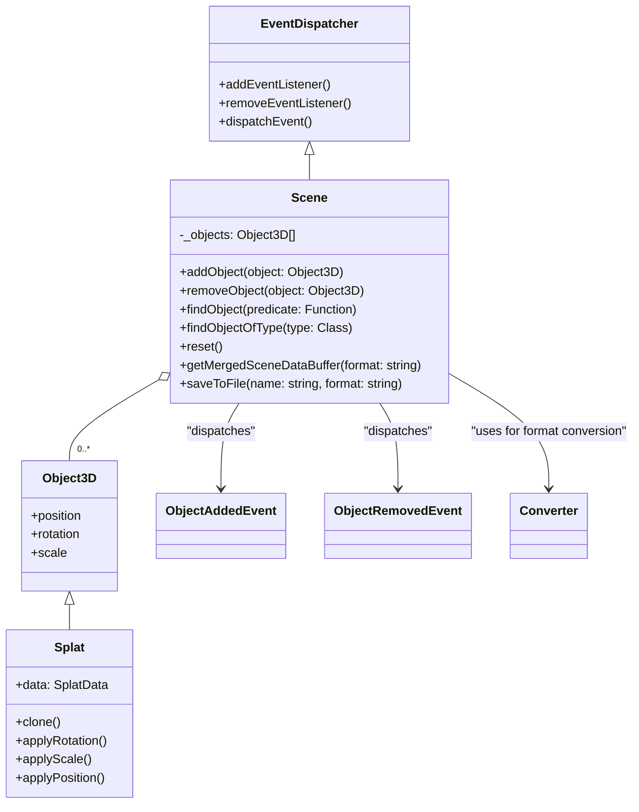

Sources: [src/core/Scene.ts:1-117]()

## Integration with gsplat.js Components

The Scene class integrates with various components of the gsplat.js library, serving as a central hub for 3D object management:

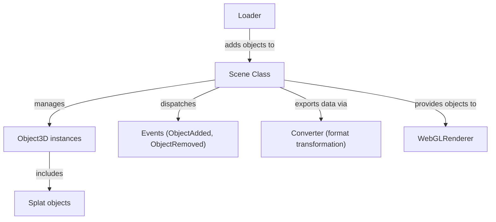

Sources: [src/core/Scene.ts:8-115]()

## Object Management

The Scene class provides several methods for managing objects within the scene:

| Method | Description |
|--------|-------------|
| `addObject(object: Object3D)` | Adds an Object3D instance to the scene and dispatches an ObjectAddedEvent |
| `removeObject(object: Object3D)` | Removes an Object3D instance from the scene and dispatches an ObjectRemovedEvent |
| `findObject(predicate: Function)` | Returns the first object that satisfies the predicate function |
| `findObjectOfType<T>(type: Class)` | Returns the first object of the specified type |
| `reset()` | Removes all objects from the scene |

Sources: [src/core/Scene.ts:11-60]()

### Adding Objects

Objects are added to the scene using the `addObject` method, which stores the object in the internal array and dispatches an event to notify listeners:

```
addObject = (object: Object3D) => {
    this.objects.push(object);
    this.dispatchEvent(new ObjectAddedEvent(object));
};
```

Sources: [src/core/Scene.ts:20-23]()

### Removing Objects

Objects can be removed using the `removeObject` method, which removes the object from the internal array and dispatches an event:

```
removeObject = (object: Object3D) => {
    const index = this.objects.indexOf(object);
    if (index < 0) {
        throw new Error("Object not found in scene");
    }
    this.objects.splice(index, 1);
    this.dispatchEvent(new ObjectRemovedEvent(object));
};
```

Sources: [src/core/Scene.ts:25-32]()

### Finding Objects

The Scene class provides two methods for finding objects:

1. `findObject`: Finds the first object that satisfies a predicate function
2. `findObjectOfType`: Finds the first object of a specific type

Sources: [src/core/Scene.ts:34-50]()

### Resetting the Scene

The `reset` method removes all objects from the scene by creating a copy of the objects array and removing each object individually, which ensures proper event dispatching:

```
reset = () => {
    const objectsToRemove = this.objects.slice();
    for (const object of objectsToRemove) {
        this.removeObject(object);
    }
};
```

Sources: [src/core/Scene.ts:52-57]()

## Event System

The Scene class inherits from EventDispatcher and uses events to notify listeners about changes to the scene:

| Event | Description |
|-------|-------------|
| ObjectAddedEvent | Dispatched when an object is added to the scene |
| ObjectRemovedEvent | Dispatched when an object is removed from the scene |

These events allow other components, such as the WebGLRenderer, to react to changes in the scene and update accordingly.

Sources: [src/core/Scene.ts:5-5](), [src/core/Scene.ts:22-22](), [src/core/Scene.ts:31-31]()

## Scene Data Operations

The Scene class provides methods for working with scene data, including merging and exporting:

### Merging Scene Data

The `getMergedSceneDataBuffer` method merges data from all Splat objects in the scene into a single buffer, with the following steps:

1. Iterate through all objects in the scene
2. For each Splat object, create a clone
3. Apply transformations (position, rotation, scale) to the clone
4. Serialize the Splat data to a buffer
5. Collect all buffers and merge them into a single buffer
6. Convert the format if needed (splat to ply)

Sources: [src/core/Scene.ts:62-92]()

### Exporting Scene Data

The `saveToFile` method exports the merged scene data to a file:

1. Generates a default filename if none is provided
2. Gets the merged scene data buffer
3. Creates a Blob from the buffer
4. Creates a download link and triggers it to save the file

This allows users to export their scene for sharing or later use in other applications.

Sources: [src/core/Scene.ts:94-110]()

## Usage Patterns

Here are common usage patterns for the Scene class:

### Creating a Scene and Adding Objects

```javascript
// Create a new scene
const scene = new Scene();

// Create a splat object and add it to the scene
const splat = new Splat(splatData);
scene.addObject(splat);
```

### Finding Objects in the Scene

```javascript
// Find the first Splat object in the scene
const splat = scene.findObjectOfType(Splat);

// Find an object with a specific name
const namedObject = scene.findObject(obj => obj.name === "my-object");
```

### Exporting the Scene

```javascript
// Export as .splat file
scene.saveToFile("my-scene.splat", "splat");

// Export as .ply file
scene.saveToFile("my-scene.ply", "ply");
```

## Summary

The Scene Management system provides a robust foundation for organizing and manipulating 3D objects in gsplat.js. Through its object management methods, event system, and data operations, it enables developers to create, modify, and export complex 3D scenes with Gaussian splat rendering. The Scene class acts as a critical link between the data loading system and the rendering pipeline, ensuring that 3D objects are properly managed throughout their lifecycle.

Sources: [src/core/Scene.ts:8-115]()

---

# Page: Splat Objects

# Splat Objects

<details>
<summary>Relevant source files</summary>

The following files were used as context for generating this wiki page:

- [src/splats/Splat.ts](src/splats/Splat.ts)
- [src/splats/SplatData.ts](src/splats/SplatData.ts)

</details>


## Purpose and Scope

This document details the `Splat` and `SplatData` classes in gsplat.js, which together represent 3D Gaussian splats for rendering. These classes form the core data representation layer in the library, storing and managing all properties required to render Gaussian splats. For information about how these objects are managed within the scene hierarchy, see [Scene Management](#3.1). For details on how splats are rendered, see [Rendering System](#4).

## Class Structure

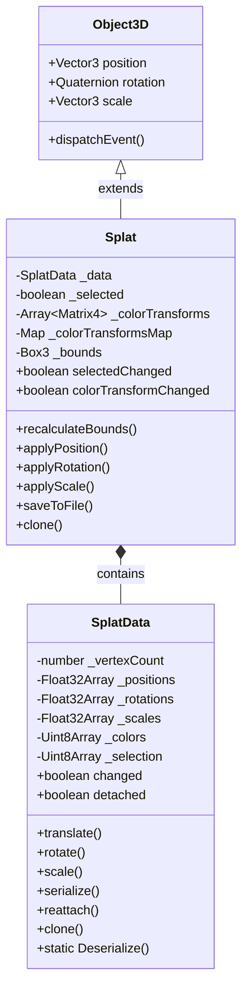

Sources: [src/splats/Splat.ts:9-134](). [src/splats/SplatData.ts:5-211]().

## Data Representation

Gaussian splats are represented by a combination of geometric and appearance properties:

```mermaid
flowchart TD
    subgraph "SplatData"
        positions["positions (Float32Array)
        - x, y, z coordinates"]
        
        rotations["rotations (Float32Array)
        - quaternion w, x, y, z"]
        
        scales["scales (Float32Array)
        - sx, sy, sz (3D scale)"]
        
        colors["colors (Uint8Array)
        - r, g, b, a values"]
        
        selection["selection (Uint8Array)
        - selection state"]
    end
    
    subgraph "Splat Object"
        obj3d["Object3D Properties
        - position
        - rotation
        - scale"]
        
        splatData["SplatData Reference"]
        
        bounds["Bounding Box
        - min/max extents"]
        
        colorTfm["Color Transformations"]
    end
    
    splatData --- positions
    splatData --- rotations
    splatData --- scales
    splatData --- colors
    splatData --- selection
```

Sources: [src/splats/Splat.ts:13-17](). [src/splats/SplatData.ts:11-16]().

## Splat Class

The `Splat` class extends `Object3D` and serves as a wrapper for `SplatData`, adding scene graph functionality like transformation, selection, and bounds.

### Key Properties

| Property | Type | Description |
|----------|------|-------------|
| `data` | `SplatData` | Contains the raw splat vertex data (positions, rotations, scales, colors) |
| `selectedChanged` | `boolean` | Flag indicating selection state change |
| `colorTransformChanged` | `boolean` | Flag indicating color transformation changes |
| `bounds` | `Box3` | 3D bounding box encompassing all splat positions |
| `selected` | `boolean` | Selection state of the splat object |
| `colorTransforms` | `Array<Matrix4>` | Color transformation matrices |
| `colorTransformsMap` | `Map<number, number>` | Maps splat indices to color transform indices |

Sources: [src/splats/Splat.ts:10-17]().

### Key Methods

| Method | Purpose |
|--------|---------|
| `recalculateBounds()` | Recomputes the bounding box based on splat positions |
| `applyPosition()` | Applies the Object3D position to the underlying SplatData and resets position |
| `applyRotation()` | Applies the Object3D rotation to the underlying SplatData and resets rotation |
| `applyScale()` | Applies the Object3D scale to the underlying SplatData and resets scale |
| `saveToFile()` | Serializes and saves the splat data to a file (splat or ply format) |
| `clone()` | Creates a deep copy of the Splat object |

Sources: [src/splats/Splat.ts:19-133]().

### Transformation Workflow

The `Splat` class provides a two-stage transformation approach:

1. **Temporary transformations**: Applied via Object3D's position, rotation, and scale properties
2. **Permanent transformations**: Applied to the actual data via `applyPosition()`, `applyRotation()`, and `applyScale()`

This pattern allows for non-destructive manipulation until changes are ready to be committed to the data.

Sources: [src/splats/Splat.ts:46-59]().

## SplatData Class

The `SplatData` class manages the raw data arrays representing Gaussian splats, providing methods for data manipulation and serialization.

### Data Storage

`SplatData` stores vertex data in typed arrays for performance:

| Property | Type | Size Per Vertex | Description |
|----------|------|-----------------|-------------|
| `_positions` | `Float32Array` | 12 bytes (3 floats) | XYZ position of each splat |
| `_rotations` | `Float32Array` | 16 bytes (4 floats) | Quaternion rotation (w,x,y,z) |
| `_scales` | `Float32Array` | 12 bytes (3 floats) | Scale factors along each axis |
| `_colors` | `Uint8Array` | 4 bytes | RGBA color values |
| `_selection` | `Uint8Array` | 1 byte | Selection state |

The total binary size per splat is defined by `SplatData.RowLength = 48` bytes.

Sources: [src/splats/SplatData.ts:6-16](). [src/splats/SplatData.ts:178-200]().

### Data Transformation Methods

`SplatData` provides methods to transform the underlying data:

#### `translate(translation: Vector3)`
Adds the translation vector to all splat positions.

#### `rotate(rotation: Quaternion)`
Applies rotation to both positions and rotations of all splats.

#### `scale(scale: Vector3)`
Multiplies both positions and scales by the given scale factors.

Sources: [src/splats/SplatData.ts:44-94]().

### Serialization and Deserialization

`SplatData` provides methods for binary serialization:

- `serialize()`: Converts data into a compact binary representation
- `static Deserialize(data: Uint8Array)`: Creates a SplatData instance from binary data

The binary format packs each splat into a 48-byte structure:
- Position (3 floats): 12 bytes
- Scale (3 floats): 12 bytes
- Color (4 bytes): 4 bytes
- Rotation (4 bytes, quantized): 4 bytes

This binary format is compatible with the .splat file format used for Gaussian splat data interchange.

Sources: [src/splats/SplatData.ts:96-176]().

## Integration with Scene Graph

```mermaid
flowchart TD
    subgraph "Scene Graph"
        Scene --> Object3D
        Object3D --> Splat
    end
    
    subgraph "Data Layer"
        Splat --> SplatData
        SplatData --> |"contains"| vertexData["Raw Vertex Data
        - positions
        - rotations
        - scales
        - colors"]
    end
    
    subgraph "File I/O"
        Loader --> |"creates"| SplatData
        Splat --> |"saveToFile()"| FileOutput["File (.splat/.ply)"]
    end
    
    subgraph "Rendering"
        RenderProgram --> |"processes"| SplatData
    end
```

Sources: [src/splats/Splat.ts:9](). [src/splats/Splat.ts:64-91]().

## Working with Splat Objects

### Creating a Splat

A Splat can be created:
1. From existing SplatData: `new Splat(splatData)`
2. Empty (for programmatic construction): `new Splat()`

### Applying Transformations

Transformations can be applied in two ways:

```javascript
// Temporary transformations (non-destructive)
splat.position.set(x, y, z);
splat.rotation.setFromEuler(rx, ry, rz);
splat.scale.set(sx, sy, sz);

// Permanent transformations (modifies underlying data)
splat.applyPosition();
splat.applyRotation();
splat.applyScale();
```

### Saving to File

Splats can be exported to file formats:

```javascript
// Save as .splat format
splat.saveToFile("myModel.splat", "splat");

// Save as .ply format
splat.saveToFile("myModel.ply", "ply");
```

Sources: [src/splats/Splat.ts:64-91]().

## Cloning and Bounds

- **Cloning**: The `clone()` method creates a deep copy of a Splat object including its data
- **Bounds**: The `bounds` property provides a 3D bounding box for the splat object, useful for spatial queries and frustum culling

Sources: [src/splats/Splat.ts:117-133](). [src/splats/SplatData.ts:202-210]().

## Usage in the Rendering Pipeline

Splat objects serve as the core data structure used in the gsplat.js rendering pipeline. The `WebGLRenderer` component accesses the underlying `SplatData` to render Gaussian splats as screen-aligned quads. For more details on this process, see [Render Program](#4.2).

---

# Page: Camera System

# Camera System

<details>
<summary>Relevant source files</summary>

The following files were used as context for generating this wiki page:

- [src/cameras/Camera.ts](src/cameras/Camera.ts)
- [src/core/Object3D.ts](src/core/Object3D.ts)
- [src/math/Matrix4.ts](src/math/Matrix4.ts)

</details>


The Camera System in gsplat.js provides the virtual viewpoint from which the 3D Gaussian splat scene is rendered. It defines how and what part of the 3D scene is projected onto the 2D canvas. This document explains the architecture, components, and usage of the camera system.

For information about camera controls and user interaction, see [Camera Controls](#7.1).

## Camera Architecture

The camera system is built around the `Camera` class, which extends the core `Object3D` class. This inheritance gives cameras the ability to be positioned, rotated, and scaled in 3D space like any other object.

```mermaid
classDiagram
    direction TB
    class Object3D {
        -Vector3 _position
        -Quaternion _rotation
        -Vector3 _scale
        -Matrix4 _transform
        +position: Vector3
        +rotation: Quaternion
        +scale: Vector3
        +forward: Vector3
        +transform: Matrix4
        +update()
    }
    class Camera {
        -CameraData _data
        +data: CameraData
        +screenPointToRay(x, y): Vector3
        +update()
    }
    Object3D <|-- Camera
    Camera o-- CameraData
```

Sources: [src/cameras/Camera.ts:1-42](), [src/core/Object3D.ts:1-101]()

The camera maintains a `CameraData` object that contains the camera-specific properties needed for rendering, including view and projection matrices. When the camera's position or rotation changes, these matrices are recalculated to ensure the scene is rendered correctly from the new viewpoint.

## Camera Properties and Transformation

As an `Object3D`, the camera has the following key properties:

| Property | Type | Description |
|----------|------|-------------|
| position | Vector3 | The 3D position of the camera in world space |
| rotation | Quaternion | The orientation of the camera |
| scale | Vector3 | The scale of the camera (rarely changed) |
| forward | Vector3 | The direction the camera is facing (derived from rotation) |

The transformation system follows this process:

```mermaid
flowchart LR
    subgraph "Camera Transformation"
        position["Camera.position
        (Vector3)"]
        rotation["Camera.rotation
        (Quaternion)"]
        scale["Camera.scale
        (Vector3)"]
        
        matrices["Camera Matrices"]
        viewMatrix["View Matrix"]
        projMatrix["Projection Matrix"]
        
        position --> update["Camera.update()"]
        rotation --> update
        update --> matrices
        matrices --> viewMatrix
        matrices --> projMatrix
        
        viewMatrix --> render["Render Pipeline"]
        projMatrix --> render
    end
```

Sources: [src/cameras/Camera.ts:16-19](), [src/core/Object3D.ts:46-49]()

When the camera's properties change, the `_updateMatrix()` method in `Object3D` is called to update the camera's transform matrix. The camera's `update()` method further updates the view and projection matrices in the `CameraData` object based on the new position and rotation.

## View and Projection Matrices

The camera system uses two critical matrices for rendering:

1. **View Matrix**: Transforms world space coordinates to camera space (what the camera sees)
2. **Projection Matrix**: Projects camera space coordinates to clip space (the 2D view on screen)

These matrices are composed as follows:

```mermaid
flowchart LR
    subgraph "Matrix Transformation Pipeline"
        worldSpace["World Space
        Coordinates"]
        cameraSpace["Camera Space
        Coordinates"]
        clipSpace["Clip Space
        Coordinates"]
        screenSpace["Screen Space
        Coordinates"]
        
        worldSpace --> |"View Matrix"| cameraSpace
        cameraSpace --> |"Projection Matrix"| clipSpace
        clipSpace --> |"Viewport Transform"| screenSpace
    end
```

Sources: [src/cameras/Camera.ts:17-19](), [src/math/Matrix4.ts:34-140]()

The `Matrix4` class provides the mathematical operations needed for these transformations, including matrix multiplication, inversion, and composition from position, rotation, and scale components.

## Ray Casting

The camera system implements ray casting through the `screenPointToRay()` method, which is essential for user interactions such as selecting objects:

```mermaid
flowchart TD
    subgraph "screenPointToRay Method"
        screenPoint["Screen Coordinates (x, y)"]
        clipSpace["Clip Space Coordinates"]
        cameraSpace["Camera Space Coordinates"]
        worldSpace["World Space Direction"]
        
        screenPoint --> clipSpace
        clipSpace --> |"Inverse Projection
        Matrix"| cameraSpace
        cameraSpace --> |"Inverse View
        Matrix"| worldSpace
        worldSpace --> |"Normalize"| rayDirection["Ray Direction (Vector3)"]
    end
```

Sources: [src/cameras/Camera.ts:21-34]()

The process involves:
1. Converting screen coordinates to clip space
2. Transforming to camera space using the inverse projection matrix
3. Transforming to world space using the inverse view matrix
4. Creating a ray direction by normalizing the vector from camera position to the world space point

## Camera Integration in Rendering Pipeline

The camera is a central component in the rendering pipeline:

```mermaid
flowchart LR
    subgraph "Rendering Pipeline"
        Camera --> |"viewMatrix
        projectionMatrix"| WebGLRenderer
        Scene --> WebGLRenderer
        WebGLRenderer --> |"draw"| Canvas["HTML Canvas"]
    end
```

Sources: [src/cameras/Camera.ts:16-19]()

The WebGLRenderer uses the camera's view and projection matrices to transform the Gaussian splats in the scene and project them onto the 2D canvas. This enables the renderer to accurately display the 3D scene from the camera's perspective.

## Typical Camera Implementation

Here's how the Camera class is implemented:

```mermaid
classDiagram
    direction TB
    class Object3D {
        <<abstract>>
        #Vector3 _position
        #Quaternion _rotation
        #Vector3 _scale
        #Matrix4 _transform
        #_updateMatrix()
    }
    class Camera {
        -CameraData _data
        +data: CameraData
        +screenPointToRay(x, y): Vector3
        +update()
    }
    class Vector3 {
        +x: number
        +y: number
        +z: number
    }
    class Quaternion {
        +x: number
        +y: number
        +z: number
        +w: number
    }
    class Matrix4 {
        +buffer: number[]
        +multiply(m: Matrix4): Matrix4
        +invert(): Matrix4
        +static Compose(position, rotation, scale): Matrix4
    }
    class CameraData {
        +viewMatrix: Matrix4
        +projectionMatrix: Matrix4
        +update(position, rotation)
    }
    
    Object3D <|-- Camera
    Camera o-- CameraData
    Object3D *-- Vector3
    Object3D *-- Quaternion
    Object3D *-- Matrix4
    CameraData *-- Matrix4
```

Sources: [src/cameras/Camera.ts:1-42](), [src/core/Object3D.ts:7-99](), [src/math/Matrix4.ts:4-176]()

The Camera inherits transformation capabilities from Object3D and adds camera-specific functionality through the CameraData object, which manages the view and projection matrices needed for rendering.

## Usage Example

To use a camera in gsplat.js, you typically:

1. Create a Camera instance
2. Position and orient it
3. Attach camera controls if needed
4. Use it with a WebGLRenderer

The camera's position and rotation can be changed at runtime, and the `update()` method should be called to ensure the view and projection matrices are updated accordingly.

Sources: [src/cameras/Camera.ts:11-35]()

---

# Page: Rendering System

# Rendering System

<details>
<summary>Relevant source files</summary>

The following files were used as context for generating this wiki page:

- [src/renderers/WebGLRenderer.ts](src/renderers/WebGLRenderer.ts)
- [src/renderers/webgl/programs/RenderProgram.ts](src/renderers/webgl/programs/RenderProgram.ts)
- [src/renderers/webgl/utils/DataWorker.ts](src/renderers/webgl/utils/DataWorker.ts)
- [src/renderers/webgl/utils/RenderData.ts](src/renderers/webgl/utils/RenderData.ts)

</details>


The Rendering System in gsplat.js is responsible for efficiently rendering 3D Gaussian splats to WebGL contexts in web browsers. This page documents the architecture, components, and processes involved in transforming Splat objects from the scene into visual representations on the canvas.

## Overview

The rendering system converts mathematical 3D Gaussian splat representations into viewable images through a pipeline of operations including data preparation, sorting, transformation, and rasterization. The system employs WebGL for hardware-accelerated rendering and leverages WebAssembly and web workers for performance-critical operations.

```mermaid
flowchart TD
    subgraph "Rendering Components"
        WebGLRenderer["WebGLRenderer"]
        RenderProgram["RenderProgram"]
        RenderData["RenderData"]
        ShaderProgram["ShaderProgram"]
        ShaderPass["ShaderPass"]
        SortWorker["SortWorker (thread)"]
    end

    subgraph "Input"
        Scene["Scene"]
        Camera["Camera"]
        Splat["Splat Objects"]
    end

    subgraph "Output"
        Canvas["HTML Canvas"]
    end

    subgraph "Performance Components"
        SortWASM["sort.wasm"]
        DataWASM["data.wasm"]
        DataWorker["DataWorker (thread)"]
    end

    Scene --> WebGLRenderer
    Camera --> WebGLRenderer
    WebGLRenderer --> RenderProgram
    RenderProgram --> ShaderProgram
    ShaderProgram --> ShaderPass
    Splat --> RenderData
    RenderData --> RenderProgram
    RenderProgram --> |"renders to"| Canvas
    RenderData --> |"prepares data"| DataWorker
    RenderProgram --> |"sends data to"| SortWorker
    SortWorker --> |"uses"| SortWASM
    DataWorker --> |"uses"| DataWASM
    SortWorker --> |"sends sorted indices to"| RenderProgram
```

Sources: [src/renderers/WebGLRenderer.ts](), [src/renderers/webgl/programs/RenderProgram.ts](), [src/renderers/webgl/utils/RenderData.ts](), [src/renderers/webgl/utils/DataWorker.ts]()

## Core Components

### WebGLRenderer

The `WebGLRenderer` serves as the primary interface for rendering operations. It manages the HTML canvas, initializes the WebGL context, and coordinates rendering passes.

Key responsibilities:
- Canvas and WebGL context initialization
- Managing the render program and shader passes
- Executing the render loop
- Handling resize events

```mermaid
classDiagram
    class WebGLRenderer {
        -HTMLCanvasElement _canvas
        -WebGL2RenderingContext _gl
        -Color32 _backgroundColor
        -RenderProgram _renderProgram
        +render(scene, camera)
        +resize()
        +setSize(width, height)
        +dispose()
        +addProgram(program)
        +removeProgram(program)
    }
    WebGLRenderer --> RenderProgram
    WebGLRenderer --> ShaderProgram
```

Sources: [src/renderers/WebGLRenderer.ts:9-110]()

### RenderProgram

The `RenderProgram` is the core class responsible for the actual rendering of Gaussian splats. It extends the `ShaderProgram` class and implements specialized shaders and rendering logic.

Key responsibilities:
- Shader management for Gaussian splatting
- Texture creation and management
- WebGL state management
- Depth sorting coordination with `SortWorker`
- Rendering loop implementation

```mermaid
classDiagram
    class RenderProgram {
        -RenderData _renderData
        -Uint32Array _depthIndex
        -WebGLTexture _splatTexture
        -Worker _worker
        -Color32 _outlineColor
        -number _outlineThickness
        +render()
        +initialize()
        +resize()
        +dispose()
    }
    RenderProgram --|> ShaderProgram
    RenderProgram --> RenderData
    RenderProgram --> SortWorker
```

Sources: [src/renderers/webgl/programs/RenderProgram.ts:159-572]()

### RenderData

The `RenderData` class prepares and manages all the data necessary for rendering Gaussian splats. It organizes the splat data into formats suitable for GPU processing.

Key responsibilities:
- Managing splat data for rendering
- Creating texture data structures
- Tracking changes to splats
- Coordinating with `DataWorker` for data processing
- Rebuilding data when needed

```mermaid
classDiagram
    class RenderData {
        -Map~Splat,number~ _splatIndices
        -Map~Splat,number~ _offsets
        -Uint32Array _data
        -Float32Array _transforms
        -Uint32Array _transformIndices
        -Float32Array _colorTransforms
        -Uint32Array _colorTransformIndices
        -Float32Array _positions
        -Float32Array _rotations
        -Float32Array _scales
        -Worker _worker
        +rebuild()
        +markDirty(splat)
        +getSplat(index)
        +getLocalIndex(splat, index)
        +dispose()
    }
    RenderData --> DataWorker
```

Sources: [src/renderers/webgl/utils/RenderData.ts:7-438]()

## Rendering Pipeline

The rendering pipeline in gsplat.js transforms 3D Gaussian splats into 2D representations on the screen through a series of steps:

```mermaid
flowchart LR
    subgraph "Data Preparation"
        Scene["Scene"] --> |"gather splats"| RenderData["RenderData"]
        RenderData --> |"update"| DataWorker["DataWorker"]
        DataWorker --> |"process data"| WASM["data.wasm"]
        WASM --> |"processed data"| RenderData
    end
    
    subgraph "Depth Sorting"
        RenderData --> |"positions\ntransforms"| SortWorker["SortWorker"]
        SortWorker --> |"sort by depth"| SortWASM["sort.wasm"]
        SortWASM --> |"depth indices"| RenderProgram["RenderProgram"]
    end
    
    subgraph "Rendering"
        RenderData --> |"texture data"| Textures["WebGL Textures"]
        Textures --> |"bind"| RenderProgram
        Camera["Camera"] --> |"view/projection"| RenderProgram
        RenderProgram --> |"shader execution"| VertexShader["Vertex Shader"]
        VertexShader --> FragmentShader["Fragment Shader"]
        FragmentShader --> |"draw"| Canvas["Canvas"]
    end
```

Sources: [src/renderers/webgl/programs/RenderProgram.ts:336-491](), [src/renderers/webgl/utils/RenderData.ts:310-349]()

### Data Flow in Detail

The rendering system processes data through several stages:

1. **Data Collection**: Gather all splat objects from the scene
2. **Data Processing**: Convert and prepare data for GPU rendering using WebAssembly
3. **Texture Creation**: Build GPU textures for efficient rendering
4. **Depth Sorting**: Sort all splats by depth for correct transparency handling
5. **Shader Execution**: Execute specialized shaders for Gaussian splatting
6. **Rendering**: Draw the final result to the canvas

### WebGL Textures

The rendering system uses several WebGL textures to efficiently pass data to the GPU:

| Texture | Description | Format | Content |
|---------|-------------|--------|---------|
| `splatTexture` | Main splat data | RGBA32UI | Center points and covariance data |
| `transformsTexture` | Object transforms | RGBA32F | 4x4 transformation matrices |
| `transformIndicesTexture` | Indices for transforms | R32UI | Index mapping to transforms |
| `colorTransformsTexture` | Color transforms | RGBA32F | 4x4 color transformation matrices |
| `colorTransformIndicesTexture` | Indices for color transforms | R32UI | Index mapping to color transforms |

Sources: [src/renderers/webgl/programs/RenderProgram.ts:261-282](), [src/renderers/webgl/programs/RenderProgram.ts:352-445]()

## Shaders and Rendering Algorithm

The rendering system uses specialized shaders to render Gaussian splats efficiently. These shaders are implemented in GLSL and are part of the `RenderProgram` class.

### Vertex Shader

The vertex shader is responsible for:
1. Computing the 2D projection of the 3D Gaussian
2. Calculating the elliptical splat parameters from covariance matrices
3. Determining the splat size and orientation
4. Setting up the correct quad positions for each splat

Key operations:
- Covariance matrix projection from 3D to 2D
- Eigenvalue decomposition to find major/minor axes
- Quad positioning based on splat shape

Sources: [src/renderers/webgl/programs/RenderProgram.ts:12-120]()

### Fragment Shader

The fragment shader performs:
1. Gaussian evaluation for each fragment
2. Alpha blending for smooth rendering
3. Optional outline rendering for selected splats
4. Discard fragments outside the Gaussian footprint

Key operations:
- Gaussian function evaluation
- Alpha computation for transparency
- Outline rendering for selected splats

Sources: [src/renderers/webgl/programs/RenderProgram.ts:123-156]()

## Multithreaded Processing

The rendering system leverages web workers and WebAssembly for performance-critical operations:

```mermaid
flowchart TD
    subgraph "Main Thread"
        RenderProgram["RenderProgram"]
        RenderData["RenderData"]
    end

    subgraph "Worker Threads"
        SortWorker["SortWorker Thread"]
        DataWorker["DataWorker Thread"]
    end

    subgraph "WebAssembly Modules"
        SortWASM["sort.wasm Module"]
        DataWASM["data.wasm Module"]
    end

    RenderProgram --> |"positions\ntransforms"| SortWorker
    SortWorker --> |"uses"| SortWASM
    SortWorker --> |"depth indices"| RenderProgram
    
    RenderData --> |"splat data"| DataWorker
    DataWorker --> |"uses"| DataWASM
    DataWorker --> |"processed data"| RenderData
```

Sources: [src/renderers/webgl/programs/RenderProgram.ts:219-229](), [src/renderers/webgl/programs/RenderProgram.ts:447-468](), [src/renderers/webgl/utils/DataWorker.ts:1-163]()

### SortWorker

The `SortWorker` runs in a separate thread and is responsible for depth-sorting Gaussian splats. It uses a WebAssembly module (`sort.wasm`) for efficient sorting.

Key responsibilities:
- Receiving position and transform data from the main thread
- Calculating splat depths based on camera view
- Sorting splats by depth
- Returning sorted indices to the main thread

Sources: [src/renderers/webgl/programs/RenderProgram.ts:163-174](), [src/renderers/webgl/programs/RenderProgram.ts:447-468]()

### DataWorker

The `DataWorker` runs in a separate thread and processes raw splat data into formats suitable for rendering. It uses a WebAssembly module (`data.wasm`) for efficient data processing.

Key responsibilities:
- Processing raw splat data
- Computing world-space transforms
- Packing data into efficient formats for the GPU
- Managing batched processing to maintain responsiveness

Sources: [src/renderers/webgl/utils/DataWorker.ts:1-163](), [src/renderers/webgl/utils/RenderData.ts:92-171]()

## Rendering Process

The rendering process in gsplat.js follows these steps:

1. **Initialization**:
   - Create WebGL textures and buffers
   - Set up shaders and uniforms
   - Initialize worker threads

2. **Per-frame Updates**:
   - Update camera view and projection matrices
   - Rebuild data if needed
   - Update textures if data has changed
   - Send data to SortWorker for depth sorting

3. **Rendering**:
   - Set up WebGL state (blending, viewport, etc.)
   - Bind textures and buffers
   - Set shader uniforms
   - Draw the scene using instanced rendering

4. **Cleanup**:
   - Dispose of resources when no longer needed

```mermaid
sequenceDiagram
    participant App as Application
    participant Renderer as WebGLRenderer
    participant Program as RenderProgram
    participant Data as RenderData
    participant Sort as SortWorker
    participant GPU as WebGL/GPU

    App->>Renderer: render(scene, camera)
    Renderer->>Program: render()
    
    alt Data Needs Rebuilding
        Program->>Data: rebuild()
        Data->>Data: process data
    end
    
    alt Data Changed
        Program->>GPU: update textures
        Program->>Sort: sort data
        Sort-->>Program: return sorted indices
    end
    
    Program->>GPU: set uniforms
    Program->>GPU: bind textures
    Program->>GPU: draw instanced geometry
    GPU-->>App: rendered frame
```

Sources: [src/renderers/webgl/programs/RenderProgram.ts:336-491](), [src/renderers/WebGLRenderer.ts:63-67]()

## Performance Considerations

The rendering system is designed with performance in mind:

1. **WebAssembly for Heavy Computation**:
   - Depth sorting is performed in WebAssembly for speed
   - Data processing uses WebAssembly for efficient transformation

2. **Multi-threading**:
   - Worker threads keep the main thread responsive
   - Background processing of data minimizes frame drops

3. **GPU-Optimized Data Structures**:
   - Data is organized to minimize GPU state changes
   - Texture formats chosen for performance

4. **Instanced Rendering**:
   - Uses WebGL instanced rendering for efficient drawing
   - Minimizes draw calls for better performance

5. **Lazy Updates**:
   - Only updates textures when data changes
   - Tracks dirty state to avoid unnecessary processing

Sources: [src/renderers/webgl/programs/RenderProgram.ts:342-465](), [src/renderers/webgl/utils/RenderData.ts:310-349]()

## Integration with Other Systems

The rendering system integrates with other components of gsplat.js:

- **Scene Management**: Renders objects from the [Scene Management](#3.1) system
- **Camera System**: Uses the camera from the [Camera System](#3.3) for view and projection
- **Splat Objects**: Renders [Splat Objects](#3.2) with their transformations
- **Math Utilities**: Leverages [Math Utilities](#6) for matrix operations

---

# Page: WebGL Renderer

# WebGL Renderer

<details>
<summary>Relevant source files</summary>

The following files were used as context for generating this wiki page:

- [src/renderers/WebGLRenderer.ts](src/renderers/WebGLRenderer.ts)
- [src/renderers/webgl/utils/DataWorker.ts](src/renderers/webgl/utils/DataWorker.ts)
- [src/renderers/webgl/utils/RenderData.ts](src/renderers/webgl/utils/RenderData.ts)

</details>


## Purpose and Overview

The WebGLRenderer is a core component in gsplat.js responsible for rendering 3D Gaussian Splatting scenes to an HTML canvas using WebGL 2. This component serves as the primary interface between the scene graph (containing the 3D splats) and the actual rendering on screen.

This document details the WebGLRenderer specifically. For information about the RenderProgram that handles the actual Gaussian splat rendering, see [Render Program](#4.2). For details on WebAssembly integration for performance optimization, see [WASM Integration](#4.3).

Sources: [src/renderers/WebGLRenderer.ts:9-110]()

## Architecture and Structure

The WebGLRenderer acts as a coordinator in the rendering process, managing the WebGL context, shader programs, and delegating the actual rendering work to specialized programs like RenderProgram. It doesn't directly implement the Gaussian Splatting rendering algorithm, but rather provides the infrastructure for it.

```mermaid
flowchart TD
    subgraph "WebGLRenderer Class"
        Canvas["HTMLCanvasElement"]
        GLContext["WebGL2RenderingContext"]
        BGColor["Background Color"]
        Programs["Shader Programs"]
        MainRenderProgram["RenderProgram"]
    end

    subgraph "External Components"
        Scene["Scene"]
        Camera["Camera"]
        ShaderPass["ShaderPass[]"]
    end

    WebGLRenderer --> Canvas
    WebGLRenderer --> GLContext
    WebGLRenderer --> BGColor
    WebGLRenderer --> Programs
    WebGLRenderer --> MainRenderProgram
    
    Scene --> |"input to"| WebGLRenderer
    Camera --> |"input to"| WebGLRenderer
    ShaderPass --> |"optional input to"| WebGLRenderer
    WebGLRenderer --> |"render()"| Canvas
```

Sources: [src/renderers/WebGLRenderer.ts:9-44]()

## Initialization and Setup

The WebGLRenderer constructor takes two optional parameters:
- `optionalCanvas`: An HTML canvas element to render to (creates a new one if not provided)
- `optionalRenderPasses`: An array of ShaderPass instances for post-processing effects

If no canvas is provided, the renderer creates a new canvas and appends it to the document body, configuring it to fill the available space.

```mermaid
sequenceDiagram
    participant App as "Application"
    participant WebGLRenderer as "WebGLRenderer"
    participant RenderProgram as "RenderProgram"
    participant Canvas as "HTML Canvas"
    
    App->>WebGLRenderer: constructor(optionalCanvas, optionalRenderPasses)
    alt No canvas provided
        WebGLRenderer->>Canvas: create new canvas
        WebGLRenderer->>Canvas: set style properties
        WebGLRenderer->>Document: appendChild(canvas)
    else Canvas provided
        WebGLRenderer->>Canvas: use provided canvas
    end
    
    WebGLRenderer->>Canvas: set background color
    WebGLRenderer->>Canvas: getContext("webgl2")
    
    alt No render passes provided
        WebGLRenderer->>WebGLRenderer: create FadeInPass
    else Render passes provided
        WebGLRenderer->>WebGLRenderer: use provided passes
    end
    
    WebGLRenderer->>RenderProgram: create new RenderProgram
    WebGLRenderer->>WebGLRenderer: resize()
```

Sources: [src/renderers/WebGLRenderer.ts:22-44](), [src/renderers/WebGLRenderer.ts:46-52]()

## Core Properties and Methods

### Properties

| Property | Type | Description |
|----------|------|-------------|
| canvas | HTMLCanvasElement | The canvas element where rendering occurs |
| gl | WebGL2RenderingContext | The WebGL 2 context used for rendering |
| renderProgram | RenderProgram | The main program that handles Gaussian splat rendering |
| backgroundColor | Color32 | The background color of the canvas |

Sources: [src/renderers/WebGLRenderer.ts:90-109]()

### Key Methods

| Method | Parameters | Description |
|--------|------------|-------------|
| resize() | None | Resizes the canvas to match its client dimensions |
| setSize(width, height) | width: number, height: number | Explicitly sets the canvas size and updates the viewport |
| render(scene, camera) | scene: Scene, camera: Camera | Renders the scene from the camera's perspective |
| dispose() | None | Releases resources used by the renderer and its programs |
| addProgram(program) | program: ShaderProgram | Adds a shader program to the renderer |
| removeProgram(program) | program: ShaderProgram | Removes a shader program from the renderer |

Sources: [src/renderers/WebGLRenderer.ts:15-20](), [src/renderers/WebGLRenderer.ts:46-85]()

## Rendering Pipeline

The WebGLRenderer delegates the actual rendering to the shader programs it manages, primarily the RenderProgram. When the `render` method is called, the renderer iterates through all registered shader programs and calls their `render` method with the provided scene and camera.

```mermaid
flowchart TD
    subgraph "Rendering Process"
        Application["Application Code"]
        Render["WebGLRenderer.render(scene, camera)"]
        
        subgraph "Programs"
            RenderProgram["RenderProgram.render()"]
            OtherPrograms["Other ShaderPrograms.render()"]
        end
        
        subgraph "WebGL Operations"
            Clear["Clear canvas"]
            DrawSplats["Draw Gaussian splats"]
            ApplyEffects["Apply shader effects"]
        end
    end
    
    Application --> |"calls"| Render
    Render --> |"calls for each program"| RenderProgram
    Render --> |"calls for each program"| OtherPrograms
    
    RenderProgram --> Clear
    RenderProgram --> |"uses RenderData"| DrawSplats
    OtherPrograms --> ApplyEffects
```

Sources: [src/renderers/WebGLRenderer.ts:63-67]()

## Data Preparation and Processing

While the WebGLRenderer itself doesn't directly handle the Gaussian splat data, it's important to understand how it connects to the data preparation pipeline. The RenderProgram it uses relies on RenderData, which prepares the splat data for efficient GPU rendering.

```mermaid
flowchart LR
    subgraph "Data Flow"
        Scene["Scene"]
        Splats["Splat objects"]
        RenderData["RenderData"]
        
        subgraph "WebGL Resources"
            Textures["WebGL Textures"]
            Buffers["WebGL Buffers"]
        end
        
        WebGLRenderer["WebGLRenderer"]
        RenderProgram["RenderProgram"]
    end
    
    Scene --> |"contains"| Splats
    Splats --> |"processed by"| RenderData
    RenderData --> |"creates"| Textures
    RenderData --> |"creates"| Buffers
    
    WebGLRenderer --> |"manages"| RenderProgram
    RenderProgram --> |"uses"| RenderData
    RenderProgram --> |"binds"| Textures
    RenderProgram --> |"binds"| Buffers
```

Sources: [src/renderers/webgl/utils/RenderData.ts:7-349]()

## Canvas Management

The WebGLRenderer handles canvas creation, sizing, and viewport management. It sets up the initial canvas if one is not provided and offers methods to resize the canvas either automatically (matching its container) or to an explicit size.

When the canvas is resized, the WebGLRenderer:
1. Updates the canvas dimensions
2. Updates the WebGL viewport
3. Notifies all shader programs about the resize

Sources: [src/renderers/WebGLRenderer.ts:46-61]()

## Integration with Web Workers and WebAssembly

While the WebGLRenderer doesn't directly use Web Workers or WebAssembly, its dependent components do. The RenderData class uses a DataWorker for processing splat data, and this worker uses WebAssembly for efficient computation.

```mermaid
flowchart TD
    subgraph "Performance Optimization"
        WebGLRenderer["WebGLRenderer"]
        RenderProgram["RenderProgram"]
        RenderData["RenderData"]
        DataWorker["DataWorker (Web Worker)"]
        WASM["WebAssembly Module"]
    end
    
    WebGLRenderer --> |"uses"| RenderProgram
    RenderProgram --> |"uses"| RenderData
    RenderData --> |"creates"| DataWorker
    DataWorker --> |"loads"| WASM
    WASM --> |"processes data"| DataWorker
    DataWorker --> |"returns processed data"| RenderData
```

Sources: [src/renderers/webgl/utils/RenderData.ts:3-4](), [src/renderers/webgl/utils/DataWorker.ts:1-8]()

## Usage Example

To use the WebGLRenderer, you typically:

1. Create a Scene and add Splat objects to it
2. Create a Camera and position it
3. Create a WebGLRenderer, optionally with a custom canvas
4. Call the render method in an animation loop

The renderer will handle the rest, delegating the actual rendering to its shader programs.

## Conclusion

The WebGLRenderer is the central component for rendering Gaussian splats in gsplat.js. It provides a clean API for managing the WebGL context, canvas, and shader programs, while delegating the actual rendering logic to specialized components like RenderProgram. This separation of concerns allows for a modular and extensible rendering system.

---

# Page: Render Program

# Render Program

<details>
<summary>Relevant source files</summary>

The following files were used as context for generating this wiki page:

- [src/renderers/webgl/programs/RenderProgram.ts](src/renderers/webgl/programs/RenderProgram.ts)

</details>


The Render Program is a core component of the WebGL rendering system in gsplat.js that handles the shader-based rendering of 3D Gaussian splats. It manages both the vertex and fragment shaders responsible for transforming 3D Gaussian splats into 2D screen-space elements and rendering them with appropriate blending and visual properties.

For information about the overall WebGL rendering system, see [WebGL Renderer](#4.1).

## Overview and Position in the Rendering Pipeline

The `RenderProgram` class extends the `ShaderProgram` base class and implements the specific shader logic required for Gaussian splatting. It serves as the bridge between the scene data and the GPU rendering pipeline, translating the mathematical representation of 3D Gaussians into visually rendered splats.

```mermaid
flowchart TD
    subgraph "Rendering Pipeline"
        WebGLRenderer["WebGLRenderer"]
        RenderProgram["RenderProgram"]
        ShaderPass["ShaderPass"]
        RenderData["RenderData"]
        SortWorker["SortWorker (Web Worker)"]
        
        WebGLRenderer --> |"manages"| RenderProgram
        RenderProgram --> |"uses"| ShaderPass
        RenderProgram --> |"manages"| RenderData
        RenderProgram --> |"uses"| SortWorker
    end

    subgraph "Data Sources"
        Scene["Scene"]
        Splat["Splat"]
        Camera["Camera"]
    end

    subgraph "Shader Components"
        VertexShader["Vertex Shader"]
        FragmentShader["Fragment Shader"]
    end

    Scene --> |"provides objects"| RenderData
    Splat --> |"provides geometry"| RenderData
    Camera --> |"provides viewProj"| RenderProgram
    
    RenderProgram --> |"uses"| VertexShader
    RenderProgram --> |"uses"| FragmentShader
```

Sources: [src/renderers/webgl/programs/RenderProgram.ts:159-574]()

## Class Structure and Core Components

The `RenderProgram` class includes several key properties and methods that manage the rendering process:

```mermaid
classDiagram
    class RenderProgram {
        -_renderData: RenderData
        -_depthIndex: Uint32Array
        -_splatTexture: WebGLTexture
        -_worker: Worker
        -_outlineThickness: number
        -_outlineColor: Color32
        +_initialize()
        +_resize()
        +_render()
        +_dispose()
        +_getVertexSource()
        +_getFragmentSource()
    }
    RenderProgram --|> ShaderProgram
    RenderProgram --> RenderData
    RenderProgram --> SortWorker
```

Sources: [src/renderers/webgl/programs/RenderProgram.ts:159-174]()

### Key Properties

| Property | Type | Description |
|----------|------|-------------|
| `_renderData` | `RenderData` | Contains all the splat data prepared for rendering |
| `_depthIndex` | `Uint32Array` | Stores indices of splats sorted by depth |
| `_splatTexture` | `WebGLTexture` | WebGL texture containing splat data |
| `_worker` | `Worker` | Web Worker used for depth sorting splats |
| `_outlineThickness` | `number` | Controls the thickness of outlines for selected splats |
| `_outlineColor` | `Color32` | Defines the color of outlines for selected splats |

Sources: [src/renderers/webgl/programs/RenderProgram.ts:160-165]()

## Shader Implementation

The `RenderProgram` includes both vertex and fragment shaders specifically designed for Gaussian splat rendering.

### Vertex Shader

The vertex shader is responsible for:
1. Projecting 3D Gaussian splats to 2D screen space
2. Computing the 2D covariance matrix for each splat
3. Calculating major and minor axes of the 2D Gaussian
4. Setting up data for the fragment shader

The vertex shader implementation is quite advanced, using mathematical operations to convert 3D Gaussian covariance matrices to 2D screen-space representations.

Sources: [src/renderers/webgl/programs/RenderProgram.ts:12-121]()

### Fragment Shader

The fragment shader handles:
1. Rendering the Gaussian splat with appropriate transparency
2. Applying outlines to selected splats
3. Discarding pixels outside the Gaussian's effective radius

Sources: [src/renderers/webgl/programs/RenderProgram.ts:123-157]()

## Rendering Pipeline and Texture Management

The rendering process in `RenderProgram` involves several steps that transform raw splat data into rendered images.

```mermaid
flowchart TD
    subgraph "Data Preparation"
        A["Scene Data"]
        B["RenderData"]
        C["WASM Processing"]
    end

    subgraph "Texture Creation"
        D["Splat Texture"]
        E["Transforms Texture"]
        F["Transform Indices Texture"]
        G["Color Transforms Texture"]
        H["Color Transform Indices Texture"]
    end

    subgraph "Depth Sorting"
        I["SortWorker"]
        J["sort.wasm"]
        K["Depth-sorted Indices"]
    end

    subgraph "Rendering"
        L["WebGL Draw Call"]
        M["Vertex Shader"]
        N["Fragment Shader"]
        O["Canvas Output"]
    end

    A --> B
    B --> C
    
    B --> D
    B --> E
    B --> F
    B --> G
    B --> H
    
    B --> I
    I --> J
    J --> K
    
    D --> M
    E --> M
    F --> M
    G --> M
    H --> M
    K --> L
    
    L --> M
    M --> N
    N --> O
```

Sources: [src/renderers/webgl/programs/RenderProgram.ts:336-491]()

### Data Flow

During initialization and rendering, `RenderProgram` manages the following data flow:

1. The scene data (splat positions, transforms, colors) is gathered in `RenderData`
2. This data is uploaded to GPU as textures:
   - splatTexture: Contains center positions and covariance matrices
   - transformsTexture: Contains transformation matrices
   - transformIndicesTexture: Maps splats to their transforms
   - colorTransformsTexture: Contains color transformation matrices
   - colorTransformIndicesTexture: Maps splats to color transforms

3. The `SortWorker` processes position data to sort splats by depth
4. The rendering process binds these textures and renders splats using instanced drawing

Sources: [src/renderers/webgl/programs/RenderProgram.ts:336-491]()

## Initialization and Lifecycle

The `RenderProgram` follows a defined lifecycle with distinct phases:

```mermaid
stateDiagram-v2
    [*] --> Initialize
    Initialize --> Ready
    Ready --> Render
    Render --> Ready
    Ready --> Dispose
    Dispose --> [*]
    
    state Initialize {
        [*] --> SetupShaders
        SetupShaders --> CreateTextures
        CreateTextures --> CreateBuffers
        CreateBuffers --> SetupEventListeners
        SetupEventListeners --> CreateSortWorker
        CreateSortWorker --> [*]
    }
    
    state Render {
        [*] --> CheckRenderData
        CheckRenderData --> UpdateTextures: if changed
        UpdateTextures --> SortDepth
        SortDepth --> SetupGL
        SetupGL --> DrawArrays
        DrawArrays --> [*]
    }
    
    state Dispose {
        [*] --> RemoveEventListeners
        RemoveEventListeners --> TerminateWorker
        TerminateWorker --> DeleteGLResources
        DeleteGLResources --> [*]
    }
```

Sources: [src/renderers/webgl/programs/RenderProgram.ts:175-516]()

### Initialization

The `_initialize` method sets up:
1. Camera parameters
2. WebGL shader uniforms
3. Textures for splat data
4. Vertex and index buffers
5. Event listeners for scene changes
6. The SortWorker for depth sorting

Sources: [src/renderers/webgl/programs/RenderProgram.ts:231-298]()

### Rendering

The `_render` method handles:
1. Checking if render data needs to be rebuilt
2. Updating textures when data has changed
3. Sending data to the SortWorker for depth sorting
4. Setting up WebGL state (blending, viewport)
5. Drawing the splats using instanced rendering

Sources: [src/renderers/webgl/programs/RenderProgram.ts:336-491]()

### Disposal

The `_dispose` method cleans up:
1. Event listeners
2. WebGL textures and buffers
3. The SortWorker

Sources: [src/renderers/webgl/programs/RenderProgram.ts:493-516]()

## Event Handling

The `RenderProgram` sets up event listeners to track changes in the scene that might affect rendering:

```mermaid
flowchart TD
    subgraph "Scene Events"
        A["objectAdded"]
        B["objectRemoved"]
    end
    
    subgraph "Splat Events"
        C["objectChanged"]
    end
    
    subgraph "Handlers"
        D["handleObjectAdded"]
        E["handleObjectRemoved"]
        F["handleObjectChanged"]
        G["resetSplatData"]
    end
    
    A --> D
    B --> E
    C --> F
    
    D --> G
    E --> G
    F --> |"mark RenderData dirty"| RenderData
    
    G --> |"create new"| RenderData
    G --> |"recreate"| SortWorker
```

Sources: [src/renderers/webgl/programs/RenderProgram.ts:300-334]()

When objects are added or removed from the scene, or when objects change, the `RenderProgram` either resets the entire render data or marks specific objects as dirty, ensuring that the render representation stays in sync with the scene.

## WebGL State Management

The `RenderProgram` carefully manages the WebGL state to ensure correct rendering of translucent Gaussian splats:

1. Disables depth testing: `gl.disable(gl.DEPTH_TEST)`
2. Enables blending: `gl.enable(gl.BLEND)`
3. Sets up blending functions for proper alpha compositing:
   - `gl.blendFuncSeparate(gl.ONE_MINUS_DST_ALPHA, gl.ONE, gl.ONE_MINUS_DST_ALPHA, gl.ONE)`
   - `gl.blendEquationSeparate(gl.FUNC_ADD, gl.FUNC_ADD)`

Sources: [src/renderers/webgl/programs/RenderProgram.ts:474-477]()

## Integration with Other Systems

The `RenderProgram` interacts with several other components in the gsplat.js system:

1. **WebGLRenderer**: The parent class that manages the `RenderProgram`
2. **Scene**: Provides the objects (splats) to be rendered
3. **Camera**: Provides view and projection matrices
4. **RenderData**: Prepares and stores data for rendering
5. **SortWorker**: Performs depth sorting of splats

These interactions ensure that the rendering pipeline can efficiently process and display Gaussian splats.

Sources: [src/renderers/webgl/programs/RenderProgram.ts:175-563]()

---

# Page: WASM Integration

# WASM Integration

<details>
<summary>Relevant source files</summary>

The following files were used as context for generating this wiki page:

- [.gitattributes](.gitattributes)
- [src/index.ts](src/index.ts)
- [src/wasm/data.js](src/wasm/data.js)
- [src/wasm/sort.d.ts](src/wasm/sort.d.ts)
- [src/wasm/sort.js](src/wasm/sort.js)
- [wasm/sort.cpp](wasm/sort.cpp)

</details>


This document describes how WebAssembly (WASM) is integrated into gsplat.js to enhance performance for computationally intensive operations. The integration provides significant performance improvements for operations like depth sorting and data transformations that would otherwise be performance bottlenecks if implemented in JavaScript.

For information about how the WASM-powered sorting is used in the rendering pipeline, see [Sort Worker](#4.4).

## Overview of WebAssembly in gsplat.js

WebAssembly is used in gsplat.js to accelerate performance-critical operations by executing compiled C++ code directly in the browser at near-native speed. The library implements two primary WASM modules:

1. **sort.wasm**: Handles depth sorting of Gaussian splats, a critical step for correct rendering
2. **data.wasm**: Manages efficient data packing and processing operations

```mermaid
flowchart TB
    subgraph "WASM Integration"
        sort_wasm["sort.wasm"]
        data_wasm["data.wasm"]
    end

    subgraph "JavaScript Workers"
        SortWorker["SortWorker"]
        DataWorker["DataWorker"]
    end

    subgraph "Rendering Pipeline"
        RenderProgram["RenderProgram"]
        RenderData["RenderData"]
    end

    SortWorker -- "Uses" --> sort_wasm
    DataWorker -- "May use" --> data_wasm
    
    SortWorker -- "depthIndex" --> RenderProgram
    RenderData -- "positions, transforms" --> SortWorker
    RenderData -- "may use" --> DataWorker
```

Sources: [src/wasm/sort.js](), [src/wasm/data.js](), [src/wasm/sort.d.ts]()

## WebAssembly Module Architecture

The WASM modules are designed to provide a clean interface between the high-performance C++ code and the JavaScript runtime environment. Each module exports specific functions that can be called from JavaScript and handles memory management operations.

```mermaid
classDiagram
    class WasmModule {
        _malloc(size: number): number
        _free(ptr: number): void
    }
    
    class SortWasmModule {
        _sort(viewProj, transforms, transformIndices, vertexCount, positions, depthBuffer, depthIndex, starts, counts): void
    }
    
    class DataWasmModule {
        _pack(...): void
    }
    
    WasmModule <|-- SortWasmModule
    WasmModule <|-- DataWasmModule
    
    SortWasmModule -- SortWorker
    DataWasmModule -- DataWorker
```

Sources: [src/wasm/sort.d.ts:1-18]()

## The Sort WASM Module

The `sort.wasm` module is responsible for one of the most performance-critical operations in the rendering pipeline: depth sorting of Gaussian splats. It implements an efficient sorting algorithm that determines the correct rendering order of splats based on their distance from the camera.

### Interface and Memory Management

The module exposes the following key functions:

```
_malloc(size: number): number        // Allocates memory in the WASM heap
_free(ptr: number): void             // Frees previously allocated memory
_sort(...)                           // Performs the actual sorting operation
```

The `_sort` function takes multiple parameters that include view projection matrices, transforms, positions, and buffers for storing results:

```mermaid
flowchart LR
    subgraph "JavaScript"
        js_memory["CPU Memory"]
        SortWorker["SortWorker"]
    end
    
    subgraph "WebAssembly"
        wasm_memory["WASM Memory"]
        sort_function["_sort() function"]
    end
    
    SortWorker -- "1. Allocate WASM memory" --> wasm_memory
    js_memory -- "2. Copy data" --> wasm_memory
    SortWorker -- "3. Call" --> sort_function
    sort_function -- "4. Process in-place" --> wasm_memory
    wasm_memory -- "5. Read results" --> js_memory
    SortWorker -- "6. Free WASM memory" --> wasm_memory
```

Sources: [src/wasm/sort.d.ts:1-18](), [src/wasm/sort.js:1-16]()

### Sort Algorithm Implementation

The sorting algorithm implemented in C++ takes the following steps:

1. Computes the projected depth (z-coordinate) for each splat
2. Determines the minimum and maximum depth values
3. Uses a counting sort algorithm to efficiently sort the splats by depth
4. Returns the sorted indices through the `depthIndex` buffer

The algorithm is implemented in native C++ and compiled to WebAssembly for maximum performance:

```mermaid
flowchart TD
    A["Input: positions, transforms, viewProj"] --> B["Calculate projected Z for each vertex"]
    B --> C["Find min/max depth range"]
    C --> D["Initialize counting buckets"]
    D --> E["Assign splats to depth buckets"]
    E --> F["Create sorted index array"]
    F --> G["Output: depthIndex array"]
```

Sources: [wasm/sort.cpp:7-59]()

## The Data WASM Module

The `data.wasm` module provides efficient operations for data transformations and packing, which are used during the preparation of splat data for rendering.

### Usage in the Rendering Pipeline

The Data WASM module may be used by the RenderData component when preparing data for rendering. While not always required for every frame, it provides performance benefits for specific data transformation operations.

```mermaid
sequenceDiagram
    participant RenderData
    participant DataWorker
    participant data_wasm as "data.wasm"
    
    RenderData->>DataWorker: Request data processing
    DataWorker->>data_wasm: Allocate memory
    DataWorker->>data_wasm: Copy source data
    DataWorker->>data_wasm: Call processing function
    data_wasm->>data_wasm: Process data
    DataWorker->>data_wasm: Read processed data
    DataWorker->>data_wasm: Free memory
    DataWorker->>RenderData: Return processed data
```

Sources: [src/wasm/data.js:1-9]()

## WebAssembly Loading and Initialization

Both WASM modules are loaded asynchronously when required. The loading process follows these steps:

1. The JavaScript module creates a Promise to load the WASM binary
2. The binary is either fetched from a URL or loaded from a base64-encoded data URI
3. The WASM module is compiled and instantiated
4. The module's exports (functions and memory) are made available to JavaScript

```mermaid
flowchart TB
    A["Import WASM loader"] --> B["Call loadWasm()"]
    B --> C["Return Promise"]
    C --> D["WASM binary loaded"]
    D --> E["WASM compiled and instantiated"]
    E --> F["Module exports available"]
    
    G["JavaScript code"] -- "await" --> F
    F -- "Exports: _malloc, _free, _sort" --> G
```

The WASM modules are embedded directly into the JavaScript files as base64-encoded strings, allowing the library to function without requiring external file loading. This approach simplifies deployment and ensures the WASM code is always available with the JavaScript code.

Sources: [src/wasm/sort.js:2-14](), [src/wasm/data.js:2-14]()

## Integration with WebWorkers

To prevent blocking the main UI thread during intensive computations, the WASM modules are typically used within Web Workers:

```mermaid
flowchart LR
    subgraph "Main Thread"
        WebGLRenderer["WebGLRenderer"]
        RenderProgram["RenderProgram"]
    end
    
    subgraph "Worker Thread"
        SortWorker["SortWorker"]
        sort_wasm["sort.wasm"]
    end
    
    WebGLRenderer -- "Creates" --> RenderProgram
    RenderProgram -- "1. Send positions, transforms" --> SortWorker
    SortWorker -- "2. Use" --> sort_wasm
    SortWorker -- "3. Return sorted indices" --> RenderProgram
    RenderProgram -- "4. Render in correct order" --> WebGLRenderer
```

The SortWorker loads the sort.wasm module and provides a message-based interface for the main thread to request sorting operations. This parallel processing approach allows the rendering pipeline to maintain high frame rates even with large numbers of splats.

Sources: [src/wasm/sort.js:1-16]()

## Performance Considerations

The WebAssembly integration provides significant performance benefits:

1. **Native-speed execution**: WASM executes at near-native speed, much faster than equivalent JavaScript code
2. **Parallelism**: By running in Web Workers, WASM computations don't block the main thread
3. **Memory efficiency**: The C++ implementation can be more memory-efficient than JavaScript
4. **Predictable performance**: WASM has more consistent performance across browsers

For the sorting operation specifically, using WebAssembly provides a performance improvement of orders of magnitude compared to pure JavaScript implementations, making it possible to render scenes with millions of splats at interactive frame rates.

Sources: [wasm/sort.cpp:7-59](), [src/wasm/sort.js:1-16]()

## Memory Management

Working with WebAssembly requires careful memory management. The process typically follows these steps:

1. Allocate memory in the WASM heap using `_malloc`
2. Copy data from JavaScript to the WASM memory
3. Call WASM functions that operate on this memory
4. Read results back from WASM memory to JavaScript
5. Free the allocated memory using `_free`

```mermaid
sequenceDiagram
    participant JS as "JavaScript"
    participant WASM as "WebAssembly Module"
    
    JS->>WASM: _malloc(size)
    WASM-->>JS: pointer
    JS->>WASM: Write data to memory at pointer
    JS->>WASM: Call function with pointer
    WASM->>WASM: Process data
    JS->>WASM: Read results from memory
    JS->>WASM: _free(pointer)
```

Proper memory management is crucial to prevent memory leaks, especially for applications that need to run for extended periods or process large datasets.

Sources: [src/wasm/sort.d.ts:1-18](), [src/wasm/sort.js:1-16]()

---

# Page: Sort Worker

# Sort Worker

<details>
<summary>Relevant source files</summary>

The following files were used as context for generating this wiki page:

- [src/renderers/webgl/utils/SortWorker.ts](src/renderers/webgl/utils/SortWorker.ts)

</details>


## Purpose and Scope

The Sort Worker is a critical component of the gsplat.js rendering pipeline that handles depth sorting of Gaussian splats in a separate thread using WebAssembly. This document explains how the Sort Worker functions, its architecture, and how it integrates with the rest of the rendering system. For information about the overall rendering pipeline, see [Rendering System](#4), and for details about WebAssembly integration, see [WASM Integration](#4.3).

Sources: [src/renderers/webgl/utils/SortWorker.ts:1-156]()

## Overview

The Sort Worker implements an efficient, multi-threaded approach to depth-sorting 3D Gaussian splats, which is essential for correct rendering with proper transparency and occlusion. By offloading this computationally intensive task to a Web Worker, the main thread remains responsive while complex scenes are being processed.

```mermaid
flowchart LR
    subgraph "Main Thread"
        RenderProgram["RenderProgram"]
        RenderData["RenderData"]
    end
    
    subgraph "Web Worker Thread"
        SortWorker["SortWorker"]
        WASM["sort.wasm"]
    end
    
    RenderData -->|"1. positions, transforms, viewProj"| SortWorker
    SortWorker -->|"2. uses"| WASM
    WASM -->|"3. sort()"| SortWorker
    SortWorker -->|"4. depthIndex"| RenderProgram
```

Diagram: Sort Worker in the Rendering Pipeline

Sources: [src/renderers/webgl/utils/SortWorker.ts:1-156]()

## Architecture and Components

The Sort Worker consists of several key components that work together to efficiently sort Gaussian splats by depth:

```mermaid
classDiagram
    class SortWorker {
        +wasmModule
        +sortData
        +allocatedVertexCount
        +allocatedTransformCount
        +initWasm()
        +allocateBuffers()
        +runSort()
        +throttledSort()
        +onmessage()
    }
    
    class sortData {
        +positions: Float32Array
        +transforms: Float32Array
        +transformIndices: Uint32Array
        +vertexCount: number
    }
    
    class WASM_Buffers {
        +viewProjPtr
        +transformsPtr
        +transformIndicesPtr
        +positionsPtr
        +depthBufferPtr
        +depthIndexPtr
        +startsPtr
        +countsPtr
    }
    
    SortWorker *-- sortData
    SortWorker *-- WASM_Buffers
```

Diagram: Sort Worker Internal Components

Sources: [src/renderers/webgl/utils/SortWorker.ts:3-33]()

### Data Structure

The Sort Worker maintains several data structures:

1. **sortData**: Holds the input data for sorting
   - `positions`: Float32Array of splat 3D positions
   - `transforms`: Float32Array of transformation matrices
   - `transformIndices`: Uint32Array mapping splats to transforms
   - `vertexCount`: Number of vertices (splats) to sort

2. **WASM memory pointers**:
   - Various pointers to memory allocated within the WebAssembly module
   - Used for efficient data transfer between JavaScript and WASM

3. **State variables**:
   - `allocatedVertexCount` and `allocatedTransformCount`: Track current buffer sizes
   - `dirty`, `lock`, `allocationPending`, `sorting`: Control flags for the sorting process

Sources: [src/renderers/webgl/utils/SortWorker.ts:10-33]()

## Communication Flow

The Sort Worker communicates with the main thread using the standard Web Worker messaging API:

```mermaid
sequenceDiagram
    participant Main as "Main Thread"
    participant Worker as "Sort Worker"
    participant WASM as "WebAssembly Module"
    
    Main->>Worker: postMessage({sortData})
    activate Worker
    Worker->>Worker: Store sortData
    Worker->>Worker: Set dirty = true
    Worker->>Worker: allocateBuffers()
    Worker-->>Main: (continues execution)
    deactivate Worker
    
    Main->>Worker: postMessage({viewProj})
    activate Worker
    Worker->>Worker: Update viewProj
    Worker->>Worker: Set dirty = true
    Worker->>Worker: throttledSort()
    
    Worker->>WASM: Copy data to WASM memory
    Worker->>WASM: _sort()
    activate WASM
    WASM-->>Worker: (Sorted results)
    deactivate WASM
    
    Worker->>Main: postMessage({depthIndex})
    deactivate Worker
```

Diagram: Sort Worker Communication Flow

Sources: [src/renderers/webgl/utils/SortWorker.ts:127-155]()

## Key Functions

### Message Handler

The worker receives two types of messages from the main thread:

1. **sortData**: Contains the vertex data to be sorted
   - Creates or updates the internal data structures
   - Marks the sorting state as dirty
   - Allocates WebAssembly memory buffers if needed

2. **viewProj**: Contains the view-projection matrix
   - Updates the view projection matrix if it has changed
   - Triggers the throttled sorting process

Sources: [src/renderers/webgl/utils/SortWorker.ts:127-155]()

### WebAssembly Initialization

The Sort Worker loads the WebAssembly module asynchronously during initialization:

```javascript
async function initWasm() {
    wasmModule = await loadWasm();
}
```

Sources: [src/renderers/webgl/utils/SortWorker.ts:6-8]()

### Memory Management

One of the most critical aspects of the Sort Worker is efficient memory management:

```mermaid
flowchart TD
    Start["allocateBuffers()"]
    CheckLock["Check if locked"]
    SetLock["lock = true"]
    InitWasm["Initialize WASM if needed"]
    CheckSize["Check if buffer size needs to increase"]
    AllocVertex["Allocate vertex buffers:
    - viewProjPtr
    - transformIndicesPtr
    - positionsPtr
    - depthBufferPtr
    - depthIndexPtr
    - startsPtr
    - countsPtr"]
    FreeOld["Free old buffers"]
    AllocTransforms["Allocate transform buffers"]
    UnlockCheck["lock = false
    Check if allocation is pending"]
    End["Return"]
    
    Start --> CheckLock
    CheckLock -->|"locked"| End
    CheckLock -->|"not locked"| SetLock
    SetLock --> InitWasm
    InitWasm --> CheckSize
    CheckSize -->|"need larger buffers"| FreeOld
    FreeOld --> AllocVertex
    CheckSize -->|"vertex buffers OK"| AllocTransforms
    AllocVertex --> AllocTransforms
    AllocTransforms --> UnlockCheck
    UnlockCheck -->|"allocation pending"| Start
    UnlockCheck -->|"no pending allocation"| End
```

Diagram: Buffer Allocation Process

The `allocateBuffers` function:
- Prevents concurrent memory operations using a lock mechanism
- Calculates required buffer sizes based on vertex count
- Frees previously allocated memory when needed
- Allocates appropriately sized buffers in the WebAssembly memory space
- Handles pending allocations that may occur during processing

Sources: [src/renderers/webgl/utils/SortWorker.ts:35-83]()

### Sorting Process

The actual sorting happens in the `runSort` function, which:

1. Checks if the worker is ready to sort
2. Copies data from JavaScript to WebAssembly memory
3. Calls the WebAssembly sorting function
4. Retrieves the sorted indices from WebAssembly memory
5. Posts the sorted indices back to the main thread

```javascript
// Core sorting function call
wasmModule._sort(
    viewProjPtr,
    transformsPtr,
    transformIndicesPtr,
    sortData.vertexCount,
    positionsPtr,
    depthBufferPtr,
    depthIndexPtr,
    startsPtr,
    countsPtr,
);
```

Sources: [src/renderers/webgl/utils/SortWorker.ts:85-113]()

### Throttling Mechanism

The Sort Worker implements a throttling mechanism to prevent excessive sorting operations:

```javascript
const throttledSort = () => {
    if (!sorting) {
        sorting = true;
        if (dirty) runSort();

        setTimeout(() => {
            sorting = false;
            throttledSort();
        });
    }
};
```

This ensures that:
- Sorting only occurs when necessary (`dirty` flag is true)
- Multiple sorting requests are properly handled
- The worker doesn't waste resources on too frequent updates

Sources: [src/renderers/webgl/utils/SortWorker.ts:115-125]()

## Integration with Rendering Pipeline

The Sort Worker integrates with the rendering pipeline as follows:

1. The main thread prepares data in the `RenderData` class
2. The data is sent to the Sort Worker
3. The Sort Worker performs depth sorting using WebAssembly
4. The resulting depth index is sent back to the main thread
5. The `RenderProgram` uses the depth index to render splats in the correct order

This integration enables efficient, properly depth-sorted rendering of Gaussian splats while maintaining good performance and responsiveness.

Sources: [src/renderers/webgl/utils/SortWorker.ts:127-155]()

## Performance Considerations

The Sort Worker employs several strategies to maximize performance:

| Strategy | Implementation | Benefit |
|----------|----------------|---------|
| Multi-threading | Uses a Web Worker | Keeps main thread responsive |
| WebAssembly | Implements sorting in WASM | Achieves near-native speed |
| Memory reuse | Reuses allocated buffers | Reduces garbage collection |
| Power-of-2 sizing | `Math.pow(2, Math.ceil(Math.log2(sortData.vertexCount)))` | Optimizes memory usage |
| Throttling | Limits sort frequency | Prevents unnecessary work |
| Conditional execution | Only sorts when data changes | Avoids redundant calculations |

Sources: [src/renderers/webgl/utils/SortWorker.ts:35-125]()

## Summary

The Sort Worker is a sophisticated component that leverages multi-threading and WebAssembly to efficiently handle the depth sorting requirements of the gsplat.js rendering pipeline. By moving this computationally intensive task off the main thread and implementing it in WebAssembly, the library achieves high performance while maintaining proper rendering order of Gaussian splats.

---

# Page: Intersection Testing

# Intersection Testing

<details>
<summary>Relevant source files</summary>

The following files were used as context for generating this wiki page:

- [src/renderers/webgl/utils/IntersectionTester.ts](src/renderers/webgl/utils/IntersectionTester.ts)

</details>


## Purpose and Scope

The Intersection Testing system in gsplat.js enables applications to detect which 3D Gaussian splat objects intersect with a ray cast from a 2D screen point. This functionality is essential for implementing interactive features such as object selection, clickable elements, and editing operations within a 3D Gaussian Splat scene.

For more information about the broader rendering pipeline, see [Rendering System](#4).

## IntersectionTester Class Overview

The `IntersectionTester` class provides a mechanism to determine which splat is intersected by a ray cast from a screen coordinate. It uses a Bounding Volume Hierarchy (BVH) for efficient spatial querying.

```mermaid
classDiagram
    class IntersectionTester {
        +testPoint(x: number, y: number): Splat|null
        -build(): void
    }
    
    class RenderProgram {
        +renderData: RenderData
        +camera: Camera
    }
    
    class BVH {
        +queryRange(box: Box3): number[]
    }
    
    class Camera {
        +screenPointToRay(x: number, y: number): Vector3
        +position: Vector3
    }
    
    class Splat {
        +bounds: Box3
    }
    
    IntersectionTester --> RenderProgram: "uses"
    IntersectionTester --> BVH: "creates and queries"
    IntersectionTester --> Splat: "returns"
    RenderProgram --> Camera: "contains"
    RenderProgram --> RenderData: "contains"
    RenderData --> Splat: "references"
```

Sources: [src/renderers/webgl/utils/IntersectionTester.ts:9-85]()

## Constructor and Configuration

The `IntersectionTester` constructor accepts the following parameters:

| Parameter | Type | Default | Description |
|-----------|------|---------|-------------|
| renderProgram | RenderProgram | required | The RenderProgram instance containing the splats and camera |
| maxDistance | number | 100 | Maximum distance along the ray to check for intersections |
| resolution | number | 1.0 | The granularity of the ray sampling |

Sources: [src/renderers/webgl/utils/IntersectionTester.ts:12-84]()

## Intersection Testing Process

The intersection testing process combines ray casting with spatial querying to efficiently detect intersections with 3D Gaussian splats:

```mermaid
flowchart TD
    A["testPoint(x, y)"] --> B["Convert to Ray via camera.screenPointToRay()"]
    B --> C["Sample Points Along Ray"]
    C --> D["Create Query Box at Each Sample Point"]
    D --> E["Query BVH for Intersections via bvh.queryRange()"]
    E --> F{"Intersections Found?"}
    F -- "Yes" --> G["Return First Matching Splat"]
    F -- "No" --> H["Try Next Sample Point"]
    H --> D
    H --> I{"Reached maxDistance?"}
    I -- "Yes" --> J["Return null (no intersection)"]
```

Sources: [src/renderers/webgl/utils/IntersectionTester.ts:42-83]()

## Ray Casting Implementation

When `testPoint(x, y)` is called, the system performs the following steps:

1. Obtains a ray from the camera via `camera.screenPointToRay(x, y)`
2. Iterates along the ray in steps defined by the `resolution` parameter
3. At each sample point, creates a small bounding box
4. Queries the BVH to find splats that intersect with this box
5. Returns the first intersecting splat or null if none is found within `maxDistance`

```mermaid
graph TD
    A["Camera.screenPointToRay(x, y)"] --> B["Ray Direction"]
    C["Camera Position"] --> D["Sample Point = position + ray * distance"]
    B --> D
    
    D --> E["Create Box3 Around Sample Point"]
    E --> F["BVH.queryRange(queryBox)"]
    F --> G{"points.length > 0?"}
    G -- "Yes" --> H["Return lookup[points[0]]"]
    G -- "No" --> I["Increment distance"]
    I --> J{"distance < maxDistance?"}
    J -- "Yes" --> D
    J -- "No" --> K["Return null"]
```

Sources: [src/renderers/webgl/utils/IntersectionTester.ts:62-80]()

## BVH Building Process

The Bounding Volume Hierarchy (BVH) is built dynamically when `testPoint` is called:

1. A bounding box is created for each Splat object in the render data
2. An overall bounds is computed that encompasses all splat bounding boxes
3. The BVH is constructed from these boxes to enable efficient spatial queries
4. A lookup array is maintained to map BVH indices back to Splat objects

This approach ensures the BVH always reflects the current state of the scene.

Sources: [src/renderers/webgl/utils/IntersectionTester.ts:17-40]()

## Usage Example

The following code demonstrates how to use the `IntersectionTester` to detect object selection on click:

```javascript
// Create an intersection tester with the render program
const intersectionTester = new IntersectionTester(renderProgram);

// Test intersection at a screen point when canvas is clicked
canvas.addEventListener('click', (event) => {
    // Convert DOM coordinates to normalized device coordinates (-1 to 1)
    const x = (event.clientX / canvas.width) * 2 - 1;
    const y = -(event.clientY / canvas.height) * 2 + 1;
    
    // Perform the intersection test
    const selectedSplat = intersectionTester.testPoint(x, y);
    
    if (selectedSplat) {
        // Handle the selected splat (e.g., highlight it, show details, etc.)
        console.log('Selected splat:', selectedSplat);
    }
});
```

## Performance Considerations

The performance of the intersection testing system is influenced by several factors:

| Factor | Impact |
|--------|--------|
| Resolution parameter | Larger values make testing faster but less precise |
| Maximum distance | Limiting this prevents unnecessary testing of distant objects |
| Scene complexity | More splats increase BVH build time |
| BVH rebuild | The BVH is rebuilt for each `testPoint` call |

For scenes with many splats where frequent intersection testing is needed, consider:
- Using a larger resolution value for faster but less precise testing
- Setting an appropriate maximum distance based on your scene scale
- Being aware that the BVH is rebuilt on each call, which may impact performance in large scenes

Sources: [src/renderers/webgl/utils/IntersectionTester.ts:48-60]()

## Integration with Rendering Pipeline

The intersection testing system integrates with the broader gsplat.js rendering pipeline:

```mermaid
flowchart LR
    subgraph "User Interaction"
        UI["UI Events (click, hover)"]
    end
    
    subgraph "Intersection Testing"
        IT["IntersectionTester"]
        BVH["BVH Spatial Index"]
    end
    
    subgraph "Rendering System"
        RP["RenderProgram"]
        RD["RenderData"]
        CAM["Camera"]
    end
    
    subgraph "Scene Graph"
        SPL["Splat Objects"]
    end
    
    UI --> IT
    IT --> BVH
    IT --> RP
    RP --> RD
    RP --> CAM
    RD --> SPL
    BVH --> SPL
    IT --> SPL
```

The `IntersectionTester` leverages the existing rendering components:
- It uses the `Camera` from the `RenderProgram` to cast rays
- It accesses splat data from the `RenderData` associated with the `RenderProgram`
- It creates a BVH based on the bounds of all splats in the scene

Sources: [src/renderers/webgl/utils/IntersectionTester.ts:9-85]()

## Limitations and Edge Cases

The intersection testing system has a few limitations to be aware of:

1. It returns the first intersecting splat, not necessarily the closest one to the camera
2. The BVH is rebuilt on each call to `testPoint()`, which could be inefficient for frequent testing
3. It may produce warnings if the scene has changed since the last render
4. If the `renderProgram` is not properly initialized with render data and camera, the system will log errors and return null

Sources: [src/renderers/webgl/utils/IntersectionTester.ts:43-59]()

---

# Page: Data Loading

# Data Loading

<details>
<summary>Relevant source files</summary>

The following files were used as context for generating this wiki page:

- [src/loaders/Loader.ts](src/loaders/Loader.ts)
- [src/loaders/PLYLoader.ts](src/loaders/PLYLoader.ts)
- [src/utils/LoaderUtils.ts](src/utils/LoaderUtils.ts)

</details>


The Data Loading system in gsplat.js provides robust mechanisms for loading 3D Gaussian Splatting data from various sources and formats into the rendering engine. This page describes the core loading components, supported file formats, and the data loading pipeline.

For information about specific file formats and their conversion, see [File Formats](#5.2).

## Overview

The Data Loading system is responsible for:
1. Loading 3D Gaussian Splatting data from URLs or local files
2. Parsing different file formats (.splat, .ply)
3. Converting external formats into the internal SplatData representation
4. Integrating loaded data into the Scene graph

```mermaid
flowchart TD
    subgraph "External Sources"
        URL["Remote URL"]
        File["Local File"]
        AB["ArrayBuffer"]
    end

    subgraph "Loader Classes"
        Loader["Loader (.splat files)"]
        PLYLoader["PLYLoader (.ply files)"]
    end

    subgraph "Utility Functions"
        FetchRequest["initiateFetchRequest()"]
        BufferLoad["loadRequestDataIntoBuffer()"]
    end

    subgraph "Internal Representation"
        SplatData["SplatData"]
        Splat["Splat"]
        Scene["Scene"]
    end

    URL --> FetchRequest
    FetchRequest --> BufferLoad
    BufferLoad --> AB
    File -->|"FileReader"| AB
    
    AB -->|".splat format"| Loader
    AB -->|".ply format"| PLYLoader
    
    Loader --> SplatData
    PLYLoader -->|"_ParsePLYBuffer()"| SplatData
    
    SplatData --> Splat
    Splat -->|"addObject()"| Scene
```

Sources: [src/loaders/Loader.ts](), [src/loaders/PLYLoader.ts](), [src/utils/LoaderUtils.ts]()

## Loading Interfaces

The Data Loading system provides several interfaces for loading Gaussian Splat data:

| Method | Description | Input | Output |
|--------|-------------|-------|--------|
| `LoadAsync` | Loads data from a URL | URL string | Promise\<Splat\> |
| `LoadFromFileAsync` | Loads data from a local File object | File object | Promise\<Splat\> |
| `LoadFromArrayBuffer` | Loads data directly from an ArrayBuffer | ArrayBuffer | Splat |

Each interface follows a similar pattern but is adapted for different data sources. All methods eventually add the loaded Splat object to the provided Scene.

Sources: [src/loaders/Loader.ts:7-43](), [src/loaders/PLYLoader.ts:10-57]()

## Loading Process

```mermaid
sequenceDiagram
    participant Client as "Client Code"
    participant Loader as "Loader/PLYLoader"
    participant Utils as "LoaderUtils"
    participant SplatData as "SplatData"
    participant Scene as "Scene"
    
    Client->>Loader: LoadAsync(url, scene)
    Loader->>Utils: initiateFetchRequest(url)
    Utils-->>Loader: Response
    Loader->>Utils: loadRequestDataIntoBuffer(response)
    Utils-->>Loader: Uint8Array
    
    alt .splat format
        Loader->>SplatData: Deserialize(buffer)
    else .ply format
        Loader->>Loader: _ParsePLYBuffer(buffer)
        Loader->>SplatData: Deserialize(parsed)
    end
    
    SplatData-->>Loader: data
    Loader->>Loader: new Splat(data)
    Loader->>Scene: addObject(splat)
    Loader-->>Client: splat
```

Sources: [src/loaders/Loader.ts:7-43](), [src/loaders/PLYLoader.ts:10-57](), [src/utils/LoaderUtils.ts:1-74]()

### Loading from URLs

The `LoadAsync` method allows loading Gaussian Splat data from remote URLs:

1. The loader initiates a fetch request to the specified URL
2. Data is streamed and loaded into a buffer with optional progress tracking
3. The buffer is parsed according to the file format
4. A Splat object is created and added to the provided Scene

```javascript
// Example usage
const splat = await Loader.LoadAsync('path/to/model.splat', scene, 
  (progress) => console.log(`Loading: ${progress * 100}%`)
);
```

Sources: [src/loaders/Loader.ts:7-17](), [src/loaders/PLYLoader.ts:10-26]()

### Loading from Files

The `LoadFromFileAsync` method handles loading from local File objects (e.g., from file inputs):

1. A FileReader is created to read the file as an ArrayBuffer
2. When loading completes, the buffer is converted to a Splat object
3. Progress can be tracked via the optional callback
4. The Splat object is added to the Scene

Both loader classes implement this method with similar patterns, differing only in how they parse the buffer data.

Sources: [src/loaders/Loader.ts:19-35](), [src/loaders/PLYLoader.ts:28-49]()

### Direct Buffer Loading

The `LoadFromArrayBuffer` method provides a synchronous way to load data from an already available ArrayBuffer:

1. The buffer is parsed according to the file format
2. A SplatData object is created from the parsed data
3. A Splat object is created from the SplatData
4. The Splat is added to the Scene and returned

This method is used internally by the asynchronous methods and can be used directly when the data is already available in memory.

Sources: [src/loaders/Loader.ts:37-43](), [src/loaders/PLYLoader.ts:51-57]()

## Loader Classes

### Loader

The `Loader` class handles the standard `.splat` file format, which is the native format for gsplat.js. It provides a simple loading process where the buffer data is directly deserialized into a SplatData object.

```mermaid
classDiagram
    class Loader {
        +static LoadAsync(url, scene, onProgress, useCache) Promise~Splat~
        +static LoadFromFileAsync(file, scene, onProgress) Promise~Splat~
        +static LoadFromArrayBuffer(arrayBuffer, scene) Splat
    }
    
    Loader ..> SplatData : creates
    Loader ..> Splat : creates
    Loader ..> Scene : adds to
    Loader ..> LoaderUtils : uses
```

Sources: [src/loaders/Loader.ts:6-46]()

### PLYLoader

The `PLYLoader` class handles loading and parsing of `.ply` files, which require more complex parsing logic. The PLY format is a common 3D model format that can store various properties of 3D points.

```mermaid
classDiagram
    class PLYLoader {
        +static LoadAsync(url, scene, onProgress, format, useCache) Promise~Splat~
        +static LoadFromFileAsync(file, scene, onProgress, format) Promise~Splat~
        +static LoadFromArrayBuffer(arrayBuffer, scene, format) Splat
        -static _ParsePLYBuffer(inputBuffer, format) ArrayBuffer
    }
    
    PLYLoader ..> SplatData : creates
    PLYLoader ..> Splat : creates
    PLYLoader ..> Scene : adds to
    PLYLoader ..> LoaderUtils : uses
    PLYLoader ..> Vector3 : uses
    PLYLoader ..> Quaternion : uses
    PLYLoader ..> Converter : uses
```

The PLYLoader includes specialized parsing logic in the `_ParsePLYBuffer` method, which extracts properties like position, scale, color, and rotation from the PLY file format and converts them to the internal SplatData format.

Sources: [src/loaders/PLYLoader.ts:9-223]()

## PLY Parsing

The PLY format parsing is handled by the `_ParsePLYBuffer` method in the PLYLoader class. This process includes:

1. Parsing the PLY header to identify properties and their types
2. Determining the vertex count
3. Reading binary data according to the property types (float, int, etc.)
4. Mapping properties to the internal SplatData structure
5. Converting values as needed (e.g., exponentiating scale values, normalizing quaternions)
6. Supporting format-specific conversions (e.g., "polycam" format)

The PLYLoader supports various property naming conventions found in different PLY files, such as:
- Position: `x`, `y`, `z`
- Scale: `scale_0/1/2` or `scaling_0/1/2`
- Color: `red`, `green`, `blue` or `f_dc_0/1/2`
- Rotation: `rot_0/1/2/3` or `rotation_0/1/2/3`
- Opacity: `opacity` or `opacity_0`

Sources: [src/loaders/PLYLoader.ts:59-220]()

## Utility Functions

The loading process relies on several utility functions defined in `LoaderUtils.ts`:

### Request Initialization

`initiateFetchRequest` creates and initiates a fetch request with appropriate options for cross-origin requests and caching:

```javascript
async function initiateFetchRequest(url: string, useCache: boolean): Promise<Response>
```

### Buffer Loading

`loadRequestDataIntoBuffer` handles loading response data into a buffer, with support for both:

1. `loadDataIntoBuffer`: Used when content length is known (via headers)
2. `loadChunkedDataIntoBuffer`: Used when content length is unknown (chunked transfer)

Both methods support progress tracking via the optional callback parameter.

Sources: [src/utils/LoaderUtils.ts:1-74]()

## Integration with Scene Management

After loading, Splat objects are automatically added to the Scene through the `addObject` method, making them part of the scene graph and available for rendering.

```mermaid
flowchart LR
    subgraph "Data Loading"
        Loader["Loader"]
        PLYLoader["PLYLoader"]
    end
    
    subgraph "Data Representation"
        SplatData["SplatData"]
        Splat["Splat"]
    end
    
    subgraph "Scene Management"
        Scene["Scene"]
        Object3D["Object3D"]
    end
    
    subgraph "Rendering"
        WebGLRenderer["WebGLRenderer"]
    end
    
    Loader --> SplatData
    PLYLoader --> SplatData
    SplatData --> Splat
    Splat --> |"extends"| Object3D
    Splat --> |"addObject()"| Scene
    Scene --> WebGLRenderer
```

Sources: [src/loaders/Loader.ts:41-42](), [src/loaders/PLYLoader.ts:55]()

## Summary

The Data Loading system in gsplat.js provides a flexible and efficient way to load Gaussian Splatting data from various sources and formats. By supporting both remote URLs and local files, as well as multiple file formats, the system enables easy integration of 3D data into gsplat.js applications.

The loading process is designed to be both user-friendly (with progress tracking and Promise-based async methods) and efficient (with streaming data loading and optimized buffer parsing). The loaders automatically handle the conversion from external formats to the internal representation and integrate the loaded data into the scene graph for rendering.

---

# Page: File Loaders

# File Loaders

<details>
<summary>Relevant source files</summary>

The following files were used as context for generating this wiki page:

- [examples/4d/tsconfig.json](examples/4d/tsconfig.json)
- [src/loaders/Loader.ts](src/loaders/Loader.ts)
- [src/loaders/PLYLoader.ts](src/loaders/PLYLoader.ts)
- [src/loaders/SplatvLoader.ts](src/loaders/SplatvLoader.ts)
- [src/utils/LoaderUtils.ts](src/utils/LoaderUtils.ts)

</details>


## Purpose and Scope

This document describes the file loading system in gsplat.js, which enables loading 3D Gaussian Splatting models from various file formats. The file loaders are responsible for reading data from different sources (URLs, files, or array buffers), parsing the data into the appropriate internal format, and creating splat objects that can be added to a scene.

For information about the file formats supported by gsplat.js, see [File Formats](#5.2).

## Overview

The gsplat.js library provides multiple loaders to support different file formats commonly used for Gaussian Splatting. Each loader follows a similar API pattern but handles the specific parsing requirements of its target format.

```mermaid
flowchart TD
    subgraph "External Sources"
        URL["Remote URL"]
        File["Local File"]
        Buffer["ArrayBuffer"]
    end

    subgraph "Loader Classes"
        Loader["Loader (.splat files)"]
        PLYLoader["PLYLoader (.ply files)"]
        SplatvLoader["SplatvLoader (.splatv files)"]
    end

    subgraph "Utility Functions"
        LoaderUtils["LoaderUtils
        - initiateFetchRequest()
        - loadRequestDataIntoBuffer()"]
    end

    subgraph "Output"
        Splat["Splat object"]
        Splatv["Splatv object"]
        Scene["Scene (with added objects)"]
    end

    URL --> |"fetch"| LoaderUtils
    File --> |"FileReader"| Buffer
    
    LoaderUtils --> Buffer
    Buffer --> Loader
    Buffer --> PLYLoader
    Buffer --> SplatvLoader
    
    Loader --> Splat
    PLYLoader --> Splat
    SplatvLoader --> Splatv
    
    Splat --> |"addObject()"| Scene
    Splatv --> |"addObject()"| Scene
```

Sources: [src/loaders/Loader.ts:1-47](), [src/loaders/PLYLoader.ts:1-223](), [src/loaders/SplatvLoader.ts:1-136](), [src/utils/LoaderUtils.ts:1-75]()

## Common Loading Methods

All loader classes share a similar API with three primary methods:

1. `LoadAsync` - Loads data from a URL
2. `LoadFromFileAsync` - Loads data from a File object
3. `LoadFromArrayBuffer` (or equivalent) - Processes data from an ArrayBuffer

```mermaid
sequenceDiagram
    title "Typical Loading Process"
    participant App as "Application"
    participant Loader as "Loader class"
    participant Utils as "LoaderUtils"
    participant Scene as "Scene"
    participant SplatClass as "Splat/Splatv"
    
    App->>Loader: LoadAsync(url, scene, onProgress)
    Loader->>Utils: initiateFetchRequest(url)
    Utils-->>Loader: Response
    Loader->>Utils: loadRequestDataIntoBuffer(response, onProgress)
    Utils-->>Loader: Uint8Array buffer
    
    alt PLYLoader
        Loader->>Loader: _ParsePLYBuffer(buffer)
    else Loader
        Loader->>SplatClass: SplatData.Deserialize(buffer)
    else SplatvLoader
        Loader->>Loader: _ParseSplatvBuffer(buffer)
    end
    
    Loader->>SplatClass: new Splat/Splatv(data)
    Loader->>Scene: addObject(splat)
    Loader-->>App: return splat object
```

Sources: [src/loaders/Loader.ts:7-17](), [src/loaders/Loader.ts:19-35](), [src/loaders/PLYLoader.ts:10-26](), [src/loaders/PLYLoader.ts:28-49](), [src/loaders/SplatvLoader.ts:11-22](), [src/loaders/SplatvLoader.ts:24-48]()

## Loader Class (for .splat files)

The `Loader` class provides functionality for loading standard `.splat` files, which contain serialized Gaussian Splat data.

### Methods

| Method | Description |
|--------|-------------|
| `LoadAsync(url, scene, onProgress, useCache)` | Loads a splat file from a URL, with optional progress reporting and caching |
| `LoadFromFileAsync(file, scene, onProgress)` | Loads a splat file from a File object with optional progress reporting |
| `LoadFromArrayBuffer(arrayBuffer, scene)` | Creates a Splat object from an ArrayBuffer and adds it to the scene |

Example process flow:

```mermaid
flowchart LR
    subgraph "Loader.LoadAsync"
        A["Fetch URL"] --> B["Load data into buffer"]
        B --> C["Deserialize buffer"]
        C --> D["Create Splat object"]
        D --> E["Add to scene"]
    end
```

Sources: [src/loaders/Loader.ts:7-43]()

## PLYLoader Class (for .ply files)

The `PLYLoader` class handles loading and parsing of `.ply` files, which are a common 3D model format that can store Gaussian Splatting data.

### Methods

| Method | Description |
|--------|-------------|
| `LoadAsync(url, scene, onProgress, format, useCache)` | Loads a PLY file from a URL, with optional format specification |
| `LoadFromFileAsync(file, scene, onProgress, format)` | Loads a PLY file from a File object |
| `LoadFromArrayBuffer(arrayBuffer, scene, format)` | Processes a PLY file from an ArrayBuffer |
| `_ParsePLYBuffer(inputBuffer, format)` (private) | Parses a PLY file buffer and extracts relevant properties |

The PLY parsing process is more complex because it involves:
1. Reading the PLY header to identify properties
2. Extracting vertex data based on property definitions
3. Converting properties to the internal format used by `SplatData`
4. Applying format-specific transformations (e.g., for Polycam PLY files)

```mermaid
flowchart TD
    subgraph "PLYLoader._ParsePLYBuffer"
        A["Parse PLY header"] --> B["Identify properties and their offsets"]
        B --> C["Create output buffer"]
        C --> D["For each vertex:"]
        D --> E["Extract position, scale, color, rotation"]
        E --> F["Convert to internal format"]
        F --> G["Apply format-specific transforms"]
    end
```

Sources: [src/loaders/PLYLoader.ts:59-220]()

### Property Handling

The PLYLoader supports multiple property naming conventions commonly found in PLY files:

| Property Category | Supported Names |
|-------------------|-----------------|
| Position | `x`, `y`, `z` |
| Scale | `scale_0`/`scaling_0`, `scale_1`/`scaling_1`, `scale_2`/`scaling_2` |
| Color | `red`/`green`/`blue` or `f_dc_0`/`f_dc_1`/`f_dc_2`/`f_dc_3` or `features_0`/`features_1`/`features_2` |
| Opacity | `opacity` or `opacity_0` |
| Rotation | `rot_0`/`rot_1`/`rot_2`/`rot_3` or `rotation_0`/`rotation_1`/`rotation_2`/`rotation_3` |

Sources: [src/loaders/PLYLoader.ts:114-193]()

## SplatvLoader Class (for .splatv files)

The `SplatvLoader` class loads `.splatv` files, which appear to be a specialized format that can include both splat data and camera information.

### Methods

| Method | Description |
|--------|-------------|
| `LoadAsync(url, scene, camera, onProgress, useCache)` | Loads a splatv file from a URL, optionally configuring a camera |
| `LoadFromFileAsync(file, scene, camera, onProgress)` | Loads a splatv file from a File object |
| `_ParseSplatvBuffer(inputBuffer, scene, camera)` (private) | Parses a splatv file buffer with its chunk-based format |

The splatv format uses a chunk-based structure:
1. A "magic" chunk identifies the file format
2. A "chunks" chunk contains metadata including camera information
3. A "splat" chunk contains the actual splat data

If a camera is provided to the loader, it will be positioned and rotated according to the camera information in the file.

```mermaid
flowchart TD
    subgraph "SplatvLoader._ParseSplatvBuffer"
        A["Read 'magic' chunk"] --> B["Validate file format"]
        B --> C["Read 'chunks' data (JSON)"]
        C --> D["Extract camera information if present"]
        D --> E["Position and rotate camera if provided"]
        E --> F["Read 'splat' chunk"]
        F --> G["Deserialize splat data"]
        G --> H["Create Splatv object"]
        H --> I["Add to scene"]
    end
```

Sources: [src/loaders/SplatvLoader.ts:50-132]()

## Loader Utilities

The `LoaderUtils.ts` file provides common utility functions used by all loaders:

| Function | Description |
|----------|-------------|
| `initiateFetchRequest(url, useCache)` | Creates a fetch request with appropriate options |
| `loadDataIntoBuffer(res, onProgress)` | Loads data with known content length into a buffer, reporting progress |
| `loadChunkedDataIntoBuffer(res, onProgress)` | Loads chunked data into a buffer, reporting progress |
| `loadRequestDataIntoBuffer(res, onProgress)` | Selects the appropriate loading method based on headers |

```mermaid
flowchart LR
    subgraph "loadRequestDataIntoBuffer"
        A["Check for content-length header"] 
        A -->|"Present"| B["loadDataIntoBuffer()"]
        A -->|"Not present"| C["loadChunkedDataIntoBuffer()"]
    end
```

Sources: [src/utils/LoaderUtils.ts:1-74]()

## Progress Reporting

All loaders support progress reporting during loading via an optional `onProgress` callback function. This callback receives a number between 0 and 1 indicating the loading progress.

```mermaid
sequenceDiagram
    title "Progress Reporting Flow"
    participant App as "Application"
    participant Loader as "Loader"
    participant Utils as "LoaderUtils"
    
    App->>Loader: LoadAsync(url, scene, onProgress)
    Loader->>Utils: loadRequestDataIntoBuffer(res, onProgress)
    loop For each chunk of data
        Utils->>App: onProgress(bytesRead / contentLength)
    end
    Utils-->>Loader: Complete buffer
    Loader-->>App: Completed Splat object
```

Sources: [src/utils/LoaderUtils.ts:15-33](), [src/utils/LoaderUtils.ts:36-63]()

## Using Loaders

The loaders are designed to be easy to use. Here's the typical pattern for loading a file:

1. Create a scene
2. Call the appropriate loader's LoadAsync method
3. Wait for the Promise to resolve with the created splat object

For example, to load a PLY file:

```javascript
// Create a scene
const scene = new gsplat.Scene();

// Load a PLY file
const splat = await gsplat.PLYLoader.LoadAsync('model.ply', scene, 
    (progress) => console.log(`Loading: ${Math.round(progress * 100)}%`));
```

The loader automatically adds the loaded splat to the scene, but also returns the splat object for additional manipulation if needed.

Sources: [src/loaders/PLYLoader.ts:10-26](), [src/loaders/Loader.ts:7-17]()

---

# Page: File Formats

# File Formats

<details>
<summary>Relevant source files</summary>

The following files were used as context for generating this wiki page:

- [examples/file-loader/src/main.ts](examples/file-loader/src/main.ts)
- [examples/ply-converter/src/main.ts](examples/ply-converter/src/main.ts)
- [src/loaders/Loader.ts](src/loaders/Loader.ts)
- [src/loaders/PLYLoader.ts](src/loaders/PLYLoader.ts)
- [src/utils/Converter.ts](src/utils/Converter.ts)
- [src/utils/LoaderUtils.ts](src/utils/LoaderUtils.ts)

</details>


This document describes the file formats supported by gsplat.js and the mechanisms for loading and converting between formats. The library primarily works with two formats: `.splat` (the native format) and `.ply` (a common 3D point cloud format). For information about the loaders themselves, see [File Loaders](#5.1).

## Supported File Formats

gsplat.js supports two primary file formats for representing Gaussian splatting data:

1. **`.splat`** - The native binary format optimized for direct use with gsplat.js
2. **`.ply`** - The Polygon File Format (Stanford Triangle Format), a common 3D point cloud format

```mermaid
flowchart LR
    subgraph "External Formats"
        PLY[".ply file"]
        SPLAT[".splat file"]
    end

    subgraph "Internal Representation"
        SplatData["SplatData"]
    end

    PLY --> |"PLYLoader.LoadAsync()\nPLYLoader._ParsePLYBuffer()"| SplatData
    SPLAT --> |"Loader.LoadAsync()\nSplatData.Deserialize()"| SplatData
    SplatData --> |"Converter.SplatToPLY()"| PLY
```

Sources: [src/loaders/PLYLoader.ts:9-221](). [src/loaders/Loader.ts:6-44](). [src/utils/Converter.ts:3-94]().

## The .splat Format

The `.splat` format is the native binary format used by gsplat.js. It provides a compact and efficient representation of Gaussian splats for direct loading and rendering.

### Format Structure

The `.splat` format is a binary format that contains the following data for each Gaussian splat:

- **Position**: 3 float32 values (x, y, z)
- **Scale**: 3 float32 values (x, y, z scales)
- **Color**: 4 uint8 values (RGBA)
- **Rotation**: 4 uint8 values (quaternion components)

```mermaid
flowchart TD
    subgraph "Splat File Structure"
        Header["Header (Metadata)"]
        SplatData["Splat Data (Array of Splats)"]
    end

    subgraph "Single Splat (32 bytes)"
        Position["Position (12 bytes)\n3x float32 (x,y,z)"]
        Scale["Scale (12 bytes)\n3x float32 (scale_x,scale_y,scale_z)"]
        RGBA["Color (4 bytes)\n4x uint8 (R,G,B,A)"]
        Rotation["Rotation (4 bytes)\n4x uint8 (quaternion w,x,y,z)"]
    end

    Header --> SplatData
    SplatData --> Position
    Position --> Scale
    Scale --> RGBA
    RGBA --> Rotation
```

### Loading .splat Files

The `Loader` class provides methods to load `.splat` files either from URLs or local files. The loading process is straightforward since the format is already optimized for the internal representation:

1. Load the binary data into a buffer
2. Deserialize the buffer using `SplatData.Deserialize()`
3. Create a new `Splat` object with the deserialized data
4. Add the Splat to the scene

Sources: [src/loaders/Loader.ts:6-44]().

## The .ply Format

The Polygon File Format (PLY), also known as the Stanford Triangle Format, is a common format for storing 3D point cloud data. gsplat.js supports loading Gaussian splats from PLY files.

### Format Structure

PLY files contain:

1. A header section that defines the structure of the data
2. The data section containing the actual vertex information

```mermaid
flowchart TD
    subgraph "PLY File Structure"
        Header["ASCII Header"]
        Data["Binary Data"]
    end

    subgraph "Header Contents"
        Magic["Magic string ('ply')"]
        Format["Format declaration\n(binary_little_endian)"]
        ElementDef["Element definitions\n(vertex count)"]
        PropertyDefs["Property definitions\n(x,y,z,color,scale,rotation,etc.)"]
        EndHeader["End header marker"]
    end

    subgraph "Data Contents"
        VertexList["List of vertices\nEach with properties defined in header"]
    end

    Header --> Magic
    Magic --> Format
    Format --> ElementDef
    ElementDef --> PropertyDefs
    PropertyDefs --> EndHeader
    
    Header --> Data
    Data --> VertexList
```

### PLY Properties for Gaussian Splats

The PLY format can store various properties for each vertex. In the context of Gaussian splats, these properties include:

| Property Group | Property Names | Data Type | Description |
|---------------|----------------|-----------|-------------|
| Position | x, y, z | float | 3D coordinates |
| Color | red, green, blue or f_dc_0, f_dc_1, f_dc_2 | float | RGB color values |
| Scale | scale_0, scale_1, scale_2 or scaling_0, scaling_1, scaling_2 | float | Logarithmic scale values |
| Rotation | rot_0, rot_1, rot_2, rot_3 or rotation_0, rotation_1, rotation_2, rotation_3 | float | Quaternion components |
| Opacity | opacity or opacity_0 | float | Logit of alpha value |

Sources: [src/loaders/PLYLoader.ts:59-220]().

### Loading .ply Files

The `PLYLoader` class handles loading PLY files. The process involves:

1. Loading the binary data
2. Parsing the PLY header to understand the structure
3. Mapping the PLY properties to the internal SplatData format
4. Converting values as needed (e.g., exponentiating scale values, converting opacity)
5. Creating a new `Splat` object with the parsed data
6. Adding the Splat to the scene

Sources: [src/loaders/PLYLoader.ts:9-221]().

## Format Variants and Transformations

gsplat.js supports different variants of the PLY format through a format parameter:

### Polycam Format

The "polycam" format requires specific transformations to correctly interpret data from Polycam captures:

```javascript
// Coordinate transformation for polycam format
const temp = position[1];
position[1] = -position[2];
position[2] = temp;
q = q_polycam.multiply(q);
```

This transformation adjusts the coordinate system to match the one expected by gsplat.js.

Sources: [src/loaders/PLYLoader.ts:198-205]().

## Converting Between Formats

gsplat.js provides functionality to convert between the supported formats:

### .splat to .ply Conversion

The `Converter.SplatToPLY()` method converts from the internal SplatData representation to the PLY format:

1. Creates a PLY header with the appropriate properties
2. Converts the internal data representation to the PLY format
   - Positions are copied directly
   - Colors are converted from 8-bit to floating-point representation
   - Scale values are converted from exponential to logarithmic form
   - Rotation quaternions are normalized
   - Opacity is converted from alpha to logit form

```mermaid
flowchart LR
    subgraph "Conversion Process"
        SplatData["SplatData"]
        CreateHeader["Create PLY Header"]
        ConvertValues["Convert Values\n- Log scales\n- Normalize quaternions\n- Transform colors\n- Convert opacity"]
        WritePLY["Write PLY File"]
    end

    SplatData --> CreateHeader
    CreateHeader --> ConvertValues
    ConvertValues --> WritePLY
```

Sources: [src/utils/Converter.ts:6-93]().

### .ply to .splat Conversion

Conversion from PLY to splat happens as part of the loading process:

1. Load the PLY file using `PLYLoader`
2. The PLY data is converted to the internal SplatData format
3. Save the scene as a .splat file using `scene.saveToFile("output.splat")`

This process is demonstrated in the PLY converter example:

```javascript
// Load and convert ply from url
await SPLAT.PLYLoader.LoadAsync(url, scene, (progress) => {...}, format);
scene.saveToFile("output.splat");
```

Sources: [examples/ply-converter/src/main.ts:16-21](). [examples/ply-converter/src/main.ts:59]().

## Loading Files in Practice

gsplat.js provides several methods for loading files:

### From URLs

```javascript
// Load .splat file from URL
await SPLAT.Loader.LoadAsync(url, scene, onProgress);

// Load .ply file from URL
await SPLAT.PLYLoader.LoadAsync(url, scene, onProgress, format);
```

### From Local Files

```javascript
// Load .splat file from File object
await SPLAT.Loader.LoadFromFileAsync(file, scene, onProgress);

// Load .ply file from File object
await SPLAT.PLYLoader.LoadFromFileAsync(file, scene, onProgress, format);
```

All loading methods provide progress callbacks for tracking the loading status.

Sources: [examples/file-loader/src/main.ts:10-31](). [examples/ply-converter/src/main.ts:40-61]().

## Summary

gsplat.js supports two primary file formats for Gaussian splats:

1. `.splat` - The native binary format optimized for direct use
2. `.ply` - A standard 3D point cloud format with adjustable property mappings

The library provides comprehensive loading and conversion functionality between these formats, with support for variant formats like "polycam". These capabilities enable users to work with Gaussian splat data from a variety of sources and tools.

---

# Page: Math Utilities

# Math Utilities

<details>
<summary>Relevant source files</summary>

The following files were used as context for generating this wiki page:

- [src/math/Matrix3.ts](src/math/Matrix3.ts)
- [src/math/Quaternion.ts](src/math/Quaternion.ts)
- [src/math/Vector3.ts](src/math/Vector3.ts)

</details>


The Math Utilities module provides the mathematical foundation for 3D operations in gsplat.js. These utilities implement vector, matrix, and quaternion operations essential for representing positions, transformations, and rotations of Gaussian splats in 3D space.

For detailed information on specific components, see [Vectors and Matrices](#6.1) and [Quaternions](#6.2).

## Overview

The Math Utilities consist of three primary classes that form the mathematical backbone of the gsplat.js library:

1. **Vector3**: Represents points and directions in 3D space
2. **Matrix3**: Handles 3×3 matrix operations, primarily for rotations and scaling
3. **Quaternion**: Provides efficient and stable representation of rotations

These utilities are designed with immutability in mind - operations create new instances rather than modifying existing ones, promoting predictable behavior and simplifying state management.

```mermaid
graph TD
    subgraph "Math Utilities Components"
        Vector3["Vector3
        - Positions, directions
        - 3D point representation"]
        Matrix3["Matrix3
        - 3×3 matrices
        - Rotation, scale operations"]
        Quaternion["Quaternion
        - Rotation representation
        - Avoids gimbal lock"]
    end

    Vector3 <--> Matrix3
    Vector3 <--> Quaternion
    Matrix3 <--> Quaternion
```

Sources: [src/math/Vector3.ts:1-163](), [src/math/Matrix3.ts:1-110](), [src/math/Quaternion.ts:1-177]()

## Vector3 Class

The `Vector3` class represents a point or direction in 3D space with x, y, and z components.

### Key Capabilities

- Basic vector arithmetic (addition, subtraction, multiplication, division)
- Vector products (dot product, cross product)
- Normalization and magnitude calculations
- Vector comparison and component access
- Linear interpolation between vectors

### Implementation Details

The `Vector3` class is implemented with immutable properties:

```mermaid
classDiagram
    class Vector3 {
        +readonly x: number
        +readonly y: number
        +readonly z: number
        +add(v: Vector3|number): Vector3
        +subtract(v: Vector3|number): Vector3
        +multiply(v: Vector3|number|Matrix4): Vector3
        +divide(v: Vector3|number): Vector3
        +cross(v: Vector3): Vector3
        +dot(v: Vector3): number
        +lerp(v: Vector3, t: number): Vector3
        +magnitude(): number
        +normalize(): Vector3
        +distanceTo(v: Vector3): number
        +equals(v: Vector3): boolean
    }
```

Sources: [src/math/Vector3.ts:3-161]()

## Matrix3 Class

The `Matrix3` class implements a 3×3 matrix primarily used for rotation and scale transformations.

### Key Capabilities

- Matrix multiplication
- Creation of identity and diagonal matrices
- Generation of rotation matrices from quaternions or Euler angles
- Matrix comparison

### Implementation Details

The `Matrix3` class stores its data in a flat array of 9 elements:

```mermaid
classDiagram
    class Matrix3 {
        +readonly buffer: number[]
        +equals(m: Matrix3): boolean
        +multiply(v: Matrix3): Matrix3
        +clone(): Matrix3
        +static Eye(v: number): Matrix3
        +static Diagonal(v: Vector3): Matrix3
        +static RotationFromQuaternion(q: Quaternion): Matrix3
        +static RotationFromEuler(m: Vector3): Matrix3
    }
```

Sources: [src/math/Matrix3.ts:4-110]()

## Quaternion Class

The `Quaternion` class represents rotations in 3D space, providing advantages over Euler angles such as avoiding gimbal lock and enabling smooth interpolation.

### Key Capabilities

- Quaternion normalization and multiplication
- Conversion between different rotation representations (Euler angles, matrices)
- Rotation of vectors through quaternion application
- Creation of quaternions from various inputs (axis-angle, look directions)

### Implementation Details

The `Quaternion` class represents rotations with four components (x, y, z, w):

```mermaid
classDiagram
    class Quaternion {
        +readonly x: number
        +readonly y: number
        +readonly z: number
        +readonly w: number
        +equals(q: Quaternion): boolean
        +normalize(): Quaternion
        +multiply(q: Quaternion): Quaternion
        +inverse(): Quaternion
        +apply(v: Vector3): Vector3
        +static FromEuler(e: Vector3): Quaternion
        +toEuler(): Vector3
        +static FromMatrix3(matrix: Matrix3): Quaternion
        +static FromAxisAngle(axis: Vector3, angle: number): Quaternion
        +static LookRotation(direction: Vector3): Quaternion
    }
```

Sources: [src/math/Quaternion.ts:4-175]()

## Integration with the Rendering Pipeline

The math utilities provide the foundation for various operations in the gsplat.js rendering pipeline:

```mermaid
graph TD
    subgraph "Math Utilities"
        Vector3["Vector3"]
        Matrix3["Matrix3"]
        Quaternion["Quaternion"]
    end

    subgraph "Scene Graph"
        Object3D["Object3D"]
        Splat["Splat"]
        Camera["Camera"]
    end

    subgraph "Rendering"
        RenderProgram["RenderProgram"]
        SortWorker["SortWorker"]
    end

    Vector3 --> Object3D["Object3D
    - Position
    - Scale"]
    Vector3 --> Camera["Camera
    - Position
    - Direction"]
    Vector3 --> Splat["Splat
    - Centers
    - Directions"]
    
    Quaternion --> Object3D["Object3D
    - Rotation"]
    Quaternion --> Camera["Camera
    - Orientation"]
    
    Matrix3 --> RenderProgram["RenderProgram
    - Transformations"]
    Matrix3 --> SortWorker["SortWorker
    - Spatial calculations"]
```

Sources: [src/math/Vector3.ts:1-163](), [src/math/Matrix3.ts:1-110](), [src/math/Quaternion.ts:1-177]()

## Class Relationships

The three math classes are designed to work together seamlessly, with conversion operations between different representations:

```mermaid
graph TD
    Vector3["Vector3"] --> |"normalize()"| Vector3
    Vector3 --> |"cross()"| Vector3
    Vector3 --> |"dot()"| Number
    
    Quaternion["Quaternion"] --> |"FromAxisAngle()"| Quaternion
    Quaternion --> |"apply()"| Vector3
    Vector3 --> |"LookRotation()"| Quaternion
    
    Quaternion --> |"FromMatrix3()"| Matrix3["Matrix3"]
    Matrix3 --> |"RotationFromQuaternion()"| Quaternion
    
    Vector3 --> |"FromEuler()"| Quaternion
    Quaternion --> |"toEuler()"| Vector3
    
    Vector3 --> |"RotationFromEuler()"| Matrix3
    Vector3 --> |"Diagonal()"| Matrix3
```

Sources: [src/math/Vector3.ts:75-85](), [src/math/Matrix3.ts:67-104](), [src/math/Quaternion.ts:62-170]()

## Performance Considerations

The math utilities are designed with performance in mind:

1. **Immutability**: While creating new objects for each operation has memory implications, it simplifies usage patterns and avoids unexpected side effects
   
2. **Optimized Methods**: Critical operations like vector normalization and quaternion multiplication are implemented for computational efficiency

3. **Direct Buffer Access**: The `Matrix3` class provides direct access to its internal buffer for performance-critical operations

These mathematical utilities serve as the foundation for all spatial operations in gsplat.js, enabling the accurate representation and rendering of Gaussian splats in 3D space.

---

# Page: Vectors and Matrices

# Vectors and Matrices

<details>
<summary>Relevant source files</summary>

The following files were used as context for generating this wiki page:

- [src/cameras/Camera.ts](src/cameras/Camera.ts)
- [src/core/Object3D.ts](src/core/Object3D.ts)
- [src/math/Matrix3.ts](src/math/Matrix3.ts)
- [src/math/Matrix4.ts](src/math/Matrix4.ts)
- [src/math/Quaternion.ts](src/math/Quaternion.ts)
- [src/math/Vector3.ts](src/math/Vector3.ts)

</details>


This document details the vector and matrix mathematical foundations used throughout the gsplat.js library. These math utilities serve as the core building blocks for 3D transformations, spatial operations, and rendering calculations within the Gaussian Splatting implementation. For information about quaternions and rotation operations, see [Quaternions](#6.2).

## Overview

The `gsplat.js` library implements several mathematical classes that provide the foundation for 3D rendering:

- **Vector3**: Three-dimensional vector class with comprehensive vector operations
- **Matrix3**: 3×3 matrix class primarily used for rotation and scaling operations
- **Matrix4**: 4×4 matrix class used for full 3D transformations including translation

These components form a mathematical backbone that enables efficient 3D transformations, camera projections, and Gaussian splat rendering.

```mermaid
graph TD
    subgraph "Math Foundation"
        Vector3["Vector3
        - x, y, z components
        - Vector operations"]
        
        Matrix3["Matrix3
        - 3×3 matrix
        - Rotation & Scaling"]
        
        Matrix4["Matrix4
        - 4×4 matrix
        - Full 3D transformations"]
        
        Quaternion["Quaternion
        - x, y, z, w components
        - Rotation operations"]
    end
    
    Vector3 --> |"used by"| Matrix3
    Vector3 --> |"used by"| Matrix4
    Quaternion --> |"used by"| Matrix3
    Quaternion --> |"used by"| Matrix4
    
    subgraph "Core Objects"
        Object3D["Object3D
        - position: Vector3
        - rotation: Quaternion
        - scale: Vector3
        - transform: Matrix4"]
        
        Camera["Camera
        - viewMatrix: Matrix4
        - projectionMatrix: Matrix4"]
    end
    
    Vector3 --> |"defines position"| Object3D
    Vector3 --> |"defines scale"| Object3D
    Matrix4 --> |"defines transform"| Object3D
    Quaternion --> |"defines rotation"| Object3D
    
    Object3D --> |"parent class of"| Camera
    
    subgraph "Rendering"
        RenderProgram["RenderProgram
        - Uses matrices for MVP transformations"]
    end
    
    Matrix4 --> |"provides MVP matrices"| RenderProgram
    Camera --> |"provides view & projection"| RenderProgram
```

Sources: [src/math/Vector3.ts](), [src/math/Matrix3.ts](), [src/math/Matrix4.ts](), [src/math/Quaternion.ts](), [src/core/Object3D.ts](), [src/cameras/Camera.ts]()

## Vector3 Class

The `Vector3` class represents three-dimensional vectors with x, y, and z components. It provides a comprehensive set of methods for vector operations and transformations.

### Properties and Constructor

```typescript
class Vector3 {
    public readonly x: number;
    public readonly y: number;
    public readonly z: number;

    constructor(x: number = 0, y: number = 0, z: number = 0);
}
```

The class has immutable components (x, y, z) and provides a constructor with default values of 0 for each component when not specified.

### Basic Operations

Vector3 implements standard arithmetic operations that can work with both scalar values and other vectors:

| Operation | Method | Description |
|-----------|--------|-------------|
| Addition | `add(v: number \| Vector3): Vector3` | Adds a scalar or another vector |
| Subtraction | `subtract(v: number \| Vector3): Vector3` | Subtracts a scalar or another vector |
| Multiplication | `multiply(v: number \| Vector3 \| Matrix4): Vector3` | Multiplies by a scalar, vector, or transforms by a matrix |
| Division | `divide(v: number \| Vector3): Vector3` | Divides by a scalar or another vector (component-wise) |

All operations return a new `Vector3` instance, preserving the immutability of the original vector.

### Vector-Specific Operations

```mermaid
graph TD
    subgraph "Vector3 Operations"
        V1["Vector3 (v1)"]
        V2["Vector3 (v2)"]
        
        Cross["cross(v)
        Cross product: v1 × v2"]
        
        Dot["dot(v)
        Dot product: v1 · v2"]
        
        Normalize["normalize()
        Unit vector: v/|v|"]
        
        Magnitude["magnitude()
        Vector length: |v|"]
        
        Distance["distanceTo(v)
        Distance between vectors"]
        
        Lerp["lerp(v, t)
        Linear interpolation"]
    end
    
    V1 --> Cross
    V2 --> Cross
    Cross --> |"returns"| V3["Vector3 (new)"]
    
    V1 --> Dot
    V2 --> Dot
    Dot --> |"returns"| N["number"]
    
    V1 --> Normalize
    Normalize --> |"returns"| V4["Vector3 (normalized)"]
    
    V1 --> Magnitude
    Magnitude --> |"returns"| L["number (length)"]
    
    V1 --> Distance
    V2 --> Distance
    Distance --> |"returns"| D["number (distance)"]
    
    V1 --> Lerp
    V2 --> Lerp
    Lerp --> |"returns"| V5["Vector3 (interpolated)"]
```

Sources: [src/math/Vector3.ts:74-144]()

The `Vector3` class implements various vector-specific operations:

- **Cross Product**: `cross(v: Vector3): Vector3` - Computes the cross product of two vectors
- **Dot Product**: `dot(v: Vector3): number` - Computes the dot product of two vectors
- **Normalization**: `normalize(): Vector3` - Returns a unit vector in the same direction
- **Magnitude**: `magnitude(): number` - Computes the length of the vector
- **Distance**: `distanceTo(v: Vector3): number` - Calculates the distance between two vectors
- **Interpolation**: `lerp(v: Vector3, t: number): Vector3` - Linearly interpolates between vectors

### Utility Methods

The `Vector3` class also provides several utility methods:

- **Component Access**: `getComponent(axis: number): number` - Gets component by index (0=x, 1=y, 2=z)
- **Component Analysis**: `minComponent()`, `maxComponent()` - Return the index of smallest/largest component
- **Min/Max**: `min(v: Vector3)`, `max(v: Vector3)` - Return new vector with component-wise minimum/maximum
- **Conversion**: `flat(): number[]` - Returns components as a flat array
- **Cloning**: `clone(): Vector3` - Creates a deep copy of the vector
- **Equality**: `equals(v: Vector3): boolean` - Checks if vectors are identical

Sources: [src/math/Vector3.ts:14-156]()

## Matrix3 Class

The `Matrix3` class represents 3×3 matrices primarily used for rotation and scaling operations in 3D space.

### Properties and Constructor

```typescript
class Matrix3 {
    public readonly buffer: number[];

    constructor(n11: number = 1, n12: number = 0, n13: number = 0,
                n21: number = 0, n22: number = 1, n23: number = 0,
                n31: number = 0, n32: number = 0, n33: number = 1);
}
```

The class stores the matrix values in a flat array `buffer` with nine elements and provides a constructor that initializes to the identity matrix by default.

### Matrix Operations

- **Multiplication**: `multiply(v: Matrix3): Matrix3` - Multiplies two matrices
- **Equality**: `equals(m: Matrix3): boolean` - Checks if matrices are identical
- **Cloning**: `clone(): Matrix3` - Creates a deep copy of the matrix

### Static Factory Methods

The `Matrix3` class provides static methods for creating common matrices:

- **Identity**: `static Eye(v: number = 1): Matrix3` - Creates a scaled identity matrix
- **Diagonal**: `static Diagonal(v: Vector3): Matrix3` - Creates a diagonal matrix from a vector
- **Rotation from Quaternion**: `static RotationFromQuaternion(q: Quaternion): Matrix3` - Creates a rotation matrix
- **Rotation from Euler**: `static RotationFromEuler(m: Vector3): Matrix3` - Creates a rotation matrix from Euler angles

Sources: [src/math/Matrix3.ts:4-108]()

## Matrix4 Class

The `Matrix4` class represents 4×4 matrices used for full 3D transformations including translation, rotation, and scaling.

### Properties and Constructor

```typescript
class Matrix4 {
    public readonly buffer: number[];

    constructor(n11: number = 1, n12: number = 0, n13: number = 0, n14: number = 0,
                n21: number = 0, n22: number = 1, n23: number = 0, n24: number = 0,
                n31: number = 0, n32: number = 0, n33: number = 1, n34: number = 0,
                n41: number = 0, n42: number = 0, n43: number = 0, n44: number = 1);
}
```

The class stores the matrix in a flat array `buffer` with 16 elements and initializes to the identity matrix by default.

### Matrix Operations

- **Multiplication**: `multiply(m: Matrix4): Matrix4` - Multiplies two matrices
- **Equality**: `equals(m: Matrix4): boolean` - Checks if matrices are identical
- **Cloning**: `clone(): Matrix4` - Creates a deep copy of the matrix

### Advanced Operations

- **Determinant**: `determinant(): number` - Calculates the matrix determinant
- **Inversion**: `invert(): Matrix4` - Creates the inverse of the matrix

### Composition Method

A key feature of the `Matrix4` class is its ability to compose transformation matrices from position, rotation, and scale components:

```mermaid
graph LR
    subgraph "Matrix4.Compose"
        P["position: Vector3
        (translation)"]
        R["rotation: Quaternion
        (orientation)"]
        S["scale: Vector3
        (scaling)"]
        
        Compose["Matrix4.Compose()"]
        
        TransformMatrix["4×4 Transformation Matrix"]
    end
    
    P --> Compose
    R --> Compose
    S --> Compose
    Compose --> TransformMatrix
    
    subgraph "Applications"
        Object3D_["Object3D._updateMatrix()"]
        WebGLRenderer["WebGLRenderer
        (View-Projection Matrix)"]
    end
    
    TransformMatrix --> Object3D_
    TransformMatrix --> WebGLRenderer
```

Sources: [src/math/Matrix4.ts:142-169](), [src/core/Object3D.ts:47-49]()

The static `Compose` method creates a complete transformation matrix from:
- Position vector (translation)
- Quaternion (rotation)
- Scale vector (scaling)

This is extensively used in the `Object3D` class to generate transformation matrices for scene objects.

## Integration with Object3D and Camera

The Vector and Matrix classes serve as the foundation for the `Object3D` class, which is the base class for all 3D entities in the scene:

```typescript
abstract class Object3D {
    protected _position: Vector3 = new Vector3();
    protected _rotation: Quaternion = new Quaternion();
    protected _scale: Vector3 = new Vector3(1, 1, 1);
    protected _transform: Matrix4 = new Matrix4();
    
    protected _updateMatrix() {
        this._transform = Matrix4.Compose(this._position, this._rotation, this._scale);
    }
}
```

The `Camera` class extends `Object3D` and uses matrices for view and projection transformations, which are critical for the rendering pipeline.

### Matrix Transformations in the Rendering Pipeline

In the rendering context, matrices are used for:

1. **Model Matrix**: Transforms vertices from object space to world space (derived from the object's position, rotation, and scale)
2. **View Matrix**: Transforms from world space to camera space (derived from the camera's position and orientation)
3. **Projection Matrix**: Transforms from camera space to clip space (derived from the camera's projection parameters)

These matrices are combined to form the Model-View-Projection (MVP) matrix used in the vertex shader to transform Gaussian splats for rendering.

Sources: [src/core/Object3D.ts:7-99](), [src/cameras/Camera.ts:1-42]()

## Summary

The vector and matrix classes in gsplat.js provide a robust mathematical foundation for 3D graphics operations. Key features include:

- Immutable data structures for vectors and matrices
- Comprehensive operations for vector mathematics
- Matrix composition for 3D transformations
- Integration with quaternions for rotation
- Support for the core rendering pipeline

These mathematical utilities are essential for efficiently implementing Gaussian Splatting techniques in a web browser environment.

---

# Page: Quaternions

# Quaternions

<details>
<summary>Relevant source files</summary>

The following files were used as context for generating this wiki page:

- [src/math/Matrix3.ts](src/math/Matrix3.ts)
- [src/math/Quaternion.ts](src/math/Quaternion.ts)

</details>


This page documents the Quaternion implementation in gsplat.js, which provides efficient representation and manipulation of 3D rotations. Quaternions offer advantages over other rotation representations like Euler angles and rotation matrices, including avoiding gimbal lock and enabling smooth interpolation between rotations.

For information about other mathematical utilities like vectors and matrices, see [Vectors and Matrices](#6.1).

## Overview of Quaternions

Quaternions are four-dimensional complex numbers used to represent 3D rotations in a compact and efficient format. In gsplat.js, quaternions are essential for handling object orientations and camera transformations.

A quaternion is represented as:

```
q = x*i + y*j + z*k + w
```

Where:
- `x`, `y`, `z` form the vector part (imaginary components)
- `w` is the scalar part (real component)

```mermaid
graph TD
    subgraph "Quaternion Components"
        W["w (scalar component)"]
        V["Vector Part"]
        V --> X["x component"]
        V --> Y["y component"]
        V --> Z["z component"]
    end
```

Sources: [src/math/Quaternion.ts:4-15]()

## Quaternion Class Implementation

The `Quaternion` class in gsplat.js provides a complete set of operations for working with quaternions.

### Class Structure

```mermaid
classDiagram
    class Quaternion {
        +x: number
        +y: number
        +z: number
        +w: number
        +constructor(x, y, z, w)
        +equals(q: Quaternion): boolean
        +normalize(): Quaternion
        +multiply(q: Quaternion): Quaternion
        +inverse(): Quaternion
        +apply(v: Vector3): Vector3
        +flat(): number[]
        +clone(): Quaternion
        +toEuler(): Vector3
        +toString(): string
        +static FromEuler(e: Vector3): Quaternion
        +static FromMatrix3(matrix: Matrix3): Quaternion
        +static FromAxisAngle(axis: Vector3, angle: number): Quaternion
        +static LookRotation(direction: Vector3): Quaternion
    }
```

The `Quaternion` class is defined with read-only properties to ensure immutability, meaning operations produce new quaternion instances rather than modifying existing ones.

Sources: [src/math/Quaternion.ts:4-175]()

### Basic Operations

#### Initialization

A quaternion can be created with specific components or initialized as the identity quaternion (default):

```javascript
// Identity quaternion (no rotation)
const identityQuat = new Quaternion(); // x=0, y=0, z=0, w=1

// Custom quaternion
const customQuat = new Quaternion(0.5, 0.5, 0.5, 0.5);
```

Sources: [src/math/Quaternion.ts:10-15]()

#### Equality Testing

Quaternions can be compared for equality using the `equals` method:

```javascript
const areEqual = quaternion1.equals(quaternion2);
```

Sources: [src/math/Quaternion.ts:17-32]()

#### Normalization

Quaternions should be normalized (unit quaternions) to properly represent rotations:

```javascript
const normalizedQuat = quaternion.normalize();
```

Sources: [src/math/Quaternion.ts:34-37]()

## Quaternion Operations

### Multiplication

Quaternion multiplication combines rotations. The order of multiplication is important as quaternion multiplication is not commutative:

```javascript
const combinedRotation = quaternion1.multiply(quaternion2);
```

This operation follows the Hamilton product rules for quaternions.

Sources: [src/math/Quaternion.ts:39-55]()

### Inverse

The inverse of a quaternion represents the opposite rotation:

```javascript
const oppositeRotation = quaternion.inverse();
```

Sources: [src/math/Quaternion.ts:57-60]()

### Applying Rotations to Vectors

Quaternions can rotate 3D vectors through the `apply` method:

```javascript
const rotatedVector = quaternion.apply(vector);
```

This operation performs the rotation represented by the quaternion on the given vector.

Sources: [src/math/Quaternion.ts:62-67]()

## Creating Quaternions

The `Quaternion` class provides several static methods to create quaternions from different rotation representations:

```mermaid
graph TD
    subgraph "Quaternion Creation Methods"
        Q["Quaternion"]
        EA["Euler Angles (Vector3)"]
        AA["Axis-Angle"]
        RM["Rotation Matrix (Matrix3)"]
        Dir["Direction (Vector3)"]
        
        EA -->|"FromEuler()"| Q
        AA -->|"FromAxisAngle()"| Q
        RM -->|"FromMatrix3()"| Q
        Dir -->|"LookRotation()"| Q
    end
```

Sources: [src/math/Quaternion.ts:77-170]()

### From Euler Angles

Convert Euler angles (rotations around x, y, and z axes) to a quaternion:

```javascript
const eulerAngles = new Vector3(pitch, yaw, roll);
const quaternion = Quaternion.FromEuler(eulerAngles);
```

Sources: [src/math/Quaternion.ts:77-95]()

### From Rotation Matrix

Create a quaternion from a 3×3 rotation matrix:

```javascript
const rotationMatrix = new Matrix3(...);
const quaternion = Quaternion.FromMatrix3(rotationMatrix);
```

Sources: [src/math/Quaternion.ts:117-147]()

### From Axis-Angle

Create a quaternion from an axis of rotation and an angle:

```javascript
const axis = new Vector3(x, y, z).normalize();
const angle = Math.PI / 2; // 90 degrees
const quaternion = Quaternion.FromAxisAngle(axis, angle);
```

Sources: [src/math/Quaternion.ts:149-154]()

### Look Rotation

Create a quaternion that rotates an object to face a specific direction:

```javascript
const direction = new Vector3(x, y, z);
const quaternion = Quaternion.LookRotation(direction);
```

Sources: [src/math/Quaternion.ts:156-170]()

## Converting Quaternions

### To Euler Angles

Convert a quaternion to Euler angles:

```javascript
const eulerAngles = quaternion.toEuler();
```

This conversion is useful for user interfaces where rotation is represented as angles.

Sources: [src/math/Quaternion.ts:97-115]()

### To Flat Array

Convert a quaternion to a flat array of four numbers:

```javascript
const array = quaternion.flat(); // [x, y, z, w]
```

Sources: [src/math/Quaternion.ts:69-71]()

## Integration with Matrix3

The `Matrix3` class provides conversion from quaternions to rotation matrices:

```javascript
const rotationMatrix = Matrix3.RotationFromQuaternion(quaternion);
```

This allows quaternion-based rotations to be used in contexts requiring matrix representations.

```mermaid
graph TD
    subgraph "Rotation Representations"
        Q["Quaternion"]
        EA["Euler Angles (Vector3)"]
        RM["Rotation Matrix (Matrix3)"]
        
        Q -->|"toEuler()"| EA
        EA -->|"Quaternion.FromEuler()"| Q
        Q -->|"Matrix3.RotationFromQuaternion()"| RM
        RM -->|"Quaternion.FromMatrix3()"| Q
    end
```

Sources: [src/math/Matrix3.ts:67-80](), [src/math/Quaternion.ts:97-147]()

## Use Cases in gsplat.js

Quaternions are used throughout gsplat.js for:

1. **Object Orientation**: Representing the orientation of 3D objects in the scene
2. **Camera Rotation**: Handling camera orientation and movement
3. **Smooth Interpolation**: Enabling smooth transitions between different orientations
4. **Avoiding Gimbal Lock**: Preventing the loss of a degree of freedom that can occur with Euler angles

By using quaternions for rotations, gsplat.js avoids common issues with other rotation representations while maintaining high performance, which is critical for real-time 3D rendering of Gaussian splatting scenes.

Sources: [src/math/Quaternion.ts](), [src/math/Matrix3.ts]()

## Mathematical Properties

Understanding these mathematical properties can help when working with quaternions in gsplat.js:

| Property | Description |
|----------|-------------|
| Unit Quaternion | Represents a pure rotation when normalized (‖q‖ = 1) |
| Conjugate | q* = (-x, -y, -z, w); used for inverse operations |
| Inverse | q⁻¹ = q* / ‖q‖²; represents the opposite rotation |
| Multiplication | Non-commutative; order matters when combining rotations |
| Identity | (0, 0, 0, 1); represents no rotation |

Sources: [src/math/Quaternion.ts:34-67]()

## Summary

The `Quaternion` class in gsplat.js provides a robust implementation for working with rotations in 3D space. With methods for creation, conversion, and application of rotations, it serves as a fundamental component of the library's math utilities, enabling efficient and accurate 3D transformations essential for rendering Gaussian splatting scenes.

---

# Page: User Interaction

# User Interaction

<details>
<summary>Relevant source files</summary>

The following files were used as context for generating this wiki page:

- [src/controls/OrbitControls.ts](src/controls/OrbitControls.ts)

</details>


This document describes the user interaction system in gsplat.js, focusing on how users navigate and manipulate 3D Gaussian Splat scenes. The system provides intuitive camera controls that translate user inputs (mouse, touch, keyboard) into camera movements, enabling smooth exploration of 3D environments.

For specific details about the Camera System itself, see [Camera System](#3.3).

## Overview of User Interaction System

The user interaction system in gsplat.js consists of camera control mechanisms that enable users to navigate through 3D scenes. These controls capture various input events and translate them into camera movements and rotations.

```mermaid
flowchart TD
    subgraph "User Input"
        Mouse["Mouse Events"]
        Touch["Touch Events"]
        Keyboard["Keyboard Events"]
        Wheel["Wheel Events"]
    end

    subgraph "Control Classes"
        OrbitControls["OrbitControls"]
        FPSControls["FPSControls"]
    end

    subgraph "Camera Parameters"
        Position["Position Vector3"]
        Rotation["Rotation Quaternion"]
        Target["Target Position"]
    end

    Mouse --> OrbitControls
    Touch --> OrbitControls
    Keyboard --> OrbitControls
    Wheel --> OrbitControls

    Keyboard --> FPSControls
    Mouse --> FPSControls

    OrbitControls --> Position
    OrbitControls --> Rotation
    OrbitControls --> Target

    FPSControls --> Position
    FPSControls --> Rotation
```

Sources: [src/controls/OrbitControls.ts:1-310]()

## Camera Controls

gsplat.js provides multiple camera control options for different navigation paradigms:

1. **OrbitControls** - Allows orbiting around a target point with pan and zoom capabilities
2. **FPSControls** - First-person shooter style navigation (referenced in the system architecture diagram)

### OrbitControls

The `OrbitControls` class provides an orbital camera system where the camera rotates around a target point. It offers the following features:

- Orbital rotation (horizontally and vertically)
- Camera panning
- Zoom in/out functionality
- Support for mouse, touch, and keyboard inputs
- Configurable speed and boundaries for movement

```mermaid
classDiagram
    class "OrbitControls" {
        +minAngle: number
        +maxAngle: number
        +minZoom: number
        +maxZoom: number
        +orbitSpeed: number
        +panSpeed: number
        +zoomSpeed: number
        +dampening: number
        +setCameraTarget(newTarget: Vector3)
        +update()
        +dispose()
    }
    
    class "Camera" {
        +position: Vector3
        +rotation: Quaternion
    }
    
    "OrbitControls" --> "Camera" : controls
```

Sources: [src/controls/OrbitControls.ts:6-308]()

#### Configuration Parameters

The `OrbitControls` class offers several configurable parameters to customize control behavior:

| Parameter | Default | Description |
|-----------|---------|-------------|
| `minAngle` | -90 | Minimum vertical angle in degrees |
| `maxAngle` | 90 | Maximum vertical angle in degrees |
| `minZoom` | 0.1 | Minimum zoom distance |
| `maxZoom` | 30 | Maximum zoom distance |
| `orbitSpeed` | 1 | Speed multiplier for orbital rotation |
| `panSpeed` | 1 | Speed multiplier for panning movement |
| `zoomSpeed` | 1 | Speed multiplier for zooming |
| `dampening` | 0.12 | Smoothing factor for camera movement |

Sources: [src/controls/OrbitControls.ts:7-14]()

## Input Handling

The user interaction system captures and processes various input events to enable intuitive camera control.

```mermaid
flowchart LR
    subgraph "Input Events"
        mouseDown["onMouseDown"]
        mouseUp["onMouseUp"]
        mouseMove["onMouseMove"]
        wheel["onWheel"]
        touchStart["onTouchStart"]
        touchEnd["onTouchEnd"]
        touchMove["onTouchMove"]
        keyDown["onKeyDown"]
        keyUp["onKeyUp"]
    end

    subgraph "Internal State"
        dragging["dragging"]
        panning["panning"]
        position["lastX/lastY"]
        distance["lastDist"]
        keys["keys object"]
    end

    subgraph "Desired Values"
        desiredAlpha["desiredAlpha"]
        desiredBeta["desiredBeta"]
        desiredRadius["desiredRadius"]
        desiredTarget["desiredTarget"]
    end

    mouseDown --> dragging
    mouseDown --> panning
    mouseDown --> position
    
    touchStart --> dragging
    touchStart --> panning
    touchStart --> position
    touchStart --> distance
    
    mouseMove --> desiredAlpha
    mouseMove --> desiredBeta
    mouseMove --> desiredTarget
    
    touchMove --> desiredAlpha
    touchMove --> desiredBeta
    touchMove --> desiredRadius
    touchMove --> desiredTarget
    
    wheel --> desiredRadius
    
    keyDown --> keys
    keyUp --> keys
```

Sources: [src/controls/OrbitControls.ts:75-91](), [src/controls/OrbitControls.ts:92-108](), [src/controls/OrbitControls.ts:110-138](), [src/controls/OrbitControls.ts:140-146](), [src/controls/OrbitControls.ts:148-216]()

### Mouse Interaction

The system responds to the following mouse events:

- **Mouse Down**: Initiates dragging or panning (right-click) mode
- **Mouse Move**: Updates camera orbit or pan position based on cursor movement
- **Mouse Up**: Ends dragging or panning operation
- **Wheel**: Adjusts zoom level (camera distance from target)

Sources: [src/controls/OrbitControls.ts:92-146]()

### Touch Interaction

Touch events are handled to provide a mobile-friendly experience:

- **Single Touch**: Orbital rotation (similar to mouse dragging)
- **Multi-Touch**: Combined panning and pinch-to-zoom functionality

Sources: [src/controls/OrbitControls.ts:148-216]()

### Keyboard Controls

When enabled, keyboard controls provide additional navigation options:

| Key | Function |
|-----|----------|
| W / Arrow Up | Move forward |
| S / Arrow Down | Move backward |
| A / Arrow Left | Move left |
| D / Arrow Right | Move right |
| Q | Rotate left |
| E | Rotate right |
| R | Rotate up |
| F | Rotate down |

Sources: [src/controls/OrbitControls.ts:75-91](), [src/controls/OrbitControls.ts:247-258]()

## Camera Movement Mechanics

The `OrbitControls` system uses a spherical coordinate approach for camera positioning, where:

- **Alpha (α)**: Horizontal rotation angle (azimuth)
- **Beta (β)**: Vertical rotation angle (elevation)
- **Radius**: Distance from target point

```mermaid
flowchart TD
    subgraph "Desired Values"
        desiredAlpha["desiredAlpha (horizontal angle)"]
        desiredBeta["desiredBeta (vertical angle)"]
        desiredRadius["desiredRadius (distance)"]
        desiredTarget["desiredTarget (Vector3)"]
    end

    subgraph "Interpolated Values"
        alpha["alpha"]
        beta["beta"]
        radius["radius"]
        target["target (Vector3)"]
    end

    subgraph "Camera Parameters"
        position["camera.position (Vector3)"]
        rotation["camera.rotation (Quaternion)"]
    end

    desiredAlpha --> |"lerp()"| alpha
    desiredBeta --> |"lerp()"| beta
    desiredRadius --> |"lerp()"| radius
    desiredTarget --> |"lerp()"| target

    alpha --> |"Calculate X"| position
    beta --> |"Calculate Y"| position
    radius --> |"Calculate distance"| position
    target --> |"Calculate reference point"| position

    position --> |"Calculate direction"| rotation
```

Sources: [src/controls/OrbitControls.ts:218-260]()

### Update Process

The camera position and rotation are updated on each frame through the following process:

1. Input events modify the "desired" values (`desiredAlpha`, `desiredBeta`, `desiredRadius`, `desiredTarget`)
2. The `update()` method interpolates between current and desired values using dampening
3. New camera position is calculated using spherical coordinates
4. Camera rotation is computed to look at the target point

The dampening parameter creates smooth transitions between camera positions, avoiding abrupt movements.

```mermaid
sequenceDiagram
    participant Input as "User Input"
    participant State as "Control State"
    participant Update as "update() method"
    participant Camera as "Camera"
    
    Input->>State: Modify desired values
    Note over State: Store desiredAlpha, desiredBeta, desiredRadius, desiredTarget
    
    loop Each frame
        Update->>State: Read desired values
        Update->>Update: Interpolate between current and desired (lerp)
        Update->>Update: Calculate new camera position
        Update->>Update: Calculate new camera rotation
        Update->>Camera: Update position and rotation
    end
```

Sources: [src/controls/OrbitControls.ts:222-260]()

## Coordinate System and Mathematics

The camera positioning uses the following conversion from spherical to Cartesian coordinates:

```
x = target.x + radius * Math.sin(alpha) * Math.cos(beta)
y = target.y - radius * Math.sin(beta)
z = target.z - radius * Math.cos(alpha) * Math.cos(beta)
```

The camera's rotation is calculated to ensure it always looks at the target point:

```
direction = target.subtract(camera.position).normalize()
rx = Math.asin(-direction.y)
ry = Math.atan2(direction.x, direction.z)
```

Sources: [src/controls/OrbitControls.ts:230-238]()

## Integration with Camera System

The `OrbitControls` class accepts a `Camera` instance in its constructor and directly updates the camera's position and rotation properties. It also listens for camera changes to maintain synchronization when the camera is modified externally.

Sources: [src/controls/OrbitControls.ts:19-59]()

---

# Page: Camera Controls

# Camera Controls

<details>
<summary>Relevant source files</summary>

The following files were used as context for generating this wiki page:

- [examples/editor/src/Controls.ts](examples/editor/src/Controls.ts)
- [examples/editor/src/DefaultMode.ts](examples/editor/src/DefaultMode.ts)
- [examples/editor/src/OrbitControls.ts](examples/editor/src/OrbitControls.ts)
- [examples/editor/tsconfig.json](examples/editor/tsconfig.json)
- [src/controls/OrbitControls.ts](src/controls/OrbitControls.ts)

</details>


## Purpose and Scope

This document provides a detailed overview of the camera control systems in gsplat.js, which allow users to navigate and interact with 3D Gaussian Splatting scenes. The camera controls handle user input (mouse, touch, keyboard) and translate these into camera movements, enabling intuitive navigation of 3D space.

The primary camera control system currently implemented in gsplat.js is `OrbitControls`, which provides orbit, pan, and zoom functionality. While the architecture also defines an `FPSControls` component, this document focuses on the implemented `OrbitControls` system.

## Camera Control Architecture

```mermaid
flowchart TD
    subgraph "User Input"
        Mouse["Mouse Events"]
        Touch["Touch Events"]
        Keyboard["Keyboard Events"]
        Wheel["Wheel Events"]
    end

    subgraph "OrbitControls"
        Initialize["Constructor"]
        Properties["Configuration Properties
        - minAngle/maxAngle
        - minZoom/maxZoom
        - orbitSpeed/panSpeed/zoomSpeed
        - dampening"]
        
        EventHandlers["Event Handlers
        - onMouseDown/Up/Move
        - onTouchStart/End/Move
        - onWheel
        - onKeyDown/Up"]
        
        CalcPosition["Position Calculation
        (Spherical Coordinates)"]
        
        UpdateMethod["update()"]
    end

    subgraph "Camera System"
        CameraPosition["Camera.position"]
        CameraRotation["Camera.rotation"]
    end

    Mouse --> EventHandlers
    Touch --> EventHandlers
    Keyboard --> EventHandlers
    Wheel --> EventHandlers
    
    Initialize --> Properties
    EventHandlers --> |"Updates desired values"| CalcPosition
    Properties --> CalcPosition
    CalcPosition --> UpdateMethod
    UpdateMethod --> CameraPosition
    UpdateMethod --> CameraRotation
```

Sources: [src/controls/OrbitControls.ts:6-308]()

## OrbitControls in Detail

The `OrbitControls` class provides a camera control system that orbits around a target point, similar to controls found in many 3D applications. It uses spherical coordinates (alpha, beta, radius) to calculate the camera's position relative to a target point.

### Core Concepts

```mermaid
flowchart LR
    subgraph "Spherical Coordinates"
        Alpha["α (horizontal angle)"]
        Beta["β (vertical angle)"]
        Radius["Radius (distance)"]
        Target["Target (center point)"]
    end
    
    subgraph "Camera Transformations"
        Position["camera.position"]
        Rotation["camera.rotation"]
    end
    
    subgraph "Interaction Modes"
        Orbit["Orbit Mode
        (rotate around target)"]
        Pan["Pan Mode
        (move target point)"]
        Zoom["Zoom Mode
        (change distance)"]
    end
    
    Alpha --> |"determines"| Position
    Beta --> |"determines"| Position
    Radius --> |"determines"| Position
    Target --> |"determines"| Position
    
    Position --> |"influences"| Rotation
    Target --> |"influences"| Rotation
    
    Orbit --> |"modifies"| Alpha
    Orbit --> |"modifies"| Beta
    Pan --> |"modifies"| Target
    Zoom --> |"modifies"| Radius
```

Sources: [src/controls/OrbitControls.ts:19-27](), [src/controls/OrbitControls.ts:223-238]()

### Configuration Properties

The `OrbitControls` class provides several properties to customize its behavior:

| Property | Default | Description |
|----------|---------|-------------|
| `minAngle` | -90 | Minimum vertical angle (degrees) |
| `maxAngle` | 90 | Maximum vertical angle (degrees) |
| `minZoom` | 0.1 | Minimum zoom distance |
| `maxZoom` | 30 | Maximum zoom distance |
| `orbitSpeed` | 1 | Speed of orbital rotation |
| `panSpeed` | 1 | Speed of panning movement |
| `zoomSpeed` | 1 | Speed of zooming in/out |
| `dampening` | 0.12 | Smoothing factor for camera movement (0-1) |

Sources: [src/controls/OrbitControls.ts:7-14]()

### Initialization

The `OrbitControls` constructor initializes the control system with the following parameters:

```typescript
constructor(
    camera: Camera,
    canvas: HTMLElement,
    alpha: number = 0.5,
    beta: number = 0.5,
    radius: number = 5,
    enableKeyboardControls: boolean = true,
    inputTarget: Vector3 = new Vector3(),
)
```

- `camera`: The camera to control
- `canvas`: The HTML element that receives input events
- `alpha`: Initial horizontal angle (in radians)
- `beta`: Initial vertical angle (in radians)
- `radius`: Initial distance from target
- `enableKeyboardControls`: Whether to enable keyboard navigation
- `inputTarget`: Initial target position

Sources: [src/controls/OrbitControls.ts:19-27]()

### Interaction Modes

The `OrbitControls` class supports three primary interaction modes:

1. **Orbit**: Rotate the camera around the target point (default with left mouse button)
2. **Pan**: Move the target point (with right mouse button)
3. **Zoom**: Change the distance from the target (with mouse wheel or pinch gesture)

The controls also support keyboard navigation when enabled:
- WASD/Arrow keys: Move the target point
- Q/E: Rotate horizontally
- R/F: Rotate vertically

Sources: [src/controls/OrbitControls.ts:91-108](), [src/controls/OrbitControls.ts:110-138](), [src/controls/OrbitControls.ts:140-146](), [src/controls/OrbitControls.ts:246-259]()

### Update Mechanism

The `OrbitControls` class uses a smooth interpolation system to update the camera position and rotation:

1. Event handlers modify "desired" values (desiredAlpha, desiredBeta, desiredRadius, desiredTarget)
2. The `update()` method interpolates between current and desired values using the dampening factor
3. New camera position is calculated using spherical coordinates
4. Camera rotation is updated to look at the target point

```mermaid
sequenceDiagram
    participant User as "User Interaction"
    participant Event as "Event Handlers"
    participant Desired as "Desired Values"
    participant Update as "update() Method"
    participant Camera as "Camera"
    
    User->>Event: Mouse/Touch Input
    Event->>Desired: Modify desiredAlpha/Beta/Radius/Target
    User->>Update: Call update() (in animation loop)
    Update->>Update: Interpolate values using dampening
    Update->>Update: Calculate new position using spherical coordinates
    Update->>Camera: Set position
    Update->>Camera: Set rotation to look at target
```

Sources: [src/controls/OrbitControls.ts:217-261]()

## Touch Support

The `OrbitControls` class provides comprehensive touch support for mobile devices:

- Single-finger drag: Orbit around target
- Two-finger pinch: Zoom in/out
- Two-finger drag: Pan the view

This allows for intuitive navigation on touch-enabled devices.

Sources: [src/controls/OrbitControls.ts:148-216]()

## Integration with Camera System

The `OrbitControls` class works directly with the camera system in gsplat.js:

```mermaid
flowchart TD
    subgraph "Camera System"
        Camera["Camera"]
        Position["position: Vector3"]
        Rotation["rotation: Quaternion"]
    end
    
    subgraph "OrbitControls"
        Init["constructor()"]
        Update["update()"]
        Target["target: Vector3"]
        Alpha["alpha: number"]
        Beta["beta: number"]
        Radius["radius: number"]
    end
    
    Camera --> Position
    Camera --> Rotation
    
    Init --> |"observes"| Camera
    Update --> |"modifies"| Position
    Update --> |"modifies"| Rotation
    
    Target --> |"influences"| Position
    Alpha --> |"influences"| Position
    Beta --> |"influences"| Position
    Radius --> |"influences"| Position
    
    Position --> |"influences"| Rotation
```

Sources: [src/controls/OrbitControls.ts:45-57](), [src/controls/OrbitControls.ts:223-238]()

## Usage Example

To use `OrbitControls` in your application:

1. Create a camera
2. Create an instance of `OrbitControls`
3. Call the `update()` method in your animation loop

```javascript
// Create camera and renderer
const camera = new SPLAT.Camera();
const renderer = new SPLAT.WebGLRenderer();

// Create orbit controls
const controls = new SPLAT.OrbitControls(
    camera,             // Camera to control
    renderer.domElement, // Canvas element for input
    0,                  // Initial horizontal angle
    0.5,                // Initial vertical angle
    5                   // Initial distance
);

// Animation loop
function animate() {
    requestAnimationFrame(animate);
    
    // Update controls
    controls.update();
    
    // Render scene
    renderer.render(scene, camera);
}
animate();
```

The `OrbitControls` class also provides methods to programmatically control the camera:

- `setCameraTarget(target: Vector3)`: Focus the camera on a new target point

Sources: [src/controls/OrbitControls.ts:57-69]()

## Cleanup

When you're done with the controls, call the `dispose()` method to remove all event listeners:

```javascript
controls.dispose();
```

This prevents memory leaks and ensures proper cleanup.

Sources: [src/controls/OrbitControls.ts:268-286]()

## Editor Example Implementation

The examples/editor implementation of `OrbitControls` extends the core functionality with additional features, such as:

- An `enabled` property to toggle control functionality
- Modified mouse button handling for editor-specific interactions
- Alternative control schemes with Alt key modifiers

The editor example demonstrates how the camera controls can be integrated into a more complex application while maintaining the same underlying control model.

Sources: [examples/editor/src/OrbitControls.ts:4-16](), [examples/editor/src/OrbitControls.ts:71-91]()

---

# Page: Examples

# Examples

<details>
<summary>Relevant source files</summary>

The following files were used as context for generating this wiki page:

- [examples/editor/src/main.ts](examples/editor/src/main.ts)
- [examples/simple-server/index.html](examples/simple-server/index.html)
- [examples/simple-server/style.css](examples/simple-server/style.css)
- [examples/vanilla-js/index.html](examples/vanilla-js/index.html)
- [examples/vanilla-js/index.js](examples/vanilla-js/index.js)
- [examples/vanilla-js/style.css](examples/vanilla-js/style.css)

</details>


This page provides an overview of the example applications included with gsplat.js, demonstrating how to use the library for rendering 3D Gaussian Splatting scenes in web browsers. These examples range from simple renderers to more complex editors with interactive capabilities. For information about the library's core architecture, see [Architecture](#2).

## Basic Usage Example

The gsplat.js library includes a simple vanilla JavaScript example that demonstrates the fundamental setup for rendering a 3D Gaussian Splatting scene.

### Example Structure

```mermaid
graph TD
    subgraph "Vanilla JS Example"
        HTML["index.html
        - Canvas element
        - Progress dialog"]
        CSS["style.css
        - Styling for UI elements"]
        JS["index.js
        - Core rendering code
        - Scene setup
        - Camera controls"]
    end
    
    JS --> |"imports"| SPLAT["gsplat.js Library"]
    HTML --> |"references"| JS
    HTML --> |"references"| CSS
    
    subgraph "Key Components"
        Renderer["WebGLRenderer"]
        Scene["Scene"]
        Camera["Camera"]
        Controls["OrbitControls"]
        Loader["Loader.LoadAsync()"]
    end
    
    JS --> Renderer
    JS --> Scene
    JS --> Camera
    JS --> Controls
    JS --> Loader
```

Sources: [examples/vanilla-js/index.js](), [examples/vanilla-js/index.html](), [examples/vanilla-js/style.css]()

### Basic Rendering Pipeline

```mermaid
flowchart LR
    subgraph "Initialization"
        A["Create HTML Canvas"] --> B["Initialize Renderer"]
        B --> C["Create Scene"]
        C --> D["Set up Camera"]
        D --> E["Create OrbitControls"]
    end
    
    subgraph "Data Loading"
        E --> F["Call Loader.LoadAsync()"]
        F --> G["Track Loading Progress"]
        G --> H["Close Progress Dialog"]
    end
    
    subgraph "Rendering Loop"
        H --> I["Handle Window Resize"]
        I --> J["Update Controls"]
        J --> K["Render Scene"]
        K --> L["Request Animation Frame"]
        L -->|"loop"| J
    end
```

Sources: [examples/vanilla-js/index.js]()

### Implementation Details

The basic example demonstrates the minimal code required to render a Gaussian splatting scene:

1. **Setup and Initialization**:
   - Creates a WebGL renderer attached to a canvas
   - Sets up a scene to hold 3D objects
   - Configures a camera and orbit controls for navigation

2. **Loading a 3D Model**:
   - Uses `SPLAT.Loader.LoadAsync()` to load a .splat file from a URL
   - Displays a progress indicator during loading
   - Closes the progress dialog when loading completes

3. **Rendering Loop**:
   - Handles window resize events to adjust the renderer size
   - Updates the camera controls to respond to user input
   - Renders the scene with the current camera view
   - Uses `requestAnimationFrame` for continuous rendering

The core rendering code is concise:

```
const renderer = new SPLAT.WebGLRenderer(canvas);
const scene = new SPLAT.Scene();
const camera = new SPLAT.Camera();
const controls = new SPLAT.OrbitControls(camera, canvas);
```

Sources: [examples/vanilla-js/index.js:7-10]()

## Editor Example

The editor example demonstrates a more advanced implementation with interactive capabilities for manipulating Gaussian splatting scenes.

### Editor Architecture

```mermaid
graph TD
    subgraph "Editor Components"
        Engine["Engine
        - Manages scene rendering
        - Handles updates"]
        
        SelectionManager["SelectionManager
        - Tracks selected splats"]
        
        UI["UI Components
        - Buttons
        - Dialogs
        - Progress indicators"]
    end
    
    subgraph "Core Library"
        SPLAT["gsplat.js Library"]
    end
    
    subgraph "File Operations"
        Upload["File Upload
        - Local files
        - Remote URLs"]
        
        Download["File Download
        - .splat format
        - .ply format"]
    end
    
    Engine --> SPLAT
    SelectionManager --> Engine
    UI --> Engine
    UI --> Upload
    UI --> Download
    Upload --> SPLAT
    Download --> SPLAT
```

Sources: [examples/editor/src/main.ts]()

### File Loading Flow

```mermaid
flowchart TD
    subgraph "Input Sources"
        LocalFile["Local File Upload"]
        RemoteURL["Remote URL"]
        DragDrop["Drag and Drop"]
    end
    
    subgraph "File Processing"
        FileCheck["Check File Extension"]
        FileCheck -->|".splat"| SplatLoader["SPLAT.Loader.LoadFromFileAsync()"]
        FileCheck -->|".ply"| PLYLoader["SPLAT.PLYLoader.LoadFromFileAsync()"]
        FileCheck -->|"invalid"| ErrorDisplay["Display Error Message"]
    end
    
    subgraph "Progress Tracking"
        SplatLoader --> Progress["Update Progress Indicator"]
        PLYLoader --> Progress
        Progress --> CloseDialog["Close Progress Dialog"]
    end
    
    LocalFile --> FileCheck
    RemoteURL --> FileCheck
    DragDrop --> FileCheck
    
    CloseDialog --> SceneUpdate["Update Scene"]
```

Sources: [examples/editor/src/main.ts:27-58](), [examples/editor/src/main.ts:117-141]()

### Features and Capabilities

The editor example includes several advanced features:

1. **Multiple Input Methods**:
   - File uploading through dialog
   - URL loading for remote files
   - Drag-and-drop file support

2. **Format Support**:
   - Loading .splat files with `SPLAT.Loader`
   - Loading .ply files with `SPLAT.PLYLoader`
   - Conversion between formats

3. **Scene Management**:
   - Selection of individual splats
   - Scene transformations
   - Background color customization

4. **Export Capabilities**:
   - Exporting the entire scene
   - Exporting only selected splats
   - Multiple export formats (.splat, .ply)

Sources: [examples/editor/src/main.ts]()

### UI Components and Interactions

The editor interface includes:

- Canvas for 3D rendering
- Progress dialog with indicator
- Upload and download buttons
- Controls display toggle
- File upload modal with local and URL inputs
- Download modal with format selection
- Error displays for invalid operations

Key interaction handlers include:

1. **File Selection and Loading**:
   - File input change event [examples/editor/src/main.ts:111-115]()
   - URL input submission [examples/editor/src/main.ts:117-141]()
   - Drag and drop handling [examples/editor/src/main.ts:81-88]()

2. **Scene Export**:
   - Format selection through radio buttons
   - Export entire scene or just selected splats [examples/editor/src/main.ts:143-159]()

3. **User Interface Controls**:
   - Toggle controls display [examples/editor/src/main.ts:106-109]()
   - Modal dialogs for file operations

Sources: [examples/editor/src/main.ts]()

## Comparing the Examples

The following table compares the features of the different examples included with gsplat.js:

| Feature | Vanilla JS Example | Editor Example |
|---------|-------------------|---------------|
| Rendering | Basic scene rendering | Advanced rendering with selection |
| Camera Controls | OrbitControls | Custom Engine controls |
| File Loading | Remote URL only | Local files, URLs, drag-and-drop |
| File Formats | .splat only | .splat and .ply |
| UI Components | Progress indicator only | Multiple dialogs and controls |
| Export | No export capability | Multiple format export |
| Selection | No selection capability | Select and manipulate splats |
| Background | Default | Customizable |

## Running the Examples

To run the examples:

1. **Vanilla JS Example**:
   - Serve the contents of the `examples/vanilla-js` directory with any static file server
   - Open the served index.html in a browser

2. **Simple Server Example**:
   - Uses the same core functionality as the vanilla example
   - Requires a build step for TypeScript compilation

3. **Editor Example**:
   - Requires building with appropriate bundler (e.g., Vite, Webpack)
   - More complex setup with TypeScript and additional components

The examples demonstrate a progression from basic usage to more complex applications, serving as reference implementations for developers building applications with gsplat.js.

Sources: [examples/vanilla-js/index.html](), [examples/simple-server/index.html](), [examples/editor/src/main.ts]()

---

# Page: Basic Usage

# Basic Usage

<details>
<summary>Relevant source files</summary>

The following files were used as context for generating this wiki page:

- [examples/ply-converter/index.html](examples/ply-converter/index.html)
- [examples/simple-server/index.html](examples/simple-server/index.html)
- [examples/simple-server/src/main.ts](examples/simple-server/src/main.ts)
- [examples/simple-server/style.css](examples/simple-server/style.css)
- [examples/vanilla-js/index.html](examples/vanilla-js/index.html)
- [examples/vanilla-js/index.js](examples/vanilla-js/index.js)
- [examples/vanilla-js/style.css](examples/vanilla-js/style.css)

</details>


This document provides a step-by-step guide for setting up a basic application with gsplat.js, a JavaScript library for rendering 3D Gaussian Splatting scenes in web browsers. This page covers the essential components and patterns needed to get started with the library, focusing on the minimal code required to load and display 3D Gaussian splat models.

For information about transforming objects in a scene, see [Scene Transformations](#8.2). For more advanced usage with UI controls and interaction modes, see [Editor Example](#8.3).

## Getting Started

The basic workflow for creating a gsplat.js application involves setting up HTML, importing the library, initializing core components, loading a model, and setting up the render loop.

```mermaid
flowchart TD
    A["Create HTML with Canvas"] --> B["Import gsplat.js Library"]
    B --> C["Initialize Core Components"]
    C --> D["Load Gaussian Splat Model"]
    D --> E["Set Up Render Loop"]
    E --> F["Handle Window Resize"]

    subgraph "Core Components"
        C1["WebGLRenderer"]
        C2["Scene"]
        C3["Camera"]
        C4["OrbitControls"]
    end

    C --> C1
    C --> C2
    C --> C3
    C --> C4
```

Sources: [examples/simple-server/src/main.ts](), [examples/vanilla-js/index.js]()

### HTML Structure

A basic gsplat.js application requires at minimum:
1. A canvas element for rendering
2. Optional UI elements for showing loading progress

```html
<canvas id="canvas"></canvas>
<dialog open id="progress-dialog">
    <progress max="100" id="progress-indicator"></progress>
</dialog>
```

Sources: [examples/simple-server/index.html](), [examples/vanilla-js/index.html]()

### Importing the Library

You can import gsplat.js in two ways:

1. Through npm/yarn installation:
```javascript
import * as SPLAT from "gsplat";
```

2. Directly from a CDN for vanilla JavaScript:
```javascript
import * as SPLAT from "https://cdn.jsdelivr.net/npm/gsplat@latest";
```

Sources: [examples/simple-server/src/main.ts:1](), [examples/vanilla-js/index.js:1]()

## Core Components

A basic gsplat.js application requires four essential components:

```mermaid
graph TD
    subgraph "Basic Application"
        WebGLRenderer["WebGLRenderer
        Handles actual drawing to canvas"]
        
        Scene["Scene
        Container for 3D objects"]
        
        Camera["Camera
        Defines viewpoint"]
        
        Controls["OrbitControls
        Handles user input"]
        
        WebGLRenderer -->|"renders"| Scene
        WebGLRenderer -->|"uses"| Camera
        Controls -->|"updates"| Camera
        Scene -->|"viewed through"| Camera
    end
```

Sources: [examples/simple-server/src/main.ts:7-10](), [examples/vanilla-js/index.js:7-10]()

### Initializing Components

```javascript
// Get reference to canvas element
const canvas = document.getElementById("canvas");

// Initialize renderer
const renderer = new SPLAT.WebGLRenderer(canvas);

// Create scene to hold 3D objects
const scene = new SPLAT.Scene();

// Set up camera for viewing the scene
const camera = new SPLAT.Camera();

// Add controls for user interaction
const controls = new SPLAT.OrbitControls(camera, canvas);
```

Sources: [examples/simple-server/src/main.ts:3-10](), [examples/vanilla-js/index.js:3-10]()

## Loading Models

gsplat.js supports loading Gaussian splat models primarily from `.splat` files. The `Loader` class provides an asynchronous method for loading models with progress tracking.

```mermaid
sequenceDiagram
    participant App as "Application"
    participant Loader as "SPLAT.Loader"
    participant Scene as "Scene"
    participant UI as "Progress UI"
    
    App->>Loader: "LoadAsync(url, scene, progressCallback)"
    activate Loader
    
    loop Loading Process
        Loader->>UI: "Update progress"
        UI->>UI: "Update progress bar"
    end
    
    Loader->>Scene: "Add loaded splat to scene"
    deactivate Loader
    
    App->>UI: "Hide progress dialog"
    App->>App: "Start render loop"
```

Sources: [examples/simple-server/src/main.ts:12-15](), [examples/vanilla-js/index.js:12-15]()

### Loading Example

```javascript
// Reference to progress UI elements
const progressDialog = document.getElementById("progress-dialog");
const progressIndicator = document.getElementById("progress-indicator");

// URL to a .splat file
const url = "https://huggingface.co/datasets/dylanebert/3dgs/resolve/main/bonsai/bonsai-7k-mini.splat";

// Load the model asynchronously
await SPLAT.Loader.LoadAsync(url, scene, (progress) => {
    // Update progress bar (0-100)
    progressIndicator.value = progress * 100;
});

// Hide progress dialog when loading is complete
progressDialog.close();
```

Sources: [examples/simple-server/src/main.ts:4-15](), [examples/vanilla-js/index.js:4-15]()

## Handling Window Resize

To ensure the canvas properly fills the browser window and maintains the correct aspect ratio, implement a resize handler:

```javascript
const handleResize = () => {
    renderer.setSize(canvas.clientWidth, canvas.clientHeight);
};

// Call once at initialization
handleResize();

// Add event listener for window resizing
window.addEventListener("resize", handleResize);
```

Sources: [examples/simple-server/src/main.ts:17-19](), [examples/simple-server/src/main.ts:28-29](), [examples/vanilla-js/index.js:17-19](), [examples/vanilla-js/index.js:28-29]()

## Render Loop

The render loop is responsible for continuously updating the scene and displaying it on the canvas. This is typically implemented using `requestAnimationFrame` for optimal performance:

```mermaid
flowchart LR
    A["requestAnimationFrame"] --> B["Update Controls"]
    B --> C["Render Scene"]
    C --> A
```

Sources: [examples/simple-server/src/main.ts:21-26](), [examples/vanilla-js/index.js:21-26]()

### Implementing the Render Loop

```javascript
const frame = () => {
    // Update camera position based on user input
    controls.update();
    
    // Render the current state of the scene
    renderer.render(scene, camera);
    
    // Schedule the next frame
    requestAnimationFrame(frame);
};

// Start the render loop
requestAnimationFrame(frame);
```

Sources: [examples/simple-server/src/main.ts:21-31](), [examples/vanilla-js/index.js:21-31]()

## Complete Example

Here's how all the components work together in a complete example:

```mermaid
flowchart TD
    subgraph "HTML"
        Canvas["canvas#canvas"]
        ProgressDialog["dialog#progress-dialog"]
        ProgressIndicator["progress#progress-indicator"]
    end
    
    subgraph "JavaScript Application"
        Init["Initialize Components"]
        LoadModel["Load Model"]
        HandleResize["Set Up Resize Handler"]
        RenderLoop["Start Render Loop"]
        
        Init --> LoadModel
        LoadModel --> HandleResize
        HandleResize --> RenderLoop
    end
    
    subgraph "Core Components"
        Renderer["WebGLRenderer"]
        SceneObj["Scene"]
        CameraObj["Camera"]
        ControlsObj["OrbitControls"]
    end
    
    Canvas --> Renderer
    ProgressDialog --> LoadModel
    ProgressIndicator --> LoadModel
    
    Init --> Renderer
    Init --> SceneObj
    Init --> CameraObj
    Init --> ControlsObj
    
    RenderLoop --> Renderer
    RenderLoop --> ControlsObj
```

Sources: [examples/simple-server/src/main.ts](), [examples/vanilla-js/index.js]()

The `main()` function encapsulates the entire workflow:

1. Initialize UI references and core components
2. Load the model asynchronously with progress tracking
3. Set up window resize handling
4. Create and start the render loop

Sources: [examples/simple-server/src/main.ts:12-34](), [examples/vanilla-js/index.js:12-34]()

## CSS Styling

For optimal viewing experience, consider adding the following CSS:

| CSS Property | Recommended Value | Purpose |
|--------------|-------------------|---------|
| `body, html { margin, padding }` | `0` | Remove default margins |
| `body, html { overflow }` | `hidden` | Prevent scrollbars |
| `canvas { width, height }` | `100vw, 100vh` | Make canvas full viewport size |
| Progress dialog styling | Custom | Create a centered, visually distinct loading indicator |

Sources: [examples/simple-server/style.css](), [examples/vanilla-js/style.css]()

## Next Steps

After implementing this basic setup, you can:

1. Explore more complex scene manipulations (see [Scene Transformations](#8.2))
2. Implement custom UI controls for interacting with the scene
3. Load different models or convert PLY files to the SPLAT format (see [File Conversion](#8.4))
4. Customize the rendering parameters for different visual effects

The examples provided in this guide represent the minimal implementation needed to get started with gsplat.js. This foundation can be extended to create more complex applications with additional controls, multiple models, and custom rendering effects.

---

# Page: Scene Transformations

# Scene Transformations

<details>
<summary>Relevant source files</summary>

The following files were used as context for generating this wiki page:

- [examples/scene-transformations/src/main.ts](examples/scene-transformations/src/main.ts)

</details>


This page explains how to apply transformations such as translation, rotation, and scaling to objects in a gsplat.js scene. It demonstrates both static transformations that can be set during scene initialization and dynamic transformations that can be updated during runtime. For information about the core Scene management system, see [Scene Management](#3.1).

## Transformation Fundamentals

In gsplat.js, objects in a scene can be transformed in three fundamental ways:

1. **Translation (Position)** - Moving an object in 3D space
2. **Rotation** - Rotating an object around its center
3. **Scale** - Changing the size of an object

These transformations are applied to objects derived from the `Object3D` class, including `Splat` objects which represent Gaussian splats in the scene.

```mermaid
classDiagram
    class "Object3D" {
        +Vector3 position
        +Quaternion rotation
        +Vector3 scale
        +applyPosition()
        +applyRotation()
        +applyScale()
    }
    
    class "Splat" {
        +SplatData splatData
    }
    
    "Object3D" <|-- "Splat"
```

Sources: [examples/scene-transformations/src/main.ts:19-28]()

## Basic Transformation Example

The following diagram illustrates the basic process of applying transformations to a Splat object:

```mermaid
flowchart LR
    subgraph "Scene Initialization"
        LoadSplat["Load Splat file"]
        SetTransforms["Set transformation\nvalues"]
        ApplyTransforms["Apply transformations"]
    end
    
    subgraph "Transformation Properties"
        Position["splat.position = translation\n(Vector3)"]
        Rotation["splat.rotation = quaternion\n(Quaternion)"]
        Scale["splat.scale = scaling\n(Vector3)"]
    end
    
    subgraph "Apply Methods"
        ApplyPos["splat.applyPosition()"]
        ApplyRot["splat.applyRotation()"]
        ApplyScale["splat.applyScale()"]
    end
    
    LoadSplat --> SetTransforms
    SetTransforms --> ApplyTransforms
    
    SetTransforms --> Position
    SetTransforms --> Rotation
    SetTransforms --> Scale
    
    Position --> ApplyPos
    Rotation --> ApplyRot
    Scale --> ApplyScale
    
    ApplyPos --> ApplyTransforms
    ApplyRot --> ApplyTransforms
    ApplyScale --> ApplyTransforms
```

Sources: [examples/scene-transformations/src/main.ts:19-28]()

## Setting Up Transformations

To transform a Splat object, you first set the transformation properties and then apply them:

### 1. Setting Transformation Values

```
// Define transformation values
const rotation = new SPLAT.Vector3(0, 0, 0);          // Euler angles in radians
const translation = new SPLAT.Vector3(-0.2, 0.2, 0);  // x, y, z position
const scaling = new SPLAT.Vector3(1.5, 1.5, 1.5);     // scale factors

// Set the properties on the splat object
splat.rotation = SPLAT.Quaternion.FromEuler(rotation); // Convert Euler angles to Quaternion
splat.position = translation;
splat.scale = scaling;
```

Note that rotations are internally represented as quaternions, not Euler angles. The `Quaternion.FromEuler()` method is used to convert from Euler angles to a quaternion.

### 2. Applying Transformations

After setting the transformation values, you need to apply them for the changes to take effect:

```
// Apply transformations
splat.applyPosition();
splat.applyRotation();
splat.applyScale();
```

These methods update the internal representation of the Splat object, modifying the underlying Gaussian splats accordingly.

Sources: [examples/scene-transformations/src/main.ts:19-28]()

## Dynamic Transformations

Transformations can also be applied dynamically during runtime. This is useful for animations, interactive controls, or responding to user input.

### Example: Scaling with Keyboard Input

```mermaid
flowchart TD
    Event["Keyboard Event"]
    Check{"Check which key\nwas pressed"}
    ScaleUp["Set scale to 1.1x\nsplat.scale = new Vector3(1.1, 1.1, 1.1)"]
    ScaleDown["Set scale to 0.9x\nsplat.scale = new Vector3(0.9, 0.9, 0.9)"]
    Apply["Apply scaling\nsplat.applyScale()"]
    
    Event --> Check
    Check -->|"PageUp"| ScaleUp
    Check -->|"PageDown"| ScaleDown
    ScaleUp --> Apply
    ScaleDown --> Apply
```

The following code shows how to implement dynamic scaling in response to keyboard events:

```
const onKeyDown = (e: KeyboardEvent) => {
    if (e.key === "PageUp") {
        splat.scale = new SPLAT.Vector3(1.1, 1.1, 1.1);
        splat.applyScale();
    } else if (e.key === "PageDown") {
        splat.scale = new SPLAT.Vector3(0.9, 0.9, 0.9);
        splat.applyScale();
    }
};

window.addEventListener("keydown", onKeyDown);
```

This event handler scales the object up by 10% when the "PageUp" key is pressed and down by 10% when the "PageDown" key is pressed.

Sources: [examples/scene-transformations/src/main.ts:41-54]()

## Complete Transformation Example

Here's a complete example that loads a Gaussian splat model, applies initial transformations, and sets up dynamic scaling:

```mermaid
sequenceDiagram
    participant App
    participant Loader
    participant Splat
    participant Renderer
    
    App->>Loader: SPLAT.Loader.LoadAsync(url)
    Loader-->>App: splat object
    App->>Splat: Set position, rotation, scale
    App->>Splat: applyPosition(), applyRotation(), applyScale()
    App->>App: Set up event listeners
    loop Animation Frame
        App->>Renderer: renderer.render(scene, camera)
    end
    
    Note over App,Splat: On keyboard input
    App->>Splat: Update scale
    App->>Splat: applyScale()
```

The file `examples/scene-transformations/src/main.ts` provides a comprehensive example of how to load a 3D Gaussian splat model, apply initial transformations, and implement dynamic transformations in response to user input.

Sources: [examples/scene-transformations/src/main.ts:12-58]()

## Implementation Details

### Transformation Order

The order in which transformations are applied matters in 3D graphics. In gsplat.js, the transformation order is:

1. Scale
2. Rotation
3. Translation

This means that an object is first scaled, then rotated, and finally translated to its final position.

### Math Utilities

Transformations in gsplat.js rely on several mathematical utilities:

| Utility Class | Description | Used For |
|--------------|-------------|----------|
| `Vector3` | Represents a 3D vector with x, y, z components | Position and scale values |
| `Quaternion` | Represents a rotation in 3D space | Rotation values |
| `Matrix3` | 3×3 matrix used for transformations | Internal calculations |
| `Matrix4` | 4×4 matrix used for transformations | Internal calculations |

For more information about these mathematical utilities, see [Math Utilities](#6).

### Performance Considerations

When applying multiple transformations to the same object, it's more efficient to set all the transformation properties first and then apply them all at once, rather than applying each transformation individually.

```
// More efficient:
splat.position = new SPLAT.Vector3(x, y, z);
splat.rotation = SPLAT.Quaternion.FromEuler(new SPLAT.Vector3(rx, ry, rz));
splat.scale = new SPLAT.Vector3(sx, sy, sz);
splat.applyPosition();
splat.applyRotation();
splat.applyScale();

// Less efficient:
splat.position = new SPLAT.Vector3(x, y, z);
splat.applyPosition();
splat.rotation = SPLAT.Quaternion.FromEuler(new SPLAT.Vector3(rx, ry, rz));
splat.applyRotation();
splat.scale = new SPLAT.Vector3(sx, sy, sz);
splat.applyScale();
```

This is because each `apply` method may trigger internal recalculations, so minimizing the number of these operations can improve performance.

---

# Page: Editor Example

# Editor Example

<details>
<summary>Relevant source files</summary>

The following files were used as context for generating this wiki page:

- [examples/editor/index.html](examples/editor/index.html)
- [examples/editor/src/Controls.ts](examples/editor/src/Controls.ts)
- [examples/editor/src/DefaultMode.ts](examples/editor/src/DefaultMode.ts)
- [examples/editor/src/OrbitControls.ts](examples/editor/src/OrbitControls.ts)
- [examples/editor/src/main.ts](examples/editor/src/main.ts)
- [examples/editor/style.css](examples/editor/style.css)
- [examples/editor/tsconfig.json](examples/editor/tsconfig.json)

</details>


This document explores the Editor Example that showcases a more complex application of gsplat.js. The Editor Example provides a user interface for manipulating 3D Gaussian splats with capabilities for loading, saving, selecting, and transforming objects in a 3D scene. For basic usage of gsplat.js, see [Basic Usage](#8.1), and for specific information about scene transformations, see [Scene Transformations](#8.2).

## Overview

The Editor Example demonstrates how to create an interactive editor for 3D Gaussian splats. It includes the following key features:

- Loading and saving splat files (.splat or .ply formats)
- Camera controls for navigating the 3D scene
- Selection of individual splat objects
- Transformation controls (grab, rotate, scale)
- Undo functionality

Sources: [examples/editor/src/main.ts:1-170](), [examples/editor/index.html:1-173]()

## Architecture

The Editor Example is built with a modular architecture that separates concerns across several components:

```mermaid
graph TD
    subgraph "User Interface"
        UI["HTML Elements"]
        Canvas["Canvas Element"]
    end

    subgraph "Core Components"
        Engine["Engine"]
        Scene["SPLAT.Scene"]
        Renderer["SPLAT.WebGLRenderer"]
        Camera["SPLAT.Camera"]
    end

    subgraph "Input System"
        MouseManager["MouseManager"]
        KeyboardManager["KeyboardManager"]
        OrbitControls["OrbitControls"]
    end

    subgraph "Editing System"
        ModeManager["ModeManager"]
        DefaultMode["DefaultMode"]
        GrabMode["GrabMode"]
        RotateMode["RotateMode"]
        ScaleMode["ScaleMode"]
        SelectionManager["SelectionManager"]
        UndoManager["UndoManager"]
        IntersectionTester["IntersectionTester"]
    end

    UI --> Canvas
    Engine --> Scene
    Engine --> Renderer
    Engine --> Camera
    Engine --> MouseManager
    Engine --> KeyboardManager
    Engine --> OrbitControls
    Engine --> IntersectionTester
    
    DefaultMode --> SelectionManager
    DefaultMode --> UndoManager
    DefaultMode --> ModeManager
    ModeManager --> DefaultMode
    ModeManager --> GrabMode
    ModeManager --> RotateMode
    ModeManager --> ScaleMode
    
    Canvas --> Engine
```

Sources: [examples/editor/src/main.ts:25-25](), [examples/editor/src/DefaultMode.ts:1-89](), [examples/editor/src/OrbitControls.ts:1-276]()

## User Interface

The Editor Example provides a clean, minimal interface with the following elements:

```mermaid
flowchart TD
    subgraph "Main Interface"
        Canvas["Canvas"]
        ToolButtons["Tool Buttons"]
        ControlsDisplay["Controls Display"]
    end

    subgraph "Dialogs"
        ProgressDialog["Progress Dialog"]
        UploadModal["Upload Modal"]
        DownloadModal["Download Modal"]
    end

    subgraph "Tool Buttons"
        UploadButton["Upload Button"]
        DownloadButton["Download Button"]
        ControlsDisplayButton["Controls Display Button"]
    end

    Canvas --> |"Rendering Surface"| Scene
    ToolButtons --> UploadButton
    ToolButtons --> DownloadButton
    ToolButtons --> ControlsDisplayButton
    
    UploadButton --> |"Opens"| UploadModal
    DownloadButton --> |"Opens"| DownloadModal
    ControlsDisplayButton --> |"Toggles"| ControlsDisplay
    
    UploadModal --> |"Triggers Loading"| ProgressDialog
```

The UI elements are defined in the HTML file and styled with CSS:

- **Canvas**: Main rendering surface for the 3D scene
- **Tool Buttons**: Interface for file operations and controls display
- **Modals**: Dialog boxes for file upload/download operations
- **Progress Dialog**: Shows loading progress for splat files

Sources: [examples/editor/index.html:10-170](), [examples/editor/style.css:1-265]()

## File Operations

The Editor Example provides comprehensive file handling capabilities:

```mermaid
flowchart LR
    subgraph "Input Sources"
        FileUpload["File Upload"]
        URLInput["URL Input"]
        DragAndDrop["Drag and Drop"]
    end

    subgraph "Processing"
        SelectFile["selectFile()"]
        LoadAsync["SPLAT.Loader.LoadAsync()"]
        LoadFromFileAsync["SPLAT.Loader.LoadFromFileAsync()"]
        PLYLoader["SPLAT.PLYLoader"]
    end

    subgraph "Output"
        SaveToFile["scene.saveToFile()"]
        SplatFormat["Splat Format"]
        PLYFormat["PLY Format"]
    end

    FileUpload --> SelectFile
    URLInput --> LoadAsync
    DragAndDrop --> SelectFile
    
    SelectFile --> |".splat"| LoadFromFileAsync
    SelectFile --> |".ply"| PLYLoader
    
    DownloadButton --> SaveToFile
    SaveToFile --> SplatFormat
    SaveToFile --> PLYFormat
```

The main file operations include:

1. **Loading Files**:
   - Upload local .splat or .ply files
   - Load from URL
   - Drag and drop files

2. **Saving Files**:
   - Save entire scene or selected splat
   - Export as .splat or .ply format

Sources: [examples/editor/src/main.ts:28-58](), [examples/editor/src/main.ts:111-141](), [examples/editor/src/main.ts:143-159]()

## Interaction Modes

The Editor Example implements different interaction modes to handle user input:

| Mode | Activation | Description |
|------|------------|-------------|
| Default | Initial state | Handles selection, initiates transformations |
| Grab | Press 'G' key | Moves the selected splat in 3D space |
| Rotate | Press 'R' key | Rotates the selected splat |
| Scale | Press 'S' key | Resizes the selected splat |

The mode system is managed by the `ModeManager` class, which ensures that only one mode is active at a time:

```mermaid
stateDiagram-v2
    [*] --> DefaultMode
    
    DefaultMode --> GrabMode: "Press G"
    DefaultMode --> RotateMode: "Press R"
    DefaultMode --> ScaleMode: "Press S"
    DefaultMode --> DefaultMode: "Click (Select Object)"
    DefaultMode --> DefaultMode: "Press X (Delete)"
    
    GrabMode --> DefaultMode: "LMB (Confirm) / RMB (Cancel)"
    RotateMode --> DefaultMode: "LMB (Confirm) / RMB (Cancel)"
    ScaleMode --> DefaultMode: "LMB (Confirm) / RMB (Cancel)"
```

Sources: [examples/editor/src/DefaultMode.ts:8-86]()

## Camera Controls

The Editor Example implements orbit controls for navigating the 3D scene:

```mermaid
flowchart TD
    subgraph "Input Events"
        MouseEvents["Mouse Events"]
        TouchEvents["Touch Events"]
        WheelEvents["Wheel Events"]
    end

    subgraph "OrbitControls"
        HandleInput["Event Handlers"]
        ComputeCamera["Camera Computation"]
        UpdateCamera["update()"]
    end

    subgraph "Camera Parameters"
        Alpha["Alpha (Horizontal Angle)"]
        Beta["Beta (Vertical Angle)"]
        Radius["Radius (Distance)"]
        Target["Target Position"]
    end

    MouseEvents --> HandleInput
    TouchEvents --> HandleInput
    WheelEvents --> HandleInput
    
    HandleInput --> Alpha
    HandleInput --> Beta
    HandleInput --> Radius
    HandleInput --> Target
    
    Alpha --> ComputeCamera
    Beta --> ComputeCamera
    Radius --> ComputeCamera
    Target --> ComputeCamera
    
    ComputeCamera --> UpdateCamera
    UpdateCamera --> Camera["SPLAT.Camera"]
```

The `OrbitControls` class provides the following functionality:

- **Orbit**: Rotate the camera around a target point (MMB or Alt+LMB)
- **Pan**: Move the target point (Shift+MMB or Alt+RMB)
- **Zoom**: Adjust distance to target (Mouse wheel)
- **Touch Support**: Multi-touch gestures for mobile devices

Sources: [examples/editor/src/OrbitControls.ts:3-274](), [examples/editor/index.html:106-117]()

## Selection and Transformation

Object selection and transformation are core features of the Editor:

```mermaid
flowchart TD
    subgraph "Selection"
        MouseClick["Mouse Click"]
        IntersectionTest["Intersection Test"]
        SelectionManager["SelectionManager"]
    end

    subgraph "Transformation"
        GrabMode["Grab (G)"]
        RotateMode["Rotate (R)"]
        ScaleMode["Scale (S)"]
        AxisLocking["Axis Locking (X/Y/Z)"]
    end

    subgraph "History"
        UndoManager["UndoManager"]
        UndoAction["Undo (Ctrl+Z)"]
    end

    MouseClick --> IntersectionTest
    IntersectionTest --> |"Result"| SelectionManager
    
    SelectionManager --> |"Selected Object"| GrabMode
    SelectionManager --> |"Selected Object"| RotateMode
    SelectionManager --> |"Selected Object"| ScaleMode
    
    GrabMode --> |"Record Action"| UndoManager
    RotateMode --> |"Record Action"| UndoManager
    ScaleMode --> |"Record Action"| UndoManager
    
    UndoAction --> UndoManager
    UndoManager --> |"Revert"| SelectionManager
```

The key components involved in selection and transformation are:

1. **SelectionManager**: Keeps track of the currently selected splat object
2. **IntersectionTester**: Tests for intersection between mouse position and splats in the scene
3. **Transformation Modes**: Implement different transformation types (grab, rotate, scale)
4. **UndoManager**: Maintains a history of actions for undo functionality

Sources: [examples/editor/src/DefaultMode.ts:30-62]()

## Main Initialization and Execution Flow

The Editor Example follows a clear initialization and execution flow:

```mermaid
sequenceDiagram
    participant DOM as DOM
    participant Main as main.ts
    participant Engine as Engine
    participant SPLAT as SPLAT Library
    
    DOM->>Main: DOMContentLoaded
    Main->>Engine: Create new Engine(canvas)
    Main->>SPLAT: Loader.LoadAsync(url, scene, progressCallback)
    SPLAT-->>Main: Loading complete
    Main->>DOM: Close progress dialog
    Main->>Main: Set up event handlers
    Main->>Main: Start animation frame loop
    
    loop Animation Frame
        Main->>Engine: update()
        Engine->>SPLAT: render scene
    end
    
    Note over DOM,SPLAT: User interaction and file operations
```

The main file initializes the application, sets up event listeners, loads an initial model, and starts the rendering loop.

Sources: [examples/editor/src/main.ts:60-170]()

## Conclusion

The Editor Example demonstrates how to build a comprehensive editing application using gsplat.js. It showcases integration of various gsplat.js components to create an interactive 3D editing experience. The modular architecture separates UI, rendering, input handling, and editing systems, making it a good reference for developers building their own applications with gsplat.js.

For exploring file format conversion capabilities, see [File Conversion](#8.4).

---

# Page: File Conversion

# File Conversion

<details>
<summary>Relevant source files</summary>

The following files were used as context for generating this wiki page:

- [examples/file-loader/src/main.ts](examples/file-loader/src/main.ts)
- [examples/ply-converter/src/main.ts](examples/ply-converter/src/main.ts)
- [src/utils/Converter.ts](src/utils/Converter.ts)

</details>


This page documents the file conversion capabilities in gsplat.js, including how to convert between different 3D Gaussian Splatting file formats, the underlying conversion mechanisms, and practical examples of file conversion workflows.

## Purpose and Scope

The gsplat.js library supports loading and converting between different file formats for 3D Gaussian Splatting. This document covers:

- Supported file formats (PLY and Splat)
- Conversion methods between formats
- Data preservation considerations when converting
- Example conversion workflows
- API usage for file conversion

For information about loading files without conversion, see [File Loaders](#5.1).

## Supported File Formats

gsplat.js primarily works with two file formats:

| Format | File Extension | Description | Notes |
|--------|----------------|-------------|-------|
| Splat | `.splat` | Binary format optimized for Gaussian Splatting | Native format for gsplat.js |
| PLY | `.ply` | Point cloud format used by many 3D applications | Imported/exported with some data transformation |

Sources: [examples/ply-converter/src/main.ts:17-28](), [examples/file-loader/src/main.ts:14-29]()

## Conversion Workflow

The following diagram illustrates the conversion paths between supported file formats:

```mermaid
flowchart LR
    subgraph "External Formats"
        PLY[".ply file"]
        PLY_POLY[".ply file\n(Polycam format)"]
    end

    subgraph "Native Format"
        SPLAT[".splat file"]
    end

    subgraph "Conversion Methods"
        PLYLoader["PLYLoader.LoadAsync()"]
        Loader["Loader.LoadAsync()"]
        SaveToFile["scene.saveToFile()"]
        Converter["Converter.SplatToPLY()"]
    end

    PLY -->|"import"| PLYLoader
    PLY_POLY -->|"import with format='polycam'"| PLYLoader
    PLYLoader -->|"converts"| SPLAT
    SPLAT -->|"import"| Loader
    SPLAT -->|"export as .ply"| SaveToFile
    SaveToFile -->|"uses"| Converter
    Converter -->|"generates"| PLY
    Loader -->|"loads"| SPLAT
    SPLAT -->|"export as .splat"| SaveToFile
```

Sources: [examples/ply-converter/src/main.ts:16-28](), [src/utils/Converter.ts:6-93]()

## Data Representation and Preservation

When converting between formats, it's important to understand data preservation considerations:

### Conversion from PLY to Splat

- Position data (x, y, z) is preserved
- Color information is encoded as spherical harmonics in Splat format
- Scale and rotation information is preserved but stored differently
- Normal information may be transformed

### Conversion from Splat to PLY

- **Note: Data loss occurs when converting Splat → PLY → Splat**
- Spherical harmonic coefficients beyond DC components may be lost
- The PLY format includes the following properties:
  - Position (x, y, z)
  - Normal vectors (nx, ny, nz)
  - Color DC components (f_dc_0, f_dc_1, f_dc_2)
  - Additional spherical harmonic coefficients (f_rest_0 to f_rest_44)
  - Opacity
  - Scale (scale_0, scale_1, scale_2)
  - Rotation quaternion (rot_0, rot_1, rot_2, rot_3)

Sources: [src/utils/Converter.ts:6-93](), [examples/ply-converter/src/main.ts:24-25]()

## Using the Conversion API

The following sections demonstrate how to use the file conversion API in common scenarios.

### Converting PLY to Splat

```mermaid
sequenceDiagram
    participant App as "Application"
    participant PLoader as "PLYLoader"
    participant Scene as "Scene"
    
    App->>PLoader: PLYLoader.LoadAsync(url, scene, progressCallback, format)
    PLoader->>Scene: Add converted splat data
    App->>Scene: scene.saveToFile("output.splat")
```

Sample code to convert a PLY file to Splat format:

```javascript
// From URL
await SPLAT.PLYLoader.LoadAsync(
    "https://example.com/model.ply", 
    scene, 
    (progress) => console.log(`Loading: ${progress * 100}%`),
    "" // Optional format string (e.g., "polycam")
);
scene.saveToFile("model.splat");

// From File object
const file = fileInput.files[0]; // From an <input type="file"> element
await SPLAT.PLYLoader.LoadFromFileAsync(
    file,
    scene,
    (progress) => console.log(`Loading: ${progress * 100}%`),
    "" // Optional format string
);
scene.saveToFile("model.splat");
```

Sources: [examples/ply-converter/src/main.ts:16-21](), [examples/ply-converter/src/main.ts:49-59]()

### Converting Splat to PLY

```mermaid
sequenceDiagram
    participant App as "Application"
    participant Loader as "Loader"
    participant Scene as "Scene"
    participant Converter as "Converter"
    
    App->>Loader: Loader.LoadAsync(url, scene, progressCallback)
    Loader->>Scene: Add splat data
    App->>Scene: scene.saveToFile("output.ply", "ply")
    Scene->>Converter: Converter.SplatToPLY(buffer, vertexCount)
    Converter-->>Scene: Return PLY buffer
```

Sample code to convert a Splat file to PLY format:

```javascript
// From URL
await SPLAT.Loader.LoadAsync(
    "https://example.com/model.splat", 
    scene, 
    (progress) => console.log(`Loading: ${progress * 100}%`)
);
scene.saveToFile("model.ply", "ply");

// From File object
const file = fileInput.files[0]; // From an <input type="file"> element
await SPLAT.Loader.LoadFromFileAsync(
    file,
    scene,
    (progress) => console.log(`Loading: ${progress * 100}%`)
);
scene.saveToFile("model.ply", "ply");
```

Sources: [examples/ply-converter/src/main.ts:25-28](), [src/utils/Converter.ts:6-93]()

### Handling Special PLY Formats

The PLYLoader supports different PLY formats through an optional format parameter:

```javascript
// Load a standard PLY file
await SPLAT.PLYLoader.LoadAsync(url, scene, progressCallback, "");

// Load a PLY file in Polycam format
await SPLAT.PLYLoader.LoadAsync(url, scene, progressCallback, "polycam");
```

Sources: [examples/ply-converter/src/main.ts:12-13](), [examples/file-loader/src/main.ts:19-20]()

## Example: PLY Converter Application

The gsplat.js repository includes a complete example application demonstrating file conversion:

```mermaid
flowchart TD
    subgraph "UI Components"
        Canvas["HTML Canvas"]
        ProgressDialog["Progress Dialog"]
        ProgressIndicator["Progress Indicator"]
    end

    subgraph "Conversion Workflow"
        LoadURL["Load from URL"]
        LoadFile["Load from File"]
        ConvertPLY["Convert PLY to Splat"]
        ConvertSplat["Convert Splat to PLY"]
        DragDrop["File Drag & Drop Event"]
    end

    LoadURL --> ConvertPLY
    LoadFile --> ConvertPLY
    LoadFile --> ConvertSplat
    DragDrop --> LoadFile
    ConvertPLY --> Save["saveToFile()"]
    ConvertSplat --> Save
    ConvertPLY --> Render["Render to Canvas"]
    ConvertSplat --> Render
    ProgressDialog --> ProgressIndicator
```

The example provides:

1. A drag-and-drop interface for file conversion
2. Progress reporting during conversion
3. Automatic rendering of the converted model
4. File saving capability for the converted format

Sources: [examples/ply-converter/src/main.ts:1-73]()

## Low-Level Conversion Implementation

The `Converter.SplatToPLY` method handles the complex transformation from Splat's binary format to PLY format:

1. Generates a PLY header with property definitions
2. Allocates a buffer for the output data
3. Processes each Gaussian splat, converting:
   - Position coordinates
   - DC color components (with spherical harmonic normalization)
   - Opacity (with logit transformation)
   - Scale parameters (with logarithmic transformation)
   - Rotation quaternion (with normalization)
4. Writes the converted data to the output buffer

This conversion process involves several mathematical transformations to properly represent the Gaussian splats in the PLY format's property structure.

Sources: [src/utils/Converter.ts:6-93]()

---

# Page: Development Guide

# Development Guide

<details>
<summary>Relevant source files</summary>

The following files were used as context for generating this wiki page:

- [.github/workflows/publish.yml](.github/workflows/publish.yml)
- [.github/workflows/test.yml](.github/workflows/test.yml)
- [jest.config.js](jest.config.js)
- [package-lock.json](package-lock.json)
- [package.json](package.json)
- [rollup.config.js](rollup.config.js)

</details>


This guide is intended for developers who want to contribute to the gsplat.js library or build it from source. It covers setting up your development environment, building the library, running tests, and guidelines for contributing.

## Prerequisites

Before you begin development on gsplat.js, you need to have the following installed:

- [Node.js](https://nodejs.org) (LTS version recommended)
- [npm](https://www.npmjs.com) (comes with Node.js)
- [Emscripten](https://emscripten.org) - Required for WebAssembly compilation

Sources: [package.json:1-58](), [.github/workflows/test.yml:1-15]()

## Development Workflow

```mermaid
flowchart TD
    subgraph "Development Process"
        Setup["Setup Environment"]
        Clone["Clone Repository"]
        Install["Install Dependencies"]
        Develop["Develop Changes"]
        subgraph "Build & Test"
            BuildWasm["Build WebAssembly"]
            BuildJS["Build JavaScript"]
            Test["Run Tests"]
            Lint["Lint & Format Code"]
        end
        PR["Create Pull Request"]
        Review["Code Review"]
        Merge["Merge"]
        Release["Release"]
    end

    Setup --> Clone
    Clone --> Install
    Install --> Develop
    Develop --> BuildWasm
    BuildWasm --> BuildJS
    BuildJS --> Test
    Test --> Lint
    Lint --> PR
    PR --> Review
    Review --> Merge
    Merge --> Release
```

Sources: [.github/workflows/test.yml:1-15](), [.github/workflows/publish.yml:1-23](), [package.json:1-58]()

## Setting Up Your Development Environment

1. Clone the repository:
   ```bash
   git clone https://github.com/huggingface/gsplat.js.git
   cd gsplat.js
   ```

2. Install dependencies:
   ```bash
   npm install
   ```

3. Verify that Emscripten is installed and working:
   ```bash
   emcc --version
   ```

Sources: [.github/workflows/test.yml:9-11]()

## Project Structure

The gsplat.js codebase is organized into several key components as illustrated below:

```mermaid
flowchart TD
    subgraph "Project Structure"
        src["src/"]
        examples["examples/"]
        dist["dist/"]
        tests["tests/"]
        wasm["src/wasm/"]
        config["Configuration Files"]
    end

    src --> |"Core Source Code"| CoreComponents
    src --> |"Contains"| wasm
    examples --> |"Example Applications"| ExampleFiles
    dist --> |"Built Outputs"| DistFiles
    tests --> |"Test Files"| TestFiles
    config --> |"Build & Project Config"| ConfigFiles

    subgraph "CoreComponents"
        API["Public API"]
        Rendering["Rendering System"]
        Loading["Data Loading"]
        Math["Math Utilities"]
    end

    subgraph "DistFiles"
        JSOutput["JavaScript Modules"]
        WasmOutput["WebAssembly Files"]
        TypeDefs["TypeScript Definitions"]
    end

    subgraph "ConfigFiles"
        packageJSON["package.json"]
        rollupConfig["rollup.config.js"]
        jestConfig["jest.config.js"]
        eslintConfig[".eslintrc"]
        prettierConfig[".prettierrc"]
    end

    wasm --> |"Compiled to"| WasmOutput
    src --> |"Compiled to"| JSOutput
    src --> |"Generates"| TypeDefs
```

Sources: [package.json:1-58](), [rollup.config.js:1-28]()

## Building the Project

The build process for gsplat.js involves two main steps:

1. Compiling WebAssembly modules from C/C++ code
2. Building the TypeScript modules into JavaScript

```mermaid
flowchart LR
    subgraph "Build Process"
        direction LR
        subgraph "WebAssembly Compilation"
            CppSource["C/C++ Source Files"]
            Emscripten["Emscripten Compiler"]
            WasmFiles["WebAssembly Modules"]
        end

        subgraph "JavaScript Build"
            TsSource["TypeScript Source"]
            Rollup["Rollup Bundler"]
            JsOutput["JavaScript Output"]
        end

        subgraph "Distribution Package"
            DistJs["index.js"]
            DistTypes["index.d.ts"]
            DistWasm["wasm/*.wasm"]
        end
    end

    CppSource --> Emscripten
    Emscripten --> WasmFiles
    TsSource --> Rollup
    WasmFiles --> |"Included in"| Rollup
    Rollup --> JsOutput
    JsOutput --> DistJs
    TsSource --> |"TypeScript Compiler"| DistTypes
    WasmFiles --> DistWasm
```

### Build Commands

To build the project, you can use the following npm scripts:

1. Build WebAssembly modules:
   ```bash
   npm run build:wasm
   ```

2. Copy WebAssembly files to the distribution folder:
   ```bash
   npm run copy:wasm
   ```

3. Build the entire project (WebAssembly + JavaScript):
   ```bash
   npm run build
   ```

Sources: [package.json:8-14](), [rollup.config.js:1-28](), [.github/workflows/publish.yml:13-19]()

## Testing

gsplat.js uses Jest for unit testing. The testing infrastructure is configured to run TypeScript tests directly.

### Running Tests

To execute the test suite, run:

```bash
npm test
```

### Test Configuration

Jest is configured to use the TypeScript preset. The configuration is minimal, as seen in the Jest config file.

Sources: [jest.config.js:1-6](), [package.json:12]()

## Code Style and Linting

gsplat.js uses ESLint for linting and Prettier for code formatting.

### Linting

To check your code for style issues:

```bash
npm run lint
```

### Formatting

To automatically format your code according to the project's style guidelines:

```bash
npm run format
```

Sources: [package.json:13-14]()

## Continuous Integration

The project uses GitHub Actions for continuous integration:

1. **Test Workflow**: Runs on pull requests and pushes to verify that tests pass and the project builds correctly.
2. **Publish Workflow**: Automatically publishes new releases to npm when a new release is created on GitHub.

```mermaid
flowchart TD
    subgraph "CI/CD Pipeline"
        PR["Pull Request / Push"]
        TestWorkflow["Test Workflow"]
        Release["GitHub Release"]
        PublishWorkflow["Publish Workflow"]
        NPM["npm Registry"]
    end

    PR --> TestWorkflow
    TestWorkflow --> |"Check Out Code"| Setup
    Setup --> |"Setup Emscripten"| Verify
    Verify --> |"Install Dependencies"| RunTests
    RunTests --> |"Build Project"| TestComplete

    Release --> PublishWorkflow
    PublishWorkflow --> |"Check Out Code"| SetupPub
    SetupPub --> |"Setup Emscripten"| VerifyPub
    VerifyPub --> |"Install Dependencies"| BuildPub
    BuildPub --> |"Publish to npm"| NPM

    subgraph "Test Steps"
        Setup
        Verify["Verify Emscripten"]
        RunTests["Run Tests"]
        TestComplete["Tests Complete"]
    end

    subgraph "Publish Steps"
        SetupPub["Setup"]
        VerifyPub["Verify Emscripten"]
        BuildPub["Build Project"]
    end
```

Sources: [.github/workflows/test.yml:1-15](), [.github/workflows/publish.yml:1-23]()

## WebAssembly Compilation

gsplat.js relies on WebAssembly for performance-critical operations such as sorting and data processing. The WebAssembly modules are built using Emscripten.

### Compilation Process

The WebAssembly compilation is handled by the `compile_wasm.sh` script, which is invoked by the `build:wasm` npm script. This script uses Emscripten to compile C/C++ code into WebAssembly modules.

```mermaid
flowchart LR
    subgraph "WebAssembly Compilation Process"
        CPP["C/C++ Source Files"]
        EMCC["emcc (Emscripten Compiler)"]
        WASM["WebAssembly Modules (.wasm)"]
        JS["JavaScript Bindings"]
    end

    CPP --> EMCC
    EMCC --> WASM
    EMCC --> JS
    WASM --> |"Used by"| SortWorker["SortWorker"]
    WASM --> |"Used by"| DataWorker["DataWorker"]
    SortWorker --> |"Integrated in"| RenderProgram["RenderProgram"]
    DataWorker --> |"Integrated in"| RenderData["RenderData"]
```

Sources: [package.json:9]()

## Contributing Guidelines

When contributing to gsplat.js, please follow these guidelines:

### Pull Request Process

1. Fork the repository and create a feature branch
2. Make your changes, ensuring they follow the code style guidelines
3. Add tests for any new functionality
4. Ensure all tests pass
5. Submit a pull request

### Code Standards

- Follow the TypeScript coding style enforced by ESLint and Prettier
- Maintain appropriate test coverage for your changes
- Document public APIs using JSDoc comments
- Keep dependencies to a minimum

## Troubleshooting Common Issues

| Issue | Solution |
|-------|----------|
| WebAssembly compilation failures | Ensure Emscripten is correctly installed and in your PATH |
| Build errors related to web workers | Check for syntax issues in worker files or issues with the worker loader plugin |
| Type errors | Make sure your TypeScript code adheres to the type definitions |
| Test failures | Ensure your changes don't break existing functionality |

## Release Process

The release process for gsplat.js is automated through GitHub Actions:

1. Update the version in `package.json`
2. Create a new release on GitHub with appropriate release notes
3. The publish workflow will automatically build and publish the package to npm

Sources: [package.json:3](), [.github/workflows/publish.yml:1-23]()

## Project Integration

If you're developing with gsplat.js as a dependency in your project, but need to make modifications, you can use npm's link feature:

```bash
# In the gsplat.js directory
npm run build
npm link

# In your project directory
npm link gsplat
```

This creates a symbolic link, allowing you to test changes to gsplat.js in your project without publishing.

## References

For more detailed information about specific components in the system, refer to these related wiki pages:

- [Rendering System](#4) - Details on the rendering pipeline
- [WASM Integration](#4.3) - More information about WebAssembly usage
- [File Formats](#5.2) - Information about supported file formats

---

# Page: Building and Testing

# Building and Testing

<details>
<summary>Relevant source files</summary>

The following files were used as context for generating this wiki page:

- [.github/workflows/publish.yml](.github/workflows/publish.yml)
- [.github/workflows/test.yml](.github/workflows/test.yml)
- [jest.config.js](jest.config.js)
- [package-lock.json](package-lock.json)
- [package.json](package.json)
- [rollup.config.js](rollup.config.js)

</details>


This document provides a comprehensive guide for developers who want to build and test the gsplat.js library. It covers the development environment setup, build process, WebAssembly compilation, testing procedures, and continuous integration workflow. For contribution guidelines, please see [Contributing](#9.2).

## Development Environment Setup

Before you can build and test gsplat.js, you need to set up your development environment with the following prerequisites:

1. **Node.js and npm**: Latest stable version recommended
2. **Emscripten**: Required for compiling C++ code to WebAssembly
3. **Git**: For version control

### Installing Prerequisites

```bash
# Install Emscripten (example for Unix-based systems)
git clone https://github.com/emscripten-core/emsdk.git
cd emsdk
./emsdk install latest
./emsdk activate latest
source ./emsdk_env.sh

# Clone the repository
git clone https://github.com/huggingface/gsplat.js.git
cd gsplat.js

# Install dependencies
npm install
```

Sources: [package.json:1-58](), [.github/workflows/test.yml:1-15]()

## Building the Library

The build process for gsplat.js consists of three main steps:

1. Compiling WebAssembly modules
2. Bundling TypeScript code with Rollup
3. Copying WebAssembly modules to the distribution folder

### Build Commands

The main build commands are defined in `package.json`:

| Command | Description |
|---------|-------------|
| `npm run build:wasm` | Compiles C++ code to WebAssembly using Emscripten |
| `npm run copy:wasm` | Copies the compiled WebAssembly files to the distribution folder |
| `npm run build` | Runs all build steps in sequence |
| `npm run lint` | Runs ESLint on TypeScript source files |
| `npm run format` | Runs Prettier to format TypeScript source files |

To build the library, simply run:

```bash
npm run build
```

Sources: [package.json:8-14]()

### Build Process Flow

```mermaid
flowchart TD
    subgraph "Build Process"
        A["npm run build"] --> B["npm run build:wasm"]
        A --> C["rollup -c"]
        A --> D["npm run copy:wasm"]
        
        B["build:wasm"] --> B1["compile_wasm.sh"]
        B1 --> B2["emcc C++ files"]
        B2 --> B3["sort.wasm"]
        B2 --> B4["data.wasm"]
        
        C["rollup -c"] --> C1["TypeScript Compilation"]
        C1 --> C2["Bundle JS files"]
        C2 --> C3["Minification"]
        C3 --> C4["dist/index.js"]
        
        D["copy:wasm"] --> D1["Copy WebAssembly files"]
        D1 --> D2["dist/wasm/"]
    end
```

Sources: [package.json:8-14](), [rollup.config.js:1-27]()

## WebAssembly Compilation

gsplat.js leverages WebAssembly for performance-critical operations like depth sorting and data processing. The WebAssembly modules are compiled from C++ code using Emscripten.

### WebAssembly Modules

The library includes two primary WebAssembly modules:

1. **sort.wasm**: Handles efficient depth sorting of Gaussian splats
2. **data.wasm**: Manages data processing tasks

### Compilation Process

The WebAssembly compilation is handled by the `compile_wasm.sh` script, which uses Emscripten to compile C++ code to WebAssembly. The process is automated in the build pipeline.

```mermaid
flowchart LR
    subgraph "WebAssembly Components"
        A1["C++ Source Files"] --> A2["Emscripten Compiler (emcc)"]
        A2 --> A3["sort.wasm"]
        A2 --> A4["data.wasm"]
        
        A3 --> B1["SortWorker"]
        A4 --> B2["DataWorker"]
        
        B1 --> C1["RenderProgram"]
        B2 --> C2["RenderData"]
    end
```

Sources: [package.json:9](), [rollup.config.js:21-24]()

## Relationship Between Source and Distribution Files

The build process transforms the TypeScript source files and WebAssembly modules into a distribution package:

```mermaid
flowchart TD
    subgraph "Source Files"
        S1["src/index.ts"]
        S2["src/**/*.ts"]
        S3["src/wasm/*.cpp"]
    end
    
    subgraph "Build Tools"
        B1["TypeScript Compiler"]
        B2["Rollup Bundler"]
        B3["Emscripten"]
        B4["Terser Minifier"]
    end
    
    subgraph "Distribution Files"
        D1["dist/index.js"]
        D2["dist/index.d.ts"]
        D3["dist/wasm/sort.wasm"]
        D4["dist/wasm/data.wasm"]
    end
    
    S1 --> B1
    S2 --> B1
    S3 --> B3
    
    B1 --> B2
    B2 --> B4
    B3 --> D3
    B3 --> D4
    B4 --> D1
    B1 --> D2
```

Sources: [package.json:1-58](), [rollup.config.js:1-27]()

## Testing

gsplat.js uses Jest for unit testing. The tests are written in TypeScript and run in a Node.js environment.

### Running Tests

To run the tests, use the following command:

```bash
npm test
```

This will execute all test files with the Jest test runner.

### Test Configuration

The Jest configuration is defined in `jest.config.js`:

```javascript
export default {
    preset: "ts-jest",
    testEnvironment: "node",
};
```

This configures Jest to use the ts-jest preset for TypeScript support and run tests in a Node.js environment.

### Testing Architecture

```mermaid
flowchart TD
    subgraph "Testing Framework"
        A["Jest Test Runner"]
        B["ts-jest"]
        C["Test Files (*.test.ts)"]
    end
    
    subgraph "Source Code"
        D["Source Files (*.ts)"]
    end
    
    subgraph "Test Results"
        E["Test Reports"]
        F["Code Coverage"]
    end
    
    C --> A
    B --> A
    D --> B
    A --> E
    A --> F
```

Sources: [package.json:12](), [jest.config.js:1-6]()

## Continuous Integration

gsplat.js uses GitHub Actions for continuous integration, automatically running tests and builds on pull requests and pushes to the repository.

### CI Workflow

```mermaid
flowchart TD
    subgraph "GitHub Actions"
        A["Pull Request/Push"]
        B["Setup Node.js"]
        C["Setup Emscripten"]
        D["Install Dependencies"]
        E["Run Tests"]
        F["Build Library"]
        G["Publish to npm (on release)"]
    end
    
    A --> B
    A --> C
    B --> D
    C --> D
    D --> E
    E --> F
    F --> G
```

The CI workflow performs the following steps:

1. Sets up the Node.js environment
2. Sets up Emscripten for WebAssembly compilation
3. Installs dependencies with `npm ci`
4. Runs tests with `npm test`
5. Builds the library with `npm run build`
6. Optionally publishes to npm if the event is a release

Sources: [.github/workflows/test.yml:1-15](), [.github/workflows/publish.yml:1-23]()

## Troubleshooting Common Issues

Below are solutions to common issues encountered during building and testing:

| Issue | Solution |
|-------|----------|
| Emscripten compilation errors | Ensure Emscripten is properly installed and activated. Check for compatible versions. |
| Missing dependencies | Run `npm install` or `npm ci` to ensure all dependencies are installed. |
| Test failures | Check test output for specific failures. Update tests if API changes have been made. |
| WebAssembly not loading | Ensure the WebAssembly files are properly copied to the distribution folder. |
| Build process hangs | Check system memory usage. The build process may require significant memory, especially for WebAssembly compilation. |

Sources: [package.json:1-58](), [.github/workflows/test.yml:1-15]()

## Module Structure and Dependencies

Understanding the module structure is important for effective building and testing:

```mermaid
flowchart TD
    subgraph "Library Structure"
        A["index.ts (Entry Point)"]
        B["Rendering System"]
        C["Scene Management"]
        D["Math Utilities"]
        E["Data Loading"]
        F["WebAssembly Modules"]
        G["Web Workers"]
    end
    
    A --> B
    A --> C
    A --> D
    A --> E
    B --> F
    B --> G
    F --> G
```

Sources: [rollup.config.js:8-16]()

This structure informs how you might approach testing different components and how the build process assembles these components into the final library.

---

# Page: Contributing

# Contributing

<details>
<summary>Relevant source files</summary>

The following files were used as context for generating this wiki page:

- [.github/workflows/publish.yml](.github/workflows/publish.yml)
- [.github/workflows/test.yml](.github/workflows/test.yml)
- [README.md](README.md)
- [jest.config.js](jest.config.js)
- [package-lock.json](package-lock.json)
- [rollup.config.js](rollup.config.js)

</details>


This document provides guidelines and procedures for contributing to the gsplat.js project. It covers the development environment setup, workflow processes, coding standards, and testing requirements for developers who want to contribute to the library. For information about building and testing the library, see [Building and Testing](#9.1).

## Setting Up the Development Environment

To start contributing to gsplat.js, you'll need to set up your development environment with the necessary tools and dependencies.

### Prerequisites

- **Node.js and npm**: Latest stable version recommended
- **Emscripten**: Required for compiling WebAssembly modules
- **Git**: For version control

### Setup Process

1. Clone the repository:
   ```bash
   git clone https://github.com/huggingface/gsplat.js.git
   cd gsplat.js
   ```

2. Install dependencies:
   ```bash
   npm ci --legacy-peer-deps
   ```

3. Build the project to verify your setup:
   ```bash
   npm run build
   ```

Sources: [README.md:13-37](), [.github/workflows/test.yml:9-14]()

## Development Workflow

```mermaid
flowchart TD
    subgraph "Development Process"
        A["Fork Repository"] --> B["Clone Locally"]
        B --> C["Create Feature Branch"]
        C --> D["Make Changes"]
        D --> E["Run Tests"]
        E --> |"Tests Pass"| F["Build Library"]
        F --> G["Create Pull Request"]
        E --> |"Tests Fail"| D
    end

    subgraph "Review Process"
        G --> H["Code Review"]
        H --> |"Changes Requested"| D
        H --> |"Approved"| I["Merge to Main"]
    end

    subgraph "CI/CD"
        I --> J["Automated Tests"]
        J --> |"Success"| K["Publish to npm"]
    end
```

### Branch Naming Convention

- Use descriptive names that reflect the purpose of your changes
- Format: `feature/description`, `bugfix/issue-number`, or `improvement/description`

### Development Cycle

1. Create a feature branch from the main branch
2. Make your changes with atomic, well-documented commits
3. Run tests to ensure no regressions
4. Build the library to verify compilation
5. Submit a pull request with a detailed description of changes

Sources: [.github/workflows/publish.yml:1-23](), [.github/workflows/test.yml:1-15]()

## Code Organization

```mermaid
flowchart LR
    subgraph "Project Structure"
        src["src/"] --> |"Entry point"| index["index.ts"]
        src --> |"Core components"| core["core/"]
        src --> |"Math utilities"| math["math/"]
        src --> |"Loading system"| loading["loading/"]
        src --> |"WebAssembly modules"| wasm["wasm/"]
        src --> |"Web workers"| workers["workers/"]
    end

    subgraph "Build System"
        rollup["rollup.config.js"] --> |"Compiles to"| dist["dist/"]
        jest["jest.config.js"] --> |"Runs"| tests["tests/"]
    end
```

The codebase follows a modular structure organized by functionality:

| Directory | Purpose |
|-----------|---------|
| `src/` | Source code for the library |
| `examples/` | Example applications demonstrating usage |
| `tests/` | Test suite for ensuring code quality |
| `dist/` | Compiled distribution files (generated) |
| `wasm/` | WebAssembly source code |

Sources: [rollup.config.js:8-27]()

## Building and Testing

### Building the Library

The project uses Rollup for bundling. The configuration handles TypeScript compilation, WebAssembly integration, and optimization.

```bash
npm run build
```

This command compiles the TypeScript source, bundles WebAssembly modules, and creates optimized distribution files in the `dist/` directory.

### Running Tests

The project uses Jest for testing. To run the test suite:

```bash
npm run test
```

Sources: [rollup.config.js:8-27](), [jest.config.js:1-5](), [.github/workflows/test.yml:13-14]()

## Pull Request Guidelines

```mermaid
flowchart TD
    subgraph "Pull Request Process"
        PR["Create Pull Request"] --> CI["CI Tests Run"]
        CI --> |"Fails"| FIX["Fix Issues"]
        FIX --> PR
        CI --> |"Passes"| REV["Code Review"]
        REV --> |"Changes Requested"| FIX
        REV --> |"Approved"| MERGE["Merge to Main"]
    end
```

### Pull Request Requirements

1. **Code Quality**: Follow the codebase's style and formatting conventions
2. **Tests**: Include tests for new features or bug fixes
3. **Documentation**: Update relevant documentation
4. **Focused Changes**: Keep PRs focused on a single issue or feature
5. **CI Checks**: Ensure all CI checks pass

### PR Description Template

```
## Description
[Describe your changes here]

## Related Issue
[Link to relevant issue if applicable]

## Type of Change
- [ ] Bug fix
- [ ] New feature
- [ ] Breaking change
- [ ] Documentation update

## Testing
[Describe how you tested your changes]

## Checklist
- [ ] My code follows the project's style guidelines
- [ ] I have added tests that prove my fix/feature works
- [ ] All new and existing tests pass
- [ ] I have updated documentation as needed
```

Sources: [.github/workflows/test.yml:1-15]()

## WebAssembly and Worker Contributions

```mermaid
flowchart LR
    subgraph "WebAssembly & Worker System"
        EMSource["Emscripten C/C++ Source"] --> |"emcc compile"| WASM["WebAssembly Modules"]
        WASM --> |"imported by"| JS["JavaScript API"]
        WASM --> |"used by"| Workers["Web Workers"]
        Workers --> |"communicates with"| MainThread["Main Thread"]
    end
```

### WebAssembly Development

The project uses WebAssembly for performance-critical operations like sorting. When contributing to WebAssembly components:

1. Ensure Emscripten is properly set up in your development environment
2. Make changes to the C/C++ source files in the appropriate directories
3. Build with the WebAssembly compilation scripts
4. Test both functionality and performance

### Web Worker Contributions

When working with web workers:

1. Consider thread communication overhead
2. Keep worker code focused on computationally intensive tasks
3. Implement proper error handling for worker communication

Sources: [.github/workflows/test.yml:9-11](), [rollup.config.js:22-23]()

## Release Process

The project uses GitHub Actions for automated releases to npm. When a new release is published on GitHub:

1. The CI workflow builds the project
2. Tests are run to ensure quality
3. The package is published to npm

Key aspects of the release process:

| Step | Description |
|------|-------------|
| Version Bump | Update version in package.json |
| Changelog | Document changes in the release notes |
| Tag | Create a new tag matching the version |
| Release | Create a GitHub release with the new tag |
| Publish | Automatic npm publish via GitHub Actions |

Sources: [.github/workflows/publish.yml:1-23]()

## Code Style and Standards

The project uses TypeScript and follows specific code style guidelines:

1. **TypeScript Features**: Use TypeScript's type system effectively
2. **Documentation**: Document public APIs with JSDoc comments
3. **Testing**: Write unit tests for new functionality
4. **Modularity**: Follow the established module structure
5. **Performance**: Consider performance impacts, especially for rendering code

The project uses ESLint and Prettier for code formatting and style enforcement.

Sources: [package-lock.json:19-31]()

## Library Architecture Overview

Understanding the architecture helps with making contributions that align with the project's design principles.

```mermaid
flowchart TD
    subgraph "Contributing Focus Areas"
        CoreAPI["Core API"] --> Rendering["Rendering System"]
        CoreAPI --> DataLoading["Data Loading System"]
        CoreAPI --> MathUtils["Math Utilities"]
        CoreAPI --> UserInteraction["User Interaction"]
        
        Rendering --> PerformanceOptimizations["Performance Optimizations"]
        Rendering --> ShaderDevelopment["Shader Development"]
        Rendering --> WASMIntegration["WASM Integration"]
        
        DataLoading --> FileFormats["File Format Support"]
        DataLoading --> Streaming["Streaming Capabilities"]
        
        MathUtils --> VectorOperations["Vector/Matrix Operations"]
        MathUtils --> SpatialAlgorithms["Spatial Algorithms"]
        
        UserInteraction --> Controls["Camera Controls"]
        UserInteraction --> Events["Event Handling"]
    end
```

When contributing, consider which subsystem your changes affect and ensure they integrate properly with the overall architecture.

Sources: [README.md:1-13]()

## Community Guidelines

1. **Be Respectful**: Treat all contributors with respect
2. **Be Patient**: Not all PRs can be reviewed immediately
3. **Be Clear**: Communicate your intentions and implementation details clearly
4. **Be Collaborative**: Work with maintainers to address feedback
5. **Be Focused**: Keep contributions focused on specific improvements

## Getting Help

If you need assistance while contributing:

- Open an issue for technical questions
- Join the Hugging Face Discord for community support
- Email the maintainers for more complex inquiries

Sources: [README.md:104-106]()