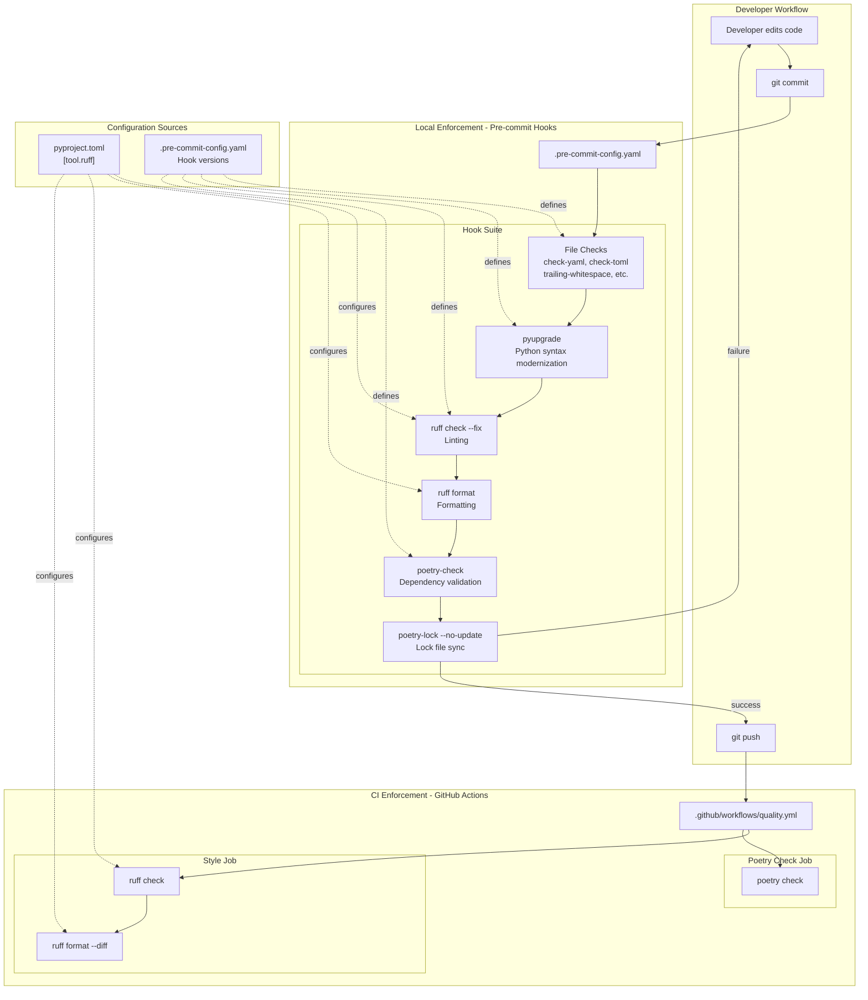
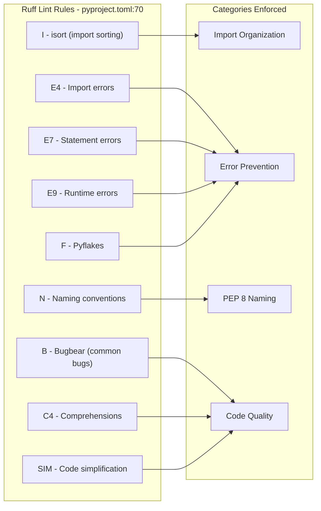
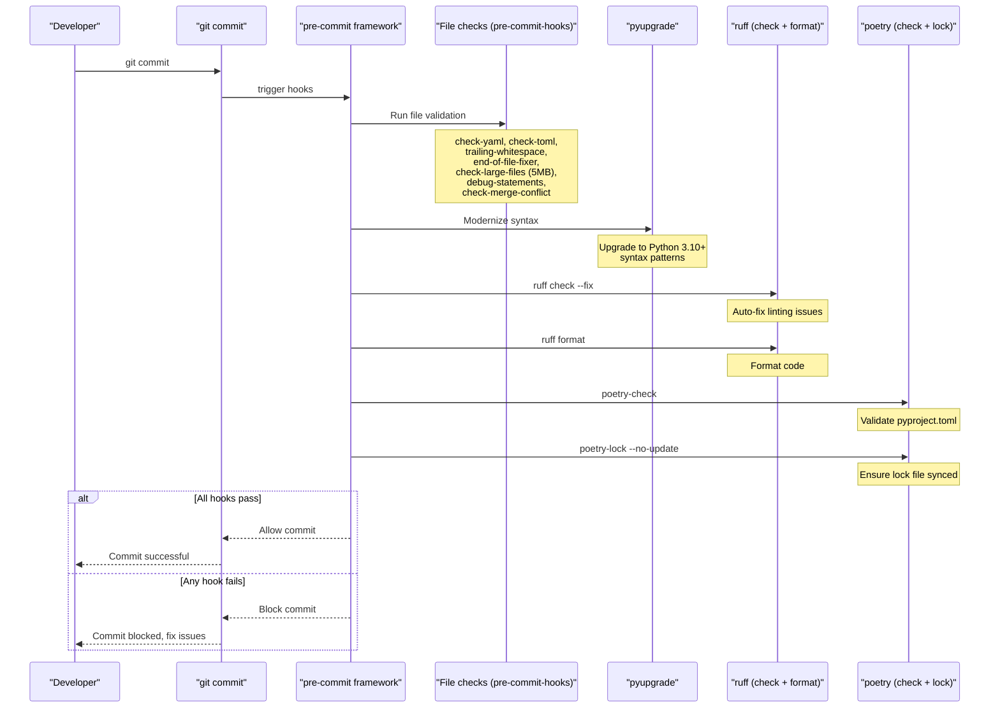
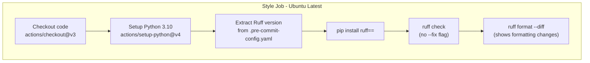
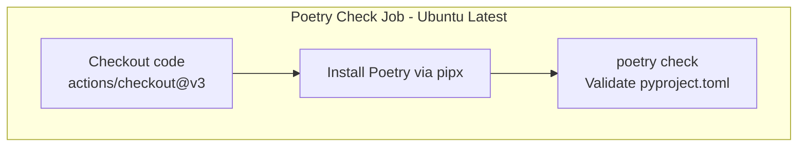

<!-- source: DeepWiki mcp.deepwiki.com · repo huggingface/gym-xarm · page 5.4 Code Quality Standards · fetched 2026-10-26 -->

# Code Quality Standards

<details>
<summary>Relevant source files</summary>

The following files were used as context for generating this wiki page:

- [.github/workflows/quality.yml](.github/workflows/quality.yml)
- [.pre-commit-config.yaml](.pre-commit-config.yaml)
- [pyproject.toml](pyproject.toml)

</details>


This document describes the code quality tools, standards, and enforcement mechanisms used in gym-xarm. It covers the automated linting, formatting, and validation processes that ensure consistent code style and maintain project health.

For information about the testing infrastructure and test suite, see [Testing](#5.2). For details on CI/CD workflows and automation, see [CI/CD Workflows](#5.3).

## Purpose and Scope

The gym-xarm project enforces code quality through a multi-layered approach:
- **Ruff** for code formatting and linting
- **Poetry check** for dependency validation
- **Pre-commit hooks** for local enforcement before commits
- **GitHub Actions workflows** for CI enforcement on pull requests

These tools operate on the Python codebase in [`gym_xarm/`](gym_xarm) and test files in [`tests/`](tests), with specific exclusions for example code.

## Quality Enforcement Architecture



**Sources:** [.pre-commit-config.yaml:1-34](), [.github/workflows/quality.yml:1-56](), [pyproject.toml:40-71]()

The quality enforcement pipeline operates at two levels: local pre-commit hooks that provide immediate feedback during development, and CI workflows that serve as a quality gate for pull requests. This dual-layer approach ensures code quality while allowing flexibility in the development workflow.

## Ruff Configuration

Ruff serves as both the code formatter and linter for gym-xarm, replacing multiple traditional tools (Black, isort, Flake8, etc.) with a single fast implementation.

### Basic Settings

| Configuration | Value | Purpose |
|--------------|-------|---------|
| `line-length` | 110 | Maximum line length for code formatting |
| `target-version` | `py310` | Target Python 3.10 syntax and features |
| Ruff version | `v0.4.3` | Specific version for reproducible behavior |

**Sources:** [pyproject.toml:40-42](), [.pre-commit-config.yaml:21-26]()

### Exclusion Patterns

The following paths are excluded from Ruff checks:

```
example.py          # User-facing example code
.venv, venv         # Virtual environments
build, dist         # Build artifacts
.git, .mypy_cache   # Tool directories
__pypackages__      # Package directories
```

**Sources:** [pyproject.toml:43-66](), [.pre-commit-config.yaml:1]()

The [`example.py`](example.py:1-50)() file is explicitly excluded in both configurations because it serves as user-facing documentation and may intentionally deviate from internal code standards for clarity.

### Lint Rule Selection



**Sources:** [pyproject.toml:69-71]()

The `select` configuration at [pyproject.toml:70]() defines a focused set of rules that catch common errors without being overly restrictive:

- **Error detection** (E4, E7, E9, F): Catches syntax errors, undefined names, and invalid imports
- **Import organization** (I): Enforces alphabetically sorted imports with standard library/third-party/local separation
- **Naming conventions** (N): Enforces PEP 8 naming (lowercase_with_underscores for functions, CapitalCase for classes)
- **Bug prevention** (B): Catches common Python pitfalls (mutable default arguments, unused loop variables, etc.)
- **Code simplification** (C4, SIM): Suggests more pythonic alternatives and removes unnecessary complexity

The `ignore-init-module-imports` flag at [pyproject.toml:71]() allows unused imports in `__init__.py` files, which is standard practice for re-exporting symbols.

## Pre-commit Hook Suite

### Hook Execution Order



**Sources:** [.pre-commit-config.yaml:5-33]()

### File Validation Hooks

The `pre-commit-hooks` repository provides basic file hygiene checks:

| Hook | Purpose | Configuration |
|------|---------|---------------|
| `check-added-large-files` | Prevent accidental large file commits | Max 5000 KB ([.pre-commit-config.yaml:9]()) |
| `debug-statements` | Detect leftover `debugger` or `breakpoint()` calls | Default |
| `check-merge-conflict` | Detect unresolved merge conflict markers | Default |
| `check-case-conflict` | Prevent case-insensitive filename conflicts | Default |
| `check-yaml` | Validate YAML syntax | Default |
| `check-toml` | Validate TOML syntax | Default |
| `end-of-file-fixer` | Ensure files end with newline | Default |
| `trailing-whitespace` | Remove trailing whitespace | Default |

**Sources:** [.pre-commit-config.yaml:5-16]()

### PyUpgrade Hook

The `pyupgrade` hook at [.pre-commit-config.yaml:17-20]() automatically modernizes Python syntax to use features available in Python 3.10+. This ensures code uses modern idioms like:
- Type annotations instead of type comments
- `list[int]` instead of `List[int]`
- f-strings where appropriate

**Sources:** [.pre-commit-config.yaml:17-20]()

### Ruff Hooks

The Ruff pre-commit integration runs two hooks sequentially:

1. **`ruff check --fix`** ([.pre-commit-config.yaml:24-25]()): Runs linting rules and automatically fixes issues where possible
2. **`ruff format`** ([.pre-commit-config.yaml:26]()): Formats code according to style guidelines

The `--fix` flag enables auto-correction of violations like import sorting, unused imports, and simple refactorings. This reduces manual work while maintaining consistency.

**Sources:** [.pre-commit-config.yaml:21-26]()

### Poetry Hooks

The Poetry hooks ensure dependency management integrity:

1. **`poetry-check`** ([.pre-commit-config.yaml:30]()): Validates that `pyproject.toml` is syntactically correct and internally consistent
2. **`poetry-lock`** with `--no-update` ([.pre-commit-config.yaml:31-33]()): Verifies that `poetry.lock` is synchronized with `pyproject.toml` without updating dependency versions

The `--no-update` flag is critical: it prevents automatic dependency updates during commits, ensuring lock file changes are intentional and reviewed.

**Sources:** [.pre-commit-config.yaml:27-33]()

## CI Quality Workflow

### Workflow Triggers

The quality workflow at [.github/workflows/quality.yml]() runs on:
- Pull requests to `main` branch ([.github/workflows/quality.yml:5-7]())
- Direct pushes to `main` branch ([.github/workflows/quality.yml:8-10]())
- Manual workflow dispatch ([.github/workflows/quality.yml:4]())

**Sources:** [.github/workflows/quality.yml:3-10]()

### Style Job



**Sources:** [.github/workflows/quality.yml:16-41]()

The style job extracts the Ruff version from [.pre-commit-config.yaml:22]() using an `awk` script at [.github/workflows/quality.yml:28-32](). This ensures CI uses the exact same Ruff version as local pre-commit hooks, preventing version-related discrepancies.

Key differences from pre-commit hooks:
- **`ruff check`** runs without `--fix` ([.github/workflows/quality.yml:38]()): Violations cause CI failure rather than auto-correction
- **`ruff format --diff`** ([.github/workflows/quality.yml:41]()): Shows formatting differences without applying them, causing failure if code is not formatted

### Poetry Check Job



**Sources:** [.github/workflows/quality.yml:44-55]()

This job validates that the `pyproject.toml` file is well-formed and semantically correct. It catches errors like:
- Invalid version constraints
- Missing required metadata
- Inconsistent dependency specifications

## Maintaining Code Quality

### For Contributors

When contributing to gym-xarm, follow these steps to ensure code quality:

1. **Install pre-commit hooks** (first time only):
   ```bash
   poetry install --all-extras
   pre-commit install
   ```
   
2. **Write code** in [`gym_xarm/`](gym_xarm) following the established patterns

3. **Commit changes** - pre-commit hooks automatically:
   - Fix trailing whitespace and line endings
   - Sort imports alphabetically
   - Format code to 110-character line length
   - Check for common errors and simplification opportunities
   - Validate YAML/TOML files
   - Verify Poetry configuration

4. **Address failures** - if hooks fail:
   - Review the output to understand violations
   - For auto-fixed issues, review changes and re-commit
   - For non-fixable violations, manually correct the code

5. **Push changes** - CI will re-validate quality standards

### Manual Quality Checks

To run quality checks manually without committing:

```bash
# Run all pre-commit hooks on all files
pre-commit run --all-files

# Run specific hooks
pre-commit run ruff --all-files
pre-commit run poetry-check --all-files

# Run Ruff directly
ruff check .
ruff format --check .

# Run Poetry validation
poetry check
poetry lock --check
```

### Bypassing Hooks (Not Recommended)

Pre-commit hooks can be bypassed with:
```bash
git commit --no-verify
```

However, this is **not recommended** because:
- CI will still enforce the same checks and fail the pull request
- It breaks the consistency guarantee that local and CI validation provide
- Other developers may encounter issues when pulling your changes

**Sources:** [.pre-commit-config.yaml:1-34]()

## Configuration File Reference

### Pre-commit Configuration Structure

```
.pre-commit-config.yaml
├── exclude: ^(example.py)                    # Global file exclusions
├── default_language_version:                 # Language version constraints
│   └── python: python3.10
└── repos:                                    # Hook repository list
    ├── pre-commit-hooks (v4.6.0)            # File validation hooks
    ├── pyupgrade (v3.15.2)                  # Syntax modernization
    ├── ruff-pre-commit (v0.4.3)             # Ruff linting + formatting
    └── poetry (1.8.0)                       # Dependency validation
```

**Sources:** [.pre-commit-config.yaml:1-34]()

### Ruff Configuration Structure

```
pyproject.toml - [tool.ruff]
├── line-length: 110                         # Max line length
├── target-version: "py310"                  # Python version target
├── exclude: [...]                           # Excluded paths/patterns
└── [tool.ruff.lint]
    ├── select: ["E4", "E7", "E9", ...]     # Enabled rule categories
    └── ignore-init-module-imports: true     # Allow unused __init__ imports
```

**Sources:** [pyproject.toml:40-71]()

## Summary

The gym-xarm code quality infrastructure provides:

- **Consistent code style** through Ruff formatting (110-char lines, Python 3.10 idioms)
- **Error prevention** through linting rules that catch common bugs and anti-patterns
- **Dependency integrity** through Poetry validation and lock file synchronization
- **Multi-layer enforcement** through pre-commit hooks (local) and GitHub Actions (CI)
- **Version consistency** by extracting tool versions from configuration files

This infrastructure ensures all code in the [`gym_xarm/`](gym_xarm) and [`tests/`](tests) directories maintains high quality standards while minimizing manual intervention through auto-fixing capabilities.

**Sources:** [.pre-commit-config.yaml:1-34](), [pyproject.toml:40-76](), [.github/workflows/quality.yml:1-56]()

---

